48 / 48 / 12 GiB limit agent mean

# CompressionBench: How can your coding agents compress LLMs?

Xinrui Zhong∗, Zhifeng Li∗, Zhiming Wang, Yongqi Liu, Shanglin Yang, Yang Zhou, Zikun Li, Zhuoming Chen, Beidi Chen

Carnegie Mellon University

{xinruizh, zhifengl, zhimingw, yongqil, shangliy, yangzho6, zikunl, zhuominc, beidic}@andrew.cmu.edu ∗Equal contribution.

## ABSTRACT

Recursive self-improvement requires AI systems to improve the models and infrastructure used by subsequent systems. LLM compression ofers a concrete eficiency objective: retain a pretrained model’s behavior within a smaller model storage budget. We study whether coding agents can carry out this step autonomously. We formulate compression as a terminal task in which an agent receives a source checkpoint, storage limit, inference environment, and time budget, then constructs compressed weights and executable inference code. The agent controls its algorithm and experiments; perplexity feedback guides search, and independent verification checks the final model. Across six agents and six model–size settings, 29 of 36 submissions pass verification. Selecting the lowest-perplexity agent design per task yields an average 3.4% perplexity increase over BF16 and 77.33% downstream accuracy, compared with 79.56% for BF16. Recorded experiments reveal how agents achieve these outcomes and where improvement breaks down. Agents lower PPL in 21 of 24 revisions at nearly fixed storage; complete-model feedback reverses 17 of 79 prior local rankings; and generation and inference tests expose failures that likelihood alone misses. The results identify representation design, experimental judgment, and capability validation as central to agent-driven model compression, a measurable component of eficiency-oriented self-improvement.

§ Code github.com/Infini-AI-Lab/Compression-Bench U Blog infini-ai-lab.github.io/Compression-Bench

## 1 Introduction

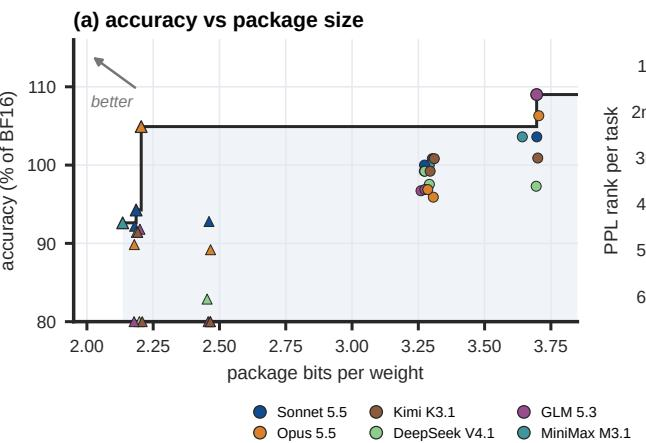

(b) PPL rank vs API cost  
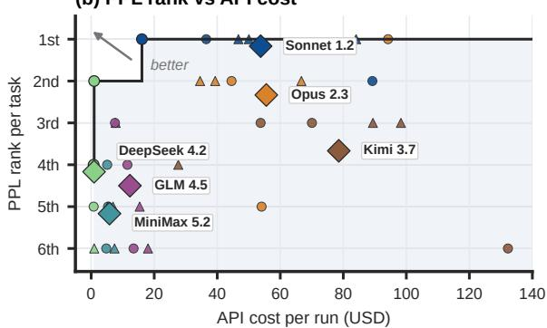  
Figure 1 Agent-driven compression outcomes. (a) Mean GSM8K, HumanEval, and TriviaQA accuracy relative to BF16 versus package bits per original parameter; values below 80% lie on the axis. (b) API cost versus within-task PPL rank; diamonds average six tasks per agent. Pareto frontiers use passing models for the accuracy–size comparison in (a).

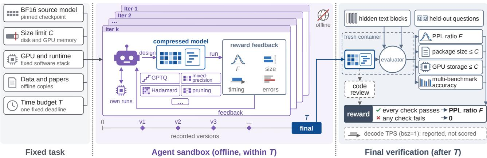  
Figure 2 Compression through terminal interaction. A task fixes the source checkpoint, storage allowance �, GPU and runtime, and search budget �. The agent constructs and tests compressed models, using reward feedback to revise weights and inference code. At the deadline, a separate evaluator checks the frozen artifact’s likelihood, generated answers, storage, and execution. Decode speed (TPS, batch size one) is reported separately from reward.

Large language model (LLM) inference is increasingly bounded by memory trafic rather than arithmetic: in autoregressive decoding, every generated token reads the model weights from GPU memory, and an of-chip memory access costs far more energy than the arithmetic it feeds (Horowitz, 2014). Compression that preserves a model’s behavior within a smaller storage budget therefore reduces both the memory a deployment occupies and the energy spent on every token it generates, making models cheaper to serve and runnable on smaller hardware (Frantar et al., 2023; Lin et al., 2024, 2025). Constructing such a model remains substantial experimental and systems work, the kind of work that coding agents increasingly undertake (Novikov et al., 2025; Zhang et al., 2026). An agent that compresses models would improve the eficiency of the AI systems that follow it, a concrete step toward recursive self-improvement. We therefore ask: can coding agents autonomously construct compressed LLMs that remain useful within a given storage budget?

Existing compression methods provide a rich set of building blocks, but no single method yields a useful model under an arbitrary storage limit and hardware target. To construct one autonomously, an agent needs three abilities:

• Coordinating coupled numerical decisions. A storage budget ties together representation, precision allocation, and parameter retention: bits spent on one component are unavailable to the rest, and pruning releases bytes but removes capacity. Even at the same nominal precision, clipping, rounding, calibration, and metadata change the quality of a representation (Frantar et al., 2023; Shao et al., 2024). The agent must judge feasible combinations rather than optimize each choice independently.

• Interpreting incomplete feedback. Weight reconstruction error, layer-output error, complete-model likelihood, and generated-answer accuracy each answer a diferent question. A change that improves a local approximation can damage the complete model, and a small likelihood gain can conceal a generation regression. The agent must decide when inexpensive local evidence sufices and when a complete-model experiment is worth its cost.

• Co-designing eficient execution. Compression saves memory and energy only when unpacking, reconstruction, and indexing do not erase the reduction in memory trafic, and persistent dequantized copies can erase the residentstorage savings of a small checkpoint. The agent must implement an inference path suited to the target hardware, as in quantized inference systems (Lin et al., 2024, 2025), and verify that it runs correctly.

To evaluate these abilities without prescribing how agents compress, we formulate LLM compression as a terminal task (Figure 2), following the outcome-based evaluation of Terminal-Bench and Harbor (Merrill et al., 2026; Harbor Framework Team, 2026). A coding agent reads papers, writes code, constructs checkpoints, and runs experiments within a fixed time budget. Three designs support this evaluation. 1. Task: a complete model under a storage limit. Given source weights, a storage limit, a GPU, and a pinned runtime, the agent may combine quantization, mixed precision, pruning, low-rank representations, and distillation, and must implement the inference operations its representation requires (Section 2.1). 2. Feedback: complete-model likelihood. A supplied evaluator returns the source-to-compressed perplexity (PPL) ratio on continuations sampled from the source model; the expected excess cross-entropy equals the next-token KL divergence from the source (Section 2.3). Evaluations share the agent’s time budget, so the agent decides when local evidence sufices and when a complete-model measurement is worth its cost.

3. Validation: the executable artifact. Independent verification runs the submitted weights through the submitted inference code on held-out contexts. Both the saved package and the resident GPU weights must fit the limit; GSM8K, HumanEval, and TriviaQA accuracy must retain 80% of BF16; and review checks integrity. Decode speed is reported separately (Section 2.4). Only verified models receive a score.

In Section 3, we evaluate the models that six coding agents deliver for three source models with two storage limits each. Of the 36 resulting models, 29 pass verification, including all 18 produced under the looser limits. Selecting the lowest-PPL agent design per task yields an average 3.4% PPL increase over BF16 and 77.33% downstream accuracy, compared with 79.56% for BF16 (Section 3.2). In Section 4, we analyze the agents’ recorded searches to explain how they improve compression and where improvement breaks down, yielding three findings. Representation design creates room atfixed storage. In 21 of 24 revisions that change package size by at most 0.01 GiB, agents lower PPL by improving the quantizer or redistributing precision (Section 4.1). Complete-model feedback changes selection. Reward feedback reverses 17 of 79 prior local rankings, leading agents to revert candidates or revise their local validation (Section 4.2). Likelihood alone does not validate a model. Intermediate models gain and lose correct answers at nearly unchanged PPL, and consistency tests expose inference bugs that likelihood misses (Section 4.3).

## 2 Compression as a Terminal Task

A compression task asks an agent to produce a model that approximates a source LLM under a specified storage allowance. Its output includes both the numerical representation and the code that runs it. The task couples model approximation with implementation and experimental search.

## 2.1 Task Specification and Search Space

A task specifies a source model � with its tokenizer, a storage limit �, a hardware allocation, a pinned inference runtime, and a wall-clock budget �. The agent works in an ofline container with read-only source weights, starter inference code, searchable compression papers, calibration and recovery data, and a separate set of questions for local testing. The runtime provides scheduling and uncompressed operations. The agent chooses its compression algorithm, produces the weights, and implements the operations required by its chosen representation.

Let $a = \left( W , I \right)$ denote a candidate, where � contains compressed weights and associated metadata and � is its inference implementation. Together they define the executable model $q _ { a } .$ The search space includes quantization formats and rounding rules, component-specific precision, pruning, low-rank representations, and distillation. Changes to this representation can also require changes to �. The task does not prescribe an order for making these decisions.

The storage allowance constrains two quantities. $S _ { \mathrm { p k g } } ( a )$ counts the saved model package, including code and tokenizer assets. $S _ { \mathrm { r e s } } ( a )$ counts model storage retained on the GPU during inference, including scales, codebooks, padding, and persistent dequantized weights. Shared allocations count once. KV caches, recurrent states, and temporary computation workspace are excluded. These rules prevent a small saved checkpoint from satisfying the task by retaining a full-precision model during execution. The allowance constrains resident weights rather than total peak GPU memory.

## 2.2 Experiments and Feedback

The agent allocates � among implementation, calibration, recovery, local tests, and evaluation of complete candidates. It can use local measurements such as reconstruction error, KL divergence, or negative log-likelihood to choose what to build. A supplied evaluator returns PPL-based reward, package and resident model storage, decode timing, and execution diagnostics. All such calls consume the same wall-clock budget as model construction. The agent must judge whether another evaluation is worth its cost.

This interaction follows the budgeted experimentation setting of MLAgentBench and RE-Bench (Huang et al., 2024; Wijk et al., 2025). Candidate versions and experiments are recorded so that the final model can be connected to the revisions that produced it. At time �, the submitted candidate is frozen. A separate container performs final verification, adding held-out generated-answer tests and implementation review to the likelihood and storage measurements.

## 2.3 Likelihood Objective

Let $ { \boldsymbol { D } } _ { s }$ and ${ \cal D } _ { \mathrm { v } }$ denote the search and verification datasets. Both contain continuations sampled from the source model, using disjoint contexts. A dataset $D = \{ ( h _ { n } , y _ { n } ) \} _ { n = 1 } ^ { N }$ records each scored token $y _ { n }$ and its context and pre-

ceding continuation $h _ { n } .$ Source and compressed models score the same � continuation positions. Their empirical cross-entropy and perplexity are

$$
\begin{array} { c } { { \displaystyle { \widehat { H } } _ { D } ( q ) = - \frac { 1 } { N } \sum _ { n = 1 } ^ { N } \log q ( y _ { n } \mid h _ { n } ) , } } \\ { { \mathrm { P P L } _ { D } ( q ) = \exp \bigl ( \widehat { H } _ { D } ( q ) \bigr ) . } } \end{array}\tag{1}
$$

For candidate $a = \left( W , I \right)$ with executable model $q _ { a } ,$ , the empirical excess cross-entropy is

$$
\widehat { \Delta } _ { D } ( a ) = \widehat { H } _ { D } ( q _ { a } ) - \widehat { H } _ { D } ( p ) .\tag{2}
$$

Under source sampling, its expectation equals the next-token KL divergence averaged over scored histories:

$$
\begin{array} { r } { \mathbb { E } \left[ \widehat { \Delta } _ { D } ( a ) \right] = \mathbb { E } _ { h \sim \mu _ { p } } [ D _ { \mathrm { K L } } ( p ( \cdot \mid h ) \parallel q _ { a } ( \cdot \mid h ) ) ] . } \end{array}\tag{3}
$$

Here � is the distribution of scored histories induced by the context mixture and source continuations. This objective $\mu _ { p }$ measures likelihood preservation on source histories; answer tests assess the candidate’s autoregressive behavior.

The task minimizes the search estimate under separate saved and resident model-storage constraints:

$$
\begin{array} { r l } { \underset { a = ( W , I ) } { \mathrm { m i n i m i z e } } } & { \widehat { \Delta } _ { D _ { s } } ( a ) } \\ { \mathrm { s u b j e c t ~ t o } } & { S _ { \mathrm { p k g } } ( a ) \leq C , } \\ & { S _ { \mathrm { r e s } } ( a ) \leq C . } \end{array}\tag{4}
$$

Construction, local tests, and supplied evaluations share the wall-clock budget �. The evaluator returns the source-to-compressed PPL ratio:

$$
\begin{array} { r l } & { F _ { D } ( a ) = \frac { \mathrm { P P L } _ { D } ( p ) } { \mathrm { P P L } _ { D } ( q _ { a } ) } } \\ & { ~ = \exp ( - \widehat { \Delta } _ { D } ( a ) ) . } \end{array}\tag{5}
$$

Equal measured likelihood gives $F _ { D } ( a ) = 1$ . During search, let $U ( a ) = 1$ when execution succeeds and both storage limits hold. The feedback reward is

$$
r _ { \mathrm { s } } ( a ) = \left\{ \begin{array} { l l } { 1 0 F _ { D _ { s } } ( a ) , } & { U ( a ) = 1 , } \\ { 0 , } & { U ( a ) = 0 . } \end{array} \right.\tag{6}
$$

Timing is returned separately and does not enter this reward. In trajectory plots, � abbreviates the measured excess cross-entropy $\widehat { \Delta } _ { D } ( a )$ , and � denotes the corresponding PPL ratio when the dataset is clear.

## 2.4 Independent Acceptance Tests

Final verification evaluates the frozen weights through the submitted inference code and oficial tokenizer. Its contexts are disjoint from those used for search-time reward. The evaluator controls inputs and measurements and checks four aspects of the artifact.

The evaluator computes $F _ { D _ { \mathrm { v } } }$ on verification continuations and measures both package and resident model storage. Retained high-precision copies count at their actual size. Storage is measured after loading and after inference to include allocations that persist once the model has run.

Let  contain GSM8K, HumanEval, and TriviaQA, with $A _ { b } ( a )$ denoting accuracy on benchmark �. Compressed and source models receive the same questions and generation settings. Mean accuracy and the acceptance condition are

$$
\begin{array} { l } { \displaystyle { A ( a ) = \frac { 1 } { | \mathcal { B } | } \sum _ { b \in \mathcal { B } } A _ { b } ( a ) , } } \\ { \displaystyle { A ( a ) \geq \rho A ( \mathcal { p } ) , \qquad \rho = 0 . 8 , } } \end{array}\tag{7}
$$

where $A ( p )$ is the BF16 reference fixed before search. The threshold is set before search and withheld from agents.   
Held-out answer scores are absent from search-time reward. Separate questions support the agents’ local generation tests.

Automated checks and independent review assess compliance with the construction and inference rules. Tokens and probabilities must come from the submitted forward pass and packaged weights, with unscaled logits for likelihood scoring. Review checks model-storage accounting, external weights, hard-coded outputs, and manipulation ofprobability or timing measurements.

A separate test measures elapsed time � between the first and last of 128 streamed tokens after warmup. We report batchone decode speed $\begin{array} { r } { v _ { \mathrm { d e c } } \ = \ 1 2 7 / L } \end{array}$ tokens/s: 128 tokens span 127 inter-token intervals. Prefill and time to first token are excluded. Speed does not enter the reward, distinguishing compression quality from execution eficiency.

Writing $V ( a ) = 1$ when execution completes, the storage limits and answer threshold hold, and integrity checks pass, the final normalized score is

$$
R ( a ) = \left\{ \begin{array} { l l } { F _ { D _ { \mathrm { v } } } ( a ) , } & { V ( a ) = 1 , } \\ { 0 , } & { V ( a ) = 0 . } \end{array} \right.\tag{8}
$$

The final score uses verification data and the full acceptance tests; search feedback uses $\mathcal { D } _ { s }$ and $U ( a )$ . Thus candidate selection and final acceptance evaluate distinct requirements with separate data.

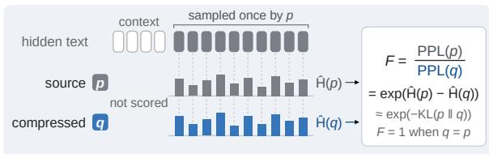

(a) PPL on source-sampled continuations  
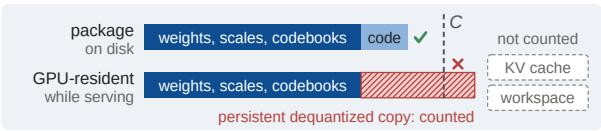  
(b) Storage counted against the size limit C

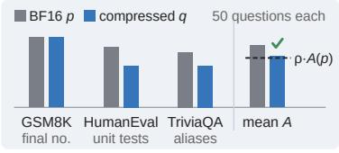

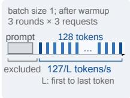  
(c) Multi-benchmark accuracy gate  
(d) Decode speed  
Figure 3 Verification measurements. (a) Source � and candidate � score the same source-generated tokens. (b) Package and resident model storage must each fit �, including persistent reconstructed weights. (c) Mean accuracy over three benchmarks must retain 80% of BF16 accuracy, using fifty questions each. (d) Batch-one decode speed is 127/� tokens/s.

## 3 Empirical Study

We first ask whether agents can deliver useful models under the task’s constraints. We then examine the recorded searches to understand how agents improve candidates and which failures survive to submission.

## 3.1 Experimental Setting

We study text generation from two mixture-of-experts (MoE) checkpoints, Nemotron-3.5 Super VL 120B-A12B and Qwen3.5 122B-A10B, and the dense Qwen3.8 27B checkpoint. Each MoE model has 32 and 48 GiB tasks; the dense model has 8 and 12 GiB tasks. Pairing limits holds the source model fixed while changing the need for aggressive compression. Pilot measurements on Qwen3.8 guide these allowances. Larger pilot limits admit four-bit GPTQ with group-size or damping refinements; tighter limits make low-bit representations and precision allocation more consequential. Some pilot models retain BF16 weights during inference despite small packages, motivating separate limits on saved and resident model storage (Appendix D).

Claude Sonnet 5.5, Claude Opus 5.5, GLM 5.3, Kimi K3.1 Pro, MiniMax M3.1 Flash, and DeepSeek V4.1 Flash 1017 each attempt all six tasks. Every run uses Claude Code with maximum reasoning efort, one H200 NVL, vLLM 0.32.0, and an eight-hour budget. Agents receive papers and FineWeb, UltraChat-200k, and WikiText-103 for calibration or recovery (Penedo et al., 2024; Ding et al., 2023; Merity et al., 2017). MATH-500 provides separate questions for local answer tests (Lightman et al., 2024). There is one run per agent–task pair.

A uniform GPTQ baseline uses groups of 128 weights and 128 calibration sequences of 2,048 tokens (Frantar et al., 2023). It chooses the largest uniform bit width that fits the package limit and adjusts embedding and output-head precision to the remaining space. We also evaluate released quantizations of the same checkpoints: Unsloth Dynamic GGUF for Nemotron and Qwen3.5, and GSQ-RCO for Qwen3.8 (Dadgarnia et al., 2026; Helcig and Alistarh, 2026).

All compressed models run on one GPU. Agent artifacts and GPTQ use vLLM (Kwon et al., 2023) with packed weights; published weights run unchanged in their native packed GGUF representation using llama.cpp. BF16 uses two GPUs

(b) Looser storage limits

<table><tr><td></td><td colspan="3">Nemotron-3.5 120B-A12B  / 32 GiB</td><td colspan="3">Qwen3.5 122B-A10B  /  32 GiB</td><td colspan="3">Qwen3.8 27B  /  8 GiB</td></tr><tr><td>Method / agent</td><td>PPL↓</td><td>Acc.↑</td><td>TPS↑</td><td>PPL↓</td><td>Acc.↑</td><td>TPS↑</td><td>PPL↓</td><td>Acc.↑</td><td>TPS↑</td></tr><tr><td>BF16</td><td>1.688</td><td>80.00</td><td>147.5</td><td>2.755</td><td>84.67</td><td>158.3</td><td>3.221</td><td>74.00</td><td>61.4</td></tr><tr><td>Released model</td><td></td><td>一</td><td></td><td>2.900</td><td>83.33</td><td>122.9</td><td>3.764</td><td>65.33</td><td>75.5</td></tr><tr><td>GPTQ</td><td>4.680</td><td>5.33</td><td>20.9</td><td>7.185</td><td>6.00</td><td>26.4</td><td>7.480</td><td>4.67</td><td>12.6</td></tr><tr><td>Sonnet 5.5</td><td>1.801</td><td>76.67</td><td>57.2</td><td>2.883</td><td>78.67</td><td>39.8</td><td>3.363</td><td>68.67</td><td>23.4</td></tr><tr><td>Opus 5.5</td><td>1.811</td><td>85.33</td><td>48.6</td><td>3.003</td><td>76.67</td><td>73.2</td><td>3.370</td><td>66.00</td><td>26.2</td></tr><tr><td>GLM 5.3</td><td>1.871</td><td>74.67</td><td>16.6</td><td></td><td>Not passed</td><td></td><td></td><td>Not passed</td><td></td></tr><tr><td>Kimi K3.1</td><td></td><td>Not passed</td><td></td><td>3.035</td><td>78.00</td><td>43.1</td><td></td><td>Not passed</td><td></td></tr><tr><td></td><td></td><td>75.33</td><td>11.4</td><td></td><td>Not passed</td><td></td><td></td><td>Not passed</td><td></td></tr><tr><td>MiniMax M3.1 DeepSeek V4.1</td><td>2.084</td><td>Not passed</td><td></td><td>3.110</td><td>78.00</td><td>12.7</td><td>4.283</td><td>61.33</td><td>13.7</td></tr></table>

<table><tr><td></td><td colspan="3">Nemotron-3.5 120B-A12B  / 48 GiB</td><td colspan="3">Qwen3.5 122B-A10B  / 48 GiB</td><td colspan="3">Qwen3.8 27B  / 12 GiB</td></tr><tr><td>Method / agent</td><td>PPL↓</td><td>Acc.↑</td><td>TPS↑</td><td>PPL↓</td><td>Acc.↑</td><td>TPS↑</td><td>PPL↓</td><td>Acc.↑</td><td>TPS↑</td></tr><tr><td>BF16</td><td>1.688</td><td>80.00</td><td>147.5</td><td>2.755</td><td>84.67</td><td>158.3</td><td>3.221</td><td>74.00</td><td>61.4</td></tr><tr><td>Released model</td><td>1.764</td><td>82.67</td><td>100.5</td><td>2.808</td><td>82.00</td><td>106.9</td><td>3.334</td><td>66.00</td><td>74.6</td></tr><tr><td>GPTQ</td><td>1.875</td><td>76.00</td><td>16.0</td><td>2.987</td><td>79.33</td><td>20.2</td><td>3.546</td><td>46.00</td><td>11.1</td></tr><tr><td>Sonnet 5.5</td><td>1.728</td><td>82.00</td><td>47.4</td><td>2.788</td><td>85.33</td><td>46.3</td><td>3.253</td><td>76.67</td><td>16.7</td></tr><tr><td>Opus 5.5</td><td>1.726</td><td>78.00</td><td>68.2</td><td>2.818</td><td>82.67</td><td>52.9</td><td>3.272</td><td>78.67</td><td>31.4</td></tr><tr><td>GLM 5.3</td><td>1.778</td><td>78.67</td><td>40.3</td><td>2.814</td><td>82.67</td><td>10.5</td><td>3.383</td><td>80.67</td><td>10.4</td></tr><tr><td>Kimi K3.1</td><td>1.729</td><td>82.00</td><td>13.6</td><td>2.835</td><td>84.67</td><td>7.8</td><td>3.333</td><td>74.67</td><td>8.0</td></tr><tr><td>MiniMax M3.1</td><td>1.752</td><td>81.33</td><td>9.1</td><td>2.814</td><td>84.67</td><td>27.6</td><td>3.399</td><td>76.67</td><td>10.9</td></tr><tr><td>DeepSeek V4.1</td><td>1.749</td><td>79.33</td><td>16.6</td><td>2.803</td><td>84.67</td><td>10.8</td><td>3.399</td><td>72.00</td><td>18.4</td></tr></table>

Table 1 Verified models under tighter (a) and looser (b) storage limits. Perplexity (PPL) is measured on held-out BF16-generated continuations; accuracy (%) averages GSM8K, HumanEval, and TriviaQA. TPS is decode tokens per second at batch size one, computed as 127/� from the 128-token first-to-last interval �. Note that TPS is excluded from the PPL-based reward, and weight unpacking and dequantization can ofset the benefits of reduced memory trafic. Compressed models use one H200 NVL; BF16 uses one for the dense model and two for the MoE models. Released models use Unsloth Dynamic UD-IQ2\_XXS (Nemotron), Unsloth Dynamic (Qwen3.5), and GSQ-RCO (Qwen3.8). Complete measurements, including rejected artifacts, are in Table A3.

for the MoE models and one for the dense model. All comparisons share the measurement protocol; TPS also reflects the submitted kernel implementations and dequantization overhead.

Search-time and verification likelihood each use 256 contexts of 512 tokens from the Dolma 3 Dolmino mixture (Team Olmo et al., 2025). The sets use disjoint documents with matched source proportions. For each context, BF16 samples 1,536 tokens at temperature one without probability truncation; both models score those continuations. We report final PPL in tables and search-time feedback in trajectory plots. Cross-model comparisons use PPL increase over BF16.

Answer accuracy is the mean over fifty held-out questions each from GSM8K, HumanEval, and TriviaQA (Cobbe et al., 2021; Chen et al., 2021; Joshi et al., 2017), with identical questions and greedy decoding for source and compressed models. Acceptance uses BF16 references fixed before search. The main table also reports fresh BF16 measurements; these remeasurements supply the 77.33% versus 79.56% aggregate comparison below.

Verification runs on an idle GPU and counts model allocations after loading and inference. Decode uses batch size one, a 2,048-token prompt, and 128 output tokens. After warmup, � is the median of three round means over three requests each, timed between first and last token. Reported decode speed is 127/� tokens/s. The fixed BF16 references, generation budgets, measurement protocol, per-artifact results, and additional experiments appear in Appendices A, C and E.

## 3.2 Delivered Models

Twenty-nine of the thirty-six submissions pass final verification (Table 1). All eighteen at the looser limits pass. At the tighter limits, six fail the answer-accuracy requirement and one times out during answer generation. Selecting the lowest-PPL agent artifact for each task gives an average 3.4% PPL increase over BF16. Those six artifacts average 77.33% downstream accuracy, compared with 79.56% for the remeasured BF16 models.

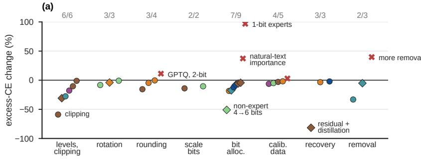

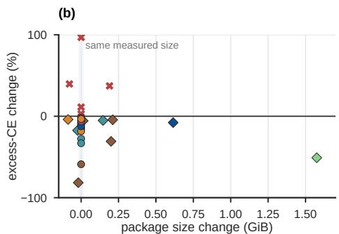  
Sonnet Opus GLM MiniMax DeepSeek Kimi size changed reverted  
Figure 4 Revisions within recorded searches. Thirty-five pairs from 21 runs compare candidate PPL through reward feedback. Excess cross-entropy is $E = \ln ( \mathrm { P P L } / \mathrm { P P L } _ { \mathrm { B F 1 6 } } ) ;$ the vertical axis is $1 0 0 ( E _ { \mathrm { a f t e r } } / E _ { \mathrm { b e f o r e } } - 1 )$ . (a) Changes by design factor, with lower-PPL/total counts. (b) The same pairs by package-size change; the band denotes changes within 0.01 GiB, and crosses mark candidates subsequently reverted.

The storage allowance influences every agent’s result, but does not fully explain quality. Each agent’s larger-allowance artifact has lower PPL than its tighter counterpart. Yet Sonnet’s 8 GiB dense model also has lower PPL than three agents’ 12 GiB models. A better representation can therefore outweigh additional storage in these comparisons. Uniform GPTQ passes the answer threshold on the looser MoE tasks and fails on the remaining settings, indicating that a fixed recipe covers only part of the task suite.

Released quantizations provide a stronger comparison. The best agent artifact by PPL improves on each of the five measured released-model references. Answer accuracy distinguishes designs further: the tighter Qwen3.5 release has higher accuracy than the lowest-PPL agent model, whereas Sonnet improves both PPL and accuracy over the released dense references. PPL and answer accuracy thus afect which artifact would be preferred.

Figure 1 places the results alongside encoded size and API cost. Sonnet has the best average PPL rank, followed by Opus; the largest API expenditure does not correspond to the best rank. The remaining analysis follows the concrete decisions behind these outcomes, rather than using spending or activity alone to explain them.

## 4 How Agents Improve Compression

Agents can change compression algorithms, storage allocation across model components, or candidate evaluation. Recorded trajectories connect these choices to model measurements and subsequent actions. Within-task comparisons follow the recorded revisions; a paired ablation isolates a quantizer decision after search.

## 4.1 Representation and Storage Tradeoffs

The first question is where an agent finds improvement once a model fits the storage limit. It can allocate more bytes to a sensitive component only by saving them elsewhere, or improve the approximation represented by existing codes. In 24 recorded revisions whose package sizes difer by at most 0.01 GiB, 21 lower PPL measured by reward feedback. These pairs span all six agents and all six tasks (Figure 4). These choices improve the quantizer or redistribute precision within a feasible model.

On tighter Qwen3.5, Kimi changes clipping and GPTQ damping while keeping package size unchanged, reducing feedback PPL from 3.738 to 3.132. Across the trajectories, level and clipping revisions improve PPL for three agents on five tasks. Bit width fixes the code count; clipping and rounding determine how those codes approximate weights and activations (Frantar et al., 2023; Shao et al., 2024). The paired dense-model ablation in Appendix E.2 keeps precision allocation, calibration, and inference implementation fixed while replacing GLM’s MSE-selected clipping ranges with min–max ranges. The selected ranges give lower verification PPL and higher answer accuracy. Both variants occupy the same saved and resident model storage. All three answer benchmarks favor the selected ranges. This connects the agent’s quantizer choice to the quality of the complete model after search.

Sensitivity guides mixed-precision bit allocation (Dong et al., 2020), but agents also allocate storage to metadata. Kimi reduces dense-model group-scale storage to fit additional four-bit weights. DeepSeek raises non-expert precision on Nemotron, while Opus gives later Qwen3.5 layers more expert precision. Weights and metadata share the package budget. Kimi reduces the storage used for scales to make room for higher weight precision; DeepSeek and Opus change where that precision is assigned. These examples show why the allocation includes quantizer overhead as well as the nominal bit width of the weights.

An agent can also remove parameters to aford higher precision for those that remain. GLM and MiniMax test additional expert or MLP-width removal; their recorded comparisons favor the less-pruned alternatives. MiniMax nevertheless retains a large dense-model width reduction after rejecting an early two-bit implementation. Its subsequent generation tests expose a substantial loss. MiniMax’s decision to retain pruning links its precision choice to parameter removal. Subsequent numerical refinements operate on a model with fewer parameters.

## 4.2 Local Metrics and Candidate Selection

The second question is how an agent chooses which design to retain. Local experiments guide which candidate quantizers and precision allocations an agent builds. We examine what happens when reward feedback disagrees with that local ranking: whether the agent reverts the candidate, revises its numerical choices, or changes the validation used in subsequent experiments. Across 79 matched comparisons from 26 runs, reward feedback reverses 17 prior local rankings across all six tasks and all agents except MiniMax. Eight reversals lead to explicit rollback: five by Kimi and three by DeepSeek. Across the eligible comparisons, agents also refine calibration and quantization or reallocate precision (Appendix E.3). Model-level measurements thus influence both the candidate an agent retains and the numerical choices it revisits.

A controlled diagnostic on dense Qwen3.8 varies levels, clipping, rotation, rounding, and attention–MLP bit allocation at similar encoded size (Figure 5). Forward passes use BF16 reconstructions, separating numerical representation from packedkernel execution. A k-means codebook improves weight reconstruction MSE over clipped uniform levels but increases

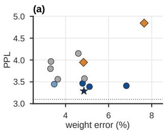

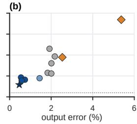  
Figure 5 Local error and model likelihood. Twelve Qwen3.8 variants use approximately 3.14 encoded bits per quantized decoder weight, with BF16 embeddings and output head. PPL is measured using BF16 reconstructions on the source continuations used for reward feedback. (a) Weight reconstruction MSE. (b) Linear-output MSE on BF16 FineWeb calibration activations. Each error is normalized by its BF16 squared norm; the dotted line denotes BF16 PPL.

PPL. GPTQ rounding has the opposite pattern: larger weight MSE and lower PPL. Calibration-activation output error follows PPL more closely in this comparison. Weight MSE treats reconstruction errors equally across input directions. Linear-output MSE weights those errors by the calibration activations. A small reconstruction error in a direction with large activation magnitudes can afect the layer’s output more than a larger error in a weakly activated direc tion. Complete-model PPL measures the resulting behavior after all quantized layers are composed. These criteria can therefore favor diferent revisions at similar encoded size.

On looser Qwen3.5, Opus initially favors more precision for early layers. It revises local validation to score modelgenerated continuations, then favors later layers, an allocation supported by reward feedback. On the tighter task, it spends 1.7 hours exploring a one-bit expert tier. Local likelihood favors the new candidate, but feedback favors the previous allocation; Opus restores and refines that allocation. Conflicting measurements lead it to revise local validation in one search and revert the candidate in the other

Later evaluations increasingly match a run’s best PPL (Figure 6). Some confirm that a candidate is worth keeping; others follow successful numerical revisions. Kimi improves its dense model after adding a low-rank residual and distillation. MiniMax instead repeatedly evaluates a pruned candidate after its last improvement. Reward feedback reports a tested candidate’s performance; the agent then decides whether to refine its quantizer, change precision allocation, or reconsider the representation.

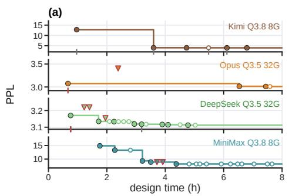

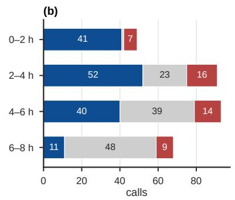

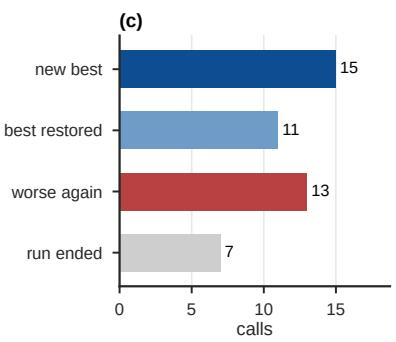  
new best same PPL as the best worse than the best best so far local ranking confirmed local ranking reversed

Figure 6 Feedback during candidate selection. (a) Best-so-far PPL for four searches; ticks indicate whether complete-model feedback confirms or reverses a local ranking. (b) Outcomes of 301 reward evaluations across 36 runs, grouped by search time. Rewards within 0.002 of the best are treated as the same PPL. (c) The next outcome after 46 worse candidates. Reward equals ten times the source-to-compressed PPL ratio; all plotted evaluations occur during search.  
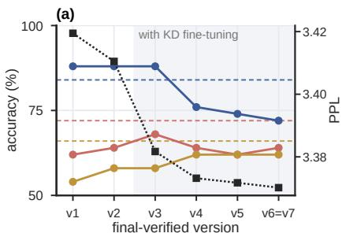

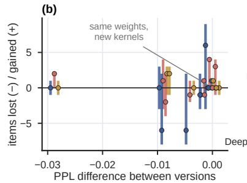

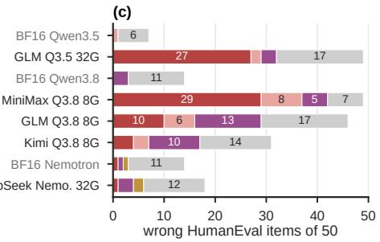  
GSM8K HumanEval TriviaQA BF16, same items PPL (right axis) repetition loop truncated or empty syntax or runtime error format tests fail  
Figure 7 Capability changes across candidate models. (a) Verification PPL and answer accuracies for Opus on Qwen3.8 / 8 GiB; shading marks distillation and dashed lines mark BF16. (b) Answers gained and lost across twelve successive-version pairs from four runs, plotted against PPL change. (c) HumanEval failure types for selected rejected artifacts and their BF16 references. Each benchmark has fifty questions.

## 4.3 Validating Generation and Execution

A prior pruning study reports mismatches between perplexity and downstream performance (Khanal and Capone, 2024). For agents, detecting a generation regression and finding a feasible repair are distinct challenges. PPL scores fixed source-generated histories, while generation feeds the candidate’s own choices back into the model. Repetition, early termination, and changed problem solving therefore require direct checks. Intermediate verification tracks these changes between versions; trajectories show whether agents detect the loss and find a repair they can retain.

We verify retained intermediate models after search using the same held-out inputs as the final artifacts. In Opus’s tighter dense-model run, allocation and distillation improve PPL while GSM8K accuracy falls from 88% to 72% across trained versions. HumanEval and TriviaQA improve over the same versions. Twelve comparisons from four runs show both newly correct and newly incorrect answers after small PPL changes (Figure 7). A single scalar can conceal changes in which capabilities survive.

Generation failures also difer in kind. Pruned GLM and MiniMax models produce repeated or truncated HumanEval completions, while most BF16 errors are executable programs that fail tests. This matters for acceptance: an artifact may preserve scored-token likelihood yet become unreliable at completing an answer.

MiniMax’s local reasoning tests show a large loss after MLP-width pruning, relative to its unpruned three-bit reference. GLM’s expert-pruned Qwen3.5 candidate similarly underperforms an eight-bit reference on MATH-500. Both agents test alternatives and retain pruning without finding a feasible design that resolves the loss. Opus tests generation during distillation but makes later PPL-oriented changes without repeating the same generation test on its last versions. Those local MATH-500 measurements and the post-search GSM8K loss are separate tests. The trajectories expose two distinct requirements: finding a candidate that fixes a known problem and keeping tests current with the artifact ultimately submitted.

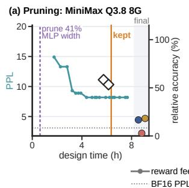

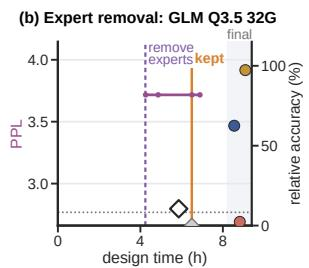

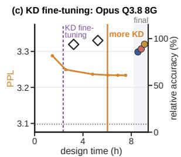  
reward feedback PPL agent's own test, shipped design compression change final GSM8K final TriviaQA BF16 PPL agent's own test, other design agent's decision final HumanEval

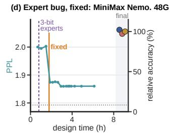

Figure 8 Testing and acting on failures. MiniMax’s dense-model run (a) and GLM’s Qwen3.5 run (b) retain pruning; Opus continues dense-model distillation (c); MiniMax repairs expert indexing on Nemotron (d). Curves show feedback PPL. Diamonds show the agents’ generation tests relative to an unpruned three-bit reference (a), an eight-bit reference (b), or BF16 (c). Final markers show held-out benchmark accuracy relative to BF16.  
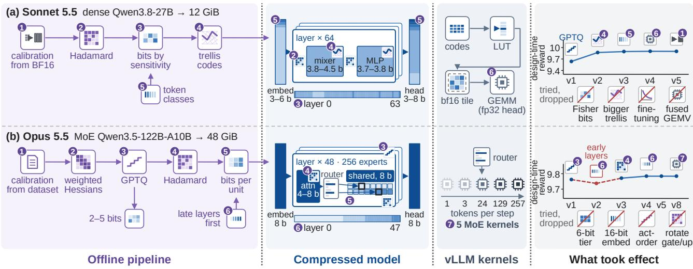  
bits per weight 2 3 4 5 6 7 8 16 rotated input trellis codes scalar codes (GPTQ) 1 same technique in every region  
Figure 9 From numerical design to execution. Sonnet compresses dense Qwen3.8 to 12 GiB using rotation, trellis codes, and sensitivity-based allocation (a). Opus compresses MoE Qwen3.5 to 48 GiB using rotated GPTQ and expert-specific precision (b). Rows connect the ofline pipeline, component precision, inference operations, and candidate versions. Curves show search-time reward; boxes list explored alternatives that were discarded.

On Nemotron, MiniMax compares token probabilities under batched and per-expert inference. The disagreement identifies an expert-indexing bug. Repair reduces the feedback PPL increase over BF16 from about 11% to 4.5%, and the final model passes verification. Here, the agent repairs execution while keeping the representation fixed. In the pruning cases, generation tests reveal regressions, but agents retain the afected designs. Detecting a failure and finding a feasible change to the compression design or implementation that resolves it are distinct challenges.

## 4.4 Two Complete Compression Strategies

The dense and MoE case studies in Figure 9 bring these decisions together. Both retain active parameters at the looser limits, but their numerical methods lead to diferent allocations and execution paths.

• Sonnet: trellis codes and bit allocation. Sonnet replaces scalar GPTQ with Hadamard-rotated trellis codes, error compensation, and Viterbi search (Frantar et al., 2023; Tseng et al., 2024b). Matrix experiments help choose the representation. KL ablations supply a fitted loss model for bit allocation; token frequency guides embedding and output-head precision. Representation and allocation changes produce the largest reward gain, followed by calibration refinements. Sonnet rejects Fisher-weighted allocation when its measured KL worsens and keeps a smaller trellis when a larger one ofers little reconstruction gain at greater search cost. Its final artifact has PPL 3.253 and 76.67% mean answer accuracy, versus BF16’s 3.221 and 74.00%.

• Opus: expert-specific precision. Opus uses rotated GPTQ with diferent bit widths across experts. Revising validation shifts the favored allocation toward later layers, while natural text remains the calibration source. Its search rejects additional precision tiers and alternative rotations. The final artifact has PPL 2.818 and 82.67% accuracy, versus BF16’s 2.755 and 84.67%.

Intermediate verification separates likelihood from answer preservation. Sonnet’s versions v3, v4, and v5 attain PPL 3.2572, 3.2531, and 3.2525, but answer 111, 104, and 115 of 150 questions correctly. Opus’s Qwen3.5 version v4 has PPL 2.8172 and 120 correct answers; v5–v8 have PPL 2.8178 and 124 correct answers. These tests use final verification inputs; search-time feedback guides candidate selection. Nearly unchanged likelihood thus accompanies diferent generated answers.

Sonnet reconstructs weight tiles from its stored trellis codes as they are needed for matrix computation. Other designs can first reconstruct a whole weight matrix in temporary workspace and then use dense operations. Both approaches can satisfy the resident-storage limit because the reconstructed values are temporary. They expose diferent amounts of unpacking work and memory trafic to inference, which contribute to the measured execution cost. In the dense looser task, Sonnet improves PPL and accuracy over the released GSQ-RCO artifact, but decodes at 16.7 tokens/s versus the release’s 74.6 tokens/s at batch size one (Table A3). This illustrates why the measured storage–quality improvement does not by itself establish a speedup, and why representation and kernels must be considered together (Lin et al., 2024, 2025).

## 5 Related Work

## 5.1 Agentic Benchmarks

AlphaEvolve optimizes algorithms and LLM-training infrastructure with coding agents (Novikov et al., 2025). The Darwin Gödel Machine modifies agent code and evaluates the resulting coding agents (Zhang et al., 2026). We study a complementary eficiency objective: compressed model weights and their execution under a resource budget. The terminal task connects numerical choices and validation decisions to the quality of the executable model.

Terminal-Bench evaluates agents on verified command-line tasks (Merrill et al., 2026); Harbor provides a container-based framework for executing tasks and evaluating agents (Harbor Framework Team, 2026). SWE-bench studies repository repair (Jimenez et al., 2024), and AgentBench evaluates interactive environments (Liu et al., 2024). MLAgentBench, MLEbench, and RE-Bench examine ML experimentation, competition solutions, and research engineering (Huang et al., 2024; Chan et al., 2025; Wijk et al., 2025). KernelBench tests correctness and runtime for specified tensor computations (Ouyang et al., 2025); ServeLearnBench studies learning from serving feedback (Zheng et al., 2026). Compression adds the choice of numerical approximation: the agent must select, implement, and validate a model whose generated answers remain useful.

## 5.2 LLM Compression

GPTQ, AWQ, SmoothQuant, and OmniQuant use calibration to choose rounding, scaling, or clipping (Frantar et al., 2023; Lin et al., 2024; Xiao et al., 2023; Shao et al., 2024). QuIP, QuaRot, and SpinQuant improve quantization through incoherence processing or rotations (Chee et al., 2023; Ashkboos et al., 2024b; Liu et al., 2025); QuIP#, AQLM, and QTIP develop lattice, additive, or trellis representations (Tseng et al., 2024a; Egiazarian et al., 2024; Tseng et al., 2024b). HAWQ-V2 uses sensitivity for mixed precision (Dong et al., 2020), while GSQ and RCO optimize quantization and budget allocation (Dadgarnia et al., 2026; Helcig and Alistarh, 2026). Pruning removes weights or dimensions; low-rank methods reduce matrix rank (Frantar and Alistarh, 2023; Sun et al., 2024; Ashkboos et al., 2024a; Wang et al., 2025). Recovery can use quantization-aware fine-tuning (Malinovskii et al., 2024) or distillation (Hinton et al., 2015; Muralidharan et al., 2024). Serving systems optimize memory management and attention execution (Kwon et al., 2023; Ye et al., 2025); TinyChat and QServe couple quantized formats with matching kernels (Lin et al., 2024, 2025).

These methods supply components; we study agents that select, combine, implement, and validate a complete compressed model.

## 6 Conclusion

LLM compression provides a concrete task for studying agent-driven model improvement. Across 36 runs, 29 artifacts pass independent verification. Recorded searches show quality gains at nearly fixed storage, local rankings overturned by

complete-model feedback, and generation or implementation failures missed by likelihood alone. Efective compression requires numerical design, experimental judgment, and validation of the final executable model. Extending this step toward RSI requires testing whether a compressed model retains the ability to carry out subsequent compression tasks.

## Acknowledgements

This work was partially supported by Google Research Award, Google ML & System Junior Faculty Award, Amazon Research Award, Fireworks AI, Intel, Li Auto, Mofett AI, Daytona, and CMU CyLab Seed funding. This material is also based upon work supported by the National Science Foundation under Grant Nos. CCF-2504353 and CCF-2247014, and by IARPA. Any opinions, findings, conclusions or recommendations expressed are those of the authors and do not necessarily reflect the views of the National Science Foundation.

## References

Saleh Ashkboos, Maximilian Croci, Marcelo Gennari do Nascimento, Torsten Hoefler, and James Hensman. SliceGPT: Compress large language models by deleting rows and columns. In The Twelfth International Conference on Learning Representations, pages 11682–11701, 2024a.

Saleh Ashkboos, Amirkeivan Mohtashami, Maximilian L. Croci, Bo Li, Pashmina Cameron, Martin Jaggi, Dan Alistarh, Torsten Hoefler, and James Hensman. QuaRot: Outlier-free 4-bit inference in rotated LLMs. Advances in Neural Information Processing Systems, 37: 100213–100240, 2024b.

Jun Shern Chan, Neil Chowdhury, Oliver Jafe, James Aung, Dane Sherburn, Evan Mays, Giulio Starace, Kevin Liu, Leon Maksin, Tejal Patwardhan, Lilian Weng, and Aleksander Mądry. MLE-bench: Evaluating machine learning agents on machine learning engineering. In The Thirteenth International Conference on Learning Representations, pages 50466–50494, 2025.

Jerry Chee, Yaohui Cai, Volodymyr Kuleshov, and Christopher De Sa. QuIP: 2-bit quantization of large language models with guarantees. Advances in Neural Information Processing Systems, 36:4396–4429, 2023.

Mark Chen, Jerry Tworek, Heewoo Jun, Qiming Yuan, Henrique Ponde de Oliveira Pinto, Jared Kaplan, Harri Edwards, Yuri Burda, Nicholas Joseph, Greg Brockman, Alex Ray, Raul Puri, Gretchen Krueger, Michael Petrov, Heidy Khlaaf, Girish Sastry, Pamela Mishkin, Brooke Chan, Scott Gray, Nick Ryder, Mikhail Pavlov, Alethea Power, Lukasz Kaiser, Mohammad Bavarian, Clemens Winter, Philippe Tillet, Felipe Petroski Such, Dave Cummings, Matthias Plappert, Fotios Chantzis, Elizabeth Barnes, Ariel Herbert-Voss, William Hebgen Guss, Alex Nichol, Alex Paino, Nikolas Tezak, Jie Tang, Igor Babuschkin, Suchir Balaji, Shantanu Jain, William Saunders, Christopher Hesse, Andrew N. Carr, Jan Leike, Josh Achiam, Vedant Misra, Evan Morikawa, Alec Radford, Matthew Knight, Miles Brundage, Mira Murati, Katie Mayer, Peter Welinder, Bob McGrew, Dario Amodei, Sam McCandlish, Ilya Sutskever, and Wojciech Zaremba. Evaluating large language models trained on code. arXiv preprint arXiv:2107.03374, 2021.

Karl Cobbe, Vineet Kosaraju, Mohammad Bavarian, Mark Chen, Heewoo Jun, Lukasz Kaiser, Matthias Plappert, Jerry Tworek, Jacob Hilton, Reiichiro Nakano, Christopher Hesse, and John Schulman. Training verifiers to solve math word problems. arXiv preprint arXiv:2110.14168, 2021.

Alireza Dadgarnia, Soroush Tabesh, Mahdi Nikdan, Michael Helcig, Eldar Kurtic, Maximilian Kleinegger, and Dan Alistarh. GSQ: Highly-accurate low-precision scalar quantization for LLMs via gumbel-softmax sampling. arXiv preprint arXiv:2604.18556, 2026.

Ning Ding, Yulin Chen, Bokai Xu, Yujia Qin, Shengding Hu, Zhiyuan Liu, Maosong Sun, and Bowen Zhou. Enhancing chat language models by scaling high-quality instructional conversations. In Proceedings ofthe 2023 Conference on Empirical Methods in Natural Language Processing, pages 3029–3051. Association for Computational Linguistics, 2023.

Zhen Dong, Zhewei Yao, Daiyaan Arfeen, Amir Gholami, Michael Mahoney, and Kurt Keutzer. HAWQ-V2: Hessian aware traceweighted quantization of neural networks. In Advances in Neural Information Processing Systems, volume 33, pages 18518–18529, 2020. https://proceedings.neurips.cc/paper/2020/hash/d77c703536718b95308130ff2e5cf9ee-Abstract.html.

Vage Egiazarian, Andrei Panferov, Denis Kuznedelev, Elias Frantar, Artem Babenko, and Dan Alistarh. Extreme compression of large language models via additive quantization. In International Conference on Machine Learning, pages 12284–12303. PMLR, 2024.

Elias Frantar and Dan Alistarh. SparseGPT: Massive language models can be accurately pruned in one-shot. In International Conference on Machine Learning, pages 10323–10337. PMLR, 2023.

Elias Frantar, Saleh Ashkboos, Torsten Hoefler, and Dan Alistarh. GPTQ: Accurate post-training quantization for generative pre-trained transformers. In The Eleventh International Conference on Learning Representations, 2023.

Harbor Framework Team. Harbor: A framework for evaluating and optimizing agents and models in container environments. https://doi.org/10.5281/zenodo.20953922, 2026. https://harborframework.com/.

Michael Helcig and Dan Alistarh. Model compression with exact budget constraints via riemannian manifolds. arXiv preprint arXiv:2605.00649, 2026.

Geofrey Hinton, Oriol Vinyals, and Jef Dean. Distilling the knowledge in a neural network. arXiv preprint arXiv:1503.02531, 2015.

Mark Horowitz. 1.1 computing’s energy problem (and what we can do about it). In IEEE International Solid-State Circuits Conference Digest ofTechnical Papers (ISSCC), pages 10–14, 2014.

Qian Huang, Jian Vora, Percy Liang, and Jure Leskovec. MLAgentBench: Evaluating language agents on machine learning experimentation. In International Conference on Machine Learning, pages 20271–20309. PMLR, 2024.

Carlos E. Jimenez, John Yang, Alexander Wettig, Shunyu Yao, Kexin Pei, Ofir Press, and Karthik Narasimhan. SWE-bench: Can language models resolve real-world GitHub issues? In The Twelfth International Conference on Learning Representations, pages 54107–54157, 2024.

Mandar Joshi, Eunsol Choi, Daniel S. Weld, and Luke Zettlemoyer. TriviaQA: A large scale distantly supervised challenge dataset for reading comprehension. In Proceedings ofthe 55th Annual Meeting ofthe Association for Computational Linguistics (Volume 1: Long Papers), pages 1601–1611, 2017.

Bishwash Khanal and Jefery M. Capone. Evaluating the impact of compression techniques on task-specific performance of large language models. arXiv preprint arXiv:2409.11233, 2024. https://arxiv.org/abs/2409.11233.

Woosuk Kwon, Zhuohan Li, Siyuan Zhuang, Ying Sheng, Lianmin Zheng, Cody Hao Yu, Joseph E. Gonzalez, Hao Zhang, and Ion Stoica. Eficient memory management for large language model serving with PagedAttention. In Proceedings of the 29th Symposium on Operating Systems Principles, pages 611–626, 2023.

Hunter Lightman, Vineet Kosaraju, Yuri Burda, Harrison Edwards, Bowen Baker, Teddy Lee, Jan Leike, John Schulman, Ilya Sutskever, and Karl Cobbe. Let’s verify step by step. In The Twelfth International Conference on Learning Representations, pages 39578–39601, 2024.

Ji Lin, Jiaming Tang, Haotian Tang, Shang Yang, Wei-Ming Chen, Wei-Chen Wang, Guangxuan Xiao, Xingyu Dang, Chuang Gan, and Song Han. AWQ: Activation-aware weight quantization for on-device LLM compression and acceleration. Proceedings ofMachine Learning and Systems, 6:87–100, 2024.

Yujun Lin, Haotian Tang, Shang Yang, Zhekai Zhang, Guangxuan Xiao, Chuang Gan, and Song Han. QServe: W4A8KV4 quantization and system co-design for eficient LLM serving. Proceedings ofMachine Learning and Systems, 7, 2025.

Xiao Liu, Hao Yu, Hanchen Zhang, Yifan Xu, Xuanyu Lei, Hanyu Lai, Yu Gu, Hangliang Ding, Kaiwen Men, Kejuan Yang, Shudan Zhang, Xiang Deng, Aohan Zeng, Zhengxiao Du, Chenhui Zhang, Sheng Shen, Tianjun Zhang, Yu Su, Huan Sun, Minlie Huang, Yuxiao Dong, and Jie Tang. AgentBench: Evaluating LLMs as agents. In The Twelfth International Conference on Learning Representations, pages 52989–53046, 2024.

Zechun Liu, Changsheng Zhao, Igor Fedorov, Bilge Soran, Dhruv Choudhary, Raghuraman Krishnamoorthi, Vikas Chandra, Yuandong Tian, and Tijmen Blankevoort. SpinQuant: LLM quantization with learned rotations. In The Thirteenth International Conference on Learning Representations, pages 92009–92032, 2025.

Vladimir Malinovskii, Denis Mazur, Ivan Ilin, Denis Kuznedelev, Konstantin Burlachenko, Kai Yi, Dan Alistarh, and Peter Richtárik. PV-Tuning: Beyond straight-through estimation for extreme LLM compression. Advances in Neural Information Processing Systems, 37:5074–5121, 2024.

Stephen Merity, Caiming Xiong, James Bradbury, and Richard Socher. Pointer sentinel mixture models. In The Fifth International Conference on Learning Representations, 2017.

Mike A. Merrill, Alexander G. Shaw, Nicholas Carlini, Boxuan Li, Harsh Raj, Ivan Bercovich, Lin Shi, Jeong Yeon Shin, Thomas Walshe, E. Kelly Buchanan, Junhong Shen, Guanghao Ye, Haowei Lin, Jason Poulos, Maoyu Wang, Marianna Nezhurina, Di Lu, Orfeas Menis Mastromichalakis, Zhiwei Xu, Zizhao Chen, Yue Liu, Robert Zhang, Leon Liangyu Chen, Anurag Kashyap, Jan-Lucas Uslu, Jefrey Li, Jianbo Wu, Minghao Yan, Song Bian, Vedang Sharma, Ke Sun, Steven Dillmann, Akshay Anand, Andrew Lanpouthakoun, Bardia Koopah, Changran Hu, Etash Guha, Gabriel H. S. Dreiman, Jiacheng Zhu, Karl Krauth, Li Zhong, Niklas Muennighof, Robert Amanfu, Shangyin Tan, Shreyas Pimpalgaonkar, Tushar Aggarwal, Xiangning Lin, Xin Lan, Xuandong Zhao, Yiqing Liang, Yuanli Wang, Zilong Wang, Changzhi Zhou, David Heineman, Hange Liu, Harsh Trivedi, John Yang, Junhong Lin, Manish Shetty, Michael Yang, Nabil Omi, Negin Raoof, Shanda Li, Terry Yue Zhuo, Wuwei Lin, Yiwei Dai, Yuxin Wang, Wenhao Chai, Shang Zhou, Dariush Wahdany, Ziyu She, Jiaming Hu, Zhikang Dong, Yuxuan Zhu, Sasha Cui, Ahson Saiyed, Arinbjörn Kolbeinsson, Jesse Hu, Christopher Michael Rytting, Ryan Marten, Yixin Wang, Jenia Jitsev, Alex Dimakis, Andy Konwinski, and Ludwig Schmidt. Terminal-Bench: Benchmarking agents on hard, realistic tasks in command line interfaces. In The Fourteenth International Conference on Learning Representations, pages 40903–40986, 2026. https://proceedings.iclr.cc/paper\_files/paper/2026/hash/444a3737 adaee10d86ad2ef5f74468e6-Abstract-Conference.html.

Saurav Muralidharan, Sharath Turuvekere Sreenivas, Raviraj Joshi, Marcin Chochowski, Mostofa Patwary, Mohammad Shoeybi, Bryan Catanzaro, Jan Kautz, and Pavlo Molchanov. Compact language models via pruning and knowledge distillation. Advances in Neural Information Processing Systems, 37:41076–41102, 2024.

Alexander Novikov, Ngân Vu, Marvin Eisenberger, Emilien Dupont, Po-Sen Huang, Adam Zsolt Wagner, Sergey Shirobokov, Borislav˜ Kozlovskii, Francisco J. R. Ruiz, Abbas Mehrabian, M. Pawan Kumar, Abigail See, Swarat Chaudhuri, George Holland, Alex Davies, Sebastian Nowozin, Pushmeet Kohli, and Matej Balog. AlphaEvolve: A coding agent for scientific and algorithmic discovery. arXiv preprint arXiv:2506.13131, 2025. https://arxiv.org/abs/2506.13131.

Anne Ouyang, Simon Guo, Simran Arora, Alex L. Zhang, William Hu, Christopher Ré, and Azalia Mirhoseini. KernelBench: Can LLMs write eficient GPU kernels? In International Conference on Machine Learning, pages 47356–47415. PMLR, 2025.

Guilherme Penedo, Hynek Kydlíček, Loubna Ben Allal, Anton Lozhkov, Margaret Mitchell, Colin Rafel, Leandro Von Werra, and Thomas Wolf. The FineWeb datasets: Decanting the web for the finest text data at scale. Advances in Neural Information Processing Systems, 37:30811–30849, 2024.

Colin Rafel, Noam Shazeer, Adam Roberts, Katherine Lee, Sharan Narang, Michael Matena, Yanqi Zhou, Wei Li, and Peter J. Liu. Exploring the limits of transfer learning with a unified text-to-text transformer. Journal ofMachine Learning Research, 21(140):1–67, 2020. http://jmlr.org/papers/v21/20-074.html.

Wenqi Shao, Mengzhao Chen, Zhaoyang Zhang, Peng Xu, Lirui Zhao, Zhiqian Li, Kaipeng Zhang, Peng Gao, Yu Qiao, and Ping Luo. OmniQuant: Omnidirectionally calibrated quantization for large language models. In The Twelfth International Conference on Learning Representations, pages 45472–45496, 2024. https://openreview.net/forum?id=8Wuvhh0LYW.

Mingjie Sun, Zhuang Liu, Anna Bair, and Zico Kolter. A simple and efective pruning approach for large language models. In The Twelfth International Conference on Learning Representations, pages 4942–4964, 2024.

Team Olmo, Allyson Ettinger, Amanda Bertsch, Bailey Kuehl, David Graham, David Heineman, Dirk Groeneveld, Faeze Brahman, Finbarr Timbers, Hamish Ivison, Jacob Morrison, Jake Poznanski, Kyle Lo, Luca Soldaini, Matt Jordan, Mayee Chen, Michael Noukhovitch, Nathan Lambert, Pete Walsh, Pradeep Dasigi, Robert Berry, Saumya Malik, Saurabh Shah, Scott Geng, Shane Arora, Shashank Gupta, Taira Anderson, Teng Xiao, Tyler Murray, Tyler Romero, Victoria Graf, Akari Asai, Akshita Bhagia, Alexander Wettig, Alisa Liu, Aman Rangapur, Chloe Anastasiades, Costa Huang, Dustin Schwenk, Harsh Trivedi, Ian Magnusson, Jaron Lochner, Jiacheng Liu, Lester James V. Miranda, Maarten Sap, Malia Morgan, Michael Schmitz, Michal Guerquin, Michael Wilson, Regan Huf, Ronan Le Bras, Rui Xin, Rulin Shao, Sam Skjonsberg, Shannon Zejiang Shen, Shuyue Stella Li, Tucker Wilde, Valentina Pyatkin, Will Merrill, Yapei Chang, Yuling Gu, Zhiyuan Zeng, Ashish Sabharwal, Luke Zettlemoyer, Pang Wei Koh, Ali Farhadi, Noah A. Smith, and Hannaneh Hajishirzi. Olmo 3. arXiv preprint arXiv:2512.13961, 2025.

Albert Tseng, Jerry Chee, Qingyao Sun, Volodymyr Kuleshov, and Christopher De Sa. QuIP#: Even better LLM quantization with hadamard incoherence and lattice codebooks. In Proceedings ofthe 41st International Conference on Machine Learning, volume 235, pages 48630–48656. PMLR, 2024a. https://proceedings.mlr.press/v235/tseng24a.html.

Albert Tseng, Qingyao Sun, David Hou, and Christopher De Sa. QTIP: Quantization with trellises and incoherence processing. Advances in Neural Information Processing Systems, 37:59597–59620, 2024b.

Xin Wang, Yu Zheng, Zhongwei Wan, and Mi Zhang. SVD-LLM: Truncation-aware singular value decomposition for large language model compression. In The Thirteenth International Conference on Learning Representations, pages 19299–19319, 2025.

Hjalmar Wijk, Tao Roa Lin, Joel Becker, Sami Jawhar, Neev Parikh, Thomas Broadley, Lawrence Chan, Michael Chen, Joshua M. Clymer, Jai Dhyani, Elena Ericheva, Katharyn Garcia, Brian Goodrich, Nikola Jurkovic, Megan Kinniment, Aron Lajko, Seraphina Nix, Lucas Jun Koba Sato, William Saunders, Maksym Taran, Ben West, and Elizabeth Barnes. RE-Bench: Evaluating frontier AI R&D capabilities of language model agents against human experts. In International Conference on Machine Learning, pages 66772–66832. PMLR, 2025.

Guangxuan Xiao, Ji Lin, Mickael Seznec, Hao Wu, Julien Demouth, and Song Han. SmoothQuant: Accurate and eficient post-training quantization for large language models. In International Conference on Machine Learning, pages 38087–38099. PMLR, 2023.

Zihao Ye, Lequn Chen, Ruihang Lai, Wuwei Lin, Yineng Zhang, Stephanie Wang, Tianqi Chen, Baris Kasikci, Vinod Grover, Arvind Krishnamurthy, and Luis Ceze. FlashInfer: Eficient and customizable attention engine for LLM inference serving. Proceedings of Machine Learning and Systems, 7, 2025

Jenny Zhang, Shengran Hu, Cong Lu, Robert Lange, and Jef Clune. Darwin Gödel Machine: Open-ended evolution of self-improving agents. In The Fourteenth International Conference on Learning Representations, pages 104223–104294, 2026. https://proceedings. iclr.cc/paper\_files/paper/2026/hash/aa5f5e6eb6f613ec412f1d948dfa21a5-Abstract-Conference.html.

Haizhong Zheng, Yizhuo Di, Ranajoy Sadhukhan, Shuowei Jin, and Beidi Chen. ServeLearnBench: How well can agents self-improve from serving experience? arXiv preprint arXiv:2610.07792, 2026.

## AI Usage Disclosure

Claude Code and OpenAI Codex assisted with manuscript rewriting, literature and citation checks, LaTeX preparation, and PDF compilation. The compression artifacts and numerical measurements come from the recorded experimental runs described in the paper.

## A Evaluation Protocol

Each likelihood set contains 256 contexts of 512 tokens from Dolma 3 Dolmino, stratified by source family. BF16 samples 1,536 continuation tokens at temperature one without probability truncation; both models score the 393,216 tokens. Reward feedback and verification use disjoint documents with matched source proportions. Table A1 gives the references fixed before agentic design.

<table><tr><td>Source</td><td>Reward feedback PPL</td><td>Verification PPL</td><td>A(p) (%)</td></tr><tr><td>Nemotron-3.5</td><td>1.792648</td><td>1.688011</td><td>81.33</td></tr><tr><td>Qwen3.5</td><td>2.768058</td><td>2.755500</td><td>85.33</td></tr><tr><td>Qwen3.8</td><td>3.097426</td><td>3.220743</td><td>74.00</td></tr></table>

Table A1 BF16 references fixed before agentic design. PPL is perplexity on disjoint source-generated continuations for reward feedback and verification. $A ( p )$ is mean accuracy (%) on GSM8K, HumanEval, and TriviaQA, used to set the accuracy gate.

Source and compressed models use the same questions, greedy decoding, and settings in Table A2. Acceptance requires $A ( a ) \geq 0 . 8 A ( p )$ , with the fixed reference in Table A1.

<table><tr><td>Dataset</td><td>Shots</td><td>Tokens</td><td>Judgment</td></tr><tr><td>GSM8K</td><td>4</td><td>320</td><td>Final number</td></tr><tr><td>HumanEval</td><td>0</td><td>384</td><td>Unit tests</td></tr><tr><td>TriviaQA</td><td>5</td><td>24</td><td>Normalized aliases</td></tr></table>

Table A2 Multi-benchmark accuracy protocol. Each benchmark uses fifty held-out questions and greedy decoding. Shots gives in-context examples; Tokens gives maximum answer length. The three benchmark accuracies are averaged equally.

Package size includes weights, inference code, and tokenizer assets. Resident storage counts persistent weights, quantization metadata, and reconstructed copies after loading and inference. Shared allocations count once; KV caches, recurrent states, and temporary workspace are excluded.

Batch-one decode uses 2,048 input and 128 output tokens after warmup. TPS is 127/�, where � is the median of three round means, each over three first-to-last-token intervals. BF16 speeds are 147.5, 158.3, and 61.4 tokens/s for Nemotron, Qwen3.5, and Qwen3.8, respectively. Final verification has a 3,600-second timeout.

Candidate-ranking pairs match local rankings with subsequent reward feedback for the same configurations. Package bits per original parameter equal eight times package bytes divided by parameter count; component precision uses resident bytes and component parameter count. API cost uses recorded input, output, and cached tokens at Octobe 26, 2026 OpenRouter rates. Average ranks weight all six tasks equally.

## B Search Activity and Stopping

We examine how agents use the design budget and when they stop revising weights (Figure A1). Agents were instructed to carry out agentic design end to end until the time limit. Runs proceeded without human intervention or follow-up prompts.

Seventeen runs change weights after the agent first declares the task complete: five Kimi runs, four each for Opus and DeepSeek, two each for GLM and MiniMax, and none for Sonnet. Kimi has the earliest median first completion declaration and usually continues revising its weights. Median GPU-busy shares range from 30% to 60% across agents. These records distinguish a declaration of completion from the last efective model change.

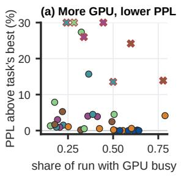

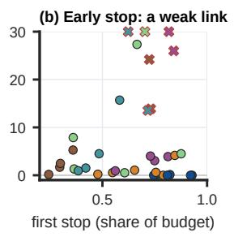

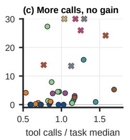

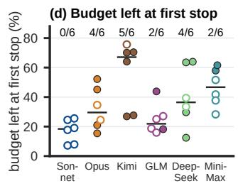  
Figure A1 Computation and stopping during agentic design. (a–c) Final-verification perplexity (PPL) increase over the best submission on the same task versus GPU-busy share of the run, first completion declaration as a fraction of the design budget, and tool calls divided by the task median. Values above 30% lie at the upper boundary. (d) Budget remaining at the first completion declaration for each of thirty-six runs. Filled points mark subsequent weight changes; counts give changed/total runs, and bars show medians. Agents often revise weights after declaring completion.

## C Final and Intermediate Model Measurements

Table A3 contains the full final measurements, including models rejected by the answer threshold and decode TPS for both compression baselines.

Intermediate models are evaluated after search on the same verification inputs as the final submissions. The main-paper trajectory curves report reward feedback gathered during agentic design.

On Qwen3.8 at 8 GiB, Opus’s reallocation lowers verification PPL increase from 6.17% to 5.89%. Distillation lowers it to 5.00%, then further allocation and training reach 4.64%. GSM8K accuracy falls from 88% to 72% across trained versions, while the other benchmark changes are smaller.

## D Storage Limits and Reference Quantizations

Pilot compression runs on Qwen3.8 27B inform the task allowances and storage accounting. Pilot PPL is measured on 256 held-out C4 (Rafel et al., 2020) contexts of 2,048 tokens, with BF16 PPL 9.9227. The main study instead evaluates source-generated continuations.

Table A4 compares compression choices across four storage allowances. Pilot timing follows the first-to-last-token protocol in Appendix A with an earlier vLLM release.

At 16 GiB, finer groups lower PPL but increase metadata storage; the group-32 configuration exceeds the limit. At 12 GiB, mixed three- and four-bit weights improve on uniform three-bit quantization. At 8 GiB, similar package sizes yield diferent PPL. These results motivate paired limits that expose precision-allocation and representation decisions.

<table><tr><td>Release</td><td>Package (GiB)</td><td>Resident (GiB)</td><td>∆PPL (%)</td><td>TPS↑ (bsz=1)</td></tr><tr><td>Official FP8</td><td>28.76</td><td>27.67</td><td>+0.50</td><td>89.3</td></tr><tr><td>RedHatAI INT4</td><td>18.13</td><td>一</td><td>+3.25</td><td>105.0</td></tr><tr><td>Low-bit releases</td><td></td><td></td><td></td><td></td></tr><tr><td>sdkyuan QAT Q2_0</td><td>9.04</td><td></td><td>+22.05</td><td>101.4</td></tr><tr><td>ISTA-DASLab IQ2_XS</td><td>8.72</td><td>8.77</td><td>+17.05</td><td>55.0</td></tr><tr><td>Unsloth UD-IQ2_S</td><td>8.68</td><td>8.57</td><td>+13.83</td><td>55.2</td></tr><tr><td>Unsloth UD-IQ2_XXS</td><td>7.65</td><td>7.41</td><td>+25.26</td><td>56.6</td></tr></table>

Table A5 Released Qwen3.8 27B quantizations under the pilot protocol. ΔPPL is the percentage increase over BF16 (9.9227) on held-out C4. TPS is batch-one decode speed, 127/�, with � the 128-token first-to-last interval.

The pilot QAT Q2\_0 release uses llama.cpp; the remaining releases in Table A5 use vLLM.

A QTIP pilot package occupies 6.96 GiB with PPL 20.84% above BF16, but retains BF16 weights during execution; agent pilots also retain high-precision copies. The low-bit GGUF releases keep resident storage within 0.24 GiB of package size. These measurements motivate separate allowances for saved packages and resident weights.

<table><tr><td>Method</td><td>PPL↓</td><td>Acc.↑</td><td>Package</td><td>Resident</td><td>TPS↑</td><td>Gate</td></tr><tr><td colspan="7">Nemotron-3.5 120B-A12B, 32 GiB</td></tr><tr><td>GPTQ</td><td>4.680</td><td>5.33</td><td>31.959</td><td>31.980</td><td>20.9</td><td>Fail</td></tr><tr><td>Sonnet</td><td>1.801</td><td>76.67</td><td>31.665</td><td>31.649</td><td>57.2</td><td>Pass</td></tr><tr><td>Opus</td><td>1.811</td><td>85.33</td><td>31.943</td><td>31.912</td><td>48.6</td><td>Pass</td></tr><tr><td>GLM</td><td>1.871</td><td>74.67</td><td>31.873</td><td>31.841</td><td>16.6</td><td>Pass</td></tr><tr><td>Kimi</td><td>2.051</td><td>58.67</td><td>31.999</td><td>31.975</td><td>12.5</td><td>Fail</td></tr><tr><td>MiniMax</td><td>2.084</td><td>75.33</td><td>30.930</td><td>30.905</td><td>11.4</td><td>Pass</td></tr><tr><td>DeepSeek</td><td>2.369</td><td>63.33</td><td>31.844</td><td>31.814</td><td>13.8</td><td>Fail</td></tr><tr><td colspan="7">Nemotron-3.5 120B-A12B, 48 GiB (release: UD-IQ2_XXS)</td></tr><tr><td>GPTQ</td><td>1.875</td><td>76.00</td><td>45.981</td><td>45.995</td><td>16.0</td><td>Pass</td></tr><tr><td>Unsloth</td><td>1.764</td><td>82.67</td><td>47.625</td><td>44.685</td><td>100.5</td><td>Pass</td></tr><tr><td>Sonnet</td><td>1.728</td><td>82.00</td><td>47.850</td><td>47.834</td><td>47.4</td><td>Pass</td></tr><tr><td>Opus</td><td>1.726</td><td>78.00</td><td>47.904</td><td>47.854</td><td>68.2</td><td>Pass</td></tr><tr><td>GLM</td><td>1.778</td><td>78.67</td><td>47.232</td><td>47.207</td><td>40.3</td><td>Pass</td></tr><tr><td>Kimi</td><td>1.729</td><td>82.00</td><td>47.958</td><td>47.915</td><td>13.6</td><td>Pass</td></tr><tr><td>MiniMax DeepSeek</td><td>1.752</td><td>81.33</td><td>47.686</td><td>47.670</td><td>9.1</td><td>Pass</td></tr><tr><td></td><td>1.749</td><td>79.33</td><td>47.689</td><td>47.673</td><td>16.6</td><td>Pass</td></tr><tr><td colspan="7">Qwen3.5 122B-A10B, 32 GiB (release: UD-IQ1_M)</td></tr><tr><td></td><td></td><td>6.00</td><td>31.604</td><td>31.648</td><td>26.4</td><td>Fail</td></tr><tr><td>GPTQ Unsloth</td><td>7.185 2.900</td><td>83.33</td><td>31.883</td><td>31.861</td><td>122.9</td><td>Pass</td></tr><tr><td>Sonnet</td><td>2.883</td><td>78.67</td><td>31.746</td><td>31.765</td><td>39.8</td><td>Pass</td></tr><tr><td>Opus</td><td>3.003</td><td>76.67</td><td>31.728</td><td>31.750</td><td>73.2</td><td>Pass</td></tr><tr><td>GLM</td><td>3.632</td><td>44.67</td><td>31.715</td><td>31.734</td><td>18.3</td><td>Fail</td></tr><tr><td>Kimi</td><td>3.035</td><td>78.00</td><td>31.918</td><td>31.937</td><td>43.1</td><td>Pass</td></tr><tr><td>MiniMax</td><td>3.273</td><td></td><td>31.510</td><td></td><td>一</td><td>Timeout</td></tr><tr><td>DeepSeek</td><td>3.110</td><td>78.00</td><td>31.840</td><td>31.832</td><td>12.7</td><td>Pass</td></tr><tr><td colspan="7">Qwen3.5 122B-A10B, 48 GiB (release: UD-IQ3_S)</td></tr><tr><td>GPTQ</td><td>2.987</td><td>79.33</td><td>47.133</td><td>47.173</td><td>20.2</td><td>Pass</td></tr><tr><td>Unsloth</td><td>2.808</td><td>82.00</td><td>43.372</td><td>43.349 47.689</td><td>106.9 46.3</td><td>Pass</td></tr><tr><td>Sonnet</td><td>2.788</td><td>85.33</td><td>47.669</td><td>47.866</td><td>52.9</td><td>Pass</td></tr><tr><td>Opus</td><td>2.818</td><td>82.67</td><td>47.847</td><td>47.707</td><td>10.5</td><td>Pass</td></tr><tr><td>GLM Kimi</td><td>2.814</td><td>82.67</td><td>47.688</td><td>47.995</td><td></td><td>Pass</td></tr><tr><td>MiniMax</td><td>2.835</td><td>84.67</td><td>47.976</td><td>47.770</td><td>7.8</td><td>Pass</td></tr><tr><td>DeepSeek</td><td>2.814</td><td>84.67</td><td>47.658</td><td></td><td>27.6</td><td>Pass</td></tr><tr><td></td><td>2.803</td><td>84.67</td><td>47.686</td><td>47.706</td><td>10.8</td><td>Pass</td></tr><tr><td colspan="7">Qwen3.8 27B, 8 GiB (release: IQ2_XS)</td></tr><tr><td>GPTQ</td><td>7.480</td><td>4.67</td><td>7.354</td><td>7.515</td><td>12.6</td><td>Fail</td></tr><tr><td>GSQ-RCO</td><td>3.764</td><td>65.33</td><td>7.856</td><td>7.834</td><td>75.5</td><td>Pass</td></tr><tr><td>Sonnet</td><td>3.363</td><td>68.67</td><td>7.957</td><td>7.950</td><td>23.4</td><td>Pass</td></tr><tr><td>Opus</td><td>3.370</td><td>66.00</td><td>7.977</td><td>7.995</td><td>26.2</td><td>Pass</td></tr><tr><td>GLM</td><td>6.061</td><td>23.33</td><td>7.947</td><td>7.953</td><td>13.7</td><td>Fail</td></tr><tr><td>Kimi</td><td>4.176</td><td>54.00</td><td>7.973</td><td>7.992 7.840</td><td>7.9</td><td>Fail</td></tr><tr><td>MiniMax DeepSeek</td><td>8.163</td><td>9.33</td><td>7.973</td><td>7.950</td><td>15.1 13.7</td><td>Fail</td></tr><tr><td></td><td>4.283</td><td>61.33</td><td>7.934</td><td></td><td></td><td>Pass</td></tr><tr><td colspan="7">Qwen3.8 27B, 12 GiB (release: IQ3_S)</td></tr><tr><td>GPTQ</td><td>3.546</td><td>46.00</td><td>11.401</td><td>11.531</td><td>11.1</td><td>Fail</td></tr><tr><td>GSQ-RCO</td><td>3.334</td><td>66.00</td><td>10.975</td><td>10.953 11.977</td><td>74.6</td><td>Pass</td></tr><tr><td>Sonnet</td><td>3.253</td><td>76.67</td><td>11.956</td><td></td><td>16.7</td><td>Pass</td></tr><tr><td>Opus</td><td>3.272</td><td>78.67</td><td>11.980</td><td>11.970</td><td>31.4</td><td>Pass</td></tr><tr><td>GLM</td><td>3.383</td><td>80.67</td><td>11.954</td><td>11.973</td><td>10.4</td><td>Pass</td></tr><tr><td>Kimi</td><td>3.333</td><td>74.67</td><td>11.967</td><td>11.986</td><td>8.0</td><td>Pass</td></tr><tr><td>MiniMax</td><td>3.399</td><td>76.67</td><td>11.779</td><td>11.798</td><td>10.9</td><td>Pass</td></tr><tr><td>DeepSeek</td><td>3.399</td><td>72.00</td><td>11.948</td><td>11.967</td><td>18.4</td><td>Pass</td></tr></table>

Table A3 Complete final-verification measurements by source model and storage limit. PPL scores held-out BF16-generated continuations; accuracy (%) averages GSM8K, HumanEval, and TriviaQA. Package and resident model storage are in GiB. TPS is batchone decode speed, 127/� for a 128-token first-to-last interval �. The accuracy gate requires at least 80% of the fixed BF16 reference.

<table><tr><td>Submission</td><td>Package PPL above (GiB)</td><td></td><td>TPS↑ (bsz=1)</td></tr><tr><td colspan="4">32 GiB</td></tr><tr><td>GLM: 4-bit GPTQ/Marlin</td><td>17.34</td><td>+3.09% +3.22%</td><td>106.1</td></tr><tr><td>GLM: 4-bit GPTQ (no example)</td><td>17.34</td><td></td><td>106.0</td></tr><tr><td>Sol: optimized GPTQ</td><td>16.43</td><td>+3.38%</td><td>111.9</td></tr><tr><td>GLM: 5-bit, group 64</td><td>20.52</td><td>+0.60%</td><td>94.8</td></tr><tr><td colspan="4">16 GiB</td></tr><tr><td>4-bit, group 128, damping 0.01</td><td>15.00</td><td>+3.19%</td><td>109.0</td></tr><tr><td>4-bit, group 64</td><td>15.35</td><td>+2.58%</td><td>108.6</td></tr><tr><td>4-bit, group 32 (over limit)</td><td>16.06</td><td>+1.98%</td><td>107.6</td></tr><tr><td>4-bit, group 128, damping 0.1</td><td>15.00</td><td>+2.79%</td><td>109.3</td></tr><tr><td>GLM A: group 64 for MLP</td><td>15.83</td><td>+3.89%</td><td>109.9</td></tr><tr><td>GLM B: 4-bit embedding/head</td><td>14.99</td><td>+3.10%</td><td>109.1</td></tr><tr><td colspan="4">12 GiB</td></tr><tr><td>3-bit, group 128</td><td>11.18</td><td>+13.32%</td><td>110.6</td></tr><tr><td>Mixed 3/4-bit, group 128</td><td>11.98</td><td>+10.53%</td><td>110.8</td></tr><tr><td>GLM A: 3/4-bit (load failure)</td><td>11.83</td><td>一 +9.43%</td><td></td></tr><tr><td>GLM B: Marlin repacking</td><td>11.97</td><td></td><td>111.1</td></tr><tr><td colspan="4">8 GiB</td></tr><tr><td>GLM: Hadamard, 2/3/4-bit</td><td>7.96</td><td>+1739%</td><td>61.9</td></tr><tr><td>Qwen: 2/3/4-bit, clipping MiMo: 2/3/4-bit</td><td>7.94</td><td>+48.03%</td><td>62.0</td></tr><tr><td>GLM: 2-bit, blockwise decode</td><td>7.99</td><td>+51.17%</td><td>100.6</td></tr><tr><td></td><td>7.09</td><td>+117.10% +94.27%</td><td></td></tr><tr><td>GLM: AutoRound/RTN</td><td>7.83</td><td></td><td>一</td></tr></table>

Table A4 Pilot Qwen3.8 27B compression. PPL increase uses held-out C4 and BF16 PPL 9.9227. TPS is batch-one decode speed (127/� for the 128-token first-to-last interval �). GLM, Sol, Qwen, and MiMo denote GLM-5.3-Flash, GPT-6.1 Sol, Qwen3.8-Flash, and MiMo-V2.6-Pro, respectively.

The released quantizations used in the main study are identified with their verification results in Table A3.

## E Additional Experiments and Decision Analysis

## E.1 Repeated Agentic Design

We repeat GLM 5.3 and DeepSeek V4.1 Flash on one dense and one MoE task (Table A6). Four fresh trials use empty workspaces, the original checkpoints, prompts, and verification protocol, Claude Code through Fireworks, maximum reasoning efort, eight hours, and one H200 NVL.

<table><tr><td>Agent</td><td>Trial</td><td>PPL</td><td>HE/TQ/GS</td><td>Mean</td></tr><tr><td>Qwen3.8 27B / 12 GiB</td><td></td><td></td><td></td><td></td></tr><tr><td>DeepSeek</td><td>Orig.</td><td>3.399</td><td>74/56/86</td><td>72.00</td></tr><tr><td rowspan="3">GLM</td><td>Repeat</td><td>3.392</td><td>68/56/88</td><td>70.67</td></tr><tr><td>Orig.</td><td>3.383</td><td>82/64/96</td><td>80.67</td></tr><tr><td>Repeat</td><td>3.356</td><td>70/56/80</td><td>68.67</td></tr><tr><td>Qwen3.5 122B-A10B / 48 GiB</td><td></td><td></td><td></td><td></td></tr><tr><td>DeepSeek</td><td>Orig.</td><td>2.803</td><td>82/76/96</td><td>84.67</td></tr><tr><td rowspan="3">GLM</td><td>Repeat</td><td>2.820</td><td>86/72/96</td><td>84.67</td></tr><tr><td>Orig.</td><td>2.814</td><td>78/74/96</td><td>82.67</td></tr><tr><td>Repeat</td><td>2.819</td><td>82/74/96</td><td>84.00</td></tr></table>

Table A6 Original and repeated eight-hour designs on one H200 NVL. Final verification measures perplexity (PPL) and accuracy (%).   
HE/TQ/GS denote HumanEval/TriviaQA/GSM8K, with fifty questions each; Mean averages their accuracies.

All four repeats pass final verification. Their PPL values lie within 0.81% of the corresponding original designs, with the largest shift in GLM’s dense-model repeat.

## E.2 Controlled Quantization Ablations

We compare clipping-range selection and GPTQ error compensation in GLM’s repeated dense and MoE designs (Table A7). Paired variants share source weights, calibration, precision allocation, group sizes, and inference. The MoE scales and channel order remain fixed.

<table><tr><td>Setting</td><td>PPL</td><td>GSM8K</td><td>HE</td><td>TQ</td><td>Mean</td></tr><tr><td colspan="6">Qwen3.8 27B / 12 GiB: three-bit MLP clipping</td></tr><tr><td>MSE search</td><td>3.35560</td><td>80</td><td>70</td><td>56</td><td>68.67</td></tr><tr><td>Min-max</td><td>3.36931</td><td>72</td><td>60</td><td>54</td><td>62.00</td></tr><tr><td colspan="6">Qwen3.5 122B-A10B / 48 GiB: compensation</td></tr><tr><td>GPTQ</td><td>2.81924</td><td>96</td><td>82</td><td>74</td><td>84.00</td></tr><tr><td>No compensation</td><td>2.83444</td><td>96</td><td>76</td><td>78</td><td>83.33</td></tr></table>

Table A7 Quantization ablations of GLM’s repeated designs. PPL and accuracies (%) use final verification. HumanEval (HE), TriviaQA (TQ), and GSM8K each use fifty questions; Mean averages their accuracies. Paired variants have identical package/resident storage: 11.843/11.859 GiB (dense) and 47.835/47.854 GiB (MoE). The MoE control retains the selected scales while removing GPTQ error compensation.

Clipping-range refinement in the dense model and GPTQ error compensation in the MoE model both lower verification PPL at identical model storage. Compensation reduces negative log-likelihood on 197 of 256 MoE verification contexts.

## E.3 Agent Responses to Feedback

Figure A2 summarizes actions after local rankings and reward feedback, together with subsequent generation and execution tests.

Six of eight local generation regressions prompt revisions. Opus and Kimi improve on matched local tests while remaining below their references. Ten execution or storage episodes later complete within both limits, including one warmup retry.

## E.4 Resident Storage and Peak Device Memory

For both releases, most additional device memory is allocated during loading, with smaller increases during prefill and decode (Table A8). Runtime allocations include caches, recurrent states, and temporary workspace.

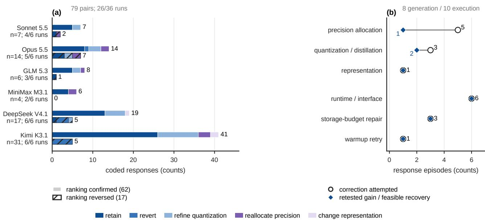

Figure A2 Agent responses during compression design. (a) Actions following 79 comparisons of local rankings with reward feedback in 26 of 36 runs; hatched bars denote ranking reversals, unhatched bars confirmations. Actions may co-occur. (b) Circles indicate attempted repairs; diamonds indicate matched local generation gains (eight cases, upper three rows) or execution within both storage limits (ten episodes, lower three rows).
<table><tr><td>Model</td><td>Resident storage</td><td colspan="3">Sampled device peak Load Prefill Decode</td></tr><tr><td>Qwen3.8</td><td>10.953</td><td>13.000</td><td>13.349</td><td>13.353</td></tr><tr><td>Qwen3.5</td><td>43.349</td><td>45.332</td><td>45.506</td><td>45.510</td></tr></table>

Table A8 Resident storage and device peaks (GiB) for Qwen3.8 27B GSQ-RCO IQ3\_S and Qwen3.5 122B-A10B Unsloth UD-IQ3\_S. Values are medians of three cold starts. Device usage is sampled every 10 ms at batch one with 2,048 input and 128 output tokens and a 4,096-token single-sequence cache.