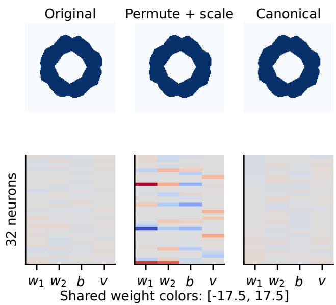
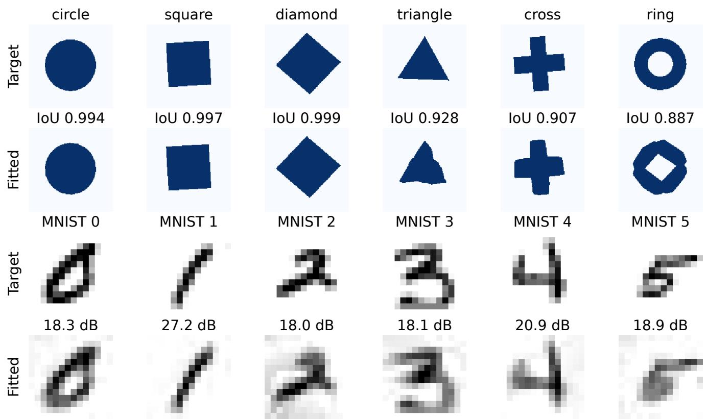
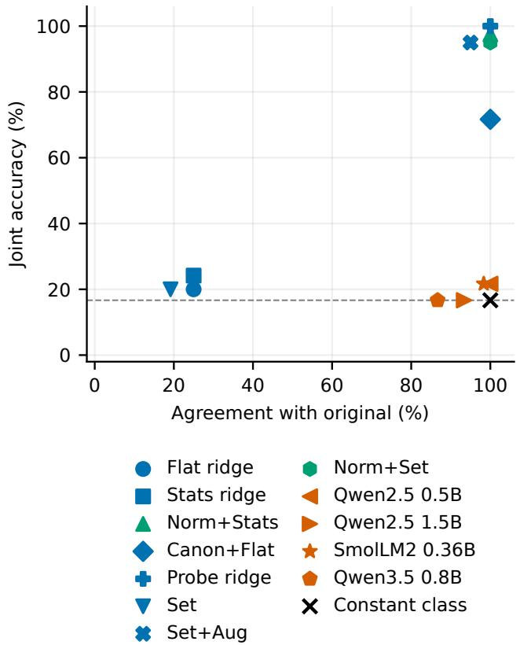
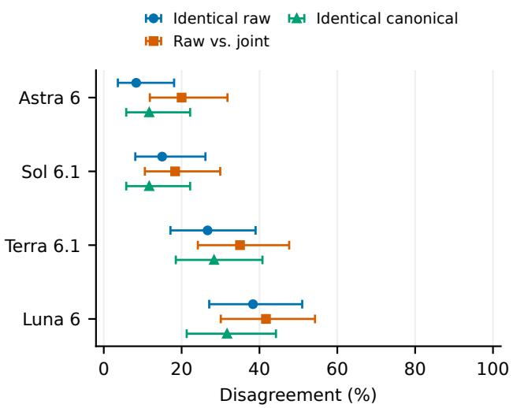
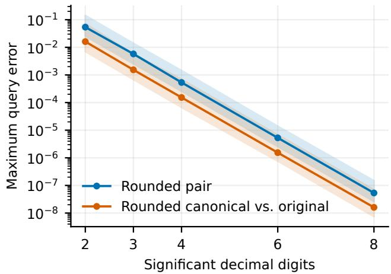
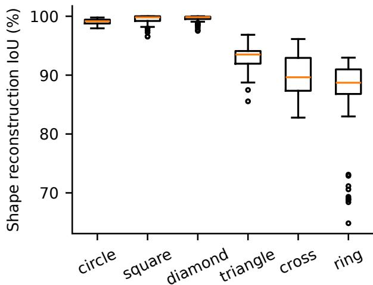
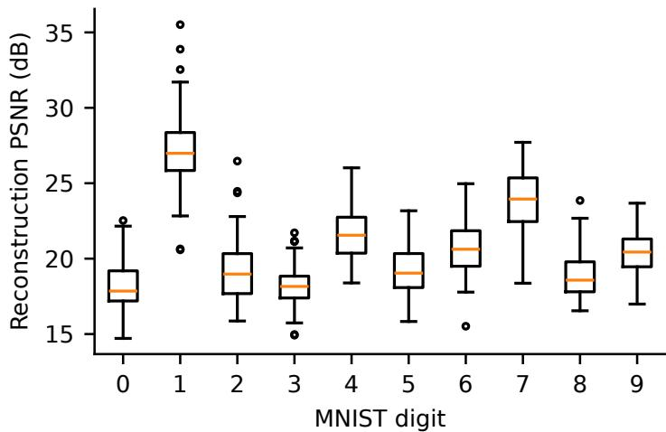
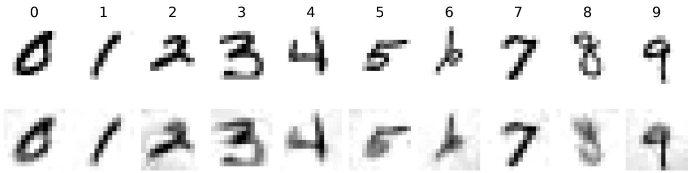

# Consistency Is Not Understanding: Orbit Audits for Neural Field Weight Readers

Sungguk Cha, Mintae Kim, Youngsub Han, Byoung-Ki Jeon, Sangyeob Lee LG Uplus, Seoul, South Korea

{sungguk,iammt,yshan042,bkjeon,sangyeob}@lguplus.co.kr

## Abstract

Recognizing visual contentfrom neural-network weights requires separating functional information from arbitrary parameter coordinates. We audit this separation with hiddenneuron permutations and positive ReLU rescalings that preserve the representedfunction. The study contains 480 independently fitted shape fields and 1,000 MNISTfields, with transformed copies grouped by origin. On shape recognition, a statistics readerfallsfrom 96.7% to 24.2% accuracy under joint transformations; a normalized set reader retains 95.0% with unchanged predictions. Four small frozen language models obtain 15.0–21.7% raw accuracy with next-token scoring. A separate four-configuration reasoning experiment with 1,920 scored sessions obtains 35.0–86.7% raw accuracy with generated answers, whilefresh identical raw prompts disagree on 8.3–38.3% oforigins. Canonicalization makes equivalent prompts identical, but this neither establishes recognition nor guarantees identical generated responses. Joint correctness/agreement metrics, semantic-cue controls,fresh repeats, and exact-rational rounding bounds separate these failure modes. The result is an inspectable evaluation protocol for visual weight readers, with claims restricted to the testedfields, prompts, and execution configurations.

## 1. Introduction

A visual signal can be stored as a neural network instead of a pixel array or mesh. Coordinate-based representations support continuous images and geometry [3, 22, 27]; weightspace methods then learn directly from the networks that encode those signals [5, 11, 49]. This changes the input to recognition: the reader must extract visual content from parameters whose numerical arrangement is not uniquely determined by that content. A reliable reader should recognize the same shape when the network is written in a different, functionally equivalent coordinate system.

This requirement has become timely for general-purpose language models. Weight-space programming demonstrations suggest that a frontier model can read network weights and infer the represented task without executing the target [38]. Yet successful examples alone leave an identifiability problem: did the reader exploit functional information, or a regularity of the particular parameterization? High predictive accuracy can reflect shortcuts [9]; trained models sharing an ancestor can also have substantially less nuisance variation than unrelated models [13]. An evaluation must intervene on representation while holding the function fixed.

Hidden-neuron permutations and positive ReLU rescalings provide exactly this intervention [4, 23, 25]. They preserve every exact-arithmetic network output, while changing the numbers and their order. Unlike an image augmentation, they do not introduce a new pose, a new object, or an ambiguous visual label. They expose a necessary condition for function-based recognition that can be tested on each already fitted field.

However, invariance alone is not a semantic test. In our shape experiment, a permutation-invariant statistics reader falls from 96.7% accuracy to 24.2% after positive rescaling. Conversely, a constant reader agrees perfectly without reading any weights. A canonical serializer can make equivalent prompts identical and thereby force deterministic agreement even when recognition is poor. For generated responses, identical prompts need not produce identical answers, so variation between fresh identical-input trials is another necessary control. These cases motivate an audit of correctness, agreement, and numericalfidelity together.

We study 480 independently fitted shape fields and 1,000 MNIST image fields. Supervised controls test whether visual labels are recoverable and which architectural invariances protect their predictions. Four small frozen models provide a fully recorded next-token scoring experiment. A separate four-model reasoning extension uses generated answers and fresh identical-input repeats. These interfaces are reported separately: changing both the model and its readout cannot isolate an effect of model scale.

The contribution is an executable evaluation protocol with three linked parts. First, origin-disjoint visual populations and paired transformations separate content changes from coordinate changes. Second, joint correctness and agreement measurements distinguish stable errors, harmful flips, useful flips, and generation variability. Third, canonical and rounded-network controls check whether the representation supplied to the reader still expresses the intended function. The symmetry group and invariant architectures are prior work; the value here is the controlled evidence needed to interpret a weight-reading claim. Retained fields, prompts, predictions, response events, reader states, and analysis code make that interpretation independently inspectable [29].

  
Figure 1. An orbit audit holds the visual function fixed. Neuron permutation and positive rescaling alter displayed weights while preserving the field. Correctness and response agreement are measured separately. Canonicalization removes the tested coordinate change before reading; its agreement guarantee for deterministic readers does not imply recognition. The field and weight matrices shown are an actual test origin.

## 2. Related Work

Learning from weights and visual functions. Layer statistics predict network properties [41], and hyperrepresentations learn from populations of model weights [33]. DWS networks [23], neural functional networks [53], neural functional transformers [54], and neural graphs [18] encode permutation structure. Monomial-NFN [40] and polynomial functional networks [42] address richer scaling symmetries. DeepSets [50] and Set Transformer [20] offer invariant set processing with different interaction models. Our pooled reader is a diagnostic control, not an expressivity or state-of-the-art comparison. ProbeX [13] learns from a hidden model layer within model trees; our “Probe ridge” instead executes the entire target on a fixed coordinate grid.

The two probing procedures must not be conflated.

Neural fields represent images, surfaces, and signals [3, 22, 27, 37]. Fourier features address their frequencylearning limitations [39]. Functa [5] and neural-field adaptation [49] connect these representations to downstream weight-space learning. Equivariant few-shot function generation [14] and hypernetwork training along weight trajectories [12] learn to produce parameters. We evaluate the interpretation of fixed fitted parameters. Plain-coordinate, shallow ReLU fields make the intervention explicit; the results do not transfer automatically to richer field architectures or image-conditioned decoders.

Symmetry removal and alignment. Path-normalized optimization [25], reparameterization-aware sharpness [4], permutation-based mode connectivity [8], model rebasining [1], and learned deep alignment [24] establish why parameter coordinates matter. Weight-space augmentation [36] learns robustness from transformed examples. General canonicalization [15] and rebasined weight generation [10] remove coordinate ambiguities, but continuity is not automatic [6]. We use a shallow canonicalizer as an equality control, not as a new general solution. Transformer permutation structure [48] and graph metanetworks for language-model weights [46] require architecture-specific actions beyond our test.

Language models as weight readers. Weight-space programming [38] demonstrates reading and editing by a frontier model. Weight Oracles [16] fine-tune language models on synthetic weight-reading and diagnostic tasks, including external computation in their simulation setting. Our readers receive no task-specific fine-tuning or target executions. We ask how an answer changes along a verified functionpreserving orbit, with semantic and repetition controls. This complements capability demonstrations and specialized readers; it does not reproduce their model, training distribution, or tasks.

Behavioral and numerical evaluation. Metamorphic testing [35] and CheckList [32] test behavior through known input relations. Textual numeracy [43], prompt order [21], formatting [34], and answer-option bias [52] motivate paired menus and redacted controls. Contextual calibration [51] adjusts answer priors without adding information about a field. Generated text can also differ from first-token decisions [44], motivating our separate readouts. Our additional requirement is to execute the serialized network: semantic equivalence of full-precision weights does not by itself validate the rounded numbers shown to a reader.

## 3. Function-Preserving Orbit Audits

## 3.1. Target networks and symmetry

A scalar, one-hidden-layer ReLU field of width h is

$$
f _ { \theta } ( x ) = \sum _ { i = 1 } ^ { h } v _ { i } \operatorname { R e L U } ( w _ { i } ^ { \top } x + b _ { i } ) + c , \quad x \in [ - 1 , 1 ] ^ { 2 } .\tag{1}
$$

A shape field’s foreground is $\{ x : f _ { \theta } ( x ) \leq 0 \}$ . Its content label y is invariant to function-preserving transformations. This is appropriate for content labels, not necessarily training provenance or optimization history.

For a permutation p and positive scales $s _ { i } ,$ replace each neuron by

$$
( w _ { i } ^ { \prime } , b _ { i } ^ { \prime } , v _ { i } ^ { \prime } ) = ( s _ { i } w _ { p ( i ) } , s _ { i } b _ { p ( i ) } , v _ { p ( i ) } / s _ { i } ) .\tag{2}
$$

Positive homogeneity gives $f _ { g \theta } ( x ) \ = \ f _ { \theta } ( x )$ everywhere in exact arithmetic. We test permutation, scaling, and their composition separately. The main scaling distribution is $s _ { i } =$ $2 ^ { k _ { i } }$ with independent $k _ { i } \sim \mathrm { U n i f } \{ - 4 , \dots , 4 \}$ . Powers of two avoid unnecessary binary multiplication error; continuous exponents are tested in a stress audit. This is a randomized distributional audit, not a worst-case attack.

## 3.2. Accuracy and agreement are different properties

For a reader H predicting a class from weights, report

$$
\operatorname { A c c } _ { g } = \mathbb { E } [ { \mathbf { 1 } } \{ H ( g \theta ) = y \} ] ,\tag{3}
$$

$$
\operatorname { D i s } _ { g } = \mathbb { E } [ { \mathbf { 1 } } \{ H ( g \theta ) \neq H ( \theta ) \} ] ,\tag{4}
$$

$$
{ \mathrm { B o t h } } _ { g } = \mathbb { E } [ { \mathbf { 1 } } \{ H ( \theta ) = H ( g \theta ) = y \} ] .\tag{5}
$$

Let $r _ { g }$ and $u _ { g }$ be the rates of correct-to-incorrect and incorrect-to-correct flips, respectively. Then

$$
\operatorname { A c c } _ { g } - \operatorname { A c c } _ { 0 } = u _ { g } - r _ { g } , \quad \operatorname { D i s } _ { g } = r _ { g } + u _ { g } + q _ { g } ,\tag{6}
$$

where $q _ { g }$ is the rate of disagreements between two incorrect labels. A small net accuracy change can hide destructive flips, and little disagreement can coexist with poor accuracy. A constant reader shows that zero disagreement need not improve on a class-prior baseline.

For a generated-answer reader, two fresh responses to the same prompt can already disagree. We therefore repeat the raw and canonical requests and report $\mathrm { D i s _ { j o i n t } - D i s _ { r e p e a t } }$ on the same origins. This paired contrast describes disagreement above the observed identical-input baseline; it can be negative and is not a nonnegative distance between response distributions. One repeat per origin measures variation economically but does not identify each prompt’s full response distribution. Invalid generated answers count as incorrect, and any pair containing one counts as disagreement.

## 3.3. Canonical serialization as a diagnostic control

Let $a _ { i } = ( w _ { i } , b _ { i } )$ and $r _ { i } = \| a _ { i } \| _ { 2 }$ . For each nonzero neuron, set

$$
( { \bar { a } } _ { i } , { \bar { v } } _ { i } ) = ( a _ { i } / r _ { i } , r _ { i } v _ { i } ) .\tag{7}
$$

For $r _ { i } = 0$ , set both to zero: the neuron contributes nothing. Sort the tuples $( \bar { w } _ { i 1 } , \bar { w } _ { i 2 } , \bar { b } _ { i } , \bar { v } _ { i } )$ lexicographically and leave c unchanged. Including the outgoing weight resolves ties between equal incoming forms. Denote these unrounded parameters by $\mathrm { C a n } ( \theta )$ . The prompt uses $S _ { 6 } ( \mathrm { C a n } ( \theta ) )$ : six significant decimal digits, fixed JSON key order, and a single representation of zero. Rounding is separate from the exact canonical map in the following proposition.

Proposition 1. In exact arithmetic, $\operatorname { C a n } ( g \theta ) = \operatorname { C a n } ( \theta )$ under Equation (2), and $f _ { \mathrm { C a n } ( \theta ) } = f _ { \theta }$

Proof. For a nonzero neuron, $r _ { i } ^ { \prime } = s _ { i } r _ { p ( i ) }$ , so its normalized affine form and adjusted outgoing weight equal those of neuron $p ( i )$ . Zero affine forms remain zero. The normalized tuples have the same multiset; sorting gives the same sequence. Homogeneity preserves each contribution, and summation removes order. □

This construction applies established symmetry removal and is not our novelty claim. At the fixed input dimension used here, normalization is linear in h and sorting costs $O ( h \log h )$ . It does not identify all functionally equivalent networks: splitting or cancelling duplicate neurons need not give the same representation. Sorting is discontinuous near ordering boundaries. Identical canonical prompts give identical deterministic-reader outputs; we report this as an enforced property, not independent evidence of understanding.

## 3.4. Executing the serialized network

Let $S _ { p }$ denote decimal serialization and parsing at precision $p .$ Checking $f _ { \theta } = f _ { g \theta }$ before serialization is insufficient because the reader sees $S _ { p } ( \theta )$ . Execute both rounded networks and measure

$$
\epsilon _ { p } = \operatorname* { m a x } _ { x \in Q } | f _ { S _ { p } ( \theta ) } ( x ) - f _ { S _ { p } ( g \theta ) } ( x ) | ,\tag{8}
$$

where Q comprises 4,096 fixed fresh coordinates. Compare rounded and canonicalized fields to the full-precision original as well. These query checks supplement the algebraic guarantee; they do not prove uniform numerical error over the entire domain. For the primary six-digit inputs, a separate exact-rational audit bounds output error uniformly on the square. Its derivation and conservative bounds are provided in the supplement; it does not certify semantic-label preservation.

## 4. Experimental Setup

Shape fields. We fit circles, axis-aligned squares, diamonds, equilateral triangles, crosses, and rings. Each origin independently samples translation in $[ - 0 . 0 8 , 0 . 0 8 ] ^ { 2 }$ , orientation jitter in [−0.12, 0.12] radians, and independent axis scales in [0.9, 1.1]. Small orientation jitter preserves the distinction between squares and diamonds. Each scalar field uses width 32 (129 parameters), a 33 × 33 coordinate grid, and 6,000 Adam updates [17]. A separate 12-origin pilot selects width and schedule using reconstruction quality, without reader outcomes. The final 80 origins per class use 50/10/20 origins for training/validation/test: 300/60/120 in total. Mean reconstruction IoU is 94.6% across all 480 fields. Poor fits are retained.

MNIST fields. We take the first 100 training-set images of each MNIST digit [19], average 2 × 2 pixels to 14 × 14, and fit the scalar target $f ( x ) = 0 . 5 - I ( x )$ with width 64 (257 parameters). The original image index fixes the split, with 60/20/20 images per digit for reader training, validation, and test. Each image field is fitted independently for 6,000 Adam updates. All 1,000 image fields, including imperfect reconstructions, are retained. Fitting a field to its own image does not expose its class label to a held-out task reader. Mean reconstruction PSNR is 20.7 dB across the population. This second dataset tests supervised readers, not language models.

Supervised controls. Flat ridge uses concatenated weights; Stats ridge uses nine statistics of each of W, b, v, plus c. Norm+Stats first applies Equation (7); Canon+Flat also sorts. Probe ridge receives values at a fixed 9 × 9 grid and is a functional-information control with target executions. DeepSets [50] averages learned neuron embeddings; Norm+Set first normalizes incoming affine forms. Set+Aug trains on a 50:50 mixture of original and freshly transformed fields. Set readers use three initialization seeds and average their logits. Standardization and weights are fitted on training origins only. Ridge regularization and set-reader checkpoints use validation origins; Set+Aug uses balanced clean/transformed validation. All readers see the same underlying splits. The supplement gives full configurations.

Frozen language models. We evaluate Qwen2.5-0.5B-Instruct, Qwen2.5-1.5B-Instruct [30], SmolLM2-360M-Instruct [2], and Qwen3.5-0.8B [31] on the first ten test origins per shape class (60 total, distinct from the pilot). These small models span 0.36–1.5B parameters, not frontier capability. Qwen3.5 is used with text inputs and its nonthinking chat mode; it was added after the initial suite as a contemporary-reader extension. The prompt states Equation (1), the foreground convention, six textual shape definitions, and all weights as six-digit JSON. Menu order is randomized per origin and paired across its conditions. No demonstrations, target executions, or tools are supplied. We score the six single-token letters A–F at the end of each model’s chat template and select their largest log probability. This is constrained next-token classification, not free-form reasoning or generated explanations.

The main conditions are raw, permutation, joint, and canonical. Scaling, normalization-only, and sorting-only ablations are additionally measured for Qwen2.5-0.5B. For each distinct menu, a redacted-weight prompt estimates its answer prior. We also subtract matched redacted log scores as contextual calibration [51], with no fitted calibration parameter. Identical canonical original/joint prompts reuse one deterministic score; this reuse does not add executed scoring prompts or enlarge the sample size. A matched text-cue positive control explicitly names the target shape, testing the answer-letter interface separately from numerical weight interpretation.

Generated reasoning-model answers. A separate extension requests gpt-6-astra, gpt-6.1-sol, gpt-6.1-terra, and gpt-6-luna [26] through Codex, with common high reasoning effort. Each receives the same 60 origins and weight prompts as the small-model subset. Eight fresh requests per origin cover raw, raw repeat, permutation, joint, canonical, canonical repeat, redacted weights, and the text cue: 480 scheduled trials per model. Conditions are shuffled with a recorded seed. Every trial starts a new session in an empty directory with tool capabilities disabled; observed tool events invalidate a trial. Only an entire response consisting of one uppercase A–F is valid. Invalid completed responses are retained as errors; analysis uses the first completed response per input. This protocol was fixed after the small-model study and before these responses; it is not preregistered. The CLI supplies runtime context, exposes requested IDs but no server-returned snapshot, and provides no verified output-token cap. These are configuration comparisons, separate from next-token log-score results. Full execution, repetition, failure rules, and a recovered-transport parser correction appear in the supplement.

Computation and uncertainty. Field fitting and local readers use CPU PyTorch [28]; frozen LMs use Transformers [47] in float32. No GPU or vLLM backend was available. We record complete prompts, candidate IDs and scores, batching, and timings. Accuracy is macro-averaged over the balanced class sets. We give 95% Wilson accuracy intervals [45] and 2,000 class-stratified origin-bootstrap intervals [7] for paired changes. Transformed copies never become independent sample units. Intervals condition on the fitted reader ensemble and do not estimate variability over every possible

  
Figure 2. Observed visual content and reconstruction. Shape examples are the median-IoU test origin of each class; MNIST examples use the median-MSE test field for the displayed digits. Source targets and fitted fields are shown with identical visualization settings. Selection is deterministic and based only on reconstruction, not reader predictions.

training run.

## 5. Results

## 5.1. Permutation robustness does not imply scale robustness

The supervised controls expose different failure mechanisms. Stats ridge is unchanged by neuron permutations, yet its accuracy falls from 96.7% to 24.2% under joint transformations. The represented visual functions are unchanged. The unnormalized set reader likewise has structural permutation invariance, but positive scaling changes its neuron features and predictions. Thus a reader can learn task information well in the original parameter distribution and still depend on a nuisance gauge. Figure 3 plots agreement and accuracy separately.

Normalization addresses the tested scaling action directly. Norm+Set obtains 95.0% with unchanged predictions, while Canon+Flat reaches 71.7% with the same invariance. The difference matters: eliminating a nuisance does not make a weak readout expressive or well trained. Nor is exact normalization the only way to perform well. The augmentation control is trained on coordinate variation and substantially improves its transformed accuracy; its residual disagreement is reported rather than hidden by its original accuracy. Probe ridge attains 100% observed shape accuracy in every condition, showing that the fitted functions retain the target information. It uses target evaluations and is not a tool-free weight reader.

## 5.2. Frozen text readers require separate semantic controls

The tested language models have raw six-way accuracy in the range 15.0–21.7% and joint-transformation disagreement in the range 0.0–13.3%. Canonical accuracy spans 13.3– 21.7%. The intervals and redacted-weight controls in Tab. 2 are essential to interpreting these values. A representationdependent response is not evidence that its underlying shape was first recognized; a representation-independent response is not evidence that it was recognized at all. Qwen2.5-0.5B chooses the letter F on all 60 original prompts, exactly matching its menu-matched redacted predictions. Its 21.7% accuracy interval includes the 16.7% chance reference. This is a measured example of stable predictions without evidence of weight-dependent recognition. The text-cue control has accuracy 11.7–96.7%; it checks whether the readout can use an explicitly supplied shape label. SmolLM2 scores only 7/60 on that control, so its weight-task score cannot isolate numerical interpretation from failure of the chosen response interface. Qwen2.5-1.5B maps the supplied label correctly on 58/60 origins but recognizes 11/60 raw weight prompts; Qwen3.5 scores 44/60 with the cue and 9/60 on raw weights. The cue prompt is shorter because it omits the matrix. These are end-to-end measurements of the specified readout, rather than an isolation of internal numerical reasoning from context length and instruction handling.

Table 1. Shape readers: accuracy and agreement separate. Percent on 120 test origins; each joint transformation is paired with its original. Dis. is prediction disagreement and Both is both-correct rate. Probe ridge executes the field; all other rows read weights. Confidence intervals are in the supplement.
<table><tr><td>Reader</td><td>Raw</td><td>Perm.</td><td>Scale</td><td>Joint</td><td>Dis.</td><td>Both</td></tr><tr><td>Flat ridge</td><td>32.5</td><td>38.3</td><td>15.8</td><td>20.0</td><td>75.0</td><td>10.8</td></tr><tr><td>Stats ridge</td><td>96.7</td><td>96.7</td><td>21.7</td><td>24.2</td><td>75.0</td><td>24.2</td></tr><tr><td>Norm+Stats</td><td>97.5</td><td>97.5</td><td>97.5</td><td>97.5</td><td>0.0</td><td>97.5</td></tr><tr><td>Canon+Flat</td><td>71.7</td><td>71.7</td><td>71.7</td><td>71.7</td><td>0.0</td><td>71.7</td></tr><tr><td>Probe ridge (81 queries)</td><td>100.0</td><td>100.0</td><td>100.0</td><td>100.0</td><td>0.0</td><td>100.0</td></tr><tr><td>Set</td><td>96.7</td><td>96.7</td><td>26.7</td><td>20.0</td><td>80.8</td><td>19.2</td></tr><tr><td>Set+Aug</td><td>100.0</td><td>100.0</td><td>95.8</td><td>95.0</td><td>5.0</td><td>95.0</td></tr><tr><td>Norm+Set</td><td>95.0</td><td>95.0</td><td>95.0</td><td>95.0</td><td>0.0</td><td>95.0</td></tr></table>

Table 2. Frozen language-model readers. Percent on 60 paired shape origins. Raw includes a 95% Wilson interval. Joint is accuracy, Dis. is joint prediction disagreement, Canon. is canonical accuracy, Prior is matched redacted-weight accuracy, and Cue explicitly gives the target shape name. All use forced-choice next-token scores. Canonical agreement is enforced by identical strings; scores are reused.
<table><tr><td>Model</td><td>Raw [95% CI]</td><td>Joint</td><td>Dis.</td><td>Canon.</td><td>Prior</td><td>Cue</td></tr><tr><td>Qwen2.5 0.5B</td><td>21.7 [13.1, 33.6]</td><td>21.7</td><td>0.0</td><td>21.7</td><td>21.7</td><td>63.3</td></tr><tr><td>Qwen2.5 1.5B</td><td>18.3 [10.6, 29.9]</td><td>16.7</td><td>6.7</td><td>16.7</td><td>11.7</td><td>96.7</td></tr><tr><td>SmolLM2 0.36B</td><td>21.7 [13.1, 33.6]</td><td>21.7</td><td>1.7</td><td>21.7</td><td>11.7</td><td>11.7</td></tr><tr><td>Qwen3.5 0.8B</td><td>15.0 [8.1, 26.1]</td><td>16.7</td><td>13.3</td><td>13.3</td><td>10.0</td><td>73.3</td></tr></table>

The complete paired analysis reports both-correct rates and the two flip directions. Contextual calibration is also shown: subtracting a menu-matched prior can change a label without adding weight information. We therefore do not select whichever scoring rule gives a more favorable result. Both the original and calibrated rules are prespecified, and their outputs remain available. Results are limited to constrained next-token decisions by the named small models. They do not test long-form reasoning, agentic probes, or the frontier model used by Takehi et al. [38].

The supplementary serializer ablations use the same jointtransformed weights. For the deterministic local readout, equal canonical strings reuse one score; this constructed agreement adds no independent trial.

## 5.3. Fresh repeats contextualize generated-answer disagreement

The four requested reasoning configurations reach 35.0– 86.7% raw and 33.3–90.0% canonical accuracy on the same

60 origins. Every configuration answers all 60 explicit-cue prompts correctly. Redacted accuracy is only 1.7–16.7%; Terra’s 1.7% includes 54 invalid outputs, so this control also measures willingness to guess when weights are absent. The strong Astra/Sol raw scores therefore coexist with useful label handling and a much weaker redacted baseline, under this generated-answer interface. Joint disagreement is 18.3– 41.7%, whereas independently repeating the raw prompt gives 8.3–38.3% disagreement. Figure 4 shows these rates with uncertainty. Thus a changed generated answer must be interpreted against the variation already present with no input change. The supplementary paired contrasts subtract the identical-input baseline origin by origin; they do not subtract unpaired aggregate accuracies.

Astra’s joint disagreement is 20.0%, compared with 8.3% for an identical raw repeat; its paired excess is 11.7 percentage points [1.7, 20.0]. Luna’s corresponding rates are 41.7% and 38.3%, with excess 3.3 [-10.0, 18.3]. Thus a large transformation disagreement can mostly reflect variation already present for an unchanged input. Sol, Terra, and Luna’s excess intervals include zero; these descriptive intervals neither establish equivalence nor support a general ranking of representation sensitivity.

Canonical-repeat disagreement is 11.7–31.7% despite identical strings. Canonicalization removes the tested representation difference, while semantic errors and response variation remain distinct questions. Cue and redacted outcomes, invalid-output counts, and both-correct rates are retained alongside accuracy. These generated decisions are not pooled with next-token scores or used to infer a scaling law: model family, runtime context, and answer interface differ simultaneously.

Table 3. Generated reasoning-model answers through Codex. Percent on the same 60 shape origins; 480 scored sessions per requested model. Raw gives a 95% Wilson interval. Joint, Canon., Prior, and Cue are accuracies; $D _ { r }$ is raw-repeat disagreement, $D _ { j }$ raw/joint disagreement, and Both the raw/joint both-correct rate. Invalid completed answers count as errors. These generated answers are a separate interface from Table 2; requested model IDs and CLI limitations are specified in the setup.
<table><tr><td>Requested model</td><td>Raw [95% CI]</td><td>Joint</td><td>Canon.</td><td>Prior</td><td>Cue</td><td> $D _ { r }$ </td><td> $D _ { j }$ </td><td>Both</td></tr><tr><td>Astra 6</td><td>86.7 [75.8, 93.1]</td><td>78.3</td><td>85.0</td><td>16.7</td><td>100.0</td><td>8.3</td><td>20.0</td><td>73.3</td></tr><tr><td>Sol 6.1</td><td>83.3 [72.0, 90.7]</td><td>81.7</td><td>90.0</td><td>15.0</td><td>100.0</td><td>15.0</td><td>18.3</td><td>75.0</td></tr><tr><td>Terra 6.1</td><td>70.0 [57.5, 80.1]</td><td>48.3</td><td>70.0</td><td>1.7</td><td>100.0</td><td>26.7</td><td>35.0</td><td>43.3</td></tr><tr><td>Luna 6</td><td>35.0 [24.2, 47.6]</td><td>31.7</td><td>33.3</td><td>15.0</td><td>100.0</td><td>38.3</td><td>41.7</td><td>18.3</td></tr></table>

  
Figure 3. Agreement needs an accuracy axis. Each point is a reader’s joint-transformation accuracy versus agreement with its original prediction on the shape test set. The constant-class control has perfect agreement and chance accuracy. Structurally invariant readers can occupy different accuracy levels. Frozen-model points use their separate 60-origin subset.

## 5.4. A second visual population tests the structural conclusion

MNIST fields introduce real image variability, ten classes, a wider network, and more imperfect reconstructions. Probe ridge reaches 74.0% observed accuracy; Norm+Set reaches 69.0%. The full table reports whether each reader retains its original predictions under joint coordinate changes. As for shapes, architectural invariance controls disagreement, whereas task information, reconstruction quality, and the readout control accuracy. The two datasets do not establish generalization to natural scenes or to deep networks. They demonstrate the audit on two separately fitted visual populations with different class counts and widths.

  
Figure 4. Equivalent input is not a repeated response guarantee. Fresh raw repeats, raw/joint pairs, and fresh canonical repeats on 60 origins per requested configuration. Bars are 95% Wilson intervals; every pair with an invalid answer counts as disagreement. Canonical repeats use exactly the same prompt, without reusing an answer.

Table 4. MNIST image fields. Percent on 200 held-out images. Same structural controls, ten classes and width 64; language models are not evaluated on this dataset.
<table><tr><td>Reader</td><td>Raw</td><td>Joint</td><td>Dis.</td></tr><tr><td>Flat ridge</td><td>13.5</td><td>7.0</td><td>89.5</td></tr><tr><td>Stats ridge</td><td>33.0</td><td>11.5</td><td>89.0</td></tr><tr><td>Norm+Stats</td><td>33.5</td><td>33.5</td><td>0.0</td></tr><tr><td>Canon+Flat</td><td>33.5</td><td>33.5</td><td>0.0</td></tr><tr><td>Probe ridge</td><td>74.0</td><td>74.0</td><td>0.0</td></tr><tr><td>Set</td><td>68.5</td><td>20.0</td><td>83.5</td></tr><tr><td>Set+Aug</td><td>66.0</td><td>55.5</td><td>38.0</td></tr><tr><td>Norm+Set</td><td>69.0</td><td>69.0</td><td>0.0</td></tr></table>

  
Figure 5. Check the numbers the reader sees. Numerical error versus significant-digit precision for continuously scaled shape fields with exponent range [−4, 4]. Lines are the median per-origin maximum query error; shaded regions span the 5th–95th percentiles across origins. The raw-pair curve compares separately rounded equivalents; the canonical curve compares rounded canonical fields with the full-precision original.

## 5.5. Serialization is an experimental intervention too

Across 24 transformations per shape origin, including continuous scaling and larger exponent ranges, the maximum fullprecision output discrepancy is $1 . 8 \times 1 0 ^ { - 1 5 }$ . At the six-digit prompt precision and the main scale range, the maximum rounded-pair discrepancy is $2 . 0 \times 1 0 ^ { - 5 }$ . These values are small relative to the field targets, but they are not identically zero. Figure 5 and the supplementary stress tables show how the error depends on precision. Canonical strings match for the tested transformations at the chosen serialization precision. This observed numerical property supplements, rather than broadens, the exact-arithmetic proposition.

## 6. Discussion and Limitations

The practical value of an orbit audit is diagnostic specificity. A reader that is accurate before a coordinate change but fails afterward requires robustness to that nuisance. A reader that is stable but inaccurate requires a better semantic readout; reducing its disagreement further cannot solve that problem. For generated answers, transformation disagreement must also be compared with identical-input disagreement. Finally, failed numerical fidelity calls for repairing the evaluation input before attributing an effect to the reader. These diagnoses suggest different remedies and cannot be recovered from a single accuracy or consistency number.

The evidence concerns small, shallow fields fitted with fixed schedules. Class-specific parameter statistics can be predictive without an internal reconstruction of geometry. The supervised controls use labeled training origins, whereas the language models do not. Their gap is not a matched-data comparison. The language-model subset has 60 origins; intervals condition on these fields, chosen prompts, and fixed reader ensembles. They do not measure all prompt choices, training variability, or future service revisions. Codex adds runtime context, and its event interface records the requested model ID rather than a server-verified snapshot. The generated-answer results therefore characterize the recorded configurations, not an unmediated API or a universal capability boundary.

The canonicalizer covers only the shallow positivemonomial action. Splitting or cancelling neurons can preserve a function without preserving its canonical string; sorting can be discontinuous near ties. The rational output-error bounds cover the tested input square and primary serialization, not semantic correctness or arbitrary floating-point execution. Deeper fields, natural scenes, other activations, and broader transformation distributions remain important extensions. Their evaluation should preserve the same separation between functional fidelity, semantic accuracy, and response variability.

## 7. Conclusion

Weight-reading accuracy is most informative when the represented function and its arbitrary coordinates can be varied independently. Orbit audits make that separation operational. The supervised experiments show how strong original recognition can fail under an exact nuisance symmetry, while invariant controls show why agreement must still be paired with correctness. The text-reader experiments add answerinterface, semantic-cue, and repetition controls, and the numerical audit checks the network actually described by the prompt. Together, these measurements make weight-reading claims testable across equivalent representations.

## LLM Usage Statement

OpenAI Codex was used throughout research ideation, literature discovery, implementation, experimental execution, analysis, manuscript drafting, and plotting-code generation. Figures are programmatic visualizations of measured data. Qwen2.5, Qwen3.5, and SmolLM2 are evaluated with next-token scores; the requested Astra, Sol, Terra, and Luna configurations are evaluated through Codex with generated answers, as described in the setup and supplement. These roles are distinct from the use of Codex to develop this study. No results from unexecuted trials are included.

## References

[1] Samuel K. Ainsworth, Jonathan Hayase, and Siddhartha Srinivasa. Git Re-Basin: Merging Models modulo Permutation Symmetries. arXiv preprint arXiv:2209.04836, 2022. 2

[2] Loubna Ben Allal, Anton Lozhkov, Elie Bakouch, Gabriel Martín Blázquez, Guilherme Penedo, Lewis Tunstall, Andrés Marafioti, Hynek Kydlícek, Agustín Piqueres Lajarín,ˇ Vaibhav Srivastav, Joshua Lochner, Caleb Fahlgren, Xuan-Son Nguyen, Clémentine Fourrier, Ben Burtenshaw, Hugo Larcher, Haojun Zhao, Cyril Zakka, Mathieu Morlon, Colin Raffel, Leandro von Werra, and Thomas Wolf. SmolLM2: When Smol Goes Big – Data-Centric Training of a Small Language Model. arXiv preprint arXiv:2502.02737, 2025. 4

[3] Yinbo Chen, Sifei Liu, and Xiaolong Wang. Learning Continuous Image Representation With Local Implicit Image Function. In Proceedings of the IEEE/CVF Conference on Computer Vision and Pattern Recognition, pages 8628–8638, 2021. 1, 2

[4] Laurent Dinh, Razvan Pascanu, Samy Bengio, and Yoshua Bengio. Sharp Minima Can Generalize For Deep Nets. In International Conference on Machine Learning, pages 1019– 1028, 2017. 1, 2

[5] Emilien Dupont, Hyunjik Kim, S. M. Ali Eslami, Danilo Jimenez Rezende, and Dan Rosenbaum. From data to functa: Your data point is a function and you can treat it like one. In International Conference on Machine Learning, pages 5694–5725, 2022. 1, 2

[6] Nadav Dym, Hannah Lawrence, and Jonathan W. Siegel. Equivariant Frames and the Impossibility of Continuous Canonicalization. In International Conference on Machine Learning, pages 12228–12267, 2024. 2

[7] B. Efron. Bootstrap Methods: Another Look at the Jackknife. The Annals ofStatistics, 7(1):1–26, 1979. 4

[8] Rahim Entezari, Hanie Sedghi, Olga Saukh, and Behnam Neyshabur. The Role of Permutation Invariance in Linear Mode Connectivity of Neural Networks. arXiv preprint arXiv:2110.06296, 2021. 2

[9] Robert Geirhos, Jörn-Henrik Jacobsen, Claudio Michaelis, Richard Zemel, Wieland Brendel, Matthias Bethge, and Felix A. Wichmann. Shortcut learning in deep neural networks. Nature Machine Intelligence, 2(11):665–673, 2020. 1

[10] Saumya Gupta, Scott Biggs, Moritz Laber, Zohair Shafi, Robin Walters, and Ayan Paul. DeepWeightFlow: Re-Basined

Flow Matching for Generating Neural Network Weights. arXiv preprint arXiv:2601.05052, 2026. 2

[11] Xiaolong Han, Zehong Wang, Bo Zhao, Binchi Zhang, Jundong Li, Damian Borth, Rose Yu, Haggai Maron, Yanfang Ye, Lu Yin, and Ferrante Neri. A Survey of Weight Space Learning: Understanding, Representation, and Generation. arXiv preprint arXiv:2603.10090, 2026. 1

[12] Eric Hedlin, Munawar Hayat, Fatih Porikli, Kwang Moo Yi, and Shweta Mahajan. HyperNet Fields: Efficiently Training Hypernetworks without Ground Truth by Learning Weight Trajectories. In Proceedings of the IEEE/CVF Conference on Computer Vision and Pattern Recognition, pages 22129– 22138, 2025. 2

[13] Eliahu Horwitz, Bar Cavia, Jonathan Kahana, and Yedid Hoshen. Learning on Model Weights using Tree Experts. In Proceedings of the IEEE/CVF Conference on Computer Vision and Pattern Recognition, pages 20468–20478, 2025. 1, 2

[14] Suizhi Huang, Xingyi Yang, Hongtao Lu, and Xinchao Wang. Few-shot Implicit Function Generation via Equivariance. In Proceedings of the IEEE/CVF Conference on Computer Vision and Pattern Recognition, pages 16262–16272, 2025. 2

[15] Sékou-Oumar Kaba, Arnab Kumar Mondal, Yan Zhang, Yoshua Bengio, and Siamak Ravanbakhsh. Equivariance with Learned Canonicalization Functions. In International Conference on Machine Learning, pages 15546–15566, 2023. 2

[16] Krishna Kabra, Constantin Venhoff, and Christian Schroeder de Witt. Weight Oracles: Reading Neural Network Weights with Language Models. arXiv preprint arXiv:2610.07334, 2026. 2

[17] Diederik P. Kingma and Jimmy Ba. Adam: A Method for Stochastic Optimization. arXiv preprint arXiv:1412.6980, 2014. 4

[18] Miltiadis Kofinas, Boris Knyazev, Yan Zhang, Yunlu Chen, Gertjan J. Burghouts, Efstratios Gavves, Cees G. M. Snoek, and David W. Zhang. Graph Neural Networks for Learning Equivariant Representations of Neural Networks. arXiv preprint arXiv:2403.12143, 2024. 2

[19] Y. LeCun, L. Bottou, Y. Bengio, and P. Haffner. Gradientbased learning applied to document recognition. Proceedings of the IEEE, 86(11):2278–2324, 1998. 4

[20] Juho Lee, Yoonho Lee, Jungtaek Kim, Adam Kosiorek, Seungjin Choi, and Yee Whye Teh. Set Transformer: A Framework for Attention-based Permutation-Invariant Neural Networks. In International Conference on Machine Learning, pages 3744–3753, 2019. 2

[21] Yao Lu, Max Bartolo, Alastair Moore, Sebastian Riedel, and Pontus Stenetorp. Fantastically Ordered Prompts and Where to Find Them: Overcoming Few-Shot Prompt Order Sensitivity. In Proceedings of the 60th Annual Meeting of the Associationfor Computational Linguistics (Volume 1: Long Papers), pages 8086–8098, 2022. 2

[22] Lars Mescheder, Michael Oechsle, Michael Niemeyer, Sebastian Nowozin, and Andreas Geiger. Occupancy Networks: Learning 3D Reconstruction in Function Space. In Proceedings of the IEEE/CVF Conference on Computer Vision and Pattern Recognition, pages 4460–4470, 2019. 1, 2

[23] Aviv Navon, Aviv Shamsian, Idan Achituve, Ethan Fetaya, Gal Chechik, and Haggai Maron. Equivariant Architectures for Learning in Deep Weight Spaces. In International Conference on Machine Learning, pages 25790–25816, 2023. 1, 2

[24] Aviv Navon, Aviv Shamsian, Ethan Fetaya, Gal Chechik, Nadav Dym, and Haggai Maron. Equivariant Deep Weight Space Alignment. In International Conference on Machine Learning, pages 37376–37395, 2024. 2

[25] Behnam Neyshabur, Ruslan Salakhutdinov, and Nathan Srebro. Path-SGD: Path-Normalized Optimization in Deep Neural Networks. arXiv preprint arXiv:1506.02617, 2015. 1, 2

[26] OpenAI. Models: OpenAI API model catalog. Official documentation, accessed November 3, 2026, 2026. 4

[27] Jeong Joon Park, Peter Florence, Julian Straub, Richard Newcombe, and Steven Lovegrove. DeepSDF: Learning Continuous Signed Distance Functions for Shape Representation. In Proceedings of the IEEE/CVF Conference on Computer Vision and Pattern Recognition, pages 165–174, 2019. 1, 2

[28] Adam Paszke, Sam Gross, Francisco Massa, Adam Lerer, James Bradbury, Gregory Chanan, Trevor Killeen, Zeming Lin, Natalia Gimelshein, Luca Antiga, Alban Desmaison, Andreas Kopf, Edward Yang, Zachary DeVito, Martin Raison, Alykhan Tejani, Sasank Chilamkurthy, Benoit Steiner, Lu Fang, Junjie Bai, and Soumith Chintala. PyTorch: An Imperative Style, High-Performance Deep Learning Library. In Advances in Neural Information Processing Systems, 2019. 4

[29] Joelle Pineau, Philippe Vincent-Lamarre, Koustuv Sinha, Vincent Lariviere, Alina Beygelzimer, Florence d’Alche Buc, Emily Fox, and Hugo Larochelle. Improving Reproducibility in Machine Learning Research(A Report from the NeurIPS 2019 Reproducibility Program). Journal ofMachine Learning Research, 22(164):1–20, 2021. 2

[30] Qwen et al. Qwen2.5 Technical Report. arXiv preprint arXiv:2412.15115, 2024. 4

[31] Qwen Team. Qwen3.5: Towards Native Multimodal Agents. Official model release, 2026. 4

[32] Marco Tulio Ribeiro, Tongshuang Wu, Carlos Guestrin, and Sameer Singh. Beyond Accuracy: Behavioral Testing of NLP Models with CheckList. In Proceedings ofthe 58th Annual Meeting of the Association for Computational Linguistics, pages 4902–4912, 2020. 2

[33] Konstantin Schürholt, Dimche Kostadinov, and Damian Borth. Self-Supervised Representation Learning on Neural Network Weights for Model Characteristic Prediction. In Advances in Neural Information Processing Systems, pages 16481–16493, 2021. 2

[34] Melanie Sclar, Yejin Choi, Yulia Tsvetkov, and Alane Suhr. Quantifying Language Models’ Sensitivity to Spurious Features in Prompt Design or: How I learned to start worrying about prompt formatting. In International Conference on Learning Representations, pages 25055–25083, 2024. 2

[35] Sergio Segura, Gordon Fraser, Ana B. Sanchez, and Antonio Ruiz-Cortes. A Survey on Metamorphic Testing. IEEE Transactions on Software Engineering, 42(9):805–824, 2016. 2

[36] Aviv Shamsian, Aviv Navon, David W. Zhang, Yan Zhang, Ethan Fetaya, Gal Chechik, and Haggai Maron. Improved Generalization of Weight Space Networks via Augmentations. In International Conference on Machine Learning, pages 44378–44393, 2024. 2

[37] Vincent Sitzmann, Julien Martel, Alexander Bergman, David Lindell, and Gordon Wetzstein. Implicit Neural Representations with Periodic Activation Functions. In Advances in Neural Information Processing Systems, pages 7462–7473, 2020. 2

[38] Rikiya Takehi, Jayden Teoh, Alex Zhang, and Omar Khattab. Sparks of Weight-Space Programming: LLMs can natively read & write neural network weights. Author blog, 2026. 1, 2, 6

[39] Matthew Tancik, Pratul Srinivasan, Ben Mildenhall, Sara Fridovich-Keil, Nithin Raghavan, Utkarsh Singhal, Ravi Ramamoorthi, Jonathan Barron, and Ren Ng. Fourier Features Let Networks Learn High Frequency Functions in Low Dimensional Domains. In Advances in Neural Information Processing Systems, pages 7537–7547, 2020. 2

[40] Viet-Hoang Tran, Thieu Vo, Tho Tran-Huu, An T. Nguyen, and Tan Nguyen. Monomial Matrix Group Equivariant Neural Functional Networks. In Advances in Neural Information Processing Systems, pages 48628–48665, 2024. 2

[41] Thomas Unterthiner, Daniel Keysers, Sylvain Gelly, Olivier Bousquet, and Ilya Tolstikhin. Predicting Neural Network Accuracy from Weights. arXiv preprint arXiv:2002.11448, 2020. 2

[42] Thieu N. Vo, Viet-Hoang Tran, Tho Tran Huu, An Nguyen The, Thanh Tran, Minh-Khoi Nguyen-Nhat, Duy-Tung Pham, and Tan Minh Nguyen. Equivariant Polynomial Functional Networks. arXiv preprint arXiv:2410.04213, 2024. 2

[43] Eric Wallace, Yizhong Wang, Sujian Li, Sameer Singh, and Matt Gardner. Do NLP Models Know Numbers? Probing Numeracy in Embeddings. In Proceedings of the 2019 Conference on Empirical Methods in Natural Language Processing and the 9th International Joint Conference on Natural Language Processing (EMNLP-IJCNLP), pages 5307–5315, 2019. 2

[44] Xinpeng Wang, Chengzhi Hu, Bolei Ma, Paul Röttger, and Barbara Plank. Look at the Text: Instruction-Tuned Language Models are More Robust Multiple Choice Selectors than You Think. arXiv preprint arXiv:2404.08382, 2024. 2

[45] Edwin B. Wilson. Probable Inference, the Law of Succession, and Statistical Inference. Journal ofthe American Statistical Association, 22(158):209–212, 1927. 4

[46] Yonathan Wolanowsky, Guy Bar-Shalom, Fabrizio Frasca, and Haggai Maron. Graph Metanetworks for Transformer Based Language Models. arXiv preprint arXiv:2610.18471, 2026. 2

[47] Thomas Wolf, Lysandre Debut, Victor Sanh, Julien Chaumond, Clément Delangue, Anthony Moi, Pierric Cistac, Tim Rault, Remi Louf, Morgan Funtowicz, Joe Davison, Sam Shleifer, Patrick von Platen, Clara Ma, Yacine Jernite, Julien Plu, Canwen Xu, Teven Le Scao, Sylvain Gugger, Mariama Drame, Quentin Lhoest, and Alexander M. Rush. Transformers: State-of-the-Art Natural Language Processing. In

Proceedings ofthe 2020 Conference on Empirical Methods in Natural Language Processing: System Demonstrations, pages 38–45, 2020. 4

[48] Hengyuan Xu, Liyao Xiang, Hangyu Ye, Dixi Yao, Pengzhi Chu, and Baochun Li. Permutation Equivariance of Transformers and Its Applications. In Proceedings of the IEEE/CVF Conference on Computer Vision and Pattern Recognition, pages 5987–5996, 2024. 2

[49] Zhuoqian Yang, Mathieu Salzmann, and Sabine Süsstrunk. Weight Space Representation Learning via Neural Field Adaptation. In Proceedings ofthe IEEE/CVF Conference on Computer Vision and Pattern Recognition, pages 17734–17743, 2026. 1, 2

[50] Manzil Zaheer, Satwik Kottur, Siamak Ravanbakhsh, Barnabas Poczos, Russ R. Salakhutdinov, and Alexander Smola. Deep Sets. In Advances in Neural Information Processing Systems, 2017. 2, 4

[51] Zihao Zhao, Eric Wallace, Shi Feng, Dan Klein, and Sameer Singh. Calibrate Before Use: Improving Few-shot Performance of Language Models. In International Conference on Machine Learning, pages 12697–12706, 2021. 2, 4

[52] Chujie Zheng, Hao Zhou, Fandong Meng, Jie Zhou, and Minlie Huang. Large Language Models Are Not Robust Multiple Choice Selectors. In International Conference on Learning Representations, pages 19426–19454, 2024. 2

[53] Allan Zhou, Kaien Yang, Kaylee Burns, Adriano Cardace, Yiding Jiang, Samuel Sokota, J. Zico Kolter, and Chelsea Finn. Permutation Equivariant Neural Functionals. In Advances in Neural Information Processing Systems, pages 24966–24992, 2023. 2

[54] Allan Zhou, Kaien Yang, Yiding Jiang, Kaylee Burns, Winnie Xu, Samuel Sokota, J. Zico Kolter, and Chelsea Finn. Neural Functional Transformers. In Advances in Neural Information Processing Systems, pages 77485–77502, 2023. 2

## A. Scope and Artifact Contents

The experiments are a controlled audit of a restricted family of weight readers. They do not reproduce the frontier-model experiments of the motivating blog, train a Weight Oracle, or benchmark the full published NFN architectures. The artifact includes the fitted field parameters, original image indices, dataset splits, selected set-reader states, full language-model prompts and candidate log probabilities, fresh generatedanswer events, numerical error rows, and scripts that generate every table and figure. All comparisons can be recomputed without retraining target fields. Re-running local readers requires the named public checkpoints; re-running generated answers requires access to the recorded Codex configurations.

The independent units are trained field origins. There are 120 shape test origins, 200 digit test origins, and a 60-origin subset for frozen LMs. A transformation of one origin is not another independent training run. The numerical audit samples 24 transformations of each test origin, comprising two exponent distributions, three scale ranges, and four repetitions. Evaluating five serialization precisions gives 14,400 shape rows and 24,000 digit rows.

## B. Geometric Targets and Field Fitting

Let z be the translated, rotated, and independently axisscaled coordinate. With $a = | z _ { 1 } | , b = | z _ { 2 } | .$ , and $r = \| z \| _ { 2 }$ the six target fields are

circle : r − 0.58,   
square : max(a, b) − 0.52,   
diamond : $( a + b - 0 . 7 8 ) / \sqrt { 2 } ,$   
triangle : $\operatorname* { m a x } _ { n \in N } n ^ { \top } z - 0 . 3 4 ,$   
cross : min{max(a − 0.20, b − 0.65),   
max(a − 0.65, b − 0.20)},   
ring : |r − 0.49| − 0.17,

where $N = \{ ( 0 , - 1 ) , ( { \sqrt { 3 } } / 2 , 1 / 2 ) , ( - { \sqrt { 3 } } / 2 , 1 / 2 ) \}$ . These are signed implicit shape fields; we do not assume every formula is an exact Euclidean signed distance outside the shape. Targets are evaluated on a uniform $3 3 \times 3 3$ grid. The pilot uses seeds 100–101 per class; the final origins use 0– 79, with 0–49 for training readers, 50–59 for validation, and 60–79 for test. The first ten test seeds, 60–69, form the LM subset.

The width-16, 2,500-update pilot had mean reconstruction IoU 0.882; a width-32, 6,000-update pilot had mean IoU 0.953. Width and schedule were fixed using this reconstruction comparison before reader outcomes. Final shape fields initialize incoming weights and biases uniformly in $[ - 1 / \sqrt { 2 } , 1 / \sqrt { 2 } ]$ , and outgoing weights and output bias in $[ - 1 / \sqrt { h } , 1 / \sqrt { h } ]$ . Adam uses learning rate 0.015 and default $( \beta _ { 1 } , \beta _ { 2 } ) = ( 0 . 9 , 0 . 9 9 9 )$ . Each update uses 256 grid coordinates without replacement, shared across the independently parameterized fields. The loss is a sum of per-origin MSEs, so each origin has its own gradients and Adam moments. There are no shared trainable parameters. Training uses float $^ { 3 2 ; }$ stored parameters and orbit execution use float64.

MNIST fields use the same initialization distribution, width 64, learning rate 0.012, and 96 of the 196 downsampled coordinates per update. Every image is fitted independently. For each digit, the first 60 selected image indices train readers, the next 20 validate them, and the remaining 20 test them. The target is 0.5 − I; PSNR is computed from the un-clipped field reconstruction with unit signal range. Clipping is used only for displayed grayscale figures.

## C. Reader Specifications and Selection

Flat ridge concatenates $W , b , v , c .$ Stats ridge computes the mean, standard deviation, minimum, maximum, mean absolute value, 10th percentile, median, 90th percentile, and root-mean-square value separately for W, b, v, then appends $c ,$ for 28 features. Norm+Stats applies affine-row normalization first. Canon+Flat normalizes, sorts, and concatenates. Probe ridge uses field outputs at a uniform $9 \times 9$ grid; this is exactly 81 target queries per origin and is intentionally outside the tool-free condition.

Each ridge model predicts a one-hot class target by squared loss. Feature standardization uses training means and standard deviations, with a lower standard-deviation floor of $1 0 ^ { - 5 }$ . A fitted intercept is not regularized. Regularization is selected from $\{ 1 0 ^ { - 3 } , 1 0 ^ { - 2 } , 1 0 ^ { - 1 } , 1 , 1 0 , 1 0 ^ { 2 } , \overset { \cdot } { 1 } 0 ^ { 3 } \}$ using validation accuracy; ties retain the first value. No transformed test weights are used for fitting or selection. The full selected settings are recorded in the result JSON files.

The set reader maps a neuron tuple $( w _ { i 1 } , w _ { i 2 } , b _ { i } , v _ { i } )$ through two width-64 linear/ReLU layers, averages over neurons, appends the standardized output bias $c ,$ and uses a width-64 linear/ReLU layer and a class output layer. It contains 9,094 trainable parameters for six classes and 9,354 for ten classes. Neuron-feature standardization uses training neurons only, with floor $1 0 ^ { - 4 }$ . It is permutation invariant by construction, including this standardization. Training uses Adam, learning rate 0.002, weight decay $1 0 ^ { - 4 }$ , batch size 64, and 2,000 updates. Checkpoints are considered every 100 updates, retaining the first highest validation accuracy.

Set+Aug independently samples either identity (probability 0.5) or a fresh joint permutation/rescaling for each training origin. It selects checkpoints on the mean of clean and fixed joint-transformed validation accuracies. The unaugmented and normalized readers select on clean validation. All set readers train seeds 11, 22, and 33; reported predictions average the three selected models’ logits. This ensemble reduces initialization variability but does not replace independent origin-level evaluation. Structural permutation invariance is exact in arithmetic; floating-point pooling order can introduce tiny score differences, so prediction invariance is also checked empirically.

Figure 6. Reconstruction distributions for all 480 shape and 1,000 image origins, including every imperfect fit. Boxes mark quartiles and the median; whiskers use the standard 1.5-IQR rule, with outliers retained.  
  
Figure 7. All ten MNIST classes. Top: source images; bottom: fitted fields. Each example is the median-MSE test origin within its class.

Canonicalization and normalization hyperparameters were not tuned on test performance. Exploratory implementation history is preserved in the research log; paper tables use the final mixed augmentation protocol described above.

## D. Complete Supervised Intervals and Flip Counts

The accuracy intervals are Wilson intervals over the balanced origin sets. The paired changes use class-stratified percentile bootstrap with 2,000 draws; each draw resamples original fields, carrying its original and transformed predictions together. Classes have equal sample counts, so macro and pooled accuracy coincide. Intervals condition on the selected, fixed reader ensemble; they do not include uncertainty in training populations or prompt design. When every observed paired difference is identical, an empirical percentile bootstrap interval collapses; this describes the resampled observations and is not a population-level certificate of zero risk.

## E. Local Language-Model Protocol and Complete Scores

All models are public instruction-tuned checkpoints loaded with their provided tokenizer and chat template. We use float32 CPU inference, no dynamic quantization, no sampling, no fine-tuning, and no supplied demonstrations. Candidate log probabilities are computed for the next token after the assistant prefix. The six candidate letters each tokenize to one token; their IDs are checked and stored for each model. The chosen class is the menu entry with the largest candidate log probability. A log-softmax over the vocabulary is used before retaining candidates; taking their argmax is equivalent to taking the argmax of their logits.

The prompt specifies inputs, architecture, field sign convention, all six shape descriptions, and all numerical weights.

Table 5. Complete shape reader intervals and paired flip counts. Accuracy intervals are Wilson; change intervals are stratified origin bootstrap, in percentage points.
<table><tr><td>Reader</td><td>Raw [95% CI]</td><td>Joint [95% CI]</td><td>Change [95% CI]</td><td>C→W</td><td>W→C</td></tr><tr><td>Flat ridge</td><td>32.5 [24.8, 41.3]</td><td>20.0 [13.8, 28.0]</td><td>-12.5 [-22.5, -3.3]</td><td>26</td><td>11</td></tr><tr><td>Stats ridge</td><td>96.7 [91.7, 98.7]</td><td>24.2 [17.4, 32.6]</td><td>-72.5 [-78.3, -66.7]</td><td>87</td><td>0</td></tr><tr><td>Norm+Stats</td><td>97.5 [92.9, 99.1]</td><td>97.5 [92.9, 99.1]</td><td>0.0 [0.0, 0.0]</td><td>0</td><td>0</td></tr><tr><td>Canon+Flat</td><td>71.7 [63.0, 79.0]</td><td>71.7 [63.0, 79.0]</td><td>0.0 [0.0, 0.0]</td><td>0</td><td>0</td></tr><tr><td>Probe ridge (81 queries)</td><td>100.0 [96.9, 100.0]</td><td>100.0 [96.9, 100.0]</td><td>0.0 [0.0, 0.0]</td><td>0</td><td>0</td></tr><tr><td>Set</td><td>96.7 [91.7, 98.7]</td><td>20.0 [13.8, 28.0]</td><td>-76.7 [-80.8, -71.7]</td><td>93</td><td>1</td></tr><tr><td>Set+Aug</td><td>100.0 [96.9, 100.0]</td><td>95.0 [89.5, 97.7]</td><td>-5.0 [-9.2, -1.7]</td><td>6</td><td>0</td></tr><tr><td>Norm+Set</td><td>95.0 [89.5, 97.7]</td><td>95.0 [89.5, 97.7]</td><td>0.0 [0.0, 0.0]</td><td>0</td><td>0</td></tr></table>

Table 6. Complete digit reader intervals and paired flip counts. Accuracy intervals are Wilson; change intervals are stratified origin bootstrap, in percentage points.
<table><tr><td>Reader</td><td>Raw [95% CI]</td><td>Joint [95% CI]</td><td>Change [95% CI]</td><td>C→W</td><td>W→C</td></tr><tr><td>Flat ridge</td><td>13.5 [9.4, 18.9]</td><td>7.0 [4.2, 11.4]</td><td>-6.5 [-12.0, -1.0]</td><td>25</td><td>12</td></tr><tr><td>Stats ridge</td><td>33.0 [26.9, 39.8]</td><td>11.5 [7.8, 16.7]</td><td>-21.5 [-27.5, -16.0]</td><td>56</td><td>13</td></tr><tr><td>Norm+Stats</td><td>33.5 [27.3, 40.3]</td><td>33.5 [27.3, 40.3]</td><td>0.0 [0.0, 0.0]</td><td>0</td><td>0</td></tr><tr><td>Canon+Flat</td><td>33.5 [27.3, 40.3]</td><td>33.5 [27.3, 40.3]</td><td>0.0 [0.0, 0.0]</td><td>0</td><td>0</td></tr><tr><td>Probe ridge (81 queries)</td><td>74.0 [67.5, 79.6]</td><td>74.0 [67.5, 79.6]</td><td>0.0 [0.0, 0.0]</td><td>0</td><td>0</td></tr><tr><td>Set</td><td>68.5 [61.8, 74.5]</td><td>20.0 [15.0, 26.1]</td><td>-48.5 [-56.0, -40.5]</td><td>112</td><td>15</td></tr><tr><td>Set+Aug</td><td>66.0 [59.2, 72.2]</td><td>55.5 [48.6, 62.2]</td><td>-10.5 [-17.0, -4.0]</td><td>38</td><td>17</td></tr><tr><td>Norm+Set</td><td>69.0 [62.3, 75.0]</td><td>69.0 [62.3, 75.0]</td><td>0.0 [0.0, 0.0]</td><td>0</td><td>0</td></tr></table>

Menu order uses a deterministic per-origin random permutation and is shared across conditions. This prevents changes of answer letters from being mistaken for shapelabel changes. For a redacted control, only the JSON weights are replaced with “[weights redacted]”; architecture and menu remain present. Distinct menus share neither scores across models nor a fitted correction. Duplicate menus within one deterministic model reuse their identical redacted prompt.

Contextual calibration subtracts each menu-matched redacted candidate log probability from the corresponding real-prompt log probability. The correction has coefficient one and is not selected on test accuracy. We report both rules and retain their predictions. Conditional candidate entropy is computed after renormalizing over A–F; it is not the model’s full-vocabulary entropy. The unrestricted most likely next token is recorded but is not interpreted as free-form answer accuracy or generated-chain correctness.

A text-cue positive control retains the architecture, menu, chat template and candidate scoring, removes the numerical weights, and explicitly states the target shape name. It tests instruction and answer-letter handling, not weight-reading accuracy. This diagnostic was added after the first completed weight-reading run; it does not alter the primary prompts, model selection or scores. It is an additional diagnostic, rather than a preregistered comparison.

Canonical original and joint representations are compared as serialized text before inference. They match for every evaluated origin. A single score is therefore reused for that pair. These reused outcomes are not independent calls. Across the four completed model evaluations there are 1616 scored prompts, including redacted controls, the extra Qwen2.5- 0.5B component ablations and the text-cue controls; GPU runs are not implied.

The Qwen3.5-0.8B extension was added after a successful CPU compatibility and throughput preflight, before inspecting its recognition accuracy. The original three-model suite is retained. Qwen3.5 uses the official multimodal checkpoint with text tokens only, no image input, its supplied non-thinking chat template, and no generation cache during next-token scoring. This later extension is reported explicitly rather than described as preregistered. It still does not evaluate frontier models or long-form reasoning.

## E.1. Exact example prompt

The following is one recorded Qwen2.5-0.5B originalweight prompt, including its chat delimiters. It is not a selected successful answer. The full prompts and scores for every evaluated origin are included in the reproduction archive. pending measured result

Table 7. Complete original and contextual-calibration results on the same 60 origins. Intervals are Wilson intervals; disagreement and both-correct are percentages.
<table><tr><td>Model</td><td>Rule</td><td>Raw [95% CI]</td><td>Joint [95% CI]</td><td>Canon. [95% CI]</td><td>Dis.</td><td>Both</td></tr><tr><td>Qwen2.5 0.5B</td><td>original</td><td>21.7 [13.1, 33.6]</td><td>21.7 [13.1, 33.6]</td><td>21.7 [13.1, 33.6]</td><td>0.0</td><td>21.7</td></tr><tr><td>Qwen2.5 0.5B</td><td>calibrated</td><td>21.7 [13.1, 33.6]</td><td>21.7 [13.1, 33.6]</td><td>21.7 [13.1, 33.6]</td><td>0.0</td><td>21.7</td></tr><tr><td>Qwen2.5 1.5B</td><td>original</td><td>18.3 [10.6, 29.9]</td><td>16.7 [9.3, 28.0]</td><td>16.7 [9.3, 28.0]</td><td>6.7</td><td>16.7</td></tr><tr><td>Qwen2.5 1.5B</td><td>calibrated</td><td>21.7 [13.1, 33.6]</td><td>23.3 [14.4, 35.4]</td><td>23.3 [14.4, 35.4]</td><td>3.3</td><td>21.7</td></tr><tr><td>SmolLM2 0.36B</td><td>original</td><td>21.7 [13.1, 33.6]</td><td>21.7 [13.1, 33.6]</td><td>21.7 [13.1, 33.6]</td><td>1.7</td><td>21.7</td></tr><tr><td>SmolLM2 0.36B</td><td>calibrated</td><td>23.3 [14.4, 35.4]</td><td>23.3 [14.4, 35.4]</td><td>23.3 [14.4, 35.4]</td><td>5.0</td><td>23.3</td></tr><tr><td>Qwen3.5 0.8B</td><td>original</td><td>15.0 [8.1, 26.1]</td><td>16.7 [9.3, 28.0]</td><td>13.3 [6.9, 24.2]</td><td>13.3</td><td>11.7</td></tr><tr><td>Qwen3.5 0.8B</td><td>calibrated</td><td>13.3 [6.9, 24.2]</td><td>13.3 [6.9, 24.2]</td><td>13.3 [6.9, 24.2]</td><td>0.0</td><td>13.3</td></tr></table>

Table 8. Serializer components, Qwen2.5 0.5B. Percent accuracy and the number of predictions changing from the original among 60 origins. Component ablations process the same joint weights. Zero changes are an observed sample result, not a population-risk certificate. The main paper reports its raw-accuracy interval.
<table><tr><td>Representation</td><td>Acc.</td><td>Changed /60</td></tr><tr><td>Original</td><td>21.7</td><td>0</td></tr><tr><td>Permutation</td><td>21.7</td><td>0</td></tr><tr><td>Scaling</td><td>21.7</td><td>0</td></tr><tr><td>Joint</td><td>21.7</td><td>0</td></tr><tr><td>Joint then normalize</td><td>21.7</td><td>0</td></tr><tr><td>Joint then sort</td><td>21.7</td><td>0</td></tr><tr><td>Canonical</td><td>21.7</td><td>0</td></tr></table>

## F. Generated Reasoning-Model Extension

The requested configurations are gpt-6-astra, gpt-6.1-sol, gpt-6.1-terra, and gpt-6-luna. The exact CLI version, argument list, system instructions, user input, event stream, session identifier, token usage, and timing are retained for every completed invocation. The CLI records the requested route; it does not expose a server-returned model snapshot. We therefore report configuration names without claiming independently verified backend identity or parameter counts. The experiment uses the existing authenticated CLI. No credentials are included in the code or artifacts.

The input scheduler reuses the first ten test origins of each of the six shape classes and the same primary user prompts as the Qwen2.5-0.5B experiment. Raw and rawrepeat prompts are textually identical, as are canonical and canonical-repeat prompts. Every condition nevertheless invokes a fresh session. The redacted control is repeated per origin, even for duplicate menus; generated responses are never reused. The cue intentionally supplies the shape name. Gold labels, dataset indices, condition names, and task IDs are not supplied as additional model context. Tools, plugins, project instructions, and memory features are disabled where configurable, and the model working directory is empty. No observed tool invocation may enter the completed dataset. Codex may still supply its own runtime context, so this is not a bare Responses API test.

All four configurations use high reasoning effort. No temperature or sampling seed is asserted. The CLI has no verified output-token cap in this protocol. The common 600- second request timeout is a transport safeguard, not a tokenmatched reasoning budget. Model latency is not a hardwarenormalized speed comparison; remote GPU settings are not exposed. Task order is shuffled with seed 314159, interleaving the four model requests. The inputs and protocol were saved before the first scored response.

Collection began with eight concurrent clients and resumed with 24 after 808 completed responses to reduce elapsed time. Those responses were preserved; eight in-flight clients were interrupted without retained or scored outputs. Their task IDs were not persisted by the initial scheduler. The operational transition and subsequent invocation-intent records are included in the artifact. No prompt, model setting, scoring rule, or completed response was changed by this transition.

Only a completed answer consisting entirely of one uppercase A–F, apart from surrounding whitespace, is valid. All visible assistant messages contribute to this check; explanations, abstentions, and multiple answers are invalid. They count as incorrect; the first completed answer is used regardless of validity. A pair containing an invalid output counts as a disagreement, including two invalid outputs. Technical failures remain logged separately and may be retried; aggregate analysis refuses any missing scheduled item. Completed sessions are unique across all models and conditions. A resume revalidates retained inputs, model arguments, answer extraction, and session IDs before skipping a completed item.

The initial parser incorrectly treated recoverable reconnect/fallback notices as fatal even when a turn later completed. This affected 121 completed invocations and caused unnecessary retries. Before aggregate analysis, every retained event stream was re-parsed: the earliest completed invocation per model and input was selected without regard to correctness or validity. This restored 86 earlier answers and two missing tasks. All 119 later completed duplicates remain in the artifact but are excluded from the 1,920 scored sessions. The strict whole-answer rule, prompts, and model settings did not change. Original ledgers and the deterministic correction script are retained. The corrective restart left 25 additional calls without committed events, including one completed intent; these are not scored. Together with the first eight interruptions, 33 calls have no retained outputs. Subsequent completed turns with recognized reconnect notices are accepted without another request; failed turns, other errors, and tool events are still rejected.

The initial plan used the Responses API with an 8,192- token cap, but no API key was exposed. After filesystem permission was expanded, a CLI access check succeeded. The transport, available context controls, and absence of a verified token cap were amended before any scored trial. Access checks used a standalone explicit-label cue and are excluded from every experimental denominator. This later extension followed inspection of the small-model results. It was neither publicly preregistered nor selected from multiple completed reasoning configurations.

Wilson intervals describe each observed accuracy. Paired accuracy differences and excess disagreement use 2,000 class-stratified bootstrap draws over the 60 origins, with seed 271828. A draw carries every response for each selected origin together. This retains within-origin dependence. The intervals condition on the observed calls; one repeat per prompt cannot estimate all service or prompt variability. Empirical bootstrap intervals can collapse when every observed difference is equal. The main repetition figure instead uses Wilson intervals for each disagreement rate, so zero observed disagreements still have a positive upper uncertainty limit. Neither construction certifies a population-level absence of failures.

## G. Numerical Audit and Implementation Checks

For each test origin, the audit uses independent per-neuron exponents drawn either uniformly from integers $[ - a , a ]$ or continuously from that interval, with $a \ \in \ \{ 4 , 8 , 1 6 \}$ and four repetitions. Each transformed network is executed at 4,096 fresh uniformly sampled coordinates. Serialization precision is $p \in \{ 2 , 3 , 4 , 6 , 8 \}$ significant digits. We retain maximum output discrepancy before serialization, discrepancy between separately rounded original and transformed fields, and discrepancy between each rounded/canonical field and the full-precision original. The query set is shared across conditions within the audit; it is not used to train readers.

An additional post hoc check forms reconstruction-quality quartiles within each class. The unnormalized set reader still falls from 100.0% to 20.0% on the best-fitted shape quartile, and from 70.0% to 22.0% on the best-fitted MNIST quartile. The coordinate sensitivity is therefore not confined to the poorest reconstructions. Executing the actual six-digit raw, joint and canonical representations changes at most one foreground indicator among the 4,096 audit coordinates of any origin (0.0244%), across both datasets.

Our unit checks include arbitrary normally distributed query coordinates, continuous scales up to $\mathrm { \Omega ^ { 2 1 6 } }$ , widths 1/8/32/64, zero affine rows, duplicate incoming neurons with different outgoing weights, and deliberate coarse rounding. The latter check ensures that a finite-precision failure cannot be silently treated as exact functional equivalence. Zero incoming affine forms are canonicalized to zero outgoing weight. Sorting ties include the outgoing weight. Serialization normalizes positive and negative zero and uses a fixed key order. All validation compares values, text, file structure, and rendered outputs; no file-hash condition is part of the experiment.

## G.1. A uniform bound for the displayed decimal networks

The coordinate-sampled error audit is supplemented by a post hoc, exact-rational calculation on the 120 shape and 200 digit test origins. It covers the primary six-digit raw, joint, and canonical strings, with the single discrete permutation/scaling transform used in the reader experiment. It does not replace the continuous-scale stress audit or alter any model input or score.

For two paired parameterizations $( w _ { i } , b _ { i } , v _ { i } , c )$ and $( \widehat { w } _ { i } , \widehat { b } _ { i } , \widehat { v } _ { i } , \widehat { c } )$ , define

$$
\begin{array} { r l } & { M _ { i } = \operatorname* { m a x } ( 0 , b _ { i } + \| w _ { i } \| _ { 1 } ) , } \\ & { \quad \delta _ { i } = \| w _ { i } - \widehat { w } _ { i } \| _ { 1 } + | b _ { i } - \widehat { b } _ { i } | , } \\ & { \quad B = | c - \widehat { c } | + \displaystyle \sum _ { i } \big ( | v _ { i } - \widehat { v } _ { i } | M _ { i } + | \widehat { v } _ { i } | \delta _ { i } \big ) . } \end{array}
$$

For every x $\in [ - 1 , 1 ] ^ { 2 }$ , the first activation is at most $M _ { i } ,$ and ReLU’s one-Lipschitz property bounds the activation difference by $\delta _ { i } .$ . Adding and subtracting $\widehat { v } _ { i }$ ReL $. \mathrm { U } ( w _ { i } ^ { \top } x + b _ { i } )$ in each neuron therefore gives $| f ( x ) - { \widehat { f } } ( x ) | \leq B$ uniformly.

Stored binary weights are converted to exact rational numbers; printed JSON decimals are parsed as exact decimals before rational conversion. For joint weights, every powerof-two scaling and inverse scaling is verified exactly. The raw/joint rounded-pair bound is the sum of their bounds against their common full-precision function. For canonical strings, the computed positive normalization factor is treated as an exact rational scale; exact division of incoming weights and multiplication of outgoing weights define a reference with precisely the original function. This reference uses the serializer’s sorting permutation. The bound then includes finite-precision normalization as well as decimal rounding. Zero affine rows contribute zero.

The resulting bounds appear in Tab. 13.

Table 9. Every generated-answer condition. All completed invalid outputs are included in the denominator. The two repeats are fresh calls, not copied answers. No condition is selected by its score.
<table><tr><td>Requested model</td><td>Condition</td><td>Correct /60</td><td>Accuracy [95% CI]</td><td>Invalid /60</td></tr><tr><td>Astra 6</td><td>raw</td><td>52/60</td><td>86.7 [75.8, 93.1]</td><td>0</td></tr><tr><td>Astra 6</td><td>raw_repeat</td><td>54/60</td><td>90.0 [79.9, 95.3]</td><td>0</td></tr><tr><td>Astra 6</td><td>perm</td><td>51/60</td><td>85.0 [73.9, 91.9]</td><td>0</td></tr><tr><td>Astra 6</td><td>joint</td><td>47/60</td><td>78.3 [66.4, 86.9]</td><td>0</td></tr><tr><td>Astra 6</td><td>canonical</td><td>51/60</td><td>85.0 [73.9, 91.9]</td><td>0</td></tr><tr><td>Astra 6</td><td>canonical_repeat</td><td>55/60</td><td>91.7 [81.9, 96.4]</td><td>0</td></tr><tr><td>Astra 6</td><td>redacted</td><td>10/60</td><td>16.7 [9.3, 28.0]</td><td>1</td></tr><tr><td>Astra 6</td><td>textcue</td><td>60/60</td><td>100.0 [94.0, 100.0]</td><td>0</td></tr><tr><td>Sol 6.1</td><td>raw</td><td>50/60</td><td>83.3 [72.0, 90.7]</td><td>0</td></tr><tr><td>Sol 6.1</td><td>raw_repeat</td><td>52/60</td><td>86.7 [75.8, 93.1]</td><td>0</td></tr><tr><td>Sol 6.1</td><td>perm</td><td>54/60</td><td>90.0 [79.9, 95.3]</td><td>0</td></tr><tr><td>Sol 6.1</td><td>joint</td><td>49/60</td><td>81.7 [70.1, 89.4]</td><td>0</td></tr><tr><td>Sol 6.1</td><td>canonical</td><td>54/60</td><td>90.0 [79.9, 95.3]</td><td>0</td></tr><tr><td>Sol 6.1</td><td>canonical_repeat</td><td>51/60</td><td>85.0 [73.9, 91.9]</td><td>0</td></tr><tr><td>Sol 6.1</td><td>redacted</td><td>9/60</td><td>15.0 [8.1, 26.1]</td><td>3</td></tr><tr><td>Sol 6.1</td><td>textcue</td><td>60/60</td><td>100.0 [94.0, 100.0]</td><td>0</td></tr><tr><td>Terra 6.1</td><td>raw</td><td>42/60</td><td>70.0 [57.5, 80.1]</td><td>0</td></tr><tr><td>Terra 6.1</td><td>raw_repeat</td><td>36/60</td><td>60.0 [47.4, 71.4]</td><td>0</td></tr><tr><td>Terra 6.1</td><td>perm</td><td>46/60</td><td>76.7 [64.6, 85.6]</td><td>0</td></tr><tr><td>Terra 6.1</td><td>joint</td><td>29/60</td><td>48.3 [36.2, 60.7]</td><td>0</td></tr><tr><td>Terra 6.1</td><td>canonical</td><td>42/60</td><td>70.0 [57.5, 80.1]</td><td>0</td></tr><tr><td>Terra 6.1</td><td>canonical_repeat</td><td>43/60</td><td>71.7 [59.2, 81.5]</td><td>0</td></tr><tr><td>Terra 6.1</td><td>redacted</td><td>1/60</td><td>1.7 [0.3, 8.9]</td><td>54</td></tr><tr><td>Terra 6.1</td><td>textcue</td><td>60/60</td><td>100.0 [94.0, 100.0]</td><td>0</td></tr><tr><td>Luna 6</td><td>raw</td><td>21/60</td><td>35.0 [24.2, 47.6]</td><td>0</td></tr><tr><td>Luna 6</td><td>raw_repeat</td><td>18/60</td><td>30.0 [19.9, 42.5]</td><td>0</td></tr><tr><td>Luna 6</td><td>perm</td><td>18/60</td><td>30.0 [19.9, 42.5]</td><td>0</td></tr><tr><td>Luna 6</td><td>joint</td><td>19/60</td><td>31.7 [21.3, 44.2]</td><td>0</td></tr><tr><td>Luna 6</td><td>canonical</td><td>20/60</td><td>33.3 [22.7, 45.9]</td><td>0</td></tr><tr><td>Luna 6</td><td>canonical_repeat</td><td>18/60</td><td>30.0 [19.9, 42.5]</td><td>0</td></tr><tr><td>Luna 6</td><td>redacted</td><td>9/60</td><td>15.0 [8.1, 26.1]</td><td>0</td></tr><tr><td>Luna 6</td><td>textcue</td><td>60/60</td><td>100.0 [94.0, 100.0]</td><td>0</td></tr></table>

All bound arithmetic is rational. Stored floating-point upper bounds and the three-significant-digit table values are rounded upward. This controls the real-arithmetic functions defined by the printed numbers; it does not certify the error of an arbitrary floating-point evaluation kernel. If $| f ( x ) | > B ,$ the foreground sign is preserved at x; near the zero-level set, sign preservation is not implied. A small uniform output bound also does not by itself certify an unchanged semantic shape label.

## H. Interpreting the Evidence

The observed differences support a narrow conclusion: task accuracy, group invariance, and numerical input fidelity are separate properties. A high statistics baseline also exposes a shortcut in this synthetic population: class-dependent parameter distributions can be useful without explicit visual reasoning. The experiment does not prove that a successful reader reconstructs the shape internally. Conversely, failure of a small next-token reader does not establish failure of a larger reasoning model, a fine-tuned oracle, or an agent that can query the target function.

The benchmark uses fixed training schedules, lowdimensional coordinate inputs, one hidden layer, and restricted label-invariant transformations. It does not test general invertible changes of basis in attention, signed symmetries for other activations, all neural-function equivalences, or worst-case robustness of the readers over every equivalent parameterization. Nearby but non-equivalent weights can reorder under lexicographic sorting. The reconstruction plots retain approximation failures; all class results refer to the intended fitted visual targets. The public MNIST images are pre-existing data; no new human-subject experiment was conducted. Human authors remain responsible for reviewing the manuscript, references, and intended claims before any submission.

Table 10. Paired generated-answer diagnostics. Counts out of 60 origins; ∆ is second minus first accuracy in percentage points. Intervals are class-stratified origin-bootstrap percentiles. Any invalid member is a disagreement, even when both members are invalid. Raw/canonical and prior/raw contrasts are descriptive follow-up summaries; the full output is retained.
<table><tr><td>Requested model</td><td>First/second</td><td>Dis.</td><td>Harm</td><td>Help</td><td>Wrong flip</td><td>∆ acc. [95% CI]</td></tr><tr><td>Astra 6</td><td>Raw/Perm.</td><td>9</td><td>4</td><td>3</td><td>2</td><td>-1.7 [-10.0, +6.7]</td></tr><tr><td>Astra 6</td><td>Raw/Joint</td><td>12</td><td>8</td><td>3</td><td>1</td><td>-8.3 [-18.3, +1.7]</td></tr><tr><td>Astra 6</td><td>Raw/Repeat</td><td>5</td><td>1</td><td>3</td><td>1</td><td>+3.3 [-1.7, +10.0]</td></tr><tr><td>Astra 6</td><td>Canon./Repeat</td><td>7</td><td>1</td><td>5</td><td>1</td><td>+6.7 [+0.0, +13.3]</td></tr><tr><td>Astra 6</td><td>Raw/Canon.</td><td>9</td><td>5</td><td>4</td><td>0</td><td>-1.7 [-11.7, +8.3]</td></tr><tr><td>Astra 6</td><td>Prior/Raw</td><td>47</td><td>0</td><td>42</td><td>5</td><td>+70.0 [+61.7, +78.3]</td></tr><tr><td>Sol 6.1</td><td>Raw/Perm.</td><td>8</td><td>1</td><td>5</td><td>2</td><td>+6.7 [+0.0, +13.3]</td></tr><tr><td>Sol 6.1</td><td>Raw/Joint</td><td>11</td><td>5</td><td>4</td><td>2</td><td>-1.7 [-11.7, +8.3]</td></tr><tr><td>Sol 6.1</td><td>Raw/Repeat</td><td>9</td><td>3</td><td>5</td><td>1</td><td>+3.3 [-5.0, +13.3]</td></tr><tr><td>Sol 6.1</td><td>Canon./Repeat</td><td>7</td><td>5</td><td>2</td><td>0</td><td>-5.0 [-13.3, +3.3]</td></tr><tr><td>Sol 6.1</td><td>Raw/Canon.</td><td>13</td><td>4</td><td>8</td><td>1</td><td>+6.7 [-3.3, +18.3]</td></tr><tr><td>Sol 6.1</td><td>Prior/Raw</td><td>48</td><td>0</td><td>41</td><td>7</td><td>+68.3 [+58.3, +76.7]</td></tr><tr><td>Terra 6.1</td><td>Raw/Perm.</td><td>11</td><td>2</td><td>6</td><td>3</td><td>+6.7 [-1.7, +15.0]</td></tr><tr><td>Terra 6.1</td><td>Raw/Joint</td><td>21</td><td>16</td><td>3</td><td>2</td><td>-21.7 [-35.0, -10.0]</td></tr><tr><td>Terra 6.1</td><td>Raw/Repeat</td><td>16</td><td>10</td><td>4</td><td>2</td><td>-10.0 [-21.7, +1.7]</td></tr><tr><td>Terra 6.1</td><td>Canon./Repeat</td><td>17</td><td>7</td><td>8</td><td>2</td><td>+1.7 [-10.0, +13.3]</td></tr><tr><td>Terra 6.1</td><td>Raw/Canon.</td><td>13</td><td>5</td><td>5</td><td>3</td><td>+0.0 [-8.3, +8.3]</td></tr><tr><td>Terra 6.1</td><td>Prior/Raw</td><td>58</td><td>0</td><td>41</td><td>17</td><td>+68.3 [+60.0, +78.3]</td></tr><tr><td>Luna 6</td><td>Raw/Perm.</td><td>24</td><td>9</td><td>6</td><td>9</td><td>-5.0 [-16.7, +8.3]</td></tr><tr><td>Luna 6</td><td>Raw/Joint</td><td>25</td><td>10</td><td>8</td><td>7</td><td>-3.3 [-16.7, +10.0]</td></tr><tr><td>Luna 6</td><td>Raw/Repeat</td><td>23</td><td>7</td><td>4</td><td>12</td><td>-5.0 [-15.0, +5.0]</td></tr><tr><td>Luna 6</td><td>Canon./Repeat</td><td>19</td><td>6</td><td>4</td><td>9</td><td>-3.3 [-13.3, +6.7]</td></tr><tr><td>Luna 6</td><td>Raw/Canon.</td><td>21</td><td>5</td><td>4</td><td>12</td><td>-1.7 [-11.7, +8.3]</td></tr><tr><td>Luna 6</td><td>Prior/Raw</td><td>43</td><td>3</td><td>15</td><td>25</td><td>+20.0 [+10.0, +30.0]</td></tr></table>

Table 12. Post hoc reconstruction-stratified set-reader accuracy (percent). Quartiles are formed within each class, low to high quality. Each shape quartile has 30 origins and each MNIST quartile 50. The coordinate failure persists in well-fitted fields.

Table 11. Joint disagreement above the identical-raw baseline. Percentage-point differences, computed within each origin before class-stratified bootstrap resampling. Negative values are possible. An interval containing zero does not establish equivalence or absence of representation sensitivity.
<table><tr><td>Requested model</td><td> $D _ { j } - D _ { r }$ </td><td>95% CI</td></tr><tr><td>Astra 6</td><td>+11.7</td><td> $[ + 1 . 7 , + 2 0 . 0 ]$ </td></tr><tr><td>Sol 6.1</td><td>+3.3</td><td>[-5.0, +11.7]</td></tr><tr><td>Terra 6.1</td><td>+8.3</td><td>[-5.0, +23.3]</td></tr><tr><td>Luna 6</td><td>+3.3</td><td>[-10.0, +18.3]</td></tr></table>

<table><tr><td>Dataset</td><td>Quartile</td><td>Raw</td><td>Joint</td></tr><tr><td>Shapes</td><td>Q1</td><td>93.3</td><td>23.3</td></tr><tr><td>Shapes</td><td>Q2</td><td>96.7</td><td>16.7</td></tr><tr><td>Shapes</td><td>Q3</td><td>96.7</td><td>20.0</td></tr><tr><td>Shapes</td><td>Q4</td><td>100.0</td><td>20.0</td></tr><tr><td>MNIST</td><td>Q1</td><td>66.0</td><td>20.0</td></tr><tr><td>MNIST</td><td>Q2</td><td>72.0</td><td>18.0</td></tr><tr><td>MNIST</td><td>Q3</td><td>66.0</td><td>20.0</td></tr><tr><td>MNIST</td><td>Q4</td><td>70.0</td><td>22.0</td></tr></table>

Table 13. Uniform six-digit output-error bounds. Maximum conservative bounds over test origins, valid throughout $[ - 1 , 1 ] ^ { 2 }$ . The pair compares rounded raw/joint fields; remaining rows compare with the original.
<table><tr><td>Representation</td><td>Shapes</td><td>MNIST</td></tr><tr><td>raw</td><td> $3 . 9 3 \times 1 0 ^ { - 5 }$ </td><td> $2 . 7 3 \times 1 0 ^ { - 4 }$ </td></tr><tr><td>joint</td><td> $4 . 0 9 \times 1 0 ^ { - 5 }$ </td><td> $2 . 4 0 \times 1 0 ^ { - 4 }$ </td></tr><tr><td>canonical</td><td> $3 . 3 4 \times 1 0 ^ { - 5 }$ </td><td> $1 . 7 6 \times 1 0 ^ { - 4 }$ </td></tr><tr><td>raw_joint_pair</td><td> $7 . 4 5 \times 1 0 ^ { - 5 }$ </td><td> $4 . 8 2 \times 1 0 ^ { - 4 }$ </td></tr></table>