TUFA LABS

# Context–Answer Metamodels: Forecasting LLM Activations Before the First Answer Token

Tommy He1 Thomas Jiralerspong2

1Tufa Labs 2Mila, Université de Montréal

ABSTRACT

CONTACT CODE

Under stochastic decoding, a single context can elicit many different answers from a language model. Characterizing this variation typically requires many expensive autoregressive rollouts, each revealing only one realization. We ask whether the activations produced while reading the context can directly forecast the model’s rollout activations. We train context–answer metamodels that map a context activation sequence to point or distribution forecasts of mean-pooled answer activations. We find that (i) the four metamodel families we study forecast mean-pooled answer activations with high fidelity, and the distribution metamodels also capture rollout variability; (ii) performance improves as the training set grows to 500,000 prompts, and the metamodels generalize zero-shot to out-of-domain datasets; (iii) their forecasts retain behavior-predictive signal; and (iv) context activations from Qwen2.5 predict mean-pooled answer activations from Qwen3.5 and Gemma 4, suggesting that activation forecasts can transfer across models. Together, these results suggest that context activation traces can support scalable forecasts of behaviors in LLM answers before the first answer token is generated.

tommy@tufalabs.ai

https://github.com/Tufalabs/context-answer-metamodels

## 1 Introduction

How much of a language model’s future output is predictable before it emits its first answer token? Under stochastic decoding, a single context can produce different answer trajectories even when the model and decoding configuration are held fixed. Estimating this variability normally requires sampling multiple expensive rollouts. We ask whether we can forecast it directly from context activations. Such a forecast is useful in applications where a single completion is an unreliable indicator of a model’s possible behavior, such as pre-generation rare-behavior screening and pass@k estimation. Behavior screening often samples many answers and scores them with a probe or another language model. This is costly for rare events, and it provides no warning before the sampled behavior occurs. Rather than modeling combinatorially many complete token sequences directly, we forecast their answer representations.

Prior work predicts later tokens and hidden states from earlier activations [Pal et al., 2023], while other work uses context activations to predict answer attributes, hallucination risk, and answer correctness [Dong et al., 2025, Ji et al., 2024, Moreno Cencerrado et al., 2025]. Most closely related, Jiralerspong et al. [2026] fit linear and nonlinear context–answer maps on 500,000 training prompts, with one sampled answer per prompt. We study point and distribution forecasts under repeated-rollout supervision and evaluate both.

1. Code repository: https://github.com/ Tufalabs/context-a nswer-metamodels.

We train context–answer metamodels¹ on context activation traces and repeated answer activation traces from rollouts of a language model. Point metamodels forecast the expectation of the mean-pooled answer activation; distribution metamodels forecast its rollout-induced distribution. Figure 1 summarizes the training and evaluation procedure. We additionally test whether the forecasts preserve behavior-predictive directions present in real answer activations.

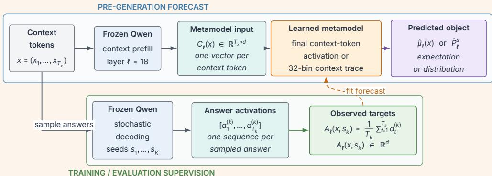  
FIGURE 1 · Forecasting a future activation distribution. The metamodel receives context activations from a language model and produces either a point forecast of the expected mean-pooled answer activation (linear ridge or MLP or a distribution forecast over mean-pooled answer activations Gaussian or flow). Multiple decoding seeds provide training and evaluation targets.

Our contributions are:

• We compare linear ridge and MLP predictors of the conditional mean with Gaussian and flow models of rollout variability.

• We show continued scaling through 500,000 training prompts and zero-shot out-of-domain transfer from LMSYS to WeirdChat and IFEval.

• We show that forecasted answer activations retain behavior-predictive signal.

• We show that context activations from Qwen2.5 can forecast Qwen3.5 and Gemma 4 answer activations, retaining most of the accuracy of matched target-model conditioners at scale.

## 2 Methodology

## 2.1

## Problem formulation

Let M be a frozen autoregressive language model with hidden dimension d, D a fixed stochastic decoding configuration, and x an input context (prompt) with token length $T _ { x }$ . Let $\mathsf { \boldsymbol { s } } \sim \mathbb { P } _ { D }$ denote a pseudorandom seed. Prefill at the output of decoder block ℓ yields a context activation trace $C _ { \ell } ( x ) \in \mathbb { R } ^ { T _ { x } \times d }$ . A rollout under D yields a variable-length answer activation trace that we meanpool into $A _ { \ell } ( x , s ) \in \mathbb { R } ^ { d }$ [Wang et al., 2026, Der et al., 2026]. This stochastic decoding process defines both a conditional expectation and a conditional law:

$$
\begin{array} { r l } & { \mu _ { \ell } ( x ) : = \mathbb { E } _ { s \sim \mathbb { P } _ { D } } \big [ A _ { \ell } ( x , s ) \mid x \big ] } \\ & { \quad P _ { \ell } ^ { x } : = \mathsf { L a w } _ { M , D } \big ( A _ { \ell } ( x , s ) \mid x \big ) . } \end{array}\tag{1}
$$

We accordingly study two prediction targets: a point metamodel models the expectation $\mu _ { \ell } ,$ , and a distribution metamodel models the whole rollout-induced law, $P _ { \ell } ^ { x }$ . We write $\hat { \mu } _ { \ell } ( x )$ and $\hat { P } _ { \ell } ^ { x }$ for the corresponding learned forecasts, appending a model-family subscript only when needed.

## 2.2

## Four metamodel families

We train two point metamodels (linear ridge and MLP and two distribution metamodels Gaussian and flow). We select the former by validation $R ^ { 2 }$ and the latter by validation energy score. For inputs, the linear ridge model takes the final context-token activation, whereas the MLP and flow take a 32-bin context trace (the Gaussian extends a frozen MLP. Adaptive average pooling forms $B = 3 2$ contiguous, approximately equal-sized bins that may overlap, reusing tokens when $T _ { x } < 3 2$

We pool the bin averages $r _ { 1 } , \ldots , r _ { B } \in \mathbb { R } ^ { d }$ with a learned query q:

$$
\alpha _ { j } = { \sf s o f t m a x } _ { j } \left( \frac { q ^ { \top } \mathsf { L N } ( r _ { j } ) } { \sqrt { d } } \right) , \qquad Z = \sum _ { j = 1 } ^ { B } \alpha _ { j } r _ { j } .\tag{2}
$$

We use single-query, query-only attention pooling: q is one learned global query, the normalized bins directly compute its attention scores, and the unprojected bins are the values. This pooling is the first learned stage: z is passed directly to the downstream MLP or flow, and q is trained jointly with it.

Linear ridge point metamodel. The linear ridge forecast is $\hat { \mu } _ { \ell , \mathrm { l i n } } ( x ) = W \tilde { h } _ { _ { \mathrm { \scriptsize { l a s t } } } } + b$ , where $\tilde { h } _ { \scriptscriptstyle { \vert \mathsf { a s t } } }$ is the final context-token activation, coordinatewise standardized using training statistics. We fit this full-dimensional map to empirical rollout means in closed form, selecting the ridge penalty � by validation $R ^ { 2 }$ . Appendix Figure 5 ablates the choice of input representation.

MLP point metamodel. The MLP forecast $\hat { \mu } _ { \ell , \mathsf { M L P } } ( x )$ maps z through a three-layer 4,096→8,192→ 8,192→4,096 GELU MLP 134.2M parameters) and minimizes MSE against each prompt’s empirical mean over training rollouts. We select the final model with the highest validation $R ^ { 2 }$ . Appendix Figure 6 ablates the choice of input representation.

Gaussian distribution metamodel. This model extends a frozen MLP point map as $\hat { P } _ { \ell , \mathsf { G } } ^ { x } =$ $\mathcal { N } ( \hat { \mu } _ { _ { \ell , \mathsf { M L P } } } ( x ) , \kappa ^ { 2 } \gamma ( z ) ^ { 2 } \Sigma )$ . We estimate Σ from within-prompt residuals $A _ { \ell } ( x , s ) - { \overline { { A } } } _ { \ell } ( x )$ , where $\overline { { A } } _ { \ell } ( x )$ is the empirical rollout mean. Candidate covariances are isotropic, diagonal, or low-rankplus-diagonal. The scale is global $( \gamma ( z ) ~ = ~ \ 1 )$ or prompt-dependent. For the latter, $\gamma ( z )$ is a normalized scale derived from a two-layer 4,096→256→1 SiLU head’s log-variance prediction Appendix D). Covariance family, rank, scale mode, and the scalar multiplier � are selected by validation energy score.

Flow distribution metamodel. We use conditional flow matching with a linear path [Lipman et al., 2023]. Integrating $v _ { \theta } ( y _ { t } , t , z )$ from a Gaussian base draw � at $t = 0$ to t = 1 produces a sample $\tilde { \boldsymbol { A } } _ { \ell } \sim \hat { \boldsymbol { P } } _ { \ell , \mathsf { F } } ^ { x }$ . For each rollout target $y ,$ base draw �, and $t \sim \mathcal { U } [ 0 , 1 ]$ , we set $y _ { t } = ( 1 - t ) \varepsilon + t y$ and minimize

$$
\mathcal { L } _ { \sf F M } ( \theta ) = \mathbb { E } \left[ \left\| v _ { \theta } ( y _ { t } , t , z ) - ( y - \varepsilon ) \right\| _ { 2 } ^ { 2 } \right] .\tag{3}
$$

The vector field $\boldsymbol { v } _ { \boldsymbol { \theta } }$ has width 4,096, sinusoidal time embeddings, and eight conditioned residual blocks 352.8M parameters). At inference, 64 Gaussian base draws are integrated for 32 Euler steps. We select the final model with the lowest validation energy score. Appendix Figure 7 ablates the choice of input representation.

## 2.3

## Experimental setup

Our primary study uses decoder block 18 of Qwen3.59B [Qwen Team, 2026], selected in Appendix Figure 9. All layer indices are zero-indexed and refer to raw decoder-block outputs.

LMSYSChat-1M [Zheng et al., 2024] provides 500,000/1,000/3,000 train/validation/test prompts, each with four independently seeded rollouts. The rollout-count ablation uses 100,000 training prompts, the same validation/test sizes, and a common 16-rollout evaluation target. Out-of-domain OOD evaluation uses all 2,660 WeirdChat prompts [Chowdhury et al., 2026] and 541 IFEval prompts [Zhou et al., 2023], with frozen LMSYS metamodels and four observed rollouts per prompt. We evaluate the linear ridge and MLP forecasts and the flow mean using pooled multivariate $R ^ { 2 }$ against the empirical rollout mean (“mean $R ^ { 2 \prime \prime } )$ . The Gaussian’s analytic mean equals the MLP forecast. For the Gaussian and flow, we add the energy score [Gneiting and Raftery, 2007] divided by ${ \sqrt { d } } ,$ Spearman correlation between predicted and observed prompt-level variance, and the ratio of generated to observed variance (definitions and secondary metrics in Appendix C). For cross-model forecasting, Qwen2.57BInstruct layer 19 context activations [Yang et al., 2024] predict Qwen3.59B layer 18 and Gemma-412B-it layer 47 answer activations [Google DeepMind, 2026], with matched target-model conditioners as controls. Layers 19 and 47 are fixed from earlier validation-selected final context-token activation sweeps Appendix G). Appendix D gives the full experimental settings.

## 3 Results

## Context activation traces forecast answer activations at scale and generalize OOD

Figure 2 shows a clear scale-dependent reversal in mean $R ^ { 2 }$ . The linear ridge metamodel initially outperforms the nonlinear MLP and flow mean on all three evaluation sets, but the nonlinear models overtake it as prompt coverage grows. The linear ridge curves then plateau much earlier. At the largest scale, the flow mean approaches the MLP on both OOD sets, with a modest gap in domain. The full context trace further improves both neural models Appendix A).

Table 1 reports endpoint distribution metrics: the Gaussian has a slightly better LMSYS energy score and variance ranking, whereas the flow has lower OOD energy scores. Appendix Figure 11 shows the corresponding scaling curves, and Appendix Figure 10 reports prompt retrieval. Appendix F visualizes the forecasts. Increasing prompt coverage is more valuable than adding repeated targets: eight rollouts capture most of the gain from sixteen Appendix Figure 8).

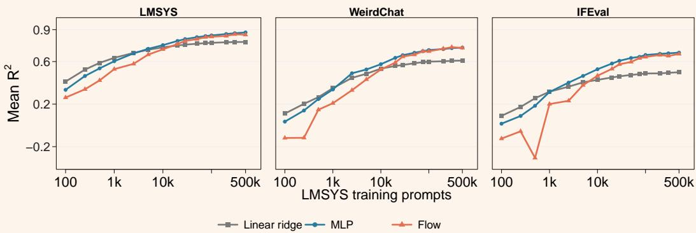  
FIGURE 2 · Prompt coverage drives forecast quality through the largest tested scale, in and out of domain. Columns correspond to evaluation sets and show mean $R ^ { 2 }$ for the linear ridge, MLP, and flow metamodels. All metamodels are trained only on LMSYS; WeirdChat 2,660 prompts) and IFEval 541 prompts) are zero-shot, with four rollouts per prompt. The linear ridge metamodel uses the final context-token activation and the neural models use the 32-bin context trace. Other endpoint metrics are in Table 1.

TABLE 1 · Distribution metrics at the final 500,000-prompt LMSYS-only checkpoint. WeirdChat and IFEval are zero-shot evaluations.
<table><tr><td></td><td colspan="2">Energy score ↓</td><td colspan="2">Variance Spearman ρ ↑</td><td colspan="2">Variance ratio → 1</td></tr><tr><td>Evaluation set</td><td>Gaussian</td><td>Flow</td><td>Gaussian</td><td>Flow</td><td>Gaussian</td><td>Flow</td></tr><tr><td>LMSYS</td><td>0.06686</td><td>0.06747</td><td>0.829</td><td>0.690</td><td>1.532</td><td>1.299</td></tr><tr><td>WeirdChat</td><td>0.06978</td><td>0.06851</td><td>0.610</td><td>0.633</td><td>1.961</td><td>1.857</td></tr><tr><td>IFEval</td><td>0.10330</td><td>0.10032</td><td>0.679</td><td>0.611</td><td>1.547</td><td>1.833</td></tr></table>

## 3.2

## Forecasted activations retain behavior-predictive signal

We use linear behavior probes (logistic regression) trained on real answer activations, applying them to predicted means or averaging their predicted probabilities over Gaussian and flow samples. This analysis uses new metamodel fits on both LMSYS and the WeirdChat training split. The direct-context baseline predicts behavior from context activations without an answer forecast; each context-only score is assigned to all four answers for answer-level evaluation Appendix H). Figure 3 shows answer-level AUPRC on held-out WeirdChat prompts, with labels from GPT6 Luna [OpenAI, 2026]. The MLP mean improves on the direct-context baseline in all four groups, although some gains are small. The Gaussian performs similarly to the MLP on self-harm and deception, while the flow’s relative performance varies by behavior. Appendix H gives the setup and complementary AUROC results.

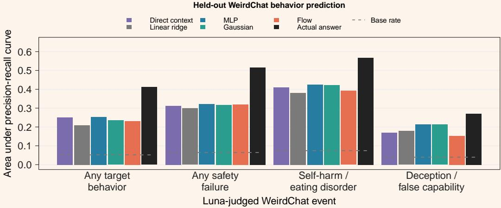  
FIGURE 3 · Forecasted activations retain behavior-predictive signal. Answer-level AUPRC on held-out WeirdChat prompts. Dashed segments show each group’s positive-rollout base rate. The actual-answer probe observes generated answers.

## Qwen2.5 traces forecast Qwen3.5 and Gemma 4 answer activations

Qwen2.5 conditioning yields slightly lower but comparable mean-forecast accuracy to matched target-model conditioning on both targets Figure 4). This transfer spans architectural differences for Qwen3.5, whose hybrid blocks differ from Qwen2.5’s conventional Transformer [Yang et al., 2024, Qwen Team, 2026], and, for Gemma 4, a different model family with its own tokenizer and training pipeline [Google DeepMind, 2026].

The distribution comparison depends on the target Appendix Table 6). For Qwen3.5, the Gaussian ranks prompt-level variance more strongly, while the flow is closer to the ideal unit variance ratio. For Gemma 4, the flow has lower energy scores and stronger variance ranking under both conditioners. Appendix G gives protocols and additional metrics.

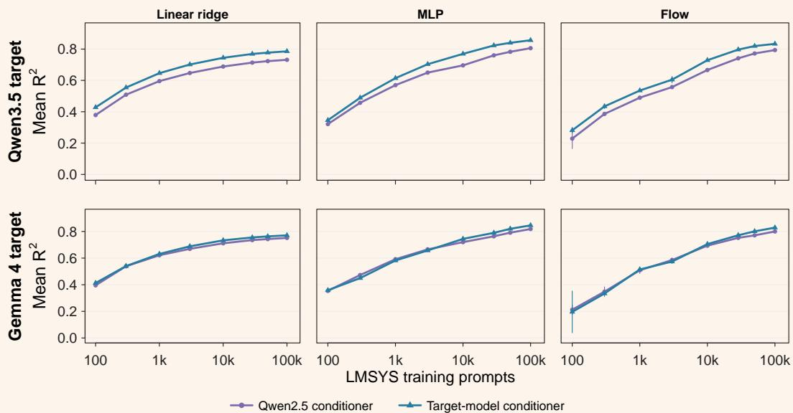  
FIGURE 4 · Qwen2.5 traces preserve most of the forecast quality for Qwen3.5 and Gemma 4. Mean $R ^ { 2 }$ for linear ridge, MLP, and flow metamodels. Rows show target models; curves compare Qwen2.5 and matched target-model conditioning. Error bars show one standard deviation over three rollout partitions Qwen3.5 or three initialization replicates Gemma 4 MLP/flow); Gemma 4 linear ridge fits are deterministic Appendix G).

## 4 Related work

Reading and predicting future computation. Pre-generation probes predict answer structure and content [Dong et al., 2025], hallucination risk [Ji et al., 2024], and answer correctness [Moreno Cencerrado et al., 2025]. Reasoning-trace probes predict later behavior [Kortukov et al., 2026], while refusal directions identify behavior-linked geometry [Arditi et al., 2024]. These methods target chosen labels. The Tuned Lens decodes intermediate-layer next-token predictions [Belrose et al., 2023]; Future Lens predicts later tokens and hidden states [Pal et al., 2023]; and EAGLE predicts near-future features for speculative decoding [Li et al., 2024]. Closest to our work, Jiralerspong et al. [2026] predict a pooled answer activation from the final context-token activation. We instead predict both the conditional mean and the rollout-induced distribution, use multi-rollout supervision, and test out of domain. We mean-pool answers because information is generally spread across generated positions [Wang et al., 2026, Der et al., 2026].

Metamodels and neural artifacts as data. Metamodels take neural-network artifacts as training examples for a second model. Hypernetworks generate the weights of another network [Ha et al., 2017]; newer work learns representations or generative models of checkpoint populations [Peebles et al., 2022, Schürholt et al., 2024, Wang et al., 2024]. Generative Latent Priors extend this view to activation distributions and use the learned model as a prior and feature extractor [Luo et al., 2026]. We study a different artifact population: the conditional relationship between an observed context trace and a later answer summary.

Generative models of activations. Activation decoders map hidden states to descriptions of model knowledge or behavior [Costarelli et al., 2024, Pan et al., 2024]. UniSteer learns a textconditioned activation flow for editing and classification [Shi et al., 2026]. We instead condition on an earlier context trace and predict the distribution of a later pooled state under stochastic decoding. We use conditional flow matching [Lipman et al., 2023] and evaluate it with both point and distribution metrics [Gneiting and Raftery, 2007, Pacchiardi et al., 2024].

## 5 Discussion

In our experiments, point and distribution context–answer metamodels scale with prompt count, generalize out of domain, and retain behavior-predictive signal. The MLP provides accurate mean forecasts without modeling rollout variability. The Gaussian provides a useful baseline for rollout variability, while the benefits of flow matching depend on the target model and distributional property.

## Limitations.

Targets cover Qwen3.5 layer 18 and Gemma 4 layer 47. Selecting layer 18 for in-domain conditional-mean accuracy may not optimize distributional metrics, transfer, or behavior prediction. Training and analysis use 2–16 rollouts per prompt; robustness at larger counts remains untested. Behavior labels come from GPT6 Luna rubric judgments but lack extensive validation against human annotations. The learned law is also specific to the decoding rule, chat template, generation cap, activation boundary, and answer-pooling choice.

## Future directions.

Future work could use activation forecasts for behavioral monitoring and intervention, such as anticipating reward hacking. Forecasting activation trajectories could capture behavior during generation, while extending forecasts beyond the initial context could support longer interactions and multi-agent settings. Larger, more diverse datasets could broaden transfer across tasks and domains.

## Acknowledgments

We thank Jerome Sieber for detailed feedback on the paper as well as technical discussions. We additionally thank Stephen Lu and Jungyoon Lee for technical discussions on flow-matching models.

## References

Andy Arditi, Oscar Obeso, Aaquib Syed, Daniel Paleka, Nina Panickssery, Wes Gurnee, and Neel Nanda. Refusal in language models is mediated by a single direction. In Advances in Neural Information Processing Systems, volume 37, 2024. doi: 10.52202/079017-4322. URL https://proceedings.neurips.cc/paper\_files/paper/2024/hash/ f545448535dfde4f9786555403ab7c49-Abstract-Conference.html.

Nora Belrose, Zach Furman, Logan Smith, Danny Halawi, Igor Ostrovsky, Lev McKinney, Stella Biderman, and Jacob Steinhardt. Eliciting latent predictions from transformers with the tuned lens, 2023. URL https://arxiv.org/abs/2303.08112.

Neil Chowdhury, Cassidy Laidlaw, Kaiying Hou, Daniel Johnson, Sarah Schwettmann, and Jacob Steinhardt. WeirdChat: A catalog of unexpected AI behaviors, discovered automatically. Transluce dataset, July 2026. URL https://transluce.org/weirdchat.

Anthony Costarelli, Mat Allen, and Severin Field. Meta-models: An architecture for decoding LLM behaviors through interpreted embeddings and natural language, 2024. URL https://arxiv.org/abs/2410.02472.

Kevin Der, Harish Kamath, and Ben Thompson. Turn-averaged SAEs for feature discovery and long-context attribution, 2026. URL https://arxiv.org/abs/2606.28548.

Zhichen Dong, Zhanhui Zhou, Zhixuan Liu, Chao Yang, and Chaochao Lu. Emergent response planning in LLMs. In Proceedings of the 42nd International Conference on Machine Learning, volume 267 of Proceedings of Machine Learning Research, pages 14301–14320. PMLR, 2025. URL https://proceedings.mlr.press/v267/dong25p.html.

Tilmann Gneiting and Adrian E. Raftery. Strictly proper scoring rules, prediction, and estimation. Journal of the American Statistical Association, 102(477):359–378, 2007. doi: 10.1198/016214506000001437.

Google DeepMind. Gemma-412B-it. Hugging Face model card, 2026. URL https://huggingface.co/google/gemma-4-12B-it.

David Ha, Andrew M. Dai, and Quoc V. Le. Hypernetworks. In International Conference on Learning Representations, 2017. URL https://openreview.net/forum?id=rkpACe1lx.

Ziwei Ji, Delong Chen, Etsuko Ishii, Samuel Cahyawijaya, Yejin Bang, Bryan Wilie, and Pascale Fung. LLM internal states reveal hallucination risk faced with a query. In Proceedings of the 7th BlackboxNLP Workshop: Analyzing and Interpreting Neural Networks for NLP, pages 88–104. Association for Computational Linguistics, 2024. doi: 10.18653/v1/2024.blackboxnlp-1.6. URL https://aclanthology.org/2024.blackboxnlp-1.6/.

Thomas Jiralerspong, Mukesh Ramanathan, Christopher Ackerman, Christina Lu, Guillaume Lajoie, and Dan Mossing. Affine anticipation: LLM answer representations are largely linearly predictable from context. Preprint, 2026. URL https://thomas.jiralerspong.com/assets/docs/affine-anticipation.pdf.

Evgenii Kortukov, Piotr Komorowski, Florian Klein, Paula Engl, Gabriele Sarti, Seong Joon Oh, Sebastian Lapuschkin, and Wojciech Samek. Predicting future behaviors in reasoning models enables better steering, 2026. URL https://arxiv.org/abs/2606.11172.

Yuhui Li, Fangyun Wei, Chao Zhang, and Hongyang Zhang. EAGLE Speculative sampling requires rethinking feature uncertainty. In Proceedings of the 41st International Conference on Machine Learning, volume 235 of Proceedings of Machine Learning Research, pages 28935–28948. PMLR, 2024. URL https://proceedings.mlr.press/v235/li24bt.html.

Yaron Lipman, Ricky T. Q. Chen, Heli Ben-Hamu, Maximilian Nickel, and Matt Le. Flow matching for generative modeling. In The Eleventh International Conference on Learning Representations, 2023. URL https://openreview.net/forum?id=PqvMRDCJT9t.

Grace Luo, Jiahai Feng, Trevor Darrell, Alec Radford, and Jacob Steinhardt. Learning a generative meta-model of LLM activations, 2026. URL https://arxiv.org/abs/2602.06964.

Iván Vicente Moreno Cencerrado, Arnau Padrés Masdemont, Anton Gonzalvez Hawthorne, David Demitri Africa, and Lorenzo Pacchiardi. No answer needed: Predicting LLM answer accuracy from question-only linear probes, 2025. URL https://arxiv.org/abs/2509.10625.

OpenAI. GPT6 Luna. Model documentation, 2026. URL https://developers.openai.com/api/docs/models/gpt-6-luna.

Lorenzo Pacchiardi, Rilwan A. Adewoyin, Peter Dueben, and Ritabrata Dutta. Probabilistic forecasting with generative networks via scoring rule minimization. Journal of Machine Learning Research, 25(45):1–64, 2024. URL https://www.jmlr.org/papers/v25/23-0038.html.

Koyena Pal, Jiuding Sun, Andrew Yuan, Byron C. Wallace, and David Bau. Future lens: Anticipating subsequent tokens from a single hidden state. In Proceedings of the 27th Conference on Computational Natural Language Learning, pages 548–560. Association for Computational Linguistics, 2023. doi: 10.18653/v1/2023.conll-1.37. URL https://aclanthology.org/2023.conll-1.37/.

Alexander Pan, Lijie Chen, and Jacob Steinhardt. LatentQA Teaching LLMs to decode activations into natural language, 2024. URL https://arxiv.org/abs/2412.08686.

William Peebles, Ilija Radosavovic, Tim Brooks, Alexei A. Efros, and Jitendra Malik. Learning to learn with generative models of neural network checkpoints, 2022. URL https://arxiv.org/abs/2209.12892.

Qwen Team. Qwen3.59B. Hugging Face model card, 2026. URL https://huggingface.co/Qwen/Qwen3.5-9B.

Konstantin Schürholt, Michael W. Mahoney, and Damian Borth. Towards scalable and versatile weight space learning. In Proceedings of the 41st International Conference on Machine Learning, volume 235 of Proceedings of Machine Learning Research, pages 43947–43966. PMLR, 2024. URL https://proceedings.mlr.press/v235/schurholt24a.html.

Yingdong Shi, Ruiming Zhang, Changming Li, Zhiyu Yang, Kaixing Zhang, Jingyi Yu, and Kan Ren. UniSteer: Text-guided flow matching in activation space for versatile LLM steering, 2026. URL https://arxiv.org/abs/2605.30076.

Kai Wang, Dongwen Tang, Boya Zeng, Yida Yin, Zhaopan Xu, Yukun Zhou, Zelin Zang, Trevor Darrell, Zhuang Liu, and Yang You. Neural network diffusion, 2024. URL https://arxiv.org/abs/2402.13144.

Sophie L. Wang, Phillip Isola, and Brian Cheung. The truth lies somewhere in the middle (of the generated tokens), 2026. URL https://arxiv.org/abs/2605.09969.

An Yang, Baosong Yang, Beichen Zhang, Binyuan Hui, Bo Zheng, Bowen Yu, Chengyuan Li, Dayiheng Liu, Fei Huang, Haoran Wei, Huan Lin, Jian Yang, Jianhong Tu, Jianwei Zhang, Jianxin Yang, Jiaxi Yang, Jingren Zhou, Junyang Lin, Kai Dang, Keming Lu, Keqin Bao, Kexin Yang, Le Yu, Mei Li, Mingfeng Xue, Pei Zhang, Qin Zhu, Rui Men, Runji Lin, Tianhao Li, Tianyi Tang, Tingyu Xia, Xingzhang Ren, Xuancheng Ren, Yang Fan, Yang Su, Yichang Zhang, Yu Wan, Yuqiong Liu, Zeyu Cui, Zhenru Zhang, and Zihan Qiu. Qwen2.5 technical report, 2024. URL https://arxiv.org/abs/2412.15115.

Lianmin Zheng, Wei-Lin Chiang, Ying Sheng, Tianle Li, Siyuan Zhuang, Zhanghao Wu, Yonghao Zhuang, Zhuohan Li, Zi Lin, Eric P. Xing, Joseph E. Gonzalez, Ion Stoica, and Hao Zhang. LMSYSChat-1M A large-scale real-world LLM conversation dataset. In The Twelfth International Conference on Learning Representations, 2024. URL https:// proceedings.iclr.cc/paper\_files/paper/2024/hash/5f9bfdfe3685e4ccdbc0e7fb29cccf2a-Abstract-Conference.html.

Jeffrey Zhou, Tianjian Lu, Swaroop Mishra, Siddhartha Brahma, Sujoy Basu, Yi Luan, Denny Zhou, and Le Hou. Instruction-following evaluation for large language models, 2023. URL https://arxiv.org/abs/2311.07911.

## A Scaling and context-representation ablations

The representation ablations use Qwen3.59B layer 18. The linear ridge metamodel compares three inputs: the 32-bin context trace (concatenated bin averages), the final context-token activation, and the mean context activation (the unweighted mean over context tokens). The MLP and flow also use the full context trace (all context-token activations); both trace inputs use learned-query pooling. All fits use LMSYS-only training, common 1,000-prompt validation and 3,000-prompt test splits, plus zero-shot evaluation on 2,660 WeirdChat and 541 IFEval prompts. The Gaussian is omitted because its analytic mean is the MLP forecast.

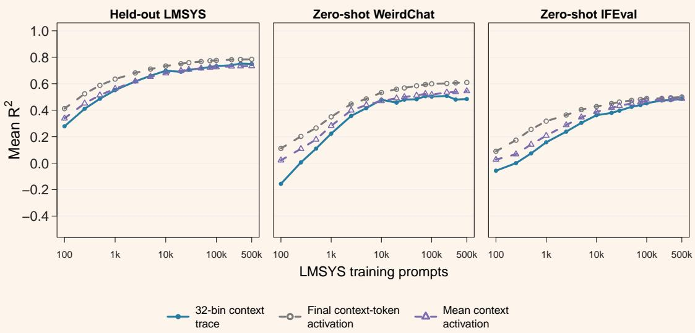  
FIGURE 5 · Linear ridge input comparison. Mean $R ^ { 2 }$ for LMSYS-only linear ridge metamodels from 100 to 500,000 training prompts. In legend order, the inputs are the 32-bin context trace, final context-token activation, and mean context activation. At 500,000 prompts, the final context-token activation performs best on all three domains; its LMSYS $R ^ { 2 }$ is 0.784, versus 0.750 for the 32-bin context trace and 0.734 for the mean context activation. WeirdChat and IFEval are zero-shot; selection uses only LMSYS validation.

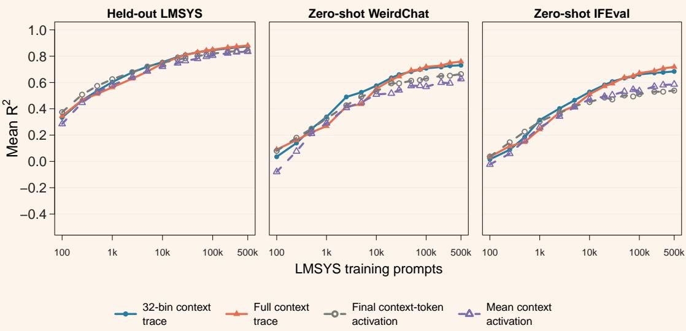  
FIGURE 6 · MLP input comparison. Mean $R ^ { 2 }$ from 100 to 500,000 training prompts. Columns show held-out LMSYS, zero-shot WeirdChat, and zero-shot IFEval. At 500,000 training prompts, the full context trace reaches LMSYS $R ^ { 2 } = 0 . 8 8 1$ , compared with 0.874 for the 32-bin context trace, 0.842 for the final context-token activation, and 0.834 for the mean context activation. The full context trace has the highest endpoint $R ^ { 2 }$ on all three domains Table 2).

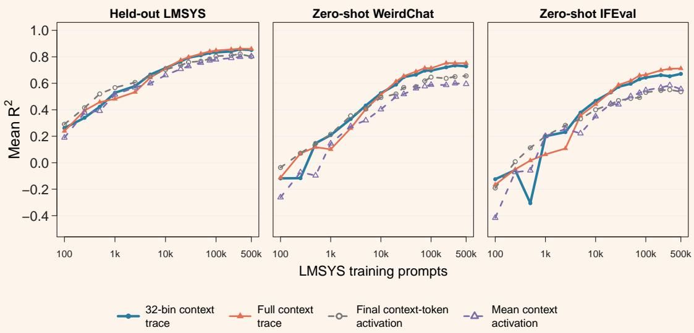  
FIGURE 7 · Flow input comparison. Mean $R ^ { 2 }$ from 100 to $5 0 0 , 0 0 0$ training prompts. Columns show held-out LMSYS, zero-shot WeirdChat, and zero-shot IFEval. At 500,000 training prompts, the full context trace reaches LMSYS $R ^ { 2 } ~ = ~ 0 . 8 6 0$ , versus 0.852 for the 32-bin context trace, 0.802 for the final context-token activation, and 0.804 for the mean context activation. The full context trace has the highest endpoint $R ^ { 2 }$ on all three domains Table 2).

TABLE 2 · Representation endpoints at 500,000 LMSYS training prompts. WeirdChat and IFEval are zero-shot. The full context trace has the highest observed $R ^ { 2 }$ for both neural models on all three domains. The linear ridge metamodel compares the 32-bin context trace, final context-token activation, and mean context activation.
<table><tr><td rowspan="2">Model</td><td rowspan="2">Input</td><td rowspan="2"> $\mathsf { L M S Y S } R ^ { 2 }$ </td><td rowspan="2"> $\mathsf { W e i r d C h a t } R ^ { 2 }$ </td><td rowspan="2"> $\mathsf { I F E v a l } R ^ { 2 }$ </td></tr><tr><td></td></tr><tr><td>Linear ridge</td><td>32-bin context trace</td><td>0.7498</td><td>0.4844</td><td>0.4854</td></tr><tr><td>Linear ridge</td><td>Final context-token activation</td><td>0.7844</td><td>0.6095</td><td>0.4996</td></tr><tr><td>Linear ridge</td><td>Mean context activation</td><td>0.7335</td><td>0.5447</td><td>0.4873</td></tr><tr><td>MLP</td><td>32-bin context trace</td><td>0.8739</td><td>0.7309</td><td>0.6839</td></tr><tr><td>MLP</td><td>Full context trace</td><td>0.8808</td><td>0.7591</td><td>0.7183</td></tr><tr><td>MLP</td><td>Final context-token activation</td><td>0.8418</td><td>0.6636</td><td>0.5383</td></tr><tr><td>MLP</td><td>Mean context activation</td><td>0.8343</td><td>0.6269</td><td>0.5859</td></tr><tr><td>Flow</td><td>32-bin context trace</td><td>0.8517</td><td>0.7286</td><td>0.6711</td></tr><tr><td>Flow</td><td>Full context trace</td><td>0.8599</td><td>0.7520</td><td>0.7119</td></tr><tr><td>Flow</td><td>Final context-token activation</td><td>0.8016</td><td>0.6556</td><td>0.5360</td></tr><tr><td>Flow</td><td>Mean context activation</td><td>0.8040</td><td>0.5946</td><td>0.5557</td></tr></table>

Training-rollout scaling at 100,000 prompts  
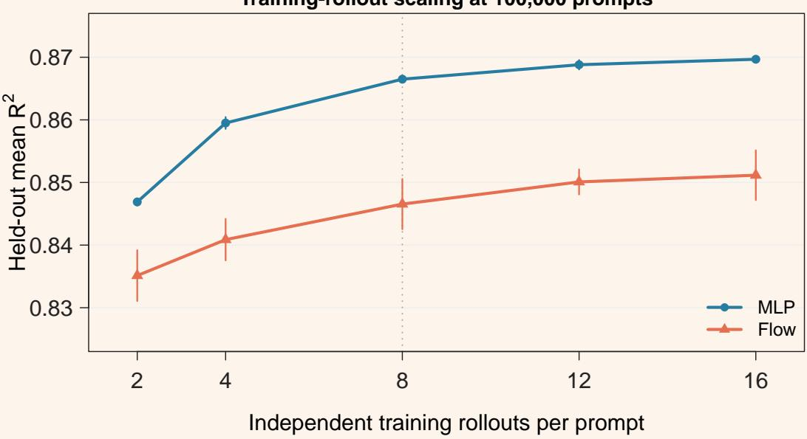  
FIGURE 8 · Eight rollout targets capture most of the repeat-sampling gain. Held-out mean $R ^ { 2 }$ at 100,000 training prompts versus training rollouts. Error bars show standard deviations across three fits with different neuralnetwork training seeds and training-rollout subsets; the subsets coincide at 12 and 16 rollouts. From 8 to 16 rollouts, the MLP gains 0.0032 and the flow gains 0.0046. The main experiments use four rollouts per prompt due to compute constraints. Table 3 gives the full values.

TABLE 3 · Rollout-count results at 100,000 training prompts: mean $R ^ { 2 } \pm$ one standard deviation over three fits. The fits vary training-rollout subsets and, for the MLP and flow, training seeds; subsets coincide at 12 and 16 rollouts. All cells use the same 16-rollout evaluation mean, which differs from the four-rollout main target. † indicates a standard deviation below 0.0001.
<table><tr><td>Model</td><td>2 rollouts</td><td>4 rollouts</td><td>8 rollouts</td><td>12 rollouts</td><td>16 rollouts</td></tr><tr><td>Linear ridge</td><td> $0 . 7 8 9 3 \pm 0 . 0 0 0 3$ </td><td> $0 . 7 9 2 4 \pm 0 . 0 0 0 3$ </td><td> $0 . 7 9 4 0 \pm 0 . 0 0 0 1$ </td><td>0.7944†</td><td>0.7946†</td></tr><tr><td>MLP</td><td> $0 . 8 4 6 9 \pm 0 . 0 0 0 6$ </td><td> $0 . 8 5 9 5 \pm 0 . 0 0 1 0$ </td><td> $0 . 8 6 6 5 \pm 0 . 0 0 0 5$ </td><td> $0 . 8 6 8 8 \pm 0 . 0 0 0 8$ </td><td> $0 . 8 6 9 7 \pm 0 . 0 0 0 3$ </td></tr><tr><td>Flow</td><td> $0 . 8 3 5 1 \pm 0 . 0 0 4 1$ </td><td> $0 . 8 4 0 9 \pm 0 . 0 0 3 3$ </td><td> $0 . 8 4 6 5 \pm 0 . 0 0 4 0$ </td><td> $0 . 8 5 0 1 \pm 0 . 0 0 2 0$ </td><td> $0 . 8 5 1 2 \pm 0 . 0 0 4 0$ </td></tr></table>

## B Layer selection

Figure 9 shows the layer-selection sweep. At 10,000 training prompts, layer 18 reaches validation $R ^ { 2 } = 0 . 7 5 7 7 _ { \cdot }$ , compared with 0.7394 for layer 17, and is therefore selected. Each layer is evaluated against its own answer activations, so the targets differ across layers. Similar studies place future-token, answer, hallucination, and correctness signals in middle-to-late layers [Pal et al., 2023, Dong et al., 2025, Ji et al., 2024, Moreno Cencerrado et al., 2025].

Qwen3.5 layer selection  
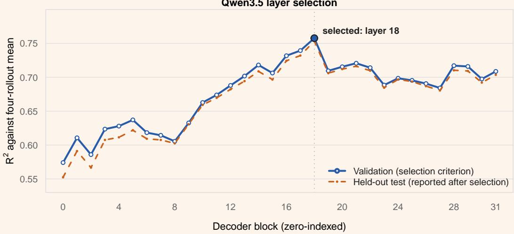  
FIGURE 9 · Validation selection of Qwen3.59B layer 18. Each three-layer MLP maps the final context-token activation at each decoder block to that block’s mean-pooled answer activation over four temperature-1 rollouts. All fits use 10,000 LMSYS training prompts. We select on 1,000 validation prompts (blue); the 3,000-prompt test results are orange. Layer 18 has the best validation $R ^ { 2 } \ ( 0 . 7 5 7 7 )$ , followed by layer 17 (0.7394).

## C Evaluation metric definitions

At the evaluated layer, let $\overline { { A } } _ { i }$ be the empirical rollout mean for prompt $i , \hat { \mu } _ { i }$ its predicted mean, and $\overline { { A } }$ the mean of $\overline { { A } } _ { i }$ across prompts. We compute the pooled multivariate score

$$
R ^ { 2 } = 1 - \frac { \sum _ { i } \Vert \hat { { \boldsymbol \mu } } _ { i } - \overline { { \boldsymbol A } } _ { i } \Vert _ { 2 } ^ { 2 } } { \sum _ { i } \Vert \overline { { \boldsymbol A } } _ { i } - \overline { { \boldsymbol A } } \Vert _ { 2 } ^ { 2 } } .\tag{4}
$$

For a forecast sample $x ,$ an independent forecast sample $X ^ { \prime }$ , and a realized rollout $\mathsf { Y } ,$ the energy score is

$$
\mathsf { E n e r g y S c o r e } = \mathbb { E } \| X - Y \| _ { 2 } - \frac { 1 } { 2 } \mathbb { E } \| X - X ^ { \prime } \| _ { 2 } .\tag{5}
$$

We estimate both expectations with samples and divide the energy score by ${ \sqrt { d } } .$

TABLE 4 · Forecast metric definitions.
<table><tr><td>Metric</td><td>Definition</td><td>Better</td></tr><tr><td colspan="3">Point metrics (point models and means of distribution models)</td></tr><tr><td>Mean R²</td><td>Variance in empirical prompt-level rollout means explained by the predicted means.</td><td>Higher</td></tr><tr><td>Prompt retrieval</td><td>Fraction of predicted means whose nearest empirical answer mean in Euclidean distance belongs to the same prompt.</td><td>Higher</td></tr><tr><td colspan="3">Distribution metrics</td></tr><tr><td>Energy score</td><td>Proper score above, averaged over prompts and divided by  ${ \sqrt { d } } .$ </td><td>Lower</td></tr><tr><td>Variance Spearman ρ</td><td>Across-prompt Spearman correlation between generated and observed covari- ance traces.</td><td>Higher</td></tr><tr><td>Variance ratio</td><td>Mean trace of generated within-prompt covariance divided by the corresponding observed trace.</td><td>1</td></tr><tr><td>NLL per dimension</td><td>Analytic Gaussian negative log-likelihood (with fixed 10⁻⁶ relative diagonal jitter) or flow NLL using 32 backward Euler steps and a Hutchinson trace estimate with two Rademacher probes per step; reported per dimension in raw activation co-</td><td>Lower</td></tr><tr><td>Predictive MMD²</td><td>ordinates. Multiscale RBF squared MMD between equal-sized generated and real sets in a</td><td>Lower</td></tr><tr><td>PCA sliced-Wasserstein</td><td>fixed 128-dimensional PCA-whitened space fitted on training data. Root-mean-square 1-D Wasserstein-2 distance over fixed random directions in</td><td>Lower</td></tr></table>

## D Experimental details

The primary model is Qwen3.59B, which provides both context and answer activations. Crossmodel forecasting uses Qwen2.57BInstruct layer 19 context activations to predict Qwen3.59B layer 18 or Gemma-412B-it layer 47 answer activations Appendix G). For the primary model, we capture the raw output of decoder block 18 for every context and answer token. The answer target is the float32 mean of these stored bfloat16 post-block states. The four primary rollout seeds are 43–46. The 16-rollout LMSYS bank retains these and adds seeds 47–58 over the same $1 0 0 { , } 0 0 0$ training prompts plus 1,000 validation and 3,000 test prompts. LMSYS, WeirdChat, and IFEval rollouts use a 4,096-token generation cap, with temperature 1.0 and top-p 0.95. The flow standardizes each target coordinate, while the point MLP normalizes targets by a scalar RMS after coordinatewise centering.

The Gaussian scale head predicts log within-prompt variance relative to the training mean. Let g(z) be its output clipped to [−6, 6]. We use $\gamma ( z ) = \mathsf { c l i p } ( e ^ { g ( z ) / 2 } / c , 0 . 1 , 1 0 )$ where $c = \sqrt { \mathbb { E } _ { \mathrm { t r a i n } } [ e ^ { g ( z ) } ] }$ normalizes the scale’s training RMS before the final clipping. In global mode, $\gamma ( z ) \equiv 1$

TABLE 5 · Qwen3.5-target metamodel settings.
<table><tr><td>Component</td><td>Setting</td></tr><tr><td>Context input</td><td>Final context-token activation (linear ridge) or 32-bin context trace (MLP/Gaussian/flow); Qwen3.5-9B layer 18 (d = 4,096) or Qwen2.5-7B-Instruct layer 19 (d = 3,584)</td></tr><tr><td>Answer target</td><td>Mean Qwen3.5-9B layer 18 activation over generated answer tokens plus, for normally stopped answers, any end-of-turn template tokens not already generated; d = 4,096</td></tr><tr><td>Point MLP</td><td>LayerNorm for attention scores; one learned query; weighted sum of the 32-bin context trace; Linear-GELU-Linear-GELU-Linear with widths  $4 , 0 9 6 \ \to \ 8 , 1 9 2 \ \to \ 8 , 1 9 2 \ \to \ 4 , 0 9 6 ;$  no dropout;</td></tr><tr><td>MLP training</td><td>134.2M parameters. Qwen2.5 input changes the first width from 4,096 to 3,584. MSE against the empirical rollout mean; AdamW; batch size 256; learning rate 3 × 10⁻4; weight  $3 \times 1 0 ^ { - 4 }$ </td></tr><tr><td>Flow metamodel</td><td>decay 10⁻³; select by validation R² Learned-query attention conditioner; width 4,096; eight residual blocks; sinusoidal time embed-</td></tr><tr><td>Flow path</td><td>ding; 352.8M parameters for Qwen3.5 input ε ~ N(0, 1), t ~ U[0, 1],  $y _ { t } = ( 1 - t ) \varepsilon + t y ;$  target velocity  $y - \varepsilon$ </td></tr><tr><td>Flow training</td><td>Flow-matching MSE; AdamW; batch size 256; learning rate  $3 \times 1 0 ^ { - 4 } ;$  weight decay  ${ \displaystyle 1 0 ^ { - 4 } }$  8 ; gradient</td></tr><tr><td>MLP/flow selection</td><td>norm clipped at 1; select by validation energy score Evaluate every 500 steps; stop after 12 evaluations without improvement; 80,000-step cap</td></tr><tr><td>OOD evaluation</td><td>Metamodels are evaluated on all 2,660 WeirdChat prompts and all 541 IFEval prompts; neither dataset enters fitting, normalization, or model selection for the zero-shot results.</td></tr><tr><td>WeirdChat behavior analysis</td><td>Linear answer probes use the fixed 1,596/532/532 prompt split. The predicted activations come from new mixed-domain linear ridge, MLP, and flow fits trained on 500,000 LMSYS and 1,596</td></tr><tr><td>Sampling</td><td>WeirdChat prompts with equal domain weighting; the Gaussian is fitted around the new MLP mean. Luna judges all 10,640 rollouts 64 samples for distribution metrics; 1,024 samples per Gaussian or flow forecast for integrated behavior probes; the flow uses 32 Euler steps</td></tr></table>

## D.1

## Compute resources

Experiments use NVIDIA B200 and RTX 5090 GPUs, with 6–12 CPU cores and 64–420 GiB of memory per job. We estimate roughly 400 GPU-hours for activation collection, 500 GPU-hours for primary metamodel scaling and ablations, 80 GPU-hours for cross-model forecasting, and 30 GPU-hours for OOD and behavior analyses. Preliminary, superseded, and failed runs bring the full-project total to roughly 1,300 GPU-hours.

## D.2

## Existing asset versions and licenses

We use the following pinned versions under their stated terms:

• Qwen3.59B revision c202236235762e1c871ad0ccb60c8ee5ba337b9a and Qwen2.57BInstruct revision a09a35458c702b33eeacc393d103063234e8bc28, both under the Apache License 2.0 (https://huggingface.co/Qwen/Qwen3.5-9B; https://huggingface.co/Qwen/Qwen2.5-7B-Instruct).

• Gemma-412B-it revision 707f0a3b8a3c7ad586ed01e27eafbad8a27dd0f7 [Google DeepMind, 2026], under the Apache License 2.0 (https://huggingface.co/google/gemma-4-12B-it), used for the additional cross-model targets.

• LMSYSChat-1M revision 200748d9d3cddcc9d782887541057aca0b18c5da, under the custom LMSYSChat-1M Dataset License Agreement, whose terms prohibit dataset transfer; we do not redistribute it (https://huggingface.co/datasets/lmsys/lmsys-chat-1m).

• WeirdChat revision 3460e41491308601cd68ee377011c7b7a8f0b4b3, under the MIT License (https://huggingface.co/datasets/Transluce/WeirdChat).

• IFEval data and evaluator at google-research revision 26d8ccdab6fec61b5c83ad6327ea8bda9e580288, with the data under CC BY 4.0 and source code under the Apache License 2.0 (https://github.com/google-research/ google-research/tree/master/instruction\_following\_eval).

## E Out-of-domain evaluation

We evaluate frozen LMSYS-only metamodels on the full set of 2,660 WeirdChat prompts and all 541 official IFEval prompts [Zhou et al., 2023], with four temperature-1 rollouts per prompt. On WeirdChat, the MLP and flow reach $R ^ { 2 } = 0 . 7 3 1$ and 0.729 and retrieve the correct prompt in 53.1% and 47.9% of cases, respectively. On IFEval, the corresponding scores are $R ^ { 2 } = 0 . 6 8 4$ and 0.671, with retrieval accuracies of 94.6% and 92.2%, respectively.

Retrieval queries and candidates use the same fixed banks of 3,000 LMSYS, 2,660 WeirdChat, and 541 IFEval prompts at every training size. All reported metrics use these evaluation populations. The separate mixed-domain behavior-probe experiment retains its held-out 532-prompt WeirdChat test split.

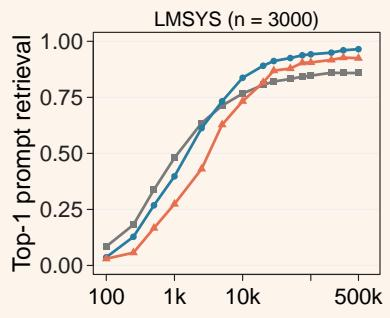

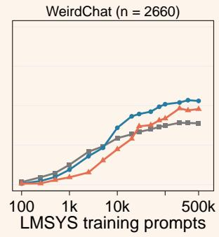

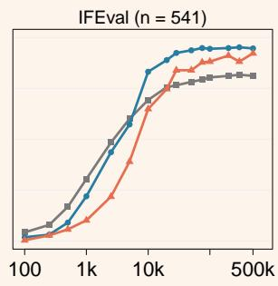  
FIGURE 10 · Prompt retrieval across the LMSYS training scale, in and out of domain. Top-1 retrieval from the predicted means of LMSYS-only linear ridge, MLP, and flow metamodels. Candidate banks contain 3,000, 2,660, and 541 prompts for LMSYS, WeirdChat, and IFEval, respectively. WeirdChat and IFEval are zero-shot evaluations.

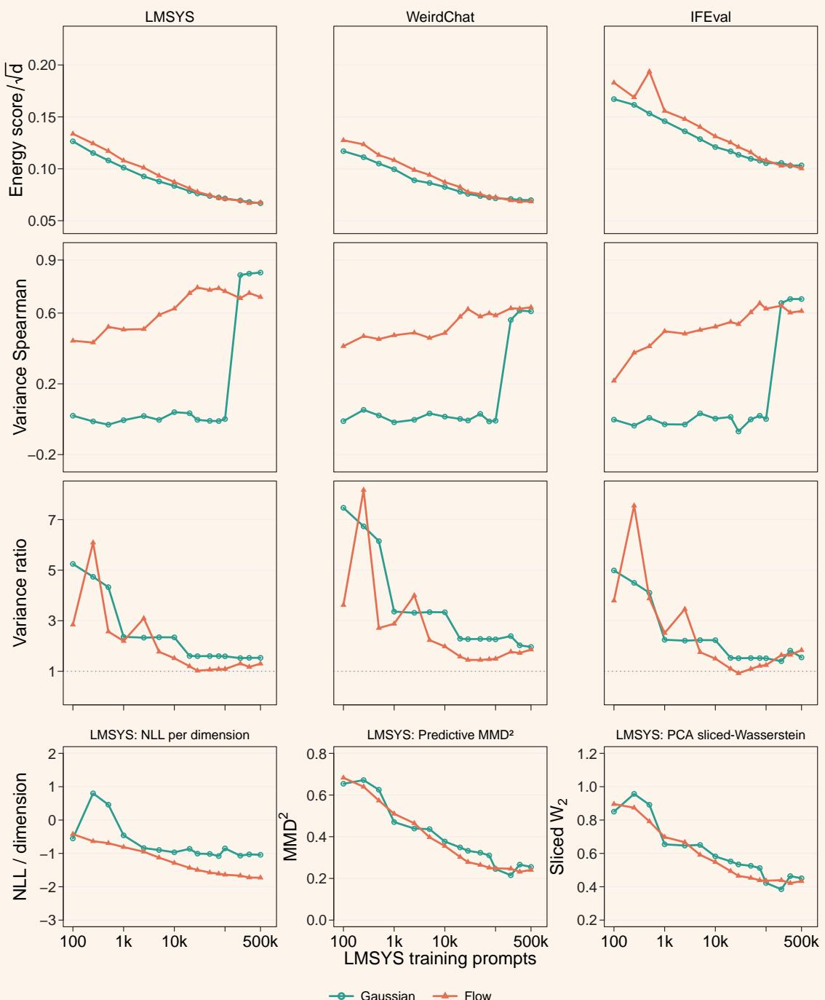  
FIGURE 11 · Distribution quality across the LMSYS training scale, in and out of domain. The first three rows use evaluation sets as columns and show energy score, prompt-level variance Spearman correlation, and generatedto-observed variance ratio for Gaussian and flow forecasts. WeirdChat and IFEval are zero-shot. The final row adds LMSYS NLL, predictive ${ \mathsf { M M D } } ^ { 2 }$ , and PCA sliced-Wasserstein distance. Lower energy, ${ \mathsf { N L L } } , { \mathsf { M M D } } ^ { 2 }$ , and Wasserstein distance are better; higher variance correlation is better; and the ideal variance ratio is one. The flow has lower NLL at 14 of 15 scales (all except 100 prompts) and scores lower on all three auxiliary diagnostics at the largest scale. The Gaussian’s variance ranking stays near zero through 100,000 training prompts because validation energy selects global covariance; at 200,000 prompts it selects prompt-dependent variance, raising LMSYS Spearman to 0.815. The jump reflects selection between variance modes, not an identified learning threshold.

## F Distribution sampling diagnostics

Figure 12 compares the validation-selected Gaussian forecast with fixed flow particles along a fine-grid Euler path [Lipman et al., 2023, Luo et al., 2026]. The Gaussian panel and every flow panel use the same frozen PCA basis and axis limits. Only the final flow panel shows completed flow samples; the intermediate panels illustrate the transport process. In this projection, the Gaussian forecast appears somewhat more dispersed than the completed flow state, consistent with its larger generated-to-observed variance ratio in the full activation space.

## Gaussian forecast and fixed flow trajectory: LMSYS-only on LMSYS

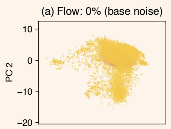  
(d) Flow: 50% (update 500)

(b) Flow: 5% (update 50)  
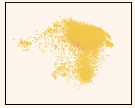  
(c) Flow: 20% (update 200)

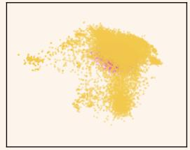

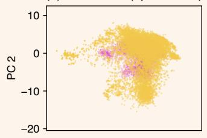  
(e) Flow: 80% (update 800)  
(f) Flow: 100% (update 1000)

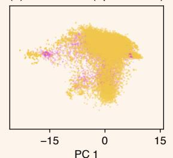

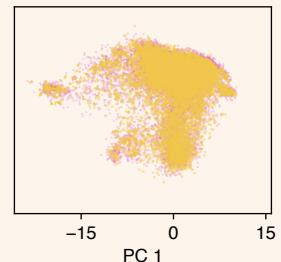

(g) Gaussian forecast  
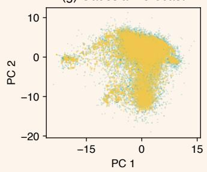

(h) Intermediate-state energy score  
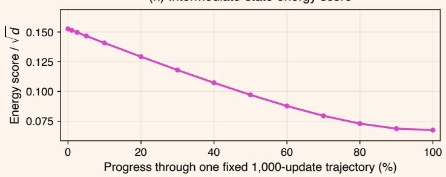  
FIGURE 12 · Gaussian forecast and fixed flow trajectory in a common answer activation plane. Yellow points are real LMSYS answer activations, green points are samples from the validation-selected Gaussian metamodel, and magenta points are the same LMSYS-only flow particles after 0, 50, 200, 500, 800, and 1,000 Euler updates. The curve shows energy score along the flow trajectory, not sampler quality at different costs. PCA is fitted on 32,768 answer rollouts from 8,192 LMSYS training prompts and then frozen before test targets and forecasts are projected.

We next vary the solver and the number of vector-field evaluations while always reaching the endpoint [Lipman et al., 2023] to assess the number of steps needed Figure 13). We fix the model, prompts, targets, normalization, and 64 initial samples per prompt. Intervals are paired prompt-bootstrap intervals for absolute energy score.

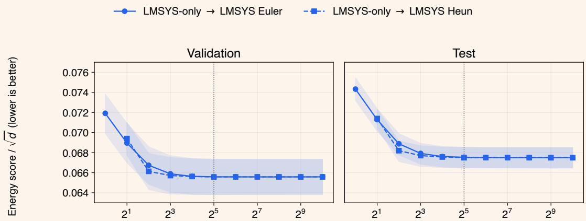  
Vector-field evaluations per sample  
FIGURE 13 · Completed-sampler quality versus numerical cost. The vertical axis is energy score divided by ${ \sqrt { d } } ;$ lower is better. Shaded bands are 95% prompt-bootstrap confidence intervals. Every point reaches the endpoint. On LMSYS test prompts, 8-step Heun gives energy 0.067563 versus 0.067537 for 32-step Euler, with half the vector-field evaluations. Their paired difference is 0.000026 95% interval [−0.000004, 0.000058]). At high resolution, both approach 0.06749.

## G Cross-model forecasting details

Both targets use linear ridge, MLP, Gaussian, and flow metamodels at eight LMSYS training sizes through 100,000 prompts, with 1,000/3,000 validation/test prompts. Linear ridge uses the final context-token activation; the other families use the 32-bin context trace.

TABLE 6 · Cross-model endpoints at 100,000 training prompts. Values are means ± standard deviations over three rollout partitions for Qwen3.5 and three initialization replicates for Gemma $4 ;$ Gemma 4 linear ridge fits are deterministic. Training/validation and test rollout seeds are disjoint. The Gaussian’s analytic mean is the MLP mean, so its duplicate $R ^ { 2 }$ is omitted. Energies use each target model’s activation coordinates.
<table><tr><td>Conditioner</td><td>Forecast</td><td> ${ \mathsf { M e a n } } R ^ { 2 } \uparrow$ </td><td>Energy score ↓</td><td>Variance Spearman ρ ↑</td><td>Variance ratio → 1</td></tr><tr><td colspan="6">Target: Qwen3.5</td></tr><tr><td>Qwen2.5</td><td>Linear ridge</td><td> $0 . 7 3 1 3 \pm 0 . 0 0 0 6$ </td><td></td><td></td><td></td></tr><tr><td>Qwen2.5</td><td>MLP</td><td> $0 . 8 0 5 8 \pm 0 . 0 0 1 1$ </td><td></td><td></td><td></td></tr><tr><td>Qwen2.5</td><td>Gaussian</td><td></td><td> $0 . 0 7 8 4 9 \pm 0 . 0 0 0 2 4$ </td><td> $0 . 7 7 0 \pm 0 . 0 0 6$ </td><td> $2 . 2 0 3 \pm 0 . 1 1 2$ </td></tr><tr><td>Qwen2.5</td><td>Flow</td><td> $0 . 7 9 3 7 \pm 0 . 0 0 1 6$ </td><td> $0 . 0 7 7 3 9 \pm 0 . 0 0 0 5 3$ </td><td> $0 . 7 1 3 \pm 0 . 0 1 1$ </td><td> $1 . 2 6 6 \pm 0 . 0 7 6$ </td></tr><tr><td>Qwen3.5</td><td>Linear ridge</td><td> $0 . 7 8 5 4 \pm 0 . 0 0 0 3$ </td><td></td><td></td><td></td></tr><tr><td>Qwen3.5</td><td>MLP</td><td> $0 . 8 5 6 2 \pm 0 . 0 0 1 6$ </td><td></td><td></td><td></td></tr><tr><td>Qwen3.5</td><td>Gaussian</td><td></td><td> $0 . 0 7 1 7 4 \pm 0 . 0 0 0 3 0$ </td><td> $0 . 8 2 5 \pm 0 . 0 0 7$ </td><td> $1 . 5 2 4 \pm 0 . 0 6 7$ </td></tr><tr><td>Qwen3.5</td><td>Flow</td><td> $0 . 8 3 3 2 \pm 0 . 0 0 7 6$ </td><td> $0 . 0 7 2 2 7 \pm 0 . 0 0 0 6 3$ </td><td> $0 . 7 5 6 \pm 0 . 0 1 6$ </td><td> $1 . 1 4 3 \pm 0 . 1 0 7$ </td></tr><tr><td colspan="6">Target: Gemma 4</td></tr><tr><td>Qwen2.5</td><td>Linear ridge</td><td>0.7517</td><td></td><td></td><td></td></tr><tr><td>Qwen2.5</td><td>MLP</td><td> $0 . 8 1 8 5 \pm 0 . 0 0 1 5$ </td><td></td><td></td><td></td></tr><tr><td>Qwen2.5</td><td>Gaussian</td><td></td><td> $0 . 0 1 1 6 3 \pm 0 . 0 0 0 0 3$ </td><td> $- 0 . 0 1 9 \pm 0 . 0 2 0$ </td><td> $2 . 4 0 4 \pm 0 . 0 1 6$ </td></tr><tr><td>Qwen2.5</td><td>Flow</td><td> $0 . 8 0 0 0 \pm 0 . 0 0 6 2$ </td><td> $0 . 0 1 1 4 1 \pm 0 . 0 0 0 1 2$ </td><td> $0 . 3 4 1 \pm 0 . 0 3 2$ </td><td> $2 . 7 7 5 \pm 0 . 4 6 3$ </td></tr><tr><td>Gemma 4</td><td>Linear ridge</td><td>0.7708</td><td></td><td></td><td></td></tr><tr><td>Gemma 4</td><td>MLP</td><td> $0 . 8 4 5 9 \pm 0 . 0 0 1 9$ </td><td></td><td></td><td></td></tr><tr><td>Gemma 4</td><td>Gaussian</td><td></td><td> $0 . 0 1 0 9 2 \pm 0 . 0 0 0 0 5$ </td><td> $0 . 0 1 0 \pm 0 . 0 2 6$ </td><td> $2 . 4 0 7 \pm 0 . 0 1 4$ </td></tr><tr><td>Gemma 4</td><td>Flow</td><td> $0 . 8 2 8 7 \pm 0 . 0 0 9 0$ </td><td> $0 . 0 1 0 7 0 \pm 0 . 0 0 0 0 8$ </td><td> $0 . 3 7 2 \pm 0 . 0 3 8$ </td><td> $2 . 3 0 8 \pm 0 . 2 6 2$ </td></tr></table>

## G.1

## Qwen3.5 forecasting details

Qwen2.57BInstruct layer 19 (d = 3,584) conditions forecasts of Qwen3.59B layer 18 (d = 4,096); the matched control uses Qwen3.5 layer 18 context activations. Each partition uses eight Qwen3.5 rollout seeds for training and validation and a disjoint set of eight rollout seeds for test evaluation. For the flow, the conditioner projects from 3,584 to 4,096 dimensions; the vector field and output remain 4,096-dimensional.

Figure 4 shows mean forecasting, Figures 14 and 15 show retrieval and distribution quality, and Table 6 gives the endpoint metrics.

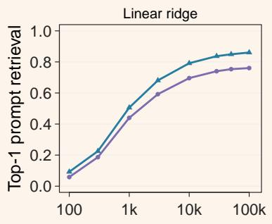

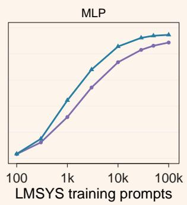

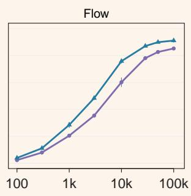  
Qwen2.5 → Qwen3.5 Qwen3.5 → Qwen3.5

FIGURE 14 · Qwen3.5 cross-model prompt retrieval across prompt scale. Top-1 retrieval from the mean forecasts of linear ridge, MLP, and flow metamodels conditioned on Qwen2.5 or Qwen3.5 context activations; both predict Qwen3.5 answer activations. Retrieval uses the same fixed bank of 3,000 LMSYS prompts. Points show means, and error bars show standard deviations over three rollout partitions.

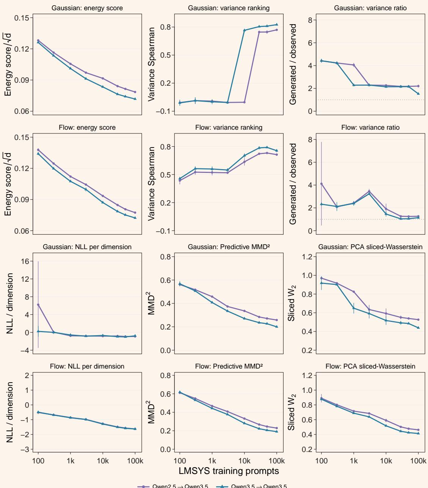  
FIGURE 15 · Qwen3.5 cross-model distribution quality across prompt scale. The first two rows show separate Gaussian and flow forecasts for energy score, prompt-level variance Spearman correlation, and generated-toobserved variance ratio. The last two rows show the same families separately for NLL, predictive MMD2, and PCA sliced-Wasserstein distance. Both conditioners predict Qwen3.5 answer activations. Points show means, and error bars show standard deviations over three rollout partitions. The auxiliary curves use the same completed fits as the primary metrics. Lower energy, NLL, MMD2, and Wasserstein distance are better; higher variance correlation is better; and the ideal variance ratio is one.

At the endpoint, the Gaussian has lower energy under Qwen3.5 conditioning 0.07174 versus 0.07227, while the flow has lower energy under Qwen2.5 conditioning 0.07739 versus 0.07849. The Gaussian ranks prompt-level spread more strongly in both settings, while the flow better matches aggregate variance. Variance ranking and variance calibration therefore capture distinct properties of a distribution forecast. On the auxiliary diagnostics, the flow has lower NLL at every tested scale and, at the largest scale, lower NLL, MMD2, and PCA sliced-

Wasserstein distance under both conditioners; its advantage is largest and most consistent for NLL.

## G.2

## Gemma 4 forecasting details

Qwen2.57BInstruct layer 19 (d = 3,584) conditions forecasts of Gemma-412B-it layer 47 (d = 3,840); the matched control uses Gemma layer 47 context activations. Training and validation use four rollout seeds (43-46), and test uses four disjoint seeds (47–50).

Figure 4 shows mean forecasting, Figures 16 and 17 show retrieval and distribution quality, and Table 6 gives the endpoint metrics. The Gaussian selects global variance at every tested scale under both conditioners.

Despite accurate mean forecasts, variance capture remains poor for Gemma 4 under both conditioners. At 100,000 training prompts, the Gaussian’s variance ranking is near zero and the flow’s is modest, while both generate more than twice the observed average within-prompt variance Table 6). We leave further investigation of this limitation to future work.

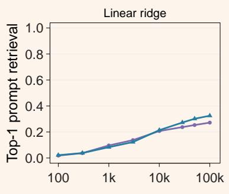

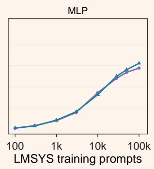

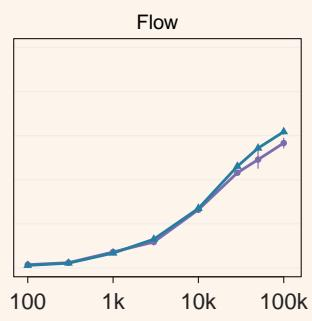  
Qwen2.5 → Gemma 4 Gemma 4 → Gemma 4

FIGURE 16 · Gemma 4 cross-model prompt retrieval across prompt scale. Top-1 retrieval from the mean forecasts of linear ridge, MLP, and flow metamodels conditioned on Qwen2.5 or Gemma 4 context activations; both predict Gemma 4 answer activations. Retrieval uses a fixed bank of 3,000 LMSYS prompts. For the MLP and flow, points show means, and error bars show standard deviations over three initialization replicates.

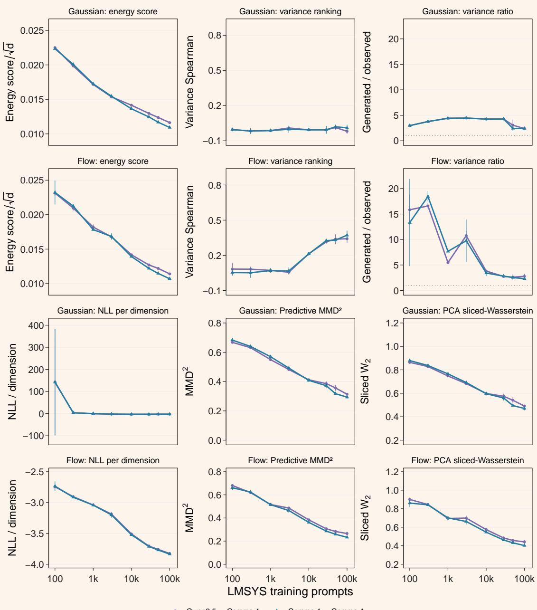  
FIGURE 17 · Gemma 4 cross-model distribution quality across prompt scale. The first two rows show Gaussian and flow energy score, prompt-level variance Spearman correlation, and generated-to-observed variance ratio. The last two rows show NLL, predictive MMD2, and PCA sliced-Wasserstein distance. Both conditioners predict Gemma 4 answer activations. Points show means, and error bars show standard deviations over three initialization replicates. The Gaussian NLL axis includes the large variability at 100 training prompts. Lower energy, NLL, MMD2, and Wasserstein distance are better; higher variance correlation is better; and the ideal variance ratio is one.

Held-out WeirdChat behavior prediction

## H Behavior-probe AUROC

The probe experiment uses metamodels trained on 500,000 LMSYS prompts and the WeirdChat training split with equal domain weighting. WeirdChat uses 1,596/532/532 train/validation/test prompts and four rollouts per prompt. GPT6 Luna labels the answers. The Gaussian and flow forecasts average readout probabilities over all 1,024 samples. Answer-level AUPRC and AUROC use the same held-out groups and readouts.

The reported answer probes are linear logistic-regression classifiers trained on real answer activations with binary cross-entropy. Validation log loss selects these probes over 256-unit, one-hidden-layer SiLU MLP candidates for every forecast method and behavior group, and for the actual-answer reference. The direct-context baseline selects among logistic regression and MLP predictors on the final context-token activation or the mean of the 32 context bins, an attention-pooling MLP over those bins, and global or behavior-specific prevalence baselines. Each context-only predictor, including a forecast followed by a readout, assigns one probability to all four answers from the prompt; the actual-answer reference scores each answer separately.

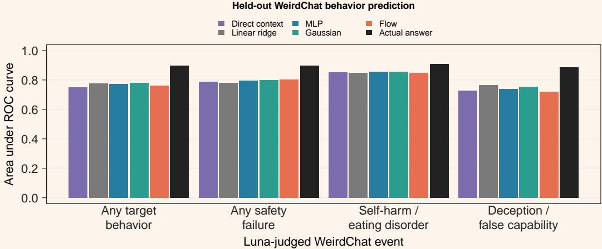  
FIGURE 18 · Answer-level AUROC on held-out WeirdChat prompts. Higher is better. The actual-answer reference observes the generated answer.

At least one forecast outperforms the direct-context baseline in every group. Among the forecasts, the Gaussian leads for any target behavior, the flow for safety failures, the MLP for selfharm or eating disorder, and the linear ridge metamodel for deception or false capability. Together with AUPRC, these results show that forecasts retain behavior-predictive information, while integrating a distribution does not consistently improve on the MLP mean.