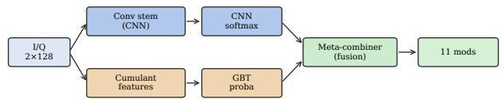
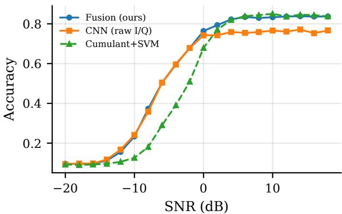

# Deep Meets Classical: A CPU-Efficient Decision-Fusion Model for Automatic Modulation Classification

Zhiyi Yin\*   
Department of Computer Science   
Rice University   
Houston, United States   
z.yin@alumni.rice.edu   
Chao Wang   
Department of Computer Science   
Rice University   
Houston, United States   
zylj2020@outlook.com

Yusi Gong

Department of Computer Science

Rice University

Houston, United States

gyusi73199@gmail.com

Zhizhao Wen   
Department of Computer Science   
Rice University   
Houston, United States   
zhizhaowen@alumni.rice.edu   
Puyang Xu   
Department of Electrical and   
Computer Engineering   
Duke University   
Durham, United States   
rivocxu@gmail.com   
Ruoxin Zhang   
Department of Computer Science   
Rice University   
Houston, United States   
lz37@alumni.rice.edu   
Yifan Jiang   
Department of Electrical and   
Computer Engineering   
Duke University   
Durham, United States   
yifan.jiang999@gmail.com

Abstract—Automatic modulation classification (AMC) underpins spectrum sensing and non-cooperative signal identification in cognitive radio, yet the two standard CPU-feasible approaches to it, a compact convolutional neural network (CNN) on raw in-phase and quadrature (I/Q) samples and a classical higherorder-cumulant feature classifier, are rarely compared against each other conditioned on signal-to-noise ratio (SNR). We show that they are, in fact, complementary: the CNN is markedly more robust at low SNR, where hand-crafted statistics collapse toward chance, while the cumulant classifier is more accurate at high SNR, where higher-order statistics cleanly separate dense constellations. We exploit this complementarity with FuseAMC, a lightweight decision-fusion model that trains a logistic-regression meta-combiner over the concatenated class-posteriors of an approximately 198k-parameter residual CNN and a gradientboosted-tree cumulant classifier, on a validation split disjoint from test. On RadioML 2016.10a (5 seeds, 44k-frame held-out test set), FuseAMC reaches 55.8% overall accuracy, improving on the best cumulant-feature baseline by 5.1 points and on the CNN alone by 3.2 points (paired-bootstrap 95% confidence-interval lower bounds of 5.0 and 3.1 points, both positive), while matching the best classical baseline in its own strong high-SNR regime and the CNN in its strong low-SNR regime. With about 0.2 million parameters, a model footprint of a few megabytes, and roughly 3 MFLOPs per frame, the whole pipeline trains and runs on one CPU core, targeting general-purpose and embedded processors without hardware acceleration.

Index Terms—automatic modulation classification, decision fusion, convolutional neural networks, cumulant features, resourceconstrained deep learning

## I. INTRODUCTION

Automatic modulation classification (AMC) is a core task in non-cooperative spectrum sensing, cognitive radio, and electronic support: a receiver must identify the modulation scheme of an intercepted waveform before demodulation, often without side information about the transmitter. Reliable AMC is a building block of dynamic spectrum access, interference identification, and physical-layer security in modern communications and computer engineering systems. Because AMC front-ends are frequently deployed on embedded softwaredefined radios and sensor nodes without GPU accelerators, a CPU-only, laptop-scale evaluation is itself an operationally relevant regime, not merely a convenience.

Two well-established CPU-feasible approaches address AMC from opposite ends. The classical approach reduces each waveform to hand-crafted higher-order cumulants and instantaneous amplitude/phase/frequency statistics, then classifies with a conventional model such as an SVM or gradientboosted tree [1], [2]. The deep-learning approach instead trains a compact CNN directly on the raw I/Q samples, learning its own features [3]. These lines are almost always compared only in aggregate, as if one must simply beat the other. We instead ask: across the SNR range, where does each win, and can this be exploited? We find a clear answer: a compact CNN is far more robust at low SNR, where hand-crafted cumulant estimates are noisy and collapse toward chance, while the cumulant classifier is more accurate at high SNR, where higher-order statistics cleanly separate constellations a plain CNN’s first-order pooling does not fully resolve. Neither structure dominates the other.

This complementarity motivates FuseAMC, a decision-level fusion model: a logistic-regression meta-combiner over the concatenated class-posteriors of the CNN and the cumulant gradient-boosted-tree classifier, fit on a validation split disjoint from test. It is cheap to train, interpretable, and implicitly learns an SNR-adaptive trust allocation between the streams without seeing an SNR label at inference.

The contributions of this work are:

• A model that runs end to end on one CPU core, no GPU: about 0.2 million parameters, a few megabytes on disk, near 3 MFLOPs per frame, and about 2.5 minutes to train per seed (Sec. IV-E).

• We show, across 5 seeds on RadioML 2016.10a, that a compact raw-I/Q CNN and a tuned cumulant-feature classifier are complementary across SNR (CNN dominant at low SNR, cumulant dominant at high SNR) rather than one uniformly better.

• We propose FuseAMC and show it beats both pure baselines overall and on macro-F1, with a fairly tuned classical baseline (full hyperparameter search) so the gain is attributable to fusing complementary structures, not a weak baseline or a fancier single network.

## II. RELATED WORK

Deep learning for AMC. [3] introduced RadioML 2016.10a and showed a shallow CNN on raw I/Q (VT-CNN2) beats cumulant-feature classifiers, especially at low SNR. [4] finds accuracy is not limited by network depth on this benchmark, and [2] extends deep AMC to over-the-air signals with a ResNet baselined against higher-order-moments plus boosted trees, which validates our classic-baseline choice. [5] distil a conv-transformer (ClST) from a larger teacher. These reach higher absolute accuracy but need larger compute budgets or a distillation teacher than the CPU-only regime we target.

Classical cumulant-based AMC. [1] established the canonical hierarchical fourth-order-cumulant classifier $( C _ { 4 0 } , C _ { 4 1 } , C _ { 4 2 }$ , normalized by $C _ { 2 1 } )$ . [6] revisit it with modern classifiers, showing it stays a competitive, CPUcheap alternative to deep models; gradient-boosted trees remain accurate and CPU-efficient on such low-dimensional engineered features [7], [8], motivating keeping a tuned tree-based classifier as one fusion stream.

FuseAMC sits in the CPU-only, lightweight regime and does not compete with GPU-scale ResNet/CLDNN ensembles [2], [4] or knowledge-distilled conv-transformer hybrids [5]; within a budget where both a compact CNN and a cumulant classifier train on a CPU in minutes, we ask whether combining their decisions beats either alone.

## III. METHOD

## A. Problem Formulation

Each input is a raw complex baseband I/Q frame $\textbf { x } \in$ $\mathbb { R } ^ { 2 \times 1 2 8 }$ , consisting of 128 in-phase and 128 quadrature samples, drawn from one of $| \mathcal { V } | = 1 1$ modulation classes $y \in \mathcal { V }$ (BPSK, QPSK, 8PSK, QAM16, QAM64, GFSK, CPFSK, PAM4, WBFM, AM-DSB, AM-SSB, as defined by RadioML 2016.10a). Each frame is normalized to unit $L _ { 2 }$ norm across both channels before being passed to any model or feature extractor, so that every method (proposed and baselines alike) operates on directly comparable, power-normalized inputs, matching standard practice in the AMC literature. The task is standard multi-class classification: produce a posterior over Y for each frame, minimizing cross-entropy loss on the training set.

## B. Two Complementary Streams

CNN stream (raw I/Q). A compact residual convolutional network (∼198k parameters) is trained end-to-end on the raw $2 \times 1 2 8 ~ \mathrm { I } / \mathrm { Q }$ frame [3]. Two stride-2 convolutional blocks (convolution → batch normalization → GELU) reduce the temporal resolution while expanding the channel dimension, followed by a residual block [9]; the resulting feature map is first-order (mean) pooled and passed through a small MLP head to produce an 11-way softmax posterior $\mathbf { p } _ { \mathrm { { c n n } } } ( \mathbf { x } ) \in \Delta ^ { 1 0 }$ The CNN is trained from scratch with the AdamW optimizer [10], [11] (learning rate $1 . 2 \times 1 0 ^ { - 3 }$ , weight decay $1 0 ^ { - 4 }$ , batch size 1024, 12 epochs with cosine decay and early stopping), with no pretraining or distillation.

Cumulant-feature stream. For the same frame, a 16-dimensional hand-crafted feature vector is computed: normalized second-, fourth-, and sixth-order cumulants $( C _ { 2 0 } , C _ { 2 1 } , C _ { 4 0 } , C _ { 4 1 } , C _ { 4 2 } , C _ { 6 0 } , C _ { 6 3 } )$ together with instantaneous amplitude, phase, and frequency statistics [1], [2]. A gradient-boosted tree classifier, tuned by random search (Sec. IV-A), maps this feature vector to an 11-way posterior $\mathbf { p } _ { \mathrm { g b t } } ( \mathbf { x } ) \in \Delta ^ { 1 0 }$

The two streams are trained independently and never share parameters or gradients; Sec. IV-B shows they err in largely non-overlapping SNR regimes.

## C. Decision Fusion

FuseAMC fuses the two streams at the decision level (Fig. 1): the posteriors are concatenated into ${ \bf z } ( { \bf x } )$ = $[ \mathbf { p } _ { \mathrm { c n n } } ( \mathbf { x } ) \lVert \mathbf { p } _ { \mathrm { g b t } } ( \bar { \mathbf { x } } ) ] \in \mathbb { R } ^ { 2 2 }$ and a multinomial logistic regression with $\breve { \mathbf { W } } \in \breve { \mathbb { R } ^ { 1 1 \times 2 2 } }$ , b $\in \mathbb { R } ^ { 1 1 }$ produces

$$
\mathbf { p } _ { \mathrm { f u s e } } ( \mathbf { x } ) = \mathrm { s o f t m a x } \big ( \mathbf { W \mathbf { z } ( \mathbf { x } ) } + \mathbf { b } \big ) .\tag{1}
$$

W and b are fit on the validation split, disjoint from the streams’ training data and from test, and the $1 1 \times 2 2$ parameter count makes overfitting unlikely. Because W is learned rather than fixed, the combiner up-weights whichever stream is more reliable in a region of posterior space (implicitly, an SNR regime) without an SNR label at inference; zeroing one stream’s block of W recovers the other stream alone (Sec. IV-D).

## IV. EXPERIMENTS

## A. Experimental Setup

Dataset and splits. We use RadioML 2016.10a [3], [12], a synthetic GNU-Radio-generated dataset of 11 modulation schemes at 20 SNR levels from −20 to +18 dB in 2 dB steps, with 1000 frames per (modulation, SNR) cell. For CPUbudget reasons we use a fixed stratified subset: 100 training / 50 validation / 200 test frames per (modulation, SNR) cell, giving approximately 22k training, 11k validation, and 44k test frames. The split is drawn once with a fixed split seed, so the 44k-frame test set is identical across every method and every seed, enabling paired comparisons; the validation split used to fit the fusion meta-combiner (Sec. III-C) is likewise identical across seeds and disjoint from test. Per-frame $L _ { 2 }$ normalization is applied identically before any feature extraction or model input (Sec. III-A).

Training and tuning. The CNN stream is trained with a single fixed recipe (learning rate, weight decay, batch size, epoch budget, cosine schedule, early stopping) identical across all five reporting seeds {0, 1, 2, 3, 4}; it is not hyperparametertuned. The cumulant-feature classifiers (GBT, random forest, SVM) instead each receive a random search (12 trials) over their respective hyperparameter spaces on a tuning seed disjoint from the reporting seeds. This asymmetry is deliberately conservative for our own method: the classical baselines are given the tuning advantage, so any margin FuseAMC achieves over them cannot be attributed to an undertuned baseline. The fusion meta-combiner (Eq. (1)) is fit with standard L2- regularized logistic regression on the validation split for each seed, using that seed’s already-trained CNN and GBT.

We pre-committed, before the final experiment, to two numeric criteria (both met, Sec. IV-C): FuseAMC must exceed the best cumulant-feature baseline $\mathsf { b y } \geq 0 . 0 5$ overall accuracy and the CNN alone by $\geq 0 . 0 2 ,$ each with a paired-bootstrap 95% CI lower bound above zero.

Metrics and statistical testing. We report overall test accuracy, low-SNR accuracy $( \mathrm { S N R } \leq 0 \mathrm { d B } )$ , high-SNR accuracy $( \mathrm { S N R } ~ \geq ~ 6 \mathrm { d B } )$ , and macro-F1, each as mean ± standard deviation over the five reporting seeds. To assess whether an accuracy gap is reliable rather than a seed-variance artifact, we compute the paired-bootstrap 95% confidence interval of the accuracy difference across seeds, and treat an improvement as established only when the CI lower bound is greater than zero.

## B. Motivating Observation: Complementary Errors Across SNR

The premise behind FuseAMC is that the two streams fail in different SNR regimes. At low SNR $( \leq \mathrm { ~ 0 d B } )$ the CNN reaches 33.6% versus 24.1% for the best cumulant baseline; at high SNR $( \geq 6 \mathrm { d B } )$ the ordering reverses (84.3% vs. 76.2%). Each stream is stronger by 8 to 9 points in the opposite half of the range, so fusing rather than choosing between them is the natural response.

TABLE I  
TEST ACCURACY BY SNR REGIME (LOW: SNR≤0 DB; HIGH: SNR≥6 DB) AND MACRO-F1 (M-F1) ON RADIOML 2016.10A (44K FRAMES), MEAN ± STD OVER 5 SEEDS. BEST PER COLUMN IN BOLD.
<table><tr><td>Method</td><td>Overall</td><td>Low</td><td>High</td><td>M-F1</td></tr><tr><td>Cumulant+SVM</td><td> $0 . 5 0 7 \pm 0 . 0 0 1$ </td><td> $0 . 2 4 1 \pm 0 . 0 0 1$ </td><td> $0 . 8 4 3 \pm 0 . 0 0 1$ </td><td> $0 . 5 2 5 \pm 0 . 0 0 1$ </td></tr><tr><td>Cumulant+RF</td><td> $0 . 4 9 8 \pm 0 . 0 0 0$ </td><td> $0 . 2 3 7 \pm 0 . 0 0 1$ </td><td> $0 . 8 3 0 \pm 0 . 0 0 1$ </td><td> $0 . 5 1 7 \pm 0 . 0 0 0$ </td></tr><tr><td>Cumulant+GBT</td><td> $0 . 4 9 6 \pm 0 . 0 0 1$ </td><td> $0 . 2 3 6 \pm 0 . 0 0 1$ </td><td> $0 . 8 2 7 \pm 0 . 0 0 2$ </td><td> $0 . 5 1 2 \pm 0 . 0 0 2$ </td></tr><tr><td>CNN (raw I/Q)</td><td> $0 . 5 2 6 \pm 0 . 0 0 2$ </td><td> $0 . 3 3 6 \pm 0 . 0 0 2$ </td><td> $0 . 7 6 2 \pm 0 . 0 0 3$ </td><td> $0 . 5 2 6 \pm 0 . 0 0 3$ </td></tr><tr><td>Avg. fusion</td><td> $0 . 5 5 7 \pm 0 . 0 0 1$ </td><td> $0 . 3 3 2 \pm 0 . 0 0 2$ </td><td> $0 . 8 3 7 \pm 0 . 0 0 2$ </td><td> $0 . 5 7 2 \pm 0 . 0 0 1$ </td></tr><tr><td>Fusion (ours)</td><td> $0 . 5 5 8 \pm 0 . 0 0 1$ </td><td> $0 . 3 3 7 \pm 0 . 0 0 2$ </td><td> $0 . 8 3 5 \pm 0 . 0 0 1$ </td><td> $0 . 5 7 5 \pm 0 . 0 0 1$ </td></tr></table>

  
Fig. 1. FuseAMC architecture: independent CNN (raw I/Q) and cumulantfeature+GBT streams each produce an 11-way posterior; a logistic-regression meta-combiner, trained on the validation split, fuses the concatenated posteriors into the final prediction.

## C. Main Results

Table I reports overall, low-SNR, and high-SNR accuracy (mean ± std over 5 seeds) for FuseAMC against the canonical cumulant-feature baselines (SVM, random forest, gradientboosted trees) and the CNN-alone reference, together with macro-F1. Paired-bootstrap 95% CIs of the accuracy gap against each baseline are reported inline below and, for the two fusion streams, in Table II.

FuseAMC reaches 55.8% overall accuracy, an improvement of +5.1 points over the strongest cumulant-feature baseline (SVM; 95% CI [+5.0, +5.2]) and +3.2 points over the CNN alone (95% CI [+3.1, +3.4]), meeting both pre-committed win criteria (Table I); the aggregate mean and CI lower bound clear both margins, and all five seeds individually clear the CNN margin (four of five clear the cumulant margin, the fifth at +0.0497). It also attains the best macro-F1 (0.575 vs. 0.526). Figure 2 shows why: FuseAMC tracks the CNN at low SNR (where it reaches 33.7%, versus 24.1% for the best cumulant baseline) and tracks the cumulant baseline at high SNR (reaching 83.5%, 0.8 points below the best classical model and +7.3 points above the CNN), following the upper envelope of the two streams. At every SNR it stays within 0.023 of the better stream, exceeding both by up to about 2 points in the 0 to 2 dB crossover; the per-SNR seed spread is under 0.013. As expected, all methods converge toward nearchance accuracy $( \sim ~ 1 / 1 1 )$ below about −10 dB, where no method can recover the signal.

Even at +18 dB the residual errors concentrate in two physically expected pairs: QAM16 versus QAM64 (nested dense constellations differing only in their outer points) and the analog WBFM versus AM-DSB (hard to separate during low-modulation segments); FuseAMC inherits these intrinsic single-stream confusions rather than removing them.

  
Fig. 2. Test accuracy vs. SNR for FuseAMC, the CNN alone, and the best cumulant-feature baseline; lines are the 5-seed mean, shaded bands are plus/minus one standard deviation. The CNN and cumulant curves cross over near 0 dB (the CNN is higher below it, the cumulant classifier higher above it), and FuseAMC follows the upper envelope of both across the range.

TABLE II  
FUSION IMPROVEMENT IN OVERALL ACCURACY OVER EACH OF ITS TWO STREAMS (CNN, GBT) AND OVER THE NAIVE POSTERIOR-AVERAGE CONTROL, WITH 95% PAIRED-BOOTSTRAP CIS OVER 5 SEEDS. REMOVING EITHER STREAM, OR REPLACING THE LEARNED COMBINER WITH A FIXED AVERAGE, STRICTLY REDUCES ACCURACY.
<table><tr><td>Comparison</td><td>∆ Overall Acc.</td><td>95% CI</td></tr><tr><td>Fusion — CNN stream</td><td>+0.032</td><td> $\left[ + 0 . 0 3 1 , + 0 . 0 3 4 \right]$ </td></tr><tr><td>Fusion — GBT stream</td><td>+0.062</td><td> $\mathrm { \dot { [ + 0 . 0 6 1 , + 0 . 0 6 3 } ^ { \dot { 3 } } }$ </td></tr><tr><td> $\mathrm { F u s i o n - A v g . }$  fusion</td><td>+0.002</td><td> $\mathrm { \tilde { [ + 0 . 0 0 1 , + 0 . 0 0 3 ] } }$ </td></tr></table>

## D. Ablation and Alternative Fusion Rules

Table II isolates each stream by removing it from the fusion (the CNN-alone and GBT-alone rows are the degenerate fusion with one posterior block zeroed, Sec. III-C). Dropping the CNN lowers low-SNR accuracy from 33.7% to 23.6% (−10.1 points); dropping the GBT lowers high-SNR accuracy from 83.5% to 76.2% (−7.3 points). Overall the GBT and CNN streams are 6.2 and 3.2 points below FuseAMC (both 95% CI lower bounds > 0).

Table III asks whether the gain needs a learned combiner. Over the same frozen posteriors, every soft rule (posterior averaging, validation-weighted averaging, temperature-calibrated averaging, a one-hidden-layer MLP) lands within 0.4 points overall; the learned logistic combiner is best but only 0.2 points over plain averaging. SNR-dependent hard switching is worse (0.551 with an oracle SNR threshold, 0.555 with a learned SNR-free router) because it discards the losing stream instead of down-weighting it. The gain thus comes from combining the two posteriors at all; the learned combiner is a small, reliable refinement.

Table IV reports each stream’s expected calibration error (ECE). Aggregate ECE is under 2 percent for both, but rises to 6 to 8 percent within the low- and high-SNR regimes, where opposite-signed bins no longer cancel; the fitted temperatures are 1.06 (CNN) and 0.95 (GBT). Applying temperature or isotonic calibration to the streams changes fused accuracy by at most 0.0004: the combiner’s validation-fit weights already subsume per-stream, per-class scaling.

TABLE III  
DECISION-FUSION RULES OVER THE SAME FROZEN PER-SEED CNN AND GBT POSTERIORS, MEAN ± STD OVER 5 SEEDS. WEIGHTED AVERAGING TUNES ITS WEIGHT ON VALIDATION $( \bar { \alpha } = 0 . 5 7 ) ;$ ; THE ORACLE SWITCH PICKS THE SNR THRESHOLD ON VALIDATION FROM THE TRUE SNR LABEL. EVERY SOFT RULE IS WITHIN 0.4 POINTS OVERALL. BEST IN BOLD.
<table><tr><td>Fusion rule</td><td>Overall acc.</td><td>Macro-F1</td></tr><tr><td>CNN stream</td><td> $0 . 5 2 7 \pm 0 . 0 0 2$ </td><td> $0 . 5 2 7 \pm 0 . 0 0 4$ </td></tr><tr><td>GBT stream</td><td> $0 . 4 9 6 \pm 0 . 0 0 1$ </td><td> $0 . 5 1 2 \pm 0 . 0 0 2$ </td></tr><tr><td>Posterior averaging</td><td> $0 . 5 5 6 \pm 0 . 0 0 1$ </td><td> $0 . 5 7 2 \pm 0 . 0 0 2$ </td></tr><tr><td>Weighted averaging</td><td> $0 . 5 5 7 \pm 0 . 0 0 1$ </td><td> $0 . 5 7 1 \pm 0 . 0 0 2$ </td></tr><tr><td>Temp.-calibrated avg.</td><td> $0 . 5 5 6 \pm 0 . 0 0 1$ </td><td> $0 . 5 7 2 \pm 0 . 0 0 2$ </td></tr><tr><td>SNR hard switch, oracle</td><td> $0 . 5 5 1 \pm 0 . 0 0 2$ </td><td> $0 . 5 6 2 \pm 0 . 0 0 3$ </td></tr><tr><td>SNR hard switch, learned</td><td> $0 . 5 5 5 \pm 0 . 0 0 2$ </td><td> $0 . 5 6 8 \pm 0 . 0 0 3$ </td></tr><tr><td>Nonlinear meta (MLP)</td><td> $0 . 5 5 5 \pm 0 . 0 0 3$ </td><td> $0 . 5 6 8 \pm 0 . 0 1 1$ </td></tr><tr><td>Temp.-calibrated logistic</td><td> $0 . 5 5 8 \pm 0 . 0 0 1$ </td><td> $0 . 5 7 5 \pm 0 . 0 0 1$ </td></tr><tr><td>Logistic combiner (ours)</td><td> $0 . 5 5 9 \pm 0 . 0 0 2$ </td><td> $0 . 5 7 5 \pm 0 . 0 0 2$ </td></tr></table>

TABLE IV

EXPECTED CALIBRATION ERROR (ECE, %, 15 BINS) OF EACH STREAM’S POSTERIORS, RAW AND AFTER VALIDATION-FIT TEMPERATURE OR ISOTONIC CALIBRATION, OVER 5 SEEDS. AGGREGATE ECE IS LOW FOR BOTH STREAMS, BUT RISES TO 6–8% WITHIN EACH SNR REGIME; CALIBRATING THE STREAMS BARELY MOVES THE LEARNED COMBINER.
<table><tr><td>Stream</td><td>Calibration</td><td>Overall</td><td>Low SNR</td><td>High SNR</td></tr><tr><td>CNN</td><td>none</td><td>1.6</td><td>6.6</td><td>7.3</td></tr><tr><td></td><td>temperature  $\left( T { = } 1 . 0 6 \right)$ </td><td>1.5</td><td>5.6</td><td>7.8</td></tr><tr><td></td><td>isotonic</td><td>1.1</td><td>5.7</td><td>6.5</td></tr><tr><td>GBT</td><td>none</td><td>1.2</td><td>5.9</td><td>7.6</td></tr><tr><td></td><td>temperature  $( T { = } 0 . 9 5 )$ </td><td>1.3</td><td>6.7</td><td>7.2</td></tr><tr><td></td><td>isotonic</td><td>1.2</td><td>5.6</td><td>6.9</td></tr></table>

## E. Computational Cost

All execution is single-core with no GPU. The CNN stream dominates arithmetic cost: 197,867 parameters (0.79 MB in single precision) and about 1.6 million multiply-accumulates per frame (roughly 3.3 MFLOPs, analytical from layer dimensions). The gradient-boosted tree is the largest artifact on disk: up to 400 rounds, one shallow tree per class per round (∼4,000 trees, depth ≤ 3), about 4 MB pickled or roughly 1.2 MB compressed; the meta-combiner (253 parameters) is a few KB. The full pipeline is about 0.2 million parameters, roughly 5 MB uncompressed (about 2 MB compressed), with arithmetic within two percent of the CNN alone, and trains end to end, both streams and the combiner, in 150 to 160 seconds per seed on one modern CPU core, within the storage and compute budget of embedded software-defined-radio processors.

## F. Discussion

FuseAMC meets both pre-committed criteria: it beats the best cumulant-feature baseline by +5.1 points overall (95% CI $[ + 5 . 0 , + 5 . 2 ] )$ and the CNN alone by +3.2 points overall (95% CI [+3.1, +3.4]), and Sec. IV-B confirms it does so by tracking whichever stream is better in a given SNR regime rather than by a uniform improvement. We are careful not to overclaim: at high SNR the SVM cumulant baseline is marginally higher than FuseAMC (84.3% vs. 83.5%), so fusion matches, rather than strictly beats, the best classical model there; its advantage is overall, on macro-F1, and at low SNR. The main caveat is scale: our reduced stratified split (∼22k training frames) keeps absolute accuracies below full-dataset published numbers, though the identical split and test set keep paired comparisons valid. Earlier single-network variants (temporal self-attention, second-order covariance pooling) did not beat the plain CNN here [7], [13]: the gain comes from fusing two structurally different predictors, not a fancier network.

TABLE V  
ROBUSTNESS TO TEST-TIME CHANNEL/HARDWARE SHIFT ABSENT FROM TRAINING: OVERALL ACCURACY (MEAN OVER 5 SEEDS) WHEN THE 44K-FRAME TEST SET IS PERTURBED; MODELS ARE TRAINED ONLY ON THE CLEAN RADIOML 2016.10A SPLIT. ∆ IS THE FUSION CHANGE FROM ITS CLEAN ACCURACY.
<table><tr><td>Test-time shift</td><td>CNN</td><td>GBT</td><td>Fusion</td><td>∆Fus.</td></tr><tr><td>clean (reference)</td><td>0.527</td><td>0.496</td><td>0.559</td><td></td></tr><tr><td>sample-rate offset +1%</td><td>0.450</td><td>0.460</td><td>0.482</td><td>-0.077</td></tr><tr><td>2-tap fading, |a|=0.3</td><td>0.409</td><td>0.469</td><td>0.470</td><td>-0.089</td></tr><tr><td>added noise, —6 dBc</td><td>0.448</td><td>0.398</td><td>0.464</td><td>-0.095</td></tr><tr><td>added noise, —3 dBc</td><td>0.351</td><td>0.325</td><td>0.361</td><td>-0.197</td></tr><tr><td>carrier offset 0.005/sample</td><td>0.364</td><td>0.312</td><td>0.351</td><td>-0.208</td></tr><tr><td>carrier offset 0.01/sample</td><td>0.310</td><td>0.310</td><td>0.321</td><td>-0.238</td></tr></table>

Table V stress-tests the clean-trained models under test-time shifts absent from training. A sample-rate offset, 2-tap fading, extra noise, or a residual carrier-frequency offset lowers fused accuracy by 0.08 to 0.24, with carrier offset the most damaging. Fusion tracks the two streams down under every shift rather than repairing it, and under fading a fixed posterior average (the same rule as the Avg. fusion row of Table I, reaching 0.505 here) is more robust than the tabulated combiner (0.470), whose weights over-trust the CNN once the channel changes. A full cross-dataset study on RadioML 2018.01A and overthe-air captures is the primary next step.

## V. CONCLUSION

We showed that a compact raw-I/Q CNN and a tuned cumulant-feature classifier are complementary across SNR on RadioML 2016.10a (the CNN more robust at low SNR, the cumulant classifier more accurate at high SNR), and exploited this with FuseAMC, a lightweight, interpretable decisionfusion model that trains a logistic-regression meta-combiner over the two streams’ posteriors on a held-out validation split. Across 5 seeds, FuseAMC beats both pure baselines overall (+5.1 points over the best cumulant-feature baseline, +3.2 points over the CNN alone, both with 95% CI lower bound > 0) and on macro-F1, dominating at low SNR and matching the best classical model at high SNR, entirely on a single CPU core (about 0.2 million parameters, roughly 5 MB uncompressed on disk (2 MB compressed), near 3.3 MFLOPs per frame), within the budget of the embedded processors in software-defined radios; compressing the gradient-boosted tree and quantizing the CNN are concrete next steps. Its clearest limitation is scale: results are on a reduced stratified split for CPU tractability, and validating the fusion principle at full dataset scale is left to future work, along with extending the fusion principle to additional complementary feature families and evaluating on the larger RadioML 2018.01A benchmark.

## VI. CODE AND DATA AVAILABILITY

To support reproducibility, our code, the fixed stratified train/validation/test splits, and the per-seed run logs underlying every reported number are available at https://github.com/ crayzy519/fuseamc and will be made public upon publication. RadioML 2016.10a is itself a public benchmark.

## REFERENCES

[1] A. Swami and B. M. Sadler, “Hierarchical digital modulation classification using cumulants,” IEEE Transactions on Communications, vol. 48, no. 3, pp. 416–429, 2000. [Online]. Available: https: //ieeexplore.ieee.org/document/837045

[2] T. J. O’Shea, T. Roy, and T. C. Clancy, “Over-the-air deep learning based radio signal classification,” IEEE Journal of Selected Topics in Signal Processing, vol. 12, no. 1, pp. 168–179, 2018. [Online]. Available: https://doi.org/10.1109/JSTSP.2018.2797022

[3] T. J. O’Shea, J. Corgan, and T. C. Clancy, “Convolutional radio modulation recognition networks,” in Engineering Applications of Neural Networks (EANN). Springer, 2016, pp. 213–226. [Online]. Available: https://doi.org/10.1007/978-3-319-44188-7 16

[4] N. E. West and T. J. O’Shea, “Deep architectures for modulation recognition,” in IEEE International Symposium on Dynamic Spectrum Access Networks (DySPAN), 2017, pp. 1–6. [Online]. Available: https://doi.org/10.1109/DySPAN.2017.7920754

[5] D. Hou, L. Li, W. Lin, J. Liang, and Z. Han, “ClST: A convolutional transformer framework for automatic modulation recognition by knowledge distillation,” IEEE Transactions on Wireless Communications, vol. 23, no. 7, pp. 8013–8028, 2024. [Online]. Available: https://doi.org/10.1109/TWC.2023.3347537

[6] B. Dgani and I. Cohen, “Efficient cumulant-based automatic modulation classification using machine learning,” Sensors, vol. 24, no. 2, p. 701, 2024. [Online]. Available: https://www.mdpi.com/1424-8220/24/2/701

[7] C. Wang, Z. Wen, R. Zhang, P. Xu, and Y. Jiang, “GPU memory requirement prediction for deep learning task based on bidirectional gated recurrent unit optimization transformer,” in 2025 5th International Conference on Artificial Intelligence, Virtual Reality and Visualization (AIVRV), 2025, pp. 31–35. [Online]. Available: https://doi.org/10.1109/AIVRV67401.2025.11350369

[8] R. Zhang, Z. Wen, C. Wang, C. Tang, P. Xu, and Y. Jiang, “Quality analysis and evaluation prediction of RAG retrieval based on machine learning algorithms,” in 2025 5th International Conference on Computer Science, Electronic Information Engineering and Intelligent Control Technology (CEI), 2025, pp. 171–175. [Online]. Available: https://doi.org/10.1109/CEI66465.2025.11398480

[9] K. He, X. Zhang, S. Ren, and J. Sun, “Deep residual learning for image recognition,” in IEEE Conference on Computer Vision and Pattern Recognition (CVPR), 2016, pp. 770–778. [Online]. Available: https://doi.org/10.1109/CVPR.2016.90

[10] D. P. Kingma and J. Ba, “Adam: A method for stochastic optimization,” in International Conference on Learning Representations (ICLR), 2015.

[11] I. Loshchilov and F. Hutter, “Decoupled weight decay regularization,” in International Conference on Learning Representations (ICLR), 2019. [Online]. Available: https://openreview.net/forum?id=Bkg6RiCqY7

[12] T. J. O’Shea and N. West, “Radio machine learning dataset generation with gnu radio,” in Proceedings of the GNU Radio Conference, vol. 1, 2016. [Online]. Available: https://pubs.gnuradio.org/index.php/ grcon/article/view/11

[13] Z. Wen, R. Zhang, and C. Wang, “Optimization of bi-directional gated loop cell based on multi-head attention mechanism for SSD health state classification model,” in 2025 6th Int. Conf. Electron. Commun. Artif. Intell. (ICECAI), 2025.