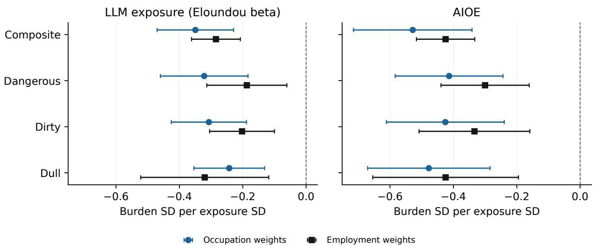
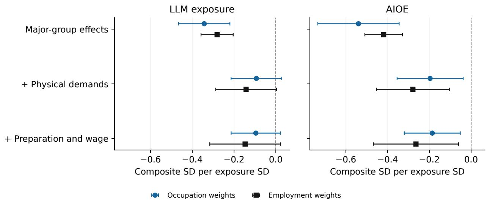
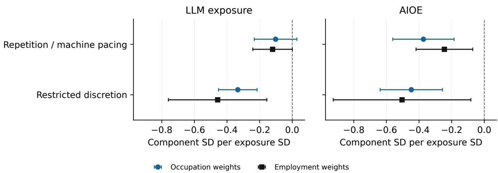

# Dull, Dirty, Dangerous? Working Conditions and the Limits of Occupational AI Exposure

Siyi Yu Department of Marketing, Daniels School of Business Purdue University yu1344@purdue.edu

## Abstract

Automation is often justified as relief from dull, dirty, and dangerous work. I examine how these conditions relate to occupational AI exposure using 21 O\*NET items across 754 US occupations. Higher exposure is associated with lower condition scores under a large language model (LLM) measure and AI Occupational Exposure (AIOE), with equal occupation weights and employment weights. Adjustment for physical demands, required education, training and experience, and wages reduces the composite association. The adjusted confidence intervals include zero for LLM exposure and remain below zero for AIOE. Separating repetition from restricted discretion also changes what the combined Dull score conveys. These comparisons show how item groupings and occupational characteristics shape the interpretation of exposure estimates. Occupational profiles ofer a starting point for selecting contrasting research settings. Establishing desired automation or realized relief requires evidence about workers’ preferences and specific interventions.

CCS Concepts:

Human-centered computing → Human computer interaction (HCI) Human-centered computing → Empirical studies in collaborative and social computing

Keywords: future of work, occupational working conditions, artificial intelligence, measurement, worker agency, automation

## 1 Introduction

Promises to relieve dull, dirty, and dangerous work give automation a compelling purpose. For HCI researchers, however, that purpose raises a concrete design question: which part of a working day would a proposed system improve? A tool might shorten a task while leaving noise, hazardous equipment, or restrictions on decision-making unchanged. To evaluate a claim of relief, researchers need to connect the system’s operation to the condition it is intended to change. Occupational AI exposure scores describe technical potential across jobs, but they do not make that connection on their own.

The distinction matters at two stages of research. When selecting a setting, researchers need to understand the conditions associated with an occupation rather than infer them from its exposure score. When evaluating a system, they need to establish whether the proposed change addresses a condition workers want changed. Critical HCI and HRI research has already challenged the assumption that technical automation necessarily improves work [19, 22, 24]. Studies of assembly workers, desired AI delegation, and meaningful work likewise show why workers’ assessments belong in that evaluation [23, 25, 31]. The question here concerns the occupational evidence that can inform the first stage.

I examine how selected physical and organizational working conditions are distributed across occupations relative to two published AI exposure measures. O\*NET Work Context provides ratings of occupational hazards, environments, repetitive activity, and discretion. These ratings permit comparisons across occupations, including settings outside the computer-assisted tasks emphasized in some recent HCI research. Their breadth comes at a cost: an occupational average cannot describe every workplace or distinguish the conditions diferent workers value, tolerate, or want changed. I therefore use the ratings to describe working conditions, reserving questions of desirability for evidence about workers’ own judgments.

Existing research already relates AI exposure to job quality and working conditions. Parteka et al. [20] compare working conditions across occupations exposed to AI, software, and robots. Pizzinelli et al. [21] combine O\*NET work contexts and occupational preparation with AIOE to examine potential complementarity. Giuntella et al. [13] examine AI exposure alongside wellbeing and physical job intensity in German longitudinal data. These studies make the broad connection between AI and conditions at work an established research topic. The contribution of another occupational comparison depends on what its measures reveal and how its conclusions change under plausible alternative specifications.

My analysis focuses on those choices. I organize 21 Work Context items into domains associated with the Dull, Dirty, and Dangerous (DDD) formulation and link them to LLM exposure [9] and AI Occupational Exposure (AIOE) [10]. Several selected items describe physical work settings, whereas contemporary AI exposure is substantial in cognitive work. A negative association between the condition scores and AI exposure may therefore reflect familiar diferences in occupational task content. I examine how that association changes after accounting for physical demands, occupationa preparation—the education, training, and experience a job requires—and wages.

The Dull domain raises a second question about interpretation. Repeating movements or working at a machine’s pace difers from having little authority to determine tasks and priorities. Combining these conditions may be convenient for summarizing occupations, but it can obscure which condition is associated with AI exposure. I report the composite and compare its results with a separate analysis of repetition and machine pacing, and restricted discretion. The analysis addresses two research questions:

• RQ1: How do the selected working conditions relate to LLM exposure and AIOE under equal occupation weights and employment weights?

• RQ2: How do these associations change when occupational characteristics are included in the models and when the condition index is constructed diferently?

The primary models associate higher AI exposure with lower scores in every domain and in the composite. Adjustment substantially reduces the composite association: the fully adjusted LLM intervals include zero, while the AIOE intervals remain below zero. Within Dull, the LLM estimates are more negative for restricted discretion than for repetition and machine pacing, although I do not test the diference between those coeficients. These findings distinguish the direction of an aggregate association from the information its components and adjusted models provide.

The paper contributes a comparison of working-condition and AI exposure measures, together with evidence about how their interpretation depends on item grouping and occupational characteristics. It also describes occupational profiles that keep separate condition scores. A worked comparison shows how occupations can enter the same high-score, low-exposure group through diferent domains. Such profiles can help researchers formulate questions for contrasting settings; their usefulness for recruitment or design has not been evaluated here. All analyses are observational, and the adjustment and decomposition analyses are exploratory. This account keeps the occupational patterns separate from the further evidence needed to establish desired automation or relief.

## 2 Related Work

## 2.1 AI exposure and conditions at work

Task-based studies of technological change distinguish cognitive from manual work and routine from nonroutine tasks [2]. These distinctions help explain why diferent technologies reach diferent occupations. They also provide a reference point for interpreting an association between AI exposure and working conditions: a new condition index may partly summarize task diferences that existing occupational classifications already capture. O\*NET-based teleworkability research illustrates this overlap. Outdoor work, protective equipment, and other physical or on-site requirements help distinguish jobs that can be performed at home [8]. Those features also appear in the condition items examined here.

The two primary exposure measures describe diferent forms of technical potential. The LLM measure assesses whether a language model, used alone or with additional software, could reduce the time needed for occupational tasks [9]. AIOE relates AI applications to the abilities required in an occupation [10]. Neither measure observes deployment or job loss. Both use O\*NET information, so their agreement cannot be treated as agreement between wholly independent sources. Comparing them nevertheless reveals whether a condition association persists across their diferent technological scopes and constructions.

Close labor research already connects these questions to working conditions. Table 1 summarizes the closest comparisons. Pizzinelli et al. [21] use O\*NET work contexts and Job Zones to characterize potential complementarity alongside AIOE. Their question concerns circumstances under which

AI may complement or substitute for labor. My index instead summarizes selected hazards, environmental conditions, repetition, and restricted discretion. Thus the distinction rests on the constructs and comparisons being examined, rather than on combining O\*NET conditions with AI exposure for the first time.

Parteka et al. [20] compare AI, software, and robot exposure in relation to multidimensional working conditions in Europe. Their results place relatively favorable conditions in AI-exposed occupations within a broader comparison of technologies. Giuntella et al. [13] study wellbeing, health, and physical job intensity using German longitudinal data. My cross-sectional US linkage does not estimate changes in those outcomes. It examines how associations with selected condition scores depend on the exposure measure, physical demands and other occupational characteristics, and the grouping of repetition with restricted discretion. This narrower comparison complements research on job quality and worker outcomes without substituting for it.

## 2.2 Worker preferences, meaning, and control

Occupational conditions and workers’ judgments answer diferent questions. Takayama et al. [28] related public judgments of robot suitability to O\*NET occupations, establishing an early occupation-wide comparison. Public judgments, however, difer from the preferences of people doing the work. Welfare et al. [31] found that assembly workers valued aspects of physical and social work while seeking relief from safety problems and rushing. Shao et al. [25] compare workers’ desired AI delegation with assessed agent capabilities and desired human agency. These studies supply direct evidence about valued work and desired assistance that occupational condition scores cannot provide.

Ranjit et al. [23] bring worker valuation and AI exposure particularly close together. They compare meaningful work and busywork with exposure using human task ratings and ratings scaled with language models, concentrating on computer-assisted tasks. My analysis focuses on physical environments, hazards, repetition, and discretion across occupations. The studies consequently describe diferent parts of the work experience. A physically demanding activity can be meaningful; an activity with high technical exposure can still be one that a worker wishes to retain. Neither meaningfulness nor a condition score alone establishes an overall judgment about a job.

Worker-centered HCI also examines who decides what changes. Riek and Irani [24] identify automation arguments that can disempower workers, including assumptions about the desirability of their jobs. Labor process theory directs attention to managerial control, consent, resistance, and value production [22]. These perspectives explain why a faster task does not necessarily give workers more time or autonomy. They motivate keeping a technical exposure estimate separate from the organizational arrangement in which a system would be used.

Deployment can also create work outside the task being automated. Studies of AI integration in essential work describe calibration, troubleshooting, and repair [11]. Participatory research in hospitality identifies worker-generated changes to algorithmic room assignment concerning workload and control [26]. Low LLM exposure or AIOE therefore does not describe the full technological environment of an occupation. Algorithmic management, robotics, and other forms of automation may matter even where the capabilities represented by these particular indices have limited reach.

## 2.3 What DDD-related condition scores represent

The DDD formulation brings together conditions with diferent meanings. Nakajima et al. [19] examine its use in robotics and argue for interpretation grounded in work settings and workers’ sense-making. Physical contamination difers from social or moral taint; repetitive motion difers from experienced boredom. I use DDD as an organizing vocabulary for selected items, rather than assume that the label identifies a single trait or a complete taxonomy of burdensome work.

Research on dirty work makes the distinction between conditions and valuation explicit. Occupational stigma can coexist with positive identity [1], and workers in physically dirty jobs can report satisfaction and self-worth [6]. Work-design research likewise treats decision latitude as more than an aspect of dullness [16]. Demands and resources can have diferent relationships with exhaustion and disengagement [7]. A score that combines repetition with restricted discretion should therefore make that combination visible instead of letting the domain name imply a shared subjective experience.

The condition index covers only part of job quality. Broader frameworks include earnings, security, and the working environment [5]; the selected items omit many psychosocial aspects of the last category. I keep wages outside the index to distinguish conditions from compensation. A high score describes more of the selected conditions as coded, not how a worker weighs those conditions against pay, meaning, security, or other features of a job.

This interpretation also determines the role of measurement checks. The index is a contentdefined summary: its meaning comes from the selected items and their weights. It is not treated as a reflective scale in which a single underlying trait causes every item response [3, 15, 27]. Correlations and internal-consistency coeficients describe how the items vary together, but they cannot establish whether important conditions have been omitted. The item definitions and sensitivity comparisons are therefore central to interpreting the results.

## 3 Data and Method

## 3.1 Data sources and unit of analysis

The unit of analysis is a six-digit US Standard Occupational Classification (SOC) occupation. I linked O\*NET 31.0 Work Context ratings and Job Zones to the published AI exposure measures and public Bureau of Labor Statistics (BLS) data. The main analyses use employment and wages information from the Occupational Employment and Wage Statistics (OEWS) program. Supplementary analyses use workforce composition from the Current Population Survey (CPS), fatality counts from the Census of Fatal Occupational Injuries (CFOI), and a hybrid exposure measure. Table 2 gives the source versions and observation periods.

Table 1: Closest empirical comparisons. Diferences in constructs and research questions define the present study’s scope.
<table><tr><td>Study</td><td>Evidence and question</td><td>Relation to this study</td></tr><tr><td>Pizzinelli et al. [21]</td><td>O*NET contexts, Job Zones, and AIOE; potential complementarity</td><td>Shares occupational inputs; measures complementarity rather than the selected</td></tr><tr><td>Parteka et al. [20]</td><td>Technology exposure and multidimensional working conditions in Europe</td><td>condition burdens. Establishes a close precedent for the broad condition-exposure</td></tr><tr><td>Giuntella et al. [13]</td><td>German longitudinal data; AI exposure, wellbeing, health, and physical job intensity</td><td>Examines worker outcomes over time; the present linkage compares</td></tr><tr><td>Ranjit et al. [23]</td><td>Task-level meaning, busywork, and AI exposure</td><td>occupational scores. Examines valuation of computer-assisted tasks; this study examines physical and</td></tr><tr><td>Shao et al. [25], Welfare et al. [31] Workers&#x27; valued activities</td><td>and desired assistance or delegation</td><td>organizational conditions. Provides preference evidence beyond the scope of occupational condition</td></tr><tr><td>Present study</td><td>Selected condition scores, two AI exposure measures, and specification</td><td>ratings. Examines adjustment, item grouping, and the interpretation of</td></tr></table>

## 3.2 Occupational linkage and samples

I retained Work Context ratings on the source’s CX scale unless they were flagged “Recommend Suppress = Y.” These ratings use item-specific response categories, described below. I averaged ratings across detailed O\*NET occupations sharing a six-digit SOC code. Detailed specialties received equal weight because corresponding employment weights were unavailable. O\*NET contributed 911 detailed occupations with usable ratings, aggregated into 786 six-digit occupations. Suppression can make the specialties contributing to an occupation’s average difer from item to item.

I also averaged the Eloundou exposure scores within six-digit codes. AIOE required a crosswalk from SOC 2010 to the SOC 2018-based classification used by ${ \mathrm { O ^ { * } N E T } }$ . I used the oficial crosswalk, removed duplicate source–target pairs, and averaged unique source values mapped to each target. Direct-code matching was used only when no crosswalked value was available. Appendix A.1 gives the exact files and processing details.

The reference set with condition items and both AI exposure measures contained 781 occupations. Loan Interviewers and Clerks had no observed item in the Dangerous domain after suppression and could not receive a composite score. Excluding this occupation left 780 scored occupations. A further 26 lacked usable positive employment, leaving the primary sample of 754 occupations in 22 major groups. This sample represented 129,550,700 jobs, or 92.0% of national detailed OEWS employment. Models with equal occupation weights and employment weights used the same primary sample. An additional analysis with equal occupation weights retained all scored occupations.

Table 2: Data sources and observation periods. Employment and workforce composition come from BLS files distributed in the public Eloundou et al. repository (https://github.com/openai/GPTs-are-GPTs). BLS publishes the CFOI tables at https://www.bls.gov/iif/fatal-injuries-tables.htm.
<table><tr><td>Source</td><td>Version and unit</td><td>Fields or use</td></tr><tr><td>O*NET</td><td>31.0, August 2026 release; detailed O*NET-SOC</td><td>Work Context ratings, suppression flags, Job Zones, task statements, SOC crosswalk [30]</td></tr><tr><td></td><td>Eloundou et al. Published exposure data; detailed O*NET-SOC</td><td>GPT-4-rated dv_rating_alpha, beta, gamma columns in occ_level.csv [9]</td></tr><tr><td>AIOE</td><td>2021 dataset, SOC 2010</td><td>Appendix A of AIOE_DataAppendix.xlsx [10]</td></tr><tr><td>BLS OEWS</td><td>May 2021; detailed occupation</td><td>TOT_EMP, A_MEDIAN; employment weights and wages [29]</td></tr><tr><td>BLS CPS</td><td>2022 annual Table 11; occupation category</td><td>Sex, race, and Hispanic or Latino composition; annual workforce shares</td></tr><tr><td>BLS CFOI</td><td>2024 Table A-5; occupation title</td><td>Fatality counts for an exploratory measurement check</td></tr><tr><td>Anthropic</td><td>March 2026 release; August/November 2025 traffic</td><td>labor_market_impacts/task_pene tration.csv; hybrid exposure scores [17, 18]</td></tr></table>

The adjustment models required complete physical-demand, Job Zone, wage, and employment data. I held this smaller sample constant across all adjustment stages, so changes in the coeficient did not reflect changes in which occupations entered the model. Table 3 distinguishes this sample from those used for supplementary composition, fatality, and hybrid-exposure analyses. The supplementary samples answer diferent questions and should not be read as extensions of a single common population.

## 3.3 Working-condition index

The index uses 21 items in three domains. Dangerous included six hazard items and two items about protective equipment. Dirty included outdoor work and adverse environmental conditions. Dull included repetitive motions, repeated tasks, machine pacing, and two items about discretion. The latter items were reversed so that higher values denoted less discretion. Appendix Table 5 lists every item and identifier.

I refer to an occupation’s resulting value as its condition score. “Measured burden” is shorthand for that selected and oriented content. It does not imply that every item is uniformly unwanted:

Table 3: Samples used in each analysis. Employment coverage is relative to the primary sample unless labeled national.
<table><tr><td>Analysis</td><td></td><td>Occupations Employment coverage</td></tr><tr><td>Condition scores and both AI exposure measures</td><td>780</td><td></td></tr><tr><td>Primary comparison, both weighting schemes</td><td>754</td><td>92.0% national</td></tr><tr><td>Common sample for sequential adjustment</td><td>736</td><td></td></tr><tr><td>CPS title matches with complete composition data</td><td>244</td><td>72.1%</td></tr><tr><td>Fatality-ratio diagnostic</td><td>170</td><td></td></tr><tr><td>Hybrid exposure linkage</td><td>753</td><td>99.7%</td></tr></table>

protective equipment and outdoor work, for example, can have diferent meanings across settings. The domain names identify the item groupings used in this analysis; descriptions of particular conditions remain necessary when interpreting them.

Work Context ratings use item-specific anchors on a one-to-five scale. I reversed the discretion ratings as $6 - x ,$ standardized each item, and averaged the observed items within each domain. I then standardized the domain averages and averaged the three domains to form a final standardized composite. This gives the domains equal weight, so each Dull item contributes more than each item in either of the larger physical domains.

Two reference populations enter the calculation. Let R be the exposure-linked reference set, and let S be the scored sample obtained by excluding occupations with an entirely undefined domain. Let $J _ { i d }$ contain the observed items for occupation i in domain $d ,$ and let ${ \mathcal { Z } } _ { A }$ denote centering and division by the population standard deviation in population A. For an oriented item rating $x _ { i j }$ , the calculation is

$$
z _ { i j } = \mathcal { Z } _ { R } ( x _ { i j } ) , \qquad D _ { i d } = \mathcal { Z } _ { S } \left( \frac { 1 } { | J _ { i d } | } \sum _ { j \in J _ { i d } } z _ { i j } \right) , \qquad B _ { i } = \mathcal { Z } _ { S } \left( \frac { D _ { i , \mathrm { D u l l } } + D _ { i , \mathrm { D i r t y } } + D _ { i , \mathrm { D a n g e r o u s } } } { 3 } \right) .\tag{1}
$$

All standard deviations use the population divisor. Item standardization thus uses R, whereas domain and composite standardization use S. These reference populations remain the same when employment weights enter the regressions.

An occupation could receive a domain score if at least one item in that domain was observed. There were 25 scored occupations with at least one missing selected item and 755 with all items observed. This available-item rule can change the efective item weights across occupations. I retained it in the primary score and examined complete-item cases separately.

I used standardized-item coeficient alpha and domain correlations to describe covariance among the selected conditions. I also examined correspondence with an occupational fatality ratio, whose time periods and population coverage are imperfectly aligned. Appendix B reports alpha and the fatality-ratio checks, and the Dirty–Dangerous correlation appears in the results. They do not provide worker-based content validation, test–retest evidence, or a direct measure of experienced boredom. The index’s interpretation rests on its stated content and the consequences of alternative

scoring choices.

## 3.4 AI exposure measures

The primary LLM exposure measure was the GPT-4-rated beta series in the published Eloundou dataset [9]. Its task rubric distinguishes exposure to a standalone model from exposure requiring additional software. The occupational beta score combines those assessments; it is not a record of workers completing tasks with AI. The source’s human-rated series was not used in the present comparisons. AIOE was taken from the 2021 ability-based dataset [10] and harmonized as described above.

I standardized each measure with equal occupation weights across the scored sample and entered them in separate models. This puts each coeficient in condition-score standard deviations per AI-exposure standard deviation. The standardization facilitates comparison of reported associations, but does not make the measures equivalent in technological scope. I report both measures under both regression weighting schemes throughout the main comparisons.

Two supplementary analyses examine other exposure constructions. One separates the LLM score into standalone-model and additional-software components. The other uses a hybrid score combining theoretical feasibility with classified platform activity and workflow weighting [17, 18]. Conversationbased research can describe platform activity [14], but the hybrid score is partly constructed from theoretical exposure. It therefore cannot serve as independent evidence of population adoption. Appendix D reports both constructions and their results.

## 3.5 Association models and adjustment

For each standardized condition outcome $Y _ { i } .$ , I estimated

$$
\begin{array} { r } { Y _ { i } = \mu _ { g ( i ) } + b E _ { i } + \epsilon _ { i } , } \end{array}\tag{2}
$$

where g(i) identifies the SOC major group and $E _ { i }$ is one standardized AI exposure measure. The major-group fixed efects compare occupations within broad occupational families. I estimated the composite and each domain using equal occupation weights and OEWS employment weights normalized to mean one. The former describe the occupational distribution; the latter give more influence to occupations representing more jobs. Neither scheme recovers within-occupation variation. I also estimated models without major-group efects to describe the association across occupational families.

The adjustment analysis asks whether the condition–exposure association remains comparably large after including physical demands and other occupational characteristics. I constructed a separate physical-demand score from standardized climbing, kneeling/crouching, bending/twisting, and standing ratings, then standardized its average. Occupational preparation was represented by O\*NET Job Zones, which combine required education, training, and experience. Wage was the log of the occupational median annual wage. These variables provide a specified occupationa comparison, rather than an exhaustive representation of physical or cognitive task content.

Every adjustment stage used the same complete sample. The baseline included AI exposure and major-group fixed efects. The next stage added the physical-demand score as a predictor with the same condition outcome. The final stage also included Job Zone indicators and log median wage. I calculated exposure’s partial $R ^ { 2 }$ as the reduction in weighted residual sum of squares when exposure was added to the otherwise identical model. This summarizes the additional variation in the condition score associated with exposure under that specification.

The adjustment coeficients are descriptive. The included variables have not been identified as causal confounders, and a smaller exposure coeficient does not show that physical demands caused the baseline association. Nor does adjustment imply that physical conditions should be discounted when evaluating workers’ experiences. Its purpose is to show how much the occupational comparison depends on characteristics already familiar from research on task content.

## 3.6 Uncertainty and specification checks

I used cluster-robust CR1 covariance at the SOC major-group level and a Student t reference distribution with G − 1 degrees of freedom, where G is the number of groups. Intervals are two-sided 95% confidence intervals. The modest number of groups makes this an approximation [4]; the intervals do not incorporate all uncertainty in item selection, source ratings, or linkage. Appendix A.1 gives the finite-sample multiplier. Holm adjustment covers the sixteen tests in the primary domain-by-measure-by-weighting comparison. All secondary intervals are exploratory and fall outside that primary adjustment for multiple comparisons.

The specification checks address distinct choices. To examine index construction, I gave all items equal weight, restricted scoring to complete-item cases, omitted protective-equipment items, omitted outdoor items, and constructed an index with physical demands as a fourth domain. In the last check, physical demands change the outcome itself; this difers from including the physical-demand score as a predictor in the adjustment models. I also estimated repetition and machine pacing separately from restricted discretion to examine what the combined Dull score conceals.

To examine sample dependence, I repeated the primary composite models while omitting each major group in turn and used all scored occupations in models with equal occupation weights. These checks assess influential groups and employment-data exclusions, and Appendix B summarizes them. I did not select the primary items or exposure measure to maximize that association.

The study is observational and was not independently preregistered, and analyst blindness was not verified. The adjustment models, repetition/discretion split, and other secondary comparisons are exploratory.

## 3.7 Occupational profiles

To describe occupations with higher measured burdens and lower AI exposure, I selected those above the composite median and at or below the medians of both exposure measures. All medians gave equal weight to occupations in the primary sample. The contrast group had a composite score at or below its median and both exposure scores above their medians. I also reported classifications based on either exposure measure separately and a stricter definition using the upper composite tertile and the lower tertiles of both exposure measures. These cutofs identify relative groups within the data; they are not thresholds of harm or technical feasibility.

For each occupation, a profile consists of its three domain scores alongside its classification, employment, and wage. Reading these scores side by side distinguishes the conditions behind a composite label. I use the profiles below to illustrate how occupations in the same group can have diferent leading domains. Supplementary workforce-composition comparisons use the same joint groups and report their separate CPS linkage coverage in Appendix C.

## 4 Results

## 4.1 Higher AI exposure is associated with lower condition scores

Higher AI exposure is associated with lower composite and domain scores under both measures and both weighting schemes (Figure 1). The primary models compare occupations within major groups on the common sample of 754 occupations. All primary confidence intervals lie below zero; the largest Holm-adjusted p-value in this family is 0.007. Appendix Table 6 reports the complete estimates.

For the composite, the LLM coeficients are −0.350 with equal occupation weights and −0.285 with employment weights. The AIOE coeficients are −0.528 with equal occupation weights and −0.425 with employment weights. Thus the composite coeficients are closer to zero when occupations with more jobs receive more weight. The domain-level pattern is not identical: the LLM coeficient for the combined Dull domain becomes more negative under employment weights.

Part of the overall association lies between broad occupational families. Under equal occupation weights, the LLM composite coeficient changes from −0.674 without major-group efects to −0.350 with them. The corresponding AIOE coeficient changes from −0.793 to −0.528. Including majorgroup efects reduces the magnitude for both measures while retaining a negative association within families.

The condition domains and exposure measures themselves overlap. Dirty and Dangerous scores correlate at $r = 0 . 8 0 4$ . LLM exposure and AIOE correlate at Pearson $r = 0 . 8 3 3$ and Spearman $\rho = 0 . 8 5 3$ across the scored sample. Their agreement accompanies diferences in the adjusted and component results reported next. Further covariance and fatality-ratio diagnostics appear in Appendix B.

## 4.2 Physical-demand adjustment reduces the composite association

The estimated composite association becomes much smaller when physical demands enter the model (Figure 2). Every stage uses the same 736 occupations. Under equal occupation weights, the LLM coeficient changes from −0.343 in this sample’s baseline model to −0.093 after physical-demand adjustment. Adding Job Zone indicators and log median wage yields −0.095, with confidence interval [−0.214, 0.023].

  
Figure 1: AI exposure and working-condition scores in the primary sample. Points are regression coeficients, with 95% confidence intervals based on CR1 covariance and a t reference distribution. Every model includes major-group fixed efects. Circles denote equal occupation weights; squares denote employment weights. Exact values appear in Appendix Table 6.

The fully adjusted LLM coeficient with employment weights is −0.147, with interval [−0.316, 0.022]. Both LLM intervals include zero. The AIOE coeficient is −0.186 [−0.320, −0.052] under equal occupation weights and −0.264 [−0.468, −0.060] under employment weights. Both AIOE intervals remain below zero. These are separate within-model results; they do not constitute a formal test that the coeficients difer between exposure measures.

Exposure accounts for a limited additional share of variation after adjustment. Its partial $R ^ { 2 }$ is 1.1% for LLM exposure and 2.4% for AIOE under equal occupation weights. With employment weights, the corresponding values are 3.4% and 7.6%. The weaker adjusted LLM association qualifies the magnitude seen in the primary models; its interval does not establish an exactly zero population association.

## 4.3 Repetition and restricted discretion give diferent descriptive patterns

The LLM point estimates are more negative for restricted discretion than for repetition and machine pacing (Figure 3). Under equal occupation weights, the repetition coeficient is $- 0 . 1 0 2 \ [ - 0 . 2 3 3 .$ 0.028], and the restricted-discretion coeficient is $- 0 . 3 3 4 \ [ - 0 . 4 5 2 , \ - 0 . 2 1 6 ]$ . Under employment weights, the repetition coeficient is −0.121 [−0.242, 0.001], and the restricted-discretion coeficient is −0.458 [−0.759, −0.156].

The LLM repetition intervals include zero under both weighting schemes, with the employmentweighted upper bound close to zero. The restricted-discretion intervals lie below zero. AIOE intervals lie below zero for both components and both weighting schemes. The two component scores correlate at $r = 0 . 4 4 4$ . Reporting only their combined Dull score therefore conceals the separate estimates and their uncertainty. This comparison is descriptive: no formal test of the diference between the component coeficients was conducted.

  
Figure 2: Adjustment models on the same complete sample. Each stage retains major-group fixed efects. Physical demands enter as a predictor at the second stage; Job Zone indicators and log median wage enter at the third. Circles denote equal occupation weights and squares employment weights. Exploratory 95% intervals use CR1 covariance and a t reference distribution.

The sign of the composite coeficient persists across several changes to index content. Under equal occupation weights, the LLM coeficient is −0.348 when items receive equal weight, −0.340 when protective-equipment items are omitted, and −0.343 when outdoor items are omitted. Composite coeficients also remain negative in the complete-item analysis and when physical demands form an additional index domain. These checks concern the direction of the composite association under alternative scoring rules. They do not erase the diferences in component estimates or the attenuation after regression adjustment.

## 4.4 Similar classifications contain diferent occupational profiles

The joint median-based group contains 286 occupations representing 40,957,610 jobs, or 31.6% of employment in the primary sample. The median of the occupational median wages in this group is \$45,720. The contrast group contains 286 occupations and 54,519,810 jobs. Table 4 shows how the group changes when the cutofs or exposure measures change.

Construction laborers, heavy truck drivers, nursing assistants, restaurant cooks, landscaping workers, and housekeeping cleaners appear in the joint group. Their domain profiles show why membership alone is an incomplete description. Construction laborers have their highest standardized domain score in Dirty (2.07; Dangerous 0.91, Dull 0.89), whereas housekeeping cleaners have their highest score in Dull (1.18). For housekeeping cleaners, both physical-domain scores are below the scored-sample means (Dangerous −0.11, Dirty −0.78) despite membership in the higher-composite group. The shared classification thus does not imply the same pattern of environmental conditions, hazards, repetition, and restricted discretion.

  
Figure 3: The Dull domain separated into repetition and machine pacing, and restricted discretion. Each component is standardized separately. Circles denote equal occupation weights and squares employment weights; exploratory 95% intervals use CR1 covariance and a t reference distribution. Models retain majorgroup fixed efects.

Table 4: Occupations with higher composite scores and lower AI exposure under alternative relative cutofs. All definitions use the primary sample and the same employment denominator; cutofs give equal weight to occupations.
<table><tr><td>Definition</td><td>Occupations</td><td>Jobs</td><td>Share</td></tr><tr><td>High score, low LLM exposure</td><td>300</td><td>41,422,280</td><td>32.0%</td></tr><tr><td>High score, low AIOE</td><td>315</td><td>47,356,980</td><td>36.6%</td></tr><tr><td>High score, low on both (medians)</td><td>286</td><td>40,957,610</td><td>31.6%</td></tr><tr><td>High score, low on both (tertiles)</td><td>157</td><td>20,164,070</td><td>15.6%</td></tr></table>

These comparisons do not treat the composite as a priority ranking. An occupational profile identifies which measured conditions contribute to a score; it does not identify the task causing those conditions or the intervention workers would welcome. Appendix C reports workforce composition within the same joint groups, with the coverage limits of that additional linkage. Appendix D reports the exposure-component and hybrid-score results, including the hybrid estimate whose employment-weighted interval includes zero.

## 5 Discussion

## 5.1 Interpreting the association beyond its direction

The primary models consistently place higher AI exposure alongside lower scores on the selected conditions. This pattern fits prior evidence that contemporary AI exposure is substantial in cognitive occupations and difers from exposure to earlier forms of automation [9, 10, 20]. The adjustment analysis specifies how much of the present association remains when physical demands, preparation, and wages enter the comparison. Much of the LLM coeficient’s magnitude disappears after the physical-demand score enters, and the fully adjusted interval includes zero under both weighting schemes. AIOE retains intervals below zero, although its estimated association also becomes smaller.

For an occupational condition index, this distinction changes the contribution one can claim. Reproducing a negative association across several scoring variants establishes a pattern within those specifications. It does not establish that the index adds substantial information beyond familiar physical and cognitive diferences between jobs. The small partial $R ^ { 2 }$ values and attenuated coeficients make that question explicit. They also show why reporting both exposure measures matters: a conclusion drawn from one set of adjusted intervals would omit the other measure’s result.

The adjustment is not a causal explanation. Physical demands can overlap with the conditions summarized by the index, and the models leave other occupational characteristics unmeasured. AIOE’s remaining association could reflect occupational abilities, omitted conditions, or shared measurement inputs. Pizzinelli et al. [21] use related inputs to examine potential complementarity; the present models instead ask about associations with selected conditions. The two questions should remain distinct even when they use the same occupational database.

Claims about worker benefit face a separate evidential boundary. Neither a large primary coeficient nor a persistent adjusted coeficient would supply the worker preference and interventionoutcome measurements absent here. Research that observes wellbeing or health over time, such as Giuntella et al. [13], addresses outcomes this linkage does not observe. The contribution of the present analysis is to make the occupational comparison more specific, while leaving evaluation of actual changes in work to an appropriate design.

## 5.2 Specify the condition behind a promise to reduce dull work

The Dull comparison shows how a familiar label can compress diferent conditions into one number. The LLM coeficients for restricted discretion are more negative than those for repetition and machine pacing, and their intervals have diferent relationships to zero. Although the analysis does not formally test that coeficient diference, it demonstrates the information lost when only the combined estimate is reported. A negative Dull coeficient should not be paraphrased as a result about every form of repetitive work.

This finding connects to research distinguishing meaningful work, busywork, and desired delegation [23, 25]. Repetition can take diferent forms, and authority over task choice is a separate feature of work. For example, repetitive information handling and repetitive manual movement could raise diferent design questions; these are illustrative task distinctions, not separate outcomes measured by the present score. Similarly, changing the pace of work need not change who sets that pace. The operational definition should therefore accompany any claim that an AI system addresses dull work.

The index also cannot directly measure boredom. That limitation follows from the items: they describe occupational conditions rather than workers’ subjective experience of tedium. The component estimates neither establish nor remove that limitation. DDD can still orient an inquiry, as Nakajima et al. [19] propose, provided that researchers name the particular condition, examine its local meaning, and ask workers whether it is one they wish to change. This keeps the domain label useful without asking it to carry a judgment that requires diferent evidence.

## 5.3 Use profiles to formulate questions for contrasting settings

Occupational profiles suggest one use for these distinctions: researchers can look for settings that share a broad classification but difer in their condition profiles. The comparison of construction laborers and housekeeping cleaners illustrates this use. One profile scores highest in Dirty; the other scores highest in the combined Dull domain. Selecting both solely because their composite scores are relatively high would obscure why each setting warrants attention. Inspecting the domains gives a researcher a more specific basis for asking what work to observe and whom to involve.

This is a starting point for inquiry rather than an evaluated selection method. The next step would be to examine whether the occupational description fits the workplaces and workers actually recruited. Equipment, stafing, schedules, disabilities, experience, and bargaining power can make work in the same occupation difer substantially. Workers may also disagree about which responsibilities they wish to retain and which conditions they want changed. Participatory studies demonstrate the value of eliciting those distinctions [26, 31].

A proposed system then needs a task-to-condition argument. For example, a dispatch assistant might afect planning work without changing the physical hazards summarized in a driver’s occupational profile. A researcher would need to establish which part of the work the assistant changes and whether that change reaches the claimed hazard or burden. This is an illustrative evaluation question, not an intervention tested here. Keeping the task and condition explicit prevents an occupation’s exposure score from serving as evidence that a particular system will improve its working conditions.

The supplementary composition estimates can inform attention to recruitment coverage, but their selected CPS matches do not characterize every occupation in the group. Likewise, the employment totals describe jobs represented in historical OEWS data, not the number of people who want an intervention. These distinctions matter when moving from a descriptive classification to a study involving actual workplaces and participants.

## 5.4 Evaluate relief alongside redistribution and control

Once a condition and proposed intervention have been specified, an evaluation should ask whether that condition changes in use. It should also examine where the work goes. Integration may introduce verification, repair, or coordination tasks, and time saved on one task may become additional work elsewhere [11]. The relevant comparison is therefore between work arrangements before and after the intervention, including the supporting work that a task-level exposure rubric does not describe.

Control requires its own evidence. Standalone-model and additional-software exposure describe technical requirements, not who chooses delegation or can override a system. Either configuration could be used under worker discretion or managerial direction. Labor process theory suggests examining who makes those decisions, who handles failures, and who receives the gains from a change [22]. These questions extend the worker-centered critique of automation arguments [24]; they are not outcomes of the occupational regressions.

The exposure measures also set limits on technological claims. Low LLM exposure or AIOE cannot establish protection from algorithmic management or other automation. Hospitality research, for example, shows how algorithmic assignment can afect workload and control [26]. Researchers should state the technology and work arrangement they evaluate, then compare the proposed intervention with organizational alternatives such as stafing changes or safer equipment where appropriate. An occupational profile helps name the condition under discussion; workers and workplace evidence are needed to judge the change.

## 6 Limitations and Scope

Content and worker evidence. The index covers a selected subset of occupational conditions. It omits job security, meaning, social relations, schedule instability, emotional demands, and other dimensions of work. Equal domain weights and available-item scoring are analytic choices rather than estimates of perceived severity. Protective equipment and outdoor work have context-dependent meanings, and occupational averages conceal variation among workplaces and workers. Worker-based content validation, test–retest evidence, and subjective boredom measurements are absent. The index should be interpreted through its items rather than as a validated measure of desirability.

Shared sources and incomplete comparisons. The condition ratings and both primary exposure measures use O\*NET information. The hybrid score also incorporates theoretical feasibility. Agreement across these measures therefore does not eliminate common-source dependence. Adjustment covers a particular set of occupational characteristics; human-rated LLM exposure and teleworkability comparisons were not run. The fatality ratio combines mismatched periods and populations and provides only a limited correspondence check, not aligned occupational-health validation.

Linkage and time periods. Detailed specialties receive equal weight within six-digit occupations, and item suppression can change which specialties contribute. Employment comes from May 2021 and workforce composition from 2022. The totals are historical, and the CPS title linkage leaves selected subsets with unequal coverage. Exact title matching does not guarantee equivalent classification boundaries. These choices, together with the exclusion of self-employment from OEWS employment counts, limit generalization to the full US workforce and to other countries.

Inference and technological scope. The intervals rely on regression assumptions and a modest number of clusters. They exclude uncertainty from source measurement, item selection, and linkage. Secondary comparisons are exploratory; relative classification cutofs have no natural boundary.

The exposure measures do not cover all robotics, embodied AI, mechanization, or algorithmic management. Platform scores also depend on access, usage patterns, product capabilities, and classification rules. The data contain no observed intervention that would identify efects on burdens, autonomy, or displacement.

## 7 Conclusion

Across 754 occupations with employment data, higher LLM exposure and AIOE are associated with lower scores on selected working conditions. The composite coeficients remain negative across several scoring checks, but become smaller after physical demands and other occupational characteristics enter the models. The fully adjusted LLM intervals include zero, whereas the AIOE intervals remain below zero. Separating repetition from restricted discretion reveals further distinctions hidden by the combined Dull score. These findings show why an occupational exposure comparison needs explicit condition definitions, component results, and a clear account of the occupational diferences being held constant. Occupational profiles can inform questions for HCI research; establishing relief requires tracing a specific intervention to a condition workers want changed.

## Research Transparency

The analysis uses public aggregate occupational data and collected no new participant data. Table 2 lists the data sources.

Generative AI tools assisted with analysis-code development, literature discovery, and manuscript drafting and revision. I am responsible for the analytical decisions, interpretations, references, and final text.

## References

[1] Blake E. Ashforth and Glen E. Kreiner. 1999. “How Can You Do It?”: Dirty Work and the Challenge of Constructing a Positive Identity. Academy of Management Review 24, 3 (1999), 413–434. doi:10.5465/ amr.1999.2202129

[2] David H. Autor, Frank Levy, and Richard J. Murnane. 2003. The Skill Content of Recent Technological Change: An Empirical Exploration. The Quarterly Journal of Economics 118, 4 (2003), 1279–1333. doi:10.1162/003355303322552801

[3] Kenneth Bollen and Richard Lennox. 1991. Conventional Wisdom on Measurement: A Structural Equation Perspective. Psychological Bulletin 110, 2 (1991), 305–314. doi:10.1037/0033-2909.110.2.305

[4] A. Colin Cameron and Douglas L. Miller. 2015. A Practitioner’s Guide to Cluster-Robust Inference. Journal of Human Resources 50, 2 (2015), 317–372. doi:10.3368/jhr.50.2.317

[5] Sandrine Cazes, Alexander Hijzen, and Anne Saint-Martin. 2015. Measuring and Assessing Job Quality: The OECD Job Quality Framework. OECD Social, Employment and Migration Working Papers 174. OECD Publishing. doi:10.1787/5jrp02kjw1mr-en

[6] Stephen Deery, Deanna Kolar, and Janet Walsh. 2019. Can Dirty Work be Satisfying? A Mixed Method Study of Workers Doing Dirty Jobs. Work, Employment and Society 33, 4 (2019), 631–647. doi:10.1177/0950017018817307

[7] Evangelia Demerouti, Arnold B. Bakker, Friedhelm Nachreiner, and Wilmar B. Schaufeli. 2001. The Job Demands–Resources Model of Burnout. Journal of Applied Psychology 86, 3 (2001), 499–512. doi:10.1037/0021-9010.86.3.499

[8] Jonathan I. Dingel and Brent Neiman. 2020. How many jobs can be done at home? Journal of Public Economics 189 (2020), 104235. doi:10.1016/j.jpubeco.2020.104235

[9] Tyna Eloundou, Sam Manning, Pamela Mishkin, and Daniel Rock. 2024. GPTs are GPTs: Labor market impact potential of LLMs. Science 384, 6702 (2024), 1306–1308. doi:10.1126/science.adj0998

[10] Edward W. Felten, Manav Raj, and Robert Seamans. 2021. Occupational, industry, and geographic exposure to artificial intelligence: A novel dataset and its potential uses. Strategic Management Journal 42, 12 (2021), 2195–2217. doi:10.1002/smj.3286

[11] Sarah E. Fox, Samantha Shorey, Esther Y. Kang, Dominique Montiel Valle, and Estefania Rodriguez. 2023. Patchwork: The Hidden, Human Labor of AI Integration within Essential Work. Proceedings of the ACM on Human-Computer Interaction 7, CSCW1, Article 81 (2023), 20 pages. doi:10.1145/3579514

[12] Ellen Galantucci and Kristen Monaco. 2022. Challenges in calculating occupational fatality rates. Monthly Labor Review (Feb. 2022). doi:10.21916/mlr.2022.7

[13] Osea Giuntella, Johannes Konig, and Luca Stella. 2025. Artificial intelligence and the wellbeing of workers. Scientific Reports 15, Article 20087 (2025). doi:10.1038/s41598-025-98241-3

[14] Kunal Handa, Alex Tamkin, Miles McCain, Safron Huang, Esin Durmus, Sarah Heck, Jared Mueller, Jerry Hong, Stuart Ritchie, Tim Belonax, Kevin K. Troy, Dario Amodei, Jared Kaplan, Jack Clark, and Deep Ganguli. 2025. Which Economic Tasks are Performed with AI? Evidence from Millions of Claude Conversations. arXiv:2503.04761 doi:10.48550/arXiv.2503.04761

[15] Cheryl Burke Jarvis, Scott B. MacKenzie, and Philip M. Podsakof. 2003. A Critical Review of Construct Indicators and Measurement Model Misspecification in Marketing and Consumer Research. Journal of Consumer Research 30, 2 (2003), 199–218. doi:10.1086/376806

[16] Robert A. Karasek, Jr. 1979. Job Demands, Job Decision Latitude, and Mental Strain: Implications for Job Redesign. Administrative Science Quarterly 24, 2 (1979), 285–308. doi:10.2307/2392498

[17] Maxim Massenkof and Peter McCrory. 2026. Appendix to Labor market impacts of AI. Anthropic. https: //cdn.sanity.io/files/4zrzovbb/website/e5f77fc0e77c0185110b5e4b909602791ae76eae.pdf Accompanying methodological appendix, March 2026.

[18] Maxim Massenkof and Peter McCrory. 2026. Labor market impacts of AI: A new measure and early evidence. Technical Report. Anthropic. https://www.anthropic.com/research/labor-market-imp acts Published March 5, 2026; accompanying methodological appendix dated March 2026.

[19] Nozomi Nakajima, Pedro Reynolds-Cuéllar, Caitrin Lynch, and Kate Darling. 2026. Dull, Dirty, Dangerous: Understanding the Past, Present, and Future of a Key Motivation for Robotics. In Proceedings of the 21st ACM/IEEE International Conference on Human-Robot Interaction. Association for Computing Machinery, 366–375. doi:10.1145/3757279.3785574

[20] Aleksandra Parteka, Joanna Wolszczak-Derlacz, and Dagmara Nikulin. 2024. How digital technology afects working conditions in globally fragmented production chains: Evidence from Europe. Technological Forecasting and Social Change 198, Article 122998 (2024). doi:10.1016/j.techfore.2023.122998

[21] Carlo Pizzinelli, Augustus J. Panton, Marina Mendes Tavares, Mauro Cazzaniga, and Longji Li. 2023. Labor Market Exposure to AI: Cross-country Diferences and Distributional Implications. IMF Working Paper 2023/216. International Monetary Fund. doi:10.5089/9798400254802.001

[22] Yigang Qin and EunJeong Cheon. 2026. Labor, Capital, and Machine: Toward a Labor Process Theory for HCI. In Proceedings of the 2026 CHI Conference on Human Factors in Computing Systems. Association for Computing Machinery, 1–20. doi:10.1145/3772318.3791147

[23] Jaspreet Ranjit, Ke Zhou, Swabha Swayamdipta, and Daniele Quercia. 2026. Are We Automating the Joy Out of Work? Designing AI to Augment Work, Not Meaning. In Proceedings of the 2026 CHI Conference on Human Factors in Computing Systems. Association for Computing Machinery, 1–46. doi:10.1145/3772318.3791845

[24] Laurel D. Riek and Lilly Irani. 2025. The Future Is Rosie?: Disempowering Arguments About Automation and What to Do About It. In Proceedings of the 2025 CHI Conference on Human Factors in Computing Systems. Association for Computing Machinery, 1–14. doi:10.1145/3706598.3714151

[25] Yijia Shao, Humishka Zope, Yucheng Jiang, Jiaxin Pei, David Nguyen, Erik Brynjolfsson, and Diyi Yang. 2025. Future of Work with AI Agents: Auditing Automation and Augmentation Potential across the U.S. Workforce. arXiv:2506.06576 doi:10.48550/arXiv.2506.06576 Version 3, revised February 2026.

[26] Franchesca Spektor, Sarah E. Fox, Ezra Awumey, Christine A. Riordan, Hye Jin Rho, Chinmay Kulkarni, Marlen Martinez-Lopez, Betsy Stringam, Ben Begleiter, and Jodi Forlizzi. 2023. Designing for Wellbeing: Worker-Generated Ideas on Adapting Algorithmic Management in the Hospitality Industry. In Proceedings of the 2023 ACM Designing Interactive Systems Conference. Association for Computing Machinery, 623–637. doi:10.1145/3563657.3596018

[27] David L. Streiner. 2003. Being Inconsistent About Consistency: When Coeficient Alpha Does and Doesn’t Matter. Journal of Personality Assessment 80, 3 (2003), 217–222. doi:10.1207/S15327752JPA8003\_01

[28] Leila Takayama, Wendy Ju, and Cliford Nass. 2008. Beyond Dirty, Dangerous and Dull: What Everyday People Think Robots Should Do. In Proceedings of the 3rd ACM/IEEE International Conference on Human Robot Interaction. Association for Computing Machinery, 25–32. doi:10.1145/1349822.1349827

[29] U.S. Bureau of Labor Statistics. 2026. Frequently Asked Questions. Occupational Employment and Wage Statistics. https://www.bls.gov/oes/oes\_ques.htm Accessed September 5, 2026; citation year records access to the current page.

[30] U.S. Department of Labor, Employment and Training Administration. 2026. Work Context. O\*NET 31.0 Data Dictionary. https://www.onetcenter.org/dictionary/31.0/csv/work\_context.html Release 31.0; accessed September 5, 2026.

[31] Katherine S. Welfare, Matthew R. Hallowell, Julie A. Shah, and Laurel D. Riek. 2019. Consider the Human Work Experience When Integrating Robotics in the Workplace. In 2019 14th ACM/IEEE International Conference on Human-Robot Interaction (HRI). IEEE, 75–84. doi:10.1109/HRI.2019.8673139

## A Item Specification and Linkage Details

Table 5 lists the primary domain assignments. All items use the Work Context CX scale, which has item-specific response anchors. The two discretion items are reverse-scored. The addi tional physical-demand items are 4.C.2.d.1.c (climbing), 4.C.2.d.1.e (kneeling/crouching/stooping/ crawling), 4.C.2.d.1.h (bending/twisting), and 4.C.2.d.1.b (standing). Degree of Automation, 4.C.3.b.2, is excluded from the primary index because it describes existing automation.

Table 5: Items in the primary working-condition index. The table abbreviates source wording; exact item names and response anchors are available from O\*NET. The two discretion items are reverse-scored.
<table><tr><td>Domain</td><td>Element ID</td><td>Condition</td></tr><tr><td rowspan="9">Dangerous</td><td>4.C.2.c.1.a</td><td>Radiation</td></tr><tr><td>4.C.2.c.1.b</td><td>Disease or infections</td></tr><tr><td>4.C.2.c.1.c</td><td>High places</td></tr><tr><td>4.C.2.c.1.d</td><td>Hazardous conditions</td></tr><tr><td>4.C.2.c.1.e</td><td>Hazardous equipment</td></tr><tr><td>4.C.2.c.1.f</td><td>Minor burns, cuts, bites, or stings</td></tr><tr><td>4.C.2.e.1.d</td><td>Common protective or safety equipment</td></tr><tr><td>4.C.2.e.1.e</td><td>Specialized protective or safety equipment</td></tr><tr><td>4.C.2.a.1.c</td><td>Outdoors, exposed to all weather</td></tr><tr><td rowspan="9"></td><td>4.C.2.a.1.d</td><td>Outdoors, under cover</td></tr><tr><td>4.C.2.b.1.a</td><td>Distracting or uncomfortable noise</td></tr><tr><td>4.C.2.b.1.b</td><td>Very hot or cold temperatures</td></tr><tr><td>4.C.2.b.1.c</td><td>Extremely bright or inadequate lighting</td></tr><tr><td>4.C.2.b.1.d</td><td>Contaminants</td></tr><tr><td>4.C.2.b.1.e</td><td>Cramped workspace or awkward positions</td></tr><tr><td>4.C.2.b.1.f</td><td>Whole-body vibration</td></tr><tr><td>4.C.2.d.1.i</td><td>Time making repetitive motions</td></tr><tr><td>4.C.3.b.7</td><td>Importance of repeating the same tasks</td></tr><tr><td rowspan="3"></td><td>4.C.3.d.3</td><td>Pace determined by equipment</td></tr><tr><td>4.C.3.a.4</td><td>Freedom to make decisions (reversed)</td></tr><tr><td>4.C.3.b.8</td><td>Determine tasks, priorities and goals (reversed)</td></tr></table>

## A.1 Processing and model details

The LLM columns are dv\_rating\_alpha, dv\_rating\_beta, and dv\_rating\_gamma. They appear in occ\_level.csv. The dv\_rating prefix identifies GPT-4 ratings in the source repository. AIOE comes from Appendix A of AIOE\_DataAppendix.xlsx. The classification crosswalk is O\*NET’s 2010\_to\_2018\_SOC\_Crosswalk.xlsx. I retained unique source–target pairs and used direct-code matching only for targets without a crosswalked value.

At the six-digit level, Job Zone is the rounded mean of the detailed occupation ratings. The computation uses nearest-even rounding for exact half values. The CR1 covariance multiplier is $G / ( G - 1 ) ( n - 1 ) / ( n - k )$ , where G is the number of major groups, n is the number of observations, and k includes all fitted coeficients. The reference distribution has G − 1 degrees of freedom. Exposure standardization uses equal occupation weights in the scored sample for the primary and adjustment models. Supplementary component and hybrid models use the reference populations specified below.

Table 6: Complete primary estimates: coeficient [95% confidence interval], in condition-score standard deviations per AI-exposure standard deviation. All models include SOC major-group fixed efects and use 754 occupations and 22 clusters. Occ. denotes equal occupation weights; Emp. denotes employment weights. Intervals use CR1 covariance and a t reference distribution.
<table><tr><td>Outcome</td><td>Weight</td><td colspan="3">LLM exposure</td><td colspan="2">AIOE</td></tr><tr><td>Composite</td><td>Occ.</td><td></td><td>-0.350 [−0.470, -0.229]</td><td></td><td>-0.528 [−0.715, -0.341]</td><td></td></tr><tr><td rowspan="2">Dangerous</td><td>Emp.</td><td></td><td>-0.285 [−0.362, -0.208]</td><td></td><td>-0.425 [−0.517, -0.332]</td><td></td></tr><tr><td>Occ.</td><td></td><td>-0.322 [−0.460, -0.183]</td><td></td><td>-0.413 [−0.584, -0.243]</td><td></td></tr><tr><td rowspan="2">Dirty</td><td>Emp.</td><td></td><td>-0.187 [-0.313, -0.061]</td><td></td><td></td><td>-0.300 [-0.439, -0.161]</td></tr><tr><td>Occ.</td><td></td><td>-0.307 [−0.426, -0.188]</td><td></td><td>-0.425 [−0.611, -0.240]</td><td></td></tr><tr><td rowspan="2">Dull</td><td>Emp.</td><td></td><td>-0.202 [-0.305, -0.100]</td><td></td><td>-0.334 [-0.508, -0.159]</td><td></td></tr><tr><td>Occ.</td><td></td><td>-0.243 [−0.354, -0.131]</td><td></td><td>-0.478 [-0.671, -0.284]</td><td></td></tr><tr><td></td><td>Emp.</td><td></td><td>-0.320 [−0.522, −0.118]</td><td></td><td>-0.425 [−0.654, -0.195]</td><td></td></tr></table>

## B Measurement and Sample Diagnostics

## B.1 Covariance among conditions

Standardized-item alpha is 0.859 for Dangerous, based on 756 occupations with complete items in that domain. For Dirty, alpha is 0.940 on 772 domain-complete occupations; for Dull, it is 0.760 on 779. These sample sizes describe the covariance calculations and difer from the regression sample sizes. The coeficients summarize covariation among occupational ratings; they do not measure the reliability of individual workers’ evaluations or establish complete content coverage.

## B.2 Fatality-ratio correspondence

The exploratory fatality ratio divides CFOI fatality counts from 2024 by OEWS employment from 2021. The sources difer in population coverage as well as period, so the ratio is not an oficial occupational fatality rate. Aligned populations and time at risk are necessary for such rates [12]. Rank correlation does not resolve that denominator mismatch.

Across 170 matched occupations, the Spearman correlation is 0.555 for Dangerous, 0.684 for Dirty, 0.570 for the composite, and 0.122 for Dull. Matching on exact titles gives the same analytic overlap and correlations. Dirty’s larger correlation is consistent with physical content shared by the domains, whose direct correlation is reported in the main text. The diagnostic provides limited correspondence with fatal injuries and cannot validate subjective desirability or boredom.

## B.3 Primary coeficients and sample sensitivity

Table 6 gives all primary coeficients and matching intervals.

Table 7: Workforce composition in the CPS-matched subsets. Entries are occupational workforce percentages averaged using OEWS employment weights. Both groups use the same joint classifications as the main analysis. Race and Hispanic ethnicity overlap.
<table><tr><td>Set</td><td>Women</td><td>Black</td><td>Asian</td><td>Hispanic</td></tr><tr><td>Higher score, lower exposure</td><td>36.9</td><td>16.2</td><td>4.2</td><td>26.2</td></tr><tr><td>Lower score, higher exposure</td><td>56.1</td><td>10.9</td><td>7.7</td><td>13.5</td></tr></table>

Omitting major groups one at a time retains negative composite coeficients. For LLM exposure, the range is −0.369 to −0.320 under equal occupation weights and −0.300 to −0.266 under employment weights. For AIOE, the range is −0.571 to −0.472 under equal occupation weights and −0.447 to −0.407 under employment weights. Models with equal occupation weights using all scored occupations also retain negative composite coeficients. These checks address particular sample choices; they do not test omitted conditions or establish the meaning of the index.

## C Workforce Composition in the Joint Groups

I linked the 2022 CPS composition table to oficial SOC occupation titles using exact normalized-title matches and retained only unique source and target matches. Normalization removed punctuation, footnote markers, case, and repeated whitespace. It did not establish equivalence where Census and SOC categories difered in scope. I excluded unresolved titles rather than assigning approximate matches and required all four reported composition shares. I then averaged occupational shares using OEWS employment weights within the same joint groups used in the main text. Race and Hispanic or Latino ethnicity overlap and should not be summed.

The complete composition linkage contains 244 occupations and represents 72.1% of primarysample employment. Within the higher-score, lower-exposure group, the linkage covers 75 occupations and 68.6% of that group’s employment. Within the contrast group, it covers 111 occupations and 76.5% of employment. Table 7 therefore describes selected subsets with diferent coverage.

The matched higher-score, lower-exposure subset has larger Black and Hispanic shares and smaller female and Asian shares than the matched contrast subset. This describes occupational composition within the linkage. Diferential coverage, CPS sampling variation, and the diferent years of composition and employment weights limit inference beyond these subsets. The comparison does not estimate individual AI use, preferences, or demographic efects on exposure, and exposure itself does not identify a benefit or harm.

## D Supplementary Exposure Measures

## D.1 Standalone-model and additional-software components

The Eloundou rubric defines $\begin{array} { r } { \beta = \alpha + \frac 1 2 ( \gamma - \alpha ) } \end{array}$ , where α describes standalone-model exposure and γ − α the additional exposure requiring software built around the model [9]. I standardized the two components with equal occupation weights within the primary employment sample and entered them in the same model. Their coeficient diference and its interval use the covariance from that joint fit.

Under equal occupation weights, the standalone coeficient minus the additional-software coeficient is 0.208 [0.122, 0.293] for the composite and 0.342 [0.216, 0.467] for Dull. This is a comparison of technical requirements. It does not identify automation versus augmentation or estimate displacement under either arrangement.

## D.2 Hybrid exposure construction and linkage

The supplementary source is the March 2026 measure of Massenkof and McCrory [18], which uses platform trafic from August and November 2025. It combines theoretical feasibility, classified work-related platform activity, and workflow weighting. The provider’s appendix specifies a usage threshold, a feasibility gate, and greater weight for automated workflows [17]. These choices are already encoded in the released task scores; the measure is not simply observed adoption.

I matched normalized task text to $\mathrm { O ^ { * } N E T }$ task statements and excluded normalized keys that had conflicting source scores. I averaged the matched task-record scores within six-digit occupations, retaining occupations with scores for at least 60% of their task records. Missing matches remained missing, while source zeros were retained. This average gives equal weight to task records, including their occurrence across detailed specialties. It difers from the provider’s time-weighted occupational measure. I standardized the hybrid score with equal occupation weights within its retained sample.

The linkage excluded 3 ambiguous normalized task keys and matched 18,613 of 18,838 records (98.8%) in the full O\*NET task file. That match rate precedes restrictions to analytic occupations and the minimum-coverage rule. The retained occupational sample contains 753 occupations. Its coverage relative to primary employment is reported in Table 3.

## D.3 Hybrid exposure results

The employment-weighted mean hybrid score is 0.205 in the lowest composite-score quartile and 0.012 in the highest. Quartile cutofs give equal weight to occupations. These values are task-score averages on the hybrid scale, not percentages of workers using AI or shares of work time automated.

The composite coeficient for standardized hybrid exposure is $- 0 . 2 4 8 \ [ - 0 . 3 1 4 , - 0 . 1 8 2 ]$ under equal occupation weights and $- 0 . 1 1 0 \ \left[ - 0 . 2 3 1 , \ 0 . 0 1 1 \right]$ under employment weights. Both point estimates are negative, but the employment-weighted interval includes zero. The results extend the specification comparison with a diferently constructed measure; they are not an independent replication of adoption or relief because the score also incorporates theoretical exposure.