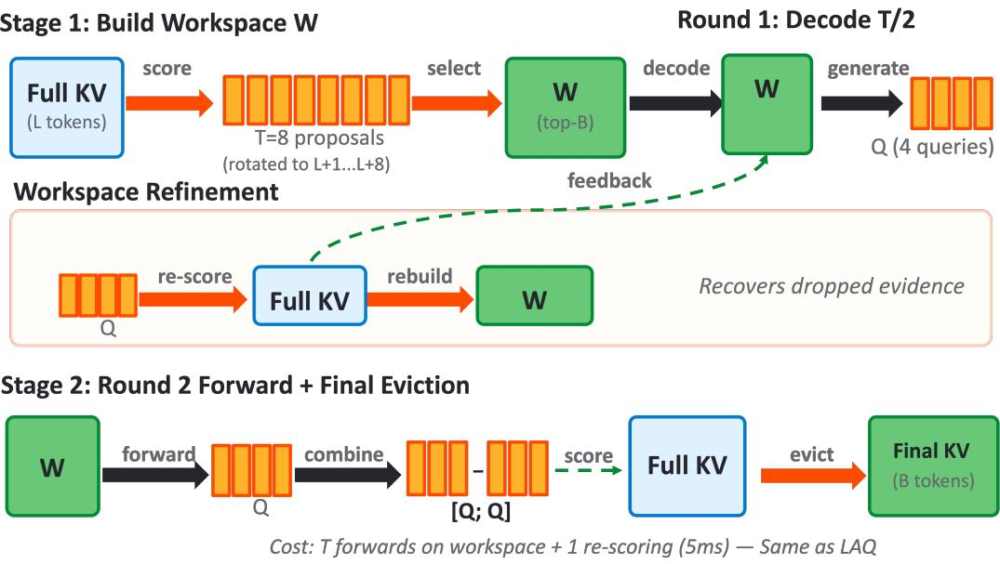

# EchoKV: Self-Corrective KV Cache Eviction via Iterative Query Feedback

JianKun Zou Tongtong Yuan

Beijing University of Technology zoujiankun2006@emails.bjut.edu.cn yuantt@bjut.edu.cn

## Abstract

KV cache eviction is not merely a tokenranking problem: the workspace retained for generating eviction queries also determines the quality of those queries. Consequently, an early workspace error can distort later query observations and reinforce an incorrect final eviction decision, particularly when evidence is dispersed across a long context. We present EchoKV, which discovers and addresses this failure mode with iterative correction. It initializes a feedback-compatible bootstrap workspace using proposals at future decode positions, then uses early decodegenerated queries to recover the workspace before the remaining lookahead steps. It uses the same number of workspace forward passes as LAQ while adding a tensor re-scoring operation for workspace repair. On LongBench (16 tasks, Mistral-7B-Instruct-v0.2 and Qwen2.5- 7B-Instruct), EchoKV shows notable improvements over LAQ on several tasks requiring dispersed evidence, including multi-hop cross-document QA and long single-document comprehension. Across budgets and backbones, EchoKV selectively improves evidenceintensive tasks while maintaining comparable performance on the remaining LongBench subsets. These results identify query–workspace coupling as a practical failure mode of querydriven KV eviction.

## 1 Introduction

KV cache eviction is not merely a token-ranking problem. In query-driven eviction, the tokens retained during workspace construction determine the future queries used for subsequent eviction decisions. This creates a self-dependent feedback loop: an early omission changes the hidden states, the changed hidden states produce drifting queries, and those queries can reinforce the original omission.

The deployment of LLMs in long-context settings is bottlenecked by the growth of the KV cache.

Eviction-based approaches (Zhang et al., 2023; Li et al., 2024; Wang et al., 2025) selectively discard cache entries deemed unimportant for future generation, enabling sub-linear cache sizes at the cost of approximation error.

A key insight of LAQ (Wang et al., 2025) is that eviction quality improves when the selection query reflects future decode queries rather than the tail of the prompt. LAQ generates T greedy lookahead tokens on a compressed workspace, collects their queries, and uses them to re-score the full prompt KV. While effective, LAQ leaves this feedback loop unresolved:

Window-biased stage-1 compression. LAQ builds its lookahead workspace via SnapKV (Li et al., 2024), which scores token importance using only the last w prompt queries. For tasks where relevant content is spread across multiple document sections (e.g. QASPER) or requires multi-hop reasoning (e.g. HOTPOTQA), the window is unlikely to capture all necessary evidence, leading to a degraded workspace and, consequently, degraded lookahead queries.

This failure is self-reinforcing rather than a onetime ranking error. Once an initial workspace excludes relevant evidence, the model generates lookahead queries from hidden states that cannot attend to that evidence; later eviction scores are therefore conditioned on a distorted observation. A robust solution must address both stages of this loop: it must construct a decoding-aligned workspace before any generated query is available, and it must give the model an opportunity to use early queries to revise an imperfect initial workspace. This perspective motivates EchoKV’s feedback-compatible workspace bootstrap and its feedback-driven workspace repair.

We present EchoKV with the following contributions:

1. Diagnosis. We formulate query-driven

KV eviction as a partially observable, selfdependent process: workspace quality conditions the query observations used to make the next eviction decision. We provide a direct measurement (Section 3) showing that query fidelity to true decode queries degrades with lookahead depth on a frozen workspace.

2. Closed-loop correction. EchoKV turns KV eviction into a closed-loop correction process. It constructs afeedback-compatible bootstrap workspace before any decoded query exists, then uses round-1 generated queries not only for final scoring but also for feedbackdriven workspace repair. Future-position proposals are used only for initialization. The method uses T forward passes over a $B _ { 1 }$ -sized workspace— identical to LAQ—plus one tensor re-scoring pass.

3. Targeted gains without overclaiming. On 16-task LongBench, EchoKV’s most consistent gains occur on dispersed-evidence tasks such as multi-hop QA and cross-passage retrieval. Its aggregate performance is comparable to LAQ, which motivates a failure-modespecific claim rather than a universal one.

## 2 Related Work

KV cache compression. Context-extension and efficient-attention methods (Chen et al., 2023; Peng et al., 2024; Ding et al., 2024; Chen et al., 2024; Dao et al., 2022; Beltagy et al., 2020) enlarge or accelerate attention, but do not select which KV entries remain stored. EchoKV is complementary: it operates at inference time on an unmodified decoder. StreamingLLM (Xiao et al., 2024) retains only sink and recent tokens. H2O (Zhang et al., 2023) keeps globally heavy-hitter tokens via accumulated attention. SnapKV (Li et al., 2024) uses the attention of the prompt’s final window to score tokens. PyramidKV (Cai et al., 2024) allocates layer-varying budgets. AdaKV (Feng et al., 2024) and HeadKV (Fu et al., 2025) further differentiate budgets per attention head. All these methods rely on prompt-phase queries for eviction, ignoring decode-phase query directions. Orthogonal approaches reduce the byte footprint of every retained KV entry rather than selecting a subset of tokens. KIVI (Liu et al., 2024) uses asymmetric low-bit quantization for keys and values, while KVQuant (Hooper et al., 2024) combines lowprecision quantization with outlier handling. These methods are complementary to EchoKV: quantization changes the representation precision, whereas EchoKV improves which entries are retained for the decode cache.

Pseudo-query eviction. LAQ (Wang et al., 2025) first introduced greedy lookahead queries for KV eviction and demonstrated consistent gains over window-based methods across budgets. DapQ (Tian et al., 2026) shows that query position can strongly affect which keys are ranked highest, and therefore replaces the observation window with position-aware pseudo-queries synthesised at future decode positions—obtaining a decodingaligned observation window without decoding at all. EchoKV repurposes positional pseudo-queries for a distinct role: initializing the first feedbackcompatible workspace before any model-generated query exists. DapQ addresses where an eviction query should look; EchoKV addresses how to construct the first workspace that makes subsequent generated queries reliable. The latter is coupled with feedback-driven workspace repair, which iteratively corrects the workspace using model-generated queries once content-level evidence about the answer becomes available.

Long-context retrieval and memory. Memoryaugmented models extend the effective context through retrieved or recurrent state, including kNN memory in Memorizing Transformers (Wu et al., 2022), recurrent memory tokens in RMT (Bulatov et al., 2022), and tiered virtual context management in MemGPT (Packer et al., 2023). These approaches change the memory architecture or introduce an external memory-management policy. EchoKV instead operates on the KV cache of an unmodified decoder at inference time. This makes long-context RAG and agent memory motivating application settings, not direct evaluation claims in this paper.

Iterative inference methods, such as speculative decoding and Self-Refine (Leviathan et al., 2023; Madaan et al., 2023), adapt computation using intermediate outputs; EchoKV instead applies feedback to the eviction workspace.

## 3 Observations

This section measures a query-fidelity pattern that motivates EchoKV’s feedback-driven workspace repair. Let $\mathbf { q } _ { k } ^ { * , \ell , g }$ denote the step-k query for layer ℓ and KV group g, obtained by greedy decoding on the uncompressed KV cache. Let $\bar { \mathcal { T } } _ { B } ^ { \ell , g } ( \mathbf { Q } )$ be the top-B token indices selected by query set Q under the scoring rule in Eq. (3). KV overlap is

$$
\mathrm { O v e r l a p } _ { k } = \frac { 1 } { | \mathcal { L } | | \mathcal { G } | } \sum _ { \ell , g } \frac { \left| \mathcal { Z } _ { B } ^ { \ell , g } ( \hat { \mathbf { Q } } ) \cap \mathcal { T } _ { B } ^ { \ell , g } ( \mathbf { q } _ { k } ^ { * , \ell , g } ) \right| } { B } .\tag{1}
$$

where $\mathcal { L }$ and $\mathcal { G }$ are the layer and KV-group sets. An overlap of 1 means exact agreement on the retained token indices.

## 3.1 Greedy-lookahead fidelity decays with step count

LAQ generates $T$ greedy tokens on a frozen workspace $\mathcal { W } _ { 1 }$ and uses all $T$ queries for final eviction. If every step contributed equal fidelity to $\mathbf { q } ^ { * }$ , nothing would be gained by refreshing the workspace mid-lookahead: one-shot on the best available $\mathcal { W } _ { 1 }$ would already be optimal.

Table 1 shows the opposite. On a frozen workspace, KV overlap with $\mathbf { q } _ { k } ^ { * } f a l l s$ as k grows. This decline is consistent with error accumulation along the query trajectory, although it does not by itself identify the source of the drift. Overlap drops from 0.92 at k=1 to 0.77 at k=8 (a 16% relative decline), with the steepest degradation occurring in the second half $( 0 . 8 8 \to 0 . 8 3 \to 0 . 7 7$ for steps 3, 6, 8). The Refreshed row shows that rebuilding the workspace at $k { = } T / 2$ using round-1 queries halts the decay: overlap recovers in the second half, reaching 0.85 at k=6 and 0.80 at k=8 (versus 0.83 and 0.77 for the frozen baseline)—a relative improvement of $+ 2 . 4 \%$ and +3.9% respectively. The joint $[ \mathbf { Q } _ { 1 } ; \mathbf { Q } _ { 2 } ]$ pool from the refreshed path therefore better approximates the oracle’s selection behavior in this measurement.

This pattern provides empirical evidence consistent with the proposed error-propagation mechanism: under a frozen workspace, query–KV overlap declines across lookahead steps, while midpoint refreshing partially recovers it. This observation does not isolate the source of the drift, but motivates the $T / 2 { + } T / 2$ recovery schedule at equal forward-pass count.

## 4 Method

## 4.1 Stage-1: Feedback-Compatible Workspace Bootstrapping

The workspace selection problem. The bootstrap workspace $\mathcal { W } _ { 1 }$ must be selected at prefill— before any decode queries are observed—yet it determines which prompt tokens remain accessible during all $T$ lookahead steps. Its purpose is not to make the final eviction decision, but to preserve enough evidence for the first generated queries to support reliable subsequent correction. Prior work (SnapKV, LAQ) scores the full prompt KV cache using the last w prompt queries, issued at positions $[ L - w + 1 , L ]$ . Under RoPE, these queries assign exponentially decaying attention weights to earlier tokens purely due to relative-distance penalties, systematically under-selecting evidence from the prompt’s first half even when that evidence is critical for future decode queries at positions $\geq L { + 1 }$ We address this with position-diverse proposals that approximate the union of attention patterns across all T decode steps.

<table><tr><td rowspan="2">Workspace strategy</td><td colspan="4">KV overlap at step k</td></tr><tr><td> $k { = } 1$ </td><td> $k { = } 3$ </td><td> $k { = } 6$ </td><td>k=8</td></tr><tr><td>Frozen  $( T$  steps on  $\mathcal { W } _ { 1 } )$ </td><td>0.92</td><td>0.88</td><td>0.83</td><td>0.77</td></tr><tr><td>Refreshed at  $\scriptstyle \bar { k } = T / 2$  (ours)</td><td>0.92</td><td>0.88</td><td>0.85</td><td>0.80</td></tr></table>

Table 1: KV overlap with the true step-k query $\mathbf { q } _ { k } ^ { * }$ (budget $B { = } 1 2 8 .$ , Mistral-7B-Instruct-v0.2, n=20 samples from HotpotQA, Qasper, PassageRetrieval-en, and NarrativeQA, averaged over all layers). Overlap measures the fraction of top-B tokens selected by a workspacebased pseudo-query that match the oracle selection, where 1.0 indicates perfect agreement. The frozen baseline shows monotonic degradation; refreshing at the midpoint recovers $+ 2 . 4 \%$ and +3.9% relative overlap at steps 6 and 8.

Position-aware proposal generation. Our construction uses the positional pseudo-query mechanism of DapQ (Tian et al., 2026): because the RoPE phase of a query determines the relative distances at which it attends most strongly, a query rotated to a future position behaves like a query issued at that position, even though its content is inherited from the prompt. DapQ uses this to build a decoding-aligned observation window for eviction; we repurpose it to bootstrap the greedy workspace, where no decoded token is yet available and position is the only reliable signal. This bootstrap is not a final eviction score: it establishes the observation substrate on which model-generated feedback can subsequently be obtained.

Let L be the prompt length, $\mathcal { K } ^ { \ell , g }$ $\{ \mathbf { k } _ { i } ^ { \ell , g } , \mathbf { v } _ { i } ^ { \ell , g } \} _ { i = 1 } ^ { L }$ the KV cache for layer ℓ and KV group $g _ { \colon }$ , and $d _ { k }$ the key dimension. We use $S$ semantic anchors per layer; in all experiments $S { = } 1$ namely the final prompt query. For anchor s, let $\widetilde { \mathbf { q } } _ { s } ^ { \ell , g } \in \mathbb { R } ^ { d _ { k } }$ be its pre-RoPE vector. $\mathbf { R } ( p )$ denotes the RoPE rotation at absolute position $p .$ . Rotating each anchor to the T future positions yields $P = S T$ proposals:

  
Figure 1: EchoKV overview. Bootstrap builds a feedback-compatible workspace $\mathcal { W } _ { 1 }$ using future-position proposals (queries rotated to future decode positions), then decodes $T / 2$ tokens to collect $\mathbf { Q } _ { 1 }$ . Feedback-driven repair: $\mathbf { Q } _ { 1 }$ re-scores the full prompt KV to rebuild $\mathcal { W } _ { 2 }$ . Round 2: decodes another $T / 2$ tokens on $\mathcal { W } _ { 2 }$ to collect $\mathbf { Q } _ { 2 } ;$ the joint pool $[ \mathbf { Q } _ { 1 } ; \mathbf { Q } _ { 2 } ]$ drives final eviction from L tokens to budget B. Total cost: $T$ forwards on the workspace plus one additional re-scoring pass.

$$
\mathbf { q } _ { s , p } ^ { \ell , g } = \mathbf { R } ( p ) \widetilde { \mathbf { q } } _ { s } ^ { \ell , g } .\tag{2}
$$

Here $s \in [ S ]$ and $p \in \{ L + 1 , \ldots , L + T \}$ . For any query set $\mathbf { Q } ^ { \ell , g }$ , we score prompt token i by accumulating its attention probability across queries:

$$
s _ { i } ^ { \ell , g } ( \mathbf { Q } ) = \sum _ { \mathbf { q } \in \mathbf { Q } ^ { \ell , g } } \frac { \exp ( \mathbf { q } ^ { \top } \mathbf { k } _ { i } ^ { \ell , g } / \sqrt { d _ { k } } ) } { \sum _ { j = 1 } ^ { L } \exp ( \mathbf { q } ^ { \top } \mathbf { k } _ { j } ^ { \ell , g } / \sqrt { d _ { k } } ) } .\tag{3}
$$

Here, TopK $B ^ { \prime }$ returns the indices of the $B ^ { \prime }$ largest entries; thus $\overleftarrow { \mathcal { T } } _ { B ^ { \prime } } ^ { \ell , g } ( \mathbf { Q } ) = \mathrm { T o p K } _ { B ^ { \prime } } ( s ^ { \ell , g } ( \mathbf { Q } ) )$ and the bootstrap workspace is $\mathcal { W } _ { 1 } ^ { \ell , g } = \mathcal { T } _ { B _ { 1 } } ^ { \ell , g } ( \mathbf { Q } _ { \mathrm { p r o p } } )$ . We evaluate the softmax in chunks over L tokens. For grouped-query attention, queries are mapped to their shared KV group before applying Eq. (3); thus all selection is performed per layer and KV group.

## 4.2 Final Query Selection: Why Decode-Generated Queries Dominate

Stage 1 selects a workspace; final eviction must make the precise choice of which B tokens survive.

A natural cheap alternative is to score with a real observation window—the last w prompt queries, as SnapKV and its descendants do. We deliberately do not, for four reasons.

(1) A real window has the wrong RoPE phase. The queries that will actually read the surviving cache are issued at absolute positions $> L ,$ whereas a real window lives at positions $[ L - w + 1 , L ]$ . Under RoPE, the score $\left. \mathbf { q } _ { p } , \mathbf { k } _ { i } \right.$ depends on the relative offset $p - i ,$ , so shifting the query position reorders which keys rank highest. This is precisely DapQ’s observation, and it is why our stage 1 rotates proposals forward instead of reading the window directly. A real window cannot be repositioned without ceasing to be real.

(2) A real decode window is not obtainable at prefill. One could instead observe oracle decode queries by generating the first few tokens and recording them on the uncompressed cache. Waiting for a genuine observation window costs T fullcache forward passes at peak memory O(L) per layer, which forfeits the memory saving that motivates eviction. Generated pseudo queries run on the $B _ { 1 }$ -sized workspace instead, so the cost is $O ( T B _ { 1 } )$ with $B _ { 1 } \ll L$

<table><tr><td>Layer</td><td>Locked</td><td>Linear</td><td>Prompt</td></tr><tr><td>0</td><td>0.804</td><td>0.853</td><td>0.927</td></tr><tr><td>8</td><td>0.472</td><td>0.430</td><td>0.631</td></tr><tr><td>16</td><td>0.275</td><td>0.334</td><td>0.599</td></tr><tr><td>24</td><td>0.447</td><td>0.368</td><td>0.541</td></tr><tr><td>31</td><td>0.325</td><td>0.328</td><td>0.427</td></tr></table>

Table 2: KV overlap at step $k { = } 3$ (budget 128) for position-only approximation strategies against the true decode query. Prompt: rotate the last prompt query to future positions. Locked: rotate a real anchor query from a compressed workspace. Linear: linearly extrapolate query content.

(3) Generated queries match the decode distribution in content as well as position. A rotated proposal is position-correct but content-stale: it still carries the semantics of the prompt’s last token. Once a workspace exists, the model can be run autoregressively on it, and the resulting queries are produced by the same network, in the same decode regime, at the correct future positions—so they match the target distribution along both axes. Table 2 quantifies the gap that remains for positiononly approximations: KV overlap with the true step-3 query falls to 0.427 at layer 31, indicating that position alone is insufficient for final selection in deeper layers.

(4) Only generated queries permit error correction. A real window is a single fixed measurement: if the evidence it points to is incomplete, nothing downstream can detect this. Generated queries provide a decode-conditioned signal for revisiting stage-1 choices. This is what makes iteration meaningful: re-scoring thefull cache with round-1 queries can recover evidence the initial workspace dropped. A fixed observation window offers no such feedback signal, and neither does one-shot lookahead on a frozen workspace.

Points (3) and (4) together imply the specific scheme below: generate, use the generated queries to rebuild the workspace, then generate again.

## 4.3 Feedback-Driven Workspace Repair

Standard greedy lookahead runs all $T$ steps on a fixed workspace $\mathcal { W } _ { 1 }$ , accumulating queries Q that drive final eviction from the full cache to the final budget $B .$ . If $\mathcal { W } _ { 1 }$ omits useful tokens, later generated queries may be less faithful to the uncompressed-cache trajectory.

We break this compounding via feedback-driven workspace repair. The first $T / 2$ greedy steps produce queries $\mathbf { Q } _ { 1 }$ that reveal which prompt regions the model attempts to attend to, even on incomplete $\mathcal { W } _ { 1 }$ . We use $\mathbf { Q } _ { 1 }$ as a diagnostic signal to re-score the $\it { f u l l }$ prompt KV cache—still resident at prefill— and rebuild the workspace to $\mathcal { W } _ { 2 }$ before continuing. The second $T / 2$ steps then run on $\mathcal { W } _ { 2 } .$ , producing queries $\mathbf { Q } _ { 2 }$ from the refreshed workspace. The joint pool $\left[ \mathbf { Q } _ { 1 } ; \mathbf { Q } _ { 2 } \right]$ drives final eviction.

## Two-round decode scheme. Concretely:

1. Round 1. Decode $T / 2$ tokens greedily on $\mathcal { W } _ { 1 }$ (size $B _ { 1 } )$ , starting from the prompt’s boundary token. Accumulate per-layer queries $\mathbf { Q } _ { 1 }$

2. Rebuild workspace. Score the full prompt KV cache (size L) with $\mathbf { Q } _ { 1 }$ under the same attention-pooling rule in Eq. (2). Select top-$B _ { 1 }$ tokens per layer and KV group $ \mathcal { W } _ { 2 }$

3. Round 2. Continue greedy decode for the remaining $T / 2$ tokens on $\mathcal { W } _ { 2 }$ , starting from the token generated at step $T / 2$ . Accumulate queries $\mathbf { Q } _ { 2 }$

Total forward passes remain T (identical to $\mathrm { L A Q } )$ . The workspace rebuild is a scoring operation over existing tensors. Its cost scales linearly with prompt length and with the $T / 2$ round-1 queries per layer; it requires no additional transformer calls. Table 1 provides supporting evidence: KV overlap with oracle queries degrades monotonically from 0.92 to 0.77 on a frozen workspace but recovers to 0.85/0.80 at steps 6 and 8 after the midpoint refresh, consistent with the value of refreshing the workspace mid-lookahead. The recovery step is one additional KV-scoring pass; its relative cost grows with context length, as discussed below. Final eviction then uses $[ \mathbf { Q } _ { 1 } ; \mathbf { Q } _ { 2 } ]$ jointly to select the final B tokens from the full KV cache.

Complexity and overhead. EchoKV adds to standard full-cache prefill two costs: (a) T greedy decode steps over a B1-sized workspace—cost $O ( T \cdot B _ { 1 } \cdot d )$ , identical to $\mathrm { L A Q } .$ , with $B _ { 1 } \ll L ;$ and (b) one mid-point re-scoring pass over the full prompt KV using $T / 2$ query vectors per layer. EchoKV, like other post-prefill eviction methods, retains the full KV cache until final selection; it then reduces the retained decode cache to $B$ tokens. No additional transformer forward passes are required, and recovery is a tensor re-scoring operation. EchoKV therefore has end-to-end latency that depends on prompt length and implementation; we therefore do not claim latency parity beyond the equal number of workspace forward passes.

<table><tr><td></td><td>Budget</td><td colspan="3">Single-Doc</td><td colspan="3">Multi-Doc</td><td colspan="3">Summ</td><td colspan="3">Few-shot</td><td colspan="2">Synth</td><td colspan="2">Code</td><td></td></tr><tr><td>Method</td><td></td><td>Nrtv</td><td>Qas</td><td>MF</td><td>Hot</td><td>2Wiki</td><td>Mus</td><td>Gov</td><td>QM</td><td>MN</td><td>TREC</td><td>TQA</td><td>SAM</td><td>PC</td><td>PR</td><td>Lcc</td><td>RB</td><td>Avg</td></tr><tr><td>FullKV</td><td></td><td>26.90</td><td>33.14</td><td>49.26</td><td>42.77</td><td>27.35</td><td>18.77</td><td>32.95</td><td>24.21</td><td>27.13</td><td>71.00</td><td>86.23</td><td>42.72</td><td>2.75</td><td>86.98</td><td>57.12</td><td>54.51</td><td>42.74</td></tr><tr><td>StreamingLLM</td><td>128</td><td>17.12</td><td>13.43</td><td>27.31</td><td>29.54</td><td>21.91</td><td>11.94</td><td>15.61</td><td>19.18</td><td>17.72</td><td>44.00</td><td>79.92</td><td>37.37</td><td>3.50</td><td>23.77</td><td>51.44</td><td>45.95</td><td>28.73</td></tr><tr><td>H2O</td><td>128</td><td>21.62</td><td>21.34</td><td>38.61</td><td>30.46</td><td>20.38</td><td>12.20</td><td>20.59</td><td>22.51</td><td>22.03</td><td>39.00</td><td>82.33</td><td>40.64</td><td>3.06</td><td>80.56</td><td>51.17</td><td>48.46</td><td>34.69</td></tr><tr><td>SnapKV</td><td>128</td><td>19.71</td><td>21.13</td><td>42.75</td><td>36.45</td><td>22.36</td><td>15.76</td><td>19.05</td><td>21.81</td><td>21.36</td><td>47.50</td><td>84.15</td><td>40.29</td><td>2.41</td><td>68.26</td><td>52.26</td><td>48.75</td><td>35.25</td></tr><tr><td>PyramidKV</td><td>128</td><td>21.98</td><td>22.78</td><td>43.78</td><td>32.30</td><td>22.31</td><td>15.81</td><td>20.41</td><td>21.82</td><td>21.23</td><td>66.00</td><td>83.51</td><td>39.83</td><td>2.99</td><td>65.81</td><td>51.61</td><td>46.42</td><td>36.16</td></tr><tr><td>LAQ (T=8)</td><td>128</td><td>24.94</td><td>27.77</td><td>45.43</td><td>40.35</td><td>25.25</td><td>17.91</td><td>22.06</td><td>22.68</td><td>22.50</td><td>69.50</td><td>86.36</td><td>41.16</td><td>1.49</td><td>76.85</td><td>53.31</td><td>51.02</td><td>39.29</td></tr><tr><td>EchoKV (ours)</td><td>128</td><td>26.11</td><td>27.51</td><td>46.45</td><td>41.89</td><td>24.85</td><td>17.59</td><td>21.39</td><td>22.43</td><td>22.56</td><td>69.50</td><td>85.86</td><td>41.44</td><td>2.97</td><td>78.21</td><td>53.45</td><td>50.52</td><td>39.55</td></tr><tr><td>StreamingLLM</td><td>256</td><td>19.22</td><td>15.08</td><td>28.01</td><td>30.40</td><td>22.02</td><td>11.21</td><td>18.09</td><td>19.59</td><td>20.09</td><td>51.00</td><td>80.71</td><td>39.89</td><td>2.96</td><td>18.40</td><td>54.30</td><td>47.38</td><td>29.90</td></tr><tr><td>H2O</td><td>256</td><td>21.42</td><td>23.04</td><td>42.60</td><td>30.75</td><td>22.42</td><td>13.82</td><td>22.35</td><td>22.54</td><td>23.12</td><td>40.50</td><td>83.78</td><td>40.73</td><td>3.51</td><td>85.85</td><td>53.18</td><td>49.95</td><td>36.22</td></tr><tr><td>SnapKV</td><td>256</td><td>22.44</td><td>24.07</td><td>48.01</td><td>38.66</td><td>22.66</td><td>15.59</td><td>21.83</td><td>23.23</td><td>22.94</td><td>61.50</td><td>85.45</td><td>41.32</td><td>3.13</td><td>85.79</td><td>55.11</td><td>51.73</td><td>38.97</td></tr><tr><td>PyramidKV</td><td>256</td><td>21.69</td><td>25.18</td><td>47.61</td><td>38.77</td><td>26.12</td><td>15.23</td><td>22.52</td><td>22.52</td><td>22.59</td><td>68.00</td><td>84.27</td><td>42.10</td><td>3.43</td><td>76.60</td><td>53.08</td><td>48.40</td><td>38.63</td></tr><tr><td> $\scriptstyle \mathrm { L A Q } ( T = 8 )$ </td><td>256</td><td>24.68</td><td>29.25</td><td>48.00</td><td>40.56</td><td>26.01</td><td>18.24</td><td>24.04</td><td>22.96</td><td>23.80</td><td>70.00</td><td>85.81</td><td>42.52</td><td>2.01</td><td>82.34</td><td>54.96</td><td>53.00</td><td>40.51</td></tr><tr><td>EchoKV (ours)</td><td>256</td><td>25.39</td><td>29.74</td><td>47.97</td><td>41.86</td><td>26.75</td><td>18.71</td><td>23.61</td><td>23.51</td><td>23.72</td><td>70.50</td><td>86.46</td><td>43.18</td><td>3.28</td><td>83.64</td><td>54.92</td><td>52.27</td><td>40.97</td></tr><tr><td>StreamingLLM</td><td>512</td><td>20.91</td><td>16.47</td><td>30.56</td><td>29.62</td><td>22.16</td><td>11.02</td><td>21.51</td><td>20.10</td><td>23.03</td><td>61.50</td><td>81.86</td><td>41.66</td><td>2.84</td><td>18.57</td><td>55.27</td><td>49.07</td><td>31.63</td></tr><tr><td>H2O</td><td>512</td><td>21.72</td><td>25.54</td><td>44.72</td><td>32.39</td><td>23.16</td><td>14.75</td><td>23.61</td><td>23.03</td><td>24.58</td><td>42.00</td><td>85.22</td><td>41.61</td><td>3.42</td><td>86.45</td><td>54.82</td><td>51.11</td><td>37.38</td></tr><tr><td>SnapKV</td><td>512</td><td>24.14</td><td>28.11</td><td>48.78</td><td>39.49</td><td>25.09</td><td>17.40</td><td>23.67</td><td>23.18</td><td>24.60</td><td>67.00</td><td>85.88</td><td>41.39</td><td>2.78</td><td>86.56</td><td>56.61</td><td>53.47</td><td>40.51</td></tr><tr><td>PyramidKV</td><td>512</td><td>22.99</td><td>28.74</td><td>48.45</td><td>39.73</td><td>25.74</td><td>16.58</td><td>24.48</td><td>23.40</td><td>24.52</td><td>70.00</td><td>85.99</td><td>42.40</td><td>3.32</td><td>81.63</td><td>55.93</td><td>52.38</td><td>40.39</td></tr><tr><td>LAQ (T=8)</td><td>512</td><td>24.65</td><td>31.21</td><td>49.15</td><td>39.90</td><td>27.18</td><td>18.38</td><td>25.55</td><td>23.91</td><td>24.87</td><td>71.00</td><td>86.33</td><td>42.14</td><td>1.87</td><td>86.41</td><td>56.84</td><td>53.08</td><td>41.40</td></tr><tr><td>EchoKV (ours)</td><td>512</td><td>25.52</td><td>30.69</td><td>48.73</td><td>41.93</td><td>26.65</td><td>19.33</td><td>25.48</td><td>23.64</td><td>25.29</td><td>71.00</td><td>86.43</td><td>42.43</td><td>2.75</td><td>86.35</td><td>56.64</td><td>52.99</td><td>41.62</td></tr></table>

Table 3: LongBench results on Mistral-7B-Instruct-v0.2 across budgets $B \in \{ 1 2 8 , 2 5 6 , 5 1 2 \}$ . Column groups: Single-Doc QA (Nrtv=NarrativeQA, Qas=Qasper, MF=MultifieldQA-en); Multi-Doc QA (Hot=HotpotQA, 2Wiki=2WikiMQA, Mus=Musique); Summ (Gov=GovReport, QM=QMSum, MN=MultiNews); Few-shot (TREC, TQA=TriviaQA, SAM=SAMSum); Synthetic (PC=PassageCount, PR=PassageRetrieval-en); Code (Lcc, RB=RepoBench-P). Bold and underline denote the best and second-best compression methods, respectively, within each budget (excluding FullKV).

Algorithm 1 EchoKV self-corrective eviction at   
prefill (per sample)   
Require: Prompt, budget B, T, workspace capac  
ity $B _ { 1 }$   
1: Run full prefill; store full KV K   
2: for each layer ℓ do   
3: Build $T$ proposals $\{ \mathbf { R } ( p ) { \widetilde { \mathbf { q } } } ^ { \ell } \}$ via Eq. (1)   
4: Score $\mathcal { K } ^ { \ell }$ with proposals; keep top- $\cdot B _ { 1 } $   
$\mathcal { W } _ { 1 } ^ { \ell }$   
5: end for   
6: Run $T / 2$ greedy steps on $\mathcal { W } _ { 1 } ;$ collect ${ \bf Q } _ { 1 }$   
7: for each layer ℓ do   
8: Re-score $\mathcal { K } ^ { \ell }$ with $\mathbf { Q } _ { 1 } ^ { \ell } ;$ ; keep top- $B _ { 1 } \to \mathcal { W } _ { 2 } ^ { \ell }$   
9: end for   
10: Run $T / 2$ greedy steps on $\mathcal { W } _ { 2 } ;$ ; collect $\mathbf { Q } _ { 2 }$   
11: Re-score $\kappa$ with $\left[ \mathbf { Q } _ { 1 } ; \mathbf { Q } _ { 2 } \right]$ ; keep top-B → final   
cache

Potential applications. Several tasks on which EchoKV improves, including HOTPOTQA and 2WIKIMQA, require connecting facts from nonadjacent context segments. Exactly this pattern arises in (i) Long-Context RAG, where retrieved passages are concatenated and the model must locate relevant spans scattered across the context; (ii) multi-document reasoning, where supporting evidence appears in different source documents; and (iii) agent long-context memory, where tool outputs and observations from many prior turns accumulate in the context window and must be recalled coherently. Standard windowbiased eviction can drop this dispersed evidence early; EchoKV’s feedback-compatible bootstrap and feedback-driven repair are designed to preserve it. These are motivating application patterns, rather than claims of performance on dedicated RAG or agent-memory benchmarks; evaluating them on such benchmarks is future work.

## 5 Experiments

## 5.1 Setup

Model and data. We evaluate on two backbones with Flash Attention 2: Mistral-7B-Instructv0.2 and Qwen2.5-7B-Instruct. Mistral serves as the primary model, matching the setting of LAQ (Wang et al., 2025) so that our numbers are directly comparable to published baselines; Qwen2.5- 7B-Instruct tests whether the method transfers across attention configurations (Qwen2.5 uses grouped-query attention with a different head/KVgroup ratio). Both are evaluated on the 16 English subsets of LongBench (Bai et al., 2024), spanning single-document QA (NARRATIVEQA, QASPER, MULTIFIELDQA-EN), multi-document QA (HOTPOTQA, 2WIKIMQA, MUSIQUE), summarization (GOVREPORT, QMSUM, MULTI-

<table><tr><td></td><td>Budget</td><td colspan="3">Single-Doc</td><td colspan="3">Multi-Doc</td><td colspan="3">Summ</td><td colspan="3">Few-shot</td><td colspan="2">Synth</td><td colspan="2">Code</td><td></td></tr><tr><td>Method</td><td></td><td>Nrtv</td><td>Qas</td><td>MF</td><td>Hot</td><td>2Wiki</td><td>Mus</td><td>Gov</td><td>QM</td><td>MN</td><td>TREC</td><td>TQA</td><td>SAM</td><td>PC</td><td>PR</td><td>Lcc</td><td>RB</td><td>Avg</td></tr><tr><td>FullKV</td><td></td><td>17.07</td><td>43.76</td><td>52.61</td><td>57.70</td><td>47.13</td><td>29.85</td><td>32.00</td><td>23.61</td><td>23.95</td><td>39.50</td><td>87.65</td><td>40.08</td><td>8.50</td><td>100.00</td><td>6.62</td><td>9.79</td><td>38.74</td></tr><tr><td>StreamingLLM</td><td>128</td><td>11.77</td><td>23.65</td><td>26.44</td><td>40.90</td><td>37.09</td><td>16.42</td><td>16.12</td><td>18.03</td><td>14.69</td><td>12.00</td><td>76.26</td><td>35.50</td><td>8.50</td><td>24.50</td><td>10.26</td><td>13.44</td><td>24.10</td></tr><tr><td>H2O</td><td>128</td><td>16.61</td><td>29.58</td><td>37.25</td><td>51.04</td><td>42.14</td><td>20.82</td><td>20.33</td><td>22.05</td><td>18.07</td><td>18.50</td><td>80.85</td><td>39.04</td><td>8.50</td><td>98.00</td><td>6.29</td><td>9.77</td><td>32.43</td></tr><tr><td>SnapKV</td><td>128</td><td>16.23</td><td>32.72</td><td>45.14</td><td>52.95</td><td>44.10</td><td>24.16</td><td>19.27</td><td>20.81</td><td>17.27</td><td>21.50</td><td>85.83</td><td>37.75</td><td>8.50</td><td>95.00</td><td>7.26</td><td>11.28</td><td>33.74</td></tr><tr><td>PyramidKV</td><td>128</td><td>15.40</td><td>30.67</td><td>44.89</td><td>51.54</td><td>41.22</td><td>25.62</td><td>19.51</td><td>19.71</td><td>16.69</td><td>25.75</td><td>84.22</td><td>34.08</td><td>8.50</td><td>96.00</td><td>5.29</td><td>6.32</td><td>32.84</td></tr><tr><td>LAQ (T=8)</td><td>128</td><td>17.98</td><td>39.17</td><td>48.85</td><td>56.76</td><td>44.96</td><td>28.96</td><td>22.39</td><td>20.66</td><td>18.77</td><td>35.00</td><td>87.78</td><td>37.75</td><td>8.50</td><td>98.00</td><td>5.82</td><td>9.35</td><td>36.29</td></tr><tr><td>EchoKV (ours)</td><td>128</td><td>17.27</td><td>40.61</td><td>49.65</td><td>57.10</td><td>46.50</td><td>29.25</td><td>22.41</td><td>21.78</td><td>18.72</td><td>39.50</td><td>87.55</td><td>37.98</td><td>8.50</td><td>97.50</td><td>5.99</td><td>9.83</td><td>36.88</td></tr><tr><td>StreamingLLM</td><td>256</td><td>11.50</td><td>24.44</td><td>26.81</td><td>41.85</td><td>37.25</td><td>17.39</td><td>18.90</td><td>18.12</td><td>17.11</td><td>17.50</td><td>80.66</td><td>37.47</td><td>9.00</td><td>24.50</td><td>8.42</td><td>13.54</td><td>25.28</td></tr><tr><td>H2O</td><td>256</td><td>16.05</td><td>32.25</td><td>43.63</td><td>52.73</td><td>43.40</td><td>23.98</td><td>22.66</td><td>22.30</td><td>19.60</td><td>19.50</td><td>83.55</td><td>39.24</td><td>8.50</td><td>99.50</td><td>6.71</td><td>9.29</td><td>33.93</td></tr><tr><td>SnapKV</td><td>256</td><td>16.25</td><td>36.47</td><td>50.35</td><td>55.44</td><td>44.37</td><td>26.62</td><td>21.96</td><td>21.76</td><td>19.35</td><td>31.00</td><td>86.89</td><td>38.47</td><td>8.50</td><td>98.00</td><td>6.52</td><td>9.98</td><td>35.75</td></tr><tr><td>PyramidKV</td><td>256</td><td>16.81</td><td>34.46</td><td>47.17</td><td>54.72</td><td>42.74</td><td>25.86</td><td>21.45</td><td>20.39</td><td>17.61</td><td>33.75</td><td>85.76</td><td>36.93</td><td>8.50</td><td>98.50</td><td>5.15</td><td>7.21</td><td>34.81</td></tr><tr><td>LAQ (T=8)</td><td>256</td><td>17.62</td><td>41.16</td><td>50.84</td><td>57.16</td><td>46.48</td><td>29.37</td><td>24.23</td><td>22.17</td><td>20.30</td><td>38.50</td><td>88.10</td><td>39.12</td><td>8.50</td><td>99.00</td><td>6.14</td><td>9.83</td><td>37.41</td></tr><tr><td>EchoKV (ours)</td><td>256</td><td>18.01</td><td>41.53</td><td>50.83</td><td>56.92</td><td>47.20</td><td>27.79</td><td>24.12</td><td>22.45</td><td>20.41</td><td>39.00</td><td>87.80</td><td>38.91</td><td>8.50</td><td>99.00</td><td>6.26</td><td>10.44</td><td>37.45</td></tr><tr><td>StreamingLLM</td><td>512</td><td>12.56</td><td>27.00</td><td>29.75</td><td>42.48</td><td>36.44</td><td>16.15</td><td>22.30</td><td>18.68</td><td>20.01</td><td>24.00</td><td>83.99</td><td>38.09</td><td>8.50</td><td>24.00</td><td>8.36</td><td>12.54</td><td>26.55</td></tr><tr><td>H2O</td><td>512</td><td>16.77</td><td>35.32</td><td>45.82</td><td>52.30</td><td>44.39</td><td>24.29</td><td>24.20</td><td>22.29</td><td>21.45</td><td>21.00</td><td>86.29</td><td>39.16</td><td>8.50</td><td>100.00</td><td>6.82</td><td>9.09</td><td>34.86</td></tr><tr><td>SnapKV</td><td>512</td><td>17.63</td><td>40.73</td><td>50.71</td><td>55.63</td><td>45.18</td><td>27.85</td><td>24.41</td><td>22.84</td><td>21.16</td><td>38.50</td><td>88.12</td><td>39.21</td><td>8.50</td><td>99.50</td><td>7.09</td><td>10.16</td><td>37.33</td></tr><tr><td>PyramidKV</td><td>512</td><td>17.49</td><td>37.81</td><td>50.45</td><td>56.36</td><td>44.64</td><td>27.46</td><td>23.00</td><td>20.97</td><td>19.60</td><td>35.25</td><td>87.62</td><td>37.82</td><td>8.50</td><td>99.00</td><td>5.62</td><td>7.94</td><td>36.22</td></tr><tr><td> $\mathrm { L } \mathrm { \dot { A } Q } \left( T { = } 8 \right)$ </td><td>512</td><td>17.26</td><td>42.64</td><td>51.73</td><td>57.56</td><td>46.59</td><td>29.12</td><td>26.57</td><td>22.67</td><td>21.86</td><td>39.00</td><td>87.65</td><td>39.40</td><td>8.50</td><td>100.00</td><td>6.52</td><td>9.91</td><td>37.94</td></tr><tr><td>EchoKV (ours)</td><td>512</td><td>18.50</td><td>42.33</td><td>51.65</td><td>57.19</td><td>47.27</td><td>28.30</td><td>26.38</td><td>22.51</td><td>21.89</td><td>39.00</td><td>87.76</td><td>39.54</td><td>8.50</td><td>100.00</td><td>7.16</td><td>9.88</td><td>37.99</td></tr></table>

Table 4: LongBench results on Qwen2.5-7B-Instruct across budgets $B \in \{ 1 2 8 , 2 5 6 , 5 1 2 \}$ . Same column order as Table 3. Bold and underline denote the best and second-best compression methods, respectively, within each budget (excluding FullKV).

NEWS), few-shot learning (TREC, TRIVIAQA, SAMSUM), synthetic retrieval (PASSAGECOUNT, PASSAGERETRIEVAL-EN), and code completion (LCC, REPOBENCH-P).

Baselines. We report FullKV (no eviction) and compare against StreamingLLM, $_ \mathrm { H _ { 2 } O }$ (Zhang et al., 2023), SnapKV (Li et al., 2024), PyramidKV (Cai et al., 2024), and LAQ (Wang et al., 2025) (greedy, T=8). The component variants are described in Section 6.1.

Evaluation protocol. We use the official Long-Bench prompts and task metrics, greedy generation, and the same cache budgets for every compression method. Scores are computed over the 16 English LongBench subsets listed above. Unless stated otherwise, the analysis experiments use Mistral-7B-Instruct-v0.2 at B=128; all workspace selection is performed independently per layer and KV group.

EchoKV settings. S=1 (single semantic anchor), T=8 lookahead steps (two rounds of 4), workspace capacity $B _ { 1 } { = } 1 0 2 4$ , stage2\_window=0. KV budgets $B \in \{ 1 2 8 , 2 5 6 , 5 1 2 \}$ to match prior work.

## 5.2 Main Results

Table 3 reports full LongBench scores for Mistral-7B-Instruct-v0.2 across all three budgets $( B \in$ {128, 256, 512}). Table 4 shows the same for Qwen2.5-7B-Instruct.

EchoKV is competitive with LAQ across budgets and backbones. At B=128, it improves the 16- task average over LAQ on Qwen (36.88 vs. 36.29) and Mistral (39.55 vs. 39.29). The per-task pattern is more informative than the average: EchoKV’s clearest gains occur on selected dispersed-evidence tasks, whereas it is not uniformly superior elsewhere.

Budget scaling. Tables 3 and 4 show results across all three budgets $( B \in \{ 1 2 8 , 2 5 6 , 5 1 2 \} )$ for both models. Aggregate rankings vary by budget and backbone. EchoKV remains close to the LAQ baseline on average while delivering notable gains on selected retrieval-intensive tasks.

## 5.3 Cross-Model Generalization

Tables 3 and 4 evaluate EchoKV on both Mistral-7B-Instruct-v0.2 and Qwen2.5-7B-Instruct (which uses grouped-query attention with a different head/KV-group ratio), across all three budgets $( B \in \{ 1 2 8 , 2 5 6 , 5 1 2 \} )$ ). Both architectures show that the method remains competitive overall, while the size and location of task-level gains vary.

Comparison with baselines. On Qwen at B=128, EchoKV improves over LAQ (T=8) on HOTPOTQA (57.10 vs. 56.76) and 2WIKIMQA (46.50 vs. 44.96). Its aggregate advantage is not uniform across budgets. This distinction is important: EchoKV is intended to address failure cases associated with dispersed evidence, not to replace every eviction strategy on every task.

<table><tr><td>Method</td><td>MultifieldQA</td><td>HotpotQA</td><td>AVG</td></tr><tr><td>LAQ (T=8, baseline)</td><td>45.43</td><td>40.35</td><td>39.29</td></tr><tr><td>+ EchoKV-Stage1 only</td><td>46.15</td><td>41.24</td><td>39.38</td></tr><tr><td>+ Iterative only</td><td>46.27</td><td>40.98</td><td>39.42</td></tr><tr><td>EchoKV</td><td>46.45</td><td>41.89</td><td>39.55</td></tr></table>

Table 5: Component ablation on Mistral-7B-Instructv0.2 at B=128. Each row adds the indicated EchoKV component to LAQ. Combining both stages yields complementary task-level gains: +1.02 on MultifieldQA, +1.54 on HotpotQA, and a modest +0.26 on the 16-task average over LAQ. Bold denotes the best and underlining the second-best result in each column.

Code-subset anomaly. LCC and RB have unusually low FullKV scores on Qwen (6.62 and 9.79), so the code-subset results should be interpreted with caution. We do not attribute this pattern to cache eviction without a separate validation of the evaluation pipeline; conclusions about transfer should therefore be read together with the Mistral results and non-code Qwen subsets.

## 6 Analysis

## 6.1 Targeted Comparison with LAQ

Table 5 compares EchoKV directly with the LAQ baseline on two evidence-intensive tasks at the most constrained budget.

At this budget, the components show complementary effects. Stage 1 alone gives the stronger HotpotQA gain, whereas iterative repair alone gives the stronger MultifieldQA and average gains among the single-component variants. Their combination improves both evidence-intensive tasks simultaneously, although the aggregate gain is modest (+0.26). This pattern aligns with the roles of bootstrapping a useful observation workspace and then revising it with generated-query feedback before final eviction.

## 6.2 Evidence Retention Analysis

We measure supporting-evidence retention after refinement: the percentage of task-provided gold evidence-span tokens retained in the workspace. We map spans to input-token positions and average per-example retention over layers and KV groups. Table 6 compares LAQ’s workspace (W) with EchoKV after bootstrapping (W1) and repair (W2), at B=128 on Mistral.

W1 and W2 progressively retain more evidence, including on HOTPOTQA and MULTIFIELDQA. The +3.2-point W-to-W1 and +3.6-point W1-to-W2 average gains exceed downstream task gains,

<table><tr><td>Task</td><td>LAQ W</td><td>EchoKV W1</td><td>EchoKV W2</td></tr><tr><td>HOTPOTQA</td><td>68.4</td><td>72.1</td><td>76.8</td></tr><tr><td>2WIKIMQA</td><td>66.9</td><td>71.2</td><td>75.4</td></tr><tr><td>MULTIFIELDQA</td><td>70.6</td><td>73.5</td><td>77.0</td></tr><tr><td>QASPER</td><td>74.2</td><td>76.0</td><td>78.1</td></tr><tr><td>Average</td><td>70.0</td><td>73.2</td><td>76.8</td></tr></table>

Table 6: Evidence-token retention (%) at B=128 on Mistral-7B-Instruct-v0.2. Gold evidence spans are mapped to input-token positions; W, W1, and W2 denote LAQ’s workspace, EchoKV’s bootstrap workspace, and its repaired workspace. Bold denotes the best and underlining the second-best result in each row.

as retained evidence need not change an answer.   
This is a mechanism diagnostic, not a causal proof.

## 6.3 Discussion

EchoKV is most useful when decoding reconnects distant evidence, as in HOTPOTQA and 2WIKIMQA. The overlap and retention analyses are consistent with this mechanism, not causal proof. Recency-biased tasks may already be served by window eviction; RAG, agent-memory, and long-context latency evaluations remain future work.

## 7 Conclusion

EchoKV bootstraps a workspace with futureposition proposals and repairs it with early generated queries. It is competitive with LAQ on Long-Bench, with targeted gains on retrieval-intensive tasks, while requiring full-cache retention until final selection and one extra re-scoring pass. The overlap and evidence-retention analyses further show that workspace refreshing improves later query fidelity and retains more annotated evidence, which is consistent with the proposed closed-loop correction mechanism. These findings position EchoKV as a targeted inference-time complement to window-based eviction: it is most useful when a future query must reconnect non-local evidence, rather than as a universal replacement for all cache compression strategies.

## Limitations

Proposal scoring costs O(PL) per layer and can be non-trivial at long contexts. We do not isolate random/oracle refreshes or alternative intervals; stage2\_window = 0 also provides no recency guarantee.

## References

Yushi Bai, Xin Lv, Jiajie Zhang, et al. 2024. Long-Bench: A Bilingual, Multitask Benchmark for Long Context Understanding. In Proceedings of the 62nd Annual Meeting of the Association for Computational Linguistics (ACL).

Iz Beltagy, Matthew E. Peters, and Arman Cohan. 2020. Longformer: The Long-Document Transformer. arXiv preprint arXiv:2004.05150.

Aydar Bulatov, Yuri Kuratov, and Mikhail S. Burtsev. 2022. Recurrent memory transformer. In Advances in Neural Information Processing Systems (NeurIPS).

Zefan Cai, Yichi Zhang, Bofei Gao, et al. 2024. PyramidKV: Dynamic KV Cache Compression based on Pyramidal Information Funneling. arXiv preprint arXiv:2406.02069.

Shouyuan Chen, Sherman Wong, Liangjian Chen, et al. 2023. Extending Context Window of Large Language Models via Positional Interpolation. arXiv preprint arXiv:2306.15595.

Yukang Chen, Shengju Qian, Haotian Tang, et al. 2024. LongLoRA: Efficient Fine-tuning of Long-Context Large Language Models. In International Conference on Learning Representations (ICLR).

Tri Dao, Daniel Y. Fu, Stefano Ermon, et al. 2022. FlashAttention: Fast and Memory-Efficient Exact Attention with IO-Awareness. In Advances in Neural Information Processing Systems (NeurIPS).

Yiran Ding, Li Lyna Zhang, Chengruidong Zhang, et al. 2024. LongRoPE: Extending LLM Context Window Beyond 2 Million Tokens. In International Conference on Machine Learning (ICML).

Yuan Feng, Junlin Lv, Yukun Cao, et al. 2024. Ada-KV: Optimizing KV Cache Eviction by Adaptive Budget Allocation for Efficient LLM Inference. arXiv preprint arXiv:2407.11550.

Yu Fu, Zefan Cai, Abedelkadir Asi, et al. 2025. Not All Heads Matter: A Head-Level KV Cache Compression Method with Integrated Retrieval and Reasoning. In The Thirteenth International Conference on Learning Representations.

Coleman Hooper, Sehoon Kim, Hiva Mohammadzadeh, et al. 2024. KVQuant: Towards 10 Million Context Length LLM Inference with KV Cache Quantization. In Advances in Neural Information Processing Systems (NeurIPS).

Yaniv Leviathan, Matan Kalman, and Yossi Matias. 2023. Fast inference from transformers via speculative decoding. In Proceedings of the 40th International Conference on Machine Learning, pages 19274–19286.

Yuhong Li, Yingbing Huang, Bowen Yang, et al. 2024. SnapKV: LLM Knows What You are Looking for Before Generation. In Advances in Neural Information Processing Systems (NeurIPS).

Zirui Liu, Jiayi Yuan, Hongye Jin, et al. 2024. KIVI: A Tuning-Free Asymmetric 2bit Quantization for KV Cache. In Proceedings ofthe 41st International Conference on Machine Learning.

Aman Madaan, Niket Tandon, Prakhar Gupta, et al. 2023. Self-Refine: Iterative Refinement with Self-Feedback. In Advances in Neural Information Processing Systems (NeurIPS).

Charles Packer, Sarah Wooders, Kevin Lin, et al. 2023. MemGPT: Towards LLMs as Operating Systems. arXiv preprint arXiv:2310.08560.

Bowen Peng, Jeffrey Quesnelle, Honglu Fan, et al. 2024. YaRN: Efficient Context Window Extension of Large Language Models. In International Conference on Learning Representations (ICLR).

Zhenxu Tian, Yi Su, Juntao Li, et al. 2026. Where Matters More Than What: Decoding-aligned KV Cache Compression via Position-aware Pseudo Queries. arXiv preprint arXiv:2603.11564.

Yixuan Wang, Shiyu Ji, Yijun Liu, et al. 2025. Lookahead Q-Cache: Achieving More Consistent KV Cache Eviction via Pseudo Query. In Proceedings of the 2025 Conference on Empirical Methods in Natural Language Processing.

Yuhuai Wu, Markus N. Rabe, DeLesley Hutchins, et al. 2022. Memorizing transformers. In International Conference on Learning Representations (ICLR).

Guangxuan Xiao, Yuandong Tian, Beidi Chen, et al. 2024. Efficient streaming language models with attention sinks. In International Conference on Learning Representations (ICLR).

Zhenyu Zhang, Ying Sheng, Tianyi Zhou, et al. 2023. H2O: Heavy-Hitter Oracle for Efficient Generative Inference of Large Language Models. In Advances in Neural Information Processing Systems (NeurIPS).