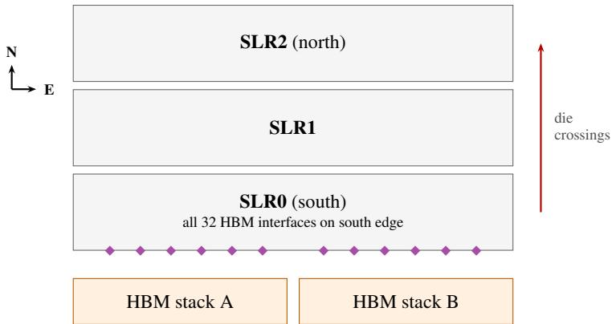
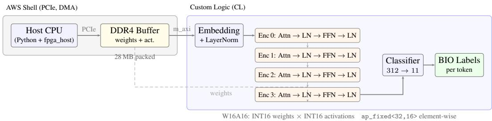
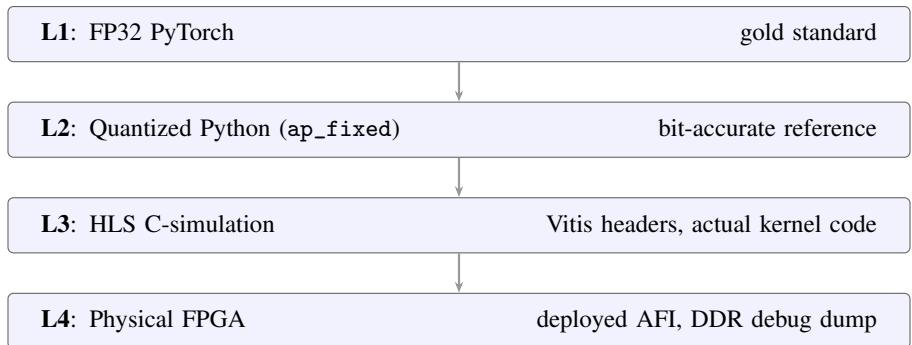
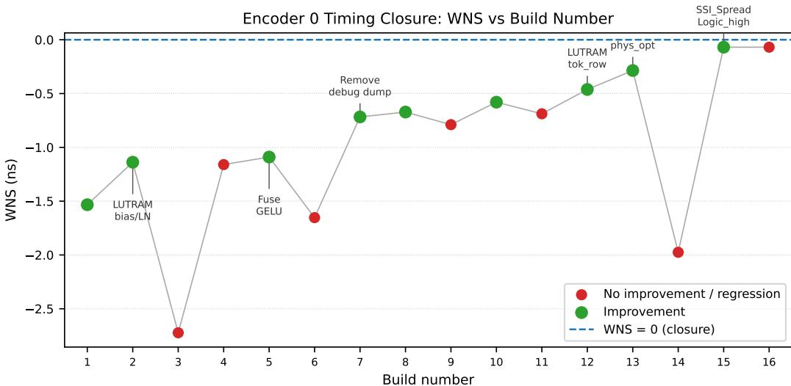

# Enabling AWS Cloud FPGA Development Using High-Level Vitis HLS

David Rostcheck david@rostcheck.com

## Abstract

We present a toolchain for development of ML models on AWS EC2 F2 cloud FPGA infrastructure from high-level language, implementing a complete Vitis HLS → HDK bridge → AFI workflow that has been absent from the academic literature despite eight years of AWS FPGA availability. We introduce a fourlevel methodology (FP32 PyTorch → bit-accurate quantized Python → HLS Csimulation → physical FPGA) to aid in localizing errors, including FPGA-specific circuit errors. Together these tools allow coding agents to effectively implement FPGA designs from user directions, testing and debugging as needed. We document the deployment workflow, timing closure strategies, and practical HLS engineering decisions that proved crucial. We validate using TinyBERT fine-tuned for address Named Entity Recognition, implementing the embedding layer and the first of four encoder layers on the FPGA hardware. Our implementation streams weights from host DRAM, yielding poor performance compared to CPU/GPU implementations; we discuss forward paths.

## 1 Introduction

Engineering demanding workloads such as ML inference requires coordinated optimization between the hardware architecture and software operations. The transformer-based software stack that represents current state of the art in ML implements a neural network via matrix multiplication operations. These operations are accelerated by high-performance hardware GPUs with on-board memory. Transformer inference is increasingly constrained by memory bandwidth rather than compute [1, 2, 3, 4].

In comparison with the essentially von Neumann-based CPU/GPU architecture, Field Programmable Gate Array (FPGA) devices represent an alternative hardware platform. FPGAs offer memory distributed throughout the device and feature programmable circuitry, allowing memory and compute to be placed together in a more distributed way. These features support deterministic latency and fixed power draw independent of request rate, and could permit more efficient designs, particularly for implementing smaller models and those where GPU tail-latency variance and idle power are concerns [5, 6].

Research in generative AI using FPGA devices has been constrained, however, by the difficulty of programming ML systems on them. Despite eight years of availability (F1 since 2017, F2 since December 2024 [7]), AWS cloud FPGA instances have not been used for ML inference in any published academic work, although their pay-on-demand cost model lowers the funding barrier for research projects. The University of Toronto noted in 2024 that F1 instances “have not been used for such large ML applications” [8]. The gap is not hardware capability; the AMD VU47P on F2 has 9,024 DSP slices, 16 GiB HBM, and 64 GiB DDR4. We identify the absence of a documented, reproducible workflow from HLS C++ kernels to deployed Amazon FPGA Images (AFIs) as the barrier.

  
Figure 1: Top-down view of the AMD VU47P. The three SLRs are separate dies laid side by side on a shared silicon interposer, drawn here from south to north. The two HBM stacks sit on the same interposer, south of SLR0, and all 32 HBM interface sites (violet diamonds, not to scale) are on SLR0’s south edge.

This paper intends to close this gap. We present a complete toolchain and methodology for developing ML models on AWS EC2 F2 using the complete Vitis HLS (high level language) → HDK bridge → AFI workflow for ML workloads. Supporting contributions include a four-level validation methodology (§2.8), build time characterization for the AWS F2 HDK workflow [9] (§3.3), and a timing closure analysis for SSI FPGA devices under ML workloads (§3.2).

## 2 System design

Our primary research goal was to characterize a working toolchain and analysis path by which a transformer could be implemented on an AWS F2 FPGA. This goal led to the following design decisions (detailed more fully in following subsections). Taking true advantage of the FPGA’s architectural capabilities would require different choices, discussed in Section 4.2:

1. High level language: For ease of implementation we chose the C++-based Vitis HLS language instead of lower-level Verilog HDL.

2. Community bridge: The F2 toolchain does not natively support creating an AFI image from high-level Vitis HLS. We used a community-based open source bridge [10] to facilitate this path.

3. W16A16 quantization: To better debug numerical issues resulting from FPGA design logic, we chose INT16 weights and INT16 activations (vs. more common INT8 quantizations)

4. Four-level validation methodology: To localize where in the stack errors were appearing, we developed a four-level validation methodology described further in Section 2.8

## 2.1 FPGA architecture

While FPGAs provide programmable hardware, the physical architecture of the device remains important for combined hardware/software optimization. The AWS F2 instance hosts an AMD VU47P Virtex UltraScale+ FPGA which is organized in three separate dies called Super-Logic Regions (SLRs), which are co-located and wired together (see Figure 1). Crossing an SLR boundary requires traversing a long wire, which may cause signal timing problems.

Memory in an FPGA is distributed throughout SLRs and is available in a hierarchy of layers that are progressively both larger and farther away from individual logic elements, as shown in Table 1.

## 2.2 Toolchain architecture

FPGA devices are natively programmed in a low-level Hardware Description Language (HDL), the most popular being Verilog/SystemVerilog and VHDL. When fed into a synthesis tool ("Vivado" on the AMD/Xilinx FPGAs that the AWS F2 uses) the HDL code produces a physical design that specifies the direct placement of logic cells, lookup tables (LUTs), and routing, to which the FPGA is then configured. This level of implementation is termed Register-Transfer Level (RTL) logic. While conceptually comparable to an assembler producing machine code, the physical design is literally a circuit design which the FPGA directly manifests via a grid (array) of programmable logic gates, as compared with the set of CPU instructions that machine code represents. The physical design can thus, for example, specify many paths that execute in parallel by physically manifesting different circuit paths. The Vivado synthesis tool performs more sophisticated operations than an assembler, making use of simulation to optimize the timing and physical placement of the circuit design.

Table 1: Memory hierarchy of the AMD VU47P on AWS F2, ordered from closest to compute to farthest. LUTRAM is carved from the same LUTs used for logic, so its totals are an upper bound. Latency is in clock cycles for on-chip memory; off-chip memory is characterized by peak bandwidth. Near-chip High Bandwidth Memory is a major feature of the VU47P but the community bridge needed to produce an Amazon FPGA Image (AFI) from high level HLS code did not provide access to it, a major limitation.
<table><tr><td>Memory type</td><td>Element size</td><td>Elements</td><td>Total</td><td>Latency / bandwidth</td></tr><tr><td>Flip-flops</td><td>1 bit</td><td>2,607,360</td><td>2.6Mb</td><td>1 cycle</td></tr><tr><td>LUTRÁM</td><td>64 bits</td><td>up to ~600,000</td><td>up to 36.7 Mb</td><td>~1 cycle</td></tr><tr><td>BRAM</td><td>36 Kb</td><td>2,016</td><td>70.9Mb</td><td>1–2 cycles</td></tr><tr><td>URAM</td><td>288 Kb</td><td>960</td><td>270 Mb</td><td>multi-cycle</td></tr><tr><td>HBM</td><td>8 GiB</td><td>2</td><td>16 GiB</td><td>up to 460 GB/s</td></tr><tr><td>DDR4</td><td>64 GiB</td><td>1</td><td>64 GiB</td><td>~25 GB/s</td></tr></table>

While HDL provides the most control, its verbose low-level nature can prove a barrier to quickly implementing interesting ML designs. We chose to target a High Level Synthesis (HLS) language, the C/C++-based "Vitis HLS", which the Vitis tool synthesizes to lower-level HDL.

The Hardware Development Kit (HDK) for the AWS F2 [9] provides a shell that separates AWSmanaged infrastructure (PCIe, DDR controllers, DMA) from user custom logic (CL). The shell handles infrastructure functions and provides defined interface points to which the user-supplied CL integrates. Unlike the user/kernel separation in a traditional OS, the shell and user CL are combined by the Vivado synthesizer to produce the RTL/circuit design, so both shell and user CL ultimately directly manifest hardware. Conceptually the shell is more similar to the set of linked libraries that operate the loop and pseudo-OS functions in a Real-Time Development Kit (RTK).

Pre-created CL for common tasks can also be imported using "IP cores" which play a role analogous to reusable libraries in CPU-based programming.

The HDK Custom Logic (CL) flow creates an AFI file, which is loaded to the FPGA. The higher-level Vitis HLS that we target cannot produce an AFI directly. To bridge this gap, we used a communitydeveloped bridge to allow end-to-end flow from Vitis HLS to an AFI, as shown in Figure 2.

Vitis HLS C++ → RTL export → hls\_to\_cl.py (bridge) → HDK CL project → post-bridge patches → DCP build (Vivado) → AFI creation → physical FPGA

Figure 2: Toolchain from Vitis HLS C++ to a deployed F2 instance. The community bridge (hls\_to\_cl.py) and the post-bridge patches are the only steps that are neither our code nor standard AWS or AMD tooling; they are the source of the limitations in Section 2.3, including the single DDR port and lack of HBM access.

## 2.3 Bridge limitations

While it did allow for creation of a loadable AFI from Vitis HLS code, the community-supported bridge imposed several limitations, which caused later downstream issues:

• Single memory master. The bridge supports exactly one m\_axi port and one s\_axilite control interface per kernel1. Having only a single memory access port pair significantly limits the design’s memory access bandwidth, since higher bandwidth would require multiple channels with multiple AXI ports.

  
Figure 3: System architecture. The host loads tokenized input and W16A16-quantized weights into DDR4 via PCIe. The Custom Logic (CL) kernel reads weights and activations from DDR through a single m\_axi port, processes the TinyBERT pipeline (embedding layer, four encoder layers, classifier), and writes BIO label predictions back to DDR. The full pipeline is validated in C-simulation; only the embedding layer and encoder layer 0 (1 of 4) are currently deployed on the physical FPGA. All inter-stage activations currently round-trip through DDR (dashed arrows); weight caching in BRAM and HBM migration are identified as the primary optimization path (§4).

• DDR only; no HBM. The bridge template connects the single m\_axi port directly to the DDR controller (memory on the EC2 host), not to the FPGA’s near-chip High Bandwidth Memory (HBM), a major limitation.

• Fixed 512-bit data width. The template assumes a 512-bit AXI data path and does not adapt to the data width of the generated kernel port.

• No multi-die (SSI) awareness. The bridge does not insert SLR-crossing pipeline registers or provide SLR placement constraints.

• Incomplete IP packaging. The bridge does not copy the VHDL sub-IP files for HLSgenerated floating-point cores (fdiv\_32, fpext) into the CL project.

## 2.4 Model and task

For a testbed model we chose TinyBERT [11], a 4-layer, 312-hidden-dimension distilled BERT variant [12, 13] with ∼14.5M parameters, primarily because it was small and well understood. We finetuned the huawei-noah/TinyBERT\_General\_4L\_312D pretrained checkpoint using HuggingFace Transformers [14] with AdamW, learning rate $5 \times 1 0 ^ { - 5 }$ , 5 epochs.

For a test task we chose name-entity recognition (NER). We fine-tuned on a synthetically generated BIO-tagged address NER dataset (560 train / 120 val / 500 test samples). The dataset generator (data/generate\_address\_ner\_dataset.py) is released with the code. Entity types are STREET, CITY, STATE, ZIP, and PERSON.

## 2.5 System architecture

Figure 3 shows the system architecture. The host loads tokenized input and packed W16A16 weights into DDR4 via PCIe. The CL kernel processes the four-layer TinyBERT pipeline through a single m\_axi DDR port: each stage reads its weight matrix and input activations, computes, and writes output activations back to DDR at fixed offsets. This sequential DDR round-trip is the primary latency bottleneck in the current design.

Memory architecture: We originally stored the weights in BRAM. Our first design resulted in a deep LUT mux tree that could not close 250 MHz timing. A redesign partitioned weights in BRAM into banks, but the transformer matmul (a fundamentally global operation) created cross-SLR routing congestion that also could not close timing. HBM would have been ideal for this case, but since the bridge can not address it (Section 2.3), we needed to store weights in DRAM. Still, BRAM working storage spanned two of the three SLRs (SLR0 53.5%, SLR1 46.9%, with SLR2 at 3.9% holding only the shell’s DDR controller), forcing the working footprint across an SLR boundary and continually causing timing violations. The issue was finally resolved by moving the largest ∼600k array to URAM, clearing timing (WNS = +0.027ns).

## 2.6 W16A16 quantization architecture

Why W16A16: We began with W8A8 (INT8 weights and activations with per-channel/per-token dynamic scaling). Two problems emerged. First, INT8 per-token quantization produces large intermediate errors (maximum 86.0 at the FFN stage for a known outlier activation of ∼4528 in FP32). While these errors often cancel at the argmax level, they make layer-by-layer FPGA verification intractable: when each stage must be numerically compared against the reference, errors of this magnitude obscure the distinction between quantization noise and implementation bugs. Second, W8A8 generated timing violations on the FPGA: the per-token quantization division produced a hardware divider that failed timing (WNS = −1.148 ns), and FP32 intermediate operations could not meet the 250 MHz clock constraint. W16A16 resolves both issues: the division is replaced by a reciprocal multiply (Section 2.6) and maximum intermediate error drops to $\leq 0 . 1 3 7$ across all encoder stages, enabling the four-level validation methodology (Section 2.8).

Better quantization schemes for optimizing memory and model size are available, particularly those described in [15]. However, FPGA development is, at its core, electrical engineering, not computer programming. As such, it imposes significant and fundamental differences on error analysis. In traditional CPU/GPU-based programming, mathematical operations themselves can be assumed to work. This is not the case in FPGA design synthesis, where these operations represent circuits that can be malformed, or can use IP cores that do not work properly in the accuracy range requested. Using W16A16 with generous accumulators, while not optimal for efficiency, allowed sufficient headroom to identify when errors were being introduced so they could be localized using the four-level validation method described in §2.8.

Quantization: We used INT16 weights × INT16 activations (W16A16) with ap\_fixed<32,16> element-wise operations and ap\_fixed<64,32> dequantization. Each weight matrix row is quantized to INT16 using per-channel absmax scaling:

$$
w _ { q } = \mathrm { r o u n d } \Big ( \frac { w } { \mathrm { a b s m a x } } \Big ) \times 3 2 7 6 7\tag{1}
$$

The absmax value (not absmax/32767) is stored as the per-channel scale in ap\_fixed<32,16>.

Each token’s activation vector is quantized to INT16 using per-token absmax. The division is performed as a float32 reciprocal followed by a per-element multiply (see Non-linear operations below).

INT16 × INT16 products accumulate in ap\_int<48> (sufficient for 312-element dot products without overflow). The four-step wide dequantization, all in ap\_fixed<64,32>, is:

$$
\mathrm { o u t p u t } = \mathrm { a c c } \times w _ { \mathrm { s c a l e } } \times a _ { \mathrm { a b s m a x } } \times { \frac { 1 } { 3 2 7 6 7 } } + \mathrm { b i a s }\tag{2}
$$

Non-linear operations: Our initial implementation used hls\_math.h vendor functions throughout. In practice, we found that hls::exp() on ap\_fixed<32,16> returns zero on physical FPGA after place-and-route (an apparent bug in the HLS-generated RTL core); hls::erf() promotes to FP64, generating dmul\_64/dadd\_64 IP cores that violate 250 MHz timing; and 64-bit fixed-point division generates an sdiv\_80ns\_48ns\_80 hardware divider (WNS = −1.148 ns). We replaced each with a targeted alternative: (1) softmax exp uses a 2048-entry LUT covering [−11, 0]; (2) GELU uses a 4096-entry LUT with linear interpolation covering [−8, 8] (max error $< \bar { 3 } \times \mathrm { \bar { 1 } 0 ^ { - 5 } ~ } \mathrm { \bar { v s } } .$ . FP64, 30× better than a tanh approximation); (3) activation quantization division uses a float32 reciprocal (inv\_am = 1.0f / (float)am) followed by per-element multiply. A fourth issue, dequantization overflow for large accumulator products (e.g., FFN dim 3 outlier: ∼69B, overflowing ap\_fixed<64,32>’s ±2.1B range), was resolved by widening steps 1–2 of the four-step dequantization to ap\_fixed<80,48> before truncating. As a timing closure technique, the GELU output array $( 1 2 8 \times 1 2 0 0 = 6 0 0 \mathrm { K B }$ BRAM) was eliminated by computing GELU twice (once for absmax, once for quantization), avoiding an SLR-crossing BRAM placement that added 2.3 ns logic + 2.7 ns routing. Fuketa et al. [16] take a contrasting approach, replacing all transcendentals with polynomial matrix approximations; our hybrid LUT strategy prioritizes accuracy (vendor-optimized or validated LUT) while avoiding the timing hazards of large IP cores.

Table 2: Device-total resource utilization on AMD VU47P (AWS F2), post-route for the embedding + encoderlayer-0 build (includes the AWS shell). Logic (LUT/FF/DSP) is <6%, but Block RAM is the binding resource at 36% oftiles, almost all of it custom logic (CL); the AWS shell contributes only ∼27 of the 727.5 BRAM tiles. BRAM is reused across encoder layers, so it does not scale with the full 4-layer pipeline.
<table><tr><td>Resource</td><td>Used</td><td>Available</td><td>Utilization</td></tr><tr><td>CLB LUT</td><td>73,272</td><td>1,301,552</td><td>5.6%</td></tr><tr><td>CLB FF</td><td>90,025</td><td>2,603,104</td><td>3.5%</td></tr><tr><td>Block RAM tile</td><td>727.5</td><td>2,016</td><td>36.1%</td></tr><tr><td>DSP</td><td>138</td><td>9,024</td><td>1.5%</td></tr><tr><td>URAM</td><td>40</td><td>960</td><td>4.2%</td></tr></table>

Per-SLR BRAM-tile occupancy (shell+CL): SLR0 53.5%, SLR1 46.9%, SLR2 3.9%. The custom-logic BRAM occupies the two lower SLRs (SLR0 just over half-full), while SLR2 holds only the shell’s DDR controller. This near-even split across the SLR0–SLR1 boundary constrains placement of the memory-heavy attention datapath.

## 2.7 HLS kernel design

The kernel (tinybert\_ner\_axi) is a single HLS C++ function with one m\_axi DDR port (ap\_uint<512>\*) and one s\_axilite control interface. All weights, activations, and debug outputs share a single DDR buffer (required by the bridge PoC’s single-port constraint).

Pipeline: Token IDs → Embedding (lookup + LayerNorm) → 4× Encoder Layer (QKV projection + scaled dot-product attention + output projection + LayerNorm + FFN + LayerNorm) → Classification Head → Logits.

Streaming matmul: Weight matrices are streamed from DDR in tiles rather than stored on-chip. This eliminates BRAM cascade timing violations (WNS = −1.399 ns with on-chip weights) at the cost of DDR bandwidth and inference latency, which is dominated by sequential DDR weight reads rather than compute. The 512-bit AXI bus width requires 64-byte-aligned writes; a read-modify-write pattern creates a 6.5 ns critical path that violates the 4.0 ns budget. Table 2 gives the resulting device utilization for the embedding layer plus encoder layer 0 build.

## 2.8 Four-level validation methodology

We validate correctness through four implementation levels (Figure 4). The L2 intermediate is the key contribution: a Python reference that replicates HLS ap\_fixed arithmetic exactly, enabling per-stage error isolation without FPGA builds. When L3 or L4 output diverges from L1, L2 isolates whether the cause is quantization design (L1 vs L2 mismatch) or implementation error (L2 vs L3/L4 mismatch). For example, when implementing the first TinyBERT layer we observed incorrect results in L4, while L3 was correct: the logic and code were correct, but there was an error specific to the FPGA implementation. Investigation via targeted builds eventually determined that the HLS-to-CL bridge had not copied the .dat initialization file into the synthesis directory. Vivado silently zero-filled the ROM, so on hardware the LUT returned zero for every input. The 4-level validation serves as an effective loop closure tool, allowing the coding agent to autonomously localize and diagnose problems.

## 2.9 AI agent use and research methodology

We conducted the work during a 1-month research spike, which included initial paper writeup. The team consisted of a single human researcher using an AWS Kiro IDE coding agent (responsible for FPGA programming and investigation) and an Amazon Quick desktop AI (responsible for higher level strategic inquiry, including literature searches, and also LaTeX formatting). At project beginning, the human researcher knew AI engineering but no FPGA programming 2. The researcher employed loop engineering principles to insure the agents had clear goals, success metrics, and necessary loop closure tools (including the F2 instance) to allow evaluating their own progress towards the goal [17].

  
Figure 4: Four-level validation methodology. Each level is validated against the one above before proceeding. Accuracy metrics are reported in Table 3.

Implementation status: Stage 1 (embedding layer) is validated on physical FPGA (L4) with 100% accuracy across 500 samples (max error $\leq 0 . 0 1 3 )$ . Stage 2 (encoder layer 0) has achieved timing closure on the VU47P; a deterministic logic-level discrepancy in the attention computation is under investigation. Encoder layers 1–3 and the classifier are validated at L3 (C-simulation). All full-pipeline accuracy claims are based on L3, which has proven equivalent to L4 on validated stages.

## 3 Experimental setup and results

## 3.1 Accuracy results

Table 3 compares quantization schemes on the 500-sample test set using C simulation. W16A16 preserves FP32 accuracy (86.54 vs 86.63 F1, within noise) with maximum element error of 0.137 across all encoder stages. W8A8 achieves comparable label-level F1 (85.59). L3 C-simulation matches L2 Python at 100% label agreement, confirming the HLS implementation is bit-accurate to the quantized reference. The test dataset is small and the task is simply a basic proof-of-concept, as our primary focus was toolchain development, so extensive analysis is precluded.

Table 3: Quantization accuracy comparison. FP32 baseline, W8A8, and W16A16 Python ref on 500-sample extended test set. Max element error is measured at the FFN output stage.
<table><tr><td>Scheme</td><td>Max elem err</td><td>Label agr.</td><td>F1</td><td>ZIP</td></tr><tr><td>FP32 PyTorch (baseline)</td><td></td><td></td><td>86.63</td><td>98.83</td></tr><tr><td>W8A8 Python ref</td><td>86.0</td><td>99.14%</td><td>85.59</td><td>99.00</td></tr><tr><td>W16A16 Python ref</td><td>0.137</td><td>99.95%</td><td>86.54</td><td>98.83</td></tr><tr><td>W16A16 L3 HLS C-sim</td><td>0.137</td><td>100.00%</td><td>86.73</td><td>99.10</td></tr><tr><td>L4 Phys. FPGA (Stg. 1)</td><td>0.137</td><td>100.00%</td><td></td><td></td></tr></table>

500-sample test set.

## 3.2 Timing closure characterization

Achieving timing closure on the AMD VU47P (3-SLR SSI device) for an ML workload required 21+ DCP builds across two stages. Stage 1 (embedding layer) converged from −1.533 ns to −0.050 ns over 10 builds; Stage 2 (encoder layer 0) converged from −1.533 ns to +0.001 ns over 16 builds. The Worst Negative Slack (WNS) convergence follows a logarithmic decay with non-monotone excursions from failed experiments (Figure 5).

## 3.3 Build time and deployment

DCP builds take 38–82 minutes depending on design complexity. Enabling phys\_opt adds 11–41 minutes but improves timing closure by 0.2–0.5 ns.

  
Figure 5: Encoder layer 0 timing closure: WNS (ns) vs. build number across 16 DCP builds. Green points are improvements; red are regressions. Key fixes are annotated. Non-monotone excursions (e.g., build 3: latency=2 applied too broadly; build 6: float sqrt in LayerNorm) illustrate that timing closure on SSI devices requires empirical validation of each change.

Post-bridge patches (required for ML kernels): (1) AXI register slice on PCIS path for SLR crossing timing. (2) VHDL sub-IP copy for HLS-generated float IPs (fdiv\_32, fpext).

Optimization strategies: Default Vivado directives (not Performance\_Explore) reduce DCP build time by 30–50%. maxThreads=24 saturates the F2’s 24 vCPUs. Incremental checkpoints reduce re-build time after minor changes by ∼40%.

## 3.4 Performance

Because the FPGA build was complete only for the embedding layer and encoder layer 0, we measured that portion across FPGA, CPU, and GPU, using identical inputs. For a short 16-token input (representative of NER), the FPGA is ∼480× slower than CPU and ∼410× slower than GPU (Table 4), almost completely due to the latency of fetching weights from host DRAM.

Table 4: Embedding + encoder layer 0 latency (median, batch 1, seq. len. 16). GPU fp16 is within noise of fp32 at this size.
<table><tr><td>Platform</td><td>Latency (ms)</td><td>vs. FPGA</td></tr><tr><td>FPGA (W16A16)</td><td>344.7</td><td></td></tr><tr><td>CPU fp32 (c7i.xlarge)</td><td>0.72</td><td>480×</td></tr><tr><td>GPU fp32 (g5.xlarge, A10G)</td><td>0.84</td><td>410×</td></tr></table>

## 3.5 Key findings

Key findings across both campaigns:

• Debug writes dominate routing pressure. Removing the GELU output debug dump alone improved WNS by 0.37 ns (v2\_enc0g). Debug writes add DDR write calls that increase routing congestion and can place small arrays across SLR boundaries.

• LUTRAM for small arrays is critical. Bias and LayerNorm parameter arrays (312–1200 elements × 4B) mapped to BRAM can cross SLR boundaries under routing pressure, adding 1+ ns. Forcing LUTRAM (#pragma HLS BIND\_STORAGE impl=lutram) eliminates this.

• BRAM latency pragmas are non-monotone. latency=2 on input\_i16 (78 KB INT16 activation buffer) improved WNS from −0.534 ns to −0.343 ns. Applying latency=2 to all large arrays (Q/K/V/attn\_out) worsened WNS from −0.343 ns to −0.649 ns as Vivado placed the BRAMs further apart under tighter scheduling constraints. The sweet spot is selective application to the specific array on the critical path.

• SSI\_SpreadLogic\_high + physopt-loop produced the largest combined improvement in Stage 2: −0.286 ns → +0.001 ns. The SSI\_SpreadLogic\_high placement directive spreads logic across SLR boundaries to reduce routing congestion; the physopt-loop (4 iterations with 0.25 ns over-constraint) then closes the remaining slack.

• A small (−0.050 ns) timing violation in Stage 1 did not corrupt computation. The critical path is a pure routing delay (95.5% routing, 0.165 ns logic) on the matmul pipeline enable → K array BRAM write enable. Despite the marginal violation, Stage 1 produces correct results across all 500 samples.

## 4 Discussion and future work

## 4.1 Key results

The FPGA implementation is only partially complete: the embedding layer and encoder layer 0 (1 of 4) are deployed on the hardware. It is, however, sufficient to note several important results:

• The toolchain described in §2.2 effectively enables writing high-level code in Vitis HLS and deploying it to a cloud-based F2 instance.

• The 4-level validation process is effective at identifying FPGA-specific problem areas such as broken IP cores and logic manifestation defects, and with sufficient continued effort would facilitate building out the remaining layers.

• Performance of our reference TinyBERT implementation is poor vs. a standard GPU implementation, although we expect it could be improved considerably by moving to more standard INT8 quantization now that the toolchain is established and design patterns identified.

• Moving weights from DRAM onto the FPGA dominated latency, a cost made worse by the bridge’s single DDR port and lack of HBM access (Section 2.3).

• Transformers are architecturally optimized for large tensor operations that perform well on GPU hardware acceleration - fundamentally a von Neumann approach. A naive transformer implementation does not fit optimally to the FPGA’s multi-layer distributed memory architecture.

## 4.2 Future work

Given the above results, pursuing higher performance solutions must contemplate either augmenting or abandoning the bridge, and should consider non-transformer architectures for which distributed memory local to compute elements is more advantageous.

Augmenting the bridge: Although we have established a toolchain that allows development of a FPGA design from a high level language (Vitis HLS) to a deployable AFI, this path comes at the cost of greatly limited memory management. One path forward would require enhancing the bridge to support multi-channel DMA access and HBM access. There are no conceptual barriers to doing this. Although it is a large lift, with coding agent assistance, loop engineering principles, and the four-level validation methodology this path appears reachable.

Abandoning the bridge: Another option is to simply abandon the bridge, which also requires abandoning high-level Vitis HLS and instead implement designs in much lower-level HDL code. Here again the increasing sophistication of coding agents at building low-level code like circuit designs may lower the traditionally high barrier of effort.

Non-transformer architectures and traditional ML: Work is under way on running nontransformer generative architectures such as Mamba [18] on FPGAs [19], but these designs still stream weights from off-chip memory (§5.4). The FPGA’s highly parallel, distributed-memory fabric is better suited to traditional machine-learning models, which coding agents can now build and deploy with the toolchain we describe. Boosted decision trees compiled to FPGA firmware evaluate in tens of nanoseconds [20, 21], and online tree learning can run on the incoming data stream itself [22]. Network security is a natural target: traffic is a continuous stream, the market is established, and detection rules must change as attacks evolve. Flow-based intrusion detectors already classify traffic on FPGA SmartNICs at line rate using a few hundred LUTs [23], and a coding agent able to regenerate and redeploy such a detector as threats change would make the approach considerably more practical.

Table 5: Comparison with prior FPGA transformer accelerators. No prior work targets NER, TinyBERT, AWS cloud FPGAs, or W16A16 quantization.
<table><tr><td>Paper</td><td>Model</td><td>FPGA</td><td>Quant.</td><td>Task</td><td>E2E</td></tr><tr><td>FQ-BERT [24]</td><td>BERT-base</td><td>ZCU102</td><td>Full quant</td><td>GLUE</td><td>√</td></tr><tr><td>ProTEA [25]</td><td>Encoder</td><td>Alveo U55C</td><td>—</td><td>MHA+FFN</td><td>Partial</td></tr><tr><td>FAMOUS [26]</td><td>Encoder attn.</td><td>U55C/U200</td><td></td><td>MHA</td><td>Kernel</td></tr><tr><td>HLSTransform [29]</td><td>Llama 2</td><td>VU9P</td><td>Standard</td><td>LLM gen</td><td>√</td></tr><tr><td>hls4ml [36]</td><td>Small custom</td><td>VU13P</td><td>QAT</td><td>Physics</td><td>√</td></tr><tr><td>Waterloo [31]</td><td>BERT</td><td>Xilinx</td><td>INT8</td><td>GLUE</td><td>√</td></tr><tr><td>Waterloo [32]</td><td>BERT</td><td>PYNQ-Z1</td><td>Int-only</td><td>BERT</td><td>√</td></tr><tr><td>This work</td><td>TinyBERT</td><td>VU47P (F2)</td><td>W16A16</td><td>NER</td><td>√</td></tr></table>

## 4.3 Reproducibility

All HLS source code, validation infrastructure, build scripts, and the complete deployment workflow are available at https://github.com/rostcheck/fpga-transformer. The four-level validation framework enables any researcher to reproduce our results without FPGA hardware (L1/L2/L3 run locally).

## 5 Background and related work

## 5.1 FPGA transformer accelerators

The FPGA transformer acceleration literature has grown rapidly since FQ-BERT (2021) [24], which first demonstrated fully-quantized BERT-base inference on Xilinx ZCU102. Recent work includes ProTEA [25] and FAMOUS [26] (programmable encoder accelerators on Alveo U55C), ADAP-TOR [27] (runtime-adaptive encoder/decoder), BETA [28] (binary transformers on ZCU102), and HLSTransform [29] (HLS-based Llama 2 on VU9P). NPE [30] introduced an overlay processor approach for NLP on FPGA. The two Waterloo 2025 theses [31, 32] represent the closest prior work: integer-only BERT on PYNQ-Z1/KV260 for GLUE benchmarks. Other recent contributions include g-BERT [33] (hardware-aware pruning), Fuketa et al. [16] (matrix arithmetic-only BERT), BAQET [34] (BRAM-aware quantization), and AutoTrans [35] (automated accelerator generation). The hls4ml framework [36] targets sub-1K parameter models for particle physics applications, a fundamentally different scale from the 14.5M-parameter full transformer addressed here. Table 5 compares these works with ours.

## 5.2 Quantization for FPGA transformers

The FPGA transformer community has generally converged on INT8 or lower to maximize throughput and minimize latency. FQ-BERT uses full quantization, BETA uses binary (1-bit) weights, TerEffic [37] uses ternary (1.58-bit), FlightLLM [6] uses INT4/INT8. TATAA [38] uses mixed INT8 + bfloat16, the closest to higher precision. ITA [39] demonstrates integer-only softmax at 8-bit. We instead used W16A16 (16-bit fixed-point weights and activations), chosen so that numerical error introduced by the circuit itself could be separated from quantization noise (Section 2.6).

BAQET [34] demonstrates that BRAM utilization is the binding constraint on quantization granularity for stream-based FPGA transformer designs.

## 5.3 Cloud FPGA infrastructure

AWS F1 (2017) and F2 (December 2024) [7] provide FPGA instances via the HDK (Hardware Development Kit) framework [9]. Despite eight years of availability, no academic paper has deployed ML inference on any AWS FPGA instance. A 2024 survey of 287 FPGA ML acceleration papers [5] makes no mention of AWS F2. Montgomerie-Corcoran et al. [40] confirm no cloud FPGA ML work through 2023. The University of Toronto explicitly noted the gap for F1 [8]. HyperAccel’s commercial LPU deployment on F2 [41] demonstrates that the VU47P is capable of competitive ML inference (1.25 ms/token on a 1.3B-parameter model), but uses a completely different architecture (a closed-source highly pipelined 4mm ASIC design emulated on FPGA).

## 5.4 Non-transformer architectures on FPGA

The weight-streaming bottleneck we characterize (§2.3) follows from the transformer’s reliance on large weight matrices that cannot reside on-chip. Architectures with a bounded working set avoid the growing key-value cache. Mamba [18] replaces attention with a linear-time selective recurrence and a fixed-size hidden state. LightMamba [19], the first FPGA Mamba accelerator, keeps that state on-chip but still streams weights from off-chip memory, and reaches 7.21 tokens/s on a Versal VCK190. HFRWKV [42] implements the RNN-style RWKV model [43] fully on-chip for smaller models and reports 32× the throughput of a GPU on Alveo U50 and U280 cards. To our knowledge, no published FPGA design runs a Mamba model with its weights resident on-chip.

## 6 Conclusion

We presented a complete toolchain for development of ML models on the AWS EC2 F2 cloud FPGA infrastructure, from high-level Vitis HLS code to the deployable AFI image. We introduced a 4-level validation methodology to localize errors to logic, quantization, HLS code, or FPGA circuit implementation. Together these tools allow coding agents to effectively implement designs on a cloud FPGA, testing and debugging until the design is valid. We documented the practical design issues, including various kinds of defects, and their resolutions. For a validation test we implemented the TinyBERT transformer fine-tuned for Named Entity Recognition on a synthetic address data set, implementing the full transformer in C-sim and the embedding layer and the first of four encoder layers on the FPGA hardware. Performance on the FPGA is poor due to latency streaming weights from host DRAM; we discuss the memory access limitations of the community bridge and the directions of future work, including expanding the bridge or switching to lower level HDL, why transformers are poorly suited to FPGA hardware, and which kinds of ML problems the FPGA can best be applied to, particularly now that the toolchain facilitates agentic FPGA development. We hope this work lowers the barrier to cloud FPGA deployment for ML practitioners and opens the AWS F2 platform to the broader ML research community.

## References

[1] Ashish Vaswani, Noam Shazeer, Niki Parmar, Jakob Uszkoreit, Llion Jones, Aidan N. Gomez, Łukasz Kaiser, and Illia Polosukhin. Attention is all you need. In Advances in Neural Information Processing Systems (NeurIPS), 2017.

[2] Tim Dettmers, Mike Lewis, Younes Belkada, and Luke Zettlemoyer. GPT3.int8(): 8-bit matrix multiplication for transformers at scale. In Advances in Neural Information Processing Systems (NeurIPS), 2022.

[3] Andrei Ivanov, Nikoli Dryden, Tal Ben-Nun, Shigang Li, and Torsten Hoefler. Data movement is all you need: A case study on optimizing transformers. In Proceedings ofMachine Learning and Systems (MLSys), 2021.

[4] Reiner Pope, Sholto Douglas, Aakanksha Chowdhery, Jacob Devlin, James Bradbury, Anselm Levskaya, Jonathan Heek, Kefan Xiao, Shivani Agrawal, and Jeff Dean. Efficiently scaling transformer inference. In Proceedings ofMachine Learning and Systems (MLSys), 2023.

[5] Feng Yan, Andreas Koch, and Oliver Sinnen. A survey on FPGA-based accelerator for ML models. arXiv preprint arXiv:2412.15666, 2024.

[6] Shulin Zeng, Jun Liu, Guohao Dai, Xinhao Yang, Tianyu Fu, Hongyi Wang, Wenheng Ma, Hanbo Sun, Shiyao Li, Zixiao Huang, Yadong Dai, Jintao Li, Zehao Wang, Ruoyu Zhang, Kairui Wen, Xuefei Ning, and Yu Wang. FlightLLM: Efficient large language model inference with a complete mapping flow on FPGAs. In ACM/SIGDA International Symposium on Field-Programmable Gate Arrays (FPGA), 2024.

[7] Amazon Web Services. Now available—second-generation FPGA-powered Amazon EC2 instances (F2). AWS News Blog, December 2024.

[8] Yu Gao, Juan Camilo Vega, and Paul Chow. The feasibility of implementing large-scale transformers on multi-FPGA platforms. arXiv preprint arXiv:2404.16158, 2024.

[9] Amazon Web Services. AWS FPGA hardware development kit (HDK)—F2 documentation, 2024.

[10] BoonHong317. aws-fpga-f2-vitis-to-afi-poc: Community bridge from vitis HLS to AWS F2 AFI. https://github.com/BoonHong317/aws-fpga-f2-vitis-to-afi-poc, 2025. Accessed 2026.

[11] Xiaoqi Jiao, Yichun Yin, Lifeng Shang, Xin Jiang, Xiao Chen, Linlin Li, Fang Wang, and Qun Liu. TinyBERT: Distilling BERT for natural language understanding. In Findings ofthe Association for Computational Linguistics (EMNLP), 2020.

[12] Geoffrey Hinton, Oriol Vinyals, and Jeff Dean. Distilling the knowledge in a neural network. arXiv preprint arXiv:1503.02531, 2015. Originally presented at NIPS 2014 Deep Learning Workshop.

[13] Victor Sanh, Lysandre Debut, Julien Chaumond, and Thomas Wolf. DistilBERT, a distilled version of BERT: Smaller, faster, cheaper and lighter. In NeurIPS EMC2 Workshop, 2019.

[14] Thomas Wolf, Lysandre Debut, Victor Sanh, Julien Chaumond, Clement Delangue, Anthony Moi, Pierric Cistac, Tim Rault, Rémi Louf, Morgan Funtowicz, et al. Transformers: Stateof-the-art natural language processing. In Proceedings of the 2020 Conference on Empirical Methods in Natural Language Processing: System Demonstrations (EMNLP), 2020.

[15] Yelysei Bondarenko, Markus Nagel, and Tijmen Blankevoort. Understanding and overcoming the challenges of efficient transformer quantization. In Proceedings of the 2021 Conference on Empirical Methods in Natural Language Processing, pages 7947–7969, 2021.

[16] Hiroshi Fuketa, Toshihiro Katashita, Yohei Hori, and Masanori Hioki. Fully quantized matrix arithmetic-only BERT model and its FPGA-based accelerator. IEEE Access, 13, 2025.

[17] David Rostcheck. On loops and looping. LinkedIn article, January 2026.

[18] Albert Gu and Tri Dao. Mamba: Linear-time sequence modeling with selective state spaces. arXiv preprint arXiv:2312.00752, 2023.

[19] Renjie Wei, Songqiang Xu, Linfeng Zhong, Zebin Yang, Qingyu Guo, Yuan Wang, Runsheng Wang, and Meng Li. LightMamba: Efficient Mamba acceleration on FPGA with quantization and hardware co-design. In Design, Automation and Test in Europe Conference (DATE), 2025. arXiv:2502.15260.

[20] Sioni Summers, Giuseppe Di Guglielmo, Javier Duarte, Philip Harris, Duc Hoang, Sergo Jindariani, Edward Kreinar, Vladimir Loncar, Jennifer Ngadiuba, Maurizio Pierini, Dylan Rankin, Nhan Tran, and Zhenbin Wu. Fast inference of boosted decision trees in FPGAs for particle physics. Journal of Instrumentation, 15:P05026, 2020.

[21] Pavel Serhiayenka, Stephen Roche, Benjamin Carlson, and Tae Min Hong. Nanosecond hardware regression trees in FPGA at the LHC. Nuclear Instruments and Methods in Physics Research Section A, 1072:170209, 2025.

[22] Zhe Lin, Sharad Sinha, and Wei Zhang. Towards efficient and scalable acceleration of online decision tree learning on FPGA. In IEEE International Symposium on Field-Programmable Custom Computing Machines (FCCM), 2019.

[23] Nise O’Cuill, Changhong Li, Georgios Floros, and Shreejith Shanker. FSNIC: A low-latency flow-based intrusion detection architecture for FPGA SmartNICs. In IEEE International Conference on Electronics, Circuits and Systems (ICECS), 2026. arXiv:2609.16363.

[24] Zejian Liu, Gang Li, and Jian Cheng. Hardware acceleration of fully quantized BERT for efficient natural language processing. In Design, Automation and Test in Europe (DATE), 2021.

[25] Ehsan Kabir, Jason D. Bakos, David Andrews, and Miaoqing Huang. ProTEA: Programmable transformer encoder acceleration on FPGA. In SC24-W: Workshops of the International Conferencefor High Performance Computing, Networking, Storage and Analysis, 2024.

[26] Ehsan Kabir, Md. Arafat Kabir, Austin R.J. Downey, Jason D. Bakos, David Andrews, and Miaoqing Huang. FAMOUS: Flexible accelerator for the attention mechanism of transformer on UltraScale+ FPGAs. In IEEE International Conference on Field-Programmable Technology (ICFPT), 2024.

[27] Ehsan Kabir, Jason D. Bakos, David Andrews, and Miaoqing Huang. ADAPTOR: A runtimeadaptive transformer neural network accelerator on FPGAs. Microprocessors and Microsystems, 120, 2025.

[28] Yuhao Ji, Chao Fang, and Zhongfeng Wang. BETA: Binarized energy-efficient transformer accelerator at the edge. In IEEE International Symposium on Circuits and Systems (ISCAS), 2024.

[29] Andy He, Darren Key, Mason Bulling, Andrew Chang, Skyler Shapiro, and Everett Lee. HLSTransform: Energy-efficient Llama 2 inference on FPGAs via high level synthesis. arXiv preprint arXiv:2405.00738, 2024.

[30] Hamza Khan, Asma Khan, Zainab Khan, Lun Bin Huang, Kun Wang, and Lei He. NPE: An FPGA-based overlay processor for natural language processing. In ACM/SIGDA International Symposium on Field-Programmable Gate Arrays (FPGA), 2021.

[31] Marat Bekmyrza. Language model inference on FPGA with integer-only operations. Master’s thesis, University of Waterloo, 2025.

[32] Omar Elayat. Acceleration of integer transformer models via structured resource management using FPGAs. Master’s thesis, University of Waterloo, 2025.

[33] Yiwen Bai, Hao Zhou, Rui Chen, Kai Zou, Jie Cao, et al. g-BERT: Enabling green BERT deployment on FPGA via hardware-aware hybrid pruning. In IEEE International Conference on Communications (ICC), 2023.

[34] Liqiang Yang, Chia-Jui Chen, Trung Le, Bo-Cheng Lai, Scott Hauck, and Shih-Chieh Hsu. BAQET: BRAM-aware quantization for efficient transformer inference via stream-based architecture on an FPGA. In ACM/SIGDA International Symposium on Field-Programmable Gate Arrays (FPGA), 2025.

[35] Weizhe Lou, Yue Qin, Zheng Wang, Chao Wang, Long Gong, and Xuehai Zhou. AutoTrans: Automated FPGA accelerator generation framework for transformers with dataflow optimization. In Proceedings of the 54th Annual ACM/IEEE Design Automation Conference (DAC), 2025.

[36] Zhixing Jiang, Dennis Yin, Yihui Chen, Elham E. Khoda, Scott Hauck, Shih-Chieh Hsu, Ekaterina Govorkova, Philip Harris, Vladimir Loncar, and Eric A. Moreno. Low latency transformer inference on FPGAs for physics applications with hls4ml. Journal ofInstrumentation, 2024.

[37] Chenyang Yin, Zhenyu Bai, Pranav Venkatram, Shivam Aggarwal, Zhaoying Li, and Tulika Mitra. TerEffic: Highly efficient ternary LLM inference on FPGA. arXiv preprint arXiv:2502.16473, 2025.

[38] Jiajun Wu, Mo Song, Jingmin Zhao, Yizhao Gao, Jia Li, and Hayden Kwok-Hay So. TATAA: Programmable mixed-precision transformer acceleration with a transformable arithmetic archi tecture. ACM Transactions on Reconfigurable Technology and Systems (TRETS), 2024.

[39] Gamze Islamoglu, Moritz Scherer, Gianna Paulin, Tim Fischer, Victor J. Jung, Angelo Garofalo, and Luca Benini. ITA: An energy-efficient attention and softmax accelerator for quantized transformers. In International Symposium on Low Power Electronics and Design (ISLPED), 2023.

[40] Anouar Nechi, Lukas Groth, Saleh Mulhem, Farhad Merchant, Rainer Buchty, and Mladen Berekovic. FPGA-based deep learning inference accelerators: Where are we standing? ACM Transactions on Reconfigurable Technology and Systems (TRETS), 16(4):1–32, 2023.

[41] Seungjae Moon, Jung-Hoon Kim, Junsoo Kim, Seongmin Hong, Junseo Cha, Minsu Kim, Sukbin Lim, Gyubin Choi, Dongjin Seo, Jongho Kim, Hunjong Lee, Hyunjun Park, Ryeowook Ko, Soongyu Choi, Jongse Park, Jinwon Lee, and Joo-Young Kim. LPU: A latency-optimized and highly scalable processor for large language model inference. IEEE Micro, 2024.

[42] Shijie Liu, Zhenghao Zeng, Han Jiao, and Yihua Huang. HFRWKV: A high-performance fully on-chip hardware accelerator for RWKV. arXiv preprint arXiv:2601.02135, 2026.

[43] Bo Peng, Eric Alcaide, Quentin Anthony, et al. RWKV: Reinventing RNNs for the transformer era. In Findings ofthe Associationfor Computational Linguistics: EMNLP 2023, 2023.