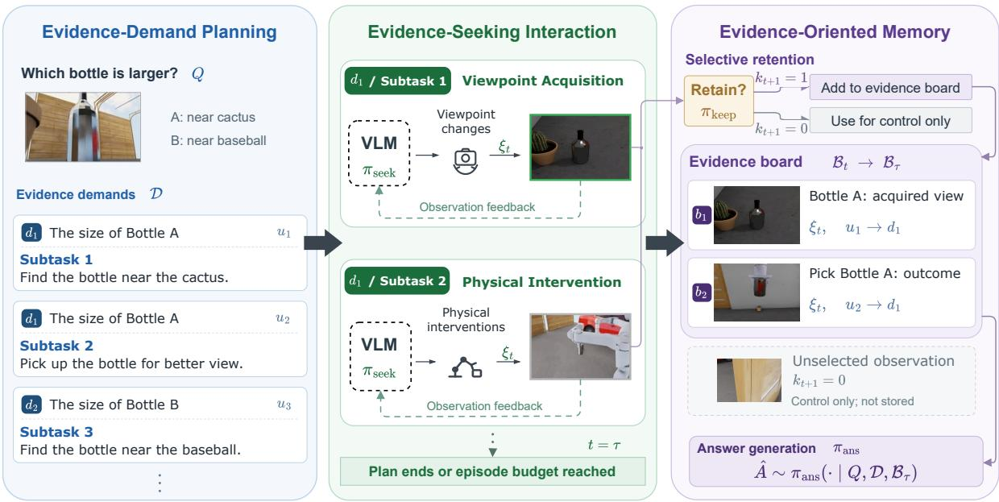
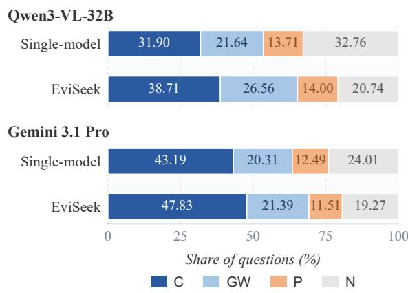
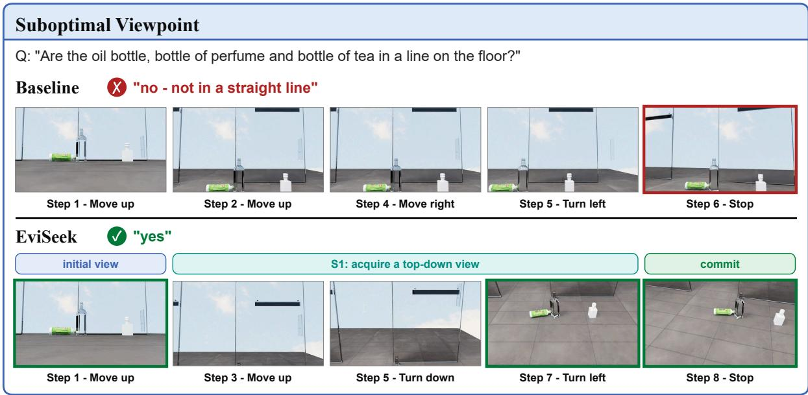
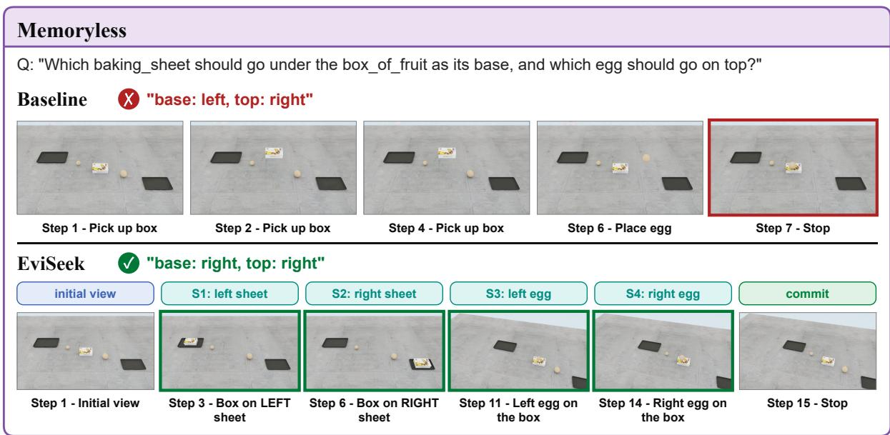
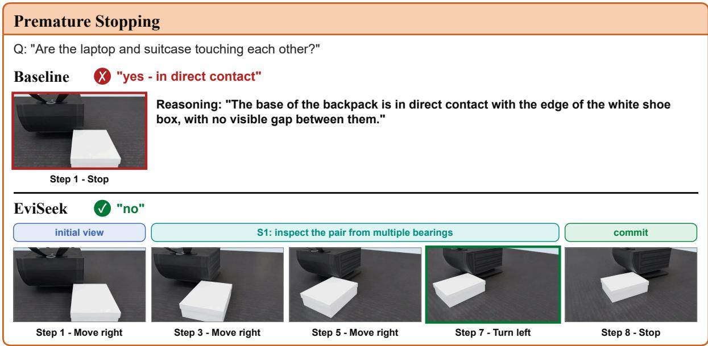
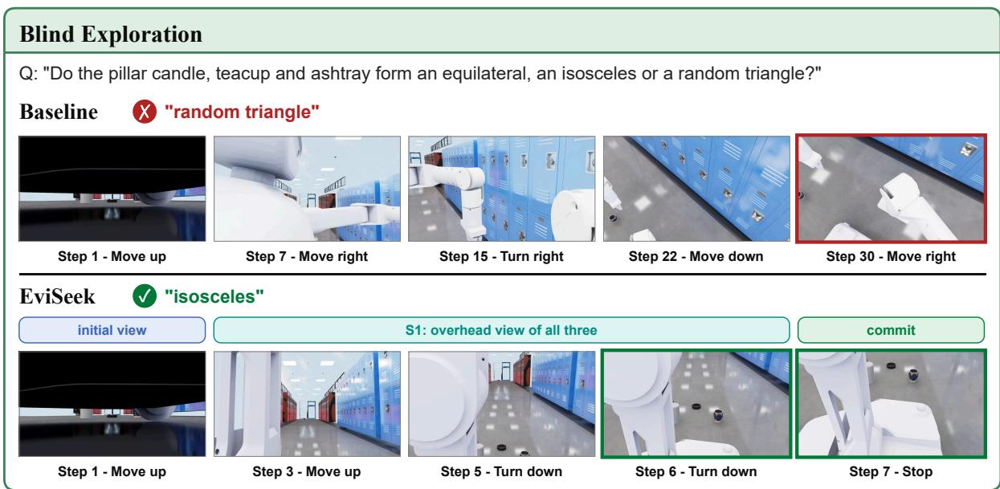

# EviSeek: An Evidence-Centric Agentic Framework for Embodied Active Information Seeking

Jintao Li1,2,3, Zhiyong Cao1,2, Baihua Xiao1, Yu Bai3, Börje F. Karlsson3

1Institute of Automation, Chinese Academy of Sciences

2School of Artificial Intelligence, University of Chinese Academy of Sciences 3Beijing Academy of Artificial Intelligence

## Abstract

Active embodied question answering requires agents to acquire evidence through viewpoint changes and physical interaction. The central challenge is to avoid undirected interaction: taking plausible actions without specifying what evidence they should reveal for answering the question. Action plans and accumulated histories alone can leave the informational purpose of an interaction implicit. We introduce EviSeek, a training-free framework that makes question-derived evidence demands explicit acquisition objectives, linking observation-conditioned actions and selectively retained evidence to the information the agent seeks. On 3,436 ESI-Bench questions, EviSeek improves accuracy over the Single-model agent by 7.1 percentage points with Qwen3-VL-32B and 3.7 points with Gemini 3.1 Pro, while improving visual-support-weighted accuracy and reducing mean token usage. These findings support making the informational purpose of interaction explicit, with action selection and evidence retention organized around what the agent needs to learn to answer the question.

## 1 Introduction

Active embodied question answering (A-EQA) requires agents to acquire information through interaction with a partially observed environment (Das et al., 2018a; Gordon et al., 2017; Majumdar et al., 2024). Relevant evidence may be occluded, distributed across locations, or revealed only by viewpoint changes and physical intervention (Bajcsy, 1988; Sawyer et al., 2024). Agents must decide what to observe, how to acquire those observations, and what to retain for answering.

ESI-Bench highlights action blindness: poor action choices yield inadequate observations and subsequent reasoning errors (Hong et al., 2026). We focus on three related difficulties: questions may leave the required observations unspecified; acquiring them may require several stages of interaction;

and limited visual history may discard earlier evidence before answering. For example, assessing a stacking configuration requires observing its state after a physical test and retaining that outcome. A plausible manipulation sequence alone does not establish that the relevant evidence was acquired or preserved.

Existing agents guide interaction through histories, exploration, retrieval, and confidence (Yao et al., 2022; Huang et al., 2022; Ren et al., 2024; Cheng et al., 2025). ScoutVLA seeks missing visual evidence (Lu et al., 2026), MemoryEQA shares memory across planning, stopping, and answering (Zhai et al., 2025), and R4 decomposes questions for structured retrieval (Sohn et al., 2026). Building on these directions, we ask whether explicit evidence demands can serve as a shared reference for acquisition and retention, improving active question answering with a fixed pretrained visionlanguage model (VLM).

We introduce EviSeek, a training-free framework organized around this representation. Evidence-Demand Planning derives observational targets from the question and initial view without assuming a candidate answer is correct, then assigns acquisition subtasks to them. Evidence-Seeking Interaction pursues these goals through viewpoint changes or physical intervention, conditioning actions on observations and execution feedback. Evidence-Oriented Memory selectively retains views and action outcomes on an evidence board, linked to their originating subtask and demand. Subtasks organize acquisition, while the board separates retained answer evidence from transient control observations. Spatial reasoning and evidence interpretation remain dependent on the pretrained VLM.

On 3,436 ESI-Bench questions (Hong et al., 2026), EviSeek improves overall accuracy over the official Single-model active agent by 7.1 percentage points with Qwen3-VL-32B and 3.7 with

Gemini 3.1 Pro, under the same task interface and environment-action ceiling. Both backbones also improve visual-support-weighted accuracy while using fewer model calls and tokens on average. Qwen ablations show that removing demands while retaining task decomposition lowers online accuracy. On fixed trajectories, replacing the board with recent-view memory or replacing selective retention with uniform sampling under the same frame-capacity limit also lowers accuracy. These comparisons support explicit demands and selective retention within the evaluated framework. A navigation variant improves grounded correctness over the RGB Single-model baseline on EXPRESS-Bench (Jiang et al., 2025). Benefits remain taskdependent: Metric Comparison regresses with both ESI-Bench backbones, delimiting the gains from evidence organization.

Our main contributions are as follows:

• We introduce a demand-indexed representation linking question-derived observational targets, acquisition subtasks, and retained evidence.

• We develop EviSeek, a training-free framework that uses this representation to organize viewpoint acquisition, physical intervention, and selective evidence retention.

• We report gains in overall accuracy and visual-support-weighted accuracy with lower mean model usage on two ESI-Bench backbones, supported by demand and memory ablations, and evaluate a navigation variant on EXPRESS-Bench.

## 2 Related Work

Active Information Acquisition. Active preference inference (Piriyakulkij et al., 2023), Active Task Disambiguation (Kobalczyk et al., 2025), BED-LLM (Choudhury et al., 2025), and CA-BED (Arnould et al., 2026) select informative queries to reduce uncertainty. Active perception studies viewpoint selection (Zhang et al., 2024b) and stopping through conformal prediction (Ren et al., 2024) or image–question relevance (Cheng et al., 2025). ScoutVLA (Lu et al., 2026) infers missing visual evidence and trains a dual-expert model for continuous UAV viewpoint refinement and terminal-view answering. EviSeek uses explicit demands to link acquisition subtasks with selectively retained observations under a frozen VLM, supporting both viewpoint changes and physical tests.

Spatial Navigation. Navigation agents use explicit reasoning (Zhou et al., 2023b) and expert discussion (Long et al., 2023), with RGB-video policies offering a map-free alternative (Zhang et al., 2024a). Maps (Huang et al., 2023; Yokoyama et al., 2024; Sakamoto et al., 2024), scene graphs (Saxena et al., 2024; Ginting et al., 2025), and visual memories (Yang et al., 2025) support exploration; Fine-EQA combines frontier search with goal-oriented inspection (Jiang et al., 2025). MemoryEQA (Zhai et al., 2025) updates structured memories through viewpoint comparison and retrieves module-specific information for frontier planning, stopping, and answering. Training-free R4 (Sohn et al., 2026) decomposes questions into semantic, spatial, and temporal retrieval keys over a 4D database constructed from RGB, point clouds, and SLAM. EviSeek uses demands to guide acquisition of new evidence and its selective retention for answering, without external mapping.

Interactive Question Answering and Execution. IQA (Gordon et al., 2017) couples navigation with object interaction. Early EQA further studies modular control, point-cloud perception, and multitarget reasoning (Das et al., 2018b; Wijmans et al., 2019; Yu et al., 2019). Grounded planners (Song et al., 2022; Rana et al., 2023; Bai et al., 2026), affordance-based skill selection (Ahn et al., 2022), executable navigation programs (Ziliotto et al., 2025), and visual programs (Gupta and Kembhavi, 2022; Surís et al., 2023) connect language to execution. Agents refine execution through feedback, reflection, or tree search (Sun et al., 2023; Shinn et al., 2023; Zhou et al., 2023a). On ESI-Bench, ParallelWorld (Chen et al., 2026) searches simulated branches, SHAPER (Wang et al., 2026) evolves skills and context, and Spatial-Interactor (Yao et al., 2026) learns from interaction trajectories. EviSeek links question-derived demands to executed actions and selectively retained observations using a frozen backbone.

## 3 Preliminaries

We now formalize the A-EQA setting introduced above, following OpenEQA (Majumdar et al., 2024). An A-EQA instance is specified by

$$
{ \mathcal { T } } = ( Q , { \mathcal { E } } , A ^ { \star } ) ,
$$

where $Q$ is the question, $A ^ { \star }$ is the ground-truth answer, and $\mathcal { E }$ is an interactive environment instantiated either in simulation or in the physical world. In response to an agent action, $\mathcal { E }$ transitions to a new latent state and returns a new egocentric visual observation that may reveal the perceptible consequences of that action. Formally, an interaction step is described by

$$
( x _ { t + 1 } , o _ { t + 1 } ) \sim \mathcal { E } ( \cdot \mid x _ { t } , a _ { t } ) ,
$$

where $x _ { t }$ denotes the latent environment state, which is not directly observable to the agent. The information available to the policy is represented by

$$
M _ { t } = { \mathcal { R } } _ { t } ( H _ { t } ) , H _ { t } = ( o _ { 0 } , a _ { 0 } , o _ { 1 } , \dots , a _ { t - 1 } , o _ { t } ) ,
$$

where $H _ { t }$ is the complete interaction history and $\mathcal { R } _ { t }$ denotes the history-access mechanism employed by the agent. Depending on the interaction horizon and model architecture, $\mathcal { R } _ { t }$ may preserve the complete history or produce a reduced representation through truncation, selection, compression, or structured aggregation (Das et al., 2018a; Zhai et al., 2025; Saxena et al., 2024; Zhang et al., 2026a; Sohn et al., 2026). At each decision step, the agent selects either an environmental action or a final answer according to

$$
a _ { t } \sim \pi ( \cdot \mid Q , M _ { t } ) , a _ { t } \in { \mathcal G } _ { \mathcal E } \cup \{ { \bf A } \mathrm { N S W E R } ( { \hat { A } } ) \} ,
$$

where $\mathcal { G } _ { \mathcal { E } }$ denotes the action space supported by $\mathcal { E } ,$ ranging from discrete action primitives to continuous low-level controls. Independently of this implementation granularity, any action $a _ { t } \in \mathcal G _ { \mathcal E }$ can be abstracted by how it changes the evidence available to the agent as either 1) viewpoint acquisition, which changes the observation geometry by moving the camera while leaving the non-agent world state unchanged; or 2) physical intervention, which modifies the environment state through action and acquires evidence from the observable consequences. If $a _ { t } \in \mathcal G _ { \mathcal E }$ , the action is executed in $\mathcal { E }$ and the returned observation extends the subsequent interaction history; if $a _ { t } = \mathbf { A N S W E R } ( { \hat { A } } )$ , the agent outputs $\hat { A }$ and terminates the interaction.

## 4 Method

## 4.1 Overview

EviSeek formulates A-EQA as an evidence acquisition problem. EviSeek represents the observations required by a question as evidence demands, then uses these demands to guide acquisition and retention. The key idea is to maintain an evidence state that decouples what information is required, how evidence is acquired, and which observations are retained.

At interaction step $t ,$ EviSeek instantiates the information state $M _ { t }$ of Section 3 as a demandindexed representation of the interaction history $H _ { t } \mathbf { : }$

$$
M _ { t } = \left( \mathcal { D } , \mathcal { P } _ { t } , \boldsymbol { B } _ { t } \right) ,
$$

where $\mathcal { D }$ is a set of $K$ question-conditioned evidence demands, $\mathcal { P } _ { t }$ records the execution status of the initial acquisition plan, and $B _ { t }$ is the evidence board that stores retained observations and interaction outcomes with demand-level provenance. The plan’s goals and demand assignments remain fixed within an episode; its active subtask and completion statuses change as execution proceeds. EviSeek updates $M _ { t }$ through the three stages detailed in turn below.

All components are implemented through prompting: throughout this paper, functions $F _ { \mathrm { d e m } } .$ $F _ { \mathrm { p l a n } }$ , and the policies $\pi _ { \mathrm { s e e k } } , \pi _ { \mathrm { k e e p } } .$ , and $\pi _ { \mathrm { a n s } }$ denote inference-time prediction procedures instantiated by a pretrained vision-language model, involving no task-specific training or parameter updates. EviSeek operates through the benchmark observation and action interfaces. In ESI-Bench, it uses RGB, task-exposed action feedback, and relative poses accumulated from camera actions (Appendix E).

## 4.2 Evidence-Demand Planning

An embodied question specifies the requested information but does not directly reveal the observations required to establish it. Given a question $Q$ and the initial observation $O 0 { \mathrm { : } }$ , EviSeek first constructs a set of evidence demands:

$$
\mathcal { D } = F _ { \mathrm { d e m } } ( Q , o _ { 0 } ) = \{ d _ { 1 } , \ldots , d _ { K } \} .
$$

Each demand $d _ { i }$ specifies an observable acquisition target intended to support answering the question; each corresponds to one information dependency of $Q$ and is constructed to satisfy three properties. First, it is question-conditioned: the demand targets information relevant to resolving $Q .$ . Second, it is observable: the demand can be supported by visual observations or by outcomes produced through legal interactions. Third, it is answer-agnostic: it specifies what should be observed without assuming that a candidate answer is correct. A physicaltest goal can name a candidate configuration, such as a stacking order, and request an observation of its outcome.

  
Figure 1: EviSeek connects question-derived evidence demands to acquisition goals, observation-conditioned actions, and retained evidence for answering. Unselected observations support control but are excluded from the evidence board

The demands define observational targets, while the interaction policy determines how to acquire them. Based on them, EviSeek constructs an initial acquisition plan:

$$
\begin{array} { r l } & { \mathcal { P } _ { 0 } = F _ { \mathrm { p l a n } } ( Q , \mathcal { D } , o _ { 0 } ) = \langle u _ { 1 } , \dots , u _ { J } \rangle , } \\ & { \quad u _ { j } = ( g _ { j } , \rho ( j ) ) , } \end{array}
$$

where $g _ { j }$ is the subtask’s observable acquisition goal and $\rho ( j ) \in \{ 1 , \dots , K \}$ indexes the demand $d _ { \rho ( j ) }$ that $u _ { j }$ serves.

A subtask describes what evidence should be obtained rather than how actions should be executed. Its realization is delegated to the interaction module, allowing the agent to adapt acquisition according to newly observed scene information.

## 4.3 Evidence-Seeking Interaction

Given an active acquisition subtask $u _ { j }$ with goal $g _ { j }$ , EviSeek selects actions that are expected to produce informative evidence. At step t, the seeker predicts an acquisition intent:

$$
\xi _ { t } \sim \pi _ { \mathrm { s e e k } } ( \cdot \mid g _ { j } , o _ { t } , W _ { t } ) ,
$$

where $W _ { t }$ denotes the transient working memory of the current subtask, distinct from the retained evidence board $B _ { t }$

The intent $\xi _ { t }$ can specify any legal composition of viewpoint-acquisition and physical-intervention actions (Section 3) in $\mathcal { G } _ { \mathcal { E } } .$ , which makes the intent set extensible. The intent space is an interface-level specification rather than a fixed component of the framework: the concrete intent set is instantiated for each target environment, while the acquisition procedure itself remains unchanged.

After executing $\xi _ { t } .$ , the environment returns a new observation and interface-level outcome:

$$
\left( o _ { t + 1 } , r _ { t + 1 } \right) = \operatorname { E x e c } _ { \mathcal { E } } ( \xi _ { t } ) .
$$

EviSeek then determines whether the resulting information should be retained:

$$
k _ { t + 1 } \sim \pi _ { \mathrm { k e e p } } ( \cdot \mid g _ { j } , o _ { t } , \xi _ { t } , o _ { t + 1 } , r _ { t + 1 } , W _ { t } ) ,
$$

where $k _ { t + 1 } \in \{ 0 , 1 \}$ indicates evidence retention.

Only selected results are added to the evidence board. Each retained evidence item is represented as:

$$
\boldsymbol { b } _ { t + 1 } = \big ( o _ { t + 1 } , r _ { t + 1 } , \xi _ { t } , u _ { j } , d _ { \rho ( j ) } \big ) ,
$$

which preserves the observation, the action outcome, the acquisition intent, the originating subtask, and the associated demand.

The evidence board is updated as:

$$
B _ { t + 1 } = \left\{ \begin{array} { l l } { B _ { t } \cup \{ b _ { t + 1 } \} , } & { k _ { t + 1 } = 1 , } \\ { B _ { t } , } & { k _ { t + 1 } = 0 . } \end{array} \right.
$$

Unselected observations may still be used temporarily for control but are excluded from the

evidence-board answer context. Task-supplied reference images and task-specific answer interfaces are documented in Appendix E.

## 4.4 Evidence-Oriented Memory

The evidence board stores selected observations and action outcomes with their originating subtask and demand. These links preserve acquisition provenance and organize the answer context by the information sought during exploration.

Plan progression and stopping. The seeker can stop the current acquisition subtask. This closes the subtask as it stands, binds its retained items to the associated demand, and advances execution to the next planned goal. A blocked or timed-out subtask is marked as timed out before execution advances. Neither transition requires a retained item to exist or a coverage predicate to be satisfied. The agent answers after the plan has no remaining subtask or the episode budget forces termination. Action selection remains observation-conditioned throughout execution.

Answer context. At the stopping time τ , the final answer is generated from the evidence-oriented memory:

$$
\hat { A } \sim \pi _ { \mathrm { a n s } } ( \cdot \mid Q , { \cal D } , B _ { \tau } ) .
$$

The evidence-board answerer receives the task question and answer contract, the evidence demands without coverage-status labels, and the selected evidence record, including applicable tasksupplied references. Acquisition plans and the full interaction history are not appended to this context. Task-specific benchmark callbacks can instead invoke their prescribed answer interface; Appendix E records this boundary. We evaluate this answer context through both answer correctness and visible evidence support.

## 5 Experiments

We evaluate whether explicit evidence demands and selective retention improve task success and the evidence available for answering. ESI-Bench tests accuracy, visual support, and resource use across Qwen and Gemini backbones, with Qwen ablations examining the two components. EXPRESS-Bench tests evidence acquisition through navigation with Gemini 3.1 Flash-Lite.

## 5.1 Benchmarks and Comparison Protocol

Primary benchmark. ESI-Bench (Hong et al., 2026) contains 10 task families and 29 subcategories in OmniGibson (Li et al., 2023), covering perceptual grounding, spatial and temporal reasoning, navigation, and physical manipulation. We evaluate $N = 3 .$ ,436 questions after the benchmark exclusions described in Appendix A. The active systems use the same question IDs, scene initializations, task specifications, answer evaluator, and legal atomic action space. Both have a maximum of 30 environment steps, with every executed primitive action charged to the budget.

Backbones. We use Qwen3-VL-32B (Bai et al., 2025) and Gemini 3.1 Pro (Google DeepMind, 2026) as separate backbones. Within each model family, the same backbone supplies all EviSeek VLM stages and the corresponding baselines. Appendix A reports model identifiers and decoding parameters.

Compared systems. Single-model uses the benchmark’s single-VLM perception–action loop with task-specific exploration advice. Its memory retains the full textual history and up to five preceding scene views alongside the current view. It uses self-reported answer confidence on a 0–1 scale, with a stopping threshold of 0.80. Appendix D details its inputs, memory, and stopping rule. EviSeek organizes planning, action selection, retention, and answering around evidence demands. It consumes the same task content and action interface, with its own structured outputs and selective evidence board. Execution advances through the initial plan according to subtask completion and the interaction budget. Passive answers from a single scene image without interacting, which provides a noninteractive reference on the same question set.

Metrics. We measure answer accuracy as

$$
\operatorname { A c c } = \frac { 1 0 0 } { N } \sum _ { i = 1 } ^ { N } s _ { i } ,
$$

where N is the number of evaluated questions and $s _ { i } ~ \in ~ \{ 0 , 1 \}$ is the benchmark’s correctness verdict. We report task-family accuracy and the question-weighted overall result, followed by visual evidence support and episode-level cost.

## 5.2 Task Performance Across Backbones

EviSeek improves overall accuracy over Singlemodel by 7.1 percentage points with the openweight Qwen backbone and 3.7 points with the closed Gemini backbone (Table 1). Single-model already interacts using the same backbone, task interface, and step ceiling. The additional gain therefore supports organizing acquisition and retention around explicit evidence needs. Paired tests support EviSeek’s gains over both Single-model and Passive for each backbone (Appendix G).

<table><tr><td rowspan="2">Category</td><td rowspan="2">#Q</td><td colspan="3">Qwen3-VL-32B</td><td rowspan="2"></td><td colspan="2">Gemini 3.1 Pro</td></tr><tr><td>Passive</td><td>Single-model</td><td>EviSeek</td><td>Passive Single-model</td><td>EviSeek</td></tr><tr><td>Perceptual Grounding</td><td>750</td><td>58.0</td><td>62.3</td><td>78.5</td><td>75.9</td><td>80.0</td><td>84.9</td></tr><tr><td>Physical Structure</td><td>254</td><td>55.9</td><td>52.4</td><td>50.4</td><td>62.2</td><td>69.3</td><td>70.5</td></tr><tr><td>Physical Dynamics</td><td>150</td><td>32.7</td><td>65.3</td><td>53.3</td><td>40.0</td><td>64.0</td><td>68.0</td></tr><tr><td>Specular Reflection</td><td>300</td><td>49.3</td><td>44.0</td><td>44.3</td><td>47.7</td><td>54.0</td><td>49.7</td></tr><tr><td>Spatial Relations</td><td>781</td><td>27.9</td><td>28.3</td><td>46.2</td><td>27.8</td><td>36.9</td><td>46.6</td></tr><tr><td>Metric Comparison</td><td>319</td><td>30.4</td><td>42.0</td><td>33.5</td><td>44.5</td><td>52.7</td><td>44.5</td></tr><tr><td>Cognitive Mapping</td><td>260</td><td>54.6</td><td>53.5</td><td>56.2</td><td>61.9</td><td>57.7</td><td>59.6</td></tr><tr><td>Enumerative Perception</td><td>270</td><td>1.5</td><td>3.0</td><td>7.4</td><td>4.1</td><td>14.8</td><td>14.4</td></tr><tr><td>Temporal Understanding</td><td>275</td><td>38.2</td><td>65.1</td><td>67.6</td><td>38.9</td><td>63.6</td><td>72.7</td></tr><tr><td>Action Sequencing</td><td>77</td><td>67.5</td><td>72.7</td><td>79.2</td><td>32.5</td><td>75.3</td><td>93.5</td></tr><tr><td>Overall</td><td>3436</td><td>40.5</td><td>45.6</td><td>52.7</td><td>46.4</td><td>55.7</td><td>59.3</td></tr></table>

Table 1: ESI-Bench accuracy (%) on 3,436 questions. #Q is task size; Overall is question-weighted. Bold marks the best result per backbone.

  
Figure 2: Correctness and visual-support decomposition on ESI-Bench (%). C and GW are support-weighted correct and incorrect mass; P and N are their residuals.

The larger gain with Qwen narrows its accuracy gap to Gemini. Gemini retains the highest final accuracy, but its improvement shows that a stronger backbone still benefits from explicit acquisition objectives and selective memory. EviSeek thus complements both tested backbones, with a greater benefit for the weaker baseline.

The shared gains are clearest in tasks that require revealing hidden content or resolving spatial relations, and extend to temporal understanding and action sequencing. Precise measurement remains difficult: Metric Comparison regresses for both backbones, while Physical Dynamics improves only with Gemini.

## 5.3 Visual Evidence Supporting the Answers

We evaluate answer-time visual support to connect task success with evidence acquisition.

Visual support and correctness decomposition. Following EXPRESS-Bench (Jiang et al., 2025), we weight correctness by visual support. GPT-5.5 grades each question’s answer-time images with $\delta _ { i } \in \{ 0 , 0 . 5 , 1 \}$ : 1 for verifiable decisive evidence, 0.5 for relevant but unresolved evidence, and 0 for absent decisive evidence. The judge receives the question, options, ground-truth answer, and numbered images, with system predictions withheld. Using the notation from Section 5.1, we define

$$
\begin{array} { l } { \displaystyle { C = \frac { 1 0 0 } { N } \sum _ { i } \delta _ { i } s _ { i } , } } \\ { \displaystyle { } } \\ { \displaystyle { \mathrm { G W } = \frac { 1 0 0 } { N } \sum _ { i } \delta _ { i } ( 1 - s _ { i } ) , } } \\ { \displaystyle { P = \mathrm { A c c } - C , } } \\ { \displaystyle { \mathrm { N } = 1 0 0 - \mathrm { A c c } - \mathrm { G W } . } } \end{array}
$$

Here $C$ and GW are support-weighted correct and incorrect mass, with residuals $P$ and N. The components sum to 100%; partial support splits a question equally between its supported and residual components. Grading includes reference and acquired images but excludes action-result text, so P does not measure reliance on prior knowledge. Appendix B details the protocol, and Table 6 reports subcategory C.

Results. Both backbones increase C and reduce N (Figure 2). This combination links the accuracy gain to more visually supported success and less residual error, supporting evidence acquisition directed toward the question. Qwen’s larger reduction in N accompanies its larger accuracy gain; Gemini benefits from the same pattern at a stronger starting point.

P stays nearly unchanged for Qwen and decreases for Gemini. Both backbones’ accuracy gains are therefore concentrated in C, tying improved task success to stronger visual support at answer time.

GW increases even as the total error rate falls, so a larger share of the remaining errors carries visual support. The larger rise in GW for Qwen shows that its greater improvement in evidence availability is only partly reflected in correct answers. This points to the remaining need to resolve incomplete or ambiguous evidence and interpret it correctly.

Overall visual support, C + GW, increases despite fewer answer-time images (Table 2). EviSeek thus supplies a more useful visual context with fewer images. Together, the four components support the role of evidence demands and the evidence board in directing acquisition toward questionrelevant observations and preserving them for answering. The ablations below examine their individual contributions.

## 5.4 Interaction Cost and Component Analysis

Episode-level cost. EviSeek reduces mean total tokens per episode relative to Single-model by 45.1% with Qwen and 13.9% with Gemini, while improving accuracy and visual support (Table 2). Both backbones also use fewer model calls despite EviSeek’s multiple VLM stages. Qwen gains more in both accuracy and token efficiency.

Acquisition intents can execute several primitive actions between calls, while selective retention supplies a compact answer context. The savings are consistent with separating environmental action from repeated model reasoning. Gemini illustrates this distinction: it takes more environment steps while using fewer model calls and tokens. The resource advantage therefore concerns model use, without requiring uniformly shorter trajectories.

<table><tr><td>Method</td><td>Steps</td><td>Calls</td><td>Tokens</td><td>Images</td></tr><tr><td>Qwen3-VL-32B</td><td></td><td></td><td></td><td></td></tr><tr><td>Single-model</td><td>18.79</td><td>20.55</td><td>139,380</td><td>5.91</td></tr><tr><td>EviSeek</td><td>18.11</td><td>12.69</td><td>76,470</td><td>4.39</td></tr><tr><td>Gemini 3.1 Pro</td><td></td><td></td><td></td><td></td></tr><tr><td>Single-model</td><td>10.71</td><td>12.15</td><td>86,887</td><td>5.24</td></tr><tr><td>EviSeek</td><td>12.17</td><td>10.05</td><td>74,839</td><td>4.38</td></tr></table>

Table 2: Mean resource use across all 3,436 ESI-Bench questions: primitive steps, VLM calls, and total tokens per episode. Images denotes images per answer.
<table><tr><td>Variant</td><td>Acc</td><td>∆Acc</td></tr><tr><td>EviSeek</td><td>52.7</td><td></td></tr><tr><td>w/o evidence demands</td><td>46.6</td><td>-6.1</td></tr><tr><td>w/o evidence board</td><td>47.6</td><td>-5.1</td></tr><tr><td>w/o selective retention</td><td>47.4</td><td>-5.3</td></tr></table>

Table 3: Qwen ablations on ESI-Bench: accuracy (Acc, %) and change from the corresponding online or replay reference (∆Acc, pp).

Calls cover all recorded VLM stages; tokens include input, output, and separately logged reasoning. All episode-level cost statistics are averaged over the same complete set of 3,436 ESI-Bench questions for every system, under the shared 30- step ceiling.

Module ablations. Table 3 evaluates three ablations with Qwen on all 3,436 questions. w/o evidence demands replaces demand-conditioned planning with direct question-to-subtask decomposition and removes demand descriptions and links from model inputs. We rerun interaction while retaining the action interface, selective evidence board, and stopping rules.

w/o evidence board replaces the answer-time board with Single-model memory: all textual history and the current view plus up to five preceding ordinary views. w/o selective retention replaces selected board frames with uniformly sampled trajectory frames under the same 20-frame capacity limit. Both memory variants reuse EviSeek’s recorded trajectories and rerun only answering, separating the effect of answer-time memory from exploration. Appendix G gives replay and scoring details.

Removing evidence demands lowers online accuracy despite retaining task decomposition, supporting explicit informational targets. Both memory variants also reduce accuracy on fixed trajectories. The recent-view result supports preserving earlier evidence, while uniform sampling supports relevance-based selection under the same memory capacity limit. Together, these results support specifying what interaction should establish and selectively preserving the resulting evidence for answering.

<table><tr><td>Method</td><td>C↑  $C ^ { * } \uparrow$ </td><td> $E _ { \mathrm { p a t h } }$  ↑</td><td> $d _ { T } \downarrow$ </td></tr><tr><td>Blind</td><td>53.79</td><td></td><td></td></tr><tr><td>Single-model</td><td>19.48 40.09</td><td>18.66</td><td>6.42</td></tr><tr><td>Fine-EQA</td><td>49.92 67.10</td><td>33.15</td><td>5.60</td></tr><tr><td>EviSeek (nav.)</td><td>41.60 63.09</td><td>37.77</td><td>6.37</td></tr></table>

Table 4: EXPRESS-Bench with Gemini 3.1 Flash-Lite.

## 5.5 Navigation Results on EXPRESS-Bench

EXPRESS-Bench (Jiang et al., 2025) tests whether navigation acquires observations that support freetext answers. It contains 2,044 question–trajectory pairs across 174 HM3D scenes (Ramakrishnan et al., 2021). We map acquisition intents to its legal navigation actions and use RGB observations without ESI-Bench’s task-specific guidance. This navigation variant includes coverage-dependent control and replanning, whereas the ESI-Bench configuration follows its initial acquisition plan. Appendix F details the action adaptation.

All interactive methods use Gemini 3.1 Flash-Lite and a maximum of 120 environment steps. Single-model is the RGB baseline. Fine-EQA (Jiang et al., 2025) uses frontier-based navigation with RGB-D mapping; we reproduce its official implementation with Flash-Lite for every internal model call. Blind answers from the question alone. The official GPT-4o-mini judge evaluates answers under the benchmark protocol. We report grounded correctness $C ,$ , answer-only correctness $C ^ { * }$ , path-weighted correctness $E _ { \mathrm { p a t h } }$ , and terminal geodesic distance $d _ { T }$ . Appendix A gives the scoring definitions.

The navigation variant improves both grounded and answer-only correctness over the RGB Singlemodel agent (Table 4). The grounded improvement shows that the benefit extends to answers supported by observations acquired during exploration. EviSeek also exceeds the question-only Blind reference in answer quality, whereas Single-model falls below it. This contrast highlights the value of organizing navigation around the information needed for the question: interaction becomes useful when it produces evidence that supports the final answer.

EviSeek approaches Fine-EQA’s answer-only correctness and attains the highest path-weighted correctness among the compared systems. This performance is achieved with RGB observations, without depth input or external mapping tools, whereas Fine-EQA uses depth observations and 3D voxel and semantic maps to guide exploration (Jiang et al., 2025). The comparison highlights the value of question-directed evidence acquisition under a more restricted observation interface, while Fine-EQA retains higher grounded correctness and a lower terminal distance.

## 6 Conclusion

EviSeek addresses undirected interaction in active embodied question answering by making the agent’s information needs explicit. Its evidence demands connect acquisition goals to selectively retained observations, giving action selection and memory a shared informational purpose. On ESI-Bench, this design improves accuracy and visual support over Single-model with Qwen and Gemini while reducing mean token use; ablations support the contributions of explicit demands and selective retention. The navigation variant also improves grounded answering over the RGB Single-model agent on EXPRESS-Bench without external mapping tools. These findings support organizing embodied interaction around what the agent needs to learn, with actions chosen to reveal relevant evidence and memory preserving it for the final answer.

## Limitations

EviSeek’s evidence board organizes observations without constructing a metric spatial model, leaving spatial inference to the pretrained VLM. Metric Comparison regresses with both backbones, including Gemini 3.1 Pro. Spatial uncertainty may still contribute to undirected interaction despite explicit evidence goals. Explicit spatial modeling and stronger native spatial reasoning are complementary directions to explore.

Recent evaluations report substantial manipulation and navigation capabilities for GPT-6 Astra in their tested settings, alongside limits in precision and dynamic control (Zhang et al., 2026b; Team et al., 2026). Its performance with EviSeek remains untested. A matched comparison with and without EviSeek would assess the framework’s added value.

Evaluation is limited to two simulated benchmarks with predefined action interfaces. Visual domain shifts, sensor noise, and uncertain contact and actuation on physical robots may alter the evidence obtained from planned actions. Transfer of EviSeek’s acquisition and retention decisions across this gap remains untested.

## References

Michael Ahn, Anthony Brohan, Noah Brown, Yevgen Chebotar, Omar Cortes, Byron David, Chelsea Finn, Chuyuan Fu, Keerthana Gopalakrishnan, Karol Hausman, et al. 2022. Do as i can, not as i say: Grounding language in robotic affordances. arXiv preprint arXiv:2204.01691.

Daniel Arnould, Rashad Aziz, Zixuan Kang, Tanav Changal, Kevin Zhu, Sunishchal Dev, Gabriel Grand, and Shreyas Sunil Kulkarni. 2026. CA-BED: Conversation-aware bayesian experimental design. arXiv preprint arXiv:2606.01182.

Shuai Bai, Yuxuan Cai, Ruizhe Chen, Keqin Chen, Xionghui Chen, Zesen Cheng, Lianghao Deng, Wei Ding, Chang Gao, Chunjiang Ge, et al. 2025. Qwen3- vl technical report. arXiv preprint arXiv:2511.21631.

Yu Bai, MingMing Yu, Chaojie Li, Ziyi Bai, Xinlong Wang, and Börje F. Karlsson. 2026. EgoActor: Grounding task planning into spatial-aware egocentric actions for humanoid robots via visual-language models. arXiv preprint arXiv: 2602.04515.

Ruzena Bajcsy. 1988. Active perception. Proceedings ofthe IEEE, 76(8):966–1005.

Min Chen, Shengjun Zhang, Yuxin Li, Zhang Zhang, Xin Fei, Chong Xia, and Yueqi Duan. 2026. ParallelWorld: Test-time scaling for embodied reasoning. arXiv preprint arXiv:2608.22971.

Kai Cheng, Zhengyuan Li, Xingpeng Sun, Byung-Cheol Min, Amrit Singh Bedi, and Aniket Bera. 2025. Efficienteqa: An efficient approach to open-vocabulary embodied question answering. In 2025 IEEE/RSJ International Conference on Intelligent Robots and Systems (IROS), pages 20357–20364. IEEE.

Deepro Choudhury, Sinead Williamson, Adam Golinski, Ning Miao, Freddie Bickford Smith, Michael Kirchhof, Yizhe Zhang, and Tom Rainforth. 2025. BED-LLM: Intelligent information gathering with LLMs and bayesian experimental design. arXiv preprint arXiv: 2508.21184.

Abhishek Das, Samyak Datta, Georgia Gkioxari, Stefan Lee, Devi Parikh, and Dhruv Batra. 2018a. Embodied question answering. In Proceedings ofthe IEEE

conference on computer vision and pattern recognition, pages 1–10.

Abhishek Das, Georgia Gkioxari, Stefan Lee, Devi Parikh, and Dhruv Batra. 2018b. Neural modular control for embodied question answering. arXiv preprint arXiv: 1810.11181.

Muhammad Fadhil Ginting, Dong-Ki Kim, Xiangyun Meng, Andrzej Reinke, Bandi Jai Krishna, Navid Kayhani, Oriana Peltzer, David D. Fan, Amirreza Shaban, Sung-Kyun Kim, Mykel J. Kochenderfer, Ali akbar Agha-mohammadi, and Shayegan Omidshafiei. 2025. Enter the mind palace: Reasoning and planning for long-term active embodied question answering. arXiv preprint arXiv: 2507.12846.

Google DeepMind. 2026. Gemini 3.1 Pro: Model card.

Daniel Gordon, Aniruddha Kembhavi, Mohammad Rastegari, Joseph Redmon, Dieter Fox, and Ali Farhadi. 2017. IQA: Visual question answering in interactive environments. arXiv preprint arXiv: 1712.03316.

Tanmay Gupta and Aniruddha Kembhavi. 2022. Visual programming: Compositional visual reasoning without training. arXiv preprint arXiv: 2211.11559.

Yining Hong, Jiageng Liu, Han Yin, Manling Li, Leonidas Guibas, Li Fei-Fei, Jiajun Wu, and Yejin Choi. 2026. ESI-Bench: Towards embodied spatial intelligence that closes the perception-action loop. arXiv preprint arXiv:2605.18746.

Chenguang Huang, Oier Mees, Andy Zeng, and Wolfram Burgard. 2023. Visual language maps for robot navigation. In 2023 IEEE International Conference on Robotics and Automation (ICRA), pages 10608– 10615. IEEE.

Wenlong Huang, Fei Xia, Ted Xiao, Harris Chan, Jacky Liang, Pete Florence, Andy Zeng, Jonathan Tompson, Igor Mordatch, Yevgen Chebotar, Pierre Sermanet, Noah Brown, Tomas Jackson, Linda Luu, Sergey Levine, Karol Hausman, and Brian Ichter. 2022. Inner monologue: Embodied reasoning through planning with language models. arXiv preprint arXiv: 2207.05608.

Kaixuan Jiang, Yang Liu, Weixing Chen, Jingzhou Luo, Ziliang Chen, Ling Pan, Guanbin Li, and Liang Lin. 2025. Beyond the destination: A novel benchmark for exploration-aware embodied question answering. In Proceedings of the IEEE/CVF International Conference on Computer Vision, pages 9091–9101.

Katarzyna Kobalczyk, Nicolas Astorga, Tennison Liu, and Mihaela van der Schaar. 2025. Active task disambiguation with LLMs. In International Conference on Learning Representations, volume 2025, pages 37823–37847.

Chengshu Li, Ruohan Zhang, Josiah Wong, Cem Gokmen, Sanjana Srivastava, Roberto Martín-Martín, Chen Wang, Gabrael Levine, Michael Lingelbach,

Jiankai Sun, et al. 2023. Behavior-1k: A benchmark for embodied ai with 1,000 everyday activities and realistic simulation. In Conference on Robot Learning, pages 80–93. PMLR.

Yuxing Long, Xiaoqi Li, Wenzhe Cai, and Hao Dong. 2023. Discuss before moving: Visual language navigation via multi-expert discussions. arXiv preprint arXiv: 2309.11382.

Wenhao Lu, Zhengqiu Zhu, Xiaofeng Wang, Xiaoran Zhang, Yatai Ji, Yong Zhao, Yue Hu, Yingzhen Nie, Jinlong Zhu, and Zheng Zhu. 2026. ScoutVLA: UAV-centric active perception via a dual-expert VLA model for open-world embodied question answering. arXiv preprint arXiv: 2606.14772.

Arjun Majumdar, Anurag Ajay, Xiaohan Zhang, Pranav Putta, Sriram Yenamandra, Mikael Henaff, Sneha Silwal, Paul Mcvay, Oleksandr Maksymets, Sergio Arnaud, et al. 2024. Openeqa: Embodied question answering in the era of foundation models. In Proceedings ofthe IEEE/CVF conference on computer vision and pattern recognition, pages 16488–16498.

Wasu Top Piriyakulkij, Volodymyr Kuleshov, and Kevin Ellis. 2023. Active preference inference using language models and probabilistic reasoning. arXiv preprint arXiv:2312.12009.

Santhosh K Ramakrishnan, Aaron Gokaslan, Erik Wijmans, Oleksandr Maksymets, Alex Clegg, John Turner, Eric Undersander, Wojciech Galuba, Andrew Westbury, Angel X Chang, et al. 2021. Habitatmatterport 3d dataset (hm3d): 1000 large-scale 3d environments for embodied ai. arXiv preprint arXiv:2109.08238.

Krishan Rana, Jesse Haviland, Sourav Garg, Jad Abou-Chakra, Ian Reid, and Niko Suenderhauf. 2023. Say-Plan: Grounding large language models using 3D scene graphs for scalable robot task planning. arXiv preprint arXiv: 2307.06135.

Allen Z. Ren, Jaden Clark, Anushri Dixit, Masha Itkina, Anirudha Majumdar, and Dorsa Sadigh. 2024. Explore until confident: Efficient exploration for embodied question answering. arXiv preprint arXiv: 2403.15941.

Koya Sakamoto, Daichi Azuma, Taiki Miyanishi, Shuhei Kurita, and Motoaki Kawanabe. 2024. Mapbased modular approach for zero-shot embodied question answering. arXiv preprint arXiv: 2405.16559.

Danny P. Sawyer, Nan Rosemary Ke, Hubert Soyer, Martin Engelcke, David P Reichert, Drew A. Hudson, John Reid, Alexander Lerchner, Danilo Jimenez Rezende, Timothy P Lillicrap, Michael Mozer, and Jane X Wang. 2024. Can foundation models actively gather information in interactive environments to test hypotheses? arXiv preprint arXiv: 2412.06438.

Saumya Saxena, Blake Buchanan, Chris Paxton, Peiqi Liu, Bingqing Chen, Narunas Vaskevicius, Luigi

Palmieri, Jonathan Francis, and Oliver Kroemer. 2024. Grapheqa: Using 3d semantic scene graphs for real-time embodied question answering. arXiv preprint arXiv:2412.14480.

Noah Shinn, Federico Cassano, Edward Berman, Ashwin Gopinath, Karthik Narasimhan, and Shunyu Yao. 2023. Reflexion: Language agents with verbal reinforcement learning. arXiv preprint arXiv: 2303.11366.

Tin Stribor Sohn, Maximilian Dillitzer, Jason J. Corso, and Eric Sax. 2026. R4: Retrieval-augmented reasoning for vision-language models in 4D spatio-temporal space. In Proceedings of the IEEE/CVF Conference on Computer Vision and Pattern Recognition, pages 38711–38721.

Chan Hee Song, Jiaman Wu, Clayton Washington, Brian M. Sadler, Wei-Lun Chao, and Yu Su. 2022. LLM-Planner: Few-shot grounded planning for embodied agents with large language models. arXiv preprint arXiv: 2212.04088.

Haotian Sun, Yuchen Zhuang, Lingkai Kong, Bo Dai, and Chao Zhang. 2023. AdaPlanner: Adaptive planning from feedback with language models. arXiv preprint arXiv: 2305.16653.

Dídac Surís, Sachit Menon, and Carl Vondrick. 2023. ViperGPT: Visual inference via Python execution for reasoning. arXiv preprint arXiv: 2303.08128.

Galbot Team, Xuchuan Chen, Xiaoqian Cheng, Yu Deng, Lihe Ding, Shaocong Dong, Xiangjun Gao, Haozhe Jia, Zekai Li, Zhoujian Li, et al. 2026. Systematically exploring the capabilities of GPT-6 Astra as embodied policies. arXiv preprint arXiv:2609.38537.

Peidong Wang, Zhiming Ma, Ying Chang, Xufang Luo, Xiaocui Yang, Shi Feng, Yuqing Yang, and Dongsheng Li. 2026. Self-evolving embodied agents via skill-harness evolution. arXiv preprint arXiv:2608.11350.

Erik Wijmans, Samyak Datta, Oleksandr Maksymets, Abhishek Das, Georgia Gkioxari, Stefan Lee, Irfan Essa, Devi Parikh, and Dhruv Batra. 2019. Embodied question answering in photorealistic environments with point cloud perception. arXiv preprint arXiv: 1904.03461.

Yuncong Yang, Han Yang, Jiachen Zhou, Peihao Chen, Hongxin Zhang, Yilun Du, and Chuang Gan. 2025. 3D-Mem: 3D scene memory for embodied exploration and reasoning. In Proceedings of the IEEE/CVF Conference on Computer Vision and Pattern Recognition, pages 17294–17303.

Kaixiang Yao, Xu Wang, Miao Pan, Hu Xiyue, Weishi Wang, Daniel Dahlmeier, Jintao Chen, Yongliang Shen, Xuhong Zhang, and Wenqi Zhang. 2026. Spatial-Interactor: Learning spatial reasoning through interaction with the observable physical world. arXiv preprint arXiv:2609.23038.

Shunyu Yao, Jeffrey Zhao, Dian Yu, Nan Du, Izhak Shafran, Karthik Narasimhan, and Yuan Cao. 2022. React: Synergizing reasoning and acting in language models. arXiv preprint arXiv:2210.03629.

Naoki Yokoyama, Sehoon Ha, Dhruv Batra, Jiuguang Wang, and Bernadette Bucher. 2024. VLFM: Visionlanguage frontier maps for zero-shot semantic navigation. In 2024 IEEE International Conference on Robotics and Automation (ICRA), pages 42–48. IEEE.

Licheng Yu, Xinlei Chen, Georgia Gkioxari, Mohit Bansal, Tamara L. Berg, and Dhruv Batra. 2019. Multi-target embodied question answering. arXiv preprint arXiv: 1904.04686.

Mingliang Zhai, Zhi Gao, Yuwei Wu, and Yunde Jia. 2025. Memory-centric embodied question answering. arXiv preprint arXiv:2505.13948.

Haochen Zhang, Nirav Savaliya, Faizan Siddiqui, and Enna Sachdeva. 2026a. FAST-EQA: Efficient embodied question answering with global and local region relevancy. In Proceedings of the IEEE/CVF Winter Conference on Applications ofComputer Vision, pages 1664–1673.

Jiazhao Zhang, Kunyu Wang, Rongtao Xu, Gengze Zhou, Yicong Hong, Xiaomeng Fang, Qi Wu, Zhizheng Zhang, and He Wang. 2024a. NaVid: Video-based VLM plans the next step for vision-and-language navigation. arXiv preprint arXiv:2402.15852.

Sha Zhang, Di Huang, Jiajun Deng, Shixiang Tang, Wanli Ouyang, Tong He, and Yanyong Zhang. 2024b. Agent3D-Zero: An agent for zero-shot 3D understanding. arXiv preprint arXiv: 2403.11835.

Wenbo Zhang, Kaixuan Wang, Yutao Ouyang, Xiaoyu Huang, Liyang Li, Kailun Su, Weiyang Jin, Wenhao Chai, Haotian Liang, Zhiyang Dou, et al. 2026b. An unexpected robot policy: Early evaluations of GPT-6 Astra on RoboDojo and beyond. arXiv preprint arXiv:2609.24170.

Andy Zhou, Kai Yan, Michal Shlapentokh-Rothman, Haohan Wang, and Yu-Xiong Wang. 2023a. Language agent tree search unifies reasoning acting and planning in language models. arXiv preprint arXiv: 2310.04406.

Gengze Zhou, Yicong Hong, and Qi Wu. 2023b. NavGPT: Explicit reasoning in vision-and-language navigation with large language models. arXiv preprint arXiv: 2305.16986.

Filippo Ziliotto, Tommaso Campari, Luciano Serafini, and Lamberto Ballan. 2025. TANGO: Training-free embodied AI agents for open-world tasks. In Proceedings ofthe IEEE/CVF Conference on Computer Vision and Pattern Recognition, pages 24603–24613.

## A Evaluation Accounting and Model Configuration

Question set. ESI-Bench releases 3,502 questions. The evaluation excludes 66 questions: 60 are skipped by the official active-perception code and 6 Unobserved Change questions have reference images that fail to render. The main comparison uses 3,436 question IDs. Each task-family value uses its actual question count, and overall accuracy is a micro-average over all questions. Abstentions, unparseable predictions, and episodes that terminate without an answer count as incorrect.

Answer-format normalization. All three Qwen systems use two deterministic normalizations: pipeseparated stacking orders are accepted as commaseparated orders, and complete navigation routes are reduced to blank positions only when all prompt-supplied steps match and each blank maps to a unique listed option. Neither transformation uses ground-truth answers.

Passive input protocol. Passive receives one scene image and the question, without interaction history. Qwen Passive uses the pre-action view for each of the 3,436 questions. Its predictions use the same answer-format normalization as the Qwen active systems.

Paired significance tests. We compare EviSeek’s overall accuracy with Single-model and Passive separately for each backbone, pairing all 3,436 question IDs and counting missing answers as incorrect. The tests use the scores in Table 1. We apply two-sided exact McNemar tests and Holm correction across the four comparisons. Pointwise 95% confidence intervals use 200,000 paired bootstrap resamples of question IDs and percentile endpoints (seed 20261012). Table 9 reports the results.

Qwen3-VL-32B. The Qwen backbone is Qwen3-VL-32B-Instruct, served in BF16 through an OpenAI-compatible vLLM endpoint under the alias qwen3-vl-32b. EviSeek and Single-model use temperature 0.2, top-p 0.9, and a ceiling of 30 primitive actions. Passive uses temperature 0, top-p 1, and a 512-token output limit.

Gemini 3.1 Pro. The Gemini ESI-Bench experiments use gemini-3.1-pro-preview for EviSeek, Single-model, and Passive. EviSeek requests temperature 0.2, top-p 0.9, and a thinking budget of

512 through a Gemini-compatible endpoint. Both active systems have a ceiling of 30 primitive actions.

Gemini 3.1 Flash-Lite. We use this model under the identifier gemini-3.1-flash-lite for all EXPRESS-Bench agents, with a maximum of 120 environment steps. Single-model and EviSeek receive RGB observations; Fine-EQA retains RGB-D mapping and uses Flash-Lite for every internal model call. Flash-Lite also supplies the ESI-Bench intent ablation in Appendix H.

GPT judges. ESI-Bench visual support is assessed by gpt-5.5 through a Responsescompatible API with low reasoning effort and JSON output. The output limit is 4,096 tokens, increased to 8,192 when retrying incomplete outputs; temperature and top-p are not overridden. EXPRESS-Bench uses its official gpt-4o-mini judge for answer and grounding scores.

EXPRESS-Bench scoring. The official GPT-4omini judge assigns free-text answers a grounding grade $\delta ~ \in ~ \{ 0 , 0 . 5 , 1 \}$ and an answer score $\sigma \in [ 1 , 5 ]$ . Grounded correctness is $C = \overline { { \delta \sigma } } / 5$ , and answer-only correctness is $C ^ { * } = \overline { { \sigma } } / 5$ . We also use the benchmark’s path-weighted correctness $E _ { \mathrm { p a t h } }$ and terminal geodesic distance $d _ { T }$ . Table 4 reports the three correctness scores on a 0–100 scale and distance in meters. EXPRESS-Bench grades freetext answers, whereas ESI-Bench uses binary correctness. Their support-weighted scores therefore use different answer-scoring rules and are not directly comparable.

## B Visual-Support Protocol

Context extraction. For each scored prediction, $V _ { i }$ is the image set attached to the model call that produced that prediction. Images available earlier in the trajectory but absent from that call are excluded. Task-supplied reference images are included if attached, with their provenance recorded separately from environment observations. Extraction preserves image order and deduplicates repeated identical paths. For judging, images are converted to RGB, fitted within 1365 × 768 pixels without upscaling, and numbered in an upper-left overlay. JPEG conversion uses quality 90; compressed inputs are saved as PNG after numbering to avoid further lossy compression. The extracted image set also determines the images-per-answer statistic in Table 2.

Judge request and rubric. The GPT-5.5 judge uses the configuration in Appendix A. The request contains the question, options, reference answer, and numbered images, but not the system prediction. Grade 1 requires all decisive facts to be visually verifiable; 0.5 denotes relevant visible content with a decisive fact unresolved; and 0 denotes absent evidence. Task-supplied references and acquired views are equally valid, multiple frames can jointly establish support, and ambiguity between adjacent grades is resolved toward the lower grade. Examples distinguish an ambiguity resolved by a new angle, visible objects whose relative size remains indeterminate, and a physical outcome never observed.

## C Full Task Breakdown

Tables 5 and 6 report answer accuracy and visualsupport-weighted accuracy for all 29 subcategories, with the same question IDs and denominators.

## D Single-model Baseline Details

Single-model denotes ESI-Bench’s single-VLM active agent, evaluated with the Qwen and Gemini backbones. This appendix describes its task inputs, memory, and confidence-based stopping. Model and decoding settings appear in Appendix A.

Task prompts. ESI-Bench supplies the question, candidate answers or answer format, legal actions, and task-specific exploration advice. The baseline thus receives guidance about useful observations and interventions, in addition to the question. Appendix J reproduces a representative task prompt and the EviSeek stage excerpts.

Memory and per-step inputs. The textual history accumulates past actions and outcomes together with preceding model responses. The ordinary visual context contains the current RGB view and available views from the five most recent history steps, giving at most six ordinary scene views. The five-step window limits visual history; it does not truncate the textual history. Task-supplied reference images and additional observations from physical interactions are included when applicable. Single-model does not organize this history into a demand-indexed evidence board.

Task-exposed action feedback. Both active systems receive structured execution results in the task history. Fields include operation, success, reason, and task-dependent states such as current\_stack. These can convey physical information beyond RGB: stacking feedback reports placement success after simulator settling and stability checks. The common history serializer does not forward the action result’s world-position, quaternion, or gt\_orders fields; final-answer correctness is an evaluation output. EviSeek extracts this shared feedback and associates it with retained observations, as detailed in Appendix E.

Outputs and confidence. The model is prompted to return one JSON object with an action, a tentative answer, a brief rationale, and a scalar confidence in [0, 1]. Confidence is generated by the VLM as part of its response. It is neither a token probability nor an externally calibrated estimate of answer correctness. The benchmark’s threshold is θ = 0.80. This online control signal is separate from the post-hoc visual-support grade δ in Section 5.3; the support judge does not decide when exploration stops.

Task-dependent stopping. Confidence-based stopping requires the reported value to reach θ = 0.80 and satisfy the task’s stopping checks, which may also involve answer validity and a minimum exploration length. The benchmark retains taskspecific stopping logic. An episode can also end through a task-supported stop action or at the 30- step interaction limit.

Final answer. At termination, the benchmark resolves an answer from the interaction history. If the response cannot be mapped to the listed options, its forced-choice fallback requests a final selection without further environment interaction.

Task text shared with EviSeek. EviSeek receives the same task definition, exploration advice, and action list, distributed across planning, seeking, and answering in each stage’s input format. It uses structured stage outputs and subtask-based progression in place of the Single-model action-output template and confidence-based control. Both systems use the task’s answer parser and scorer. The comparison changes planning, visual retention, answer context, and stopping under a shared action ceiling.

## E EviSeek Implementation Details

The framework uses prompted VLM operators for demand decomposition, action selection, retention, and answer generation. In ESI-Bench, the acquisition plan is fixed at the start of an episode, while action selection adapts to observations. A seeker stop, blocked subtask, or subtask timeout advances execution to the next acquisition goal. Retained observations remain linked to the originating demand. The answerer is called when the plan ends or the interaction budget is exhausted.

<table><tr><td rowspan="2">Subcategory</td><td rowspan="2">#Q</td><td colspan="3">Qwen</td><td colspan="3">Gemini</td></tr><tr><td>Passive</td><td>Single-model</td><td>EviSeek</td><td>Passive</td><td>Single-model</td><td>EviSeek</td></tr><tr><td colspan="8">Perceptual Grounding</td></tr><tr><td>View Hallucination</td><td>437</td><td>55.8</td><td>59.5</td><td>78.9</td><td>77.6</td><td>82.8</td><td>88.1</td></tr><tr><td>Partial Occlusion</td><td>95</td><td>22.1</td><td>50.5</td><td>86.3</td><td>54.7</td><td>74.7</td><td>85.3</td></tr><tr><td>Material Transparency</td><td>218</td><td>78.0</td><td>72.9</td><td>74.3</td><td>81.7</td><td>76.6</td><td>78.4</td></tr><tr><td colspan="8">Physical Structure</td></tr><tr><td>Rigid Containment</td><td>20</td><td>55.0</td><td>50.0</td><td>45.0</td><td>70.0</td><td>80.0</td><td>60.0</td></tr><tr><td>Liquid Volume</td><td>136</td><td>69.1</td><td>61.0</td><td>57.4</td><td>75.7</td><td>75.7</td><td>73.5</td></tr><tr><td>Deformable</td><td>98</td><td>37.8</td><td>40.8</td><td>41.8</td><td>41.8</td><td>58.2</td><td>68.4</td></tr><tr><td colspan="8">Physical Dynamics</td></tr><tr><td>Inclined Plane</td><td>61</td><td>52.5</td><td>80.3</td><td>73.8</td><td>59.0</td><td>75.4</td><td>85.2</td></tr><tr><td>Stacking &amp; Stability</td><td>89</td><td>19.1</td><td>55.1</td><td>39.3</td><td>27.0</td><td>56.2</td><td>56.2</td></tr><tr><td colspan="8">Specular Reflection</td></tr><tr><td>Reflection Authoring</td><td>99</td><td>50.5</td><td>50.5</td><td>50.5</td><td>53.5</td><td>71.7</td><td>65.7</td></tr><tr><td>Spatial Relations</td><td>113</td><td>50.4</td><td>43.4</td><td>46.9</td><td>39.8</td><td>46.0</td><td>35.4</td></tr><tr><td>Correspondence</td><td>88</td><td>46.6</td><td>37.5</td><td>34.1</td><td>51.1</td><td>44.3</td><td>50.0</td></tr><tr><td colspan="8">Spatial Relations</td></tr><tr><td>Linear Alignment</td><td>94</td><td>53.2</td><td>56.4</td><td>38.3</td><td>37.2</td><td>68.1</td><td>79.8</td></tr><tr><td>Geometric Configuration</td><td>568</td><td>14.8</td><td>17.6</td><td>43.7</td><td>16.2</td><td>23.6</td><td>36.1</td></tr><tr><td>Physical Contact</td><td>119</td><td>70.6</td><td>57.1</td><td>64.7</td><td>75.6</td><td>75.6</td><td>70.6</td></tr><tr><td colspan="8">Metric Comparison</td></tr><tr><td>Dimensional Size</td><td>167</td><td>10.8</td><td>26.9</td><td>6.6</td><td>23.4</td><td>39.5</td><td>22.2</td></tr><tr><td>Spatial Distance</td><td>152</td><td>52.0</td><td>58.6</td><td>63.2</td><td>67.8</td><td>67.1</td><td>69.1</td></tr><tr><td colspan="8">Cognitive Mapping</td></tr><tr><td>Connectivity</td><td>60</td><td>58.3</td><td>55.0</td><td>66.7</td><td>63.3</td><td>50.0</td><td>65.0</td></tr><tr><td>Traversable Passage</td><td>60</td><td>70.0</td><td>75.0</td><td>60.0</td><td>71.7</td><td>66.7</td><td>63.3</td></tr><tr><td>Regional Boundary</td><td>80</td><td>50.0</td><td>52.5</td><td>52.5</td><td>63.8</td><td>58.8</td><td>56.2</td></tr><tr><td>Long-Term Navigation</td><td>60</td><td>41.7</td><td>31.7</td><td>46.7</td><td>48.3</td><td>55.0</td><td>55.0</td></tr><tr><td colspan="8">Enumerative Perception</td></tr><tr><td>Counting w Occlusion</td><td>30</td><td>6.7</td><td>16.7</td><td>13.3</td><td>13.3</td><td>23.3</td><td>10.0</td></tr><tr><td>Spatial Segmentation</td><td>30</td><td>3.3</td><td>6.7</td><td>10.0</td><td>13.3</td><td>40.0</td><td>26.7</td></tr><tr><td>Merged Observation</td><td>60</td><td>0.0</td><td>0.0</td><td>1.7</td><td>0.0</td><td>10.0</td><td>3.3</td></tr><tr><td>Category Ambiguity</td><td>60</td><td>0.0</td><td>0.0</td><td>13.3</td><td>3.3</td><td>13.3</td><td>16.7</td></tr><tr><td>Structural Enclosure</td><td>40</td><td>2.5</td><td>2.5</td><td>2.5</td><td>2.5</td><td>7.5</td><td>10.0</td></tr><tr><td>Illumination Variability</td><td>50</td><td>0.0</td><td>0.0</td><td>6.0</td><td>0.0</td><td>8.0</td><td>24.0</td></tr><tr><td colspan="8">Temporal Understanding</td></tr><tr><td>Unobserved Change</td><td>142</td><td>39.4</td><td>85.9</td><td>93.0</td><td>40.1</td><td>81.0</td><td>96.5</td></tr><tr><td>Agent Observation</td><td>133</td><td>36.8</td><td>42.9</td><td>40.6</td><td>37.6</td><td>45.1</td><td>47.4</td></tr><tr><td colspan="8">Action Sequencing</td></tr><tr><td>Action Order Inference</td><td>77</td><td>67.5</td><td>72.7</td><td>79.2</td><td>32.5</td><td>75.3</td><td>93.5</td></tr><tr><td>Overall</td><td>3436</td><td>40.5</td><td>45.6</td><td>52.7</td><td>46.4</td><td>55.7</td><td>59.3</td></tr></table>

Table 5: Accuracy (%) across the 29 ESI-Bench subcategories. #Q is subcategory size; Overall is question-weighted. Bold marks the best result per backbone.

<table><tr><td rowspan="2">Subcategory</td><td rowspan="2">#Q</td><td colspan="2">Qwen3-VL-32B</td><td colspan="2">Gemini 3.1 Pro</td></tr><tr><td>Single-model</td><td>EviSeek</td><td>Single-model</td><td>EviSeek</td></tr><tr><td colspan="6">Perceptual Grounding</td></tr><tr><td>View Hallucination</td><td>437</td><td>52.86</td><td>67.16</td><td>75.51</td><td>79.18</td></tr><tr><td>Partial Occlusion</td><td>95</td><td>37.89</td><td>35.26</td><td>64.21</td><td>60.53</td></tr><tr><td>Material Transparency</td><td>218</td><td>56.19</td><td>69.72</td><td>65.60</td><td>69.72</td></tr><tr><td colspan="6">Physical Structure</td></tr><tr><td>Rigid Containment</td><td>20</td><td>30.00</td><td>32.50</td><td>47.50</td><td>45.00</td></tr><tr><td>Liquid Volume</td><td>136</td><td>59.93</td><td>55.88</td><td>74.26</td><td>72.06</td></tr><tr><td>Deformable</td><td>98</td><td>33.16</td><td>32.14</td><td>44.39</td><td>54.08</td></tr><tr><td colspan="6">Physical Dynamics</td></tr><tr><td>Inclined Plane</td><td>61</td><td>78.69</td><td>60.66</td><td>74.59</td><td>84.43</td></tr><tr><td>Stacking &amp; Stability</td><td>89</td><td>30.90</td><td>23.60</td><td>30.34</td><td>33.15</td></tr><tr><td colspan="6">Specular Reflection</td></tr><tr><td>Reflection Authoring</td><td>99</td><td>43.43</td><td>40.40</td><td>61.62</td><td>46.97</td></tr><tr><td>Spatial Relations</td><td>113</td><td>26.55</td><td>32.30</td><td>34.51</td><td>25.66</td></tr><tr><td>Correspondence</td><td>88</td><td>17.61</td><td>23.30</td><td>24.43</td><td>38.07</td></tr><tr><td colspan="6">Spatial Relations</td></tr><tr><td>Linear Alignment</td><td>94</td><td>35.11</td><td>36.17</td><td>64.89</td><td>78.19</td></tr><tr><td>Geometric Configuration</td><td>568</td><td>6.16</td><td>18.22</td><td>15.58</td><td>23.06</td></tr><tr><td>Physical Contact</td><td>119</td><td>34.45</td><td>44.96</td><td>40.76</td><td>45.80</td></tr><tr><td colspan="6">Metric Comparison</td></tr><tr><td>Dimensional Size</td><td>167</td><td>15.57</td><td>4.19</td><td>25.75</td><td>16.47</td></tr><tr><td>Spatial Distance</td><td>152</td><td>30.26</td><td>45.39</td><td>46.71</td><td>54.28</td></tr><tr><td colspan="6">Cognitive Mapping</td></tr><tr><td>Connectivity</td><td>60</td><td>18.33</td><td>30.00</td><td>22.50</td><td>37.50</td></tr><tr><td>Traversable Passage</td><td>60</td><td>17.50</td><td>23.33</td><td>15.00</td><td>19.17</td></tr><tr><td>Regional Boundary</td><td>80</td><td>33.12</td><td>35.62</td><td>40.62</td><td>44.38</td></tr><tr><td>Long-Term Navigation</td><td>60</td><td>10.83</td><td>23.33</td><td>20.00</td><td>25.83</td></tr><tr><td colspan="6">Enumerative Perception</td></tr><tr><td>Counting w Occlusion</td><td>30</td><td>16.67</td><td>11.67</td><td>13.33</td><td>8.33</td></tr><tr><td>Spatial Segmentation</td><td>30</td><td>5.00</td><td>10.00</td><td>26.67</td><td>20.00</td></tr><tr><td>Merged Observation</td><td>60</td><td>0.00</td><td>0.00</td><td>7.50</td><td>2.50</td></tr><tr><td>Category Ambiguity</td><td>60</td><td>0.00</td><td>10.00</td><td>12.50</td><td>15.00</td></tr><tr><td>Structural Enclosure</td><td>40</td><td>1.25</td><td>2.50</td><td>3.75</td><td>7.50</td></tr><tr><td>Illumination Variability</td><td>50</td><td>0.00</td><td>6.00</td><td>7.00</td><td>23.00</td></tr><tr><td colspan="6">Temporal Understanding</td></tr><tr><td>Unobserved Change</td><td>142</td><td>84.15</td><td>91.55</td><td>76.06</td><td>94.01</td></tr><tr><td>Agent Observation</td><td>133</td><td>36.47</td><td>27.82</td><td>28.57</td><td>39.85</td></tr><tr><td>Action Sequencing</td><td></td><td></td><td></td><td></td><td></td></tr><tr><td colspan="6">Action Order Inference</td></tr><tr><td>Overall</td><td>3436</td><td>31.90</td><td>38.71</td><td>43.19</td><td>47.83</td></tr></table>

Table 6: Visual-support-weighted accuracy C (%) across ESI-Bench subcategories. Correct answers are weighted by answer-time visual support (0, 0.5, or 1). #Q is subcategory size; Overall is question-weighted.

Action-derived relative poses. In ESI-Bench, the pose and d(east,north,height) annotations in Appendix J are internal estimates initialized at zero. Camera commands update nominal translation by 0.25 m and rotation by 15◦, subject to vertical and pitch bounds. The E/N labels denote internal axes, not world coordinates. No simulator camera pose is read to produce or correct these estimates, so they can differ from actual displacement. For example, a recorded d(+0.00E,+0.00N,z0.75) follows three upward commands. Single-model receives the action history rather than these computed pose annotations.

Feedback annotations. EviSeek extracts the latest result= entry from the task history, removes model reasoning, and truncates the feedback to 220 characters. It adds this text to the action trail and attaches a shortened summary to retained outcome frames. A recorded example is [ENV] pour\_small\_obj success=True: the task routine reports that the object cleared the container rim, not that the final answer is correct. Thus, the prompt’s “verdict” refers to task-exposed execution feedback. Its source is shared with Single-model; its retention and presentation differ.

Task-specific answer interfaces. The general answer interface supplies the question and answer contract, evidence demands, selected observations and their notes, and applicable reference images. In Inclined Plane, the benchmark’s put action instead invokes an answer call using the resulting physics-frame sequence. Visual-support evaluation uses the images attached to the scored answer call in either interface. Task parsers, forced-choice fallbacks, and scorers follow the benchmark protocol.

Appendix J presents the stage prompt excerpts.

## F Acquisition-Intent Instantiation

Atomic action interfaces. Table 7 compares the atomic actions in ESI-Bench (ESI) and EXPRESS-Bench (EXP). The two interfaces share forward translation, horizontal rotation, and answer submission, while ESI-Bench additionally provides

backward, lateral, and vertical translation, pitch control, and per-family manipulation commands; EXPRESS-Bench is navigation-only at a fixed camera height. Translation steps are 0.25 m in both environments; turns are $1 5 ^ { \circ }$ in ESI-Bench and $3 0 ^ { \circ }$ in EXPRESS-Bench.
<table><tr><td>Action</td><td>ESI</td><td>EXP</td></tr><tr><td>Locomotion</td><td></td><td></td></tr><tr><td>move_forward</td><td>√</td><td>L</td></tr><tr><td>move_backward</td><td>√</td><td></td></tr><tr><td>move_left/move_right</td><td>√</td><td></td></tr><tr><td>move_up / move_down</td><td>√</td><td></td></tr><tr><td>Perception turn_left/turn_right</td><td>√</td><td>√</td></tr><tr><td>turn_up/turn_down</td><td>√</td><td></td></tr><tr><td>Manipulation</td><td></td><td></td></tr><tr><td>pick_up obj</td><td>√</td><td></td></tr><tr><td>put obj inside obj</td><td>√</td><td></td></tr><tr><td>put obj on obj</td><td>√</td><td></td></tr><tr><td>fillobjwith water</td><td>√</td><td></td></tr><tr><td>pour obj from obj to obj</td><td>V</td><td></td></tr><tr><td>Terminal</td><td></td><td></td></tr><tr><td>answer(û, c)</td><td></td><td></td></tr></table>

Table 7: Atomic actions supported by ESI-Bench (ESI) and EXPRESS-Bench (EXP). Checkmarks indicate availability; dashes indicate unsupported actions.

Instantiated intents. Table 8 lists the viewpointacquisition intents instantiated over these two interfaces; physical-intervention intents invoke the manipulation commands of Table 7 directly. In Table 8, n and k are bounded integers and brackets indicate an optional prefix. Each intent compiles into a short parameterized sequence of atomic actions, clamped to the remaining step budget; every compiled action is executed in the environment and charged one step, so EviSeek operates under exactly the per-primitive step accounting of each benchmark. During execution, target-tracking intents (APPROACH, ORBIT) may be aborted when their target is lost, whereas geometry-complete intents (e.g., SWEEP) run to completion.

Per-environment adaptation. For EXPRESS-Bench, acquisition intents are adapted to its navigation interface. Intents whose compiled sequences require unavailable primitives (ORBIT, RISE\_TOPDOWN, RETREAT\_WIDE) are not instantiated; SWEEP drops its tilt-down prefix; motion parameters are recalibrated to the 30◦ turn quantum; and GOTO’s translation caps are extended so that a single reposition can cross roomscale distances in the larger multi-room scenes. The navigation variant uses RGB observations without depth input or external mapping tools. The navigation controller uses demand coverage to guide replanning and stopping, whereas the ESI-Bench controller follows its initial acquisition plan.

## G Significance Tests and Ablation Protocols

Main comparisons. Table 9 reports EviSeek’s accuracy gains over each reference under the paired testing protocol in Appendix A.

Full-benchmark ablations. For the ablations in Section 5.4, demand removal is compared with the online EviSeek reference. The memory variants are compared with an evidence-board replay using the same recorded trajectories and answer model; they change only the general answer interface described in Appendix E. The reported ∆Acc is the difference from the corresponding reference. All conditions use the same 3,436 questions and answer-format normalization (Appendix A), with missing answers counted as incorrect.

## H Supplementary Experiments

## H.1 Intent Interface Under Flash-Lite

This experiment uses Gemini 3.1 Flash-Lite on all 3,436 ESI-Bench questions, with demand-coverage checks and replanning. The ablation replaces intent selection with one atomic action per decision while keeping demand planning, retention, answering, and the 30-step budget fixed. Table 10 reports accuracy, tokens per environment step, and mean trajectory length. The accuracy difference measures the contribution of intent selection within this control setting.

<table><tr><td>Configuration</td><td>Acc</td><td>Tokens / step Expl. steps</td><td></td></tr><tr><td>Single-model</td><td>46.71</td><td>6,127</td><td>9.3</td></tr><tr><td>EVISEEK-INTENT 50.84</td><td></td><td>12,863</td><td>13.3</td></tr><tr><td>EviSeek</td><td>53.08</td><td>5,591</td><td>17.5</td></tr></table>

Table 10: ESI-Bench intent ablation with Gemini 3.1 Flash-Lite. Acc is accuracy (%); tokens/step uses executed environment steps. Expl. steps is mean exploration length.

## I Qualitative Case Studies

Figures 3–6 compare Single-model and EviSeek in four ESI-Bench episodes using Gemini 3.1 Flash-Lite; Single-model uses the preview model in the physical-contact case. EviSeek uses demandcoverage checks for subtask completion and stopping. The panels illustrate viewpoint selection, evidence retention, contact verification, and spatial exploration. Step labels indicate positions in each episode.

<table><tr><td>Intent</td><td>Description</td><td>Compiled actions</td><td>ESI</td><td>EXP</td></tr><tr><td>FACE</td><td>Orient toward a bearing</td><td> $n \times \mathrm { t u r n \_ l e f t } / \Gamma \mathrm { i g h t }$ </td><td>√</td><td>√</td></tr><tr><td>APPROACH</td><td>Close in on a visible target</td><td> $k \times \mathsf { m o v e \_ f o r w a r d }$ </td><td>√</td><td>√</td></tr><tr><td>GOTO</td><td>Reposition to a seen landmark</td><td> $[ \mathsf { t u r n s } ] + k \times \mathsf { m o v e } .$  _forward</td><td>√</td><td>√</td></tr><tr><td>SWEEP</td><td>Scan the surroundings in a bounded fan</td><td> $\mathsf { [ t u r n \_ d o w n ] } + n \times \mathsf { t u r n \_ l e f t } / \mathsf { r i g h t }$ </td><td>√</td><td>√</td></tr><tr><td>ORBIT</td><td>Shift azimuth around a visible target</td><td> $n \times ( \mathsf { m o v e \_ r i g h t } , \mathsf { t u r n \_ l e f t } )$ </td><td>√</td><td></td></tr><tr><td>RISE_TOPDOWN</td><td>Rise for an overhead layout view</td><td> $3 \times \mathsf { m o v e \_ u p } + n \times \mathsf { t u r n \_ d o w n }$ </td><td>√</td><td></td></tr><tr><td>RETREAT_WIDE</td><td>Widen the field of view</td><td>k × move_backward</td><td>√</td><td></td></tr></table>

Table 8: Viewpoint intents and their compiled atomic actions in ESI-Bench (ESI) and EXPRESS-Bench (EXP). n and k are bounded repetition counts; brackets denote optional prefixes. Checkmarks indicate availability.

<table><tr><td rowspan="2">Baseline</td><td rowspan="2">Metric</td><td colspan="4">Qwen3-VL-32B</td><td colspan="4">Gemini 3.1 Pro</td></tr><tr><td>∆</td><td>95% CI</td><td> $n _ { + } / n _ { - }$ </td><td>p</td><td>∆</td><td>95% CI</td><td> $n _ { + } / n _ { - }$ </td><td>p</td></tr><tr><td>Passive</td><td>Acc</td><td>+12.19</td><td> $\left[ + 1 0 . 3 0 , + 1 4 . 0 9 \right]$ </td><td>783 / 364 &lt; 0.001</td><td></td><td>+12.98</td><td> $[ + 1 1 . 2 0 , + 1 4 . 7 8 ]$ </td><td> $7 4 2 / 2 9 6 < 0 . 0 0 1$ </td><td></td></tr><tr><td>Single-model</td><td>Acc</td><td>+7.10</td><td> $[ + 5 . 2 4 , + 8 . 9 9 ]$ </td><td>673 / 429</td><td>&lt; 0.001</td><td>+3.67</td><td> $[ + 2 . 0 1 , + 5 . 3 6 ]$ </td><td> $4 9 6 / 3 7 0 < 0 . 0 0 1$ </td><td></td></tr></table>

Table 9: EviSeek versus each baseline on 3,436 paired ESI-Bench questions. $\Delta$ is the accuracy gain (pp), with pointwise paired-bootstrap 95% CIs. $n _ { + } / n _ { - }$ counts questions correct only for EviSeek/only for the baseline. Two-sided exact McNemar p values use Holm correction across the four comparisons.

  
Figure 3: Spatial alignment: a top-down acquisition goal reveals that the three objects are collinear. Red frames show Single-model’s final views; green frames show retained EviSeek evidence. Colored bars mark acquisition subtasks.

  
Figure 4: Physical stacking: retained observations record the outcomes of testing candidate supports and top objects across manipulations. Red frames show Single-model’s final views; green frames show retained EviSeek evidence. Colored bars mark acquisition subtasks.

  
Figure 5: Contact judgment: Single-model stops at the initial view, while EviSeek inspects additional bearings before answering. Red frames show Single-model’s final views; green frames show retained EviSeek evidence. Colored bars mark acquisition subtasks.

  
Figure 6: Geometric configuration: a targeted overhead view reveals the arrangement of all three objects. Red frames show Single-model’s final views; green frames show retained EviSeek evidence. Colored bars mark acquisition subtasks.

## J Prompt Excerpts

Task prompts. ESI-Bench provides task-specific prompts containing the question, answer format, legal actions, and guidance for obtaining informative observations. We reproduce one representative Material Transparency excerpt below. It illustrates how the official prompt distinguishes containment from side-view overlap and suggests observations or interventions that can resolve the question. For the remaining task prompts and complete answer contracts, we refer readers to ESI-Bench (Hong et al., 2026) and its official task implementations.

Single-model Prompt Excerpt: Material   
Transparency   
You are a meticulous spatial reasoning   
expert.   
Your goal is to determine if the cherry is   
inside the round bottom flask.   
STRICT CONFIDENCE RULES:   
1. PROXIMITY IS NOT CONTAINMENT: Side-view   
occlusion is a trap. If the object is   
behind the container, it can look like it   
is inside.   
2. Do not output confidence above 0.5 for   
yes unless you have strong proof.   
3. Proof requires seeing the base of the   
cherry sitting on the interior bottom   
surface of the round bottom flask from a   
top-down angle.   
4. DISPROOF SEARCH: Look for a gap. If you   
see any space between the objects, answer   
no with high confidence.   
[...]   
7. ACTION ADVICE: Use move\_up and turn\_down   
to look into the container.   
You may also use these physical actions:   
- pickup: lift the container upward to   
reveal whether the small object moves   
with it or remains separate.   
- pour: move the small object upward and   
out past the container rim to test   
containment.   
[...]   
Confidence threshold to stop: 0.80.

Stage prompt excerpts. The following boxes show the role prompts for evidence-demand planning, evidence-seeking interaction, evidence retention, and final answering. The excerpts omit taskspecific guidance and action schemas; [...] marks omitted text. Appendix E explains subtask progression and the pose and feedback annotations.

Planning derives evidence demands and an acquisition plan from the task and initial observation. The seeker selects actions and decides whether to retain the current view; the curator selects intermediate frames after an action sequence. The final-answer prompt uses the question, evidence demands, and retained evidence. Task-specific answer interfaces are described in Appendix E.

EviSeek Prompt: Evidence-Demand   
Planning   
## MODE = DECOMPOSE (called once, at the   
start)   
Do NOT answer the question. Decide what   
OBSERVATIONS would answer it.   
1. EVIDENCE NEEDS: list the distinct pieces   
of observation the answer requires, as   
E1, E2, ... Each is a thing you must SEE   
to be sure - never something you can only   
infer.   
[...]   
2. PLAN: 2-5 subtasks, each one ACQUIRING   
one need. \`goal\` is an observation to   
OBTAIN - a specific view to reach, or a   
manipulation outcome to produce - NOT an   
action list.   
[...]   
A comparison or a both-directions test =   
ONE subtask PER side/direction, each with   
a single showable outcome.   
[...]   
Order subtasks so the cheapest   
discriminating observation is first. If   
the opening view is flagged degraded,   
make S1 "reach any informative vantage".   
[...]   
3. FIND FIRST: when the question names   
specific object(s) and the opening view   
does NOT show them, the first subtask   
must be to FIND the target object(s) -   
get them into view before anything else.

EviSeek Prompt: Evidence-Seeking   
Interaction   
You do NOT answer the question - it is   
context so you recognize the goal   
observation when you see it.   
[...]   
1. LIGHTNING STOP. If the CURRENT frame   
already shows the subtask's goal   
observation, keep it ("keep": true) and   
STOP NOW - do not buy another view for a   
goal you are looking at.   
[...]   
- \`keep\` (REQUIRED with a maneuver or   
manip): is the CURRENT frame itself worth   
keeping as evidence - does it actually   
show a queried object, a required state,   
or a view the question needs? true pins   
THIS frame onto the evidence board the   
final answer reads; false leaves it.   
Judge only what is visible in this frame,   
never what the next maneuver might reveal.   
[...]   
- Trust the [ENV: ...] lines in the history   
over what the render seems to show.

EviSeek Prompt: Evidence Retention   
# Role: Evidence Curator (one bounded look   
at a finished maneuver's pass-through   
frames)   
A maneuver just finished. While it   
executed, the camera passed through the   
frames below - the Director never saw   
most of them at decision time. Your ONLY   
job: pick which of these frames deserve a   
place on the evidence board.   
Input: the subtask's goal observation, the   
maneuver kind, and the pass-through   
frames (each headed [MANEUVER FRAME fN   
@sM | pose]).   
Output EXACTLY one JSON object and nothing   
else:   
{"reasoning": "<one or two sentences: what   
the frames show, which qualify and why>",   
"keep\_fids": [<frame ids worth keeping,   
e.g. 12, 15>]}   
Rules:   
- Judge each frame by what IT shows: a   
queried object, a required state, or a   
countable instance. The subtask's goal   
defines what counts.   
- PRECISION over recall: if you cannot name   
what a frame contributes, do not list it.   
When in doubt, leave it out - a wrong   
keep can evict real evidence.   
- Skip near-duplicates: several frames of   
the SAME view from almost the same pose   
contribute one piece of evidence - list   
the clearest single frame.   
- An empty list ("keep\_fids": []) is a   
normal answer when nothing qualifies.   
- No narration beyond \`reasoning\`. No   
plans. No actions.

## EviSeek Prompt: Final Answering

# Role: Answerer   
You give the final answer to a question   
about a 3D scene, on behalf of an   
embodied agent that has finished   
exploring it. Your input is the question,   
the answer rules, and the EVIDENCE BOARD   
- the frames the agent kept as evidence,   
each headed by the action that produced   
it (plus the simulator's [ENV] verdict   
when that action had one), the camera   
position d(east,north,height) it was   
taken from, and a one-line caption - plus   
the list of evidence needs. You see no   
planning text and nobody else's   
reasoning. Answer strictly from what the   
board's frames actually show; the   
captions are labels, the pixels are the   
evidence. Return EXACTLY one JSON object   
and nothing else.   
answer: repeat one option EXACTLY as   
listed in the question block. Multi-part   
questions: one choice per part, in the   
order asked, joined with " | ". Never   
"not sure".   
confidence (0.0-1.0): how strongly the   
board supports the answer. Reported only.   
Output: {"answer": "<option exactly as   
listed>", "confidence": 0.0, "reasoning":   
"<brief>"}