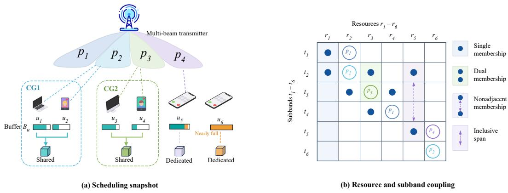
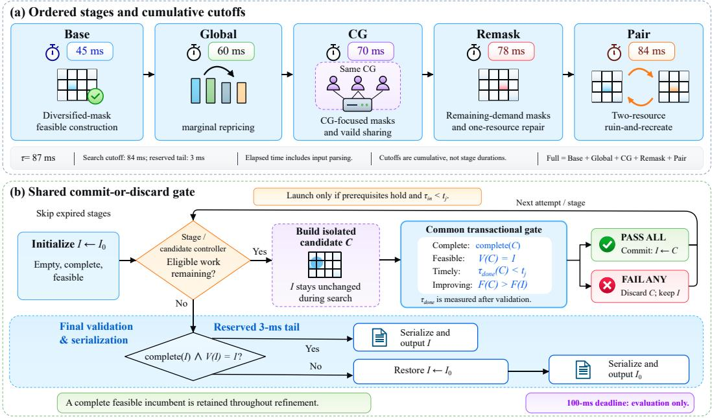
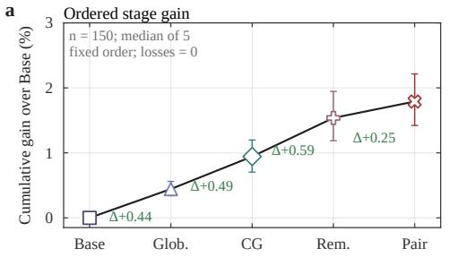
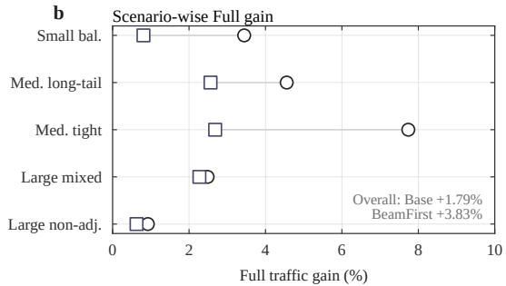
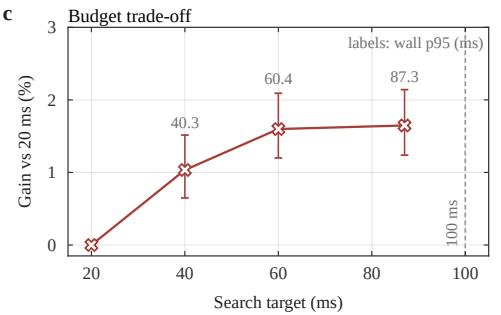
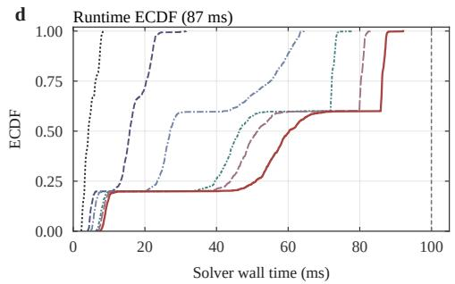
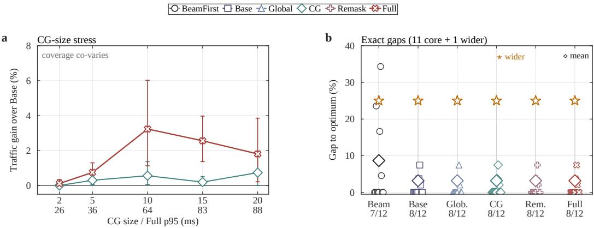

# FPTR: FEASIBILITY-PRESERVING TRANSACTIONALREFINEMENT FOR DEADLINE-CONSTRAINED JOINTBEAM AND RESOURCE ALLOCATION

Minghao Kong1,2∗ Zirong Liu1,∗ Jianhao Wu1 Muyao Chen1 Jianxin Wu2† Rongjie Wang1,†

1Department of Network Intelligence, Pengcheng Laboratory Shenzhen, China

2School of Electronics and Communication Engineering, Sun Yat-sen University, Shenzhen Campus, Shenzhen, China wangrj@pcl.ac.cn, wujx65@mail.sysu.edu.cn

## ABSTRACT

Short-interval wireless schedulers must return a complete, feasible beam-andresource allocation before each execution deadline, and a late or invalid output gives no utility in the current control cycle. Searching longer can increase transmitted traffic, but it may also miss the deadline or leave only an infeasible intermediate solution. We propose Feasibility-Preserving Transactional Refinement (FPTR), which always keeps a validated feasible allocation, the incumbent. Each refinement stage builds a separate candidate and leaves the incumbent unchanged. A candidate replaces the incumbent only if it is complete, passes the feasibility validator before its stage cutoff, and strictly improves the objective; otherwise it is discarded. Four refinement stages use this rule: buffer-aware resource selection, compatibility-group (CG) user sharing, beam-mask rebuilding from remaining demand, and joint reassignment of two resources. On 150 fixed synthetic instances, the full pipeline (Full) raises traffic by 3.83% on average over a lightweight beam-first reference and by 1.79% over its Base constructor. In a separate suite with matched inputs, Full exceeds six independent search baselines (ALNS, tabu search, GA, simulated annealing, iterated local search, and GRASP) by 6.68–8.35%, where outputs later than 100 ms receive zero utility. All 750 Full runs in the internal suite returned feasible allocations, and none exceeded 100 ms. Separating mandatory output construction from optional refinement lets spare computation time improve the allocation without endangering the incumbent. The open-source implementation supports independent reproduction.

## 1 INTRODUCTION

In each scheduling interval, the base-station scheduler studied here must, within a 100-ms execution deadline, choose which beams to activate and which users to place on each resource. The returned allocation must be complete, satisfy all coupling constraints, and be available before the next control decision. A late output, or one that violates even a single constraint, contributes no traffic to that scheduling interval.

Trying additional beam masks, user groups, or local repairs can improve the transmitted traffic. However, every search step consumes part of the same execution window needed for validation and output. If search runs too long or leaves an infeasible intermediate state, the scheduler has no improved allocation to return. The algorithmic challenge is therefore to use spare computation time without putting the current feasible allocation at risk.

  
Resources r1 – r6Resources r1 – r6Figure 1: Schematic overview of one scheduling interval. Beam activation, user assignment, finite r1 r1 r2 demand, and resource sharing must be resolved before the execution deadline.

t6t6Three structural couplings make this challenge non-trivial (Fig. 1). First, beam activations on differs t1 3 3s t1 3 3ent resources share one global budget. Second, finite user buffers change a resource’s marginal value ba t p1ba t p1after earlier assignments satisfy part of the demand. Third, compatibility-group (CG) sharing links 1 2 3 4 5 u6 Buffer B S1 2 3 4 5 u6 Buffer B Sthe selected user subset to a cardinality-dependent rate penalty. Together, binary beam masks and 55set-valued user assignments create a search space in which one-pass construction can miss usefu combinations and exhaustive search is impractical.

FPTR follows one simple rule: never put the incumbent at risk. The framework keeps a complete feasible allocation ready to be returned while every optional stage constructs an isolated candidate without modifying the incumbent. The candidate replaces the incumbent only after it is complete, validated before its stage cutoff, and strictly better. If any test fails, the candidate is discarded and the incumbent survives unchanged. This commit-or-discard gate separates mandatory output construction from optional quality improvement. We use “transactional” only in this all-or-nothing sense: a candidate is either committed as a whole or discarded as a whole.

We make four contributions. First, we formulate deadline-constrained joint beam and resource allocation as a finite combinatorial problem whose output must remain valid while optional search continues. Second, we design FPTR, a shared commit-or-discard framework for a feasible constructor and four bounded repair stages. Third, we show that, for one resource with fixed beam masks, the best CG subset of each fixed size is obtained exactly by selecting the users with the largest marginal gains, and we establish the feasible-incumbent invariant. Fourth, we evaluate traffic, feasibility, stage acceptance, quality–time trade-offs, CG stress, and exact small-case gaps on fixed synthetic suites with published checksums.

## 2 RELATED WORK

Joint beam and resource allocation has been studied in several settings. Multiuser OFDM work allocates subcarriers, bits, and power to minimize transmit power (Wong et al., 1999). For integrated terrestrial–satellite networks, hybrid beamforming and user scheduling are designed to maximize sum rate and energy efficiency (Peng et al., 2021), and learning-based schedulers address massive-MIMO scheduling under fairness constraints (An et al., 2023).

In multi-beam LEO systems, beam decisions are coupled with other resource choices. Online convex optimization jointly handles beam hopping, user association, subcarrier allocation, and power (Liang et al., 2025), while beam-pattern and timeslot design minimizes transmit power subject to traffic demand (Kim et al., 2025). Other studies balance load and avoid interference across multiple satellites (Zhao et al., 2025), assign frequencies across cooperating satellites (Wang et al., 2024), or allocate time, frequency, and space dynamically to reduce supply–demand gaps (Tian et al., 2024). Beam-pattern selection and user scheduling for uneven traffic are studied in (Lei et al., 2024), and low-complexity interference approximations keep beam scheduling tractable as the number of beams grows (Zhao et al., 2026b).

User selection and sharing add a further layer of coupling. Representative formulations combine user grouping with beam scheduling (Xu et al., 2025), graph-based user clustering with two-stage beamforming (Song et al., 2024), learning-based fair user scheduling designed jointly with precoding (Chang et al., 2025), or user grouping with power and beamforming in NOMA–ODDM integrated sensing and communication (Sultana et al., 2025). Interference-aware graph partitioning further treats user allocation as a weighted graph problem (Lu et al., 2026).

Service- and efficiency-oriented designs extend this line. Energy-efficient beam hopping is addressed with a two-step genetic algorithm and a greedy alternative (Taksande et al., 2026), and service-aware beam hopping combines satellite-image features with deep reinforcement learning when the demand distribution is unknown (Xu et al., 2026). Hierarchical deep reinforcement learning reduces the age of information in beam-hopping networks (Xie et al., 2025), a graph-neuralnetwork and Lyapunov framework performs scheduling and hybrid precoding in cell-free mmWave networks (Chang, 2026), and a data- and model-driven successive convex approximation shortens multi-cell MIMO-OFDM allocation (Zhao et al., 2026a). These works broaden the attainable service objectives and reduce solution cost. They focus, however, on the quality of the final schedule or policy and on its computational cost, and they do not specify which feasible allocation to return if a refinement step is interrupted or rejected.

In wireless scheduling, deadlines have mainly constrained data delivery. Deadline-guaranteed scheduling of time-sensitive LEO traffic (Zheng et al., 2025), deadline-aware virtual queues in beam scheduling (Xu et al., 2025), and URLLC latency control under link adaptation (Pocovi et al., 2018) bound when packets must be served, while throughput-optimal policies with queue-stability guarantees (Tassiulas & Ephremides, 1992) address long-run service. The deadline in this paper bounds a different event: when the solver must return a feasible allocation. Large-neighborhood search provides richer repair moves, including ruin-and-recreate operations (Pisinger & Ropke, 2019). A candidate generator alone, however, does not define which intermediate state is safe to return when the search is stopped.

FPTR addresses this execution problem. It can wrap a bounded heuristic or learned candidate generator that works in an isolated candidate state, while an independent validator and a common gate decide whether the incumbent changes. Its contribution is therefore an incumbent-preserving execution protocol for deadline-constrained allocation, rather than a universal replacement for existing search methods.

## 3 SYSTEM MODEL AND PROBLEM FORMULATION

Let $\mathcal { U } , \mathcal { R } , \mathcal { T } , \mathcal { P }$ denote the user, resource, subband, and beam sets, with cardinalities $N , K , T , P ,$ respectively. User u has buffer $1 \leq B _ { u } \leq 1 0 , 0 0 0$ , i.e., a cap on the traffic that counts toward the objective in the same units as $q ( z ) ;$ a base link quality $\gamma _ { u }$ in dB; and a positive capability $c _ { u , p }$ on beam p. Resource r has an explicit membership set $\mathcal { T } _ { r } \subseteq \mathcal { T }$ , with $| \mathcal { T } _ { r } | \in \{ 1 , 2 \}$ ; two memberships need not be adjacent. Its inclusive span is

$$
d _ { r } = \operatorname* { m a x } \mathcal { T } _ { r } - \operatorname* { m i n } \mathcal { T } _ { r } + 1 .\tag{1}
$$

The scheduler chooses beam indicators $\alpha _ { t , p } \in \{ 0 , 1 \}$ and one user set $G _ { r }$ per resource. The global beam budget and resource-activation constraints are

$$
\sum _ { t \in \mathcal T } \sum _ { p \in \mathcal P } \alpha _ { t , p } \leq L , \qquad G _ { r } \neq \emptyset \Rightarrow \sum _ { p \in \mathcal P } \alpha _ { t , p } \geq 1 , \ : \forall t \in \mathcal T _ { r } .\tag{2}
$$

Let $\mathcal { C } _ { 1 } , \ldots , \mathcal { C } _ { M }$ be disjoint CGs. A singleton is always allowed, whereas two or more users may share a resource only when they belong to the same CG:

$$
G _ { r } \in \{ \varnothing \} \cup \{ \{ u \} : u \in { \mathcal { U } } \} \cup \bigcup _ { m = 1 } ^ { M } \{ G : G \subseteq { \mathcal { C } } _ { m } , | G | \geq 2 \} .\tag{3}
$$

Table 1: Stepwise mapping from effective link value (dB) to traffic units.
<table><tr><td>z q(z)</td><td>(-∞,-10](-10,0] (0,3] 0 8 24</td><td>(3,10] 90</td><td>(10,15](15,20] 120</td><td>162</td><td>(20,∞) 222</td></tr></table>

A user appears at most once in each $G _ { r } ,$ , but may be assigned to several resources. For $u \in G _ { r }$ selected capability and effective link value are

$$
\sum _ { \bar { c } _ { u , r } ( \alpha ) } \sum _ { \ell \in \mathcal { T } _ { r } } \sum _ { p \in \mathcal { P } } c _ { u , p } \alpha _ { t , p }\tag{4}
$$

$$
z _ { u , r } = \gamma _ { u } + 1 0 \log _ { 1 0 } \frac { 1 } { \left| { G _ { r } } \right| } + 1 0 \log _ { 1 0 } \frac { { { { \bar { c } } _ { u , r } } \left( \alpha \right) } } { \sum _ { p \in \mathcal { P } } { c _ { u , p } } } .\tag{5}
$$

Only listed subbands contribute to the numerator of (4), while a nonadjacent membership uses its full first-to-last span; for example, $\mathcal { T } _ { r } = \{ 2 , 5 \}$ gives $d _ { r } = 4$ . Table 1 maps the link value $z ,$ in dB, to the traffic $q ( z )$ delivered in one snapshot. The step function is a deterministic one-snapshot traffic abstraction rather than a continuous physical-layer rate law. The clipped transmitted-traffic objective is

$$
F ( \alpha , G ) = \sum _ { u \in \mathcal { U } } \operatorname* { m i n } \left\{ B _ { u } , \sum _ { r : u \in G _ { r } } q ( z _ { u , r } ) \right\} .\tag{6}
$$

The allocation problem is the finite combinatorial program

$$
\begin{array} { r l } { \underset { \alpha , G } { \operatorname* { m a x } } } & { { } F ( \alpha , G ) } \\ { \mathrm { s . t . } } & { { } ( 2 ) , ( 3 ) , \qquad \alpha _ { t , p } \in \{ 0 , 1 \} \ \forall ( t , p ) . } \end{array}\tag{7}
$$

Operationally, an output earns utility only if it is feasible and is written out (serialized) before the external deadline D. Before applying the beam budget, the ${ P T }$ binary activations define $2 ^ { P T }$ masks. The budget retains $\Sigma _ { \ell = 0 } ^ { L } \binom { P T } { \ell }$ of them. Each resource then chooses the empty set, a singleton, or a subset of a single CG. Buffer clipping and cardinality-dependent sharing make static user rankings unreliable across resources. We therefore use bounded refinement on full-size instances and exact optimization only for small calibration cases.

## 4 FEASIBILITY-PRESERVING TRANSACTIONAL REFINEMENT

FPTR keeps a complete feasible fallback $I _ { 0 }$ and a feasible incumbent I, which can be returned at any time. Each bounded operator $\mathcal { R } _ { j }$ constructs an isolated candidate $C$ without modifying I and has a cumulative stage cutoff $t _ { j }$ . Some operators seed their candidate from I, whereas others reconstruct C from stage-specific masks. An allocation is complete if all required decision fields are present, and feasible if it satisfies the constraints in Section 3. Validator $\bar { V } ( A )$ equals 1 when allocation A passes every model constraint and 0 otherwise. Let $\tau _ { \mathrm { d o n e } } ( C )$ denote the elapsed time immediately after validation returns, at the point where a commit would be considered. A candidate is timely when $\tau _ { \mathrm { d o n e } } ( C ) < t _ { j }$ . Formally, FPTR is $( I _ { 0 } , \{ \mathcal { R } _ { j } , t _ { j } \} _ { j = 1 } ^ { J } , V , F )$ , where $J = 5$ is the number of stages and F is the objective in (6). Figure 2 summarizes the cumulative stage schedule and the incumbent-preserving return path.

## 4.1 ALGORITHM AND CUMULATIVE CONFIGURATIONS

Figure 2(b) and Algorithm 1 show the common commit-or-discard control flow, whereas Fig. 2(a) reports the cumulative stage cutoffs. The empty allocation is the unconditional fallback; Base and every later stage construct isolated candidates, and the incumbent changes only through the common gate.

The entry check controls launch; the post-validation time check in the gate controls timeliness. If Base is skipped or rejected, $I _ { 0 }$ remains; final validation restores $I _ { 0 }$ before serialization if needed.

Figure 2: Deadline-aware FPTR pipeline. (a) Stages use cumulative completion cutoffs under the 87-ms internal budget. (b) A candidate replaces the incumbent only after timely completion, validation, and strict improvement; otherwise the feasible incumbent is retained. Final validation and serialization use the reserved 3-ms tail.  
Algorithm 1 FPTR commit-or-discard refinement   
1: Initialize $I  I _ { 0 } ,$ where $I _ { 0 }$ is the empty complete feasible allocation.   
2: for each stage j in the order Base, Global, CG, Remask, Pair do   
3: Record stage-entry time $\tau _ { \mathrm { i n } } ; \mathbf { i f } \tau _ { \mathrm { i n } } \geq t _ { j }$ then continue.   
4: Construct isolated candidate $C \gets \mathcal { R } _ { j } \bar { ( I ) }$ without modifying $I .$   
If $C$ is complete, strictly improving, and before $t _ { j } ,$ evaluate $\overset { \vartriangle } { V } ( \boldsymbol { C } )$   
and record $\bar { \tau } _ { \mathrm { d o n e } } ( C )$ when it returns.   
5: if C passes (9) then $I  C ;$ otherwise discard $C .$   
6: end for   
7: if ¬ complete(I) or $V ( I ) = 0$ then restore $I  I _ { 0 } .$   
8: Serialize and return $I .$

BeamFirst is a standalone reference, whereas Base through Full are cumulative configurations (Table 2). Pair is the final stage, and Full contains all five stages: Base, Global, CG, Remask, and Pair.

Base evaluates diversified beam masks and greedily assigns enabled resources using the remaining buffer of each user. Global revisits retained masks and repeatedly selects the resource–group pair with the largest clipped gain. CG adds group-weighted masks; Remask rebuilds masks from incumbent users and remaining demand, then repairs one resource; Pair (two-resource ruin-and-recreate) empties two resources and refills them in both orders.

## 4.2 EXACT LOCAL CG PRIMITIVE

Once the mask, the resource $r ,$ the traffic retained on the other resources, and the sharing cardinality s are fixed, the marginal gain of each user does not depend on which other users are selected. For an unused or emptied resource $r ,$ let $\begin{array} { r } { Y _ { u } = \sum _ { \kappa \neq r : u \in G _ { \kappa } } \mathop { q } ( z _ { u , \kappa } ) } \end{array}$ be the unclipped traffic that user u receives from the other resources. For fixed $\mathrm { C G } \dot { \mathcal { C } } _ { m }$ and sharing cardinality $s ,$ define

$$
\delta _ { u , r } ^ { ( s ) } = \operatorname* { m i n } \{ B _ { u } , Y _ { u } + q ( z _ { u , r } ^ { ( s ) } ) \} - \operatorname* { m i n } \{ B _ { u } , Y _ { u } \} .\tag{8}
$$

Here $z _ { u , r } ^ { ( s ) }$ is (5) with $\left| G _ { r } \right| = s .$

Table 2: Cumulative configurations and stage cutoffs for an 87-ms budget.
<table><tr><td>Configuration</td><td>Cumulative stage added and purpose</td><td>Cutoff (ms)</td></tr><tr><td>BeamFirst</td><td>independent aggregate-mask reference</td><td></td></tr><tr><td>Base</td><td>diversified-mask feasible construction</td><td>45</td></tr><tr><td>Global</td><td>+ buffer-aware marginal selection</td><td>60</td></tr><tr><td>CG</td><td>+ CG-focused masks and valid sharing</td><td>70</td></tr><tr><td>Remask</td><td>+ remaining-demand masks and one-resource repair</td><td>78</td></tr><tr><td>Full</td><td>+ two-resource ruin-and-recreate</td><td>84</td></tr></table>

Proposition 1 (Top-s CG selection at fixed cardinality). Forfixed α, unused or emptied r, retained traffic Y on the other resources, group $\mathcal { C } _ { m }$ , and integer $2 \leq s \leq | \mathcal { C } _ { m }$ |, a size-s subset that maximizes incremental traffic isformed by the s users with the largest $\delta _ { u , r } ^ { ( s ) }$

Proof. For fixed s, the sharing penalty is the same for every size-s subset, so the incremental traffic of S is $\textstyle \sum _ { u \in S } \delta _ { u , r } ^ { ( s ) }$ . This sum is maximized by taking the s largest terms. □

Including the singleton scan, one fixed-resource, fixed-mask query costs $\begin{array} { r } { O ( N + \sum _ { m } g _ { m } ^ { 2 } \log g _ { m } ) } \end{array}$ multiplied by $K _ { \mathrm { f r e e } }$ when all free resources are scanned.

## 4.3 TRANSACTIONAL GATING AND FEASIBILITY INVARIANT

Let I be the feasible incumbent and C an isolated candidate for stage $j .$ Candidate C replaces I if and only if

$$
\mathrm { c o m p l e t e } ( C ) \wedge \tau _ { \mathrm { d o n e } } ( C ) < t _ { j } \wedge V ( C ) = 1 \wedge F ( C ) > F ( I ) .\tag{9}
$$

Here $\tau _ { \mathrm { d o n e } } ( C )$ is defined above. The validator checks indices, beam budget, explicit resource memberships, activation, user cardinality, and CG compatibility. The tests may be short-circuited: an incomplete, already expired, or non-improving candidate need not invoke $\dot { V } .$ . Thus, entering a stage or merely completing candidate construction before $t _ { j }$ is insufficient: validation must also finish before the cutoff. The four conditions exclude partial, expired, infeasible, and non-improving candidates. As noted in Section 1, “transactional” refers only to this whole-candidate commit-or-discard rule.

Lemma 1 (Feasible-incumbent invariant). Assume that $I _ { 0 }$ is feasible and validator V is sound for the stated constraints. After every gate operation and immediately before serialization, incumbent I is feasible.

Proof. The base case holds because $I _ { 0 }$ is feasible. Rejection leaves the incumbent unchanged, while acceptance requires $V ( C ) = 1 ;$ induction therefore preserves feasibility. Final validation retains I or restores $I _ { 0 }$ □

## 4.4 RUNTIME BUDGETING AND TERMINATION BEHAVIOR

Let Γ denote the total internal budget. The timer starts before input parsing, and $\tau _ { \mathrm { t a i l } } = 3$ ms is reserved for validation and serialization when $\Gamma \geq 2 0$ ms. Let $\rho = ( 4 5 , 6 0 , 7 0 , 7 8 , 8 4 )$ be the cumulative cutoffs of Table 2. Stage j uses cutoff $t _ { j } = ( \Gamma - \tau _ { \mathrm { t a i l } } ) \rho _ { j } / 8 4$ , which rescales them to the search window $\Gamma - \tau _ { \mathrm { t a i l } }$ and equals $\rho _ { j }$ at $\Gamma = 8 7$ ms. $\mathbf { A } \mathbf { t } \Gamma = 8 7$ ms, the five cutoffs are 45, 60, 70, 78, and 84 ms. Entry checks prevent a stage from starting after its cutoff. The post-validation check prevents a candidate that finishes late, whether it comes from a bounded plan, a mask variant, or a reconstruction, from being committed.

## 5 EXPERIMENTAL EVALUATION

We evaluate feasible traffic (Q1), external-baseline gains (Q1b), observed feasibility and runtime (Q2), quality–time operating points (Q3), and exact small-case gaps (Q4).

Table 3: Fixed main regimes; each contains 30 consecutive seeds.
<table><tr><td>Regime</td><td>N</td><td>K</td><td>P</td><td>T</td><td>L</td><td>L/(PT)</td></tr><tr><td>Small balanced</td><td>20</td><td>18</td><td>8</td><td>4</td><td>14</td><td>0.44</td></tr><tr><td>Medium long-tail</td><td>50</td><td>36</td><td>16</td><td>9</td><td>46</td><td>0.32</td></tr><tr><td>Medium tight</td><td>50</td><td>36</td><td>16</td><td>9</td><td>26</td><td>0.18</td></tr><tr><td>Large mixed</td><td>100</td><td>72</td><td>32</td><td>18</td><td>127</td><td>0.22</td></tr><tr><td>Large nonadjacent</td><td>100</td><td>72</td><td>32</td><td>18</td><td>92</td><td>0.16</td></tr></table>

## 5.1 PROTOCOL

The single-threaded C++17 scheduler (g++ 13.3, -O2) ran on Linux 6.8 and a 2.30-GHz Xeon E5- 2686 v4. External wall time covered process launch through output collection. A nonzero exit code, an infeasible output, or a run longer than 100 ms received zero utility. Independent Python code reparsed every output, checked all constraints, and recomputed (6).

Table 3 gives five fixed regimes, each containing 30 consecutive seeds. The target fraction of users placed in compatibility groups ranges from 0.35 to 0.75 across regimes, and in the last regime 80% of two-membership resources have nonadjacent memberships. Each of the six configurations ran as five randomized independent processes per instance. We define ${ \widetilde { F } } _ { i , m } = { \mathrm { m e d i a n } } _ { j = 1 } ^ { 5 } F _ { i , m , j }$ and $g _ { i } ( A , B ) = ( \widetilde { F } _ { i , A } - \widetilde { F } _ { i , B } ) / \widetilde { F } _ { i , B }$ , defined when $\widetilde { F } _ { i , B } > 0 .$ . Reported percentages first average g within each regime and then weight the five regimes equally. The reported percentages therefore need not equal ratios of mean traffic. Confidence intervals use 5,000 stratified bootstrap samples with the same regime weights. W/T/L denotes the number of instances, out of 150, on which Full’s median traffic is higher (wins), equal (ties), or lower (losses) than the baseline’s median. The internal evaluation contains 8,610 process launches. We additionally ran a matched external-baseline main suite on the same 150 inputs with five repeats, an 87-ms budget, the same validator, and the same 100-ms deadline. This suite contains 6,750 launches: nine methods (BeamFirst, Base, Full, and six external baselines) × 150 instances × five repeats. The external baselines are independent implementations of adaptive large-neighborhood search (ALNS) (Ropke & Pisinger, 2006), tabu search (Glover, 1989), a genetic algorithm (GA) (Srinivas & Patnaik, 1994), simulated annealing (SA) (Kirkpatrick et al., 1983), iterated local search (ILS) (Lourenço et al., 2003), and GRASP (Feo & Resende, 1995), rather than reproductions of particular published solvers.

BeamFirst is the lightweight reference, whereas Base through Full are cumulative configurations evaluated under one model. This internal suite tests cumulative refinement behavior. The separate external suite below tests Full against independent algorithms under matched inputs, budgets, validation, and deadline accounting.

Q1: Does FPTR Yield Additional Feasible Traffic? At 87 ms, Full raised traffic by 3.83% on average over BeamFirst (95% CI 3.09–4.67%) and by 1.79% over Base (1.42–2.21%). The corresponding W/T/L counts were 127/23/0 and 111/39/0. Regime-level gains over Base were positive in all five regimes, from 0.63% to 2.68%.

Adding Global, CG, Remask, and Pair in turn increased traffic by 0.44%, 0.49%, 0.59%, and 0.25%, respectively, within Full. These four stages strictly improved the median traffic of 72, 34, 39, and 40 instances, respectively. Because each configuration inherits all earlier stages, each value is the gain of one stage given the preceding stages, not its effect in isolation.

Q1b: Does Full outperform independent external baselines? At the matched 87-ms operating point, Full led all six external baselines (Table 4). W/T/L counts use all 150 instances.

Q2: What Feasibility and Runtime Were Observed? BeamFirst, Base, and Full had median (p50) and 95th-percentile (p95) wall times of 4.23/7.71, 15.75/22.68, and 60.28/87.29 ms, respectively. All 750 Full executions passed independent validation, none exceeded 100 ms, and the worst wall time was 92.14 ms. Across all 8,610 internal launches, every output passed independent validation and none exceeded 100 ms. All external outputs were valid, with 219 deadline misses in total.

BeamFirst Base Global CG Remask Full

  
Figure 3: Quality and runtime: (a) stage gains, (b) regime gains, (c) budget trade-off, and (d) empirical CDF of wall time; intervals are stratified 95% bootstrap estimates.

Table 4: Matched external-baseline comparison at $\Gamma \ : = \ : 8 7$ ms. Quality uses five-run instance medians and regime-stratified relative gains, equally weighted across regimes; W/T/L denotes wins/ties/losses of Full.
<table><tr><td>Baseline</td><td>W/T/L</td><td>Mean rel. gain (%)</td><td>95% CI (%)</td><td>Deadline misses (of 750 runs)</td></tr><tr><td>ALNS</td><td>134/5/11</td><td>7.80</td><td>7.03-8.56</td><td>74</td></tr><tr><td>Tabu</td><td>139/4/7</td><td>7.77</td><td>7.01-8.52</td><td>18</td></tr><tr><td>GA</td><td>127/2/21</td><td>6.68</td><td>5.91–7.47</td><td>44</td></tr><tr><td>SA</td><td>137/4/9</td><td>7.90</td><td>7.19-8.58</td><td>15</td></tr><tr><td>ILS</td><td>137/4/9</td><td>8.35</td><td>7.53-9.13</td><td>41</td></tr><tr><td>GRASP</td><td>140/2/8</td><td>7.61</td><td>6.88-8.33</td><td>27</td></tr></table>

Q3: Where Do the Quality–Time Returns Diminish? Relative to 20 ms, mean traffic gains were 1.03%, 1.60%, and 1.65% at 40, 60, and 87 ms. Going from 60 to 87 ms adds only 0.05 percentage points, so the quality curve flattens after 60 ms (Fig. 3(c)). The 87-ms gain has a 95% CI of 1.24– 2.14%, whereas p95 wall time rises from 20.44 to 87.31 ms. Across ten-instance CG stress sets at sizes 2, 5, 10, 15, 20, Full exceeded Base at every setting. At size 20, p95 and worst wall times were 87.50 and 92.93 ms. Because the fraction of users in CGs (coverage) co-varied with the maximum group size, this experiment measures joint stress rather than an isolated size effect.

Q4: How Close Is FPTR to Exact Solutions on Small Cases? The exact suite contains eleven cases with $( N , K , P , T ) = ( 5 , 4 , 4 , 3 )$ and one larger case with $( N , K , P , T ) = ( 8 , 8 , 6 , 4 )$ , drawn from consecutive unfiltered seeds. An independent dynamic-programming (DP) reference reproduced all 12 audited optima, and Base through Full returned identical objective values on every case. Full reached the optimum on eight of the 12 cases. Over all 12 cases, the optimality gap $( \mathrm { O P T } - F ) / \mathrm { O P T }$ had median 0%, mean 3.19%, and maximum 25%. External ALNS, tabu search, and GA each reached all 12 optima, whereas Full reached eight. SA, ILS, and GRASP were not run on the exact suite, so this calibration does not establish a universal ranking of methods.

  
Figure 4: Stress and calibration: (a) co-varying CG size and coverage and (b) exact optimality gaps on 12 cases.

Threats to Validity. Evaluation uses synthetic static snapshots, one unpinned host, and a small exact suite. The additional external main suite matches inputs, objective, the 87-ms budget, validation, and deadline accounting, but uses independent implementations rather than reproductions of particular published state-of-the-art solvers; its conclusions therefore remain bounded to this model, host, and implementation family. The CG study co-varies size with coverage, and the model omits dynamic queues, fairness, mobility, richer interference, continuous precoding, and deployment traces. Runtime observations are host-specific and do not establish hard-real-time behavior. The commitor-discard gate protects the output only when the program terminates normally; it does not cover crashes or forced termination.

## 6 DISCUSSION AND CONCLUSION

FPTR provides a consistent but modest improvement over the Base constructor. Base already captures many of the easily found gains through diversified masks and buffer-aware assignment, while later stages target rarer configurations. Because Base already captures most of the easily found gains, later stages rarely accept a candidate. Even so, Full beat Base on 111 of 150 instances and was worse on none. The budget sweep shows diminishing returns after 60 ms: most of the internal gain is reached by then, while the final stages, which target rarer configurations, have less time to run.

The exact suite clarifies the scope of the transactional gate. When Base and Full return the same objective, no later candidate passed all four conditions, which does not mean that the gate failed. The maximum 25% exact gap shows that FPTR guarantees feasible-incumbent preservation and strictimprovement acceptance, but not near-optimality. On the matched 87-ms main suite, Full outperformed six independent search implementations under the same validation and deadline accounting. On the 12-case exact suite, however, external ALNS, tabu search, and GA found all optima while Full found eight, so the two results should be read together. Because these baselines are independent reference implementations, the result should not be generalized to all published solvers.

In conclusion, FPTR lets spare computation time improve the allocation while keeping a feasible allocation available at all times. Future work will study dynamic multi-slot queues, learned mask priors, and deployment traces with platform-specific timing budgets.

## ACKNOWLEDGEMENTS

This work was supported in part by the Major Key Project of Pengcheng Laboratory under Grant PCL2025A12-3, in part by the National Natural Science Foundation for Young Scholars of China under Grant 62103206, and in part by the Science and Technology Planning Project of Guangdong Science and Technology Department under the Guangdong Key Laboratory of Advanced IntelliSense Technology under Grant 2019B121203006.

## CODE AND DATA AVAILABILITY

Source code: GitHub repository; experimental data: dataset archive.

Additional evidence and reproducibility details are provided in Appendix A.

## REFERENCES

Qing An, Santiago Segarra, Chris Dick, Ashutosh Sabharwal, and Rahman Doost-Mohammady. A deep reinforcement learning-based resource scheduler for massive MIMO networks. IEEE Trans. Mach. Learn. Commun. Netw., 1:242–257, 2023. doi: 10.1109/TMLCN.2023.3313988.

Jiang Chang. Dynamic edge-user scheduling and hybrid precoding for cell-free mmWave MIMO networks. In Proc. IEEE WCNC, pp. 1–6, 2026. doi: 10.1109/WCNC65185.2026.11555633.

Jiang Chang, Shihao Zhu, Ming Zhao, Shuangfeng Han, and Xiaoyun Wang. Distributed joint design of fairness scheduling and beamforming in user-dense cell-free networks. In Proc. IEEE VTC-Spring, pp. 1–6, 2025. doi: 10.1109/VTC2025-SPRING65109.2025.11174798.

Thomas A. Feo and Mauricio G. C. Resende. Greedy randomized adaptive search procedures. Journal ofGlobal Optimization, 6(2):109–133, 1995. doi: 10.1007/BF01096763.

Fred Glover. Tabu search—part i. ORSA Journal on Computing, 1(3):190–206, 1989. doi: 10.1287/ ijoc.1.3.190.

Donghyeon Kim, Haejoon Jung, and In-Ho Lee. Adaptive beam pattern and resource allocation for multi-beam LEO satellite systems. In Proc. IEEE ICC, pp. 940–945, 2025. doi: 10.1109/ ICC52391.2025.11162055.

S. Kirkpatrick, C. D. Gelatt, Jr., and M. P. Vecchi. Optimization by simulated annealing. Science, 220(4598):671–680, 1983. doi: 10.1126/science.220.4598.671.

Lei Lei, Anyue Wang, Eva Lagunas, Xin Hu, Zhengquan Zhang, Zhiqiang Wei, and Symeon Chatzinotas. Spatial–temporal resource optimization for uneven-traffic LEO satellite systems: Beam pattern selection and user scheduling. IEEE J. Sel. Areas Commun., 42(5):1279–1291, 2024. doi: 10.1109/JSAC.2024.3383445.

Chengchao Liang, Qi Zhang, Jinhong Li, Hong Yang, and Zhanjun Liu. An online convex optimization-based joint beam hopping and resource allocation scheme for LEO satellite networks. In Proc. IEEE INFOCOM Workshops, pp. 1–6, 2025. doi: 10.1109/ INFOCOMWKSHPS65812.2025.11153021.

Helena R. Lourenço, Olivier C. Martin, and Thomas Stützle. Iterated local search. In Fred Glover and Gary A. Kochenberger (eds.), Handbook ofMetaheuristics, pp. 320–353. Kluwer Academic Publishers, Boston, MA, 2003. doi: 10.1007/0-306-48056-5\_11.

Xingyu Lu, Chen Sun, and Xiqi Gao. Dynamic weighted graph partitioning for resource allocation in massive MIMO LEO satellite communication. In Proc. IEEE ICC, pp. 1–6, 2026. doi: 10. 1109/ICC59461.2026.11587784.

Deyi Peng, Ashok Bandi, Yun Li, Symeon Chatzinotas, and Björn Ottersten. Hybrid beamforming, user scheduling, and resource allocation for integrated terrestrial–satellite communication. IEEE Trans. Veh. Technol., 70(9):8868–8882, 2021. doi: 10.1109/TVT.2021.3097149.

David Pisinger and Stefan Ropke. Large neighborhood search. In Michel Gendreau and Jean-Yves Potvin (eds.), Handbook of Metaheuristics, pp. 99–127. Springer, 3rd edition, 2019. doi: 10.1007/978-3-319-91086-4\_4.

Guillermo Pocovi, Klaus I. Pedersen, and Preben Mogensen. Joint link adaptation and scheduling for 5G ultra-reliable low-latency communications. IEEE Access, 6:28912–28922, 2018. doi: 10.1109/ACCESS.2018.2838585.

Stefan Ropke and David Pisinger. An adaptive large neighborhood search heuristic for the pickup and delivery problem with time windows. Transportation Science, 40(4):455–472, 2006. doi: 10.1287/trsc.1050.0135.

Xinting Song, Chen Liu, Yunchao Song, Huibin Liang, and Lv Ye. Joint user scheduling and two stage beamforming for LEO satellite networks. In Proc. IEEE ICICN, pp. 126–131, 2024. doi: 10.1109/ICICN62625.2024.10761357.

M. Srinivas and Lalit M. Patnaik. Genetic algorithms: A survey. Computer, 27(6):17–26, 1994. doi: 10.1109/2.294849.

Salma Sultana, Shuhao Zeng, Ahmed Abdelhadi, Husheng Li, Zhu Han, and H. Vincent Poor. Joint beamforming, power allocation, and user grouping for NOMA-ODDM enabled ISAC systems. In Proc. IEEE GLOBECOM, pp. 6328–6333, 2025. doi: 10.1109/GLOBECOM59602.2025. 11432419.

Pradnya Taksande, Shubham Kumar Raj, and Prasanna Chaporkar. Sustainable beam hopping and resource allocation for guaranteed QoS in multi-beam LEO satellite. In Proc. IEEE COMSNETS, pp. 297–304, 2026. doi: 10.1109/COMSNETS67989.2026.11418189.

Leandros Tassiulas and Anthony Ephremides. Stability properties of constrained queueing systems and scheduling policies for maximum throughput in multihop radio networks. IEEE Trans. Autom. Control, 37(12):1936–1948, 1992. doi: 10.1109/9.182479.

Jiang Tian, Jiangtao Luo, Yongyi Ran, and Ruili Zhao. Joint optimization of satellite beam hopping scheduling and time-frequency-space resource allocation under dynamic service demands. In Proc. IEEE/CIC ICCC, pp. 242–247, 2024. doi: 10.1109/ICCC62479.2024.10681784.

Guanhua Wang, Fang Yang, Jian Song, and Zhu Han. Multi-satellite beam hopping and frequency allocation for satellite-terrestrial communications. In Proc. IEEE GLOBECOM, pp. 5174–5179, 2024. doi: 10.1109/GLOBECOM52923.2024.10901533.

Cheong Yui Wong, Roger S. Cheng, Khaled Ben Letaief, and Ross D. Murch. Multiuser OFDM with adaptive subcarrier, bit, and power allocation. IEEE J. Sel. Areas Commun., 17(10):1747–1758, 1999. doi: 10.1109/49.793310.

Xia Xie, Bowen Feng, Zhang Chen, Lirong An, and Qinyu Zhang. AoI-aware scheduling and resource control via hierarchical DRL in beam hopping LEO satellite. In Proc. IEEE VTC-Fall, pp. 1–6, 2025. doi: 10.1109/VTC2025-FALL65116.2025.11310558.

Ruiyang Xu, Haoye Chai, Qingge Ma, and Mugen Peng. Service-aware adaptive beam-hopping scheduling for low earth orbit satellite networks. In Proc. IEEE WCNC Workshops, pp. 1–6, 2026. doi: 10.1109/WCNCW67598.2026.11555219.

Wencong Xu, Zhongliang Deng, Lu Yin, Haitao Yu, Zhizhong Wang, and Zhuoyan Liu. Resource allocation for LEO satellites with joint user grouping and beam scheduling. In Proc. IEEE ICMTAE, pp. 536–542, 2025. doi: 10.1109/ICMTAE66890.2025.11427856.

Leyu Zhao, Fangming Zou, and Ying Cui. UPSCA-SR: Fast joint optimal resource allocation for multi-cell MIMO-OFDM networks. In Proc. IEEE ICC, pp. 1–6, 2026a. doi: 10.1109/ICC59461. 2026.11588035.

Ruili Zhao, Jun Cai, Jiangtao Luo, Yongyi Ran, Junpeng Gao, and Yifan Xu. Joint beam hopping and resource allocation for load balancing and interference avoidance in multi-LEO satellite networks. In Proc. IEEE ICC, pp. 958–963, 2025. doi: 10.1109/ICC52391.2025.11161887.

Xiaohui Zhao, Zhanwei Yu, Lei You, Lei Lei, and Di Yuan. Massive beam scheduling in LEO systems: Low complexity via effective interference approximation. In Proc. IEEE WCNC, pp. 1–6, 2026b. doi: 10.1109/WCNC65185.2026.11555755.

Ling Zheng, Guodong Wei, Qianxi Men, Yingge Feng, and Weitao Pan. Deadline guaranteed scheduling based on time-ordered queues for time-sensitive low-earth-orbit satellite networks. In Proc. IEEE VTC-Fall, pp. 1–6, 2025. doi: 10.1109/VTC2025-Fall65116.2025.11310318.

## A EVIDENCE AND REPRODUCIBILITY SUMMARY

This appendix summarizes execution, stability, stage acceptance, exact calibration, and artifact integrity; quality uses five-run instance medians, and counts denote separate launches.

The appendix is a companion record rather than a second results narrative. It makes the evaluation unit, crediting rule, and audit boundary explicit. Each reported quantity can therefore be traced to a process launch, a generated case, or a sealed artifact.

## A.1 READING CONVENTIONS AND STATISTICAL UNITS

A launch denotes one independent subprocess invocation with its own input stream, execution order, random seed, and wall-clock measurement. The validator reparses the serialized allocation and recomputes the transmitted-traffic objective. A trace-reported score is diagnostic and never replace this independent recomputation.

For instance i and method $m ,$ let $F _ { i , m , j }$ be the credited traffic from repeat j. The quality unit used in the tables is

$$
\widetilde { F } _ { i , m } = \mathrm { m e d i a n } _ { j = 1 , \dots , 5 } F _ { i , m , j } , \qquad g _ { i } ( A , B ) = { \frac { \widetilde { F } _ { i , A } - \widetilde { F } _ { i , B } } { \widetilde { F } _ { i , B } } } .\tag{A.1}
$$

Relative gains are averaged within each scenario before the five scenarios receive equal weight. This prevents the largest instances from determining the summary by case size alone. A late but feasible output remains available for diagnosis, whereas its credited traffic is zero under the stated 100-ms deadline.

## A.2 EXECUTION ACCOUNTING AND CONFIGURATION-LEVEL RESULTS

Table A1: Formal internal launch accounting; valid outputs passed independent checks.
<table><tr><td>Suite</td><td>Instances</td><td>Conditions</td><td>Repeats</td><td>Launches</td><td>Valid</td><td>Misses</td></tr><tr><td>Main</td><td>150</td><td>6</td><td>5</td><td>4,500</td><td>4,500</td><td>0</td></tr><tr><td>Budget sweep</td><td>150</td><td>4</td><td>5</td><td>3,000</td><td>3,000</td><td>0</td></tr><tr><td>CG stress</td><td>50</td><td>3</td><td>5</td><td>750</td><td>750</td><td>0</td></tr><tr><td>Exact calibration</td><td>12</td><td>6</td><td>5</td><td>360</td><td>360</td><td>0</td></tr><tr><td>Total</td><td>一</td><td>一</td><td>一</td><td>8,610</td><td>8,610</td><td>0</td></tr></table>

The internal main and budget suites reused 150 inputs but launched each condition independently;   
the 500-ms harness assigned zero utility to nonzero exits, illegal outputs, or wall time above 100 ms.

The four internal suites serve different purposes. The main suite measures cumulative configuration behavior. The budget sweep changes the search cap while retaining the same evaluation family. The CG stress suite increases group size and coverage together. The exact suite adds independent optimization on tiny cases alongside the heuristic runs. Their launch counts should therefore not be interpreted as four disjoint collections of inputs.

## A.3 MATCHED EXTERNAL-BASELINE SUITE

The extended external main suite used the same 150 held-out inputs, five repeats, validator, objective, 87-ms budget, and 100-ms deadline for Full and six independent baselines: ALNS, tabu search, GA, SA, ILS, and GRASP. It contained 6,750 main-suite launches. Every output was valid; 219 external launches exceeded the deadline. The earlier budget and exact calibration remain archived under reproducibility/external\_comparison\_extended/ in the project repository.

The external programs share the input and output contract, objective, and validation procedure, but they do not call FPTR’s core scheduler or reuse its stage traces. Each method is compiled as an independent C++17 executable. Thus, the comparison tests independently written reference implementations under a common accounting rule, rather than claiming to reproduce every published solver in the literature.

Table A2: Full versus six independent external baselines at the matched 87-ms main condition.
<table><tr><td colspan="2"></td><td rowspan="2">Mean rel. gain (%)</td><td colspan="2">Main misses/</td></tr><tr><td>Baseline</td><td>W/T/L</td><td>95% CI (%)</td><td>750 runs</td></tr><tr><td>ALNS</td><td>134/5/11</td><td>7.80</td><td>7.03-8.56</td><td>74</td></tr><tr><td>Tabu</td><td>139/4/7</td><td>7.77</td><td>7.01-8.52</td><td>18</td></tr><tr><td>GA</td><td>127/2/21</td><td>6.68</td><td>5.91-7.47</td><td>44</td></tr><tr><td>SA</td><td>137/4/9</td><td>7.90</td><td>7.19–8.58</td><td>15</td></tr><tr><td>ILS</td><td>137/4/9</td><td>8.35</td><td>7.53-9.13</td><td>41</td></tr><tr><td>GRASP</td><td>140/2/8</td><td>7.61</td><td>6.88-8.33</td><td>27</td></tr></table>

Relative gains use nonzero baseline medians: 141/150 ALNS pairs, 149/150 tabu pairs, 144/150 GA pairs, 150/150 SA pairs, 148/150 ILS pairs, and 149/150 GRASP pairs. W/T/L counts include all 150 instance medians; the machine-readable archive is reproducibility/external\_ comparison $\_ \nabla ^ { 3 / }$ in the project repository.

Table A3: Main-set quality and wall time over 150 five-run instance medians.
<table><tr><td>Configuration</td><td>Mean  $\widetilde { F }$ </td><td>Rel. to Base (%)</td><td>Wall  $\mathsf { p 5 0 }$  (ms)</td><td>Wall  $\mathsf { p } 9 5$  (ms)</td><td>Worst (ms)</td><td>Misses/ runs</td></tr><tr><td>BeamFirst</td><td>13467.89</td><td>-1.82</td><td>4.23</td><td>7.71</td><td>8.82</td><td>0/750</td></tr><tr><td>Base</td><td>13662.15</td><td>+0.00</td><td>15.75</td><td>22.68</td><td>31.50</td><td>0/750</td></tr><tr><td>Global</td><td>13732.17</td><td>+0.44</td><td>27.06</td><td>62.12</td><td>64.40</td><td>0/750</td></tr><tr><td>CG</td><td>13796.05</td><td>+0.88</td><td>46.40</td><td>73.30</td><td>78.09</td><td>0/750</td></tr><tr><td>Remask</td><td>13873.17</td><td>+1.54</td><td>51.44</td><td>81.35</td><td>82.85</td><td>0/750</td></tr><tr><td>Full</td><td>13898.13</td><td>+1.79</td><td>60.28</td><td>87.29</td><td>92.14</td><td>0/750</td></tr></table>

Full led mean instance-median traffic, with 60.28/87.29/92.14-ms p50/p95/worst time and no miss in 750 launches. Table A3 weights regimes equally and pools 750 wall times; it describes quality– runtime rather than compute-matched superiority.

Wall time includes process launch, input transfer, solver execution, and output collection. Independent Python validation is reported separately. The 87-ms value is a search budget, not a hard completion-time guarantee, so the percentiles describe the observed host and implementation rather than a platform-independent bound.

## A.4 RUN-LEVEL STABILITY AND STAGE ACCEPTANCE

Across the 750 same-repeat run pairs, each Full run is compared with the Base or BeamFirst run that shares its scenario, seed, and repeat index. Full won 564 pairs, tied 186, and lost none against Base, with an unweighted mean relative gain of 1.800%; against BeamFirst it won 643, tied 107, and lost none, with a mean of 3.839%. These run-level statistics use a different unit and weighting from the instance-median, regime-weighted estimates in the main text (Section 5, Q1: 1.79% and 3.83%). The five Full runs gave identical traffic on 122 of 150 instances. The relative five-run range, defined as the maximum minus the minimum transmitted traffic divided by the instance median, had a 95th percentile of 4.969% and a maximum of 7.592% across instances.

The repeated-process comparison and the stage-acceptance trace answer different questions. Repeated processes quantify outcome stability under ordinary scheduling noise. The trace records the fixed order Base–Global–CG–Remask–Pair inside one Full run, so each acceptance count is conditional on the incumbent produced by earlier stages.

Overall instance/run acceptance was 48.0/48.0% (Global), 22.7/23.3% (CG), 26.0/26.0% (Remask), and 26.7/26.7% (Pair). A 0/0 denotes no strict improvement because of a tie, expiry, or validation failure; counts are fixed-order conditional increments.

These percentages are not standalone module success rates. A later stage may have few accepted candidates because earlier stages already removed the corresponding residual structure, because the remaining budget is short, or because the candidate fails the common gate. The cumulative Full score can still improve when accepted changes are sparse, provided that each accepted change is feasible and strictly better.

Table A4: Fixed-order stage acceptance by scenario (instances/runs).
<table><tr><td>Scenario</td><td> $n / 5 n$ </td><td>Global</td><td>CG</td><td>Remask</td><td>Pair</td></tr><tr><td>small-balanced</td><td>30/150</td><td>2/10</td><td>8/40</td><td>5/25</td><td>3/15</td></tr><tr><td>medium-longtail</td><td>30/150</td><td>18/90</td><td>11/55</td><td>17/85</td><td>23/115</td></tr><tr><td>medium-tight</td><td>30/150</td><td>7/35</td><td>3/15</td><td>17/85</td><td>14/70</td></tr><tr><td>large-mixed</td><td>30/150</td><td>27/135</td><td>10/49</td><td>0/0</td><td>0/0</td></tr><tr><td>large-nonadjacent</td><td>30/150</td><td>18/90</td><td>2/16</td><td>0/0</td><td>0/0</td></tr><tr><td>Overall</td><td>150/750</td><td>72/360</td><td>34/175</td><td>39/195</td><td>40/200</td></tr></table>

## A.5 EXACT CALIBRATION AND INDEPENDENT AUDIT

Table A5: Exact calibration; BF=BeamFirst; W01/C02–C12=seeds 20281001–20281012.
<table><tr><td> $\mathrm { C a s e }$ </td><td> $F ^ { \star }$ </td><td>BF</td><td>Base</td><td>Full</td><td>Gap</td><td>Case</td><td> $F ^ { \star }$ </td><td>BF</td><td>Base</td><td>Full</td><td>Gap</td></tr><tr><td>W01</td><td>920</td><td>690</td><td>690</td><td>690</td><td>25.00</td><td>C07</td><td>449</td><td>449</td><td>449</td><td>449</td><td>0.00</td></tr><tr><td>C02</td><td>237</td><td>237</td><td>237</td><td>237</td><td>0.00</td><td>C08</td><td>806</td><td>672</td><td>776</td><td>776</td><td>3.72</td></tr><tr><td>C03</td><td>548</td><td>548</td><td>548</td><td>548</td><td>0.00</td><td>C09</td><td>804</td><td>528</td><td>744</td><td>744</td><td>7.46</td></tr><tr><td>C04</td><td>1188</td><td>908</td><td>1188</td><td>1188</td><td>0.00</td><td>C10</td><td>1665</td><td>1589</td><td>1631</td><td>1631</td><td>2.04</td></tr><tr><td>C05</td><td>564</td><td>564</td><td>564</td><td>564</td><td>0.00</td><td>C11</td><td>888</td><td>888</td><td>888</td><td>888</td><td>0.00</td></tr><tr><td>C06</td><td>648</td><td>648</td><td>648</td><td>648</td><td>0.00</td><td>C12</td><td>888</td><td>888</td><td>888</td><td>888</td><td>0.00</td></tr></table>

Independent DP reproduced all 12 sealed optima without the formal solver: 390,814 attempted transitions became 332,585 pre-prune states after 58,229 duplicate collapses; dominance removed 219,088, leaving 113,497. Layer and aggregate identities held; this suite calibrates only small-case quality.

For each enumerated beam-mask plan, the audit dynamic program carries a vector of accumulated per-user traffic after every resource layer. It enumerates the empty choice and legal compatibilitygroup choices, clips each vector by user buffers, and removes componentwise dominated states. This construction is independent of the heuristic implementation and explains why the audited optimum is a useful calibration target rather than a second heuristic baseline.

## A.6 BUDGET, CG STRESS, AND ARTIFACT INTEGRITY

At 20/40/60/87 ms, gains over 20 ms were 0.00/1.03/1.60/1.65%, with p95 times 20.44/40.34/60.39/ 87.31 ms; all 750 launches per budget met 100 ms, and the 87-ms suite was separate. For CG maxima $2 / 5 / 1 0 / 1 5 / 2 0$ , coverage and Full–Base gain co-varied from 6.7%/0.11% to 66.7%/1.81% (intermediate gains: 0.75/3.23/2.56%); size 20 gave 87.50/92.93-ms p95/worst time and 0/50 misses. SHA-256 manifests bind 14 sealed-result, 16 exact-audit (12 reconstructed-input), and 21 evidence files. Hash-reconstructed inputs make only the optimizer’s path independent; causal cumulative ablation is a checksum-preserved fixed-order trace.

The integrity chain is layered. Case hashes bind generated inputs, source hashes bind the generator and validator versions, and directory checksums bind the derived result files. A regenerated archive is therefore auditable at both the numerical and provenance levels. The appendix does not treat retained binaries as evidence; the documented build commands and compiler flags are the reproducible boundary.