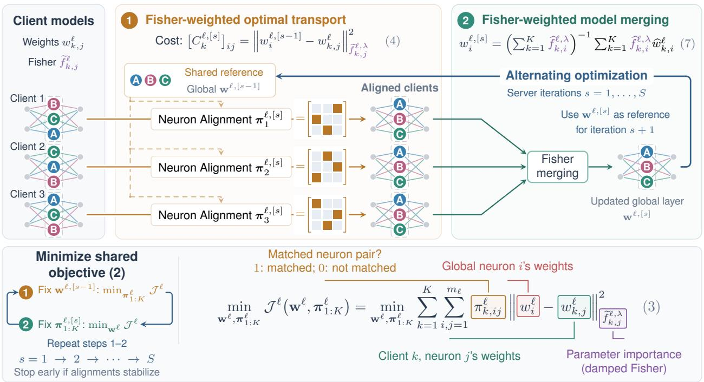
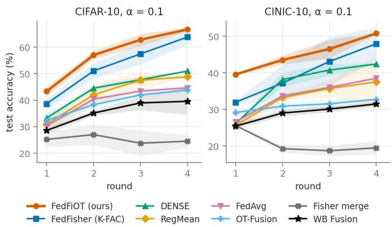
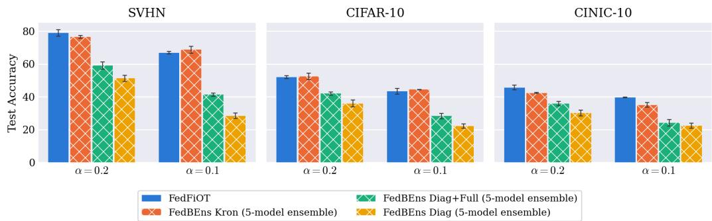
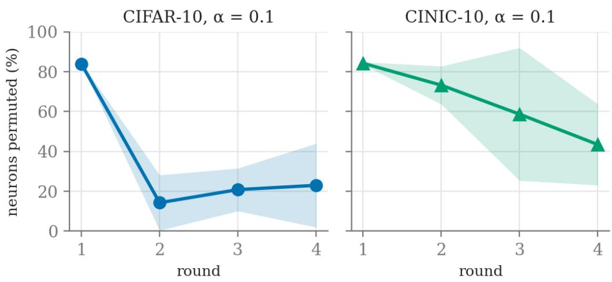

# FedFiOT: Fisher-Weighted Optimal Transport for Model Merging in One-Shot and Few-Round Federated Learning

Quan Minh Nguyen1, Hoang M. Ngo1, Bhakti Chowkwale2 Yasaman Keshtkarjahromi2, My T. Thai1

1University of Florida

2Seagate Technology

## Abstract

One-shot and few-round federated learning (FL) reduce communication burden by constructing a global model within one or a few communication rounds, but often achieve lower performance than conventional multiround FL. Without frequent synchronization, client models may drift apart, causing neurons that learn similar features to occupy different positions across clients. At the same time, local data heterogeneity can cause corresponding parameters to difer in their importance to each client’s predictions. Together, these challenges cause direct averaging to combine mismatched neurons and assign equal weight to parameters despite differences in their importance.

We propose FedFiOT, a Fisher-weighted optimal transport framework for one-shot and few-round FL that leverages Fisher information to quantify parameter importance and guide neuron alignment and model aggregation. FedFiOT jointly optimizes neuron correspondences and global model parameters through alternating minimization of a shared Fisher-weighted objective. Theoretically, we show that FedFiOT’s optimization procedure monotonically decreases the layer-wise merging objective and establish a stationarity bound that quantifies the efects of client heterogeneity and nonuniform Fisher weighting. Experiments across multiple datasets demonstrate consistent improvements over competing baselines in both one-shot and few-round federated learning settings.

## 1 INTRODUCTION

Federated learning (FL) McMahan et al. (2017) enables collaborative model training without sharing private data, but often requires a large number of communication rounds to achieve good accuracy. This multi-round training paradigm has several drawbacks. First, clients must frequently be available to connect to the server to send and receive model updates. Second, clients must repeatedly expend computational resources to update the global model whenever they participate in training. Third, repeated communication rounds can increase vulnerability to backdoor, model poisoning or inference attacks by allowing adversaries to continuously refine their attacks in response to the evolving global model Gu et al. (2022); Xie et al. (2025); Zhu et al. (2025); Zhang et al. (2023). Furthermore, frequent communication rounds can amplify the communication and computational costs of privacy-preserving mechanisms such as secure aggregation Bonawitz et al. (2017) and homomorphic encryption Zhang et al. (2020), which impose additional overhead on clients in each round.

These limitations have motivated FL approaches that seek to reduce communication frequency. One-shot federated learning constructs a global model using only a single round Guha et al. (2019); Zhang et al. (2022); Tang et al. (2024), while few-round federated learning allows only a small number of communication rounds Park et al. (2021); Jhunjhunwala et al. (2024). Fewround FL provides a middle ground between one-shot and conventional multi-round FL, where the goal is to approach the performance of fully iterative FL using as few communication rounds as possible. However, with fewer synchronization opportunities, the quality of each aggregation step becomes more important, especially when clients’ data are heterogeneous.

A key challenge in one-shot and few-round FL is neuron misalignment. Due to permutation invariance in neural networks, two models can represent the same function while difering only in the ordering of their hidden neurons or channels Ainsworth et al. (2022); Entezari et al. (2021). Consequently, similar features may be represented by diferent neurons across client models, causing naive parameter averaging to combine mismatched neurons. Neuron-matching methods Liu et al. (2022); Yurochkin et al. (2019); Wang et al. (2020); Singh and Jaggi (2020); Akash et al. (2022) address this issue by identifying correspondences between neurons across client models based on the similarity of their weights or learned representations, and then permuting neurons into a common ordering before parameter aggregation.

A complementary problem is determining how parameters from diferent models should be combined during model fusion. From a Bayesian perspective, model merging can be viewed as finding parameters that maximize the joint likelihood of the models’ posterior distribution. Fisher merging Matena and Rafel (2022) adopts this perspective by approximating each model’s posterior as a Gaussian whose precision matrix is given by its Fisher information. The merged model is then obtained through a Fisher-weighted average, giving greater influence to parameter values with higher estimated precision. Intuitively, a large Fisher value indicates that changing a parameter can substantially afect the model’s predictions, whereas a small Fisher value suggests that the parameter has relatively little influence on the model’s behavior.

These two challenges are closely coupled. Since Fisher information is a local property of a single parameter value, Fisher-based merging may become less reliable when the models being merged are far apart in parameter space Matena and Rafel (2022). Consequently, Fisher weighting is most efective when corresponding neurons are properly aligned across models. At the same time, neuron alignment should place greater emphasis on correctly matching neurons whose associated parameters have high Fisher information values, since incorrectly matching parameters that strongly influence the model’s predictions can be substantially more harmful than misaligning parameters with low Fisher values. Existing approaches typically consider Fisher-based weighting and neuron alignment as separate problems, potentially limiting their efectiveness in one-shot and few-round federated learning.

To address this gap, we propose FedFiOT, a Fisherweighted optimal transport framework for one-shot and few-round FL. We summarize our contributions:

• We propose FedFiOT and show how neuron alignment and Fisher-weighted aggregation, which prior work treats separately, can be posed as a single optimization over the client-specific neuron correspondences and the global model, using only the local models and Fisher estimates sent by the clients (Sections 3.1 and 3.2).

• We formulate neuron alignment as a damped Fisher-weighted optimal transport problem, assigning larger penalties to discrepancies in parameters that are more important to each client’s predictions. We solve the joint alignment and aggregation problem by alternating between computing layer-wise transport plans and updating global model parameters through Fisher-weighted averaging of aligned client parameters (Section 3.3).

• Our theoretical analysis shows that the alternating updates monotonically decrease the layer-wise merging objective, with damping making each aggregation step strongly convex so that the change in the merged weights vanishes at an $O ( S ^ { - 1 / 2 } )$ rate. We further establish a stationarity bound across communication rounds that quantifies the efects of client heterogeneity, stochastic noise, and nonuniform Fisher weighting (Section 4).

• We evaluate FedFiOT on a range of one-shot and few-round FL tasks and show that it gives a consistent improvement in global model accuracy compared to competing baselines involving knowledge distillation, neuron matching or model fusion (Section 5).

## 2 RELATED WORKS

## 2.1 One-Shot and Few-Round FL

Existing one-shot federated learning (FL) methods broadly fall into four categories: (i) knowledge distillation, (ii) neuron matching, (iii) model fusion and (iv) ensemble-based methods. Knowledge distillation methods combine client models into an ensemble and transfer its knowledge to a single global model using either server-side auxiliary data Guha et al. (2019); Li et al. (2020a); Gong et al. (2021) or synthetic data generated by GANs or VAEs Zhang et al. (2022); Heinbaugh et al. (2023). However, auxiliary data may poorly represent client distributions, while sharing client data or generating synthetic samples can raise privacy concerns, e.g. data reconstruction attack Hitaj et al. (2017). Data generation and distillation also increase server computation and require careful hyperparameter tuning, complicating their use in one-shot FL Jhunjhunwala et al. (2024). Neuron matching methods Liu et al. (2022); Yurochkin et al. (2019); Wang et al. (2020); Singh and Jaggi (2020); Akash et al. (2022) exploit neural networks’ permutation invariance to align corresponding neurons across client models before averaging their weights. Another line of work, known as model fusion, aims to combine the capabilities of multiple existing models into a single model Choshen et al. (2022); Ilharco et al. (2022); Jin et al. (2022); Matena and Rafel (2022); Yadav et al. (2023). Although not explicitly developed for one-shot federated learning, some of these meth ods ofer improvement to simple parameter averaging. However, they primarily focus on merging pre-trained models and do not explicitly account for heterogeneity in the data used to train them. FedBEns Talpini et al. (2025), an ensemble-based approach, captures multimodal client posteriors through mixtures of Laplace approximations, but requires clients to train and communicate multiple models and retains an ensemble for prediction. Few-round FL relaxes the single-round communication constraint, allowing clients to refine their models over a small number of communication rounds Jhunjhunwala et al. (2024); Park et al. (2021).

## 2.2 Permutation Invariance & Neuron Alignment in Federated Learning

Due to permutation invariance, direct parameter averaging can combine mismatched neurons across clients. Neuron alignment methods address this issue by establishing correspondences between neurons before aggregation. PFNM Yurochkin et al. (2019) uses Bayesian nonparametric inference to determine whether a local neuron should match an existing global neuron or introduce a new one, while FedMA Wang et al. (2020) extends this approach to CNNs and LSTMs by alternating layer-wise matching with local retraining. Other methods formulate neural layers as distributions over neurons and use optimal transport (OT) to establish correspondences before merging Singh and Jaggi (2020) or graph matching that captures dependencies between connected neurons Liu et al. (2022). Although these methods mitigate permutation mismatch, alignment alone does not resolve diferences in features learned from heterogeneous client data.

## 2.3 Model Fusion in Federated Learning

Most model fusion approaches target pre-trained or fine-tuned models and ofer no theoretical guarantees in FL. A closely related work is Fisher merging Matena and Rafel (2022), which approximates each model’s posterior as a Gaussian whose precision is given by its diagonal Fisher information and casts merging as maximizing the models’ joint posterior likelihood. Fed-Fisher Jhunjhunwala et al. (2024) extends this idea to one-shot FL and provides a theoretical analysis for two-layer over-parameterized ReLU networks. However, since the Fisher information is a local property of a single parameter value, Fisher-based merging may perform poorly when the models being merged are mis aligned and lie far apart in parameter space.

## 3 PROPOSED ALGORITHM: FEDFIOT

In this section, we first introduce the federated modelmerging setup and formulate neuron alignment and parameter aggregation as a joint optimization problem. We then present FedFiOT, and describe its application to one-shot and few-round FL.

## 3.1 Federated Model-Merging Setup

We consider an FL system with K clients, where client k holds a private dataset $\mathcal { D } _ { k }$ . All clients share an $L _ { - }$ layer network architecture. At each communication round, the server broadcasts a global model, which each participating client uses to initialize local training. Client k then returns its updated parameters $\mathbf { W } _ { k } \in \mathcal { W } : = \mathbb { R } ^ { d }$ and a diagonal Fisher estimate $\widetilde { \mathbf { F } } _ { k } \succeq 0$ ecomputed from its local data. We describe a single aggregation round and omit the round index for clarity.

The Fisher estimate provides a measure of parameter importance. Specifically, a larger entry indicates greater sensitivity of the client’s predictive distribution to changes in the corresponding parameter Martens (2020); Matena and Rafel (2022). Details of the Fisher estimation procedure are provided in Appendix B.

Let $m _ { \ell }$ denote the number of neurons in layer ℓ. For a fully connected layer, let $w _ { k , j } ^ { \ell } ~ \in ~ \mathbb { R } ^ { m _ { \ell - 1 } }$ denote the incoming weights of neuron $j$ in client $k \mathrm { { s } }$ model, and let $\widetilde { f } _ { k , j } ^ { \ell }$ denote the corresponding diagoenal Fisher block. We omit biases from the notation. Client k’s layer is $\mathbf { w } _ { k } ^ { \ell } .$ , with neuron weights $\{ w _ { k , j } ^ { \ell } \} _ { j = 1 } ^ { m _ { \ell } }$ The global parameters at this layer are denoted by $\mathbf { w } ^ { \ell } \in \mathcal { W } ^ { \ell } : = \mathbb { R } ^ { m _ { \ell } \times m _ { \ell - 1 } }$ , with neuron weights $\{ w _ { i } ^ { \ell } \} _ { i = 1 } ^ { m _ { \ell } } .$

Neurons that learn similar features may appear at different positions within the same layer across clients, and their parameters may have diferent Fisher values. The aggregation problem therefore involves two coupled decisions: (1) identifying neuron correspondences and (2) determining the global parameter values. Our goal is to formulate these decisions jointly while accounting for the parameter importance indicated by the Fisher estimates.

## 3.2 Joint Alignment and Aggregation Objective

We formulate the merge at layer ℓ as a joint optimization over neuron correspondences and global parameters. For this formulation, the correspondence between neurons in layer ℓ 1 is held fixed and determines a common ordering for the incoming coordinates. For the first hidden layer, this ordering is given by the shared input features.

  
Figure 1: Overview of FedFiOT. At each layer, the server minimizes the joint objective $\mathcal { I } ^ { \ell }$ by alternating between Fisher-weighted neuron alignment and Fisher-weighted model merging. The merged layer serves as the alignment reference for the next iteration. This repeats for up to S iterations, or until no client’s alignment changes. Here, ℓ indexes the layer and [s] the iteration; $w _ { i } ^ { \ell }$ and $w _ { k , j } ^ { \ell }$ denote the weights of global neuron i and of neuron j of client k. In each permutation matrix, rows are global neurons, columns are client neurons, and orange cells mark matched pairs. $\widehat { w } _ { k , i } ^ { \ell }$ and $\widehat { f } _ { k , i } ^ { \ell , \lambda }$ denote the weights and damped Fisher block of the neuron of b bclient k matched to global neuron i. For illustration, we provide a simple numerical example in Appendix G.

Let $\mathcal { P } ^ { \ell }$ denote the set of mℓ mℓ permutation matrices. For client k, an alignment $\pi _ { k } ^ { \ell } \in \mathcal { P } ^ { \ell }$ specifies the neuron correspondences. Specifically, $\pi _ { k , i j } ^ { \ell } : = [ \pi _ { k } ^ { \ell } ] _ { i j } = 1$ means that client neuron j corresponds to global neuron i. We write $\pmb { \pi } _ { 1 : K } ^ { \ell } = ( \bar { \pmb { \pi } _ { 1 } ^ { \ell } } , \ldots , \bar { \pmb { \pi } _ { K } ^ { \ell } } )$ for the collection of client alignments. The output-layer alignment is restricted to the identi ${ \mathrm { , y , } }$ since all clients share the same class ordering.

To account for parameter importance, we use the damped Fisher blocks

$$
\widetilde { f } _ { k , j } ^ { \ell , \lambda } : = \widetilde { f } _ { k , j } ^ { \ell } + \lambda I , \qquad \lambda > 0 ,\tag{1}
$$

where $\lambda > 0$ ensures positive precision even for coordinates with zero estimated Fisher information. Since diagonal Fisher entries often span several orders of magnitude, a few coordinates can dominate a Fisherweighted average. We therefore compute $\widetilde { \mathbf { F } } _ { k }$ with each eempirical Fisher entry raised to a power $\rho ~ \in ~ ( 0 , 1 ]$ (Appendix B). This tempering preserves the ordering of parameter importance while compressing its range. To keep the notation light, we absorb $\rho$ into $\widetilde { \mathbf { F } } _ { k }$ and refer to $\widetilde { f } _ { k , j } ^ { \ell , \lambda }$ esimply as the damped Fisher. Writing $\| x \| _ { A } ^ { 2 } : = x ^ { \top } A x$ , we define

$$
\mathcal { I } ^ { \ell } \big ( \mathbf { w } ^ { \ell } , \boldsymbol { \pi } _ { 1 : K } ^ { \ell } \big ) : = \sum _ { k = 1 } ^ { K } \sum _ { i , j = 1 } ^ { m _ { \ell } } \pi _ { k , i j } ^ { \ell } \left. \boldsymbol { w } _ { i } ^ { \ell } - \boldsymbol { w } _ { k , j } ^ { \ell } \right. _ { \widetilde { f } _ { k , j } ^ { \ell , \lambda } } ^ { 2 } .\tag{2}
$$

The resulting layer-merging problem is

$$
\begin{array} { r l } & { \displaystyle \operatorname* { m i n } _ { \mathbf { w } ^ { \ell } \in \mathcal { W } ^ { \ell } } \mathcal { I } ^ { \ell } \big ( \mathbf { w } ^ { \ell } , \pmb { \pi } _ { 1 : K } ^ { \ell } \big ) . } \\ & { \displaystyle \pi _ { 1 : K } ^ { \ell } \in ( \mathcal { P } ^ { \ell } ) ^ { K } } \end{array}\tag{3}
$$

The objective penalizes discrepancies between matched neurons, with greater weight assigned to coordinates with larger Fisher values. Thus, the same importance estimates guide both the choice of neuron correspondences and the global parameter values. We propose FedFiOT, a solution for the layer-merging problem which constructs a merged model through alternating alignment and aggregation updates.

## 3.3 Alternating Alignment and Aggregation

We solve (3) by alternating between neuron alignment and parameter aggregation. We index these inner iterations by a bracketed superscript [s]. For a fixed layer $\ell ,$ the global weights $\mathbf { w } ^ { \ell , [ 0 ] }$ can be initialized from either the broadcast model or a locally trained client model. Each inner iteration then consists of the following two updates.

Fisher-weighted alignment. With the global weights fixed at $\mathbf { w } ^ { \ell , [ s - 1 ] }$ , we construct the matching cost

$$
\left[ C _ { k } ^ { \ell , \left[ s \right] } \right] _ { i j } : = \left. w _ { i } ^ { \ell , \left[ s - 1 \right] } - w _ { k , j } ^ { \ell } \right. _ { \widetilde { f } _ { k , j } ^ { \ell , \lambda } } ^ { 2 } ,\tag{4}
$$

where $C _ { k } ^ { \ell , [ s ] } \in \mathbb { R } ^ { m _ { \ell } \times m _ { \ell } }$ collects these costs. The objective separates across clients, so each alignment is updated independently:

$$
\begin{array} { r } { \pi _ { k } ^ { \ell , [ s ] } \in \underset { \pi \in \mathcal P ^ { \ell } } { \arg \operatorname* { m i n } } \left. \pi , C _ { k } ^ { \ell , [ s ] } \right. . } \end{array}\tag{5}
$$

This assignment problem is equivalent, up to normalization, to optimal transport between two distributions over the client and global neurons. Specifically, $\pi _ { k } ^ { \ell , \left[ s \right] } / m _ { \ell }$ is an optimal transport plan. We compute the assignment using the Hungarian algorithm Kuhn (1955), which takes $\mathcal { O } ( m _ { \ell } ^ { 3 } )$ time. The Fisher-weighted cost makes mismatches in high-importance coordinates more expensive.

Fisher-weighted aggregation. Once the alignments $\pi _ { k } ^ { \ell , \left[ s \right] }$ are fixed, we reorder each client’s neurons and their Fisher blocks into the global neuron order. For global neuron $i ,$ define

$$
\begin{array} { r l } & { \widehat { w } _ { k , i } ^ { \ell } : = \displaystyle \sum _ { j = 1 } ^ { m _ { \ell } } \pi _ { k , i j } ^ { \ell , [ s ] } w _ { k , j } ^ { \ell } , } \\ & { \widehat { f } _ { k , i } ^ { \ell , \lambda } : = \displaystyle \sum _ { j = 1 } ^ { m _ { \ell } } \pi _ { k , i j } ^ { \ell , [ s ] } \widetilde { f } _ { k , j } ^ { \ell , \lambda } . } \end{array}\tag{6}
$$

Each row of a permutation matrix contains exactly one nonzero entry, so these expressions select the client neuron matched to global neuron i and its correspond ing Fisher block.

With these correspondences fixed, setting the gradient of (2) with respect to $w _ { i } ^ { \ell }$ to zero gives

$$
w _ { i } ^ { \ell , \left[ s \right] } = \left( \sum _ { k = 1 } ^ { K } \widehat { f } _ { k , i } ^ { \ell , \lambda } \right) ^ { - 1 } \sum _ { k = 1 } ^ { K } \widehat { f } _ { k , i } ^ { \ell , \lambda } \widehat { w } _ { k , i } ^ { \ell } .\tag{7}
$$

Since the Fisher blocks are diagonal, this update averages each weight coordinate according to its corre sponding Fisher values. Damping ensures that the matrix being inverted is positive definite. We repeat alignment and aggregation until the alignments stop changing or S iterations are completed.

Merging across layers. The server processes layers in order. Before merging layer $\ell ,$ it reorders working copies of the client weights’ incoming coordinates and the corresponding Fisher entries using the final align ment of layer $\ell - 1$ . This makes the neuron comparisons consistent with the preceding layer. The input alignment is the identity. At the output layer, the neuron alignment is also fixed to the identity, so only one aggregation update is needed. After all layers are merged, the server compares the full-model merge objective of the aligned model with that of the identityaligned merge, and returns the latter if alignment does not reduce the objective.

One-shot and few-round operation. The returned model initializes the next communication round. Clients recompute their Fisher estimates after local training, and the server recomputes the alignments during each merge. Setting $T = 1$ gives oneshot FL. Larger T repeats the same procedure for fewround FL. For partial participation, all client sums above are restricted to the selected set $\mathcal { K } ^ { ( t ) }$ . Algorithm 1 summarizes the procedure.

## 4 THEORETICAL ANALYSIS

We analyze FedFiOT at two levels. First, we establish stability of the alternating updates within each layer. Second, we bound the average squared gradient of the federated training objective in terms of local training, client heterogeneity, and nonuniform Fisher weighting. Proofs and lemmas are deferred to the appendix.

## 4.1 Stability of FedFiOT Aggregation

Fix a communication round and a layer ℓ, with the incoming-coordinate correspondence held fixed. The client weights and Fisher estimates remain unchanged throughout the inner iterations. We write $\bar { \mathcal { I } } ^ { \ell , [ s ] } : =$ $\mathscr { T } ^ { \ell } ( \mathbf { w } ^ { \ell , [ s ] } , \pmb { \pi } _ { 1 : K } ^ { \ell , [ s ] } )$ for the objective after iteration s and define the change in the merged layer by

$$
\begin{array} { r } { \Delta ^ { \ell , [ s ] } : = \left. \mathbf { w } ^ { \ell , [ s ] } - \mathbf { w } ^ { \ell , [ s - 1 ] } \right. _ { 2 } . } \end{array}\tag{8}
$$

To define the initial objective $\mathcal { I } ^ { \ell , [ 0 ] }$ , we use the broadcast layer $\mathbf { w } ^ { \ell , [ 0 ] }$ and identity alignments $\pi _ { k } ^ { \ell , [ 0 ] } = I _ { m \ell }$ for all clients.

For fixed alignments, damping makes the layer objective 2Kλ-strongly convex in the global weights. Together with the exact assignment update, this yields the following guarantee.

Theorem 1 (Stability of the Layer-Wise Merge). Suppose $\lambda > 0$ and $\widetilde { f } _ { k , j } ^ { \ell } \succeq 0$ for every client k and neuron $j .$ . Let $\mathbf { \mathcal { I } } ^ { \ell , \star }$ e denote the minimum value $o f \ ( 3 )$ . Under the exact updates (5) and (7), the objective values satisfy $\mathcal { T } ^ { \ell , [ s ] } \dot { \leq } \mathcal { T } ^ { \ell , [ s - 1 ] }$ for every $s \geq 1$ . Moreover, after $S \geq 1$ inner updates,

$$
\operatorname* { m i n } _ { 1 \leq s \leq S } \Delta ^ { \ell , [ s ] } \leq \sqrt { \frac { \mathcal { I } ^ { \ell , [ 0 ] } - \mathcal { I } ^ { \ell , \star } } { K \lambda S } } .\tag{9}
$$

Theorem 1 shows that alignment and aggregation consistently reduce the same layer objective. The avail able objective decrease limits how long the merged weights can continue to change substantially: among the first S updates, the smallest consecutive change is bounded at an $O ( S ^ { - 1 / 2 } )$ rate. This guarantee concerns the inner solver for a fixed layer and does not imply global optimality of the complete network merge.

## 4.2 Stationarity of Federated Training

We now study FedFiOT across communication rounds and restore the round index, omitted in Section 3, as a superscript (t). The analysis follows the training procedure. Specifically, we first bound the disagreement created by local training, then control its efect on the server’s aggregation, and finally establish a stationarity guarantee.

Local training and optimization assumptions. We consider full participation, where all K clients participate in every round. The global objective is $\begin{array} { r } { \mathbf { \dot { \mathcal { L } } ( W ) } : = K ^ { - 1 } \sum _ { k = 1 } ^ { K } \mathcal { L } _ { k } ( \mathbf { W } ) } \end{array}$ . At round $t ,$ each client starts from the broadcast model $\mathbf { W } ^ { ( t ) }$ and performs $E$ local SGD steps with learning rate η. Client k returns

$$
\mathbf { W } _ { k } ^ { ( t ) } = \mathbf { W } ^ { ( t ) } - \eta \sum _ { e = 0 } ^ { E - 1 } \mathbf { g } _ { k , e } ^ { ( t ) } ,\tag{10}
$$

where $\mathbf { g } _ { k , e } ^ { ( t ) }$ is the stochastic gradient evaluated at its e-th local iterate.

Assumption 1 (Federated Optimization). Each $\mathcal { L } _ { k }$ is $L _ { f } { - } s m o o t h _ { ☉ }$ , and the global objective is bounded below by $\mathcal { L } ^ { \star }$ . Stochastic gradients are conditionally unbiased given the preceding randomness, have conditional variance at most $\sigma ^ { 2 }$ , and have norm at most G almost surely. Clients use independent fresh mini-batches at each local step. Moreover, for every W,

$$
\frac { 1 } { K } \sum _ { k = 1 } ^ { K } \| \nabla \mathcal { L } _ { k } ( \mathbf { W } ) - \nabla \mathcal { L } ( \mathbf { W } ) \| _ { 2 } ^ { 2 } \leq \zeta ^ { 2 } .\tag{11}
$$

Here, $\sigma ^ { 2 }$ controls stochastic-gradient noise, while $\zeta ^ { 2 }$ measures disagreement between client gradients at the same model. Smoothness and the gradient bound control the additional drift caused by taking multiple local steps.

Dispersion of the returned client models. Before analyzing alignment and aggregation, we quantify how far the client models separate during local training. Define their arithmetic mean and dispersion before alignment as

$$
\begin{array} { l } { { \displaystyle { \overline { { \mathbf { W } } } ^ { ( t + 1 ) } : = \frac { 1 } { K } \sum _ { k = 1 } ^ { K } \mathbf { W } _ { k } ^ { ( t ) } } , } \ ~ } \\ { { \displaystyle V ^ { ( t ) } : = \frac { 1 } { K } \sum _ { k = 1 } ^ { K } \left\| \mathbf { W } _ { k } ^ { ( t ) } - { \overline { { \mathbf { W } } } ^ { ( t + 1 ) } } \right\| _ { 2 } ^ { 2 } } . } \end{array}\tag{12}
$$

For compactness, let

$$
\mathcal { R } _ { \mathrm { l o c } } : = \zeta ^ { 2 } + \left( 1 - \frac { 1 } { K } \right) \frac { \sigma ^ { 2 } } { E } + \frac { L _ { f } ^ { 2 } \eta ^ { 2 } ( E - 1 ) ^ { 2 } G ^ { 2 } } { 4 } .\tag{13}
$$

Lemma 1 (Dispersion of Local Models). Under Assumption 1, the dispersion of the returned client models satisfies

$$
\mathbb { E } V ^ { ( t ) } \leq 3 \eta ^ { 2 } E ^ { 2 } \mathcal { R } _ { \mathrm { l o c } } .\tag{14}
$$

The proof decomposes each local update into the gradient at the broadcast model, the drift along the local trajectory, and stochastic-gradient noise. After subtracting the client average, these three components give the three terms in $\mathcal { R } _ { \mathrm { l o c } }$ . Lemma 1 therefore provides a bound on the disagreement that the server must handle during aggregation.

Efect of FedFiOT aggregation. We next compare the model returned by FedFiOT with the arithmetic mean $\overline { { \mathbf { W } } } ^ { ( t + 1 ) }$ of the original client uploads. Let $\mathcal { P }$ denote the full-parameter permutations induced by consistent reordering of hidden neurons, their incom ing and outgoing weights, and biases when present, with input and output coordinates fixed. We consider architectures for which these permutations preserve each client loss: $\mathcal { L } _ { k } ( \mathbf { I I W } ) = \mathcal { L } _ { k } ( \mathbf { W } )$ for every $\mathbf { I } \in \mathcal { P }$ Proposition 1 in the appendix establishes this property for the fully connected setting.

Let $\widetilde { \mathbf { F } } _ { k } ^ { \left( t \right) }$ denote client k’s uploaded diagonal Fisher esetimate, and write $\widetilde { \mathbf { F } } _ { k } ^ { \lambda , ( t ) } : = \widetilde { \mathbf { F } } _ { k } ^ { ( t ) } + \lambda \bar { I }$ with $\lambda > 0$ eFor full-model alignments $\bar { \mathbf { I } } \bar { \mathbf { \Xi } } _ { 1 : K } \ : = \ : ( \mathbf { I } \mathbf { I } _ { 1 } , \ldots , \mathbf { I } \mathbf { I } _ { K } ) \in \mathbf { \Xi }$ $\mathcal { P } ^ { K }$ , where $\mathbf { I I } _ { k }$ is induced by the layer alignments $\pi _ { k } ^ { 1 } , \ldots , \pi _ { k } ^ { L - 1 }$ , the full-model counterpart of the layer objective in (2) is

$$
\mathcal { I } ^ { ( t ) } ( \mathbf { W } , \boldsymbol { \Pi } _ { 1 : K } ) : = \sum _ { k = 1 } ^ { K } \left. \mathbf { W } - \boldsymbol { \Pi } _ { k } \mathbf { W } _ { k } ^ { ( t ) } \right. _ { \mathbf { I } _ { k } \widetilde { \mathbf { F } } _ { k } ^ { \lambda , ( t ) } \mathbf { I } _ { k } ^ { \intercal } } ^ { 2 } .\tag{15}
$$

This objective sums the layer objectives (i.e., $\begin{array} { r } { \mathcal { I } ^ { ( t ) } ( { \bf W } , { \bf { \Pi } } { \bf { I } } _ { 1 : K } ) = \sum _ { \ell = 1 } ^ { L } \mathcal { I } ^ { \ell } \big ( { \bf w } ^ { \ell } , \pi _ { 1 : K } ^ { \ell } \big ) ) } \end{array}$ with the incoming coordinates and Fisher entries reordered consistently according to the preceding layer’s permutation.

Let $\mathbf { I I } _ { 1 : K } ^ { \dagger , ( t ) }$ denote the permutations associated with the candidate selected by the server, including identity permutations when the identity-aligned candidate is retained. For fixed permutations, the aggregation updates in (7) minimize the full-model objective:

$$
\mathbf { W } ^ { ( t + 1 ) } = \arg \operatorname* { m i n } _ { \mathbf { W } } \mathcal { I } ^ { ( t ) } ( \mathbf { W } , \boldsymbol { \Pi } _ { 1 : K } ^ { \dagger , ( t ) } ) .\tag{16}
$$

The server’s selection rule (Algorithm 1) guarantees

$$
\mathcal { I } ^ { ( t ) } \big ( \mathbf { W } ^ { ( t + 1 ) } , \Pi _ { 1 : K } ^ { \dagger , ( t ) } \big ) \leq \operatorname* { m i n } _ { \mathbf { W } } \mathcal { I } ^ { ( t ) } ( \mathbf { W } , \mathbf { I } ) \leq \mathcal { I } ^ { ( t ) } ( \overline { { \mathbf { W } } } ^ { ( t + 1 ) } ,\tag{I}
$$

(17)

where I is identity alignment for all clients. To convert this objective comparison into a bound on model dispersion, we control the range of the Fisher entries.

Assumption 2 (Fisher Bounds). The undamped Fisher entries satisfy $0 \le [ \widetilde { \mathbf { F } } _ { k } ^ { ( t ) } ] _ { c c } \le F _ { \operatorname* { m a x } }$ for every client $k ,$ round $t ,$ e and coordinate $c \in \{ 1 , \ldots , d \}$ of the full parameter vector.

After damping, every Fisher entry lies between λ and $F _ { \mathrm { m a x } } + \lambda$ . Define

$$
\kappa : = \frac { F _ { \mathrm { m a x } } + \lambda } { \lambda } ,\tag{18}
$$

which controls the conversion from Fisher-weighted cost to Euclidean dispersion. We also quantify how the aggregation weights difer from uniform averaging. For the selected permutations, let

$$
\widehat { \mathbf { F } } _ { k } ^ { \lambda , ( t ) } : = \Pi _ { k } ^ { \dag , ( t ) } \widetilde { \mathbf { F } } _ { k } ^ { \lambda , ( t ) } \big ( \Pi _ { k } ^ { \dag , ( t ) } \big ) ^ { \top }
$$

be client k’s damped Fisher in the global coordinate ordering. Define

$$
\begin{array} { r l } & { \omega _ { k , c } ^ { ( t ) } : = \frac { [ \widehat { \mathbf { F } } _ { k } ^ { \lambda , ( t ) } ] _ { c c } } { \sum _ { k ^ { \prime } = 1 } ^ { K } [ \widehat { \mathbf { F } } _ { k ^ { \prime } } ^ { \lambda , ( t ) } ] _ { c c } } , } \\ & { \beta ^ { ( t ) } : = \underset { k , c } { \operatorname* { m a x } } \left| K \omega _ { k , c } ^ { ( t ) } - 1 \right| . } \end{array}\tag{19}
$$

Here, $\omega _ { k , c } ^ { ( t ) }$ is the aggregation weight assigned to client k at coordinate c, and $\beta ^ { ( t ) } = 0$ corresponds to uniform averaging of the aligned models. Assumption 2 gives $\beta ^ { ( t ) } \leq \bar { F _ { \operatorname* { m a x } } } / \lambda$ . Together, permutation invariance, the objective comparison, and the Fisher bounds yield the following loss guarantee.

Lemma 2 (Loss Control after FedFiOT Aggregation). Under Assumptions 1 and 2, suppose the selected permutations preserve every client loss, then we have:

$$
\begin{array} { r l } & { \mathcal { L } ( \mathbf { W } ^ { ( t + 1 ) } ) \leq \mathcal { L } ( \overline { { \mathbf { W } } } ^ { ( t + 1 ) } ) + \frac { L _ { f } } { 2 } ( 1 + \kappa ) V ^ { ( t ) } } \\ & { \qquad +  \beta ^ { ( t ) } \sqrt { \kappa V ^ { ( t ) } } \| \nabla \mathcal { L } ( \mathbf { W } ^ { ( t + 1 ) } ) \| _ { 2 } . } \end{array}\tag{20}
$$

The key to the proof is to combine (17) with the Fisher bounds to control the aligned models’ dispersion around the merge by $\kappa V ^ { ( t ) }$ . Lemma 2 shows that the loss of the FedFiOT aggregate exceeds that of the plain average $\overline { { \mathbf { W } } } ^ { ( t + 1 ) }$ by at most terms controlled by the client dispersion $V ^ { ( t ) }$ and the non-uniformity $\beta ^ { ( t ) }$ of the aligned Fisher weights.

Stationarity guarantee. The arithmetic mean $\overline { { \mathbf { W } } } ^ { ( t + 1 ) }$ satisfies a local-SGD descent inequality. Lemma 2 transfers this inequality to the actual Fed-FiOT output, while Lemma 1 bounds the aggregation error through $\mathcal { R } _ { \mathrm { l o c } }$ . Together, these results give the following guarantee.

Theorem 2 (Stationarity of FedFiOT). Under Assumptions 1 and 2, $i f \beta ^ { ( { \dot { t } } ) } \leq \beta _ { \operatorname* { m a x } }$ for every round t and $0 < \eta E \leq 1 / ( 4 L _ { f } )$ , then

$$
\begin{array} { r l } & { \displaystyle \frac { 1 } { T + 1 } \sum _ { t = 0 } ^ { T } \mathbb { E } \left\| \nabla \mathcal { L } ( \mathbf { W } ^ { ( t ) } ) \right\| _ { 2 } ^ { 2 } \leq \frac { 4 \left( \mathcal { L } ( \mathbf { W } ^ { ( 0 ) } ) - \mathcal { L } ^ { \star } \right) } { \eta E T } } \\ & { \displaystyle + \frac { 8 L _ { f } \eta \sigma ^ { 2 } } { K } + \frac { 3 } { 2 } L _ { f } ^ { 2 } \eta ^ { 2 } ( E - 1 ) ^ { 2 } G ^ { 2 } } \\ & { \displaystyle + \left[ 6 L _ { f } ( 1 + \kappa ) \eta E + 1 2 \kappa \beta _ { \mathrm { m a x } } ^ { 2 } \right] \mathcal { R } _ { \mathrm { l o c } } . } \end{array}\tag{21}
$$

Theorem 2 separates the efects of local optimization and server aggregation. The aggregation contribution depends on the disagreement created by local training and the variation in Fisher weights. Its component proportional to $\eta E$ decreases with the learning rate, whereas persistent nonuniform weighting can leave a residual term.

In particular, for fixed $E ,$ bounded $\kappa ,$ and a uniform bound $\beta _ { \mathrm { m a x } }$ independent of $T _ { \mathrm { : } }$ by choosing $\eta =$ $\Theta ( T ^ { - 1 / 2 } )$ , we have:

$$
\begin{array} { r l r } {  { \frac { 1 } { T + 1 } \sum _ { t = 0 } ^ { T } \mathbb { E } \| \nabla \mathcal { L } ( \mathbf { W } ^ { ( t ) } ) \| _ { 2 } ^ { 2 } } } \\ & { } & { = O ( T ^ { - 1 / 2 } + \kappa \beta _ { \operatorname* { m a x } } ^ { 2 } [ \zeta ^ { 2 } + ( 1 - \frac { 1 } { K } ) \frac { \sigma ^ { 2 } } { E } ] ) . } \end{array}\tag{22}
$$

Uniform Fisher weights in the aligned coordinates therefore recover a vanishing ${ \cal O } ( T ^ { - 1 / 2 } )$ stationarity bound. With persistent nonuniformity, the guarantee permits a residual error governed by client heterogeneity and stochastic noise. Smaller $\beta _ { \mathrm { m a x } }$ tightens this residual bound, but a small fixed value does not generally make it vanish.

## 5 EXPERIMENTAL RESULTS

## 5.1 Experimental Setup

We evaluate FedFiOT against state-of-the-art (SOTA) neuron matching, knowledge distillation, model fusion, and Bayesian ensemble baselines on CIFAR-10, SVHN Netzer et al. (2011), and CINIC-10 Darlow et al. (2018) for image recognition in a FL setting. Dataset details are provided in Appendix C.1.

Baseline Methods We compare our method with nine baselines: (i) FedAvg McMahan et al. (2017), (ii) PFNM Yurochkin et al. (2019), (iii) OTFusion Singh and Jaggi (2020), (iv) WB Fusion Akash et al. (2022), (v) DENSE Zhang et al. (2022), (vi) FisherMerge Matena and Rafel (2022), (vii) RegMean Jin et al. (2022), (viii) FedFisher Jhunjhunwala et al. (2024), and (ix) FedBEns Talpini et al. (2025). FedAvg serves as the standard parameter-averaging baseline. PFNM and OTFusion are neuron-matching methods that align neurons across local models before aggregation. WB Fusion jointly optimizes neuron alignment and aggregation through a Wasserstein barycenter formulation, but does not incorporate Fisher-based parameter importance or provide explicit convergence analysis. DENSE uses data-free knowledge distillation with GAN-generated data at the server. Fisher-Merge, RegMean, and FedFisher represent model fusion approaches, with FisherMerge and FedFisher using Fisher information to guide aggregation. FedBEns captures multimodal client posteriors using mixtures of Laplace approximations and performs ensemble prediction. We exclude inherently multi-round methods, e.g. FedProx Li et al. (2020b) and SCAFFOLD Karimireddy et al. (2020) since their performance would be similar to FedAvg for one or few round.

Models and Other Details. Following prior works Jhunjhunwala et al. (2024); Talpini et al. (2025), we use the CNN proposed in Wang et al. (2020). To simulate data heterogeneity, we partition each dataset among K clients using Dirichlet sampling with parameter α, where smaller values indicate greater heterogeneity. We use the same local optimization procedure across all algorithms. Further details, including hyperparameter tuning, are provided in Appendix C.2.

Communication Eficiency With a diagonal Fisher approximation, each client uploads d Fisher entries alongside its d model parameters, doubling the number of scalars it sends compared to FedAvg. We find that this cost can be reduced to match that of FedAvg using standard quantization techniques without significantly afecting accuracy. For all experiments, we ensure that FedFiOT’s communication cost matches that of FedAvg. Further practical considerations are discussed in Appendix C.3.

## 5.2 One-Shot Performance

FedFiOT outperforms baselines: Table 1 reports test accuracy after a single communication round. FedFiOT achieves the highest mean accuracy across all six settings, outperforming the strongest baseline, FedFisher K-FAC, by 3.3–7.6 percentage points. Compared with FedAvg, FedFiOT improves accuracy by 13.0–42.5 percentage points without increasing communication costs. FedFiOT also outperforms neuron-matching methods (OTFusion, PFNM, WB Fusion) and Fisher-weighted aggregation methods (Fisher Merge and FedFisher K-FAC). These results support the efectiveness of jointly incorporating neuron alignment and Fisher-weighted aggregation.

We further evaluate FedFiOT under extreme non-i.i.d. data distributions (Appendix D.1), where it continues to outperform all baselines.

Comparison against ensemble methods. Figure 3 compares FedFiOT with FedBEns, which trains a mixture of M = 5 models on each client, increasing the computation and communication cost by approxi mately 5 times. Nevertheless, FedFiOT achieves performance comparable to FedBEns, even outperforming it in multiple settings (Appendix D.2).

Diferent client initialization. We further consider one-shot FL in which clients do not share a common initialization, as in model merging of independently trained networks (Singh and Jaggi, 2020; Ainsworth et al., 2022). This setting arises when clients hold pre-existing models or the server cannot coordinate the initialization, and it removes the partial alignment that a shared initialization provides. In this setting, the gaps between FedFiOT and the baselines widen considerably (Appendix D.3).

Ablation Study. We ablate the components of FedFiOT, including alignment, the Fisher-weighted matching cost, and Fisher-weighted aggregation and show that removing any of them reduces accuracy by up to 17–29 points (Appendix F).

## 5.3 Extension to Few-Round FL

A natural question is whether FedFiOT provides additional utility in the few-round setting. Figure 2 reports four rounds with α = 0.1 and K = 6. We omit PFNM, which modifies the global architecture and increases client computation and communication in every round, and FedBEns, which is designed for the one-shot setting. FedFiOT attains the highest accuracy, reaching 66.7% on CIFAR-10 and 50.8% on

Table 1: One-shot test accuracy (%) with the number of clients K = 6 fixed and the heterogeneity parameter α varied. Mean std over three seeds. FedFiOT uploads quantized weights and diagonal Fishers.
<table><tr><td rowspan="2">Dataset</td><td rowspan="2">α</td><td rowspan="2">FedAvg</td><td rowspan="2"> ${ \tt O T F u s i o n }$ </td><td rowspan="2">WB Fusion</td><td rowspan="2">PFNM</td><td rowspan="2">RegMean</td><td rowspan="2">DENSE</td><td rowspan="2">Fisher Merge</td><td rowspan="2">FedFisher (K-FAC)</td><td rowspan="2">FedFiOT (Ours)</td></tr><tr><td></td></tr><tr><td rowspan="2">SVHN</td><td>0.2</td><td> $5 4 . 4 { \pm } 2 . 8 $ </td><td> $5 4 . 8 { \pm } 0 . 9$ </td><td> $6 0 . 8 { \pm } 1 . 0 $ </td><td> $6 9 . 5 { \pm } 1 . 3 $ </td><td> $6 1 . 6 { \pm } 4 . 3$ </td><td> $7 0 . 6 { \pm } 0 . 9$ </td><td> $5 0 . 7 { \pm } 1 . 3 $ </td><td> $7 2 . 2 { \pm } 1 . 8 $ </td><td> $\mathbf { 7 8 . 9 \pm 1 . 9 }$ </td></tr><tr><td>0.1</td><td> $2 4 . 3 { \pm } 2 . 8 $ </td><td> $3 1 . 0 { \pm } 1 . 5 $ </td><td> $3 4 . 7 { \pm } 2 . 3 $ </td><td> $4 4 . 1 { \pm } 2 . 8 $ </td><td> $4 1 . 1 { \pm } 5 . 0 $ </td><td> $4 8 . 4 { \pm } 1 . 1 $ </td><td> $3 8 . 4 \pm 3 . 2 $ </td><td> $6 1 . 6 { \pm } 3 . 6 $ </td><td> ${ \bf 6 6 . 8 \pm 0 . 8 }$ </td></tr><tr><td>CIFAR10</td><td>0.2</td><td> $3 4 . 0 { \pm } 0 . 8 $ </td><td> $3 7 . 0 { \pm } 1 . 2 $ </td><td> $4 0 . 3 { \pm } 1 . 2 $ </td><td> $4 6 . 0 { \pm } 2 . 3 $ </td><td> $3 9 . 2 { \pm } 1 . 7 $ </td><td> $4 2 . 5 { \pm } 1 . 7 $ </td><td> $3 1 . 9 { \pm } 6 . 7$ </td><td> $4 8 . 7 { \pm } 1 . 1 $ </td><td> ${ \bf 5 2 . 0 { \pm } 0 . 9 }$ </td></tr><tr><td rowspan="2"></td><td>0.1</td><td> $3 0 . 3 { \pm } 1 . 0 $ </td><td> $3 2 . 3 { \pm } 2 . 8 $ </td><td> $2 9 . 0 { \pm } 1 . 1$ </td><td> $3 2 . 8 { \pm } 1 . 3 $ </td><td> $3 0 . 9 { \pm } 2 . 5 $ </td><td> $3 3 . 3 { \pm } 1 . 8 $ </td><td> $2 5 . 2 { \pm } 2 . 8 $ </td><td> $3 8 . 6 { \pm 2 . 1 }$ </td><td>43.3±1.8</td></tr><tr><td>0.2</td><td> $3 1 . 9 { \pm } 1 . 1$ </td><td> $3 4 . 4 { \pm } 1 . 3 $ </td><td> $3 6 . 4 { \pm } 1 . 1$ </td><td> $3 9 . 6 { \pm } 1 . 4 $ </td><td> $3 1 . 6 { \pm } 1 . 5$ </td><td> $3 3 . 2 { \pm } 1 . 2$ </td><td> $2 6 . 4 { \pm } 4 . 6 $ </td><td> $4 0 . 5 { \pm } 2 . 9 $ </td><td> ${ \bf 4 5 . 6 { \pm 1 . 4 } }$ </td></tr><tr><td>CINIC10</td><td>0.1</td><td> $2 6 . 6 { \pm } 1 . 2 $ </td><td> $2 9 . 2 { \pm } 0 . 7 $ </td><td> $2 5 . 4 { \pm } 0 . 8 $ </td><td> $2 9 . 8 { \pm } 1 . 2 $ </td><td> $2 5 . 6 { \pm } 1 . 3$ </td><td> $2 6 . 0 { \pm } 0 . 4 $ </td><td> $2 5 . 6 { \pm } 0 . 1 $ </td><td> $3 2 . 0 { \pm } 0 . 5 $ </td><td> $\mathbf { 3 9 . 6 { \pm } } 0 . 3$ </td></tr></table>

  
Figure 2: Test accuracy (%) over four rounds of FL with K = 6 clients and α = 0.1.

CINIC-10 after four rounds. Interestingly, the gap between FedFiOT and FedFisher shrinks over the rounds. This suggests that after a few rounds of synchronization, clients start from a shared, well-trained model and their neurons become increasingly aligned, so the permutation mismatch that FedFiOT corrects diminishes (Appendix D.4). FedFiOT’s advantage is therefore most pronounced when communication is limited.

## 6 CONCLUSION

We propose FedFiOT, a Fisher-weighted optimal transport framework for one-shot and few-round FL that jointly optimizes neuron alignment and aggregation. Its alternating updates monotonically decrease the layer-wise merging objective, and we establish a stationarity bound across communication rounds that quantifies the efects of client heterogeneity, stochastic noise, and nonuniform Fisher weighting. Empirically, FedFiOT consistently outperforms one-shot and fewround FL baselines. Future work will extend FedFiOT to richer curvature approximations e.g. K-FAC and make it compatible with secure aggregation.

## References

Samuel K Ainsworth, Jonathan Hayase, and Siddhartha Srinivasa. Git re-basin: Merging models modulo permutation symmetries. arXiv preprint arXiv:2209.04836, 2022.

Aditya Kumar Akash, Sixu Li, and Nicol´as Garc´ıa Trillos. Wasserstein barycenter-based model fusion and linear mode connectivity of neural networks. arXiv preprint arXiv:2210.06671, 2022.

Keith Bonawitz, Vladimir Ivanov, Ben Kreuter, Antonio Marcedone, H Brendan McMahan, Sarvar Patel, Daniel Ramage, Aaron Segal, and Karn Seth. Practical secure aggregation for privacy-preserving machine learning. In proceedings of the 2017 ACM SIGSAC Conference on Computer and Communications Security, pages 1175–1191, 2017.

Leshem Choshen, Elad Venezian, Noam Slonim, and Yoav Katz. Fusing finetuned models for better pretraining. arXiv preprint arXiv:2204.03044, 2022.

Luke N Darlow, Elliot J Crowley, Antreas Antoniou, and Amos J Storkey. Cinic-10 is not imagenet or cifar-10. arXiv preprint arXiv:1810.03505, 2018.

Rahim Entezari, Hanie Sedghi, Olga Saukh, and Behnam Neyshabur. The role of permutation invariance in linear mode connectivity of neural networks. arXiv preprint arXiv:2110.06296, 2021.

Xuan Gong, Abhishek Sharma, Srikrishna Karanam, Ziyan Wu, Terrence Chen, David Doermann, and Arun Innanje. Ensemble attention distillation for privacy-preserving federated learning. In Proceedings of the IEEE/CVF International Conference on Computer Vision (ICCV), pages 15076–15086, October 2021.

Yuhao Gu, Yuebin Bai, and Shubin Xu. Cs-mia: Membership inference attack based on prediction confidence series in federated learning. Journal of Information Security and Applications, 67:103201, 2022.

Neel Guha, Ameet Talwalkar, and Virginia Smith.

One-shot federated learning. arXiv preprint arXiv:1902.11175, 2019.

Clare Elizabeth Heinbaugh, Emilio Luz-Ricca, and Huajie Shao. Data-free one-shot federated learning under very high statistical heterogeneity. In The Eleventh International Conference on Learning Representations, 2023.

Briland Hitaj, Giuseppe Ateniese, and Fernando Perez-Cruz. Deep models under the gan: Information leakage from collaborative deep learning. In Proceedings of the 2017 ACM SIGSAC conference on computer and communications security, pages 603–618, 2017.

Gabriel Ilharco, Marco Tulio Ribeiro, Mitchell Wortsman, Suchin Gururangan, Ludwig Schmidt, Hannaneh Hajishirzi, and Ali Farhadi. Editing models with task arithmetic. arXiv preprint arXiv:2212.04089, 2022.

Divyansh Jhunjhunwala, Shiqiang Wang, and Gauri Joshi. Fedfisher: Leveraging fisher information for one-shot federated learning. In International Conference on Artificial Intelligence and Statistics, pages 1612–1620. PMLR, 2024.

Xisen Jin, Xiang Ren, Daniel Preotiuc-Pietro, and Pengxiang Cheng. Dataless knowledge fusion by merging weights of language models. arXiv preprint arXiv:2212.09849, 2022.

Sai Praneeth Karimireddy, Satyen Kale, Mehryar Mohri, Sashank Reddi, Sebastian Stich, and Ananda Theertha Suresh. Scafold: Stochastic controlled averaging for federated learning. In International conference on machine learning, pages 5132– 5143. PMLR, 2020.

Harold W Kuhn. The hungarian method for the assignment problem. Naval research logistics quarterly, 2 (1-2):83–97, 1955.

Qinbin Li, Bingsheng He, and Dawn Song. Practical one-shot federated learning for cross-silo setting. arXiv preprint arXiv:2010.01017, 2020a.

Tian Li, Anit Kumar Sahu, Manzil Zaheer, Maziar Sanjabi, Ameet Talwalkar, and Virginia Smith. Federated optimization in heterogeneous networks. Proceedings of Machine learning and systems, 2:429– 450, 2020b.

Chang Liu, Chenfei Lou, Runzhong Wang, Alan Yuhan Xi, Li Shen, and Junchi Yan. Deep neural network fusion via graph matching with applications to model ensemble and federated learning. In International Conference on Machine Learning, pages 13857–13869. PMLR, 2022.

James Martens. New insights and perspectives on the natural gradient method. Journal of Machine Learning Research, 21(146):1–76, 2020.

Michael S Matena and Colin Rafel. Merging models with fisher-weighted averaging. Advances in Neural Information Processing Systems, 35:17703– 17716, 2022.

Brendan McMahan, Eider Moore, Daniel Ramage, Seth Hampson, and Blaise Aguera y Arcas. Communication-eficient learning of deep networks from decentralized data. In Artificial intelligence and statistics, pages 1273–1282. Pmlr, 2017.

Yuval Netzer, Tao Wang, Adam Coates, Alessandro Bissacco, Bo Wu, and Andrew Y. Ng. Reading digits in natural images with unsupervised feature learning. In NIPS Workshop on Deep Learning and Unsupervised Feature Learning 2011, 2011. URL http://ufldl.stanford.edu/ housenumbers/nips2011\_housenumbers.pdf.

Younghyun Park, Dong-Jun Han, Do-Yeon Kim, Jun Seo, and Jaekyun Moon. Few-round learning for federated learning. Advances in Neural Information Processing Systems, 34:28612–28622, 2021.

Sidak Pal Singh and Martin Jaggi. Model fusion via optimal transport. Advances in Neural Information Processing Systems, 33:22045–22055, 2020.

Jacopo Talpini, Marco Savi, and Giovanni Neglia. Fedbens: One-shot federated learning based on bayesian ensemble. arXiv preprint arXiv:2503.15367, 2025.

Zhenheng Tang, Yonggang Zhang, Peijie Dong, Yiuming Cheung, Amelie C Zhou, Bo Han, and Xiaowen Chu. Fusefl: One-shot federated learning through the lens of causality with progressive model fusion. Advances in neural information processing systems, 37:28393–28429, 2024.

Hongyi Wang, Mikhail Yurochkin, Yuekai Sun, Dimitris Papailiopoulos, and Yasaman Khazaeni. Federated learning with matched averaging. arXiv preprint arXiv:2002.06440, 2020.

Yueqi Xie, Minghong Fang, and Neil Zhenqiang Gong. Model poisoning attacks to federated learning via multi-round consistency. In 2025 IEEE/CVF Conference on Computer Vision and Pattern Recognition (CVPR), pages 15454–15463. IEEE, 2025.

Prateek Yadav, Derek Tam, Leshem Choshen, Colin A Rafel, and Mohit Bansal. Ties-merging: Resolving interference when merging models. Advances in neural information processing systems, 36:7093– 7115, 2023.

Mikhail Yurochkin, Mayank Agarwal, Soumya Ghosh, Kristjan Greenewald, Nghia Hoang, and Yasaman Khazaeni. Bayesian nonparametric federated learning of neural networks. In International conference on machine learning, pages 7252–7261. PMLR, 2019.

Chengliang Zhang, Suyi Li, Junzhe Xia, Wei Wang, Feng Yan, and Yang Liu. BatchCrypt : Eficient homomorphic encryption for Cross-Silo federated learning. In 2020 USENIX annual technical conference (USENIX ATC 20), pages 493–506, 2020.

Hangfan Zhang, Jinyuan Jia, Jinghui Chen, Lu Lin, and Dinghao Wu. A3fl: Adversarially adaptive backdoor attacks to federated learning. Advances in neural information processing systems, 36:61213– 61233, 2023.

Jie Zhang, Chen Chen, Bo Li, Lingjuan Lyu, Shuang Wu, Shouhong Ding, Chunhua Shen, and Chao Wu. Dense: Data-free one-shot federated learning. Advances in Neural Information Processing Systems, 35:21414–21428, 2022.

Gongxi Zhu, Donghao Li, Hanlin Gu, Yuan Yao, Lixin Fan, and Yuxing Han. Fedmia: An efective membership inference attack exploiting” all for one” principle in federated learning. In 2025 IEEE/CVF Conference on Computer Vision and Pattern Recognition (CVPR), pages 20643–20653. IEEE, 2025.

# Supplementary Materials

## A PROOFS

Theorem 1 (Stability of the Layer-Wise Merge). Suppose $\lambda > 0$ and $\widetilde { f } _ { k , j } ^ { \ell } \succeq 0$ for every client k and neuron $j .$ Let $\mathbf { \mathcal { I } ^ { \ell , \star } }$ edenote the minimum value of (3). Under the exact updates (5) and (7), the objective values satisfy $\begin{array} { r } { \bar { \mathcal { T } } ^ { \ell , [ s ] } \le \bar { \mathcal { T } } ^ { \ell , [ s - 1 ] } } \end{array}$ for every $s \geq 1$ . Moreover, after $S \geq 1$ inner updates,

$$
\operatorname* { m i n } _ { 1 \leq s \leq S } \Delta ^ { \ell , [ s ] } \leq \sqrt { \frac { \mathcal { I } ^ { \ell , [ 0 ] } - \mathcal { I } ^ { \ell , \star } } { K \lambda S } } .\tag{23}
$$

Proof. For a fixed merged model $\mathbf { w } ^ { \ell , [ s - 1 ] }$ , the OT alignment step minimizes the objective over the client permutations. Therefore,

$$
\mathcal { I } ^ { \ell } \left( \mathbf { w } ^ { \ell , [ s - 1 ] } , \pi _ { 1 : K } ^ { \ell , [ s ] } \right) \leq \mathcal { I } ^ { \ell , [ s - 1 ] } .\tag{24}
$$

Next, fix $\pi _ { 1 : K } ^ { \ell , \left[ s \right] }$ . The merging subproblem is 2Kλ-strongly convex because its Hessian with respect to each $w _ { i } ^ { \ell }$ is $\begin{array} { r } { 2 \sum _ { k } \widehat { f } _ { k , i } ^ { \ell , \lambda } \succeq 2 K \lambda I } \end{array}$ , and $\mathbf { w } ^ { \ell , [ s ] }$ is its minimizer. Hence,

$$
\begin{array} { r l } & { \mathcal { T } ^ { \ell } \left( \mathbf { w } ^ { \ell , [ s - 1 ] } , \pi _ { 1 : K } ^ { \ell , [ s ] } \right) - \mathcal { T } ^ { \ell } \left( \mathbf { w } ^ { \ell , [ s ] } , \pi _ { 1 : K } ^ { \ell , [ s ] } \right) } \\ & { \qquad \geq K \lambda \left. \mathbf { w } ^ { \ell , [ s ] } - \mathbf { w } ^ { \ell , [ s - 1 ] } \right. _ { 2 } ^ { 2 } . } \end{array}\tag{25}
$$

Combining (24) and (25) gives

$$
\begin{array} { r } { \mathcal { T } ^ { \ell , [ s - 1 ] } - \mathcal { T } ^ { \ell , [ s ] } \geq K \lambda \left( \Delta ^ { \ell , [ s ] } \right) ^ { 2 } . } \end{array}\tag{26}
$$

Thus, the objective is monotonically non-increasing.

Summing (26) over $s = 1 , \ldots , S$ gives

$$
K \lambda \sum _ { s = 1 } ^ { S } \left( \Delta ^ { \ell , [ s ] } \right) ^ { 2 } \leq \mathcal { I } ^ { \ell , [ 0 ] } - \mathcal { I } ^ { \ell , [ S ] } \leq \mathcal { I } ^ { \ell , [ 0 ] } - \mathcal { I } ^ { \ell , \star } .\tag{27}
$$

Since

$$
S \operatorname* { m i n } _ { 1 \leq s \leq S } \left( { \Delta ^ { \ell , [ s ] } } \right) ^ { 2 } \leq \sum _ { s = 1 } ^ { S } \left( { \Delta ^ { \ell , [ s ] } } \right) ^ { 2 } ,\tag{28}
$$

Eq. (23) follows.

Lemma 1 (Dispersion of Local Models). Under Assumption 1, the dispersion of the returned client models satisfies

$$
\mathbb { E } V ^ { ( t ) } \leq 3 \eta ^ { 2 } E ^ { 2 } \mathcal { R } _ { \mathrm { l o c } } .\tag{29}
$$

Proof. Let $\mathbf { W } _ { k , e } ^ { ( t ) }$ denote the local model of client k immediately before local step e. Thus,

$$
\mathbf { W } _ { k , 0 } ^ { ( t ) } = \mathbf { W } ^ { ( t ) } , \qquad \mathbf { W } _ { k , e + 1 } ^ { ( t ) } = \mathbf { W } _ { k , e } ^ { ( t ) } - \eta \mathbf { g } _ { k , e } ^ { ( t ) } ,\tag{30}
$$

so that $\mathbf { W } _ { k } ^ { ( t ) } = \mathbf { W } _ { k , E } ^ { ( t ) }$ .

We decompose the local stochastic gradients into three components. Define

$$
\pmb { \xi } _ { k , e } ^ { ( t ) } : = \mathbf { g } _ { k , e } ^ { ( t ) } - \nabla \mathcal { L } _ { k } \left( \mathbf { W } _ { k , e } ^ { ( t ) } \right) ,\tag{31}
$$

$$
\mathbf { d } _ { k } ^ { ( t ) } : = \frac { 1 } { E } \sum _ { e = 0 } ^ { E - 1 } \left[ \nabla \mathcal { L } _ { k } \left( \mathbf { W } _ { k , e } ^ { ( t ) } \right) - \nabla \mathcal { L } _ { k } ( \mathbf { W } ^ { ( t ) } ) \right] ,\tag{32}
$$

$$
\mathbf { z } _ { k } ^ { ( t ) } : = \frac { 1 } { E } \sum _ { e = 0 } ^ { E - 1 } \xi _ { k , e } ^ { ( t ) } .\tag{33}
$$

Here, $\mathbf { d } _ { k } ^ { ( t ) }$ measures the drift caused by evaluating gradients along the local trajectory, while $\mathbf { z } _ { k } ^ { ( t ) }$ is the average stochastic-gradient error.

Using the local SGD update, the local change $\Delta _ { k } ^ { ( t ) } : = \mathbf { W } _ { k } ^ { ( t ) } - \mathbf { W } ^ { ( t ) }$ satisfies

$$
\begin{array} { l } { { \displaystyle \Delta _ { k } ^ { ( t ) } = - \eta \sum _ { e = 0 } ^ { E - 1 } \mathbf { g } _ { k , e } ^ { ( t ) } } \ ~ } \\ { { \displaystyle ~ = - \eta E \left[ \nabla { \mathcal { L } } _ { k } ( \mathbf { W } ^ { ( t ) } ) + \mathbf { d } _ { k } ^ { ( t ) } + \mathbf { z } _ { k } ^ { ( t ) } \right] } . } \end{array}\tag{34}
$$

We first control the local drift. Since $\| \mathbf { g } _ { k , e } ^ { ( t ) } \| _ { 2 } \leq G$ almost surely,

$$
\begin{array} { r l } { \left\| { \bf W } _ { k , e } ^ { ( t ) } - { \bf W } ^ { ( t ) } \right\| _ { 2 } = \left\| - \eta \displaystyle \sum _ { h = 0 } ^ { e - 1 } { \bf g } _ { k , h } ^ { ( t ) } \right\| _ { 2 } } & { } \\ { \leq \eta \displaystyle \sum _ { h = 0 } ^ { e - 1 } \left\| { \bf g } _ { k , h } ^ { ( t ) } \right\| _ { 2 } \leq \eta e G . } \end{array}\tag{35}
$$

By $L _ { f }$ -smoothness of $\mathcal { L } _ { k }$ ,

$$
\begin{array} { l } { \displaystyle \| { \bf d } _ { k } ^ { ( t ) } \| _ { 2 } \leq \frac { 1 } { E } \sum _ { e = 0 } ^ { E - 1 } \left\| \nabla \mathcal { L } _ { k } \left( { \bf W } _ { k , e } ^ { ( t ) } \right) - \nabla \mathcal { L } _ { k } ( { \bf W } ^ { ( t ) } ) \right\| _ { 2 } } \\ { \displaystyle \quad \leq \frac { L _ { f } \eta G } { E } \sum _ { e = 0 } ^ { E - 1 } e } \\ { \displaystyle = \frac { L _ { f } \eta ( E - 1 ) G } { 2 } . } \end{array}\tag{36}
$$

We next control the stochastic-gradient error. Let $\mathcal { F } ^ { ( t ) }$ contain all randomness preceding round $t ,$ and let $\mathcal { F } _ { e } ^ { ( t ) }$ contain $\mathcal { F } ^ { ( t ) }$ and all randomness preceding local step e. By conditional unbiasedness,

$$
\mathbb { E } \left[ \pmb { \xi } _ { k , e } ^ { ( t ) } \mid \mathcal { F } _ { e } ^ { ( t ) } \right] = \mathbf { 0 } ,\tag{37}
$$

and

$$
\mathbb { E } \left[ \left. \pmb { \xi } _ { k , e } ^ { ( t ) } \right. _ { 2 } ^ { 2 } | \mathcal { F } _ { e } ^ { ( t ) } \right] \leq \sigma ^ { 2 } .\tag{38}
$$

Errors from diferent local steps have zero cross moments because the earlier error is measurable with respect to the filtration preceding the later step. Fresh independent mini-batches across clients also give zero cross moments between diferent clients. Therefore,

$$
\mathbb { E } ^ { ( t ) } \mathbf { z } _ { k } ^ { ( t ) } = \mathbf { 0 } , \qquad \mathbb { E } ^ { ( t ) } \| \mathbf { z } _ { k } ^ { ( t ) } \| _ { 2 } ^ { 2 } \leq \frac { \sigma ^ { 2 } } { E } ,\tag{39}
$$

where $\mathbb { E } ^ { ( t ) } [ \cdot ] : = \mathbb { E } [ \cdot \mid \mathcal { F } ^ { ( t ) } ]$

Let

$$
\overline { { \mathbf { d } } } ^ { ( t ) } : = \frac { 1 } { K } \sum _ { k = 1 } ^ { K } \mathbf { d } _ { k } ^ { ( t ) } , \qquad \overline { { \mathbf { z } } } ^ { ( t ) } : = \frac { 1 } { K } \sum _ { k = 1 } ^ { K } \mathbf { z } _ { k } ^ { ( t ) } .\tag{40}
$$

Using independence across clients, the cross moments between diferent clients vanish, so

$$
\mathbb { E } ^ { ( t ) } \left\| \overline { { \mathbf { z } } } ^ { ( t ) } \right\| _ { 2 } ^ { 2 } = \frac { 1 } { K ^ { 2 } } \sum _ { k = 1 } ^ { K } \mathbb { E } ^ { ( t ) } \| \mathbf { z } _ { k } ^ { ( t ) } \| _ { 2 } ^ { 2 } \leq \frac { \sigma ^ { 2 } } { K E } .\tag{41}
$$

The centering identity

$$
\frac { 1 } { K } \sum _ { k = 1 } ^ { K } \| \mathbf { a } _ { k } - \mathbf { \overline { { a } } } \| _ { 2 } ^ { 2 } = \frac { 1 } { K } \sum _ { k = 1 } ^ { K } \| \mathbf { a } _ { k } \| _ { 2 } ^ { 2 } - \| \mathbf { \overline { { a } } } \| _ { 2 } ^ { 2 }\tag{42}
$$

then gives

$$
\frac { 1 } { K } \sum _ { k = 1 } ^ { K } \mathbb { E } ^ { ( t ) } \left\| { \bf z } _ { k } ^ { ( t ) } - \overline { { { \bf z } } } ^ { ( t ) } \right\| _ { 2 } ^ { 2 } \leq \left( 1 - \frac { 1 } { K } \right) \frac { \sigma ^ { 2 } } { E } .\tag{43}
$$

Similarly, by (36),

$$
\begin{array} { r l r } {  { \frac { 1 } { K } \sum _ { k = 1 } ^ { K } \| \mathbf { d } _ { k } ^ { ( t ) } - \overline { { \mathbf { d } } } ^ { ( t ) } \| _ { 2 } ^ { 2 } \leq \frac { 1 } { K } \sum _ { k = 1 } ^ { K } \| \mathbf { d } _ { k } ^ { ( t ) } \| _ { 2 } ^ { 2 } } } \\ & { } & { \leq \frac { L _ { f } ^ { 2 } \eta ^ { 2 } ( E - 1 ) ^ { 2 } G ^ { 2 } } { 4 } . } \end{array}\tag{44}
$$

Averaging (34) over clients and subtracting the result from the update of client k gives

$$
\begin{array} { r l } { \mathbf { W } _ { k } ^ { ( t ) } - \overline { { \mathbf { W } } } ^ { ( t + 1 ) } = - \eta E \Big [ \nabla \mathcal { L } _ { k } ( \mathbf { W } ^ { ( t ) } ) - \nabla \mathcal { L } ( \mathbf { W } ^ { ( t ) } ) } & { } \\ { + \mathbf { d } _ { k } ^ { ( t ) } - \overline { { \mathbf { d } } } ^ { ( t ) } } & { } \\ { + \mathbf { z } _ { k } ^ { ( t ) } - \overline { { \mathbf { z } } } ^ { ( t ) } \Big ] . } \end{array}\tag{45}
$$

Applying

$$
\| \mathbf { a } + \mathbf { b } + \mathbf { c } \| _ { 2 } ^ { 2 } \leq 3 \left( \| \mathbf { a } \| _ { 2 } ^ { 2 } + \| \mathbf { b } \| _ { 2 } ^ { 2 } + \| \mathbf { c } \| _ { 2 } ^ { 2 } \right) ,\tag{46}
$$

averaging over clients, and taking conditional expectation gives

$$
\begin{array} { c } { { \displaystyle \mathbb { E } ^ { ( t ) } V ^ { ( t ) } \leq 3 \eta ^ { 2 } E ^ { 2 } \Bigg [ \frac { 1 } { K } \sum _ { k = 1 } ^ { K } \left\| \nabla { \mathcal { L } } _ { k } ( \mathbf { W } ^ { ( t ) } ) - \nabla { \mathcal { L } } ( \mathbf { W } ^ { ( t ) } ) \right\| _ { 2 } ^ { 2 } } } \\ { { + \displaystyle \frac { 1 } { K } \sum _ { k = 1 } ^ { K } \left\| \mathbf { d } _ { k } ^ { ( t ) } - \overline { { \mathbf { d } } } ^ { ( t ) } \right\| _ { 2 } ^ { 2 } } } \\ { { + \displaystyle \frac { 1 } { K } \sum _ { k = 1 } ^ { K } \mathbb { E } ^ { ( t ) } \left\| \mathbf { z } _ { k } ^ { ( t ) } - \overline { { \mathbf { z } } } ^ { ( t ) } \right\| _ { 2 } ^ { 2 } \Bigg ] . } } \end{array}\tag{47}
$$

Using Assumption 1, Eq. (43), and $\operatorname { E q } .$ (44),

$$
\mathbb { E } ^ { ( t ) } V ^ { ( t ) } \le 3 \eta ^ { 2 } E ^ { 2 } \left[ \zeta ^ { 2 } + \left( 1 - \frac { 1 } { K } \right) \frac { \sigma ^ { 2 } } { E } + \frac { L _ { f } ^ { 2 } \eta ^ { 2 } ( E - 1 ) ^ { 2 } G ^ { 2 } } { 4 } \right] .\tag{48}
$$

Taking total expectation proves Eq. (29).

Proposition 1 (Permutation invariance). Let denote the set of coordinate permutations of induced by tuples of permutation matrices $( \pi ^ { 1 } , \ldots , \pi ^ { L - 1 } ) , \pi ^ { \ell } \in \mathcal P ^ { \ell }$ , through $\mathbf { w } ^ { \ell } \mapsto \pi ^ { \ell } \mathbf { w } ^ { \ell } ( \pmb { \pi } ^ { \ell - 1 } ) ^ { \top } , \mathbf { b } ^ { \ell } \mapsto \pi ^ { \ell } \mathbf { b } ^ { \bar { \ell } }$ , with $\pi ^ { 0 } = \dot { \pi } ^ { L } \stackrel { } { = } I$ If every activation commutes with coordinate permutation, then every $\pi \in \mathcal { P }$ is orthogonal and $\mathcal { L } _ { k } ( \mathbf { I I W } ) =$ $\mathcal { L } _ { k } ( \mathbf { W } )$ for every client k and every W.

Proof. Each $\mathbf { I } \in \mathcal { P }$ only reorders the coordinates of W, so it is a permutation matrix and hence orthogonal. Let $h ^ { 0 } = x$ , let $h ^ { \ell } = \phi ( \bar { \mathbf { w } ^ { \ell } } h ^ { \ell - 1 } + \mathbf { b } ^ { \ell } )$ denote the activations of the original network, and let $h ^ { \prime \ell }$ denote those of the permuted network. If $h ^ { \prime \ell - 1 } = \pi ^ { \acute { \ell } - 1 } h ^ { \ell - 1 }$ , then

$$
h ^ { \prime \ell } = \phi \big ( \pi ^ { \ell } \mathbf { w } ^ { \ell } ( \pi ^ { \ell - 1 } ) ^ { \top } \pi ^ { \ell - 1 } h ^ { \ell - 1 } + \pi ^ { \ell } \mathbf { b } ^ { \ell } \big ) = \phi \big ( \pi ^ { \ell } ( \mathbf { w } ^ { \ell } h ^ { \ell - 1 } + \mathbf { b } ^ { \ell } ) \big ) = \pi ^ { \ell } h ^ { \ell } ,
$$

where the last step uses that $\phi$ commutes with coordinate permutations. By induction from $\pi ^ { 0 } = I $ , and since $\pi ^ { L } = I$ , both networks produce the same output on every input. Hence $\mathcal { L } _ { k } ( \mathbf { H } \mathbf { W } ) = \mathcal { L } _ { k } ( \mathbf { W } )$ □

Proposition 1 ensures that FedFiOT can reorder neurons without changing the client objectives. This lets the analysis compare aligned client models with their original counterparts while preserving both their losses and Euclidean norms.

Lemma 2 (Loss Control after FedFiOT Aggregation). Under Assumptions 1 and ${ \it 2 } ,$ suppose the selected permutations preserve every client loss, then we have:

$$
\begin{array} { r l } & { \mathcal { L } ( \mathbf { W } ^ { ( t + 1 ) } ) \leq \mathcal { L } ( \overline { { \mathbf { W } } } ^ { ( t + 1 ) } ) + \frac { L _ { f } } { 2 } ( 1 + \kappa ) V ^ { ( t ) } } \\ & { \qquad +  \beta ^ { ( t ) } \sqrt { \kappa V ^ { ( t ) } } \| \nabla \mathcal { L } ( \mathbf { W } ^ { ( t + 1 ) } ) \| _ { 2 } . } \end{array}\tag{49}
$$

Proof. Fix a realization of local training, Fisher estimation, and the selected permutations $\mathbf { I I } _ { 1 : K } ^ { \dagger , ( t ) }$ . For compactness, define

$$
\mathbf { X } : = \mathbf { W } ^ { ( t + 1 ) } , \qquad \mathbf { X } _ { k } : = \mathbf { I I } _ { k } ^ { \dagger , ( t ) } \mathbf { W } _ { k } ^ { ( t ) } ,\tag{50}
$$

and let

$$
\overline { { \mathbf { X } } } : = \frac { 1 } { K } \sum _ { k = 1 } ^ { K } \mathbf { X } _ { k }\tag{51}
$$

be the arithmetic mean of the aligned client models.

We first control how far the aligned client models lie from the FedFiOT aggregate. By (17),

$$
\begin{array} { r l } & { \mathcal { I } ^ { ( t ) } \left( \mathbf { W } ^ { ( t + 1 ) } , \Pi _ { 1 : K } ^ { \dag , ( t ) } \right) \leq \underset { \mathbf { W } } { \operatorname* { m i n } } \mathcal { I } ^ { ( t ) } ( \mathbf { W } , \mathbf { I } ) } \\ & { \qquad \leq \mathcal { I } ^ { ( t ) } \left( \overline { { \mathbf { W } } } ^ { ( t + 1 ) } , \mathbf { I } \right) . } \end{array}\tag{52}
$$

Since

$$
\widetilde { \mathbf { F } } _ { k } ^ { \lambda , ( t ) } \preceq ( F _ { \operatorname* { m a x } } + \lambda ) I ,\tag{53}
$$

we have

$$
\begin{array} { r l } & { \mathcal { I } ^ { ( t ) } \left( \overline { { \mathbf { W } } } ^ { ( t + 1 ) } , \mathbf { I } \right) \leq ( F _ { \operatorname* { m a x } } + \lambda ) \displaystyle \sum _ { k = 1 } ^ { K } \left\| \mathbf { W } _ { k } ^ { ( t ) } - \overline { { \mathbf { W } } } ^ { ( t + 1 ) } \right\| _ { 2 } ^ { 2 } } \\ & { \qquad = K ( F _ { \operatorname* { m a x } } + \lambda ) V ^ { ( t ) } . } \end{array}\tag{54}
$$

On the other hand, damping and orthogonality of the permutation matrices give

$$
\widehat { \mathbf { F } } _ { k } ^ { \lambda , ( t ) } \succeq \lambda I .\tag{55}
$$

Therefore, defining the aligned dispersion around the FedFiOT aggregate by

$$
V _ { \mathrm { a l i } } ^ { ( t ) } : = \frac { 1 } { K } \sum _ { k = 1 } ^ { K } \| \mathbf { X } _ { k } - \mathbf { X } \| _ { 2 } ^ { 2 } ,\tag{56}
$$

we obtain

$$
\begin{array}{c} V _ { \mathrm { a l i } } ^ { ( t ) } \leq \frac { \mathcal { I } ^ { ( t ) } \left( \mathbf { W } ^ { ( t + 1 ) } , \pmb { \Pi } _ { 1 : K } ^ { \dag , ( t ) } \right) } { K \lambda }  \\ { \leq \frac { F _ { \operatorname* { m a x } } + \lambda } { \lambda } V ^ { ( t ) } = \kappa V ^ { ( t ) } . } \end{array}\tag{57}
$$

We next control the diference between the Fisher-weighted aggregate X and the arithmetic aligned mean X. Let

$$
\mathbf { A } _ { k } ^ { ( t ) } : = \operatorname { d i a g } \left( \omega _ { k , 1 } ^ { ( t ) } , \ldots , \omega _ { k , d } ^ { ( t ) } \right) .\tag{58}
$$

The closed-form FedFiOT update gives

$$
\mathbf { X } = \sum _ { k = 1 } ^ { K } \mathbf { A } _ { k } ^ { ( t ) } \mathbf { X } _ { k } , \qquad \sum _ { k = 1 } ^ { K } \mathbf { A } _ { k } ^ { ( t ) } = I .\tag{59}
$$

From the definition of $\beta ^ { ( t ) }$

$$
\left\| \mathbf { A } _ { k } ^ { ( t ) } - \frac { 1 } { K } I \right\| _ { \mathrm { o p } } \leq \frac { \beta ^ { ( t ) } } { K } .\tag{60}
$$

Since

$$
\sum _ { k = 1 } ^ { K } \left( { \bf A } _ { k } ^ { ( t ) } - \frac { 1 } { K } I \right) = { \bf 0 } ,\tag{61}
$$

we may write

$$
\begin{array} { r l } {  { \mathbf { X } - \overline { { \mathbf { X } } } = \sum _ { k = 1 } ^ { K } ( \mathbf { A } _ { k } ^ { ( t ) } - \frac { 1 } { K } I ) \mathbf { X } _ { k } } } \\ & { = \sum _ { k = 1 } ^ { K } ( \mathbf { A } _ { k } ^ { ( t ) } - \frac { 1 } { K } I ) ( \mathbf { X } _ { k } - \mathbf { X } ) . } \end{array}\tag{62}
$$

Hence,

$$
\begin{array} { l } { \displaystyle \| { \mathbf { X } - \overline { { \mathbf { X } } } } \| _ { 2 } \leq \frac { \beta ^ { ( t ) } } { K } \displaystyle \sum _ { k = 1 } ^ { K } \| { \mathbf { X } _ { k } - \mathbf { X } } \| _ { 2 } } \\ { \leq \beta ^ { ( t ) } \left( \frac { 1 } { K } \displaystyle \sum _ { k = 1 } ^ { K } \| { \mathbf { X } _ { k } - \mathbf { X } } \| _ { 2 } ^ { 2 } \right) ^ { 1 / 2 } } \\ { = \beta ^ { ( t ) } \sqrt { { V } _ { \mathrm { a l i } } ^ { ( t ) } } . } \end{array}\tag{63}
$$

We now compare the losses of the aligned and unaligned arithmetic means. By $L _ { f }$ -smoothness,

$$
\begin{array} { r l } & { \mathcal { L } \left( \mathbf { W } _ { k } ^ { ( t ) } \right) \leq \mathcal { L } \left( \overline { { \mathbf { W } } } ^ { ( t + 1 ) } \right) } \\ & { \qquad + \left. \nabla \mathcal { L } \left( \overline { { \mathbf { W } } } ^ { ( t + 1 ) } \right) , \mathbf { W } _ { k } ^ { ( t ) } - \overline { { \mathbf { W } } } ^ { ( t + 1 ) } \right. } \\ & { \qquad + \frac { L _ { f } } { 2 } \left. \mathbf { W } _ { k } ^ { ( t ) } - \overline { { \mathbf { W } } } ^ { ( t + 1 ) } \right. _ { 2 } ^ { 2 } . } \end{array}\tag{64}
$$

Averaging over clients cancels the linear terms, giving

$$
\frac { 1 } { K } \sum _ { k = 1 } ^ { K } \mathcal { L } \left( \mathbf { W } _ { k } ^ { ( t ) } \right) \leq \mathcal { L } \left( \overline { { \mathbf { W } } } ^ { ( t + 1 ) } \right) + \frac { L _ { f } } { 2 } V ^ { ( t ) } .\tag{65}
$$

Similarly, the lower smoothness inequality around $\overline { { \mathbf { X } } }$ gives

$$
\begin{array} { r l } & { \mathcal { L } ( \mathbf { X } _ { k } ) \geq \mathcal { L } ( \overline { { \mathbf { X } } } ) + \left. \nabla \mathcal { L } ( \overline { { \mathbf { X } } } ) , \mathbf { X } _ { k } - \overline { { \mathbf { X } } } \right. } \\ & { \quad \quad \quad - \displaystyle \frac { L _ { f } } { 2 } \| \mathbf { X } _ { k } - \overline { { \mathbf { X } } } \| _ { 2 } ^ { 2 } . } \end{array}\tag{66}
$$

Again averaging cancels the linear terms, and therefore

$$
\mathcal { L } ( \overline { { \mathbf { X } } } ) \leq \frac { 1 } { K } \sum _ { k = 1 } ^ { K } \mathcal { L } ( \mathbf { X } _ { k } ) + \frac { L _ { f } } { 2 K } \sum _ { k = 1 } ^ { K } \| \mathbf { X } _ { k } - \overline { { \mathbf { X } } } \| _ { 2 } ^ { 2 } .\tag{67}
$$

By Proposition 1,

$$
\mathcal { L } ( \mathbf { X } _ { k } ) = \mathcal { L } \left( \mathbf { \boldsymbol { \Pi } } _ { k } ^ { \dagger , ( t ) } \mathbf { \boldsymbol { \mathbf { W } } } _ { k } ^ { ( t ) } \right) = \mathcal { L } \left( \mathbf { \boldsymbol { \mathbf { W } } } _ { k } ^ { ( t ) } \right) .\tag{68}
$$

Combining this with Eqs. (65) and (67) gives

$$
\begin{array} { r } { \mathcal { L } ( \overline { { \mathbf { X } } } ) \leq \mathcal { L } \left( \overline { { \mathbf { W } } } ^ { ( t + 1 ) } \right) + \frac { L _ { f } } { 2 } V ^ { ( t ) } } \\ { + \frac { L _ { f } } { 2 K } \displaystyle \sum _ { k = 1 } ^ { K } \| \mathbf { X } _ { k } - \overline { { \mathbf { X } } } \| _ { 2 } ^ { 2 } . } \end{array}\tag{69}
$$

Finally, apply the lower smoothness inequality at X with X and rearrange: $\overline { { \mathbf { X } } }$

$$
\mathcal { L } ( \mathbf { X } ) \leq \mathcal { L } ( \overline { { \mathbf { X } } } ) + \left. \nabla \mathcal { L } ( \mathbf { X } ) , \mathbf { X } - \overline { { \mathbf { X } } } \right. + \frac { L _ { f } } { 2 } \| \mathbf { X } - \overline { { \mathbf { X } } } \| _ { 2 } ^ { 2 } .\tag{70}
$$

The variance decomposition

$$
V _ { \mathrm { a l i } } ^ { ( t ) } = \frac { 1 } { K } \sum _ { k = 1 } ^ { K } \| \mathbf { X } _ { k } - \overline { { \mathbf { X } } } \| _ { 2 } ^ { 2 } + \| \mathbf { X } - \overline { { \mathbf { X } } } \| _ { 2 } ^ { 2 }\tag{71}
$$

therefore yields

$$
\begin{array} { r l } & { \mathcal { L } ( \mathbf { X } ) \leq \mathcal { L } \left( \overline { { \mathbf { W } } } ^ { ( t + 1 ) } \right) + \frac { L _ { f } } { 2 } \left( V ^ { ( t ) } + V _ { \mathrm { a l i } } ^ { ( t ) } \right) } \\ & { \qquad + \left. \nabla \mathcal { L } ( \mathbf { X } ) , \mathbf { X } - \overline { { \mathbf { X } } } \right. . } \end{array}\tag{72}
$$

Using Cauchy–Schwarz and Eq. (63),

$$
\begin{array} { r l } & { \mathcal { L } ( \mathbf { X } ) \leq \mathcal { L } \left( \overline { { \mathbf { W } } } ^ { ( t + 1 ) } \right) + \frac { L _ { f } } { 2 } \left( V ^ { ( t ) } + V _ { \mathrm { a l i } } ^ { ( t ) } \right) } \\ & { ~ + ~ \beta ^ { ( t ) } \sqrt { V _ { \mathrm { a l i } } ^ { ( t ) } } \| \nabla \mathcal { L } ( \mathbf { X } ) \| _ { 2 } . } \end{array}\tag{73}
$$

Finally, $V _ { \mathrm { a l i } } ^ { ( t ) } \le \kappa V ^ { ( t ) }$ from (57) and $\mathbf { X } = \mathbf { W } ^ { ( t + 1 ) }$ , so

$$
\begin{array} { r l } & { \mathcal { L } ( \mathbf { W } ^ { ( t + 1 ) } ) \leq \mathcal { L } ( \overline { { \mathbf { W } } } ^ { ( t + 1 ) } ) + \frac { L _ { f } } { 2 } ( 1 + \kappa ) V ^ { ( t ) } } \\ & { \qquad +  \beta ^ { ( t ) } \sqrt { \kappa V ^ { ( t ) } } \| \nabla \mathcal { L } ( \mathbf { W } ^ { ( t + 1 ) } ) \| _ { 2 } . } \end{array}\tag{74}
$$

This proves Eq. (49).

Theorem 2 (Stationarity of FedFiOT). Under Assumptions 1 and 2, if $\beta ^ { ( t ) } \leq \beta _ { \mathrm { m a x } }$ for every round t and $0 < \eta E \leq 1 / ( 4 L _ { f } )$ , then

$$
\begin{array} { r l } & { \displaystyle \frac { 1 } { T + 1 } \sum _ { t = 0 } ^ { T } \mathbb { E } \left\| \nabla \mathcal { L } ( \mathbf { W } ^ { ( t ) } ) \right\| _ { 2 } ^ { 2 } \leq \frac { 4 \left( \mathcal { L } ( \mathbf { W } ^ { ( 0 ) } ) - \mathcal { L } ^ { \star } \right) } { \eta E T } } \\ & { \displaystyle + \frac { 8 L _ { f } \eta \sigma ^ { 2 } } { K } + \frac { 3 } { 2 } L _ { f } ^ { 2 } \eta ^ { 2 } ( E - 1 ) ^ { 2 } G ^ { 2 } } \\ & { \displaystyle + \left[ 6 L _ { f } ( 1 + \kappa ) \eta E + 1 2 \kappa \beta _ { \mathrm { m a x } } ^ { 2 } \right] \mathcal { R } _ { \mathrm { l o c } } . } \end{array}\tag{75}
$$

Proof. For compactness, define

$$
\gamma : = \eta E , \qquad D : = \frac { L _ { f } \eta ( E - 1 ) G } { 2 } .\tag{76}
$$

Let $\mathcal { F } ^ { ( t ) }$ contain all randomness preceding communication round $t ,$ and write

$$
\mathbb { E } ^ { ( t ) } [ \cdot ] : = \mathbb { E } [ \cdot \mid \mathcal { F } ^ { ( t ) } ] .\tag{77}
$$

We first establish descent for the arithmetic average of the locally trained models. Averaging the decomposition in (34) over clients gives

$$
\overline { { \mathbf { W } } } ^ { ( t + 1 ) } = \mathbf { W } ^ { ( t ) } - \gamma \left[ \nabla \mathcal { L } ( \mathbf { W } ^ { ( t ) } ) + \overline { { \mathbf { d } } } ^ { ( t ) } + \overline { { \mathbf { z } } } ^ { ( t ) } \right] .\tag{78}
$$

From the proof of Lemma 1,

$$
\| \overline { { \mathbf { d } } } ^ { ( t ) } \| _ { 2 } \leq D , \qquad \mathbb { E } ^ { ( t ) } \overline { { \mathbf { z } } } ^ { ( t ) } = \mathbf { 0 } , \qquad \mathbb { E } ^ { ( t ) } \| \overline { { \mathbf { z } } } ^ { ( t ) } \| _ { 2 } ^ { 2 } \leq \frac { \sigma ^ { 2 } } { K E } .\tag{79}
$$

By $L _ { f } .$ -smoothness of ${ \mathcal { L } } ,$

$$
\begin{array} { r l } & { \mathcal { L } \left( \overline { { \mathbf { W } } } ^ { ( t + 1 ) } \right) \leq \mathcal { L } ( \mathbf { W } ^ { ( t ) } ) - \gamma \| \nabla \mathcal { L } ( \mathbf { W } ^ { ( t ) } ) \| _ { 2 } ^ { 2 } } \\ & { \qquad - \gamma \left. \nabla \mathcal { L } ( \mathbf { W } ^ { ( t ) } ) , \overline { { \mathbf { d } } } ^ { ( t ) } + \overline { { \mathbf { z } } } ^ { ( t ) } \right. } \\ & { \qquad + \frac { L _ { f } \gamma ^ { 2 } } { 2 } \left\| \nabla \mathcal { L } ( \mathbf { W } ^ { ( t ) } ) + \overline { { \mathbf { d } } } ^ { ( t ) } + \overline { { \mathbf { z } } } ^ { ( t ) } \right\| _ { 2 } ^ { 2 } . } \end{array}\tag{80}
$$

Since $\nabla \mathcal { L } ( \mathbf { W } ^ { ( t ) } )$ is $\mathcal { F } ^ { ( t ) }$ -measurable and $\mathbb { E } ^ { ( t ) } \overline { { \mathbf { z } } } ^ { ( t ) } = \mathbf { 0 }$

$$
\mathbb { E } ^ { ( t ) } \left. \nabla \mathcal { L } ( \mathbf { W } ^ { ( t ) } ) , \overline { { \mathbf { z } } } ^ { ( t ) } \right. = 0 .\tag{81}
$$

For the local-drift term, Young’s inequality gives

$$
\begin{array} { r l } & { - \left. \nabla \mathcal { L } ( \mathbf { W } ^ { ( t ) } ) , \overline { { \mathbf { d } } } ^ { ( t ) } \right. \leq D \| \nabla \mathcal { L } ( \mathbf { W } ^ { ( t ) } ) \| _ { 2 } } \\ & { \qquad \leq \displaystyle \frac { 1 } { 4 } \| \nabla \mathcal { L } ( \mathbf { W } ^ { ( t ) } ) \| _ { 2 } ^ { 2 } + D ^ { 2 } . } \end{array}\tag{82}
$$

Moreover,

$$
\begin{array} { r l } & { \left\| \nabla \mathcal { L } ( \mathbf { W } ^ { ( t ) } ) + \overline { { \mathbf { d } } } ^ { ( t ) } + \overline { { \mathbf { z } } } ^ { ( t ) } \right\| _ { 2 } ^ { 2 } } \\ & { \qquad \leq 2 \| \nabla \mathcal { L } ( \mathbf { W } ^ { ( t ) } ) \| _ { 2 } ^ { 2 } + 2 \| \overline { { \mathbf { d } } } ^ { ( t ) } + \overline { { \mathbf { z } } } ^ { ( t ) } \| _ { 2 } ^ { 2 } } \\ & { \qquad \leq 2 \| \nabla \mathcal { L } ( \mathbf { W } ^ { ( t ) } ) \| _ { 2 } ^ { 2 } + 4 D ^ { 2 } + 4 \| \overline { { \mathbf { z } } } ^ { ( t ) } \| _ { 2 } ^ { 2 } . } \end{array}\tag{83}
$$

Substituting Eqs. (82)–(83) into (80) and taking conditional expectation yields

$$
\begin{array} { r l } & { \displaystyle { { \mathbb E } ^ { ( t ) } } \mathcal { L } \left( \overline { { { \mathbf { W } } } } ^ { ( t + 1 ) } \right) \leq \mathcal { L } ( { \mathbf { W } } ^ { ( t ) } ) - \gamma \left( \frac { 3 } { 4 } - L _ { f } \gamma \right) \| \nabla \mathcal { L } ( { \mathbf { W } } ^ { ( t ) } ) \| _ { 2 } ^ { 2 } } \\ & { \qquad + \gamma ( 1 + 2 L _ { f } \gamma ) D ^ { 2 } + \frac { 2 L _ { f } \gamma ^ { 2 } \sigma ^ { 2 } } { K E } . } \end{array}\tag{84}
$$

Since

$$
L _ { f } \gamma = L _ { f } \eta E \leq \frac 1 4 ,\tag{85}
$$

we have

$$
\frac { 3 } { 4 } - L _ { f } \gamma \geq \frac { 1 } { 2 } , \qquad 1 + 2 L _ { f } \gamma \leq \frac { 3 } { 2 } .\tag{86}
$$

Thus,

$$
\begin{array} { r l } & { \displaystyle \mathbb { E } ^ { ( t ) } \mathcal { L } \left( \overline { { \mathbf { W } } } ^ { ( t + 1 ) } \right) \leq \mathcal { L } ( \mathbf { W } ^ { ( t ) } ) - \frac { \gamma } { 2 } \| \nabla \mathcal { L } ( \mathbf { W } ^ { ( t ) } ) \| _ { 2 } ^ { 2 } } \\ & { \qquad + \frac { 3 \gamma } { 2 } D ^ { 2 } + \frac { 2 L _ { f } \gamma ^ { 2 } \sigma ^ { 2 } } { K E } . } \end{array}\tag{87}
$$

We next transfer this descent inequality to the actual FedFiOT model. By Lemma 2,

$$
\begin{array} { r l r } {  { \mathcal { L } ( \mathbf { W } ^ { ( t + 1 ) } ) \leq \mathcal { L } ( \overline { { \mathbf { W } } } ^ { ( t + 1 ) } ) + \frac { L _ { f } } { 2 } ( 1 + \kappa ) V ^ { ( t ) } } } \\ & { } & { + \ B ^ { ( t ) } \sqrt { \kappa V ^ { ( t ) } } \| \nabla \mathcal { L } ( \mathbf { W } ^ { ( t + 1 ) } ) \| _ { 2 } . } \end{array}\tag{88}
$$

Since $\beta ^ { ( t ) } \leq \beta _ { \mathrm { m a x } }$ , Young’s inequality gives

$$
\begin{array} { r l } & { \beta ^ { ( t ) } \sqrt { \kappa V ^ { ( t ) } } \| \nabla \mathcal { L } ( \mathbf { W } ^ { ( t + 1 ) } ) \| _ { 2 } } \\ & { \quad \leq \frac { \gamma } { 4 } \| \nabla \mathcal { L } ( \mathbf { W } ^ { ( t + 1 ) } ) \| _ { 2 } ^ { 2 } + \frac { \kappa \beta _ { \operatorname* { m a x } } ^ { 2 } } { \gamma } V ^ { ( t ) } . } \end{array}\tag{89}
$$

Therefore,

$$
\begin{array} { r l } & {  { \mathcal { L } ( \mathbf { W } ^ { ( t + 1 ) } ) - \frac { \gamma } { 4 } \| \nabla \mathcal { L } ( \mathbf { W } ^ { ( t + 1 ) } ) \| _ { 2 } ^ { 2 } } } \\ & { \qquad \leq \mathcal { L } ( \overline { { \mathbf { W } } } ^ { ( t + 1 ) } ) + [ \frac { L _ { f } } { 2 } ( 1 + \kappa ) + \frac { \kappa \beta _ { \operatorname* { m a x } } ^ { 2 } } { \gamma } ] V ^ { ( t ) } . } \end{array}\tag{90}
$$

To telescope this inequality, define the potential

$$
\mathbf { \boldsymbol { \Phi } } ^ { ( t ) } : = \mathcal { L } ( \mathbf { \boldsymbol { W } } ^ { ( t ) } ) - \frac { \gamma } { 4 } \| \nabla \mathcal { L } ( \mathbf { \boldsymbol { W } } ^ { ( t ) } ) \| _ { 2 } ^ { 2 } .\tag{91}
$$

Combining Eqs. (87) and (90) gives

$$
\begin{array} { r l r } {  { \mathbb { E } ^ { ( t ) } \Phi ^ { ( t + 1 ) } \le \Phi ^ { ( t ) } - \frac { \gamma } { 4 } \| \nabla \mathcal { L } ( \mathbf { W } ^ { ( t ) } ) \| _ { 2 } ^ { 2 } } } \\ & { } & { ~ + \frac { 3 \gamma } { 2 } D ^ { 2 } + \frac { 2 L _ { f } \gamma ^ { 2 } \sigma ^ { 2 } } { K E } } \\ & { } & { ~ + [ \frac { L _ { f } } { 2 } ( 1 + \kappa ) + \frac { \kappa \beta _ { \mathrm { m a x } } ^ { 2 } } { \gamma } ] \mathbb { E } ^ { ( t ) } V ^ { ( t ) } . } \end{array}\tag{92}
$$

It remains to verify that $\Phi ^ { ( t ) }$ is bounded below. By smoothness,

$$
\begin{array} { r l } & { \displaystyle \mathcal { L } ^ { \star } \leq \mathcal { L } \left( \mathbf { W } - \frac { 1 } { L _ { f } } \nabla \mathcal { L } ( \mathbf { W } ) \right) } \\ & { \quad \leq \mathcal { L } ( \mathbf { W } ) - \frac { 1 } { 2 L _ { f } } \| \nabla \mathcal { L } ( \mathbf { W } ) \| _ { 2 } ^ { 2 } . } \end{array}\tag{93}
$$

Hence,

$$
\| \nabla \mathcal { L } ( \mathbf { W } ) \| _ { 2 } ^ { 2 } \leq 2 L _ { f } \left( \mathcal { L } ( \mathbf { W } ) - \mathcal { L } ^ { \star } \right) .\tag{94}
$$

Consequently,

$$
\begin{array} { r } { \displaystyle \Phi ^ { ( t ) } - \mathcal { L } ^ { \star } = \mathcal { L } ( \mathbf { W } ^ { ( t ) } ) - \mathcal { L } ^ { \star } - \frac { \gamma } { 4 } \| \nabla \mathcal { L } ( \mathbf { W } ^ { ( t ) } ) \| _ { 2 } ^ { 2 } } \\ { \displaystyle \geq \left( 1 - \frac { L _ { f } \gamma } { 2 } \right) \left( \mathcal { L } ( \mathbf { W } ^ { ( t ) } ) - \mathcal { L } ^ { \star } \right) \geq 0 . } \end{array}\tag{95}
$$

Thus $\Phi ^ { ( t ) } \geq { \mathcal { L } } ^ { \star }$ , while ${ \Phi ^ { ( 0 ) } \leq \mathcal { L } ( \mathbf { W } ^ { ( 0 ) } ) }$ .

Moreover, by (94) and $L _ { f } \gamma \le 1 / 4$

$$
\Phi ^ { ( T ) } - \mathcal { L } ^ { \star } \geq \Big ( \frac { 1 } { 2 L _ { f } } - \frac { \gamma } { 4 } \Big ) \| \nabla \mathcal { L } ( \mathbf { W } ^ { ( T ) } ) \| _ { 2 } ^ { 2 } \geq \frac { \gamma } { 4 } \| \nabla \mathcal { L } ( \mathbf { W } ^ { ( T ) } ) \| _ { 2 } ^ { 2 } .\tag{96}
$$

Taking full expectation in (92), summing over $t = 0 , \ldots , T - 1$ , telescoping, and lower-bounding EΦ ${ } , ( T )$ by (96), we have:

$$
\begin{array} { l } { \displaystyle \frac { \gamma } { 4 } \sum _ { t = 0 } ^ { T } \mathbb { E } \| \nabla \mathcal { L } ( \mathbf { W } ^ { ( t ) } ) \| _ { 2 } ^ { 2 } \leq \mathcal { L } ( \mathbf { W } ^ { ( 0 ) } ) - \mathcal { L } ^ { \star } } \\ { \displaystyle \qquad + T \left[ \frac { 3 \gamma } { 2 } D ^ { 2 } + \frac { 2 L _ { f } \gamma ^ { 2 } \sigma ^ { 2 } } { K E } \right] } \\ { \displaystyle \qquad + \left[ \frac { L _ { f } } { 2 } ( 1 + \kappa ) + \frac { \kappa \beta _ { \mathrm { m a x } } ^ { 2 } } { \gamma } \right] \sum _ { t = 0 } ^ { T - 1 } \mathbb { E } V ^ { ( t ) } . } \end{array}\tag{97}
$$

Dividing by $\gamma ( T + 1 ) / 4$ and using $T / ( T + 1 ) \leq 1$ yields

$$
\begin{array} { r l } & { \displaystyle \frac { 1 } { T + 1 } \sum _ { t = 0 } ^ { T } \mathbb { E } \| \nabla \mathcal { L } ( \mathbf { W } ^ { ( t ) } ) \| _ { 2 } ^ { 2 } \leq \frac { 4 \left( \mathcal { L } ( \mathbf { W } ^ { ( 0 ) } ) - \mathcal { L } ^ { \star } \right) } { \gamma T } + 6 D ^ { 2 } + \frac { 8 L _ { f } \gamma \sigma ^ { 2 } } { K E } } \\ & { \qquad + \left[ \frac { 2 L _ { f } ( 1 + \kappa ) } { \gamma } + \frac { 4 \kappa \beta _ { \operatorname* { m a x } } ^ { 2 } } { \gamma ^ { 2 } } \right] \frac { 1 } { T } \sum _ { t = 0 } ^ { T - 1 } \mathbb { E } V ^ { ( t ) } . } \end{array}\tag{98}
$$

By Lemma 1,

$$
\frac { 1 } { T } \sum _ { t = 0 } ^ { T - 1 } \mathbb { E } V ^ { ( t ) } \leq 3 \gamma ^ { 2 } \mathcal { R } _ { \mathrm { l o c } } .\tag{99}
$$

Substituting this into (98) gives

$$
\begin{array} { r } { \displaystyle \frac { 1 } { T + 1 } \sum _ { t = 0 } ^ { T } \mathbb { E } \| \nabla \mathcal { L } ( \mathbf { W } ^ { ( t ) } ) \| _ { 2 } ^ { 2 } \leq \displaystyle \frac { 4 \big ( \mathcal { L } ( \mathbf { W } ^ { ( 0 ) } ) - \mathcal { L } ^ { \star } \big ) } { \gamma T } + 6 D ^ { 2 } + \frac { 8 L _ { f } \gamma \sigma ^ { 2 } } { K E } } \\ { + \left[ 6 L _ { f } ( 1 + \kappa ) \gamma + 1 2 \kappa \beta _ { \operatorname* { m a x } } ^ { 2 } \right] \mathcal { R } _ { \mathrm { l o c } } . } \end{array}\tag{100}
$$

Finally,

$$
\gamma = \eta E , \qquad D ^ { 2 } = \frac { L _ { f } ^ { 2 } \eta ^ { 2 } ( E - 1 ) ^ { 2 } G ^ { 2 } } { 4 } ,\tag{101}
$$

so

$$
6 D ^ { 2 } = { \frac { 3 } { 2 } } L _ { f } ^ { 2 } \eta ^ { 2 } ( E - 1 ) ^ { 2 } G ^ { 2 }\tag{102}
$$

and

$$
\frac { 8 L _ { f } \gamma \sigma ^ { 2 } } { K E } = \frac { 8 L _ { f } \eta \sigma ^ { 2 } } { K } .\tag{103}
$$

Substituting these expressions into Eq. (100) gives exactly Eq. (75).

## B FISHER INFORMATION MATRIX AND FISHER MERGING

The Fisher information matrix measures the sensitivity of a model’s predictive distribution to changes in its parameters Jhunjhunwala et al. (2024); Matena and Rafel (2022). For client $k ,$ let $p _ { \mathbf { W } _ { k } } ( y \mid x )$ denote the predictive distribution of its locally trained model. Its Fisher information matrix is

$$
\mathbf { F } _ { k } = \frac { 1 } { N _ { k } } \sum _ { n = 1 } ^ { N _ { k } } \mathbb { E } _ { y \sim p { \mathbf { w } } _ { k } ( \cdot | x _ { k , n } ) } \left[ \mathbf { s } _ { k , n } ( y ) \mathbf { s } _ { k , n } ( y ) ^ { \top } \right] ,\tag{104}
$$

where $N _ { k }$ is the number of local examples used for estimation, $x _ { k , n }$ is the n-th input, and

$$
\mathbf { s } _ { k , n } ( y ) = \nabla _ { \mathbf { W } } \log p _ { \mathbf { W } } ( y \mid x _ { k , n } ) | _ { \mathbf { W } = \mathbf { W } _ { k } }\tag{105}
$$

is the gradient of the log predictive probability evaluated at $\mathbf { W } _ { k }$ . Larger diagonal Fisher entries indicate greater sensitivity to changes in the corresponding parameters.

To avoid storing the full $d \times d$ matrix, we use a diagonal empirical Fisher estimate computed from observed labels and tempered by an exponent $\rho \in ( 0 , 1 ]$ :

$$
[ \widetilde { \mathbf { F } } _ { k } ] _ { c c } = \left( \frac { 1 } { N _ { k } } \sum _ { n = 1 } ^ { N _ { k } } [ \mathbf { s } _ { k , n } ( y _ { k , n } ) ] _ { c } ^ { 2 } \right) ^ { \rho } , \qquad c = 1 , \ldots , d ,\tag{106}
$$

where $y _ { k , n }$ is the observed label and c indexes a parameter. This estimate uses squared per-example gradients in place of the expectation over model-generated labels and requires only $O ( d )$ storage. Setting $\rho = 1$ recovers the standard diagonal empirical Fisher. Smaller ρ compresses the range of the entries (Section 3.2).

## C ADDITIONAL EXPERIMENTAL DETAILS

## C.1 Datasets

We evaluate on three 10-class image-classification benchmarks. CIFAR-10 contains natural images of objects and animals. SVHN Netzer et al. (2011) contains digits cropped from street-view house numbers. CINIC-10 Darlow et al. (2018) extends CIFAR-10 with downsampled ImageNet images of the same ten classes, which makes it more diverse and harder. We use the standard training and test splits. All images are 32 32 RGB and are normalized per channel using standard dataset-specific mean and standard deviation values.

Client partitioning. We distribute each training set among K clients using a Dirichlet label split. Each client k draws a class-preference vector $q _ { k } \sim \mathrm { D i r i c h l e t } ( \alpha { \bf 1 } _ { 1 0 } )$ , and the examples of each class c are divided among clients in proportion to $q _ { k , c } / \sum _ { k ^ { \prime } } q _ { k ^ { \prime } , c }$ . This produces heterogeneous label distributions and unequal client dataset sizes, where smaller α concentrates each client on fewer classes. The partition is generated with a fixed seed and shared by all methods, so every method sees identical client data. Test accuracy is reported on the full, class-balanced test set.

Server validation set. We reserve 500 examples as a server-side validation set. These examples are removed from the clients’ data and are therefore excluded from both local training and Fisher estimation. The same validation set is used for hyperparameter tuning for all methods (Appendix C.2).

## C.2 Training Details and Hyperparameter Tuning

Local training. All clients start from a shared Xavier-uniform initialization and train with SGD (momentum 0.9, weight decay $2 \times 1 0 ^ { - 3 }$ , batch size 64) and an initial learning rate of 0.02 with cosine annealing over the local epochs. We apply a random $3 2 \times 3 2$ crop with 4-pixel padding and a random horizontal flip to each minibatch. FedBEns trains its own mixture components as described below.

Model selection. For every method, setting, and seed, we sweep the number of local epochs over $\{ 2 5 , 5 0 , \ldots , 2 0 0 \}$ and select the value with the highest accuracy on the 500-example server validation set $( \mathrm { A p - }$ pendix C.1). This is to ensure that every method is compared at its best local training length, since longer local training improves each client model but also increases client drift, and methods difer in how well they tolerate this drift. Method-specific hyperparameters are selected on the same validation set. We report the mean and sample standard deviation over three training seeds on a fixed data partition. The seeds are shared by all methods within a setting.

FedFiOT. Each client computes the diagonal empirical Fisher by averaging squared per-example gradients of the observed-label log-likelihood over its entire local dataset (Appendix B). We sweep the tempering exponent over $\rho \in \{ 0 . 2 , 0 . 3 , 0 . 4 , 0 . 5 , 0 . 6 , 0 . 7 \}$ and the damping over $\lambda \in \{ 1 0 ^ { - 3 } , 1 0 ^ { - 4 } , 1 0 ^ { - 5 } \}$ , and select the pair with the highest server validation accuracy. All candidates are computed from the same uploads, so the sweep requires no additional communication. In the one-shot setting, the alignment reference $\mathbf { w } ^ { \ell , [ 0 ] }$ is the trained model of the client with the most data, since the broadcast model is the random initialization and its neurons encode no learned features to match against. In later rounds, the sweep additionally selects the reference from this model and the broadcast model. Each hidden-layer assignment is solved exactly with the Hungarian algorithm, with at most S = 8 alternating updates per layer and early stopping once all assignments are unchanged. Clients upload weights and Fisher entries quantized layer-wise to 16 bits.

## Baselines.

• FedFisher (K-FAC) has each client upload a K-FAC approximation of its Fisher, compressed by low-rank SVD with 8-bit factors, together with its weights quantized to 16 bits. Starting from the size-weighted average of the client models, the server minimizes the Fisher-weighted distance to the client models using 2,000 steps of an adaptive momentum optimizer with learning rate 0.01. Every 100 steps, it evaluates the current model on the validation set and keeps the checkpoint with the highest validation accuracy.

• RegMean has each client upload the Gram matrix of the inputs to each fully connected layer, compressed in the same way as the FedFisher factors. The server merges each fully connected layer in closed form by solving the least-squares problem that best reproduces all clients’ layer outputs, and averages the convolutional layers by client data size. The of-diagonal entries of the Gram matrices are scaled by $\alpha \in \{ 0 . 1 , 0 . 9 \}$ , selected on validation data.

• DENSE distills the ensemble of client models into a single model, starting from the FedAvg model. Over 20 stages, a generator is trained for 30 Adam steps to synthesize a batch of 256 images on which the ensemble is confident but the global model disagrees with it. These images are added to a replay pool, and the global model is trained to match the ensemble’s predictions on the pool (KL divergence, temperature 20, SGD with learning rate 0.01). After each stage, the model is evaluated on the validation set, and the stage with the highest validation accuracy is kept.

• FedBEns trains five models per client, each from one of five random initializations shared across clients, and fits a Kronecker-factored Laplace approximation (temperature 0.1) around each of them. Each client’s posterior is therefore a mixture of five Gaussians. The server multiplies the client posteriors and searches for modes of the product: for each of the five initializations, it starts from the coordinate-wise median of the client models trained from that initialization and maximizes the global posterior with Adam (learning rate 0.001) for 300 steps. Every 30 steps, the current model is evaluated on the validation set, and the checkpoint with the highest validation accuracy is kept. The five resulting models form the final ensemble, whose predicted class probabilities are averaged.

## C.3 Practical Implementation Considerations

Communication eficiency. We assume that a scalar is represented with 32 bits by default, so a FedAvg client uploads its local model $\mathbf { W } _ { k }$ at a cost of 32d bits. A FedFiOT client additionally uploads its diagonal Fisher $\widetilde { \mathbf { F } } _ { k } .$ , which also has exactly d entries, doubling the uncompressed upload to 64d bits. To match the cost of Fed $\operatorname { A v g } ,$ we apply the same uniform quantization as FedFisher Jhunjhunwala et al. (2024). For a vector x (one layer of $\mathbf { W } _ { k }$ or $\widetilde { \mathbf { F } } _ { k } \big )$ and $l _ { q } = 2 ^ { 1 5 } - 1$ levels, each entry is quantized as

$$
[ Q ( x ) ] _ { i } = \| x \| _ { \infty } { \frac { \operatorname { r o u n d } ( l _ { q } x _ { i } / \| x \| _ { \infty } ) } { l _ { q } } } .\tag{107}
$$

Each quantized entry takes one of $2 l _ { q } + 1 < 2 ^ { 1 6 }$ values and is therefore sent with 16 bits (15 for the magnitude and 1 for the sign), plus 32 bits per layer for $\| x \| _ { \infty }$ . Quantizing both the weights and the Fisher layer-wise gives a total upload of $2 \cdot 1 6 d + 2 \cdot 3 2 L = 3 2 d + 6 4 L$ bits, where $L$ is the number of layers. For our CNN, $L = 5$ and $d \approx 0 . 9 4 \mathrm { M }$ , so the 320-bit overhead relative to FedAvg is negligible. The server applies the tempering exponent ρ and damping λ after receiving the uploads, so the hyperparameter sweep of Appendix C.2 requires no additiona communication.

Table 2 compares FedFiOT with full-precision and quantized uploads. Quantization changes the mean accuracy by at most 1.3 percentage points in all settings except SVHN with $\alpha = 0 . 1$ , where it improves accuracy upon the uncompressed version which can be attributed to an additional regularization efect of compression, as also observed for FedFisher Jhunjhunwala et al. (2024).

Table 2: One-shot test accuracy (%) of FedFiOT with full-precision (32-bit) and quantized (16-bit) uploads, $K = 6$ clients. Mean std over three seeds.
<table><tr><td>Dataset</td><td>α</td><td>32-bit</td><td>16-bit</td><td>Difference</td></tr><tr><td rowspan="2">SVHN</td><td>0.2</td><td> $7 8 . 2 { \pm } 2 . 0 $ </td><td> $7 8 . 9 { \pm } 1 . 9$ </td><td>+0.7</td></tr><tr><td>0.1</td><td> $6 2 . 1 { \pm } 2 . 1 $ </td><td> $6 6 . 8 { \pm } 0 . 8 $ </td><td>+4.7</td></tr><tr><td rowspan="2">CIFAR-10</td><td>0.2</td><td> $5 1 . 1 { \pm } 0 . 9$ </td><td> $5 2 . 0 { \pm } 0 . 9 $ </td><td>+0.9</td></tr><tr><td>0.1</td><td> $4 4 . 6 { \pm } 1 . 3 $ </td><td> $4 3 . 3 { \pm } 1 . 8 $ </td><td>-1.3</td></tr><tr><td rowspan="2">CINIC-10</td><td>0.2</td><td> $4 5 . 5 { \pm } 2 . 5 $ </td><td> $4 5 . 6 { \pm } 1 . 4 $ </td><td>+0.1</td></tr><tr><td>0.1</td><td>38.6±0.4</td><td> $3 9 . 6 { \pm } 0 . 3 $ </td><td>+1.0</td></tr></table>

Computation eficiency. To compute its diagonal Fisher, each client performs one additional pass over its local data, computing per-example gradients of the observed-label log-likelihood. This is a modest cost compared with local training, which takes multiple local epochs in our experiments. On the server, each inner iteration for layer ℓ requires, for every client, building the cost matrix in $\bar { \mathcal { O } } ( m _ { \ell } ^ { 2 } m _ { \ell - 1 } )$ time and solving the assignment in $\mathcal { O } ( m _ { \ell } ^ { 3 } )$ time with the Hungarian algorithm. With at most $S = 8$ inner iterations, the merge is cheap compared with client training.

Computing Infrastructure. Experiments were conducted on a Linux workstation running Ubuntu 20.04 LTS, equipped with an Intel Xeon E5-2697 v4 CPU @ 2.30 GHz (36 cores, 72 threads), 384 GB RAM, and two NVIDIA RTX A6000 GPUs (48 GB VRAM). Our implementation is based on $\mathrm { P y }$ Torch 2.8 with CUDA 12.8.

## D ADDITIONAL EXPERIMENTAL RESULTS

## D.1 Extreme non-i.i.d. setting

We further evaluate one-shot performance under more extreme heterogeneity by partitioning CIFAR-10 among $K = 6$ clients with Dirichlet parameter $\alpha = 0 . 0 5$ , so that each client’s data is concentrated on very few classes. All other settings follow Section 5.1. Table 3 reports the results.

Table 3: One-shot test accuracy (%) on CIFAR-10 with $K = 6$ clients and $\alpha = 0 . 0 5$ . Mean $\pm \mathrm { \ s t d }$ over three seeds.
<table><tr><td>Method</td><td>Accuracy</td></tr><tr><td>FedAvg</td><td> $2 5 . 5 { \pm } 1 . 7 $ </td></tr><tr><td>OTFusion PFNM</td><td> $2 7 . 8 { \pm } 2 . 1 $ </td></tr><tr><td>RegMean</td><td> $2 0 . 5 { \pm } 3 . 0 $   $2 6 . 6 { \pm } 2 . 6 $ </td></tr><tr><td>DENSE</td><td> $2 6 . 4 { \scriptstyle \pm 0 . 7 }$ </td></tr><tr><td>FisherMerge</td><td> $2 8 . 0 { \pm } 3 . 0 $ </td></tr><tr><td>FedFisher (K-FAC)</td><td> $3 1 . 9 { \pm } 1 . 1$ </td></tr><tr><td></td><td></td></tr><tr><td>FedFiOT (Diag)</td><td> ${ \bf 4 1 . 4 } { \scriptstyle \pm 1 . 7 }$ </td></tr></table>

FedFiOT outperforms the strongest baseline, FedFisher (K-FAC), by 9.5 percentage points and FedAvg by 15.9 points. The advantage of FedFiOT grows with heterogeneity: on $\mathrm { C I F A R – 1 0 }$ , its gap over FedFisher (K-FAC) increases from 3.3 points at $\alpha = 0 . 2$ and 4.7 points at $\alpha = 0 . 1$ to 9.5 points at $\alpha = 0 . 0 5$ . Moreover, FedFiOT loses only 1.9 points when α decreases from 0.1 to 0.05, whereas FedFisher (K-FAC) loses 6.7 points and PFNM loses 12.3 points. These results are consistent with our motivation: under stronger heterogeneity, client models drift further apart, neuron misalignment becomes more severe, and jointly aligning neurons and weighting parameters by their Fisher importance becomes more beneficial.

## D.2 Comparisons with Ensemble-based Methods

We compare FedFiOT with FedBEns Talpini et al. (2025), which returns an ensemble rather than a single model. Each FedBEns client trains five models, one from each of five shared random initializations, and fits a Laplace approximation around each. The server then constructs five global models from the resulting mixture posteriors (Appendix C.2). We evaluate three variants that difer in their curvature approximation: Kron (Kroneckerfactored), Diag+Full (diagonal, with a full covariance for the last layer), and Diag (diagonal). For Kron, we report the validation-selected version, which is the strongest. Figure 3 reports the results.

FedFiOT outperforms FedBEns Diag and Diag+Full in every setting. Against the strongest variant, FedBEns Kron, FedFiOT is more accurate in three of the six settings (by 2.5 to 4.6 points on SVHN with α = 0.2 and on CINIC-10) and less accurate in the other three (by 0.4 to 1.9 points). FedFiOT achieves this comparable accuracy at a substantially lower cost, summarized in Table 4. FedBEns requires each client to train five models instead of one and to upload all five models together with their curvature estimates, and it requires five forward passes for every prediction. In contrast, FedFiOT trains a single model per client, matches the upload cost of FedAvg, and returns a single model.

  
Figure 3: One-shot test accuracy (%) of FedFiOT and FedBEns with six clients, mean sample standard deviation over three training seeds. FedFiOT returns a single model; each FedBEns variant returns a five-mode ensemble. FedBEns Kron selects server checkpoints on validation data.

Table 4: Cost comparison between FedFiOT and FedBEns per client and at inference, relative to FedAvg.
<table><tr><td></td><td>FedFiOT</td><td>FedBEns</td></tr><tr><td>Models trained per client</td><td>1</td><td>5</td></tr><tr><td>Upload per client</td><td></td><td>1× FedAvg &gt; 5× FedAvg</td></tr><tr><td>Models stored at inference</td><td>1</td><td>5</td></tr><tr><td>Forward passes per prediction</td><td>1</td><td>5</td></tr></table>

## D.3 Diferent client initialization

In the main experiments, all clients start local training from the same broadcast model, which partially aligns their neurons before merging. Here, each client instead initializes its model independently at random, as in model merging of independently trained networks (Singh and Jaggi, 2020; Ainsworth et al., 2022). This setting arises when clients hold pre-existing models or when the server cannot coordinate the initialization. All other settings follow Section 5.1. Table 5 reports the results.

Without a shared initialization, methods that average parameters coordinate-wise degrade sharply. On CIFAR-10 and CINIC-10, FedAvg, FisherMerge, and RegMean fall to 13–21% accuracy, close to the 10% of random guessing. FedFisher (K-FAC), the strongest baseline with a shared initialization, loses 5.2–19.0 percentage points. Neuron-matching methods are more robust, and PFNM becomes the strongest baseline in four of the six settings. FedFiOT, in contrast, retains nearly the same accuracy as with a shared initialization (Table 1) in all settings except SVHN with α = 0.1. As a result, its margin over the strongest baseline grows from 3.3–7.6 points with a shared initialization to 6.8–11.4 points. Alignment is therefore essential once clients do not share an initialization, but alignment alone is not enough: OTFusion and WB Fusion also align neurons, yet with a Euclidean metric they trail FedFiOT by a significant margin.

  
Figure 4: Fraction of hidden neurons (%) permuted by FedFiOT in each round, $K = 6$ clients and $\alpha = 0 . 1$ Lines show the mean over three seeds and shaded regions show  one standard deviation.

Table 5: One-shot test accuracy (%) with independently initialized clients, $K = 6 .$ . Mean std over three seeds.
<table><tr><td></td><td colspan="2">SVHN</td><td colspan="2">CIFAR-10</td><td colspan="2">CINIC-10</td></tr><tr><td>Method</td><td> $\alpha = 0 . 2$ </td><td> $\alpha = 0 . 1$ </td><td> $\alpha = 0 . 2$ </td><td> $\alpha = 0 . 1$ </td><td> $\alpha = 0 . 2$ </td><td> $\alpha = 0 . 1$ </td></tr><tr><td>FedAvg</td><td> $4 1 . 2 { \pm } 4 . 3 $ </td><td> $1 7 . 6 { \pm } 1 . 3 $ </td><td> $1 6 . 3 { \pm } 2 . 5 $ </td><td> $1 8 . 9 { \pm } 2 . 8 $ </td><td> $1 4 . 9 { \pm } 0 . 8 $ </td><td> $1 9 . 6 { \pm } 2 . 6 $ </td></tr><tr><td>OTFusion</td><td> $5 5 . 6 { \pm } 0 . 5 $ </td><td> $3 0 . 2 { \pm } 1 . 4 $ </td><td> $3 6 . 5 { \pm } 1 . 0 $ </td><td> $3 0 . 6 { \pm } 0 . 4 $ </td><td> $3 3 . 8 { \pm } 0 . 5 $ </td><td> $2 8 . 4 { \pm } 1 . 3 $ </td></tr><tr><td>WB Fusion</td><td> $5 9 . 7 { \pm } 2 . 6 $ </td><td> $3 4 . 3 { \pm } 0 . 3 $ </td><td> $3 8 . 6 { \pm } 1 . 6 $ </td><td> $2 7 . 4 { \pm } 1 . 7 $ </td><td> $3 5 . 7 { \pm } 0 . 9$ </td><td> $2 5 . 8 { \pm } 1 . 1$ </td></tr><tr><td>PFNM</td><td> $6 8 . 9 { \pm } 3 . 1 $ </td><td> $3 9 . 3 { \pm } 0 . 3 $ </td><td> $4 2 . 8 { \pm } 2 . 7 $ </td><td> $3 3 . 8 { \pm } 1 . 4 $ </td><td> $3 8 . 4 { \pm } 1 . 5 $ </td><td> $2 5 . 4 { \pm } 0 . 9$ </td></tr><tr><td>RegMean</td><td> $3 2 . 0 { \pm } 1 . 6 $ </td><td> $2 5 . 4 { \pm } 2 . 6 $ </td><td> $2 0 . 8 { \pm } 1 . 4 $ </td><td> $1 8 . 2 { \pm } 1 . 1 $ </td><td> $1 6 . 7 { \pm } 1 . 1 $ </td><td> $1 7 . 8 { \pm } 1 . 1 $ </td></tr><tr><td>DENSE</td><td> $6 5 . 5 { \pm } 0 . 9$ </td><td> $4 7 . 0 { \pm } 1 . 1$ </td><td> $3 4 . 0 { \pm } 2 . 3 $ </td><td> $2 8 . 4 { \pm } 0 . 6 $ </td><td> $2 6 . 0 { \pm } 1 . 8 $ </td><td> $2 2 . 9 { \pm } 1 . 1$ </td></tr><tr><td>FisherMerge</td><td> $3 0 . 8 { \pm } 3 . 0 $ </td><td> $1 8 . 9 2 4 . 6 $ </td><td> $1 4 . 3 { \pm } 1 . 7 $ </td><td> $1 8 . 1 { \pm } 3 . 6 $ </td><td> $1 5 . 1 { \pm } 1 . 7 $ </td><td> $1 3 . 2 { \pm } 1 . 2 $ </td></tr><tr><td>FedFisher (K-FAC)</td><td> $5 7 . 3 { \pm } 1 . 4 $ </td><td> $4 2 . 6 { \pm } 5 . 5 $ </td><td> $3 4 . 2 { \pm } 3 . 4 $ </td><td> $3 0 . 6 { \pm } 3 . 2 $ </td><td> $2 9 . 3 { \pm } 0 . 5 $ </td><td> $2 6 . 8 { \pm } 1 . 1$ </td></tr><tr><td>FedFiOT</td><td> ${ \bf 7 9 . 7 \pm 0 . 3 }$ </td><td> ${ \bf 5 8 . 4 } { \scriptstyle \pm 4 . 1 }$ </td><td> ${ \bf 5 2 . 1 { \pm } 2 . 0 }$ </td><td> $4 4 . 8 { \pm } 1 . 5$ </td><td> $\mathbf { 4 5 . 2 \pm 2 . 2 }$ </td><td> $\mathbf { 3 8 . 6 { \pm } 1 . 4 }$ </td></tr></table>

## D.4 Fraction of Neurons Permuted per Round

To understand how the role of alignment changes across rounds, we record the fraction of hidden neurons that FedFiOT permutes in each round of the few-round experiments (Section 5.3). Figure 4 reports this fraction.

In the first round, FedFiOT permutes about $8 4 \%$ of hidden neurons on both datasets. This indicates that client models trained from a shared random initialization are substantially misaligned after local training.

In later rounds, the permuted fraction decreases. On CIFAR-10, it drops sharply to 14–23% from the second round on. On CINIC-10, it decreases more gradually, from 84% to 44% by the fourth round.

## E FEDFIOT’S PSEUDOCODE

Algorithm 1 summarizes the full FedFiOT procedure for one-shot and few-round FL.

Algorithm 1: FedFiOT for One-shot and Few-round FL   
Input: Client datasets $\{ \mathcal { D } _ { k } \} _ { k = 1 } ^ { K } ;$ initial model $\mathbf { W } ^ { ( 0 ) }$ ; communication rounds $T ;$ local steps $E ;$   
maximum inner iterations $S \geq 1 ;$ damping $\lambda > 0 ;$ tempering exponent $\rho \in ( 0 , 1 ]$   
Output: Global model $\mathbf { W } ^ { ( T ) }$   
1 for $t = 0 , \ldots , T - 1$ do   
2 Select a nonempty client set $\mathcal { K } ^ { ( t ) }$   
3 Broadcast $\mathbf { W } ^ { ( t ) }$ to clients in $\mathcal { K } ^ { ( t ) }$   
4 foreach $k \in \mathcal { K } ^ { ( t ) }$ in parallel do   
5 $\mathbf { W } _ { k } \gets$ LocalTrain $( \mathbf { W } ^ { ( t ) } , \mathcal { D } _ { k } , E )$   
6 $\widetilde { \mathbf { F } } _ { k }$ DiagonalEmpiricalFisher $\left( \mathbf { W } _ { k } , D _ { k } \right)$   
7 eUpload quantized versions of $( \mathbf { W } _ { k } , \widetilde { \mathbf { F } } _ { k } )$ to the server   
8 Set $\pi _ { k } ^ { 0 } \gets I _ { m _ { 0 } }$ for all $k \in \mathcal { K } ^ { ( t ) }$ . Set $\widetilde { \mathbf { F } } _ { k } \gets ( \widetilde { \mathbf { F } } _ { k } ) ^ { \rho }$ for all $k \in \mathcal { K } ^ { ( t ) }$   
9 for $\ell = 1 , \ldots , L$ do   
// Reorder incoming coordinates using the previous layer   
10 foreach $k \in \mathcal { K } ^ { ( t ) }$ do   
11 for $j = 1 , \dots ,$ mℓ do   
12 $w _ { k , j } ^ { \ell }  \pi _ { k } ^ { \ell - 1 } w _ { k , j } ^ { \ell }$   
13 $\widetilde { f } _ { k , j } ^ { \ell } \gets \pi _ { k } ^ { \ell - 1 } \widetilde { f } _ { k , j } ^ { \ell } ( \pi _ { k } ^ { \ell - 1 } ) ^ { \top }$   
14 $w ^ { \ell , [ 0 ] }  w _ { \mathrm { r e f } } ^ { \ell }$ $/ /$ Largest-client reference or broadcast reference   
15 for $s = 1 , \ldots , S$ do   
// Fisher-weighted neuron alignment   
16 foreach $k \in \mathcal { K } ^ { ( t ) }$ do   
17 if $\ell < L$ then   
18 for $i , j = 1 , \dots , m _ { \ell }$ do   
19 $\begin{array} { r } { \big \lfloor \big ( \tilde { C } _ { k } ^ { \ell , [ s ] } \big \rfloor _ { i j }  ( w _ { i } ^ { \ell , [ s - 1 ] } - w _ { k , j } ^ { \ell } ) ^ { \top } ( \widetilde { f } _ { k , j } ^ { \ell } + \lambda I ) ( w _ { i } ^ { \ell , [ s - 1 ] } - w _ { k , j } ^ { \ell } ) } \end{array}$   
20 $\pi _ { k } ^ { \ell , \left[ s \right] } \gets$ Hungarian $( C _ { k } ^ { \ell , \left[ s \right] } )$   
21 else   
22 $\big \lfloor \pi _ { k } ^ { \ell , \left[ s \right] } \gets I _ { m _ { \ell } }$   
23 for $i = 1 , \ldots , m _ { \ell }$ do   
24 $\widehat { w } _ { k , i } ^ { \ell } \gets \sum _ { j = 1 } ^ { m _ { \ell } } \pi _ { k , i j } ^ { \ell , [ s ] } w _ { k , j } ^ { \ell }$   
25 $\widehat { f } _ { k , i } ^ { \ell , \lambda } \gets \sum _ { j = 1 } ^ { m _ { \ell } } \pi _ { k , i j } ^ { \ell , [ s ] } \widetilde { f } _ { k , j } ^ { \ell } + \lambda I$   
$/ /$ Fisher-weighted neuron aggregation   
26 for $i = 1 , \ldots , m _ { \ell }$ do   
27 $w _ { i } ^ { \ell , [ s ] } \gets \left( \sum _ { k \in \mathcal { K } ^ { ( t ) } } \widehat { f } _ { k , i } ^ { \ell , \lambda } \right) ^ { - 1 } \sum _ { k \in \mathcal { K } ^ { ( t ) } } \widehat { f } _ { k , i } ^ { \ell , \lambda } \widehat { w } _ { k , i } ^ { \ell }$   
28 if $\ell = L$ then   
29 break   
30 if $s > 1$ and $\pi _ { k } ^ { \ell , \left[ s \right] } = \pi _ { k } ^ { \ell , \left[ s - 1 \right] }$ for all $k \in \mathcal { K } ^ { ( t ) }$ then   
31 break   
32 $\mathbf { w } ^ { \ell , ( t + 1 ) }  \mathbf { w } ^ { \ell , [ s ] }$   
33 Set $\pi _ { k } ^ { \ell } \gets \pi _ { k } ^ { \ell , [ s ] }$ for all $k \in \mathcal { K } ^ { ( t ) }$   
// Keep the alignment only if it does not increase the merge objective   
34 if $\mathcal { T } ^ { ( t ) } \big ( \mathbf { W } ^ { ( t + 1 ) } , ( \pi _ { k } ^ { \ell } ) _ { k , \ell } \big ) >$ minW $\mathcal { I } ^ { ( t ) } ( \mathbf { W } , \mathbf { I } )$ then   
35 W(t+1) ← arg minW $\mathcal { I } ^ { ( t ) } ( \mathbf { W } , \mathbf { I } )$   
36 return $\mathbf { W } ^ { ( T ) }$

## F ABLATION STUDY

To isolate the contribution of each component of FedFiOT, we evaluate variants that remove or replace one component at a time: neuron alignment, the Fisher-weighted matching cost and Fisher-weighted aggregation. The variants are:

(A) FedFiOT: Fisher-weighted matching and aggregation, $S = 8 .$

(B) No alignment: identity permutations, with the same Fisher-weighted aggregation.

(C) Euclidean matching: unit weights in the matching cost, with the same Fisher-weighted aggregation.

(D) Uniform aggregation: Fisher-weighted matching, with the aligned clients averaged uniformly.

(E) WB Fusion: Euclidean matching and uniform aggregation, i.e. (C) and (D) combined (Akash et al., 2022).

Table 6: Ablation of FedFiOT’s components on $K = 6 .$ Test accuracy (%), mean  std over three seeds.
<table><tr><td rowspan="2">Variant</td><td colspan="2">SVHN</td><td colspan="3"> $\mathrm { C I F A R – 1 0 }$ </td><td colspan="2">CINIC-10</td></tr><tr><td> $\alpha = 0 . 2$ </td><td> $\alpha = 0 . 1$ </td><td> $\alpha = 0 . 2$ </td><td> $\alpha = 0 . 1$ </td><td> $\alpha = 0 . 0 5$ </td><td> $\alpha = 0 . 2$ </td><td> $\alpha = 0 . 1$ </td></tr><tr><td>(A) FedFiOT</td><td> ${ \bf 7 8 . 9 { \pm 1 . 9 } }$ </td><td> ${ \bf 6 6 . 8 \pm 0 . 8 }$ </td><td> ${ \bf 5 2 . 0 { \pm } 0 . 9 }$ </td><td> ${ \bf 4 3 . 3 \pm 1 . 8 }$ </td><td> ${ \bf 4 1 . 4 } { \pm 1 . 7 }$ </td><td> ${ \bf 4 5 . 6 { \pm 1 . 4 } }$ </td><td> $\mathbf { 3 9 . 6 { \pm } 0 . 3 }$ </td></tr><tr><td>(B) No alignment</td><td> $6 0 . 4 \pm 2 . 7$ </td><td> $4 2 . 4 { \pm } 5 . 6 $ </td><td> $4 0 . 1 \pm 4 . 2$ </td><td> $3 3 . 2 { \pm } 1 . 5 $ </td><td> $2 7 . 6 { \pm } 3 . 9 $ </td><td> $3 3 . 1 { \pm } 2 . 0 $ </td><td> $2 8 . 2 { \pm } 1 . 6 $ </td></tr><tr><td>(C) Euclidean matching</td><td> $7 7 . 3 { \pm } 0 . 2 $ </td><td> $4 9 . 9 { \pm } 4 . 7 $ </td><td> $5 0 . 0 { \pm } 1 . 3 $ </td><td> $3 4 . 4 { \pm } 1 . 8 $ </td><td> $2 7 . 7 { \pm } 4 . 1$ </td><td> $4 2 . 2 { \pm } 1 . 2 $ </td><td> $3 2 . 0 { \pm } 0 . 5 $ </td></tr><tr><td>(D) Uniform aggregation</td><td> $6 1 . 3 { \pm } 1 . 7$ </td><td> $3 8 . 1 { \pm } 1 . 0 $ </td><td> $3 8 . 2 { \pm } 1 . 9 $ </td><td> $3 1 . 7 { \pm } 1 . 2 $ </td><td> $2 1 . 1 { \pm } 0 . 7 $ </td><td> $3 4 . 4 { \pm } 1 . 0 $ </td><td> $2 6 . 2 { \pm } 0 . 9$ </td></tr><tr><td>(E) WB Fusion</td><td> $6 0 . 8 { \pm } 1 . 0 $ </td><td> $3 4 . 7 { \pm } 2 . 3 $ </td><td> $4 0 . 3 { \pm } 1 . 2 $ </td><td> $2 9 . 0 { \pm } 1 . 1$ </td><td> $1 8 . 3 { \pm } 0 . 7 \ $ </td><td> $3 6 . 4 { \pm } 1 . 1$ </td><td> $2 5 . 4 { \pm } 0 . 8 $ </td></tr></table>

Each component of the merge is necessary. Removing alignment (B) reduces accuracy by 10–24 points, and replacing Fisher-weighted with uniform aggregation (D) by 11–29 points. Replacing the Fisher-weighted matching cost with a Euclidean one (C) costs 2–3 points at $\alpha = 0 . 2$ but 8–17 points at $\alpha \leq 0 . 1 \colon$ the more heterogeneous the clients, the more it matters that neurons are matched under the same metric in which they are averaged. Removing both Fisher weightings yields WB Fusion (E), the weakest variant in four of the seven settings. Hence neither alignment nor Fisher-weighted aggregation alone explains FedFiOT’s gains, but using the Fisher metric consistently in both steps does.

## G NUMERICAL EXAMPLE

We illustrate the alternating updates of Section 3.3 on a hidden layer with three neurons, merged from two clients. Each neuron has one scalar incoming weight, and we suppress ℓ. Let

$$
\mathbf { w } ^ { [ 0 ] } = \mathbf { w } _ { 1 } = ( 0 , 4 , 8 ) ^ { \top } , \qquad \mathbf { w } _ { 2 } = ( 1 0 , 2 , 6 ) ^ { \top } .
$$

Client 2 learns the same three features as client 1, shifted by +2 and stored in a diferent order: its first neuron corresponds to global neuron 3, its second to global neuron 1, and its third to global neuron 2. Given $\lambda = 1$ and Fisher values (2, 0, 2) for client 1 and (0, 0, 2) for client 2, the damped Fisher values are (3, 1, 3) and (1, 1, 3), respectively.

First alignment step. Equation (4) gives

$$
C _ { 1 } ^ { [ 1 ] } = \left( \begin{array} { c c c } { { 0 } } & { { 1 6 } } & { { 1 9 2 } } \\ { { 4 8 } } & { { 0 } } & { { 4 8 } } \\ { { 1 9 2 } } & { { 1 6 } } & { { 0 } } \end{array} \right) , \qquad C _ { 2 } ^ { [ 1 ] } = \left( \begin{array} { c c c } { { 1 0 0 } } & { { 4 } } & { { 1 0 8 } } \\ { { 3 6 } } & { { 4 } } & { { 1 2 } } \\ { { 4 } } & { { 3 6 } } & { { 1 2 } } \end{array} \right) ,
$$

where rows index global neurons and columns index client neurons. Client 1 coincides with $\mathbf { w } ^ { [ 0 ] }$ , so it retains its order at zero cost. For client 2, write an alignment as the client neurons assigned to global neurons 1, 2, 3. The

identity (1, 2, 3) costs 116; the swaps (2, 1, 3), (3, 2, 1), and (1, 3, 2) cost 52, 116, and 148; and the cycles (2, 3, 1) and (3, 1, 2) cost 20 and 180. The assignment (5) therefore selects the cycle (2, 3, 1),

$$
\pmb { \pi } _ { 2 } ^ { [ 1 ] } = \left( \begin{array} { c c c } { { 0 } } & { { 1 } } & { { 0 } } \\ { { 0 } } & { { 0 } } & { { 1 } } \\ { { 1 } } & { { 0 } } & { { 0 } } \end{array} \right) ,
$$

which recovers the true correspondence; every swap leaves two neurons mismatched. Client 2’s Fisher values move with its neurons, so by (6) its aligned weights and damped Fisher values are (2, 6, 10) and (1, 3, 1), respectively.

First aggregation step. Equation (7) gives

$$
\mathbf { w } ^ { [ 1 ] } = \left( \begin{array} { l } { ( 3 \cdot 0 + 1 \cdot 2 ) / ( 3 + 1 ) } \\ { ( 1 \cdot 4 + 3 \cdot 6 ) / ( 1 + 3 ) } \\ { ( 3 \cdot 8 + 1 \cdot 1 0 ) / ( 3 + 1 ) } \end{array} \right) = \left( \begin{array} { l } { 0 . 5 } \\ { 5 . 5 } \\ { 8 . 5 } \end{array} \right) .
$$

Each merged weight moves toward the client with greater precision for that neuron: toward client 1 for global neurons 1 and 3, and toward client 2 for global neuron 2.

Second alignment step. With $\mathbf { w } ^ { [ 1 ] }$ as the reference, the cheapest assignments are again the identity for client 1 (cost 3.75; next best 39.75) and the cycle (2, 3, 1) for client 2 (cost 5.25; next best 41.25). Since no alignment changes, the layer merge stops after two iterations. The objective decreases from $\mathcal { I } ^ { [ 0 ] } = \dot { 1 } 1 6$ , the cost of the identity alignments at $\mathbf { w } ^ { [ 0 ] }$ , to $\bar { \mathcal { T } } ^ { [ 1 ] } = 3 . 7 5 + 5 . 2 5 = 9 ,$ as Theorem 1 guarantees.

Comparison. Table 7 compares FedFiOT with merges that omit alignment, Fisher weighting, or both. Without alignment, global neuron 1 combines client 1’s weight 0 with client $2 \mathrm { { ^ { \circ } s } }$ weight 10, although the two neurons encode diferent features. Fisher merging without alignment attains $\mathcal { I } = 8 3$ . In this single-layer example the full-model objective equals ${ \mathcal { I } } ,$ so the identity-aligned comparison at the end of the merge keeps the aligned result.

Table 7: Merged layer and objective $\mathcal { I }$ for the three-neuron example. Methods without alignment use identity alignments for both clients.
<table><tr><td>Merge</td><td>Alignment</td><td> $\mathbf { w } ^ { \top }$ </td><td> $\mathcal { I }$ </td></tr><tr><td>Average by index</td><td>identity</td><td>(5, 3, 7)</td><td>108</td></tr><tr><td>Fisher merging</td><td>identity</td><td>(2.5, 3, 7)</td><td>83</td></tr><tr><td>Average of aligned weights</td><td>(2, 3, 1)</td><td>(1, 5, 9)</td><td>12</td></tr><tr><td>FedFiOT</td><td>(2, 3, 1)</td><td>(0.5, 5.5, 8.5)</td><td>9</td></tr></table>