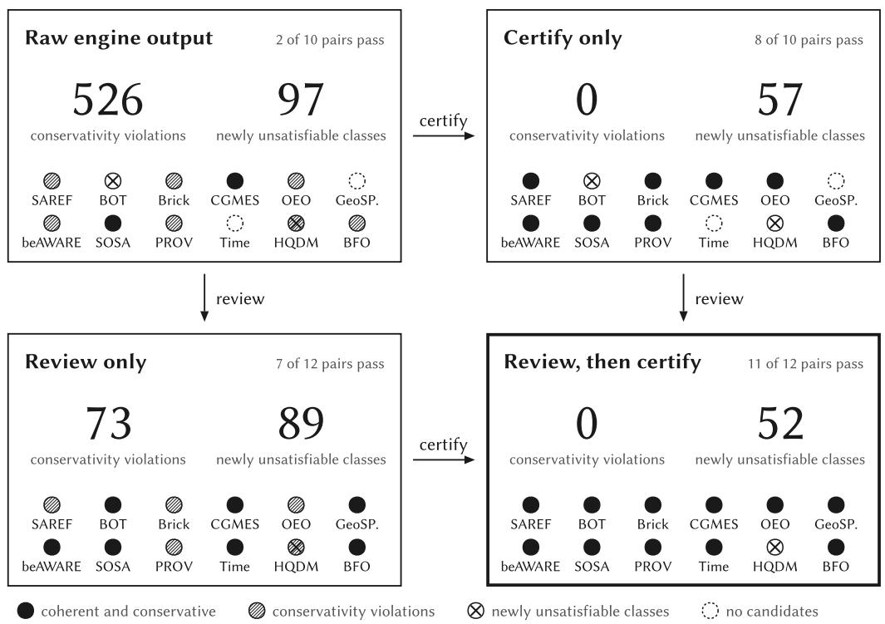

# From Certified Pairs to a Certified Hub: Reasoner-Checked Crosswalks for the Information Exchange Standard

Fabio Rovai

The Tesseract Academy (Kampakis and Co Ltd), London, United Kingdom fabio@thetesseractacademy.com ORCID 0009-0001-7244-794X

Preprint, November 2026

## Abstract

A national digital twin was conceived as an ecosystem of twins connected through mappings to a common foundation, but the roadmap that promises to confirm those mappings are valid never says what valid means. We give the test a precise form, coherence and conservativity of the merged ontology, borrowed from logic-based alignment repair, and apply it to the Information Exchange Standard (IES), first pair by pair and then to whole hubs. Crosswalks from IES into thirteen ontologies across seven sector groups, anchored on the building ontologies BOT, Brick, and SAREF4BLDG, pass through separate stages of matching, human review, certification of each SKOS correspondence against the two class hierarchies, and reasoning with HermiT. Pair by pair, the stages catch diferent failures: certification alone removed all 526 conservativity violations of the raw crosswalks, review alone left 73, and together they made eleven of twelve overlapping pairs coherent and conservative. Pairwise certification does not compose. Merging the three certified building crosswalks into one hub made five Brick classes unsatisfiable, through a homonym between the IES and Brick notions of a floor that only BOT’s disjointness axioms expose; rejecting that one row gave a coherent and conservative hub that entails 290 cross-ontology links nobody wrote down. The core hub is inconsistent before any crosswalk is added, because two published standards, the Open Energy Ontology and BFO 2020, contradict each other; with either one left out it is coherent and conservative. A hub, not a pair, is the unit an ecosystem of twins has to certify.

Keywords: ontology matching, alignment coherence, conservativity, crosswalks, Information Exchange Standard, building ontologies, digital twins

## 1 Introduction

The UK’s national digital twin was never meant to be one model. Its founding principles define it as “an ecosystem of digital twins connected via securely shared data” [1], and the roadmap that followed rests that ecosystem on mappings: existing models and data in other vocabularies are to be connected to a common foundation, and “permanent automated mappings will allow the digital twin catalogue to be continuously refreshed” [2]. The same roadmap promises to reload the source twins “to confirm that the new mappings are valid” [2], but it does not say what makes a mapping valid. This paper proposes a test that does, applies it to every mapping and to every hub of mappings we could build around one common ontology, and reports where the ecosystem holds and where it breaks.

Such an ecosystem is only as useful as the data that flows into it, and that data arrives in whatever vocabulary its source happens to use. Building records speak the language of the construction and facilities-management community, energy records speak the language of grid models, and sensor feeds speak the language of observation ontologies. The Information Exchange Standard (IES) was designed as a common 4D ontology for exchanging information across government, with a lineage in high-quality 4D data modelling and formal upper-ontology work [3, 4]. It gives a shared backbone, but it does not, on its own, tell a data engineer how an IES class relates to the corresponding class in a building or energy ontology. That relationship has to be established by an alignment, and today those alignments are written by hand, reviewed informally, and shipped without a formal test that the result is even logically coherent.

The cost of this shows up whenever a twin has to grow. Extending the vocabulary to cover a new asset class, or connecting a new domain data source, means writing and checking new mappings by hand, and there is no agreed test that says when such a step is safe. The research community has strong machinery for each half of the problem separately. Ontology matching is a mature field with an established evaluation tradition [5], SKOS provides a vocabulary for typing correspondences [6], SSSOM provides a way to serialize and share them [7], and OWL 2 reasoners such as HermiT can decide the consistency of the merged result [8]. Using the reasoner to judge an alignment is also established: logic-based matchers repair incoherent mappings [9], reasoning support helps experts revise them [10], and the conservativity principle flags mappings that change the meaning of an input’s own terms [11]. Pointed at IES, this machinery has so far produced only unreviewed output: a recent bulk run of LogMap over defence and national-security ontologies aligned IES with several building ontologies, among many other pairs, but those alignments were not reviewed and were not tested for conservativity [12]. We are not aware of a public crosswalk that takes IES to the domain ontologies a twin consumes, reviews and types each correspondence, tests it against both class hierarchies, and reports what the reasoner makes of the merge.

In earlier work we aligned three upper ontologies that sit under UK and allied defence data in- frastructure, IES, HQDM, and BFO, and introduced an orientation-search procedure that produces a reasoner-checked crosswalk rather than a hand-asserted one [13]. That work also recorded a plain fact about the state of the art: no public alignment between IES and HQDM existed before it. The present paper takes the acceptance test of that work, coherence and conservativity of the merge, of that single upper-ontology triangle and applies it across the domain ontologies a working twin actually consumes, using a lighter pipeline that runs unchanged on every pair. The underlying alignment engine is open source and has been evaluated on standard matching benchmarks [14]; here we are concerned with the step that follows matching, namely certifying that a proposed crosswalk is safe to merge.

We anchor the paper on the building domain for three reasons. Building data is plentiful and open, through public building-performance certificates [15], the building-ontology landscape is deep and well studied, and extending an IES building vocabulary to regional or national retrofit scale is exactly the kind of step that should be small and checkable rather than a project of its own. That landscape is itself prior art. Around BOT [16], the core vocabulary of the W3C Linked Building Data community, building ontologies have been aligned for years: BOT ships alignment modules to Brick [17], ifcOWL [18], and SAREF4BLDG [19], among others [20]. We do not claim to have aligned building ontologies for the first time. Our claim is narrower and specific to the IES side: we are not aware of prior published certified alignments between IES and this established building-ontology landscape, where certified means reasoner-checked for coherence and conservativity rather than agreed by consensus or validated by hand.

This paper makes four contributions, each defended in a later section.

First, we set out a certified IES-to-domain crosswalk pipeline in which matching, human review, and certification are separate stages: SKOS-typed correspondences are downgraded when the class hierarchies cannot support the claimed predicate, and a crosswalk is accepted only when an OWL 2 reasoner finds the merge coherent and conservative over each input’s own terms (Section 3).

Second, we apply the pipeline to the building-ontology landscape as an anchor case and lay out the full crosswalk matrix for a cross-sector IES hub, spanning energy, geospatial, sensor, provenance, temporal, catalogue, and foundation ontologies, with the licensing constraints of each source recorded so that copyrighted standards are referenced for alignment and never redistributed (Sections 3 and 4).

Third, we measure each pair under four crosswalks, raw, certified without review, reviewed, and reviewed then certified, which separates what each stage contributes. Certification alone removes every conservativity violation but no unsatisfiability; review alone removes the homonyms but leaves violations; together they make eleven of twelve overlapping pairs coherent and conservative. The twelfth, HQDM, stays incoherent, and we trace that to a single correspondence onto a class HQDM cannot populate, a failure the hierarchy test cannot see (Section 4).

Fourth, we run the same test on whole hubs, every target of one IES profile and every certified crosswalk merged at once, and show that pairwise certification does not compose: a homonym invisible in each pair breaks the building hub, and two published standards make the core hub inconsistent before any crosswalk is added. Once repaired, the hubs are coherent and conservative and entail cross-ontology links that no one stated (Section 4.5).

We position this work against the closest prior efort, a recent evaluation resource for defence and national-security ontology matching that builds a consensus from several matchers, validates it by hand into a silver standard, and measures the incoherence each alignment induces [12]. IES is in that resource’s collection but in none of its matching tasks. That resource scores matchers against a reference; this paper produces usable IES crosswalks with their measured coherence and conservativity, which could in turn seed an IES task. We return to this contrast in Section 2.

## 2 Background and Related Work

## 2.1 Ontology matching and its evaluation

Ontology matching produces correspondences between the entities of two ontologies, and the field has a long-standing body of techniques and a shared evaluation tradition [5]. The usual output of a matcher is a set of candidate correspondences, each with a confidence score and a relation such as equivalence or subsumption. The question this paper is concerned with begins where matching ends. A high-confidence candidate is a claim about meaning, and merging the two ontologies under that claim can make the combined ontology say things neither author intended, or make it inconsistent outright. Matching confidence does not measure that risk, so we treat the matcher as one stage and the logical acceptance test as a separate stage.

## 2.2 Logic-based alignment repair

Using a reasoner to judge an alignment is itself well established, and our acceptance test borrows its two criteria from this line of work. Reasoning-based mapping revision treats an alignment as incoherent when the two ontologies together with the mappings make some class unsatisfiable, and uses the reasoner to propagate the logical consequences of an expert’s decision to accept or reject a mapping [10]. LogMap builds that check into a scalable matcher, repairing its own candidate mappings as it goes [9]. The conservativity principle adds a second, weaker failure: an alignment should not introduce new subsumptions between the terms of a single input ontology, even when every class stays satisfiable, and such violations can be detected and corrected automatically [11, 21]. Our coherence test is the first criterion and our conservativity count is the second. What we add is not the criteria but their application, with a SKOS-strength downgrade and human review, to IES and the domain ontologies around it, where the only public alignments so far are unreviewed matcher output (Section 2.3).

## 2.3 The closest prior work

The nearest efort to ours is a recent evaluation resource that improves interoperability among defence and national-security ontologies [12]. It analyses more than sixty public ontologies from that space and introduces a new track, with eight matching tasks, for the Ontology Alignment Evaluation Initiative. Its consensus alignments are, in the authors’ words, derived by aggregating the outputs of several state- of-the-art ontology alignment systems, and its silver standard is obtained from the manual validation of the consensus alignment together with a subset of mappings that only one system proposed. The resource takes coherence seriously: it counts the unsatisfiable classes that each system, each consensus, and the silver standard induce in the merged ontology, finds that even manually curated mappings can be incoherent, and treats the silver standard to fix those logical errors.

Two things separate the present work from it. The first is coverage. IES is in that resource’s ontology collection, but none of its eight matching tasks involves IES, and the authors note that a complete and formal alignment between IES and BFO still needs to be established. The tasks fall into three subdomains, cybersecurity, situation awareness, and smart environments, and four of the eight involve Brick. Before choosing the tasks, the authors ran LogMap over 1,653 ontology pairs of the collection and published the output, which includes IES against BOT, Brick, and SAREF4BLDG. That output proposes, among others, the same Element homonym between IES and BOT that we report in Section 4.4; it was used to select tasks and was not reviewed or tested for conservativity. The second is the form of the output. A silver standard is a reference against which systems are scored; what we produce is a crosswalk meant to be used, in which each correspondence carries the SKOS strength that the class hierarchies support and each pair carries its measured coherence and conservativity. The two fit together. An IES task could be added to such a track, and the crosswalks here are candidates for it, to be scored against whatever reference that community builds. We present this work as complementary to that resource and not as a correction of it.

## 2.4 The building-ontology landscape as prior art

The building domain already has a rich and interrelated set of ontologies, and aligning them is not new. The Building Topology Ontology (BOT) is the core vocabulary of the W3C Linked Building Data community group, giving a high-level description of the topology of buildings including storeys and spaces, the building elements they contain, and their 3D models [16]. Brick is a metadata schema for the sensors, subsystems, and relationships that drive portable building applications [17]. The ifcOWL ontology renders the Industry Foundation Classes model in OWL for the construction industry [18]. SAREF, the Smart Applications REFerence ontology, and its building extension SAREF4BLDG are published as ETSI Technical Specifications [22, 19]. BOT, as the central vocabulary of the Linked Building Data efort, ships alignment modules to Brick, ifcOWL, SAREF4BLDG, and several other building ontologies [20]. We build on this landscape and cite it as the established starting point; the novelty we claim is only on the IES side, as set out in Section 1.

## 2.5 IES and the upper-ontology layer

IES is a 4D ontology serialized as an RDF Schema, developed for information exchange across government and expressed over a small set of foundational notions such as entities, states, and the events that relate them [3]. Its intellectual lineage runs through high-quality 4D data modelling [4] and connects to the wider top-level ontology discussion, including the Basic Formal Ontology (BFO), which is standardized internationally [23, 24]. Bailey et al. compared IES and BFO design patterns and proposed high-level mapping patterns between them, leaving axiomatic translation to future work [25]. Our earlier paper aligned IES, HQDM, and BFO axiomatically, reported that no public alignment between IES and HQDM existed before it, and certified the result with a reasoner [13]. That paper is the base this one extends outward toward the domain ontologies.

## 2.6 Mapping vocabularies and reasoning

Two standards carry the correspondences through the pipeline. SKOS supplies the mapping predicates, a common data model for sharing and linking knowledge organization systems via the Web, with relations for exact, broader, narrower, close, and related matches [6]. SSSOM provides a tabular serialization in which each correspondence carries its predicate and its provenance, so that a crosswalk is a reviewable artifact rather than an opaque blob [7]. The acceptance test is a reasoning problem: whether each ontology is satisfiable alone, whether the merged ontology is satisfiable, and whether the merge is conservative in the sense of forcing no new subclass relationships onto either input’s own vocabulary. We use the HermiT OWL 2 reasoner for these checks [8]. Beyond the building anchor, the crosswalk matrix draws on domain standards that are already established in their fields: SOSA and SSN for sensors and observations [26, 27], GeoSPARQL for geospatial data [28, 29], PROV-O for provenance [30], the Time Ontology for temporal structure [31], DCAT for data catalogues [32], and public domain ontologies such as the beAWARE emergency-management ontology [33].

## 3 Method

## 3.1 Overview

The pipeline takes two ontologies, a source and a target, and produces a crosswalk together with the evidence for accepting it. It runs in five stages: align, review, certify, reason, and serialize. Each stage writes an artifact to disk, so a crosswalk can be inspected, re-run, and reproduced from the command line. The design keeps the proposal of a correspondence apart from its acceptance. The matcher proposes, a reviewer removes homonyms and adds correspondences the matcher could not see, the certifier sets the strength of each correspondence to what the two class hierarchies support, and the reasoner checks the merge. A correspondence whose claimed relation is too strong is weakened rather than discarded, so that information is kept where the evidence supports a weaker claim. Because review and certification are separate stages, we can measure what each contributes on its own (Section 4.4).

## 3.2 Candidate alignment

The first stage uses the open-source Open Ontologies alignment engine, whose evaluation found stable one-to-one matching to be the dominant factor in alignment quality, and which has been evaluated on standard benchmarks [14]. We run it in a deterministic configuration: a single confidence threshold, one-to-one cardinality, and an informative scoring scheme in which a candidate’s confidence is the weighted mean of only those signals that both sides carry data for, rather than counting an unmeasurable signal as zero. Each alignment is run three times and the three candidate sets, each a set of subject, object, relation, and confidence, are compared for equality, so that any reported timing is a median over repeats and the result is confirmed to be reproducible rather than stochastic. Candidates that are ambiguous or that fall on the threshold are held back for review rather than applied silently.

This paper is not about raising matcher recall, and the stage is deliberately lighter than the ori- entation search of our earlier upper-ontology work [13]. Orientation search treats the direction of each correspondence as a search variable and uses the reasoner as an oracle while it searches; here the reasoner is used only once, as a final check on a crosswalk that matching, review, and certification have already fixed. That is cheaper and runs unchanged on every pair, and Section 4.4 shows where it is enough and where it is not. A low candidate count against a large source vocabulary is expected and is not treated as a failure: most classes in a large upper or domain ontology have no counterpart in a given target, and the pipeline records how many source classes remain unmapped rather than inventing correspondences to cover them.

## 3.3 Typing correspondences with SKOS and SSSOM

Each surviving candidate is assigned a SKOS mapping predicate [6]. An engine equivalence becomes skos:exactMatch, a subsumption becomes skos:broadMatch or skos:narrowMatch according to direction, and weaker associations become skos:closeMatch or skos:relatedMatch. The typed correspondences are written as an SSSOM table [7], one row per correspondence, each row carrying its subject, object, predicate, and the origin of the row, whether proposed by the engine or added during curation. Curation is a recorded decision per engine row, to keep, revise, or reject it, with a one-line reason read against the two standards’ own definitions, plus any correspondence the reviewer adds. The most common rejection is a homonym, a pair of classes with the same name and a diferent meaning, such as a device’s on or of state against an IES state, which is a temporal part of an individual. This serialization is what a domain expert reviews and what downstream tools consume, and it is the form in which a crosswalk is published.

Algorithm 1 Certifying the strength of each correspondence   
Require: source $O _ { S }$ , target $O _ { T } ,$ crosswalk M of rows $( s , p , o )$ with p a SKOS redicate   
Ensure: each row with a written predicate and an outcome; the unmapped source classes   
1: $A _ { S } $ entailed named superclasses in $O _ { S }$ under OWL 2 RL, plus skos:broader closure   
2: $A _ { T } $ the same for $O _ { T }$   
3: $\tau  \{ s \mapsto o : ( s , p , o ) \in M \}$ ▷ the crosswalk is its own translation table   
4: $I  \{ o : ( s , p , o ) \in M \}$ ▷ target terms some row maps onto   
5: for all $( s , p , o ) \in M$ do   
6: $X  \{ \tau ( a ) : a \in A _ { S } ( s ) \cap$ dom $\tau \}$ ; $U  A _ { S } ( s ) \ \backslash$ dom $\tau$   
7: $Y  A _ { T } ( o ) \cap I ; \quad V  A _ { T } ( o ) \backslash I$ ▷ U, V: coverage gaps   
8: $q $ exact if $X = Y ;$ broad if $X \supset Y ;$ narrow if $Y \supset X ;$ else related   
9: if p is stronger than q in the order exact $>$ broad, narrow > related then   
10: write q; outcome downgraded   
11: else if $X = \emptyset$ and $Y = \emptyset$ then   
12: write $p ;$ outcome not refuted, nothing compared   
13: else if $U \neq \emptyset$ or $V \neq \emptyset$ then   
14: write $p ;$ outcome upheld with a coverage gap   
15: else   
16: write $p ;$ outcome upheld   
17: end if   
18: end for   
19: return rows, and every class of $O _ { S }$ with ancestors and no row, as unmapped

## 3.4 Crosswalk certification

Certification tests each typed correspondence against the class hierarchies of the two ontologies (Algorithm 1). Each ontology is materialised on its own under the engine’s OWL 2 RL rules, and the ancestors of a class are its entailed named superclasses, together with its broader concepts when the input is a SKOS scheme. The crosswalk is then used as its own translation table: the subject’s ancestors are carried into the target vocabulary through the rows that map them, and compared with those of the object’s ancestors that some row maps onto. The question is whether the two translated ancestor sets support the claimed predicate. The test has three possible outcomes for a row.

A row is downgraded when the hierarchy supports a weaker predicate than the one claimed. The characteristic case is an exactMatch whose object turns out to sit under every ancestor the subject sits under, and more, so the object is the more specific concept and the supported relation is a narrowMatch. Downgrading keeps the correspondence while correcting its strength, which is safer than either accepting an overstated equivalence or throwing the pair away.

A row is upheld with a coverage gap when both sides entail the same ancestors over every ancestor the mapping lets them compare, but some ancestors on one or both sides have no counterpart through the mapping and so could not be compared. The uncompared ancestors are a gap in the mapping’s coverage, not evidence that the two terms difer, and the pipeline records exactly which ancestors were untranslatable so that the gap is visible.

A row is not refuted, nothing compared when neither term has an ancestor that the mapping carries across, so the hierarchy can neither support nor refute the claim. Such a row is explicitly not certified, and the output says so rather than letting a bare label-match pass as if it had been checked. The pipeline reports the counts in each bucket, the number of rows downgraded, and the number of source classes left unmapped, so that the strength of a crosswalk can be read of directly.

Two properties of Algorithm 1 matter for what follows. It never strengthens a claim: a row is only ever rewritten to a weaker predicate, and a closeMatch, which sits outside the order, is never rewritten at all, because two sibling classes under one mapped parent have identical translated ancestors and a compatible hierarchy is not evidence of identity. And it reads only subsumption. It does not see disjointness axioms, and it does not know whether a class is satisfiable in its own ontology, since materialising a schema with no individuals derives no clash. Both blind spots matter, and both are why the reasoning stage below is a separate test rather than a formality.

Algorithm 2 Acceptance test for one crosswalk   
Require: source $O _ { S } ,$ target $O _ { T }$ with named classes $\overline { { \Sigma _ { S } , \Sigma _ { T } } } ;$ SKOS crosswalk M   
Ensure: accept or reject, with the newly unsatisfiable classes N and the violations $V _ { S } , V _ { T }$   
1: $B \gets \{ s \equiv o : ( s , \mathrm { e x a c t } , o ) \in M \} \cup \{ s \equiv o : ( s , \mathrm { b r o a d } , o ) \in M \} \cup \{ o \equiv s : ( s , \mathrm { n a r r o w } , o ) \in M \}$   
▷ close and related rows add no axiom   
2: $Z _ { S } \gets$ Unsat $( O _ { S } )$ $Z _ { T } \gets$ Unsat $( O _ { T } )$ ▷ HermiT, each input alone   
3: $H _ { S } \gets$ Classify $( O _ { S } ) ^ { + } ;$ HT ← Classify(OT)+ ▷ transitive closure, named classes   
4: $O  O _ { S } \cup O _ { T } \cup B$ ▷ imports dropped: nothing is fetched   
5: if O is inconsistent then   
6: return reject   
7: end if   
8: Z ← Unsat(O); $N  Z \setminus ( Z _ { S } \cup Z _ { T } )$   
9: H ← Classify $( O ) ^ { + }$   
10: for all $X \in \{ S , T \}$ do   
11: $V _ { X }  \{ ( a , b ) : a , b \in \Sigma _ { X } , a \notin Z , a \neq b , a \subseteq _ { H } b , a \subseteq _ { H _ { X } } b \}$   
12: end for   
13: return accept if $N = \emptyset$ and $V _ { S } = V _ { T } = \emptyset$

## 3.5 Reasoning: coherence and conservativity

The final acceptance test promotes the SKOS crosswalk into OWL axioms and reasons over the merge with HermiT [8]. The promotion is fixed: exactMatch becomes an owl:equivalentClass bridge axiom, broadMatch becomes the subject being a subclass of the object, narrowMatch becomes the object being a subclass of the subject, and closeMatch and relatedMatch produce no axiom because they assert no subsumption. The reasoner is first run on the source alone and on the target alone, to record which classes each input already cannot populate. It is then run on the merge under four crosswalks: the raw engine output, the raw output after certification with no human review, the reviewed crosswalk, and the reviewed crosswalk after certification. The four conditions separate what review and certification each contribute. For every merge the reasoner reports how many bridge axioms were added and which classes became unsatisfiable that were satisfiable in their own ontology.

Coherence is necessary but not suficient, because a merge can keep every class satisfiable while still forcing new subclass relationships onto one input’s own vocabulary, a side efect that would silently change the meaning of a standard. Following the general notion of the conservativity principle [11], without the exemption their variant grants to classes that already share a descendant, the pipeline therefore also counts violations: subclass relationships between two named, satisfiable classes of a single in ut that the mer e entails and that in ut alone does not. A crosswalk is re orted as certified when the merge is consistent, no class is newly unsatisfiable, and the conservativity violation count is zero on both sides. The condition is stated relative to each input, not as a requirement that each input be coherent, because one published upper ontology in our matrix already has unsatisfiable classes of its own (Section 4.4). Counting only subsumptions between named classes makes the conservativity test an approximation: a positive count is a real change of meaning, while a zero count rules out only this kind of change. Algorithm 2 sets the test out in full.

The evaluation runs Algorithm 2 on each pair four times, with M the raw engine crosswalk, the raw crosswalk after Algorithm 1, the reviewed crosswalk, and the reviewed crosswalk after Algorithm 1.

## 3.6 The crosswalk matrix and the building anchor

We take the building domain as the anchor case because it combines plentiful open data with a deep target landscape. The building targets we align to are BOT [16], Brick [17], and SAREF4BLDG [19]; ifcOWL [18] belongs to the same landscape but was not obtained as an openly fetchable OWL file in this ofline run (Section 4.8). The empirical input is open building-performance certificate data [15], from which an IES building vocabulary can be extended for regional retrofit and the extension measured for size and reasoning cost. Around this anchor sits a wider matrix intended to show that a single certified IES hub can reach across sectors: energy, through openly licensed energy vocabularies and, by reference only, the copyrighted grid model standards; infrastructure and assets, through GeoSPARQL [28, 29]; incident and emergency management, through public ontologies such as beAWARE [33]; the cross-cutting plumbing of data catalogues, provenance, sensing, and time, through DCAT [32], PROV-O [30], SOSA and SSN [26, 27], and the Time Ontology [31]; and the foundation layer of HQDM [4] and BFO [23, 24]. The same five-stage pipeline runs on every pair, which is what makes the matrix a single method rather than a collection of bespoke mappings.

## 3.7 Licensing and reproducibility

Not every target can be redistributed. Some standards, in particular ISO 15926 and the IEC grid model standards, are copyrighted, so they are referenced for alignment and never republished: the crosswalk records the correspondence to their terms without carrying their text. Openly licensed sources are used directly, and IES itself is available with its code under the MIT licence and its documentation under the Open Government Licence [3], which makes a published, attributed extension a legitimate contribution back to the standard rather than an appropriation ofit. The building and incident-management extensions we use are open source under the Apache 2.0 licence, with their documentation under the Open Government Licence [34, 35]. For every target the build records the version, the namespace IRI, and the licence, and for the IES-side files we record the source commit and check that our local copy is byte-identical to it; the full inventory is given in Section 4. Every number reported in this paper is produced by the pipeline from these recorded inputs, and the commands that generate each artifact are stored alongside the artifact so that any figure can be regenerated.

## 4 Evaluation

This section is structured around the questions the method is meant to answer, not around the chronology of the runs. Every number is produced by the reproducible build described in Section 3, run locally on an Apple M3 Max with the engine built in release mode; the alignment steps need no network. Each timing is the median of three runs, and each pair carries a command that regenerates its artifacts. The matrix covers thirteen ontology pairs in seven sector groups. Five further targets could not be obtained as o enly licensed OWL files in this ofline run and are listed with their reasons in Section 4.8; the building anchor is carried by SAREF4BLDG, BOT, and Brick rather than ifcOWL.

The evaluation addresses four questions:

Q1 (Inventory). What is each ontology, at which version, under which licence, and how large is it?

Q2 (Alignment). How many correspondences does the engine propose per pair, is the result deterministic, and how fast is it?

Q3 (Certification). How many proposed correspondences are held at their claimed strength, how many are downgraded, and how much of the source vocabulary is left unmapped?

Q4 (Coherence). Does the merged ontology stay coherent and conservative, and how much of that is due to review and how much to certification?

## 4.1 Q1: Ontology inventory

The source side is IES in one of three profiles, and the profiles do not share a release. The core profile, used for the energy, geospatial, catalogue, plumbing, and foundation targets, is IES Common 5.0.3 (511 classes, 206 properties). The building profile is IES 4 together with an open-source building extension, taken with the copy of the IES 4 schema it is published alongside [34] (706 classes, 249 properties). The emergency-management profile is the same IES 4 schema together with an open-source incidentmanagement schema and hazards vocabulary [35] (539 classes, 231 properties). That copy of IES 4 is not identical to the 4.3.1 release [3]: 26 of its classes are absent from the release and 18 classes of the release are absent from it. The building results therefore speak for this revision of IES 4 and its building extension, not for IES 4.3.1 or IES 5. All three profiles are RDF Schema vocabularies with no disjointness axioms; to run the OWL tools we add an owl:Class typing to every named rdfs:Class, the only change made to any input. The targets are listed in Table 1, with their disjointness axiom counts, which matter for what the coherence test can detect (Section 4.6). Copyrighted standards, namely the IEC grid model and, in the skipped set, ISO 15926, are referenced for alignment only and never redistributed; IES itself is openly licensed, which is what makes a published extension a contribution back to the standard [3].

Table 1: Target ontologies in the crosswalk matrix, with version, licence, size, and number of disjointness axioms. IES-side sizes are given per profile in the text; no IES profile has a disjointness axiom.
<table><tr><td>Sector</td><td>Target (version)</td><td>Licence</td><td>Classes</td><td>Props</td><td>Disj.</td></tr><tr><td>Built environment</td><td>SAREF4BLDG v1.1.2 / SAREF core v3.2.1</td><td>ETSI (free to use)</td><td>163</td><td>347</td><td>3</td></tr><tr><td>Built environment</td><td>BOT 0.3.2</td><td>CC-BY</td><td>8</td><td>17</td><td>18</td></tr><tr><td>Built environment</td><td>Brick 1.4.2</td><td>BSD-3-Clause</td><td>1794</td><td>153</td><td>30</td></tr><tr><td>Energy</td><td>IEC CGMES / CIM Core Equipment 3.0.0</td><td>IEC (reference only)</td><td>210</td><td>0</td><td>0</td></tr><tr><td>Energy</td><td>Open Energy Ontology 2.14.0</td><td>CC0-1.0</td><td>1623</td><td>199</td><td>47</td></tr><tr><td>Infrastructure</td><td>OGC GeoSPARQL 1.1</td><td>OGC document licence</td><td>6</td><td>54</td><td>1</td></tr><tr><td>Emergency mgmt</td><td>beAWARE ontology v1.0</td><td>Apache-2.0</td><td>63</td><td>83</td><td>3</td></tr><tr><td>Data catalogue</td><td>W3C DCAT v3 (2024)</td><td>W3C document licence</td><td>9</td><td>39</td><td>0</td></tr><tr><td>Plumbing</td><td>SOSA / SSN (2017)</td><td>W3C document licence</td><td>22</td><td>38</td><td>0</td></tr><tr><td>Plumbing</td><td>PROV-O (2013)</td><td>W3C document licence</td><td>31</td><td>50</td><td>4</td></tr><tr><td>Plumbing</td><td>OWL-Time (2017)</td><td>W3C document licence</td><td>20</td><td>58</td><td>1</td></tr><tr><td>Foundation</td><td>HQDM 1.0 (MagmaCore)</td><td>Apache-2.0</td><td>229</td><td>86</td><td>14</td></tr><tr><td>Foundation</td><td>BFO 2020</td><td>CC-BY-4.0</td><td>36</td><td>40</td><td>10</td></tr></table>

## 4.2 Q2: Alignment

Table 2 reports, per pair, the number of engine candidates at the fixed confidence threshold, how many were rejected on review, most of them same-word homonyms, how many mappings the reviewer added that name matching could not see, and the median alignment time. Every pair produced the same candidate set in each of its three runs, so a determinism column would be uniformly positive and is omitted. The candidate counts are small against large source vocabularies, which is expected: most classes in one ontology have no counterpart in another, and three pairs (GeoSPARQL, DCAT, OWL-Time) returned no automatic candidate at all, with their correspondences found only where a reviewer looked for bridge points. The homonym rejections catch a trap that label-based matching falls into, for instance an IES temporal State against a device’s on or of State, or a building-component Element against the IES top-level Element.

Table 2: Alignment summary per pair. Threshold, informative scoring, and one-to-one cardinality are fixed across all pairs (Section 3.2). All pairs were deterministic across three runs. Of the seven rejections, five are same-word homonyms, one pairs diferently named classes with diferent meanings (IES SystemState and Brick System\_Status), and one maps onto owl:Thing.
<table><tr><td>Pair (IES to)</td><td>Candidates</td><td>Rejected</td><td>Added</td><td>Align med. (s)</td></tr><tr><td>SAREF4BLDG</td><td>9</td><td>1</td><td>2</td><td>0.82</td></tr><tr><td>BOT</td><td>4</td><td>1</td><td>1</td><td>0.22</td></tr><tr><td>Brick</td><td>19</td><td>2</td><td>0</td><td>2.23</td></tr><tr><td>IEC CGMES</td><td>2</td><td>0</td><td>0</td><td>0.33</td></tr><tr><td>Open Energy Ontology</td><td>22</td><td>0</td><td>0</td><td>1.55</td></tr><tr><td>GeoSPARQL</td><td>0</td><td>0</td><td>2</td><td>0.05</td></tr><tr><td>beAWARE</td><td>5</td><td>1</td><td>0</td><td>0.14</td></tr><tr><td>DCAT</td><td>0</td><td>0</td><td>0</td><td>0.07</td></tr><tr><td>SOSA / SSN</td><td>2</td><td>0</td><td>2</td><td>0.08</td></tr><tr><td>PROV-O</td><td>6</td><td>2</td><td>2</td><td>0.11</td></tr><tr><td>OWL-Time</td><td>0</td><td>0</td><td>2</td><td>0.06</td></tr><tr><td>HQDM</td><td>19</td><td>0</td><td>0</td><td>0.26</td></tr><tr><td>BFO</td><td>2</td><td>0</td><td>0</td><td>0.09</td></tr></table>

## 4.3 Q3: Certification outcomes

Table 3 gives, for each pair, how many correspondences certification checked and how many it down- graded, first on the raw engine crosswalk and then on the reviewed one, together with the source terms the reviewed crosswalk leaves unmapped and the median certification time. Certification downgraded 56 of the 90 raw correspondences and removed none: it changes the strength of a correspondence, never its presence. Downgrading is the common case on raw output because a label-driven matcher proposes exactMatch on a shared lexical surface that the two hierarchies rarely make co-extensive. Brick loses 16 of 19 raw equivalences, the Open Energy Ontology 13 of 22, HQDM 12 of 19, and PROV-O 5 of 6, to broader, narrower, or merely related relations. Review does not make certification redundant: on the reviewed crosswalks it still downgrades 35 of 94 correspondences, including 8 of Brick’s 17 and 10 of the Open Energy Ontology’s 22, because a reviewer who accepts two classes as the same thing cannot see that the hierarchies support only a subsumption. The unmapped figures count the source terms in the materialised hierarchy that have no row. They include terms that the building extension uses as subclasses without declaring them as classes, which is why the building pairs leave more terms unmapped than the profile declares classes. They are non-overlap by design, not missed work. The data-catalogue pair is the limiting case: it has no class-level overlap with IES at all and is omitted.

## 4.4 Q4: Coherence and conservativity

Table 4 reports, for each pair and each of the four crosswalks of Section 3.5, the number of classes that the merge makes unsatisfiable although they are satisfiable in their own ontology, and the number of conservativity violations forced onto the source and onto the target vocabulary, and Figure 1 sums the table over all pairs. Three results stand out.

First, certification on its own removes every conservativity violation. The raw engine crosswalks force 526 new subsumptions onto the two sides’ own vocabularies across seven pairs, as many as 187 on Brick’s side alone, and the same crosswalks after certification force none, on every pair. Review on its own is not enough: the reviewed crosswalks still force 73 violations on five pairs, from equivalences the reviewer kept that the two hierarchies support only as subsumptions. This agreement is expected rather than surprising, because certification is designed to keep only the relations that the two hierarchies jointly support. What the reasoner adds is an independent check of that design under the full OWL semantics of both inputs, and it agrees on every pair. Certification also does this without deleting anything: the certified crosswalks keep every reviewed correspondence and promote to the same number of bridge axioms, except where a correspondence is weakened to a related match, which promotes to none.

Table 3: Certification outcomes per pair, on the raw engine crosswalk and on the reviewed crosswalk: correspondences checked and downgraded because the hierarchy did not support the claimed strength. A dash marks a pair with no engine candidates. Unmapped counts source terms of the materialised hierarchy with no row in the reviewed crosswalk; the time is the median of three certification runs on the reviewed crosswalk. Generated from the run artifacts.
<table><tr><td rowspan="2">Pair (IES to)</td><td colspan="2">Raw</td><td colspan="2">Reviewed</td><td rowspan="2">Unmapped src</td><td rowspan="2">Med. (s)</td></tr><tr><td>Checked</td><td>Down.</td><td>Checked</td><td>Down.</td></tr><tr><td>SAREF4BLDG</td><td>9</td><td>5</td><td>10</td><td>3</td><td>715</td><td>0.30</td></tr><tr><td>BOT</td><td>4</td><td>3</td><td>4</td><td>0</td><td>721</td><td>0.35</td></tr><tr><td>Brick</td><td>19</td><td>16</td><td>17</td><td>8</td><td>708</td><td>0.44</td></tr><tr><td>IEC CGMES</td><td>2</td><td>0</td><td>2</td><td>0</td><td>509</td><td>0.27</td></tr><tr><td>Open Energy Ontology</td><td>22</td><td>13</td><td>22</td><td>10</td><td>489</td><td>0.56</td></tr><tr><td>GeoSPARQL</td><td>一</td><td>一</td><td>2</td><td>0</td><td>509</td><td>0.18</td></tr><tr><td>beAWARE</td><td>5</td><td>1</td><td>4</td><td>0</td><td>536</td><td>0.21</td></tr><tr><td>SOSA / SSN</td><td>2</td><td>0</td><td>4</td><td>0</td><td>507</td><td>0.18</td></tr><tr><td>PROV-O</td><td>6</td><td>5</td><td>6</td><td>2</td><td>505</td><td>0.19</td></tr><tr><td>OWL-Time</td><td>一</td><td>一</td><td>2</td><td>0</td><td>509</td><td>0.11</td></tr><tr><td>HQDM</td><td>19</td><td>12</td><td>19</td><td>12</td><td>492</td><td>0.58</td></tr><tr><td>BFO</td><td>2</td><td>1</td><td>2</td><td>0</td><td>509</td><td>0.11</td></tr><tr><td>Total</td><td>90</td><td>56</td><td>94</td><td>35</td><td></td><td></td></tr></table>

Second, certification on its own does not remove unsatisfiability, because it cannot see disjointness. The BOT pair shows the case cleanly. The engine proposes that the IES top-level Element is the same as BOT’s Element, a building component, which BOT declares disjoint from bot:Zone, the superclass of bot:Building. The engine also equates the IES building, storey, and space classes, which sit under the IES Element, with their BOT namesakes, which sit under bot:Zone. Each ofthose classes is then forced under both sides of the disjointness, and the raw merge has 8 new unsatisfiable classes: three in BOT and five in IES, the IES space’s two subclasses among them. Certification compares only subsumption, and nothing in either hierarchy refutes the Element equivalence, so it keeps it as an exact match. It does weaken the three building-part equivalences to subsumptions, which frees the BOT classes, but the five IES classes still sit under both bot:Element and bot:Zone and stay unsatisfiable. Only the reviewer’s rejection of the homonym, which maps bot:Element to the IES built-entity class instead, takes the count to zero. Review and certification therefore catch diferent failures, and the reviewed and certified crosswalk is the only one of the four conditions that is both coherent and conservative on BOT, SAREF4BLDG, and Brick at once.

Third, the HQDM pair is not certified under any of the four conditions. HQDM is already incoherent on its own: 39 of its 229 classes are unsatisfiable before any alignment is added, as our earlier work reported [13]. The raw crosswalk makes a further 89 classes unsatisfiable, 73 in IES and 16 in HQDM, and the certified crosswalk still makes 52 IES classes unsatisfiable. The cause is a single correspondence. Certification holds ies:Asset as an exact match for hqdm:asset, and hqdm:asset is one of the 39 classes that HQDM cannot populate, so the equivalence empties ies:Asset and every IES class beneath it. Re-reasoning the certified crosswalk without that one row gives no new unsatisfiable class. We report this as a diagnosis, not as a repaired result, because the row was removed after the fact on one pair. It points to a rule the certification stage lacks: a correspondence onto a class that is unsatisfiable in its own ontology says nothing true and should be refused before any strength is assigned. Our earlier work flagged exactly this kind of mapping onto hqdm:asset as vacuously true when produced by other matchers, and its orientation search, which uses the reasoner as an oracle during the search rather than once at the end, produced a certified 21-axiom IES-to-HQDM bridge [13]. For HQDM, that bridge remains the certified crosswalk; the lighter pipeline of this paper does not reproduce it.

With review and certification together, eleven of the twelve pairs with class overlap are coherent and conservative, including all three building pairs; HQDM is the exception. The BFO pair is coherent and conservative but thin: BFO uses opaque numeric identifiers, so automatic name matching finds little, and the reviewed crosswalk holds one broad and one close match rather than any equivalence. A deeper IES-to-BFO mapping is manual, community work, and the method reaches only its surface here. Reasoning is fast on every pair except the Open Energy Ontology, whose merge takes about a minute

  
Figure 1: What review and certification each contribute, summed over the twelve pairs of Table 4. Each panel is one crosswalk condition. The large numbers are the total conservativity violations and the total newly unsatisfiable classes, and each token is one pair. Certification alone clears every violation but keeps BOT’s homonym; review alone removes the homonym but leaves violations on five pairs. Every newly unsatisfiable class in the lower panels comes from HQDM.

Table 4: Coherence and conservativity under four crosswalks per pair. U is the number of classes made unsatisfiable by the merge that are satisfiable in their own ontology; C is the number of conservativity violations on the source and target vocabularies (source/target). A dash marks a pair with no engine candidates. On an incoherent merge, C counts only classes that stay satisfiable. DCAT has no class overlap and is omitted. HermiT time is the median of three runs on the reviewed merge.
<table><tr><td></td><td colspan="2">Raw</td><td colspan="2">Certified raw</td><td colspan="2">Reviewed</td><td colspan="2">Reviewed + cert.</td><td rowspan="2">HermiT (s)</td></tr><tr><td>Pair (IES to)</td><td>U</td><td>C</td><td>U</td><td>C</td><td>U</td><td>C</td><td>U</td><td>C</td></tr><tr><td>SAREF4BLDG</td><td>0</td><td>54/77</td><td>0</td><td>0/0</td><td>0</td><td>17/0</td><td>0</td><td>0/0</td><td>2.13</td></tr><tr><td>BOT</td><td>8</td><td>0/0</td><td>5</td><td>0/0</td><td>0</td><td>0/0</td><td>0</td><td>0/0</td><td>1.14</td></tr><tr><td>Brick</td><td>0</td><td>25/187</td><td>0</td><td>0/0</td><td>0</td><td>18/10</td><td>0</td><td>0/0</td><td>1.24</td></tr><tr><td>IEC CGMES</td><td>0</td><td>0/0</td><td>0</td><td>0/0</td><td>0</td><td>0/0</td><td>0</td><td>0/0</td><td>0.80</td></tr><tr><td>Open Energy Ont.</td><td>0</td><td>23/1</td><td>0</td><td>0/0</td><td>0</td><td>0/1</td><td>0</td><td>0/0</td><td>68.26</td></tr><tr><td>GeoSPARQL</td><td>一</td><td></td><td>一</td><td>一</td><td>0</td><td>0/0</td><td>0</td><td>0/0</td><td>1.01</td></tr><tr><td>beAWARE</td><td>0</td><td>28/0</td><td>0</td><td>0/0</td><td>0</td><td>0/0</td><td>0</td><td>0/0</td><td>0.76</td></tr><tr><td>SOSA / SSN</td><td>0</td><td>0/0</td><td>0</td><td>0/0</td><td>0</td><td>0/0</td><td>0</td><td>0/0</td><td>1.07</td></tr><tr><td>PROV-O</td><td>0</td><td>0/3</td><td>0</td><td>0/0</td><td>0</td><td>0/2</td><td>0</td><td>0/0</td><td>1.07</td></tr><tr><td>OWL-Time</td><td>一</td><td>一</td><td>一</td><td>一</td><td>0</td><td>0/0</td><td>0</td><td>0/0</td><td>0.63</td></tr><tr><td>HQDM</td><td>89</td><td>25/0</td><td>52</td><td>0/0</td><td>89</td><td>25/0</td><td>52</td><td>0/0</td><td>0.59</td></tr><tr><td>BFO</td><td>0</td><td>103/0</td><td>0</td><td>0/0</td><td>0</td><td>0/0</td><td>0</td><td>0/0</td><td>0.39</td></tr></table>

under HermiT.

## 4.5 Q5: From certified pairs to a certified hub

An ecosystem of connected twins is not a set of separate pairs. Every crosswalk into one common ontology is loaded alongside every other, and a consumer of one sector’s data reasons over all of them at once. We therefore merged each IES profile with all of its targets and all of their reviewed and certified crosswalks into a single ontology, and ran Algorithm 2 on the whole hub: newly unsatisfiable classes against each input on its own, and conservativity violations against each input’s own vocabulary. We also counted what the hub is for: subsum tions between classes of two diferent tar ets, neither of them an IES class, that the hub entails and that nobody wrote down. Table 5 gives the results.

Table 5: Reasoning over whole hubs. Inputs counts the IES profile and its targets; rows are the reviewed and certified crosswalk rows merged in. Unsat counts classes unsatisfiable in the hub but satisfiable in their own input; violations are conservativity violations summed over all inputs; cross-links are entailed subsumptions between classes of two diferent targets, neither an IES class. HQDM, already incoherent on its own, is left out of the core hub. Generated from the run artifacts.
<table><tr><td>Hub</td><td>Inputs</td><td>Rows</td><td>Unsat</td><td>Violations</td><td>Cross-links</td><td>HermiT (s)</td></tr><tr><td>Building, as certified pair by pair</td><td>4</td><td>31</td><td>5</td><td>0</td><td>280</td><td>1.7</td></tr><tr><td>Building, Floor row rejected</td><td>4</td><td>30</td><td>0</td><td>0</td><td>290</td><td>1.4</td></tr><tr><td>Core, all seven targets</td><td>8</td><td>40</td><td></td><td>inconsistent</td><td></td><td>1.3</td></tr><tr><td>Core without BFO</td><td>7</td><td>38</td><td>0</td><td>0</td><td>95</td><td>451.4</td></tr><tr><td>Core without the Open Energy Ontology</td><td>7</td><td>18</td><td>0</td><td>0</td><td>0</td><td>12.8</td></tr></table>

Pairwise certification does not compose. Each of the three building pairs is coherent and conservative on its own (Table 4), yet the building hub makes five Brick classes unsatisfiable: Floor, Storey, Basement, Parking\_Level, and Rooftop. The cause is a homonym in the Brick crosswalk that only a third ontology can expose. The reviewer kept the engine’s match between the IES building extension’s Floor and Brick’s Floor, with the note that both “define a storey-level floor surface of a building”, and certification weakened it to a subsumption. But the two are diferent things. The IES Floor is a structural component, a built entity that occupants walk on; Brick’s Floor is a level of a building, declared equivalent to brick:Storey, with Basement, Parking\_Level, and Rooftop beneath it. IES has no disjointness axioms, so the IES–Brick merge is coherent and the error is invisible. The BOT crosswalk maps the IES built entity to bot:Element and the IES storey to bot:Storey, and BOT declares elements and zones disjoint. In the hub, Brick’s levels are forced under both, and become empty. Rejecting that one row makes the building hub coherent and conservative on all four inputs.

The repaired building hub entails 290 cross-links between targets, none of them stated by anyone. Brick’s room types, from ofices to kitchens to storage rooms, fall under SAREF4BLDG’s building space and under BOT’s space and zone; Brick’s storeys fall under BOT’s storey. In a random sample of eight links from each repaired hub none was wrong, although many of the core hub’s links land on PROV-O’s very general entity class and say little. These are entailments of the certified crosswalks, not reviewed correspondences, and a hub that publishes them should mark them as such, but they are what an ecosystem of connected twins is meant to deliver: a building ontology connected to IES is thereby connected to every other building ontology connected to IES.

The core hub fails for a diferent reason, one that no crosswalk can fix. With all seven targets it is inconsistent, and it stays inconsistent with every crosswalk row removed. The cause is two published standards: the Open Energy Ontology together with BFO 2020 is inconsistent on its own, and with the Open Energy Ontology’s 232 named individuals left out the pair still makes three classes unsatisfiable. The Open Energy Ontology carries its own copy of 35 BFO classes, which suggests a version mismatch, though we have not isolated the axioms responsible. Either target can join the hub, but not both. Without BFO, the core hub is coherent and conservative on all seven inputs and entails 95 cross-links, mostly energy-system classes placed under PROV-O’s entity, agent, organisation, person, and location; without the Open Energy Ontology it is coherent and conservative and entails none. The core hub is also the expensive one: classifying it with the Open Energy Ontology in place took HermiT over seven minutes, against seconds for every other merge.

## 4.6 What the acceptance test cannot see

A coherence test is only as sharp as the axioms it can contradict. No IES profile carries a disjointness axiom, so every unsatisfiable class in our merges comes from a disjointness or an unsatisfiable class on the target side. Three targets, the IEC grid model, DCAT, and SOSA/SSN, carry no disjointness axiom either (Table 1), so for those pairs the coherence half of the test has almost nothing to fire on, and a zero there is weak evidence; only the conservativity half has teeth. More generally, a crosswalk can be coherent and conservative and still wrong. The certified HQDM crosswalk holds ies:Event as an exact match for hqdm:event. Our earlier work argues that this is a false friend: an IES event is a durative happening with participants, an HQDM event is an instantaneous boundary, and the true counterpart is hqdm:activity [13]. Neither the hierarchy test nor the reasoner objects, because nothing in either ontology’s axioms forbids the identification. Certification bounds the logical damage a crosswalk can do; it does not establish that the crosswalk means the right thing, which remains the reviewer’s job.

## 4.7 Building anchor: the extension step

The anchor case measures the specific claim that extending an IES building vocabulary for regional retrofit is a quick and checkable step rather than a costly manual step. We built a small attributed OWL module that reuses the open IES building classes as parents and ranges and adds a retrofit-planning layer: a project and a regional programme, a measure hierarchy with fabric, heating, and renewable-generation branches, and a recommendation type that makes the building-performance recommendation analysable at scale. Table 6 records the result. The engine’s planner checks an extension against the base by deriving, under a Horn rule approximation of OWL, every consequence the extension adds over the base vocabulary. That check is sound in one direction only: a new consequence is a real change of meaning, while finding none does not prove the extension conservative in OWL. We therefore also ran HermiT on the merge as an independent check.

Table 6: Building-ontology extension for regional retrofit, measured on an Apple M3 Max. Plan, apply, dif, and reasoning times are medians of three runs.
<table><tr><td>Measure Value</td></tr><tr><td>Classes added 14</td></tr><tr><td>Object properties added 7</td></tr><tr><td>Datatype properties added 10</td></tr><tr><td>Triples added / base triples dropped 123 / 0</td></tr><tr><td>New consequences over the base vocabulary (rule approximation) none found</td></tr><tr><td>Plan risk / new TBox defects / ABox low / 0 / consistent (90 individuals)</td></tr><tr><td>Plan time, median (s) 0.72</td></tr><tr><td>Apply time, median (s) 0.046</td></tr><tr><td>Diff time, median (s) 0.039</td></tr><tr><td>Independent reasoner (HermiT) new unsat 0</td></tr><tr><td>HermiT merge-check time, median (s) 0.33</td></tr></table>

The module ships with a SHACL data contract for building-performance certificate data: a certificate must carry one rating band in the A to G range, a score on the 1 to 100 scale, a positive floor area, and a non-negative emissions figure. Validated against a mixed sample under the engine’s SHACL evaluator, the contract returned non-conformance with five violations, and all five fell on exactly the two records built to fail, three on a malformed certificate and two on a malformed recommendation. A genuine open certificate (a mid-terrace house, band D with potential B, 135 square metres, 7.0 t of CO2 a year) and every valid synthetic record passed. The contract accepts the good records and rejects the bad ones, and it names the constraint each bad record breaks. The extension is version 0.1.0, deliberately small, and models the retrofit-planning layer rather than the assessment process the base ontology already covers.

## 4.8 Targets not obtained in this run

Five targets could not be fetched as openly licensed OWL in this ofline run and are reported rather than silently dropped. ifcOWL requires buildingSMART distribution channels, and the built-environment anchor is carried b SAREF4BLDG, BOT, and Brick instead. HealthDCAT-AP was not obtainable as an OWL or SHACL artifact, and catalogue plumbing is carried by DCAT. ISO 15926 is copyrighted with no openly licensed OWL available, and the 4D commitments it shares are reached through HQDM. BORO and IDEAS likewise had no openly fetchable reference OWL, and the BORO method is reached through HQDM, the 4D upper ontology built with it.

## 5 Discussion

The method rests on one design choice: proposing a correspondence and accepting it are separate steps, and acceptance is a measured property of the merged ontology rather than a confidence score or a vote. The criteria themselves, coherence and conservativity, come from earlier work on logic-based alignment repair [10, 9, 11]. What this paper adds is their application to IES across seven sector groups, a measurement of which stage of a practical pipeline does the work, and the step from pairs to hubs.

The hub result is the one that matters most for an ecosystem of connected twins. Certifying each crosswalk on its own is necessary and not enough: the building hub failed although every building pair passed, because the axiom that exposed the Brick homonym lived in BOT, a third ontology that neither the IES nor the Brick side contains. In a federation, every new crosswalk is checked against every ontology already connected, whether or not anyone intends it, so the acceptance test has to run on the hub each time a crosswalk joins. The core hub shows the other half of the same lesson. Two standards that are each coherent, and each certified against IES, cannot be loaded together, and no crosswalk repair can change that; a hub test is also a test of the standards it connects. Both checks took seconds, except where the Open Energy Ontology was involved, so running them on every change is afordable.

That measurement is the clearest result. Review and certification fail in diferent ways, and each covers the other’s blind s ot. Certification reads the two class hierarchies and sets each corres ondence to the strength they jointly support; on its own it removed all 526 conservativity violations in the raw crosswalks, on every pair, without deleting a correspondence. It cannot see disjointness, so it left the BOT homonym in place and five classes unsatisfiable. Review catches homonyms, because a reviewer reads the definitions, but a reviewer who accepts two classes as the same thing has no way to see that the two hierarchies support only a subsumption, and the reviewed crosswalks still carried 73 violations. Neither stage alone made the three building pairs coherent and conservative; both together did (Table 4).

The HQDM pair marks the limit of the pipeline. A single held equivalence onto a class that HQDM cannot populate made 52 IES classes unsatisfiable, and neither review nor certification caught it. Two lessons follow. The certification stage should refuse any correspondence whose target is unsatisfiable in its own ontology, a cheap check that needs one reasoner call per input. And when the ontologies being joined are themselves incoherent, a final check is not enough; the orientation search of our earlier work, which consults the reasoner during the search, is the tool that produced a certified IES-to-HQDM bridge [13].

Several findings are negative and are reported as such. Energy is a gap, not a failure: neither the grid model nor the energy ontology shares IES’s core vocabulary, and the only certified matches are generic entities such as currency, organisations, and units, so energy interoperability needs an IES energy extension rather than a better matcher (Table 3). The data catalogue has no class-level overlap with IES and sits beside it as plumbing. Alignment to BFO is thin because BFO uses opaque numeric identifiers, so only broad and close matches were found.

The claims are bounded in four further ways. The matcher proposes few correspondences against large vocabularies, so the method certifies the correspondences it finds and promises nothing about coverage. Where neither ontology has disjointness axioms, as for three of our targets, the coherence test can barely fail, and only the conservativity test carries weight (Section 4.6). Coherent and conservative is not the same as correct: the certified HQDM crosswalk still equates an IES event with an HQDM event, a false friend that no axiom in either ontology forbids. The building pairs use IES 4 with its building extension, so they say nothing yet about IES 5. Finally, IES’s own documentation says the ontology “is not intended for reasoning / inference” [3]. We reason over it not to draw new facts about the world but to find out what a merge already commits a consumer to, which is what any system that loads a crosswalk does whether or not the standard intends it.

The broader aim is a single IES hub whose crosswalks carry their acceptance evidence with them. The same pipeline that reaches a building vocabulary reaches temporal structure through the Time Ontology [31], provenance-carrying data contracts through PROV-O [30], sensor and Earth-observation data through SOSA and SSN [26, 27], geospatial asset data through GeoSPARQL [29], and the foundation layer of HQDM and BFO [4, 23]. Each of these is a row in the matrix of Section 3.6, measured with the same four conditions, rather than a separate research programme.

## 6 Conclusion

We applied the coherence and conservativity acceptance test to crosswalks from the Information Exchange Standard into thirteen ontologies across seven sector groups, with the building-ontology landscape as the anchor. We cited that landscape as the prior art it is and scoped our novelty to the IES side: we are not aware of prior published certified alignments between IES and the established building-ontology landscape. Measuring each pair under four crosswalks showed that certification and human review catch diferent failures, certification removing every conservativity violation and review removing the homonyms that cause unsatisfiability, and that together they make eleven of the twelve overlapping pairs, including all three building pairs, coherent and conservative. The twelfth, HQDM, stays incoherent because of one correspondence onto a class HQDM cannot itself populate, which motivates a refusal rule the pipeline lacks. A retrofit extension of the IES building vocabulary, 14 classes and 17 properties, was planned in under a second, applied in under a tenth of a second, and added no unsatisfiable class under an independent reasoner. Follow-up work should add the refusal rule and run orientation search on the pairs with incoherent inputs, repeat the building pairs on IES 5, extend the anchor to bulk open data, deepen the IES-to-BFO mapping by hand, and scope an IES energy extension.

## References

[1] A. Bolton, L. Butler, I. Dabson, M. Enzer, et al., The Gemini Princi les: Guidin Values for the National Digital Twin and Information Management Framework, Technical Report, Centre for Digital Built Britain and Digital Framework Task Group, Cambridge, 2018. URL: https://doi. org/10.17863/CAM.32260. doi:10.17863/CAM.32260.

[2] J. Hetherington, M. West, The Pathway Towards an Information Management Framework: A ‘Commons’ for Digital Built Britain, Technical Report, Centre for Digital Built Britain, Cambridge, 2020. URL: https://doi.org/10.17863/CAM.52659. doi:10.17863/CAM.52659.

[3] Dstl and UK Government, IES: The information exchange standard (ies4), 4D RDF Schema ontology; code MIT (v4.3.1), documentation under the Open Government Licence, 2025. URL: https:// github.com/dstl/IES4.

[4] M. West, Developing High Quality Data Models, Morgan Kaufmann, 2011. URL: https: //www.oreilly.com/library/view/developing-high-quality/9780123751065/. doi:10.1016/C2009-0-30508-5.

[5] J. Euzenat, P. Shvaiko, Ontology Matching, 2 ed., Springer, 2013. URL: https://doi.org/10. 1007/978-3-642-38721-0. doi:10.1007/978-3-642-38721-0.

[6] A. Miles, S. Bechhofer, SKOS simple knowledge organization system reference, W3C Recommendation, 2009. URL: https://www.w3.org/TR/skos-reference/.

[7] N. Matentzoglu, J. P. Balhof, S. M. Bello, C. Bizon, M. Brush, T. J. Callahan, et al., A simple standard for sharing ontological mappings (SSSOM), Database 2022 (2022) baac035. URL: https: //doi.org/10.1093/database/baac035. doi:10.1093/database/baac035.

[8] B. Glimm, I. Horrocks, B. Motik, G. Stoilos, Z. Wang, HermiT: An OWL 2 reasoner, Journal of Automated Reasoning 53 (2014) 245–269. URL: https://doi.org/10.1007/s10817-014-9305-1. doi:10.1007/s10817-014-9305-1.

[9] E. Jiménez-Ruiz, B. Cuenca Grau, LogMap: Logic-based and scalable ontology matching, in: The Semantic Web – ISWC 2011, Lecture Notes in Computer Science, Springer, 2011, pp. 273–288. doi:10.1007/978-3-642-25073-6\_18.

[10] C. Meilicke, H. Stuckenschmidt, A. Tamilin, Reasoning support for mapping revision, Journal of Logic and Computation 19 (2009) 807–829. doi:10.1093/logcom/exn047.

[11] A. Solimando, E. Jiménez-Ruiz, G. Guerrini, Detecting and correcting conservativity principle violations in ontology-to-ontology mappings, in: The Semantic Web – ISWC 2014, Lecture Notes in Computer Science, Springer, 2014, pp. 1–16. doi:10.1007/978-3-319-11915-1\_1.

[12] J. Dilworth, P. G. Cotovio, D. Herron, P. Cripps, N. Dewdney, C. Pesquita, E. Jiménez-Ruiz, Im-proving interoperability among defence and national security ontologies: Analysis and evaluation tasks, 2026. URL: https://arxiv.org/abs/2608.05867. arXiv:2608.05867, accepted at the Resource Track of the 25th International Semantic Web Conference (ISWC 2026), Bari, Italy.

[13] F. Rovai, Consistency is not coherence: Orientation search for certified alignments between 4d defence upper ontologies, 2026. URL: https://arxiv.org/abs/2608.21914. arXiv:2608.21914, long paper accepted at the Ontology Matching workshop (OM 2026), colocated with ISWC 2026.

[14] F. Rovai, Open ontologies: Tool-augmented ontology engineering with stable matching alignment, 2026. URL: https://arxiv.org/abs/2605.09184. arXiv:2605.09184, software released under the MIT licence.

[15] Ministry of Housing, Communities and Local Government, Get energy performance of buildings data, GOV.UK service, 2026. URL: https://get-energy-performance-data.communities. gov.uk/, non-address fields under the Open Government Licence v3.0; accessed 4 November 2026.

[16] M. H. Rasmussen, M. Lefrançois, G. F. Schneider, P. Pauwels, BOT: The building topology ontology of the W3C linked building data group, Semantic Web 12 (2021) 143–161. URL: https://doi. org/10.3233/SW-200385. doi:10.3233/SW-200385.

[17] B. Balaji, A. Bhattacharya, G. Fierro, J. Gao, J. Gluck, D. Hong, A. Johansen, J. Koh, J. Ploennigs, Y. Agarwal, M. Bergés, D. Culler, R. K. Gupta, M. B. Kjærgaard, M. Srivastava, K. Whitehouse, Brick: Metadata schema for portable smart building applications, Applied Energy 226 (2018) 1273–1292. URL: https://doi.org/10.1016/j.apenergy.2018.02.091. doi:10.1016/j.apenergy. 2018.02.091.

[18] P. Pauwels, W. Terkaj, EXPRESS to OWL for construction industry: Towards a recommendable and usable ifcOWL ontology, Automation in Construction 63 (2016) 100–133. URL: https://doi. org/10.1016/j.autcon.2015.12.003. doi:10.1016/j.autcon.2015.12.003.

[19] ETSI, SmartM2M; Extension to SAREF; Part 3: Building Domain, Technical Specification TS 103 410-3 V1.1.2, ETSI, 2020. URL: https://www.etsi.org/deliver/etsi\_ts/103400\_103499/ 10341003/01.01.02\_60/ts\_10341003v010102p.pdf.

[20] M. H. Rasmussen, P. Pauwels, M. Lefrançois, G. F. Schneider, Building topology ontology, W3C Linked Building Data Community Group, Draft Community Group Report, ontology version 0.3.2, n.d. URL: https://w3c-lbd-cg.github.io/bot/, section “Alignment Modules”; undated.

[21] A. Solimando, E. Jiménez-Ruiz, G. Guerrini, Minimizing conservativity violations in ontology alignments: Algorithms and evaluation, Knowledge and Information Systems 51 (2017) 775–819. doi:10.1007/s10115-016-0983-3.

[22] ETSI, SAREF: The smart applications reference ontology (core v4.1.1), ETSI SmartM2M standard, originated by Daniele, den Hartog and Roes (FOMI 2015), 2024. URL: https://saref.etsi. org/core/.

[23] R. Arp, B. Smith, A. D. Spear, Building Ontologies with Basic Formal Ontology, MIT Press, 2015. URL: https://mitpress.mit.edu/9780262527811/. doi:10.7551/mitpress/ 9780262527811.001.0001.

[24] ISO/IEC, ISO/IEC 21838-2:2021 information technology — top-level ontologies (tlo) — part 2: Basic formal ontology (bfo), 2021. URL: https://www.iso.org/standard/74572.html.

[25] I. Bailey, J. Beverley, H. Blackmore, A. Cola, P. Cripps, G. De Colle, F. Donato, A. Hicks, D. Limbaugh, E. Milivinti, C. Partridge, R. Raferty, B. Smith, Comparing information exchange standard and basic formal ontology design patterns, in: Proceedings of the Joint Ontology Workshops (JOWO) - Episode XI, co-located with FOIS 2025, volume 4176 of CEUR Workshop Proceedings, Catania, Italy, 2025. URL: https://ceur-ws.org/Vol-4176/foust-6.pdf.

[26] K. Janowicz, A. Haller, S. J. Cox, D. Le Phuoc, M. Lefrançois, SOSA: A lightweight ontology for sensors, observations, samples, and actuators, Journal of Web Semantics 56 (2019) 1–10. URL: https: //doi.org/10.1016/j.websem.2018.06.003. doi:10.1016/j.websem.2018.06.003.

[27] A. Haller, K. Janowicz, S. J. Cox, M. Lefrançois, K. Taylor, D. Le Phuoc, J. Lieberman, R. García-Castro, R. Atkinson, C. Stadler, The modular SSN ontology: A joint W3C and OGC standard specifying the semantics of sensors, observations, sampling, and actuation, Semantic Web 10 (2019) 9–32. URL: https://doi.org/10.3233/SW-180320. doi:10.3233/SW-180320.

[28] N. J. Car, T. Homburg, M. Perry, F. Knibbe, S. J. D. Cox, J. Abhayaratna, M. Bonduel, P. J. Cripps, K. Janowicz, OGC GeoSPARQL – A Geographic Query Language for RDF Data, Version 1.1, OGC Standard 22-047r1, Open Geospatial Consortium, 2024. URL: http://www.opengis.net/doc/ IS/geosparql/1.1.

[29] R. Battle, D. Kolas, Enabling the geospatial semantic web with parliament and GeoSPARQL, Semantic Web 3 (2012) 355–370. URL: https://doi.org/10.3233/SW-2012-0065. doi:10. 3233/SW-2012-0065.

[30] T. Lebo, S. Sahoo, D. McGuinness, PROV-O: The PROV ontology, W3C Recommendation, 2013. URL: https://www.w3.org/TR/prov-o/.

[31] S. Cox, C. Little, Time ontology in OWL, W3C Recommendation, 19 October 2017, 2017. URL: https://www.w3.org/TR/2017/REC-owl-time-20171019/.

[32] R. Albertoni, D. Browning, S. J. D. Cox, A. Gonzalez Beltran, A. Perego, P. Winstanley, Data catalog vocabulary (DCAT) - version 3, W3C Recommendation, 22 August 2024, 2024. URL: https: //www.w3.org/TR/vocab-dcat-3/.

[33] E. Kontopoulos, P. Mitzias, J. Moßgraber, P. Hertweck, H. van der Schaaf, D. Hilbring, et al., Ontology-based representation of crisis management procedures for climate events, 2018. doi:10. 5281/zenodo.1243535, recommended citation for The beAWARE Crisis Management Ontology, https://github.com/beAWARE-project/ontology.

[34] National Digital Twin Programme, IES 4 building extension (ies-building1), with the IES 4 schema it extends, Open-source ontology files in the IRIS repository; code Apache-2.0, documentation Open Government Licence v3.0. Both files at commit 2db4240, the first released under these licences, 2026. URL: https://github.com/National-Digital-Twin/IRIS/ blob/2db424030999f9db839920484a9c435bd07ab3eb/data-tools/data-pipeline/ materialised-view-creation/src/create-view/ies-building.ttl.

[35] National Digital Twin Programme, Incident-management schema and hazards vocabulary for IES 4, Open-source ontology files in the LISA repository (schema/schema.ttl at commit a38d2f6, schema/Hazards/hazards.ttl at commit d77f540); code Apache-2.0, documentation Open Government Licence v3.0, 2025. URL: https://github.com/National-Digital-Twin/ LISA/tree/d77f540d146b3ede327a48fc4dfbd32dae34af51/schema.