# From Handcrafted to Generative: RLVR-Optimized Icon Generation for Alexa+

Rohan Sequeira1∗, Matthew Rosenberg2, Amin Mahmoudabadbozchelou2,

Oleg Poliannikov2, Jonathan Rubin2,

1 University of Southern California, 2Amazon Alexa rsequeir@usc.edu, rosenbrg@amazon.com, maminmab@amazon.com, poliann@amazon.com, jonrubin@amazon.com

## Abstract

Alexa+ devices with screens display animated icons during conversations to visually reinforce what is being said. The original set of these icons was hand-drawn by designers one at a time, a process that produces polished results but is timeconsuming and cannot scale to the range of topics encountered in open-ended conversation. We describe an automated pipeline, deployed in production, that generates these vectorised animated icons from a text description alone and surfaces relevant animations to customers based on their ongoing conversation. The pipeline decomposes icon creation into a sequence of stages (image generation, semantic decomposition, vectorisation, styling, and animation). Its quality is determined at the very first of these, image generation, on which every downstream stage depends. We therefore focus on improving this first and most critical stage. Because the icons are rendered on small display canvases under strict design guidelines, generations are often unsuitable for production. Supervised fine-tuning is not viable, as no dataset of line-art icons exists under these constraints. Instead, we design objective verifiers that automatically flag generations violating the design guidelines, and use them to fine-tune a flow matching image generation model via reinforcement learning from verifiable rewards (RLVR). The fine-tuned model raises the pass rate from 15.7% to 58.7% (3.7×) under a VLM judge that is independent of the reward model. Both the trained model and the verifier are deployed in the production pipeline, where the verifier also serves as the automated quality gate before final design review.

## Introduction

Conversational assistants on screen-equipped devices communicate through voice, but many interactions benefit from a visual cue that reinforces what is being said. Alexicons are the animated line-art icons that serve this role on Alexa+ devices (Figure 1): a question about cooking surfaces a skillet, a weather query brings up an umbrella. Each icon is rendered in a signature blue gradient with fluid motion, and the original set was hand-drawn by designers one icon at a time. That process produced polished results but could not keep pace with the range of topics Alexa+ encounters in open-ended conversation. We built an automated pipeline that decomposes icon creation into tractable stages: image generation, semantic decomposition, centreline vectorisation, gradient styling, and procedural Lottie 1 animation. The quality of the final icon is determined at the very first stage, and every downstream stage inherits whatever that first drawing produces. Image generation is the binding bottleneck. This paper describes the automated pipeline we use to serve Alexicons in production trafic, with a focus on the image generation stage and the improvements we made to it.

  
Figure 1: Alexicons on an Alexa+ display device. Left: an Alexicon animating on the home screen. Right: two Alexicons shown at closer scale, rendered in the signature blue gradient with fluid line-art strokes.

The initial pipeline relied on a proprietary image generation API. However, it is desirable to have a tailorable model rather than remaining dependent on frontier image generation services. FLUX.2 [klein] (Black Forest Labs 2025), a 4B parameter open-source flow-matching (Lipman et al. 2023) model, was identified as a practical candidate given its permissive licence and undistilled weights.

Alexicons are rendered on small display canvases with strict design guidelines that require relatively large stroke widths. When adjacent contours sit too close in the image generation model’s high-resolution output, they merge into solid shapes once re-rendered at the production stroke width, we call this defect stroke crowding. With proprietary models, we managed this through extensive prompt tuning, and automated Vision-Language Model (VLM) judges that dropped failing cases at the cost of generating more variations pericon. Other open-source models we evaluated produced the defect far more often and were less reliable. Out of the box,

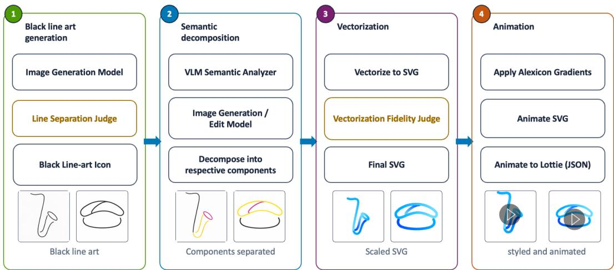  
Figure 2: The Alexicon production pipeline. Stage 1 generates black line-art from a text prompt and judges stroke separation quality. Stage 2 uses a VLM to identify semantic components and an image generation model to decompose the drawing into colour-coded parts. Stage 3 vectorises each component into centreline SVG paths and verifies vectorisation fidelity. Stage 4 applies the Alexicon gradient palette, animates the SVG, and exports a Lottie file for on-device playback.

FLUX.2 [klein] exhibits stroke crowding on roughly 85% of generations. Generating at lower resolution or controlling stroke width through prompting would theoretically circumvent the issue, but current image generation models cannot do either reliably while maintaining the required line-art quality, and vectorization of low-resolution images introduces artifacts (visual imperfections, jagged shapes, broken contours, etc.) downstream. Fine-tuning the model to avoid this defect is the natural next step, but supervised fine-tuning requires a corpus of correct examples, and no public dataset of line-art icons exists under these rendering constraints.

Reinforcement learning ofers an alternative: it can optimise against a non-diferentiable reward without paired data. In this work, we use Flow-GRPO (Flow based- Group Relative Policy Optimization) (Liu et al. 2025) to fine-tune FLUX.2 [klein] against a reward signal that evaluates the model’s own rendered output directly. We introduce a morphological measurement tool that flags every region where strokes sit too close. A gradient-boosted classifier trained on 3,836 hand-labelled violations from 682 icons separates genuine defects from spacing the design requires. The trained model and objective verifier are deployed inside the production pipeline, introducing more objective automated quality gates into the Alexicon creation process.

## Contributions. Our main contributions are:

• We present the full automated pipeline for creating vectorised animations that are displayed on Alexa+ devices, from text description to on-device playback.

• We present a reward model for stroke crowding that combines a stroke-clearance measurement tool with an objective verifier to distinguish genuine defects from intended design, requiring no target images and no manual annotation at training time.

• We demonstrate that Flow-GRPO fine-tuning against our proposed reward produces a model that generalises the learned spacing behaviour to held-out concepts, evaluated under a VLM judge that is independent of the objective verifier used in the reward model.

• We deploy the trained model and objective verifier inside the Alexicon generation pipeline, where the verifier serves as the automated quality judge before design review.

## System Overview

The Alexicon pipeline (Figure 2) turns a short text description into a finished animation through four stages, each handling a diferent aspect of the transformation from concept to ondevice usage. The first stage is image generation. A text-toimage model produces a high-resolution black-on-white line drawing conditioned on hand-crafted Alexicon references that anchor the output style: continuous single-stroke paths, smooth curves, rounded corners, no filled shapes, and a uniform thin stroke. The generated drawing is then re-rendered at the production display dimensions with the required stroke width and padding. A VLM judge compares the original output against this re-render to check whether the icon remains legible without stroke crowding. Only icons that pass move forward in the pipeline. The second stage is semantic decomposition. A vision-language model examines the drawing and identifies its semantic components (a handle, a blade, a base), outputting a structured description of each part. The image generation model then re-renders the icon with each component drawn in a distinct colour, preserving the original geometry while encoding the part boundaries into the pixel data. The result is a colour-coded image where each semantic region is visually separated.

Subsequent stages separate the colour-coded image into per-component raster masks, vectorise each into a centreline SVG, and apply the Alexicon visual identity. Paths receive colours from a fixed palette of three anchor blues, a stacking order is inferred for overlapping parts, and opacity fades soften open stroke terminations. The styled SVG

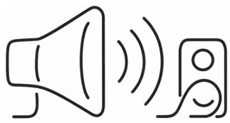

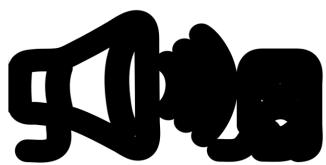  
(a) Generated at high resolution.  
(b) Re-rendered at the required stroke width and display size.

Figure 3: Stroke crowding on a generated speaker icon.

is then turned into a Lottie animation: a connectivity graph built from path endpoints determines the drawing order, and composable motion efects (trim-path reveals, vertex morphing, rotation, distance-based staggering) are assigned to each part. The final animation is inserted into a template with the background glow and Alexa voice chrome bar, producing a file ready for on-device playback.

The pipeline runs end to end without manual intervention, but the first stage carries the heaviest external dependency: multiple image generation model calls per icon. Every downstream stage inherits the quality of the drawing that comes out of image generation. A line-art with tangled or overcrowded strokes propagates errors through decomposition, vectorization, styling, and animation, and no later stage can undo a structural flaw baked into the geometry of the image. The rest of the paper focuses on the image generation stage, where stroke crowding is the dominant quality problem.

## Motivation

Generative image models (OpenAI 2025; Imagen Team, Google 2024; Black Forest Labs et al. 2025; Esser et al. 2024) train predominantly on photorealistic images, where colour, texture, and shading absorb small positional errors. A contour shifted by a few pixels in a photograph changes almost nothing perceptually. Black line art has none of that cover. Every stroke is a bare geometric mark, and a shift of a few pixels can push two contours close enough to merge once the icon is rendered at its production stroke width. The design constraints that Alexicons must satisfy make the margin even tighter: the production canvas is small and the required stroke width is large relative to it, so each stroke consumes a substantial fraction of the available space. Only a handful of parallel strokes fit side by side with adequate clearance between them, and most objects need more structure than that limit can carry.

At the high resolution produced by image generation models, lines appear thin and well separated (Figure 3, left). Stroke crowding only becomes visible once the drawing is downscaled to the target display size and re-rendered at the required stroke width (Figure 3, right), because contours that had room at high resolution are now pushed together. The model has no representation of this artifact in its own output space. Explicit spacing instructions in the prompt do not help. The model reads the instruction but lacks the substroke-width spatial precision to act on it.

Automating the detection of stroke crowding is itself harder than it first appears. A strict geometric measurement can flag every region where two strokes sit closer than one stroke width, but not every narrow gap is a defect. Bubbles drawn as circles, sharp corners, and joints where two parts of an object meet all produce sub-stroke-width clearances that a geometric measurement would flag, even though those tight gaps are necessary to preserve the object’s meaning. A measurement tool that flags all of these indiscriminately would penalise correct drawings alongside invalid ones, and any reward built on top of it would teach the model the wrong lesson. Separating genuine crowding defects from spacing that the design requires is a semantic judgment that geometry alone cannot make.

Since no suitable dataset exists with line-art icons under these rendering constraints, the model cannot be taught correct spacing through supervised examples. Instead, it must learn from a signal that evaluates its own output against the rendering constraint directly. The next section describes our approach to tackling these problems and the methodology behind fine-tuning an open-source model to produce wellseparated line art under the Alexicon design constraints.

## Method

Our method fine-tunes an open-source text-to-image model to produce line-art icons that remain legible at the production stroke width, using a reward signal built entirely from the rendered output. We begin by constructing a stroke-clearance measurement tool that flags every region where strokes sit too close on the rendered drawing. We then describe the verifier dataset assembled to train a classifier on top of this tool, and the objective verifier that uses that classifier to separate genuine crowding defects from spacing that the design requires. Finally, we present the full reward model that combines the verifier’s defect count with guards against degenerate outputs and a concept-fidelity check, forming the training objective for reinforcement learning.

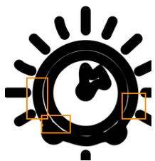  
(a) Timer dial.

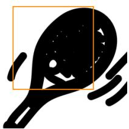  
(b) Tennis racket.

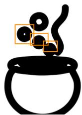  
(c) Cauldron.

Figure 4: The three crowding types detected by the measurement tool, with flagged regions in orange. (a) Narrow clearance on a timer dial: concentric rings sit too close, leaving white gaps thinner than one stroke width. (b) Fused strokes on a tennis racket: the string grid has merged into a solid black mass. (c) Enclosed holes on a cauldron: three of the four bubbles fill into solid dots at the required stroke width.

## Stroke-clearance measurement tool

The measurement tool reads the binarised drawing, where black pixels are strokes and white pixels are background, and flags every region where strokes sit too close, fuse together, or enclose a hole that would fill at the production stroke width. A single parameter controls the entire tool: the stroke width w, and every threshold is expressed as a multiple of w rather than a pixel constant. That anchoring lets the same code run at any render resolution without per-resolution tuning. The tool detects three kinds of crowding, discussed in detail below and each illustrated in Figure 4:

• Narrow clearance (Figure 4a): a white gap between two adjacent strokes thinner than one stroke width. A morphological closing (Serra 1982) dilates the strokes by $w / \bar { 2 }$ and then erodes them back, which fills any white gap narrower than w while leaving wider gaps intact. The filled pixels mark exactly where the clearance is insuficient.

• Fused strokes (Figure 4b): two or more strokes so close that the white channel between them has closed entirely and they have merged into a single solid region. An exact Euclidean distance transform (Felzenszwalb and Huttenlocher 2012) of the stroke pixels peaks at $w / 2$ along a clean single stroke, and any region wider than that has merged beyond the specified stroke width.

• Enclosed holes (Figure 4c): small white background regions fully surrounded by strokes that fill into solid dots once rendered.

## Verifier dataset

The classifier that sits on top of the measurement tool needs supervised labels at the violation level, not the icon level, because the reward consumes a count of genuine defects per icon and the label has to attach to the thing being counted. We assembled a corpus of 682 generated icons and ran each through the measurement tool, producing 3,836 flagged violations at roughly 5.6 per icon. Figure 5 illustrates how these violations become training data: the measurement tool flags every crowding region on a generated icon, and a human annotator then decides for each flag whether the tight spacing is a genuine defect or structurally necessary and therefore by-design. The final corpus contains 1,928 defect against 1,908 by-design. The corpus is split by icon, not by violation, into 409 train, 137 validation, and 136 test icons so that siblings of the same violation never appear on both sides of the split boundary.

## Objective verifier

The measurement tool flags every region where strokes sit too close, but it does so indiscriminately. A scissor’s crossed blades, a wristwatch’s band meeting its case, and the rim of a bubble all produce the same geometric signature as an accidental tangle. The measurement supplies recall; a classifier on top of it supplies precision.

A histogram gradient-boosting ensemble over nine features performs the classification, deciding for each flagged region whether it represents a genuine defect (real) or intended design (intended). The classifier uses nine geometric features extracted from the measurement tool’s output, grouped into per-violation properties (how far the crowding persists, which type it is, the region’s size and shape), icon-level counts (how many crowding regions the drawing has overall), and within-icon context (how this region ranks among the icon’s flags and how far it sits from the nearest other flag). The full feature list and the rationale behind the selection are in Appendix Table B.1. Three properties of the data guided the choice of classifier. The signal is interactive: a long extent means one thing in a crowded icon and another in a clean one, and trees capture these interactions without hand-built cross terms. The data is small and tabular at 3,836 rows over nine columns, the regime where boosted trees match or beat tuned neural models (Grinsztajn, Oyallon, and Varoquaux 2022).

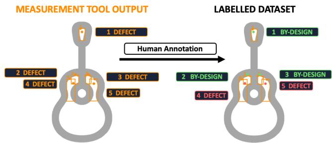  
Figure 5: From measurement to labelled dataset. Left: the measurement tool flags five crowding regions on a generated guitar icon, labelling all as potential defects. Right: after human annotation, regions where tight spacing is structurally necessary (e.g. the neck meeting the head, etc.) are relabelled by-design, while regions where contours have genuinely merged remain defect. The annotated violations form the training data for the objective verifier.

On the 769 violations of the 136 held-out test icons, the classifier reaches a macro $F _ { 1 }$ of 0.685, with real precision 0.697 and recall 0.646. We also built two vision-language alternatives under the same protocol: one replacing the geometric features with VLM-elicited perception features and refitting the same classifier, the other asking a VLM for the verdict directly. Both landed in the same accuracy range, but the geometric classifier is the clear choice for our use case. It is a deterministic classifier that runs on CPU, requiring no GPU endpoint and no network round trip per image. It returns the same verdict for the same input every time, where a prompted model drifts with phrasing and sampling temperature. These are essential for verifiers that run on every sample of every training batch as part of a reward model.

## Reward model

The objective verifier labels each flagged region as a genuine defect or intended design. The reward model counts those genuine defects per icon, but that count alone is not a safe reward. A model optimised purely to minimise defect count can draw two clean strokes of the wrong object and score perfectly: no crowding, no defects, no resemblance to the requested concept. The reward has to credit the right object drawn with well-separated strokes, penalise outputs that are not line art at all, and keep a usable gradient on failed samples so that the model always has a direction to improve in. We assemble the reward from three components, each addressing a distinct failure mode, and combine them through a conceptgated sum. For a generated image x and target concept c:

Degradation score P. Early training runs revealed that the model learned to minimise crowding defects by drawing less: producing near-empty canvases or shrinking the icon into a small corner where the measurement tool finds nothing to flag. The degradation score counters this by computing the ratio of black pixels to the total image area and penalising any output that falls below a stroke-density floor. Small or sparse drawings are particularly dangerous because the stroke-clearance measurement tool operates on the rendered strokes, and a drawing that occupies only a fraction of the canvas will register few or no crowding violations regardless of its actual quality. A second term catches chromatic leakage: colour appearing in what should be a black-and-white drawing. Both terms are graded by severity:

$$
P ( x ) = p _ { \mathrm { b l a n k } } ( x ) + p _ { \mathrm { c o l o r } } ( x ) ,\tag{1}
$$

$$
\begin{array} { r } { p _ { \mathrm { b l a n k } } ( x ) = - \lambda _ { b } \operatorname* { m a x } ( 0 , 1 - \frac { \rho } { \rho _ { 0 } } ) , } \end{array}\tag{2}
$$

$$
\begin{array} { r } { p _ { \mathrm { c o l o r } } ( x ) = - \lambda _ { c } \operatorname* { m i n } \bigr ( 1 , \frac { \gamma } { \gamma _ { 0 } } \bigr ) , } \end{array}\tag{3}
$$

where $\rho$ is the black-pixel ratio of the image, $\rho _ { 0 }$ is the strokedensity floor below which the score activates, and $\gamma$ is the coloured-pixel fraction. The density floor $\rho _ { 0 }$ was set to the average black-pixel ratio computed across the generated images already collected for the verifier dataset, giving a natural baseline for how much stroke content a well-formed icon should contain. The blank term ramps linearly from 0 when the drawing meets that floor to $- \lambda _ { b }$ at an empty canvas. Grading rather than thresholding came from a measured failure: an earlier hard threshold left no gradient inside alreadydegenerate GRPO groups (the set of samples generated for the same concept in one training step),

Concept-fidelity score F. The degradation score stops the model from producing near-empty or coloured outputs, but it does not check whether the drawing actually depicts the requested concept. A model that draws a well-sized, blackand-white icon of the wrong object would pass the degradation check and score well on stroke crowding. The conceptfidelity score closes that gap by using a vision-language model as a semantic judge. Pixel-level statistics cannot determine whether a drawing of a skillet actually looks like a skillet; that judgment requires a model that understands visual semantics. A single VLM call per sample produces three binary flags: concept match $m ,$ which checks whether the drawing depicts the requested object; a minimalism check $q _ { \mathrm { m i n } } .$ which verifies that the drawing uses clean, sparse strokes rather than dense or filled regions; and a crowding check $q _ { \mathrm { c r d } }$ , which flags drawings where strokes are visibly tangled. Concept match gates the other two flags: a wrong object zeroes out the entire raw score regardless of how tidy the rendering is:

$$
f ( x ) = w _ { m } m + m \big ( w _ { q } q _ { \mathrm { m i n } } + w _ { u } q _ { \mathrm { c r d } } \big ) ,\tag{4}
$$

$$
F ( x ) = \kappa \bigl ( f ( x ) - f _ { 0 } \bigr ) ,\tag{5}
$$

with $w _ { m } = 0 . 6 , w _ { q } = w _ { u } = 0 . 2 , f _ { 0 } = 0 . 4 , \mathrm { a n d } \kappa = 5 . 0 .$

Stroke-crowding score $\sigma \cdot$ The stroke-crowding score is the primary reward signal: it translates the objective verifier’s defect count into a training gradient that pushes the model toward well-separated strokes. The degradation and concept-fidelity scores exist to prevent the model from gaming this signal by drawing less or drawing the wrong object. The score converts the defect count directly rather than using a rate. An earlier rate-based version collapsed during training, producing zero group variance in 41.4% of iterations. Analysis showed that samples with diferent absolute defect counts but the same defect-to-flag ratio scored identically under the rate formulation, flattening the gradient. Switching to raw count preserves the diference between two defects and five, eliminating the problem:

$$
\textstyle s ( x ) = { \frac { 1 } { 1 + n } } ,\tag{6}
$$

$$
\sigma ( x ) = \underbrace { w _ { \sigma } ( 2 s - 1 ) } _ { \mathrm { c r o w d i n g } } - \underbrace { \operatorname* { m i n } \bigl ( \sigma _ { \mathrm { m a x } } , \ : w _ { e } \ : [ n - \tau ] _ { + } \bigr ) } _ { \mathrm { e x c e s s r a m p } } ,\tag{7}
$$

with $w _ { \sigma } = 1 . 0 , \tau = 3 , w _ { e } = 0 . 5 ,$ and $\sigma _ { \mathrm { m a x } } = 2 . 0 .$ . The first term runs from +1 at zero defects toward −1 as n grows, but it flattens past three defects. The excess ramp restores a gradient in the tail, subtracting 0.5 per defect beyond $\tau ,$ which keeps σ bounded in (−3, +1] and strictly decreasing.

Combined reward. The final reward sums the three scores but gates two of them on the concept-match flag m produced by the VLM judge in the concept-fidelity score:

$$
R ( x , c ) = P ( x ) + w ( m ) \sigma ( x ) + \tilde { F } ( x , c ) ,
$$

When the VLM confirms a correct concept $( m = 1 )$ , the stroke-crowding score enters at full strength and the fidelity score contributes positively. When the concept is wrong $( m ~ = ~ 0 )$ , the fidelity is floored at −1.0 and the strokecrowding score is attenuated to 30%. The attenuation is deliberate. Setting the stroke-crowding weight to zero on wrongconcept samples would flatten those GRPO groups entirely, removing the gradient that tells the model a clean wrong drawing is closer to the goal than a messy one. Keeping full strength would do the opposite: rewarding well-spaced drawings of the wrong object. The 30% weight balances both risks, leaving enough signal for the model to improve stroke quality even on failed concepts while ensuring that a concept fix is required to escape the negative reward range.

## Experimental Setup

In this section we describe the reinforcement learning configuration used to fine-tune the image generation model against the reward signal, including the training concept list (prompts), the model configuration, and the training reward trajectory.

## Reinforcement learning configuration

Training concept list. Reinforcement learning needs concepts that produce disagreement between samples of the same concept. A concept that every sample already draws well, and one that no sample can draw at all, both yield zero within-group variance and drop out of the update. The training concept list is built around this constraint. It contains

592 concepts across four tiers of escalating compositional demand: three geometric primitives in mixed spatial relations (80 concepts), one free-form abstract shape (125), one real-world object (225), and one object shown mid-action (162). The last tier is hardest because an action has to be conveyed through outline alone. The list is split 474 train and 118 held-out, stratified within each tier at 80/20.

Each entry stores a bare concept description. A fixed structured template wraps the description at build time, following the FLUX.2 prompting guide where every line-art requirement is phrased positively: “each edge outlined once” carries what “no double lines” would have, and “wide airy spacing between strokes” replaces “do not draw lines close together.

Model and training. Flow-GRPO (Liu et al. 2025) is the algorithm used to fine-tune FLUX.2 [klein] 4B model (4B rectified-flow transformer with a 4B Qwen3 text encoder, released under Apache-2.0) against the combined reward. GRPO eliminates the need for both a separate critic network and reference images by estimating advantages from withingroup comparisons, which fits our setting where no target image exists. Flow-GRPO extends it to continuous-time flowmatching models like FLUX. Two properties decided the model choice. It is undistilled, so training and evaluation share one sampler configuration with a real classifier-free guidance scale. The permissive licence allows fine-tuning and serving inside a production pipeline. A Low-Rank Adaptation (LoRA) adapter (Hu et al. 2021) is trained on top of the frozen base weights, keeping the base model’s learned representations intact while adapting its behaviour to the Alexicon constraints. The adapter targets the attention projections of both the image and text streams and the fused projection in the single-stream blocks (Liu et al. 2025). Training is strictly on-policy with one inner epoch per rollout. The full hyperparameter configuration is in Appendix Table A.1.

Figure 6 shows the training reward trajectory over 5,000 optimiser steps for two LoRA rank configurations. The combined reward (Figure 6a) on the 474 training concepts rises steadily from a baseline of 1.71 to 2.85, a 66.7% relative improvement. Decomposing the reward into its components confirms that the model learns useful signals on both fronts: the line separation score (Figure 6b) climbs from ∼0.48 to ∼0.78, showing that the model progressively spaces its strokes farther apart, while the concept fidelity score (Figure 6c) rises from ∼0.5 to ∼2.0, indicating that the model maintains and improves depiction accuracy as it learns to separate strokes. Both components improve in tandem rather than trading of against each other. The held-out reward on the 118 reserved training concepts tracks the same trajectory, peaking at 2.71 (58.5% relative improvement) before beginning to plateau. We select the weights at that peak to represent the trained model in all subsequent evaluation.

## Results

We evaluate the objective verifier on its held-out test set, then measure the trained model’s image generation quality under an independent VLM judge on a evaluation concept list.

<table><tr><td colspan="2"></td><td>pred.defectpred.by-design</td></tr><tr><td>true defect</td><td>246</td><td>135</td></tr><tr><td>true by-design</td><td>107</td><td>281</td></tr></table>

Table 1: Confusion matrix on the 769 violations of the 136 held-out test icons, positive class defect. The 107 false defect predictions are the cell the downstream reward weights most heavily.

## Objective Verifier Performance

The objective verifier reaches a macro F of 0.685 on the 769 violations of the 136 held-out test icons, with defect precision 0.697 and recall 0.646. Table 1 shows the confusion matrix. The 107 false defect predictions are the costliest errors: each one penalizes a correctly drawn region and feeds wrong gradient into the reward. A precision of 0.70 is not a clean oracle, and the residual error transfers into the reward as label noise on the defect count. Stroke crowding is an inherently subjective judgment: the boundary between a tightbut-acceptable crossing and a genuine defect depends on the object being depicted, and annotators disagree on ambiguous cases. This subjectivity is reflected in the label noise. Tightening the boundary would require a larger annotated corpus, stricter annotation guidelines that codify per-junction-type rules, and multi-annotator agreement to reduce bias.

## Image Generation Evaluation

Evaluation concept list. The evaluation concept list contains 1,000 concepts, fully disjoint from the training concept list. The evaluation uses the same fixed structured prompt template as training so that any diference in pass rate reflects a change in the model’s generation behavior, not a diference in how the concept was presented to the model.

Evaluation method. The trained model was optimized against the proposed reward model, which depends primarily on the objective verifier and its underlying measurement tool. If the model learned quirks of those components rather than genuinely improving stroke separation, evaluating with the same tools would not catch the diference. Hence, the evaluation uses an independent VLM judge (Claude Opus 4.6) capable of comparing visual details across images. It receives two images: the original generated image, and a rerender of the same centerline at the production stroke width. The judge is asked whether lines that are distinct in the original stay distinct once rendered at the production stroke width. Output is a simple, PASS or FAIL.

Each concept in the evaluation list is generated once by the base model and once by the trained model, with every other setting (template, sampler, judge, and the script that re-renders centrelines at the production stroke width) held identical. Each generation is judged once with no retries, so the reported number is the image generation pass rate: the fraction of icons that clear the stroke-crowding gate on a single generation. Because the same concept drives both generations, each concept yields a paired verdict, and the significance test is McNemar’s exact two-sided binomial on the discordant pairs (McNemar 1947).

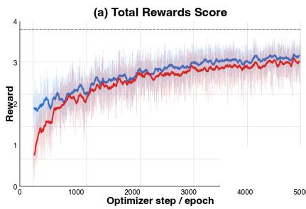

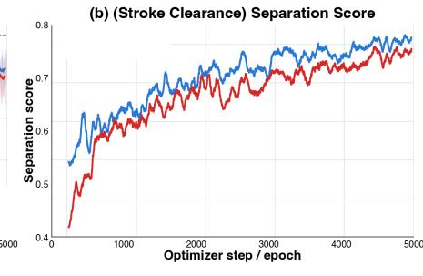

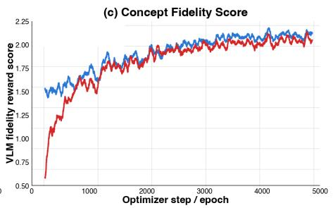

Figure 6: Training reward over 5,000 optimiser steps for LoRA rank 64 and rank 128. (a) Combined reward: both configurations improve steadily, with rank 64 reaching a higher plateau; the dashed line marks the theoretical maximum $( R = 4 . 0 ) $ . (b) Line separation score: the stroke-crowding component of the reward rises from ∼0.48 to ∼0.78, showing that the model learns to space strokes farther apart over training. (c) Concept fidelity score: the VLM-based fidelity component rises from ∼0.5 to ∼2.0, confirming that depiction accuracy improves alongside stroke separation rather than trading of against it.
<table><tr><td></td><td>n</td><td>Base</td><td>Trained</td><td>∆</td></tr><tr><td>Icon concepts</td><td>1,000</td><td>15.7%</td><td>58.7%</td><td>+43.0 pp</td></tr></table>

Table 2: Image generation pass rate on the 1,000-concept evaluation list under the independent VLM judge, one generation per concept. Base is FLUX.2 [Klein] base 4B model; trained is the trained LoRA weights merged into the base weights. Both arms use same settings and are judged on centerline re-renders to the production stroke width.

## Image Generation Quality

Under this evaluation, the trained model raises the pass rate from 15.7% to 58.7% (Table 2), a 3.7× improvement. Roughly three in five generations now clear the strokecrowding gate, against one in six before. Figure 7 shows representative examples. The base model draws fine detail that collapses into solid masses at the production stroke width: scoreboard digits fuse, medal ribbon edges merge, and recipe card lines disappear. The trained model has learned to simplify internal structure and widen gaps between contours, producing icons that remain legible after re-rendering. A larger panel of base and trained outputs is provided in Appendix C.

The paired contingency table (Table 3) breaks the numbers into their four cells. The base model failed and the trained model passed on 530 generations against 40 in the reverse direction, a thirteen-to-one flip ratio. McNemar’s test (McNemar 1947) checks whether this asymmetry reflects a genuine shift in model behaviour or just concept-to-concept variation: if training had no efect, flips toward passing and flips toward failing should be roughly equal among the 570 discordant pairs. The two-sided p-value is $3 . 3 \times \overline { { { 1 0 } } } ^ { - 9 4 }$ , far below the conventional $\alpha = 0 . 0 5$ threshold, confirming that the trained model’s higher pass rate is a systematic efect of fine-tuning rather than noise in the evaluation set.

<table><tr><td></td><td>Trained PASS Trained FAIL</td></tr><tr><td>Base PASS</td><td>157 40</td></tr><tr><td>Base FAIL</td><td>530 273</td></tr></table>

Table 3: Paired verdicts on the 1,000-concept evaluation list. The of-diagonal cells carry the test: 530 concepts the base failed and the trained model passed, against 40 in the reverse direction.

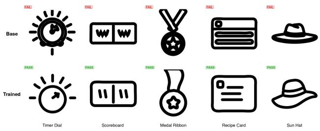  
Figure 7: Base model (top) vs trained model (bottom) on five evaluation concepts, rendered at the production stroke width. In all five, the base outputs have strokes merge into solid masses, while the trained model learned to simplify internal structure and space contours apart.

## Analysis

## Prompt Engineering vs Fine-Tuning

Each concept in the evaluation list is generated under two prompt variants: a plain prompt that describes the icon without mentioning stroke placement, and a separation prompt that adds explicit instructions to keep strokes widely spaced and avoid touching lines. Both the base model and the trained model are evaluated under each variant, with McNemar’s exact two-sided binomial (McNemar 1947) testing significance on the discordant pairs.

Adding the separation instruction to the base model moves the pass rate from 15.7% to 13.7% $( p = 0 . 1 5 9 )$ ), a change indistinguishable from noise. The model reads the instruction, but it lacks the spatial precision to act on it. The trained model with the plain prompt scores 58.7%, a 45.0 percentage-point gap over the prompted base model $( p = 1 . 3 ^ { ^ { \circ } } \times 1 0 ^ { - 1 0 3 } )$ , confirming that the improvement is in the weights rather than the phrasing. Adding the separation instruction to the trained model produces 56.6% $( p = 0 . 2 9 1 ) \colon$ the instruction is redundant once the behaviour is learned.

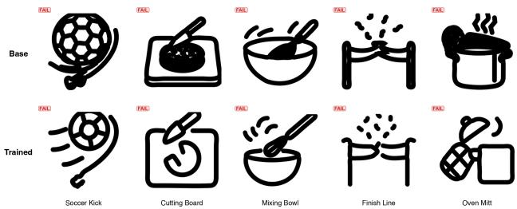  
Figure 8: Some concepts where both the base model (top) and trained model (bottom) fail. Failures fall into two categories: local junction merges where contours sit too close (cutting board, mixing bowl), and concepts whose visual complexity exceeds what the canvas can separate at the production stroke width (soccer kick, finish line, oven mitt).

## Failure Mode Analysis

To understand how uniformly the improvement distributes, we group the 1,000 evaluation concepts by the compositional complexity of the object they describe: simple shapes with few strokes (e.g. a canoe, a crescent moon), moderately detailed objects (e.g. a cofee mug with handle and rim), and dense compositions with many overlapping parts (e.g. a pipe wrench with jaws, teeth, and graduations). Every complexity group improves by at least 33 percentage points, and the ordering is preserved: concepts the base model found hardest remain the harder ones after training. Dense compositions have less clearance to spare at the production stroke width, so the absolute pass rate stays lower even after fine-tuning.

To understand how training changes the nature of failures, we analyse the one-sentence rationales the VLM evaluation judge writes for each verdict. Of the base model’s failures, 60.5% were whole regions collapsing to a solid mass at the production stroke width. That mode falls to 31.9% of the trained model’s residual failures. Training removed the gross failure: a subassembly lost entirely to a filled shape. What remains is local: neighbouring contours merging at a single junction (53.8% of residual failures), a lid separator touching a container outline or a handle meeting a body edge. The trained model fails on drawings that are nearly right at one point, where the base model failed on drawings that were illegible. Figure 8 shows five concepts where both models fail. The cutting board and mixing bowl are junction failures: the board’s edges merge where they meet the food, and the whisk strokes crowd against the bowl rim. The soccer kick illustrates a diferent problem: the trained model simplifies the ball until it no longer reads as a soccer ball, and the line meant to represent a foot is unrecognisable. The oven mitt and finish line are complexity failures: both objects require too many strokes to represent legibly, and neither model produces a drawing that conveys the concept.

A ceiling remains that no reweighting of stroke placement can escape. Some concepts need more strokes than the canvas has clearance for at the production stroke width. Getting past that bound requires letting the model simplify the concept, a diferent objective from the one we trained.

## Conclusion

We presented the Alexicon pipeline and showed that an objective verifier built from morphological stroke-clearance measurement and a gradient-boosted classifier can serve as an RL reward signal to fine-tune FLUX.2 [klein] for line-art icon generation, raising the pass rate from 15.7% to 58.7% under an independent VLMjudge. Both the fine-tuned model and the verifier are deployed in production.

Three directions remain open. First, the verifier’s macro $F _ { 1 }$ of 0.685 introduces label noise into the reward; a larger, multi-annotator corpus with stricter per-junction annotation guidelines would sharpen the defect boundary and propagate cleaner gradients into training. Second, a structural ceiling persists for concepts whose visual complexity exceeds what the canvas can separate at the production stroke width. Crossing that ceiling requires a reward that credits concept simplification, letting the model omit or merge strokes when faithful reproduction would guarantee crowding, along with a curated dataset of complex, high-stroke-count concepts to train and evaluate against. Third, the current model is trained against a single set of design constraints. Training against variable render scales and stroke widths simultaneously would test whether the model can learn multiple design principles at once, increasing the pipeline’s flexibility as design requirements evolve.

## References

Black Forest Labs. 2025. FLUX.2: Next-Generation Flow Matching Models. https://github.com/black-forestlabs/flux2.

Black Forest Labs; Batifol, S.; Blattmann, A.; Boesel, F.; Consul, S.; Diagne, C.; Dockhorn, T.; English, J.; English,

Z.; Esser, P.; Kulal, S.; Lacey, K.; Levi, Y.; Li, C.; Lorenz,

D.; Müller, J.; Podell, D.; Rombach, R.; Saini, H.; Sauer, A.; and Smith, L. 2025. FLUX.1 Kontext: Flow Matching for In-Context Image Generation and Editing in Latent Space. arXiv:2506.15742.

Esser, P.; Kulal, S.; Blattmann, A.; Entezari, R.; Müller,J.; Saini, H.; Levi, Y.; Lorenz, D.; Sauer, A.; Boesel, F.;Podell, D.; Dockhorn, T.; English, Z.; Lacey, K.; Goodwin,

A.; Marek, Y.; and Rombach, R. 2024. Scaling Rectified Flow Transformers for High-Resolution Image Synthesis. arXiv:2403.03206.

Felzenszwalb, P. F.; and Huttenlocher, D. P. 2012. Distance Transforms of Sampled Functions. Theory of Computing, 8(1): 415–428.

Grinsztajn, L.; Oyallon, E.; and Varoquaux, G. 2022. Why do tree-based models still outperform deep learning on tabular data? arXiv preprint arXiv:2207.08815.

Hu, E. J.; Shen, Y.; Wallis, P.; Allen-Zhu, Z.; Li, Y.; Wang, S.; Wang, L.; and Chen, W. 2021. LoRA: Low-Rank Adaptation of Large Language Models. arXiv:2106.09685.

Imagen Team, Google. 2024. Imagen 3. arXiv:2408.07009.

Lipman, Y.; Chen, R. T. Q.; Ben-Hamu, H.; Nickel, M.; and Le, M. 2023. Flow Matching for Generative Modeling. arXiv:2210.02747.

Liu, J.; Liu, G.; Liang, J.; et al. 2025. Flow-GRPO: Training Flow Matching Models via Online RL. arXiv preprint arXiv:2505.05470.

McNemar, Q. 1947. Note on the sampling error of the difference between correlated proportions or percentages. Psychometrika, 12(2): 153–157.

OpenAI. 2025. Addendum to GPT-4o System Card: 4o Image Generation. Technical report, OpenAI.

Serra, J. 1982. Image Analysis and Mathematical Morphology. Academic Press. ISBN 9780126372403.

## Appendix

## A. Training Configuration

Table A.1 lists the full hyperparameter configuration used for training.

## B. Verifier Features

The objective verifier classifies each flagged region using nine geometric features extracted from the measurement tool’s output. Table B.1 lists them grouped by scope.

Persistence carries more signal than severity: an intended crossing touches and separates within about one stroke width, while an accidental tangle smears along the contour for many. That is why contour persistence is in the model and the worst-point clearance is not. The two icon-level counts supply context a human annotator uses without thinking: one crossing in an otherwise clean five-stroke icon is almost certainly a design feature, while the same crossing in an icon with fourteen other flagged regions is part of a general mess. No feature reads an absolute canvas position, so the feature vector is invariant to translation and to horizontal or vertical reflection.

<table><tr><td>Setting</td><td>Value</td></tr><tr><td>Base policy</td><td>FLUX.2 [klein] 4B model (4B  $\mathrm { D i T } + \mathrm { 4 B }$  Qwen3 encoder)</td></tr><tr><td>Trained parameters</td><td>LoRA only; rank 64, alpha 128, scaling 2.0</td></tr><tr><td>Optimiser</td><td>AdamW,  $\beta = ( 0 . 9 , 0 . 9 9 9 )$   $\epsilon = 1 0 ^ { - 8 }$  , weight decay  $1 0 ^ { - 4 }$  ，</td></tr><tr><td>Learning rate</td><td>peak  $5 \times 1 0 ^ { - 5 }$  , 50-step linear warmup, cosine to 10% of peak</td></tr><tr><td>Gradient clipping</td><td>global norm 0.5</td></tr><tr><td>Precision</td><td>bf1oat16, TF32 matmuls, gradient checkpointing on</td></tr><tr><td>Parallelism</td><td>DeepSpeed ZeRO-2, 8× H200, single node</td></tr><tr><td>Resolution</td><td> $5 1 2 \times 5 1 2 ,$  guidance scale 4.0</td></tr><tr><td>Group size k</td><td>8 samples per concept</td></tr><tr><td>Batch per optimiser step</td><td>128 images (16 unique concepts  $\times 8$  samples)</td></tr><tr><td>Rollout denoising steps</td><td>10</td></tr><tr><td>KL coefficient  $\beta$ </td><td>0.08 against the adapter-disabled reference</td></tr><tr><td>PPO clip range</td><td> $1 0 ^ { - 3 } ;$  advantage clipped  $\mathrm { t o } \pm 5$ </td></tr><tr><td>Iterations</td><td> $5 , 0 0 0$  optimiser steps, checkpoint every 50</td></tr></table>

Table A.1: Shipped training configuration. Training occupied eight H200 GPUs on one node.

<table><tr><td>Group</td><td>Feature</td><td>What it captures</td></tr><tr><td rowspan="5"></td><td>Contour persistence</td><td>how far the crowding runs along the contour, in stroke widths</td></tr><tr><td>Crowding type</td><td>which of the three types (narrow, fused, enclosed)</td></tr><tr><td>Region area</td><td>absolute size of the flagged region</td></tr><tr><td>Region aspect ratio</td><td>elongated channel vs. compact junction</td></tr><tr><td>Region height</td><td>height of the flagged region in stroke widths</td></tr><tr><td rowspan="2">Icon-level</td><td>Fusion count</td><td>how many fused-stroke regions the drawing has overall</td></tr><tr><td>Crowding count</td><td>how many narrow-clearance regions the drawing has overall</td></tr><tr><td rowspan="2">Within-icon</td><td>Severity rank</td><td>rank of this region among the icon&#x27;s flags by persistence</td></tr><tr><td>Nearest-neighbour distance</td><td>distance to the nearest other flagged region, in stroke widths</td></tr></table>

Table B.1: The nine features used by the objective verifier, grouped by scope. Five describe the flagged region itself, two summarise the icon’s overall crowding, and two relate a region to its siblings. No feature reads an absolute canvas position, leaving the classifier invariant to translation and reflection.

## C. Additional Generation Examples

We present a broader sample of base and trained model outputs across the evaluation concept list, grouped by outcome. All icons are rendered at the production stroke width, and verdicts are from the independent VLM judge.

Trained model wins. Figure 9 shows 11 concepts where the base model fails and the trained model passes. The pattern is consistent across complexity: the base model draws fine internal detail that collapses into solid masses, while the trained model simplifies structure and widens gaps. Simple concepts like the gift bow and blooming flower gain clean contours, and complex ones like the crystal ball and top hat rabbit become legible where the base produced filled shapes.

Both models pass. Figure 10 shows 16 concepts where both models pass. These are predominantly simpler shapes with fewer strokes (cheese wedge, lightning bolt, starfish arm) or concepts whose structure naturally leaves wide gaps between contours (crashing wave, seashell spiral). The trained model produces visually similar outputs on these concepts, confirming that fine-tuning preserves quality on icons the base model already handled well.

Both models fail. Figure 11 shows 16 concepts where both models fail. The failure modes split into two categories. Some concepts involve local junction merges: the measuring cup handle meets the body, the rolling pin edges crowd against the dough, and the trophy cup stem fuses with the base. The trained model draws these more cleanly than the base but not enough to pass the VLMjudge. Other concepts are inherently too complex: the basketball arc, skateboard kick, and starting blocks require multiple overlapping parts in action poses, producing too many strokes for the model to separate legibly. The trained model simplifies these but often at the cost of recognisability, drawing shapes that no longer convey the intended concept.

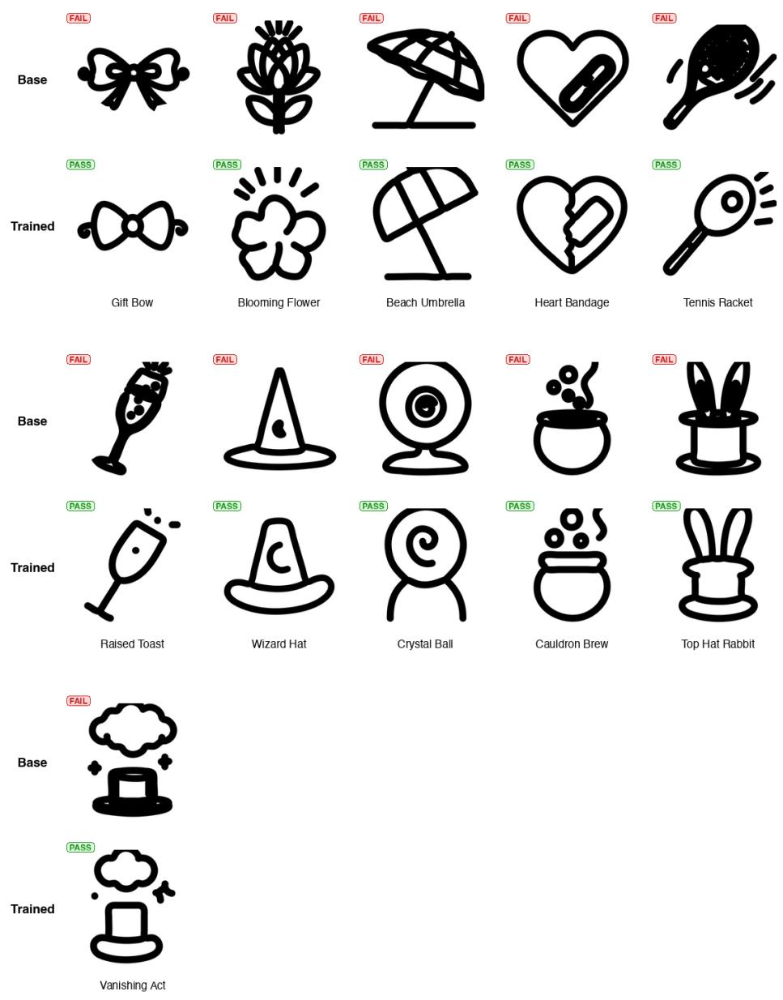  
Figure 9: Concepts where the base model (top of each pair) fails and the trained model (bottom) passes. The trained model consistently simplifies internal structure and spaces contours apart, from simple shapes (gift bow, blooming flower) to complex compositions (cauldron brew, top hat rabbit, vanishing act).

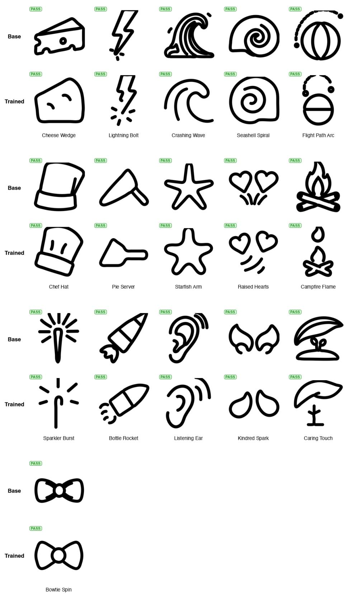  
Figure 10: Concepts where both the base model (top of each pair) and the trained model (bottom) pass. These are typically simpler shapes or concepts with naturally wide spacing, confirming that fine-tuning does not degrade quality on concepts the base model already drew well.

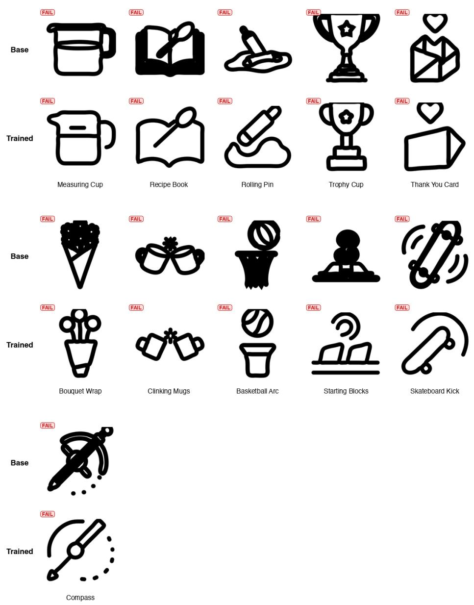  
Figure 11: Concepts where both the base model (top of each pair) and the trained model (bottom) fail. Failures are either local junction merges on moderately complex objects (measuring cup, trophy cup, thank you card) or complexity-driven: the concept demands more visual structure than the model can represent legibly (basketball arc, skateboard kick, compass).