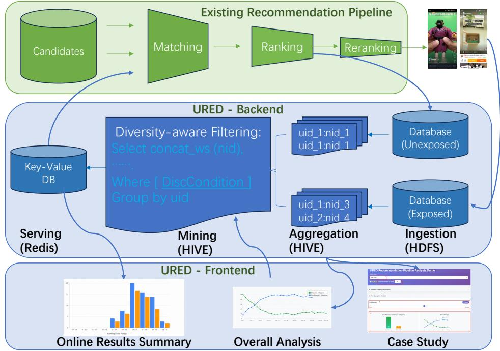
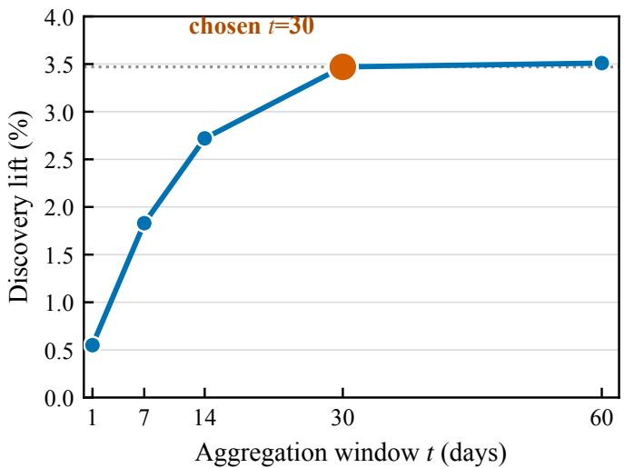
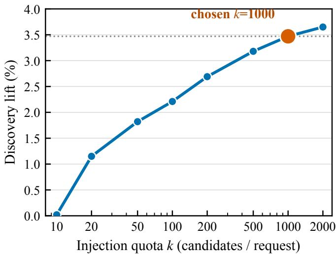
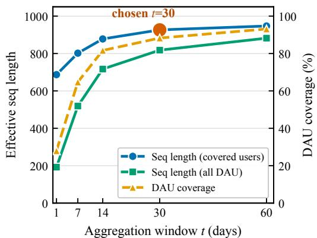
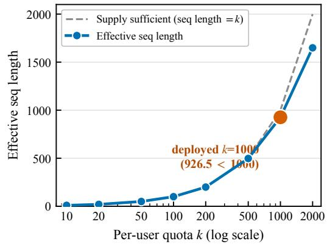
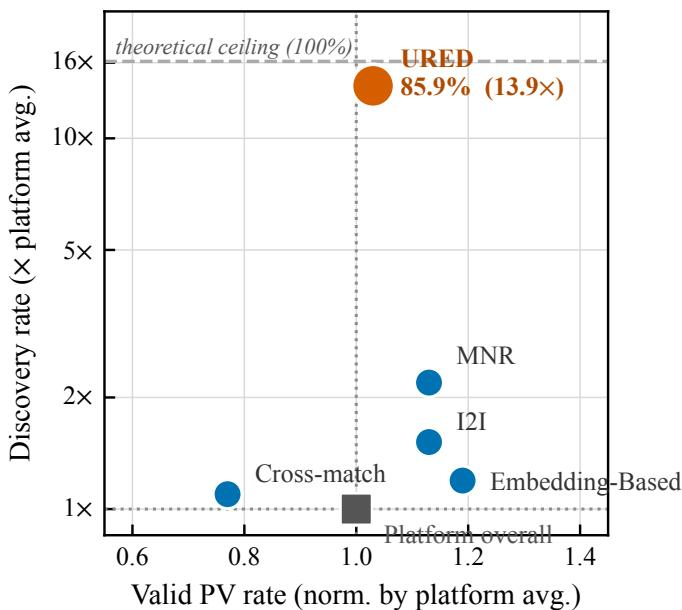
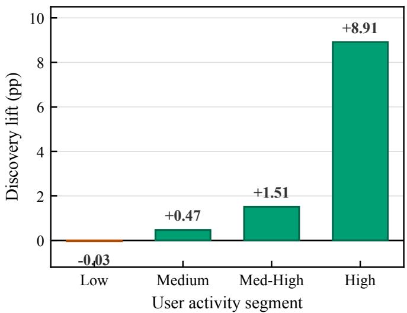

# From Waste to Discovery: Recycling High-Scored Unexposed Candidates in Taobao Feed Recommendation

Ge Fan1∗, Kai Meng1, Huiping Chu1†, Yuning Jiang2, Han Zhu2, and Bo Zheng2

1Taobao & Tmall Group of Alibaba, Hangzhou, China

2Taobao & Tmall Group of Alibaba, Beijing, China

{fange.fg, mengkai.meng, yueqi.chp, mengzhu.jyn, zhuhan.zh, bozheng}@alibaba-inc.com

## Abstract

Helping users discover novel interests is essential for the long-term health of industrial recommender systems, yet the dominant remedy—boosting the exposure of under-explored (discovery) content—often backfires in production. We report the deployment of URED (Unexposed Recycling for Eficient Discovery), a training-free recall-stage system that has been serving the Taobao feed recommendation system at Alibaba for over six months, covering tens of millions of daily active users. URED is built on an insight validated in our production data: naive exploration boosting fails because it injects cold, information-poor candidates that ranking models systematically over-estimate, yielding no significant discovery gain while putting engagement at risk. In contrast, items that were scored highly by the ranker but never exposed—latent signals routinely discarded in industrial pipelines—constitute a candidate pool that is simultaneously high-relevance and reliably predictable. URED aggregates such candidates over a 30-day horizon and re-injects them at recall time through a lightweight pipeline spanning ofline storage, distributed aggregation, and low-latency online serving, adding less than 1% serving latency via a single �(1) lookup per request with no model retraining. Large-scale online A/B experiments show that URED significantly improves discovered categories by +3.47% and content richness by +8.47% while preserving engagement: completion video views rise significantly by +2.62%, and total video views move positive (+0.36%, not statistically significant). Ablations confirm that both design pillars are necessary: shortening the aggregation window to one day collapses the discovery gain to a non-significant +0.55%, and replacing model-score filtering with random discovery injection yields no significant benefit while trending negative on engagement (−0.17%). Compared across production recall channels, URED delivers a 13.9× higher discovery rate than the platform average—6.3× the strongest nearline recall baseline—at engagement quality on par with the platform average. We share deployment details and lessons learned to guide practitioners facing the exploration–exploitation dilemma under strict resource constraints.

## 1 Introduction

Recommender systems—a flagship application of industrial AI—serve billions of requests per day through a cascaded pipeline of recall, ranking, and re-ranking optimized primarily for short-term engagement [1–4]. This exploitation-heavy design progressively narrows the content a user sees, producing the well-documented filter-bubble efect: recommendations become homogeneous, long-tail content is starved of exposure, and users lose opportunities to develop new interests [5–7]. On our short-video platform, this manifests concretely: for a typical active user, the vast majority of daily impressions concentrate in a small set of familiar categories, while discovery categories—those the user has not encountered in the recent past—account for only 6.2% of exposed content platform-wide.

The standard industrial remedies fall into two families. The first family enriches models: multi-objective ranking, reinforcement-learning-based exploration, or LLM-augmented generation [8–10]. These approaches raise training cost, inference latency, and infrastructure complexity—often prohibitively so in resource-constrained production environments. The second family bypasses models entirely: heuristic exploration boosting that force-injects under-explored content into user feeds. This is cheap and simple, which explains its popularity; however, as we quantify in this paper, it also fails to deliver.

Why naive boosting fails. Our production analysis reveals a dual failure of boosted discovery content. Because boosted candidates are typically cold with respect to the user—the model has little or no interaction signal connecting the user to the candidate’s category— the ranking model falls back toward population priors, producing predictions that are simultaneously over-estimated relative to realized engagement and unreliable in ordering. The consequence is measurable: in our controlled online experiment, injecting randomly selected discovery candidates (including cold-start items) produced no significant discovery improvement (+0.12%) and moved total video views negative (−0.17%, not significant). Naive boosting buys nothing measurable and carries engagement risk.

Our approach. URED (Unexposed Recycling for Eficient Discovery) starts from a resource that industrial pipelines generate and discard at enormous scale: unexposed samples, items that passed recall, were scored by the ranking model, but were never shown to the user due to position constraints and inter-candidate competition. Among discovery content, high-scored unexposed items occupy a privileged position. Under the working assumption that the ranker is (approximately) unbiased given suficient input signal, a high score carries two pieces of information at once: the item is relevant (the score estimates true engagement probability), and the prediction is trustworthy (a model starved of signal regresses toward the prior and cannot produce a confidently high score). High-scored unexposed discovery items are therefore exactly the opposite of boosted cold items—they are the discovery candidates the model demonstrably understands.

URED operationalizes this insight as a lightweight, training-free recall channel. It ingests top-scored unexposed samples after each ranking pass, aggregates them per user over a 30-day sliding window using distributed batch infrastructure, filters them with a configurable discovery criterion (category unseen in the past � days), and serves the resulting candidates from an in-memory store at recall time with sub-millisecond lookup. No model is retrained; no serving architecture is modified; measured latency overhead is below 1%.

Deployment and results. URED has been deployed in production in the Taobao feed recommendation system for over six months, serving tens of millions of daily active users. Online A/B experiments demonstrate that URED significantly improves discovered categories by +3.47% and content richness by +8.47% while engagement is preserved: completion views improve significantly by +2.62%, and total views move positive (+0.36%, not statistically significant)—to our knowledge a rare instance of a pure data-pipeline intervention improving discovery without sacrificing engagement. Ablation experiments validate each design pillar: a 1-day aggregation window retains only 16% of the discovery gain (non-significant), and random injection without model-score filtering yields no significant improvement and trends negative on engagement. Channel-level analysis shows that 85.9% of URED-exposed content belongs to discovery categories—13.9× the platform average and $6 . 3 \times$ the strongest nearline recall baseline—at engagement quality (valid-view rate) 1.03× the platform average.

Contributions. This paper makes three contributions aligned with the goals of deployedapplication research: (1) a production-validated diagnosis of why naive exploration boosting fails, tracing the failure to the ranking model’s systematic over-estimation of cold discovery candidates—a model-calibration insight that motivates recycling the model’s own highconfidence predictions; (2) URED, a deployed, training-free recall augmentation system that recycles high-scored unexposed samples, with a data architecture spanning ofline storage, distributed temporal aggregation, and low-latency serving; (3) large-scale online evidence—including ablations and cross-channel comparisons—quantifying the necessity of each design choice, together with lessons learned from development, deployment, and operation.

## 2 Why Naive Exploration Boosting Fails

We first formalize the failure mode that motivated URED, then present the design pivot that follows from it.

## 2.1 Setting and Definitions

Let $\hat { y } ( u , i )$ denote the ranking model’s predicted engagement probability for user � and item �, and let $r ( u , i )$ denote the true (realized) engagement probability. An item category is a discovery category for � if it has not been exposed to � within the preceding � days; items in such categories are discovery items, denoted D. After each ranking pass, items that were scored but not shown form the unexposed set. We partition the discovery space into

$$
\begin{array} { r l } & { \mathcal { D } _ { \mathrm { u n e x p } } ^ { \mathrm { h i g h } } = \{ i \in \mathcal { D } : \hat { y } ( u , i ) \geq \tau , i \mathrm { n e v e r e x p o s e d t o } u \} , } \\ & { \mathcal { D } _ { \mathrm { o t h e r } } = \mathcal { D } \setminus \mathcal { D } _ { \mathrm { u n e x p } } ^ { \mathrm { h i g h } } , } \end{array}
$$

where $\mathcal { D } _ { \mathrm { o t h e r } }$ contains cold-start discovery items (never scored for �) and low-scored discovery items.

## 2.2 The Dual Failure of Cold Discovery Candidates

Ranking models in production are trained overwhelmingly on exposed impressions. For a cold pair (�, �)—no interaction history linking � to �’s category—the model’s per-user signal is absent and its prediction regresses toward a population prior. This produces two coupled pathologies. First, over-estimation: population priors reflect the average engaged user of a category, which is optimistic for a user who has never chosen to engage with it; the resulting predictions exceed realized engagement. Second, unreliable ordering: with predictions clustered near the prior, the model cannot meaningfully rank cold candidates against each other, so any selection among them is efectively arbitrary.

Table 1: Ranker calibration and ranking error on production logs, stratified by candidate region. Discovery candidates are simultaneously over-estimated and harder to rank; naive boosting amplifies both pathologies—the coupled failure motivating URED.
<table><tr><td>Candidate region</td><td>PCOC</td><td>RMSE</td></tr><tr><td>Non-discovery</td><td>1.042</td><td>0.325</td></tr><tr><td>Discovery</td><td>1.147</td><td>0.368</td></tr><tr><td>Discovery (naive boost)</td><td>1.241</td><td>0.378</td></tr></table>

Naive boosting inherits both pathologies wholesale: it selects candidates precisely from the cold region where the model over-promises and cannot discriminate. The user receives content that looks acceptable to the pipeline but underperforms in reality—engagement drops, and because the injected items are poorly chosen, discovery barely improves. Our Variant B experiment (Section 5.2) confirms this outcome in a controlled online test, and the channel-level analysis (Section 5.3) shows its item-level signature: discovery-oriented channels that bypass model confidence sit below platform-average engagement quality.

Direct ofline evidence. This online failure has a measurable ofline signature. Table 1 quantifies the two pathologies in production logs, using PCOC (predicted-over-actual clicks) as the calibration metric [11] and RMSE as the ranking-error metric. Discovery candidates exhibit substantially larger over-estimation (PCOC 1.147 vs. 1.042, a +10% relative gap) and higher prediction error (RMSE 0.368 vs. 0.325, +13%) than non-discovery candidates— exactly the coupled pathologies the mechanism above predicts. Naive boosting makes both worse on the same logging pipeline: applied to discovery candidates, PCOC and RMSE further rise by +8.2% and +2.7% relative, because boosting multiplies already-overestimated scores and admits higher-error candidates into the recall pool. The maximization-bias literature [12] formalizes this amplification: any positive prediction gap on a top-� selected set grows monotonically once selection depends on the prediction itself. The ablation in Section 5.2 (Variant B) and the channel-level comparison (Section 5.3, Cross-match at 0.77× valid-PV rate) are the online behavioral signatures of this same ofline calibration gap.

URED’s design pivot. The calibration gap in Table 1 points at its own remedy: rather than injecting any discovery content—the region where PCOC is highest and RMSE is largest—the system should recycle the high-scored subset of unexposed discovery candidates. Two properties make this region privileged. First, relevance: a confidently high predicted score on an item the ranker demonstrably understands is an honest signal of true engagement probability, not the population-prior guess it falls back to on cold pairs. Second, predictability: a confidently high score itself certifies that the model possessed suficient per-user input signal, so its predictions there carry low error variance; high scores act as a built-in filter for information suficiency. The two properties coincide only in the high-scored unexposed region—which industrial pipelines already compute on every request and throw away—and the empirical premise that they do coincide is what the experiments in Section 5 will put to three tests. One further production constraint completes the design space: standard exposure deduplication prohibits re-showing previously exposed items, so the unexposed set is not merely preferable but the only admissible pool for re-injection.

  
Figure 1: Overview of URED. The green section is the existing recommendation pipeline; the blue section is URED, which recycles top-scored unexposed samples into an additional recall channel.

## 3 System Design

URED is an augmentation module attached to the recall stage of a standard three-stage industrial pipeline (Figure 1). Its backend comprises four stages, each matched to the volume, velocity, and access pattern of the data it handles. We describe each stage together with the design decisions made during development.

## 3.1 Stage 1: Sample Ingestion

After each ranking pass, scored-but-unshown items are identified. Retaining every unexposed sample is infeasible—the ranker scores hundreds of candidates per request—so we retain the top-�1 $( k _ { 1 } ~ = ~ 2 0 0 )$ highest-scoring candidates per session, enriched with category, timestamp, and component sub-scores, and persist them asynchronously to a distributed file store (e.g., HDFS) with minute-level latency. The $\mathrm { t o p } { - } k _ { 1 }$ truncation is not merely a storage optimization: the high-score region is precisely where the ranker’s predictions are most trustworthy—Table 1 shows RMSE 0.325 on non-discovery candidates versus 0.368 on discovery ones—so truncation doubles as a quality filter. Exposed impressions are logged in parallel for downstream joins.

## 3.2 Stage 2: Temporal Aggregation

Daily batch jobs on a distributed warehouse engine (e.g., Hive/Spark) aggregate each user’s unexposed history over a sliding window of � days. Samples are deduplicated by item ID, ordered by recency, and truncated to the top-�2 $( k _ { 2 } = 1 0 , 0 0 0 )$ per user. We set $t = 3 0$ our ablation (Section 5.2) shows that a 1-day window forfeits 84% of the discovery gain, because too few high-scored unexposed discovery candidates accumulate within a single day to form a meaningful recall supplement. In parallel, the aggregation maintains each user’s exposed-category set over the past � days, which drives the discovery filter in the next stage.

## 3.3 Stage 3: Discovery-Oriented Mining

Joining the unexposed pool against the exposed-category set, URED retains candidates whose categories have not been exposed to the user in the past � days (� is configurable per product goal). This business-aligned novelty criterion directly targets the platform’s discovery metric. An internal web dashboard lets operators tune �, inspect per-user exposure trajectories, and simulate the efect of alternative policies on candidate coverage before deployment; we found this human-in-the-loop step essential for aligning the filter with evolving campaign goals.

## 3.4 Stage 4: Online Serving

Filtered candidates are indexed by user ID in an online key-value store (e.g., Redis). At request time, URED is queried as one additional recall channel alongside embeddingbased retrieval [13, 14], item-to-item collaborative filtering [15–17], and cross-domain matching [18, 19]; up to � candidates are merged into the unified pool per request (we deploy � = 1000; Section 5.2 tunes �) and flow through unchanged ranking and re-ranking. Lookup is �(1) per request, and production latency statistics accumulated over the long-horizon A/B experiments show the end-to-end serving overhead staying below 1% on the treatment buckets relative to control. No model retraining or serving-stack modification is required, which was decisive for deployment approval.

## 4 Deployment

URED is deployed in the Taobao feed recommendation system, a large-scale short-video platform, and has been serving production trafic for over six months. The platform serves tens of millions of daily active users and handles billions of requests per day, with peak trafic exceeding ten thousand QPS; URED participates in the recall stage of this hot path on every request.

URED’s resource overhead splits into an online and an ofline part. Online, serving the channel increases cluster CPU by only +0.15% and memory by +0.53%: a few hundred CPU cores and a modest in-memory key-value footprint serve hundreds of millions of users, far below the compute and memory cost of the recall and ranking model services it augments. Ofline, the daily batch pipeline involves only lightweight business logic—deduplication and merging—and finishes within tens of minutes at a parallelism of at most one thousand cores; because it is scheduled in the idle windows of the platform’s existing batch infrastructure, it requires no additional compute capacity (+0.0% CPU and memory). Total storage grows by merely +0.46%, and the persisted candidate pool doubles as a backup of online serving data, supporting fault recovery. The system is operated by the existing recommendation infrastructure team without dedicated headcount: ofline stages run as scheduled batch jobs in of-peak hours, and the serving path reuses the platform’s standard key-value-store operations tooling. Candidate freshness, channel exposure share, and per-channel engagement quality are monitored daily; the discovery threshold � and injection quota are the two operator-facing knobs, adjusted through the dashboard described in Section 3.

Table 2: Relative changes from deploying URED (treatment vs. control). All metrics pass the significance test except Total VV, whose positive movement does not reach significance.
<table><tr><td>Metric</td><td>Change</td><td>Metric</td><td>Change</td></tr><tr><td>Total VV</td><td>+0.36%</td><td>Completion VV</td><td>+2.62%</td></tr><tr><td>Disc. Categories</td><td>+3.47%</td><td>Avg. Disc. Categories</td><td>+1.89%</td></tr><tr><td>Richness</td><td>+8.47%</td><td>Avg. Richness</td><td>+1.69%</td></tr></table>

## 5 Online Experiments

We evaluate URED through large-scale online A/B experiments on production trafic, where tens of millions of daily active users generate billions of requests per day (peak QPS above ten thousand). Users were randomly assigned to a control bucket (baseline pipeline, 10% of trafic) and treatment buckets (baseline + URED recall channel, 5–10% of trafic), with trafic allocated by the platform’s global coordination framework [3]. Every reported experiment ran for more than one week under this allocation; statistical significance is assessed with a �-test [20] enhanced by CUPED variance reduction [21] and annotated per table. We report engagement metrics—total video views (VV) and completion VV—and discovery metrics: discovered categories (count of newly encountered categories), average discovered categories per user, richness (distinct content diversity of exposure), and average richness per user; the discovery criterion uses � = 15 days throughout. Owing to company data policy, absolute values of engagement-quality metrics are normalized by the platform-wide average where noted. The experiments are designed to put the design pivot of Section 2 to three tests: (i) URED-injected items should sustain engagement quality, since a pool selected from a miscalibrated region would drag it below the platform average; (ii) removing the score filter must destroy the lift, since random injection cannot substitute for low-error predictions; and (iii) completion-view gains should materialize, since genuine relevance is what makes users watch content through rather than skip it.

## 5.1 Overall A/B Results

Table 2 summarizes the main experiment. URED improves every discovery metric—most notably +8.47% richness and +3.47% discovered categories—all of which pass the significance test. Engagement is preserved and improves where it matters most: completion VV rises significantly by +2.62%, and total VV moves positive by +0.36%, though the latter does not reach significance. These results validate the relevance premise (test i): the valid-PV rate at 1.03× platform average (Section 5.3) confirms that URED-injected items sustain engagement quality. They also validate the predictability premise (test iii): the significant completion-view gain (+2.62%) shows that users watch URED content through rather than skim, consistent with low-error predictions.

Table 3: Ablation of URED’s two design pillars (relative to the no-URED control). Only URED-Full’s discovery gain is statistically significant (†); all other movements, including every engagement change, do not reach significance (n.s.).
<table><tr><td>Variant</td><td>Candidate source / window</td><td>Total VV</td><td>Disc. Cat.</td></tr><tr><td>URED-Full</td><td>unexposed high-score, 30d</td><td>+0.36%</td><td>+3.47%†</td></tr><tr><td>Variant A</td><td>unexposed high-score, 1d</td><td>+0.02%</td><td>+0.55%</td></tr><tr><td>Variant B</td><td>random disc. (incl. cold)</td><td>-0.17%</td><td>+0.12%</td></tr></table>

## 5.2 Ablation: Both Design Pillars Are Necessary

URED rests on two design choices: (i) long-horizon aggregation (� = 30 days) and (ii) model-scorefiltering (recycling only high-scored unexposed candidates). We isolate each with controlled online variants. Variant A keeps model-score filtering but shrinks the window to one day. Variant B keeps the injection quota but selects discovery candidates at random (including cold-start items), removing the model-score filter—this variant doubles as a faithful implementation of naive exploration boosting. Re-exposing previously shown items is architecturally prohibited by exposure deduplication, so no “exposed” variant exists; URED operates in the only admissible complement space.

Table 3 yields three findings. (1) Long-horizon aggregation is necessary. Shrinking the window from 30 days to 1 day collapses the discovery gain from +3.47% (significant) to +0.55% (n.s.)—only 16% of the full efect—with engagement movement vanishing as well. A single day simply does not accumulate enough high-scored unexposed discovery candidates per user to be useful. (2) Model-score filtering is necessary. Random discovery injection (Variant B) fails to improve discovery significantly (+0.12%, n.s.) and moves total VV negative (−0.17%, n.s.). This is the dual failure of Section 2 surfacing in production: cold candidates that the model over-estimates and cannot rank displace better content, dragging engagement down without buying discovery. This finding directly validates the predictability premise: the score filter is what enforces low prediction-error variance, and discarding it destroys both relevance and predictability at once—any-discovery injection is not a substitute for high-confidence selection. (3) Only the full design delivers. URED-Full is the only variant with a statistically significant benefit—the discovery gain—and a positive engagement movement. Variant B exemplifies why exploration boosting has historically been unpopular with product teams. The contrast shows that the engagement–discovery trade-of is not inherent to exploration; it is an artifact of injecting candidates the model does not understand. Its root cause is the ofline calibration gap quantified in Table 1: Variant B injects from the region where PCOC is highest (1.147 → 1.241 under boosting) and RMSE is largest (0.368 → 0.378), so the online failure directly reflects this ofline gap.

To characterize the aggregation horizon more finely, we sweep � ∈ {1, 7, 14, 30, 60} days (Figure 2); all sensitivity configurations here and below run as concurrent parallel buckets over the same period, ruling out temporal confounds. The discovery gain rises steeply from +0.55% (� = 1) to +2.72% (� = 14), then saturates: +3.47% at � = 30 and only +3.51% at � = 60. The knee at � = 30 shows that roughly a month of history sufices to accumulate the high-scored unexposed discovery candidates URED can act on; longer windows add stale candidates and storage without meaningful gain. We therefore fix � = 30 as the operating point balancing benefit and cost.

We likewise sweep the per-request injection quota �—the number of URED candidates merged into the recall pool—over $k \in \{ 1 0 , \ldots , 2 0 0 0 \}$ (Figure 3). The lift grows with strongly diminishing returns: +0.02% at $k = 1 0$ , +2.69% at $k = 2 0 0 .$ $+ 3 . 4 7 \%$ at $k = 1 0 0 0$ , and only +3.65% at $k = 2 0 0 0$ . The deployed point $k = 1 0 0 0$ captures most of the attainable gain; beyond it, extra injected candidates are increasingly marginal and begin to crowd the recall pool, so we fix $k = 1 0 0 0$

  
Figure 2: Discovery lift as a function of the aggregation window �. The gain rises steeply then saturates, with a knee at $t = 3 0 ;$ extending to 60 days adds negligible benefit while increasing storage.

Supply-side evidence for the deployed $( t , k ) = ( 3 0 , 1 0 0 0 )$ . The sensitivity curves above show what happens as � and � vary; supply-side statistics explain why. URED’s pool is a finite resource: each user generates only a limited supply of high-scored unexposed discovery candidates per day, and the two hyperparameters jointly determine how much of it the pipeline harvests.

Figure 4(a) reports DAU coverage (the fraction of daily active users whose pool becomes non-empty), the efective sequence length averaged over covered users, and the DAU-average (real) sequence length. Coverage rises steeply from 28.0% (� = 1) to 88.3% (� = 30) and then flattens to 93.1% $( t = 6 0 ) $ extending the window mostly recruits occasionally active users rather than deepening existing pools. From 30 to 60 days the per-covered-user length grows only $+ 2 . 2 \% \ ( 9 2 6 . 5 {  } 9 4 7 . 2 )$ , doubling storage and batch computation for $+ 0 . 0 4$ pp online; $t = 3 0$ is the coverage–cost elbow. Figure 4(b) compares the efective sequence length with the supply-suficient reference (seq length = �). Up to $k = 5 0 0$ the curve hugs the reference—virtually every covered user possesses at least � high-scored candidates—but detaches at $k = 1 0 0 0$ (average $9 2 6 . 5 { < } 1 0 0 0 )$ , reaching only 1649.4 at $k = 2 0 0 0 \mathrm { : }$ doubling the quota grows pools by merely 78% because the high-scored unexposed supply is nearly exhausted within the 30-day window. Moreover, marginal candidates beyond rank 1000 carry lower model scores and hence weaker confidence in the ranker’s predictions, consistent with the +0.18 pp online delta from 1000 to 2000 (Figure 3). In short, $( t , k ) = ( 3 0 , 1 0 0 0 )$ sits at the joint elbow: 88% of DAU are already covered, per-user supply is close to saturated at ≈926 candidates, and further enlarging either hyperparameter doubles its cost for less than 0.2 pp of online gain.

  
Figure 3: Discovery lift as a function of the per-request injection quota � (log axis). Gains grow with strongly diminishing returns; the deployed point � = 1000 captures most of the attainable lift.

Table 4: Recall-channel comparison on production trafic. Valid PV rate is normalized by the platform average; discovery rate is absolute. MNR is the nearline-recall baseline.
<table><tr><td>Channel Valid PV rate (norm.)</td><td>Discovery rate</td></tr><tr><td>Embedding-Based</td><td>1.19 7.4%</td></tr><tr><td>I2I</td><td>1.13 9.4%</td></tr><tr><td>Cross-match</td><td>0.77 6.8%</td></tr><tr><td>MNR</td><td>1.13 13.6%</td></tr><tr><td>Platform overall</td><td>1.00 6.2%</td></tr><tr><td>URED 1.03</td><td>85.9%</td></tr></table>

## 5.3 Channel-Level Quality Analysis

To situate URED among production recall channels, we compare per-channel exposure quality on live trafic. The baselines cover the platform’s main recall portfolio: Embedding-Based, two-tower retrieval trained with sampling-bias correction [22]; I2I, item-to-item collaborative filtering over a large-scale product graph [23]; Cross-match, rule-based crossdomain matching built on personalized item-based retrieval [17]; and MNR, a multi-scenario nearline framework that retrieves from users’ real-time behaviors [24]. Valid PV rate is the probability that an exposed item is watched beyond a fixed duration threshold (engagement quality); discovery rate is the fraction of a channel’s exposed items belonging to discovery categories. Valid PV rates are normalized by the platform-wide average (OVERALL = 1.00) per data policy; discovery rates are reported in absolute terms.

Table 4 and Figure 5 deliver the paper’s central quantitative message. URED’s exposed content is 85.9% discovery—13.9× the platform average and 6.3× MNR (13.6%), the strongest nearline recall baseline—while its valid PV rate (1.03) remains at the platform average. MNR achieves a higher per-item valid PV rate (1.13) but at a fraction of URED’s discovery concentration; URED’s modest per-item quality gap relative to MNR is the price of a 6× higher discovery concentration, and crucially URED never falls below platform-average quality. The comparison against Cross-match (0.77) further shows that discovery-oriented mining by the model’s own high scores dominates rule-based cross-domain matching on both dimensions. It also closes the loop with Section 2: URED’s candidates deliver the engagement the ranker promised—the empirical counterpart of the relevance and predictability premises underlying URED’s design—whereas rule-based candidates that bypass model confidence (Cross-match) underdeliver on it, mirroring the ofline PCOC/RMSE gap reported in Table 1.

  
Figure 4: Supply-side evidence for the deployed hyperparameters. (a) Window � versus DAU coverage (fraction of daily active users with a non-empty pool), per-covered-user sequence length, and DAU-average (real) sequence length; coverage saturates around � = 30. (b) Per-user quota � versus efective sequence length; the dashed reference line marks the supply-suficient regime (seq length = �), from which the curve detaches at � = 1000.

Two complementary views of the discovery lift are worth highlighting. In absolute terms, over 85% of what URED injects is discovery content; the theoretical ceiling is 100%, since every candidate in URED’s pool is filtered by the discovery criterion ofline, and the ≈14 pp gap is attributable to the latency between ofline filtering and online key-value serving rather than to the mechanism itself. In relative terms, URED achieves 13.9× the platform average while holding eficiency metrics unchanged—conventional channels cannot separate discovery from engagement cost this way.

Taken together, the channel-level evidence completes the validation of all three tests previewed at the start of this section. (i) Engagement quality preserved at 1.03× platform average while 85.9% of URED exposure is discovery content confirms the relevance premise: the ranker’s high scores on these candidates translate into realized engagement, so relevance is genuine rather than an artifact of over-estimation. (ii) Variant B’s random injection—which bypasses the score filter—produces no significant discovery gain and trends negative on engagement (Table 3), confirming the predictability premise: it is the low prediction-error variance of high-scored candidates, not merely their presence in the discovery set, that makes URED work. (iii) The significant completion-view gain (+2.62%) connects both premises to one behavioral result: users watch URED content through because it is both relevant and reliably ranked—something no other discovery channel, rule-based or model-bypassing, achieves in our production data.

  
Figure 5: Quality–discovery operating points of production recall channels.

## 5.4 Who Benefits: User-Segment Analysis

To understand who benefits, we decompose the (normalized) discovery proportion by user activity segment and report the experiment−baseline diference in percentage points (pp; Figure 6). The lift grows monotonically with activity: −0.03 pp (low, negligible), +0.47 pp (medium), +1.51 pp (med-high), and +8.91 pp (high). This pattern is exactly what URED’s mechanism predicts. Since URED’s pool is built purely from unexposed samples, its size scales with how much ranking trafic a user generates: medium- and high-activity users accumulate a rich supply of high-scored-but-unexposed candidates over the 30-day window, so their recycled pools are dense and yield large discovery gains. Low-activity users, by contrast, have sparse interaction behavior and thus a thin pool, so the near-zero lift is an expected consequence of the data source rather than a failure of the mechanism. More importantly, for low-activity users discovery of new categories is not the primary objective in the first place—retention and core-viewing satisfaction take priority—so URED deliberately defers this population to cold-start channels (Section 6). In short, URED concentrates its benefit where the supply of high-confidence unexposed candidates is abundant and where discovery is actually wanted, without harming low-activity users.

## 6 Lessons Learned and Discussion

Measure the failure before building the fix. Our first instinct, like much of the industry, was to boost discovery exposure directly. Quantifying the over-estimation of cold discovery candidates—and watching Variant B return no significant gain with a negative engagement trend in a controlled test—redirected the efort from “inject more” to “select better,” which ultimately defined URED. We recommend that teams facing filter-bubble pressure first audit the calibration of their ranker on cold content; the audit is cheap and its result dictates the correct intervention.

  
Figure 6: Discovery lift in percentage points (experiment − baseline, on normalized proportions) by user activity segment. Gains grow monotonically with activity; low-activity users are essentially unchanged.

The model’s own scores are an underused exploration asset. The high-score region of unexposed samples is computed on every request by every industrial ranker, yet is almost universally discarded. Recycling it required no new model and no new signal—only datalifecycle engineering. The cost profile follows directly: a single �(1) key-value lookup per request keeps end-to-end latency overhead below 1%, and the ofline cost is scheduled batch aggregation reusing existing data-warehouse capacity (Section 4). Against naive boosting— which is equally training-free—URED is strictly dominant at identical cost, delivering significant discovery gain where boosting delivers none. The same “waste-to-value” pattern generalizes beyond category discovery to freshness (re-injecting high-scored items never shown), creator or supplier fairness (surfacing under-represented creators), and long-tail exposure; the single requirement is a relevance signal trustworthy for never-exposed items (Table 1). URED inherits the ranker’s blind spots: its candidate quality is bounded by the model’s ability to score unseen items, so segments where the ranker is miscalibrated receive less benefit and the system defers to other channels there. Cold-start users are the sharpest case—their thin interaction history produces a thin unexposed pool—which is why we blend URED with cold-start recall in operation [25].

Patient accumulation beats per-request cleverness. Per-request, high-scored unexposed discovery candidates are scarce; over a month they are abundant. Exploration pipelines should be designed around accumulation horizons, not just injection quotas: the value of the channel comes from gathering a trustworthy candidate pool over time, and practitioners should expect short-window replications to yield substantially smaller gains.

Screen hyperparameters with ofline supply indicators, not online sweeps. Hyperparameters such as the window � and quota � control how much candidate supply the pipeline harvests, so their efect is largely visible before any online experiment. Two cheap ofline indicators proved highly predictive: UV coverage (the fraction of DAU whose pool becomes non-empty) and efective sequence-length growth (how fast per-user pools deepen). Whenever coverage has plateaued or the pool length saturates against its supply ceiling, further expansion buys little online. Screening configurations ofline with these indicators narrowed a combinatorial space to one or two candidates and saved most of a full online sweep’s A/B budget.

Operator-facing controllability accelerates deployment. Improving a production recommender involves not only engineers but also product managers and operations staf. A black-box pipeline makes cross-team alignment dificult—when outcomes disappoint, no one can trace why. URED’s dashboard addresses this by exposing the discovery threshold �, per-user trajectories, and simulated policy impacts. Technical staf use these views to tune hyperparameters; non-technical partners use the same interface to verify system behavior and to flag category over-concentration. This transparency converted the launch discussion from a leap of faith into a parameter negotiation.

## 7 Related Work

Discovery and diversity in recommendation. Prior work combats homogenization via multi-objective ranking [26, 27], multi-criteria preference modeling [28, 29], topic- and social-aware user-interest modeling [30, 31], representation-enrichment architectures [32], and LLM-based generation [8, 33]; mechanism-design analyses formalize the ecosystem-level diversity–exploitation balance [34], and causal-deconfounding methods promote diversity via counterfactual exposure [35]. A complementary line treats discovery as explicit exploration: bandit- and RL-based methods allocate impressions to uncertain items at an explicit engagement cost [36], while deployed systems re-matchmake already-evaluated candidates to improve satisfaction [37, 38] or inject Bayesian posteriors to absorb cold start and nonstationarity in large-scale search [39]. These raise training/serving cost or pay an exploration price; URED is complementary—it explores only where the ranker is already confident, purely at the data layer with no model changes.

Utilizing unexposed samples in recommender systems. Industrial rankers score far more candidates than they expose. Nearline retrieval, pioneered by Glare [40] and deployed at scale in multi-scenario frameworks such as MNR [24], re-retrieves on recent user behavior; CroPS likewise harvests cross-perspective positive samples—query reformulation and nonclick engagement—to train dense retrieval in short-video search [41]. Knowledge distillation compresses ranking models for short-video recommendation [42], and full-flow datasets such as RecFlow release unexposed samples for ofline study [43]. Counterfactual and exposurebias correction also consume non-exposure, but only to debias training [44]; conversely, deployed systems re-surface previously-exposed content for retention [45]. All of these use unexposed samples as a training-time signal; URED instead promotes high-scored unexposed candidates directly to serving-time recall, requiring no retraining, counterfactual modeling, or extra inference.

## 8 Conclusion

We presented URED, a deployed, training-free system that turns a universally discarded byproduct of industrial ranking—high-scored unexposed samples—into a production recall channel for discovery. Operating at tens-of-millions-DAU scale with a single �(1) key-value lookup per request and no retraining, URED rests on the premise that high-scored unexposed candidates are simultaneously relevant and reliably predictable. Online experiments—showing +3.47% discovered categories and +8.47% richness alongside preserved engagement— confirm that the engagement–discovery trade-of attributed to exploration is instead an artifact of injecting content the model cannot vouch for. Ablations quantify the necessity of long-horizon aggregation and model-score filtering, and channel-level analysis shows URED reaching a quality–discovery operating point (1.03× average engagement quality at 85.9% discovery concentration) unmatched by conventional channels. We hope the system design and lessons reported here help practitioners pursue exploration without sacrificing the metrics their platforms live by.

## References

[1] Junyang Chen, Zhiguo Gong, Yuanman Li, Huanjian Zhang, Hongyong Yu, Junzhang Zhu, Ge Fan, Xiao-Ming Wu, and Kaishun Wu. Meta-path based neighbors for behavioral target generalization in sequential recommendation. IEEE Transactions on Network Science and Engineering, 9(3):1658–1667, 2022.

[2] Qi Liu, Xuyang Hou, Defu Lian, Zhe Wang, Haoran Jin, Jia Cheng, and Jun Lei. At4ctr: Auxiliary match tasks for enhancing click-through rate prediction. In Proceedings of the AAAI conference on artificial intelligence, volume 38, pages 8787–8795, 2024.

[3] Ge Fan, Nan Zhao, Kai Meng, Cong Luo, Yang Fu, Huiping Chu, Jialin Liu, Yuning Jiang, and Bo Zheng. Uniboost: Global coordination with value alignment for fair and eficient trafic allocation. In Proceedings of the 49th International ACM SIGIR Conference on Research and Development in Information Retrieval, SIGIR ’26, pages 4572–4577, New York, NY, USA, 2026. Association for Computing Machinery. doi: 10.1145/3805712.3808411.

[4] Bin Zhang, Bowen Zheng, Chao Yi, Chengyu Lai, Dian Chen, Dimin Wang, Gaoyang Guo, Jialin Zhu, Jian Wu, Jing Yu, et al. Dream technical report. arXiv preprint arXiv:2608.09408, 2026.

[5] Yudan Liu, Kaikai Ge, Xu Zhang, and Leyu Lin. Real-time attention based look-alike model for recommender system. In Proceedings ofthe 25th ACM SIGKDD International Conference on Knowledge Discovery & Data Mining, pages 2765–2773, 2019.

[6] Ge Fan, Chaoyun Zhang, Junyang Chen, Baopu Li, Zenglin Xu, Yingjie Li, Luyu Peng, and Zhiguo Gong. Field-aware variational autoencoders for billion-scale user representation learning. In 2022 IEEE 38th International Conference on Data Engineering (ICDE), pages 3413–3425. IEEE, 2022.

[7] Jongjin Kim and U Kang. Sequentially diversified and accurate recommendations in chronological order for a series of users. In Proceedings of the Eighteenth ACM International Conference on Web Search and Data Mining, pages 811–819, 2025.

[8] Xinyu Lin, Haihan Shi, Wenjie Wang, Fuli Feng, Qifan Wang, See-Kiong Ng, and Tat-Seng Chua. Order-agnostic identifier for large language model-based generative recommendation. In Proceedings of the 48th international ACM SIGIR conference on research and development in information retrieval, pages 1923–1933, 2025.

[9] Jian Jia, Yipei Wang, Yan Li, Honggang Chen, Xuehan Bai, Zhaocheng Liu, Jian Liang, Quan Chen, Han Li, Peng Jiang, et al. Learn: knowledge adaptation from large language model to recommendation for practical industrial application. In Proceedings of the AAAI Conference on Artificial Intelligence, volume 39, pages 11861–11869, 2025.

[10] Zonghe Shao, Huabin Chen, Sitong Lu, Fangmei Zhu, Yingcai Ma, Ge Fan, Jinguo Gao, Wei Shi, Yanfang Liu, and Huiping Chu. Ugr: Unified generative ranking for heterogeneous e-commerce recommendation. arXiv preprint arXiv:2610.39426, 2026.

[11] Chao Deng, Hao Wang, Qing Tan, Jian Xu, and Kun Gai. Calibrating user response predictions in online advertising. In Joint European Conference on Machine Learning and Knowledge Discovery in Databases, pages 208–223. Springer, 2020.

[12] Yewen Fan, Nian Si, and Kun Zhang. Calibration matters: Tackling maximization bias in large-scale advertising recommendation systems. In The Eleventh International Conference on Learning Representations, ICLR, 2023.

[13] Ge Fan, Biao Geng, Jianrong Tao, Kai Wang, Changjie Fan, and Wei Zeng. Pppne: Personalized proximity preserved network embedding. Neurocomputing, 472:103–112, 2022.

[14] Qidong Liu, Xian Wu, Wanyu Wang, Yejing Wang, Yuanshao Zhu, Xiangyu Zhao, Feng Tian, and Yefeng Zheng. Llmemb: Large language model can be a good embedding generator for sequential recommendation. In Proceedings of the AAAI Conference on Artificial Intelligence, volume 39, pages 12183–12191, 2025.

[15] Junhua Chen, Wei Zeng, Junming Shao, and Ge Fan. Preference modeling by exploiting latent components of ratings. Knowledge and Information Systems, 60(1):495–521, 2019.

[16] Wei Zeng, Ge Fan, Shan Sun, Biao Geng, Weiyi Wang, Jiacheng Li, and Weibo Liu. Collaborative filtering via heterogeneous neural networks. Applied Soft Computing, 109:107516, 2021.

[17] Shaoqing Wang, Yingcai Ma, Kairui Fu, Ziyang Wang, Dunxian Huang, Yuliang Yan, and Jian Wu. Pi2i: A personalized item-based collaborative filtering retrieval framework. In Proceedings of the ACM Web Conference 2026, pages 7691–7699, 2026.

[18] Ge Fan, Chaoyun Zhang, Kai Wang, and Junyang Chen. Mv-han: A hybrid attentive networks based multi-view learning model for large-scale contents recommendation. In Proceedings of the 37th IEEE/ACM International Conference on Automated Software Engineering, pages 1–5, 2022.

[19] Chendi Ge, Xin Wang, Ziwei Zhang, Yijian Qin, Hong Chen, Haiyang Wu, Yang Zhang, Yuekui Yang, and Wenwu Zhu. Behavior importance-aware graph neural architecture search for cross-domain recommendation. In Proceedings of the AAAI conference on artificial intelligence, volume 39, pages 11708–11716, 2025.

[20] Student. The probable error of a mean. Biometrika, 6(1):1–25, 1908.

[21] Alex Deng, Ya Xu, Ron Kohavi, and Toby Walker. Improving the sensitivity of online controlled experiments by utilizing pre-experiment data. In Proceedings of the sixth ACM international conference on Web search and data mining, pages 123–132, 2013.

[22] Xinyang Yi, Ji Yang, Lichan Hong, Derek Zhiyuan Cheng, Lukasz Heldt, Aditee Kumthekar, Zhe Zhao, Li Wei, and Ed Chi. Sampling-bias-corrected neural modeling for large corpus item recommendations. In Proceedings of the 13th ACM conference on recommender systems, pages 269–277, 2019.

[23] Xiaoyong Yang, Yadong Zhu, Yi Zhang, Xiaobo Wang, and Quan Yuan. Large scale product graph construction for recommendation in e-commerce. arXiv preprint arXiv:2010.05525, 2020.

[24] Yingcai Ma, Ziyang Wang, Yuliang Yan, Jian Wu, Yuning Jiang, Longbin Li, Wen Chen, and Jianhang Huang. Simple but eficient: A multi-scenario nearline retrieval framework for recommendation on taobao. arXiv preprint arXiv:2408.00247, 2024.

[25] Chaoyun Zhang, Kai Wang, Hao Chen, Ge Fan, Yingjie Li, Lifang Wu, and Bingchao Zheng. Quickskill: Novice skill estimation in online multiplayer games. In Proceedings of the 31st ACM International Conference on Information & Knowledge Management, pages 3644–3653, 2022.

[26] Chao Li, Zhiyuan Liu, Mengmeng Wu, Yuchi Xu, Huan Zhao, Pipei Huang, Guoliang Kang, Qiwei Chen, Wei Li, and Dik Lun Lee. Multi-interest network with dynamic routing for recommendation at tmall. In Proceedings ofthe 28th ACM international conference on information and knowledge management, pages 2615–2623, 2019.

[27] Kenny Peng, Manish Raghavan, Emma Pierson, Jon Kleinberg, and Nikhil Garg. Reconciling the accuracy-diversity trade-of in recommendations. In Proceedings of the ACM Web Conference 2024, pages 1318–1329, 2024.

[28] Ge Fan, Chaoyun Zhang, Junyang Chen, and Kaishun Wu. Predicting ratings in multi-criteria recommender systems via a collective factor model. In Proceedings ofthe 1st International Workshop on Data-Eficient Machine Learningfor Web Applications (DeMaL) at the Web Conference, 2021.

[29] Ge Fan, Chaoyun Zhang, Junyang Chen, Paul Li, Yingjie Li, and Victor CM Leung. Improving rating prediction in multi-criteria recommender systems via a collective factor model. IEEE Transactions on Network Science and Engineering, 10(6):3633–3643, 2023.

[30] Junyang Chen, Ge Fan, Zhiguo Gong, Xueliang Li, Victor CM Leung, Mengzhu Wang, and Ming Yang. A topic-aware graph-based neural network for user interest summarization and item recommendation in social media. In International Conference on Database Systems for Advanced Applications, pages 537–546. Springer, 2023.

[31] Junyang Chen, Ziyi Chen, Mengzhu Wang, Ge Fan, Guo Zhong, Ou Liu, Wenfeng Du, Zhenghua Xu, and Zhiguo Gong. A neural inference of user social interest for item recommendation. Data Science and Engineering, 8(3):223–233, 2023.

[32] Cheng Wu, Shaoyun Shi, Chaokun Wang, Ziyang Liu, Wang Peng, Wenjin Wu, Dongying Kong, Han Li, and Kun Gai. Enhancing recommendation accuracy and diversity with box embedding: A universal framework. In Proceedings of the ACM web conference 2024, pages 3756–3766, 2024.

[33] Chen Wei, Yixin Ji, Zeyuan Chen, Jia Xu, and Zhongyi Liu. Llmgr: Large language model-based generative retrieval in alipay search. In Proceedings of the 47th International ACM SIGIR Conference on Research and Development in Information Retrieval, pages 2847–2851, 2024.

[34] Craig Boutilier, Martin Mladenov, and Guy Tennenholtz. Recommender ecosystems: A mechanism design perspective on holistic modeling and optimization. In Proceedings ofthe AAAI conference on artificial intelligence, volume 38, pages 22575–22583, 2024.

[35] Jingmao Zhang, Zhiting Zhao, Yunqi Lin, Jianghong Ma, Tianjun Wei, Haijun Zhang, and Xiaofeng Zhang. Diversity recommendation via causal deconfounding of copurchase relations and counterfactual exposure. In Proceedings ofthe AAAI Conference on Artificial Intelligence, volume 40, pages 16325–16333, 2026.

[36] Azin Ashkan, Branislav Kveton, Shlomo Berkovsky, and Zheng Wen. Optimal greedy diversity for recommendation. In IJCAI, volume 15, pages 1742–1748, 2015.

[37] Ge Fan, Chaoyun Zhang, Kai Wang, Yingjie Li, Junyang Chen, and Zenglin Xu. Cupid: Improving battle fairness and position satisfaction in online moba games with a re-matchmaking system. Proceedings ofthe ACM on Human-Computer Interaction, 8 (CSCW2):1–39, 2024.

[38] Kai Wang, Ge Fan, Chaoyun Zhang, Yuyang Jiang, and Yuze Liu. Champ: Cross-domain hybrid architecture for matchmaking and prediction in online multi-player games. arXiv preprint arXiv:2609.04870, 2026.

[39] Randy Ardywibowo, Rakesh Sunki, Shin Tsz Lucy Kuo, and Sankalp Nayak. Bayescns: A unified bayesian approach to address cold start and non-stationarity in search systems at scale. In Proceedings ofthe AAAI Conference on Artificial Intelligence, volume 39, pages 12–20, 2025.

[40] Xavier Amatriain and Justin Basilico. System architectures for personalization and recommendation. Netflix Technology Blog, 2013.

[41] Ao Xie, Jiahui Chen, Quanzhi Zhu, Xiaoze Jiang, Zhiheng Qin, Enyun Yu, and Han Li. Crops: Improving dense retrieval with cross-perspective positive samples in short-video search. In Proceedings ofthe AAAI Conference on Artificial Intelligence, volume 40, pages 34061–34069, 2026.

[42] Han Xu, Taoxing Pan, Zhiqiang Liu, and Xiaoxiao Xu. Mutual information-aware knowledge distillation for short video recommendation. In Proceedings of the 31st ACM SIGKDD Conference on Knowledge Discovery and Data Mining V. 1, pages 2725–2734, 2025.

[43] Qi Liu, Kai Zheng, Rui Huang, Wuchao Li, Kuo Cai, Yuan Chai, Yanan Niu, Yiqun Hui, Bing Han, Na Mou, et al. Recflow: An industrial full flow recommendation dataset. In International Conference on Learning Representations, 2025.

[44] Qiong Wu, Yong Liu, Chunyan Miao, Binqiang Zhao, Yin Zhao, and Lu Guan. Pd-gan: Adversarial learning for personalized diversity-promoting recommendation. In IJCAI, volume 19, pages 3870–3876, 2019.

[45] Weijie Jiang, Armando Ordorica, Jaewon Yang, Olafur Gudmundsson, Yucheng Tu, and Huizhong Duan. Save, revisit, retain: a scalable framework for enhancing user retention in large-scale recommender systems. In Proceedings ofthe AAAI Conference on Artificial Intelligence, volume 40, pages 39996–40005, 2026.