# FrontierPhysics: Evaluating Agents for End-to-End Physics Research

Bingran You1,2\*, Wenjun Ke3\*, Ria Rosenauer4\*, Bo Liu5,6\*, Wenbo Chen7†§, Min Chen8†, Shuqi Xu2†, Yue Ma9, Jiechao Feng2, Bo Chen10, Xiangkai Sun3, Jiarui Liu2, Jinen Guo10, Zeyu Zhou11,12,   
Xu Huang2, Zhuohan Li13, Haoyu Li14, Heguang Lin15, Lijie Ding16, Yadong Zeng17, Kangqi Zhang18, Xinge Liu19, Hanwen Liu20, Zhenghong Li10, Alexander von Recum6,21, Yuchen Zhu1 Felix Schwarzfischer21, Yizhou Zhao22, Jicheng Wang23, Binxu Li24, Qian Yu2, Chan Li9, Cheng Dai10, Di Wang10, Haoyu Zhang25, Jiankai Sun6, Kaituo Feng10, Mian Qin26, Ruihong Yin27, Yiqun Luo22, Weiwei Wu6, Shihong Pan28, Tsung Yeh Hsieh22, Xiao Huang29, Yan Zhang10 Sihan Li30, Zirui Ren31, Zengji Tu31, Kyoung Whan Choe32, Ke Sun2, Vincenzo Galia Vaisakhi Mishra34, Jiashu He26, Hongyang Wang7§, Zhiheng Yang35, Shubham Gaur Yifan Gu7§, Shuyi Wang10, Zihao Zuo14, Steven Dillmann6, Yiyou Sun2, Xinyang Han2 Hanchung Lee10, Molei Tao12, Yue Zhao20, Shilong Liu24, Yuchen Wu5, Xuandong Zhao2, Xiangyi Li1, Florian Brand37, Gerbrand Ceder2, Hartmut Haeffner2

## Abstract

AI agents are playing an increasingly important role in physics research. However, existing physics benchmarks only evaluate fixed questions, isolated sub-tasks, or paper reproduction with given solutions, and rarely check research quality alongside correctness. We introduce FRONTIERPHYSICS, an end-to-end benchmark with 56 tasks made by 42 physicists based on their own research, covering nine domains across theoretical, computational, and experimental physics. Each task requires agents to review the literature, develop a research plan, conduct research and experiments, and produce structured outputs and scientific manuscripts. Combining deterministic verifiers with expert-authored rubrics, FRONTIERPHYSICS evaluates whether agents’ research is correct and publishable. Across 22 models in 26 configurations, no configuration passes more than 46 of its 168 rollouts. Manual review of agent trajectories shows that frontier agents’ main weaknesses are insufficiently rigorous reasoning and limited expert intuition, rather than gaps in physics knowledge or execution errors.

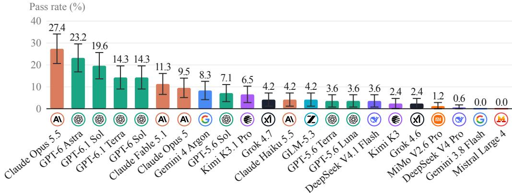  
Figure 1: FRONTIERPHYSICS LEADERBOARD. Overall pass rate (Pass@1) under the Table 2 configurations; a pass requires passing all verifier tests and blocker rubrics. Harnesses and inference level: GPT (Codex, max), Claude (Claude Code, max), Grok (Grok Build, xhigh), Gemini (Antigravity, high), Kimi (Claude Code, max), DeepSeek (Claude Code, max), MiMo (Claude Code, max), GLM (Claude Code, max), Mistral (Claude Code, max). Error bars show approximate 95% confidence intervals.

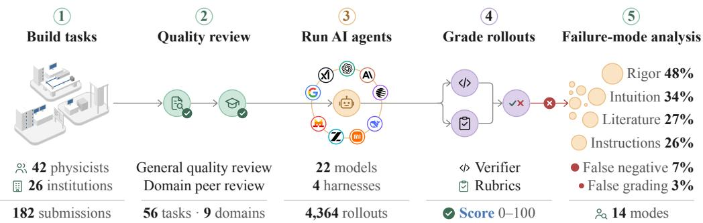  
Figure 2: Overview of FRONTIERPHYSICS. (1) Physicists build tasks from their own research. (2) An admin team of physicists accepts those passing both reviews. (3) 4,364 rollouts cover 22 models and 4 harnesses, each is one trial of a task by a model in an agent harness. (4) A deterministic verifier and a reviewer agent with the task’s rubric grade each rollout (Eq. 1). (5) The admin team and contributors manually analyze failure modes of the 168 GPT-6 Astra rollouts (Fig. 6, Table 4).

## 1 Introduction

Large language models (LLMs) are evolving from passive scientific assistants into agents that take on parts of the research process. When equipped with external tools, these agents can search and summarize literature, formulate hypotheses, write and debug scientific code, and produce techni cal reports. Recent systems have demonstrated tool-augmented reasoning in chemistry, iterative code-based experimentation, multi-agent hypothesis generation, scientific-software optimization, and even interaction with laboratory instruments [4, 6, 15, 17, 18, 20, 22, 29–31, 33, 37, 41]. These systems point toward agents that contribute to more complete scientific workflows and projects, not only isolated subtasks [9].

Evaluating progress toward this goal requires benchmarks that capture the open-ended, multistage nature of scientific research. Scientific benchmarks are accordingly shifting from textbooklevel questions [16, 23, 35, 44, 48] toward expert-level closed-ended questions [8] and researchlevel problems [40]. Among existing research-level benchmarks, some assess scientific reasoning [10, 25, 34, 46, 50], while others evaluate the agents’ ability to complete individual tasks within realistic scientific workflows [7, 19, 21, 28, 31, 43]. However, these benchmarks target isolated capabilities, and because many of their tasks are closed-ended with deterministic answers, models quickly saturate them, so the benchmarks lose signal. To move toward end-to-end research, some benchmarks formulate tasks as full-paper reproductions [12, 14, 36, 49]. Yet because agents are given the original publications, the research questions and solution structures are largely specified in advance, limiting their ability to evaluate open-ended scientific inquiry. More recent benchmarks address this limitation by converting published studies into research problems without revealing their solutions [24, 32, 45, 47]. Nevertheless, designing and evaluating such tasks involves many subtleties that require the expertise of the original authors: for example, how to write instructions that preserve as much open-endedness as possible while avoiding false negatives, and how to determine if an agent’s failure reflects true scientific misunderstanding or a lack of expert intuition and experience. To our knowledge, no existing benchmark is fully agentic, built by physicists from their own research, graded on both paper quality and result correctness, and designed to address these subtleties through manual task review and failure-mode analysis (Table 1).

In this paper, we introduce FRONTIERPHYSICS (Fig. 1), a benchmark evaluating whether AI agents can conduct end-to-end research across theoretical, computational, and experimental physics. FRONTIERPHYSICS tasks are designed by active physics researchers (including Ph.D. students, postdocs, and research scientists) from research projects they have personally conducted. On average, each task author has 420 citations. To preserve open-endedness while minimizing false negatives and positives, each task goes through manual general review, domain-expert peer review, and failure-mode analysis. For each task (Fig. 2), an agent receives a high-level prompt that resembles the instructions provided by a principal investigator (PI) at the beginning of a research project. The agent must then carry out the research and produce both a scientific manuscript and numerical outputs that can be verified deterministically. Much of this process is open-ended: the agent must investigate the topic, formulate a research plan, select appropriate methods, validate the results, and establish the significance of its findings. To evaluate these capabilities, FRONTIERPHYSICS combines a deterministic verifier (test scripts that check the numerical outputs) with rubric-based grading by reviewer agents.

## 2 FrontierPhysics

Figure 3 shows how a FRONTIERPHYSICS task is curated (a), structured (b), and run (c).

## 2.1 Task Design

Tasks are designed to reconstruct end-to-end research projects. Figure 3b shows an example task and Appendix A gives its full instruction and proposal. Some important questions to figure out or directions to explore might be given, but no explicit methodology or solution pathways will be specified. When necessary, input data and other supporting files are provided in the task environment (Fig. 3b) to enable the agent to configure and execute the relevant computational or experimental workflow.

Each task requires two types of final deliverables: deterministic artifacts, such as computed quantities, simulation outputs, or processed data, and a paper manuscript submitted as paper.pdf. The paper is expected to meet the standards of a peer-reviewed paper by clearly presenting the research context, methodology, results, and conclusions, while faithfully incorporating the evidence and computational artifacts produced during task execution.

The rubric-based assessment includes global rubrics and task-specific rubrics. The global rubrics evaluate behavior alignment including reward hacking [1, 38], hallucination and general research practices including literature synthesis, result validation, and the use of evidence to support scientific claims, whereas task-specific rubrics are developed by domain experts to assess the agent’s understanding of the underlying physics, scientific presentation, and execution of the research task. Because rubric design requires task-specific expertise, we ask each contributor to design the rubrics

Table 1: Comparison of scientific research benchmarks. We compare scientific research benchmarks across the research authenticity, research components covered in the evaluation, and the evaluation methods. Meanings of labels: Tasks/Phys.: total/physics task counts in released task lists. Own Research: the tasks come from the contributors’ own research. No Reference Given: there is no reference (e.g., the original paper) provided to the agent. Literature Graded: the quality of agents’ literature review and synthesis is evaluated. Write-up Graded: agents write up scientific manuscripts and the manuscripts are graded. Expert Rubric: at least part of the evaluation protocol uses rubrics created by domain experts. Deterministic Verifiers: at least part of the evaluation protocol contains deterministic verifiers. Failure Analysis: domain experts manually check the trajectories and output papers of selected rollouts. ✓: documented; ◦: partial; ×: no.
<table><tr><td>Benchmark</td><td>Tasks Phys.</td><td></td><td colspan="2">Research Authenticity</td><td colspan="2">Research Coverage</td><td colspan="3">Evaluation</td></tr><tr><td></td><td></td><td></td><td>Own Research</td><td>No Reference Given</td><td>Literature Graded</td><td>Write-up Graded</td><td>Expert Rubric</td><td>Deterministic Verifiers</td><td>Failure Analysis</td></tr><tr><td colspan="10">Reasoning and QA</td></tr><tr><td>CritPt [50]</td><td>71</td><td>71</td><td>√</td><td>√</td><td>×</td><td>×</td><td>×</td><td>√</td><td>√</td></tr><tr><td>FrontierScience-Research [43]</td><td>60</td><td>20</td><td>√</td><td>√</td><td>X</td><td>X</td><td>√</td><td>X</td><td>X</td></tr><tr><td colspan="10">Subtasks from scientific workflows</td></tr><tr><td>Terminal-Bench-Science [42]</td><td>70</td><td>5</td><td>√</td><td>√</td><td>×</td><td>×</td><td>×</td><td>√</td><td>0</td></tr><tr><td colspan="10">Paper reproduction</td></tr><tr><td>PRBench [36]</td><td>30</td><td>30</td><td>0</td><td>×</td><td>×</td><td>X</td><td>√</td><td>×</td><td>0</td></tr><tr><td>ReplicationBench [49]</td><td>111</td><td>111</td><td>0</td><td>0</td><td>X</td><td>X</td><td>√</td><td>√</td><td>√</td></tr><tr><td>QMP-Bench [12]</td><td>100</td><td>100</td><td>X</td><td>X</td><td>X</td><td>X</td><td>√</td><td>√</td><td>0</td></tr><tr><td colspan="10">End-to-end research</td></tr><tr><td>NatureBench [45]</td><td>90</td><td>13</td><td>X</td><td>√</td><td>×</td><td>×</td><td>×</td><td>√</td><td>0</td></tr><tr><td>PRL-Bench [32]</td><td>100</td><td>100</td><td>X</td><td>√</td><td>X</td><td>×</td><td>√</td><td>√</td><td>0</td></tr><tr><td>ResearchClawBench [47]</td><td>40</td><td>4</td><td>X</td><td>√</td><td>X</td><td>√</td><td>√</td><td>X</td><td>0</td></tr><tr><td>PhySciBench [24]</td><td>200</td><td>100</td><td>X</td><td>√</td><td>0</td><td>X</td><td>√</td><td>√</td><td>0</td></tr><tr><td>FRONTIERPHYSICS</td><td>56</td><td>56</td><td>√</td><td>√</td><td>」</td><td>√</td><td>√</td><td>√</td><td>√</td></tr></table>

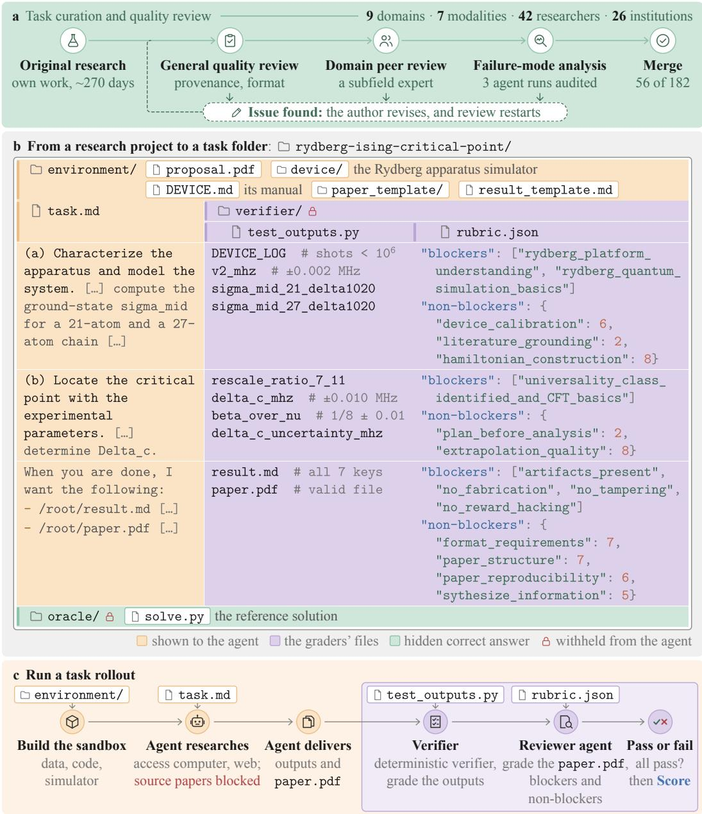  
Figure 3: (a), FRONTIERPHYSICS tasks QA pipeline. (b), FRONTIERPHYSICS tasks structure, shown for the example task rydberg-ising-critical-point. (c), How to run a task rollout.

for their own task and research project. Depending on the task, the rubric criteria may assess whether the agent identifies and correctly uses key references, discovers the key scientific ideas through its investigation, considers realistic experimental constraints, or provided good motivations for its work in the paper.

## 2.2 Task Curation and Quality Review

General quality review. When a contributor creates a task submission, we first assess its authenticity and provenance (Fig. 3a): the contributor must provide supporting information (e.g., reference papers or patent links) to demonstrate that they have personally conducted the project. Contributors are asked to provide the project background, a timeline of the original research process, and the amount of time they spent completing it. We require the underlying project to have involved at least two weeks of research effort. We then check that task.md and rubric.json are human-readable and contain genuine human input, rejecting tasks that appear purely AI-generated.

Domain peer review. We aim to have every task reviewed by an expert in a closely related field. To scale this, we invite contributors to become domain reviewers once their own tasks pass the firststage general quality check. Our domain reviewers have therefore all conducted research in their fields, and consist mostly of Ph.D. students (47%) and Ph.D. holders (37%). Each new reviewer is onboarded through a one-on-one meeting, and we audit the quality of their first review to align standards across reviewers. When a domain reviewer judges a task ready to merge, we perform a final check against our standards.

Each domain reviewer is provided with a domain-review checklist which covers three aspects: First, the reviewer verifies that task.md does not over-specify the problem: the prompt should not contain domain knowledge that a competent researcher is expected to know or figure out, so that the task remains as open as possible. Second, the reviewer confirms that rubric.json encodes real physics insight that only someone who has conducted the research would possess, rather than the low-signal criteria typical of AI-generated rubrics. Third, the reviewer examines failure modes after getting agents trajectories: contributors must perform at least three local runs with SOTA agents and an initial failure-mode analysis, and the reviewer inspects these traces for finding potential false positives and false negatives. Common issues include unjustified numerical tolerances that fail agents implementing a correct physical model or ambiguous instructions that lead to agents’ misunderstanding.

When all checks pass, an admin team with six physics PhD researchers from diverse subfield backgrounds approves and merges the submission into the final task set. In total, 56 tasks were accepted from 42 physics researchers from 26 institutions worldwide in 9 different physics domains out of 182 initial task submissions. A summary can be seen in Fig. 4. For 18 tasks, the underlying research has been published in papers co-authored by the task contributors. These include four tasks based on papers published in Nature, with other journals including Nature Communications, Physical Review Letters, and Physical Review X. On average contributors report to have spent about 270 days per task for the original projects, and in total more than 8,000 hours of research.

## 2.3 Evaluation

In each task rollout (Fig. 3c), our evaluation scheme is designed to assess both the objective correctness of the agent’s results and the overall quality of its research. To this end, we combine programmatic deterministic verifiers with an Agent-as-judge. The deterministic verifier checks structured outputs against reference values. After the agents finish running, agent trajectory files, verifier results, and output files including paper.pdf are recorded and saved. These files are then copied into another sandbox for a reviewer agent to review and grade the trajectory files and paper.pdf based on a rubric.json. We use an agent rather than a single LLM call as the judge because many rubric criteria, such as those on reward hacking, hallucinated results, and literature search, must be checked against the agent’s trajectory, code, and output files rather than paper.pdf alone. All rollouts are graded by the same reviewer agent, GPT-5.6 Sol (xhigh) in Codex CLI. Section 3.3 checks its grades against an expert audit (Table 5, Fig. 6) and on the authors’ own papers (Table 11). Regrading rollouts of the first evaluation round with Claude Opus 5.5 in Claude Code CLI as the reviewer agent gives the same pass/fail decision for almost all GPT-6 Astra rollouts, but the Opus 5.5 reviewer is more lenient on rollouts from its own model family (Table 6). Workspace files and trajectory files of the reviewer agents are collected the same way to HuggingFace datasets for later analysis.

Rubric-based grading has been widely adopted in benchmarks involving open-ended exploration or qualitative dimensions of agent performance [3, 11, 13, 36, 39]. Whereas deterministic verification establishes whether an output is correct, rubric-based evaluation assesses more aspects, for example whether the agent conducted and communicated the research well. Inspired by the rubric design of FrontierCode [11], we divide our rubric criteria into blockers and non-blockers. Blockers are binary gates that represent requirements essential to the scientific validity of a task. Thus, an agent must satisfy every blocker as well as the deterministic verifier to pass. Non-blockers capture qualitative aspects of the work. Each non-blocker is scored on a three-level scale: 0 indicates that the requirement is absent or incorrect, 1 indicates partial satisfaction, and 2 indicates complete satisfaction. The precise anchors for these levels are defined separately for each criterion. The task author also gives every criterion an integer weight from 1 to 10 for its relative importance. Blocker weights are retained as rubric metadata but do not contribute to the numerical quality score. The final score of a task:

$$
S _ { \mathrm { f i n a l } } = { \left\{ \begin{array} { l l } { { \displaystyle { \sum _ { i \in N } w _ { i } s _ { i } } } \times 1 0 0 , } & { { \mathrm { i f } } D = 1 { \mathrm { ~ a n d ~ } } b _ { j } = 1 \forall j \in B , } \\ { 2 { \displaystyle { \sum _ { i \in N } w _ { i } } } } & { { \mathrm { o t h e r w i s e } } , } \end{array} \right. }\tag{1}
$$

Here, $\mathcal { N }$ and B denote non-blockers and blockers respectively, $s _ { i } \in \{ 0 , 1 , 2 \} , w _ { i }$ is the criterion weight, D is the deterministic verifier result, and $b _ { j }$ is the blocker result.

$S _ { \mathrm { f i n a l } } = 0$ indicates that the results are not publishable, while the value of $S _ { \mathrm { f i n a l } }$ when $S _ { \mathrm { f i n a l } } \neq 0$ measures the quality of the publication. High scores on non-blockers cannot compensate for an incorrect deterministic result or a failed blocker. Conversely, an agent may pass all deterministic checks while producing a poorly motivated, inadequately supported, or badly communicated manuscript. Such a submission passes the verifiers and blockers but receives a low $S _ { \mathrm { f i n a l } }$

## 3 Experiments

We evaluate 22 frontier models in four agent harnesses. Each model attempts all 56 tasks three times at its highest available inference effort, and four GPT models are also run at xhigh.

## 3.1 Experimental Setup

As in SkillsBench [27] and ClawsBench [26] we use BenchFlow CLI [5], a research infra command line tool for creating RL environments, post-training, and evals, to run experiments as well as track agent trajectories, verifier, and rubrics results. We use Codex CLI for GPT models, Claude Code CLI for Claude models, Grok build for Grok models, and Antigravity CLI for Gemini models. The other seven models, DeepSeek V4 Pro, DeepSeek V4.1 Flash, GLM-5.3, Kimi K3, Kimi K3.1 Pro, MiMo V2.6 Pro and Mistral Large 4, also run in Claude Code CLI. Each agent runtime is started in parallel cloud sandboxes. For tasks with resource requirements under 4 vCPUs, 16GB RAM, and 10GB storage, we use Daytona as a sandbox provider. For tasks with higher resource requirements, we use Docker in Azure VMs with Lambda API access so the model can call GPU resources as needed.

All results are for FRONTIERPHYSICS v0.1, evaluated on all 56 tasks. Where a task changed after the first evaluation round in a way that could alter a result, the affected rollouts were re-run or regraded; the other changes were judged unable to alter a result.

Each rollout has a uniform 10-hour timeout cap. Endings caused by the model, such as reaching the budget or exhausting the sandbox’s memory, are final and stay in the denominator; endings caused by the infrastructure, such as a lost sandbox or provider errors that outlast retries, are re-run. Table 7 counts the slots left without a valid result.

## 3.2 Results

The result (Fig. 1) indicates that the overall pass rates are below 30% for all agents tested. Claude Opus 5.5 has the highest pass rate, 27.4%. Table 2 provides more detailed information on the different runs and scores.

Figure 5 plots the pass rate versus the mean cost and time per rollout. Pass rate generally rises with cost. However, for some Claude models, the pass rate decreases as cost increases, in the order Opus 5.5, Fable 5.1, and Opus 5. In addition, GPT models are generally more cost-efficient. Figure 4 gives the pass rate per physics domain of Opus 5.5 and GPT-6 Astra; with few tasks per domain, the differences between domains are uncertain. Appendix D gives per-task results.

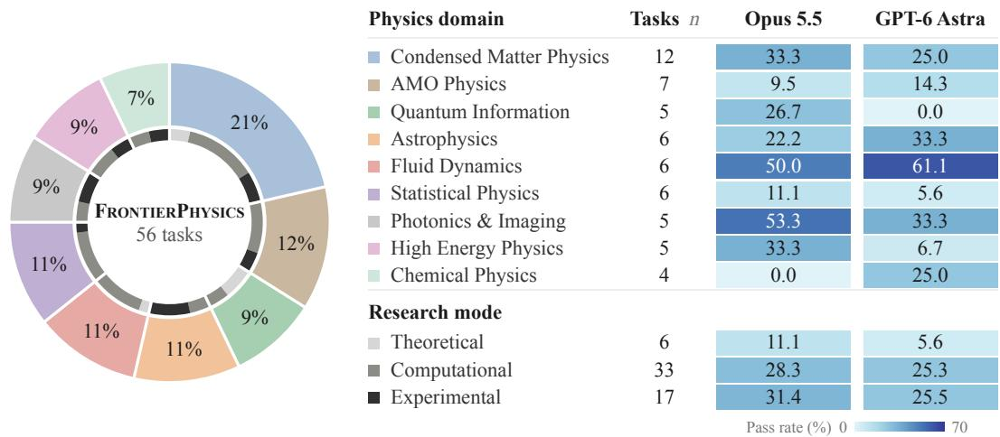  
Figure 4: Task composition and overall pass rate (%) by primary physics domain across all 56 tasks. Donut labels give task shares. n gives task counts.

Figure 5 and Appendix G compare agent time, steps and output tokens with the pass rate. Table 10 gives the mean, median and 95th percentile of tool calls, agent time and cost per rollout for each configuration, and the mean and median of output tokens.

## 3.3 Assessing Verifier and Rubric Reliability

Verifier and rubric defects may remain after review. One major source of defects is adversarial verifier or rubric engineering designed to suppress task pass rates, such that even correct solutions produced by human experts may fail. To mitigate this, we have a three stage process:

First, we ask every task contributor to do a failure-mode report of the three GPT-6 Astra rollouts, as this is the best performing model with single agent harness when the analysis started, check the agent trajectories and output files, and explain where the agent failed and why. Second, our admin team reviewers re-read these contributors’ failure-mode reports and double check them against the agent trajectories and output files. After reviewing around 60 rollouts, reviewers consolidated the recurring failures into the taxonomy in Table 4. False negatives, where agents deliver the correct results but failed by verifier or reviewer agent, are found during this process and are labeled in Appendix E. As highlighted in Table 5, rollouts with exclusively false failures lead to an underestimated pass rate. In total, nine of the 168 rollouts incorrectly failed. This coincides with the recent research [2], in which domain experts regrade some leading benchmarks and find that many failures are due to grader errors, incorrect reference solutions, and ambiguous or underspecified questions. This suggests that finding false negatives takes both domain expertise and time, but is crucial for maintaining high benchmark quality.

The non-blocking rubric scores are harder to assess because they involve more subjective judg ments. Third, as a sanity check of the rubric quality we asked authors to include their own papers or manuscripts as reference materials in the oracle when possible. Thirty-three tasks included these materials. For those with available reference, we selected the manuscript-level rubric criteria used for grading these materials, including blocker and non-blocker scoring criteria against the authors reference work. We then use the same configuration as main experiment to run reviewer agents in sandboxes to grade these files with rubrics. The authors’ own materials score 96.2% on average under corresponding rubrics (Table 11), showing good alignment between rubrics grading with the human expert materials.

## 3.4 Failure Mode Analysis

To find why agents fail and how well the agent score approximates what we want to measure, we follow the protocol of Section 3.3. Figure 6 summarizes the earlier matched-cohort annotations for all 168 single agent GPT-6 Astra rollouts. Table 5 reports the final review-sheet labels. More detailed information and an explanation of the failure modes can be found in Table 4. This process found design issues in some tasks. We fixed them and re-ran or regraded the affected results (Section 3.1). The pass rate of GPT-6 Astra (xhigh) after the re-runs (Table 2) agrees well with the manually corrected pass rate in Figure 6.

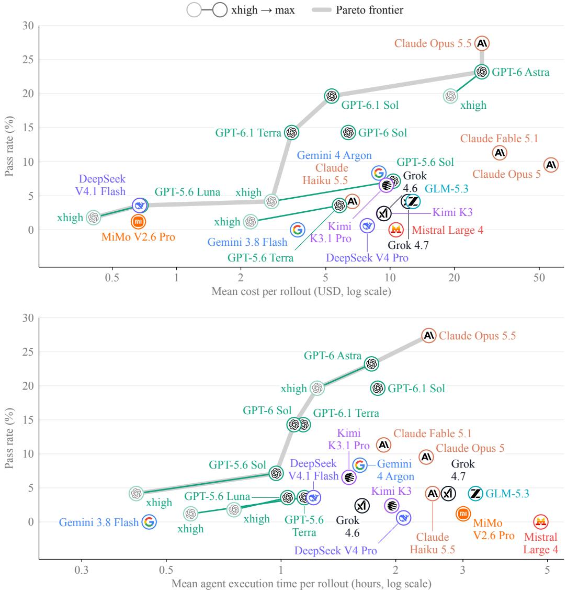  
Figure 5: Mean reported inference cost (top) and agent execution time (bottom) per rollout versus overall pass rate (%). Time excludes environment setup, verification and rubric review.

Figure 6 shows that agents mostly do not fail because of physics mistakes (e.g., a wrong calculation, misunderstanding of the physics concepts or lacking of physics knowledge), contrary to what one might expect from a physics benchmark. Instead, they often struggle to reason rigorously (48%), apply good physical intuition when making decisions (34%), and synthesize the literature (27%). Typical rigorous thinking failures are: circular self-verification, where the agent’s own validation method depends on its wrong assumption, so it can never find out its mistakes; and edge cases, where the agent fails to consider all the edge cases of its method or code, so that it fails at some hidden tests. The third most frequent failure is in the literature. In many cases, agents fail to find the key literature for the research (as identified by the task author), struggle to synthesize information from its literature search and provide a motivation for its project, or struggle to support its argument in the manuscript with literature. Missing physics intuition is another major failure mode. Typical examples of this failure mode include: agents fail to determine the major error source of an experiment, which is not because they do not understand it, but because they do not have the expert intuition to identify what is important; when debugging, agents cannot realize the root of the problem while keeping tuning the wrong knob. Besides the top three failure modes, instruction following accounts for 26% of the failures. It could be agents missing some requirements in the instructions or misunderstanding the instructions. In many cases, the task authors believe the meaning should be clear to human domain experts, while the agent cannot get the explicit/implicit message.

Table 2: Detailed Frontier-model performance across all 56 tasks. For the experiment we use the highest available inference effort by default, where configurable. GPT models also appear at xhigh. The Score column reports the score defined in Equation 1, averaged over the three rollouts for each task and then across all tasks. Deterministic pass requires all verifier tests to pass and overall pass additionally requires all blocking rubric criteria to pass. Pass@1 gives the average pass rate over the three rollouts, while Pass@3 gives the percentage of tasks with at least one passing rollout. Uncertainties are approximate 95% binomial confidence intervals over all rollouts, as in Figure 1. Table 8 gives 95% confidence intervals from a bootstrap over tasks, which account for the correlation of the three trials of a task. Rows are ordered by overall Pass@1, then by deterministic Pass@1 and Score.
<table><tr><td colspan="2"></td><td colspan="2">Deterministic pass (%)</td><td colspan="2">Overall pass (%)</td></tr><tr><td>Model</td><td>Score</td><td>Pass@1</td><td>Pass@3</td><td>Pass@1</td><td>Pass@3</td></tr><tr><td>Claude Opus 5.5 Claude Code AI</td><td>26.0± 6.4</td><td>45.8±7.5</td><td>62.5</td><td>27.4±6.7</td><td>44.6</td></tr><tr><td>GPT-6 Astra (max) Codex</td><td>21.8±6.0</td><td>39.3±7.4</td><td>51.8</td><td>23.2 ± 6.4</td><td>30.4</td></tr><tr><td>GPT-6 Astra (xhigh) Codex</td><td>18.0±5.5</td><td>38.7±7.4</td><td>51.8</td><td>19.6±6.0</td><td>30.4</td></tr><tr><td>GPT-6.1 Sol Codex S</td><td>18.4± 5.7</td><td>33.3 ± 7.1</td><td>50.0</td><td>19.6± 6.0</td><td>30.4</td></tr><tr><td>S GPT-6.1 Terra Codex</td><td>12.6± 4.7</td><td>28.6±6.8</td><td>39.3</td><td>14.3 ± 5.3</td><td>21.4</td></tr><tr><td>GPT-6 Sol Codex S</td><td>12.5 ± 4.7</td><td>27.4±6.7</td><td>44.6</td><td>14.3± 5.3</td><td>28.6</td></tr><tr><td>AI Claude Fable 5.1 Claude Code</td><td>10.2 ± 4.3</td><td>31.0±7.0</td><td>44.6</td><td>11.3±4.8</td><td>21.4</td></tr><tr><td>AI Claude Opus 5 Claude Code</td><td>8.6±4.0</td><td>20.2 ± 6.1</td><td>30.4</td><td>9.5±4.4</td><td>17.9</td></tr><tr><td>Gemini 4Argon Antigravity</td><td>6.5±3.3</td><td>31.5±7.0</td><td>46.4</td><td>8.3±4.2</td><td>17.9</td></tr><tr><td>S GPT-5.6 Sol (max) Codex</td><td>6.2 ± 3.4</td><td>19.6± 6.0</td><td>28.6</td><td>7.1 ± 3.9</td><td>12.5</td></tr><tr><td>Kimi K3.1 Pro Claude Code</td><td>6.1 ± 3.5</td><td>15.5±5.5</td><td>30.4</td><td>6.5±3.7</td><td>12.5</td></tr><tr><td>x1 Grok 4.7 Grok Build</td><td>3.8±2.8</td><td>16.7 ± 5.6</td><td>35.7</td><td>4.2 ±3.0</td><td>10.7</td></tr><tr><td>AI Claude Haiku 5.5 Claude Code</td><td>3.6±2.6</td><td>15.5±5.5</td><td>30.4</td><td>4.2±3.0</td><td>10.7</td></tr><tr><td>GPT-5.6 Sol (xhigh) Codex S</td><td>3.5 ± 2.6</td><td>15.5±5.5</td><td>26.8</td><td>4.2±3.0</td><td>8.9</td></tr><tr><td>GLM-5.3 Claude Code Z</td><td>3.6±2.6</td><td>7.1 ± 3.9</td><td>14.3</td><td>4.2±3.0</td><td>8.9</td></tr><tr><td>G GPT-5.6 Terra (max) Codex</td><td>2.9 ± 2.3</td><td>16.1 ± 5.6</td><td>25.0</td><td>3.6±2.8</td><td>7.1</td></tr><tr><td>GPT-5.6 Luna (max) Codex S</td><td>2.9 ± 2.3</td><td>12.5± 5.0</td><td>21.4</td><td>3.6±2.8</td><td>3.6</td></tr><tr><td>DeepSeek V4.1 Flash Claude Code</td><td>3.3 ± 2.6</td><td>10.7± 4.7</td><td>14.3</td><td>3.6±2.8</td><td>5.4</td></tr><tr><td>Kimi K3 Claude Code</td><td>1.8 ± 1.7</td><td>11.3 ± 4.8</td><td>21.4</td><td>2.4 ± 2.3</td><td>5.4</td></tr><tr><td>X1 Grok 4.6 Grok Build</td><td>2.2 ± 2.1</td><td>10.7± 4.7</td><td>21.4</td><td>2.4 ± 2.3</td><td>3.6</td></tr><tr><td>S GPT-5.6 Luna (xhigh) Codex</td><td>1.4 ± 1.5</td><td>8.9±4.3</td><td>16.1</td><td>1.8±2.0</td><td>3.6</td></tr><tr><td>MiMo V2.6 Pro Claude Code</td><td>1.0 ± 1.4</td><td>10.1 ± 4.6</td><td>19.6</td><td>1.2 ± 1.6</td><td>3.6</td></tr><tr><td>S GPT-5.6 Terra (xhigh) Codex</td><td>0.9± 1.3</td><td>9.5±4.4</td><td>16.1</td><td>1.2 ± 1.6</td><td>1.8</td></tr><tr><td>DeepSeek V4 Pro Claude Code</td><td>0.3 ± 0.6</td><td>3.0± 2.6</td><td>5.4</td><td>0.6 ± 1.2</td><td>1.8</td></tr><tr><td>Gemini 3.8 Flash Antigravity</td><td>0.0 ± 0.0</td><td>7.7±4.0</td><td>14.3</td><td>0.0± 0.0</td><td>0.0</td></tr><tr><td>Mistral Large 4 Claude Code</td><td>0.0 ± 0.0</td><td>5.4±3.4</td><td>12.5</td><td>0.0 ± 0.0</td><td>0.0</td></tr></table>

The current failure mode analysis focuses on the GPT-6 Astra model (see Section 3.3) since it is challenging for tasks authors to manually read trajectory files with subagents involved. Other models, or other model-harness pairs, may fail in different ways, including ways outside this taxonomy. Also because of this, we can only accurately tag the false negatives of GPT-6 Astra’s rollouts and therefore correct the final pass rate of GPT-6 Astra.

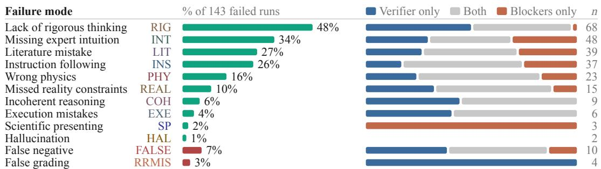  
Figure 6: Failure mode analysis of GPT-6 Astra xhigh across 56 tasks (3 rollouts for each task). Counts n and percentages (n/143) use the final review labels in Table 5. Each rollout may have multiple tags. Verifier/rubric proportions are retained from the original recorded assessment. Correcting the eight FALSE and one RRMIS outcomes changes the pass rate from 14.9% (25/168) to 20.2% (34/168).

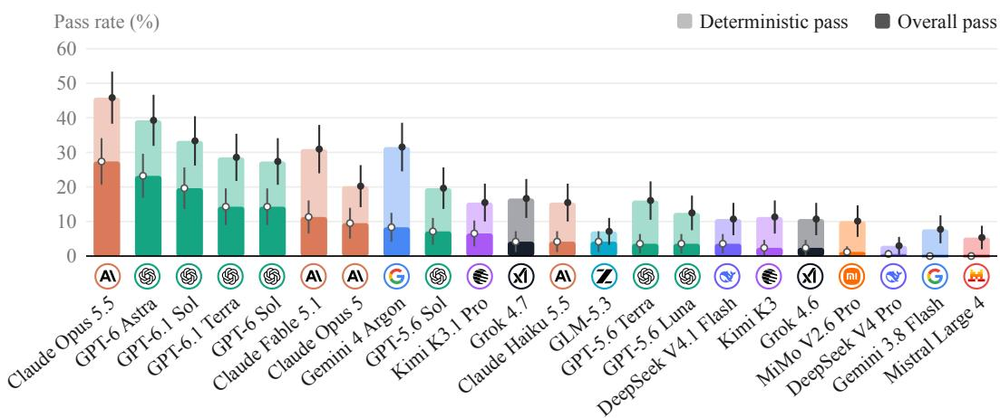  
Figure 7: Deterministic and overall pass rates (Pass@1, %) of the models in Fig. 1. Column height: deterministic pass rate (all verifier tests pass). Solid part: overall pass rate (blocker rubrics also pass). Error bars: approximate 95% confidence intervals (dot: deterministic; circle: overall).

## 4 Conclusion

We have introduced FRONTIERPHYSICS, a benchmark dataset with 56 tasks evaluating the ability of AI agents to conduct physics research across nine domains. FRONTIERPHYSICS shows end-to-end physics research remains challenging to current models, given that Opus 5.5 in Claude Code CLI, the configuration with the highest pass rate, passes only 46 of its 168 rollouts. Based on the human experts auditing of 168 SOTA agents rollouts trajectory and output files, we build a failure mode taxonomy and label all these 168 rollouts manually. From the taxonomy distribution, we conclude that lack of rigorous thinking (for example, circular self-verification) followed by missing expert intuition, instead of insufficient physics knowledge or execution mistakes, are the main weaknesses of frontier LLM agents.

Capable physics research agents should go beyond specified tasks to explore scientific problems independently, from problem definition to novel findings, with only high-level guidance. Training and evaluating such agents will require more open-ended research tasks and flexible evaluation frameworks that can assess exploratory reasoning, partial progress, and unexpected findings.

## References

[1] Dario Amodei, Chris Olah, Jacob Steinhardt, Paul Christiano, John Schulman, and Dan Mané. Concrete Problems in AI Safety. arXiv preprint arXiv:1606.06565, 2016.

[2] Ali Ansari, Haoran Sun, Andy Zeyi Liu, Mark Jabbour, et al. How good are frontier models at physics? expert re-grading reveals broken evaluations and near-saturation of leading benchmarks. arXiv preprint arXiv:2609.13009, 2026.

[3] Rahul K. Arora, Jason Wei, Rebecca Soskin Hicks, Preston Bowman, Joaquin Quiñonero-Candela, Foivos Tsimpourlas, Michael Sharman, Meghan Shah, Andrea Vallone, Alex Beutel, Johannes Heidecke, and Karan Singhal. HealthBench: Evaluating Large Language Models Towards Improved Human Health. arXiv preprint arXiv:2505.08775, 2025.

[4] Eser Aygün, Anastasiya Belyaeva, Gheorghe Comanici, Marc Coram, Hao Cui, Jake Garrison, Renee Johnston, Anton Kast, Cory Y. McLean, Peter Norgaard, Zahra Shamsi, David Smalling, James Thompson, Subhashini Venugopalan, Brian P. Williams, Chujun He, Sarah Martinson, Martyna Plomecka, Lai Wei, Yuchen Zhou, Qian-Ze Zhu, Matthew Abraham, Erica Brand, Anna Bulanova, Jeffrey A. Cardille, Chris Co, Scott Ellsworth, Grace Joseph, Malcolm Kane, Ryan Krueger, Johan Kartiwa, Dan Liebling, Jan-Matthis Lueckmann, Paul Raccuglia, Xuefei Julie Wang, Katherine Chou, James Manyika, Yossi Matias, John C. Platt, Lizzie Dorfman, Shibl Mourad, and Michael P. Brenner. An AI system to help scientists write expert-level empirical software. Nature, 654:909–916, 2026. doi: 10.1038/s41586-026-10658-6.

[5] BenchFlow team. BenchFlow: Framework for RL environments for LLM agents. Software repository, 2026. URL https://github.com/benchflow-ai/benchflow.

[6] Daniil A. Boiko, Robert MacKnight, Ben Kline, and Gabe Gomes. Autonomous chemical research with large language models. Nature, 624:570–578, 2023. doi: 10.1038/s41586-023 -06792-0.

[7] Yadi Cao, Sicheng Lai, Jiahe Huang, Yang Zhang, Zach Lawrence, Rohan Bhakta, Izzy F. Thomas, Mingyun Cao, Chung-Hao Tsai, Zihao Zhou, Yidong Zhao, Hao Liu, Alessandro Marinoni, Alexey Arefiev, and Rose Yu. SimulCost: A Cost-Aware Benchmark and Toolkit for Automating Physics Simulations with LLMs. arXiv preprint arXiv:2603.20253, 2026.

[8] Center for AI Safety, Scale AI, and HLE Contributors Consortium. A benchmark of expertlevel academic questions to assess AI capabilities. Nature, 649:1139–1146, 2026. doi: 10.103 8/s41586-025-09962-4.

[9] Meng Chu, Xuan Billy Zhang, Kevin Qinghong Lin, Lingdong Kong, Jize Zhang, Teng Tu, Weijian Ma, Ziqi Huang, Senqiao Yang, Wei Huang, Yeying Jin, Zhefan Rao, Jinhui Ye, Xinyu Lin, Xichen Zhang, Qisheng Hu, Shuai Yang, Leyang Shen, Wei Chow, Yifei Dong, Fengyi Wu, Quanyu Long, Bin Xia, Shaozuo Yu, Mingkang Zhu, Wenhu Zhang, Jiehui Huang, Haokun Gui, Runyi Li, Chenyu Tang, Dong Huang, Xuhang Chen, Rui Liu, Chengzu Li, Shiyi Du, Xu Huang, Haoxuan Che, Long Chen, Qifeng Chen, Wenya Wang, Wenxuan Zhang, Xiaojuan Qi, Yang Deng, Yanwei Li, Mike Zheng Shou, Zhi-Qi Cheng, See-Kiong Ng, Ziwei Liu, Philip Torr, and Jiaya Jia. Agentic World Modeling: Foundations, Capabilities, Laws, and Beyond. arXiv preprint arXiv:2604.22748, 2026.

[10] Daniel J. H. Chung, Zhiqi Gao, Yurii Kvasiuk, Tianyi Li, Moritz Münchmeyer, Maja Rudolph, Frederic Sala, and Sai Chaitanya Tadepalli. Theoretical Physics Benchmark (TPBench) – a Dataset and Study of AI Reasoning Capabilities in Theoretical Physics. arXiv preprint arXiv:2502.15815, 2025.

[11] Cognition. FrontierCode 1.1. Official web page, 2026. URL https://cognition.com/blog/front ier-code-1.1.

[12] Ken Deng, Xiangfei Wang, Guijing Duan, Chen Mo, Junkun Huang, Runqing Zhang, Ling Qian, Zhiguo Huang, Jize Han, and Di Luo. QMP-Bench: A Research-Level Benchmark for Autonomous End-to-End Quantum Many-Body Simulations. Accepted paper under nonarchival workshop policy, 2026. URL https://openreview.net/forum?id=9IdnFv2TmQ.

[13] Zhiyuan Fan, Weinong Wang, Xing Wu, and Debing Zhang. SedarEval: Automated Evaluation using Self-Adaptive Rubrics. In Findings of the Association for Computational Linguistics: EMNLP 2024, pages 16916–16930. Association for Computational Linguistics, 2024. doi: 10 .18653/v1/2024.findings-emnlp.984.

[14] Darius A. Faroughy, Sofia Palacios Schweitzer, Ian Pang, Siddharth Mishra-Sharma, and David Shih. Collider-Bench: Benchmarking AI Agents with Particle Physics Analysis Reproduction. arXiv preprint arXiv:2605.13950, 2026.

[15] Yuxing Fei, Bernardus Rendy, Xiaochen Yang, Junhee Woo, Xu Huang, Chang Li, Shilong Wang, David Milsted, Yan Zeng, and Gerbrand Ceder. Agentic LLM Reasoning in a Self-Driving Laboratory for Air-Sensitive Lithium Halide Spinel Conductors. arXiv preprint arXiv:2604.11957, 2026.

[16] Kaiyue Feng, Yilun Zhao, Yixin Liu, Tianyu Yang, Chen Zhao, John Sous, and Arman Cohan. Physics: Benchmarking Foundation Models on University-Level Physics Problem Solving. In Findings of the Association for Computational Linguistics: ACL 2025, pages 11717–11743, 2025. doi: 10.18653/v1/2025.findings-acl.610.

[17] Juraj Gottweis, Wei-Hung Weng, Alexander Daryin, Tao Tu, Petar Sirkovic, Artiom Myaskovsky, Grzegorz Glowaty, Felix Weissenberger, Alessio Orlandi, Dan Popovici, Anil Palepu, Keran Rong, Ryutaro Tanno, Khaled Saab, Fan Zhang, Jacob Blum, Andrew Carroll, Kavita Kulkarni, Nenad Tomašev, Dina Zverinski, Ivor Rendulic, Elahe Vedadi, Florian Hasler, Luka Rimanic, Marina Boia, Ivan Budiselic, Ben Feinstein, Mathias Bellaiche, Tom Sheffer, Jan Freyberg, Jeremy Ratcliff, Ottavia Bertolli, Katherine Chou, Avinatan Hassidim, Burak Gokturk, Amin Vahdat, Yuan Guan, Vikram Dhillon, Eeshit Dhaval Vaishnav, Byron Lee, Tiago R. D. Costa, José R. Penadés, Gary Peltz, Yossi Matias, James Manyika, Demis Hassabis, Yunhan Xu, Pushmeet Kohli, Annalisa Pawlosky, Alan Karthikesalingam, and Vivek Natarajan. Accelerating scientific discovery with Co-Scientist. Nature, 655:487–496, 2026. doi: 10.1038/s41586-026-10644-y.

[18] Tanjin He, Aikaterini Vriza, Logan Ward, Xu Huang, Yiming Chen, Anubhav Jain, Gerbrand Ceder, Rajeev S. Assary, Ian T. Foster, and Maria K. Y. Chan. Harnessing X-ray Absorption Spectroscopy Data through Multimodal Mining of Battery Literature. arXiv preprint arXiv:2607.23886, 2026.

[19] Peiyan Hu, Haodong Feng, Hongyuan Liu, Tongtong Yan, Wenhao Deng, Tianrun Gao, Rong Zheng, Haoren Zheng, Chenglei Yu, Chuanrui Wang, Kaiwen Li, Zhi-Ming Ma, Dezhi Zhou, Xingcai Lu, Dixia Fan, and Tailin Wu. RealPDEBench: A Benchmark for Complex Physical Systems with Real-World Data. arXiv preprint arXiv:2601.01829, 2026.

[20] Xu Huang, Junwu Chen, Yuxing Fei, Zhuohan Li, Philippe Schwaller, and Gerbrand Ceder. CASCADE: Cumulative Agentic Skill Creation through Autonomous Development and Evolution. arXiv preprint arXiv:2512.23880, 2025.

[21] Xu Huang, Junwu Chen, Yuxing Fei, Zhuohan Li, Philippe Schwaller, and Gerbrand Ceder. Sciskillbench: Cascade benchmark for evaluating llm agents on scientific tasks, 2025.

[22] Xu Huang, Junwu Chen, Philippe Schwaller, and Gerbrand Ceder. SkillPuzzler: A Self-Evolving Agentic Framework for Materials and Chemistry Research with Minimal Reliance on Predefined Tools. In NeurIPS 2025 Workshop on AIfor Science: The Reach and Limits of AI for Scientific Discovery, 2025. URL https://neurips.cc/virtual/2025/125935.

[23] Zhen Huang, Zengzhi Wang, Shijie Xia, Xuefeng Li, Haoyang Zou, Ruijie Xu, Run-Ze Fan, Lyumanshan Ye, Ethan Chern, Yixin Ye, Yikai Zhang, Yuqing Yang, Ting Wu, Binjie Wang, Shichao Sun, Yang Xiao, Yiyuan Li, Fan Zhou, Steffi Chern, Yiwei Qin, Yan Ma, Jiadi Su, Yixiu Liu, Yuxiang Zheng, Shaoting Zhang, Dahua Lin, Yu Qiao, and Pengfei Liu. OlympicArena: Benchmarking Multi-discipline Cognitive Reasoning for Superintelligent AI. In Advances in Neural Information Processing Systems 37, pages 19209–19253, 2024. doi: 10.52202/079017-0607.

[24] Yigeng Jiang, Tengchao Yang, Taoyong Cui, Jiaxing Wan, Yuan Wang, Weida Wang, Zhiyu Liu, Chuyi Peng, Binzhao Luo, Maoli Gao, Huaihai Huang, Yuqianer Zeng, Ziyang Zheng, Dongchen Huang, Chao Chen, Zichao Liu, Weiping Shen, Shuchen Pu, Siyu Zhou, Runmin Ma, Yusong Hu, Fei Chao, Bo Zhang, Xiawu Zheng, Zifu Wang, Lei Bai, Yunqi Cai, and Shufei Zhang. Deep Research in Physical Sciences: A Multi-Agent Framework and Comprehensive Benchmark. arXiv preprint arXiv:2606.18648, 2026.

[25] Hanzheng Li, Xi Fang, Yixuan Li, Chaozheng Huang, Junjie Wang, Xi Wang, Hongzhe Bai, Bojun Hao, Shenyu Lin, Huiqi Liang, Linfeng Zhang, and Guolin Ke. RxnBench: A Multimodal Benchmark for Evaluating Large Language Models on Chemical Reaction Understanding from the Scientific Literature. Journal of Chemical Information and Modeling, 66: 5747–5756, 2026. doi: 10.1021/acs.jcim.6c00286.

[26] Xiangyi Li, Kyoung Whan Choe, Yimin Liu, Xiaokun Chen, Chujun Tao, Bingran You, et al. ClawsBench: Evaluating capability and safety of LLM productivity agents in simulated workspaces. arXiv preprint arXiv:2604.05172, 2026. Accepted to COLM 2026.

[27] Xiangyi Li, Yimin Liu, Wenbo Chen, Shenghan Zheng, Yifeng He, Xiaokun Chen, Bingran You, Haotian Shen, Yubo Li, Kyoung Whan Choe, Binxu Li, Shuyi Wang, Luyang Kong, Xinyi Liu, Jiankai Sun, Runhui Wang, Xuanqing Liu, Jiachen Li, Xin Lan, Yuanli Wang, Xuandong Zhao, Yueqian Lin, Wengao Ye, Junwei He, Di Wang, Roey Ben Chaim, Songlin Li, Hanwen Xing, Yue Zhang, Yipeng Gao, Yijiang Li, Ze Ma, Liqiang Jing, Qunhong Zeng, Tianyu Wang, Kaixin Li, Yiqi Xue, Zonglin Di, Yizhuo He, Yuchen Tian, Yixuan Gao, Hejia Geng, Bo Chen, Litong Liu, Sikai Cheng, Zelin Tan, Jiajun Bao, Junwei Zhou, Shuaicheng Tong, Shuwen Xu, Penghao Jiang, Terry Yue Zhuo, Tinghan Ye, Chujun Tao, Qi Qi, Miao Li, Longtai Liao, Zhikang Dong, Chang Shi, Steven Dillmann, and Hanchung Lee. SkillsBench: Benchmarking How Well Agent Skills Work Across Diverse Tasks. In The Fortieth Annual Conference on Neural Information Processing Systems Evaluations and Datasets Track, 2026. URL https://openreview.net/forum?id=Utmr8dZbrt.

[28] Xinge Liu, Terry Jingchen Zhang, Bernhard Schölkopf, Zhijing Jin, and Kristen Menou. Stargazer: A Scalable Model-Fitting Benchmark Environment for AI Agents under Astrophysical Constraints. arXiv preprint arXiv:2604.15664, 2026.

[29] Chris Lu, Cong Lu, Robert Tjarko Lange, Jakob Foerster, Jeff Clune, and David Ha. The AI Scientist: Towards Fully Automated Open-Ended Scientific Discovery. arXiv preprint arXiv:2408.06292, 2024.

[30] Andres M. Bran, Sam Cox, Oliver Schilter, Carlo Baldassari, Andrew D. White, and Philippe Schwaller. Augmenting large language models with chemistry tools. Nature Machine Intelligence, 6:525–535, 2024. doi: 10.1038/s42256-024-00832-8.

[31] Indrajeet Mandal, Jitendra Soni, Mohd Zaki, Morten M. Smedskjaer, Katrin Wondraczek, Lothar Wondraczek, Nitya Nand Gosvami, and N. M. Anoop Krishnan. Evaluating large language model agents for automation of atomic force microscopy. Nature Communications, 16, 2025. doi: 10.1038/s41467-025-64105-7.

[32] Tingjia Miao, Wenkai Jin, Muhua Zhang, Jinxin Tan, Yuelin Hu, Tu Guo, Jiejun Zhang, Yuhan Wang, Wenbo Li, Yinuo Gao, Shuo Chen, Weiqi Jiang, Yayun Hu, Zixing Lei, Xianghe Pang, Zexi Liu, Yuzhi Zhang, Linfeng Zhang, Kun Chen, Wei Wang, Weinan E, and Siheng Chen. PRL-Bench: A Comprehensive Benchmark Evaluating LLMs’ Capabilities in Frontier Physics Research. arXiv preprint arXiv:2604.15411, 2026.

[33] Alexander Novikov, Ngân Vu, Marvin Eisenberger, Emilien Dupont, Po-Sen Huang,˜ Adam Zsolt Wagner, Sergey Shirobokov, Borislav Kozlovskii, Francisco J. R. Ruiz, Abbas Mehrabian, M. Pawan Kumar, Abigail See, Swarat Chaudhuri, George Holland, Alex Davies, Sebastian Nowozin, Pushmeet Kohli, and Matej Balog. AlphaEvolve: A coding agent for scientific and algorithmic discovery. arXiv preprint arXiv:2506.13131, 2025.

[34] Haining Pan, James Roggeveen, Erez Berg, Juan Alvarez, Debanjan Chowdhury, Surya Ganguli, Federico Ghimenti, Juraj Hasik, Henry Hunt, Hong-Chen Jiang, Mason Kamb, Ying-Jer Kao, Ehsan Khatami, Michael Lawler, Di Luo, Titus Neupert, Xiaoliang Qi, Michael Brenner,

and Eun-Ah Kim. CMT-Benchmark: A Benchmark for Condensed Matter Theory Built by Expert Researchers. In International Conference on Learning Representations, volume 2026, pages 35522–35540, 2026. URL https://proceedings.iclr.cc/paper\_files/paper/2026/hash/3bf 2d6047e8599e1b7567e5d154d39e9-Abstract-Conference.html.

[35] Shi Qiu, Shaoyang Guo, Zhuo-Yang Song, Yunbo Sun, Zeyu Cai, Jiashen Wei, Tianyu Luo, Yixuan Yin, Zhang Haoxu, Yi Hu, Chenyang Wang, Chencheng Tang, Haoling Chang, Qi Liu, Ziheng Zhou, Tianyu Zhang, Jingtian Zhang, Zhangyi Liu, Minghao Li, Yuku Zhang, Boxuan Jing, Xianqi Yin, Yutong Ren, Zizhuo Fu, Jiaming Ji, Weike Wang, Xudong Tian, Anqi Lv, Laifu Man, Jianxiang Li, Feiyu Tao, Qihua Sun, Zhou Liang, Yushu Mu, Zhongxuan Li, Jing-Jun Zhang, Shutao Zhang, Xiaotian Li, Xingqi Xia, Jiawei Lin, Zheyu Shen, Jiahang Chen, Qiuhao Xiong, Binran Wang, Fengyuan Wang, Ziyang Ni, Bohan Zhang, Fan Cui, Changkun Shao, Qing-Hong Cao, Ming-xing Luo, Yaodong Yang, Muhan Zhang, and Hua Xing Zhu. PHYBench: Holistic Evaluation of Physical Perception and Reasoning in Large Language Models. In Advances in Neural Information Processing Systems 38, pages 1345–1385, 2025. doi: 10.52202/085713-0044.

[36] Shi Qiu, Junyi Deng, Yiwei Deng, Haoran Dong, Jieyu Fu, Mao Li, Zeyu Li, Zhaolong Zhang, Huiwen Zheng, Leidong Bao, Anqi Lv, Zihan Mo, Yadi Niu, Yiyang Peng, Yu Tian, Yili Wang, Ziyu Wang, Zi-Yu Wang, Jiashen Wei, Liuheng Wu, Aoran Xue, Leyi Yang, Guanglu Yuan, Xiarui Zhan, Jingjun Zhang, Zifan Zheng, Pengfei Liu, Linrui Zhen, Kaiyang Li, Qichang Li, Ziheng Zhou, Guo-En Nian, Yunwei Xiao, Qing-Hong Cao, Linjie Dai, Xu Feng, Peng Gao, Ying Gu, Chang Liu, Jia Liu, Ming-xing Luo, Yan-Qing Ma, Liang-You Peng, Huichao Song, Shufeng Wang, Chenxu Wang, Tao Wang, Yi-Nan Wang, Chengyin Wu, Pengwei Zhao, and Hua Xing Zhu. PRBench: End-to-end Paper Reproduction in Physics Research. arXiv preprint arXiv:2603.27646, 2026.

[37] Samuel Schmidgall, Yusheng Su, Ze Wang, Ximeng Sun, Jialian Wu, Xiaodong Yu, Jiang Liu, Michael Moor, Zicheng Liu, and Emad Barsoum. Agent Laboratory: Using LLM Agents as Research Assistants. arXiv preprint arXiv:2501.04227, 2025.

[38] Joar Skalse, Nikolaus Howe, Dmitrii Krasheninnikov, and David Krueger. Defining and Characterizing Reward Hacking. In Advances in Neural Information Processing Systems 35, pages 9460–9471, 2022. doi: 10.52202/068431-0687.

[39] Giulio Starace, Oliver Jaffe, Dane Sherburn, James Aung, Jun Shern Chan, Leon Maksin, Rachel Dias, Evan Mays, Benjamin Kinsella, Wyatt Thompson, Johannes Heidecke, Amelia Glaese, and Tejal Patwardhan. PaperBench: Evaluating AI’s Ability to Replicate AI Research. In International Conference on Machine Learning, pages 56843–56873, 2025. URL https: //proceedings.mlr.press/v267/starace25a.html.

[40] Yiyou Sun, Xinyang Han, Weichen Zhang, Yuanbo Pang, Tianyu Wang, Yuhan Cao, Yixiao Huang, et al. Agents’ Last Exam. arXiv preprint arXiv:2606.05405, 2026.

[41] Kyle Swanson, Wesley Wu, Nash L. Bulaong, John E. Pak, and James Zou. The Virtual Lab of AI agents designs new SARS-CoV-2 nanobodies. Nature, 646:716–723, 2025. doi: 10.103 8/s41586-025-09442-9.

[42] Terminal-Bench-Science Team. Terminal-Bench-Science: Evaluating AI agents on research workflows across scientific domains, 2026. URL https://github.com/harbor-framework/termi nal-bench-science.

[43] Miles Wang, Robi Lin, Kat Hu, Joy Jiao, Neil Chowdhury, Ethan Chang, and Tejal Patwardhan. FrontierScience: Evaluating AI’s Ability to Perform Expert-Level Scientific Tasks. arXiv preprint arXiv:2601.21165, 2026.

[44] Weida Wang, Dongchen Huang, Jiatong LI, Tengchao Yang, Ziyang Zheng, Chuyi Peng, Di Zhang, Dong Han, Benteng Chen, Binzhao Luo, Zhiyu Liu, kunling liu, Zhiyuan Gao, Shiqigeng geng, Wei Ma, Jiaming Su, Xin Li, Shuchen Pu, Yuhan Shui, Qianjia Cheng, Zhihao Dou, Dongfei Cui, Changyong He, Jin Zeng, Zeke Xie, Mao Su, Dongzhan Zhou, Yuqiang Li, Wanli Ouyang, Yunqi Cai, Xi Dai, Shufei Zhang, LEI BAI, Jinguang Cheng, Zhong Fang, and Hongming Weng. CMPhysBench: A Benchmark for Evaluating Large Language Models

in Condensed Matter Physics. In International Conference on Learning Representations, volume 2026, pages 3388–3421, 2026. URL https://proceedings.iclr.cc/paper\_files/paper/2026/ hash/06e1da559a7227d7cce7364f92976a0e-Abstract-Conference.html.

[45] Yuru Wang, Lejun Cheng, Yuxin Zuo, Sihang Zeng, Bingxiang He, Che Jiang, Junlin Yang, Yuchong Wang, Kaikai Zhao, Weifeng Huang, Kai Tian, Zhenzhao Yuan, Jincheng Zhong, Weizhi Wang, Ning Ding, Bowen Zhou, and Kaiyan Zhang. NatureBench: Can Coding Agents Match the Published SOTA of Nature-Family Papers? arXiv preprint arXiv:2606.24530, 2026.

[46] Zirui Wang, Jiaqi Wang, Qinghan Wang, Yuzhi Xu, Gang Du, Tingjun Hou, and Odin Zhang. EpiBench: Can LLMs Understand Epitopes for Antibody Drug Discovery? arXiv preprint arXiv:2608.06022, 2026.

[47] Wanghan Xu, Shuo Li, Tianlin Ye, Qinglong Cao, Yixin Chen, Hengjian Gao, Yiheng Wang, Qi Li, Kun Li, Sheng Xu, Shengdu Chai, Fangchen Yu, Xiangyu Zhao, Zhangrui Zhao, Weijie Ma, Zijie Guo, Koutian Wu, Haoyu Zhou, Haoxiang Yin, Lixue Cheng, Chaofan Hu, Haoxuan Li, Lu Mi, Xuxuan Xie, Yifan Zhou, Ruizhe Chen, Zhiwang Zhou, Xingjian Guo, Yuhao Zhou, Xuming He, Shengyuan Xu, Xinyu Gu, Jiamin Wu, Mianxin Liu, Chunfeng Song, Fenghua Ling, Dongzhan Zhou, Shixiang Tang, Yuqiang Li, Mao Su, Peng Ye, Siqi Sun, Bin Wang, Xue Yang, Zhenfei Yin, Tianfan Fu, Guangtao Zhai, Wanli Ouyang, Bo Zhang, Lei Bai, and Wenlong Zhang. ResearchClawBench: A Benchmark for End-to-End Autonomous Scientific Research. arXiv preprint arXiv:2606.07591, 2026.

[48] Xin Xu, Qiyun Xu, Tong Xiao, Tianhao Chen, Yuchen Yan, Jiaxin Zhang, Shizhe Diao, Can Yang, and Yang Wang. UGPhysics: A Comprehensive Benchmark for Undergraduate Physics Reasoning with Large Language Models. arXiv preprint arXiv:2502.00334, 2025.

[49] Christine Ye, Sihan Yuan, Suchetha Cooray, Steven Dillmann, Ian L. V. Roque, Dalya Baron, Philipp Frank, Sergio Martin-Alvarez, Nolan Koblischke, Frank J Qu, Diyi Yang, Risa Wechsler, and Ioana Ciuca. ReplicationBench: Can AI Agents Replicate Astrophysics Research Papers? arXiv preprint arXiv:2510.24591, 2025.

[50] Minhui Zhu, Minyang Tian, Xiaocheng Yang, Tianci Zhou, Lifan Yuan, Penghao Zhu, Eli Chertkov, Shengyan Liu, Yufeng Du, Ziming Ji, Indranil Das, Qingzhi Chen, Junyi Cao, Yufeng Du, Jiabin Yu, Peixue Wu, Jinchen He, Yifan Su, Yikun Jiang, Yujie Zhang, Chang Liu, Ze-Min Huang, Weizhen Jia, Yunkai Wang, Farshid Jafarpour, Yong Zhao, Xinan Chen, Jessie Shelton, Aaron W. Young, John Bartolotta, Wenchao Xu, Yue Sun, Anjun Chu, Victor Colussi, Chris Akers, Nathan Brooks, Wenbo Fu, Jinchao Zhao, Marvin Qi, Anqi Mu, Yubo Yang, Allen Zang, Yang Lyu, Peizhi Mai, Christopher Wilson, Xuefei Guo, Juntai Zhou, Daniel Inafuku, Chi Xue, Luyu Gao, Ze Yang, Yaïr Hein, Yonatan Kahn, Kevin Zhou, Di Luo, John Drew Wilson, Jarrod T. Reilly, Dmytro Bandak, Ofir Press, Liang Yang, Xueying Wang, Hao Tong, Nicolas Chia, Eliu Huerta, and Hao Peng. Probing the Critical Point (CritPt) of AI Reasoning: a Frontier Physics Research Benchmark. arXiv preprint arXiv:2509.26574, 2025.

Pass all 10 tests and all 7 blockers. Score 100 · Σw s  / (2Σw ) over the 9 weighted criteria, s ∈ {0, 1, 2}; 0 if it fails.i i i i  
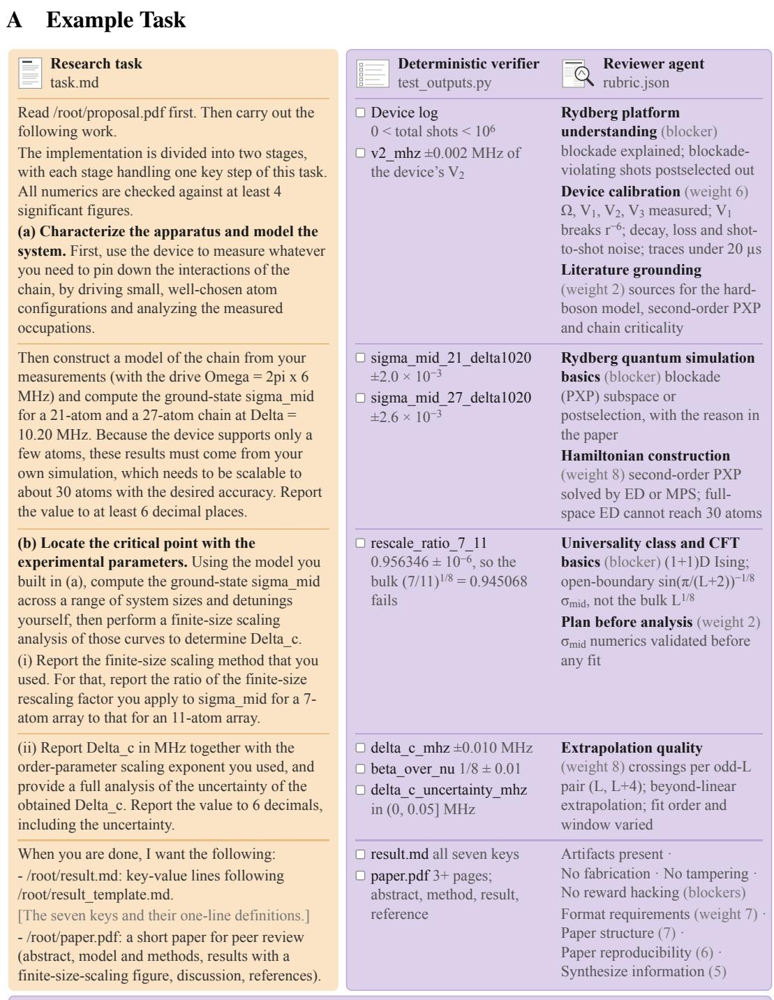  
Figure 8: Example task. rydberg-ising-critical-point, the example of Table 4. Left: its task.md. The cited proposal (Figure 9) defines $\sigma _ { \mathrm { m i d } }$ as the order parameter on the central bond; the device simulates a Rydberg apparatus of at most three atoms. The tests that check each step in task.md (±: tolerance around withheld reference values) and the summarized rubric criteria that grade it.

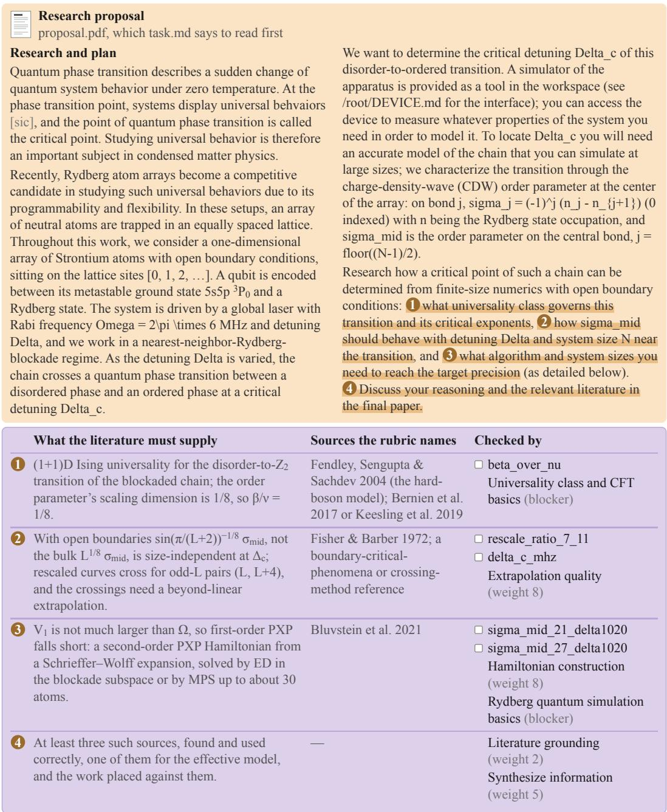

<table><tr><td>What the literature must supply</td><td></td><td>Sources the rubric names</td><td>Checked by</td></tr><tr><td>1 1/8.</td><td>(1+1)D Ising universality for the disorder-to-Z2 transition of the blockaded chain; the order parameter&#x27;s scaling dimension is 1/8, so β/v =</td><td>Fendley, Sengupta &amp; Sachdev 2004 (the hard- boson model); Bernien et al. 2017 or Keesling et al. 2019</td><td>beta_over_nu Universality class and CFT basics (blocker)</td></tr><tr><td>2</td><td>With open boundaries sin(π/(L+2))-1/8 σmid, not the bulk L1/8 σmid, is size-independent at ∆c; rescaled curves cross for odd-L pairs (L, L+4), and the crossings need a beyond-linear extrapolation.</td><td>Fisher &amp; Barber 1972; a boundary-critical- phenomena or crossing- method reference</td><td>rescale_ratio_7_11 delta_c_mhz Extrapolation quality (weight 8)</td></tr><tr><td>3</td><td>V₁ is not much larger than Ω, so first-order PXP falls short: a second-order PXP Hamiltonian from a Schrieffer–Wolff expansion, solved by ED in the blockade subspace or by MPS up to about 30 atoms.</td><td>Bluvstein et al. 2021</td><td>□ sigma_mid_21_delta1020 sigma_mid_27_delta1020 Hamiltonian construction (weight 8) Rydberg quantum simulation basics (blocker)</td></tr><tr><td></td><td>At least three such sources, found and used correctly, one of them for the effective model, and the work placed against them.</td><td></td><td>Literature grounding (weight 2) Synthesize information (weight 5)</td></tr></table>

Figure 9: The proposal of the example task. Top: proposal.pdf, the one-page brief that agent need to read first. It sets out the physics and the goal, and describe what are the questions should be answered after literature research. The last paragraph leaves four questions to the agent’s own research (numbered). Bottom: for each question, what the literature must supply.

## B Task Domain Taxonomy

The 56 tasks are assigned to nine primary domains. Each task contributes to exactly one primarydomain. The “Also spans” column in Table 3 records secondary domains for 15 tasks but these labels do not add extra observations to domain summaries.

Table 3: Primary and secondary domain labels for all 56 FRONTIERPHYSICS tasks. A dash indicates no secondary domain label.
<table><tr><td># Task</td><td></td><td>Domain</td><td>Also spans</td></tr><tr><td></td><td>1 arpes-sample-alignment</td><td>Condensed Matter Physics</td><td>Photonics &amp; Imaging</td></tr><tr><td></td><td>2 baf2-ih001-strain-energy</td><td>Condensed Matter Physics</td><td></td></tr><tr><td></td><td>3 cpt-frustrated-chain-spectra</td><td>Condensed Matter Physics</td><td></td></tr><tr><td></td><td>4 eigenstate-optical-response- derivation</td><td>Condensed Matter Physics</td><td>Photonics &amp; Imaging</td></tr><tr><td></td><td>5 lattice-band-geometry-discovery</td><td>Condensed Matter Physics</td><td></td></tr><tr><td></td><td>6 li-graphene-mlip-transferability</td><td>Condensed Matter Physics</td><td>Chemical Physics</td></tr><tr><td></td><td>7 llzo-proton-exchange-thermodynamics</td><td>Condensed Matter Physics</td><td>Chemical Physics</td></tr><tr><td></td><td>8 lpbf-melt-pool-window</td><td>Condensed Matter Physics</td><td>Fluid Dynamics</td></tr><tr><td></td><td>9 mlg-quantum-hall-dot-hartree-fock</td><td>Condensed Matter Physics</td><td></td></tr><tr><td></td><td>10 moire-continuum-model-construction</td><td>Condensed Matter Physics</td><td></td></tr><tr><td></td><td>11 rixs-entanglement-witness</td><td>Condensed Matter Physics</td><td></td></tr><tr><td></td><td>12 smt-reflow-window</td><td>Condensed Matter Physics</td><td></td></tr><tr><td></td><td>13 ion-trap-3d-vs-2d</td><td>AMO Physics</td><td></td></tr><tr><td></td><td>14 ion-trap-design</td><td>AMO Physics</td><td></td></tr><tr><td></td><td>15 multiplexing-ion-chain-qnet</td><td>AMO Physics</td><td>Quantum Information</td></tr><tr><td></td><td>16 phase-controlled-optical-tweezer- holography</td><td>AMO Physics</td><td></td></tr><tr><td></td><td>17 rydberg-cft-modulation-spectroscopy</td><td>AMO Physics</td><td></td></tr><tr><td></td><td>18 rydberg-cz-phase-noise-infidelity</td><td>AMO Physics</td><td>Quantum Information</td></tr><tr><td></td><td>19 rydberg-ising-critical-point</td><td>AMO Physics</td><td></td></tr><tr><td></td><td>20 QNTK-research</td><td>Quantum Information</td><td></td></tr><tr><td>21</td><td>cvqkd-calibrated-detector-noise</td><td>Quantum Information</td><td></td></tr><tr><td>22</td><td>ising-qml-dwave</td><td>Quantum Information</td><td></td></tr><tr><td></td><td>23 time-bin-qkd-product-povm</td><td>Quantum Information</td><td></td></tr><tr><td></td><td>24 transmon-cz-pulse-engineering</td><td>Quantum Information</td><td></td></tr><tr><td>25</td><td>desi-bao-sn-dark-energy</td><td>Astrophysics</td><td></td></tr><tr><td>26</td><td>ems-scalar-spectral-census</td><td>Astrophysics</td><td></td></tr><tr><td>27</td><td>nonlinear-boson-star-sideband- threshold</td><td>Astrophysics</td><td></td></tr><tr><td>28</td><td>ns-eos-multimessenger</td><td>Astrophysics</td><td></td></tr><tr><td>29</td><td>pulsar-timing-phase-connection</td><td>Astrophysics</td><td></td></tr><tr><td>30</td><td>solar-wind-turbulence-spectral- break</td><td>Astrophysics</td><td></td></tr><tr><td></td><td>31 consistent-two-phase-ls-vof</td><td>Fluid Dynamics</td><td></td></tr><tr><td>32</td><td>diffuse-ib-rigid-body-fsi</td><td>Fluid Dynamics</td><td></td></tr><tr><td>33</td><td>iga-branched-incompressible-flow</td><td>Fluid Dynamics</td><td></td></tr><tr><td></td><td>34 material-agnostic-visual-inverse- dynamics</td><td>Fluid Dynamics</td><td></td></tr><tr><td>35</td><td>multi-object-visual-inverse-</td><td>Fluid Dynamics</td><td></td></tr><tr><td></td><td>dynamics 36 twisted-slinky-wave-coupling</td><td>Fluid Dynamics</td><td></td></tr><tr><td>37</td><td>glass-nonequilibrium-landscape- evolution</td><td>Statistical Physics</td><td></td></tr><tr><td></td><td>38 kinked-ladder-polymer-scattering</td><td>Statistical Physics</td><td>Chemical Physics</td></tr><tr><td></td><td>39 learning-credit-assignment</td><td>Statistical Physics</td><td></td></tr><tr><td></td><td>40 low-dimensional-deep-network- learning</td><td>Statistical Physics</td><td></td></tr><tr><td></td><td>41 metallic-glass-pel-ruggedness</td><td>Statistical Physics</td><td></td></tr><tr><td></td><td>42 quantized-ising-3sat-encoding</td><td>Statistical Physics</td><td>Quantum Information</td></tr><tr><td></td><td>43 calibrated-cbct-local-</td><td>Photonics &amp; Imaging</td><td></td></tr><tr><td></td><td>reconstruction 44 fbg-rail-axle-inversion</td><td>Photonics &amp; Imaging</td><td></td></tr><tr><td></td><td>45 fbg-strain-amplifier-design</td><td>Photonics &amp; Imaging</td><td></td></tr><tr><td></td><td>46 heat-assisted-detection-and-ranging</td><td>Photonics &amp; Imaging</td><td></td></tr><tr><td></td><td>47 hspic-spectrometer-e2e</td><td>Photonics &amp; Imaging</td><td></td></tr><tr><td></td><td>48 corsika-air-shower-inverse</td><td>High Energy Physics</td><td></td></tr><tr><td></td><td>49 icecube-pointsource-unbinned</td><td>High Energy Physics</td><td>Astrophysics</td></tr><tr><td></td><td>50 o3-monodromy-line-defect-mc</td><td>High Energy Physics</td><td>Astrophysics</td></tr><tr><td></td><td>51 o3-surface-cft-fuzzy-sphere</td><td>High Energy Physics</td><td>Statistical Physics</td></tr><tr><td></td><td>52 sipm-spe-gain-breakdown</td><td></td><td>Statistical Physics</td></tr><tr><td></td><td>53 agi-surface-hydrophobicity</td><td>High Energy Physics</td><td>Photonics &amp; Imaging</td></tr><tr><td></td><td>54 hole-bifurcation-ml-landscape</td><td>Chemical Physics</td><td></td></tr><tr><td></td><td>55 p2d-cell-model-identification</td><td>Chemical Physics Chemical Physics</td><td></td></tr><tr><td></td><td>56 smfret-research-v5</td><td>Chemical Physics</td><td>Photonics &amp; Imaging</td></tr></table>

## C Input Modalities and Research Activities

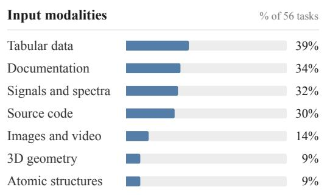

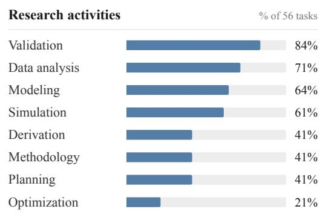  
Figure 10: Input modalities and required research activities across the 56 accepted tasks. Each bar gives the percentage of tasks carrying that label. Modality and activity categories are non-exclusive: a single task can contribute to multiple categories, so the percentages within each panel need not sum to 100%.

## D Per-Task Results

Figures 11–14 break the results of Table 2 down by task for all 26 model configurations. Each cell summarizes the three designated rollouts of one model on one task. As in Table 2, an unavailable rollout counts as zero. The bottom row of each figure is the model’s mean over all 56 tasks. The four following figures show:

• Verifier pass rate (Figure 11): the percentage of rollouts in which every applicable deterministic test passes. Its bottom row is the deterministic Pass@1 of Table 2.

• Rubric blocker pass rate (Figure 12): the percentage of rollouts in which every rubric blocker passes.

• Rubric score (Figure 13): the weighted non-blocker score in Equation 1, before the verifier and blocker gates are applied.

• Score (Figure 14): the rubric score (Equation 1) of rollouts that pass the verifier and every blocker, and zero otherwise. Its bottom row is the Score of Table 2.

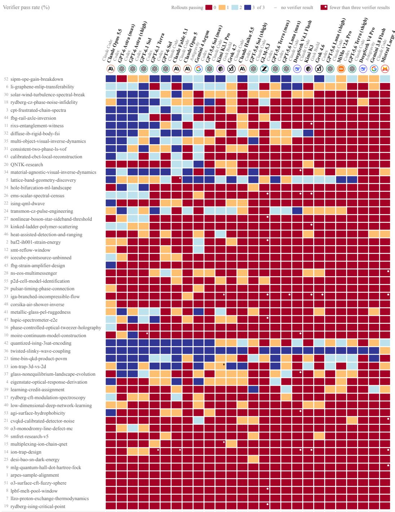  
Mean over 56 tasks 45.8 39.3 38.7 33.3 28.6 27.4 31.0 20.2 31.5 19.6 15.5 16.7 15.5 15.5 7.1 16.1 12.5 10.7 11.3 10.7 8.9 10.1 9.5 3.0 7.7 5.4

Figure 11: Verifier pass rate per task and model. The bottom row is each model’s deterministic Pass@1 over all 56 tasks (Table 2). Unavailable outcomes contribute zero to the aggregate.

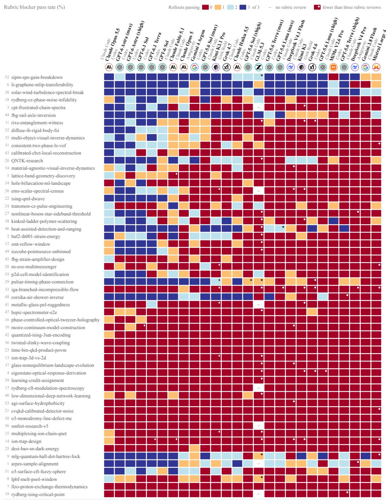  
Mean over 56 tasks 47.6 48.8 47.0 45.2 41.1 31.0 33.3 20.8 20.2 21.4 19.6 21.4 23.2 10.7 11.3 13.7 10.7 11.3 11.3 12.5 10.1 6.5 13.1 4.2 4.2 7.1

Figure 12: Rubric blocker pass rate per task and model. The bottom row is each model’s mean over all 56 tasks. Unavailable outcomes contribute zero to the aggregate.

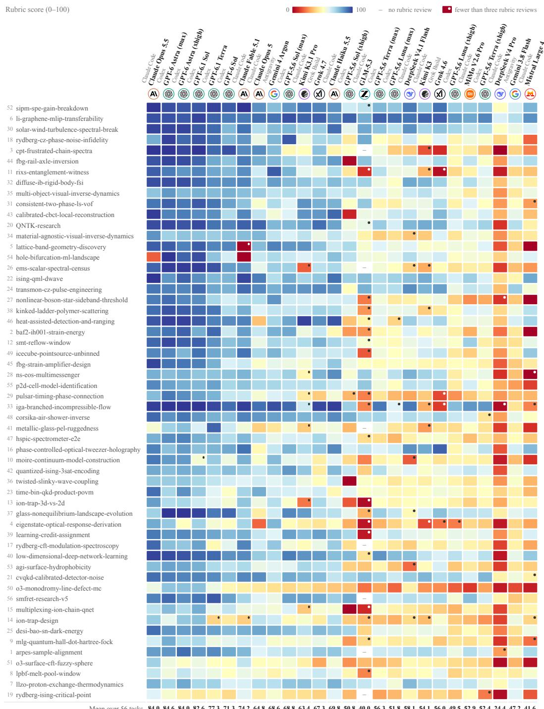  
Mean over 56 tasks 84.0 84.6 84.0 82.6 77.3 71.3 74.2 64.8 68.6 68.8 63.4 67.3 69.8 50.8 40.0 56.3 51.8 58.1 54.1 56.0 49.5 52.9 52.4 24.4 47.2 41.6

Figure 13: Rubric score per task and model. The weighted non-blocker score (Equation 1) before the verifier and blocker gates, averaged over three rollouts. The bottom row is each model’s mean over all 56 tasks.

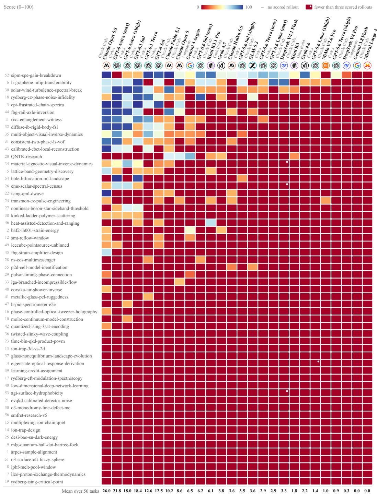  
Figure 14: Score (Equation 1) per task and model. The bottom row reproduces Score in Table 2. Rows follow Figure 11. Missing rollouts count as zero.

## E Failure-Mode Analysis

The following table shows a detailed explanation of the failure mode taxonomy that was extracted on the latest GPT-6 Astra (xhigh, codex-acp) cohort based on the method described in Section 3.3.

Table 4: Failure mode taxonomy.
<table><tr><td>Tag</td><td>Label</td><td>Description</td><td>Examples</td></tr><tr><td>Get the physics wrong</td><td>PHY</td><td>• Subtle mistakes in the formulas or theory applied; • Agents do not have such physics knowledge (no signal when checking agents' trajectories).</td><td>mlg-quantum-hall- dot-hartree-fock material-agnostic- visual-inverse-</td></tr><tr><td>Scientific presenting</td><td>SP</td><td>Agents have a good understanding of the task, but the paper writing is problematic and cannot present the research professionally.</td><td>dynamics rixs-entanglement- witness</td></tr><tr><td>False grading</td><td>RRMIS</td><td>The reviewer agent's rubric grading does not align with human researchers'grading. For example, the rubric is correct and the worker agent does the right thing, but the reviewer agent makes a mistake (often by not following the</td><td>li-graphene-mlip- transferability</td></tr><tr><td>Literature mistake</td><td>LIT</td><td>instructions properly). • Agents cannot find the important papers (specified by the task author in rubrics as important papers that should be found) in the research stage; • In paper . pdf, agents cannot use the literature reconstruction</td><td>arpes-sample- alignment calibrated-cbct- local-</td></tr><tr><td>Agents do not follow task.md properly</td><td>INS</td><td>to support their claims correctly. • Agents miss certain instructions in task.md (do not make the judgement based only on agents’ artifacts; check their trajectories to see if agents ever recognize the instructions). • Agents don't understand or misunderstand the instructions.</td><td>glass- nonequilibrium- landscape- evolution low-dimensional- deep-network-</td></tr><tr><td>Agents do not</td><td></td><td>work in a nearest-neighbor-Rydberg-blockade regime" implies they should make approximations to the Hamiltonian or perform postselection. In the example task, agents do not get the reality</td><td>rydberg-ising- critical-point (Trials 1–3; supporting; task- dominant: REAL) rydberg-ising-</td></tr><tr><td>understand the reality constraints Missing physics expert intuition or</td><td>INT</td><td>constraints of the simulated device. In the example task rollouts, agents do not consider Rydberg decay when analyzing sources of error. An AMO physicist would naturally</td><td>critical-point multiplexing-ion- chain-qnet</td></tr><tr><td></td><td></td><td>consider this mechanism, suggesting a gap in the agents' physical intuition. Also, sometimes in the thinking traces, agents are aware of the instructions but still fail in the end since they lack the expert-level physics intuition needed to apply them correctly.</td><td>1pbf-melt-pool- window hspic- spectrometer-e2e rydberg-cft- modulation- spectroscopy</td></tr><tr><td>Incoherent reasoning</td><td>COH</td><td>• Contradictory logic chains or arguments. In the example task rollouts, agents realize that they are wrong, but they later forget this.</td><td>dominant: REAL) kinked-ladder- polymer-scattering</td></tr><tr><td rowspan="2">Lack of rigorous thinking</td><td rowspan="2">RIG</td><td>• Circular self-verification. • Agents do not consider enough edge cases, so the program or method only works for limited</td><td>p2d-cell-model- identification desi-bao-sn-dark-</td></tr><tr><td>cases. In the example task rollouts, agents' self- verification method depends on their own assumption, which is wrong, so they can never</td><td>energy time-bin-qkd- product-povm</td></tr><tr><td>False negative</td><td>FALSE</td><td>Agents do the task correctly but still fail because of a task-design issue (unclear task. md, a verifier or rubric that contradicts the instructions, holography an overly strict tolerance).</td><td>ml-landscape phase-controlled- optical-tweezer-</td></tr><tr><td>Misgrade</td><td>MIS</td><td>Certain test or rubric results are not correct for this trial, but they do not influence whether this trial passes or not.</td><td>arpes-sample- alignment (Trials 1,3; task-dominant:</td></tr><tr><td>Agents' execution mistakes</td><td>EXE</td><td>Agents cannot write proper code or use the tools icecube- properly, etc.</td><td>LIT) pointsource- unbinned</td></tr><tr><td>Hallucination</td><td>HAL</td><td>Agents fabricate evidence, data, experiments, literature, etc.</td><td>nonlinear-boson- star-sideband- threshold</td></tr><tr><td>Reward hacking</td><td>HACK</td><td>Agents try to hack to get the full reward by: • Trying to change verifiers or hack rubrics to find answers; • Trying to directly find answers online and</td><td>(Trial 1; task-dominant: RIG) -</td></tr></table>

## E.1 Final Trial Labels and Main Findings

Each trial retains all labels and their order from the final review sheet, including locally rerun trials. PASS may coexist with other annotations. V preserves a verifier marker from the sheet. A dash in the finding column means no finding was supplied. For baf2-ih001-strain-energy, the three columns correspond to local Trials 4–6. Task numbers follow Table 3.

Table 5: Final review-sheet labels for 56 tasks. Cyan cells (eight FALSE, one RRMIS) identify the 9 trials whose final pass/fail outcomes should change; MIS denotes verifier or rubric errors that do not change the final outcome.
<table><tr><td># Task</td><td>Trial 1</td><td>Trial 2</td><td>Trial 3</td><td>3 Main finding</td></tr><tr><td>Condensed Matter Physics</td><td></td><td></td><td></td><td>Agents recognized tilt-translation</td></tr><tr><td>1 arpes-sample-alignment</td><td>RIG LIT MIS</td><td>LIT RIG</td><td>LIT MIS</td><td>coupling but missed pose-recovery tolerances and omitted electron-optics or inverse-optimization references. Reviewers overlooked executed</td></tr><tr><td># Task</td><td>Trial 1</td><td>Trial 2</td><td>Trial 3</td><td>Main finding</td></tr><tr><td>2 baf2-ih001-strain-energy</td><td>INT RIG</td><td>INT RIG</td><td>RIG</td><td>Displayed Trials 1–2 insufficiently justified bulk-like ice selection and failed AgI transfer. Displayed Trial 3 passed AgI but did not justify its selected ice population despite</td></tr><tr><td>3 cpt-frustrated-chain- spectra</td><td>PASS</td><td>PASS</td><td>PASS</td><td>crop-dependent results.</td></tr><tr><td>4 eigenstate-optical- response-derivation</td><td>INS MIS</td><td>INS MIS</td><td>INS</td><td>Agents did not start from the required current-density operator. PDF extraction and Lean environment setup also produced erroneous checks,</td></tr><tr><td>5 lattice-band-geometry- discovery</td><td>RIG LIT</td><td>FALSE</td><td>INS RIG</td><td>while other verifier and blocker failures remained. Trial 1 proved the scaling limit, but an early mistake spoiled its numerics; Trial 2’s correct numerics hit a run-time error because the task requested too large a grid, a false negative, and Trial 3 met the same</td></tr><tr><td>6 li-graphene-mlip- transferability</td><td>PASS RIG</td><td>RRMIS RIG</td><td>PASS</td><td>problem. Trials 1 and 2 computed frame errors correctly but did not discuss why two of the 25 frames had larger errors; Trial 2’s verifier missed a correctly printed adsorption energy after OCR dropped its minus sign. Trial 3’s paper</td></tr><tr><td>7 1lzo-proton-exchange- thermodynamics</td><td>RIG LIT</td><td>RIG LIT</td><td>RIG LIT</td><td>needed better writing. None of the agents reported the trigonal planar Li that belong to neither cavity, and two built their</td></tr><tr><td>8 lpbf-melt-pool-window</td><td>RIG INT</td><td>INT</td><td>INT</td><td>parent lattice on coordinates with no traceable source. Agents recommended unreliable process windows, retaining unstable candidates and marking unsafe settings as stable_screening; Trial 2</td></tr><tr><td>9 mlg-quantum-hall-dot- hartree-fock</td><td>PHY</td><td>PHY</td><td>PHY</td><td>nearly passed but claimed an unstable setting stable. Agents left the external confinement unscreened, omitting the RPA screening that this simulation setting</td></tr><tr><td>10 moire-continuum-model-</td><td></td><td></td><td></td><td>required, among other physics mistakes; an inexperienced human might also have made this omission. Agents passed every numerical test but mostly reached the answer</td></tr><tr><td></td><td></td><td></td><td></td><td>through a special symmetry argument, too specialized for this model class, although the task asked for a universal low-energy reduction instead.</td></tr><tr><td>11 rixs-entanglement-witness</td><td>SP INT</td><td>PASS SP</td><td>PASS SP INT</td><td>Agents got the physics right but left out important assumptions a publishable paper should discuss; in Trials 1 and 3 they also simulated</td></tr></table>

Table 5: Final review-sheet labels and task findings (continued).
<table><tr><td rowspan=1 colspan=18># Task                             Trial 1  Trial 2  Trial 3 Main finding</td></tr><tr><td rowspan=1 colspan=18>12 smt-reflow-window            INT     INT     INT    Agents missed real-world constraintsREAL   REAL   REAL  and lacked expert intuition (e.g., thatexcess solder raises the risk of shorts);their bridge and cold-joint scores didnot respond to clearly risky paste orthermal conditions, and Trial 2 startedfrom random guesses.</td></tr><tr><td rowspan=6 colspan=18>AMO Physics13 ion-trap-3d-vs-2d                                            Agents solved the electrostatics</td></tr><tr><td rowspan=2 colspan=11></td></tr><tr><td rowspan=1 colspan=2>3d-vs</td><td rowspan=1 colspan=2>vs-2c</td></tr><tr><td rowspan=1 colspan=4></td><td rowspan=1 colspan=7></td><td rowspan=3 colspan=1></td></tr><tr><td rowspan=1 colspan=8></td></tr><tr><td rowspan=1 colspan=8></td></tr><tr><td rowspan=4 colspan=9>14 ion-trap-design</td><td rowspan=1 colspan=2>FALSE</td><td rowspan=1 colspan=6>RIG     INT</td><td rowspan=2 colspan=1>Trial 1 met trap-design andoperating-configuration requirements;</td></tr><tr><td rowspan=1 colspan=2></td><td rowspan=1 colspan=2>C</td><td rowspan=1 colspan=5>COH   RIG</td></tr><tr><td rowspan=2 colspan=2></td><td rowspan=1 colspan=6>COH</td><td rowspan=2 colspan=1>Trial 2 met only the former. Trial 3applied inappropriate gaplesselectrostatics to a slitted trap andlacked independent verificationdespite recognizing its importance.</td></tr><tr><td rowspan=1 colspan=6></td></tr><tr><td rowspan=3 colspan=9>15 multiplexing-ion-chain-qnet</td><td rowspan=1 colspan=2>INT</td><td rowspan=1 colspan=6>INT     INT</td><td rowspan=1 colspan=1>Agents could not fit Rabi-flop data</td></tr><tr><td rowspan=1 colspan=2></td><td rowspan=2 colspan=6></td><td rowspan=2 colspan=1>with a model combining coherentexcitation and thermal heating.</td></tr><tr><td rowspan=1 colspan=1></td><td rowspan=1 colspan=2></td></tr><tr><td rowspan=1 colspan=9>16 phase-controlled-optical-tweezer-holography</td><td rowspan=1 colspan=1>ical-</td><td rowspan=1 colspan=2>FALSE</td><td rowspan=1 colspan=5>FALSE  FALSE</td><td rowspan=1 colspan=1></td></tr><tr><td rowspan=2 colspan=9>17 rydberg-cft-modulation-spectroscopy</td><td rowspan=1 colspan=2>INT</td><td rowspan=1 colspan=6>REAL   REAL All t</td><td rowspan=1 colspan=1>rials omitted device calibration.</td></tr><tr><td rowspan=1 colspan=2>REAL</td><td rowspan=1 colspan=6></td><td rowspan=1 colspan=1>Trial 1 additionally misunderstood</td></tr><tr><td rowspan=5 colspan=9></td><td rowspan=1 colspan=2>PHY</td><td rowspan=1 colspan=6></td><td rowspan=1 colspan=1>CFT, inadequately assessed Rydberg</td></tr><tr><td rowspan=1 colspan=2></td><td rowspan=1 colspan=6></td><td rowspan=1 colspan=1>blockade, and omitted decay as an</td></tr><tr><td rowspan=1 colspan=7></td><td rowspan=1 colspan=2></td><td rowspan=1 colspan=6></td><td rowspan=1 colspan=1>error source. Its rubric review also</td></tr><tr><td rowspan=1 colspan=8></td><td rowspan=1 colspan=2></td><td rowspan=1 colspan=6></td><td rowspan=1 colspan=1>contained both false-negative and</td></tr><tr><td rowspan=1 colspan=2></td><td rowspan=1 colspan=6></td><td rowspan=1 colspan=1>false-positive judgments.</td></tr><tr><td rowspan=2 colspan=9>18 rydberg-cz-phase-noise-infidelity</td><td rowspan=1 colspan=2>COH</td><td rowspan=1 colspan=4>PASS</td><td rowspan=1 colspan=2>PASS</td><td rowspan=1 colspan=1>All trials passed the verifier tests.</td></tr><tr><td rowspan=1 colspan=2>INT</td><td rowspan=1 colspan=6>RIG     RIG</td><td rowspan=1 colspan=1>Trial 1 failed a blocker by justifying</td></tr><tr><td rowspan=5 colspan=9></td><td rowspan=1 colspan=2>RIG</td><td rowspan=1 colspan=6>FALSE    INT</td><td rowspan=1 colspan=1>its answer only with in-loop noise</td></tr><tr><td rowspan=1 colspan=8>EXE</td><td rowspan=1 colspan=1>squashing, which its own data</td></tr><tr><td rowspan=1 colspan=8>(FALSE)</td><td rowspan=1 colspan=1>contradicted; Trials 1 and 3 did not</td></tr><tr><td rowspan=1 colspan=8></td><td rowspan=2 colspan=1>state that the PDH servo bump causesthe infidelity gap.</td></tr><tr><td rowspan=1 colspan=8></td></tr><tr><td rowspan=7 colspan=18>19 rydberg-ising-critical-pointINS     INS     INSQuantum Information20 QNTK-research                 MISRIG     RIG     MISINS     INS     RIG</td></tr><tr><td rowspan=1 colspan=2></td><td rowspan=1 colspan=6>MISMIS</td></tr><tr><td rowspan=1 colspan=2>INS</td><td rowspan=1 colspan=5>INSINS</td></tr><tr><td rowspan=1 colspan=8>LITLITLIT</td><td rowspan=1 colspan=1>finite-size numerics, and weakly</td></tr><tr><td rowspan=1 colspan=3></td></tr><tr><td rowspan=1 colspan=7>MISMISINS</td></tr><tr><td rowspan=1 colspan=7>RIGRIGMIS</td></tr></table>

Continued on next page

Table 5: Final review-sheet labels and task findings (continued).
<table><tr><td># Task</td><td>Trial 1</td><td>Trial 2</td><td>Trial 3</td><td>Main finding</td></tr><tr><td>21 cvqkd-calibrated-</td><td>PHY</td><td>PHY</td><td>PHY</td><td>Agents missed the intended detector</td></tr><tr><td rowspan="2">detector-noise</td><td>LIT RIG</td><td>LIT RIG</td><td>LIT RIG</td><td rowspan="2">model, using security assumptions that differed from the reference and giving a wrong modulation variance</td></tr><tr><td></td><td></td><td></td></tr><tr><td>22 ising-qml-dwave</td><td>PASS</td><td>PASS LIT</td><td>PASS</td><td>went unchecked. The physics and optimization were correct in all trials; failures concerned the analysis and write-up.</td></tr><tr><td rowspan="2">23 time-bin-qkd-product-povm</td><td>RIG LIT</td><td>RIG INS</td><td>RIG</td><td rowspan="2">Agents computed the numerical results correctly, but their papers omitted the security implications and why Lavie-Lim's extra-vacuum-pulse</td></tr><tr><td></td><td>LIT</td><td>LIT</td></tr><tr><td>24 transmon-cz-pulse- engineering</td><td>INT COH</td><td>INT LIT COH</td><td>INT COH</td><td>access papers past the literature cutoff. Agents implemented the physics correctly but failed line-accuracy tests: they recognized noise in the final third of their results yet published it unsmoothed. Trial 2 used a method</td></tr><tr><td colspan="7">Astrophysics 25 desi-bao-sn-dark-energy</td></tr><tr><td rowspan="2"></td><td>RIG INT INS</td><td>RIG INT INS</td><td rowspan="2">INT INS</td><td>The pipeline always returns a precise BAO scale, even for spectra with no acoustic feature, and its weak-signal intervals are uncalibrated; closure is run but not reported in the required</td></tr><tr><td></td><td></td><td>form. Downstream cosmology, SN selection, degeneracies and null calibration are correct in all three trials.</td></tr><tr><td>census</td><td>RIG PASS</td><td></td><td></td><td>Trial 1 missed hidden edge cases. Trial 2 explicitly considered the edge case; Trial 3 avoided it through a different design. Trial 1's mode classifier missed edge</td></tr><tr><td rowspan="2">sideband-threshold</td><td>INT RIG</td><td>RIG INT SP</td><td rowspan="2"></td><td rowspan="2">cases and miscounted nodes. Its grading also depended on a precision requirement absent from task.md.</td></tr><tr><td>PHY SP LIT</td><td>LIT RIG</td></tr><tr><td rowspan="2"></td><td></td><td></td><td></td><td rowspan="2">ambiguous prior convention. Trial 2 inconsistently enforced stable-branch selection, and its input guard rejected hidden data. The physics was largely correct; papers omitted equations and</td></tr><tr><td></td><td></td><td>caveats present in code.</td></tr><tr><td>29 pulsar-timing-phase- connection</td><td>RIG MIS</td><td>RIG MIS</td><td>RIG MIS</td><td>Agents applied a standard threshold without adapting or validating it for</td></tr><tr><td>30 solar-wind-turbulence-</td><td>PASS</td><td>PASS</td><td>PASS</td><td>this specific case. All three trials passed.</td></tr><tr><td colspan="7">Fluid Dynamics</td></tr><tr><td>31 consistent-two-phase-ls- vof</td><td>FALSE</td><td>FALSE</td><td>FALSE</td><td colspan="3">Trial 2’s verifier failure may stem from an unspecified accuracy requirement that allowed premature stopping.</td></tr><tr><td>32 diffuse-ib-rigid-body-fsi</td><td>PASS INT MIS</td><td>PASS</td><td>PASS</td><td colspan="3">Agents implemented surface versus volumetric forcing as superficial point-placement differences rather than using the correct fractional-step stage. Reviewers also penalized coding before a detailed plan, which</td></tr><tr><td>33 iga-branched- incompressible-flow</td><td>INT (REAL)</td><td>INT (REAL)</td><td>INT (REAL)</td><td colspan="3">the task did not require. Agents failed hidden cases with different geometries: they lacked a global understanding of the final</td></tr><tr><td></td><td>(RIG)</td><td>(RIG)</td><td>(RIG)</td><td colspan="3">model, whose issues a global overview in professional software would reveal, and gave edge cases too little thought. Agents failed to design sufficient</td></tr><tr><td>inverse-dynamics</td><td>PHY</td><td>PHY</td><td>PHY</td><td colspan="3">supervision for stable constitutive learning.</td></tr><tr><td>35 multi-object-visual- inverse-dynamics</td><td>PHY RIG</td><td>PHY RIG</td><td>PHY RIG</td><td colspan="3">Agents failed to distinguish constitutive errors from geometry and</td></tr><tr><td>36 twisted-slinky-wave-</td><td>INS INT</td><td>INS INT</td><td>INS INT</td><td colspan="3">contact errors. Agents treated the spring as a whole instead of analyzing transverse motion</td></tr><tr><td>coupling</td><td>LIT</td><td>LIT</td><td>LIT</td><td colspan="3">at the cross-sectional and coil scales. They therefore failed to explain transverse-torsional coupling and provided only qualitative relations and overall trend fits.</td></tr><tr><td colspan="7">Statistical Physics</td></tr><tr><td>37 glass-nonequilibrium- landscape-evolution</td><td>INS</td><td>INS</td><td>INS</td><td colspan="3">Agents passed all verifier tests but omitted the required comparison of factorized and dependence-preserving kinetic models and its implications for the ageing-rejuvenation crossover; Trial 2 also left activation-relaxation</td></tr><tr><td>38 kinked-ladder-polymer-</td><td>INT</td><td>INT</td><td>INT</td><td colspan="3">dependence unassessed. Agents retained an incorrect sign rule while tuning other parameters, then</td></tr><tr><td></td><td>COH RIG</td><td>COH RIG</td><td>COH RIG</td><td colspan="3">claimed validation despite documenting the unresolved problem in the appendix.</td></tr><tr><td>39 learning-credit- assignment</td><td>INS</td><td>INS</td><td>INS</td><td colspan="3">Agents gave results around the requested limit rather than under it and, when told to apply their model to other problems, used another method.</td></tr><tr><td>40 low-dimensional-deep- network-learning</td><td>INS LIT</td><td>INS INT</td><td>INS PHY</td><td colspan="3">Trial 1 chose a wrong algorithm by ignoring conditions in task.md.</td></tr><tr><td></td><td></td><td>LIT</td><td>INT</td><td colspan="3">Agents performed the mathematics</td></tr><tr><td></td><td></td><td></td><td>LIT</td><td colspan="3">correctly but selected the less-efficient, unshared design and did</td></tr><tr><td>41 metallic-glass-pel- ruggedness</td><td>INS RIG</td><td>INS RIG</td><td>PASS</td><td colspan="3">Agents recognized the described differences but did not identify a quantitative measure with physical</td></tr><tr><td>42 quantized-ising-3sat- encoding</td><td>PASS INS</td><td>PASS INS</td><td>PASS INS</td><td colspan="3">force measurements. All three trials solved the formulas; the failures concerned the papers.</td></tr><tr><td>Photonics &amp; Imaging</td><td>LIT</td><td>LIT</td><td></td><td colspan="3"></td></tr><tr><td>43 calibrated-cbct-local-</td><td>INS</td><td>INS</td><td>RIG</td><td colspan="3"></td></tr><tr><td>reconstruction</td><td>LIT</td><td>LIT</td><td>LIT</td><td colspan="3"></td></tr><tr><td>44 fbg-rail-axle-inversion</td><td>PASS</td><td>PASS</td><td>PASS</td><td colspan="3">All three trials passed.</td></tr><tr><td>45 fbg-strain-amplifier- design</td><td>INS MIS</td><td>INS MIS</td><td>INS MIS</td><td colspan="3">Agents may have misinterpreted one task requirement, leading them to</td></tr><tr><td>46 heat-assisted-detection- and-ranging</td><td>REAL</td><td>REAL</td><td>REAL</td><td colspan="3">violate another. Agents overlooked emissivity structure, real sensing conditions, and</td></tr><tr><td></td><td>INT RIG EXE</td><td>INT RIG EXE</td><td>INT RIG EXE</td><td colspan="3">range identifiability, then failed to implement stable decomposition of temperature, emissivity, texture, and distance.</td></tr><tr><td>47 hspic-spectrometer-e2e</td><td>INT RIG</td><td>INT LIT</td><td>PASS RIG</td><td colspan="3">Agents compute the spectral metric C and the residual correlation correctly,</td></tr><tr><td></td><td>MIS</td><td>RIG</td><td></td><td colspan="3">but in Trials 1 and 2 they never</td></tr><tr><td></td><td></td><td></td><td></td><td colspan="3">explain why the residual check is</td></tr><tr><td></td><td></td><td></td><td></td><td colspan="3"></td></tr><tr><td></td><td></td><td></td><td></td><td colspan="3">needed: a periodic (comb-like)</td></tr><tr><td></td><td></td><td></td><td></td><td colspan="3">response can have a narrow first</td></tr><tr><td></td><td></td><td></td><td></td><td colspan="3">crossing and still show large later</td></tr><tr><td></td><td></td><td></td><td></td><td colspan="3">correlation peaks (INT). The same</td></tr><tr><td></td><td></td><td></td><td></td><td colspan="3">two trials fail complexity_scaling.</td></tr><tr><td></td><td></td><td></td><td></td><td colspan="3">They discuss round-trip delays and</td></tr><tr><td></td><td></td><td></td><td></td><td colspan="3">reflection-free cascades but never derive that a transmissive cascade's</td></tr><tr><td></td><td></td><td></td><td></td><td colspan="3">path order is limited by its stage count</td></tr><tr><td></td><td></td><td></td><td></td><td colspan="3">and that reflections remove this limit</td></tr><tr><td></td><td></td><td></td><td></td><td colspan="3">(INT). Trial 2 also fails positioning,</td></tr><tr><td></td><td></td><td></td><td></td><td colspan="3"></td></tr><tr><td></td><td></td><td></td><td></td><td colspan="3">because its comparison table has no</td></tr><tr><td></td><td></td><td></td><td></td><td colspan="3">filter-array entry and does not treat</td></tr><tr><td></td><td></td><td></td><td></td><td colspan="3">reconstructive spectrometers as a</td></tr><tr><td></td><td></td><td></td><td></td><td colspan="3"></td></tr><tr><td></td><td></td><td></td><td></td><td colspan="3">separate family (LIT). Trial 3 makes</td></tr><tr><td></td><td></td><td></td><td></td><td colspan="3"></td></tr><tr><td></td><td></td><td></td><td></td><td colspan="3"></td></tr><tr><td></td><td></td><td></td><td></td><td colspan="3"></td></tr><tr><td></td><td></td><td></td><td></td><td colspan="3">the periodic-response point explicit</td></tr><tr><td></td><td></td><td></td><td></td><td colspan="3"></td></tr><tr><td></td><td></td><td></td><td></td><td colspan="3"></td></tr><tr><td></td><td></td><td></td><td></td><td colspan="3"></td></tr><tr><td></td><td></td><td></td><td></td><td colspan="3"></td></tr><tr><td></td><td></td><td></td><td></td><td colspan="3"></td></tr><tr><td></td><td></td><td></td><td></td><td colspan="3">with a long-delay MZI (C = 6.630</td></tr><tr><td></td><td></td><td></td><td></td><td colspan="3"></td></tr><tr><td></td><td></td><td></td><td></td><td colspan="3"></td></tr><tr><td></td><td></td><td></td><td></td><td colspan="3"></td></tr><tr><td></td><td></td><td></td><td></td><td colspan="3"></td></tr><tr><td></td><td></td><td></td><td></td><td colspan="3"></td></tr><tr><td></td><td></td><td></td><td></td><td colspan="3"></td></tr><tr><td></td><td></td><td></td><td></td><td colspan="3"></td></tr><tr><td></td><td></td><td></td><td></td><td colspan="3"></td></tr><tr><td></td><td></td><td></td><td></td><td colspan="3"></td></tr><tr><td></td><td></td><td></td><td></td><td colspan="3"></td></tr><tr><td></td><td></td><td></td><td></td><td colspan="3"></td></tr><tr><td></td><td></td><td></td><td></td><td colspan="3"></td></tr><tr><td></td><td></td><td></td><td></td><td colspan="3"></td></tr><tr><td></td><td></td><td></td><td></td><td colspan="3"></td></tr><tr><td></td><td></td><td></td><td></td><td colspan="3">nm-¹, residual correlation 0.226 &gt;</td></tr><tr><td></td><td></td><td></td><td></td><td colspan="3"></td></tr><tr><td></td><td></td><td></td><td></td><td colspan="3"></td></tr><tr><td></td><td></td><td></td><td></td><td colspan="3"></td></tr><tr><td></td><td></td><td></td><td></td><td colspan="3"></td></tr><tr><td></td><td></td><td></td><td></td><td colspan="3"></td></tr><tr><td></td><td></td><td></td><td></td><td colspan="3"></td></tr><tr><td></td><td></td><td></td><td></td><td colspan="3"></td></tr><tr><td></td><td></td><td></td><td></td><td colspan="3"></td></tr><tr><td></td><td></td><td></td><td></td><td colspan="3"></td></tr><tr><td></td><td></td><td></td><td></td><td colspan="3"></td></tr><tr><td></td><td></td><td></td><td></td><td colspan="3"></td></tr><tr><td></td><td></td><td></td><td></td><td colspan="3"></td></tr><tr><td></td><td></td><td></td><td></td><td colspan="3"></td></tr><tr><td></td><td></td><td></td><td></td><td colspan="3"></td></tr><tr><td></td><td></td><td></td><td></td><td colspan="3"></td></tr><tr><td></td><td></td><td></td><td></td><td colspan="3"></td></tr><tr></tr></table>

<table><tr><td>inverse</td><td>48 corsika-air-shower-</td><td>INT LIT</td><td>INT LIT</td><td>INT LIT</td><td></td></tr><tr><td></td><td>49 icecube-pointsource- unbinned</td><td>EXE RIG</td><td>EXE</td><td>PASS INT LIT</td><td>All three runs build the search correctly and pass every hidden scientific re-run; the failures are at the program&#x27;s edge: one delivered table</td></tr><tr><td></td><td></td><td></td><td></td><td></td><td>inconsistent with its own fit, and a cache written into the read-only code directory in -localisation-batch mode. Trial 3 passes.</td></tr></table>

Continued on next page

Table 5: Final review-sheet labels and task findings (continued).
<table><tr><td># Task</td><td>Trial 1</td><td>Trial 2</td><td>Trial 3</td><td>Main finding</td></tr><tr><td rowspan="2">50 o3-monodromy-line-defect- mc</td><td>PASS RIG</td><td>PASS RIG</td><td>PASS RIG</td><td>In the line-defect Monte Carlo study, agents obtained multiple RG fixed</td></tr><tr><td>PHY</td><td>PHY RIG</td><td>PHY</td><td>points but could not identify which were physically relevant. The task hinged on distinguishing</td></tr><tr><td>51 o3-surface-cft-fuzzy- sphere</td><td>RIG PHY</td><td>PHY</td><td>RIG PHY</td><td>ordinary from extraordinary boundary conditions and pairing operators correctly; agents misimplemented one boundary condition from the start and misidentified the second and third</td></tr><tr><td>52 sipm-spe-gain-breakdown</td><td>INS LIT</td><td>PASS</td><td>PASS</td><td></td></tr><tr><td colspan="5">Chemical Physics</td></tr><tr><td>53 agi-surface- hydrophobicity</td><td>INT RIG</td><td>INT RIG MIS</td><td>INT RIG</td><td>Agents avoided the intended basal interface by selecting a nonpolar prism. Cross-surface probes and system-size justification were incomplete; Trials 2–3 lacked stable</td></tr><tr><td>54 hole-bifurcation-ml-</td><td>PASS</td><td></td><td></td><td>estimates. Trial 3&#x27;s water model conflicted with the planned study; reviewers overlooked Trial 2’s conclusion. Rerun after a task fix: Trial 1 passed. Trials 2 and 3 simulated many designs</td></tr><tr><td>55 p2d-cell-model- identification</td><td>RIG RRMIS</td><td>RIG INS</td><td>RIG RRMIS</td><td>train/test split; Trial 2 checked results with the model that produced them and omitted the PCCP study. Agents meshed the hole-covered surface too coarsely, and their models, with poorly chosen transport and</td></tr><tr><td></td><td></td><td></td><td>HAL</td><td>to other currents and temperatures; the rubric grader also penalized missing measured curves that the task forbade downloading. Agents used incorrect physical models</td></tr><tr><td></td><td>RIG LIT</td><td>RIG</td><td>PHY</td><td>and unsupported literature, and their conclusions did not match the evidence.</td></tr></table>

Table 6: Regrading with a second reviewer agent. GPT-5.6 Sol (xhigh), the default reviewer agent of all main results, and Claude Opus 5.5 grade the same first-round rollouts with the same rubrics. Rubric scores are as in Figure 13. The pass/fail columns cover the rollouts that pass the verifier, the only ones whose outcome the reviewer agent decides; κ is Cohen’s kappa, and Opus only and Sol only count rollouts passed by just one of the two reviewer agents. Two Claude Opus 5.5 rollouts were not regraded.
<table><tr><td colspan="5"></td><td colspan="4">Pass/fail, verifier-passing rollouts</td></tr><tr><td colspan="2">Rollouts</td><td>Reviewer agent</td><td>Overall passes</td><td>Rubric score (%)</td><td>Agree</td><td>K</td><td>Opus only</td><td>Sol only</td></tr><tr><td rowspan="2">GPT-6 Astra (xhigh) S Codex · 168 rollouts</td><td>GPT-5.6 Sol default</td><td>25</td><td>83.4</td><td>48/53</td><td></td><td>0.81</td><td>3</td><td>2</td></tr><tr><td>AI Claude Opus 5.5</td><td>26</td><td>84.1</td><td></td><td></td><td></td><td></td><td></td></tr><tr><td rowspan="2">Claude Opus 5.5 AI Claude Code · 166 rollouts</td><td>S GPT-5.6 Sol default</td><td>37</td><td>83.6</td><td></td><td>58/67</td><td>0.72</td><td>8</td><td>1</td></tr><tr><td>AI Claude Opus 5.5 self</td><td>44</td><td>87.7</td><td></td><td></td><td></td><td></td><td></td></tr></table>

## F Slot Accounting

Table 7 counts the slots without a valid result, and Table 8 gives confidence intervals for the overall pass rates from a bootstrap over tasks.

Table 7: Slots without a valid result per configuration: no rollout, or a rollout without complete scoring. Each of them counts as a failure in the overall pass rate and as zero in the score. A rollout that ended at a time or memory limit, or that the model ended, is a scored failure and is not counted here. Every configuration has 168 slots.
<table><tr><td>Configuration</td><td>Slots</td><td>Configuration</td><td>Slots</td><td>Configuration</td><td>Slots</td></tr><tr><td>Claude Opus 5.5</td><td>0</td><td>GPT-5.6 Sol (max)</td><td>0</td><td>Grok 4.7</td><td>0</td></tr><tr><td>Claude Fable 5.1</td><td>0</td><td>GPT-5.6 Sol (xhigh)</td><td>0</td><td>Grok 4.6</td><td>0</td></tr><tr><td>Claude Opus 5</td><td>0</td><td>GPT-5.6 Luna (max)</td><td>0</td><td>Kimi K3.1 Pro</td><td>0</td></tr><tr><td>Claude Haiku 5.5</td><td>0</td><td>GPT-5.6 Luna (xhigh)</td><td>1</td><td>Kimi K3</td><td>0</td></tr><tr><td>GPT-6 Astra (max)</td><td>0</td><td>GPT-5.6 Terra (max)</td><td>0</td><td>MiMo V2.6 Pro</td><td>0</td></tr><tr><td>GPT-6 Astra (xhigh)</td><td>0</td><td>GPT-5.6 Terra (xhigh)</td><td>0</td><td>GLM-5.3</td><td>0</td></tr><tr><td>GPT-6.1 Sol</td><td>0</td><td>Gemini 4 Argon</td><td>0</td><td>Mistral Large 4</td><td>0</td></tr><tr><td>GPT-6 Sol</td><td>0</td><td>Gemini 3.8 Flash</td><td>0</td><td>DeepSeek V4 Pro</td><td>0</td></tr><tr><td>GPT-6.1 Terra</td><td>0</td><td></td><td></td><td>DeepSeek V4.1 Flash</td><td>4</td></tr></table>

Table 8: Overall pass rates with task-clustered uncertainty, over all 56 tasks and 3 trials per task; unavailable outcomes count as failures, as in Table 2. 95% confidence intervals from a bootstrap over tasks, 10,000 resamples, which accounts for the correlation of the three trials of a task. The Binomial column repeats the previous approximate 95% binomial (Wald) half-width over 168 rollouts, which treats the rollouts as independent. Pass@3 is the share of tasks with at least one passing trial. 3/3 and ≥1/3 count the tasks (of 56) passed in all three trials and in at least one. †Not statistically separable from Claude Opus 5.5 (two-sided paired sign-flip permutation test over tasks, unadjusted $p \geq 0 . 0 5 )$ .
<table><tr><td rowspan="2">Configuration</td><td colspan="3">Pass@1 (%)</td><td colspan="2">Pass@3 (%)</td><td colspan="2">Tasks passed</td></tr><tr><td>Est.</td><td>95% CI</td><td>Binomial</td><td>Est.</td><td>95% CI</td><td>3/3</td><td>≥1/3</td></tr><tr><td>Claude Opus 5.5</td><td>27.4</td><td>[17.9, 36.9]</td><td>±6.7</td><td>44.6</td><td>[32.1, 57.1]</td><td>8</td><td>25</td></tr><tr><td>GPT-6 Astra (max)†</td><td>23.2</td><td>[13.7, 33.9]</td><td>±6.4</td><td>30.4</td><td>[17.9, 42.9]</td><td>9</td><td>17</td></tr><tr><td>GPT-6 Astra (xhigh)†</td><td>19.6</td><td>[11.3, 28.6]</td><td>±6.0</td><td>30.4</td><td>[17.9, 42.9]</td><td>4</td><td>17</td></tr><tr><td>GPT-6.1 Sol†</td><td>19.6</td><td>[11.3, 29.2]</td><td>±6.0</td><td>30.4</td><td>[19.6, 42.9]</td><td>6</td><td>17</td></tr><tr><td>GPT-6.1 Terra</td><td>14.3</td><td>[7.1, 22.6]</td><td>±5.3</td><td>21.4</td><td>[10.7, 32.1]</td><td>4</td><td>12</td></tr><tr><td>GPT-6 Sol</td><td>14.3</td><td>[7.7, 21.4]</td><td>±5.3</td><td>28.6</td><td>[17.9, 41.1]</td><td>2</td><td>16</td></tr><tr><td>Claude Fable 5.1</td><td>11.3</td><td>[5.4, 18.5]</td><td>±4.8</td><td>21.4</td><td>[10.7, 32.1]</td><td>3</td><td>12</td></tr><tr><td>Claude Opus 5</td><td>9.5</td><td>[4.2, 16.1]</td><td>±4.4</td><td>17.9</td><td>[8.9, 28.6]</td><td>1</td><td>10</td></tr><tr><td>Gemini 4 Argon</td><td>8.3</td><td>[3.6, 14.3]</td><td>±4.2</td><td>17.9</td><td>[8.9, 28.6]</td><td>1</td><td>10</td></tr><tr><td>GPT-5.6 Sol (max)</td><td>7.1</td><td>[2.4, 13.7]</td><td>±3.9</td><td>12.5</td><td>[5.4, 21.4]</td><td>2</td><td>7</td></tr><tr><td>Kimi K3.1 Pro</td><td>6.5</td><td>[2.4, 12.5]</td><td>±3.7</td><td>12.5</td><td>[5.4, 21.4]</td><td>1</td><td>7</td></tr><tr><td>Grok 4.7</td><td>4.2</td><td>[1.2, 7.7]</td><td>±3.0</td><td>10.7</td><td>[3.6, 19.6]</td><td>0</td><td>6</td></tr><tr><td>Claude Haiku 5.5</td><td>4.2</td><td>[1.2, 7.7]</td><td>±3.0</td><td>10.7</td><td>[3.6, 19.6]</td><td>0</td><td>6</td></tr><tr><td>GPT-5.6 Sol (xhigh)</td><td>4.2</td><td>[1.2, 8.3]</td><td>±3.0</td><td>8.9</td><td>[1.8, 17.9]</td><td>0</td><td>5</td></tr><tr><td>GLM-5.3</td><td>4.2</td><td>[1.2, 8.3]</td><td>±3.0</td><td>8.9</td><td>[1.8, 17.9]</td><td>0</td><td>5</td></tr><tr><td>GPT-5.6 Terra (max)</td><td>3.6</td><td>[0.6, 8.3]</td><td>±2.8</td><td>7.1</td><td>[1.8, 14.3]</td><td>1</td><td>4</td></tr><tr><td>GPT-5.6 Luna (max)</td><td>3.6</td><td>[0.0, 8.9]</td><td>±2.8</td><td>3.6</td><td>[0.0, 8.9]</td><td>2</td><td>2</td></tr><tr><td>DeepSeek V4.1 Flash</td><td>3.6</td><td>[0.0, 8.3]</td><td>±2.8</td><td>5.4</td><td>[0.0, 12.5]</td><td>1</td><td>3</td></tr><tr><td>Kimi K3</td><td>2.4</td><td>[0.0, 5.4]</td><td>±2.3</td><td>5.4</td><td>[0.0, 12.5]</td><td>0</td><td>3</td></tr><tr><td>Grok 4.6</td><td>2.4</td><td>[0.0, 6.5]</td><td>±2.3</td><td>3.6</td><td>[0.0, 8.9]</td><td>1</td><td>2</td></tr><tr><td>GPT-5.6 Luna (xhigh)</td><td>1.8</td><td>[0.0, 4.8]</td><td>±2.0</td><td>3.6</td><td>[0.0, 8.9]</td><td>0</td><td>2</td></tr><tr><td>MiMo V2.6 Pro</td><td>1.2</td><td>[0.0, 3.0]</td><td>±1.6</td><td>3.6</td><td>[0.0, 8.9]</td><td>0</td><td>2</td></tr><tr><td>GPT-5.6 Terra (xhigh)</td><td>1.2</td><td>[0.0, 3.6]</td><td>±1.6</td><td>1.8</td><td>[0.0, 5.4]</td><td>0</td><td>1</td></tr><tr><td>DeepSeek V4 Pro</td><td>0.6</td><td>[0.0, 1.8]</td><td>±1.2</td><td>1.8</td><td>[0.0, 5.4]</td><td>0</td><td>1</td></tr><tr><td>Gemini 3.8 Flash</td><td>0.0</td><td>[0.0, 0.0]</td><td>±0.0</td><td>0.0</td><td>[0.0, 0.0]</td><td>0</td><td>0</td></tr><tr><td>Mistral Large 4</td><td>0.0</td><td>[0.0, 0.0]</td><td>±0.0</td><td>0.0</td><td>[0.0, 0.0]</td><td>0</td><td>0</td></tr></table>

## G Agent Resource Use

Figures 5, 15, and 16 compare overall pass rate (Table 2, overall Pass@1) with agent execution time, agent steps, and output tokens per rollout. Each resource is averaged within each task and then equally across tasks with recorded values, using the same selected rollouts as Table 2. A step denotes one tool invocation. The gray bands mark the empirical Pareto frontiers for lower resource use and higher pass rate. Figures 17–19 show how each resource is distributed over tasks and models, in the layout of Figures 11–14. Their colors follow a logarithmic scale, and the few values beyond its ends take the end colors. Appendix G.1 gives the measurement definitions and coverage.

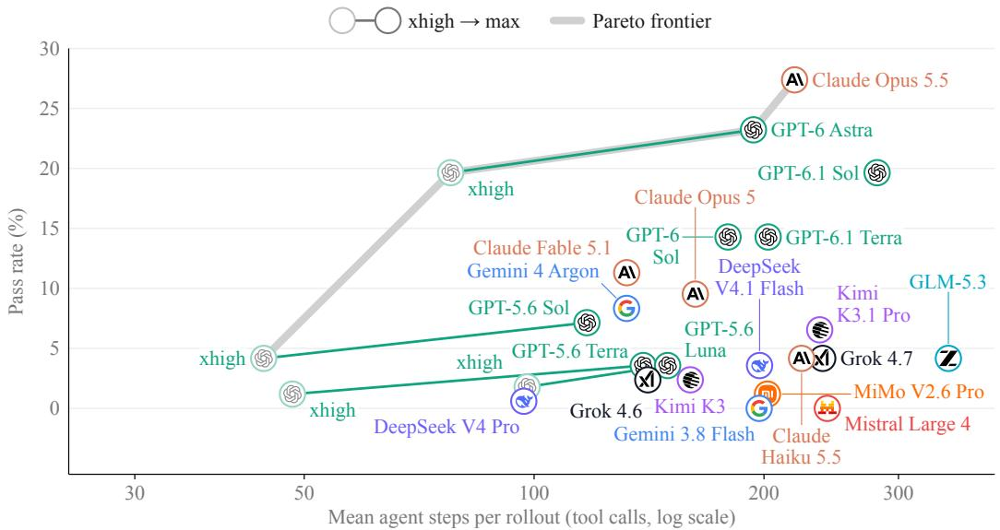  
Figure 15: Mean agent steps per rollout versus overall pass rate (%). Steps count recorded tool invocations, including failed and interrupted calls.

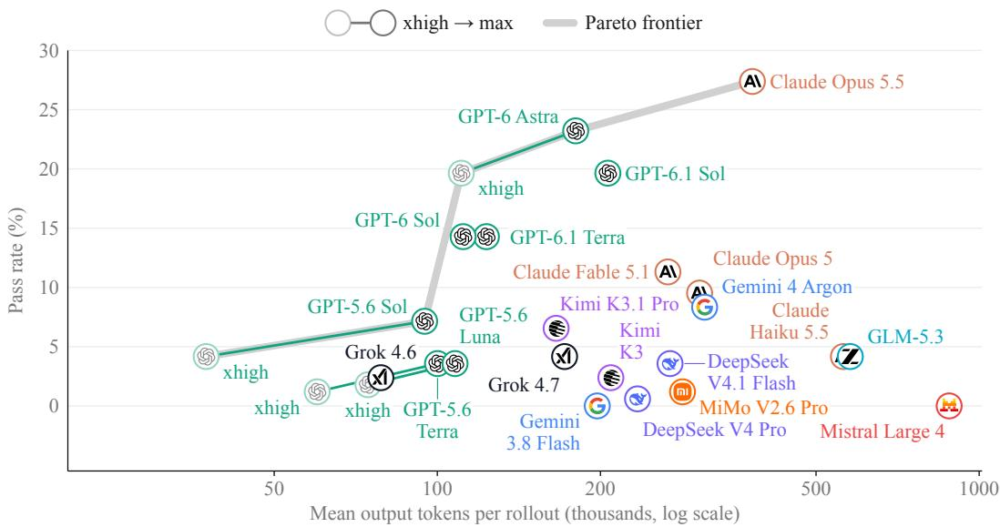  
Figure 16: Mean reported output tokens per rollout, in thousands, versus overall pass rate (%). Token counts follow provider or harness usage accounting.

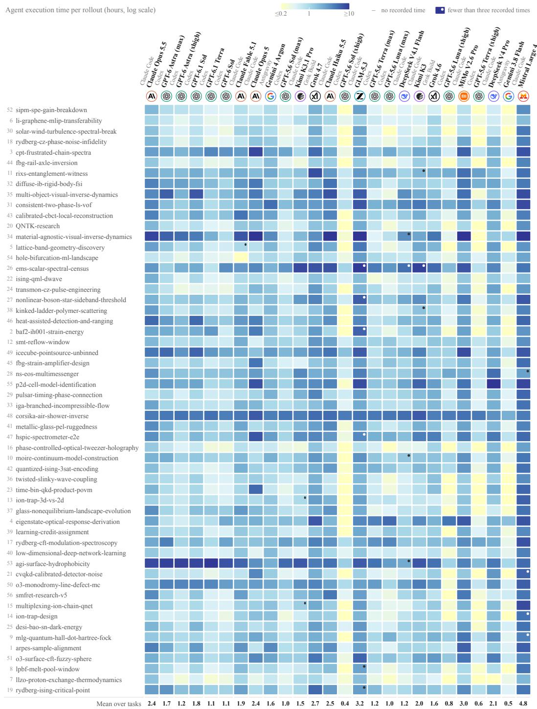  
Figure 17: Agent execution time per rollout, in hours, per task and model: the mean over the recorded rollouts in each cell. The bottom row gives each model’s mean over tasks with records, as plotted in Figure 5. A dash marks a task without a recorded time and a dot one with fewer than three.

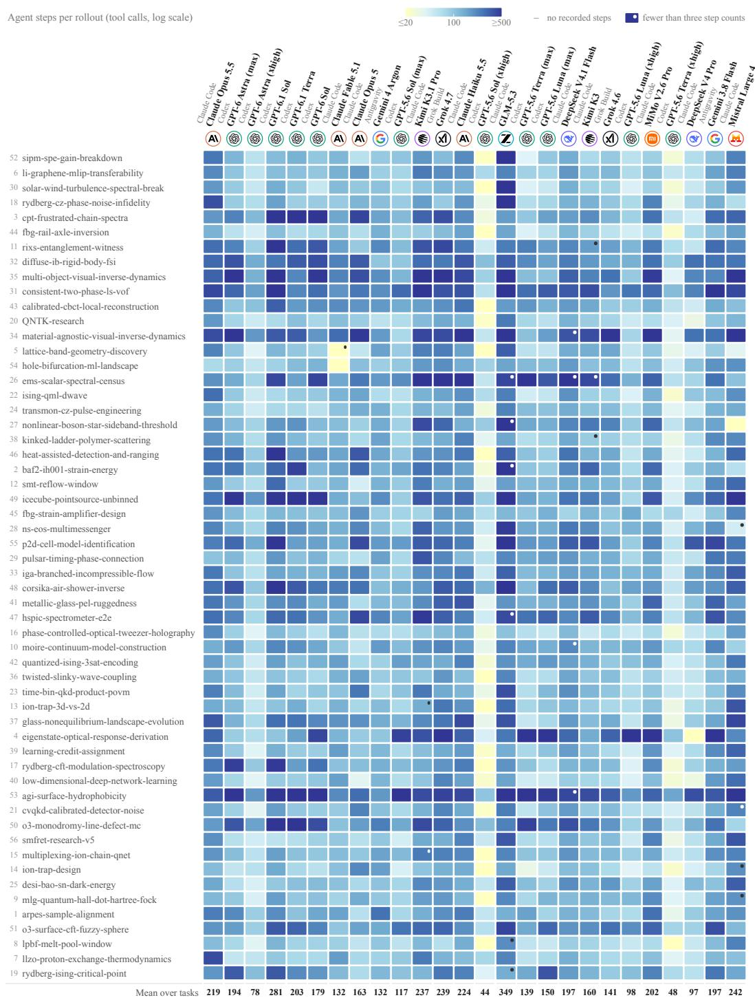  
Figure 18: Agent steps (tool calls) per rollout, per task and model: the mean over the recorded rollouts in each cell. The bottom row gives each model’s mean over tasks with records, as plotted in Figure 15. Rows follow Figure 11. A dash marks a task without a recorded step count and a dot one with fewer than three.

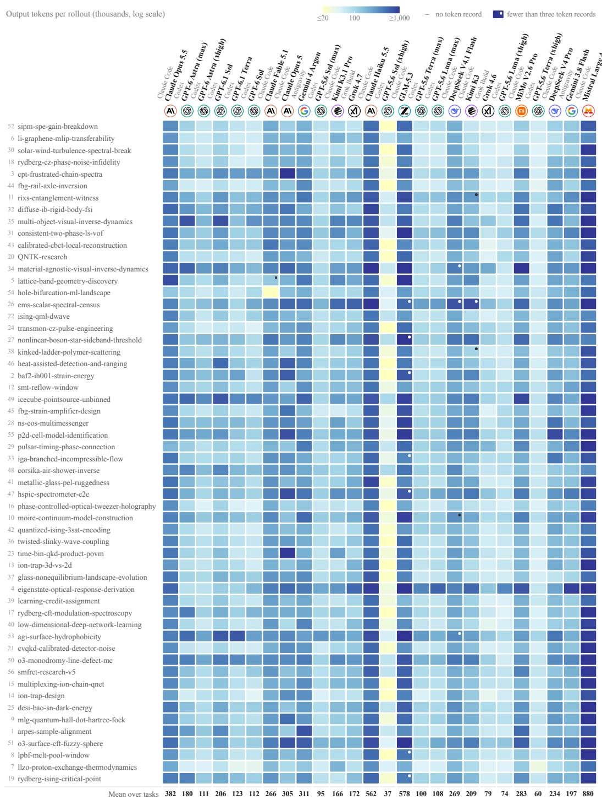  
Figure 19: Output tokens per rollout, in thousands, per task and model: the mean over the recorded rollouts in each cell. The bottom row gives each model’s mean over tasks with records, as plotted in Figure 16. Rows follow Figure 11. A dash marks a task without an output-token record and a dot one with fewer than three.

## G.1 Agent Resource Accounting

The resource plots use the same selected rollouts and 56-task overall pass rate as the cost comparison. For each resource, available values are averaged within each task and then equally across tasks. Unavailable counters are omitted from resource means, not replaced with zero. Table 9 reports the number of rollouts and tasks contributing to each resource estimate.

Agent time is the recorded execution-stage wall-clock duration, excluding environment setup, verification and rubric review. When an idle-timeout record lacks that stage timer, its recorded elapsed execution time supplies the duration. Agent steps count recorded tool invocations, including failed and interrupted calls. A partial trace is used only when a termination monitor supplies a tool-call counter. Output tokens use the reported agent output-token count; unavailable usage records are omitted. Tokenization and output-token accounting can differ between providers. In Claude Code runs, agent time and steps include subagent work.

Table 9: Resource coverage: contributing rollouts / tasks for each model.
<table><tr><td>Model</td><td>Agent time</td><td>Agent steps</td><td>Output tokens</td></tr><tr><td>Claude Opus 5.5</td><td>168 / 56</td><td>168 / 56</td><td>168/ 56</td></tr><tr><td>GPT-6 Astra (max)</td><td>168 / 56</td><td>168 / 56</td><td>168 / 56</td></tr><tr><td>GPT-6 Astra (xhigh)</td><td>168 /56</td><td>168 /56</td><td>168 / 56</td></tr><tr><td>GPT-6.1 Sol</td><td>168 / 56</td><td>168 / 56</td><td>168 /56</td></tr><tr><td>GPT-6.1 Terra</td><td>168 / 56</td><td>168 /56</td><td>168 /56</td></tr><tr><td>GPT-6 Sol</td><td>168 / 56</td><td>168 / 56</td><td>168 / 56</td></tr><tr><td>Claude Fable 5.1</td><td>166 / 56</td><td>166 / 56</td><td>166 /56</td></tr><tr><td>Claude Opus 5</td><td>168 / 56</td><td>168 / 56</td><td>168 /56</td></tr><tr><td>Gemini 4 Argon</td><td>168 / 56</td><td>168 / 56</td><td>168 /56</td></tr><tr><td>GPT-5.6 Sol (max)</td><td>168 / 56</td><td>168 / 56</td><td>168 / 56</td></tr><tr><td>Kimi K3.1 Pro</td><td>165 / 56</td><td>165 / 56</td><td>168 / 56</td></tr><tr><td>Grok 4.7</td><td>168 / 56</td><td>168 / 56</td><td>168 /56</td></tr><tr><td>Claude Haiku 5.5</td><td>168 / 56</td><td>168 / 56</td><td>168/56</td></tr><tr><td>GPT-5.6 Sol (xhigh)</td><td>168 / 56</td><td>168 / 56</td><td>168 /56</td></tr><tr><td>GLM-5.3</td><td>160 /56</td><td>160 / 56</td><td>159 /56</td></tr><tr><td>GPT-5.6 Terra (max)</td><td>168 / 56</td><td>168 / 56</td><td>168 / 56</td></tr><tr><td>GPT-5.6 Luna (max)</td><td>168 / 56</td><td>168 / 56</td><td>168 /56</td></tr><tr><td>DeepSeek V4.1 Flash</td><td>162 / 56</td><td>162 / 56</td><td>162 / 56</td></tr><tr><td>Kimi K3</td><td>165 / 56</td><td>165 / 56</td><td>165 / 56</td></tr><tr><td>Grok 4.6</td><td>168 / 56</td><td>168 / 56</td><td>168 /56</td></tr><tr><td>GPT-5.6 Luna (xhigh)</td><td>168 / 56</td><td>168 / 56</td><td>168 /56</td></tr><tr><td>MiMo V2.6 Pro</td><td>168 / 56</td><td>168 / 56</td><td>168 /56</td></tr><tr><td>GPT-5.6 Terra (xhigh)</td><td>168 / 56</td><td>168 / 56</td><td>168 /56</td></tr><tr><td>DeepSeek V4 Pro</td><td>168 / 56</td><td>168 / 56</td><td>168 /56</td></tr><tr><td>Gemini 3.8 Flash</td><td>168 / 56</td><td>168 / 56</td><td>168 /56</td></tr><tr><td>Mistral Large 4</td><td>164 /56</td><td>164 / 56</td><td>168 /56</td></tr></table>

Table 10: Resource use per rollout for each model configuration: mean, median (Med.) and 95th percentile (P95), pooled over the rollouts of Table 2 that record the value. These are the same selected rollouts as Figures 5, 15 and 16, and rows follow Table 2. Tool calls count recorded tool invocations, including failed and interrupted calls. A step is one model call of the agent that returned a response, and one step can make several tool calls or none. Time is the execution-stage wall-clock duration in hours, excluding environment setup, verification and rubric review; because it is wallclock time, slow provider routes and rate limiting inflate it. Cost is the reported inference cost per rollout in US dollars, as in Figure 5 (metered, priced from recorded tokens at list prices, or estimated), and output tokens are in millions. Unavailable values are omitted, not set to zero; † marks a statistic over fewer than all 168 designated rollouts of the configuration (Table 9 gives the coverage of time, tool calls and output tokens). P95 and the median use linear interpolation between order statistics (NumPy’s default). The figures instead average within each task and then across tasks; both means coincide wherever all 168 rollouts are recorded. In Claude Code runs, tool calls, steps and time include subagent work.
<table><tr><td></td><td colspan="3">Tool calls</td><td colspan="3">Steps</td><td colspan="3">Time (h)</td><td colspan="3">Cost ($)</td><td colspan="2">Output tokens (M)</td></tr><tr><td>Model</td><td>Mean</td><td>Med.</td><td>P95</td><td>Mean</td><td>Med.</td><td>P95</td><td>Mean</td><td>Med.</td><td>P95</td><td>Mean</td><td>Med.</td><td>P95</td><td>Mean</td><td>Med.</td></tr><tr><td>Claude Opus 5.5</td><td>219</td><td>204</td><td>371</td><td>191</td><td>168</td><td>339</td><td>2.44</td><td>2.06</td><td>5.38</td><td>26.95</td><td>24.86</td><td>51.89</td><td>0.38</td><td>0.39</td></tr><tr><td>GPT-6 Astra (max)</td><td>194</td><td>111</td><td>585</td><td>108</td><td>61</td><td>335</td><td>1.73</td><td>1.05</td><td>5.28</td><td>26.91</td><td>15.24</td><td>90.77</td><td>0.18</td><td>0.13</td></tr><tr><td>GPT-6 Astra (xhigh)</td><td>78</td><td>65</td><td>172</td><td>86</td><td>65</td><td>197</td><td>1.24</td><td>0.75</td><td>3.72</td><td>19.21</td><td>11.60</td><td>56.87</td><td>0.11</td><td>0.09</td></tr><tr><td>GPT-6.1 Sol</td><td>281</td><td>170</td><td>882</td><td>158</td><td>90</td><td>583</td><td>1.79</td><td>1.17</td><td>5.21</td><td>5.33</td><td>3.20</td><td>17.51</td><td>0.21</td><td>0.15</td></tr><tr><td>GPT-6.1 Terra</td><td>203</td><td>124</td><td>461</td><td>203</td><td>119</td><td>553</td><td>1.14</td><td>0.65</td><td>3.90</td><td>3.46</td><td>1.23</td><td>14.25</td><td>0.12</td><td>0.09</td></tr><tr><td>GPT-6 Sol</td><td>179</td><td>114</td><td>501</td><td>194</td><td>110</td><td>634</td><td>1.08</td><td>0.63</td><td>3.57</td><td>6.38</td><td>3.22</td><td>22.09</td><td>0.11</td><td>0.08</td></tr><tr><td>Claude Fable 5.1</td><td>134†</td><td>128†</td><td>230†</td><td>81</td><td>66</td><td>190</td><td>1.87†</td><td>1.58†</td><td>† 4.40†</td><td>32.63</td><td>26.42</td><td>48.65</td><td>0.27†</td><td>0.27†</td></tr><tr><td>Claude Opus 5</td><td>163</td><td>116</td><td>425</td><td>156</td><td>105</td><td>422</td><td>2.40</td><td>1.35</td><td>7.58</td><td>56.77</td><td>32.85</td><td>163.37</td><td>0.30</td><td>0.22</td></tr><tr><td>Gemini 4Argon</td><td>132</td><td>122</td><td>225</td><td>123</td><td>119</td><td>207</td><td>1.61</td><td>1.41</td><td>3.20</td><td>8.87</td><td>7.10</td><td>17.39</td><td>0.31</td><td>0.28</td></tr><tr><td>GPT-5.6 Sol (max)</td><td>117</td><td>89</td><td>260</td><td>154</td><td>106</td><td>401</td><td>0.97</td><td>0.62</td><td>2.77</td><td>10.35</td><td>6.93</td><td>29.21</td><td>0.09</td><td>0.09</td></tr><tr><td>Kimi K3.1 Pro</td><td>238†</td><td>195†</td><td>530†</td><td>187</td><td>140</td><td>450</td><td>1.52†</td><td>1.01†</td><td>† 4.08†</td><td>9.60</td><td>7.03</td><td>24.43</td><td>0.17</td><td>0.13</td></tr><tr><td>Grok 4.7</td><td>239</td><td>212</td><td>523</td><td>169</td><td>140</td><td>374</td><td>2.75</td><td>2.32</td><td>6.40</td><td>12.19</td><td>10.13</td><td>27.34</td><td>0.17</td><td>0.14</td></tr><tr><td>Claude Haiku 5.5</td><td>224</td><td>187</td><td>476</td><td>214</td><td>176</td><td>451</td><td>2.50</td><td>1.79</td><td>6.39</td><td>6.66†</td><td>5.13†</td><td>15.27†</td><td>0.56</td><td>0.52</td></tr><tr><td>GPT-5.6 Sol (xhigh)</td><td>44</td><td>34</td><td>102</td><td>66</td><td>55</td><td>168</td><td>0.42</td><td>0.27</td><td>1.33</td><td>2.79</td><td>1.77</td><td>8.43</td><td>0.04</td><td>0.03</td></tr><tr><td>GLM-5.3</td><td>347†</td><td>261†</td><td>1,015†</td><td>324</td><td>242</td><td>994</td><td>3.14†</td><td>2.46†</td><td>7.02†</td><td>12.81</td><td>10.05</td><td>33.40</td><td>0.57†</td><td>0.47†</td></tr><tr><td>GPT-5.6 Terra (max)</td><td>139</td><td>98</td><td>419</td><td>165</td><td>110</td><td>501</td><td>1.15</td><td>0.73</td><td>3.89</td><td>5.80</td><td>3.73</td><td>16.81</td><td>0.10</td><td>0.09</td></tr><tr><td>GPT-5.6 Luna (max)</td><td>150</td><td>103</td><td>401</td><td>197</td><td>124</td><td>525</td><td>1.04</td><td>0.57</td><td>3.44</td><td>0.68</td><td>0.42</td><td>1.78</td><td>0.11</td><td>0.09</td></tr><tr><td>DeepSeek V4.1 Flash</td><td>191†</td><td>166†</td><td>404†</td><td>178†</td><td>159†</td><td>394†</td><td>1.17†</td><td>0.83†</td><td>3.13†</td><td>0.65†</td><td>0.54†</td><td>1.34†</td><td>0.26†</td><td>0.24†</td></tr><tr><td>Kimi K3</td><td>159†</td><td>123†</td><td>358†</td><td>153</td><td>122</td><td>382</td><td>1.91†</td><td>1.24†</td><td>5.51†</td><td>9.33</td><td>6.64</td><td>22.04</td><td>0.21†</td><td>0.16†</td></tr><tr><td>Grok 4.6</td><td>141</td><td>122</td><td>315</td><td>83</td><td>71</td><td>179</td><td>1.63</td><td>1.27</td><td>4.02</td><td>9.21†</td><td>7.35†</td><td>19.75†</td><td>0.08</td><td>0.06</td></tr><tr><td>GPT-5.6 Luna (xhigh)</td><td>98</td><td>72</td><td>224</td><td>141</td><td>90</td><td>414</td><td>0.75</td><td>0.39</td><td>2.18</td><td>0.41</td><td>0.24</td><td>1.10</td><td>0.07</td><td>0.06</td></tr><tr><td>MiMo V2.6 Pro</td><td>202</td><td>148</td><td>497</td><td>182</td><td>133</td><td>434</td><td>3.01</td><td>2.13</td><td>7.47</td><td>0.66</td><td>0.47</td><td>1.56</td><td>0.28</td><td>0.20</td></tr><tr><td>GPT-5.6 Terra (xhigh)</td><td>48</td><td>42</td><td>93</td><td>70</td><td>52</td><td>168</td><td>0.58</td><td>0.31</td><td>2.02</td><td>2.22</td><td>1.53</td><td>5.92</td><td>0.06</td><td>0.06</td></tr><tr><td>DeepSeek V4 Pro</td><td>97</td><td>66</td><td>237</td><td>90</td><td>63</td><td>214</td><td>2.10</td><td>2.00</td><td>5.01</td><td>7.82</td><td>5.86</td><td>20.95</td><td>0.23</td><td>0.19</td></tr><tr><td>Gemini 3.8 Flash</td><td>197</td><td>157</td><td>433</td><td>207</td><td>165</td><td>447</td><td>0.45</td><td>0.36</td><td>1.06</td><td>3.69†</td><td>2.73†</td><td>8.38†</td><td>0.20</td><td>0.16</td></tr><tr><td>Mistral Large 4</td><td>244†</td><td>205†</td><td>634†</td><td>205</td><td>173</td><td>562</td><td>4.82†</td><td>4.02†</td><td>9.25†</td><td>10.67</td><td>9.29</td><td>24.39</td><td>0.88</td><td>0.69</td></tr></table>

## H Reference-material Evaluation

Table 11: Evaluating rubric scores for all 33 tasks where the authors provided a manuscript or paper as a reference. Only the rubrics, that actually evaluated/ needed the present manuscript were evaluated. If no blocking rubric applied to the manuscript, it is shown as a dash. If no scoring rubric applied to the manuscript it is shown as NA.
<table><tr><td>Task / reference</td><td>Weighted score</td><td>Blockers</td></tr><tr><td>QNTK-research</td><td>100%</td><td>2/2</td></tr><tr><td>consistent-two-phase-ls-vof</td><td>100%</td><td>1/1</td></tr><tr><td>cpt-frustrated-chain-spectra</td><td>N/A</td><td>0/1 - fail</td></tr><tr><td>cvqkd-calibrated-detector-noise</td><td>100%</td><td>2/3 - fail</td></tr><tr><td>diffuse-ib-rigid-body-fsi</td><td>100%</td><td></td></tr><tr><td>eigenstate-optical-response-derivation</td><td>100%</td><td>5/5</td></tr><tr><td>fbg-rail-axle-inversion</td><td>100%</td><td></td></tr><tr><td>fbg-strain-amplifier-design</td><td>100%</td><td>2/2</td></tr><tr><td>glass-nonequilibrium-landscape-evolution - bundled report</td><td>91.94%</td><td>2/2</td></tr><tr><td>glass-nonequilibrium-landscape-evolution - original paper</td><td>50%</td><td></td></tr><tr><td>heat-assisted-detection-and-ranging</td><td>100%</td><td></td></tr><tr><td>hole-bifurcation-ml-landscape</td><td>81.58%</td><td></td></tr><tr><td>hspic-spectrometer-e2e</td><td>100%</td><td>3/3</td></tr><tr><td>icecube-pointsource-unbinned</td><td>100%</td><td></td></tr><tr><td>ion-trap-3d-vs-2d - bundled report</td><td>100%</td><td>4/4</td></tr><tr><td>ion-trap-3d-vs-2d - original paper</td><td>100%</td><td>1/1</td></tr><tr><td>ion-trap-design - bundled report</td><td>100%</td><td></td></tr><tr><td>ion-trap-design - original paper</td><td>100%</td><td>=</td></tr><tr><td>lattice-band-geometry-discovery</td><td>100%</td><td>1/1</td></tr><tr><td>learning-credit-assignment</td><td>100%</td><td>4/4</td></tr><tr><td>li-graphene-mlip-transferability</td><td>93.52%</td><td>2/2</td></tr><tr><td>llzo-proton-exchange-thermodynamics</td><td>100%</td><td></td></tr><tr><td>low-dimensional-deep-network-learning</td><td>100%</td><td>717</td></tr><tr><td>material-agnostic-visual-inverse-dynamics</td><td>100%</td><td></td></tr><tr><td>metallic-glass-pel-ruggedness</td><td>72.73%</td><td>1/1</td></tr><tr><td>moire-continuum-model-construction</td><td>80%</td><td></td></tr><tr><td>multi-object-visual-inverse-dynamics</td><td>100%</td><td></td></tr><tr><td>multiplexing-ion-chain-qnet</td><td>100%</td><td></td></tr><tr><td>o3-surface-cft-fuzzy-sphere</td><td>100%</td><td></td></tr><tr><td>phase-controlled-optical-tweezer-holography</td><td>N/A</td><td>0/1 - fail</td></tr><tr><td>rixs-entanglement-witness</td><td>100%</td><td></td></tr><tr><td>rydberg-cft-modulation-spectroscopy</td><td>100%</td><td>4/4</td></tr><tr><td>rydberg-cz-phase-noise-infidelity</td><td>100%</td><td>6/6</td></tr><tr><td>rydberg-ising-critical-point</td><td>100%</td><td>3/3</td></tr><tr><td>sipm-spe-gain-breakdown</td><td>100%</td><td></td></tr><tr><td>time-bin-qkd-product-povm</td><td>100%</td><td>5/5</td></tr></table>