# HARNESSFLOW: MCTS-GUIDED HARNESS OPTIMIZATION FOR LLM AGENTS

Zhi Hong1,‡ Qianlong Wang2 Hongchen Wei3,‡ Aidan Wu4,‡ Daohong Ying5,‡ Mingze Kong6 Bei Liu7,∗ Chong Luo7

1South China University of Technology 2Fudan University

3Wuhan University 4Cornell University 5University of California, San Diego

6The Chinese University of Hong Kong, Shenzhen 7Microsoft Research Asia

∗ Corresponding author. ‡ Work done during an internship at MSRA.

## ABSTRACT

The performance of large language model (LLM) agents depends on both the underlying model and the harness that governs interaction with tools and the environment. Yet harness design remains largely manual, and automating it requires navigating an open-ended search space through costly end-to-end evaluations. We introduce HARNESSFLOW, a framework for optimizing complete executable harnesses under a limited candidate-evaluation budget, with the model and task environment held fixed. HARNESSFLOW organizes candidates and their evaluation histories in a refinement tree, using a Monte Carlo Tree Search (MCTS)-based policy to balance exploitation and exploration. A coding agent refines selected harnesses using archived code, execution feedback, and a library of reusable harness mechanisms. With 15 refinement attempts per benchmark, HARNESSFLOW achieves the highest mean test scores among the compared methods on six benchmarks spanning agentic tasks, coding, and web interaction. The optimized harnesses achieve an average score of 69.48%, outperforming the initial harnesses and Meta-Harness by 10.89 and 3.95 percentage points, respectively, while incurring lower average per-task execution costs than hand-engineered baselines. These results suggest that structured harness search offers a promising route toward automating the design of capable and efficient LLM agents.

## 1 INTRODUCTION

The performance of LLM agents depends not only on the underlying model but also on the harness, the executable system that governs access to information, maintains state, invokes tools, and coordinates execution (Yang et al., 2024b; Shang et al., 2025; Khattab et al., 2024; Hu et al., 2025). Prior studies of context management and multi-agent systems show that these mechanisms can substantially affect agent behavior (Packer et al., 2023; Park et al., 2023), highlighting harness design as a practical means of improving agent performance without modifying model weights. However, harness design remains largely manual and expertise-intensive, making effective designs difficult to adapt and reuse across tasks and domains (Zhang et al., 2025b).

Recent work has sought to automate harness design and refinement to reduce reliance on manual engineering (Zhuge et al., 2024; Yuan et al., 2025; Zhang et al., 2024; 2025a; Yue et al., 2025; Hong et al., 2026). Despite this progress, efficient optimization remains challenging: the harness design space is open-ended, and evaluating each candidate requires costly end-to-end agent execution. HARBOR (Sengupta & Wang, 2026), PRISM (Ruan et al., 2026), and Self-Harness (Zhang et al., 2026a) refine harnesses through predefined configurations or bounded edits. Meta-Harness (Lee et al., 2026) permits full-harness code refinement, while AutoSaddler (Park et al., 2026) organizes durable updates from agent execution traces. DarwinX (Zhang et al., 2026d) explores harness populations through selection and preservation checks. These approaches motivate the study of search organization under a limited evaluation budget, leading to a central question: How can we systematically search over complete executable harnesses while making effective use ofa limited candidateevaluation budget?

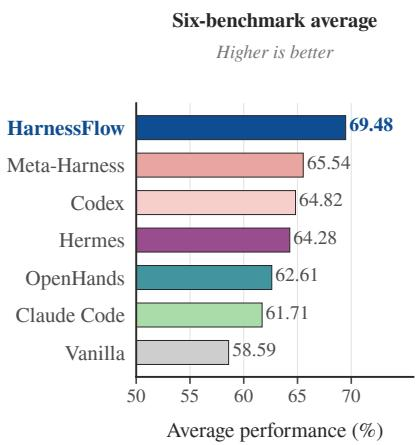  
(a) Performance comparison across benchmarks.  
(b) Overall performance comparison.  
Figure 1: Performance across six benchmarks. (a) Scores on individual benchmarks; labels indicate the best score in each group. (b) Ranking by average score. HARNESSFLOW outperforms Vanilla and the strongest prior method by 10.89 and 3.95 points on average, respectively.

To address this challenge, we introduce HARNESSFLOW, a Monte Carlo Tree Search (MCTS)- based framework (Browne et al., 2012) designed to systematically explore and discover optimal harnesses under a limited evaluation budget. First, it represents each harness as a complete executable codebase that a coding agent can inspect and modify in a filesystem workspace, enabling coordinated changes across the entire harness (Chen et al., 2026a; Lee et al., 2026). It also provides the coding agent with a Harness Component Library of reusable mechanisms that can be adapted, composed, or extended during refinement. Second, it reformulates harness optimization as a tree-structured search problem over these executable codebases: nodes represent harness implementations, and edges record code-level modifications. The tree preserves earlier designs together with their evaluation scores and execution traces, providing structured experience that the coding agent can inspect and reuse across branches. Finally, it employs an MCTS-based selection policy to determine which eligible candidate in this tree to refine next, while the coding agent determines how to modify it. The policy combines measured performance with prior expansion counts to balance exploitation of promising designs with exploration of underexplored refinement paths (Auer et al., 2002; Kocsis & Szepesvári, 2006).

We conduct extensive evaluations on six established benchmarks spanning agentic tasks (TAU2- bench and AppWorld), code generation (BigCodeBench-Hard and SWE-bench Verified), and web interaction (WebShop and BrowseComp-Plus). The results demonstrate that HARNESSFLOW is (i) high-performing, achieving the highest average test score of 69.48% in the main comparison and improving over Vanilla by 10.89 percentage points; (ii) cost-efficient, running at a lower average inference cost than every hand-engineered harness, at 41.4% of Codex’s across the six benchmarks; and (iii) sample-efficient, attaining a mean best-so-far validation score of 71.5% after three candidate evaluations per benchmark and 74.2% by round 15.

In summary, our key contributions are as follows:

• We formulate full-harness optimization as a tree-structured search problem over complete executable codebases under a limited candidate-evaluation budget.

• We introduce HARNESSFLOW, an MCTS-based framework that uses a coding agent, treestructured experience, and a Harness Component Library to generate full-harness refinements, while an explicit selection policy allocates the search budget across alternative designs.

• We conduct extensive evaluations on six benchmarks, demonstrating that HARNESSFLOW achieves strong task performance, cost-efficient inference, and sample-efficient harness optimization.

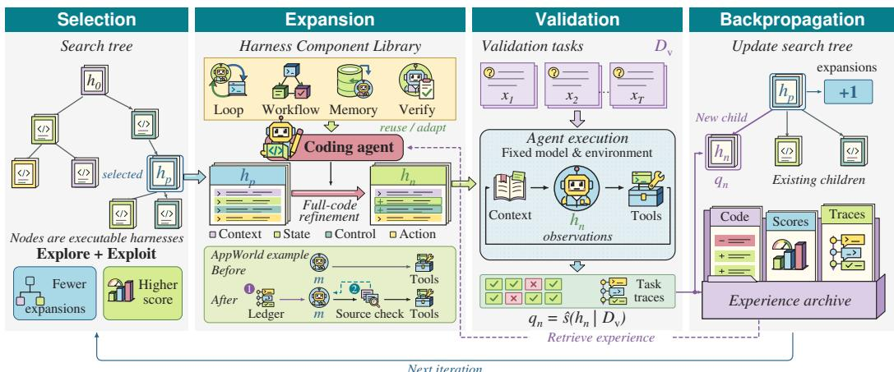  
Figure 2: Overview of HARNESSFLOW. Selection, expansion, validation, and experience backpropagation organize full-harness search. A coding agent uses reusable components and archived code, scores, and traces to refine selected harnesses.

## 2 PROBLEM SETTING

Harness and Search Space. Given a fixed model m, task environment, and evaluation protocol, a harness h is an executable program that governs how the model interacts with tools and the environment. Let H denote the space of harnesses compatible with this setting. Refinements may modify mechanisms for context construction, state management, tool use, and termination, as well as their composition and the overall execution structure. For example, adding a verification step may require retaining additional state and revising the stopping rule. The search therefore operates over complete executable harnesses rather than a predefined set of prompts, configurations, or components.

Harness Evaluation and Optimization Objective. For a task set $\mathcal { D } = \{ ( x , y ) \}$ , x denotes a task instance and y the corresponding reference answer or success criterion. We write $\mathrm { A g e n t } ( m , h , x )$ for the end-to-end outcome produced by running harness h with model m on x. Depending on the task, this outcome may be a final response, a generated artifact, or the terminal state of an interactive environment. $\mathbf { A }$ benchmark-specific metric $r ( \cdot , \cdot )$ compares this outcome with y and returns a normalized score in [0, 1]. We define harness performance as

$$
s ( h \mid \mathcal { D } ) = \mathbb { E } _ { ( x , y ) \sim \mathcal { D } } \left[ r ( \mathrm { A g e n t } ( m , h , x ) , y ) \right] ,\tag{1}
$$

where tasks are sampled uniformly from D. In practice, this score is estimated by averaging repeated executions on the task set. It measures end-to-end harness performance rather than individual model calls. The resulting scores support candidate comparison, while execution traces provide diagnostic evidence for subsequent refinements. Given a validation set $\mathcal { D } _ { \mathrm { v } }$ , the ideal optimization objective is

$$
h ^ { \star } \in \arg \operatorname* { m a x } _ { h \in \mathcal { H } } s ( h \mid \mathcal { D } _ { \mathrm { v } } ) .\tag{2}
$$

Budgeted Optimization Protocol. Evaluating a harness on $\mathcal { D } _ { \mathrm { v } }$ is costly, as each task may require multiple model and tool calls. We therefore consider a sequential optimization protocol initialized from a harness $h _ { 0 }$ and constrained by a budget of N refinement attempts. At each attempt, the optimizer draws on accumulated validation scores and execution traces to select an existing harness for refinement and propose a new candidate. The central challenge is to allocate refinement effort across alternative paths while further developing promising designs. At the end of search, we select the harness with the highest observed score on $\mathcal { D } _ { \boldsymbol { \backslash } }$ among the candidates produced during optimization. The selected harness is then evaluated on a disjoint held-out test set $\bar { \mathcal { D } } _ { \mathrm { t } }$ , and the resulting score is reported as its final performance.

## 3 METHODOLOGY

HARNESSFLOW implements the protocol in Section 2 by separating parent selection from code refinement. An MCTS-based policy determines which harness to refine, while a coding agent determines how to modify it. The policy allocates search effort using validation scores and expansion counts; the coding agent uses prior execution experience and general, reusable harness mechanisms to develop new candidates. Each evaluation contributes evidence that can inform subsequent selection and refinement. Figure 2 illustrates this cycle, and Algorithm 1 summarizes the procedure.

## 3.1 CODING-AGENT FULL-HARNESS REFINEMENT

Code-Represented Harnesses. Each candidate is represented by a complete executable codebase. Refinement may add, remove, or jointly modify mechanisms for context construction, state management, control flow, and tool use. This allows a single proposal to coordinate changes across interacting mechanisms, supporting both local improvements and broader architectural changes within the search space defined in Section 2.

Experience-Guided Code Refinement. The coding agent develops each candidate from a selected parent harness, guided by accumulated search experience. We denote the experience archive by A; it contains prior implementations, code modifications, validation feedback, task-level execution records, and refinement relationships. The parent supplies the starting design, while the archive provides empirical evidence about the effects of earlier changes. The agent can selectively retrieve relevant code and feedback to compare designs, diagnose failures, and identify refinements, without requiring the entire search history to fit in its context.

Harness Component Library. The Harness Component Library L offers reusable code for context construction, memory and state tracking, control flow, and tool interfacing (Figure 5 in the appendix). It includes observation compaction and skill catalogs; note stores, observation logs, and request tracking; loop and workflow runners; and argument-schema checks with heuristic tool-effect classification. The coding agent can inspect a read-only snapshot and is instructed to copy adopted code and local dependencies into the candidate, not import the snapshot at runtime. It may adapt or compose these implementations or write new code. The library thus offers optional implementation references rather than a fixed template or an exhaustive search space; the experience archive supplies empirical feedback for refinement.

## 3.2 MCTS-GUIDED TREE SEARCH

After n refinement attempts, the search retains evaluated candidates in a rooted tree $\mathcal { G } _ { n } = ( \nu _ { n } , \mathcal { E } _ { n } )$ Each node $u _ { i } ~ \in ~ \mathcal { V } _ { n }$ represents a harness $h _ { i }$ together with its validation score $q _ { i }$ and execution records $\mathcal { R } _ { i } ;$ the root $u _ { 0 }$ represents the initial harness $h _ { 0 }$ . An edge $( u _ { i } , u _ { j } )$ indicates that $h _ { j }$ was generated by refining $h _ { i }$ . Each evaluated harness and its measured score remain unchanged as the tree grows, preserving earlier designs and alternative refinement paths. Expansion counts and accumulated experience evolve with the search. HARNESSFLOW adapts the MCTS cycle (Browne et al., 2012) through selection, expansion, evaluation, and experience backpropagation.

Selection. At attempt $n ,$ the optimizer selects a parent from $\mathcal { C } _ { n } \subseteq \mathcal { V } _ { n - 1 } $ , comprising up to $K$ highest-scoring nodes, where $K \geq 1$ is the shortlist size. This restriction applies to parent selection; the coding agent may still use code and evidence from other archived candidates. Within ${ \mathcal { C } } _ { n }$ exploitation favors higher validation scores:

$$
P _ { \mathrm { e x p l o i t } } ( i ) = \frac { \exp ( q _ { i } / \tau ) } { \sum _ { u _ { j } \in \mathcal { C } _ { n } } \exp ( q _ { j } / \tau ) } ,\tag{3}
$$

for $u _ { i } \in \mathcal { C } _ { n }$ , where the temperature $\tau > 0$ controls sensitivity to score differences. Smaller values concentrate probability on higher-scoring candidates. Its setting is described in Section 4.1.

Exploration prioritizes underexplored candidates. Let d denote the number of direct children of node $u _ { i }$ in the search tree. We define

$$
P _ { \mathrm { e x p l o r e } } ( i ) = \frac { ( 1 + d _ { i } ) ^ { - \alpha } } { \sum _ { u _ { j } \in \mathcal { C } _ { n } } ( 1 + d _ { j } ) ^ { - \alpha } } ,\tag{4}
$$

Algorithm 1 HARNESSFLOW: MCTS-guided full-harness optimization   
Require: Initial harness $h _ { 0 } ;$ component library $\mathcal { L } ;$ validation set $\mathcal { D } _ { \mathrm { v } } \mathrm { ; }$ evaluation repetitions R;   
refinement budget $N > 0 ;$ selection parameters $K , \varepsilon , \alpha , \tau$   
Ensure: Harness $\bar { h ^ { \star } }$ with the highest observed validation score   
1: $( \mathbf { \Phi } _ { - } , q _ { 0 } , \mathcal { R } _ { 0 } ) \gets \mathrm { E v a L U A T E } ( \tilde { h _ { 0 } } , \mathcal { D } _ { \mathrm { v } } , R )$   
2: Initialize tree $\mathcal { G }$ with root $\boldsymbol { u } _ { 0 } = ( h _ { 0 } , q _ { 0 } , \mathcal { R } _ { 0 } ) ;$ set $d _ { 0 } \gets 0$   
3: Initialize experience archive $A \gets \{ ( h _ { 0 } , q _ { 0 } , \mathcal { R } _ { 0 } ) \}$   
4: for $n = 1 , \ldots , N$ do   
Selection:   
5: $\mathcal { C } _ { n } \gets \mathsf { u p }$ to K highest-scoring nodes in $\mathcal { G }$   
6: Compute $\pi _ { n }$ using Equation $\bar { 5 } ;$ sample $p _ { n } \sim \pi _ { n }$   
Expansion:   
7: $( h _ { n } , \Delta _ { n } ) \gets \mathrm { R E F I N E } \big ( h _ { p _ { n } } ; \mathcal { A } , \mathcal { L } \big )$   
Evaluation:   
8: $( v _ { n } , q _ { n } , \mathcal { R } _ { n } ) \gets \mathrm { E v A L U A T E } ( h _ { n } , \mathcal { D } _ { \mathrm v } , R )$   
Experience Backpropagation:   
9: Record $h _ { n } ,$ parent $p _ { n } ,$ , edits $\Delta _ { n } .$ , and available evaluation feedback in $\mathcal { A }$   
10: if $v _ { n }$ is valid then ▷ See Appendix C.4   
11: Add $u _ { n } = ( h _ { n } , q _ { n } , \mathcal { R } _ { n } )$ and edge $( u _ { p _ { n } } , u _ { n } )$ to $\mathcal { G }$   
12: $d _ { n } \gets 0 ; d _ { p _ { n } } \gets d _ { p _ { n } } + 1$   
13: Store the parent-relative score change $q _ { n } - q _ { p _ { n } }$ in $\mathcal { A }$   
14: end if   
15: end for   
16: Select $u _ { i ^ { \star } } \in \arg \operatorname* { m a x } _ { u _ { i } \in \mathcal { V } ( \mathcal { G } ) } q _ { i }$   
17: return $h _ { i ^ { \star } }$

where $\alpha \geq 0$ controls the strength of this exploration preference. The count measures direct expansions rather than the size of the full descendant subtree.

The parent-selection policy combines the two distributions:

$$
\pi _ { n } ( i ) = ( 1 - \varepsilon ) P _ { \mathrm { e x p l o i t } } ( i ) + \varepsilon P _ { \mathrm { e x p l o r e } } ( i ) , \qquad p _ { n } \sim \pi _ { n } ,\tag{5}
$$

where $\varepsilon \in [ 0 , 1 ]$ balances exploitation and exploration. The first term favors high-performing harnesses, while the second directs refinement toward underexplored candidates. Refinement effort therefore depends on both the quality of a harness and how extensively it has already been developed.

Expansion. Given the selected parent $h _ { p _ { n } } ,$ the coding agent proposes a new harness $h _ { n }$ and an edit record $\Delta _ { n }$ using the refinement mechanism of Section 3.1:

$$
( h _ { n } , \Delta _ { n } ) \gets \mathrm { R e f i n e } ( h _ { p _ { n } } ; \mathcal { A } , \mathcal { L } ) .\tag{6}
$$

The selected parent defines the refinement relationship, while the archive allows relevant code and evidence from other branches to inform the proposal.

Evaluation. Evaluation provides an observed validation score $q _ { n }$ and task-level execution records $\mathcal { R } _ { n }$ . The score estimates $s \mathbf { \bar { ( } } h _ { n } \mid \mathcal { D } _ { \mathbf { v } } )$ from R repeated executions under the fixed model and task environment. The score supports candidate comparison, while the execution records guide subsequent refinement.

Experience Backpropagation. Each new tree node $u _ { n }$ is linked to its parent by edge $( u _ { p _ { n } } , u _ { n } )$ and $d _ { p _ { n } }$ is incremented. The candidate’s code changes $\Delta _ { n }$ , validation score, parent-relative performance change, and task-level records extend A together with the refinement relationship. Both improving and non-improving refinements contribute to this experience, allowing later proposals to build on useful changes and reconsider unsuccessful directions. Backpropagation therefore updates refinement relationships and accumulated evidence while preserving each harness’s directly measured score $q _ { i }$ . After N attempts, final selection follows the validation criterion in Section 2.

## 4 EXPERIMENTS

## 4.1 EXPERIMENTAL SETUP

Benchmarks. We evaluate on six established benchmarks spanning agentic tasks, code generation, and web interaction: TAU2-bench (Barres et al., 2025), AppWorld (Trivedi et al., 2024), SWEbench Verified (Jimenez et al., 2024), BigCodeBench-Hard (Zhuo et al., 2025), WebShop (Yao et al., 2022a), and BrowseComp-Plus (Chen et al., 2026b). Each benchmark is split once, with a fixed seed, into a validation set used during search and a disjoint test set used only for the final evaluation (92/186, 105/210, 100/200, 100/200, 100/200, and 100/200 tasks, respectively). The test set is never observed by the optimizer.

Baselines. We compare against three categories of methods. (i) Vanilla, the initial harness from which search starts: the benchmark’s own reference agent implementation, which is also the root node of the search tree. (ii) Production agent harnesses that are engineered by hand and widely used: Claude Code (Anthropic, 2026), Codex (OpenAI, 2026a), OpenHands (Wang et al., 2025), and Hermes (Nous Research, 2026). We evaluate the official implementations at fixed versions, using the same backbone model, access to benchmark tools, and per-task resource limits as HARNESSFLOW. Appendix C.2 documents the origin of every initial harness, and Appendix C.3 the exact releases and invocation of the production agents. (iii) Meta-Harness (Lee et al., 2026), a harness-optimization method that, like ours, permits full-code modification of a complete harness, but refines proposals iteratively from execution feedback rather than maintaining a persistent search tree. It uses the same initial harness, coding agent, benchmark, candidate budget, and evaluation protocol.

Metrics. Following prior LLM agent work (Zhou et al., 2023; Zhang et al., 2026a), we report each benchmark’s official metric in percent: task success rate for TAU2-bench and AppWorld; task score for WebShop; resolution rate for SWE-bench Verified; Pass@1 for BigCodeBench-Hard; and answer accuracy for BrowseComp-Plus.

Implementation Details. Unless stated otherwise, all agents execute with GPT-5.4-mini (OpenAI, 2026c) at medium reasoning effort as the backbone model, and optimization uses a budget of N = 15 candidate attempts. Every method is executed R = 5 times over each split, during search and at test time alike, and tables report the mean of those five executions ± their sample standard deviation. For the policy in Section 3.2, we use $\varepsilon = 0 . 3 5 , \alpha = 1$ , and automatically determined τ. At each attempt, $\mathcal { C } _ { n }$ contains up to $K = 5$ highest-scoring nodes, with ties broken by creation order.1 The general-purpose coding agent that performs Refine refines the selected parent using the search history; it never sees test tasks. Each run uses a fixed snapshot of the execution runtime, so search, baselines, and final evaluation execute identical runtime code. Further settings are given in Appendix C.4.

## 4.2 MAIN RESULTS AND ANALYSIS

Main Results. HARNESSFLOW achieves the highest mean test score on all six benchmarks, averaging 69.48% (Table 1, Figure 1). It exceeds Vanilla, Codex, and Meta-Harness by 10.89, 4.66, and 3.95 percentage points on average, respectively. Gains over Vanilla are largest on WebShop (+21.70) and TAU2-bench (+17.85). Against Meta-Harness under the same 15-candidate budget, the largest gains are on TAU2-bench (+7.21) and SWE-bench Verified (+6.60).

Search Efficiency. HARNESSFLOW exhibits strong sample efficiency under a limited candidateevaluation budget (Figure 3a). After just three candidate evaluations per benchmark, its mean best validation score reaches 71.5%. Continued search raises the mean best validation score to 74.2% by round 15. On four of the six benchmarks, the final best is first reached at round 10 or later. These candidates refine earlier retained harnesses rather than the immediately preceding candidate, illustrating how the tree supports revisiting promising designs throughout search. Per-benchmark curves and lineage examples are provided in Appendices D.1 and D.2.

Table 1: Performance comparison across six widely used benchmarks. We report mean score (%) ± standard deviation over five runs. All methods use the same backbone model, tool access, and per-task limits. Bold marks the highest mean score for each benchmark.
<table><tr><td rowspan="2">Method</td><td colspan="2">Agentic</td><td colspan="2">Web</td><td colspan="2">Code</td><td rowspan="2">Avg.</td></tr><tr><td>TAU2</td><td>AppWorld WebShop</td><td></td><td>BC+</td><td>SWE-V</td><td>BCB-H</td></tr><tr><td>Vanilla</td><td></td><td></td><td>63.98±2.15 72.00±1.8647.79±1.14 72.40±1.85 67.10±0.89 28.30±0.76 58.59</td><td></td><td></td><td></td><td></td></tr><tr><td>Claude Code (Anthropic, 2026) 73.12±1.14 70.86±2.00 56.98±1.19 73.20±1.72 65.30±1.30 30.80±2.61 61.71</td><td></td><td></td><td></td><td></td><td></td><td></td><td></td></tr><tr><td>OpenHands (Wang et al., 2025) 71.83±1.5966.29±1.32 65.54±1.77 74.00±1.97 67.20±1.64 30.80±2.86 62.61</td><td></td><td></td><td></td><td></td><td></td><td></td><td></td></tr><tr><td>Hermes (Nous Research, 2026) 72.90±2.17 74.19±1.03 64.50±1.34 74.30±1.30 68.10±2.53 31.70±1.15 64.28</td><td></td><td></td><td></td><td></td><td></td><td></td><td></td></tr><tr><td>Codex (OpenAI, 2026a)</td><td></td><td></td><td></td><td></td><td></td><td>75.91±2.9873.24±1.97 66.15±1.4974.70±2.3668.70±2.11 30.20±1.10 64.82</td><td></td></tr><tr><td>Meta-Harness (Lee et al., 2026)</td><td></td><td></td><td>74.62±2.36 76.76±2.94 66.33±0.61 76.60±1.02 68.80±1.15 30.10±1.66 65.53</td><td></td><td></td><td></td><td></td></tr><tr><td>HARNESSFLOW</td><td></td><td></td><td></td><td></td><td></td><td>81.83±2.39 80.76±1.33 69.49±0.88 76.90±1.14 75.40±1.19 32.50±1.77 69.48</td><td></td></tr></table>

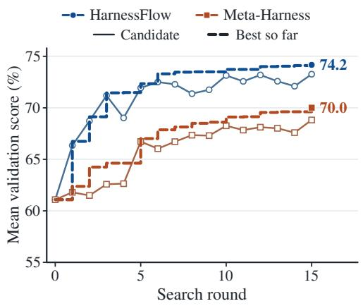  
(a) Search efficiency on the validation set.

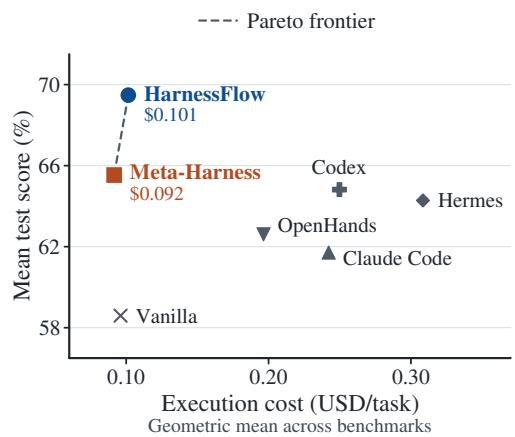  
(b) Test performance versus execution cost.  
Figure 3: Search efficiency and execution cost across six benchmarks. (a) Mean candidate validation scores (solid) and mean per-benchmark best-so-far scores (dashed), from a shared round-0 harness. (b) Mean test score versus geometric-mean execution cost per task, excluding search cost; dashed segment: Pareto frontier. Per-benchmark results: Appendices D.1 and D.3.

Execution Cost. Figure 3b compares test scores against the geometric mean of per-task execution costs across benchmarks, reducing the influence of the costlier BrowseComp-Plus tasks. HARNESS-FLOW and Meta-Harness form the score–cost Pareto frontier at \$0.101 and \$0.092, respectively; hand-engineered harnesses cost two to three times as much at lower scores. These estimates exclude one-time harness-search costs; per-benchmark plots are given in Appendix D.3.

Harness Evolution. Figure 4 makes the search process concrete on SWE-bench Verified. Codelevel refinements along the selected lineage $0  { \overset { \cdot } { 2 } }  4  8  1 0$ raise its validation score from 67.60% to 79.20%: repository-history retrieval, interpreter compatibility, symbol-level retrieval, and compaction of large submission patches are added in turn, each building on a retained parent. Later attempts refine both the best candidate and earlier branches, and the tree keeps every evaluated design available, so the final selection is the best harness observed over the whole search. A corresponding harness-evolution example on TAU2-bench is shown in Figure 7 in Appendix D.2.

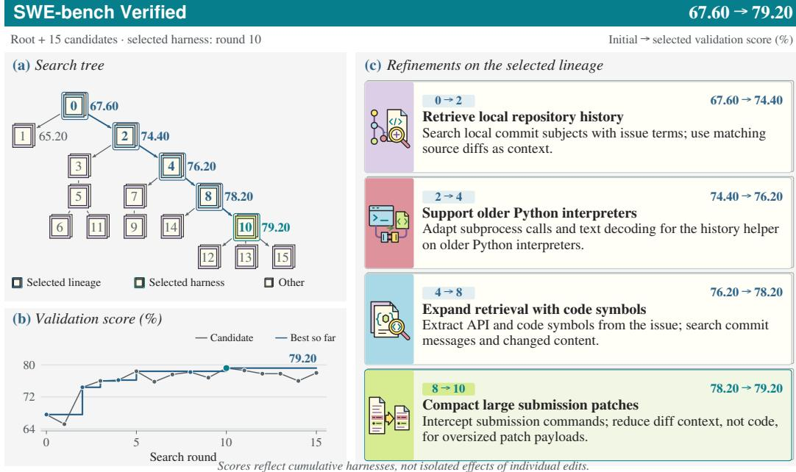  
Figure 4: Harness evolution on SWE-bench Verified. Code-level refinements along the selected lineage raise the validation score from 67.60% to 79.20%. Parent–child labels show actual search edges; scores describe cumulative harness designs, not isolated effects of individual edits.

Table 2: Library and initialization ablations. Search is repeated without the component library or from the OpenHands agent, with other settings unchanged. Scores are test means (%) ± standard deviations.  
Table 3: Exploration coefficient ablation. We compare ε = 0 (exploitation), 0.35 (default), and 1 (exploration), holding all other settings fixed.
<table><tr><td>Method</td><td>TAU2</td><td>AppWorld</td><td>BCB-H</td><td>Avg.</td></tr><tr><td>Vanilla</td><td>63.98±2.15</td><td>72.00±1.86</td><td>28.30±0.76</td><td>54.76</td></tr><tr><td>HARNESSFLOW</td><td>81.83±2.39</td><td>80.76±1.33</td><td>32.50±1.77</td><td>65.03</td></tr><tr><td>without library</td><td>77.64±1.70</td><td>80.63±0.99</td><td>31.90±1.67</td><td>63.39</td></tr><tr><td>from OpenHands agent</td><td>76.02±2.42</td><td>79.62±0.92</td><td>32.20±1.96</td><td>62.61</td></tr></table>

<table><tr><td>Benchmark</td><td>ε = 0</td><td>ε = 0.35</td><td>ε = 1</td></tr><tr><td>TAU2</td><td>74.19±2.77</td><td>81.83±2.39</td><td>72.80±2.10</td></tr><tr><td>AppWorld</td><td>78.76±2.47</td><td>80.76±1.33</td><td>79.81±0.80</td></tr><tr><td>SWE-V</td><td>68.83±2.57</td><td>75.40±1.19</td><td>68.33±0.29</td></tr><tr><td>Avg.</td><td>73.93</td><td>79.33</td><td>73.65</td></tr></table>

## 4.3 ABLATION STUDY

Library and Initialization. Removing the Harness Component Library lowers the threebenchmark average from 65.03 to 63.39 (Table 2), primarily through TAU2-bench (81.83 → 77.64), with small changes on AppWorld and BigCodeBench-Hard. Without the library, search still improves all three benchmarks over Vanilla by 8.63 points on average. Reusable components complement the search procedure, with the clearest gains on TAU2-bench. Starting from OpenHands likewise improves all three benchmarks, reaching an average of 62.61. The gains therefore extend to another agent architecture.

Exploration–Exploitation Balance. To examine the contribution of each selection term, we vary ε in Equation 5 while keeping the top-K shortlisting rule (K = 5), a budget of N = 15 candidate attempts, and other settings fixed. With ε = 0, parent sampling uses only the score-based softmax distribution; with ε = 1, it favors parents with fewer direct children. The default mixture (ε = 0.35) achieves the highest mean test score on all three benchmarks (Table 3), averaging 79.33 versus 73.93 for exploitation alone and 73.65 for exploration alone, gains of 5.40 and 5.68 percentage points, respectively. Improvements are larger on TAU2-bench and SWE-bench Verified than on AppWorld. These results suggest that the two selection signals are complementary: measured performance directs refinement toward strong implementations, while expansion history preserves opportunities to develop less-explored alternatives under a limited evaluation budget.

Table 4: Comparison with a stronger executor. All methods use GPT-5.4 as the executor. For HARNESSFLOW and Meta-Harness, we rerun harness search from the same initial harness using this executor. Cost is USD per test case at the executor’s list price (\$2.50 per million input tokens and \$15.00 per million output tokens). Rows are ordered by average score.
<table><tr><td></td><td colspan="2">TAU2</td><td colspan="2">AppWorld</td><td colspan="2">WebShop</td><td colspan="2">Avg.</td></tr><tr><td>Method</td><td>Score</td><td>Cost</td><td>Score</td><td>Cost</td><td>Score</td><td>Cost</td><td>Score</td><td>Cost</td></tr><tr><td>Vanilla</td><td> $8 3 . 7 6 { \scriptstyle \pm 2 . 8 3 }$ </td><td>0.23</td><td> $8 2 . 4 8 { \pm } 1 . 0 9$ </td><td>0.38</td><td> $5 6 . 2 9 { \scriptstyle \pm 1 . 2 0 }$ </td><td>0.08</td><td>74.18</td><td>0.23</td></tr><tr><td>Codex</td><td> $8 5 . 9 1 { \scriptstyle \pm 1 . 5 9 }$ </td><td>0.47</td><td> $7 5 . 5 2 { \pm 2 . 3 7 }$ </td><td>0.57</td><td> ${ \bf 7 3 . 5 9 { \pm 0 . 8 9 } }$ </td><td>0.38</td><td>78.34</td><td>0.47</td></tr><tr><td>Hermes</td><td> $8 5 . 8 1 { \pm } 1 . 7 3 $ </td><td>0.70</td><td> $7 9 . 4 3 { \pm } 1 . 3 6 $ </td><td>0.62</td><td> $7 2 . 7 6 { \pm } 1 . 4 3$ </td><td>0.47</td><td>79.33</td><td>0.60</td></tr><tr><td>OpenHands</td><td> $8 3 . 1 2 \pm 3 . 6 4$ </td><td>0.48</td><td> $8 3 . 7 1 { \scriptstyle \pm 1 . 3 2 }$ </td><td>0.52</td><td> $7 1 . 6 2 { \scriptstyle \pm 0 . 5 9 }$ </td><td>0.41</td><td>79.48</td><td>0.47</td></tr><tr><td>Claude Code</td><td> $8 2 . 6 9 { \scriptstyle \pm 1 . 7 6 }$ </td><td>0.61</td><td> $8 7 . 8 1 \pm 1 . 9 2 $ </td><td>0.81</td><td> $7 2 . 0 6 { \pm } 1 . 3 6$ </td><td>0.59</td><td>80.85</td><td>0.67</td></tr><tr><td>Meta-Harness</td><td> $8 4 . 5 9 { \pm } 1 . 1 2 $ </td><td>0.24</td><td> $8 8 . 4 1 { \scriptstyle \pm 0 . 7 3 }$ </td><td>0.20</td><td> $7 2 . 1 2 { \pm } 0 . 5 1 $ </td><td>0.09</td><td>81.71</td><td>0.18</td></tr><tr><td>HARNESSFLOW</td><td> $\mathbf { 8 8 . 0 6 \pm 1 . 9 2 }$ </td><td>0.31</td><td> $\mathbf { 9 0 . 9 5 } \pm \mathbf { 0 . 9 5 }$ </td><td>0.25</td><td> $7 1 . 7 2 { \scriptstyle \pm 0 . 6 6 }$ </td><td>0.08</td><td>83.58</td><td>0.21</td></tr></table>

Generalization to Other LLMs. With GPT-5.4 (OpenAI, 2026b), HARNESSFLOW achieves the highest three-benchmark average of 83.58%, exceeding Claude Code and Meta-Harness by 2.73 and 1.87 points, respectively (Table 4), and leads on TAU2-bench and AppWorld. Execution costs remain well below Claude Code (\$0.21 versus \$0.67 per task). Improvements thus persist with a stronger executor.

## 5 RELATED WORK

Automated Harness Optimization. Automatic optimization spans several levels of the agent stack. Prompt and LM-program optimizers use task feedback to improve instructions and computation-graph components (Yang et al., 2024a; Khattab et al., 2024; Yuksekgonul et al., 2024). Structural search extends the editable object to agent modules, graph connectivity, and communication topology (Zhuge et al., 2024; Shang et al., 2025; Zhang et al., 2024); evolutionary multiagent generation and adaptive architecture or model routing further explore how agents are assembled and assigned computation (Yuan et al., 2025; Zhang et al., 2025a; Yue et al., 2025). At the code level, ADAS generates executable agent designs using an archive of prior discoveries, while AFlow combines MCTS with code-represented workflow refinement (Hu et al., 2025; Zhang et al., 2025b). Within harness optimization, HARBOR searches configurations, PRISM targets prompts and guarded tool-boundary middleware, and Self-Harness validates failure-driven changes to an agent’s operating harness (Sengupta & Wang, 2026; Ruan et al., 2026; Zhang et al., 2026a). Codelevel methods include SICA, which edits its own implementation, and Meta-Harness, whose proposer inspects archived code, scores, and traces (Robeyns et al., 2025; Lee et al., 2026). Agentic Harness Engineering, HarnessCompass, and AutoSaddler further structure execution evidence, edit constraints, and validation to guide harness updates (Lin et al., 2026; Zhang et al., 2026c; Park et al., 2026). Archive- and lineage-based search also appears in the Huxley–Gödel Machine and DarwinX (Wang et al., 2026; Zhang et al., 2026d), while Hyperagents makes the improvement procedure itself editable (Zhang et al., 2026b). These studies establish both code-level refinement and explicit search over retained designs. HARNESSFLOW builds on these directions by coupling a fixed coding-agent proposer with MCTS-guided parent selection, filesystem-grounded experience reuse, and reusable harness mechanisms to allocate a limited candidate-evaluation budget across fullharness refinement paths. Further related work on harness engineering is discussed in Appendix A.

## 6 CONCLUSION

HARNESSFLOW optimizes complete agent harnesses through MCTS-guided search and codingagent refinement. Across six benchmarks, it improves average test scores over Vanilla and Meta-Harness by 10.89 and 3.95 percentage points, respectively, while running at a lower average execution cost than every hand-engineered harness.

Limitations and Future Work. Two properties scope the present formulation. The search is guided by a validation score, so it applies to tasks for which an automatic grader is available, and it consumes evaluation compute, a one-time cost that is amortized over subsequent deployment but that bounds how large a budget is practical. HARNESSFLOW also organizes candidates as a refinement tree, in which every harness descends from a single parent. A natural extension is to search over a graph, so that a candidate can combine mechanisms discovered on separate branches, which we leave to future work.

## AI USE STATEMENT

In this work, we used generative AI tools to assist with limited code implementation and editing, including code organization and implementation support. We also used generative AI tools to improve the clarity and readability of the manuscript. Generative AI tools were not used to formulate the research idea, develop the core methodology or experimental design, derive theoretical claims or proofs, or interpret experimental results. Other required-disclosure categories were not applicable to this work. All AI-assisted code was reviewed and tested by the authors, and all AI-assisted writing was manually reviewed and revised. The authors take full responsibility for the final content of this work, including its text, claims, experimental results, code, and other artifacts.

## ETHICS STATEMENT

This work uses publicly released benchmarks and involves no human subjects or personal data. The harnesses produced by our search are executable programs; every candidate is evaluated inside a container or sandbox with fixed time and resource limits. We are not aware of other ethical concerns raised by this work. The Claude Code baseline experiments reported in this paper were conducted by the fourth author, Aidan Wu, while he was working in the United States.

## REPRODUCIBILITY STATEMENT

Appendix C documents the data splits, initial harnesses, baseline releases, and the search and model settings. Our implementation and scripts for reproducing the tables and figures will be released.

## REFERENCES

Anthropic. Claude Code. https://github.com/anthropics/claude-code, 2026. Version 2.1.272.

Peter Auer, Nicolo Cesa-Bianchi, and Paul Fischer. Finite-time analysis of the multiarmed bandit problem. Machine learning, 47(2):235–256, 2002.

Victor Barres, Honghua Dong, Soham Ray, Xujie Si, and Karthik Narasimhan. τ2-Bench: Evaluating conversational agents in a dual-control environment. arXiv preprint arXiv:2506.07982, 2025.

Cameron B Browne, Edward Powley, Daniel Whitehouse, Simon M Lucas, Peter I Cowling, Philipp Rohlfshagen, Stephen Tavener, Diego Perez, Spyridon Samothrakis, and Simon Colton. A survey of monte carlo tree search methods. IEEE Transactions on Computational Intelligence and AI in games, 4(1):1–43, 2012.

Tingyang Chen, Shuo Lu, Kang Zhao, Weicheng Meng, Hanlin Teng, Tianhao Li, Chao Li, Xule Liu, Jian Liang, Zhizhong Zhang, et al. Harnessx: A composable, adaptive, and evolvable agent harness foundry. arXiv preprint arXiv:2606.14249, 2026a.

Zijian Chen, Xueguang Ma, Shengyao Zhuang, Ping Nie, Kai Zou, Sahel Sharifymoghaddam, Andrew Liu, Joshua Green, Kshama Patel, Ruoxi Meng, et al. Browsecomp-plus: a fair and disentangled evaluation benchmark for deep search agents. In Proceedings ofthe 64th Annual Meeting of the Association for Computational Linguistics (Volume 1: Long Papers), pp. 22349–22370, 2026b.

Sirui Hong, Mingchen Zhuge, Jonathan Chen, Xiawu Zheng, Yuheng Cheng, Jinlin Wang, Ceyao Zhang, Steven Yau, Zijuan Lin, Liyang Zhou, et al. Metagpt: Meta programming for a multiagent collaborative framework. In International Conference on Learning Representations, volume 2024, pp. 23247–23275, 2024.

Zhi Hong, Qian Zhang, Jiahang Sun, Zhiwei Shang, Mingze Kong, Xiangyi Wang, Yao Shu, and Zhongxiang Dai. Maspob: Bandit-based prompt optimization for multi-agent systems with graph neural networks. arXiv preprint arXiv:2603.02630, 2026.

Shengran Hu, Cong Lu, and Jeff Clune. Automated design of agentic systems. In International Conference on Learning Representations, volume 2025, pp. 21344–21377, 2025.

Carlos E Jimenez, John Yang, Alexander Wettig, Shunyu Yao, Kexin Pei, Ofir Press, and Karthik Narasimhan. Swe-bench: Can language models resolve real-world github issues? In International Conference on Learning Representations, volume 2024, pp. 54107–54157, 2024.

Omar Khattab, Arnav Singhvi, Paridhi Maheshwari, Zhiyuan Zhang, Keshav Santhanam, Saiful Haq, Ashutosh Sharma, Thomas Joshi, Hanna Moazam, Heather Miller, et al. Dspy: Compiling declarative language model calls into state-of-the-art pipelines. In International Conference on Learning Representations, volume 2024, pp. 54928–54958, 2024.

Levente Kocsis and Csaba Szepesvári. Bandit based monte-carlo planning. In European conference on machine learning, pp. 282–293. Springer, 2006.

Yoonho Lee, Roshen Nair, Qizheng Zhang, Kangwook Lee, Omar Khattab, and Chelsea Finn. Metaharness: End-to-end optimization of model harnesses. arXiv preprint arXiv:2603.28052, 2026.

Guohao Li, Hasan Hammoud, Hani Itani, Dmitrii Khizbullin, and Bernard Ghanem. Camel: Communicative agents for" mind" exploration of large language model society. Advances in neural information processing systems, 36:51991–52008, 2023.

Jiahang Lin, Shichun Liu, Chengjun Pan, Lizhi Lin, Shihan Dou, Zhiheng Xi, Xuanjing Huang, Hang Yan, Zhenhua Han, Tao Gui, et al. Agentic harness engineering: Observability-driven automatic evolution of coding-agent harnesses. arXiv preprint arXiv:2604.25850, 2026.

Aman Madaan, Niket Tandon, Prakhar Gupta, Skyler Hallinan, Luyu Gao, Sarah Wiegreffe, Uri Alon, Nouha Dziri, Shrimai Prabhumoye, Yiming Yang, et al. Self-refine: Iterative refinement with self-feedback. Advances in neural information processing systems, 36:46534–46594, 2023.

Nous Research. Hermes Agent. https://github.com/NousResearch/hermes-agent, 2026. Version v2026.9.7.

OpenAI. Codex CLI. https://github.com/openai/codex, 2026a. Version 0.154.0.

OpenAI. Introducing GPT-5.4. https://openai.com/index/ introducing-gpt-5-4/, March 2026b.

OpenAI. Introducing GPT-5.4 mini and nano. https://openai.com/index/ introducing-gpt-5-4-mini-and-nano/, March 2026c.

Charles Packer, Sarah Wooders, Kevin Lin, Vivian Fang, Shishir G Patil, Ion Stoica, and Joseph E Gonzalez. Memgpt: Towards llms as operating systems. arXiv preprint arXiv:2310.08560, 2023.

Joon Sung Park, Joseph O’Brien, Carrie Jun Cai, Meredith Ringel Morris, Percy Liang, and Michael S Bernstein. Generative agents: Interactive simulacra of human behavior. In Proceedings of the 36th annual acm symposium on user interface software and technology, pp. 1–22, 2023.

Sungho Park, Wonjoong Kim, Rongyuan Tan, Jue Zhang, Wook-Shin Han, Pengfei Gao, Chanyoung Park, Yongqiang Yao, Rao Fu, Elsie Nallipogu, et al. Autosaddler: Automatic harness optimization with durable updates from agent execution traces. arXiv preprint arXiv:2608.23041, 2026.

Maxime Robeyns, Martin Szummer, and Laurence Aitchison. A self-improving coding agent. arXiv preprint arXiv:2504.15228, 2025.

Haibo Ruan, Wenjie Chen, Pei-fen Tu, Usman Abbasi, Joel Hesch, et al. Beyond prompts: Measuring and optimizing llm tool-agent harnesses. arXiv preprint arXiv:2609.05736, 2026.

Biswa Sengupta and Jinhua Wang. Harbor: Automated harness optimization. arXiv preprint arXiv:2604.20938, 2026.

Yu Shang, Yu Li, Keyu Zhao, Likai Ma, Jiahe Liu, Fengli Xu, and Yong Li. Agentsquare: Automatic llm agent search in modular design space. In International Conference on Learning Representations, volume 2025, pp. 3841–3865, 2025.

Harsh Trivedi, Tushar Khot, Mareike Hartmann, Ruskin Manku, Vinty Dong, Edward Li, Shashank Gupta, Ashish Sabharwal, and Niranjan Balasubramanian. Appworld: A controllable world of apps and people for benchmarking interactive coding agents. In Proceedings of the 62nd Annual Meeting of the Association for Computational Linguistics (Volume 1: Long Papers), pp. 16022– 16076, 2024.

Wenyi Wang, Piotr Pi˛ekos, Li Nanbo, Firas Laakom, Yimeng Chen, Mateusz Ostaszewski, Mingchen Zhuge, and Jürgen Schmidhuber. Huxley-g\" odel machine: Human-level coding agent development by an approximation of the optimal self-improving machine. In International Conference on Learning Representations, volume 2026, pp. 80356–80386, 2026.

Xingyao Wang, Boxuan Li, Yufan Song, Frank F Xu, Xiangru Tang, Mingchen Zhuge, Jiayi Pan, Yueqi Song, Bowen Li, Jaskirat Singh, et al. Openhands: An open platform for ai software developers as generalist agents. In International Conference on Learning Representations, volume 2025, pp. 65882–65919, 2025.

Qingyun Wu, Gagan Bansal, Jieyu Zhang, Yiran Wu, Beibin Li, Erkang Zhu, Li Jiang, Xiaoyun Zhang, Shaokun Zhang, Jiale Liu, et al. Autogen: Enabling next-gen llm applications via multiagent conversation. arXiv preprint arXiv:2308.08155, 2023.

Chengrun Yang, Xuezhi Wang, Yifeng Lu, Hanxiao Liu, Quoc V Le, Denny Zhou, and Xinyun Chen. Large language models as optimizers. In International Conference on Learning Representations, volume 2024, pp. 12028–12068, 2024a.

John Yang, Carlos Jimenez, Alexander Wettig, Kilian Lieret, Shunyu Yao, Karthik Narasimhan, and Ofir Press. Swe-agent: Agent-computer interfaces enable automated software engineering. Advances in Neural Information Processing Systems, 37:50528–50652, 2024b.

Shunyu Yao, Howard Chen, John Yang, and Karthik Narasimhan. Webshop: Towards scalable real-world web interaction with grounded language agents. Advances in Neural Information Processing Systems, 35:20744–20757, 2022a.

Shunyu Yao, Jeffrey Zhao, Dian Yu, Nan Du, Izhak Shafran, Karthik Narasimhan, and Yuan Cao. React: Synergizing reasoning and acting in language models. arXiv preprint arXiv:2210.03629, 2022b.

Siyu Yuan, Kaitao Song, Jiangjie Chen, Xu Tan, Dongsheng Li, and Deqing Yang. Evoagent: Towards automatic multi-agent generation via evolutionary algorithms. In Proceedings of the 2025 Conference of the Nations of the Americas Chapter of the Association for Computational Linguistics: Human Language Technologies (Volume 1: Long Papers), pp. 6192–6217, 2025.

Yanwei Yue, Guibin Zhang, Boyang Liu, Guancheng Wan, Kun Wang, Dawei Cheng, and Yiyan Qi. Masrouter: Learning to route llms for multi-agent systems. In Proceedings of the 63rd Annual Meeting of the Association for Computational Linguistics (Volume 1: Long Papers), pp. 15549– 15572, 2025.

Mert Yuksekgonul, Federico Bianchi, Joseph Boen, Sheng Liu, Zhi Huang, Carlos Guestrin, and James Zou. Textgrad: Automatic" differentiation" via text. arXiv preprint arXiv:2406.07496, 2024.

Guibin Zhang, Yanwei Yue, Xiangguo Sun, Guancheng Wan, Miao Yu, Junfeng Fang, Kun Wang, Tianlong Chen, and Dawei Cheng. G-designer: Architecting multi-agent communication topologies via graph neural networks. arXiv preprint arXiv:2410.11782, 2024.

Guibin Zhang, Luyang Niu, Junfeng Fang, Kun Wang, Lei Bai, and Xiang Wang. Multi-agent architecture search via agentic supernet. arXiv preprint arXiv:2502.04180, 2025a.

Hangfan Zhang, Shao Zhang, Kangcong Li, Chen Zhang, Yang Chen, Yiqun Zhang, Lei Bai, and Shuyue Hu. Self-harness: Harnesses that improve themselves. arXiv preprint arXiv:2606.09498, 2026a.

Jenny Zhang, Bingchen Zhao, Wannan Yang, Jakob Foerster, Jeff Clune, Minqi Jiang, Sam Devlin, and Tatiana Shavrina. Hyperagents. arXiv preprint arXiv:2603.19461, 2026b.

Jiayi Zhang, Jinyu Xiang, Zhaoyang Yu, Fengwei Teng, Xionghui Chen, Jiaqi Chen, Mingchen Zhuge, Xin Cheng, Sirui Hong, Jinlin Wang, et al. Aflow: Automating agentic workflow generation. In International Conference on Learning Representations, volume 2025, pp. 34040–34077, 2025b.

Luan Zhang, Ruochen Zhou, Dandan Song, Zhengyu Chen, Yuhang Tian, Jun Yang, Huipeng Ma, Chenhao Li, Guangyuan Feng, Xudong Li, et al. Harnesscompass: Guiding automatic harness evolution toward generalizable and effective agent harnesses. arXiv preprint arXiv:2608.01918, 2026c.

Yifan Zhang, Yutong Dai, Juntao Tan, Luyu Yang, Rishi Mullur, Thai Hoang, Zhiyuan Hu, James Zhu, Phil Mui, Silvio Savarese, et al. Darwinx: Evolving agent harnesses through natural selection. arXiv preprint arXiv:2608.07545, 2026d.

Andy Zhou, Kai Yan, Michal Shlapentokh-Rothman, Haohan Wang, and Yu-Xiong Wang. Language agent tree search unifies reasoning acting and planning in language models. arXiv preprint arXiv:2310.04406, 2023.

Mingchen Zhuge, Wenyi Wang, Louis Kirsch, Francesco Faccio, Dmitrii Khizbullin, and Jürgen Schmidhuber. Language agents as optimizable graphs. arXiv preprint arXiv:2402.16823, 2024.

Terry Yue Zhuo, Minh Chien Vu, Jenny Chim, Han Hu, Wenhao Yu, Ratnadira Widyasari, Imam Nur Bani Yusuf, Haolan Zhan, Junda He, Indraneil Paul, et al. Bigcodebench: Benchmarking code generation with diverse function calls and complex instructions. In International Conference on Learning Representations, volume 2025, pp. 66602–66656, 2025.

## A ADDITIONAL RELATED WORK

Harness Engineering. LLM agents depend on runtime mechanisms that organize reasoning, retain state, coordinate model calls, and mediate environment interaction. Reasoning–acting loops, verbal feedback, and inference-time search provide complementary ways to structure task execution (Yao et al., 2022b; Madaan et al., 2023; Zhou et al., 2023). Memory-centered architectures retain, summarize, and retrieve past experiences to support long-horizon behavior (Park et al., 2023; Packer et al., 2023). Multi-agent frameworks introduce role assignment, structured communication, and coordinated workflows (Li et al., 2023; Wu et al., 2023; Hong et al., 2024). Softwareengineering agents further demonstrate the importance of tool interfaces and execution environments (Yang et al., 2024b; Wang et al., 2025), while HarnessX organizes composable components for adaptive harness construction (Chen et al., 2026a). Together, these studies identify runtime mechanisms and their composition as important determinants of agent behavior beyond the underlying model. Our work takes the complete harness implementation as the unit of optimization, allowing these interacting mechanisms to be refined jointly. The closest search-based precedent is AFlow (Zhang et al., 2025b), which also applies MCTS to code-represented candidates. It differs from our setting in two ways. First, its search space is the workflow: how a fixed vocabulary of operators is wired together, which is one layer of a harness. The execution loop, state handling, tool interfaces, and environment mediation stay fixed, and it is precisely these layers that the mechanisms above, and the harnesses selected by our search, modify. Second, its candidates are produced by a single model call that rewrites the current workflow from a textual summary of past changes and scores, whereas our proposer is a coding agent that runs the harness, reads its execution evidence, and makes coordinated edits across files. AFlow is accordingly evaluated on single-turn question answering, mathematics, and code generation, whereas the interactive benchmarks studied here are dominated by mechanisms that lie outside the workflow layer.

## B HARNESS COMPONENT LIBRARY

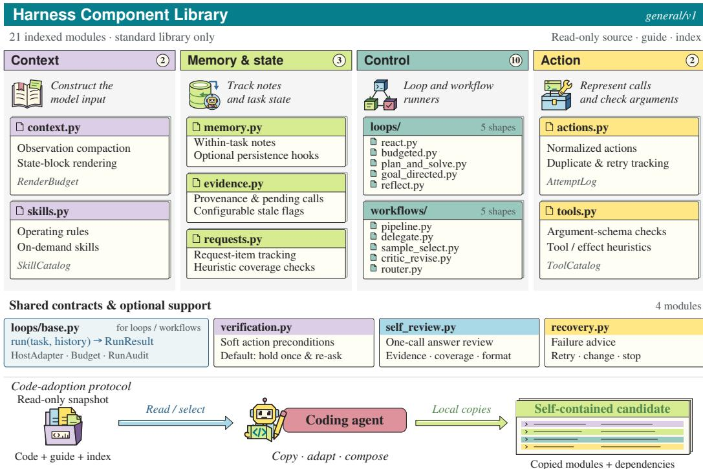  
Optional adoption: the coding agent is instructed to copy selected code, not import the snapshot at runtime.

Figure 5: Functional organization of the Harness Component Library’s 21 indexed modules. The four columns and the shared-support row indicate functional roles. The coding agent copies adopted modules from a read-only snapshot into the candidate.

Figure 5 gives a functional view of the library used in our experiments. It contains 21 benchmarkneutral Python modules organized around four roles: context construction (observation compaction and skill catalogs), memory and state tracking (note stores, observation logs, and request tracking), control flow (loop and workflow runners that share a common run(task, history) interface), and tool interfacing (argument-schema checks and tool-effect classification), together with shared support for verification, self-review, and recovery. The modules depend only on the Python standard library; model calls and tool execution are supplied by the host through a small adapter interface. During refinement, the coding agent inspects a read-only snapshot of the library and copies any adopted modules, with their local dependencies, into the candidate, so that every candidate remains self-contained.

## C EXPERIMENTAL DETAILS

This appendix gives the data splits (§C.1), the initial harness of each benchmark (§C.2), the baseline agents (§C.3), and the search and model settings shared by all methods (§C.4).

## C.1 BENCHMARKS AND DATA

Each benchmark is split once with a fixed random seed (42) into a validation set used during search and a disjoint test set used only for the final evaluation: 92/186 tasks for TAU2-bench, 105/210 for AppWorld, and 100/200 for WebShop, BrowseComp-Plus, SWE-bench Verified, and BigCodeBench-Hard, whose tasks are sampled from the BigCodeBench release using its published difficulty criteria. The same split and the benchmark’s official grader are used for every method.

## C.2 INITIAL HARNESSES

The initial harness of each benchmark (Vanilla in Table 1) is the benchmark’s own reference agent, reproduced from the upstream repository at the revision listed in Table 5, with the model client replaced by the shared gateway client so that the initial harness, every search candidate, and every baseline call the same model.

Table 5: The initial harness of each benchmark and its upstream source. Revision is the git commit (abbreviated to seven characters) or release of the upstream repository from which the harness was reproduced.
<table><tr><td>Benchmark</td><td>Reference agent</td><td>Revision</td></tr><tr><td>TAU2-bench</td><td>tau2-bench LLMAgent (Barres et al., 2025)</td><td>a2c0247</td></tr><tr><td>AppWorld</td><td>Official ReAct experiment harness (Trivedi et al., 2024)</td><td>66ad809 (v0.1.3.post1)</td></tr><tr><td>WebShop</td><td>ReAct WebShop scaffold (Yao et al., 2022a)</td><td>a5c0827</td></tr><tr><td>BrowseComp-Plus</td><td>search_agent/openai_client.py(Chen et al., 2026b)</td><td>0469490</td></tr><tr><td>SWE-bench Verified</td><td>mini-SWE-agent DefaultAgent (Yang et al., 2024b)</td><td>04d809c</td></tr><tr><td>BigCodeBench-Hard</td><td>bigcodebench. generate (Zhuo et al., 2025)</td><td>v0.1.4</td></tr></table>

## C.3 BASELINE AGENTS

The four production agents are run through their official non-interactive entry points at the releases in Table 6, with their default tool sets, skills, and subagents enabled. All methods, candidates and baselines alike, run in the same network-isolated sandbox whose only egress is the shared mode gateway, use the same backbone and per-benchmark limits (Table 7), and access the same benchmark tools through a benchmark-specific tool server. Each agent receives the benchmark’s task description together with its I/O conventions (tool names, answer format, and submission protocol).

Table 6: Production agent harnesses and the release used throughout.
<table><tr><td>Agent</td><td>Release</td><td>Source</td></tr><tr><td>Claude Code (Anthropic, 2026)</td><td>2.1.272</td><td>npm @anthropic-ai/claude-code</td></tr><tr><td>Codex (OpenAI, 2026a)</td><td>0.154.0</td><td>npm @openai/codex</td></tr><tr><td>OpenHands (Wang et al., 2025)</td><td>cloud-1.45.0 (SDK 1.34.0)</td><td>GitHub</td></tr><tr><td>Hermes (Nous Research, 2026)</td><td>v2026.9.7</td><td>GitHub</td></tr></table>

## C.4 SEARCH AND MODEL CONFIGURATION

Search. Each search runs N = 15 candidate attempts, and every proposed candidate consumes one attempt. In Algorithm 1, $v _ { n }$ is valid when the candidate passes a runtime compatibility check and its evaluation yields a score. Selection uses the parameters given in Section 4.1, and every candidate, including the root, is scored on the validation split with R = 5 repetitions per task. Meta-Harness is run through the same pipeline with the same initial harness, coding agent, and candidate budget.

Coding agent. Candidates are produced by Codex (OpenAI, 2026a) (release 0.154.0) running GPT-5.5 at the highest reasoning effort. It receives the search tree of Section 3 with its scores and execution records, the Harness Component Library, and the benchmark’s task description. Meta-Harness uses the same coding agent, model, and reasoning effort.

Models. All harnesses execute GPT-5.4-mini at medium reasoning effort through a local gateway, with sampling temperature at the API default. Auxiliary models are fixed per benchmark and shared by all methods: the TAU2-bench user simulator is GPT-5.2 and its evaluator GPT-5.5, the BrowseComp-Plus grader is GPT-5.5 with the upstream grading template, and the remaining benchmarks use programmatic graders. The GPT-5.4 experiments of Section 4.3 change only the executor model.

Table 7: Per-benchmark execution limits, applied identically to every method. Deadlines are wallclock per task.
<table><tr><td>Benchmark</td><td>Episode limit</td><td>Deadline</td></tr><tr><td>TAU2-bench</td><td>200 steps</td><td>1,800 s</td></tr><tr><td>AppWorld</td><td>50 interactions</td><td>1,800 s</td></tr><tr><td>WebShop</td><td>30 actions</td><td>900 s</td></tr><tr><td>BrowseComp-Plus</td><td>100 tool calls</td><td>1,800 s</td></tr><tr><td>SWE-bench Verified</td><td>250 model calls</td><td>2,400 s</td></tr><tr><td>BigCodeBench-Hard</td><td>30 iterations</td><td>1,800 s</td></tr></table>

## D ADDITIONAL RESULTS

This appendix reports per-benchmark search curves (§D.1), a second harness-evolution case (§D.2), and per-benchmark execution costs (§D.3).

## D.1 SEARCH BEHAVIOR

Figure 6 shows, for every benchmark, the best validation score reached so far at each round; Figure 3a in the main text averages these curves over the six benchmarks.

Scores reflect cumulative harnesses, not isolated effects ofindividual edits.

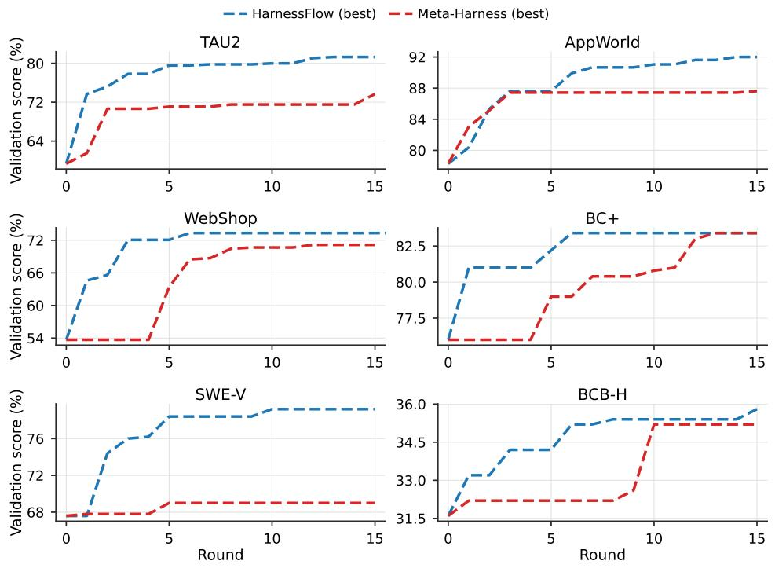  
Figure 6: Best validation score reached so far at each round, per benchmark, as the dashed lines of Figure 3a. Round 0 is the shared initial harness.

## D.2 HARNESS EVOLUTION ON TAU2-BENCH

Figure 7 complements the SWE-bench Verified example of Figure 4 with a tool-use benchmark, showing the recorded parent relationships (a), per-round and best-so-far validation scores (b), and the code refinements along the selected lineage (c).

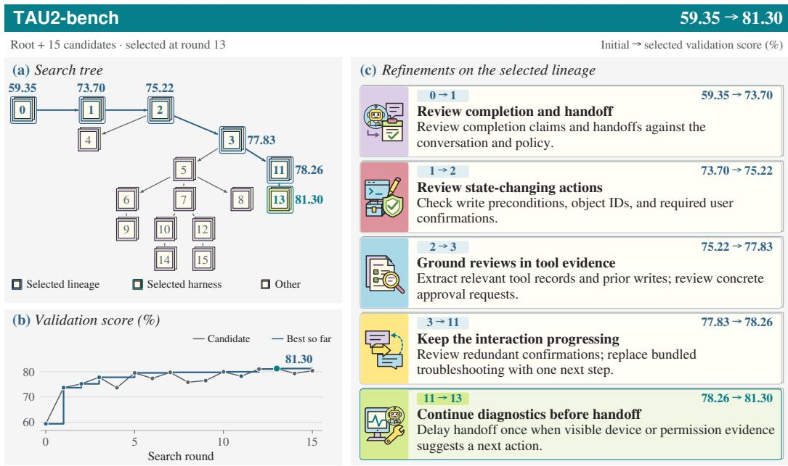  
Figure 7: Harness evolution on TAU2-bench. Action reviews, structured evidence, and troubleshooting continuation raise the validation score from 59.35% to 81.30%.

## D.3 EXECUTION COST

Table 8 lists the execution cost of every method on every benchmark, and Figure 8 plots test score against cost per benchmark; Figure 3b in the main text shows the six-benchmark averages. By arithmetic average, HARNESSFLOW has the lowest cost at \$0.232 per task, against \$0.398–\$0.561 for the hand-engineered harnesses, and it lies on the Pareto frontier of every benchmark.

Table 8: Execution cost of every method in Table 1, in USD per test task: input and output tokens priced separately at the executor’s list price (GPT-5.4-mini: \$0.75 per million input tokens and \$4.50 per million output tokens). Bold marks the cheapest method per column.
<table><tr><td></td><td colspan="2">Agentic</td><td colspan="2">Web</td><td colspan="2">Code</td><td></td></tr><tr><td>Method</td><td>TAU2</td><td>AppWorld</td><td>WebShop</td><td>BC+</td><td>SWE-V</td><td>BCB-H</td><td>Avg.</td></tr><tr><td>Vanilla</td><td>0.067</td><td>0.132</td><td>0.030</td><td>2.292</td><td>0.181</td><td>0.007</td><td>0.451</td></tr><tr><td>Claude Code</td><td>0.177</td><td>0.383</td><td>0.191</td><td>1.444</td><td>0.456</td><td>0.024</td><td>0.446</td></tr><tr><td>OpenHands</td><td>0.148</td><td>0.286</td><td>0.128</td><td>1.365</td><td>0.445</td><td>0.017</td><td>0.398</td></tr><tr><td>Hermes</td><td>0.215</td><td>0.350</td><td>0.167</td><td>1.507</td><td>1.050</td><td>0.043</td><td>0.555</td></tr><tr><td>Codex</td><td>0.128</td><td>0.481</td><td>0.134</td><td>2.027</td><td>0.569</td><td>0.025</td><td>0.561</td></tr><tr><td>Meta-Harness</td><td>0.075</td><td>0.100</td><td>0.023</td><td>1.653</td><td>0.249</td><td>0.008</td><td>0.351</td></tr><tr><td>HARNESSFLOW</td><td>0.116</td><td>0.109</td><td>0.022</td><td>0.948</td><td>0.172</td><td>0.024</td><td>0.232</td></tr></table>

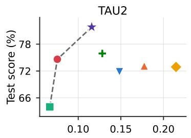

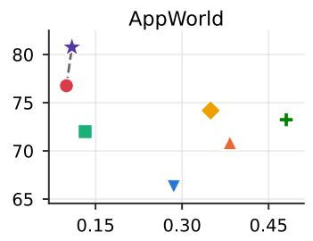  
Meta-Harness HarnessFlow

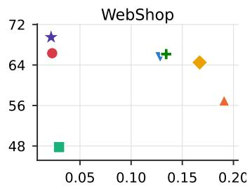

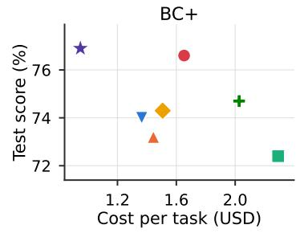

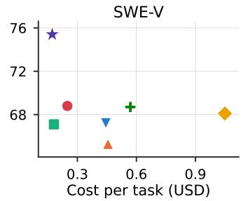

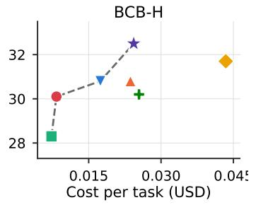  
Figure 8: Test score (Table 1) against execution cost per task (Table 8) on each benchmark. The dashed line joins the methods on the Pareto frontier; axis limits differ per panel because costs span two orders of magnitude between benchmarks.