# How Unbalanced Must a Latin Rectangle Be?

Zhengyu Li∗ Vijay Ganesh†

## Abstract

We view a k × n Latin rectangle as n points in the grid $[ n ] ^ { k }$ . Each symbol gives one point, and its coordinates are the columns that the symbol occupies. The rectangle is balanced when these points are pairwise equidistant in the $\ell _ { 1 }$ metric. Its imbalance measures how far the rectangle is from this ideal. We study the minimum imbalance from three sides. Constructively, we use a simulated annealing that moves symbols within rows and only penalises column clashes. Against the reference table of Voboril et al. (2025), it improves 33 of the 51 non-square values for $8 \leq n \leq 1 3 .$ , by up to 39.4%, and matches the rest. A cheap invariant, the row group, certifies that none of the 33 new rectangles is isotopic to rows of a group table. Hence the earlier column-swapping local search cannot reach any of them. Exactly, a computer-assisted branch and bound proves that the minimum imbalance of a 3 × 9 rectangle is 56. Díaz et al. found this value, but its optimality was open. A sharper pruning bound, derived from the identity $\begin{array} { r } { I = 2 \sum ( d - t ) ^ { + } } \end{array}$ , reduces the search tree by a factor of 2.4 to 3.3 on the instances with $k \geq 3$ that we solve. Asymptotically, the minimum imbalance is $\Theta ( n ^ { 3 } )$ for every fixed k. A pigeonhole argument gives a lower constant of order $k 4 ^ { - k }$ , and random rectangles give an upper constant of order ${ \sqrt { k } } .$ For $k = 2$ , the limit of min $I / n ^ { 3 }$ exists, a permuton attains it, and it lies between 4/375 and 0.1196. We compute the upper value exactly from one explicit permuton. Perfect balance is an ℓ1-equilateral problem, so it forces $k = \Omega ( n / \log n )$ ) rows. For $2 \times n$ rectangles, single two-minute annealing runs improve five of the seven six-hour MIP upper bounds for 14 $\leq n \leq 2 0$ . Finally, the kernel of the Lean 4 proof assistant checks every rectangle reported in this paper against a 74-line specification that imports only Lean’s core library. We also prove the pigeonhole lower bound in Lean with Mathlib.

## 1 Introduction

In an agricultural field trial, the treatments occupy a grid of plots. When some pairs of treatments are systematically planted closer together than others, spatial correlation in the soil can bias their comparison [14]. Latin designs remove the row and column efects, but not this one. Spatially balanced Latin squares ask, in addition, that every pair of treatments be equally far apart on average [5, 9]. Díaz et al. [3] posed the same question for $k \times n$ rectangles, observed that perfect balance is then usually impossible, and asked instead for rectangles of minimum imbalance. Later work on the problem uses SAT encodings that prove optima with checkable proof certificates [11] and mixed-integer programming [10]. It also uses streamliners written by large language models [16] and LLM agents that reformulate models [15]. Closest to our work, Xia et al. [17] use simulated annealing for spatially balanced Latin squares and reach the optimum for $n = 1 0$ and $n = 1 3$ in under a second. They also prove an $\Omega ( n ^ { 2 } )$ lower bound on the imbalance of squares with $n \equiv 1$ (mod 3), by a parity argument. The starting point of this paper is the reference table of Voboril et al. [16], which collects the best values that the methods above obtained for rectangles. To our knowledge, this table is still current. The later work [15] reports aggregate model comparisons but no per-instance values, and Xia et al. [17] treat only squares.

Here is the point of view of this paper. Record, for each symbol u, the columns $c _ { 1 } ( u ) , \ldots , c _ { k } ( u )$ that it occupies in the k rows. This gives a point $x _ { u } \in [ n ] ^ { k }$ . The distance between two symbols that the literature uses is exactly the $\ell _ { 1 }$ distance $\| x _ { u } - x _ { v } \| _ { 1 }$ . A balanced rectangle is therefore a set of n points in a k-dimensional grid that are pairwise equidistant in the taxicab metric. When k is small compared with $n ,$ the grid is too crowded for equidistance, and Section 7 makes this quantitative. When $k = n$ there is room, consistent with the existence of balanced squares for infinitely many n. The point picture also suggests a search that moves individual points, rather than one that rearranges a rigid algebraic pattern.

## Contributions.

1. New upper bounds (Sections 3 and 4). The search keeps each row a permutation and turns the column condition into a penalty with an adaptive weight. A move swaps two symbols within a row, and the search evaluates its efect exactly in $O ( n )$ time. Against the reference table of Voboril et al. [16], the search improves 33 of 51 instances and matches the other 18.

2. A new optimum (Section 5). A branch and bound that places one symbol at a time proves that the known value 56 is optimal for $3 \times 9$ , which was open. It also independently reproduces the known optima for $2 \times n$ with $n \leq 1 1$ and for $3 \times 8$ and $4 \times 8$ . A second, independent implementation with a sharper bound confirms the $3 \times 9 , 3 \times 8$ and $4 \times 8$ results and the $2 \times 1 0$ and $2 \times 1 1$ optima.

3. A certificate of non-group structure (Section 6). The permutation group generated by the ratios of the rows does not change under column operations. For rectangles taken from group tables, its order divides n. For 32 of our 33 improved rectangles it is the full alternating or symmetric group, and for the last one it has order 46080. So local search that only permutes the columns of a cyclic rectangle [3] cannot reach any of them. The invariant does not separate our rectangles from the published SAT and streamliner rectangles, most of which are also far from group tables.

4. Cubic growth (Section 7). For every fixed k, the minimum imbalance is $\Theta ( n ^ { 3 } )$ . The lower constant $\begin{array} { r } { c _ { k } = \operatorname* { m a x } _ { m \geq 3 } k m ^ { - k } ( \frac { 1 } { 3 } - \frac { 1 } { m } ) } \end{array}$ is of order $k 4 ^ { - k }$ , while random rectangles give an upper constant $D _ { k } \leq \sqrt { k } / ( 6 \sqrt { 2 } )$ . The right order in k is open. Perfect balance also requires $n \leq e ( \ell _ { 1 } ^ { k } ) = O ( k \log k )$ , by a classical bound on equilateral sets.

5. The case $k = 2$ (Section 8). On the open instances $1 4 \leq n \leq 2 0$ , we compare a single-seed two-minute annealing run with the six-hour upper bounds of Mirka et al. [10]. The run improves the bound for $1 5 \leq n \leq 1 9$ , ties at $n = 1 4$ and is worse at $n = 2 0$ . The limit of min $I / n ^ { 3 }$ exists and is the minimum of a continuous functional on permutons. We bracket it between $4 / 3 7 5$ and 0.1196, and we compute the upper value exactly for the permuton of one $2 \times 6 4$ rectangle.

6. A Lean formalisation (Section 9). Lean’s kernel certifies all 62 rectangles behind our upper bounds by evaluation. The check uses no native\_decide and no Mathlib, only Lean’s core library, so it trusts only the kernel and a short specification. We prove the identity (1) and Theorem 5 in Lean with Mathlib. Each formalised statement names the Lean theorem that proves it.

None of the algorithmic ingredients is new by itself. Simulated annealing [7] is established, including for the square version of this problem [17]. So are row-preserving swaps with temporarily violated column constraints [18, 19] and adaptive penalties, also known as strategic oscillation [4]. What we add is their combination for rectangles, the resulting records, and the exact and asymptotic results.

## 2 Preliminaries

A k × n Latin rectangle $( k \leq n )$ is an array with entries in $[ n ] = \{ 1 , \dots , n \}$ in which no symbol repeats in a row or in a column. Let $c _ { i } ( u )$ denote the column of symbol u in row i and $x _ { u } = ( c _ { 1 } ( u ) , \ldots , c _ { k } ( u ) ) \in [ n ] ^ { k }$ . Following Díaz et al. [3] and Peruvemba Ramaswamy and Szeider [11],

$$
d ( u , v ) = \sum _ { i = 1 } ^ { k } | c _ { i } ( u ) - c _ { i } ( v ) | = \| x _ { u } - x _ { v } \| _ { 1 } , \qquad I ( L ) = \sum _ { 1 < u < v < n } | d ( u , v ) - t | , \qquad t = \frac { k ( n + 1 ) } { 3 } .
$$

Each row contributes $\begin{array} { r } { \sum _ { u < v } | c _ { i } ( u ) - c _ { i } ( v ) | = { \binom { n + 1 } { 3 } } } \end{array}$ to the total distance, so t is the average distance over all $\binom { n } { 2 }$ pairs. In particular the deviations $d ( u , v ) - t$ sum to zero, and

$$
I ( L ) = 2 \sum _ { u < v } \bigl ( t - d ( u , v ) \bigr ) ^ { + } = 2 \sum _ { u < v } \bigl ( d ( u , v ) - t \bigr ) ^ { + } .\tag{1}
$$

The pairs that are too close and the pairs that are too far therefore contribute equally to the imbalance. This identity drives both the pruning bound of Section 5 and the lower bound of Section 7. (In Lean, the average is LatinRect.sum\_dist and the identity is LatinRect.imbalance\_eq\_two\_mul\_sum\_pos.) The quantity 3I is an integer. As in the literature, we write imbalances as x.0, x.3 and x.6 for x, $x + { \textstyle { \frac { 1 } { 3 } } }$ and $x + { \textstyle { \frac { 2 } { 3 } } }$

Two dictionaries. We can read a rectangle through its rows or through its points. Through its rows it is a k-tuple $( r _ { 1 } , \ldots , r _ { k } )$ of bijections $r _ { i } \colon [ n ]  [ n ]$ from columns to symbols, with $r _ { i } ( j ) \neq r _ { i ^ { \prime } } ( j )$ for $i \neq i ^ { \prime }$ . Through its points it is a set $\{ x _ { u } \}$ in $[ n ] ^ { k }$ whose coordinate projections are bijections. The column condition says exactly that every point has distinct coordinates. The imbalance is invariant under relabelling symbols, permuting rows and reversing the order of the columns, $j \mapsto n + 1 - j$ , which preserves every distance. It is not invariant under general column permutations. After relabelling the symbols, we may assume $r _ { 1 } = \mathrm { i d }$

## 3 Search: rows as permutations, columns as a penalty

The state of the search is a k-tuple of permutations with $r _ { 1 } = \mathrm { i d }$ . It need not be Latin. A move picks a row $i \geq 2$ and two columns $j _ { 1 } \neq j _ { 2 }$ , and swaps the symbols $a = r _ { i } ( j _ { 1 } )$ and $b = r _ { i } ( j _ { 2 } )$ In the point picture, the move exchanges the i-th coordinates of the two points $x _ { a }$ and $x _ { b } ,$ and nothing else moves.

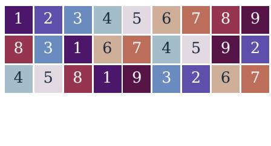  
(a) an optimal $3 \times 9$ rectangle, $I = 5 6$

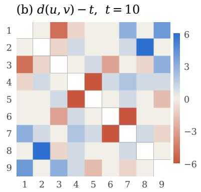

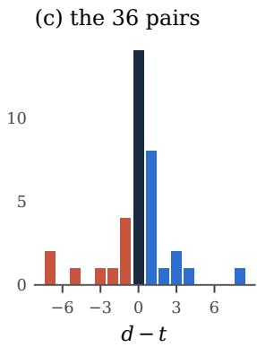  
Figure 1. A $3 \times 9$ rectangle of imbalance 56, which Theorem 2 proves optimal. (a) The rectangle, one colour per symbol. (b) The deviation $d ( u , v ) - t$ of every pair from the average distance $t = 1 0$ . Blue pairs are too far apart and red pairs too close. (c) Histogram of the 36 deviations. They sum to zero, and $I = \textstyle \sum \lvert d - t \rvert = 5 6$

Lemma 1 (Incremental evaluation). After the move, only the $2 ( n - 2 )$ distances $d ( a , w )$ and $d ( b , w )$ with $w \not \in \{ a , b \}$ change, and with $p = c _ { i } ( w )$

$$
d ^ { \prime } ( a , w ) = d ( a , w ) - | j _ { 1 } - p | + | j _ { 2 } - p | , \qquad d ^ { \prime } ( b , w ) = d ( b , w ) - | j _ { 2 } - p | + | j _ { 1 } - p | .
$$

Hence the exact change of 3I is computable in $O ( n )$ integer operations.

Proof. The move only exchanges the i-th coordinates of $x _ { a }$ and $x _ { b }$ . So $d ( a , b )$ does not change, and no pair without a or b is afected. □

Penalty. Let V be the number of excess occurrences of symbols in columns. Per-column counters maintain V in $O ( 1 )$ time per move. The search minimises $3 I + W \cdot V$ and records only states with $V = 0$ . The weight starts at $W = k$ and stays in $[ 1 , 4 n ^ { 2 } ]$ . Every $2 ^ { 1 6 }$ proposals, the search multiplies W by 1.02 if the current state has conflicts and by 0.99 otherwise. The search can therefore leave the Latin rectangles, pass through non-Latin states and return. By contrast, moves that permute whole columns never leave the Latin rectangles, and as Section 6 shows, they never change the row group.

Schedule. The search starts from the cyclic rectangle $r _ { i } ( j ) = i + j$ mod n. It accepts a move of change $\Delta$ with probability min $( 1 , e ^ { - \Delta / T } )$ . The temperature starts at $T _ { 0 } = 2 k$ (in units of 3I) and is multiplied by 0.9999995 per proposal. It never drops below 0.05, which it reaches after about $1 0 ^ { 7 }$ proposals. Most of a run is therefore a low-temperature walk on plateaus. If the best Latin rectangle found so far does not improve for $4 \cdot 1 0 ^ { 7 }$ proposals, the search resets the temperature to $T _ { 0 }$ . The search discards a proposal with $j _ { 1 } = j _ { 2 }$ but still counts it, and does not cool for it. Runs are single-threaded, and the search re-evaluates the reported rectangle from scratch.

An independent checker, written from the definition with exact rational arithmetic, verifies every reported rectangle. It also reproduces the imbalances reported for all fourteen rectangles printed in [11, 16]. Lean’s kernel also certifies every reported rectangle (Section 9).

<table><tr><td>n\k</td><td>2</td><td>3</td><td>4</td><td>5</td><td>6</td><td>7</td><td>8</td><td>9</td><td>10</td><td>11</td><td>12</td></tr><tr><td>8</td><td>40.0</td><td>36.0</td><td>32.0</td><td>30.0</td><td>24.0</td><td>28.0</td><td></td><td></td><td></td><td></td><td></td></tr><tr><td>9</td><td>65.3</td><td>56.0</td><td>53.3 56.0</td><td>48.6 52.6</td><td>40.0 48.0</td><td>43.3 51.3</td><td>42.6 53.3</td><td></td><td></td><td></td><td></td></tr><tr><td>10</td><td>92.0</td><td>80.0</td><td>78.6</td><td>66.6</td><td>60.0 70.0</td><td>58.0 72.0</td><td>58.6 82.6</td><td>64.0 70.0</td><td></td><td></td><td></td></tr><tr><td>11</td><td>124.0</td><td>114.0</td><td>104.0 112.0</td><td>94.0 116.0</td><td>88.0 108.0</td><td>84.0 118.0</td><td>78.0 114.0</td><td>84.0 120.0</td><td>100.0 110.0</td><td></td><td></td></tr><tr><td>12</td><td>168.0</td><td>152.0 154.0</td><td>149.3 154.6</td><td>140.0 145.3</td><td>120.0</td><td>121.3 164.0</td><td>116.6 148.0</td><td>106.0 154.0</td><td>124.0 174.6</td><td>136.6 147.3</td><td></td></tr><tr><td>13</td><td>218.6</td><td>198.0</td><td>201.3 211.3</td><td>191.3 210.6</td><td>166.0 204.0</td><td>164.0 203.3</td><td>160.0 220.6</td><td>152.0 214.0</td><td>154.6 240.6</td><td>168.0 224.0</td><td>166.0 274.0</td></tr></table>

Table 1. Minimum known imbalance of $k \times n$ Latin rectangles. Bold: new value from this work (best of the 1-, 5- and 10-minute runs), with the previous best value struck through below it. Previous values are those collected in Table 1 of Voboril et al. [16], which includes results of [3, 10, 11], of 4-hour Gurobi runs and of LLM-generated streamliners. Plain: a record that our search matches. Every bold or plain value is attained by a rectangle certified in Lean (Certificates.exists\_k\*\_n\*, Section 9). The struck-through values are taken from the literature and are not certified.

## 4 Improved upper bounds

We take the 51 non-square instances $8 \leq n \leq 1 3 , 2 \leq k \leq n - 1$ of Table 1 of [16], which also collects the earlier records. All runs used an Apple M3 laptop, one core per run. Each instance received independent runs of 1 and 5 CPU minutes. The larger instances $( k \geq 4 , n \geq 9 )$ also received a 10-minute run, so each instance used at most 16 CPU minutes. Table 1 reports the best of these runs. Of the 33 new values, 10 came first from the 1-minute run, 8 from the 5-minute run and 15 from the 10-minute run. The search improves 33 values, matches 18 and is worse on none. The mean improvement is 18.5% and the largest is 39.4% (12 × 13: $2 7 4 . 0  1 6 6 . 0 )$ . The search matches every record with n = 8 or k = 2, every record with k = 3 except $3 \times 1 2$ , and the records for $4 \times 1 0 , 5 \times 1 0$ and $6 \times 1 2$ . Several of these are proven optimal [10, 11], so matching is the best possible there.

Variability. Single runs are noisy. In 9 of the 33 improved cells, a longer run ended with a worse value than a shorter one. Across the three budgets, the final values of a cell difer by a median of 5% and at most 32.5%. The values in Table 1 are therefore upper bounds from a few runs, not estimates of typical performance.

Prior efort. Most previous values come from Voboril et al. [16]. They add LLM-generated streamlining constraints to a MiniZinc model and solve it with Gurobi. They run the streamliners either incrementally, warm-starting each round from the best solution so far, or with an evolutionary search. Their runs take 4 hours or more on dual 10-core Xeon nodes. The other previous values come from 4-hour Gurobi runs and earlier literature [3, 10, 11].

These runs used diferent hardware, diferent time limits and a general-purpose solver, so we compare values, not methods. Several previous values are attested by printed rectangles. For instance, the value 274.0 for $1 2 \times 1 3$ is the rectangle in Fig. 6h of [16], and our checker and Lean reproduce it. The amount of search behind each previous value also varies between cells. So the size of an improvement need not reflect the dificulty of an instance.

(a) record and new value  
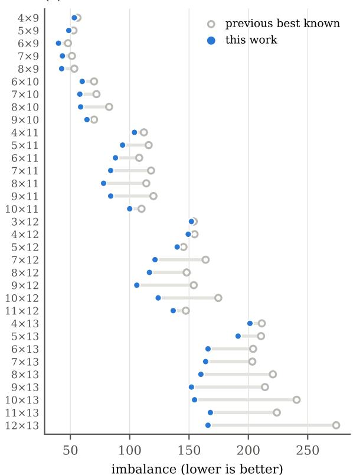

(b) time to beat the record, 5 seeds  
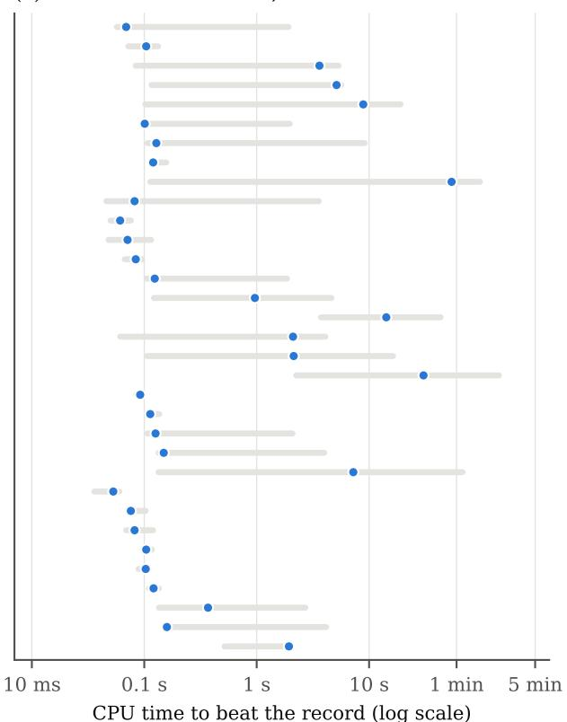  
Figure 2. The 33 improved instances. (a) Previous record (open circle) and new value (filled). (b) CPU time until the search first beats the record: median (dot) and range (bar) over 5 seeds, log scale.

Speed. We reran the search with 5 fresh seeds on every improved instance, stopping when it beat the record (Figure 2b). All 165 runs succeeded. The median time to beat the previous record (not to reach our final value) was 0.12 CPU seconds and the maximum 143 seconds. For the reasons above we make no runtime comparison with earlier work. We measured these times on the Apple M3 laptop and did not archive their logs. An independent rerun of the same 165 runs used the original source on Linux x86-64 with GCC. It beat every record (pooled median 0.21 CPU seconds, maximum 280) and ended at the same values as the original runs. Its logs are in the validation/ directory of the repository.

## 5 Exact search and a new optimum

To complement the upper bounds, we wrote a branch and bound that decides whether a rectangle with $3 I < \beta$ exists for a given bound $\beta$

Branching. With $r _ { 1 } = \mathrm { i d }$ fixed, the search places the symbols in the order $1 , 2 , \ldots , n$ . Placing a symbol means choosing its column in each row $2 , \ldots , k ,$ , subject to the Latin conditions. The search places symbol 1 in increasing columns of rows $2 , \ldots , k$ . This loses nothing. Relabelling the symbols makes $r _ { 1 } = \mathrm { i d }$ , and permuting rows $2 , \ldots , k$ keeps $r _ { 1 } = \mathrm { i d }$ . Symbol 1 occupies distinct columns in those rows, so exactly one such permutation makes its columns increase with the row index. Both operations preserve I. A node is one choice of a column for a symbol in one row that passes the Latin check. When symbol u is complete, the deviations $\lvert 3 d ( u , v ) - 3 t \rvert$ for all $v < u$ are final, and the search adds them to the cost. We do not yet exploit the choice of the row that is fixed to the identity, or the column reversal of Section 2. Together they ofer up to another factor 2k of symmetry.

Bounds. Every unplaced row adds at least 1 to any distance, because the two symbols occupy diferent columns, and at most $n - 1 . \mathrm { ~ S o ~ }$ , while the search places a symbol, each pair $( u , v )$ with $v \ < \ u$ has a known overshoot $o _ { u v } = \left( 3 d _ { \mathrm { p a r t } } + 3 \rho - 3 t \right) ^ { + }$ and a known shortfall $s _ { u v } = ( 3 t - 3 d _ { \mathrm { p a r t } } - 3 \rho ( n - 1 ) ) ^ { + }$ . Here $d _ { \mathrm { p a r t } }$ is the distance over the rows placed so far, and $\rho$ is the number of rows still to place. Let $P$ and N be the sums of the positive and negative parts of the final deviations $3 d - 3 t .$ , so that the cost so far is $P + N$ . By (1), $3 I = 2 \sum ( 3 d - 3 t ) ^ { + } = 2 \sum ( 3 d - 3 t ) ^ { - }$ , so each of

$$
P + N + \sum o _ { u v } + \sum s _ { u v } , \qquad 2 \Bigl ( P + \sum o _ { u v } \Bigr ) , \qquad 2 \Bigl ( N + \sum s _ { u v } \Bigr )
$$

is a lower bound on $3 I .$ The search prunes the node when their maximum reaches $\beta .$ The first version of our program used only $P + N + \textstyle \sum { o _ { u v } }$ . The other two terms cost a few additions per node. When a symbol is complete, the first program also adds $m _ { 0 } = \operatorname* { m i n } ( 3 t$ mod 3, 3−3t mod 3) for every pair that is not yet final. This is valid only for the first of the three bounds, because a pair’s deviation can lie on either side of t. For $3 \times n$ and $4 \times 8$ we have $m _ { 0 } = 0$ . A run with $\beta$ equal to three times the value of our rectangle either finds a better rectangle or proves that none exists.

Theorem 2 (computer-assisted). The minimum imbalance of a $3 \times 9$ Latin rectangle is 56.

The upper bound is the rectangle of Figure 1, certified in Lean as Paper.three\_by\_nine. The lower bound is not formalised (Section 9). With the first bound, the branch and bound explores $5 . 5 \cdot 1 0 ^ { 9 }$ nodes in 140 CPU seconds and finds no rectangle with $I < 5 6$ . As a sanity check, a run with $\beta = 1 6 9$ finds a rectangle of value 56. Díaz et al. [3] had already found the value 56 itself. To our knowledge, its optimality was not known. That paper does not prove it, and Table 1 of [16] lists it as unproven.

A second implementation. To reduce the dependence on a single program, we re-derived the result with a second implementation. It was written independently from the description above and uses the sharper bound. Restricted to the first bound, it explores the same number of nodes as the first program to the precision we recorded $( 7 . 7 7 \cdot 1 0 ^ { 7 }$ against $7 . 8 \cdot 1 0 ^ { 7 }$ for $3 \times 8$ $5 . 4 8 \cdot 1 0 ^ { 9 }$ against $5 . 5 \cdot 1 0 ^ { 9 }$ for $3 \times 9 )$ . With the sharper bound, it confirms the three results with $k \geq 3$ using 2.4 to 3.3 times fewer nodes. It confirms the $2 \times 1 0$ and $2 \times 1 1$ optima with about 1.5 times fewer nodes (Table 2). Both programs share the branching scheme, so this guards against coding errors but not against an error in the scheme itself.

Table 2 summarises the runs. The method is deliberately plain: no symmetry beyond row order and symbol relabelling, and no learned bounds. With a 30-minute cap per instance and the first bound, the remaining open instances with $n \in \{ 8 , 9 \}$ stay undecided. Unlike the DRAT proofs of [11], our search does not emit a checkable certificate. Theorem 2 therefore rests on the correctness of two short programs. The first, which we publish, reproduces all the known optima listed above. The second, which is not yet in the repository, reproduces those for $2 \times 1 0$ $2 \times 1 1 , 3 \times 8$ and $4 \times 8$ . A certificate in the style of [11] is the natural next step, and the overshoot and shortfall bounds may be worth encoding there as redundant constraints.

<table><tr><td>instance</td><td></td><td>optimum I nodes, first bound CPU time</td><td></td><td>nodes, sharper before this work</td><td></td></tr><tr><td> $2 \times n , n \leq 1 1$ </td><td>as known</td><td> $\leq 3 . 8 \cdot 1 0 ^ { 7 }$ </td><td></td><td> $\leq 1 . 1 \mathrm { s } \leq 2 . 6 \cdot 1 0 ^ { 7 } \ : \left( n \geq 1 0 \right)$ </td><td>proven  $[ 3 , 1 0 ]$ </td></tr><tr><td> $3 \times 8$ </td><td>36.0</td><td> $7 . 8 \cdot 1 0 ^ { 7 }$ </td><td>1.9s</td><td> $3 . 2 \cdot 1 0 ^ { 7 }$ </td><td>proven [3, 11]</td></tr><tr><td> $4 \times 8$ </td><td>32.0</td><td> $1 . 9 \cdot 1 0 ^ { 1 0 }$ </td><td>477s</td><td> $5 . 7 \cdot 1 0 ^ { 9 }$ </td><td>proven [16]</td></tr><tr><td> $3 \times 9$ </td><td>56.0</td><td> $5 . 5 \cdot 1 0 ^ { 9 }$ </td><td>140 s</td><td> $2 . 1 \cdot 1 0 ^ { 9 }$ </td><td>open</td></tr><tr><td>5, 6, 7 × 8; 4–8 × 9</td><td></td><td></td><td>&gt; 1800 s</td><td></td><td>open (undecided)</td></tr></table>

Table 2. Exact branch and bound, single core. Each run proves that no rectangle beats our upper bound. The sharper-bound node counts are from the second implementation. We omit its CPU times because they were measured on a shared machine. On all small instances with $n \leq 7$ and $k \leq 4$ the first program also reproduces the values reported in [3].

## 6 A certificate that the new rectangles are not group-based

Díaz et al. [3] start their local search from k random rows of the cyclic Latin square. They repeatedly swap two random columns, keep a swap only when it lowers the imbalance, and restart with fresh rows. They note that the method “never leaves its isotopic class”. Two rectangles are isotopic if permuting rows, columns and symbols turns one into the other. So permuting columns preserves the isotopy class by definition. The question is how to see that a given rectangle lies outside every such class. We give an invariant that is cheap to compute and detects whether a rectangle can come from a group table. It is not a complete isotopy invariant, and it does not by itself explain why one search outperforms another.

Definition 3. The row group of a Latin rectangle with rows $r _ { 1 } , \ldots , r _ { k }$ is the permutation group on symbols

$$
\mathrm { H } ( L ) = \big \langle r _ { i } \circ r _ { j } ^ { - 1 } : 1 \leq i , j \leq k \big \rangle \ \leq \ \mathrm { S } _ { n } .
$$

The element $r _ { i } \circ r _ { i } ^ { - 1 }$ sends the symbol in column c of row $j$ to the symbol in column c of row i. Since $r _ { i } r _ { j } ^ { - 1 } = ( \stackrel {  } { r } _ { i } r _ { 1 } ^ { - 1 } ) ( r _ { j } r _ { 1 } ^ { - 1 } ) ^ { - 1 }$ , the group is already generated by the $k - 1$ ratios $r _ { i } r _ { 1 } ^ { - 1 }$ In particular, for $k = 2$ the row group is the cyclic group generated by $r _ { 2 } r _ { 1 } ^ { - 1 }$ , so it carries no information beyond the cycle type of one permutation.

## Proposition 4.

(i) Permuting columns does not change $\mathrm { H } ( L )$ . Permuting rows permutes its generators. Relabelling symbols by σ replaces it by σ $\mathrm { I } ( L ) \sigma ^ { - 1 }$ . So the conjugacy class of H(L) is an isotopy invariant.

(ii) If L is isotopic to k rows of the Cayley table of a group G of order n, then $\mathrm { H } ( L )$ is conjugate to a subgroup of the left-regular representation of G. In particular it acts semiregularly (only the identity fixes a symbol) and $| \mathrm { H } ( L ) |$ divides n.

(iii) For $i \neq 1$ , a swap in row i left-multiplies $r _ { i } r _ { 1 } ^ { - 1 }$ by a transposition and fixes the other generators. A single swap can therefore enlarge the row group.

Proof. (i) Replacing every row by $r _ { i } \circ \pi$ gives $( r _ { i } \pi ) ( r _ { j } \pi ) ^ { - 1 } = r _ { i } r _ { i } ^ { - 1 }$ . The other two statements are immediate. (ii) Up to isotopy, $r _ { i } ( c ) = \sigma ( a _ { i } b _ { c } )$ with $a _ { i } \in { \check { G } }$ and $c \mapsto b _ { c }$ a bijection onto G. Then $r _ { i } r _ { j } ^ { - 1 }$ maps $\sigma ( a _ { j } b )$ to $\sigma ( a _ { i } b )$ , so it is $\sigma \lambda _ { a _ { i } a _ { i } ^ { - 1 } } \sigma ^ { - 1 }$ , where $\lambda _ { g }$ is left multiplication by g. (iii) Swapping two symbols in row i replaces $r _ { i }$ by $\tau r _ { i }$ for a transposition $\tau .$ □

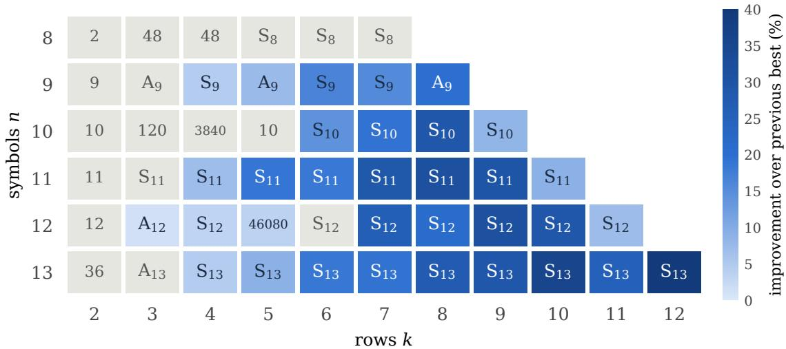  
Figure 3. Row groups of our best rectangles in the benchmark range. Shading shows the improvement over the previous best value, and grey cells are matched records. Each label gives the row group: $\mathrm { S } _ { n }$ or $\mathrm { A } _ { n } .$ otherwise its order. For $k = 2$ the row group is cyclic, generated by one permutation. It still certifies non-group structure when its order does not divide n.

So any search whose moves permute columns, starting from rows of a cyclic Latin square, stays among rectangles whose row group is cyclic of order dividing n. Figure 3 shows the row groups of the best rectangles we found. Of the 33 improved rectangles, 29 have row group $\mathrm { S } _ { n }$ and 3 have $\mathrm { A } _ { n } \ ( 5 \times 9 , 8 \times 9 \ \mathrm { a n d } \ 3 \times 1 2 )$ . The remaining one, $5 \times 1 2$ , has a row group of order $4 6 0 8 0 = 2 ^ { 6 } \cdot 6 !$ , which does not divide 12. By Theorem 4(ii), none of the 33 rectangles is isotopic to rows of a group table. In particular, the column-swapping search of [3] cannot reach any of them. The row group of the $5 \times 1 2$ rectangle is the full centraliser $\mathrm { S _ { 2 } } \wr \mathrm { S _ { 6 } }$ of the pairing $u  1 3 - u$ of symbols. This mirror symmetry also appears in the published $4 \times 1 2$ and $5 \times 1 2$ records.

What this does and does not show. The row group certifies that column-based local search cannot reach our rectangles. It does not explain why annealing finds better upper bounds than those reported by the exact solvers and streamliners, which supply most of the records we improve. Ten of the fourteen published SAT and streamliner rectangles also have row group $\mathrm { S } _ { n }$ . The SAT encodings aim at optimality proofs, while the streamliner approach searches a general-purpose model with a MIP solver under LLM-proposed restrictions. We have not isolated which ingredient of our search accounts for the better upper bounds.

## 7 Cubic growth for a fixed number of rows

Why does imbalance grow so quickly with n (Table 1), and why can squares be perfectly balanced? The point picture gives a short answer. For fixed k, there is not enough room in $[ n ] ^ { k }$ for n points that are pairwise far apart.

Theorem 5 (Lean: cubic\_lower\_bound\_ceil). Let L be a $k \times n$ Latin rectangle and $s \geq 1$

an integer, and put $M = \lceil n / s \rceil$ . Then

$$
I ( L ) \ \ge \ n \Big ( \frac { n } { M ^ { k } } - 1 \Big ) \Big ( \frac { k ( n + 1 ) } { 3 } - k ( s - 1 ) \Big )
$$

whenever $k ( s - 1 ) \leq t$ , that is, $3 ( s - 1 ) \leq n + 1$ . Consequently, for every fixed $k ,$

$$
c _ { k } \ \leq \ \operatorname* { l i m i n f } _ { n \to \infty } { \frac { \operatorname* { m i n } I } { n ^ { 3 } } } \ \leq \ \operatorname* { l i m s u p } _ { n \to \infty } { \frac { \operatorname* { m i n } I } { n ^ { 3 } } } \ \leq \ { \frac { k } { 3 } } , \qquad c _ { k } = \operatorname* { m a x } _ { m \geq 3 } { \frac { k } { m ^ { k } } } \Big ( { \frac { 1 } { 3 } } - { \frac { 1 } { m } } \Big ) > 0 .
$$

Proof. Cut each axis of $[ n ] ^ { k }$ into M intervals of at most s consecutive values. This cuts the grid into $M ^ { k }$ boxes. Two points in the same box difer by at most $s - 1$ in every coordinate, so their distance is at most $k ( s - 1 ) \leq t .$ . If box b holds $m _ { b }$ of the n points, convexity gives

$$
\sum _ { b } { \binom { m _ { b } } { 2 } } \geq M ^ { k } { \binom { n / M ^ { k } } { 2 } } = { \frac { n } { 2 } } { \Big ( } { \frac { n } { M ^ { k } } } - 1 { \Big ) }
$$

pairs that share a box. Each of them has $t - d \geq t - k ( s - 1 ) \geq 0$ . Inserting this into $( 1 )$ proves the first claim. For the second, take $s = \lceil n / m \rceil$ for a fixed $m \geq 3$ . Then $M \leq m$ and $s - 1 \leq$ $( n - 1 ) / m$ , and the bound becomes $I \geq k ( \textstyle { \frac { 1 } { 3 } } - \textstyle { \frac { 1 } { m } } ) ( n ^ { 3 } / m ^ { k } - n ^ { 2 } )$ (lower\_bound\_explicit), which is k $m ^ { - k } ( { \textstyle { \frac { 1 } { 3 } } } - { \textstyle { \frac { 1 } { m } } } ) n ^ { 3 } - O ( n ^ { 2 } )$ (eventually\_lower\_bound). For the upper bound (imbalance\_le), $k \leq d \leq k ( n - 1 )$ gives $\begin{array} { r } { | d - t | \leq \frac { 2 k ( n - 2 ) } { 3 } } \end{array}$ , and $\textstyle { { \binom { n } { 2 } } \cdot { \frac { 2 k n } { 3 } } \leq { \frac { k n ^ { 3 } } { 3 } } }$ □

The Lean proof (Section 9) follows these lines and does the convexity step with the Cauchy– Schwarz inequality $\begin{array} { r } { ( \sum _ { b } m _ { b } ) ^ { 2 } \le M ^ { k } \sum _ { b } m _ { b } ^ { 2 } } \end{array}$

The upper constant $k / 3$ is crude. Random rectangles do much better, though we have not formalised this.

Proposition 6. Let $U _ { 1 } , U _ { 1 } ^ { \prime } , \dots , U _ { k } , U _ { k } ^ { \prime }$ be independent and uniform on $[ 0 , 1 ]$ , put $\begin{array} { r } { Z _ { k } = \sum _ { i = 1 } ^ { k } | U _ { i } | } \end{array}$ $U _ { i } ^ { \prime } |$ and $\begin{array} { r } { D _ { k } = \frac { 1 } { 2 } \mathbb { E } | Z _ { k } - \frac { k } { 3 } | } \end{array}$ . Then for every fixed $k ,$ min $I ( k \times n ) \leq D _ { k } n ^ { 3 } + O ( n ^ { 2 } )$ , and

$$
D _ { k } \ \leq \ { \frac { 1 } { 2 } } { \sqrt { \operatorname { V a r } Z _ { k } } } \ = \ { \frac { \sqrt { k } } { 6 { \sqrt { 2 } } } } .
$$

In particular lim $\mathrm { s u p } _ { n }$ min $I / n ^ { 3 } \le D _ { k }$ in Theorem 5.

Proof. Choose $r _ { 1 } , \ldots , r _ { k }$ independently and uniformly from $\mathrm { S } _ { n } ,$ ignoring the column condition. For a fixed pair $u \ne v$ the pairs $( c _ { i } ( u ) , c _ { i } ( v ) )$ are independent across i and uniform over ordered pairs of distinct columns. Realise them as $\lceil n U _ { i } \rceil$ and $\lceil n U _ { i } ^ { \prime } \rceil$ conditioned on being distinct, an event of probability $1 - 1 / n$ . Rounding changes each coordinate diference by less than 1. Conditioning on the k events changes the joint law by $O ( k / n )$ in total variation, while $| d - t | =$ $O ( k n )$ . Together with $\begin{array} { r } { t - \frac { k n } { 3 } = \frac { k } { 3 } } \end{array}$ , this gives $\begin{array} { r } { \mathbb { E } | d ( u , v ) - t | = n \mathbb { E } | Z _ { k } - \frac { k } { 3 } | + O ( k ^ { 2 } ) } \end{array}$ . Summing over the n pairs, $\mathbb { E } I = D _ { k } n ^ { 3 } + O ( n ^ { 2 } )$ . The number Q of clashes, that is, of triples $( i , i ^ { \prime } , j )$ with $i < i ^ { \prime }$ and the same symbol in column $j$ of rows i and $i ^ { \prime } ,$ , has $\begin{array} { r } { \mathbb { E } Q = \sum _ { i < i ^ { \prime } } \mathbb { E } \operatorname { f i x } ( r _ { i } ^ { - 1 } r _ { i ^ { \prime } } ) = \binom { k } { 2 } } \end{array}$ Choose an outcome with $I + 4 k n Q \leq \mathbb { E } [ I + 4 k n Q ] = D _ { k } n ^ { 3 } + O ( n ^ { 2 } )$

Now repair the clashes one at a time. Suppose symbol a sits in column j of row i and also of another row. Swap it with the symbol b in a column $j ^ { \prime }$ of row i with $1 \leq | j - j ^ { \prime } | \leq 2 k$ , chosen so that, in the other rows, a does not occur in column $j ^ { \prime }$ and b does not occur in column $j .$ . At most $2 k - 2$ columns are excluded, so such a $j ^ { \prime }$ exists once $n \geq 4 k$ . The swap removes the clash of $^ { a , }$ creates none, and changes at most $2 ( n - 2 )$ distances by at most 2k each, so it changes I by at most 4kn. After at most Q swaps the rectangle is Latin, with $I \leq D _ { k } n ^ { 3 } + O ( n ^ { 2 } )$ Finally, $\begin{array} { r } { \mathbb { E } Z _ { k } = \frac { k } { 3 } } \end{array}$ and $\begin{array} { r } { \mathrm { V a r } | U - U ^ { \prime } | = \frac { 1 } { 6 } - \frac { 1 } { 9 } = \frac { 1 } { 1 8 } } \end{array}$ , so the Cauchy–Schwarz inequality gives E $| Z _ { k } - { \textstyle { \frac { k } { 3 } } } | \le \sqrt { k / 1 8 }$ □

The proof of Theorem 5 is a pigeonhole argument, and Figure 4a shows it at work. Clustered points are expensive, and in a low-dimensional grid clustering is unavoidable. Three remarks put the theorem in context.

Remark 7 (Constants). For $k = 2 .$ , the maximum that defines $c _ { 2 }$ is attained at $m = 5$ , which gives $c _ { 2 } = 4 / 3 7 5 \approx 0 . 0 1 0 7$ (lowerConst\_two\_five, lowerConst\_two\_le). Also $D _ { 2 } = 4 9 6 / 3 6 4 5 \approx$ 0.1361, the value for a uniformly random derangement. For $k \geq 3 , c _ { k } = k / ( 1 2 \cdot 4 ^ { k } )$ , attained at $m = 4$ (lowerConst\_four, lowerConst\_le\_four). Numerically, $D _ { k } \approx 0 . 0 9 4 { \sqrt { k } }$ for large k, for example $D _ { 3 } \approx 0 . 1 6 5$ and $D _ { 1 2 } \approx 0 . 3 2 7$ . So the lower constant is of order $k 4 ^ { - k }$ , and the upper one grows like $\sqrt { k }$ . We do not know the right order in k.

In the benchmark range, the finite-n lower bound is weak. For $2 \times 1 3$ it gives 7.7, against the true optimum 218.6, and for $k = 3$ it becomes positive only at $n = 2 8$ . Its message is asymptotic. For fixed k, the average deviation per pair, $I / { \binom { n } { 2 } }$ , grows linearly in $n _ { : }$ , the same order as the target t itself. So rectangles are imperfect on average at the scale of t.

Remark 8 (Squares). The bound is useless when k grows with $n ,$ and it must be. Spatially balanced Latin squares exist, for instance whenever $2 n + 1$ is prime, by a construction that streamlined search itself discovered [9]. In $[ n ] ^ { n }$ there is room for n equidistant points. For squares with $n \equiv 1$ (mod 3), where perfect balance is impossible, Xia et al. [17] prove $I \geq 4 n ( n - 1 ) / 9$ an order $n ^ { 2 }$ rather than $n ^ { 3 }$ . The bound is attained for $n \equiv 1$ (mod 3) up to $n = 5 2 ~ [ 1 7 ]$ . It is not known whether the minimum for squares is of order at most $n ^ { 2 }$ for every n. The point picture raises a natural question, which we leave open: how does the minimum imbalance pass from order $n ^ { 3 }$ at fixed k to these much smaller values at $k = n ?$

Remark 9 (Equilateral sets). A perfectly balanced rectangle needs $3 \mid k ( n + 1 )$ , so that t is an integer. It is also a set of n points in $\mathbb { R } ^ { k }$ that are pairwise equidistant in $\ell _ { 1 }$ , that is, an equilateral set of $\ell _ { 1 } ^ { k }$ . Hence $n \leq e ( \ell _ { 1 } ^ { k } )$ , the largest size of such a set. Kusner conjectured $e ( \ell _ { 1 } ^ { k } ) = 2 k$ . The conjecture is known for $k \leq 4 ,$ , where the case $k = 4$ is due to Koolen et al. [8]. In general, Alon and Pudlák [1] proved $e ( \ell _ { 1 } ^ { k } ) = O ( k \log k )$ . The survey of Swanepoel [12] covers these results. So a perfectly balanced $k \times n$ rectangle needs $k = \Omega ( n / \log n )$ rows. For $k \leq 4$ this gives $n \leq 2 k$ which recovers part of the case analysis of Díaz et al. [3]. Their arguments are sharper for $k \leq 3$ . Their bound $k \geq 6 - 1 8 / ( n + 1 )$ coincides with ours at $k = 4$ and is vacuous for $k \geq 6$ The point sets of rectangles are far more special than general equilateral sets, because their coordinate projections are bijections onto [n]. So we do not expect these bounds to be tight. We did not find this connection in the literature on balanced designs.

## 8 Two rows

For $k = 2$ a rectangle is a derangement $\pi = r _ { 2 }$ , and the points $x _ { u } = ( u , \pi ^ { - 1 } ( u ) )$ form its permutation diagram. Mirka et al. [10] solved $n \leq 1 3$ to optimality with a clique-based MIP and reported bounds up to $n = 2 0$ after six hours. Table 3 adds our two-minute annealing runs. They improve the upper bound for $1 5 \leq n \leq 1 9$ , tie at $n = 1 4$ and lose at $n = 2 0$ . At $n = 2 0$ the best bound of [10] came from eight parallel six-hour runs. Our runs are single runs with one seed, and the improvements are small (0.2–2%). The $\mathrm { M I P }$ also spends its time on lower bounds. So the comparison shows only that annealing is a strong source of incumbents. The lower bounds remain far away, and we did not try to improve them.

<table><tr><td>n</td><td>14</td><td>15</td><td>16</td><td>17</td><td>18</td><td>19</td><td>20</td></tr><tr><td>lower bound [10]</td><td>201.57</td><td>252.6</td><td>273.82</td><td>252.0</td><td>402.6</td><td>465.3</td><td>155.0</td></tr><tr><td>upper bound [10]</td><td>268.0</td><td>345.3</td><td>427.3</td><td>508.0</td><td>617.3</td><td>732.0</td><td>816.0</td></tr><tr><td>annealing (this work)</td><td>268.0</td><td>344.6</td><td>422.0</td><td>498.0</td><td>610.6</td><td>722.6</td><td>832.0</td></tr></table>

Table 3. 2 × n rectangles beyond the proven range. The lower and upper bounds are the best over all methods and configurations in Tables 1, 2 and 4–7 of [10], from 6-hour runs. Annealing: one 2-minute single-core run. Bold: better than the previous upper bound. The lower bounds are those reached when the 6-hour limit expired, which is why they are not monotone in n. The values 201.57 and 273.82 come from one instance with 32 threads in their Table 6 and are decimals as reported there. All other values use the x.3, x.6 convention.

(a) 2 × 16, I = 422.0  
(b)  
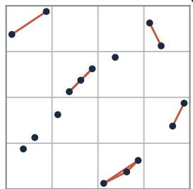

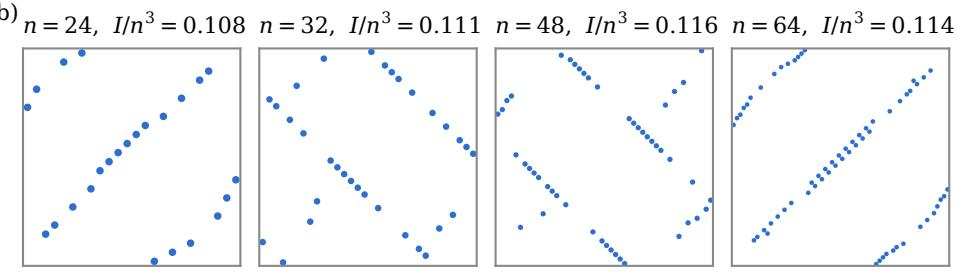  
Figure 4. 2 × n rectangles as point sets. (a) The proof of Theorem 5 for a $2 \times 1 6$ rectangle with $I = 4 2 2 \cdot$ a 4 × 4 grid of boxes, and in red the pairs that share a box. Each such pair is closer than the average $t = 3 4 / 3$ and costs imbalance. (b) The best rectangles found by annealing for larger n (one 2-minute run each), rescaled to the unit square. Most points lie on a few long parallel diagonal runs, with scattered extra points.

The shape of good permutations. Figure 4b shows the best permutations that annealing finds for $n \in \{ 2 4 , 3 2 , 4 8 , 6 4 \}$ . They are not known to be optimal, but they are far from random. Most points lie on a few long parallel segments of slope 1, cyclically shifted against one another, with a minority of scattered points.

A limit object. A permuton is a probability measure on $[ 0 , 1 ] ^ { 2 }$ with uniform marginals. Every permutation $\sigma$ of [n] defines one, $\mu _ { \sigma }$ , uniform on the squares $\begin{array} { r } { \left[ \frac { i - 1 } { n } , \frac { i } { n } \right] \times [ \frac { \sigma ( i ) - 1 } { n } , \frac { \sigma ( i ) } { n } ] } \end{array}$ . Put

$$
\begin{array} { r } { C ( \mu ) = \frac { 1 } { 2 } \mathbb { E } \left| \left| X - X ^ { \prime } \right| + | Y - Y ^ { \prime } | - \frac { 2 } { 3 } \right| , } \end{array}
$$

where $( X , Y )$ and $( X ^ { \prime } , Y ^ { \prime } )$ are independent samples of $\mu .$

Proposition 10. For $k = 2 ,$ min $I / n ^ { 3 }$ converges as $n \to \infty$ to $\mathrm { m i n } _ { \mu } C ( \mu )$ , where the minimum over permutons is attained.

Proof. Let $f ( x , y , x ^ { \prime } , y ^ { \prime } ) = | | x - x ^ { \prime } | + | y - y ^ { \prime } | - \frac { 2 } { 3 } |$ , which is bounded and 1-Lipschitz for the $\ell _ { 1 }$ norm on $[ 0 , 1 ] ^ { 4 }$ . If $\mu _ { n }  \mu$ weakly then $\mu _ { n } \otimes \mu _ { n } \to \mu \otimes \mu$ weakly, so C is continuous. Permutons form a weakly closed subset of the compact space of probability measures on $[ 0 , 1 ] ^ { 2 }$ , so $C$ attains its minimum.

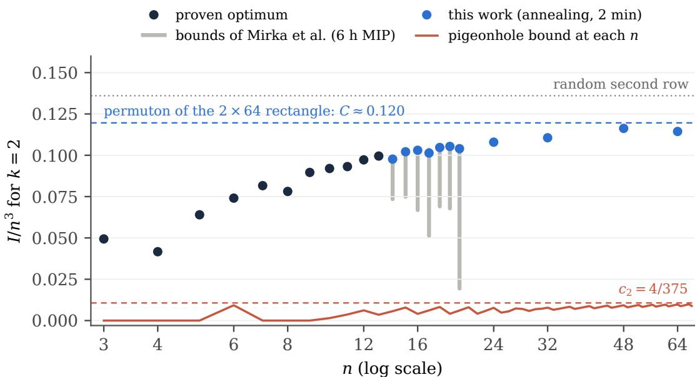  
Figure 5. Normalised imbalance $I / n ^ { 3 }$ for $k = 2$ . Black: proven optima. Grey: interval between the best lower and upper bounds of [10]. Blue dots: our annealing values. Blue dashes: $C ( \mu _ { \sigma } )$ for our $2 \times 6 4$ rectangle, an upper bound for the limit (Theorem 10). Red: Theorem 5 at each n (solid) and its limit $c _ { 2 }$ (dashed). A uniformly random derangement has $I / \stackrel { . } { n } { } ^ { 3 }  0 . 1 3 6 1$ (dotted).

Fix a derangement $\sigma$ of $[ n ]$ and take the $2 \times n$ rectangle with $\pi = \sigma ^ { - 1 }$ , whose points $x _ { u } = ( u , \sigma ( u ) )$ are the cells of $\mu _ { \sigma }$ . Write $\begin{array} { r } { I ( \sigma ) / n ^ { 3 } = \frac { 1 } { 2 n ^ { 2 } } \sum _ { u \ne v } | d ( u , v ) / n - t / n | } \end{array}$ . Each ordered pair u $\neq v$ corresponds to a pair of cells of $\mu _ { \sigma } \otimes \mu _ { \sigma }$ of weight $1 / n ^ { 2 }$ . Within these cells, f difers from $\lvert d ( u , v ) / n - \frac { 2 } { 3 } \rvert$ by at most $2 / n$ , and $\begin{array} { r } { | t / n - \frac { 2 } { 3 } | = \frac { 2 } { 3 n } } \end{array}$ . The n diagonal cell pairs carry total weight $1 / n$ and are absent from I. Hence $| I ( \sigma ) / n ^ { \bar { 3 } } - \bar { C ( \mu _ { \sigma } ) | } | \leq A / n$ for an absolute constant A, uniformly in $\sigma .$ . This gives min $I / n ^ { 3 } \geq \operatorname* { m i n } _ { \mu } C ( \mu ) - A / n$

Conversely, let $\mu ^ { * }$ attain the minimum. Sampling n independent points from $\mu ^ { * }$ and taking the induced permutation gives permutations $\sigma _ { n }$ with $\mu _ { \sigma _ { n } }  \mu ^ { * }$ almost surely [6]. Remove the fixed points of $\sigma _ { n }$ one at a time: if $\sigma ( j ) = j$ , exchange the values at $j$ and $j ^ { \prime } ,$ , where $j ^ { \prime } = j + 1$ for $j < n$ and $j ^ { \prime } = n - 1$ for $j = n$ . Then $\sigma ( j )$ becomes $\sigma ( j ^ { \prime } ) \neq j$ and $\sigma ( j ^ { \prime } )$ becomes $j \neq j ^ { \prime }$ so no new fixed point is created. Each exchange moves two points by one cell, so it changes I by at most $4 n$ , and there are at most n of them. The resulting derangements $\tau _ { n }$ satisfy $I ( \tau _ { n } ) / n ^ { 3 } \le C ( \mu _ { \sigma _ { n } } ) + O ( 1 / n ) \to C ( \mu ^ { * } )$ □

The uniform permuton gives $C = 4 9 6 / 3 6 4 5 \approx 0 . 1 3 6 1$ , the limit for a random derangement, and the diagonal (the cyclic rectangle) gives $1 6 / 8 1 \approx 0 . 1 9 8$ . Optimising numerically over permutons made of $m$ increasing or decreasing segments gives 0.148, 0.133 and 0.124 for $m = 3 , 4 , 5$ . The permuton of our $2 \times 6 4$ rectangle does better. On a pair of distinct cells, $| X - X ^ { \prime } | + | Y - Y ^ { \prime } |$ is a constant plus a sum of four independent uniform variables. So $C ( \mu _ { \sigma } )$ is a finite sum of explicit polynomial integrals, and exact rational arithmetic gives $C ( \mu _ { \sigma } ) = 2 2 8 5 0 9 4 5 3 / 1 9 1 1 0 2 9 7 6 0 \approx 0 . 1 1 9 5 7 4$ . This is our best upper bound for the limit. The rectangle itself has $I = 2 9 9 8 8 .$ , so $I / n ^ { 3 } = 0 . 1 1 4 4 0$ . The diagonal cells account for almost all of the diference 0.00518. They contribute $\textstyle { \frac { 1 } { 3 n } } - { \frac { 1 } { 3 n ^ { 2 } } } = 0 . 0 0 5 1 3$ to $C ( \mu _ { \sigma } )$ , and the remaining

0.00005 comes from the within-cell smoothing and from $t / n \neq \frac { 2 } { 3 }$ . The finite values $I / n ^ { 3 } \approx 0 . 1 1$ in Figure 5 therefore lie below the limit estimate by about $1 / ( 3 n )$

Question. What is limn min $I ( 2 \times n ) / n ^ { 3 } = \mathrm { { \ m i n } } _ { \mu } C ( \mu ) ?$ We know only that it lies between 4/375 ≈ 0.011 and 0.1196. Is the minimiser unique, and is it a finite union of segments?

## 9 Formal verification in Lean 4

Most computational results on balanced rectangles rest on unverified programs. The DRAT proofs of Peruvemba Ramaswamy and Szeider [11] are an exception, and for squares Xia et al. [17] verified their lower bound in Lean 4. We formalised the parts of this paper where formalisation is cheap and useful, in Lean 4 [2] with Mathlib [13]. The development has about 700 hand-written lines plus generated certificates. It is in the lean/ directory of the repository, and Table 4 maps the statements of the paper to Lean names.

Specification. The file Defs.lean contains the whole specification that the certificates rely on. It imports only Lean’s core library, not Mathlib. It uses the point picture of Section 2: a rectangle is the function $( i , u ) \mapsto c _ { i } ( u )$ , with indices starting at 0.

structure LatinRect (k n : Nat) where   
col : Fin k → Fin n → Fin n -- col i u = column of symbol u in row i   
row\_inj : ∀ i u v, col i u = col i v → u = v   
col\_inj : ∀ u i j, col i u = col j u → i = j   
def dist (L : LatinRect k n) (u v : Fin n) : Nat := -- d(u, v) = P |ci(u) − ci(v)|   
fsum fun i => absDiff (L.col i u).val (L.col i v).val   
def imb3 (L : LatinRect k n) : Nat := -- 3I = P |3d(u, v) − k(n + 1)|   
fsum fun u => fsum fun v =>   
if u < v then ((3 \* L.dist u v : Int) - k \* (n + 1)).natAbs else 0

Here fsum f is the sum of the list [f 0, ..., f (n-1)], and absDiff a b is (a−˙ b)+(b−˙ a) = |a − b|, with truncated subtraction −˙ on N. We certify the integer 3I, so that the kernel never handles fractions. In Cubic.lean, we define the imbalance I over Q exactly as in Section 2, and imbalance\_eq\_imb3 proves I = imb3/3.

Certificates by kernel evaluation. A script copies each rectangle from its data file into Lean, after cross-checking the claimed value with the independent Python checker. For Figure 1 it produces

def rows\_k3\_n9 : List (List Nat) :=   
[[1, 2, 3, 4, 5, 6, 7, 8, 9], [8, 3, 1, 6, 7, 4, 5, 9, 2], [4, 5, 8, 1, 9, 3, 2, 6, 7]]   
def rect\_k3\_n9 : LatinRect 3 9 where   
col := colOfRows rows\_k3\_n9   
row\_inj := by decide +kernel   
col\_inj := by decide +kernel   
theorem imb3\_k3\_n9 : rect\_k3\_n9.imb3 = 168 := by decide +kernel   
theorem exists\_k3\_n9 : ∃ L : LatinRect 3 9, L.imb3 = 168 := ⟨rect\_k3\_n9, imb3\_k3\_n9⟩

The tactic decide +kernel is proof by reflection. The proposition has a decision procedure, written in Lean, and the kernel itself reduces that procedure to true while type-checking the proof term. The alternative, native\_decide, runs compiled code. It adds the axiom Lean.ofReduceBool, so it trusts the compiler and every implemented\_by annotation. Our certificates avoid it, and #print axioms reports only propext.

<table><tr><td>statement in the paper</td><td>Lean name</td><td>uses</td></tr><tr><td>all rectangles (Tables 1 and 3, Figure 1)</td><td> $\mathtt { C e r t i f i c a t e s . e x i s t s \_ k * \_ n * }$ </td><td>core</td></tr><tr><td> $I = { \mathrm { i m b 3 } } / { 3 } ; t$  is the mean distance</td><td> $\mathrm { i m b a l a n c e \_ e q \_ i m b 3 , \ s u m \_ d i s t }$ </td><td>Mathlib</td></tr><tr><td>identity (1)</td><td> $\mathrm { i m b a l a n c e \_ e q \_ t w o \_ m u l \_ s u m \_ p o s }$ </td><td>Mathlib</td></tr><tr><td>Theorem 5, pigeonhole bound</td><td> $\mathtt { c u b i c \_ l o w e r \_ b o u n d \_ c e i l }$ </td><td>Mathlib</td></tr><tr><td>Theorem 5, lim inf  $\geq c _ { k }$ </td><td> $\mathsf { e v e n t u a l l y \_ l o w e r \_ b o u n d }$ </td><td>Mathlib</td></tr><tr><td> $\mathrm { T h e o r e m ~ 5 , ~ l i m ~ s u p } \le k / 3$ </td><td> $\mathrm { i m b a l a n c e } _ { - } 1 \mathtt { e }$ </td><td>Mathlib</td></tr><tr><td> $c _ { 2 } = 4 / 3 7 5$ </td><td> $\mathtt { l o w e r C o n s t \_ t w o \_ f i v e , 1 o w e r C o n s t \_ t w o \_ l e }$ </td><td>Mathlib</td></tr><tr><td> $c _ { k } = \dot { k } / ( 1 2 \cdot 4 ^ { k } ) , k \geq 3$ </td><td> $\mathtt { l o w e r C o n s t \_ f o u r , }$  lowerConst_le_four</td><td>Mathlib</td></tr><tr><td>rectangles of [11, 16]</td><td>Certificates.exists_pub_*</td><td>core</td></tr><tr><td>spec = Latin arrays; non-vacuous</td><td> $\mathtt { a r r a y E q u i v , n o n e m p t y \_ o f \_ l e }$ </td><td>Mathlib</td></tr><tr><td>optimality in Theorem 2</td><td>not formalised</td><td></td></tr><tr><td>Theorems 4, 6 and 10</td><td>not formalised</td><td></td></tr></table>

Table 4. Formalised statements. Names are relative to the namespace BalancedLatin; theorems about a rectangle are in its sub-namespace LatinRect. “Core”: the proof uses only Lean’s core library and the 74-line specification Defs.lean; “Mathlib”: it also uses Mathlib. The certificates use only the axiom propext; the theorems use the three standard axioms propext, Classical.choice and Quot.sound. No statement uses sorry or native\_decide.

The soundness of a statement such as exists\_k3\_n9 does not depend on the script or on how colOfRows reads the data. For any function passed as col, the kernel checks that it is a Latin rectangle with the stated value of 3I. To tie each certificate to its data file, a further theorem faithful\_k3\_n9 checks that the entry of row i in column col i u is the symbol $u + 1$ of the file. Lean certifies all 62 rectangles: the 51 of Table 1 and the eleven $2 \times n$ rectangles with $1 4 \leq n \leq 6 4$ used in Table 3 and Figures 4 and 5. The largest are $1 2 \times 1 3$ and $2 \times 6 4$ which has 2016 pairs. Elaborating all of them takes about 50 s of CPU time on an Apple M3 laptop. As a negative test, changing the claimed value by one, placing a symbol twice in a column, or repeating a symbol in a row each makes the check fail.

Cubic growth. Cubic.lean (480 lines, 14 s) proves Theorem 5. The main statements read

theorem cubic\_lower\_bound (L : LatinRect k n) (s M : N) (hs : 0 < s) (hM : n ≤ M \* s)   
(ht : (k : Q) \* (s - 1) ≤ target k n) :   
(n : Q) \* (n / (M : Q) ^ k - 1) \* (target k n - k \* (s - 1)) ≤ L.imbalance   
theorem eventually\_lower\_bound (k m : N) (hm : 3 ≤ m) {ε : Q} (hε : 0 < ε) :   
∀f n in Filter.atTop, ∀ L : LatinRect k n,   
(lowerConst k m - ε) \* (n : Q) ^ 3 ≤ L.imbalance

where target k n is $t = k ( n + 1 ) / 3$ and lowerConst k m is $k m ^ { - k } ( \textstyle { \frac { 1 } { 3 } } - \textstyle { \frac { 1 } { m } } )$ . The first is slightly more general than Theorem 5: it allows any M intervals per axis with $n \leq M s$ . Its instance $M = \lceil n / s \rceil$ , cubic\_lower\_bound\_ceil, is Theorem 5 word for word. The second states the liminf bound in the eventually form, for each m, so we do not have to define min I as a function of n. The proof follows the paper. It reindexes along the row permutations (Fintype.sum\_bijective) to show that t is the average distance. It then symmetrises the sum over $u < v$ to one over ordered pairs, and uses Mathlib’s sq\_sum\_le\_card\_mul\_sum\_sq for Cauchy–Schwarz.

Is the specification the right one? A formal proof is only as good as its statement. A definition that difers subtly from the intended one would make every certificate meaningless. We guard against this in four ways. (i) Agreement with the literature. Lean certifies the 14 rectangles printed in [11, 16], of sizes $3 \times 4$ to $1 2 \times 1 3$ , with the imbalances that those papers report (Certificates.exists\_pub\_\*). This tests the definitions of d and I against independent data, not against our own Python checker. (ii) Agreement with the textbook definition. arrayEquiv is a bijection between LatinRect k n and arrays A (row $i ,$ column j) whose rows are permutations and whose columns have no repeats. ofArray\_col shows that col i u is the column of symbol u in row i, that is, $c _ { i } ( u )$ . (iii) Non-vacuity. nonempty\_of\_le shows that LatinRect k n is inhabited for every $k \leq n$ , so the universally quantified theorems are not vacuous. (iv) Agreement with the paper. A test parses Tables 1 and 3 and the values quoted in the text for $3 \times 9 , 2 \times 1 6$ and $1 2 \times 1 3$ , and compares them with the Lean statements. It also compares every rectangle printed in Section A, entry by entry, with the rows of its certificate. Changing one of these printed values makes it fail.

What is not formalised. The optimality half of Theorem 2 is the main gap. The branch and bound visits $5 . 5 \cdot 1 0 ^ { 9 }$ nodes, far more than kernel evaluation can handle. A certificate would need one of two routes. The first is a branch and bound written and proved correct in Lean and then run with native\_decide, which moves the trust from our C program to Lean’s compiler. The second is a $\mathrm { S A T }$ encoding with an LRAT proof that a verified checker accepts. Either route also has to prove the symmetry reduction of Section 5. Theorem 10 needs permutons and the sampling theorem of Hoppen et al. [6], which Mathlib does not have. Theorem 6 needs an asymptotic estimate of $\begin{array} { r } { \mathbb { E } | Z _ { k } - \frac { k } { 3 } | } \end{array}$ for discretised uniform variables. Theorem 9 rests on the theorem of Alon and Pudlák [1]. Theorem 4 is elementary, but we computed the row groups in Figure 3 with SymPy’s Schreier–Sims implementation, and they are not certified.

## 10 Discussion

The point picture says that balance is a packing problem in $\ell _ { 1 }$ , so moving points is the natural search move. It also gives the right scale. For a fixed number of rows, imbalance is not a small defect that clever search will remove. It is a quantity of order $n ^ { 3 }$ , and its leading constant is the real object of study. The row group adds a cheap check that a rectangle is not built from a group table.

Limitations. The new upper bounds are best-of-runs from at most three runs per instance, and single runs vary by up to a third (Section 4). We did not isolate the efect of the adaptive penalty or rerun earlier local search head-to-head. We also make no runtime comparison with earlier work. The optimality of $3 \times 9$ rests on two uncertified programs that share a branching scheme. In contrast, Lean checks every upper bound and the pigeonhole theorem. Our lower-bound constant is far from the observed values for $k = 2$ and is negligible in the benchmark range.

## Open problems.

(1) Certify Theorem 2, for instance with a DRAT-producing SAT encoding as in [11] or with a branch and bound verified in Lean (Section 9). Also settle $5 \times 8$ to $7 \times 8$ . The sharper bound and the unused column-reversal and row symmetries of Section 5 are natural first steps. Our new upper bounds are natural starting incumbents for certified solvers. The mirror pairing $u  n + 1 - u$ seen in several records is a candidate streamliner in the sense of [16].

(2) Close the gap between $c _ { 2 } = 0 . 0 1 0 7$ and 0.1196. A sharper lower bound might weight each close pair by its shortfall t − d instead of the worst case inside a box. The limit problem is a quadratic minimisation over permutons. One route to a certified lower bound is to discretise it to doubly stochastic matrices and apply a semidefinite relaxation.

(3) Determine the minimising permuton for $k = 2$

(4) Find the order in k of the constants in Theorem 5, between $k 4 ^ { - k }$ and $\sqrt { k }$ . Also find how the minimum passes to order $n ^ { 2 }$ for squares.

(5) Show directly that a perfectly balanced $k \times n$ rectangle needs $k \geq n / 2$ , using that its coordinate projections are bijections. This would follow from Kusner’s conjecture for $\ell _ { 1 }$ , a long-standing problem in geometry, but it may be easier for these special point sets.

Data and code. Rectangles, the annealing code, the branch and bound, the exact checker, the Lean development and the scripts for every figure are at

https://github.com/BrianLi009/Balanced-Latin-Rectangles. The new rectangles are listed in Section A, and all 62 are in the ancillary file anc/rectangles.txt.

## References

[1] Noga Alon and Pavel Pudlák. Equilateral sets in lnp . Geometric and Functional Analysis, 13(3):467–482, 2003. doi: 10.1007/s00039-003-0418-7.

[2] Leonardo de Moura and Sebastian Ullrich. The Lean 4 theorem prover and programming language. In Automated Deduction – CADE 28, volume 12699 of Lecture Notes in Computer Science, pages 625–635. Springer, 2021. doi: 10.1007/978-3-030-79876-5\_37.

[3] Mateo Díaz, Ronan Le Bras, and Carla P. Gomes. In search of balance: The challenge of generating balanced Latin rectangles. In Integration of AI and OR Techniques in Constraint Programming (CPAIOR 2017), volume 10335 of Lecture Notes in Computer Science, pages 68–76. Springer, 2017. doi: 10.1007/978-3-319-59776-8\_6.

[4] Fred Glover and Jin-Kao Hao. The case for strategic oscillation. Annals of Operations Research, 183(1):163–173, 2011. doi: 10.1007/s10479-009-0597-1.

[5] Carla P. Gomes and Meinolf Sellmann. Streamlined constraint reasoning. In Principles and Practice of Constraint Programming (CP 2004), volume 3258 of Lecture Notes in Computer Science, pages 274–289. Springer, 2004. doi: 10.1007/978-3-540-30201-8\_22.

[6] Carlos Hoppen, Yoshiharu Kohayakawa, Carlos Gustavo Moreira, Balázs Ráth, and Rudini Menezes Sampaio. Limits of permutation sequences. Journal of Combinatorial Theory, Series B, 103(1):93–113, 2013. doi: 10.1016/j.jctb.2012.09.003.

[7] Scott Kirkpatrick, C. Daniel Gelatt, and Mario P. Vecchi. Optimization by simulated annealing. Science, 220(4598):671–680, 1983. doi: 10.1126/science.220.4598.671.

[8] Jack Koolen, Monique Laurent, and Alexander Schrijver. Equilateral dimension of the rectilinear space. Designs, Codes and Cryptography, 21:149–164, 2000. doi: 10.1023/A: 1008391712305.

[9] Ronan Le Bras, Carla P. Gomes, and Bart Selman. From streamlined combinatorial search to eficient constructive procedures. In Proceedings of the Twenty-Sixth AAAI Conference on Artificial Intelligence, pages 499–506, 2012. doi: 10.1609/aaai.v26i1.8147.

[10] Renee Mirka, Laura Greenstreet, Marc Grimson, and Carla P. Gomes. A new approach to finding 2 × n partially spatially balanced Latin rectangles (short paper). In 29th International Conference on Principles and Practice of Constraint Programming (CP 2023), volume 280 of LIPIcs, pages 47:1–47:11. Schloss Dagstuhl – Leibniz-Zentrum für Informatik, 2023. doi: 10.4230/LIPIcs.CP.2023.47.

[11] Vaidyanathan Peruvemba Ramaswamy and Stefan Szeider. Proven optimally-balanced Latin rectangles with SAT (short paper). In 29th International Conference on Principles and Practice of Constraint Programming (CP 2023), volume 280 of LIPIcs, pages 48:1–48:10. Schloss Dagstuhl – Leibniz-Zentrum für Informatik, 2023. doi: 10.4230/LIPIcs.CP.2023.48.

[12] Konrad J. Swanepoel. Equilateral sets in finite-dimensional normed spaces, 2004. arXiv:math/0406264.

[13] The mathlib Community. The Lean mathematical library. In Proceedings of the 9th ACM SIGPLAN International Conference on Certified Programs and Proofs (CPP 2020), pages 367–381. ACM, 2020. doi: 10.1145/3372885.3373824.

[14] H. M. van Es and C. L. van Es. Spatial nature of randomization and its efect on the outcome of field experiments. Agronomy Journal, 85(2):420–428, 1993. doi: 10.2134/ agronj1993.00021962008500020046x.

[15] Florentina Voboril and Stefan Szeider. Improving constraint models with LLM agents, 2026. arXiv:2608.08127.

[16] Florentina Voboril, Vaidyanathan Peruvemba Ramaswamy, and Stefan Szeider. Balancing Latin rectangles with LLM-generated streamliners. In 31st International Conference on Principles and Practice of Constraint Programming (CP 2025), volume 340 of LIPIcs, pages 36:1–36:17. Schloss Dagstuhl – Leibniz-Zentrum für Informatik, 2025. doi: 10.4230/ LIPIcs.CP.2025.36.

[17] Hai Xia, Carla P. Gomes, Bart Selman, and Stefan Szeider. Agentic neurosymbolic collaboration for mathematical discovery: A case study in combinatorial design, 2026. arXiv:2603.08322.

[18] Zhenxuan Xie, Zhipeng Lü, Zhouxing Su, Chu-Min Li, Junwen Ding, and Yuxuan Wang. A swap relaxation-based local search for the Latin square completion problem. In Proceedings of the Thirty-Third International Joint Conference on Artificial Intelligence (IJCAI-24), pages 7047–7055, 2024. doi: 10.24963/ijcai.2024/779.

[19] Cheng Zhang and Jianpeng Ma. Counting solutions for the N-queens and Latin square problems by eficient Monte Carlo simulations, 2008. arXiv:0808.4003.

## A The new rectangles

This appendix lists the 33 rectangles that improve Table 1 and the seven 2 × n rectangles of Table 3. Rows are listed from top to bottom, entry j of a row is the symbol in column j, and the first row is always the identity. Each heading gives the new imbalance in bold and, in grey, the previous best value of [16] and the relative improvement. As in Figure 1, each symbol has its own colour, so every row shows all n colours and no colour repeats within a column. Each rectangle is a file of the repository named by its size: the 4 × 9 rectangle, for example, is results/rectangles/k4\_n9.txt (the 2 × n ones are in results/k2\_large/). Lean certifies it as Certificates.exists\_k4\_n9, and Certificates.faithful\_k4\_n9 ties the certificate to the file (Section 9). A test in the repository checks this list against the certificates entry by entry. All 62 rectangles of the paper, including the matched records and the 2 × n rectangles with $n \geq 2 4$ , are in the ancillary file anc/rectangles.txt.

n = 9  
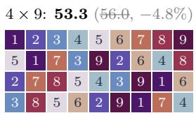

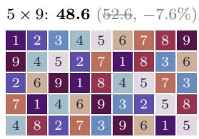

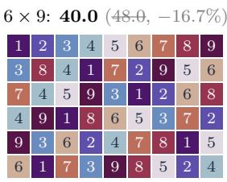

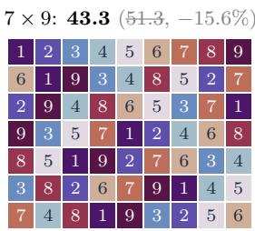

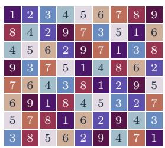  
n = 10

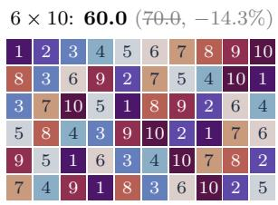

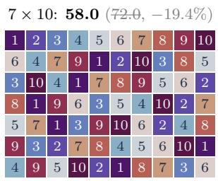

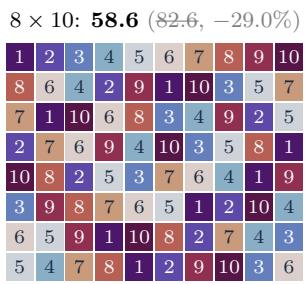

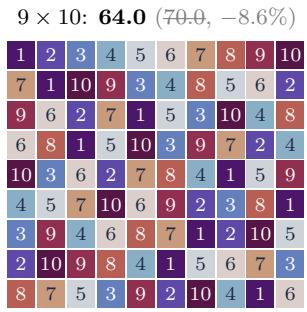  
n = 11

4 × 11: 104.0 (112.0, −7.1%)  
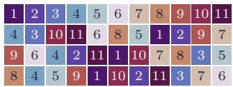

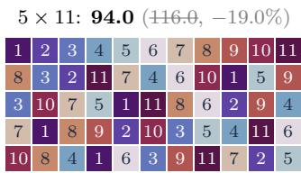

6 × 11: 88.0 (108.0, −18.5%)  
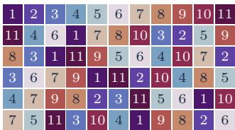

7 × 11: 84.0 (118.0, −28.8%)  
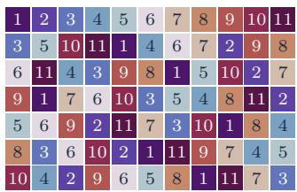

8 × 11: 78.0 (114.0, −31.6%)  
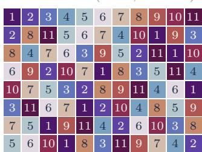

9 × 11: 84.0 (120.0, −30.0%)  
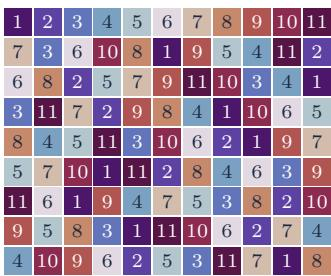

10 × 11: 100.0 (110.0, −9.1%)  
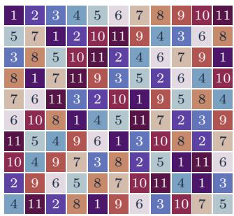  
n = 12

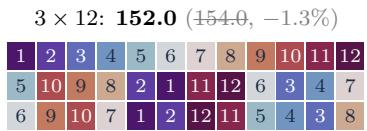

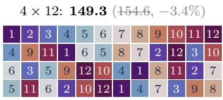

5 × 12: 140.0 (145.3, −3.7%)  
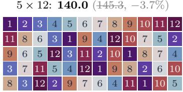

7 × 12: 121.3 (164.0, −26.0%)  
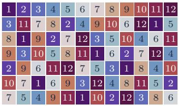

8 × 12: 116.6 (148.0, −21.2%)  
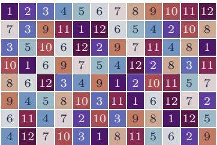

9 × 12: 106.0 (154.0, −31.2%)  
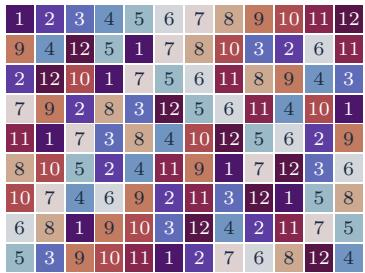

10 × 12: 124.0 (174.6, −29.0%)  
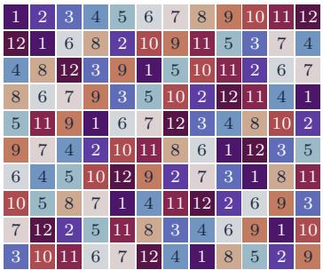

11 × 12: 136.6 (147.3, −7.2%)  
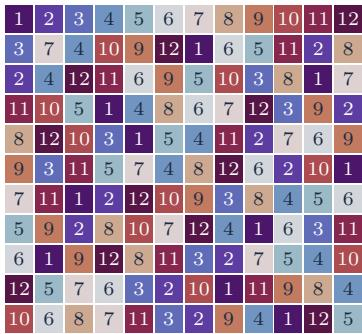  
n = 13

4 × 13: 201.3 (211.3, −4.7%)  
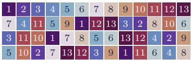

5 × 13: 191.3 (210.6, −9.2%)  
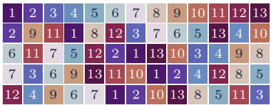

6 × 13: 166.0 (204.0, −18.6%)  
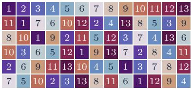

7 × 13: 164.0 (203.3, −19.3%)  
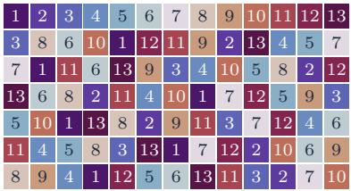

8 × 13: 160.0 (220.6, −27.5%)  
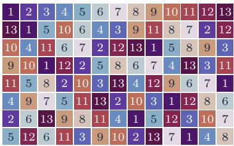

9 × 13: 152.0 (214.0, −29.0%)  
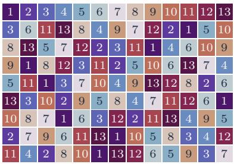

10 × 13: 154.6 (240.6, −35.7%)  
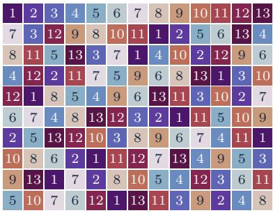

11 × 13: 168.0 (224.0, −25.0%)  
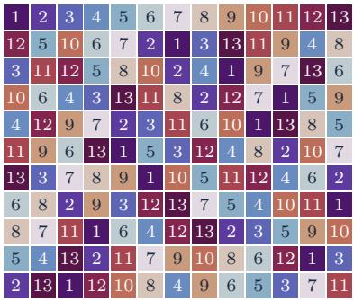

12 × 13: 166.0 (274.0, −39.4%)  
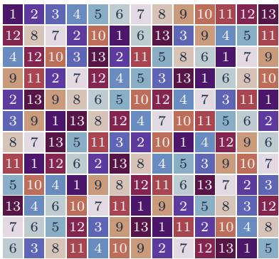

k = 2, 14 ≤ n ≤ 20  
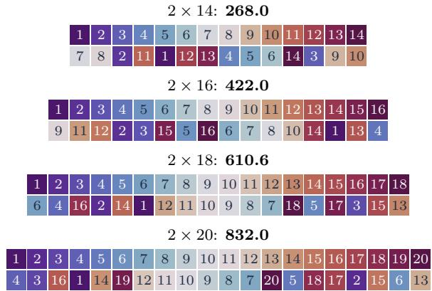

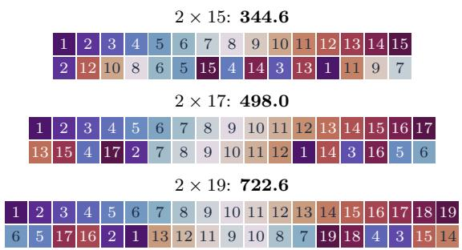