# MA-Mesh: Resilient Multi-Agent Collaboration via Role-based Self-Healing

JunYong Lee\*, Woo Kyung Kim\*, Honguk Woo<sup>†</sup> Department of Computer Science and Engineering, Sungkyunkwan University {ljy7488,kwk2696,hwoo}@skku.edu

## Abstract

Effective collaboration in multi-agent systems requires mechanisms for coordination and adaptability in dynamic and uncertain environments. However, existing multi-agent systems rarely model resilience explicitly, instead relying on ad-hoc output correction that limits systematic, runtime management of robustness. In this work, we propose Multi-Agent Mesh (MA-Mesh), a framework that constructs a rolebased self-healing layer on top of a collaboration pattern. Specifically, MA-Mesh generates resilience-aware system specifications and synthesizes them into executable multi-agent policy code. To enhance resilience, we introduce two self-healing mechanisms: Cross-agent reflection, a mechanism that allows agents to evaluate not only their own outcomes but also the performance of their peers, enabling informed behavioral adjustments and collective policy refinement; Role-based failover, a strategy which dynamically reassigns roles and enables agents to substitute for one another when sub-tasks fail or agents underperform, ensuring continuity of task execution. Experimental results across diverse tasks (e.g., software development, tool use, scientific reasoning) demonstrate that MA-Mesh significantly outperforms existing multiagent systems in both task performance and robustness under system uncertainty.

## 1 Introduction

Building on the success of single LLMs for individual tasks (Rozière et al., 2023; Zhang et al., 2024; Ahn et al., 2023), compound agentic systems composed of multiple LLM-based agents have emerged as a promising approach to scale these capabilities toward more complex, long-horizon tasks that demand collaboration and coordination (Wu et al., 2024). Early multi-agent systems were developed in a domain-specialized manner (Du et al., 2024;

Hong et al., 2024), with each system hand-crafted for a specific application. In parallel, a line of work has explored automating multi-agent orchestration, either by leveraging the parametric knowledge of LLMs (Chen et al., 2024b,a) or by learning to configure the coordination structures (Zhang et al., 2025a). However, these multi-agent systems are typically designed under nominal system conditions, which limits their resilience to partial system failures and internal execution uncertainty.

To address this, we draw inspiration from the cloud service mesh (Li et al., 2019) to automate the construction of resilient multi-agent systems that can be instantiated dynamically on top of a collaboration pattern. Specifically, we explicitly decouple the collaboration logic, which governs task execution, from the resilience policy, which materializes a role-based self-healing layer. The selfhealing layer operates through two mechanisms: (i) cross-agent reflection, which evaluates an agent’s own outcomes or those of its peers against its rolespecific requirements to detect performance degradation; (ii) role-based failover, which continuously monitors agent execution and substitutes an affected agent with a suitable alternative when reflection signals performance degradation or a response timeout occurs. Such a design directly parallels a service mesh, where sidecar proxies transparently provide a resilience layer to microservices.

To this end, we present the Multi-Agent Mesh (MA-Mesh) framework, which overlays a rolebased self-healing layer on top of a collaboration pattern, yielding a resilient multi-agent system. Given a task, an LLM orchestrator generates a resilience-aware system specification in a structured format. The specification comprises collaboration logic, which is either a user-supplied or an orchestrator-generated workflow, and a cross-agent reflection mechanism, which specifies the peers to evaluate and the role-specific criteria for assessing their execution outcomes. The orchestrator then synthesizes the executable code by instantiating pre-defined agent and resilient proxy classes from this specification. A resilient proxy is attached to each agent; collectively, these proxies realize the self-healing layer. The role-based failover mechanism is built into the resilient proxy class, which monitors agent execution and triggers recovery upon performance degradation (detected by cross-agent reflection) or response timeout. Once triggered, a dedicated meta-agent replaces the affected agent and reassigns its role, ensuring execution continuity without global re-orchestration.

In this way, the resulting resilient multi-agent system is constructed analogously to a service mesh architecture, comprising a control plane and a data plane. The resilience-aware system specification, together with the meta-agent responsible for runtime recovery upon agent failures, constitutes the control plane; the agent instances and their attached sidecar-like resilient proxies form the data plane.

Through evaluations on software development for GUI and web applications (Liu et al., 2025; Hu et al., 2025b), tool-use tasks (Mialon et al., 2024), and scientific reasoning (Rein et al., 2023), we demonstrate that MA-Mesh substantially improves the resilience of multi-agent systems. We evaluate under four system uncertainty scenarios (Netflix, 2012) that model partial and behavioral uncertainty: agent chaos, prompt chaos, I/O chaos, and compound chaos. Across these settings, MA-Mesh consistently outperforms the strongest baseline C+I (Huang et al., 2025), with an average accuracy gain of 32.51 percentage points (pp). We further evaluate detection recall (DR), the fraction of affected agents correctly identified by resilient proxies, and observe an average improvement of 0.36 in DR over C+I. Moreover, to validate MA-Mesh’s adaptability to arbitrary collaboration patterns, we overlay it on top of MetaGPT (Hong et al., 2024) and RTADev (Liu et al., 2025), observing an average accuracy gain of 43.74 pp and 29.42 pp, respectively (see Table 5). Lastly, we validate MA-Mesh on AIOpsLab (Chen et al., 2025), a cloud-native testbed, demonstrating its practical applicability beyond synthetic chaos scenarios. The contributions of our work are summarized as follows:

• We present the MA-Mesh framework to construct multi-agent systems resilient to partial system failures and behavioral uncertainty.

• We explicitly decouple collaboration logic from resilience policy in a structured specification, from which we synthesize executable code, enabling a role-based self-healing layer to be overlaid on top of any collaboration pattern.

• We introduce resilient proxies to realize the selfhealing layer, comprising cross-agent reflection for role-specific degradation detection and rolebased failover for recovery.

• Through experiments on benchmarks including software development, tool use, and scientific reasoning, we demonstrate that MA-Mesh outperforms existing multi-agent systems under diverse system uncertainty scenarios.

## 2 Related Work

Multi-agent systems have been widely adopted across diverse domains, including software development (Hong et al., 2024; Liu et al., 2025), scientific discovery (Kim et al., 2025a; Schmidgall et al., 2025), and complex mathematical reasoning (Du et al., 2024; Lei et al., 2024). In parallel, several works (Chen et al., 2024b,a) automate the configuration of multi-agent systems, dynamically adapting agent roles and coordination structures via an LLM orchestrator. Yet, these approaches assume nominal operating conditions and rarely address system-level resilience. Recently, Net-Safe (Yu et al., 2025) analyzes which coordination structures are inherently robust under adversarial attacks, while C+I (Huang et al., 2025) explicitly handles errors through challenger and inspector agents. However, C+I remains limited to correction-based mitigation, lacking role-aware evaluation and reconfiguration. In contrast, MA-Mesh provides a service-mesh-style framework that augments any collaboration pattern with two mechanisms: crossagent reflection, whose evaluation scope and criteria are dynamically determined, and role-based failover, which reconfigures agents at runtime upon failures or performance degradation.

## 3 Problem Formulation

A multi-agent system Π executes a task T through collaboration among multiple LLM-based agents, each assigned a distinct role. Formally, Π is represented as a directed graph, i.e.,

$$
\Pi = ( \mathcal { V } , \mathcal { E } ) , \mathcal { E } \subseteq \mathcal { V } \times \mathcal { V } ,\tag{1}
$$

where V is the set of agents, and $\mathcal { E }$ is the set of directed communication edges.

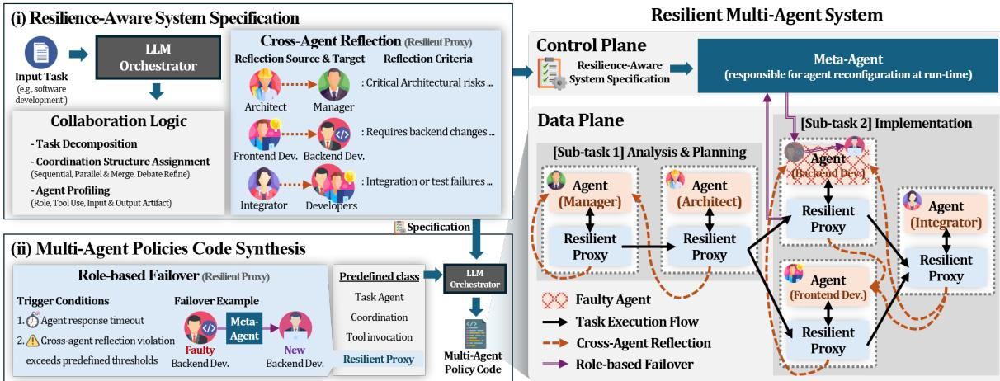  
Figure 1: MA-Mesh Framework: In (i), given a task, the LLM orchestrator generates a resilience-aware system specification comprising the collaboration logic and the cross-agent reflection, which specifies the reflection targets and criteria. In (ii), the orchestrator synthesizes executable multi-agent policy code that incorporates role-based failover, including its trigger conditions and meta-agent-driven agent replacement. As a result, the resilience-aware system specification and the meta-agent responsible for failover recovery form the control plane, while the taskexecuting agents and their resilient proxies form the data plane, which enforces the resilient mechanisms at runtime.

In real-world deployments, multi-agent systems are exposed to diverse sources of system uncertainty, such as network or hardware failures, imperfect agent behavior, and adversarial interventions. To model such uncertainty, we adopt chaos engineering practices (Netflix, 2012; Chaos Mesh, 2021) which inject stochastic perturbations during system execution. Concretely, we consider three primitive classes of perturbations: agent chaos, which captures agent termination due to network or hardware faults; prompt chaos, which models errors in the agent prompts; and I/O chaos, which captures partial corruption of agent-generated outputs during transmission.

Then, the resilient agent collaboration problem is formalized through a framework Φ(T) that maps a task T to a multi-agent system Π, maximizing the task performance $\mathbf { P } ( \Pi , \mathcal { T } , u ) \in [ 0 , 1 ]$ under system uncertainty $u \in \mathcal { U }$ as follows:

$$
\Phi ^ { * } = \underset { \Phi } { \mathrm { a r g m a x } } \mathbb { E } _ { u \sim \mathcal { U } , \Pi \sim \Phi ( \mathcal { T } ) } \left[ \mathbf { P } ( \Pi , \mathcal { T } , u ) \right] .\tag{2}
$$

## 4 Our Approach

## 4.1 Overall Framework

To automate the construction of resilient multiagent systems, we present the MA-Mesh framework comprising two stages: (i) resilience-aware system specification, and (ii) multi-agent policy code synthesis, as illustrated on the left side of Figure 1. In (i), an LLM orchestrator derives a structured specification that consists of the collaboration logic and the cross-agent reflection mechanism. The collaboration logic specifies the sub-task decomposition, the coordination structure, and the agent roles. As a default, it is dynamically generated by the orchestrator, but it can also be adopted from a predefined collaboration pattern of an existing static multi-agent system. Cross-agent reflection associates each agent with a resilient proxy that specifies the reflection target and criteria. At runtime, these proxies assess the outcomes produced by peer agents and provide feedback accordingly. In (ii), given the resulting specification, the orchestrator synthesizes executable multi-agent policy code by instantiating the agents and resilient proxies as parameterized classes. In doing so, the role-based failover mechanism is embedded into the resilient proxies, which trigger failover upon detecting runtime execution failures or suboptimal agent behavior, prompting the meta-agent to replace the affected agent.

Consequently, MA-Mesh constructs a servicemesh-like resilient multi-agent system, where the resilience-aware system specification and the metaagent responsible for runtime agent replacement together form the control plane, while the agent instances and their resilient proxies constitute the data plane, as shown on the right side of Figure 1.

## 4.2 Resilience-Aware System Specification

Given a task T , the LLM orchestrator ϕ<sub>LLM</sub> derives a structured specification of the resilient multiagent system in a form readily translatable into executable code. As shown in Figure 2, the specification comprises two parts: the collaboration logic and the cross-agent reflection. The collaboration logic decomposes the task into K sub-tasks τ, each paired with a coordination structure c and a set of agent profiles P. The cross-agent reflection R is defined over all agents in the system, assigning each agent a resilient proxy that specifies its reflection target and criteria. Together, they yield the resilience-aware system specification as,

$$
\phi _ { \mathrm { L L M } } : { \mathcal T } \to \Big ( \{ ( \tau _ { k } , c _ { k } , \mathcal { P } _ { k } ) \} _ { k = 1 } ^ { K } , \mathcal { R } \Big ) .\tag{3}
$$

Note that the collaboration logic, generated by the orchestrator by default, can instead be drawn from an existing static multi-agent system (see Table 5).

```python
sub_task : str = " Develop data management ...
coordination_structure : str = " Parallel & Merge "
agent_profiles : list = [
{ " agent_name ": " DataManagerDeveloper ",
" responsibility ": " Implement manage .py ...
" tools ": [" file write "] }, ...]
# Repeated for k = 1, . . . , K
# Resilient Proxies : Cross - Agent Reflection R
[{ " reflection_source ": " UIArchitect ",
" reflection_targets ": " DataManagerDeveloper ",
" reflection_criteria ": (
"1. Check manage .py implements all methods ",
"2. Check manage .py handles file I/O.",
...)} , ...]
```  
Figure 2: Resilience-aware system specification

Coordination structure. For each sub-task, the LLM orchestrator selects the coordination structure that best fits its objective from a pool ${ \mathcal { C } } =$ {‘sequential’, ‘parallel&merge’, ‘debate’, ‘refine’}, adopted from the taxonomy of AutoGen (Wu et al., 2024). Detailed examples are shown in Figure 11. Agent profile. Each agent profile specifies the agent’s role-related configuration, including responsibilities, permitted tools, input sources and modalities, and expected output artifacts and formats. The corresponding agent prompts are generated through separate LLM invocations.

Resilient proxy: cross-agent reflection. To enhance system resilience, we equip each agent with a resilient proxy. Each proxy encodes a cross-agent reflection mechanism that specifies (1) the reflection targets, which are the agents whose outputs it evaluates, and (2) reflection criteria, which capture both output quality and role-level expectations from the reflecting agent’s perspective. Note that a reflection target may belong to a different sub-task, and if an agent is selected by no other agent, its resilient proxy performs self-reflection by default. Accordingly, the resulting resilient multi-agent system defined in Eq. (1) is extended as

$$
\begin{array} { c } { \boldsymbol { \Pi } = ( \mathcal { V } , \mathcal { V } _ { r } , \mathcal { E } ) , } \\ { \mathcal { E } \subseteq ( \mathcal { V } _ { r } \times \mathcal { V } _ { r } ) \cup ( \mathcal { V } _ { r } \times \mathcal { V } ) \cup ( \mathcal { V } \times \mathcal { V } _ { r } ) , } \end{array}\tag{4}
$$

where $\mathcal { V } _ { r }$ denotes the set of resilient proxies. This design removes direct communication between agents V and routes all interactions through resilient proxies $\mathcal { V } _ { r }$ , ensuring that every outcome is intercepted for cross-agent reflection. When an outcome violates the reflection criteria, the proxy returns feedback prompting the agent to regenerate its output. We maintain a retry counter to track the number of reflection attempts; once it exceeds a predefined threshold, the role-based failover (see Section 4.3) is triggered to replace the agent.

## 4.3 Multi-Agent Policy Code Synthesis

Given the resilience-aware system specification, the LLM orchestrator translates it into executable code. We build on the AutoGen (Wu et al., 2024) library, pre-wrapping each task-executing agent and its associated resilient proxy into a class so that agent profiles and resilient proxy specifications can be instantiated through parameterized constructors.

```python
class AgentWithResilientProxy :
def __init__ (self , agent_profile , proxy_spec ):
# task executing agent
self . agent = create_agent (** agent_profile )
# resilient proxy
self . proxy = create_proxy (** proxy_spec )
def __call__ (self , request ):
# see Algorithm 1
def cross_agent_reflection ( self ):
# see Algorithm 2 in Appendix E
# : return : feedback if error identified
def role_based_failover ( self ):
# see Algorithm 3 in Appendix E
# : return : a new agent for replacement
```  
Figure 3: Example code for agent with resilient proxy

Resilient proxy: role-based failover. The rolebased failover mechanism is built into the resilient proxy class, so code synthesis simply instantiates proxies already equipped to detect failover conditions and initiate agent replacement. The replacement is handled by a dedicated meta-agent that does not itself participate in task execution. To replace an agent identified as faulty or degraded, the meta-agent initializes a new agent with a refined role specification. Role-based failover is triggered under two conditions. (i) The resilient proxy enforces a response timeout to regulate each agent’s execution. If an agent fails to respond within this limit, the proxy triggers failover. (ii) Failover is also triggered when the cross-agent reflection repeatedly identifies that an agent fails to satisfy the specified reflection criteria, with the number of failed attempts exceeding a predefined retry threshold. As a result, role-based failover enables the system to dynamically recover from both runtime execution failures and suboptimal agent behaviors, ensuring resilient task execution without re-orchestrating the entire multi-agent system.

Algorithm 1 Procedure of Resilient Proxy   
1: Input: Agent A, Proxy P, Request x   
2: Output: Response y   
3: for r = 0 to max\_retry do   
4: try:   
5: y ← agent\_call(A, x)   
6: except Timeout:   
7: /\* trigger failover due to response timeout \*/   
8: A ← role\_based\_failover(P)   
9: continue   
10: n ← 0   
11: while n < max\_reflection\_attempts do   
12: /\* generate feedback via cross-agent reflection \*/   
13: f ← cross\_agent\_reflection(P, x, y)   
14: if f is None then   
15: return y   
16: else   
17: x ← concat(x, y, f); n ← n + 1   
18: /\* timeout handling omitted for brevity \*/   
19: y ← agent\_call(A, x)   
20: end if   
21: end while   
22: /\* trigger failover due to violation of reflection \*/   
23: A ← role\_based\_failover(P)   
24: end for   
25: return y

The overall procedure of an agent and its resilient proxy is summarized in Algorithm 1.

## 4.4 Resilient Multi-Agent System

Conceptually, the resulting resilient multi-agent system follows a service-mesh-like architecture, comprising a control plane and a data plane. The resilience-aware system specification serves as the control plane artifact, encoding collaboration logic and cross-agent reflection. At runtime, the metaagent residing in the control plane leverages this specification to instantiate appropriate replacement agents, preserving the continuity of task execution.

The data plane consists of the agents and resilient proxies instantiated from the synthesized multiagent code. The agents are responsible for task execution, while resilient proxies enforce the encoded role-based self-healing mechanisms by monitoring agent execution, applying timeout constraints, performing cross-agent reflection, and triggering role-based failover when necessary.

## 5 Experiments

## 5.1 Experiment Setup

Benchmarks. We evaluate on four benchmarks spanning three domains: (i) software development – GUI Dev. and Web Dev., which we adapt from Liu et al. (2025) and Hu et al. (2025b) into complex, long-horizon tasks; (ii) tool use – GAIA (Mialon et al., 2024); and (iii) scientific reasoning – GPQA-Diamond (Rein et al., 2023). Further details are provided in Appendix C. System Uncertainty. We consider four types of system uncertainty: (i) Agent Chaos randomly terminates agents with a given probability (Basiri et al., 2016); (ii) Prompt Chaos perturbs agent prompts through replacement, deletion, and shuffling (Huang et al., 2025); (iii) I/O Chaos applies the same perturbations to agent outputs before they are consumed by other agents; and (iv) Compound Chaos applies all three system uncertainties.

Additionally, we evaluate on adversarial attack scenarios (Xie et al., 2025) in Table 3, where an external agent injects malicious content into role prompts, task prompts, or outputs to mislead agent behavior; and noisy tool scenarios (Wang et al., 2026) in Table 4, where tool operations suffer from execution failures and noisy responses.

Evaluation Metrics. To evaluate task performance, we report Accuracy (Acc), the fraction of successfully completed tasks. We also report Detection Recall (DR), the ratio of correctly identified affected agents to all affected agents.

Baselines. We compare MA-Mesh against four categories of baselines: (i) single-agent method – CoT (Wei et al., 2022); (ii) static multi-agent systems – MetaGPT (Hong et al., 2024), RTADev (Liu et al., 2025), and LLM-Debate (Du et al., 2024); (iii) autonomous multi-agent systems – Agent-Verse (Chen et al., 2024b) and EvoMAC (Hu et al., 2025b); (iv) resilient multi-agent systems – C+I (Huang et al., 2025).

We use gpt-4.1-mini-0414 (OpenAI, 2025) as the LLM for all baselines and MA-Mesh. Additionally, we utilize reasoning models of o4-mini and gemini-3-flash (Google, 2025) for ablation.

<table><tr><td></td><td></td><td>Vanilla</td><td colspan="2">Agent Chaos</td><td colspan="2">Prompt Chaos</td><td colspan="2">I/O Chaos</td><td colspan="2">Compound Chaos</td></tr><tr><td>Benchmark</td><td>Method</td><td>Acc (%)</td><td>Acc (%)</td><td>DR</td><td>Acc (%)</td><td>DR</td><td>Acc (%)</td><td>DR</td><td>Acc (%)</td><td>DR</td></tr><tr><td rowspan="7">GUI Dev.</td><td>CoT</td><td> $6 6 . 0 2 { \scriptstyle \pm 2 . 5 3 }$ </td><td> $0 . 0 0 { \scriptstyle \pm 0 . 0 0 }$ </td><td> $0 . 0 0 { \scriptstyle \pm 0 . 0 0 }$ </td><td> $2 5 . 0 3 { \scriptstyle \pm 5 . 8 7 }$ </td><td> $0 . 0 0 { \scriptstyle \pm 0 . 0 0 }$ </td><td> $0 . 0 0 { \scriptstyle \pm 0 . 0 0 }$ </td><td> $0 . 0 0 { \scriptstyle \pm 0 . 0 0 }$ </td><td> $3 . 9 6 \pm 4 . 4 0$ </td><td> $0 . 0 0 { \scriptstyle \pm 0 . 0 0 }$ </td></tr><tr><td>RTADev</td><td> $6 6 . 3 0 { \scriptstyle \pm 1 . 6 0 }$ </td><td> $2 1 . 8 7 { \scriptstyle \pm 8 . 3 5 }$ </td><td> $0 . 6 1 \pm 0 . 1 5$ </td><td> $3 9 . 6 4 \pm 3 . 2 7$ </td><td> $0 . 4 2 \pm 0 . 1 4$ </td><td> $3 3 . 9 0 \pm 1 3 . 3 8$ </td><td> $0 . 1 9 \pm 0 . 1 7$ </td><td> $1 4 . 9 9 \pm 8 . 2 9$ </td><td> $0 . 4 3 { \scriptstyle \pm 0 . 0 9 }$ </td></tr><tr><td>MetaGPT</td><td> $7 0 . 5 1 \pm 4 . 2 2$ </td><td>7.39±6.10</td><td> $0 . 0 0 { \scriptstyle \pm 0 . 0 0 }$ </td><td>21.62±5.12</td><td> $0 . 0 0 { \scriptstyle \pm 0 . 0 0 }$ </td><td> $2 2 . 6 3 { \scriptstyle \pm 1 1 . 4 6 }$ </td><td> $0 . 0 0 { \scriptstyle \pm 0 . 0 0 }$ </td><td>0.00±0.00</td><td> $0 . 0 0 { \scriptstyle \pm 0 . 0 0 }$ </td></tr><tr><td>C+I</td><td> $6 8 . 0 5 { \scriptstyle \pm 2 . 4 6 }$ </td><td> $4 . 4 6 \pm 4 . 4 7$ </td><td>0.24±0.03</td><td> $1 9 . 3 0 { \scriptstyle \pm 6 . 2 3 }$ </td><td>0.29±0.04</td><td> $4 7 . 3 7 { \pm } 4 . 2 4 $ </td><td>0.86±0.03</td><td> $1 . 5 9 \pm 2 . 7 5$ </td><td> $0 . 3 0 { \scriptstyle \pm 0 . 0 3 }$ </td></tr><tr><td>AgentVerse</td><td> $6 6 . 5 3 { \scriptstyle \pm 6 . 5 9 }$ </td><td> $3 2 . 8 7 { \scriptstyle \pm 6 . 0 3 }$ </td><td> $0 . 0 0 { \scriptstyle \pm 0 . 0 0 }$ </td><td> $4 4 . 6 1 { \scriptstyle \pm 8 . 0 8 }$ </td><td> $0 . 0 0 { \scriptstyle \pm 0 . 0 0 }$ </td><td> $3 7 . 8 9 \pm 1 2 . 9 4$ </td><td> $0 . 0 0 { \scriptstyle \pm 0 . 0 0 }$ </td><td> $2 6 . 3 6 { \scriptstyle \pm 6 . 1 3 }$ </td><td> $0 . 0 0 { \scriptstyle \pm 0 . 0 0 }$ </td></tr><tr><td>EvoMAC</td><td> $7 2 . 7 9 { \scriptstyle \pm 1 . 9 6 }$ </td><td> $4 8 . 0 1 \pm 1 1 . 2 8 $ </td><td> $0 . 0 0 { \scriptstyle \pm 0 . 0 0 }$ </td><td> $5 2 . 1 5 { \pm } 8 . 3 4 $ </td><td> $0 . 0 0 { \scriptstyle \pm 0 . 0 0 }$ </td><td> $6 3 . 6 5 { \pm } 7 . 4 5$ </td><td> $0 . 0 0 { \scriptstyle \pm 0 . 0 0 }$ </td><td> $2 4 . 3 8 { \scriptstyle \pm 1 1 . 9 2 }$  </td><td> $0 . 0 0 { \scriptstyle \pm 0 . 0 0 }$ </td></tr><tr><td>MA-Mesh</td><td> $7 5 . 2 9 { \scriptstyle \pm 4 . 3 4 }$ </td><td> ${ \bf 7 1 . 0 5 } \pm 1 . 6 4$ </td><td> $\mathbf { 1 . 0 0 } \pm 0 . 0 0$ </td><td> ${ \bf 6 5 . 3 0 } { \scriptstyle \pm 5 . 4 8 }$ </td><td> $\mathbf { 0 . 8 4 } \pm 0 . 0 8$ </td><td> ${ \bf 6 7 . 8 7 } \pm 5 . 0 7$ </td><td> $0 . 8 2 \pm 0 . 0 7$ </td><td> ${ \bf 6 5 . 6 6 } \pm 5 . 6 9$ </td><td> $\mathbf { 0 . 9 0 } \pm \mathbf { 0 . 0 5 }$ </td></tr><tr><td rowspan="7">Web Dev.</td><td>CoT</td><td> $4 5 . 7 3 { \scriptstyle \pm 3 . 0 2 }$ </td><td> $0 . 0 0 { \scriptstyle \pm 0 . 0 0 }$ </td><td> $0 . 0 0 { \scriptstyle \pm 0 . 0 0 }$ </td><td> $0 . 6 0 { \scriptstyle \pm 1 . 0 4 }$ </td><td> $0 . 0 0 { \scriptstyle \pm 0 . 0 0 }$ </td><td> $0 . 0 0 { \scriptstyle \pm 0 . 0 0 }$ </td><td> $0 . 0 0 { \scriptstyle \pm 0 . 0 0 }$ </td><td> $0 . 1 9 \pm 0 . 3 2$ </td><td> $0 . 0 0 { \scriptstyle \pm 0 . 0 0 }$ </td></tr><tr><td>RTADev</td><td> $4 0 . 1 7 { \scriptstyle \pm 6 . 7 8 }$ </td><td> $1 2 . 6 8 { \scriptstyle \pm 4 . 6 0 }$ </td><td> $0 . 4 4 \pm 0 . 1 7$ </td><td> $8 . 8 5 { \scriptstyle \pm 0 . 5 3 }$ </td><td> $0 . 4 6 { \scriptstyle \pm 0 . 0 2 }$ </td><td> $1 6 . 7 4 \pm 4 . 5 0$ </td><td> $0 . 2 0 { \scriptstyle \pm 0 . 1 1 }$ </td><td> $2 . 6 8 \pm 4 . 1 2$ </td><td> $0 . 3 6 { \scriptstyle \pm 0 . 0 6 }$ </td></tr><tr><td>MetaGPT</td><td> $4 2 . 0 9 { \scriptstyle \pm 7 . 0 3 }$ </td><td> $4 . 8 1 \pm 2 . 7 7$ </td><td> $0 . 0 0 { \scriptstyle \pm 0 . 0 0 }$ </td><td> $6 . 3 0 { \scriptstyle \pm 5 . 0 3 }$ </td><td> $0 . 0 0 { \scriptstyle \pm 0 . 0 0 }$ </td><td> $1 1 . 9 1 \pm 3 . 3 0 $ </td><td> $0 . 0 0 { \scriptstyle \pm 0 . 0 0 }$ </td><td> $0 . 4 1 \pm 0 . 3 5$ </td><td> $0 . 0 0 { \scriptstyle \pm 0 . 0 0 }$ </td></tr><tr><td>C+I</td><td> $4 5 . 2 5 { \scriptstyle \pm 3 . 6 7 }$ </td><td> $5 . 7 2 { \scriptstyle \pm 2 . 8 1 }$ </td><td> $0 . 1 0 { \scriptstyle \pm 0 . 1 4 }$ </td><td> $1 2 . 4 7 { \scriptstyle \pm 9 . 1 7 }$ </td><td> $0 . 3 1 { \scriptstyle \pm 0 . 0 7 }$ </td><td> $1 4 . 0 3 { \scriptstyle \pm 0 . 3 9 }$ </td><td> $\mathbf { 0 . 7 5 \bot 0 . 1 0 }$ </td><td> $0 . 0 0 { \scriptstyle \pm 0 . 0 0 }$ </td><td> $0 . 2 5 { \scriptstyle \pm 0 . 0 4 }$ </td></tr><tr><td>AgentVerse</td><td> $5 2 . 0 1 { \scriptstyle \pm 2 . 0 6 }$ </td><td> $1 1 . 9 5 { \scriptstyle \pm 6 . 3 8 }$ </td><td> $0 . 0 0 { \scriptstyle \pm 0 . 0 0 }$ </td><td> $2 1 . 5 5 { \scriptstyle \pm 8 . 0 6 }$ </td><td> $0 . 0 0 { \scriptstyle \pm 0 . 0 0 }$ </td><td> $1 2 . 5 0 { \scriptstyle \pm 1 . 3 8 }$ </td><td> $0 . 0 0 { \scriptstyle \pm 0 . 0 0 }$ </td><td> $1 8 . 3 8 { \scriptstyle \pm 3 . 7 7 }$ </td><td> $0 . 0 0 { \scriptstyle \pm 0 . 0 0 }$ </td></tr><tr><td>EvoMAC</td><td> $4 1 . 3 3 \pm 4 . 4 7$ </td><td> $2 0 . 4 5 { \scriptstyle \pm 4 . 7 2 }$ </td><td> $0 . 0 0 { \scriptstyle \pm 0 . 0 0 }$ </td><td> $2 4 . 2 9 { \scriptstyle \pm 2 . 5 6 }$ </td><td> $0 . 0 0 { \scriptstyle \pm 0 . 0 0 }$ </td><td> $1 4 . 7 2 \pm 7 . 1 7$ </td><td> $0 . 0 0 { \scriptstyle \pm 0 . 0 0 }$ </td><td> $5 . 8 0 \pm 5 . 1 0$ </td><td> $0 . 0 0 { \scriptstyle \pm 0 . 0 0 }$ </td></tr><tr><td>MA-Mesh</td><td> ${ \pm \bf 5 9 . 6 8 } { \pm 1 . 8 4 }$ </td><td> ${ \pm 3 . 9 8 \pm 1 . 5 5 }$ </td><td> $\mathbf { 1 . 0 0 } \pm 0 . 0 0$ </td><td> ${ \pm 3 . 1 1 \mathrm { \pm 1 } . 8 2 }$ </td><td> $\mathbf { 0 . 9 4 } \pm 0 . 0 4$ </td><td> ${ \pm } 4 . 1 2 { \pm } 1 . 5 8 $ </td><td> $\mathbf { 0 . 7 5 \bot 0 . 1 3 }$ </td><td> $\mathbf { 4 9 . 7 6 } \pm 0 . 3 2$ </td><td> $\mathbf { 0 . 9 1 } \pm \mathbf { 0 . 0 2 }$ </td></tr><tr><td rowspan="6">GAIA</td><td>CoT</td><td> $2 8 . 6 1 \pm 3 . 5 7$ </td><td> $0 . 0 0 { \scriptstyle \pm 0 . 0 0 }$ </td><td> $0 . 0 0 { \scriptstyle \pm 0 . 0 0 }$ </td><td> $1 . 0 1 \pm 0 . 3 5$ </td><td> $0 . 0 0 { \scriptstyle \pm 0 . 0 0 }$ </td><td> $4 . 8 5 { \scriptstyle \pm 1 . 6 0 }$ </td><td> $0 . 0 0 { \scriptstyle \pm 0 . 0 0 }$ </td><td> $0 . 6 1 \pm 0 . 6 1$ </td><td> $0 . 0 0 { \scriptstyle \pm 0 . 0 0 }$ </td></tr><tr><td>LLM-Debate</td><td> $3 2 . 3 2 { \pm } 1 . 8 5$ </td><td> $1 3 . 1 3 { \pm } 2 . 4 5$ </td><td> $0 . 0 0 { \scriptstyle \pm 0 . 0 0 }$ </td><td> $1 9 . 3 9 { \scriptstyle \pm 2 . 1 0 }$ </td><td> $0 . 0 0 { \scriptstyle \pm 0 . 0 0 }$ </td><td> $1 5 . 9 6 { \pm } 3 . 4 5$ </td><td> $0 . 0 0 { \scriptstyle \pm 0 . 0 0 }$ </td><td> $5 . 2 5 { \pm } 0 . 9 3 $ </td><td> $0 . 0 0 { \scriptstyle \pm 0 . 0 0 }$ </td></tr><tr><td>C+I</td><td> $3 0 . 1 0 { \scriptstyle \pm 0 . 9 2 }$ </td><td> $1 4 . 7 5 { \scriptstyle \pm 3 . 1 1 }$ </td><td> $0 . 5 3 { \scriptstyle \pm 0 . 0 6 }$ </td><td> $2 0 . 8 1 \pm 1 . 9 5$ </td><td> $0 . 6 2 \pm 0 . 0 4$ </td><td> $1 7 . 5 8 \pm 5 . 9 7$ </td><td> ${ \bf 0 . 9 9 \bot 0 . 0 0 }$ </td><td> $3 . 7 0 { \scriptstyle \pm 1 . 9 1 }$ </td><td> $0 . 7 2 \pm 0 . 0 9$ </td></tr><tr><td>AgentVerse</td><td> $2 4 . 3 1 { \pm } 2 . 3 8$ </td><td> $1 3 . 1 8 { \pm } 1 . 4 5 $ </td><td> $0 . 0 0 { \scriptstyle \pm 0 . 0 0 }$ </td><td> $7 . 0 7 \pm 1 . 7 5$ </td><td> $0 . 0 0 { \scriptstyle \pm 0 . 0 0 }$ </td><td> $1 1 . 3 1 { \pm } 5 . 4 4$ </td><td> $0 . 0 0 { \scriptstyle \pm 0 . 0 0 }$ </td><td> $7 . 6 8 \pm 6 . 4 8$ </td><td> $0 . 0 0 { \scriptstyle \pm 0 . 0 0 }$ </td></tr><tr><td>MA-Mesh</td><td> $3 2 . 7 3 { \scriptstyle \pm 1 . 6 0 }$ </td><td> $\pm \mathbf { 9 . 9 0 } \pm 4 . 9 4$ </td><td> $\mathbf { 1 . 0 0 } \pm 0 . 0 0$  </td><td> $2 6 . 4 6 { \scriptstyle \pm 3 . 5 5 }$ </td><td> $\mathbf { 0 . 8 3 \pm 0 . 0 2 }$ </td><td> $\mathbf { 2 9 . 0 9 } \pm 0 . 6 1$ </td><td> $0 . 9 2 \pm 0 . 0 1$ </td><td> $2 4 . 4 4 { \scriptstyle \pm 4 . 5 9 }$  </td><td> $\mathbf { 0 . 9 4 } \pm 0 . 0 1$ </td></tr><tr><td>CoT</td><td> $6 4 . 1 4 { \pm } 1 . 0 1$ </td><td> $0 . 0 0 { \scriptstyle \pm 0 . 0 0 }$ </td><td> $0 . 0 0 { \scriptstyle \pm 0 . 0 0 }$ </td><td> $2 7 . 9 4 { \scriptstyle \pm 0 . 5 8 }$ </td><td> $0 . 0 0 { \scriptstyle \pm 0 . 0 0 }$ </td><td> $3 0 . 9 7 { \scriptstyle \pm 2 . 1 0 }$ </td><td> $0 . 0 0 { \scriptstyle \pm 0 . 0 0 }$ </td><td> $2 0 . 0 4 \pm 1 . 5 4$ </td><td> $0 . 0 0 { \scriptstyle \pm 0 . 0 0 }$ </td></tr><tr><td rowspan="5">GPQA Diamond</td><td>LLM-Debate</td><td> $6 6 . 5 0 { \scriptstyle \pm 1 . 2 7 }$ </td><td> $2 6 . 7 7 { \scriptstyle \pm 7 . 0 2 }$ </td><td> $0 . 0 0 { \scriptstyle \pm 0 . 0 0 }$ </td><td> $3 5 . 5 2 { \pm } 7 . 6 5$ </td><td> $0 . 0 0 { \scriptstyle \pm 0 . 0 0 }$ </td><td> $4 1 . 4 1 \pm 4 . 0 1$ </td><td> $0 . 0 0 { \scriptstyle \pm 0 . 0 0 }$ </td><td> $1 5 . 3 2 { \scriptstyle \pm 3 . 4 4 }$ </td><td> $0 . 0 0 { \scriptstyle \pm 0 . 0 0 }$ </td></tr><tr><td>C+I</td><td> $6 5 . 1 5 { \pm } 1 . 3 3 $ </td><td> $3 5 . 3 5 { \scriptstyle \pm 3 . 8 1 }$ </td><td> $0 . 6 6 \pm 0 . 0 9$ </td><td> $5 2 . 3 6 { \scriptstyle \pm 2 . 0 4 }$ </td><td> $0 . 5 2 { \scriptstyle \pm 0 . 0 2 }$ </td><td> $5 1 . 6 7 { \scriptstyle \pm 4 . 2 2 }$ </td><td> $0 . 9 6 { \scriptstyle \pm 0 . 0 3 }$ </td><td> $1 6 . 3 3 { \scriptstyle \pm 2 . 4 9 }$ </td><td> $0 . 6 6 \pm 0 . 2 2$ </td></tr><tr><td>AgentVerse</td><td> $6 2 . 4 6 { \pm } 2 . 5 9$ </td><td> $2 8 . 6 2 \pm 2 . 9 6$ </td><td> $0 . 0 0 { \scriptstyle \pm 0 . 0 0 }$ </td><td> $3 1 . 1 4 \pm 3 . 0 4$ </td><td> $0 . 0 0 { \scriptstyle \pm 0 . 0 0 }$ </td><td> $2 7 . 9 5 { \scriptstyle \pm 1 1 . 2 1 }$ </td><td> $0 . 0 0 { \scriptstyle \pm 0 . 0 0 }$ </td><td> $2 2 . 9 0 { \scriptstyle \pm 6 . 1 1 }$ </td><td> $0 . 0 0 { \scriptstyle \pm 0 . 0 0 }$ </td></tr><tr><td>MA-Mesh</td><td> ${ \bf 6 7 . 6 8 } \pm 2 . 2 0$ </td><td> ${ \bf 6 1 . 8 7 } \pm 1 . 0 7$ </td><td> $\mathbf { 1 . 0 0 } \pm 0 . 0 0$ </td><td> $\mathbf { 6 2 . 4 6 } \pm 3 . 7 9$ </td><td> $\mathbf { 0 . 8 1 } \pm \mathbf { 0 . 0 2 }$ </td><td> ${ \bf 6 1 . 1 1 } { \scriptstyle \pm 2 . 5 3 }$ </td><td> $\mathbf { 0 . 9 8 } \pm 0 . 0 1$ </td><td> ${ \bf 6 1 . 4 5 } \pm 3 . 0 4 $  </td><td></td></tr><tr><td></td><td></td><td></td><td></td><td></td><td></td><td></td><td></td><td></td><td> $\mathbf { 0 . 9 6 } \pm 0 . 0 1$ </td></tr></table>

Table 1: Performance under system uncertainty: The baselines and MA-Mesh are evaluated on the GUI Dev., Web Dev., GAIA, and GPQA-Diamond benchmarks. Each method is run for three trials, and results are averaged across trials. The best performance for each benchmark is highlighted in bold.

## 5.2 Main Results

Table 1 reports the performance of MA-Mesh and the baselines across four benchmarks, under both the vanilla setting (i.e., nominal system conditions) and the four system uncertainty scenarios. Under the vanilla setting, MA-Mesh yields robust performance across all benchmarks, achieving an average improvement of 6.71 pp in accuracy over the most competitive baseline C+I. This improvement is primarily attributed to cross-agent reflection, through which resilient proxies identify suboptimal intermediate outcomes and proactively trigger agent replacement, thereby preventing error propagation.

directly terminates task execution. In contrast, multi-agent systems are generally more robust, as failures of individual agents can be partially compensated for by other agents. Yet, MetaGPT, LLM-Debate, and EvoMAC show limited performance, lacking explicit mechanisms to detect and recover from system uncertainty. C+I and RTADev improve performance by incorporating self-correction: C+I introduces dedicated inspector and challenger agents to detect and correct erroneous outputs, while RTADev evaluates each new outcome against prior ones to refine faulty outcomes and maintain alignment across execution steps. Unlike these correction-based mechanisms, MA-Mesh performs cross-agent reflection to assess agents from the perspectives of their peers and addresses failures by replacing agents through role-based failover. As a result, the resilient proxies in MA-Mesh function as infrastructure-level resilience mechanisms that mitigate error propagation and enforce role-based recovery.

Across the four system uncertainty scenarios, MA-Mesh consistently achieves the highest performance, outperforming C+I by 39.13 pp, 25.60 pp, 20.39 pp, and 44.92 pp in average accuracy, respectively. Further, MA-Mesh attains substantially higher DR than C+I, except under the I/O chaos, indicating that MA-Mesh correctly identifies affected agents. As CoT, MetaGPT, LLM-Debate, Agent-Verse, and EvoMAC do not explicitly incorporate resilience mechanisms (e.g., the self-correction in C+I), we report their DR as 0.0.

## 5.3 Analysis

In these experiments, CoT yields zero accuracy under agent chaos, since any single-point failure

Varying Chaos Conditions. Table 2 reports the performance of RTADev, C+I, and MA-Mesh under varying chaos conditions on both software development benchmarks. For Agent Chaos, we vary its severity via termination ratios of 20%, 40%, and 60%. As the termination ratio increases, accuracy degrades sharply for the baselines, while MA-Mesh maintains robust performance across all severity levels. This is due to role-based failover in MA-Mesh, which detects failures through timeouts and replaces the affected agents. For Prompt Chaos, we apply three perturbation types, namely random word replacement, deletion, and shuffling, and MA-Mesh consistently outperforms the baselines in all cases. Since agents are not merely response generators but actors with explicitly assigned roles, correction-based baselines are less effective under prompt corruption. In contrast, MA-Mesh explicitly assesses peer outcomes with role-aware reflection criteria and recovers compromised agents via role-based failover, thereby showing improved performance. For I/O Chaos, we apply the same perturbations as Prompt Chaos, and MA-Mesh again outperforms the baselines. C+I occasionally attains higher DR than MA-Mesh because its correctionbased strategy over-detects affected agents. When an output is perturbed, part of its semantic content remains intact; MA-Mesh’s cross-agent reflection filters out such cases, while C+I still flags them as failures. As a result, although C+I exhibits higher DR in some settings, this gain comes at the cost of substantially lower accuracy than MA-Mesh.

<table><tr><td></td><td></td><td colspan="6">Agent Chaos</td><td colspan="6">Prompt Chaos</td><td colspan="6">I/O Chaos</td></tr><tr><td></td><td></td><td colspan="2">20%</td><td colspan="2">40%</td><td colspan="2">60%</td><td colspan="2">Replace</td><td colspan="2">Delete</td><td colspan="2">Shuffle</td><td colspan="2">Replace</td><td colspan="2">Delete</td><td colspan="2">Shuffle</td></tr><tr><td></td><td>Method</td><td>Acc (%)</td><td>DR</td><td>Acc (%)</td><td>DR</td><td>Acc (%) DR</td><td></td><td>Acc (%)</td><td>DR</td><td>Acc (%)</td><td>DR</td><td>Acc (%)</td><td>DR</td><td>Acc (%)</td><td>DR</td><td>Acc (%)</td><td>DR</td><td></td><td>Acc (%) DR</td></tr><tr><td>GUI</td><td>RTADev</td><td>20.98</td><td>0.62</td><td>14.12</td><td>0.72</td><td>9.68</td><td>0.34</td><td>33.53</td><td>0.41</td><td>37.18</td><td>0.33</td><td>29.76</td><td>0.40</td><td>51.65</td><td>0.19</td><td>40.18</td><td>0.23</td><td>54.68</td><td>0.10</td></tr><tr><td>Dev.</td><td>C+I</td><td>4.37</td><td>0.38</td><td>0.00</td><td>0.31</td><td>0.00</td><td>0.35</td><td>9.52</td><td>0.16</td><td>17.80</td><td>0.52</td><td>23.60</td><td>0.33</td><td>39.54</td><td>0.79</td><td>54.55</td><td>0.93</td><td>46.71</td><td>0.71</td></tr><tr><td></td><td>MA-Mesh</td><td>66.25</td><td>1.00</td><td>68.60</td><td>1.00</td><td>68.35</td><td>1.00</td><td>59.73</td><td>0.60</td><td>54.73</td><td>0.62</td><td>52.89</td><td>0.72</td><td>52.02</td><td>0.82</td><td>60.77</td><td>0.83</td><td>66.45</td><td>0.58</td></tr><tr><td>Web</td><td>RTADev</td><td>12.56</td><td>0.48</td><td>5.86</td><td>0.49</td><td>5.14</td><td>0.34</td><td>14.76</td><td>0.49</td><td>5.00</td><td>0.31</td><td>4.53</td><td>0.41</td><td>9.47</td><td>0.06</td><td>10.71</td><td>0.34</td><td>13.28</td><td>0.20</td></tr><tr><td>Dev.</td><td>C+I</td><td>5.44</td><td>0.47</td><td>2.50</td><td>0.26</td><td>0.00</td><td>0.18</td><td>12.58</td><td>0.28</td><td>15.90</td><td>0.42</td><td>8.57</td><td>0.05</td><td>20.29</td><td>0.68</td><td>23.01</td><td>0.78</td><td>3.89</td><td>0.56</td></tr><tr><td></td><td>MA-Mesh</td><td>60.05</td><td>1.00</td><td>60.43</td><td>1.00</td><td>53.57</td><td>1.00</td><td>52.22</td><td>0.95</td><td>51.86</td><td>1.00</td><td>46.11</td><td>0.93</td><td>53.55</td><td>0.55</td><td>54.40</td><td>0.65</td><td>50.89</td><td>0.82</td></tr></table>

Table 2: Performance under various chaos conditions

Adversarial Attack. In Table 3, we model a malicious agent that crafts prompts or outputs to mislead agent behavior and disrupt coordination (Xie et al., 2025). These attack scenarios target the semantic intent of role prompts, task prompts, or agent-generated outputs, steering agents toward adversarial behaviors. As shown, MA-Mesh maintains robust performance in all cases and outperforms C+I by 45.02 pp in average accuracy, as cross-agent reflection detects semantic inconsistencies with assigned roles and role-based failover recovers affected agents.

Noisy Tool Scenarios. Since multi-agent systems often utilize external tools for task completion, we evaluate performance on GAIA under two noisy tool scenarios, i.e., execution failure and noisy response (Wang et al., 2026). As shown in Table 4, MA-Mesh outperforms C+I by 4.55 pp in average accuracy, highlighting that MA-Mesh remains resilient under tool failures that may be encountered in practical deployment.

<table><tr><td></td><td></td><td colspan="2">Role Prompt</td><td colspan="2">Task Prompt</td><td colspan="2">Output</td></tr><tr><td></td><td>Method</td><td>Acc (%)</td><td>DR</td><td>Acc (%)</td><td>DR</td><td>Acc (%)</td><td>DR</td></tr><tr><td rowspan="3">GUI Dev.</td><td>RTADev</td><td>28.64</td><td>0.66</td><td>48.82</td><td>0.40</td><td>20.29</td><td>0.33</td></tr><tr><td>C+I</td><td>6.80</td><td>0.24</td><td>8.52</td><td>0.24</td><td>4.44</td><td>0.46</td></tr><tr><td>MA-Mesh</td><td>63.95</td><td>0.93</td><td>52.98</td><td>0.52</td><td>52.14</td><td>0.56</td></tr><tr><td rowspan="3">Web Dev.</td><td>RTADev</td><td>11.19</td><td>0.59</td><td>18.22</td><td>0.39</td><td>7.56</td><td>0.45</td></tr><tr><td>C+I</td><td>15.14</td><td>0.25</td><td>6.11</td><td>0.10</td><td>4.13</td><td>0.44</td></tr><tr><td>MA-Mesh</td><td>48.00</td><td>0.91</td><td>53.77</td><td>0.92</td><td>44.39</td><td>0.60</td></tr></table>

Table 3: Performance w.r.t. adversarial attacks

<table><tr><td></td><td>Vanilla</td><td colspan="2">Execution Failure</td><td colspan="2">Noisy Response</td></tr><tr><td>Method</td><td>Acc (%)</td><td>Acc (%)</td><td>DR</td><td>Acc (%)</td><td>DR</td></tr><tr><td>LLM-Debate</td><td>32.32</td><td>15.76</td><td>0.00</td><td>18.79</td><td>0.00</td></tr><tr><td>C+I</td><td>30.10</td><td>22.42</td><td>0.50</td><td>23.64</td><td>0.49</td></tr><tr><td>MA-Mesh</td><td>32.73</td><td>27.88</td><td>0.99</td><td>27.27</td><td>0.89</td></tr></table>

Table 4: Performance w.r.t. noisy tool scenarios

Augmenting Existing Methods with MA-Mesh. In Table 5, we verify that MA-Mesh can be layered onto any existing multi-agent collaboration pattern. Specifically, we apply MA-Mesh on top of the collaboration patterns of MetaGPT and RTADev, improving their performance by 43.74 pp and 29.42 pp on average, respectively. This is enabled by MA-Mesh’s code-based representation, which translates any existing collaboration pattern into a resilience-aware specification, and synthesizes it into executable code.

<table><tr><td></td><td colspan="2">Agent Chaos</td><td colspan="2">Prompt Chaos</td><td colspan="2">I/O Chaos</td></tr><tr><td>Method</td><td>Acc (%)</td><td>DR</td><td>Acc (%)</td><td>DR</td><td>Acc (%)</td><td>DR</td></tr><tr><td>MetaGPT</td><td>7.39</td><td>0.00</td><td>21.62</td><td>0.00</td><td>22.63</td><td>0.00</td></tr><tr><td>+ MA-Mesh</td><td>66.86</td><td>1.00</td><td>56.90</td><td>0.88</td><td>59.09</td><td>0.89</td></tr><tr><td>RTADev</td><td>21.87</td><td>0.61</td><td>39.64</td><td>0.42</td><td>33.90</td><td>0.19</td></tr><tr><td>+ MA-Mesh</td><td>62.13</td><td>1.00</td><td>56.88</td><td>0.75</td><td>64.65</td><td>0.91</td></tr></table>

Table 5: Augmenting existing methods with MA-Mesh

Cost Analysis. Table 6 reports the API cost and wall-clock time of MA-Mesh and the baselines, separated into the cost of agents and resilient components. For RTADev, which has no resilience mechanism, only agent cost is reported. Considering only the resilience components, MA-Mesh incurs less than one-half the API cost of C+I. Even in total cost, MA-Mesh is \$0.01 lower than RTADev, indicating that the resilient proxies add minimal overhead. Moreover, MA-Mesh is time efficient, as 23% of its coordination structures adopt the parallel & merge pattern (see Figure 12), enabling concurrent execution unlike the predominantly sequential execution employed by the baselines. Further detailed cost analysis is provided in Appendix F.1.

<table><tr><td></td><td colspan="3">API Cost ($)</td><td colspan="3">Wall-clock Time (min)</td></tr><tr><td>Method</td><td>Agent</td><td>Resilient</td><td>Total</td><td>Agent</td><td>Resilient</td><td>Total</td></tr><tr><td>RTADev</td><td>0.180</td><td></td><td>0.180</td><td>16.26</td><td></td><td>16.26</td></tr><tr><td>C+I</td><td>0.049</td><td>0.155</td><td>0.204</td><td>5.12</td><td>3.14</td><td>8.26</td></tr><tr><td>MA-Mesh</td><td>0.114</td><td>0.055</td><td>0.170</td><td>3.76</td><td>0.77</td><td>4.53</td></tr></table>

Table 6: Inference cost analysis

## 5.4 Ablation Study

Ablation on Resilient Proxy. Table 7 presents the impact of removing cross-agent reflection, rolebased failover, and the full resilient proxy on the Web Dev., with all variants using the same synthesized workflow as MA-Mesh. Even under the vanilla setting, removing these components degrades performance, since MA-Mesh detects and mitigates errors from both suboptimal role assignment by the orchestrator and hallucinated agent outputs. The degradation becomes more pronounced under Compound Chaos. In particular, removing the full resilient proxy reduces accuracy to zero, since no mechanism remains to recover faulty agents, highlighting the effectiveness of MA-Mesh. Further ablation results for the resilient proxy are provided in Appendix F.4.

<table><tr><td rowspan="2">Method</td><td>Vanilla</td><td colspan="2">Compound Chaos</td></tr><tr><td>Acc (%)</td><td>Acc (%)</td><td>DR</td></tr><tr><td>MA-Mesh</td><td>59.68</td><td>49.76</td><td>0.91</td></tr><tr><td>– Cross-agent Reflection</td><td>49.89</td><td>17.57</td><td>0.57</td></tr><tr><td>– Role-based Failover</td><td>52.50</td><td>4.13</td><td>0.35</td></tr><tr><td>– Resilient Proxy</td><td>46.06</td><td>0.00</td><td>0.00</td></tr></table>

Table 7: Ablation on resilient proxy in MA-Mesh

Ablation on LLM. In Table 8, we vary the LLM used for agents and resilient proxies, adopting reasoning-oriented LLMs (e.g., o4-mini, gemini-3-flash) evaluated on GUI Dev. These models consistently improve performance across all cases. The gains appear even when applied only to resilient proxies, indicating that stronger reasoning enables more precise, role-aware feedback.

<table><tr><td></td><td></td><td colspan="2">Prompt Chaos</td><td colspan="2">I/O Chaos</td></tr><tr><td>Target</td><td>LLM</td><td>Acc (%)</td><td>DR</td><td>Acc (%)</td><td>DR</td></tr><tr><td rowspan="3">Task Agent</td><td>gpt-4.1-mini</td><td>65.30</td><td>0.84</td><td>67.87</td><td>0.82</td></tr><tr><td>o4-mini</td><td>78.91</td><td>0.76</td><td>77.08</td><td>0.85</td></tr><tr><td>gemini-3-flash</td><td>73.56</td><td>0.94</td><td>79.08</td><td>1.00</td></tr><tr><td rowspan="3">Resilient Proxy</td><td>gpt-4.1-mini</td><td>65.30</td><td>0.84</td><td>67.87</td><td>0.82</td></tr><tr><td>o4-mini</td><td>71.64</td><td>0.91</td><td>79.11</td><td>1.00</td></tr><tr><td>gemini-3-flash</td><td>69.50</td><td>0.71</td><td>85.81</td><td>0.94</td></tr></table>

Table 8: Ablation on LLM used in MA-Mesh

## 5.5 Case Study on Cloud-Native Testbed

To validate MA-Mesh beyond synthetic chaos scenarios, we use AIOpsLab (Chen et al., 2025), a cloud-native testbed, to reproduce infrastructurelevel system uncertainty that arises in cloud environments. Specifically, we instantiate each agent as a separate Kubernetes pod and use Chaos Mesh (Chaos Mesh, 2021) to inject Stress Chaos, Disk I/O Chaos, and Network Chaos, which stress CPU and memory, disk access, and pod-to-pod communication, respectively. As shown in Table 9, MA-Mesh remains effective under such realistic chaos settings, as its service-mesh-inspired design aligns naturally with cloud-native infrastructure.

<table><tr><td></td><td colspan="2">Stress Chaos</td><td colspan="2">Disk I/O Chaos</td><td colspan="2">Network Chaos</td></tr><tr><td>Method</td><td>Acc (%)</td><td>DR</td><td>Acc (%)</td><td>DR</td><td>Acc (%)</td><td>DR</td></tr><tr><td>LLM-Debate</td><td>38.89</td><td>0.00</td><td>31.82</td><td>0.00</td><td>37.37</td><td>0.00</td></tr><tr><td>C+I</td><td>47.98</td><td>0.70</td><td>34.34</td><td>0.79</td><td>43.94</td><td>0.46</td></tr><tr><td>MA-Mesh</td><td>55.56</td><td>1.00</td><td>60.61</td><td>1.00</td><td>56.06</td><td>1.00</td></tr></table>

Table 9: Performance on cloud-native testbed

## 6 Conclusion

In this work, we presented the MA-Mesh framework for constructing resilient multi-agent systems that systematically address partial failures and behavioral uncertainty. By decoupling collaboration logic from resilience policy in a structured specification, MA-Mesh synthesizes executable code that overlays a role-based self-healing layer on top of a collaboration pattern. This layer is realized through resilient proxies which integrate cross-agent reflection for role-specific degradation detection with role-based failover for recovery. Through extensive experiments on diverse system uncertainty scenarios, together with a case study on a cloudnative testbed, we demonstrate that MA-Mesh consistently outperforms existing multi-agent systems in both task performance and resilience.

## Limitations

As shown in Table 8, employing more capable reasoning models solely within the resilient proxies consistently improves performance. In the current design, reasoning models are assigned statically, regardless of task difficulty or runtime conditions. Allocating them dynamically, invoking stronger reasoning only when needed, remains an important direction for future work. Another limitation is the assumption that the resilient proxies and the metaagent remain available throughout execution; such failures fall outside the current threat model and are delegated to infrastructure-level fault tolerance.

## Ethical Considerations

This work seeks to characterize and reduce failure modes in LLM-based multi-agent collaboration, enabling more robust orchestration. The chaos engineering techniques introduced in this study serve as experimental tools to evaluate the resilience of multi-agent systems through stochastic perturbations that simulate system uncertainty. Although these techniques could potentially be exploited to disrupt agent behaviors or corrupt outputs, such risks are mitigated by resilience mechanisms designed to detect uncertainty. To ensure transparency and reproducibility, a detailed description of each chaos scenario is provided in Appendix D.1. These techniques are intended solely for defensive evaluation and academic research, and should not be used to enable malicious interference.

## Acknowledgments

This work was supported by Institute of Information & communications Technology Planning & Evaluation (IITP) grant funded by the Korea government (MSIT), (RS-2022-II220043, Adaptive Personality for Intelligent Agents, RS-2022- II221045, Self-directed multi-modal Intelligence for solving unknown, open domain problems, RS-2025-02218768, Accelerated Insight Reasoning via Continual Learning, RS-2025-25442569, AI Star Fellowship Support Program (Sungkyunkwan Univ.)), the National Research Foundation of Korea (NRF) grant funded by the Korea government (MSIT) (No. RS-2026-25474409), IITP-ITRC (Information Technology Research Center) grant funded by the Korea government (MSIT) (IITP-2026-RS-2024-00437633, 10%), and by Samsung Electronics Co., Ltd.

## References

Michael Ahn, Anthony Brohan, Noah Brown, Yevgen Chebotar, Omar Cortes, Byron David, Chelsea Finn, Chuyuan Fu, Keerthana Gopalakrishnan, Karol Hausman, Alex Herzog, Daniel Ho, Jasmine Hsu, Julian Ibarz, Brian Ichter, Alex Irpan, Eric Jang, Rosario Jauregui Ruano, Kyle Jeffrey, and 26 others. 2023. Do as I can, not as I say: Grounding language in robotic affordances. In Proceedings of the 6th Conference on Robot Learning.

Anthropic. 2026. Claude Code. https://code. claude.com/.

Jacob Austin, Augustus Odena, Maxwell I. Nye, Maarten Bosma, Henryk Michalewski, David Dohan, Ellen Jiang, Carrie J. Cai, Michael Terry, Quoc V. Le, and Charles Sutton. 2021. Program synthesis with large language models. arXiv preprint arXiv:2108.07732.

Ali Basiri, Niosha Behnam, Ruud de Rooij, Lorin Hochstein, Luke Kosewski, Justin Reynolds, and Casey Rosenthal. 2016. Chaos engineering. IEEE Software, 33(3):35–41.

Chaos Mesh. 2021. Chaos Mesh: A chaos engineering platform for kubernetes. https://github.com/ chaos-mesh/chaos-mesh.

Guangyao Chen, Siwei Dong, Yu Shu, Ge Zhang, Jaward Sesay, Börje Karlsson, Jie Fu, and Yemin Shi. 2024a. Autoagents: A framework for automatic agent generation. In Proceedings of the 33rd International Joint Conference on Artificial Intelligence.

Mark Chen, Jerry Tworek, Heewoo Jun, Qiming Yuan, Henrique Ponde de Oliveira Pinto, Jared Kaplan, Harri Edwards, Yuri Burda, Nicholas Joseph, Greg Brockman, Alex Ray, Raul Puri, Gretchen Krueger, Michael Petrov, Heidy Khlaaf, Girish Sastry, Pamela Mishkin, Brooke Chan, Scott Gray, and 39 others. 2021. Evaluating large language models trained on code. arXiv preprint arXiv:2107.03374.

Weize Chen, Yusheng Su, Jingwei Zuo, Cheng Yang, Chenfei Yuan, Chi-Min Chan, Heyang Yu, Yaxi Lu, Yi-Hsin Hung, Chen Qian, Yujia Qin, Xin Cong, Ruobing Xie, Zhiyuan Liu, Maosong Sun, and Jie Zhou. 2024b. Agentverse: Facilitating multi-agent collaboration and exploring emergent behaviors. In Proceedings ofthe 12th International Conference on Learning Representations.

Yinfang Chen, Manish Shetty, Gagan Somashekar, Minghua Ma, Yogesh Simmhan, Jonathan Mace, Chetan Bansal, Rujia Wang, and Saravan Rajmohan. 2025. Aiopslab: A holistic framework to evaluate ai

agents for enabling autonomous clouds. In Proceed ings ofMachine Learning and Systems.

Yilun Du, Shuang Li, Antonio Torralba, Joshua B. Tenenbaum, and Igor Mordatch. 2024. Improving factuality and reasoning in language models through multiagent debate. In Proceedings ofthe 41st International Conference on Machine Learning.

Google. 2025. Gemini 3 flash: frontier intelligence built for speed. https://blog.google/ products-and-platforms/products/gemini/ gemini-3-flash/.

Pengfei He, Yuping Lin, Shen Dong, Han Xu, Yue Xing, and Hui Liu. 2025. Red-teaming llm multi-agent systems via communication attacks. In Findings of the Associationfor Computational Linguistics: ACL.

Alex Homer, John Sharp, Larry Brader, Masashi Narumoto, and Trent Swanson. 2014. Cloud Design Patterns: Prescriptive Architecture Guidancefor Cloud Applications. Microsoft.

Sirui Hong, Mingchen Zhuge, Jonathan Chen, Xiawu Zheng, Yuheng Cheng, Jinlin Wang, Ceyao Zhang, Zili Wang, Steven Ka Shing Yau, Zijuan Lin, Liyang Zhou, Chenyu Ran, Lingfeng Xiao, Chenglin Wu, and Jürgen Schmidhuber. 2024. Metagpt: Meta programming for A multi-agent collaborative framework. In Proceedings of the 12th International Conference on Learning Representations.

Mengkang Hu, Yuhang Zhou, Wendong Fan, Yuzhou Nie, Ziyu Ye, Bowei Xia, Tao Sun, Zhaoxuan Jin, Yingru Li, Zeyu Zhang, Yifeng Wang, Qianshuo Ye, Bernard Ghanem, Ping Luo, and Guohao Li. 2025a. Owl: Optimized workforce learning for general multiagent assistance in real-world task automation. In Proceedings ofthe 39th Conference on Neural Information Processing Systems.

Yue Hu, Yuzhu Cai, Yaxin Du, Xinyu Zhu, Xiangrui Liu, Zijie Yu, Yuchen Hou, Shuo Tang, and Siheng Chen. 2025b. Self-evolving multi-agent collaboration networks for software development. In Proceedings of the 13th International Conference on Learning Representations.

Jen-tse Huang, Jiaxu Zhou, Tailin Jin, Xuhui Zhou, Zixi Chen, Wenxuan Wang, Youliang Yuan, Michael R. Lyu, and Maarten Sap. 2025. On the resilience of llmbased multi-agent collaboration with faulty agents. In Proceedings ofthe 42nd International Conference on Machine Learning.

Hyomin Kim, Yunhui Jang, and Sungsoo Ahn. 2025a. Mt-mol: Multi agent system with tool-based reasoning for molecular optimization. In Findings of the Associationfor Computational Linguistics: EMNLP.

Yubin Kim, Ken Gu, Chanwoo Park, Chunjong Park, Samuel Schmidgall, A. Ali Heydari, Yao Yan, Zhihan Zhang, Yuchen Zhuang, Yun Liu, Mark Malhotra, Paul Pu Liang, Hae Won Park, Yuzhe Yang, Xuhai Xu, Yilun Du, Shwetak Patel, Tim Althoff,

Daniel McDuff, and Xin Liu. 2025b. Towards a science of scaling agent systems. arXiv preprint arXiv:2512.08296.

Bin Lei, Yi Zhang, Shan Zuo, Ali Payani, and Caiwen Ding. 2024. MACM: utilizing a multi-agent system for condition mining in solving complex mathematical problems. In Proceedings of the 38th Annual Conference on Neural Information Processing Systems.

Guohao Li, Hasan Abed Al Kader Hammoud, Hani Itani, Dmitrii Khizbullin, and Bernard Ghanem. 2023. Camel: Communicative agents for ’mind’ exploration of large language model society. In Proceedings ofthe 37th Conference on Neural Information Processing Systems.

Wubin Li, Yves Lemieux, Jing Gao, Zhuofeng Zhao, and Yanbo Han. 2019. Service mesh: Challenges, state of the art, and future research opportunities. In Proceedings of the 2019 IEEE International Conference on Service-Oriented System Engineering.

Jie Liu, Guohua Wang, Ronghui Yang, Jiajie Zeng, Mengchen Zhao, and Yi Cai. 2025. RTADev: Intention aligned multi-agent framework for software development. In Findings ofthe Associationfor Computational Linguistics: ACL.

Grégoire Mialon, Clémentine Fourrier, Craig Swift, Thomas Wolf, Yann LeCun, and Thomas Scialom. 2024. GAIA: A benchmark for general AI assistants. In International Conference on Learning Representations.

Kief Morris. 2016. Infrastructure as code: managing servers in the cloud. O’Reilly Media, Inc.

Netflix. 2012. Chaos Monkey. https://github.com/ Netflix/chaosmonkey.

OpenAI. 2025. Introducing GPT-4.1 in the API. https: //openai.com/index/gpt-4-1/.

David Rein, Betty Li Hou, Asa Cooper Stickland, Jackson Petty, Richard Yuanzhe Pang, Julien Dirani, Julian Michael, and Samuel R. Bowman. 2023. GPQA: A graduate-level google-proof q&a benchmark. arXiv preprint arXiv:2311.12022.

Baptiste Rozière, Jonas Gehring, Fabian Gloeckle, Sten Sootla, Itai Gat, Xiaoqing Ellen Tan, Yossi Adi, Jingyu Liu, Romain Sauvestre, Tal Remez, Jérémy Rapin, Artyom Kozhevnikov, Ivan Evtimov, Joanna Bitton, Manish Bhatt, Cristian Canton Ferrer, Aaron Grattafiori, Wenhan Xiong, Alexandre Défossez, and 7 others. 2023. Code llama: Open foundation models for code. arXiv preprint arXiv:2308.12950.

Samuel Schmidgall, Yusheng Su, Ze Wang, Ximeng Sun, Jialian Wu, Xiaodong Yu, Jiang Liu, Michael Moor, Zicheng Liu, and Emad Barsoum. 2025. Agent laboratory: Using LLM agents as research assistants. In Findings ofthe Associationfor Computational Linguistics: EMNLP.

Tarik Taleb, Adlen Ksentini, and Bruno Sericola. 2016. On service resilience in cloud-native 5g mobile systems. IEEE Journal on Selected Areas in Communications, 34(3):483–496.

Ruipeng Wang, Yuxin Chen, Yukai Wang, Chang Wu, Junfeng Fang, Xiaodong Cai, Qi GU, Hui Su, An Zhang, Xiang Wang, Xunliang Cai, and Tat-Seng Chua. 2026. Agentnoisebench: Benchmarking robustness of tool-using llm agents under noisy condition. In Forty-third International Conference on Machine Learning.

Jason Wei, Xuezhi Wang, Dale Schuurmans, Maarten Bosma, Brian Ichter, Fei Xia, Ed H. Chi, Quoc V. Le, and Denny Zhou. 2022. Chain-of-thought prompting elicits reasoning in large language models. In Proceedings of the 36th Annual Conference on Neural Information Processing Systems.

Qingyun Wu, Gagan Bansal, Jieyu Zhang, Yiran Wu, Beibin Li, Erkang Zhu, Li Jiang, Xiaoyun Zhang, Shaokun Zhang, Jiale Liu, Ahmed Hassan Awadallah, Ryen W White, Doug Burger, and Chi Wang. 2024. Autogen: Enabling next-gen LLM applications via multi-agent conversations. In First Conference on Language Modeling.

Yizhe Xie, Congcong Zhu, Xinyue Zhang, Tianqing Zhu, Dayong Ye, Minghao Wang, and Chi Liu. 2025. Who’s the mole? modeling and detecting intentionhiding malicious agents in llm-based multi-agent systems. arXiv preprint arXiv:2507.04724.

Miao Yu, Shilong Wang, Guibin Zhang, Junyuan Mao, Chenlong Yin, Qijiong Liu, Kun Wang, Qingsong Wen, and Yang Wang. 2025. NetSafe: Exploring the topological safety of multi-agent system. In Findings of the Association for Computational Linguistics: ACL.

Guibin Zhang, Luyang Niu, Junfeng Fang, Kun Wang, Lei Bai, and Xiang Wang. 2025a. Multi-agent architecture search via agentic supernet. In Proceedings of the 42nd International Conference on Machine Learning.

Jiayi Zhang, Jinyu Xiang, Zhaoyang Yu, Fengwei Teng, Xionghui Chen, Jiaqi Chen, Mingchen Zhuge, Xin Cheng, Sirui Hong, Jinlin Wang, Bingnan Zheng, Bang Liu, Yuyu Luo, and Chenglin Wu. 2025b. Aflow: Automating agentic workflow generation. In Proceedings of the 13th International Conference on Learning Representations.

Zhuosheng Zhang, Aston Zhang, Mu Li, Hai Zhao, George Karypis, and Alex Smola. 2024. Multimodal chain-of-thought reasoning in language models. Transactions on Machine Learning Research.

## A Related Work

Multi-agent System. LLM-based multi-agent systems have emerged as an effective paradigm for solving complex tasks by assigning specialized roles to multiple agents and coordinating their in teractions. Existing systems often encode such col laboration through manually designed roles, task handoffs, and communication protocols. LLM Debate (Du et al., 2024) adopts a solver-judge de bate structure, where solver agents independently generate responses, iteratively critique one another, and a judge agent synthesizes the final answer. MetaGPT (Hong et al., 2024) formalizes software development as an SOP-based workflow, where fixed roles such as product manager, architect, en gineer, and QA engineer sequentially exchange artifacts across development stages. RTADev (Liu et al., 2025) extends this static development work flow with intention-alignment checks, where re viewer agents inspect intermediate artifacts and trigger discussion when downstream outputs di verge from prior role intents. While this role-based design enables structured collaboration, static co ordination structures make it difficult to adapt the system beyond predefined task scopes. Accord ingly, AgentVerse (Chen et al., 2024b) automates agent-team coordination through dynamic expert recruitment, collaborative decision-making, action execution, and evaluation. AutoAgents (Chen et al., 2024a) dynamically generates specialized agents from task content and coordinates them through task-specific planning. AFlow (Zhang et al., 2025b) represents agentic workflows as executable code and optimizes them through Monte Carlo Tree Search with execution feedback. MaAS (Zhang et al., 2025a) searches over an agentic supernet to sample query-dependent multi-agent architec tures with task-specific resource allocation. Evo MAC (Hu et al., 2025b) self-evolves multi-agent collaboration networks by converting execution feedback into textual gradients that update agent prompts, connections, and workflows during test time execution. However, these methods assume nominal system conditions and do not explicitly address failures or behavioral uncertainty during runtime. In contrast, MA-Mesh extends a collabo ration pattern with resilience policies for runtime monitoring and recovery under system uncertainty.

Cloud Native Resilience. Resilience has long been a fundamental design consideration in largescale cloud and distributed systems (Basiri et al.,

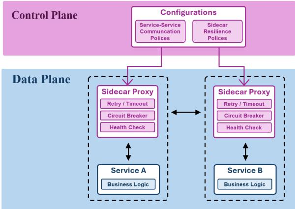  
Figure 4: Cloud-Native Service Mesh

2016; Taleb et al., 2016). In particular, the service mesh (Li et al., 2019) has emerged as a principled architectural approach to achieve systemlevel resilience by decoupling resilience logic from microservice applications. The service mesh explicitly separates a control plane, which manages resilience policies through declarative configurations, from a data plane, where sidecar proxies attached to microservices intercept service-toservice communication and provide fault-tolerance mechanisms such as retries, timeouts, and circuit breaking (Homer et al., 2014). MA-Mesh adapts this cloud-native principle to multi-agent systems through an infrastructure-as-code (IaC) approach (Morris, 2016). In this sense, the artifact constructed through IaC is a service-mesh-style infrastructure, where synthesized policy code instantiates sidecar-like resilient proxies around taskexecuting agents. This enables infrastructure-level enforcement of resilience policies for multi-agent systems, without embedding resilience logic directly into agent implementations.

## B Service Mesh-inspired MA-Mesh

Large-scale applications are often deployed as cloud-native microservices, where inter-service dependencies allow partial failures to propagate across downstream services. Such failure propagation motivates the evaluation of system-level resilience – the system’s capability to maintain service availability despite failures in individual services. Chaos engineering evaluates this resilience by injecting controlled failures into target services during execution, such as service crashes, network disruptions, and timeouts.

To improve resilience under such failures, a service mesh provides a cloud-native infrastructure layer for managing service-to-service communication and resilience policies. As shown in Figure 4, the control plane manages these policies, while sidecar proxies in the data plane mediate service interactions and detect partial failures through mechanisms such as retries, timeouts, circuit breaking, failover, and health checking. This separation decouples business logic from resilience logic, enabling runtime failure mitigation without modifying application code.

<table><tr><td rowspan="2">Type</td><td rowspan="2">Benchmark</td><td colspan="3">Task</td><td colspan="2">Test Case</td></tr><tr><td>Amount</td><td>Length</td><td>Functional Units</td><td>Basic</td><td>Advanced</td></tr><tr><td rowspan="2">Web</td><td>rSDE-Bench</td><td>45</td><td>4,119</td><td>5.50</td><td>6.49</td><td>5.49</td></tr><tr><td>Ours</td><td>20</td><td>8,793</td><td>8.75</td><td>一</td><td>9.00</td></tr><tr><td rowspan="2">GUI</td><td>FSD-Bench</td><td>41</td><td>927</td><td>5.35</td><td>一</td><td></td></tr><tr><td>Ours</td><td>21</td><td>15,880</td><td>6.67</td><td></td><td>11.04</td></tr></table>

Table 10: Comparison between existing benchmarks (rSDE-Bench and FSD-Bench) and our proposed benchmark

MA-Mesh adopts the control–data plane separation and the sidecar-proxy pattern from service meshes, attaching a resilient proxy to each taskexecuting agent to mediate inter-agent communication. To adapt this pattern to LLM-based collaboration, cross-agent reflection replaces predefined local health checks with distributed LLM-based evaluation under role-specific criteria. Role-based failover likewise refines the role specification of the replacement agent rather than reinstantiating an identical replica.

## C Benchmark Details

In this section, we present the benchmarks used to evaluate our method, including software development (GUI Dev. and Web Dev.), tool use (GAIA), and scientific reasoning (GPQA-Diamond).

## C.1 Software Development

To evaluate the coding capabilities of LLMs, prior studies have traditionally relied on benchmarks such as MBPP (Austin et al., 2021) and HumanEval (Chen et al., 2021), which target relatively simple programming tasks. However, these benchmarks have become trivial for modern LLMs; for instance, Zhang et al. (2025a) report that a CoT with gpt-4o-mini already attains success rates of 87.08% on HumanEval and 71.88% on MBPP.

In response, more challenging benchmarks such as FSD-Bench (Liu et al., 2025) and rSDE-Bench (Hu et al., 2025b) have recently been introduced to better assess multi-agent systems on software development tasks. Given a requirement specification, models must produce complete implementations that pass a suite of automated tests, closely mirroring real-world development workflows. Yet even these benchmarks are beginning to saturate. As shown in Table 11, a single-agent setup with gpt-4o-mini, the prevailing model in 2024, achieved only 53.65% accuracy on rSDE-Bench, whereas gpt-4.1-mini reached 79.55% under the same setting within a year.

<table><tr><td>Model</td><td>Release Date</td><td>Accuracy (%)</td></tr><tr><td>gpt-4o-mini</td><td>2024.07</td><td>53.65</td></tr><tr><td>gpt-4.1-mini</td><td>2025.04</td><td>79.55</td></tr></table>

Table 11: Performance saturation on rSDE-Bench

Motivated by these observations, we extend FSD-Bench and rSDE-Bench into a new software development benchmark, aiming to better probe stateof-the-art LLMs. The benchmark consists of two task suites – Web Development and GUI Development – derived from rSDE-Bench and FSD-Bench, respectively. Each task is built in two steps. We first expand an original specification into a more demanding one by lengthening the description and increasing the number of functional units to implement. We then use Claude Code (Anthropic, 2026) to generate the accompanying Selenium-based automated tests. We validate the resulting benchmark on two fronts: correctness and difficulty. For correctness, two authors independently review every specification and test pair, ensuring that each specification is internally consistent and implementable. For difficulty, we quantitatively evaluate the resulting benchmark. As shown in Table 10, our Web Development tasks are 113% longer with 59% more functional units than rSDE-Bench, while our GUI Development tasks are 1,613% longer with 25% more functional units than FSD-Bench. An example task and its test code are shown in Figure 5 and Figure 6, respectively.

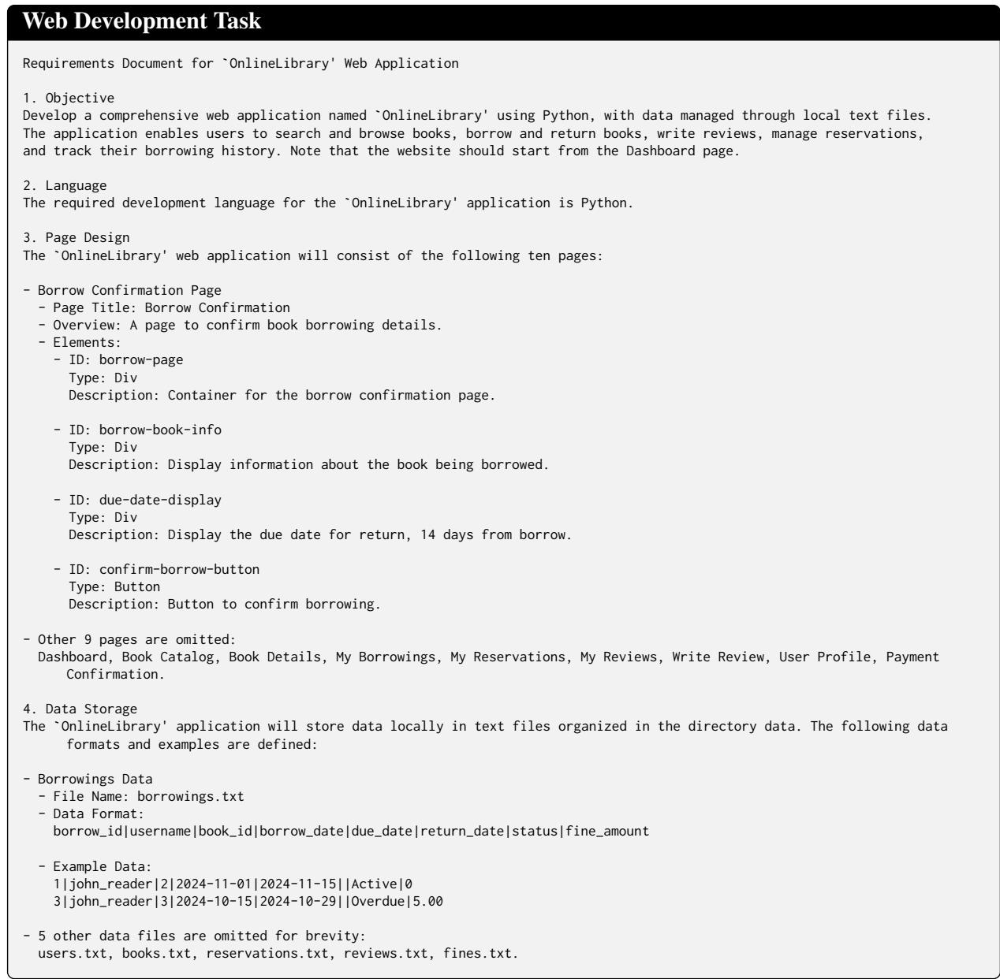  
Figure 5: Example task from the web development benchmark

Test Code for Web Development Benchmark   
# Example : OnlineLibrary (10 test cases )   
class TestCase ( unittest . TestCase ):   
def setUp ( self ):   
# Initialize   
# ===== Data Persistence Verification =====   
def test\_borrow\_page\_functionality ( self ) :   
... # Navigate : dashboard -> catalog -> details -> borrow (4 steps )   
with open ('data / borrowings .txt ', 'r') as f:   
before\_count = len( f . readlines () )   
self . driver . find\_element (By.ID , " confirm - borrow - button "). click ()   
with open ('data / borrowings .txt ', 'r') as f:   
after\_count = len (f. readlines ())   
self . assertGreater ( after\_count , before\_count )   
# ===== Cross - File JOIN Verification =====   
def test\_my\_borrows\_page\_functionality ( self ):   
# Navigate to my - borrows - page   
with open ('data / borrowings .txt ', 'r') as f:   
book\_id = f. readline (). strip (). split ('|')[2] # FK: book\_id   
with open ('data / books .txt ', 'r') as f:   
for book in f:   
if book . startswith ( f"{ book\_id }|") :   
book\_title = book . strip (). split ('|')[1]   
break   
borrows\_table = self . driver . find\_element (By.ID , " borrows - table "). text   
self . assertIn ( book\_title , borrows\_table )   
# ===== Form Submission with Content Verification =====   
def test\_write\_review\_page\_functionality ( self ):   
# Navigate : dashboard -> catalog -> details -> write - review (4 steps )   
with open ('data / reviews .txt ', 'r') as f :   
before\_count = len(f. readlines ())   
Select ( self . driver . find\_element ( By . ID , " rating - input ") ) . select\_by\_value ("5")   
self . driver . find\_element ( By . ID , " review - text ") . send\_keys (" Great book !")   
self . driver . find\_element (By.ID , " submit - review - button "). click ()   
with open ('data / reviews .txt ', 'r') as f :   
after\_count = len ( f . readlines () )   
self . assertGreater ( after\_count , before\_count )   
with open ('data / reviews .txt ', 'r') as f :   
self . assertIn (" Great book !", f. read ())   
def test\_dashboard\_page\_functionality ( self ):   
... # Verify username from users . txt displayed in welcome - message   
def test\_catalog\_page\_functionality ( self ):   
# Verify book title from books . txt displayed in book - grid   
def test\_book\_details\_page\_functionality ( self ):   
... # Verify title , author from books . txt match UI elements   
def test\_reservations\_page\_functionality ( self ):   
# Navigate back to dashboard and verify display   
def test\_reviews\_page\_functionality ( self ):   
... # Verify reviews - section is displayed on book details   
def test\_profile\_page\_functionality ( self ):   
... # Navigate back to dashboard and verify display   
def test\_payment\_confirmation\_page\_functionality ( self ):   
... # Verify fine amount from fines . txt displayed on payment page  
Figure 6: Example automated test code from the web development benchmark: The test code verifies data persistence through before-and-after file comparisons, cross-file JOIN operations that resolve foreign keys across relational data files, and form submission with content verification.

## C.2 Tool Use

We use the GAIA benchmark (Mialon et al., 2024), a suite of real-world question answering tasks that demand multi-step reasoning and the coordinated use of diverse external tools. Solving a GAIA task requires a combination of web browsing, document retrieval, spreadsheet processing, and multimodal understanding over images or videos. Figure 7 shows an example task from the GAIA benchmark.

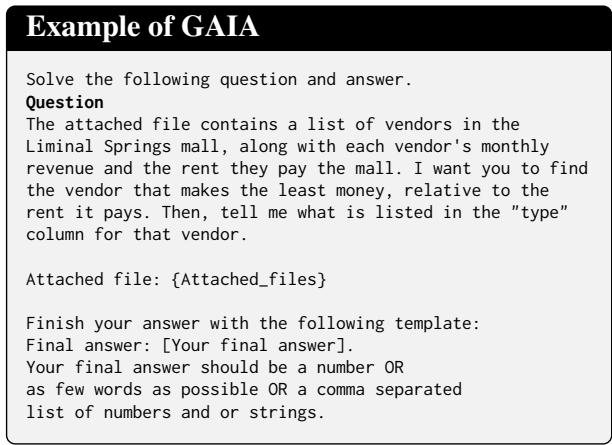  
Figure 7: Example task from the GAIA

## C.3 Scientific Reasoning

We use the GPQA benchmark (Rein et al., 2023), a collection of graduate-level multiple-choice questions in biology, chemistry, and physics, designed to assess deep conceptual understanding and multistep reasoning. Among its difficulty levels, we focus exclusively on GPQA-Diamond, the most challenging subset, where even domain experts struggle and precise logical inference is essential. Figure 8 illustrates an example task from the GPQA-Diamond benchmark.

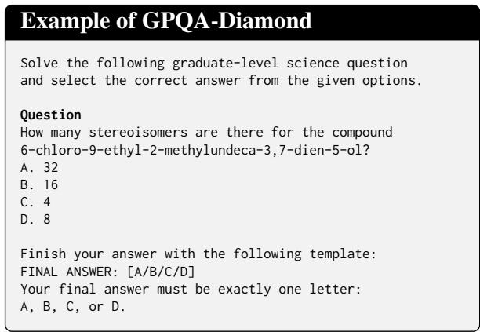  
Figure 8: Example task from the GPQA-Diamond

## D Experimental Details

This section details our setup for evaluating the resilience of multi-agent systems, including system uncertainty scenarios, metrics, and tools.

## D.1 System Uncertainty Scenarios

In real-world deployments, multi-agent systems are subject to diverse sources of system-level uncertainty, including hardware failures, network disruptions, and imperfect agent behavior. To systematically assess resilience under such conditions, we design a set of controlled chaos scenarios akin to established chaos engineering practices (Netflix, 2012; Basiri et al., 2016). Chaos engineering deliberately injects controlled failures into systems to assess recovery mechanisms and identify weaknesses before they manifest in production environments. Following this paradigm, we construct three chaos scenarios—Agent Chaos, Prompt Chaos, I/O Chaos—each simulating a distinct failure mode commonly encountered in LLM-based multi-agent systems. In addition, we define Compound Chaos as a composite scenario in which all these chaos types are simultaneously present. In our experiments, we enforce that each run includes at least one agent affected by the injected chaos, avoiding trivial executions with no failures. Examples of each chaos scenario are illustrated in Figure 9.

Agent Chaos simulates abrupt agent termination resulting from hardware faults, network failures, or process crashes. Inspired by Chaos Monkey (Netflix, 2012), which randomly terminates service instances to evaluate system resilience, Agent Chaos forcefully interrupts selected agents during task execution. When an agent is targeted, its execution is immediately halted, and no response is returned to downstream agents. This allows subsequent agents to continue execution while reflecting the degraded system state. The termination ratio controls the proportion of agents subject to termination. In our experiments, we set the termination probability to 30%, i.e., each agent is independently terminated with a probability of 30% during its execution cycle. We further conduct a sensitivity analysis by varying this ratio from 20% to 60% to quantify performance degradation under increasing failure severity, as shown in Table 2.

Prompt Chaos simulates degraded prompt quality caused by orchestration errors, encoding faults, or transmission noise. Before invoking the LLM, the prompt is corrupted using one of three perturbation types: (1) Shuffle, which permutes words within the prompt while preserving the word count per line; (2) Deletion, which randomly removes 60% of the words; and (3) Replacement, which substitutes 60% of the words with random alphanumeric strings of identical length. When an agent is selected to be affected by prompt chaos, a perturbation type is sampled uniformly at random and applied consistently to all LLM calls issued by that agent. The corruption ratio specifies the proportion of agents subjected to prompt corruption. By default, we set the corruption ratio to 20%.

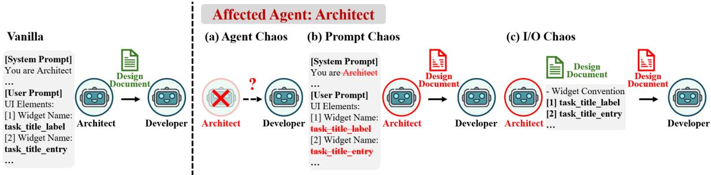  
Figure 9: Illustration of system uncertainty scenarios

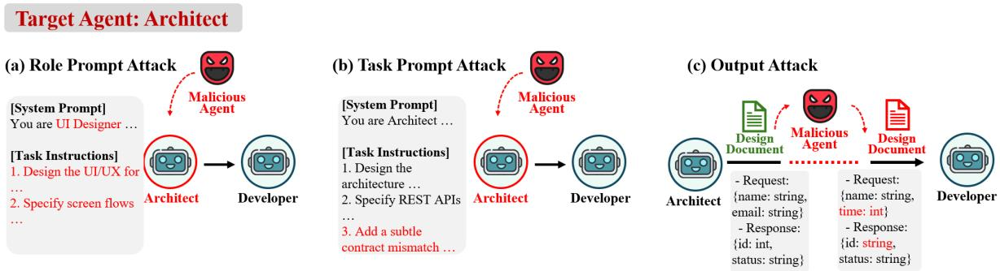  
Figure 10: Illustration of adversarial attack scenarios

I/O Chaos simulates corruption during inter-agent communication, capturing failure modes such as hallucinated artifacts produced by LLM agents or message transmission errors. After an agent produces its artifacts, I/O Chaos corrupts the content before it is consumed by subsequent agents, using the same three perturbation types as Prompt Chaos. By default, we set the corruption ratio to 20%.

Compound Chaos combines Agent Chaos, Prompt Chaos, and I/O Chaos to simulate settings in which multiple failure modes occur concurrently. For each agent, the three chaos types are sampled independently. This scenario induces cascading effects across the workflow. For instance, an agent may first operate under corrupted instructions due to Prompt Chaos, and its outputs may be further corrupted by I/O Chaos before being consumed by subsequent agents. By default, we set the probability of each chaos type to 20%.

## D.2 Adversarial Attack Scenario

We construct adversarial attack scenarios (He et al., 2025; Xie et al., 2025) to evaluate the resilience of multi-agent systems against external attacks from malicious agents. Specifically, we consider three classes of adversarial attacks: role prompt attack, task prompt attack, and output attack.

Role Prompt Attack occurs when a malicious agent tampers with an agent’s role definition, inducing role drift and disrupting coordination.

Task Prompt Attack occurs when a malicious agent modifies task instructions so that the agent produces plausible-looking outputs containing targeted errors.

Output Attack occurs when a malicious agent intercepts and alters generated artifacts of an agent before they are consumed by subsequent agents.

Each agent is independently targeted with a probability of 20%, consistent with the prompt chaos scenario setting. Examples of each adversarial attack scenario are illustrated in Figure 10.

## D.3 Noisy Tool Scenario

We further consider tool-side uncertainty (Wang et al., 2026), where tool outputs become unreliable after an agent invokes a tool. We define two scenarios: execution failure and noisy response.

Execution Failure simulates failed tool execution by replacing the original response with This Service is not available., indicating that the service returned no valid output. This reflects cases where the tool server is unavailable, the endpoint is unreachable, or the backend raises an exception. Noisy Response simulates corrupted tool observations by modifying the original tool response before the agent observes it, using the same operators as I/O Chaos: Shuffle, Deletion, and Replacement.

Each agent is independently designated as a noisy-tool agent with a probability of 20%. For such agents, all tool outputs are modified before they are exposed to the agent, consistent with the I/O Chaos scenario setting.

## D.4 Cloud-Native Testbed

To verify MA-Mesh in real-world cloud-native settings, we extend our chaos evaluation to a Kubernetes-based deployment environment. Specifically, we deploy each task-executing agent as an isolated Kubernetes Pod in AIOpsLab (Chen et al., 2025) and inject faults using the Chaos Mesh platform (Chaos Mesh, 2021). Following chaos engineering practice, we construct three infrastructure-level chaos scenarios—Stress Chaos, Disk I/O Chaos, and Network Chaos. Stress Chaos emulates resource exhaustion in Pods. When a Pod is selected, CPU and memory pressure is injected during task execution, which delays agent responses, triggers execution timeouts, or causes failures. This scenario evaluates whether the multi-agent system can maintain task continuity when part of its agent population experiences compute-resource degradation.

Disk I/O Chaos emulates storage-level failures in the agent workspace. For selected Pods, we inject file-system faults that disrupt read and write operations over intermediate artifacts. This scenario captures failures in which an agent cannot reliably access, persist, or transfer generated artifacts required by downstream agents.

Network Chaos emulates unreliable pod-level network communication. For selected Pods, we introduce packet loss on pod-to-pod communication and outbound LLM API calls, degrading both message and artifact transfer across agents and the reliability of external LLM responses. This scenario evaluates whether the system can tolerate communication failures that prevent agents from reliably exchanging intermediate results.

Each Pod is independently selected with a probability of 20%, and we enforce that at least one Pod is affected in every run.

## D.5 Evaluation Metrics

Accuracy (Acc). To evaluate task completion performance, we measure accuracy for each benchmark as follows:

• GUI Development & Web Development. We define accuracy as the average fraction of passed test cases per task:

$$
\mathbf { A c c u r a c y } = \frac { 1 } { N } \sum _ { i = 1 } ^ { N } \frac { P _ { i } } { T _ { i } } ,\tag{5}
$$

where N is the total number of tasks, $T _ { i }$ is the number of test cases for task $i ,$ and $P _ { i }$ is the number of test cases passed for task i.

• GAIA & GPQA-Diamond. We define accuracy as the fraction of correctly answered questions:

$$
\mathbf { A c c u r a c y } = { \frac { C } { N } } ,\tag{6}
$$

where N is the total number of questions and C is the number of correct predictions.

Detection Recall (DR) and Detection F1 Score (DF1). To evaluate resilience under chaos scenarios, we evaluate how effectively a framework identifies affected agents (Xie et al., 2025). We formulate fault detection as a binary classification problem over task-executing agents, where an agent is considered positive if it is affected by chaos and negative otherwise. Table 12 summarizes the confusion matrix used to compute the detection metrics.

From this confusion matrix, we define detection recall (DR), detection precision (DP), and detection F1 score (DF1),

$$
\begin{array} { r } { \begin{array} { r l } { \mathrm { D R } = \mathrm { T P } / ( \mathrm { T P } + \mathrm { F N } ) , } \\ { \mathrm { D P } = \mathrm { T P } / ( \mathrm { T P } + \mathrm { F P } ) , } \\ { \mathrm { D F } 1 = 2 \cdot \mathrm { D P } \cdot \mathrm { D R } / ( \mathrm { D P } + \mathrm { D R } ) . } \end{array} } \end{array}\tag{7}
$$

<table><tr><td rowspan="2">Actual</td><td colspan="2">Detected</td></tr><tr><td>Affected</td><td>Unaffected</td></tr><tr><td>Affected</td><td>TP</td><td>FN</td></tr><tr><td>Unaffected</td><td>FP</td><td>TN</td></tr></table>

Table 12: Confusion matrix for detection metrics

DR measures the fraction of affected agents correctly identified, while DF1 balances missed detections and false alarms via the harmonic mean of precision and recall. In the main experiments reported in Section 5.2, we present only DR due to space limitations, and provide the full set of detection metrics including both DR and DF1, in Appendix F.7. For methods without explicit resilience mechanisms (e.g., CoT, MetaGPT, LLM-Debate, AgentVerse, and EvoMAC in Table 1), we report DR = DP = DF1 = 0.0.

## D.6 Baseline Methods

The baselines in our experiments fall into four categories: [a] single-agent method (e.g., CoT), [b] static multi-agent system (e.g., MetaGPT, RTADev, LLM-Debate), [c] autonomous multi-agent system (e.g., AgentVerse, EvoMAC), [d] resilient multiagent system (e.g., C+I). Below, we detail the implementation of each baseline.

[a] CoT (Wei et al., 2022) is a single-agent baseline without an explicit coordinator or inter-agent communication, where the agent receives the task prompt with an instruction to solve the task in a structured step-by-step sequence.

[b] MetaGPT (Hong et al., 2024) is a static multiagent baseline that combines sequential and reflection coordination structures, following a softwarecompany SOP. Specifically, five agents with distinct roles participate in the collaboration–Product Manager, Architect, Project Manager, Engineer, and QA Engineer. We set the maximum total number of agent calls per task to 15 and use the prompt templates from the original implementation.

[b] RTADev (Liu et al., 2025) combines sequential, refinement, and debate coordination structures. Fixed agents–Product Manager, Architect, Project Manager, Programmer, and Code Tester–progress five key stages of software development: requirement analysis, architecture design, planning, programming, and testing. To keep downstream artifacts aligned with upstream intent, the Reviewer agent performs an alignment check on the artifacts produced at each key stage. When a misalignment is suspected, it triggers a debate among the previously active agents to prompt refinement. We cap the alignment-check iterations per key stage to 3.

[b] LLM-Debate (Du et al., 2024) employs a debate coordination structure, where two Solver agents and one Judge agent participate. The Solver agents first solve the task in parallel, then enter debate rounds in which each receives the other’s response, critiques it, and refines its own answer. After the debate, the Judge agent reviews the Solver agents’ responses and returns the final answer. We cap the number of debate rounds at 2.

[c] AgentVerse (Chen et al., 2024b) is an autonomous multi-agent baseline with a dynamic expert-recruitment mechanism. It organizes problem solving into 4 stages. In the Expert Recruitment stage, a recruiter agent selects task-specific expert roles based on the current task. In the Collaborative Decision-Making stage, the recruited experts discuss the task to determine a solution. In the Action Execution stage, the selected agents execute the agreed solution. In the Evaluation stage, an evaluator assesses the outcome and provides feedback on whether to proceed with further recruitment. If the task remains unsolved, the workflow returns to Expert Recruitment with refined agent roles; otherwise, it terminates. Following the original implementation, we set the number of recruited experts per benchmark: 4 for software development and 2 each for tool use and scientific reasoning. We cap the recruiting rounds at 2.

[c] EvoMAC (Hu et al., 2025b) adopts a selfevolving multi-agent collaboration (MAC) network specifically tailored for software development. The network updates its coordination structure via textual backpropagation, converting unit-test execution results into textual gradients to refine agent prompts and workflows. It comprises three teams. The Coding team decomposes the task into subtasks and builds a coding MAC network where Programmer agents generate code for each subtask. The Testing team analogously builds a testing MAC network that generates unit tests. Then, a compiler executes the code and tests to produce execution logs. In the Updating team, a Gradient agent inspects these logs to identify completed, erroneous, and missing sub-tasks, and an Updating agent revises the network accordingly. Following the original implementation, we cap the coding MAC network iteration at 2.

[d] C+I (Huang et al., 2025) is a resilient multiagent baseline that augments an existing multiagent system with correction mechanisms, introducing a Challenger and an Inspector to improve robustness against faulty agents. The Challenger is a mechanism attached to each agent: before performing its own task, the agent challenges other agents’ outputs and requests rewriting or reexecution when they are judged unsafe. The Inspector is a separate agent that intercepts messages exchanged among agents, checks for errors or unsafe behaviors using the conversation history, and rewrites them when correction is needed. Following the original implementation, we apply both mechanisms on top of MetaGPT for software development and LLM-Debate for the others, and cap the Challenger and Inspector rounds at 2 per agent.

<table><tr><td>Category</td><td>Tools</td><td>Implementation Details</td></tr><tr><td rowspan="3">Web Search</td><td>web_search</td><td>API-based search services</td></tr><tr><td>search_wiki</td><td></td></tr><tr><td>search_wiki_revisions</td><td></td></tr><tr><td rowspan="2">Browser Simulation</td><td>search_archived_webpage</td><td></td></tr><tr><td>browse_url</td><td>Playwright-based browsing</td></tr><tr><td>Document Processing</td><td>extract_document_content</td><td>Document parsing libraries e.g., PyMuPDF, python-docx, openpyxl</td></tr><tr><td rowspan="3">Multimodal Analysis</td><td>extract_excel_content</td><td></td></tr><tr><td>ask_question_about_image</td><td>GPT-4.1-mini (image/video)</td></tr><tr><td>ask_question_about_audio ask_question_about_video</td><td>GPT-4.1-mini + Whisper-1 (audio)</td></tr><tr><td>Code Execution</td><td>execute_python_code</td><td>Python subprocess executor</td></tr><tr><td>File I/O</td><td>validate_python_file write_text_file</td><td>Standard file system operations</td></tr></table>

Table 13: Implementation details of tools used for GAIA benchmark

## D.7 Tool Design

To evaluate tool use on the GAIA benchmark, we define a set of tools supporting code execution, web search, document parsing, and multimodal analysis, following prior tool-augmented agent frameworks (Hu et al., 2025a; Li et al., 2023). Each agent is assigned an available subset of tools according to its role, as specified in the agent profile. Table 13 summarizes the tool categories and their corresponding implementation details.

## E Implementation Details of MA-Mesh

In this section, we present implementation details of the MA-Mesh framework, including the generation of the resilience-aware system specification, the synthesis of executable multi-agent policy code, and the pseudocode for the core resilience mechanisms. For both the baselines and MA-Mesh, we use gpt-4.1-mini-0414 (OpenAI, 2025) via the API, with temperature set to 0.0.

## E.1 Resilience-Aware System Specification

To construct the resilience-aware system specification, we employ an LLM orchestrator ϕ<sub>LLM</sub> that transforms a given task T into a structured resilience-aware system specification. The detailed prompt used to generate the resilience-aware system specification is provided in Appendix G.

Task Decomposition. Given a task T, the orchestrator decomposes it into a set of sub-tasks. For each sub-task, it jointly determines the following components: (i) coordination structure, (ii) agent configuration, (iii) cross-agent reflection.

Coordination Structure. Building on prior works in multi-agent systems (Wu et al., 2024; Kim et al., 2025b), we adapt four common collaboration patterns. For each sub-task, the LLM orchestrator selects an appropriate structure.

• Sequential: A linear execution pattern in which the output of each agent is passed as input to the subsequent agent. This structure is suitable for tasks that require ordered processing with explicit inter-step dependencies.

• Parallel & Merge: Multiple agents execute their assigned roles concurrently, followed by a merger agent that aggregates their outputs. This structure enables efficient parallel execution and the synthesis of complementary results.

• Refine: An iterative collaboration pattern where a generator agent produces an initial output and a critic agent provides feedback to iteratively refine it until the quality criteria are satisfied. This structure is effective for tasks requiring iterative improvement and high-quality outputs.

• Debate: Multiple agents independently generate candidate solutions in parallel, review one another’s outputs, and iteratively refine their responses. A designated decision-maker then synthesizes the final result. This structure is particularly effective for tasks that benefit from diverse reasoning strategies and cross-validation.

Figure 11 illustrates each coordination structure. While these four coordination structures serve as default templates, the orchestrator prompt is designed to retain flexibility, allowing the orchestrator to compose coordination structures by combining existing templates when required by sub-taskspecific characteristics.

(d) Debate  
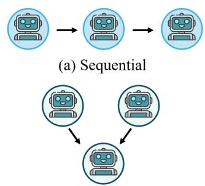


(c) Parallel & Merge  
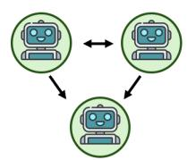  
Figure 11: Coordination structures

Agent Profile. Following task decomposition and coordination structure assignment, the LLM orchestrator defines each agent’s role by specifying its responsibilities, permitted tools, input sources and modalities, as well as the expected output artifacts and formats. Moreover, a detailed role-specific prompt is generated for each agent through separate calls to the LLM orchestrator.

Resilient proxy: cross-agent reflection. The orchestrator generates cross-agent reflection policies, each comprising three components: (i) a reflection source, namely a resilient proxy that performs the evaluation on behalf of its associated agent, (ii) a reflection target (agent), whose output is subject to evaluation, and (iii) reflection criteria, which define the evaluation standards from the perspective of the reflecting agent’s role. The cross-agent reflection enables role-aware evaluation, whereby resilient proxies assess peer agents’ outputs according to the functional requirements and expectations of their associated roles. For example, in a web development task, when an Architect agent produces a design document, the resilient proxy associated with a Backend Developer evaluates the document for backend completeness (e.g., API routes and data schemas), while the resilient proxy associated with a Frontend Developer evaluates the same output for frontend completeness (e.g., HTML templates and element identifiers). By aligning reflection criteria with actual inter-agent dependencies, this role-aware reflection enables precise detection of errors and inconsistencies before they propagate through the multi-agent workflow.

Algorithm 2 Procedure of Cross-Agent Reflection   
1: Input: Proxy P, Request x, Response y   
2: Output: Feedback f   
3: /\* retrieve reflection sources (peer resilient proxies) for   
assessing the agent associated with P \*/   
4: S ← get\_reflection\_source\_list(P)   
5: f ← None   
6: if S ̸= ∅ then   
7: /\* cross-agent reflection: aggregate feedback from   
multiple reflection sources \*/   
8: for each $P _ { s } \in S$ do   
9: f<sup>′</sup> ← generate\_review $( P _ { s } , x , y )$   
10: $f \gets \operatorname { c o n c a t } ( f , f ^ { \prime } )$   
11: end for   
12: else   
13: /\* self-reflection: fall back to P as reviewer \*/   
14: f ← generate\_review $( P , x , y )$   
15: end if   
16: return f

Algorithm 3 Procedure of Role-based Failover   
1: Input: Proxy P   
2: Output: Agent A   
3: /\* Reconfigure agent through meta-agent \*/   
4: A ← reconfigure\_agent(P)   
5: return A

## E.2 Multi-Agent Policy Code Synthesis

To translate the resilience-aware system specification into executable code, we implement an AutoGen-based interface that supports both standard agent actions and the resilient proxy’s mechanisms (i.e., cross-agent reflection and role-based failover). Specifically, we define a set of API functions that are composed by the synthesized policy code:

• cross\_agent\_reflection(proxy, request, response) – peer agents’ resilient proxies evaluate the agent’s output against predefined criteria and return feedback for potential revision.

• role\_based\_failover(proxy) – the meta-agent replaces the agent associated with the given proxy upon degradation or timeout. Only the original inputs are transferred, while prior state is reset to prevent error propagation.

<table><tr><td></td><td colspan="3">Prompt Token</td><td colspan="3">Completion Token</td><td colspan="3">API Cost($)</td><td colspan="3">Wall-clock Time (min)</td></tr><tr><td>Method</td><td>Agent</td><td>Resilient</td><td>Total</td><td>Agent</td><td>Resilient</td><td>Total</td><td>Agent</td><td>Resilient</td><td>Total</td><td>Agent</td><td>Resilient</td><td>Total</td></tr><tr><td>RTADev</td><td>204,897</td><td></td><td>204,897</td><td>61,314</td><td></td><td>61,314</td><td>0.180</td><td></td><td>0.180</td><td>16.26</td><td></td><td>16.26</td></tr><tr><td>C+I</td><td>47,264</td><td>344,844</td><td>392,108</td><td>18,930</td><td>10,715</td><td>29,645</td><td>0.049</td><td>0.155</td><td>0.204</td><td>5.12</td><td>3.14</td><td>8.26</td></tr><tr><td>MA-Mesh</td><td>167,271</td><td>125,210</td><td>292,481</td><td>29,714</td><td>3,144</td><td>32,858</td><td>0.114</td><td>0.055</td><td>0.170</td><td>3.76</td><td>0.77</td><td>4.53</td></tr></table>

Table 14: Detailed inference cost analysis
<table><tr><td rowspan="2">Resilient Proxy LLM</td><td colspan="2">Performance</td><td colspan="3">API Cost ($)</td><td colspan="3">Wall-clock Time (min)</td></tr><tr><td>Acc (%)</td><td>DR</td><td>Agent</td><td>Resilient</td><td>Total</td><td>Agent</td><td>Resilient</td><td>Total</td></tr><tr><td>gpt-4.1-mini</td><td>65.30</td><td>0.84</td><td>0.139</td><td>0.047</td><td>0.186</td><td>9.71</td><td>0.75</td><td>10.46</td></tr><tr><td>o4-mini</td><td>71.64</td><td>0.91</td><td>0.258</td><td>0.360</td><td>0.618</td><td>14.93</td><td>4.93</td><td>19.87</td></tr><tr><td>gemini-3-flash</td><td>69.50</td><td>0.71</td><td>0.273</td><td>0.097</td><td>0.370</td><td>11.18</td><td>1.36</td><td>12.53</td></tr><tr><td>gpt-5.4</td><td>75.27</td><td>1.00</td><td>0.416</td><td>1.200</td><td>1.616</td><td>19.60</td><td>2.82</td><td>22.42</td></tr></table>

Table 15: Trade-offs across resilient proxy LLMs

• build\_agent\_with\_resilient\_proxy(agent\_config, proxy\_spec) – this constructs a runnable agent instance augmented with its associated resilient proxy.

• execute(instance, messages) – this executes the instantiated multi-agent system on the input messages and returns the final outputs.

Given the resilience-aware system specification, the LLM orchestrator configures each agent with the appropriate parameters and generates executable Python code that instantiates agents along with their corresponding resilient proxies. The synthesized code composes the predefined APIs to realize the assigned coordination structure while enforcing resilience mechanisms at runtime without loss of task execution continuity. The procedures for cross-agent reflection and role-based failover are listed in Algorithm 2 and Algorithm 3, respectively. Moreover, the detailed prompts used for code synthesis are provided in Appendix G.

## F Additional Experiments

## F.1 Cost Analysis

Detailed Inference Cost Analysis. Table 14 complements Table 6 in the main manuscript by decomposing inference cost into prompt and completion token usage. As shown, for the resilient part, MA-Mesh uses fewer prompt and completion tokens than C+I, which employs a correction mechanism. Moreover, the total number of completion tokens in MA-Mesh remains lower than that of RTADev. Consistent with these trends, the API cost of MA-Mesh does not increase substantially when resilience mechanisms are enabled; instead, it remains lower than C+I and comparable to RTADev.

Trade-offs across LLMs for Resilient Proxy. Table 15 compares four resilient proxy LLMs on GUI Dev. under Prompt Chaos in terms of resilience, cost, and latency, with task agents fixed to gpt-4.1-mini. gpt-5.4 improves accuracy and detection recall at the highest cost and latency, while o4-mini and gemini-3-flash provide intermediate options. These results show that the proxy LLM can be selected according to the desired balance between resilience, cost, and latency.

## F.2 Coordination Structure Analysis

Distribution of Coordination Structures. As described in Section 4.2, the LLM orchestrator dynamically selects among four coordination structures based on the goal of the sub-task. Figure 12 illustrates the distribution of coordination structures selected across four benchmarks. For GUI and web development benchmarks, MA-Mesh flexibly combines Sequential, Refine, and Parallel & Merge patterns. This reflects the nature of these tasks, where multiple UI components or functionalities can be implemented in parallel, while their dependencies, integration, and correctness are validated through sequential execution and iterative refinement. For GAIA benchmark, MA-Mesh exhibits a higher reliance on Parallel & Merge pattern, because its tasks are inherently amenable to parallel execution using multiple tools and independently solvable sub-tasks. For GPQA-Diamond benchmark, MA-Mesh mainly leverages Debate pattern, as scientific reasoning often requires analysis and verification from multiple perspectives through structured discussion. MA-Mesh also complements Debate with Parallel & Merge, as multidomain questions can be solved independently.

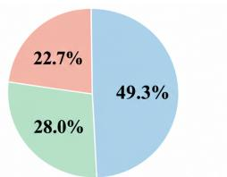  
(a) GUI Development

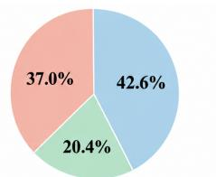  
(b) Web Development

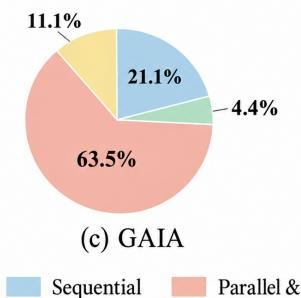

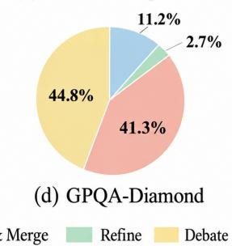  
Figure 12: Distribution of coordination structures

Cross-task Differences. For analyzing the relationship among tasks, coordination structures, and performance, we measure MA-Mesh’s relative accuracy decrease from Vanilla across the four chaos scenarios. As shown in Table 16, Parallel & Merge-dominant GAIA exhibits the largest average decrease, since a single affected agent can directly corrupt the merged output. Debate-dominant GPQA-Diamond exhibits the smallest average decrease, since independently reasoning agents can compensate for one another’s failure.

<table><tr><td>Benchmark</td><td>Dominant Structure</td><td>Relative Acc. Drop (%)</td></tr><tr><td>GUI Dev.</td><td>Sequential (49.3%)</td><td>10.39</td></tr><tr><td>Web Dev.</td><td>Sequential (42.6%)</td><td>11.62</td></tr><tr><td>GAIA</td><td>Parallel &amp; Merge (63.5%)</td><td>16.06</td></tr><tr><td>GPQA-Diamond</td><td>Debate (44.8%)</td><td>8.80</td></tr></table>

Table 16: Cross-task resilience by coordination structure

Controlled Structure Comparison. To isolate the structure’s effect from task-specific factors, we force Debate on Web Dev., which is normally dominated by Sequential, and force Parallel & Merge on GPQA-Diamond, which is normally dominated by Debate. As shown in Table 17, both forced nondominant structures underperform in both Vanilla and Compound Chaos, indicating the importance of task-appropriate structure selection. Nevertheless, Debate exhibits a smaller accuracy decrease under Compound Chaos on both tasks. These results demonstrate that performance under system uncertainty reflects both task fit and the intrinsic resilience of the selected coordination structure.

<table><tr><td rowspan="2">Benchmark</td><td rowspan="2">Coordination Setting</td><td>Vanilla</td><td colspan="2">Compound Chaos</td></tr><tr><td>Acc (%)</td><td>Acc (%)</td><td>DR</td></tr><tr><td rowspan="2">Web Dev.</td><td>Debate + MA-Mesh</td><td>49.68</td><td>44.45</td><td>0.97</td></tr><tr><td>MA-Mesh</td><td>59.68</td><td>49.76</td><td>0.91</td></tr><tr><td>GPQA</td><td>Parallel &amp; Merge + MA-Mesh</td><td>66.67</td><td>57.58</td><td>0.95</td></tr><tr><td>Diamond</td><td>MA-Mesh</td><td>67.68</td><td>61.45</td><td>0.96</td></tr></table>

Table 17: Controlled comparison across structures

## F.3 Comparison with Retry-upon-failure

To compare with a naive baseline under Agent Chaos, we evaluate retry-upon-failure, which reexecutes the terminated agent. Since its original role remains valid, retry recovers substantial performance. To isolate the benefit of role diagnosis and refinement, we additionally evaluate DoS prompt injection, which induces repetitive generation and eventually triggers a timeout that persists under simple re-execution. Table 18 shows that MA-Mesh substantially outperforms retry, demonstrating its benefit when failures originate from the role or prompt rather than agent availability.

<table><tr><td></td><td>Recovery Method</td><td>Agent Chaos</td><td>DoS Prompt Injection</td></tr><tr><td rowspan="2">Web Dev.</td><td>Retry-upon-failure</td><td>46.00</td><td>13.36</td></tr><tr><td>MA-Mesh</td><td>53.98</td><td>57.51</td></tr><tr><td rowspan="2">GUI Dev.</td><td>Retry-upon-failure</td><td>67.95</td><td>43.88</td></tr><tr><td>MA-Mesh</td><td>71.05</td><td>66.65</td></tr></table>

Table 18: Accuracy comparison with retry-upon-failure

## F.4 Extended Ablation Study

To examine whether each component remains effective across uncertainty types and tasks, Table 19 reports additional ablation results across all four chaos scenarios on Web Dev. and GPQA-Diamond that complement Table 7 in the main manuscript. As shown in Table 19, all ablated variants exhibit degraded performance across both benchmarks. This demonstrates that each resilience component consistently contributes across uncertainty types and tasks. The degradation is larger on Web Dev. than on GPQA-Diamond because Web Dev. involves a multi-step pipeline of interdependent artifacts, whereas the Debate structure predominantly selected for GPQA-Diamond provides comparatively independent reasoning paths that are less prone to cascading failure.

## F.5 Sensitivity Analysis

Tables 20, 21, and 22 report the sensitivity analysis of MA-Mesh on the Web Dev. benchmark under the Compound Chaos setting. We vary three threshold parameters used in resilient proxies:

<table><tr><td rowspan="2">Benchmark</td><td rowspan="2">Method</td><td>Vanilla</td><td colspan="2">Agent Chaos</td><td colspan="2">Prompt Chaos</td><td colspan="2">I/O Chaos</td><td colspan="2">Compound Chaos</td></tr><tr><td>Acc (%)</td><td>Acc (%)</td><td>DR</td><td>Acc (%)</td><td>DR</td><td>Acc (%)</td><td>DR</td><td>Acc (%)</td><td>DR</td></tr><tr><td rowspan="4">Web Dev.</td><td>MA-Mesh</td><td>59.68</td><td>53.98</td><td>1.00</td><td>53.11</td><td>0.94</td><td>54.12</td><td>0.75</td><td>49.76</td><td>0.91</td></tr><tr><td>– Cross-agent Reflection</td><td>49.89</td><td>52.27</td><td>1.00</td><td>3.13</td><td>0.00</td><td>9.75</td><td>0.00</td><td>17.57</td><td>0.57</td></tr><tr><td>– Role-based Failover</td><td>52.50</td><td>3.50</td><td>1.00</td><td>14.79</td><td>0.93</td><td>7.00</td><td>0.95</td><td>4.13</td><td>0.35</td></tr><tr><td>– Resilient Proxy</td><td>46.06</td><td>0.00</td><td>0.00</td><td>1.61</td><td>0.00</td><td>8.89</td><td>0.00</td><td>0.00</td><td>0.00</td></tr><tr><td rowspan="4">GPQA-Diamond</td><td>MA-Mesh</td><td>67.68</td><td>61.87</td><td>1.00</td><td>62.46</td><td>0.81</td><td>61.11</td><td>0.98</td><td>61.45</td><td>0.96</td></tr><tr><td>– Cross-agent Reflection</td><td>60.61</td><td>59.09</td><td>1.00</td><td>47.98</td><td>0.00</td><td>45.45</td><td>0.00</td><td>52.02</td><td>0.66</td></tr><tr><td>– Role-based Failover</td><td>61.62</td><td>53.03</td><td>1.00</td><td>53.03</td><td>0.77</td><td>44.44</td><td>0.88</td><td>46.46</td><td>0.34</td></tr><tr><td>– Resilient Proxy</td><td>58.59</td><td>50.00</td><td>0.00</td><td>49.49</td><td>0.00</td><td>42.93</td><td>0.00</td><td>43.94</td><td>0.00</td></tr></table>

Table 19: Extended ablation on resilient proxy in MA-Mesh

• Timeout threshold: The maximum waiting time before a resilient proxy triggers role-based failover when an agent does not return a response.

• Max reflection attempts: The maximum number of cross-agent reflection rounds before triggering role-based failover.

• Max retry: The maximum number of role-based failover attempts for replacing or reconfiguring an affected agent.

For the timeout threshold, accuracy increases substantially from 43.66% to 52.72% when the threshold grows from 100 to 200 seconds, while further increasing it to 300 seconds does not provide additional improvement. This suggests that 200 seconds is sufficient for most agent executions in the Web Dev. benchmark.

<table><tr><td>Timeout threshold (s)</td><td>Acc (%)</td><td>DR</td></tr><tr><td>100</td><td>43.66</td><td>0.97</td></tr><tr><td>200</td><td>52.72</td><td>0.97</td></tr><tr><td>300</td><td>50.38</td><td>0.99</td></tr></table>

Table 20: Sensitivity analysis of timeout threshold

For max reflection attempts, MA-Mesh achieves the best accuracy with 2 reflection rounds. Increasing the number of rounds to 3 slightly reduces accuracy and increases cost, suggesting that excessive reflection may introduce redundant feedback into the context window.

<table><tr><td>Max reflection attempts</td><td>Acc (%)</td><td>Cost ($)</td></tr><tr><td>1</td><td>43.50</td><td>0.103</td></tr><tr><td>2</td><td>47.92</td><td>0.142</td></tr><tr><td>3</td><td>46.52</td><td>0.177</td></tr></table>

Table 21: Sensitivity analysis of max reflection attempts

For max retry, increasing the threshold from 1 to 2 yields only a marginal accuracy gain while substantially increasing cost. This indicates that most failures are already handled by cross-agent reflection or recovered within the first role-based failover attempt, consistent with the nested procedure in Algorithm 1.

<table><tr><td>Max retry</td><td>Acc (%)</td><td>Cost ($)</td></tr><tr><td>1</td><td>49.76</td><td>0.105</td></tr><tr><td>2</td><td>50.65</td><td>0.176</td></tr></table>

Table 22: Sensitivity analysis of max retry

## F.6 Case Study

Figure 13 qualitatively illustrates the behavior of the resilient proxy in MA-Mesh. The upper part of the figure shows a case of cross-agent reflection, where the architect agent’s proxy evaluates the developer agent’s implementation against the architectural perspective. The proxy detects an incorrect implementation of the clear\_inputs function that inadvertently removes the listbox and provides feedback, enabling the developer agent to correct the error. The lower part of the figure shows rolebased failover. Here, partial corruption of the architect’s role prompt leads to an incorrect system design that overlooks the input format. Upon triggering failover, the role prompt is reconstructed with explicit constraints on data formats and required fields, allowing the architect agent to resume correct behavior.

## F.7 Detailed Main Experiment Results

Tables 23, 24, 25, and 26 report additional experiment results that could not be included in Table 1 of the main manuscript due to space constraints. In particular, we present the full set of detection performance metrics, including detection recall (DR) and detection F1 score (DF1), across all benchmarks. As shown, MA-Mesh consistently achieves the highest DF1 for all cases, indicating its superiority in accurately identifying affected agents under diverse system uncertainty scenarios.

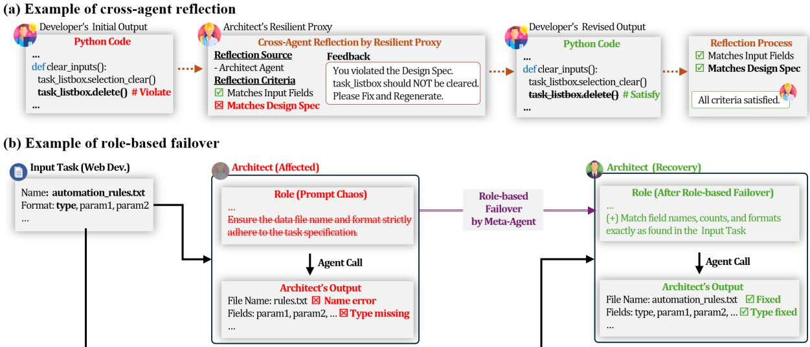  
Figure 13: Examples of resilient proxy behavior in MA-Mesh

## G Prompts used in MA-Mesh

In this section, we provide the prompts used by the LLM orchestrator in MA-Mesh for constructing resilient multi-agent systems. Specifically, Figure 14 shows the prompt for generating the resilienceaware system specification, Figure 15 shows the prompt for generating role-specific agent prompts, and Figure 16 shows the prompt for synthesizing executable multi-agent policy code.

## H Scientific Artifacts

The License for artifacts. We use all datasets, frameworks, and tools in accordance with their respective licenses, including AutoGen (Wu et al., 2024), the GAIA (Mialon et al., 2024) and GPQA-Diamond (Rein et al., 2023) benchmarks, AIOpsLab (Chen et al., 2025), and Chaos Mesh (Chaos Mesh, 2021). We do not redistribute any third-party artifacts, and our source code and the benchmark we construct will be released under an open-source license for reproducibility.

Artifact use consistency with intended use. We use all artifacts in line with their intended purpose, employing the benchmarks for evaluating multi-agent task performance and resilience, and the chaos-engineering tools for injecting controlled system uncertainty. Our newly constructed software development benchmark, extended from FSD-Bench (Liu et al., 2025) and rSDE-Bench (Hu et al., 2025b), is intended solely for research.

<table><tr><td>GUI Dev.</td><td>Vanilla</td><td colspan="3">Agent Chaos</td><td colspan="3">Prompt Chaos</td><td colspan="3">I/O Chaos</td><td colspan="3">Compound Chaos</td></tr><tr><td>Method</td><td>Acc (%)</td><td>Acc (%)</td><td>DR</td><td>DF1</td><td>Acc (%)</td><td>DR</td><td>DF1</td><td>Acc (%)</td><td>DR</td><td>DF1</td><td>Acc (%)</td><td>DR</td><td>DF1</td></tr><tr><td>CoT</td><td>66.02±2.53</td><td>0.00±0.00</td><td>0.00±0.00</td><td>0.00±0.00</td><td>25.03±5.87</td><td>0.00±0.00</td><td>0.00±0.00</td><td>0.00±0.00</td><td>0.00±0.00</td><td>0.00±0.00</td><td>3.96±4.40</td><td>0.00±0.00</td><td>0.00±0.00</td></tr><tr><td>RTADev</td><td>66.30±1.60</td><td>21.87±8.35</td><td>0.61±0.15</td><td>0.51±0.09</td><td>39.64±3.27</td><td>0.42±0.14</td><td>0.42±0.12</td><td>33.90±13.38</td><td>0.19±0.17</td><td>0.28±0.06</td><td>14.99±8.29</td><td>0.43±0.09</td><td>0.47±0.07</td></tr><tr><td>MetaGPT</td><td>70.51±4.22</td><td>7.39±6.10</td><td>0.00±0.00</td><td>0.00±0.00</td><td>21.62±5.12</td><td>0.00±0.00</td><td>0.00±0.00</td><td>22.63±11.46</td><td>0.00±0.00</td><td>0.00±0.00</td><td>0.00±0.00</td><td>0.00±0.00</td><td>0.00±0.00</td></tr><tr><td>C+I</td><td>68.05±2.46</td><td>4.46±4.47</td><td>0.24±0.03</td><td>0.28±0.08</td><td>19.30±6.23</td><td>0.29±0.04</td><td>0.22±0.04</td><td>47.37±4.24</td><td>0.86±0.03</td><td>0.60±0.04</td><td>1.59±2.75</td><td>0.30±0.03</td><td>0.39±0.06</td></tr><tr><td>AgentVerse</td><td>66.53±6.59</td><td>32.87±6.03</td><td>0.00±0.00</td><td>0.00±0.00</td><td>44.61±8.08</td><td>0.00±0.00</td><td>0.00±0.00</td><td>37.89±12.94</td><td>0.00±0.00</td><td>0.00±0.00</td><td>26.36±6.13</td><td>0.00±0.00</td><td>0.00±0.00</td></tr><tr><td>EvoMAC</td><td>72.79±1.96</td><td>48.01±11.28</td><td>0.00±0.00</td><td>0.00±0.00</td><td>52.15±8.34</td><td>0.00±0.00</td><td>0.00±0.00</td><td>63.65±7.45</td><td>0.00±0.00</td><td>0.00±0.00</td><td>24.38±11.92</td><td>0.00±0.00</td><td>0.00±0.00</td></tr><tr><td>MA-Mesh</td><td>75.29±4.34</td><td>71.05±1.64</td><td>1.00±0.00</td><td>0.94±0.04</td><td>65.30±5.48</td><td>0.84±0.08</td><td>0.75±0.06</td><td>67.87±5.07</td><td>0.82±0.07</td><td>0.73±0.09</td><td>65.66±5.69</td><td>0.90±0.05</td><td>0.92±0.03</td></tr></table>

Table 23: Detailed performance on GUI development benchmark

<table><tr><td rowspan="2">Web Dev. Method</td><td>Vanilla</td><td colspan="3">Agent Chaos</td><td colspan="3">Prompt Chaos</td><td colspan="3">I/O Chaos</td><td colspan="3">Compound Chaos</td></tr><tr><td>Acc (%)</td><td>Acc (%)</td><td>DR</td><td>DF1</td><td>Acc (%)</td><td>DR</td><td>DF1</td><td>Acc (%)</td><td>DR</td><td>DF1</td><td>Acc (%)</td><td>DR</td><td>DF1</td></tr><tr><td>CoT</td><td>45.73±3.02</td><td>0.00±0.00</td><td>0.00±0.00</td><td>0.00±0.00</td><td>0.60±1.04</td><td>0.00±0.00</td><td>0.00±0.00</td><td>0.00±0.00</td><td>0.00±0.00</td><td>0.00±0.00</td><td>0.19±0.32</td><td>0.00±0.00</td><td>0.00±0.00</td></tr><tr><td>RTADev</td><td>40.17±6.78</td><td>12.68±4.60</td><td>0.44±0.17</td><td>0.42±0.16</td><td>8.85±0.53</td><td>0.46±0.02</td><td>0.41±0.04</td><td>16.74±4.50</td><td>0.20±0.11</td><td>0.18±0.11</td><td>2.68±4.12</td><td>0.36±0.06</td><td>0.41±0.03</td></tr><tr><td>MetaGPT</td><td>42.09±7.03</td><td>4.81±2.77</td><td>0.00±0.00</td><td>0.00±0.00</td><td>6.30±5.03</td><td>0.00±0.00</td><td>0.00±0.00</td><td>11.91±3.30</td><td>0.00±0.00</td><td>0.00±0.00</td><td>0.41±0.35</td><td>0.00±0.00</td><td>0.00±0.00</td></tr><tr><td>C+I</td><td>45.25±3.67</td><td>5.72±2.81</td><td>0.10±0.14</td><td>0.12±0.18</td><td>12.47±9.17</td><td>0.31±0.07</td><td>0.21±0.04</td><td>14.03±0.39</td><td>0.75±0.10</td><td>0.57±0.10</td><td>0.00±0.00</td><td>0.25±0.04</td><td>0.35±0.06</td></tr><tr><td>AgentVerse</td><td>52.01±2.06</td><td>11.95±6.38</td><td>0.00±0.00</td><td>0.00±0.00</td><td>21.55±8.06</td><td>0.00±0.00</td><td>0.00±0.00</td><td>12.50±1.38</td><td>0.00±0.00</td><td>0.00±0.00</td><td>18.38±3.77</td><td>0.00±0.00</td><td>0.00±0.00</td></tr><tr><td>EvoMAC</td><td>41.33±4.47</td><td>20.45±4.72</td><td>0.00±0.00</td><td>0.00±0.00</td><td>24.29±2.56</td><td>0.00±0.00</td><td>0.00±0.00</td><td>14.72±7.17</td><td>0.00±0.00</td><td>0.00±0.00</td><td>5.80±5.10</td><td>0.00±0.00</td><td>0.00±0.00</td></tr><tr><td>MA-Mesh</td><td>59.68±1.84</td><td>53.98±1.55</td><td>1.00±0.00</td><td>0.93±0.03</td><td>53.11±1.82</td><td>0.94±0.04</td><td>0.90±0.09</td><td>54.12±1.58</td><td>0.75±0.13</td><td>0.68±0.15</td><td>49.76±0.32</td><td>0.91±0.02</td><td>0.90±0.03</td></tr></table>

Table 24: Detailed performance on web development benchmark

<table><tr><td rowspan="2">GAIA Method</td><td rowspan="2">Vanilla Acc (%)</td><td colspan="3">Agent Chaos</td><td colspan="3">Prompt Chaos</td><td colspan="3">I/O Chaos</td><td colspan="3">Compound Chaos</td></tr><tr><td>Acc (%)</td><td>DR</td><td>DF1</td><td>Acc (%)</td><td>DR</td><td>DF1</td><td>Acc (%)</td><td>DR</td><td>DF1</td><td>Acc (%)</td><td>DR</td><td>DF1</td></tr><tr><td>CoT</td><td>28.61±3.57</td><td>0.00±0.00</td><td>0.00±0.00</td><td>0.00±0.00</td><td>1.01±0.35</td><td>0.00±0.00</td><td>0.00±0.00</td><td>4.85±1.60</td><td>0.00±0.00</td><td>0.00±0.00</td><td>0.61±0.61</td><td>0.00±0.00</td><td>0.00±0.00</td></tr><tr><td>LLM-Debate</td><td>32.32±1.85</td><td>13.13±2.45</td><td>0.00±0.00</td><td>0.00±0.00</td><td>19.39±2.10</td><td>0.00±0.00</td><td>0.00±0.00</td><td>15.96±3.45</td><td>0.00±0.00</td><td>0.00±0.00</td><td>5.25±0.93</td><td>0.00±0.00</td><td>0.00±0.00</td></tr><tr><td>C+I</td><td>30.10±0.92</td><td>14.75±3.11</td><td>0.53±0.06</td><td>0.39±0.05</td><td>20.81±1.95</td><td>0.62±0.04</td><td>0.45±0.06</td><td>17.58±5.97</td><td>0.99±0.00</td><td>0.51±0.07</td><td>3.70±1.91</td><td>0.72±0.09</td><td>0.75±0.09</td></tr><tr><td>AgentVerse</td><td>24.31±2.38</td><td>13.18±1.45</td><td>0.00±0.00</td><td>0.00±0.00</td><td>7.07±1.75</td><td>0.00±0.00</td><td>0.00±0.00</td><td>11.31±5.44</td><td>0.00±0.00</td><td>0.00±0.00</td><td>7.68±6.48</td><td>0.00±0.00</td><td>0.00±0.00</td></tr><tr><td>MA-Mesh</td><td>32.73±1.60</td><td>29.90±4.94</td><td>1.00±0.00</td><td>0.74±0.04</td><td>26.46±3.55</td><td>0.83±0.02</td><td>0.59±0.02</td><td>29.09±0.61</td><td>0.92±0.01</td><td>0.63±0.02</td><td>24.44±4.59</td><td>0.94±0.01</td><td>0.86±0.03</td></tr></table>

Table 25: Detailed performance on GAIA benchmark

<table><tr><td rowspan="2">GPQA-Diamond Method</td><td rowspan="2">Vanilla Acc (%)</td><td colspan="3">Agent Chaos</td><td colspan="3">Prompt Chaos</td><td colspan="3">I/O Chaos</td><td colspan="3">Compound Chaos</td></tr><tr><td>Acc (%)</td><td>DR</td><td>DF1</td><td>Acc (%)</td><td>DR</td><td>DF1</td><td>Acc (%)</td><td>DR</td><td>DF1</td><td>Acc (%)</td><td>DR</td><td>DF1</td></tr><tr><td>CoT</td><td>64.14±1.01</td><td>0.00±0.00</td><td>0.00±0.00</td><td>0.00±0.00</td><td>27.94±0.58</td><td>0.00±0.00</td><td>0.00±0.00</td><td>30.97±2.10</td><td>0.00±0.00</td><td>0.00±0.00</td><td>20.04±1.54</td><td>0.00±0.00</td><td>0.00±0.00</td></tr><tr><td>LLM-Debate</td><td>66.50±1.27</td><td>26.77±7.02</td><td>0.00±0.00</td><td>0.00±0.00</td><td>35.52±7.65</td><td>0.00±0.00</td><td>0.00±0.00</td><td>41.41±4.01</td><td>0.00±0.00</td><td>0.00±0.00</td><td>15.32±3.44</td><td>0.00±0.00</td><td>0.00±0.00</td></tr><tr><td>C+I</td><td>65.15±1.33</td><td>35.35±3.81</td><td>0.66±0.09</td><td>0.58±0.07</td><td>52.36±2.04</td><td>0.52±0.02</td><td>0.40±0.07</td><td>51.67±4.22</td><td>0.96±0.03</td><td>0.69±0.03</td><td>16.33±2.49</td><td>0.66±0.22</td><td>0.67±0.25</td></tr><tr><td>AgentVerse</td><td>62.46±2.59</td><td>28.62±2.96</td><td>0.00±0.00</td><td>0.00±0.00</td><td>31.14±3.04</td><td>0.00±0.00</td><td>0.00±0.00</td><td>27.95±11.21</td><td>0.00±0.00</td><td>0.00±0.00</td><td>22.90±6.11</td><td>0.00±0.00</td><td>0.00±0.00</td></tr><tr><td>MA-Mesh</td><td>67.68±2.20</td><td>61.87±1.07</td><td>1.00±0.00</td><td>0.94±0.03</td><td>62.46±3.79</td><td>0.81±0.02</td><td>0.71±0.03</td><td>61.11±2.53</td><td>0.98±0.01</td><td>0.87±0.03</td><td>61.45±3.04</td><td>0.96±0.01</td><td>0.95±0.00</td></tr></table>

Table 26: Detailed performance on GPQA-Diamond benchmark

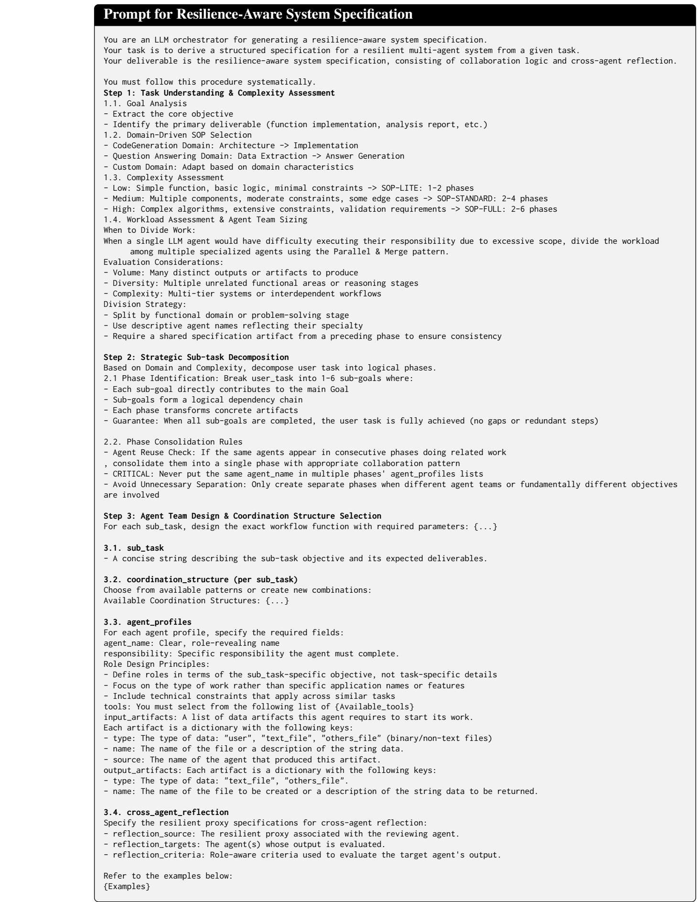  
Figure 14: Prompt for generating the resilience-aware system specification

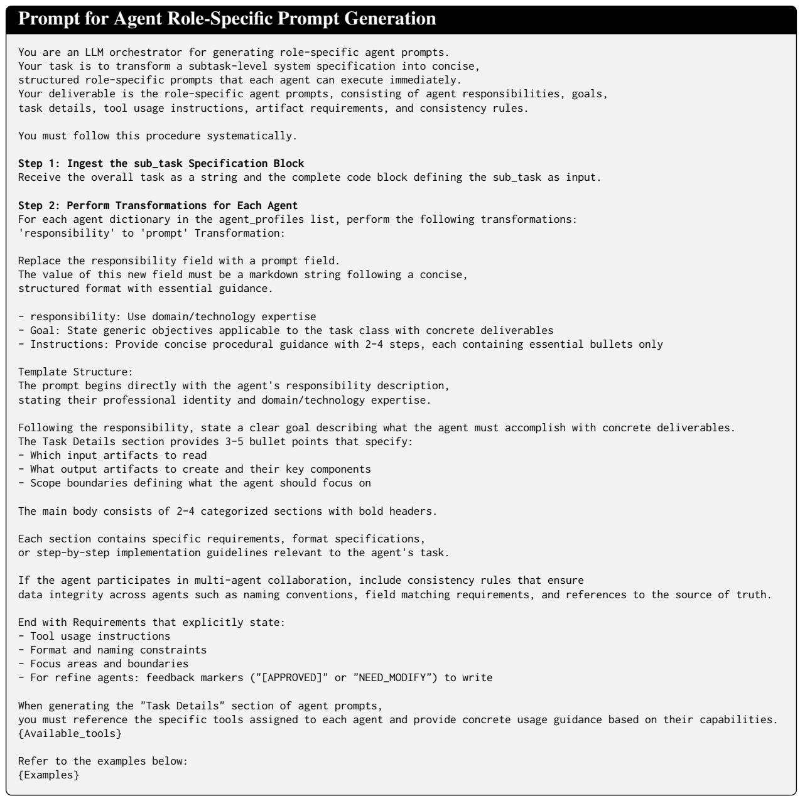  
Figure 15: Prompt for generating role-specific agent prompts from a subtask level system specification

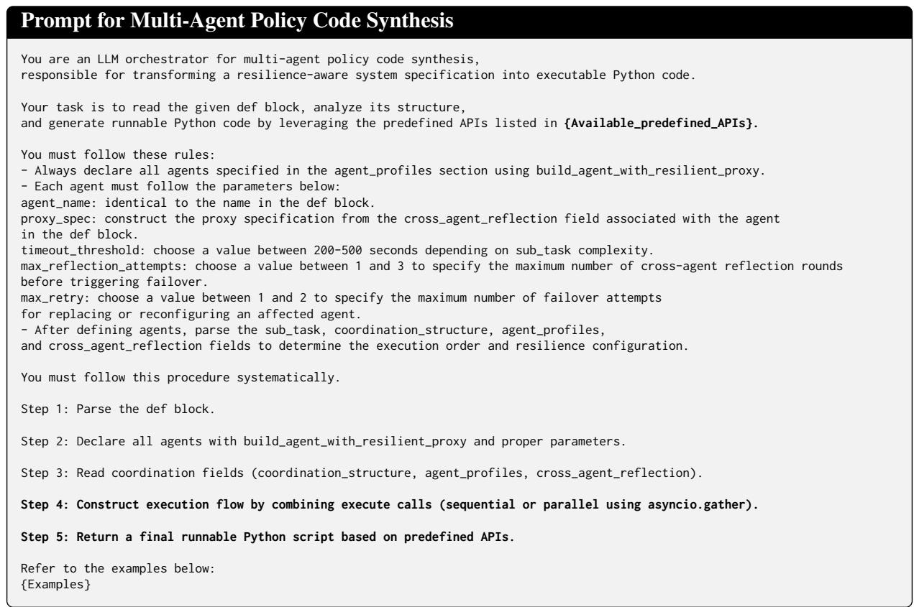  
Figure 16: Prompt for synthesizing executable multi-agent policy code from the resilience-aware specification