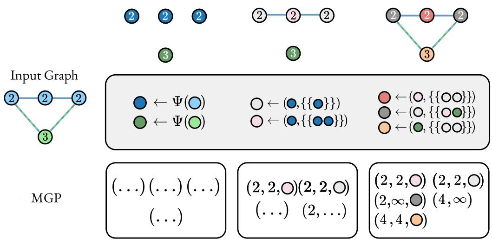
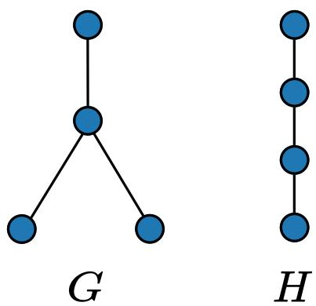

# Message-passing graph persistence

Jorge Luiz Franco1,2\* Arthur Queiroz Moura1\* Moacir Ponti1,3 Amauri Souza2,4

1Institute of Mathematics and Computer Sciences (ICMC), University of S˜ao Paulo, S˜ao Carlos, Brazil

2Avra 3Mercado Libre 4Federal Institute of Cear´a (IFCE), Fortaleza, Brazil

## Abstract

Message-passing graph neural networks (GNNs) are limited in expressive power by the onedimensional Weisfeiler–Leman test. Persistent homology (PH) provides topological descriptors that can complement GNN representations, but existing approaches typically compute persistence separately from the representation learning process. In this paper, we introduce Message-Passing Graph Persistence (MGP), a family of topological descriptors that incorporates message passing into graph filtrations. At each filtration step, node embeddings are updated using the current subgraph and associated with persistence events. These embeddings also determine the representatives of connected components during persistence computation. We prove that MGP is invariant under graph isomorphism and that it is strictly more expressive than the PH-based descriptors it extends. We evaluate MGP on an expressivity benchmark and on several graph classification and regression datasets. Experiments show that MGP outperforms other PH-based descriptors on most of these datasets.

## 1 Introduction

Over the past decade, graph neural networks (GNNs) (Gori et al., 2005; Bruna et al., 2014; Gilmer et al., 2017) have become the de facto approach for predictive tasks on graph-structured data. At each layer, typical GNNs sequentially combine local message-passing mechanisms, non-linear activation functions, and (possibly) pooling operations to obtain refined graph representations. Despite their empirical success, the expressive power of the most widely adopted GNNs is theoretically bounded by the one-dimensional Weisfeiler–Leman (1-WL) test (Weisfeiler and Lehman, 1968) for graph isomorphism (Xu et al., 2019; Morris et al., 2019). As a result, these models fail to distinguish even simple families of graphs (e.g., regular graphs) (Xu et al., 2019) or to decide basic graph properties (e.g., number of connected components) (Garg et al., 2020).

To overcome this limitation, topological data analysis (TDA), and in particular persistent homology (PH), ofers a principled framework for extracting multi-scale topological features from data (Chazal and Michel, 2021; Coskunuzer and Ak¸cora, 2024; Chen et al., 2021). PH tracks the appearance and disappearance of topological invariants across a filtration — a nested sequence of subspaces. The resulting information is encoded in a persistence diagram, which summarizes the lifespan of each feature as a multiset of birth–death pairs.

Several approaches (Immonen et al., 2023; Horn et al., 2022; Verma et al., 2024; Ji et al., 2025) have sought to integrate PH-based descriptors into graph learning models (e.g., GNNs and kernel methods) to improve expressivity and predictive performance. For instance, Horn et al. (2022) introduced TOGL, a general framework for integrating topological features derived from PH into

GNN layers. Immonen et al. (2023) analyzed the representational ability of color-based PH schemes, providing a complete characterization of the power of 0-dimensional PH methods. Building on this, they introduced RePHINE as a strictly more powerful descriptor for graph classification tasks. More recently, SpectRe (Ji et al., 2025) proposed enhancing RePHINE diagrams by augmenting them with spectral information, namely eigenvalues computed from graphs along a filtration.

Despite these advances, existing PH-based descriptors are computed in a stage that remains largely decoupled from the iterative representation learning process. Although filtration functions may be learned or derived from node features, the persistence computation itself does not dynamically interact with message passing across scales. In addition, standard GNN embeddings rely on local message passing over the full graph and do not explicitly leverage multi-scale information.

In this paper, we introduce Message-Passing Graph Persistence (MGP), a novel family of topological descriptors that embeds message-passing mechanisms directly into the PH filtration pipeline. At each filtration step, node embeddings are updated via a message-passing GNN layer, and these evolving “colors” (or embeddings) are attached to persistence events and govern the representative selected at component merges.

## 2 Background

We represent an attributed (or colored) undirected graph as a tuple $G = ( V , E , x )$ , where V is a set of vertices, E is a set of unordered pairs of vertices, called edges, and $x : V \cup E  \mathcal { X }$ assigns a feature (or color) to each vertex and edge. The color space is the disjoint union $\mathcal { X } = \mathcal { X } _ { V } \bigcup \mathcal { X } _ { E }$ , so vertex and edge colors remain diferent types even when their numerical encodings coincide. We write $x _ { v } = x ( v )$ and $x _ { u , v } = x ( \{ u , v \} )$ ). For simplicity of the theoretical presentation, and following RePHINE (Immonen et al., 2023), we assume that each edge color is determined symmetrically by the colors of its endpoints: $x _ { u , v }$ depends only on $x _ { u } , x _ { v }$ and is unchanged when the endpoints are exchanged.

Two graphs $G = ( V , E , x )$ and $G ^ { \prime } = ( V ^ { \prime } , E ^ { \prime } , x ^ { \prime } )$ are said to be isomorphic if there is a bijection $\sigma : V  V ^ { \prime }$ such that $\{ u , v \} \in E$ if and only if $\{ \sigma ( u ) , \sigma ( v ) \} \in E ^ { \prime }$ , and $x _ { \sigma ( v ) } ^ { \prime } = x _ { v }$ for every $v \in V$ Since both graphs use the same symmetric endpoint-color rule, corresponding edges also satisfy $x _ { \sigma ( u ) , \sigma ( v ) } ^ { \prime } = x _ { u , v }$ . We represent the set of neighbors of a vertex v by $\mathcal { N } _ { v } ( G ) = \{ u : \{ u , v \} \in E \}$ and use {{·}} to denote multisets.

## 2.1 Persistent homology (PH) on graphs

The core idea of PH is to keep track of the appearance and disappearance of topological features $( \mathrm { e . g . }$ , connected components, loops) in a filtration. A filtration of a graph G is a non-decreasing indexed family $\{ G _ { \alpha } \} _ { \alpha \in \mathbb { R } }$ of subgraphs of G, i.e., $G _ { \alpha } \subseteq G _ { \alpha ^ { \prime } }$ if $\alpha < \alpha ^ { \prime }$ , with $G _ { \infty } = G$ . Filtrations are induced by filtering functions (also known as filtration functions) $f : V \cup E $ R, which assign a number to each vertex and edge such that, for every $\{ u , v \} \in E , f ( \{ u , v \} ) \geq \operatorname* { m a x } \{ f ( u ) , f ( v ) \}$ This condition ensures that no edge appears in a filtration before both of its endpoints have been included. For each $\alpha \in \mathbb { R }$ , we define $G _ { \alpha } ^ { f } = f ^ { - 1 } ( ( - \infty , \alpha ] )$ , that is,

$$
{ \cal G } _ { \alpha } ^ { f } = \{ v \in V : f ( v ) \leq \alpha \} \bigcup \{ \{ u , v \} \in E : f ( \{ u , v \} ) \leq \alpha \}
$$

and denote the sublevel filtration of G induced by f as $\{ G _ { \alpha } ^ { f } \} _ { \alpha \in \mathbb { R } }$ . Note that the subgraphs in a filtration only difer at critical values $\alpha \in \operatorname { I m } f$ , also known as filtration steps. Thus, we can reduce the filtration to the finite sequence of subgraphs at these critical values. With this in mind, we can capture the persistence of topological features in a filtration, i.e., how these features change over time. In particular, if a topological feature first appears in $G _ { \alpha _ { b } } ^ { f }$ and disappears in $G _ { \alpha _ { d } } ^ { f }$ , then we encode its persistence as a pair $( \alpha _ { b } , \alpha _ { d } )$ ; if a feature does not disappear, then its persistence is $( \alpha _ { b } , \infty )$ . The collection of all pairs forms a multiset called a persistence diagram. We use $\mathcal { D } _ { i } ( G , f )$ to denote the persistence diagram for the i-th dimensional topological features of G induced by f. In particular, here we consider only the 0- and 1-dimensional topological features, i.e., $i = 0$ or $i = 1$ Color-based filtration functions. Following prior work (Immonen et al., 2023; Ji et al., 2025), we use colors to define filtration functions in an isomorphism-compatible way. Recall that $\mathcal { X } = \mathcal { X } _ { V } \bigcup \mathcal { X } _ { E }$ so vertex and edge colors remain distinct even when represented by the same numerical vector.

A color filtering function is a map $f : \mathcal { X } \to \mathbb { R } _ { \geq 0 }$ . It induces functions on the simplices of an attributed graph $G = \left( V , E , x \right)$

1. the vertex-based filtration function $F _ { V } ^ { f } : V \cup E \to \mathbb { R } _ { \geq 0 }$ , defined by

$$
\begin{array} { c } { { F _ { V } ^ { f } ( v ) : = f ( x _ { v } ) , } } \\ { { F _ { V } ^ { f } ( \{ u , v \} ) : = \operatorname* { m a x } \{ f ( x _ { u } ) , f ( x _ { v } ) \} ; } } \end{array}
$$

2. the edge-based filtration function $F _ { E } ^ { f } : V \cup E  \mathbb { R } _ { \geq 0 }$ , defined by

$$
F _ { E } ^ { f } ( v ) : = 0 , \qquad F _ { E } ^ { f } ( \{ u , v \} ) : = f ( x _ { u , v } ) .
$$

Both functions satisfy the filtration condition. In the first filtration, an edge appears as soon as both endpoints have appeared. In the second, all vertices are present initially and edges are subsequently added according to their colors. The distinction between the color filtering function $f$ and the induced simplex-wise functions $F _ { V } ^ { f } , F _ { E } ^ { f }$ will be useful below.

Persistence diagrams. Let G be an attributed graph and let f be a color filtering function. We define the PH descriptor induced by f as

$$
\mathrm { P H } ( G , f ) = \bigl ( \mathrm { P H } ^ { V } ( G , f ) , \mathrm { P H } ^ { E } ( G , f ) \bigr ) ,
$$

where

$$
\mathrm { P H } ^ { V } ( G , f ) : = { \mathcal { D } } _ { 0 } ( G , F _ { V } ^ { f } ) \sqcup { \mathcal { D } } _ { 1 } ( G , F _ { V } ^ { f } ) ,\tag{1}
$$

$$
\mathrm { P H } ^ { E } ( G , f ) : = { \mathcal { D } } _ { 0 } ( G , F _ { E } ^ { f } ) \sqcup { \mathcal { D } } _ { 1 } ( G , F _ { E } ^ { f } ) ,\tag{2}
$$

and ⊔ denotes multiset disjoint union. The two components are kept separate in the descriptor, so the homological dimension and filtration type remain identifiable.

RePHINE diagram. RePHINE (Immonen et al., 2023) uses an edge-color filtering function $f : \mathcal { X } _ { E }  \mathbb { R } _ { \ge 0 }$ and an auxiliary vertex-color function $g : \mathcal { X } _ { V }  \mathbb { R }$ . Its descriptor is $\mathcal { R } ( G , f , g ) =$ ${ \mathcal { R } } _ { 0 } ( G , f , g ) \sqcup { \mathcal { R } } _ { 1 } ( G , f , g )$ , where ⊔ denotes multiset disjoint union and:

1. $\mathcal { R } _ { 0 } ( G , f , g )$ contains one tuple $( 0 , \alpha _ { d _ { v } } , \lambda _ { v } , \gamma _ { v } )$ for each vertex v. Here $\alpha _ { d _ { v } }$ is the death time of the component representative associated with v under the edge filtration induced by $f ,$ $\lambda _ { v } = g ( x _ { v } )$ , and

$$
\gamma _ { v } = \operatorname* { m i n } _ { u \in \mathcal { N } _ { v } ( G ) } f ( x _ { u , v } ) ,
$$

using the convention min $\emptyset = 0$ . When components merge, RePHINE kills the representative with the largest $\lambda _ { v } ;$ ties are resolved by killing the representative with the smallest $\gamma _ { v }$ , and any remaining tie may be resolved arbitrarily.

2. $\mathcal { R } _ { 1 } ( G , f , g )$ contains $( 1 , f ( x _ { u , v } ) , 0 , 0 )$ for each edge $\{ u , v \}$ that creates a cycle.

Thus, RePHINE is built on an edge filtration, while vertex colors enter through the auxiliary feature $g .$

## 2.2 Graph neural networks (GNNs)

Most popular GNNs can be described using the message-passing paradigm (Gilmer et al., 2017; Xu et al., 2019). Within this framework, a GNN initializes each node’s embedding with its original features, $\mathrm { i . e . , } h _ { v } ^ { ( 0 ) } = x _ { v }$ for all nodes $v \in V$ . Then, at each layer $\ell ,$ each node v gathers messages from its neighbors $u \in \mathcal { N } _ { v } ( G )$ , compiling them into an aggregated message $m _ { v } ^ { ( \ell ) }$

$$
\begin{array} { r } { m _ { v } ^ { ( \ell ) } = \mathrm { A G G R E G A T E } _ { \ell } \left( \left\{ h _ { u } ^ { ( \ell - 1 ) } : u \in \mathcal { N } _ { v } ( G ) \right\} \right) , } \end{array}
$$

where $\mathrm { A G G R E G A T E } _ { \ell }$ is an arbitrary function on multisets, i.e., it is order-invariant. Subsequently, each node uses the (so-called) Update function (e.g., a feedforward neural network) to refresh its embedding in light of the aggregated message:

$$
\begin{array} { r } { h _ { v } ^ { ( \ell ) } = \mathrm { U P D A T E } _ { \ell } \left( m _ { v } ^ { ( \ell ) } , h _ { v } ^ { ( \ell - 1 ) } \right) . } \end{array}
$$

## 2.3 Weisfeiler-Leman and the expressive power of GNNs

The Weisfeiler-Leman (WL) graph isomorphism test (Weisfeiler and Lehman, 1968) iteratively refines a labeling of vertices by collecting neighbor labels into a multiset and hashing it together with the vertex’s current label. It applies the following iterative procedure:

Initialization: The colors of all nodes in G are initialized using the initial node features: $\forall v \in$ $V , h ^ { 0 } ( v ) = x _ { v }$ . If node features are not available, all nodes receive identical colors;

Refinement: At step ℓ, the colors of all nodes are refined using a hash (injective) function: for all $v \in V .$ , we apply $h ^ { \ell + 1 } ( v ) = \mathrm { H A S H } ( h ^ { \ell } ( v ) , \{ h ^ { \ell } ( u ) : u \in \mathcal { N } _ { v } ( G ) \} )$ ;

Termination: The test is carried out for two graphs in parallel and stops when the multisets of corresponding colors diverge, returning non-isomorphic. If the algorithm runs until the number of diferent colors stops increasing, the test is deemed inconclusive.

The 1-WL test mirrors the message-passing structure of GNNs and thus provides an upper bound on their distinguishing power. In particular, since 1-WL aggregates neighbor labels as multisets and updates node representations via an injective hashing scheme, any GNN operating under the message-passing paradigm is at most as expressive as 1-WL (Xu et al., 2019). Moreover, when both the Aggregate and Update functions in a GNN are injective (i.e., incur no loss of information), the resulting message-passing procedure coincides with the refinement step of the 1-WL test. In this setting, the GNN achieves the same discriminative power as the 1-WL test. This injective idealization is standard in GNN expressivity theory: GIN uses injective aggregation and update maps to characterize maximal message-passing expressivity and gives sum/MLP constructions for the required multiset functions (Xu et al., 2019).

## 3 Related work

Early eforts to combine PH with graph learning predate end-to-end architectures. Rieck et al. (2019) propose the persistent Weisfeiler–Leman procedure (P-WL), which enriches the WL relabeling scheme with topological information: distances between propagated label multisets are used to assign edge weights, turning an unweighted labeled graph into a metric one whose sublevel filtration yields persistence diagrams. The resulting features generalize WL subtree features, and the observed gains are largely attributable to cycle information, which subtree patterns cannot capture. However, P-WL operates as a fixed feature-extraction scheme: the label propagation and the persistence computation are performed once, prior to and independently of any downstream learning.

Building on the idea of task-adapted topology, Hofer et al. (2020) introduce graph filtration learning (GFL), in which vertex filtration values are produced by a learnable function of node features and gradients are propagated through the persistence computation, allowing the filtration to be optimized end-to-end. While this renders the filtration adaptive, the node representations that induce it are computed on the full graph before persistence is evaluated; the diagram computation itself remains a post-hoc summary that does not interact with message passing along the filtration.

PEGN (Zhao et al., 2020) uses PH to reweight GNN messages for node classification. Persistent message passing (Strathmann et al., 2021), despite its name, does not use PH.

Recently, PH has been used to boost the expressive power of GNNs. Horn et al. (2022) introduce TOGL — a general approach for incorporating topological features from PH into GNN layers. In particular, TOGL leverages node embeddings at each layer of a GNN by using vertex-color filtrations. More precisely, the 0-dim individual persistence tuples are vectorized using Multilayer Perceptrons (MLPs) and appended to the corresponding node features at each layer. For 1-dim tuples, TOGL applies DeepSets (Zaheer et al., 2017) to get a graph-level vector that runs through the final fully-connected layers of the GNN.

RePHINE (Immonen et al., 2023) uses independent vertex-color and edge-color filtering functions to obtain more expressive persistence diagrams. More specifically, RePHINE first computes persistence diagrams from a filtration induced by edge colors. Each tuple of the diagram is then augmented based on the vertex colors and the local edge-color information around each vertex. RePHINE diagrams are vectorized using DeepSets (Zaheer et al., 2017) and combined with graph-level GNN embeddings in the final classifier. SpectRe (Ji et al., 2025) augments RePHINE tuples with the Laplacian spectrum of the component associated with each event.

PersLay (Carri\`ere et al., 2020) was introduced as a diferentiable, permutation-invariant layer dedicated to processing persistence diagrams. Each diagram is represented as a permutation-invariant operation (e.g., sum) of kernel functions centered on its points, with both the kernel parameters and the weighting functions learned end-to-end. By integrating PersLay into a GNN architecture, topological summaries can be injected at arbitrary depths of the network, enabling the model to adaptively emphasize specific homological features (e.g., long-lived cycles) during training.

Ballester and Rieck (2025) relate the expressivity of PH to the Weisfeiler–Leman hierarchy, while Eitan et al. (2025) identify invariants that higher-order message passing cannot capture.

In summary, existing approaches either extract topological features prior to learning (Rieck et al., 2019), learn the filtration but compute persistence as a separate downstream stage (Hofer et al., 2020; Horn et al., 2022; Carri\`ere et al., 2020), and/or enrich the persistence tuples with color information (Immonen et al., 2023; Ji et al., 2025). None of them performs message passing on the intermediate filtration subgraphs. For the integration with GNN architectures, we adopt the framework used by RePHINE (Immonen et al., 2023).

## 4 Method

Instead of viewing the RePHINE diagram as arising from an edge-based filtration augmented with the additional neighborhood descriptor $\gamma _ { v } ,$ we can adopt an alternative perspective: modify the filtration so that the first incident-edge value becomes the birth time of each vertex.

Let $f : \mathcal { X } _ { E }  \mathbb { R } _ { \geq 0 }$ be an edge-color filtering function. We adopt the convention that the minimum of an empty set of incident-edge values is zero. Define the induced structure-aware edge

filtration function $F _ { S } ^ { f } : V \cup E \to \mathbb { R } _ { \geq 0 }$ by

$$
F _ { S } ^ { f } ( v ) = \operatorname* { m i n } _ { u \in \mathcal { N } _ { v } ( G ) } f ( x _ { u , v } ) ,\tag{3}
$$

$$
F _ { S } ^ { f } ( \{ u , v \} ) = f ( x _ { u , v } ) .\tag{4}
$$

This is a valid filtration function because $F _ { S } ^ { f } ( u ) , F _ { S } ^ { f } ( v ) \le F _ { S } ^ { f } ( \{ u , v \} )$ for every edge $\{ u , v \}$ . A non-isolated vertex therefore appears exactly when its first incident edge appears.

The underlying subgraph sequence difers from RePHINE’s edge filtration, in which every vertex is present at time zero. To compare the resulting tuples, we use the following conventions. When vertices and incident edges have the same filtration value, the vertices are inserted first; zeropersistence vertex–edge pairs are retained; and component deaths are associated with vertices using the RePHINE representative rule. Under these conventions, each RePHINE zero-dimensional tuple

$$
( 0 , \alpha _ { d _ { v } } , \lambda _ { v } , \gamma _ { v } )
$$

corresponds to the tuple

$$
( \gamma _ { v } , \alpha _ { d _ { v } } , \lambda _ { v } )
$$

in the structure-aware filtration: $\gamma _ { v }$ becomes the vertex birth time, while the death time and associated vertex feature are unchanged. Conversely, the RePHINE tuple is recovered by restoring the fixed birth coordinate zero and moving the structural birth coordinate back to the fourth entry. Likewise, a missing-hole tuple $( 1 , d , 0 , 0 )$ carries the same information as the one-dimensional persistence tuple $( d , \infty )$ . This is only a correspondence between individual tuples; it does not assert that the two filtrations have the same subgraph sequence.

This reinterpretation removes the redundant component $b _ { v } \equiv 0$ and places $\gamma _ { v }$ in the role of a birth coordinate. It follows the vertex-wise pairing convention used by RePHINE and SpectRe (Immonen et al., 2023; Ji et al., 2025).

## 4.1 Persistent homology meets message-passing GNNs

We now define MGP, which replaces $\lambda _ { v }$ by embeddings computed along the filtration.

Overview. Given a structure-aware edge filtration $\{ G _ { \alpha _ { i } } ^ { F _ { S } ^ { f } } \} _ { i = 1 } ^ { n }$ , an embedding function Ψ, and message-passing functions, we first transform the initial node features using Ψ. We then iterate through the filtration steps. After all edges with value $\alpha _ { i }$ are added, we perform one round of message passing on the current subgraph. The zero-dimensional tuples have the form $\left( \alpha _ { b _ { v } } , \alpha _ { d _ { v } } , h _ { v } \right)$ where $b _ { v }$ and $d _ { v }$ are the birth and death indices of the representative associated with v, and $h _ { v }$ is its embedding at death, or at the final filtration step if it survives.

Definition 4.1 (MGP diagram). Let $\alpha _ { 1 } < \cdots < \alpha _ { n }$ be the critical values of the structure-aware filtration of $G = ( V , E , x )$ induced by $F _ { S } ^ { f }$ . Given $\Theta = ( \Psi , \psi , \phi , \bigoplus )$ , define

$$
\mathrm { M G P } ( G , f , \Theta ) = \mathrm { M G P } _ { 0 } ( G , f , \Theta ) \sqcup \mathrm { M G P } _ { 1 } ( G , f ) ,
$$

where ⊔ denotes multiset disjoint union, so the summand records the homological dimension, and:

1. Each element of $\mathrm { M G P } _ { 0 } ( G , f , \Theta )$ is a tuple $\left( \alpha _ { b _ { v } } , \alpha _ { d _ { v } } , h _ { v } \right)$ associated with a vertex v. Here $b _ { v }$ is the first filtration index at which v appears, and $d _ { v }$ is the index at which its representative dies. If it never dies, we set $d _ { v } = \infty$ and interpret $\alpha _ { d _ { v } } = \infty$ . The embeddings belong to a

linearly ordered space $( \mathcal { H } , \leq )$ , for example $\mathbb { R } ^ { k }$ under lexicographic ordering, and are computed recursively by

$$
h _ { v } ^ { ( b _ { v } - 1 ) } = \Psi ( x _ { v } ) ,
$$

$$
m _ { v } ^ { ( \ell ) } = \bigoplus \left\{ \left\{ \begin{array} { l } { { ( h _ { u } ^ { ( \ell - 1 ) } , h _ { v } ^ { ( \ell - 1 ) } , \phi ( x _ { u , v } ) ) : } } \\ { { \qquad u \in \mathcal { N } _ { v } ( G _ { \alpha _ { \ell } } ^ { F _ { S } ^ { f } } ) } } \end{array} \right\} \right\} ,
$$

$$
\begin{array} { r } { h _ { v } ^ { ( \ell ) } = \psi \mathopen { } \mathclose \bgroup \left( h _ { v } ^ { ( \ell - 1 ) } , m _ { v } ^ { ( \ell ) } \aftergroup \egroup \right) , \qquad b _ { v } \leq \ell \leq n , } \end{array}
$$

$$
h _ { v } = \left\{ { h _ { v } ^ { ( d _ { v } ) } , \quad d _ { v } < \infty } , \right.
$$

Here $\Psi : { \mathcal { X } } _ { V } \to { \mathcal { H } }$ initializes node colors, $\phi$ embeds the edge colors $x _ { u , v } , \oplus$ is permutationinvariant, and ψ is an update function.

A component has one alive representative. When several components merge, representatives with the largest terminal embeddings $h _ { v } ^ { ( n ) }$ die until one remains. If terminal embeddings tie, any tied representative may be selected; Theorem 4.4 gives a condition under which this choice does not change the descriptor.

2. $\mathrm { M G P _ { 1 } } ( G , f ) = { \cal D } _ { 1 } ( G , F _ { S } ^ { f } )$ , that is, each edge $\{ u , v \}$ that creates a cycle contributes $( f ( x _ { u , v } ) , \infty )$

Step schedule. For learned filtrations, the number of critical values can be of the order of the number of edges, requiring the same order of message-passing rounds. To limit this cost, we group the critical values of each graph into T quantile steps. An edge $\{ u , v \}$ of a graph with edge set E is assigned to step $\lceil T \ | \{ e ^ { \prime } \in E : f ( x _ { e ^ { \prime } } ) \leq f ( x _ { u , v } ) \} | / \left| E \right| \rceil \in \{ 1 , . . . , T \}$ . Thus, edges with equal filtration values belong to the same step, and a vertex is born at the first step containing one of its incident edges. We apply Definition 4.1 and Algorithm 1 using the steps $1 , \ldots , T$ instead of the indices of the critical values, while keeping the original filtration values in the tuples. The case $T = \infty$ corresponds to the distinct-value schedule. Since the grouping depends only on the multiset of filtration values, isomorphic graphs have isomorphic subgraphs at corresponding steps. Therefore, the invariance argument still holds. We treat $T$ as a hyperparameter. Within each step, edges are processed in increasing order of $f .$ The death value is given by the filtration value of the merging edge, while the corresponding embedding is computed at the end of the step.

Ties. When representatives have identical terminal embeddings, we keep the one with the lower vertex index. Under partial injectivity, identical terminal embeddings correspond to identical computation trees, and any choice produces the same persistence tuples (Theorem 4.4).

The implementation is described in Algorithm 1, Appendix F.

The tiebreaker criterion depends on $h _ { v } ^ { ( n ) }$ , which is available only after the filtration-wise messagepassing computation. The embedding computation itself does not depend on which representatives are later associated with tuples, so all embeddings can be computed first and the union–find pairing can then be run on top of them. This adds only the union–find pass and does not change the asymptotic cost of the message-passing computation. Appendix A shows why we use the terminal embedding $h _ { v } ^ { ( n ) }$ instead of the embedding at the current step, and Appendix E describes the message functions used in the experiments and extends Theorem 4.4 to these functions.

## 4.2 Expressivity

The family formulation matches the filtration-dependent comparisons used for color-based PH and RePHINE (Immonen et al., 2023).

  
Figure 1: Worked computation of the MGP diagram. Vertices are born according to the structureaware edge filtration, and their embeddings are updated by message passing on each filtration subgraph. Zero-dimensional tuples record birth, death, and the corresponding death-step embedding, while cycle-creating edges contribute one-dimensional tuples. In this example, we use the order gray < red < orange on the terminal embeddings.

Definition 4.2 (Expressivity of descriptor families). Let X and Y be families of graph isomorphism invariants. We write ${ \mathfrak { X } } \succeq { \mathfrak { Y } }$ if, for every pair of non-isomorphic graphs $G , H$

$$
\begin{array} { r l } & { \exists Y \in \mathfrak { Y } : Y ( G ) \neq Y ( H ) } \\ & { \qquad \Longrightarrow \exists X \in \mathfrak { X } : X ( G ) \neq X ( H ) . } \end{array}
$$

We write ${ \mathfrak { X } } \succ { \mathfrak { Y } }$ if ${ \mathfrak { X } } \succeq { \mathfrak { Y } }$ and ${ \mathfrak { V } } \not \subseteq { \mathfrak { X } }$

To state the invariance result, we first observe that corresponding intermediate embeddings remain equal on isomorphic graphs.

Lemma 4.3 (Isomorphic graphs remain isomorphic during MGP). Let $G , G ^ { \prime }$ be attributed isomorphic graphs, and let the same color filtering function f and message-passing functions Θ be used on both. The structure-aware filtrations have the same critical values. Moreover, every isomorphism $\sigma : G \to G ^ { \prime }$ restricts to an isomorphism between corresponding filtration subgraphs, and $h _ { v } ^ { ( \ell ) } = \bar { h } _ { \sigma ( v ) } ^ { \prime ( \ell ) }$ at every step $\ell \geq b _ { v }$

A formal proof is given in Appendix A. The remaining issue is an exact tie between terminal embeddings. We use the following explicit suficient condition, defined in Appendix A: Θ is partially injective when equal symbolic embeddings can arise only from identical computation trees.

Theorem 4.4 (MGP is isomorphism invariant). Let $G , G ^ { \prime }$ be attributed isomorphic graphs. For a fixed color filtering function f and any partially injective Θ,

$$
\operatorname { M G P } ( G , f , \Theta ) = \operatorname { M G P } ( G ^ { \prime } , f , \Theta ) .
$$

Appendix A defines partial injectivity precisely as the finite-set condition needed to make the representative tie rule unambiguous.

Let ${ \mathfrak { D } } _ { \mathrm { M G P } }$ denote the family of MGP descriptors over valid f and partially injective Θ, and let $\mathfrak { D } _ { \mathrm { R e P H I N E } }$ denote the family of RePHINE descriptors over valid edge and auxiliary vertex functions.

  
Figure 2: A monochromatic four-vertex star G and path H. They are indistinguishable by every element of $\mathfrak { D } _ { \mathrm { R e P H I N E } } .$ , whereas every element of ${ \mathfrak { D } } _ { \mathrm { M G P } }$ distinguishes them.

Theorem 4.5 (MGP is strictly more expressive than RePHINE). The MGP descriptor family is strictly more expressive than the RePHINE family:

$$
\mathfrak { D } _ { \mathrm { M G P } } \succ \mathfrak { D } _ { \mathrm { R e P H I N E } } .
$$

The proof is given in Appendix A. For strictness, consider the monochromatic graphs in Fig. 2: the four-vertex star and the four-vertex path. Every RePHINE diagram contains three identical finite tuples and one identical infinite tuple on both graphs. In contrast, at the single filtration step, an injective MGP update records the degree-dependent neighborhood multiset, yielding diferent embedding multisets for degree patterns {{3, 1, 1, 1}} and {{2, 2, 1, 1}}.

## 4.3 GNN integration

Given any standard GNN layer (e.g., GIN (Xu et al., 2019), GAT (Veliˇckovi´c et al., 2018), or GCN (Kipf and Welling, 2017)), we embed it into an MGP layer in the same way that RePHINE is combined with a GNN (Immonen et al., 2023). We use the same scheme for PH, RePHINE, SpectRe and MGP, changing only the persistence diagram. An MGP layer has the following steps:

1. Message passing. Apply the backbone GNN to the current node features, which are either the raw inputs or the outputs of the previous layer.

2. Filtrations and diagrams. These embeddings are treated as vertex colors, and edge colors are obtained from them through the fixed symmetric endpoint rule described above. In the implementation, we use the symmetric choice $x _ { u , v } = x _ { u } + x _ { v }$ . The layer contains multiple learnable pairs $( f _ { i } , \Theta _ { i } )$ , each of which produces an MGP diagram $\mathrm { M G P } ( G , f _ { i } , \Theta _ { i } )$

3. Vectorization. The zero-dimensional tuples are processed by a DeepSet with mean pooling over the tuples of a graph, and the one-dimensional tuples are processed by a second DeepSet with sum pooling. Their outputs, followed by a normalization layer and an MLP, are used as graph-level embeddings for the current layer.

4. Prediction. We repeat Steps 1–3 at every backbone layer, obtaining one read-out per layer. The final predictor concatenates the pooled node embeddings from the last layer with the mean of the read-outs from all layers.

## 4.4 Complexity

A GINE-type message-passing round at step ℓ has complexity $O ( \left| E \right| k + \left| V \right| k ^ { 2 } )$ for a graph with vertex set V and edge set E. For T filtration steps and R rounds per step, MGP requires $O ( T R ( | E | k + | V | k ^ { 2 } ) )$ time and $O ( T | V | k )$ memory per filtration. The persistence pairing is computed using an integer union–find algorithm in $O ( | E | \alpha ( | V | ) )$ time (Appendix F). Within a step, all vertices, edges, filtrations and graphs of a batch are updated in parallel on the GPU, and each round only uses sparse operations. In contrast, SpectRe computes the Laplacian spectrum of the component of every event, which costs $O ( c ^ { 3 } )$ for a component with c vertices and up to $O ( | E | \ | V | ^ { 3 } )$ per filtration.

## 5 Results

We evaluate on five graph-classification datasets from TUDataset (Morris et al., 2020), namely MUTAG, PTC MR, PROTEINS, NCI1 and NCI109, and on ZINC (12k subset, regression, mean absolute error) (Dwivedi et al., 2023). The datasets are described in Appendix B. For the TU datasets, we follow the evaluation split of Immonen et al. (2023), using one stratified split with 80% training, 10% validation and 10% test graphs (seed 42). The same split is used for every method, while ZINC uses its public split. We report the test score at the epoch with the best validation score. Shared backbone. All methods follow the architecture of Section 4.3 and use the same backbone for each dataset. We first perform a random search over the backbone configuration for every method and dataset. The search includes normalization, GCN or GINE layers, jumping knowledge (Xu et al., 2018), dropout, width, depth, random-walk structural encoding, and plateau or cosine (Loshchilov and Hutter, 2017) learning-rate schedules. We sample 32 configurations for each baseline and 64 for MGP. We then select the configuration of the RePHINE run with the best validation score and use it as the shared backbone for all methods on that dataset. The selected configurations use GINE layers on every dataset (Table 4). The “GNN” row reports the backbone without a persistence descriptor. Descriptors. On PTC MR, all methods use the configurations selected on MUTAG. For PH, RePHINE and SpectRe, we use $F = 8$ filtrations and $k = 1 6$ . For MGP, we perform successive halving over 96 configurations per dataset, followed by up to seven combinations of three additional options (Appendix C). We use our reimplementation of SpectRe with a reduced setting, described in Appendix F.

Selection and seeds. We select configurations using the validation score obtained with seed 0. The selected configuration is then trained with seeds 1 to 4, and we report the mean ± standard deviation of the test scores over the five seeds.

MGP obtains the best mean on ZINC, NCI109, PROTEINS and PTC MR, while RePHINE obtains the best mean on NCI1 and PH on MUTAG. On ZINC, the one-standard-deviation interval of MGP is disjoint from those of all other descriptors.

Table 1: Test accuracy (%) on five TU datasets and mean absolute error on ZINC (lower is better) at the epoch of best validation score, mean ± std over five seeds. All methods share the backbone of each dataset; best mean per column in bold.
<table><tr><td></td><td>MUTAG</td><td>PTC_MR</td><td>PROTEINS</td><td>NCI109</td><td>NCI1</td><td>ZINC</td></tr><tr><td>GNN</td><td> $7 3 . 6 8 \pm 1 2 . 3 4$ </td><td> $5 6 . 0 0 \pm 2 . 5 6$ </td><td> $7 2 . 8 6 \pm 1 . 2 0$ </td><td> $7 9 . 9 0 \pm 2 . 0 3$ </td><td> $7 5 . 4 7 \pm 3 . 3 3$ </td><td> $0 . 1 6 2 \pm 0 . 0 0 6$ </td></tr><tr><td>PH</td><td> ${ \bf 9 1 . 5 8 \pm 2 . 8 8 }$ </td><td> $5 9 . 4 3 \pm 4 . 6 9$ </td><td> $7 0 . 3 6 \pm 1 . 3 2$ </td><td> $7 8 . 6 9 \pm 1 . 6 7$ </td><td> $7 7 . 2 3 \pm 2 . 8 8$ </td><td> $0 . 1 6 0 \pm 0 . 0 2 1$ </td></tr><tr><td>RePHINE</td><td> $8 6 . 3 2 \pm 2 . 8 8$ </td><td> $6 0 . 0 0 \pm 7 . 2 8$ </td><td> $7 0 . 7 1 \pm 2 . 2 2$ </td><td> $7 7 . 6 8 \pm 1 . 9 7$ </td><td> $\mathbf { 8 1 . 7 5 \ : \pm { \ : 3 . 0 9 } }$ </td><td> $0 . 1 4 2 \pm 0 . 0 1 3$ </td></tr><tr><td>SpectRe</td><td> $8 9 . 4 7 \pm 3 . 7 2$ </td><td> $5 7 . 7 1 \pm 2 . 3 9$ </td><td> $7 0 . 7 1 \pm 2 . 4 8$ </td><td> $7 9 . 6 1 \pm 2 . 5 5$ </td><td> $7 9 . 5 1 \pm 1 . 8 7$ </td><td> $0 . 1 5 7 \pm 0 . 0 1 8$ </td></tr><tr><td>MGP</td><td> $8 8 . 4 2 \pm 7 . 8 1$ </td><td> ${ \bf 6 1 . 7 1 \pm 5 . 1 9 }$ </td><td> ${ \bf 7 3 . 0 4 } \pm { \bf 3 . 9 1 }$ </td><td> ${ \bf 8 2 . 2 3 \pm 1 . 6 6 }$ </td><td> $8 1 . 3 6 \pm 0 . 4 7$ </td><td> $\mathbf { 0 . 1 1 0 \ : \pm { \ : 0 . 0 1 1 } }$ </td></tr></table>

## 5.1 Expressivity

BREC (Wang and Zhang, 2024) contains 400 pairs of non-isomorphic graphs divided into four categories. The evaluation protocol and reliability check are described in Appendix D.

Table 2 reports the accuracy of four topological descriptors $( \mathrm { P H } ^ { \hat { V } } , \mathrm { P H } ^ { E }$ , RePHINE and MGP) on BREC. Degree, Betweenness (Freeman, 1977), Closeness (Freeman, 1978), and PageRank (Page et al., 1999) are used as vertex filtering values, while augmented Forman– Ricci curvature (Samal et al., 2018) supplies the edge filtering values. Table 5 in Appendix D gives the accuracy per category.

Table 2: Total accuracy on BREC under the reliability check, by vertex filtration function: degree, betweenness, closeness and PageRank (PR). MGP: mean over three seeds.
<table><tr><td></td><td></td><td>Deg. Betw.</td><td>Clos.</td><td>PR</td></tr><tr><td> $\mathrm { P H } ^ { V }$ </td><td>0.03</td><td>0.49</td><td>0.21</td><td>0.04</td></tr><tr><td> $\mathrm { P H } ^ { E }$ </td><td>0.41</td><td>0.41</td><td>0.41</td><td>0.41</td></tr><tr><td>RePHINE</td><td>0.41</td><td>0.52</td><td>0.50</td><td>0.41</td></tr><tr><td>MGP</td><td>0.41</td><td>0.53</td><td>0.49</td><td>0.41</td></tr></table>

MGP distinguishes approximately the same number of pairs as RePHINE, with diferences of at most 0.01 in the total rates across seeds.

## 6 Conclusion

We introduced MGP, a family of persistence descriptors that performs message passing along graph filtrations and associates the resulting node embeddings with persistence tuples. We proved that MGP is invariant under graph isomorphism and strictly more expressive than RePHINE. In the experiments, MGP matches RePHINE on BREC and obtains the best mean on ZINC, NCI109, PROTEINS and PTC MR.

Limitations and future work. MGP is defined on graphs: the filtration, the message passing and the persistence tuples are all over nodes and edges. We did not study the extension to higher-order domains such as simplicial and cell complexes, where message passing between cells of diferent dimensions was studied by Bodnar et al. (2021a,b). This could be done by replacing a fixed graph-to-complex lifting with a learnable one (Franco et al., 2026), and by replacing the GNN that runs along the filtration with a topological neural network of this kind.

## Reproducibility

Proofs: Appendix A; protocol and selected configurations: Section 5 and Appendix C. Code: https://github.com/JorgeLuizFranco/message-passing-graph-persistence.

## References

Rub´en Ballester and Bastian Rieck. On the expressivity of persistent homology in graph learning. In Learning on Graphs Conference (LoG), 2025.

Cristian Bodnar, Fabrizio Frasca, Nina Otter, Yu Guang Wang, Pietro Li\`o, Guido Mont´ufar, and Michael Bronstein. Weisfeiler and Lehman go cellular: CW networks. In Advances in Neural Information Processing Systems (NeurIPS), 2021a.

Cristian Bodnar, Fabrizio Frasca, Yu Guang Wang, Nina Otter, Guido Mont´ufar, Pietro Li\`o, and Michael Bronstein. Weisfeiler and Lehman go topological: Message passing simplicial networks. In International Conference on Machine Learning (ICML), 2021b.

Giorgos Bouritsas, Fabrizio Frasca, Stefanos Zafeiriou, and Michael M. Bronstein. Improving graph neural network expressivity via subgraph isomorphism counting. IEEE Transactions on Pattern Analysis and Machine Intelligence, 2023.

Xavier Bresson and Thomas Laurent. Residual gated graph ConvNets. arXiv preprint arXiv:1711.07553, 2017.

Joan Bruna, Wojciech Zaremba, Arthur Szlam, and Yann LeCun. Spectral networks and locally connected networks on graphs. In International Conference on Learning Representations (ICLR), 2014.

Mathieu Carri\`ere, Fr´ed´eric Chazal, Yuichi Ike, Th´eo Lacombe, Martin Royer, and Yuhei Umeda. PersLay: A neural network layer for persistence diagrams and new graph topological signatures. In International Conference on Artificial Intelligence and Statistics (AISTATS), 2020.

Fr´ed´eric Chazal and Bertrand Michel. An introduction to topological data analysis: Fundamental and practical aspects for data scientists. Frontiers in Artificial Intelligence, 2021.

Yuzhou Chen, Baris Coskunuzer, and Yulia R. Gel. Topological relational learning on graphs. In Advances in Neural Information Processing Systems (NeurIPS), 2021.

Baris Coskunuzer and C¨uneyt G¨urcan Ak¸cora. Topological methods in machine learning: A tutorial for practitioners. arXiv preprint arXiv:2409.02901, 2024.

Vijay Prakash Dwivedi and Xavier Bresson. A generalization of transformer networks to graphs. In AAAI Workshop on Deep Learning on Graphs: Methods and Applications (DLG-AAAI), 2021.

Vijay Prakash Dwivedi, Anh Tuan Luu, Thomas Laurent, Yoshua Bengio, and Xavier Bresson. Graph neural networks with learnable structural and positional representations. In International Conference on Learning Representations (ICLR), 2022.

Vijay Prakash Dwivedi, Chaitanya K. Joshi, Anh Tuan Luu, Thomas Laurent, Yoshua Bengio, and Xavier Bresson. Benchmarking graph neural networks. Journal of Machine Learning Research, 2023.

Yam Eitan, Yoav Gelberg, Guy Bar-Shalom, Fabrizio Frasca, Michael M. Bronstein, and Haggai Maron. Topological blindspots: Understanding and extending topological deep learning through the lens of expressivity. In International Conference on Learning Representations (ICLR), 2025.

Jorge Luiz Franco, Gabriel Duarte, Alexander Nikitin, Moacir Ponti, Diego Mesquita, and Amauri H. Souza. Diferentiable lifting for topological neural networks. arXiv preprint arXiv:2608.01160, 2026.

Linton C. Freeman. A set of measures of centrality based on betweenness. Sociometry, 1977.

Linton C. Freeman. Centrality in social networks conceptual clarification. Social Networks, 1978.

Vikas Garg, Stefanie Jegelka, and Tommi Jaakkola. Generalization and representational limits of graph neural networks. In International Conference on Machine Learning (ICML), 2020.

Justin Gilmer, Samuel S. Schoenholz, Patrick F. Riley, Oriol Vinyals, and George E. Dahl. Neural message passing for quantum chemistry. In International Conference on Machine Learning (ICML), 2017.

Marco Gori, Gabriele Monfardini, and Franco Scarselli. A new model for learning in graph domains. In IEEE International Joint Conference on Neural Networks (IJCNN), 2005.

Christoph Hofer, Florian Graf, Bastian Rieck, Marc Niethammer, and Roland Kwitt. Graph filtration learning. In International Conference on Machine Learning (ICML), 2020.

Max Horn, Edward De Brouwer, Michael Moor, Yves Moreau, Bastian Rieck, and Karsten Borgwardt. Topological graph neural networks. In International Conference on Learning Representations (ICLR), 2022.

Weihua Hu, Bowen Liu, Joseph Gomes, Marinka Zitnik, Percy Liang, Vijay Pande, and Jure Leskovec. Strategies for pre-training graph neural networks. In International Conference on Learning Representations (ICLR), 2020.

Johanna Immonen, Amauri H. Souza, and Vikas Garg. Going beyond persistent homology using persistent homology. In Advances in Neural Information Processing Systems (NeurIPS), 2023.

Pavel Izmailov, Dmitrii Podoprikhin, Timur Garipov, Dmitry Vetrov, and Andrew Gordon Wilson. Averaging weights leads to wider optima and better generalization. In Conference on Uncertainty in Artificial Intelligence (UAI), 2018.

Mattie Ji, Amauri H. Souza, and Vikas Garg. Graph persistence goes spectral. In Advances in Neural Information Processing Systems (NeurIPS), 2025.

Thomas N. Kipf and Max Welling. Semi-supervised classification with graph convolutional networks. In International Conference on Learning Representations (ICLR), 2017.

Ilya Loshchilov and Frank Hutter. SGDR: Stochastic gradient descent with warm restarts. In International Conference on Learning Representations (ICLR), 2017.

Yuankai Luo, Lei Shi, and Xiao-Ming Wu. Can classic GNNs be strong baselines for graph-level tasks? Simple architectures meet excellence. In International Conference on Machine Learning (ICML), 2025.

Christopher Morris, Martin Ritzert, Matthias Fey, William L. Hamilton, Jan Eric Lenssen, Gaurav Rattan, and Martin Grohe. Weisfeiler and Leman go neural: Higher-order graph neural networks. In AAAI Conference on Artificial Intelligence (AAAI), 2019.

Christopher Morris, Nils M. Kriege, Franka Bause, Kristian Kersting, Petra Mutzel, and Marion Neumann. TUDataset: A collection of benchmark datasets for learning with graphs. In ICML 2020 Workshop on Graph Representation Learning and Beyond (GRL+ 2020), 2020.

Lawrence Page, Sergey Brin, Rajeev Motwani, and Terry Winograd. The PageRank citation ranking: Bringing order to the Web. Technical report, Stanford Digital Library Technologies Project, Stanford University, 1999.

Ladislav Ramp´aˇsek, Mikhail Galkin, Vijay Prakash Dwivedi, Anh Tuan Luu, Guy Wolf, and Dominique Beaini. Recipe for a general, powerful, scalable graph transformer. In Advances in Neural Information Processing Systems (NeurIPS), 2022.

Bastian Rieck, Christian Bock, and Karsten Borgwardt. A persistent Weisfeiler–Lehman procedure for graph classification. In International Conference on Machine Learning (ICML), 2019.

Areejit Samal, R. P. Sreejith, Jiao Gu, Shiping Liu, Emil Saucan, and J¨urgen Jost. Comparative analysis of two discretizations of Ricci curvature for complex networks. Scientific Reports, 2018.

Heiko Strathmann, Mohammadamin Barekatain, Charles Blundell, and Petar Veliˇckovi´c. Persistent message passing. In ICLR 2021 Workshop on Geometrical and Topological Representation Learning, 2021.

Petar Veliˇckovi´c, Guillem Cucurull, Arantxa Casanova, Adriana Romero, Pietro Li\`o, and Yoshua Bengio. Graph attention networks. In International Conference on Learning Representations (ICLR), 2018.

Yogesh Verma, Amauri H. Souza, and Vikas Garg. Topological neural networks go persistent, equivariant, and continuous. In International Conference on Machine Learning (ICML), 2024.

Yanbo Wang and Muhan Zhang. An empirical study of realized GNN expressiveness. In International Conference on Machine Learning (ICML), 2024.

Boris Weisfeiler and A. A. Lehman. A reduction of a graph to a canonical form and an algebra arising during this reduction. Nauchno-Technicheskaya Informatsiya, Ser. 2, 1968.

Keyulu Xu, Chengtao Li, Yonglong Tian, Tomohiro Sonobe, Ken-ichi Kawarabayashi, and Stefanie Jegelka. Representation learning on graphs with jumping knowledge networks. In International Conference on Machine Learning (ICML), 2018.

Keyulu Xu, Weihua Hu, Jure Leskovec, and Stefanie Jegelka. How powerful are graph neural networks? In International Conference on Learning Representations (ICLR), 2019.

Manzil Zaheer, Satwik Kottur, Siamak Ravanbakhsh, Barnab´as P´oczos, Ruslan Salakhutdinov, and Alexander J. Smola. Deep sets. In Advances in Neural Information Processing Systems (NeurIPS), 2017.

Qi Zhao, Ze Ye, Chao Chen, and Yusu Wang. Persistence enhanced graph neural network. In International Conference on Artificial Intelligence and Statistics (AISTATS), 2020.

This appendix provides the full proofs of the theoretical results stated in the main text, together with additional dataset details for the experiments in Section 5, the BREC protocol and implementation details. Statements are repeated here for self-containedness.

## A Proofs

The representative rule uses the terminal embedding $h _ { v } ^ { ( n ) }$ because embeddings at the current step can be equal for vertices that no automorphism exchanges. Consider the path $p - p ^ { \prime } - q .$ , where $p$ and $p ^ { \prime }$ have the same color and $q$ has a diferent one. Suppose the edge $\{ p , p ^ { \prime } \}$ enters the filtration before $\{ p ^ { \prime } , q \}$ . After the first step, p and $p ^ { \prime }$ have the same active neighborhood, so $h _ { p } ^ { ( 1 ) } = h _ { p ^ { \prime } } ^ { ( 1 ) }$ is possible, although no automorphism maps p to $p ^ { \prime }$ . A rule based on the current embedding would then break this tie arbitrarily. After $\{ p ^ { \prime } , q \}$ enters, $p ^ { \prime }$ receives a message from $q$ and $p$ does not, so $h _ { p } ^ { ( n ) }$ and $h _ { p ^ { \prime } } ^ { ( n ) }$ can difer.

Definition A.1 (Partially injective message passing). For every vertex v and filtration step $\ell ,$ unfold $h _ { v } ^ { ( \ell ) }$ into the finite symbolic computation tree obtained from the initializer $\Psi$ , the edge map $\phi ,$ the multiset aggregation L, and the update map $\psi$ . We call $\Theta = ( \Psi , \psi , \phi , \bigoplus )$ ) partially injective on a finite collection of filtrations if

$$
\begin{array} { r c l } { { h _ { v } ^ { ( \ell ) } = h _ { w } ^ { ( j ) } } } & { { \Longrightarrow } } & { { \mathrm { t h e ~ c o r r e s p o n d i n g ~ s y m b o l i c } } } \\ { { } } & { { } } & { { \mathrm { c o m p u t a t i o n ~ t r e e s ~ a r e ~ i d e n t i c a l } } } \end{array}
$$

for every pair of states generated in those filtrations.

The computation tree records the initial color, the number of updates, and at every update the multiset of incoming edge-labeled computation trees. Consequently, under partial injectivity, equal terminal embeddings have the same birth step and the same embedding at every corresponding earlier step. This is precisely what is needed when the representative rule encounters an exact terminal-embedding tie. The assumption follows the standard idealization used in GNN expressivity analyses: GIN characterizes maximal message-passing expressivity through injective aggregation and update maps and realizes the required multiset maps using sum aggregation and MLPs (Xu et al., 2019). For practical purposes, suficiently expressive MLP-based maps are therefore treated as injective on the finite set of states encountered in a computation; global injectivity on the entire ambient Euclidean space is not required here.

Lemma A.2 (Isomorphic graphs remain isomorphic during MGP). Let $G , G ^ { \prime }$ be attributed isomorphic graphs, and let the same color filtering function $f$ and message-passing functions Θ be used on both. The structure-aware filtrations have the same critical values. Moreover, every isomorphism $\sigma : G \to G ^ { \prime }$ restricts to an isomorphism between corresponding filtration subgraphs, and $h _ { v } ^ { ( \ell ) } = h _ { \sigma ( v ) } ^ { \prime ( \ell ) }$ at every step $\ell \geq b _ { v }$

Proof. Let $\sigma : G \to G ^ { \prime }$ be an attributed-graph isomorphism. We first show that $\sigma$ preserves the structure-aware filtrations. Corresponding vertices have the same colors, and both graphs use the same symmetric endpoint-color rule. Hence every edge $\{ u , v \} \in E$ satisfies

$$
x _ { \sigma ( u ) , \sigma ( v ) } ^ { \prime } = x _ { u , v } ,
$$

so corresponding edges have the same filtration value. To emphasize the underlying graph, write $F _ { S , G } ^ { f }$ and $F _ { S , G ^ { \prime } } ^ { f }$ for the two induced functions. For every vertex $v ,$ the isomorphism also gives a

bijection ${ \mathcal { N } } _ { v } ( G ) \to { \mathcal { N } } _ { \sigma ( v ) } ( G ^ { \prime } )$ . Therefore

$$
\begin{array} { r l } & { F _ { S , G ^ { \prime } } ^ { f } ( \sigma ( v ) ) = \underset { z \in \mathcal { N } _ { \sigma ( v ) } ( G ^ { \prime } ) } { \operatorname* { m i n } } f ( x _ { z , \sigma ( v ) } ^ { \prime } ) } \\ & { \qquad = \underset { u \in \mathcal { N } _ { v } ( G ) } { \operatorname* { m i n } } f ( x _ { u , v } ) = F _ { S , G } ^ { f } ( v ) , } \end{array}
$$

with the same convention min $\emptyset = 0$ for isolated vertices. Thus the two filtrations have the same critical values and $\sigma$ restricts, at every $\alpha _ { \ell } .$ , to an isomorphism

$$
G _ { \alpha _ { \ell } } ^ { F _ { S , G } ^ { f } } \cong G _ { \alpha _ { \ell } } ^ { ' F _ { S , G ^ { \prime } } ^ { f } } .
$$

We now prove the equality of corresponding embeddings by induction over the filtration steps. At step $\ell ,$ newly born corresponding vertices are initialized equally because

$$
h _ { v } ^ { ( b _ { v } - 1 ) } = \Psi ( x _ { v } ) = \Psi ( x _ { \sigma ( v ) } ^ { \prime } ) = h _ { \sigma ( v ) } ^ { \prime ( b _ { v } - 1 ) } .
$$

For vertices born earlier, equality of the pre-update embeddings follows from the induction hypothesis. Hence, immediately before the update at step ℓ, every active vertex and its image have equal embeddings. The filtration isomorphism maps the active neighborhood of v bijectively onto that of $\sigma ( v )$ , while preserving neighbor embeddings, the central embedding, and the edge color. The two multisets supplied to $\oplus$ are therefore identical. Permutation invariance of L and the use of the same update map $\psi$ give

$$
h _ { v } ^ { ( \ell ) } = h _ { \sigma ( v ) } ^ { \prime ( \ell ) } .
$$

This completes the induction.

Theorem A.3 (MGP is isomorphism invariant). Let $G , G ^ { \prime }$ be attributed isomorphic graphs. For a fixed color filtering function f and any partially injective Θ,

$$
\operatorname { M G P } ( G , f , \Theta ) = \operatorname { M G P } ( G ^ { \prime } , f , \Theta ) .
$$

Proof. The computation has two conceptually separate parts. First, all filtration-wise embeddings are computed. Lemma A.2 shows that isomorphic graphs produce identical embedding trajectories on corresponding vertices. Second, the union–find pass uses those already computed embeddings to associate representatives with persistence events.

For the one-dimensional part, recall that $\mathrm { M G P } _ { 1 } ( G , f ) = { \cal D } _ { 1 } ( G , F _ { S } ^ { f } )$ . Since the two filtration subgraphs are isomorphic at every critical value, their one-dimensional persistence diagrams are equal. Hence the one-dimensional summands agree.

For the zero-dimensional part, we use induction over the filtration values with the following invariant: every pair of corresponding connected components has alive representatives with identical embedding trajectories. This holds when a component is born by Lemma A.2. Now consider a value $\alpha _ { \ell } .$ . The edges entering at this value join some collection of pre-existing components into a larger component, and the isomorphism joins the corresponding components in $G ^ { \prime }$ . By the induction hypothesis, the two collections of alive representatives have the same terminal embeddings, component by component. The representative rule removes the largest terminal embeddings until one remains, so the two merged components generate the same multiset of deaths.

It remains only to check that arbitrary choices among exactly tied representatives do not alter either the emitted tuples or the induction invariant. If $h _ { v } ^ { ( \bar { n } ) } = h _ { w } ^ { ( n ) }$ , partial injectivity implies that v and w have identical symbolic computation trees. They therefore have the same birth value and satisfy $h _ { v } ^ { ( j ) } = h _ { w } ^ { ( j ) }$ at every corresponding earlier step. Killing either one at $\alpha _ { \ell }$ produces the same tuple $( \alpha _ { b _ { v } } , \alpha _ { \ell } , h _ { v } ^ { ( \ell ) } )$ , while either possible survivor has the same complete trajectory. Hence the invariant is preserved independently of the remaining tie choices. After the final filtration value, corresponding surviving representatives also yield identical infinite tuples. Both disjoint-union summands of MGP are equal, proving the claim. □

Theorem A.4 (MGP is strictly more expressive than RePHINE). The MGP descriptor family is strictly more expressive than the RePHINE family:

$$
\mathfrak { D } _ { \mathrm { M G P } } \succ \mathfrak { D } _ { \mathrm { R e P H I N E } } .
$$

Proof. We first prove ${ \mathfrak { D } } _ { \mathrm { M G P } } \succeq { \mathfrak { D } } _ { \mathrm { R e P H I N E } }$ . Fix a RePHINE diagram determined by $f : \mathcal { X } _ { E }  \mathbb { R } _ { \geq 0 }$ and $g : \mathcal { X } _ { V }  \mathbb { R }$ . We construct one MGP diagram, depending only on $( f , g )$ , from which this RePHINE diagram can be recovered on every graph.

The MGP definition allows the embedding space to be any linearly ordered set. For this construction, let T be the set of finite symbolic message-passing computation trees and choose a set $\mathcal { H } _ { f , g }$ together with a bijective coding map

$$
C : \mathbb { R } \times \mathbb { R } \times \mathcal { T } \longrightarrow \mathcal { H } _ { f , g } .
$$

We equip $\mathcal { H } _ { f , g }$ with a linear order through this coding map. Order these codes so that $C ( a , b , T ) >$ $C ( a ^ { \prime } , b ^ { \prime } , T ^ { \prime } )$ whenever $a > a ^ { \prime } .$ , or whenever $a = a ^ { \prime }$ and $b > b ^ { \prime } ;$ ; any fixed linear order on T resolves the remaining ties. Let $\rho : \mathcal { H } _ { f , g } \to \mathbb { R }$ recover the first argument of every code, i.e., $\rho ( C ( a , b , T ) ) = a$

We now choose $\Theta _ { f , g }$ so that, from the first update onward, the state of every vertex v is encoded as

$$
C \big ( g ( x _ { v } ) , - \gamma _ { v } , T _ { v } ^ { ( \ell ) } \big ) , \qquad \gamma _ { v } = \operatorname* { m i n } _ { u \in \mathcal { N } _ { v } ( G ) } f ( x _ { u , v } ) ,
$$

where $T _ { v } ^ { ( \ell ) }$ is its computation tree through step ℓ. This can be implemented within the abstract MGP definition as follows. The initializer retains $g ( x _ { v } )$ and the initial color, while the edge map retains $f ( x _ { u , v } )$ . At the birth step of a non-isolated vertex, every active incident edge has filtration value $\gamma _ { v } ,$ so the aggregated message determines $\gamma _ { v } ;$ for an isolated vertex, the convention min $\emptyset = 0$ gives the same quantity. The update preserves $g ( x _ { v } )$ and $- \gamma _ { v }$ and injectively extends the computation-tree code at every later step. Hence $\Theta _ { f , g }$ is partially injective.

By construction, the largest terminal state first has the largest $g ( x _ { v } )$ , and among equal g-values it has the smallest $\gamma _ { v }$ . The MGP representative rule therefore agrees with RePHINE’s rule; the computation-tree order only resolves ties for which RePHINE permits an arbitrary choice.

The correspondence between the RePHINE diagram and the structure-aware filtration (given in Section 4) gives $\alpha _ { b _ { v } } = \gamma _ { v }$ , and the death values agree. For a zero-dimensional MGP tuple define

$$
P _ { 0 } ( \alpha _ { b _ { v } } , \alpha _ { d _ { v } } , h _ { v } ) = ( 0 , \alpha _ { d _ { v } } , \rho ( h _ { v } ) , \alpha _ { b _ { v } } ) ,
$$

and map each one-dimensional tuple $( d , \infty )$ to $( 1 , d , 0 , 0 )$ . Since $\rho ( h _ { v } ) = g ( x _ { v } )$ at every death step and at the terminal step,

$$
P ( \operatorname { M G P } ( G , f , \Theta _ { f , g } ) ) = \mathcal { R } ( G , f , g )
$$

for every attributed graph on the common color spaces. Thus every pair of graphs distinguished by a RePHINE diagram is distinguished by the corresponding MGP diagram.

For strictness, let G be the four-vertex star and H the four-vertex path, with one common vertex color. Because edge colors depend only on endpoint colors, all edges in both graphs also have one common edge color. For every RePHINE choice $( f , g )$ , both graphs have four vertices, three edges, one connected component, and no cycles; moreover, all values $\lambda _ { v } = g ( x _ { v } )$ and $\gamma _ { v } = f ( x _ { u , v } )$ coincide. Their RePHINE diagrams therefore contain the same three finite tuples and the same one infinite tuple.

In the structure-aware filtration, all vertices and edges appear at a single filtration step. Partial injectivity makes the resulting vertex state distinguish diferent neighbor-color multisets and hence diferent degrees. Every vertex contributes exactly one zero-dimensional tuple, so the tupleembedding multiset contains the degree multiset. These are {{3, 1, 1, 1}} for the star and {{2, 2, 1, 1}} for the path. Consequently every descriptor in ${ \mathfrak { D } } _ { \mathrm { M G P } }$ distinguishes G and H, whereas no descriptor in DRePHINE does. Hence

$$
\mathfrak { D } _ { \mathrm { M G P } } \succ \mathfrak { D } _ { \mathrm { R e P H I N E } } .
$$

□

## B Dataset details

Table 3: Datasets: number of graphs, mean numbers of vertices and undirected edges, task and majority-class rate (classification). Graphs without node features receive one-hot encoded degrees.
<table><tr><td>Dataset</td><td>Graphs of</td><td>Graphs</td><td>n</td><td>ē</td><td>Task</td><td>Majority</td></tr><tr><td>MUTAG</td><td>nitro compounds, mutagenicity</td><td>188</td><td>17.93</td><td>19.79</td><td>2 classes</td><td>0.6649</td></tr><tr><td>PTC_MR</td><td>compounds, carcinogenicity (male rats)</td><td>344</td><td>14.29</td><td>14.69</td><td>2 classes</td><td>0.5581</td></tr><tr><td>PROTEINS</td><td>proteins, enzyme or not</td><td>1,113</td><td>39.06</td><td>72.82</td><td>2 classes</td><td>0.5957</td></tr><tr><td>NCI1</td><td>compounds, lung-cancer screen</td><td>4,110</td><td>29.87</td><td>32.30</td><td>2 classes</td><td>0.5005</td></tr><tr><td>NCI109</td><td>compounds, ovarian-cancer screen</td><td>4,127</td><td>29.68</td><td>32.13</td><td>2 classes</td><td>0.5038</td></tr><tr><td>ZINC (12k)</td><td>molecules, constrained solubility</td><td>12,000</td><td>23.2</td><td>24.9</td><td>regression, MAE</td><td></td></tr></table>

ZINC uses its public split of 10,000 training, 1,000 validation and 1,000 test graphs.

## C Training and selected configurations

Training (Table 1). We train all models using Adam with learning rate $1 0 ^ { - 3 }$ , weight decay $1 0 ^ { - 5 }$ , batch size 64 (32 for MGP on PROTEINS) and at most 300 epochs. We use early stopping with patience 30 on the validation score (60 for MGP on NCI109; on NCI1, MGP uses stochastic weight averaging from epoch 150 without early stopping). The shared backbones and selected MGP configurations are given in Table 4, with the MGP instances described in Appendix E.

The MGP hyperparameter search includes k, F, T, the number of message-passing rounds, aggregation, update depth and width, normalization, residual connections, step embeddings, trajectory summaries, parallel schedules, read-out, read-out learning-rate multiplier and dropout. For NCI1, NCI109 and ZINC, we also search over GatedGCN, feed-forward, structural-encoding and component-virtual-node options. For every dataset, we perform a final search over combinations of component attention, substructure counts and cycle lengths, considering seven combinations. We also consider three read-out averaging and training variants: exponential moving average, early-stopping patience 60 and stochastic weight averaging (Izmailov et al., 2018). For SpectRe, we use one eigenvalue per event, computed by power iteration at every third event of the filtration.

Table 4: Selected configurations for Table 1. Backbone (all methods): GINE layers, width, jumping knowledge (JK), RWSE. MGP: aggregation (Appendix E), rounds per step R, F and $k ; T = 4$ and $T = 1 6$ run in parallel.
<table><tr><td>Dataset</td><td>Backbone</td><td>MGP</td><td> $F$ </td><td>k</td></tr><tr><td>MUTAG</td><td>5 layers, 256, JK</td><td>GINE-ε, R = 3</td><td>16</td><td>64</td></tr><tr><td>PTC_MR</td><td>5 layers, 256, JK</td><td>GINE-ε, R = 3</td><td>16</td><td>64</td></tr><tr><td>PROTEINS</td><td>5 layers, 128, JK, RWSE</td><td>GatedGCN + attention</td><td>8</td><td>64</td></tr><tr><td>NCI109</td><td>5 layers, 256, RWSE</td><td>GINE-ε, R = 2</td><td>16</td><td>32</td></tr><tr><td>NCI1</td><td>3 layers, 256, JK</td><td>GatedGCN + attention,  $R = 2$ </td><td>8</td><td>32</td></tr><tr><td>ZINC</td><td>3 layers, 128, JK, RWSE</td><td>GatedGCN</td><td>16</td><td>128</td></tr></table>

## D BREC

BREC (Wang and Zhang, 2024) consists of 400 pairs of non-isomorphic graphs (800 total graphs), organized into four categories: Basic, Regular, Extension and CFI. Basic graphs consist of 60 pairs of small graphs that are indistinguishable by 1-WL, exposing the simplest failures of classical GNN architectures. Regular graphs consist of 140 pairs of graphs further divided into simple regular graphs, strongly regular graphs, 4-vertex condition regular graphs and distance regular graphs. For further details about the remaining graph structures, we refer to Wang and Zhang (2024).

For the experiments in Tables 2 and 5, MGP uses the selected vertex statistic as node colors and the curvature values for the structure-aware edge filtration. We use the distinct-value schedule $( T = \infty )$ , one filtration, GINE-type aggregation and randomly initialized parameters Θ with $k = 8$ We report the mean over three seeds.

We compute all descriptors in double precision and convert them to canonical form. Two graphs are considered distinguished when their canonical forms difer by more than $1 0 ^ { - 6 }$ in at least one entry. Following Wang and Zhang (2024), we also perform a reliability check. Each graph is evaluated under three random relabelings, including changes in vertex labels, vertex order, edge order and direction. A graph is considered reliable when all relabelings produce the same descriptor as the original graph. We count a pair as distinguished only when both graphs satisfy this condition.

For all vertex filtering choices, $\mathrm { P H } ^ { E }$ remains constant because it depends only on the edge filtration. Conversely, $\mathrm { P H } ^ { \bar { V } }$ does not use Forman–Ricci curvature. We make some remarks about degree in particular, as it is the most canonical vertex filtering value on an unlabeled graph. $\mathrm { P H } ^ { V }$ is unable to distinguish almost any graph pairs, confirming that degree information alone is not suficiently discriminative. $\mathrm { P H } ^ { E }$ , whose induced filtration places all vertices at zero, yields significant improvements, while RePHINE coincides with $\mathrm { P H } ^ { E }$ in this setting. RePHINE improves over or matches $\mathrm { P H } ^ { E }$ , and, except for Betweenness, $\mathrm { P H } ^ { E }$ outperforms $\mathrm { P H } ^ { V }$

## E Message functions used in practice

Definition 4.1 specifies the general form of $\Theta ,$ consisting of an initializer $\Psi ,$ an edge map $\phi ,$ , a permutation-invariant aggregation $\oplus$ over the active neighborhood, and an update function $\psi$ . In the experiments, $\Psi , \phi$ and $\psi$ are MLPs, and we use $\mathcal { H } = \mathbb { R } ^ { k }$ with lexicographic ordering. Let $G _ { \ell }$ denote the filtration subgraph at step ℓ. We consider the following aggregation functions, selecting one for each dataset using the validation score:

• GINE (Hu et al., 2020): $\begin{array} { r } { h _ { v } ^ { ( \ell ) } = \psi \big ( h _ { v } ^ { ( \ell - 1 ) } , \sum _ { u \in \mathcal { N } _ { v } ( G _ { \ell } ) } ( h _ { u } ^ { ( \ell - 1 ) } + \phi ( x _ { u , v } ) ) \big ) } \end{array}$

Table 5: Accuracy on the BREC categories by vertex filtration function and diagram type, under the reliability check. Regular: all 140 regular pairs; every distinguished one is simple regular (strongly, 4-vertex condition and distance regular: 0.00 for all). MGP: mean over three seeds.
<table><tr><td>Filtration</td><td>Diagram</td><td>CFI</td><td>Regular</td><td>Extension</td><td>Basic</td><td>Total</td></tr><tr><td rowspan="4">Degree</td><td> $\mathrm { P H } ^ { V }$ </td><td>0.03</td><td>0.00</td><td>0.07</td><td>0.03</td><td>0.03</td></tr><tr><td> $\mathrm { P H } ^ { E }$ </td><td>0.03</td><td>0.34</td><td>0.55</td><td>0.98</td><td>0.41</td></tr><tr><td>RePHINE</td><td>0.03</td><td>0.34</td><td>0.55</td><td>0.98</td><td>0.41</td></tr><tr><td>MGP</td><td>0.03</td><td>0.34</td><td>0.54</td><td>0.98</td><td>0.41</td></tr><tr><td rowspan="4">Betweenness</td><td> $\mathrm { P H } ^ { V }$ </td><td>0.10</td><td>0.34</td><td>0.82</td><td>0.95</td><td>0.49</td></tr><tr><td> $\mathrm { P H } ^ { E }$ </td><td>0.03</td><td>0.34</td><td>0.55</td><td>0.98</td><td>0.41</td></tr><tr><td>RePHINE</td><td>0.09</td><td>0.35</td><td>0.91</td><td>1.00</td><td>0.52</td></tr><tr><td>MGP</td><td>0.10</td><td>0.35</td><td>0.91</td><td>1.00</td><td>0.53</td></tr><tr><td rowspan="4">Closeness</td><td> $\mathrm { P H } ^ { V }$ </td><td>0.10</td><td>0.09</td><td>0.46</td><td>0.27</td><td>0.21</td></tr><tr><td> $\mathrm { P H } ^ { E }$ </td><td>0.03</td><td>0.34</td><td>0.55</td><td>0.98</td><td>0.41</td></tr><tr><td>RePHINE</td><td>0.10</td><td>0.35</td><td>0.82</td><td>1.00</td><td>0.50</td></tr><tr><td>MGP</td><td>0.09</td><td>0.35</td><td>0.80</td><td>1.00</td><td>0.49</td></tr><tr><td rowspan="4">PageRank</td><td> $\mathrm { P H } ^ { V }$ </td><td></td><td></td><td></td><td></td><td></td></tr><tr><td> $\mathrm { P H } ^ { E }$ </td><td>0.03</td><td>0.00</td><td>0.09</td><td>0.05</td><td>0.04</td></tr><tr><td>RePHINE</td><td>0.03 0.03</td><td>0.34 0.34</td><td>0.55 0.55</td><td>0.98 0.98</td><td>0.41</td></tr><tr><td>MGP</td><td>0.03</td><td>0.34</td><td>0.55</td><td>0.98</td><td>0.41 0.41</td></tr></table>

• GINE-ε: the same sum plus $( 1 + \varepsilon ) h _ { v } ^ { ( \ell - 1 ) }$ , where $\varepsilon$ is a learned scalar (Xu et al., 2019);

• GAT (Veliˇckovi´c et al., 2018): multi-head attention over the active incident edges of v, with scores computed from $( h _ { u } ^ { ( \ell - 1 ) } , h _ { v } ^ { ( \ell - 1 ) } , \phi ( x _ { u , v } ) )$ ;

• a graph-transformer layer (Dwivedi and Bresson, 2021) whose attention is restricted to the active neighbors, with keys and values $W h _ { u } ^ { ( \ell - 1 ) } + \phi ( x _ { u , v } )$ ;

• GatedGCN (Bresson and Laurent, 2017), which keeps a state $e _ { u , v }$ on every active edge, initialized to $\phi ( x _ { u , v } )$ when the edge enters and updated at every round;

• GatedGCN + attention, a GPS layer (Ramp´aˇsek et al., 2022) in which GatedGCN is followed by multi-head attention among the active vertices of the same connected component of $G _ { \ell }$ The first four are permutation-invariant functions of the multiset of triples $( h _ { u } ^ { ( \ell - 1 ) } , h _ { v } ^ { ( \ell - 1 ) } , \phi ( x _ { u , v } ) )$ over the active neighbors. Therefore, they satisfy Definition 4.1.

We also search over R message-passing rounds per step, using separate weights for each round; a sinusoidal embedding of $\ell / T$ , added to the aggregated message; and a component virtual node, which adds W meanw∈C (v) h(ℓ−1)w to the message, where $C _ { \ell } ( v )$ is the connected component of v in $G _ { \ell }$

Other options include random-walk structural encodings of G (Dwivedi et al., 2022), counts of cycles of length 3 to 8 through v in G (Bouritsas et al., 2023), which are added to $\Psi ( x _ { v } )$ and the length of the shortest cycle of G through the edge responsible for each one-dimensional tuple, which is appended to that tuple. We also consider a residual feed-forward block after each round (Luo et al., 2025).

For zero-dimensional tuples, we optionally replace $h _ { v }$ with the trajectory summary

$$
\bigg ( h _ { v } ^ { ( b _ { v } ) } , \ \frac { 1 } { d _ { v } - b _ { v } + 1 } \sum _ { \ell = b _ { v } } ^ { d _ { v } } h _ { v } ^ { ( \ell ) } , \ h _ { v } ^ { ( d _ { v } ) } \bigg ) .
$$

We also consider running two step schedules, $T = 4$ and $T ~ = ~ 1 6$ , in parallel, each with its own read-out.

At each step, these functions depend on the multiset of active neighbor states, the connected component of the vertex in $G _ { \ell } .$ , and isomorphism-invariant vertex and edge encodings. The induction argument used in the proof of Lemma 4.3 also applies to these functions. For GatedGCN, the induction considers vertex and edge states jointly. For the component virtual node, it considers the connected components of corresponding filtration subgraphs, which are preserved by the isomorphism. The trajectory summaries also agree because they are computed from corresponding embedding trajectories. Hence, Theorem 4.4 extends to these instances under the corresponding partial-injectivity assumption. Theorem 4.5 concerns the family of Definition 4.1 and is not afected.

## F Implementation

We define the priority of each vertex by the rank of its terminal embedding, using lexicographic ordering and breaking exact ties by the lower vertex index. The representative of a component is the vertex with the lowest priority. A vertex dies at the first step in which its component contains a vertex of lower priority. We compute these events using a sequential union–find algorithm with complexity $O ( | E | \alpha ( | V | ) )$ , where α is the inverse Ackermann function.

For small graphs, we use a dense implementation that computes the same information for all filtration steps simultaneously. The adjacency matrices of the filtration subgraphs in a batch are transitively closed using $\lceil \log _ { 2 } | V | \rceil$ batched matrix products, without host synchronization. For larger graphs, we use label propagation to compute the connected components at each filtration step on the device.

SpectRe. The oficial SpectRe kernel runs on the CPU and performs an eigendecomposition for every merged component, requiring 1078 s per epoch on NCI1. We implemented a GPU version that computes component eigenvalues in batches. Its persistence tuples agree with the oficial kernel on 600 graph–filtration pairs.

Its fast variant follows the fast kernel of the oficial implementation, retaining only the largest eigenvalue for components with at least 10 vertices, computed using batched power iteration. For Table 1, we use a reduced version of the fast variant, computing one eigenvalue for each component with at least two vertices at every third event of the filtration. Since events are ordered by filtration value, selecting events by position may depend on the ordering of tied values. Thus, this setting is not exactly permutation invariant when ties occur.

Algorithm 1 High-Level MGP Diagram Computation   
Require: $G = ( V , E , x )$ , structure-aware filtration $F _ { S } ^ { f } , \Theta = ( \Psi , \psi , \phi , \bigoplus )$   
Ensure: MGP , MGP   
1: $\mathrm { M G P _ { 0 } } \gets \emptyset , \mathrm { M G P _ { 1 } } \gets \emptyset .$ , and $G _ { 0 } \gets \emptyset$   
2: Let $\alpha _ { 1 } < \cdots < \alpha _ { n }$ be the critical values of $F _ { S } ^ { f }$   
Step 1: compute embeddings   
3: for $\ell = 1$ to n do   
4: Form $G _ { \ell }$ from $G _ { \ell - 1 }$ by adding all simplices with value $\alpha _ { \ell }$   
5: for all vertices v born at ℓ do   
6: $h _ { v } ^ { ( b _ { v } - 1 ) } \gets \Psi ( x _ { v } )$   
7: end for   
8: for all $v \in V ( G _ { \ell } )$ do   
9: compute $h _ { v } ^ { ( \ell ) }$ using Definition 4.1   
10: end for   
11: end for   
Step 2: track births and deaths   
12: Initialize Union–Find with all vertices marked inactive   
13: for filtration batches $\alpha _ { \ell }$ in increasing order do   
14: activate vertices born at $\alpha _ { \ell }$   
15: for all edges $e = \{ u , v \}$ with $f ( x _ { u , v } ) = \alpha _ { \ell }$ do   
16: if u and v lie in distinct components then   
17: kill the representative w with the largest $h _ { w } ^ { ( n ) }$   
18: $\mathrm { M G P _ { 0 } } \gets \mathrm { M G P _ { 0 } } \dot { \cup } \{ ( \alpha _ { b _ { w } } , \alpha _ { \ell } , h _ { w } ^ { ( \ell ) } ) \}$   
19: merge the two components and retain the other representative   
20: else   
21: $\mathrm { M G P _ { 1 } }  \mathrm { M G P _ { 1 } } \cup \{ ( \alpha _ { \ell } , \infty ) \}$   
22: end if   
23: end for   
24: end for   
Step 3: record survivors   
25: for all remaining representatives v do   
26: $\mathrm { M G P _ { 0 } } \gets \mathrm { M G P _ { 0 } } \dot { \cup } \{ ( \alpha _ { b _ { v } } , \infty , h _ { v } ^ { ( n ) } ) \}$   
27: end for   
28: return $\mathrm { M G P _ { 0 } \sqcup M G P _ { 1 } }$