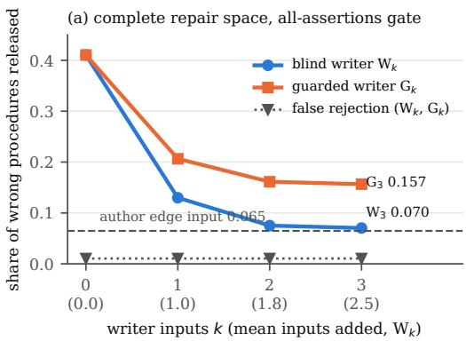
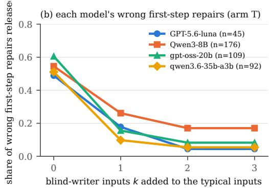
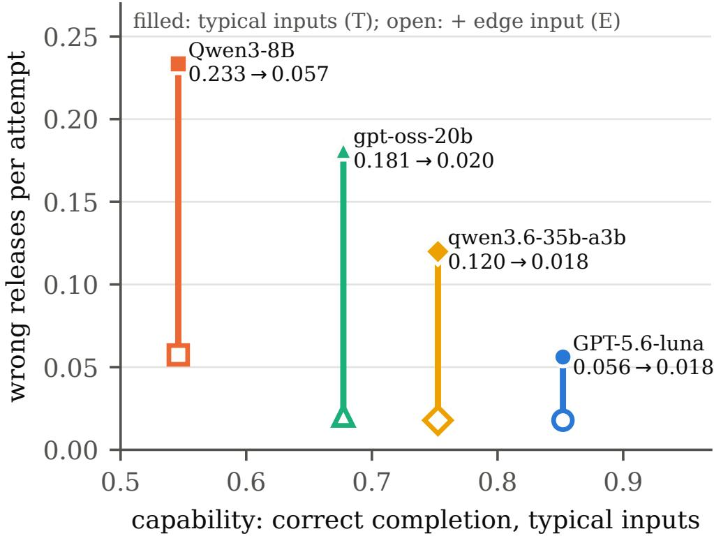

# Accepted but Wrong: Silent Failures of LLM Code Repairs after API Migrations

XIAOBO CHEN, University of Massachusetts Amherst, USA

GENLIANG ZHU, Accentrust, Canada and Georgia Institute of Technology, USA

ZIYUAN WANG, Duke University, USA

CHU WANG, Accentrust, Canada and University of Illinois Urbana-Champaign, USA

After a runtime or API migration, an LLM-repaired procedure can run cleanly yet return wrong results, and a release check on typical test inputs ships it. We report a preregistered study of 73 tasks covering 60 documented changes in CPython, Node.js and SQLite. Every candidate is executed on the real runtimes against withheld contracts. Over the complete repair space, the all-assertions gate on typical inputs released 0.410 of wrong repairs. One edge input written from the release note cut this to 0.065, and to 0.061 on 15 unseen clusters. Three in uts from a blind GPT-5.6-luna writer that never saw the ro ram reached 0.070. Two further frozen stages enlarged the menu to 1491 fragments and then added 233 hard distractors that match the legacy output on typical inputs. The edge input (0.058) and the frontier-model writer (0.058) passed their preregistered tests. Yet 0.168 and 0.153 of the hard wrong programs still passed. Two local-model writers failed their preregistered tests. Across four model families, the edge input cut wrong releases per attempt in all three open-weight families on all three menus, for example 0.233→0.057, without lowering correct completion. Self-tests helped less. A blind AI audit flagged 34 contracts as stricter than their requirements. Dropping the disputed checks changed 0 verdicts, but class-label disputes remain open. No model-written code was executed. Artifacts are available from the authors on request.

Additional Key Words and Phrases: LLM program repair, API migration, runtime upgrade, release notes, edge-case test inputs, test oracle adequacy, release gate, LLM test generation, accepted-but-wrong repairs silent behavioral breaking changes, patch overfitting, diferential testing, preregistered empirical study, Python 3.12, Node.js 24, SQLite

## 1 Introduction

When the runtime or API under a business procedure evolves, an approved migration must repair the procedure so that it still meets the same obligation. Some breakages are loud: a removed function raises an error. Others are quiet: every call succeeds, yet the result changes. For example:

• an enumeration renders as 3 instead of Priority.HIGH;

• sum() returns a more accurate float that no longer matches stored ledger totals;

• Buffer.poolSize grows eightfold and silently changes the chunking of every upload.

A valid call can still have an invalid efect [19]. Agents notice plausible wrong values far less often than explicit errors [17]. In program repair, weak tests let incorrect patches through: the overfitting problem [31, 35, 39].

Our earlier study (Section 6) found that a pre-release check fails mainly through its inputs. Checks on the obligation released few wrong repairs once one edge input written from the release note was visible. Reviewers raised four objections:

• the edge inputs were author-written and close to the hidden inputs;

• the repair space is a finite menu;

• the human contract sign-of never happened;

• the test partition had only 34 clusters.

This paper answers the first and fourth with new, preregistered experiments. It answers the third only with an AI audit, not a human review. It answers the second only partly: a second stage enlarges the menu to a median of 27 programs per task, but 25 tasks still have fewer than 15 options. Repairs remain choices among author-written fragments, and that stage shows that the share of wrong programs a gate releases depends on how the menu is built (LM3).

Setting. We built 73 tasks with 66 afected tasks in 60 documented-change clusters, 18 of them new, on three installed open-source lineages:

• CPython 3.9→3.12;

• Node.js 20→24;

• the SQLite shell 3.51→3.54.

Every change is grounded in pinned release-note text. Every candidate is executed on the real runtimes. Hidden contracts are never shown to any model. We compare the visible-input sets that a release gate can use:

• typical inputs only;

• plus the author’s release-note edge input;

• plus up to three inputs from a blind writer, an isolated LLM that sees only the release note and the visible contract;

• plus self-tests that the repairing model writes for itself before it repairs.

Four model families repair the procedures under equal information: GPT-5.6-luna via the Codex CLI, Qwen3-8B, gpt-oss-20b and qwen3.6-35b-a3b. A fifth, gemma-4-12b, failed the unchanged admission check and is reported as not admitted.

Contributions.

(1) Exhaustive gate adequacy, replicated on unseen changes. Over the complete repair space of 52 afected test tasks:

• the all-assertions gate on typical inputs released 0.410 of wrong repairs, and one release-note edge input lowered this to 0.065;

• on the 15 new test clusters, built after the earlier study, the drop was 0.471→0.061 (Holm � 0.002);

• false rejection stayed at 0.010.

(2) A blind test writer comes close to the author (descriptive), and a preregistered guard fails.

• Three blind-writer inputs per task reached 0.070 (0.090 without the 3 inputs that equal a hidden input), with no increase in false rejection. This result is descriptive: the unguarded curve was not a preregistered hypothesis, it was known before any repair call, and there is one writer.

• The preregistered coverage-aware gate kept only inputs the writer declared legacy-binding. It reached only 0.157, so its preregistered test is not positive.

• Writers mislabel change-revealing inputs as non-binding: the label the guard relies on is the label models get wrong.

(3) Edge inputs replicate across model families; self-tests do not reach significance.

• The edge input cut wrong releases per attempt in all three open-weight families (Table 4), with no loss of correct completion.

• The preregistered replication criterion is met.

• The frontier model released few wrong repairs in any arm.

• Self-tests lowered wrong releases in every family, but no self-test contrast survived Holm correction. A post-hoc writer × repairer matrix, restricted to the 21 tasks where every writer has tests, is consistent with writer capability mattering more than independence. Tests from the strongest model gated best, and same-model cells were not worse than cross-model cells. This is descriptive, with four families and one prompt.

(4) A larger repair menu. A second frozen stage enlarged the menu from 405 to 1491 documented fragments. Over that space the edge input (0.045) and the blind writer (0.053) both passed their preregistered tests. The edge-input efect on model repairs replicated in the same three open-weight families.

(5) Hard distractors and more writers. A third frozen stage added 233 wrong-looking-right distractors that match the legacy output on typical inputs. The edge input (0.058) and the GPT-5.6-luna writer (0.058) still passed their preregistered tests, and the edge-input efect replicated in all three open-weight families. Two weaker blind writers did not pass.

(6) Independent AI contract audit.

• Two blind GPT-5.6-luna audits per contract agreed on 0.91 of items (� = 0.73).

• They flagged 34 of 73 contracts, mostly because the file-preservation check is stricter than the stated requirement.

• Removing that check, and legacy equality as well, changes 0 hidden verdicts; the class-label (R2) objections remain open.

• We report this as an AI audit, not as a human sign-of.

Scope. Repairs are choices among documented fragments. A free-form arm, which would execute model-written code, was approved only under strict sandboxing. The sandbox could not be built within the permissions of the study machine, so the arm was not run (Section 8). No model-written code was executed anywhere.

## 2 Related Work

## 2.1 Repairing clients after API and dependency evolution

Behavioural breaking changes occur even without signature changes or major releases [14, 38, 43]. Migration recommenders recover old-to-new API relations [9, 37], and web-service clients have been repaired from migration patterns [28].

The closest recent work repairs client code after dependency updates:

• Fruntke and Krinke fix dependency breaking changes automatically [11].

• Byam combines compilation errors, error localisation and API diferences with an LLM to fix breaking dependency updates [27].

• DepRepair observes that the decisive evidence often lies upstream (release notes, API difs) and that no failing test localises the break [41].

The closest is BBCFixer [5]. It targets behavioural dependency breaks (BBCBench: 100 Python and JavaScri t cases). It runs the failin test under the old and new librar versions, ranks the calls whose return values difer to locate the root API, and filters the library dif accordingly. Gilesi records API-interaction snapshots during client tests and compares them across library versions to flag behavioural breaking changes [24]. In efect, it applies diferential testing at the API boundary.

These systems accept a repair when the client compiles or its own tests pass. BBCFixer is the exception: it uses old-versus-new execution as repairevidence, not as a release criterion. BBCBench is the closest benchmark: it contains 100 real behavioural dependency breaks in Python and JavaScript projects, each with the failing client test. We did not evaluate our release gates on it, for three reasons:

• its cases require installing project dependencies, which our ofline, no-install protocol forbids;

• its oracle is the project’s own failing test, so the oracle cannot be varied independently of the repair;

• its repairs are free-form code, whose space cannot be enumerated.

The two designs are complementary. BBCBench measures whether repair succeeds against the project’s test. Our design asks how often a given release check would let a wrong repair through, which requires a finite, enumerable repair space and oracles that can be swapped.

Our increment relative to BBCFixer, Gilesi and Byam is fourfold:

• we hold the repairer’s information fixed and vary only the release gate;

• we measure each gate’s false-acceptance and false-rejection rates over the complete space of possible repairs and over model-produced repairs;

• we treat “no safe replacement exists” as a registered outcome;

• we compare the sources of the inputs that make a gate adequate: author-written, a blind LLM writer, and the repairing model itself.

The release gate is measured against acceptance and preservation contracts that are withheld from the repairer. Byam’s signal (compile errors plus API difs) is the natural analogue of our runtime/schema gate and dif view. We therefore do not port its Java-specific pipeline as a baseline; we compare the gate classes it relies on.

Version-aware generation benchmarks are adjacent:

• updating model knowledge of API changes or detecting deprecated-API usage [21, 33];

• generating code for a requested library version [18, 23];

• migrating repositories [20, 22].

They evaluate generation or whole-project migration with tests as the oracle. They do not ask how much a weaker oracle would have let through.

## 2.2 Tools that evolve under agents

• ToolEVO learns to use evolving tools from environment feedback and reflection [4].

• Continual documentation adaptation revises tool descriptions as tools change [36].

• Drift benchmarks inject schema, policy and tool-name changes into stateful environments and score the final state [1, 25].

• DynamicMCPBench scores efects on live MCP servers [16].

• Kaliyev and Maryanskyy report a gap between in-session verification and held-out conformance for tools that agents synthesise themselves [15].

• ContractRL repairs individual JSON tool calls with contract-masked minimal patches and compares them with full regeneration [13].

Bench2Robust augments agent benchmarks with recoverable and unrecoverable failures, including drift and episodes in which no viable path remains [3]. Kraishan injects typed tool faults and finds that agents flag plausible wrong values far less often than explicit errors [17]. Our setting is diferent: upstream evolution under a fixed obligation, with the release oracle as the manipulated variable. We do not train any model.

## 2.3 Oracles, contracts and patch overfiting

Test-based repair produces patches that pass the available tests yet are incorrect. The problem is known as overfitting [31], and it motivates patch-correctness assessment beyond the given tests [39]. It recurs for LLM agents, whose “solved” issues often are not [35, 42]. Our release gates play the role of the given tests. The migration setting adds two things: a fixed legacy behaviour that can serve as an oracle, and inputs whose relevance is named by the change note.

Executable properties and contracts are established ways to state behaviour when a full output oracle is unavailable:

• property-based and metamorphic testing [8, 30];

• consumer-driven contract testing [29];

• diferential regression testing of API versions [12].

LLMs now write property-based tests and other tests whose fault-revealing power is assessed by mutation analysis [10, 32, 34]. BreakGuard uses LLM-generated tests to detect behavioural breaking changes in client code [26].

Generated tests as filters, and self-tests. CodeT generates tests with the same model and uses agreement with them to rank sampled programs [2]. Self-debugging lets a model explain and revise its own code from execution feedback [6]. Both treat model-written tests as a selection signal, and both measure success against held-out tests. We ask a narrower question that neither isolates. When a model writes test inputs from a release note before repairing, how many of its own wrong repairs does a gate built on those inputs still release? How does that compare with an independent blind writer and with an author-written edge input? Our tests are data only. Expected outputs come from the legacy program on the legacy runtime, so no model-written code or oracle is executed.

LLM judges as auditors. LLM judges agree with human preferences on open-ended answers but show position and self-preference biases [44]. We use an LLM only to audit contracts against release notes, with two blind replicates and a frozen adjudication rule. We report it as an AI audit, not as a human review.

We use these oracle families as release gates for repairs. We then report, both over the complete finite repair space and over model-produced repairs, how many wrong repairs each gate lets through and how many correct ones it blocks. The model-free measurement is the complement of a mutation score computed over the space of possible repairs.

## 2.4 Edit formats and over-editing

Models over-edit when asked for minimal changes, and preservation-aware training or instructions reduce this [40, 45]. Dif and full-rewrite output formats trade of fragility against cost [7].

Our earlier exploratory stage showed that a stated two-field budget can manufacture a represen- tation efect. Here representation is a secondary, equal-information factor, the budget is unlimited, and edit size is recorded as an outcome.

## 3 Problem and Terminology

A task has five parts:

• a consumer requirement $R ;$

• an old procedure $\scriptstyle { \mathcal { P } } 0$ that satisfies � on the old runtime $A _ { 0 }$ ;

• a finite repair domain � (each procedure is a choice of documented fragments for the template’s fields);

• a visible input set $X _ { v } ;$

• a hidden input set $X _ { h }$ , disjoint from $X _ { v }$ except where noted.

The business obligation stays fixed across the migration.

Definition 1 (Hidden correctness). A procedure $p \in D$ is correct on the new runtime $A _ { 1 } \ i f ,$ for every $x \in X _ { h }$ , two conditions hold:

• its output satisfies the acceptance assertions derived from �, together with equality to $\scriptstyle { p _ { 0 } }$ on $A _ { 0 }$ for the outputs that � constrains;

• the files it leaves behind equal those left by �0 (preservation).

Hidden contracts are never shown to a repairer.

Definition 2 (Release gate and outcomes). A release gate (or release oracle) maps a candidate’s observations on $X _ { v }$ under $A _ { 1 }$ to release or block. Each attempt ends in exactly one of four outcomes:

• correct completion: released and correct;

• false acceptance: released and not correct;

• false rejection: blocked although correct;

• safe non-release: blocked or abstained, and not correct.

A false acceptance is error-free when the hidden executions raised no error.

A no-safe-repair task is one in which no $\pmb { \mathscr { p } } \in D$ is correct; exhaustive search confirms this. For such a task the correct disposition is non-release, ideally an explicit abstention.

The “no safe repair” label depends on the obligation. In the earlier study, 4 of its no-safe- repair tasks gain correct programs once equality with the legacy output is dropped and only requirement-level assertions are kept: node-createcipher (4), py-binascii-hqx (5), py-distutils-looseversion (2), py-shuffle-random-param (5) correct programs (Section 6).

The earlier study compared four gates. All except “none” execute the candidate on $X _ { v }$ and therefore have identical execution cost:

• none;

• runtime/schema: the program exits normally and prints output of the declared shape and types;

• diferential: runtime/schema plus equality with $\scriptstyle { \mathcal { P } } 0$ on $A _ { 0 }$ for every visible input;

• all consumer assertions: runtime/schema plus every requirement assertion on every visible input.

Visible-input coverage is the composition of $X _ { v } .$ . The gate on each set is all consumer assertions on every input in it:

• T (typical): the task’s typical input or inputs;

• E (edge input): T plus one author-written edge input derived from the release note;

$W _ { k }$ (blind writer): T plus the first $k \leq 3$ valid inputs of a blind LLM writer that sees only the release note and the visible contract;

$G _ { k }$ (guarded writer): as $\mathrm { W } _ { k }$ , but only inputs the writer declares legacy-binding, that is, inputs on which the old output is still the required output;

• S (self-test): T plus the repairing model’s own valid legacy-binding inputs, written before it repairs;

• ES: E plus S.

Expected outputs for every added input come from $\mathbf { \nabla } \mathcal { P } 0$ on $A _ { 0 }$ . No model-written code or expected value is ever executed or trusted.

Throughout, silent refers to the class of the change: calls succeed and the result changes. Error-free refers to an outcome.

## 4 Study Design

The design was preregistered and frozen twice by SHA-256 hash sets.

• F0 came before any model call of this study.

• F-test came before any repair, self-test or probe call.

Each freeze stores a verbatim copy of the design text and hashes its own freeze script. These are two lessons from the earlier study, whose F0 design text had to be reconstructed afterwards (Appendix B).

## 4.1 Substrate

• Runtimes. Three installed lineages, executed ofline and unchanged since the earlier study: CPython 3.9.6→3.12.15, Node.js 20.20.2→24.21.0 and the SQLite command-line shell 3.51.0→3.54.0. SQLite 3.54.0 was released on 2026-10-09, after the models’ likely training cutof.

• Tasks. The 73 tasks are the 55 earlier tasks, imported unchanged, plus 18 new ones. The new tasks are grounded in verbatim text from already-pinned oficial pages:

– Python What’s New 3.10–3.12;

– the Node.js deprecation registry and Bufer reference;

– the SQLite 3.53/3.54 release logs.

Examples are the random.seed type restriction, NaN hashing by identity, the PEP 701 tokenizer change, the ipaddress is\_private fix, Buffer.poolSize, and SQLite’s right-justified numbers and empty-result headers.

• Counts. 66 tasks are afected, in 60 clusters (CPython 45, Node.js 13, SQLite 8). The other 7 are unchanged controls. By class there are 25 silent, 34 explicit and 7 no-safe-repair tasks.

• Authoring rules.

– Each new task passes the earlier study’s gates unchanged: quote verbatim, determinism, stale failure on hidden inputs, at least one correct fragment choice (none for no-safe-repair tasks), and static safety.

– Each has one author edge input that must make the stale procedure fail a visible check: the edge-input QA rule.

– Two candidate tasks failed these gates in dry builds and were dropped before F0.

– No isomorphic variants were added.

• Split. Earlier clusters keep their earlier partition. New clusters go 20% per lineage to development, by hash. The test partition has 52 afected tasks in 49 clusters, 15 of them new.

## 4.2 Visible inputs and gates

## Blind writer.

• Calls. One isolated GPT-5.6-luna call per task (73 calls) through the hardened Codex client:

– all MCP servers, plugins, apps and web search are disabled;

– the sandbox is read-only, ephemeral, with an empty working directory;

– an output schema is enforced;

– any use of the model’s own tools voids the call.

• What the writer saw. The requirement, the pinned excerpts, the input keys, the typical input with its old output, and the output checks. It never saw the template, the fragments, the old program, the hidden inputs or any result.

• Output. Up to three inputs, each with a legacy-binding flag.

• Validation (fail-closed, data only). An input must have exactly the typical keys and value types. It must also run cleanly and deterministically under the old procedure on the old runtime, which supplies the expected output.

• Yield. 176 inputs were kept in 69 tasks, and 35 of them were flagged non-binding. 27 were dropped: 13 because the old runtime raised an error, 12 as duplicates, and 2 as nondeterministic. 3 kept inputs equal a hidden input; they are kept, as preregistered.

Coverage-aware gate. $\mathrm { W } _ { k }$ adds the first � kept inputs. The preregistered gate ${ \mathrm { G } } _ { k }$ adds the first � kept inputs flagged legacy-binding. The guard was motivated by the earlier study: there, LLM inputs over-rejected on runtime facts that no repair may preserve, such as a module the migration removed.

Self-tests. Inside each family’s run, the repairing model first writes its own inputs with the same prompt and validation (step 0, one call per task). The S arm uses those flagged legacy-binding. The unguarded set is analysed without model calls.

## 4.3 Repair protocol, arms and models

• Equal information. The repair prompt, parser and feedback are the earlier study’s, unchanged. Every arm sees:

– the requirement, the excerpts and the template;

– the field domains and the old procedure;

– the arm’s visible inputs;

– “EDIT BUDGET: unlimited” and permission to abstain.

• Arms and cells. There are four arms: T, S, E and ES. Each task and arm has eight cells, crossing patch or full representation, dif view of or on, and listed or reversed fragment order.

• Steps. Step 1 is shared by two branches, no gate and all consumer assertions. The gated branch issues one revision if and only if its gate fails, with pass/FAIL feedback and no expected values.

• Ofline gates. Every gate $\mathrm { W } _ { 1 } \mathrm { - } \mathrm { W } _ { 3 } , \mathrm { G } _ { 1 } \mathrm { - } \mathrm { G } _ { 3 }$ and S/Sraw is also applied ofline to each T-arm step-1 candidate.

• Models.

– GPT-5.6-luna via the Codex CLI (reasoning efort high);

– Qwen3-8B (4-bit, MLX, greedy);

– gpt-oss-20b, qwen3.6-35b-a3b with thinking of, and gemma-4-12b-qat, all in LM Studio at temperature 0.

• Admission. Local families must first pass the unchanged 12-call qualification: 12/12 exact outputs, p5 prefill ≥500 tok/s, p5 decode ≥32 tok/s, and overhead ≤0.5 s.

– Qwen3-8B (12/12, decode 38.9), gpt-oss-20b (12/12, 61.4) and qwen3.6-35b-a3b (12/12, 104.0) were admitted at the first attempt.

– gemma-4-12b-qat was not admitted: 0/12 exact, decode 20.7. Its answers began with leaked reasoning-channel text (<|channel>thought), a serving-configuration problem rather than evidence about the model’s repair ability. The speed-only retry policy does not cover content failures, so the family was not retried, and we draw no conclusion about gemma.

• Calls. GPT-5.6-luna made 2626 calls, Qwen3-8B 3266, gpt-oss-20b 2965 and qwen3.6-35b-a3b 2885. None was voided.

• Truncations. Answers cut of at the output-token limit are never parsed and count as rejected replies: 6 for Qwen3-8B, 7 for gpt-oss-20b and 1 for qwen3.6-35b-a3b. The Codex CLI reports no finish reason.

• Contamination probe. Each model answered one step-1 prompt per afected task with the release-note excerpts and dif view removed.

## 4.4 Hypotheses, decision rules and power

Statistics are the earlier study’s, unchanged:

• the unit is the documented-change cluster, with tasks averaged within clusters;

• sign-flip permutation �-values, exact for ≤16 clusters and otherwise 200,000 Monte Carlo flips;

• whole-cluster bootstrap 95% intervals;

• Holm adjustment within each family.

Rule thresholds use task means. Holm and zero discordance. Our frozen analysis code gave a hypothesis without discordant clusters no �-value and left it out of the Holm count. The frozen design text says “Holm over 3” and “over 4”. We therefore report the strict values, with every hypothesis in � and a zero-discordance hypothesis entering with � = 1: M4c then has Holm � 0.002 (code: <0.001) and gpt-oss-20b’s H2 0.132 (code: 0.088). No decision changes; tables show the code’s values.

Family M4 (model-free, complete repair space, Holm over 3).

$\mathrm { \mathbf { M 4 a } } , \mathrm { F A ( G _ { 3 } ) - F A ( T ) }$ . Positive if Holm $p < 0 . 0 5 , \mathrm { F A } ( \mathrm { G } _ { 3 } ) \leq 0 . 1 0$ and the rise in false rejection is $\leq 0 . 0 5 .$

$\mathbf { M 4 b } , \mathrm { F R } ( \mathrm { G } _ { 3 } ) { \mathrm { - F R } } ( \mathrm { W } _ { 3 } )$ . Positive if the guard significantly lowers false rejection.

• M4c, FA(E)−FA(T) on the 15 new test clusters only. This is a fresh replication of the earlier HM1 contrast, with the same thresholds as M4a.

## Family A4 (per model, Holm over 4; per-attempt rates averaged over the eight cells).

• H1: FA(E)−FA(T);

• H2: FA(S)−FA(T);

• H3: FA(ES)−FA(E);

• H4: CC(S)−CC(T).

H1–H3 are positive ifHolm $\textstyle p < 0 . 0 5$ , the diference is negative, and the matching correct-completion diference is $\ge - 0 . 0 5$

## Power and confirmatory status.

• A preregistered simulation resampled the earlier per-cluster rates with eight attempts and the counterfactual efect $r = 0 . 3$ . The frozen design text states the 400-simulation pilot values 0.99, 0.91 and 0.03 for Qwen3-8B, gpt-oss-20b and GPT-5.6-luna; the confirmatory status follows these. The 1,000-simulation record of the same script gives 0.99, 0.94 and 0.06. The first two families are confirmatory; the frontier model, near the ceiling, is descriptive.

• The two new families were confirmatory only if their T-arm false-acceptance rate on the development partition was at least 0.15. qwen3.6-35b-a3b had 0.148 and is therefore descriptive.

• The 1,000-simulation power record was produced after F-test from the frozen script. This is logged as a deviation.

## Cross-family criteria.

• Edge-input replication: H1 positive in at least three families and in every confirmatory family.

• Self-test replication: H2 positive in at least three families.

• Model-scale analysis (descriptive): Spearman � between capability (T-arm correct completion) and the H1 efect, with an exact permutation �.

• The thresholds of three of five families were fixed when five families were planned. With gemma not admitted, they are applied to four.

## AI contract audit.

• Calls. Two blind GPT-5.6-luna calls per task (146 calls).

• What the auditor saw. The requirement, the excerpts, the template, the fragments, the old procedure and the claimed class. It also saw the contract rules instantiated on the typical input. It never saw hidden inputs, outputs or results.

## • Rubric.

– R1: the material documents the change;

– R2: the class is right;

– R3: legacy equality is a reasonable reading;

– R4: no assertion is stricter than the requirement;

– R5: the contract is complete.

• Adjudication. An item counts as a “no” only if both replicates say no. Contracts are never changed after the audit.

## 4.5 Second stage: a large repair menu

The main external-validity objection is the finite menu: with about five fragments per field, a model can often eliminate wrong options by inspection. A second, separately frozen stage (F0 2c95616bd805, F-test db2f355dba79) therefore enlarges every field domain.

• Fragments. The menu grows from the 405 earlier fragments to 1491. Every added fragment comes from an earlier fragment by one or two author-written operators:

– a documented sibling of a module attribute (for example another inspect or crypto function);

– a swap among documented builtins, string methods, operators, SQLite functions or CLI modes;

– an integer-literal edit.

Every operator is checked against one of 63 newly pinned oficial pages. Siblings that could act outside the sandbox, start processes or import by name are excluded.

• Filters. A fragment is kept only if the program runs cleanly on the typical input on either runtime (a visible-only filter). The step-1 prompt must stay within the frozen 2,048-token input cap.

• Coverage. 25 tasks still have fewer than 15 options, because few documented operators apply to their fragments. All 1986 procedures were evaluated exhaustively.

• Runs. Arms T and E, eight cells each, with the same models, prompts and gates. The writer’s inputs and each family’s own self-tests are applied ofline. GPT-5.6-luna made 1242 calls, Qwen3- 8B 1599, gpt-oss-20b 1403 and qwen3.6-35b-a3b 1387. Each local family passed the unchanged qualification again at the first attempt: Qwen3-8B 12/12, decode 40.7; gpt-oss-20b 12/12, 55.9; qwen3.6-35b-a3b 12/12, 74.3. Truncated answers, never parsed: 5, 8 and 3.

• Hypotheses (strict Holm over 3 per family, fixed at F0).

– Model-free: LM1 FA(E)−FA(T); LM2 FA(W3)−FA(T), which makes the earlier descriptive writer result a preregistered test; LM3 FA(T) on the large menu minus FA(T) on the earlier menu.

– Per family: LH1 wrong releases per attempt E−T; LH2 and LH3, the change in wrong releases and in correct completion with typical inputs relative to the earlier menu.

– Thresholds and confirmatory status are as before. The model-free family was computed between the two freezes, before any model call.

## 4.6 Third stage: hard distractors and two more writers

A third frozen stage (F0 bf681a0b7291, F-test 5f4ca8417951) addresses the menu-composition problem that LM3 exposed (Section 5.3).

• Hard distractors. The same documented operators generate candidates from every large-menu fragment. A candidate is kept as a hard distractor only if, on the typical inputs, the program’s output on the new runtime equals the old program’s output on the old runtime. This is visible information only: the fragment passes the visible diferential check.

– 233 hard fragments were added in 26 tasks, giving 1689 fragments and 2310 procedures, all evaluated exhaustively.

– 323 of the 359 hard-origin programs turned out hidden-wrong.

• Writers v2. qwen3.6-35b-a3b and Qwen3-8B write up to three inputs each with a new prompt. It has no legacy-binding flag and asks for inputs that exercise the documented change and its boundary values. They see the same information as before. Both passed the qualification (12/12, decode 65.1; 12/12, 43.8).

Table 1. Model-free release-gate adequacy over the complete finite repair space of the 52 afected test tasks (49 clusters), all-consumer-assertions gate. Added: mean visible inputs added to the typical ones. FA: share of hidden-wrong procedures released; FR: share of hidden-correct procedures blocked (task means). Stale: tasks in which the unrepaired procedure fails visibly.
<table><tr><td>Visible inputs</td><td>Added</td><td>FA</td><td>FR</td><td>Stale</td></tr><tr><td>typical only</td><td>0.00</td><td>0.410</td><td>0.010</td><td>34/52</td></tr><tr><td>+ blind writer, k=1</td><td>0.96</td><td>0.130</td><td>0.010</td><td>49/52</td></tr><tr><td>+ blind writer, k=2</td><td>1.85</td><td>0.075</td><td>0.010</td><td>50/52</td></tr><tr><td>+ blind writer, k=3</td><td>2.46</td><td>0.070</td><td>0.010</td><td>50/52</td></tr><tr><td>+ guarded writer, k=1</td><td>0.73</td><td>0.206</td><td>0.010</td><td>42/52</td></tr><tr><td>+ guarded writer, k=2</td><td>1.40</td><td>0.161</td><td>0.010</td><td>42/52</td></tr><tr><td>+ guarded writer, k=3</td><td>1.85</td><td>0.157</td><td>0.010</td><td>42/52</td></tr><tr><td>+ author edge input</td><td>1.00</td><td>0.065</td><td>0.010</td><td>52/52</td></tr></table>

• Runs. Arms T and E, eight cells each. GPT-5.6-luna made 1238 calls, Qwen3-8B 1593 (decode 48.4), gpt-oss-20b 1404 (62.0) and qwen3.6-35b-a3b 1391 (94.7). Truncated answers: 4, 4 and 4.

• Hypotheses (strict Holm, fixed at F0).

– HD1 FA(E)−FA(T), HD2 FA(W3)−FA(T) and HD3 FA(T, hard)−FA(T, large), over the complete hard menu.

– HA1 E−T and HA2 FA�(hard)−FA�(large), per repair family.

– WR1 and WR2, each new writer’s X3 gate against T on the hard menu, with the same thresholds as HD1. WR3 compares the qwen3.6 writer with qwen3.6’s own earlier self-tests on the first menu.

The model-free family HD was computed between the two freezes, before any model call.

What was known at each freeze.

• M4c depends only on the frozen build. It was computed during the mock-pipeline test before F0 and is reported as known at F0.

• M4a, M4b and the audit were computed between F0 and F-test, as designed.

• One amendment followed, before any repair call. It added ofline, descriptive self-test gates and changed no primary rule (Appendix B).

## 5 Results

## 5.1 Model-free adequacy over the complete repair space

Table 1 and Figure 1a apply the all-assertions gate to every procedure in the finite domain of each afected test task. They use the visible inputs of each level. Tables report task means. The preregistered tests use cluster means, for example 0.406 and 0.064 for T and E; the two never difer by more than 0.005.

Author edge input.

• One release-note edge input lowered the share of wrong procedures released from 0.410 to 0.065. The cluster-level diference is −0.342, with 36 discordant clusters. False rejection stayed at 0.010.

• M4c restricts the contrast to the 15 new test clusters, which did not exist when the efect was first observed. There the rate fell from 0.471 to 0.061 (diference −0.410, 95% CI [−0.589, −0.238], strict Holm � 0.002). The decision is positive.

• M4c is a deterministic function of the build and was known at F0 (Section 4).

  
Fig. 1. Headline result. (a) Share of wrong procedures released over the complete finite repair space as blind-writer inputs are added $( k = 0$ is typical inputs only; in parentheses, mean inputs actually added per task). The dashed line marks the author edge input. Unguarded writer inputs $( \mathsf { W } _ { k } )$ reach the author level at no cost in false rejection; the preregistered guard $( \mathrm { G } _ { k } )$ does not. (b) The same gates applied ofline to each model’s own hidden-wrong first-step repairs (arm T, test partition; � wrong candidates). Writer cost: one call per task.

Blind writer (descriptive). The unguarded writer curve was not a preregistered hypothesis, its values were known before any repair call, and one model wrote all inputs.

• Without seeing the program, the fragments or the hidden inputs, the writer’s inputs lowered the rate to 0.130 with one input and 0.070 with up to three. On average they added 2.46 inputs per task.

• This is close to the author edge input (0.065), and false rejection did not rise at any �.

• Overlap and similarity (post hoc). 3 kept writer inputs equal a hidden input, in 3 tasks. Without them, $\mathrm { W } _ { 1 } { - } \mathrm { W } _ { 3 }$ reach 0.149, 0.094 and 0.090. The overlapping inputs carried part of the efect, and the unguarded writer without them remains below the 0.10 ceiling but above the author input. The mean highest string similarity of the 128 kept writer inputs of the test tasks to a hidden in ut of the same task is 0.70 (median 0.72; 20 at least 0.9), close to that of the author edge inputs of the earlier study (0.71).

• The stale procedure fails visibly in 50 of 52 tasks at $\mathrm { { W } } _ { 3 }$ . The writer was not bound by the QA rule that forced 52/52 for the author input.

## The preregistered guard backfired.

${ \mathrm { G } } _ { 3 }$ kept only inputs the writer declared legacy-binding, and reached 0.157. The contrast with T is large (−0.245, Holm $\textstyle p < 0 . 0 0 1 )$ . But the rate exceeds the preregistered ceiling of 0.10, so M4a is not positive.

• M4b has 0 discordant clusters: the guard removed no false rejection, because the unguarded inputs caused none.

• The writer marked 35 of its 176 inputs as non-binding. These were disproportionately the change-revealing ones: the stale procedure fails visibly in 42 tasks under ${ \mathrm { G } } _ { 3 }$ against 50 under $\mathrm { W } _ { 3 }$

• The judgement “the old output is no longer required here” is exactly where the release note is most relevant. It is also where the writer erred.

Table 2. Post-hoc robustness of the model-free efects (afected test tasks; FA task means; cluster-level diferences with unadjusted sign-flip �).
<table><tr><td>Subset</td><td>FA T</td><td>FA E</td><td>FA  $\mathrm { W } _ { 3 }$ </td><td>E-T</td><td> $\mathrm { W } _ { 3 } \mathrm { - T }$ </td></tr><tr><td>class S (23 tasks)</td><td>0.571</td><td>0.080</td><td>0.091</td><td>−0.503 (&lt;0.001)</td><td>−0.491 (&lt;0.001)</td></tr><tr><td>class E (25 tasks)</td><td>0.297</td><td>0.053</td><td>0.055</td><td>−0.235 (&lt;0.001)</td><td>−0.233 (&lt;0.001)</td></tr><tr><td>class B (4 tasks)</td><td>0.192</td><td>0.050</td><td>0.050</td><td>-0.142 (0.500)</td><td>-0.142 (0.500)</td></tr><tr><td>without CPython (16 tasks)</td><td></td><td>一</td><td></td><td>−0.328 (0.002)</td><td>-0.368 (0.002)</td></tr><tr><td>without Node.js (42 tasks)</td><td>1</td><td>一</td><td></td><td>−0.321 (&lt;0.001)</td><td>−0.313 (&lt;0.001)</td></tr><tr><td>without SQLite (46 tasks)</td><td></td><td></td><td></td><td>-0.367 (&lt;0.001)</td><td>−0.346 (&lt;0.001)</td></tr></table>

Table 3. Model repairs on the test partition under the all-consumer-assertions gate: correct completions / false acceptances / false rejections per arm (8 cells per task and arm; 456 records per arm). T typical inputs; S + the model’s own self-tests; E + the author edge input; ES both. Last column: false acceptances with no gate (arm T).
<table><tr><td>Model</td><td>T</td><td>S</td><td>E</td><td>ES</td><td>no gate</td></tr><tr><td>GPT-5.6-luna</td><td>398/22/0</td><td>403/9/0</td><td>408/7/0</td><td>409/0/0</td><td>45</td></tr><tr><td>Qwen3-8B</td><td>268/98/0</td><td>271/80/0</td><td>270/24/0</td><td>268/20/0</td><td>182</td></tr><tr><td>gpt-oss-20b</td><td>320/71/0</td><td>327/47/1</td><td>353/8/0</td><td>351/8/0</td><td>111</td></tr><tr><td>qwen3.6-35b-a3b</td><td>354/49/0</td><td>363/30/0</td><td>368/7/0</td><td>379/8/0</td><td>97</td></tr></table>

Table 4. Family A4 per model (test clusters; cluster means of per-atempt rates): diference and Holm-adjusted �. H1 FA(E)−FA(T); H2 FA(S)−FA(T); H3 FA(ES)−FA(E); H4 CC(S)−CC(T).
<table><tr><td>Model</td><td>Status</td><td>H1</td><td>H2</td><td>H3</td><td>H4</td></tr><tr><td>GPT-5.6-luna</td><td>descriptive</td><td>−0.038 (0.499)</td><td>−0.033 (0.749)</td><td>−0.018 (1.000)</td><td>0.013 (1.000)</td></tr><tr><td>Qwen3-8B</td><td>confirmatory</td><td>−0.176 (&lt;0.001)</td><td>-0.046 (0.749)</td><td>-0.010 (1.000)</td><td>0.010 (0.998)</td></tr><tr><td>gpt-oss-20b</td><td>confirmatory</td><td>−0.161 (&lt;0.001)</td><td>-0.064 (0.088)</td><td>0.000 (−)</td><td>0.023 (0.385)</td></tr><tr><td>qwen3.6-35b-a3b</td><td>descriptive</td><td>−0.102 (0.004)</td><td>-0.048 (0.256)</td><td>0.003 (1.000)</td><td>0.023 (0.256)</td></tr></table>

Robustness by class and lineage (post hoc). Table 2 splits the model-free contrasts by class and leaves one lineage out. The edge-input and writer efects hold for silent and explicit changes and in every leave-one-lineage-out subset. The four no-safe-repair test tasks are too few for a test.

## 5.2 Repairs by four model families

Tables 3 and 4 report the test-partition repairs (456 attempts per arm and model).

• Wrong releases per attempt under all assertions fell as follows:

– Qwen3-8B: 0.233→0.057 (CI [−0.267, −0.094], Holm � <0.001);

– gpt-oss-20b: 0.181→0.020 (Holm � <0.001);

– qwen3.6-35b-a3b: 0.120→0.018 (Holm � 0.004).

• All three decisions are positive. For the two confirmatory families they are confirmatory, and for qwen3.6-35b-a3b descriptive.

• Correct completion did not fall: the E−T diference was ≥ 0 in every family.

Table 5. Self-tests writen by each model from the release note and the visible contract: tasks with at least one valid test, valid tests, tests declared legacy-binding, tests identical to a hidden input, mean highest similarity to a hidden input, and the model-free FA of the gate built from the guarded (S) and unguarded (raw) self-tests, with the unguarded gate’s FR.
<table><tr><td>Model</td><td>Tasks</td><td>Tests</td><td>Binding</td><td>=hidden</td><td>Sim.</td><td>FA (S)</td><td>FA (raw)</td><td>FR (raw)</td></tr><tr><td>GPT-5.6-luna</td><td>71/73</td><td>187</td><td>153</td><td>5</td><td>0.69</td><td>0.153</td><td>0.054</td><td>0.031</td></tr><tr><td>Qwen3-8B</td><td>30/73</td><td>49</td><td>27</td><td>2</td><td>0.71</td><td>0.355</td><td>0.240</td><td>0.031</td></tr><tr><td>gpt-oss-20b</td><td>57/73</td><td>128</td><td>93</td><td>1</td><td>0.69</td><td>0.235</td><td>0.149</td><td>0.031</td></tr><tr><td>qwen3.6-35b-a3b</td><td>67/73</td><td>168</td><td>122</td><td>3</td><td>0.68</td><td>0.215</td><td>0.100</td><td>0.031</td></tr></table>

Table 6. Ofline gates applied to the hidden-wrong first-step candidates of arm T (test partition): share released by the blind-writer gate with 1 and 3 inputs (W1, W3), the guarded writer gate (G3), and the model’s own unguarded (Sraw) and guarded (S) self-tests; last column: share of hidden-correct candidates blocked by Sraw. All other gates blocked no correct candidate.
<table><tr><td>Model</td><td>wrong</td><td>W1</td><td>W3</td><td>G3</td><td>Sraw</td><td>S</td><td>FR Sraw</td></tr><tr><td>GPT-5.6-luna</td><td>45</td><td>0.178</td><td>0.044</td><td>0.178</td><td>0.044</td><td>0.178</td><td>0.023</td></tr><tr><td>Qwen3-8B</td><td>176</td><td>0.261</td><td>0.170</td><td>0.261</td><td>0.330</td><td>0.455</td><td>0.038</td></tr><tr><td>gpt-oss-20b</td><td>109</td><td>0.156</td><td>0.083</td><td>0.266</td><td>0.339</td><td>0.376</td><td>0.030</td></tr><tr><td>qwen3.6-35b-a3b</td><td>92</td><td>0.098</td><td>0.054</td><td>0.337</td><td>0.326</td><td>0.337</td><td>0.026</td></tr></table>

• GPT-5.6-luna released 22 wrong repairs in arm T and 7 in arm E. This contrast is descriptive, with Holm � 0.499.

• The preregistered edge-input replication criterion is therefore met.

• Self-tests lowered wrong releases in every family: 22→9, 98→80, 71→47 and 49→30 out of 456 attempts each.

• None of these reductions survived Holm adjustment. The smallest Holm � was 0.132 (strict; code 0.088), for gpt-oss-20b.

• The self-test replication criterion is not met.

• Adding self-tests to the edge input (H3) changed little: ES released 20, 8 and 8 wrong repairs in the open-weight families, against 24, 8 and 7 in E.

• Self-tests cost one extra call per task. They did not reduce correct completion: H4 diferences were 0.010 to 0.023.

Why self-tests helped less.

• Fewer valid tests from smaller models. The models difered most in how many valid tests they wrote (Table 5). GPT-5.6-luna wrote valid tests for 71 of 73 tasks; Qwen3-8B managed only 30.

• Weaker gates from those tests. Over the complete repair space, a gate built from Qwen3-8B’s unguarded self-tests released 0.240 of wrong procedures, against 0.070 for the blind writer.

• Weakest exactly where needed. The weakness concentrates on each model’s own mistakes (Table 6). Gates were applied ofline to the hidden-wrong first-step candidates of arm T:

– the blind writer’s gate $\mathrm { W } _ { 3 }$ released 0.170 of Qwen3-8B’s wrong candidates and 0.083 of gpt-oss-20b’s;

– the models’ own unguarded tests released 0.330 and 0.339.

Table 7. Post-hoc writer × repairer matrix (zero calls). Each family’s self-test step used exactly the blind-writer prompt and validation, so its unguarded self-tests are that family’s blind-writer inputs. Cells: share of the repairer’s hidden-wrong first-step candidates (arm T, test partition) released by the all-assertions gate on typical inputs plus the writer’s inputs. Tasks: afected test tasks with ≥1 valid input. Last column: model-free FA over the complete repair space on the 21 tasks where every writer has inputs (typical only: 0.510).
<table><tr><td>Writer ↓ / repairer →</td><td>Tasks</td><td>GPT-5.6-luna</td><td>Qwen3-8B</td><td>gpt-oss-20b</td><td>qwen3.6-35b-a3b</td><td>model-free</td></tr><tr><td>GPT-5.6-luna (writer-001)</td><td>50</td><td>0.044</td><td>0.170</td><td>0.083</td><td>0.054</td><td>0.069</td></tr><tr><td>GPT-5.6-luna</td><td>52</td><td>0.044</td><td>0.176</td><td>0.128</td><td>0.065</td><td>0.075</td></tr><tr><td>Qwen3-8B</td><td>23</td><td>0.356</td><td>0.330</td><td>0.385</td><td>0.337</td><td>0.109</td></tr><tr><td>gpt-oss-20b</td><td>42</td><td>0.178</td><td>0.330</td><td>0.339</td><td>0.272</td><td>0.088</td></tr><tr><td>qwen3.6-35b-a3b</td><td>48</td><td>0.311</td><td>0.210</td><td>0.202</td><td>0.326</td><td>0.078</td></tr></table>

Table 8. Post-hoc writer × repairer matrix restricted to the 21 afected test tasks where every writer has at least one valid input (removes the coverage diference; 30–70 wrong first-step repairs per repairer). Cells: share of the repairer’s hidden-wrong first-step candidates (arm T) released by typical inputs plus the writer’s inputs. Tasks: tasks with ≥1 valid input overall. Descriptive.
<table><tr><td>Writer\repairer</td><td>Tasks</td><td>GPT-5.6-luna</td><td>Qwen3-8B</td><td>gpt-oss-20b</td><td>qwen3.6-35b-a3b</td></tr><tr><td>GPT-5.6-luna (writer-001)</td><td>50</td><td>0.000</td><td>0.029</td><td>0.000</td><td>0.000</td></tr><tr><td>GPT-5.6-luna</td><td>52</td><td>0.000</td><td>0.157</td><td>0.125</td><td>0.021</td></tr><tr><td>Qwen3-8B</td><td>23</td><td>0.400</td><td>0.143</td><td>0.179</td><td>0.106</td></tr><tr><td>gpt-oss-20b</td><td>42</td><td>0.200</td><td>0.257</td><td>0.268</td><td>0.021</td></tr><tr><td>qwen3.6-35b-a3b</td><td>48</td><td>0.400</td><td>0.157</td><td>0.214</td><td>0.234</td></tr></table>

A model that misreads a release note tends to write tests that agree with its misreading.

• Matched on test volume (post hoc). Restricting to tasks where the family wrote at least one valid self-test removes the volume diference. On Qwen3-8B’s 23 such tasks its own unguarded tests released 0.132 of its 76 wrong first-step repairs, against 0.026 for the blind writer. For gpt-oss-20b the figures are 0.292 against 0.021, and for qwen3.6-35b-a3b 0.271 against 0.000. For GPT-5.6-luna, which is also the blind writer, they are equal (0.044).

• Writer or independence? (post hoc, descriptive). Each family’s self-test step used exactly the blind-writer prompt and validation. Its unguarded self-tests are therefore that family’s blind-writer inputs, and every family’s tests can gate every family’s repairs without new calls.

– Coverage difers. The number of tasks with at least one valid test difers by writer, from 23 for Qwen3-8B to 52 for GPT-5.6-luna, and tasks without tests fall back to typical inputs. The full matrix (Table 7) therefore mixes coverage with test quality.

– Common tasks. Table 8 restricts the matrix to the 21 tasks where every writer has tests. There the GPT-5.6-luna writer run gates every family best or tied for best. The mean same-model cell is 0.161 against 0.187 for cross-model cells.

– Reading. This is consistent with writer capability mattering more than independence, and gives no sign that a model’s own tests are specifically blind to its own errors. It rests on four families, one prompt and few wrong repairs per cell, so we treat it as a hypothesis.

• The guard hurt again. The guard $( \mathsf { S } , \mathsf { G } _ { 3 } )$ again let more wrong candidates through than its unguarded counterpart in every open-weight family. Model scale (Figure 2).

• Across the four admitted families, the absolute edge-input efect shrank as capability grew: Spearman $\rho = - 1 . 0 0$ , exact $\mathnormal { p } = 0 . 0 8 3$ with � = 4.

  
Fig. 2. Wrong releases per atempt under all assertions with typical inputs (filled) and with the author edge input (open), against each family’s capability (test partition, cluster means).

• The relative efect did not $( \rho = - 0 . 4 0 )$ . The edge input removed most of whatever wrong releases a family produced. Stronger models simply produced fewer.

• With four families this is descriptive.

## 5.3 Large-menu replication

## Model-free (Table 9).

• On the large menu, the edge input lowered the share of wrong procedures released from 0.278 to 0.045 (LM1 positive, strict Holm � <0.001).

• The unguarded blind writer lowered it to 0.053, with false rejection 0.043 against 0.014 (LM2 positive, Holm $\textstyle p < 0 . 0 0 1 )$ . The writer result thus passes a preregistered test on a larger space, for a single writer model (GPT-5.6-luna).

• The guarded writer again lagged (0.106).

• LM3 is not positive and goes the other way. The typical-input gate released a smaller share of wrong procedures on the large menu than on the earlier one (0.406→0.271, cluster means). Most added wrong fragments fail visibly on typical inputs. The share of wrong programs released therefore depends on how the menu is built. The headline shares (0.410, 0.278) hold only for their own menus, and are not properties of a gate.

Table 9. Large-menu stage, model-free: share of hidden-wrong (FA) and hidden-correct blocked (FR) procedures over the complete large-menu space of the afected test tasks (1986 procedures in all tasks), allconsumer-assertions gate, task means.
<table><tr><td>Visible inputs</td><td>FA</td></tr><tr><td>typical only</td><td>0.278 0.014</td></tr><tr><td>+ author edge input</td><td>0.045 0.014</td></tr><tr><td>+ blind writer, k=1</td><td>0.089 0.036</td></tr><tr><td>+ blind writer, k=2</td><td>0.054 0.043</td></tr><tr><td>+ blind writer, k=3</td><td>0.053 0.043</td></tr><tr><td>+ guarded writer, k=1</td><td>0.135 0.036</td></tr><tr><td>+ guarded writer, k=2</td><td>0.107 0.043</td></tr><tr><td>+ guarded writer, k=3</td><td>0.106 0.043</td></tr></table>

Table 10. Large-menu stage, model repairs (test partition, 456 atempts per arm): correct completions / wrong releases under all consumer assertions for arms T and E; LH1 wrong releases per atempt T→E (strict Holm �); LH2 change in wrong releases per atempt with typical inputs relative to the v4 menu (strict Holm �); LH3 change in correct completion relative to the v4 menu.
<table><tr><td>Model</td><td>Status</td><td>T</td><td>E</td><td>LH1</td><td>LH2</td><td>LH3</td></tr><tr><td>GPT-5.6-luna</td><td>descriptive</td><td>391/29</td><td>401/12</td><td>0.074→0.031 (0.378)</td><td>0.018 (0.378)</td><td>-0.018</td></tr><tr><td>Qwen3-8B</td><td>confirmatory</td><td>241/108</td><td>244/27</td><td>0.253→0.062 (&lt;0.001)</td><td>0.019 (0.634)</td><td>-0.047</td></tr><tr><td>gpt-oss-20b</td><td>confirmatory</td><td>310/85</td><td>334/15</td><td>0.212→0.038 (&lt;0.001)</td><td>0.031 (0.335)</td><td>-0.026</td></tr><tr><td>qwen3.6-35b-a3b</td><td>descriptive</td><td>327/72</td><td>344/9</td><td>0.177→0.023 (&lt;0.001)</td><td>0.057 (0.047)</td><td>-0.069</td></tr></table>

• Menu-independent view (post hoc, Table 11). We count, per task, the wrong programs that the visible inputs cannot tell apart from a correct one. With typical inputs this number grows with the menu, from 113 to 445 over the test tasks, and 41 or 42 tasks have at least one such program. With the edge input it is 14 and 46, in 11 and 17 tasks; with the blind writer 15 and 62. The task-level view of model repairs agrees. For example, Qwen3-8B released a wrong repair in 19 tasks with typical inputs and 5 with the edge input on the earlier menu, and in 20 and 5 on the large menu.

## Model repairs (Table 10).

• LH1. The edge input cut wrong releases per attempt for Qwen3-8B (0.253→0.062), gpt-oss-20b (0.212→0.038) and qwen3.6-35b-a3b (0.177→0.023). All three decisions are positive, both confirmatory families included, so the preregistered cross-family criterion is met. GPT-5.6-luna again stayed near the ceiling (0.074→0.031, Holm � 0.378).

• LH2 and LH3. Unlike the model-free space, the models’ own typical-input wrong releases rose slightly on the large menu in every family, and their correct completion fell slightly. Only qwen3.6-35b-a3b, a descriptive family, reached Holm $\textstyle p < 0 . 0 5$ (LH2 0.057, � 0.047). These are descriptive changes, not significant in the confirmatory families. The edge input still closed the gate.

• Ofline gates. The blind writer’s gate $\mathrm { W } _ { 3 }$ released 0.161, 0.089 and 0.034 of the open-weight families’ wrong first-step repairs. Their own unguarded self-tests released 0.382, 0.379 and 0.297.

## 5.4 Hard distractors and two more writers

## Model-free (Table 12).

Table 11. Post-hoc, menu-independent view (52 afected test tasks). Top: wrong programs that pass the all-assertions gate on the visible inputs, i.e. that the visible inputs cannot tell apart from a correct one (total, mean per task in parentheses), and tasks with at least one such program. Botom: tasks in which a model released at least one wrong repair in any of its 8 cells under all assertions, on the earlier and the large menu.
<table><tr><td>Menu</td><td rowspan="2">Programs</td><td colspan="2">T</td><td colspan="2">E</td><td colspan="2"> $\mathrm { W } _ { 3 }$ </td></tr><tr><td>median</td><td>wrong</td><td>tasks</td><td>wrong</td><td>tasks</td><td>wrong</td><td>tasks</td></tr><tr><td>earlier menu</td><td>5</td><td>113 (2.17)</td><td>41</td><td>14 (0.27)</td><td>11</td><td>15 (0.29)</td><td>12</td></tr><tr><td>large menu</td><td>30</td><td>445 (8.56)</td><td>42</td><td>46 (0.88)</td><td>17</td><td>62 (1.19)</td><td>15</td></tr></table>

<table><tr><td colspan="3">earlier menu</td><td rowspan="2">large menu T E</td></tr><tr><td>Model</td><td>T</td><td>E</td></tr><tr><td>GPT-5.6-luna</td><td>5</td><td>1</td><td>7 3</td></tr><tr><td>Qwen3-8B</td><td>19</td><td>5</td><td>20 5</td></tr><tr><td>gpt-oss-20b</td><td>16</td><td>1</td><td>16 2</td></tr><tr><td>qwen3.6-35b-a3b</td><td>11</td><td>2</td><td>17 2</td></tr></table>

Table 12. Hard-distractor stage, model-free over the complete hard-menu space of the afected test tasks (2310 procedures in all tasks): FA and FR task means under all consumer assertions, and FA restricted to hard-origin programs (wrong options that match the legacy output on the typical inputs).
<table><tr><td>Visible inputs</td><td>FA</td><td>FR</td><td>FA hard</td></tr><tr><td>typical only</td><td>0.337</td><td>0.010</td><td>0.990</td></tr><tr><td>+ blind writer (GPT-5.6-luna), k=3</td><td>0.058</td><td>0.042</td><td>0.153</td></tr><tr><td>+ guarded writer, k=3</td><td>0.135</td><td>0.042</td><td>0.492</td></tr><tr><td>+ author edge input</td><td>0.058</td><td>0.010</td><td>0.168</td></tr><tr><td>+ blind writer v2 (qwen3.6), k=3</td><td>0.094</td><td>0.083</td><td>一</td></tr><tr><td>+ blind writer v2 (Qwen3-8B), k=3</td><td>0.182</td><td>0.049</td><td>一</td></tr></table>

Table 13. Hard-distractor stage, model repairs (test partition, 456 atempts per arm): correct completions / wrong releases under all consumer assertions in arms T and E; HA1 wrong releases per atempt T→E (strict Holm �); HA2 change of typical-input wrong releases relative to the large menu. Last four columns (descriptive, ofline): share of each model’s hidden-wrong first-step repairs released by the typical inputs plus three inputs of the GPT-5.6-luna writer, the qwen3.6 and Qwen3-8B writers (prompt v2), and the model’s own self-tests. � confirmatory family.
<table><tr><td>Model</td><td>T</td><td>E</td><td>HA1</td><td>HA2</td><td>luna</td><td>qwen3.6</td><td>Qwen3-8B</td><td>own</td></tr><tr><td>GPT-5.6-luna</td><td>385/42</td><td>394/12</td><td>0.107→0.031 (0.063)</td><td>0.033 (0.094)</td><td>0.117</td><td>0.433</td><td>0.300</td><td>0.117</td></tr><tr><td>Qwen3-8Bc</td><td>245/105</td><td>244/22</td><td>0.250→0.050 (&lt;0.001)</td><td>-0.003 (1.000)</td><td>0.173</td><td>0.303</td><td>0.378</td><td>0.395</td></tr><tr><td>gpt-oss-20bc</td><td>306/88</td><td>339/17</td><td>0.218→0.043 (&lt;0.001)</td><td>0.006 (0.757)</td><td>0.104</td><td>0.392</td><td>0.384</td><td>0.416</td></tr><tr><td>qwen3.6-35b-a3b</td><td>317/80</td><td>347/11</td><td>0.198→0.028 (&lt;0.001)</td><td>0.020 (0.225)</td><td>0.048</td><td>0.373</td><td>0.349</td><td>0.317</td></tr></table>

• The menu is harder. The hard distractors raised the typical-input gate’s FA above the large menu’s (HD3 positive, 0.271→0.328 cluster means). Typical inputs released 0.990 of the hard wrong programs, as constructed.

• The edge input reduces but does not close the gap. It released 0.058 of all wrong programs (HD1 positive, Holm � <0.001), but 0.168 of the hard wrong programs still passed, above the 0.10 ceiling that the overall rate meets. HD1 passes because hard programs are a minority of the wrong ones. In absolute terms, the wrong programs that the visible inputs cannot tell apart from a correct one number 709 with typical inputs, 77 with the edge input and 82 with the writer’s inputs. Under the edge input this count grows with the menu: 14, 46 and 77 on the three menus.

• The GPT-5.6-luna writer behaves alike: 0.058 overall and 0.153 of the hard wrong programs (HD2 positive).

• The two v2 writers are weaker. The qwen3.6 writer reached 0.094, below the 0.10 ceiling. But its inputs raised false rejection to 0.083 against 0.010, beyond the 0.05 tolerance, so WR1 is not positive. The Qwen3-8B writer reached only 0.182 (WR2 not positive).

• WR3. We found no evidence that the v2 prompt helps: on the first menu, the qwen3.6 writer with the new prompt released 0.138 against 0.097 for qwen3.6’s own earlier self-tests (twosided, Holm � 0.196). With the earlier prompt, the GPT-5.6-luna writer outperformed qwen3.6’s self-tests.

• Writer yield: the qwen3.6 writer kept 171 inputs in 61 tasks (8 unparseable answers); the Qwen3-8B writer kept 105 in 44 (21 unparseable).

## Model repairs (Table 13).

• HA1. The edge input cut wrong releases per attempt for Qwen3-8B (0.250→0.050), gpt-oss-20b (0.218→0.043) and qwen3.6-35b-a3b (0.198→0.028), all with strict Holm � < 0.001. The cross-family criterion is met. GPT-5.6-luna: 0.107→0.031 (Holm � 0.063, descriptive).

• HA2. Typical-input wrong releases did not change detectably relative to the large menu in any family.

• Ofline. Applied ofline to the models’ own wrong first-step repairs, the GPT-5.6-luna writer’s inputs again let through the fewest. The two v2 writers and the models’ own self-tests let through several times more. Across all writers we tested, the strongest writer gated best. This is descriptive, and it means that the writer result depends on a frontier model.

## 5.5 AI contract audit

• The two blind replicates agreed on 0.91 of item verdicts (� = 0.73).

• The yes-rates were R1 0.98, R2 0.92, R3 0.81, R4 0.51 and R5 0.82.

• Under the frozen rule, 34 of 73 tasks have at least one item on which both replicates said no. The items were R4 for 20 tasks, R3 for 10, R5 for 7 and R2 for 3.

• R4 objections. Most R4 objections concern the file-preservation check p0, which the require-ments do not state.

• R2 objections. The R2 objections are substantive. For two Node.js tasks the quoted entry documents a deprecation history rather than the removal itself.

• Contracts unchanged. Contracts were not changed, as preregistered.

• Post-hoc check of the objections. Redefining hidden correctness without p0 changes 0 of the exhaustive hidden verdicts of the test tasks. So does dropping p0 and legacy equality d0 together: 0 changes. The checks p0 and d0 never decide a verdict that the consumer assertions do not already decide.

• Sensitivity analysis. Excluding the 24 flagged test tasks entirely leaves the edge-input contrast at −0.370 (� <0.001, 25 clusters).

• Strong-evidence criterion. Our predeclared strong-evidence criterion fails on two counts: M4a is not positive, and more than 10% of tasks are AI-flagged. The human sign-of of the earlier study is also not claimed.

Table 14. Contamination probe: hidden-correct first-step repairs without any release-note text (in parentheses: with the excerpts, typical inputs, full representation, no dif view, listed order). Uniform random choice from each finite domain would be expected to be hidden-correct in 9.9/45, 3.8/13, 0.8/4 and 1.0/4 tasks.
<table><tr><td>Model</td><td>CPython</td><td>Node.js</td><td>SQLite 3.53</td><td>SQLite 3.54</td></tr><tr><td>GPT-5.6-luna</td><td>37/45 (37)</td><td>10/13 (10)</td><td>3/4 (2)</td><td>3/4 (3)</td></tr><tr><td>Qwen3-8B</td><td>19/45 (24)</td><td>6/13 (9)</td><td>1/4 (0)</td><td>1/4 (0)</td></tr><tr><td>gpt-oss-20b</td><td>29/45 (28)</td><td>7/13 (8)</td><td>2/4 (1)</td><td>3/4 (3)</td></tr><tr><td>qwen3.6-35b-a3b</td><td>32/45 (34)</td><td>10/13 (6)</td><td>2/4 (3)</td><td>2/4 (2)</td></tr></table>

## 5.6 Contamination probe

Without any release-note text, GPT-5.6-luna produced hidden-correct first-step repairs in 37/45 CPython tasks. It solved 3/4 of the post-cutof SQLite 3.54 tasks. The open-weight families solved fewer, but every family was well above uniform random choice (9.9/45 for CPython). The template, requirement and visible inputs often sufice to infer the repair. The probe therefore bounds what release notes add to repair. It does not bear on the gate results, which concern what reaches release.

## 6 Prior Evidence

Four earlier layers of this project motivated the present design. They keep their own denominators and are never pooled with it.

## 6.1 Preregistered coverage study (the direct predecessor)

The direct predecessor used the first 55 of the present tasks, three model families and three coverage levels: typical, author edge input, and LLM-written inputs.

• Model-free. Over the complete repair space, the author edge input lowered the all-assertions false-acceptance rate from 0.377 to 0.065 (cluster means; Holm � <0.001).

• LLM inputs. LLM inputs went further, to 0.034, but raised false rejection by 0.061.

• Model families. Wrong releases per attempt fell for Qwen3-8B (0.228→0.085) and gpt-oss-20b (0.169→0.029).

Its freeze history, edge-input QA rule and contract review were open points that the present study addresses (Section 4 and Appendix B).

## 6.2 Typical-input study on two lineages

The first, exploratory study used 33 tasks on CPython and Node.js, with one typical visible input per task and six release gates. Its main findings were:

• Exhaustive gate adequacy. Over the complete repair space, runtime/schema checks released 0.80 of wrong repairs (task mean), and all consumer assertions and diferential testing released 0.36. The two coincided because each task had a single visible input.

• GPT-5.6-luna. It was near the ceiling, and no preregistered contrast was significant.

• Qwen3-8B. It released 31 wrong repairs under runtime checks and 20 under all assertions, out of 108 attempts. This diference was descriptive: Holm � = 0.375.

Two post-hoc analyses followed, neither of which required any model call:

• Requirement-only sensitivity. When only requirement-derived assertions are kept, the gate ordering is unchanged. Diferential testing then over-rejects (0.26), and the no-safe-repair labels shift: node-createcipher (4), py-binascii-hqx (5), py-distutils-looseversion (2), py-shuffle-random-param (5) correct programs appear.

Table 15. Prior evidence: sealed deterministic study, held-out test split (20 lineages, 100 task units). Scopeneutral reconstruction B1R and local repair B4 share the finite candidate base and the 24-probe ceiling; B1R also reads the complete synthetic new-version document. Resource columns are the only resources this layer measured (means per unit); tokens, latency and graph-construction efort were not measured. The injected B1/B1C rows are in Appendix C.
<table><tr><td>Condition</td><td>Joint</td><td>affected</td><td>controls</td><td>silent</td><td>abstain</td><td>probes</td><td>doc. bytes</td><td>edits</td></tr><tr><td>stale procedure (B0)</td><td>24/100</td><td>一</td><td>一</td><td>48</td><td>0</td><td>0.00</td><td>0.00</td><td>0.00</td></tr><tr><td>scope-neutral reconstruction (B1R)</td><td>96/100</td><td>72</td><td>24</td><td>0</td><td>4</td><td>1.04</td><td>119.83</td><td>1.00</td></tr><tr><td>contract-guided local repair (B4)</td><td>96/100</td><td>72</td><td>24</td><td>0</td><td>4</td><td>2.60</td><td>11.16</td><td>1.00</td></tr></table>

• Counterfactual. Moving one hidden edge input into the visible set and re-judging the existing candidates lowered the all-assertions false-acceptance rate to 0.054, with no false rejection.

The counterfactual reuses inputs that also define correctness, so it is optimistic. The coverage study above and the present study test the same mechanism prospectively, with new inputs that are never hidden.

## 6.3 Sealed deterministic study and visible-completion failures

Table 15 reproduces the scope-neutral comparison from the sealed deterministic study (24 lineages, 120 task units):

• the stale procedure completed 24/100 held-out units, and a further 48 were accepted but wrong;

• scope-neutral reconstruction (B1R) and local repair (B4) each completed 96/100;

• the injected B1/B1C evaluator-qualification rows are listed in Appendix Table 19.

In a blind sample of six public APIFlow-Bench tasks, three repairs met the visible-completion rule but failed the upstream validator; Table 16 reads them mechanically from the retained records. In each case the requirement asked for re-authentication and the candidate reused a stale token that the mock accepted. The visible check verified form and availability, not the obligation.

## 6.4 Edit budget

On ten oficial migration sources, a stated two-field edit budget produced a local-repair advantage that disappeared under a three-field budget: 21/24 each in a post-hoc replay. A prospective repli- cation on a 12-source bank (Appendix Table 20) is consistent with this reading. With the budget unlimited, full and patch output were indistinguishable for GPT-5.6-luna (48/48 versus 47/48). Under the two-field budget the model abstained instead of exceeding the budget. The present study therefore states an unlimited budget.

## 7 Discussion

What makes a release gate adequate here is its inputs, not its assertion family. On typical inputs, the all-assertions gate released 0.410 of wrong repairs. It released 0.065 once one input exercised the documented change. The efect replicated on 15 clusters built after it was first observed. It held in every open-weight family, and it cost no correct completions.

The inputs can come from a blind frontier-model writer. The objection to the earlier study was that the authors wrote both the edge inputs and the hidden inputs from the same note. A writer that saw neither the program nor the hidden inputs reached 0.070 with three inputs, at one call per task. For practitioners this suggests a cheap pre-release step:

(1) ask an isolated model for a few release-note edge inputs;

(2) compute their expected outputs on the old runtime;

Table 16. The three public tasks that met the frozen visible-completion rule (“the main request completes without an error status and every declared output field can be derived”) but failed the upstream validator. Columns are read mechanically from retained records; the validator’s per-predicate reasons were stored only as hashes, so which predicates failed is unknown and left blank. Exploratory, post hoc.
<table><tr><td></td><td></td><td></td><td>Task predicates partial score candidate operations verdicts</td><td></td><td>decidable missing obligation</td><td></td></tr><tr><td>w02</td><td>4</td><td></td><td>reused; edits 0</td><td>0.75 1 call(s); auth header visible: yes; upstream: fail</td><td>1 re-authentication via /v3/oauth/token requested but not performed(stale</td><td></td></tr><tr><td>w08</td><td>3</td><td></td><td>reused; edits 0</td><td>0.67 1 call(s); auth header visible: yes; upstream: fail re-authentication via</td><td>/v3/oauth/token requested but not performed(stale</td><td>the mock)</td></tr><tr><td>w14</td><td>2</td><td></td><td>reused; edits 0</td><td>0.50 1 call(s); auth header visible: yes; upstream: fail</td><td>the mock) /v3/oauth/token performed(stale bearer accepted by</td><td>1 re-authentication via requested but not</td></tr></table>

(3) gate the repair on them.

Do not let the writer decide which old outputs still bind. Our preregistered guard asked the writer to flag inputs on which the legacy output is no longer required. It discarded exactly the inputs that revealed the change. It also prevented no false rejection, because the unguarded inputs caused none. In the earlier study, LLM inputs did over-reject. There the cause was runtime facts that no repair may preserve, which a stricter validity check on the old runtime may handle better than a model’s judgement.

Who writes the tests may matter more than whether they are independent. A natural hypothesis is that a model’s own tests share its misreading of the release note. Our post-hoc data do not support it. On the 21 tasks where every writer has tests, the strongest writer gates best, and same-model cells are not worse than cross-model cells (0.161 versus 0.187). CodeT ranks programs by agreement with tests from the same model [2]. Our results are consistent with that design working when the model is strong. For release gating, a weak repairer gains most from a strong test writer, whichever model repairs. This matrix is post hoc and uses one prompt; it is a hypothesis for a preregistered test, not a confirmed result.

Stronger models need the gate less, but not never. The absolute benefit of the edge input shrank with capability. GPT-5.6-luna produced few wrong releases in any arm. The relative benefit stayed high, and the frontier model still shipped 22 wrong repairs on typical inputs versus 0 with both input sources.

Table 17. Threats to validity and how they are addressed.
<table><tr><td>Threat</td><td>What we did</td><td>What remains</td></tr><tr><td>Author-written edge and hidden inputs</td><td>blind writer that never sees program or hidden inputs; 3 of 176 inputs equal a hidden input</td><td>hidden inputs are still author-written</td></tr><tr><td>Effect seen before it was tested</td><td>fresh replication on 15 new clusters; freeze copies of the design text</td><td>M4c computable from the build before F0 (disclosed)</td></tr><tr><td>Contracts stricter than requirements</td><td>two blind AI audits per contract; post-hoc removal of p0 and do changes 0 verdicts</td><td>no human review; R2 class-label objections unresolved</td></tr><tr><td>One model in three roles</td><td>writer × repairer matrix (post hoc); two further preregistered writers (qwen3.6, Qwen3-8B)</td><td>only GPT-5.6-luna&#x27;s writer passed; auditor and writer are the same model</td></tr><tr><td>Menu composition</td><td>hard-distractor stage (233 legacy-matching distractors); menu-independent counts</td><td>distractors remain author-generated by documented operators</td></tr><tr><td>Strong-evidence criterion</td><td>reported against its frozen definition</td><td>not met: M4a not positive; audit flags &gt;10%</td></tr><tr><td>Finite repair menu</td><td>second frozen stage with 1491 documented fragments; exhaustive model-free measurement</td><td>still author-written fragments; 25 tasks below 15 options; free-form repair not run</td></tr><tr><td>Model coverage</td><td>four admitted families from three providers; power analysis</td><td>frontier model at ceiling; gemma not admitted</td></tr><tr><td>Contamination</td><td>post-cutoff SQLite 3.54 subset; no-documentation probe</td><td>public Python and Node.js notes</td></tr><tr><td>Ecosystem breadth</td><td>three lineages, 60 documented changes</td><td>no web APIs; no further lineages</td></tr></table>

## 8 Threats to Validity

Table 17 summarizes the main threats and what this study does about each. Construct validity.

• Hidden correctness treats legacy output as part of the obligation. The AI audit judged several contracts stricter than their requirements, mainly through the file-preservation check. Removing it, and legacy equality as well, changed no verdict.

• The R2 objections, that a quote documents a deprecation history rather than the removal, are not resolved by that analysis. We report the flagged tasks in the artifacts.

• No human reviewed the contracts.

• Only the frontier-model writer (GPT-5.6-luna) passed its tests; both local-model writers failed theirs, so the writer result is specific to a frontier model.

• GPT-5.6-luna is the blind writer, the auditor and one of the repairers. The audit may share the writer’s reading of the release notes. The writer’s advantage on its own repairs is not an independent test, and the matrix shows the writer’s lead holds on the other three families.

Internal validity.

• The authors wrote the tasks, typical inputs, author edge inputs and hidden inputs. Under the QA rule, the author edge input must make the stale procedure fail visibly. The blind writer was not bound by that rule and reached a similar level, which limits but does not remove this concern.

• Model-free M4c was known at F0. M4a, M4b and the audit were known before any repair call. One descriptive amendment followed. The full timeline is in Appendix B.

## Statistical conclusion validity.

• The test partition has 49 clusters. The frontier model and qwen3.6-35b-a3b are descriptive by preregistered rules.

• The scale analysis has four families.

• The cross-family thresholds were fixed for five families and applied to the four admitted.

## External validity.

• Repairs are choices among documented fragments. The free-form arm, in which models write code that is then executed, was approved only under strict non-destructive sandboxing. The sandbox runner could not be created within the study machine’s permissions, and no alternative host was used. The arm was not run, and we do not claim that the efects transfer to free-form repair.

• Three runtime lineages share release ancestries within a lineage. We make no claim about web APIs or other ecosystems.

Contamination. Python and Node.js release notes are public. The SQLite 3.54.0 subset post-dates the models’ likely training. The no-documentation probe is descriptive.

## Run conditions.

• Local runs passed their admission checks.

• The launcher records only point readings of machine load.

• gemma-4-12b-qat was not admitted.

## 9 Conclusion

On 60 documented changes in three real runtimes, the release check’s inputs decided whether wrong LLM repairs shipped:

• one release-note edge input cut the share of wrong repairs released from 0.410 to 0.065 over the complete repair space;

• the efect replicated on unseen changes, in three open-weight families, on a repair menu enlarged to 1491 documented fragments, and with 233 hard distractors added;

• a blind frontier-model writer supplied inputs of nearly the same value without seeing the program, while two local-model writers did not pass;

• letting the writer decide which legacy outputs still bind helped less, and so did weaker models’ self-tests; a post-hoc comparison points to writer capability rather than lack of independence.

The contracts passed an AI audit only in part. The disputed preservation and legacy-equality checks change no verdict, the class-label disputes remain open, and our predeclared strong-evidence criterion is not met. A free-form repair arm remains future work.

## Data Availability

Task specifications, build records (tasks, visible oracles, hidden contracts and exhaustive verdicts), pinned release-note pages, prompts, every model call with its response, run receipts, freeze hash sets with verbatim design copies, analysis outputs and the scripts that render every number and figure are available from the authors on request. They are not posted on a public code host. The hidden contracts and hidden inputs are the evaluation key of the benchmark, and publishing them would let future models be trained or tuned on them. The records also contain verbatim responses of a commercial model service whose redistribution terms we have not cleared. We will share the complete package with reviewers and with researchers who request it for reproduction.

## Use of AI Tools

The study design, preregistration decisions and interpretation of results were made by the authors. LLM-based coding and writing assistants were used to implement and test experiment and analysis scripts and to draft and edit parts of the manuscript; the authors reviewed all of their outputs and take full responsibility for the content. AI tools are not authors. The language models evaluated in the experiments are objects of study, not authors or assistants.

## References

[1] Mohammad Hasbi Assidiqi, Daniyal Alghazzawi, Suaad Alarifi, and Li Cheng. 2026. Benchmarking Reference-Free LLM Agent Robustness Under Schema, Policy, and Toolset Drift. IEEE Access 14 (2026), 79662–79672. doi:10.1109 ACCESS.2026.3696096

[2] Bei Chen, Fengji Zhang, Anh Nguyen, Daoguang Zan, Zeqi Lin, Jian-Guang Lou, and Weizhu Chen. 2023. CodeT: Code Generation with Generated Tests. In International Conference on Learning Representations (ICLR). arXiv:2207.10397.

[3] Chaoran Chen, Vy Nguyen, Ziji Zhang, Abhinav Gullapalli, Ziyi Wang, Yuxuan Lu, Dakuo Wang, and Jing Huang. 2026. Bench2Robust: Scenario-Controlled Recovery for Tool-Using Agents. arXiv:2608.11977. arXiv:2608.11977

[4] Guoxin Chen, Zhong Zhang, Xin Cong, Fangda Guo, Yesai Wu, Yankai Lin, Wenzheng Feng, and Yasheng Wang. 2025. Learning Evolving Tools for Large Language Models. In International Conference on Learning Representations, Vol. 2025. OpenReview.net, Singapore, 87140–87169. https://proceedings.iclr.cc/paper\_files/paper/2025/hash d8d1d325f822e07d16866780cc23deb2-Abstract-Conference.html

[5] Juntao Chen, Tingting Bi, Yanlin Wang, and Patanamon Thongtanunam. 2026. Who Broke Me? Execution-Guided Repair of Behavioral Dependency Breaks. arXiv:2610.09267. arXiv:2610.09267 [cs.SE]

[6] Xinyun Chen, Maxwell Lin, Nathanael Schärli, and Denny Zhou. 2024. Teaching Large Language Models to Self-Debug. In International Conference on Learning Representations (ICLR). arXiv:2304.05128.

[7] Wei Cheng, Yongchang Cao, Chen Shen, Binhua Li, Jue Chen, Yongbin Li, and Wei Hu. 2026. To Dif or Not to Dif? Structure-Aware and Adaptive Output Formats for Eficient LLM-based Code Editing. arXiv:2604.27296. arXiv:2604.27296 [cs.SE]

[8] Koen Claessen and John Hughes. 2000. QuickCheck: A Lightweight Tool for Random Testing of Haskell Programs. In Proceedings of the Fifth ACM SIGPLAN International Conference on Functional Programming. Association for Computing Machinery, New York, NY, USA, 268–279. doi:10.1145/351240.351266

[9] Barthélemy Dagenais and Martin P. Robillard. 2009. SemDif: Analysis and Recommendation Support for API Evolution. In 2009 IEEE 31st International Conference on Software Engineering (ICSE). IEEE, Piscatawa , NJ, USA, 599–602. doi:10.1109/ICSE.2009.5070565

[10] Arghavan Moradi Dakhel, Amin Nikanjam, Vahid Majdinasab, Foutse Khomh, and Michel C. Desmarais. 2024. Efective test generation using pre-trained Large Language Models and mutation testing. Information and Software Technology 171 (2024), 107468. doi:10.1016/j.infsof.2024.107468

[11] Lukas Fruntke and Jens Krinke. 2025. Automatically Fixing Dependency Breaking Changes. Proceedings ofthe ACM on Software Engineering 2, FSE (2025), 2146–2168. doi:10.1145/3729366

[12] Patrice Godefroid, Daniel Lehmann, and Marina Polishchuk. 2020. Diferential Regression Testing for REST APIs. In Proceedings of the 29th ACM SIGSOFT International Symposium on Software Testing and Analysis. Association for Computing Machinery, New York, NY, USA, 312–323. doi:10.1145/3395363.3397374

[13] Miaobo Hu, Shuhao Hu, Xiaobo Guo, Xin Wang, Bokun Wang, Yina Sa, Daren Zha, and Jun Xiao. 2026. ContractRL: Shielded Group-Relative Policy Optimization for Auditable Tool-Call Repair. arXiv:2610.00328. arXiv:2610.00328 [cs.AI]

[14] Dhanushka Jayasuriya, Valerio Terragni, Jens Dietrich, and Kelly Blincoe. 2024. Understanding the Impact of APIs Behavioral Breaking Changes on Client Applications. Proceedings of the ACM on Software Engineering 1, FSE (2024), 1238–1261. doi:10.1145/3643782

[15] Alibek Kaliyev and Artem Maryanskyy. 2026. Beyond Task Completion: A Verification-vs.-Conformance Gap in Tool-Evolving Agents. arXiv:2604.00392. arXiv:2604.00392 [cs.SE]

[16] Jerzy Kamiński, Ilya Galyukshev, Artem Kuznetsov, Sergey Chuprin, Kirill Redko, Aidar Shumbalov, and Anna Kal uzhna a. 2026. D namicMCPBench: A Trace-Grounded Efect-Scored Benchmark for LLM A ents over Live MCP Servers. arXiv:2607.20531. arXiv:2607.20531 [cs.AI]

[17] Obada Kraishan. 2026. Loud Failures, Quiet Failures: Fault Detection and Recovery in Tool-Using Language Model Agents. arXiv:2610.10062. arXiv:2610.10062

[18] Sachit Kuhar, Wasi Uddin Ahmad, Zijian Wang, Nihal Jain, Haifeng Qian, Baishakhi Ray, Murali Krishna Ramanathan Xiaofei Ma, and Anoop Deoras. 2025. LibEvolutionEval: A Benchmark and Study for Version-Specific Code Generation. In Proceedings of NAACL-HLT 2025 (Volume 1: Long Papers). 6826–6840. doi:10.18653/v1/2025.naacl-long.348

[19] Scott Lee. 2026. A Valid Tool Call Can Still Be an Invalid Efect. Queue 24, 5, Article 3839117 (2026). doi:10.1145/3839117

[20] Linbo Liu, Xinle Liu, Qiang Zhou, Lin Chen, Yihan Liu, Hoan Nguyen, Behrooz Omidvar-Tehrani, Xi Shen, Jun Huan, Omer Tripp, and Anoop Deoras. 2026. MigrationBench: Repository-Level Code Migration Benchmark from Java 8. In Proceedings ofthe 32nd ACM SIGKDD Conference on Knowledge Discovery and Data Mining V.2. doi:10.1145/3770855. 3817526

[21] Zeyu Leo Liu, Shrey Pandit, Xi Ye, Eunsol Choi, and Greg Durrett. 2024. CodeUpdateArena: Benchmarking Knowledge Editing on API Updates. arXiv:2407.06249. arXiv:2407.06249 [cs.CL]

[22] Victor May, Diganta Misra, Yanqi Luo, Anjali Sridhar, Justine Gehring, and Silvio Soares Ribeiro Junior. 2026. FreshBrew: A Benchmark for Evaluating AI Agents on Java Code Migration. In Proceedings of the IEEE/ACM 48th International Conference on Software Engineering (ICSE). doi:10.1145/3744916.3773214

[23] Diganta Misra, Nizar Islah, Victor May, Brice Rauby, Zihan Wang, Justine Gehring, Antonio Orvieto, Muawiz Sajjad Chaudhary, EilifB. Muller, Irina Rish, Samira Ebrahimi Kahou, and Massimo Caccia. 2026. GitChameleon 2.0: Evaluating AI Code Generation Against Python Library Version Incompatibilities. In Proceedings ofthe 64th Annual Meeting of the Association for Computational Linguistics (Volume 1: Long Papers). Association for Computational Linguistics, San Diego, California, United States, 46792–46831. doi:10.18653/v1/2026.acl-long.2170

[24] Gustave Monce, Thomas Degueule, Jean-Rémy Falleri, and Romain Robbes. 2025. Client–Library Compatibility Testing with API Interaction Snapshots. arXiv:2507.20814. arXiv:2507.20814 [cs.SE]

[25] Sunil Kumar Paidi and Venkata Ratna Kumar Bonagiri. 2026. ToolDriftBench: Detecting and Recovering from MCP Tool Index Staleness in A entic S stems. In 2026 IEEE International Conference on Smart Internet ofThings (SmartIoT). IEEE, Shen an , China, 357–362. doi:10.1109/SmartIoT70864.2026.00056

[26] Rachna Raj, Benoit Baudry, and Diego Elias Costa. 2026. BreakGuard: Towards Detecting Dependency Breaking Changes with LLM-Generated Tests. arXiv:2608.20167. arXiv:2608.20167 [cs.SE]

[27] Frank Reyes, May Mahmoud, Federico Bono, Sarah Nadi, Benoit Baudry, and Martin Monperrus. 2026. Byam: Fixing Breaking Dependency Updates with Large Language Models. Empirical Software Engineering 31, 4 (2026), 113. doi:10.1007/s10664-026-10835-1

[28] Paul Schmiedmayer, Andreas Bauer, and Bernd Bruegge. 2023. Reducing the Impact of Breaking Changes to Web Service Clients During Web API Evolution. In 2023 IEEE/ACM 10th International Conference on Mobile Software Engineering and Systems (MOBILESoft). IEEE, Piscataway, NJ, USA, 1–11. doi:10.1109/MOBILSoft59058.2023.00008

[29] Georg-Daniel Schwarz, Felix Quast, and Dirk Riehle. 2025. Ensuring Syntactic Interoperability Using Consumer-Driven Contract Testing. Software Testing, Verification and Reliability 35, 5 (2025), e70006. doi:10.1002/stvr.70006

[30] Sergio Segura, Gordon Fraser, Ana B. Sanchez, and Antonio Ruiz-Cortes. 2016. A Survey on Metamorphic Testing. IEEE Transactions on Software Engineering 42, 9 (2016), 805–824. doi:10.1109/TSE.2016.2532875

[31] Edward K. Smith, Earl T. Barr, Claire Le Goues, and Yuriy Brun. 2015. Is the Cure Worse than the Disease? Overfitting in Automated Program Repair. In Proceedings ofthe 10th Joint Meeting on Foundations ofSoftware Engineering (ESEC/FSE). 532–543. doi:10.1145/2786805.2786825

[32] Vasudev Vikram, Caroline Lemieux, Joshua Sunshine, and Rohan Padhye. 2023. Can Large Language Models Write Good Property-Based Tests? arXiv:2307.04346. arXiv:2307.04346 [cs.SE]

[33] Chong Wang, Kaifeng Huang, Jian Zhang, Yebo Feng, Lyuye Zhang, Yang Liu, and Xin Peng. 2025. LLMs Meet Library Evolution: Evaluating Deprecated API Usage in LLM-Based Code Completion. In Proceedings ofthe 47th IEEE/ACM International Conference on Software Engineering (ICSE). doi:10.1109/ICSE55347.2025.00245

[34] Guancheng Wang, Qinghua Xu, Lionel Briand, and Kui Liu. 2026. Mutation-Guided Unit Test Generation With a Large Language Model. IEEE Transactions on Software Engineering (2026). doi:10.1109/TSE.2026.3682975

[35] You Wang, Michael Pradel, and Zhongxin Liu. 2026. Are “Solved Issues” in SWE-bench Really Solved Correctly? An Empirical Study. In Proceedings ofthe IEEE/ACM 48th International Conference on Software Engineering (ICSE). doi:10.1145/3744916.3764576

[36] Bin Wu, Edgar Meij, and Emine Yilmaz. 2026. Beyond Static Toolsets: Self-Evolving LLM Tool Agents via Continual Documentation Adaptation. In Findings ofthe Association for Computational Linguistics: ACL 2026. Association for Computational Linguistics, San Diego, California, United States, 21519–21539. doi:10.18653/v1/2026.findings-acl.1082

[37] Wei Wu, Yann-Gaël Guéhéneuc, Giuliano Antoniol, and Miryung Kim. 2010. AURA: A Hybrid Approach to Identify Framework Evolution. In Proceedings ofthe 32nd ACM/IEEE International Conference on Software Engineering. Association for Computing Machinery, New York, NY, USA, 325–334. doi:10.1145/1806799.1806848

[38] Laerte Xavier, Aline Brito, André Hora, and Marco Túlio Valente. 2017. Historical and Impact Analysis of API Breaking Changes: A Large-Scale Study. In 2017 IEEE 24th International Conference on Software Analysis, Evolution and Reengineering (SANER). IEEE, Piscataway, NJ, USA, 138–147. doi:10.1109/SANER.2017.7884616

[39] Yingfei Xiong, Xinyuan Liu, Muhan Zeng, Lu Zhang, and Gang Huang. 2018. Identifying Patch Correctness in Test-Based Program Repair. In Proceedings ofthe 40th International Conference on Software Engineering (ICSE). 789–799. doi:10.1145/3180155.3180182

[40] Boyang Yang, Zijian Cai, Shunfu Jin, and Haoye Tian. 2026. PAFT: Preservation Aware Fine-Tuning for Minimal-Edit Program Repair. arXiv:2604.03113. arXiv:2604.03113 [cs.SE]

[41] Shenghao Yang, Bo Lu, Yaochen Liu, Yu Kang, Qiongfang Zhang, Chetan Bansal, Saravan Rajmohan, and Minghua Ma. 2026. DepRepair: LLM-Based Source-Code Repair for Dependency Breaking Changes. arXiv:2607.17957. arXiv:2607.17957 [cs.SE]

[42] Boxi Yu, Yuxuan Zhu, Pinjia He, and Daniel Kang. 2025. UTBoost: Rigorous Evaluation of Coding Agents on SWE-Bench. In Proceedings of the 63rd Annual Meeting of the Association for Computational Linguistics (Volume 1: Long Papers). 3762–3774. doi:10.18653/v1/2025.acl-long.189

[43] Lyuye Zhang, Chengwei Liu, Zhengzi Xu, Sen Chen, Lingling Fan, Bihuan Chen, and Yang Liu. 2022. Has My Release Disobeyed Semantic Versioning? Static Detection Based on Semantic Diferencing. In Proceedings ofthe 37th IEEE/ACM International Conference on Automated Software Engineering. Association for Computing Machinery, New York, NY, USA, 1–12. doi:10.1145/3551349.3556956

[44] Lianmin Zheng, Wei-Lin Chiang, Ying Sheng, Siyuan Zhuang, Zhanghao Wu, Yonghao Zhuang, Zi Lin, Zhuohan Li, Dacheng Li, Eric P. Xing, Hao Zhang, Joseph E. Gonzalez, and Ion Stoica. 2023. Judging LLM-as-a-Judge with MT-Bench and Chatbot Arena. In Advances in Neural Information Processing Systems (NeurIPS), Datasets and Benchmarks Track. arXiv:2306.05685.

[45] Tongyao Zhu, Wei Hern Lim, and Min-Yen Kan. 2026. When Models Edit Too Much: On the Fidelity of Minimal Code Edits. arXiv:2609.04061. arXiv:2609.04061 [cs.SE]

## A Tasks

Table 18. The 73 tasks. Class: S silent change, E explicit error, B no-safe-repair task, C unchanged control. Correct: hidden-correct procedures in the finite domain. Last two columns: whether the stale procedure fails a visible all-assertions check with typical inputs and with the author edge input added (by the edge-input QA rule always yes for afected tasks).
<table><tr><td>Task</td><td>Runtime</td><td>Origin</td><td>Class</td><td>Split</td><td>Correct</td><td>typical</td><td>edge</td></tr><tr><td>py-binascii-hqx</td><td>cpython</td><td>v2</td><td>B</td><td>test</td><td>0/6</td><td>yes</td><td>yes</td></tr><tr><td>py-distutils-looseversion</td><td>cpython</td><td>v2</td><td>B</td><td>test</td><td>0/18</td><td>yes</td><td>yes</td></tr><tr><td>py-shuffle-random-param</td><td>cpython</td><td>v2</td><td>B</td><td>test</td><td>0/6</td><td>yes</td><td>yes</td></tr><tr><td>py-control-csv</td><td>cpython</td><td>v2</td><td>C</td><td>development</td><td>1/4</td><td>no</td><td>no</td></tr><tr><td>py-control-json-canonical</td><td>cpython</td><td>v2</td><td>C</td><td>development</td><td>1/4</td><td>no</td><td>no</td></tr><tr><td>py-control-sha256</td><td>cpython</td><td>v2</td><td>C</td><td>test</td><td>2/4</td><td>no</td><td>no</td></tr><tr><td>py-collections-abc-alias</td><td>cpython</td><td>v2</td><td>E</td><td>test</td><td>3/6</td><td>yes</td><td>yes</td></tr><tr><td>py-imp-removed</td><td>cpython</td><td>v2</td><td>E</td><td>test</td><td>2/10</td><td>yes</td><td>yes</td></tr><tr><td>py-inspect-getargspec</td><td>cpython</td><td>v2</td><td>E</td><td>development</td><td>1/5</td><td>yes</td><td>yes</td></tr><tr><td>py-int-max-str-digits</td><td>cpython</td><td>v2</td><td>E</td><td>test</td><td>1/5</td><td>yes</td><td>yes</td></tr><tr><td>py-locale-format</td><td>cpython</td><td>v2</td><td>E</td><td>test</td><td>2/6</td><td>yes</td><td>yes</td></tr><tr><td>py-random-sample-set</td><td>cpython</td><td>v2</td><td>E</td><td>test</td><td>2/6</td><td>yes</td><td>yes</td></tr><tr><td>py-randrange-float</td><td>cpython</td><td>v2</td><td>E</td><td>test</td><td>1/5</td><td>yes</td><td>yes</td></tr><tr><td>py-safeconfigparser</td><td>cpython</td><td>v2</td><td>E</td><td>development</td><td>1/9</td><td>yes</td><td>yes</td></tr><tr><td>py-unittest-assertequals</td><td>cpython</td><td>v2</td><td>E</td><td>test</td><td>2/6</td><td>yes</td><td>yes</td></tr><tr><td>py-asyncio-timeouterror</td><td>cpython</td><td>v2</td><td>S</td><td>test</td><td>11/32</td><td>no</td><td>yes</td></tr><tr><td>py-enum-contains-value</td><td>cpython</td><td>v2</td><td>S</td><td>test</td><td>2/6</td><td>no</td><td>yes</td></tr><tr><td>py-intenum-str</td><td>cpython</td><td>v2</td><td>S</td><td>test</td><td>2/7</td><td>yes</td><td>yes</td></tr><tr><td>py-intflag-invert</td><td>cpython</td><td>v2</td><td>S</td><td>test</td><td>1/6</td><td>no</td><td>yes</td></tr><tr><td>py-mkdtemp-absolute</td><td>cpython</td><td>v2</td><td>S</td><td>test</td><td>1/6</td><td>yes</td><td>yes</td></tr><tr><td>py-strenum-format</td><td>cpython</td><td>v2</td><td>S</td><td>test</td><td>2/6</td><td>yes</td><td>yes</td></tr><tr><td>py-sum-neumaier</td><td>cpython</td><td>v2</td><td>S</td><td>test</td><td>1/6</td><td>no</td><td>yes</td></tr><tr><td>py-ssl-match-hostname</td><td>cpython</td><td>v3</td><td>B</td><td>development</td><td>0/5</td><td>yes</td><td>yes</td></tr><tr><td>py-unicodedata-15</td><td>cpython</td><td>v3</td><td>B</td><td>test</td><td>0/5</td><td>no</td><td>yes</td></tr><tr><td>py-asyncio-coroutine</td><td>cpython</td><td>v3</td><td>E</td><td>test</td><td>1/5</td><td>yes</td><td>yes</td></tr><tr><td>py-asyncio-loop-param</td><td>cpython</td><td>v3</td><td>E</td><td>development</td><td>3/15</td><td>yes</td><td>yes</td></tr><tr><td>py-configparser-readfp</td><td>cpython</td><td>v3</td><td>E</td><td>development</td><td>1/5</td><td>yes</td><td>yes</td></tr><tr><td>py-gettext-lgettext</td><td>cpython</td><td>v3</td><td>E</td><td>test</td><td>1/5</td><td>yes</td><td>yes</td></tr><tr><td>py-gzip-filename</td><td>cpython</td><td>v3</td><td>E</td><td>test</td><td>1/5</td><td>yes</td><td>yes</td></tr><tr><td>py-inspect-formatargspec</td><td>cpython</td><td>v3</td><td>E</td><td>development</td><td>1/5</td><td>yes</td><td>yes</td></tr><tr><td>py-parser-module</td><td>cpython</td><td>v3</td><td>E</td><td>test</td><td>3/15</td><td>yes</td><td>yes</td></tr><tr><td>py-re-inline-flags</td><td>cpython</td><td>v3</td><td>E</td><td>test</td><td>6/20</td><td>yes</td><td>yes</td></tr><tr><td>py-unittest-assertdictcontainssubset</td><td>cpython</td><td>v3</td><td>E</td><td>test</td><td>2/5</td><td>yes</td><td>yes</td></tr><tr><td>py-flag-iteration</td><td>cpython</td><td>v3</td><td>S</td><td>test</td><td>1/5</td><td>no</td><td>yes</td></tr><tr><td>py-asynchat-producer</td><td>cpython</td><td>v4</td><td>E</td><td>test</td><td>2/15</td><td>yes</td><td>yes</td></tr><tr><td>py-chr-decimal-index</td><td>cpython</td><td>v4</td><td>E</td><td>development</td><td>1/5</td><td>yes</td><td>yes</td></tr><tr><td>py-formatter-dumbwriter</td><td>cpython</td><td>v4</td><td>E</td><td>development</td><td>1/10</td><td>yes</td><td>yes</td></tr><tr><td>py-os-bytearray-path</td><td>cpython</td><td>v4</td><td>E</td><td>development</td><td>2/5</td><td>yes</td><td>yes</td></tr><tr><td>py-pkgutil-impimporter</td><td>cpython</td><td>v4</td><td>E</td><td>test</td><td>1/5</td><td>yes</td><td>yes</td></tr><tr><td>py-random-seed-tuple</td><td>cpython</td><td>v4</td><td>E</td><td>test</td><td>1/5</td><td>yes</td><td>yes</td></tr><tr><td>py-sqlite3-optimizedunicode</td><td>cpython</td><td>V4</td><td>E</td><td>test</td><td>2/5</td><td>yes</td><td>yes</td></tr><tr><td>py-traceback-etype</td><td>cpython</td><td>v4</td><td>E</td><td>test</td><td>2/5</td><td>yes</td><td>yes</td></tr><tr><td>py-zipimport-find-module</td><td>cpython</td><td>v4</td><td>E</td><td>test</td><td>1/5</td><td>yes</td><td>yes</td></tr><tr><td>py-fromisoformat-legacy</td><td>cpython</td><td>v4</td><td>S</td><td>test</td><td>1/5</td><td>no</td><td>yes</td></tr><tr><td>py-ipaddress-private</td><td>cpython</td><td>v4</td><td>S</td><td>test</td><td>1/5</td><td>no</td><td>yes</td></tr><tr><td>py-math-pow-inf</td><td>cpython</td><td>v4</td><td>S</td><td>test</td><td>1/5</td><td>no</td><td>yes</td></tr><tr><td>py-nan-hash-buckets</td><td>cpython</td><td>v4</td><td>S</td><td>test</td><td>1/5</td><td>no</td><td>yes</td></tr><tr><td>py-tokenize-fstring</td><td>cpython</td><td>v4</td><td>S</td><td>test</td><td>2/5</td><td>no</td><td>yes</td></tr><tr><td>node-createcipher</td><td>node</td><td>v2</td><td>B</td><td>development</td><td>0/5</td><td>yes</td><td>yes</td></tr><tr><td>node-control-path-posix</td><td>node</td><td>v2</td><td>C</td><td>test</td><td>2/4</td><td>no</td><td>no</td></tr><tr><td>node-control-sha256</td><td>node</td><td>v2</td><td>C</td><td>test</td><td>1/4</td><td>no</td><td>no</td></tr><tr><td>node-fs-truncate-fd</td><td>node</td><td>v2</td><td>E</td><td>test</td><td>2/5</td><td>yes</td><td>yes</td></tr><tr><td>node-process-assert</td><td>node</td><td>v2</td><td>E</td><td>test</td><td>4/15</td><td>yes</td><td>yes</td></tr><tr><td>node-util-isdate</td><td>node</td><td>v2</td><td>E</td><td>test</td><td>3/6</td><td>yes</td><td>yes</td></tr><tr><td>node-buffer-max-length</td><td>node</td><td>v2</td><td>S</td><td>test</td><td>1/6</td><td>no</td><td>yes</td></tr><tr><td>node-dirent-path</td><td>node</td><td>v2</td><td>S</td><td>test</td><td>2/6</td><td>yes</td><td>yes</td></tr><tr><td>node-global-navigator</td><td>node</td><td>v2</td><td>S</td><td>test</td><td>3/6</td><td>yes</td><td>yes</td></tr><tr><td>node-stream-highwatermark</td><td>node</td><td>v2</td><td>S</td><td>test</td><td>1/5</td><td>no</td><td>yes</td></tr><tr><td>node-zlib-bytesread</td><td>node</td><td>v2</td><td>S</td><td>development</td><td>2/5</td><td>yes</td><td>yes</td></tr><tr><td>node-createdecipher</td><td>node</td><td>v3</td><td>B</td><td>development</td><td>0/4</td><td>yes</td><td>yes</td></tr><tr><td>node-writable-highwatermark node-timers-active</td><td>node</td><td>v3</td><td>S</td><td>test</td><td>1/5</td><td>no</td><td>yes</td></tr><tr><td>node-buffer-poolsize</td><td>node</td><td>v4</td><td>E</td><td>test</td><td>1/5</td><td>yes</td><td>yes</td></tr><tr><td></td><td>node</td><td>v4</td><td>S</td><td>test</td><td>3/5</td><td>no</td><td>yes</td></tr><tr><td>sqlite-control-group-sum</td><td>sqlite</td><td>v3</td><td>C</td><td>test</td><td>1/4</td><td>no</td><td>no</td></tr><tr><td>sqlite-control-json-extract</td><td>sqlite</td><td>v3</td><td>C</td><td>test</td><td>2/4</td><td>no</td><td>no</td></tr><tr><td>sqlite-dotcmd-semicolon</td><td>sqlite</td><td>v3</td><td>E</td><td>development</td><td>1/5</td><td>yes</td><td>yes</td></tr><tr><td>sqlite-go-terminator</td><td>sqlite</td><td>v3</td><td>E</td><td>test</td><td>1/5</td><td>yes</td><td>yes</td></tr><tr><td>sqlite-rowid-alias-column</td><td>sqlite</td><td>v3</td><td>E</td><td>test</td><td>1/5</td><td>yes</td><td>yes</td></tr><tr><td>sqlite-blob-zero-bytes</td><td>sqlite</td><td>v3</td><td>S</td><td>test</td><td>2/5</td><td>no</td><td>yes</td></tr><tr><td>sqlite-fp-17-digits</td><td>sqlite</td><td>v3</td><td>S</td><td>test</td><td>1/6</td><td>no</td><td>yes</td></tr><tr><td>sqlite-indexes-pattern sqlite-column-numeric-align</td><td>sqlite sqlite</td><td>v3 V4</td><td>S S</td><td>development test</td><td>1/5 1/5</td><td>no yes</td><td>yes yes</td></tr></table>

## B Freeze timeline and deviations

This study. All times are UTC on 2026-10-17.

<table><tr><td>Time</td><td>Event</td></tr><tr><td>03:10</td><td>F0 hash set written (351 files; design copy stored)</td></tr><tr><td>03:15</td><td>blind writer finished (73 calls)</td></tr><tr><td>03:24</td><td>AI audit finished (146 calls)</td></tr><tr><td>03:43</td><td>writer levels attached; model-free family M4 computed</td></tr><tr><td>03:48</td><td>F-test hash set written (794 files; design copy stored)</td></tr><tr><td>04:38</td><td>GPT-5.6-luna run finished</td></tr><tr><td>later</td><td>local windows: Qwen3-8B, gpt-oss-20b, qwen3.6-35b-a3b admitted; gemma-4-12b-qat not admitted</td></tr></table>

Between F0 and F-test, two hashed files changed:

• the design document gained a disclosed amendment reporting the writer and audit results;

• the evaluator gained an ofline, descriptive self-test gate.

No hypothesis, arm or decision rule changed. Deviations:

• the 1,000-simulation power record was produced after F-test from the frozen script;

• the cross-family thresholds are applied to four instead of five families;

• the contract-strictness analysis without p0 and d0 is post hoc.

The large-menu stage. F0 (2c95616bd805; 192 files) was written on 2026-10-18 at 03:27 UTC, before the build and before any call. F-test (db2f355dba79; 923 files) was written at 03:48 UTC, after the build and the model-free family LM and before any model call. No hashed file changed between the two; only the build files were added. The model-free result file itself lies outside the F-test hash set; its inputs (the build) are hashed. Both freezes store a copy of the addendum.

The hard-distractor stage. F0 (bf681a0b7291; 197 files) was written at 2026-10-19 02:22 UTC, before the build and before any call. F-test (5f4ca8417951; 928 files) was written at 2026-10-19 02:54 UTC, after the build and family HD and before any call. No hashed file changed between them.

The predecessor study. Between its two freezes, the design file and run driver changed. The third family and its strong-evidence criterion were added after its model-free family had been computed. Its F0 design text, not archived at the time, was reconstructed byte-exactly from the hashes. The present study archives the design text at every freeze and hashes the freeze script itself.

## C Evaluator qualification (deterministic study)

Table 19. Evaluator qualification (not a method comparison): the sealed B1 row and the post-audit B1C row contain an injected, scope-marker-triggered preservation perturbation. Their rejections show that the hidden preservation evaluator detects it.
<table><tr><td>Row</td><td>Joint</td><td>silent</td><td>discordant with B4</td></tr><tr><td>B1 (sealed)</td><td>88/100</td><td>12</td><td>8</td></tr><tr><td>B1C (post-audit)</td><td>88/100</td><td>一</td><td>8</td></tr></table>

The sealed B1 row and the post-audit B1C row contain an injected, scope-marker-triggered preservation perturbation. Their rejections show that the hidden preservation evaluator detects it. They do not measure a repair-method efect.

## D Edit-budget replication (negative result)

Behavioural feedback never triggered a revision. With an unlimited budget, full and patch output were indistinguishable; with a two-field budget, shortfalls appear as abstentions. This is consistent with the earlier “local wins” diference being a budget artifact.

Table 20. Study B (appendix, descriptive): stated edit budget × representation on the 12-source minimalreproduction bank, Codex. Joint: hidden acceptance, preservation and forbidden-efect contracts all hold.
<table><tr><td>Budget</td><td>Repr.</td><td>Feedback</td><td>Joint</td><td>silent</td><td>abstain</td><td>mean edits</td></tr><tr><td>2</td><td>full</td><td>behavioral</td><td>45/48</td><td>0</td><td>3</td><td>1.24</td></tr><tr><td>2</td><td>full</td><td>none</td><td>45/48</td><td>0</td><td>3</td><td>1.24</td></tr><tr><td>2</td><td>patch</td><td>behavioral</td><td>46/48</td><td>0</td><td>2</td><td>1.28</td></tr><tr><td>2</td><td>patch</td><td>none</td><td>46/48</td><td>0</td><td>2</td><td>1.28</td></tr><tr><td>∞</td><td>full</td><td>behavioral</td><td>48/48</td><td>0</td><td>0</td><td>1.40</td></tr><tr><td>∞</td><td>full</td><td>none</td><td>48/48</td><td>0</td><td>0</td><td>1.40</td></tr><tr><td>∞</td><td>patch</td><td>behavioral</td><td>47/48</td><td>0</td><td>1</td><td>1.36</td></tr><tr><td>∞</td><td>patch</td><td>none</td><td>47/48</td><td>0</td><td>1</td><td>1.36</td></tr></table>

## E Reproducibility

Everything below is available from the authors on request. Nothing is published on a public code host.

• Runtimes. CPython 3.9.6 (/usr/bin/python3) and 3.12.15 (Homebrew); Node.js 20.20.2 and 24.21.0; SQLite CLI 3.51.0 (system) and 3.54.0 (Homebrew). Binary hashes are recorded in each freeze.

• Frozen materials. Task specifications, build records (tasks, visible oracles, hidden contracts, exhaustive verdicts), pinned release-note pages with retrieval time and SHA-256, prompts, parser, gates, analysis code and both freeze hash sets with verbatim design copies.

• Model records. Every call with prompt hash, response text, usage and timing. Also the qualifi-cation records of all five families, including the non-admitted one, the writer and audit outputs, and the self-tests of each family.

• Derived records. The hidden evaluation, the independent checker’s receipts, per-run analyses, the cross-family analysis, the post-hoc contract analysis, and the render manifests that hash every input of every number and figure in this paper.

• Replay without model access. All model-free results, the evaluation, the check and the figures can be recomputed from the records on the stated runtimes without any model call.

## F Artifacts

Run directories are create-only. An independent checker recomputes every release decision and hidden verdict with separately implemented assertion semantics; all four admitted runs pass. All numbers in this paper are rendered by scripts from the frozen records. Task records, contracts, writer and audit outputs, run records and receipts are available from the authors on request.