# Adaptive Experimentation Can Hide Model Error: Detection Limits and Falsification Budgets

Ramnarayan Choudhary MBZUAI ramnarayan.ramniwas@mbzuai.ac.ae

## Abstract

An experiment can be informative about the parameters of a working model and uninformative about whether that model is wrong. Adaptive design can reinforce this mismatch by repeatedly selecting settings where an incorrect model fits. We bound the power of any valid adequacy test in terms of the experimenter’s own sampling distribution, then distinguish information absent from the selected data from information lost by the detector. A computable diagnostic measures unresolved error relative to a declared expansion of the working model. It motivates a training-free rule that reserves part of the design budget for falsification. The empirical record is mixed: the independently specified primary study fails detection eligibility, and a later numerator diagnostic fails its improvement criteria. After the frozen rule fails on fresh continuous-null panels, a disclosed secondary horizon-calibrated revision detects 35.8% of misspecified campaigns versus 31.7% for a class-separation control at T = 240, but has no resolved advantage at T = 480. In a corrected 289-unit measured replay it improves on random design and trails class-discrimination EIG. A conditional futility bound explains why remaining time matters without proving the gate constant or its power. These results support separating parameter learning, model checking and detector performance; they do not establish a universally superior design policy or prospective scientific discovery.

## 1 Introduction

Experimental design determines which features of a scientific system become observable. A common objective, expected information gain (EIG), chooses measurements that reduce uncertainty about parameters within a working model. That objective is useful when the model is adequate. When it is not, the same measurements may give precise estimates while revealing little about the missing mechanism. Improving inference or optimizing EIG more accurately does not remove this mismatch between parameter learning and model checking.

A simple example makes the distinction precise. A working straight-line response can interpolate observations at two endpoints. Suppose the true response agrees there but has an interior bump. An experimenter confined to those endpoints cannot distinguish truth from the interpolating line, however many measurements it collects or how capable its inference engine becomes. The failure concerns selected observations, not reasoning quality. The same issue arises when each setting is separately compatible with some working-model member but only a combination of settings rules out every member. Detection therefore depends on joint design coverage, not simply on visiting an unusual setting.

This concern has deep roots in design for inadequacy and model discrimination (Box and Draper, 1959; Atkinson, 1972; Tommasi and L´opez-Fidalgo, 2009; Catanach and Das, 2023). Recent work on learning to outgrow a theory already combines information blind spots, complementary experiments, exploration and anytime-valid class rejection (Ma et al., 2026). We do not claim these ideas as new. Our contribution is an own-design power analysis, a distinction between acquisition and detector bottlenecks, an explicitly qualified computable diagnostic, and an auditable cross-setting evaluation of a training-free intervention.

(a)  
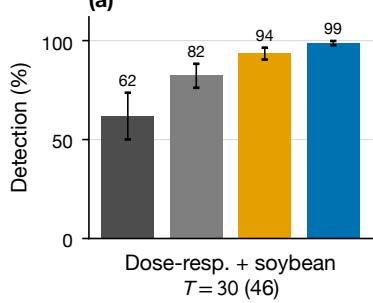

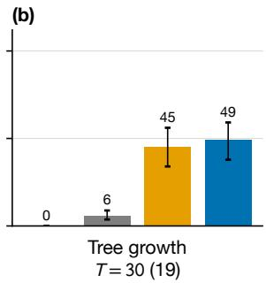

(c)  
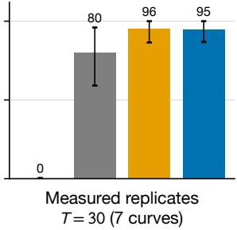

(d)  
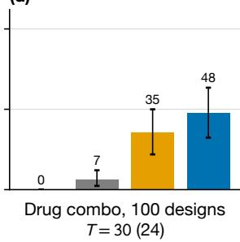

(e)  
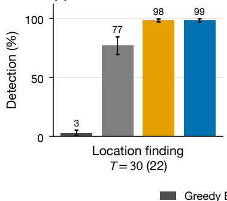

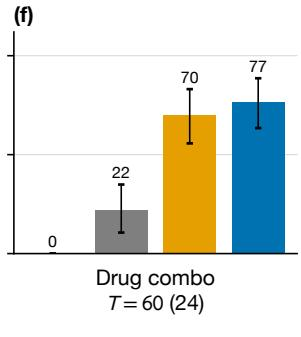

(g)  
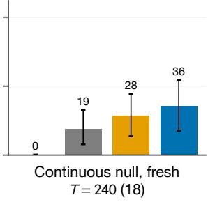

(h)  
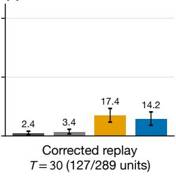  
Figure 1: Detection recovery varies across settings and comparators. Panels (a–e) use the frozen .1 gate at T = 30; (f–h) use the revised log(20)/T gate (asterisk in legend). Descriptive 95% intervals use 5,000 world/curve resamples in (a–g), seed 0; (h) resamples 20 cell lines with unit weighting, seed 20261026. Campaigns per world/unit: 50 in (g,h), 200 otherwise. Counts label worlds/curves; (h) shows 127 low-p units of 289. Dose/soybean and location use earlier random-detectable pools; both measured replays use full-data fit labels. Class EIG exceeds the rule in (h). These heterogeneous evaluations are neither pooled nor eight confirmations of one unchanged rule. The technical record retains separation, all-world results and registered failures.

Figure 1 summarizes the intervention’s promise and its limits. In several evaluated settings greedy EIG rarely detects a planted error, while targeted discrimination recovers substantial detection. Recovery can coexist with small relative prediction-risk premiums on correctly specified controls. This does not mean that the rule saves experimental observations: every arm receives the same horizon. Nor does it establish that more capable agents generally become blind. The frontier-mode observations use selected worlds, unequal completion and very small campaign counts.

We follow the information from experiment selection to rejection, separating limits imposed by the sampling policy from evidence lost through the detector’s predictive numerator. This separation guides the intervention and its evaluation: reserving measurements for falsification can repair one bottleneck while leaving the other intact. The technical record contains the proofs, full experimental detail and every previously registered failure.

Evidence boundary. This version reports the studies evaluated in the technical record, including negative results. A later original-prior, outward-certified development study has finished collection and passed an independent index/summary reconciliation. Its full retained-history verification is pending, so its numerical outcomes are excluded from the scientific comparisons here. Completion and index agreement alone do not establish scientific acceptance or fresh-world confirmation.

## 2 Related work

Design for inadequacy and Bayesian discrimination already address model checking and its tradeof with estimation. Expected discriminatory information is close to our KL targeting score (Catanach and Das, 2023): with common one-step posterior predictives $q _ { t } , p _ { t }$ , their Eq. 41 gives $D _ { t } ( a ) = \mathrm { K L } ( q _ { t } ( \cdot \mid a ) \parallel p _ { t } ( \cdot \mid a ) )$ ; memberwise ED adds within-expansion information $U _ { t } ( a )$ . This standard decomposition can change action rankings, without establishing superiority over their trajectory-design method. Our contribution separates power available in a policy’s selected data, evidence captured by a proper detector, and prediction risk incurred by intervention. These quantities can disagree within one environment.

Modern Bayesian design includes amortized policies learned before deployment (Rainforth et al., 2023; Foster et al., 2021), and robustness methods address misspecification through generalized updates or robust objectives (Barlas et al., 2025; Abdulsamad et al., 2026). A bias-against design criterion controls misleading evidence under a joint Bayesian model (Chen et al., 2026); rejecting a scientific family under a fixed of-model truth is a diferent question. Learning to outgrow a theory is the closest structural-discovery predecessor (Ma et al., 2026). It already identifies within-class information blind spots and uses complementary class discrimination, exploration and anytime-valid rejection alongside learned structural revision. Our own-design ceiling applies to any experimenter, while its best-allocation separation addresses what good allocation could achieve. The distinction is between a policy’s observable discrepancy and the best available discrepancy, not between having and lacking model-class exploration.

Joint family/parameter EIG with LLM-proposed families and residual feedback is also studied by Yuh et al. (2026); Yang et al. (2026) address closed- and open-world adequacy with possibilistic reasoning. Our certificate is relative to represented alternatives, not unrestricted open-world knowledge.

Our Ma-style controls isolate parts of that predecessor. Completed secondary comparisons use one expanded MAP member and a finite shared-parameter acquisition fit. The separate original-prior certified development uses edit-specific nuisance-marginal predictions and continuous shared-null projection. Acquisition fits are distinct from scientific detector nulls. Neither control reproduces the learned joint proposer, complexity/calibration/cost ranking, original fixed exploration or structural revision. Neither wins nor close detection rates support superiority to the complete method; that comparison requires a faithful implementation on common classes, with training and deployment resources stated.

Evidence-driven allocation is established in multi-armed testing: Sandoval et al. (2026) give oracle growth and high-confidence delay guarantees, while Lin et al. (2026) analyze adaptive sampling for multiple testing. Their conditional-increment premises require care for our shared-parameter null: ratios of successive profile e-process values need not be valid one-step e-values (Appendix L.2). Neither method is evaluated here as a complete baseline.

Anytime-valid inference supplies false-rejection control under adaptive sampling (Ramdas et al., 2023). It does not make the experiment informative, guarantee a well-fitting numerator or eliminate numerical approximation. Sequential controlled sensing already uses forced exploration under its own separation assumptions (Deshmukh et al., 2019). Likewise, finite-horizon e-value curtailment and horizon-aware betting precede our futility rationale (Baas et al., 2026; Taga et al., 2026; Clerico et al., 2026). The new role here is to audit a particular scientific-design intervention against those distinct premises, including cases where its promised recovery fails.

## 3 Power limits under adaptive design

At step s, a predictable, possibly randomized policy selects $a _ { s } \in { \mathcal { A } }$ and observes $Y _ { s } \in \mathcal { V }$ from a stationary truth $\textstyle P ( \cdot \mid a _ { s } )$ . We take finite action and outcome spaces. The scientific null is a working family $\mathcal { M } _ { 0 } = \{ p _ { \theta } : \theta \in \Theta \}$ , which may have a continuous parameter space. All comparisons use the same policy mechanism under truth and null; policy factors cancel from path likelihood ratios. Define

$$
\delta _ { \theta } ( a ) = \mathrm { K L } ( P ( \cdot \mid a ) \| p _ { \theta } ( \cdot \mid a ) ) , \quad \nu _ { T } ( a ) = T ^ { - 1 } \mathbb { E } _ { P } \sum _ { s = 1 } ^ { T } \mathbf { 1 } \{ a _ { s } = a \} ,
$$

and $\begin{array} { r } { D ( \nu ) = \operatorname* { i n f } _ { \theta } \sum _ { a } \nu ( a ) \delta _ { \theta } ( a ) } \end{array}$ . Let $A _ { T }$ be any history-measurable rejection event with probability at most α under every working-model parameter. It can be the event of an anytime crossing by T. Write kl for binary relative entropy.

Theorem 1 (Own-design power ceiling). For any such test and policy,

$$
P ( A _ { T } ) \leq \mathrm { k l } _ { \alpha } ^ { - 1 } \{ T D ( \nu _ { T } ) \} , \qquad \mathrm { k l } _ { \alpha } ^ { - 1 } ( K ) = \operatorname* { m a x } \{ p \in [ \alpha , 1 ] : \mathrm { k l } ( p \| \alpha ) \leq K \} .
$$

The proof is the pathwise KL chain rule followed by data processing onto $A _ { T } \colon \mathrm { K L } ( P ^ { \pi } \| Q _ { \theta } ^ { \pi } ) =$ $\textstyle T \sum _ { a } \nu _ { T } ( a ) \delta _ { \theta } ( a )$ . Minimize over θ. The bound uses no alternative library, numerator or assumption about the agent’s reasoning (full proof: Theorem 3). If one null member agrees with truth on every design the policy ever visits, then rejection probability is at most α at every horizon. Repeatedly measuring those settings cannot fix the problem.

The ceiling also yields a necessary resource condition: power at least $1 - \beta > \alpha$ requires $T D ( \nu _ { T } ) \geq \mathrm { k l } ( 1 - \beta \| \alpha )$ . For an endpoint-saturated policy, this constrains how much sampling must leave the saturated support. It does not say that any chosen exploration budget is suficient. In particular, a policy-independent ceiling based on $D ^ { \star } = \operatorname* { m a x } _ { \nu } D ( \nu )$ is still an upper bound. A value near one does not mean that a practical test, or even an optimal test, attains that power.

A concrete coverage example. Consider two Bernoulli settings, A and B. Two working hypotheses and a truth have success probabilities

$$
\begin{array} { r } { \frac { \dag \begin{array} { c c } { \dag } & { \dag } \\ { \theta _ { 1 } } \end{array} . \dag } { \dag \begin{array} { c c } { . 2 } & { . 8 } \\ { \theta _ { 2 } } \end{array} } } \\  P \dag \begin{array} { c c } { . 8 } & { . 2 } \\ { . 2 } & { . 2 } \end{array} \end{array}
$$

A policy using only A is indistinguishable from $\theta _ { 1 } ;$ one using only B is indistinguishable from $\theta _ { 2 }$ Either has $D ( \nu ) = 0$ , and any valid test has power at most α. Balanced occupancy instead gives $\begin{array} { r } { D ( \nu ) = \frac { 1 } { 2 } \mathrm { K L } ( \mathrm { B e r } ( . 2 ) \| \mathrm { B e r } ( . 8 ) ) = . 3 \log 4 > 0 } \end{array}$ . Each setting is individually matched by a working hypothesis, yet their combination exposes the class error. This example illustrates the information condition; it does not assert which settings EIG will choose or guarantee that a particular detector captures all available separation.

Acquisition loss and numerator loss are diferent. Our detector is universal inference,

$$
E _ { t } = \frac { Q _ { t } } { \operatorname* { s u p } _ { \theta } L _ { \theta , t } } , \qquad Q _ { t } = \prod _ { s \leq t } q _ { s } ( Y _ { s } \mid a _ { s } , H _ { s - 1 } ) , \quad \tau = \operatorname* { i n f } \{ t : E _ { t } \geq 1 / \alpha \} .
$$

Predictable proper or sub-probability $q _ { s }$ makes $E _ { t }$ dominated, at each true null parameter, by a nonnegative test supermartingale. Ville’s inequality then controls any-time false rejection (Ramdas et al., 2023). The supremum must cover the scientific null; a finite grid denominator alone does not validate a continuous null. Along each history,

$$
\log E _ { t } = \underbrace { \log L _ { P , t } - \operatorname* { s u p } _ { \theta } \log L _ { \theta , t } } _ { \mathrm { r e a l i z e d ~ t r u t h / n u l l ~ s i g n a l } } - \underbrace { \left( \log L _ { P , t } - \log Q _ { t } \right) } _ { \mathrm { n u m e r a t o r ~ r e g r e t } } .
$$

Neither term is necessarily nonnegative on an individual history. Inserting the simulator truth as numerator is a retrospective diagnostic, never a deployable procedure. A poor alternative can miss signal that good acquisition collected; an ideal numerator cannot reveal an error observationally absent from a history. Appendix M.7 gives a constructed continuous-null example where a proper local-sharing numerator repairs this loss at a fixed budget; its registered reused-history diagnostic fails the improvement and world-loss criteria, and fresh-panel performance remains untested.

What sufices, under additional assumptions. For finite Θ and an expansion $\mathcal { M } _ { 1 }$ containing the truth with a uniform prior, define $\begin{array} { r } { d _ { \theta } ( a ) = - 2 \log \sum _ { y } \sqrt { P ( y \mid a ) p _ { \theta } ( y \mid a ) } } \end{array}$ . With probability at least $1 - \beta$ , simultaneously in time,

$$
\log E _ { t } \geq \operatorname* { m i n } _ { \theta } \sum _ { s \leq t } d _ { \theta } ( a _ { s } ) - 2 \log ( \vert \Theta \vert / \beta ) - \log | \mathcal { M } _ { 1 } | .
$$

Square-root likelihood-ratio martingales and a union bound prove this suficient condition (Theorem 7). The minimum follows accumulation over settings: complementary observations can reject a class even if every setting is individually matched by some parameter. This guarantee is conditional on cumulative separation and truth membership; the acquisition rule below is not proved to enforce its premises. It is not a matching minimax rate for the ceiling.

## 4 A posterior diagnostic for represented model error

Own-design discrepancy involves the unknown truth. A practical agent instead has a working predictive $p _ { t }$ , an expanded predictive $q _ { t }$ , and an expansion posterior $w _ { t } ( h )$ . For a declared protectedtarget weighting $\mu ,$ compute

$$
B _ { t } = \sum _ { x } \mu ( x ) \mathbb { E } _ { h \sim w _ { t } } \mathrm { K L } ( p _ { h } ( \cdot \mid x ) \| p _ { t } ( \cdot \mid x ) ) .
$$

This is exactly $B _ { t } = U _ { t } + D _ { t }$ , where

$$
U _ { t } = \sum _ { x } \mu ( x ) \mathbb { E } _ { h } \mathrm { K L } ( p _ { h } ( \cdot \mid x ) \| q _ { t } ( \cdot \mid x ) ) , \quad D _ { t } = \sum _ { x } \mu ( x ) \mathrm { K L } ( q _ { t } ( \cdot \mid x ) \| p _ { t } ( \cdot \mid x ) ) .
$$

The identity follows by inserting $q _ { t }$ into each log ratio and using $\mathbb { E } _ { h } p _ { h } = q _ { t } . ~ U _ { t }$ measures disagreement among represented hypotheses; $D _ { t }$ measures their average predictive disagreement with the working model. Under a truth drawn from the expansion’s actual prior, $B _ { t }$ is posterior expected workingmodel KL error. Under that Bayesian joint, $U _ { t }$ decreases in conditional expectation by the information the next observation carries about a fresh protected-target outcome. It can increase on an individual trajectory.

Algorithm 1 Revised falsification rule with fixed-class prediction   
Require: Base policy, working family $\mathcal { M } _ { 0 } ,$ expansion, target $\mu , T , \alpha$   
1: Set $b = \log ( 1 / \alpha ) / T$ and rejected = false.   
2: for $t = 0 , \ldots , T - 1$ do   
3: From $H _ { t } .$ , compute $p _ { t } ,$ , expansion posterior, $B _ { t }$ , and $\mathrm { E D } _ { t } .$   
4: Draw an independent $Z _ { t } \sim \mathrm { B e r } ( . 5 / \sqrt { t + 1 } )$   
5: if not rejected and $( B _ { t } \ge b$ or $Z _ { t } = 1 )$ then   
6: Choose $a _ { t + 1 } \in$ arg maxa EDt(a), randomizing ties.   
7: else   
8: Choose $a _ { t + 1 }$ from the base policy using $H _ { t }$   
9: end if   
10: Observe $Y _ { t + 1 }$ and update inference and the proper path numerator $Q _ { t + 1 }$   
11: Evaluate $E _ { t + 1 } = Q _ { t + 1 } / \overline { { L } } _ { 0 , t + 1 }$ using a valid null upper bound.   
12: Record rejection when its conservative comparison reaches $1 / \alpha$   
13: end for

These statements identify both what the agent can compute and what it cannot claim. Small $U _ { t }$ alone leaves $D _ { t }$ uncontrolled. A wrong singleton expansion can have $B _ { t } = U _ { t } = 0$ despite positive true error. Fixed-truth calibration for a finite correctly represented truth is possible, but its conservative factor $1 / ( \beta \pi ( P ) )$ can be large. Of-library truths and continuous quadrature do not inherit that finite-model guarantee. The diagnostic is a certificate relative to declared alternatives, not a universal certificate that the model is adequate (Propositions 9–11).

Two audited constructions guide the acquisition rule. First, opposite-sign alternatives can cancel in the expansion’s predictive average, causing predictive-KL targeting to choose an irrelevant design. Averaging each hypothesis’s discrepancy before maximization avoids that particular cancellation. Second, even the correct target score can be disabled too early by an ignorance-only gate: a twomodel example takes one useful observation and then never rejects on any response path. Replacing the score cannot repair that gate (Proposition 15). These are mechanism-specific results, not proofs that one replacement is uniformly optimal.

## 5 Reserving a falsification budget

Define expected discrepancy at a candidate setting by $\mathrm { E D } _ { t } ( a ) = \mathbb { E } _ { h \sim w _ { t } } \mathrm { K L } ( p _ { h } ( \cdot \mid a ) \| p _ { t } ( \cdot \mid a ) )$ . Before rejection, the rule takes an ED-maximizing action when $B _ { t } \geq b ^ { \star }$ or a predictable floor coin succeeds; otherwise it follows the base designer. The floor probability is $0 . 5 / \sqrt { t + 1 }$ . Some benchmarks switch to expanded inference after rejection; the continuous-null comparisons hold prediction in the working class. This distinction matters when interpreting prediction risk. The method needs a specified expansion and numerical inference, but no policy training or language-model calls on overridden steps.

Algorithm 1 makes the time ordering explicit. The target weights sum to one, so $B _ { t }$ and ED are measured in nats per observation. Planning posteriors need not equal the detector numerator; proper predictable sequence likelihoods determine validity. Physical observations continue through $T ,$ including after rejection, and this version keeps prediction in $\mathcal { M } _ { 0 }$ . The frozen .1 gate and expansion-after-rejection variants remain distinct. Trigger activity, target separation and detector capture are separate conditions; the algorithm alone proves none of their empirical success criteria.

A revised gate, not retroactive confirmation. The original frozen gate is $b ^ { \star } = 0 . 1$ . It succeeds in several $T = 3 0$ evaluations and fails on fresh continuous-null panels at longer horizons. A development pass on earlier worlds motivated the revision $b _ { T } ^ { \star } = \log ( 1 / \alpha ) / T$ , declared as a secondary arm before fresh-panel outcomes. At $T = 3 0$ it is close to 0.1, not identical; the earlier results remain results for the frozen rule. An earlier use of the same calibration for an ignorance trigger failed and stays a failure. Distinguishing revisions from confirmations prevents an appealing final formula from rewriting the evidence.

A conditional futility calculation supplies a limited rationale. Fix a history $H _ { t } ,$ a working parameter $\theta$ selected at that history and frozen thereafter, and $\lambda > 0$ . Put

$$
R _ { t } ( \theta ) = Q _ { t } / L _ { \theta , t } , \qquad \bar { D } _ { \lambda } ( h , \theta ) = \operatorname* { m a x } _ { a } D _ { 1 + \lambda } ( p _ { h } ( \cdot \mid a ) \| p _ { \theta } ( \cdot \mid a ) ) ,
$$

and $c = \log ( 1 / \alpha ) - \log R _ { t } ( \theta ) - ( T - t ) \bar { D } _ { \lambda }$ . Remaining crossing probability under truth h and any continuation is bounded by

$$
\phi _ { \lambda } ( c ) = \operatorname * { m i n } \{ 1 , ( 1 + \lambda ^ { - 1 } ) \lambda ^ { 1 / ( 1 + \lambda ) } e ^ { - \lambda c / ( 1 + \lambda ) } \} \quad ( c > 0 ) ,
$$

with bound one otherwise. The proof controls numerator/truth by one Ville bound and a normalized R´enyi exponential martingale by another, then optimizes their union bound (Proposition 13). Infinite divergence is vacuous. Posterior averaging gives an agent-computable $F _ { t }$ only under a correctly specified expansion prior. It is not a fixed-truth certificate of the library.

The inequality relates remaining time, evidence deficit and maximum R´enyi separation. Replacing them by total $T _ { \ast }$ , zero initial log evidence and mean ED is a heuristic. It proves neither the constant of $b _ { T } ^ { \star }$ nor a nontrivial lower power bound. Also $R _ { t } ( \theta ) \geq E _ { t }$ , so silently substituting $E _ { t }$ can invalidate the upper bound. Finite-horizon e-value curtailment is already studied by Baas et al. (2026); horizon-aware betting and hopeless regions by Taga et al. (2026). Our conditional composite-null bound uses standard martingale tools; we claim no first futility principle.

The constant needs more than mean ED. An independent registered analysis supplies a counterexample even with correct representation and the same prior for planning and detection: null Bernoulli $1 / 2$ , equal prior on truths $1 / 1 0 0$ and $9 9 / 1 0 0 , \alpha = 0 . 0 5 , T = 5$ . ED is $0 . 6 3 7 1 5 > \log ( 2 0 ) / 5$ at every history, but no possible prefix statistic reaches 20. Thus gate activity alone does not imply any positive power for this detector. A randomized deadline oracle has exactly 76.08% power on the same five observations; this established Neyman–Pearson/Doob construction isolates detector choice in the example (Appendix L.2). For a finite null, a conditional suficient margin is instead

$$
\operatorname* { m i n } _ { \theta } \{ \log ( Q _ { t } / L _ { \theta , t } ) + K _ { \theta } \} \ge b + r + \varepsilon + \sqrt { \frac { V } { 2 } \log ( | \Theta | / \beta ) } ,
$$

where $b = \log ( 1 / \alpha )$ $K _ { \theta }$ lower-bounds remaining cumulative true/null KL, r bounds conditional numerator regret, ε numerical loss, and V bounds the sum of conditional log-ratio range widths squared. If these premises hold with probability at least $1 - \eta$ , Hoefding and a finite union give remaining power at least $1 - \eta - \beta$ . Appendix L states the stronger parameter-specific bound, proof, coverage assumptions linking ED to $K _ { \theta }$ , and exact rational checks. The inequalities use standard concentration tools; the contribution is the explicit gate counterexample and accounting of the missing premises. They do not certify the continuous-null production rule.

Table 1: The revision helps, but does not erase frozen failures. Detection percentages; fresh continuous-null panels each have 18 non-null worlds and 50 campaigns/world/arm. Drug transfer reuses 24 earlier worlds, 200 campaigns per world. Sep. is the partial class-separation adaptation.
<table><tr><td>Panel</td><td>Frozen 0.1</td><td>Revised</td><td>Class EIG</td><td>Sep.</td></tr><tr><td>Fresh continuous null,  $T = 2 4 0$ </td><td>2.78</td><td>35.78</td><td>28.44</td><td>31.67</td></tr><tr><td>Drug transfer,  $T = 6 0$ </td><td>59.31</td><td>76.79</td><td>70.17</td><td>69.77</td></tr><tr><td>Fresh continuous null,  $T = 4 8 0$ </td><td>10.22</td><td>52.00</td><td>46.89</td><td>51.44</td></tr></table>

A separate information-budget argument applies when the represented truth and planning and numerator priors match, updates are exact, and there is no floor. The implemented hedged continuous-null detector with of-library alternatives does not satisfy those premises. A floor prevents permanent cessation of probing, but does not by itself establish that the chosen settings separate every false class. Guarantee statements and empirical gate comparisons must therefore remain separate.

## 6 Experiments

The studies test diferent parts of the argument. Controlled worlds isolate acquisition and detector failures; fitted and measured-response studies test transfer beyond those constructions; continuousnull panels test the revised gate under a larger scientific null. Development, frozen-rule evaluations and revised-rule evaluations remain separate. Unless stated otherwise, uncertainty summaries resample worlds or curves, since campaigns within a world are not independent scientific units. Passing a registered point threshold does not establish equivalence or a population guarantee, and we do not pool these heterogeneous studies into one efect.

Controlled mechanisms and the negative primary study. The generic and mechanistic evaluations demonstrate severe detection collapse in several families, but accuracy efects vary by environment. Four of seven generic families remain largely undetectable at longer budgets, and two mechanistic environments show partial or absent collapse. A registered predictor of the accuracy efect fails. Constructive oracle and crossed comparisons show both acquisition-limited and numerator-limited behavior; no single diagnosis explains the entire record.

The independently specified primary comparison is particularly informative. It uses a continuous logistic null, priors fixed without truth-index access, 12 policies, 16 response replicates and two horizons, completing all 9,228 planned histories. The strongest capped control detects 4/288 = 1.39% at H = 60 and $1 4 / 2 8 8 = 4 . 8 6 \%$ at H = 120, below the registered 20% eligibility minimum. No confirmation horizon is selected. The fixed-budget candidate is not the later gated rule. Its H120 truth-numerator diagnostic crosses on 68/288 histories versus 13 actual rejections; full cycling gives 112 versus 30. These unavailable-truth diagnostics establish missed realized signal on some histories, not a deployable repair. At H120 no fixed convex reweighting of the two existing proper numerator components can add candidate rejections on the saved histories. At H60 the broad component does add two, so the conclusion is horizon-specific. The mean any-test ceiling of 0.679 at H120 is an upper bound, not evidence that 67.9% power is attainable (Section G.7).

Audit and reporting contract. Acquisitions precede outcomes; proper path likelihoods determine crossings at $\alpha = . 0 5$ . Caps count intervention opportunities even when override and base actions coincide. Prediction uses the full horizon after rejection; expansion-after-rejection comparisons are identified separately. Risk premiums use the stated control baseline. Registered criteria, descriptive contrasts and retrospective diagnostics remain distinct. Reusing worlds or fitted observations does not create independent validation.

Fitted curves, measured replicates and location finding. Frozen-rule evaluations include dose response, soybean and tree growth, a 100-design drug-combination simulator, measured-replicate replay and location finding. Figure 1 shows the registered pools. Dose/soybean and location pool only worlds whose earlier random-design detection is at least 20%; all-world results and reversals are retained. The location benchmark is a modified DAD-style environment, not a reproduction of the original trained policy. The class-separation control uses a single MAP alternative and a shared finite-grid null parameter for acquisition, not the complete system of Ma et al. (2026). Its all-world location detection exceeds the floor rule at both horizons, despite positive selected-pool results for the rule.

Measured-replicate replay is stronger evidence than drawing outcomes from fitted curves: the experiment chooses among recorded replicate outcomes. However, labels, transformations and preprocessing use full-data fits. It is not an untouched-unit evaluation or prospective lab experiment. The seven-curve misspecified subset gives 94.79% detection for the frozen rule and 95.50% for class EIG. Available curves contain only 12–28 observations, so these $T = 3 0$ campaigns do not establish without-replacement experimental validation. Prediction gains after rejection may also reflect class expansion, which some comparisons disallow. We report discovery and prediction separately.

A later 300-unit replay of measured combination wells (Jaaks et al., 2022) is withheld as supporting evidence: its normalization treats solvent annotations on active-drug wells as negative controls. The original results and G1 failure remain documented, with the data audit and required corrected rerun in Appendix M.4. The smaller measured-replicate study above uses a diferent dataset and pipeline.

A registered correction fixes control roles and metadata exclusions before new fitting, retaining 289 distinct-drug units. Among 127 low-p fit-labelled units, the revised rule detects 14.16%, versus 3.42% for random, 17.37% for class EIG and 16.02% for separation. Its paired cell-line-bootstrap contrast is +10.74 points [6.46, 16.24] against random and −3.21 points [−5.70, −.68] against class EIG (20 cell lines). The registered collapse criterion again fails; restoration, five-point comparator margin and high-p alarm/risk criteria pass their descriptive point thresholds. These passes do not establish inferential noninferiority or a population ten-point gain. Separate known-grid-null simulations record zero revised-rule alarms in 5,780 campaigns, without making high-p empirical units true nulls. Prediction endpoints include class expansion after rejection. Full-data labels, reused units and with-replacement replay remain limits (Appendix M.5).

Fresh continuous-null panels and transfer of the revision. Table 1 keeps the frozen failures visible. The T = 240 panel uses 24 fresh worlds (six null), 50 campaigns per world/arm, a broader uniform bump library, and a half structural/half per-action Beta sequence hedge. Its continuous denominator uses a concavity upper bound. The formula is valid in exact arithmetic, but implementation uses float64 plus a $1 0 ^ { - 9 }$ pad, rather than the primary pipeline’s outward-certified arithmetic. Independent outward checks on 131 fixed count fixtures through $T = 4 8 0$ give positive slack; historical prefixes are not universally certified. The generator probabilities were rechecked bit-exact against the original at all three world seeds. Priors and libraries difer, so this is not an isolated horizon extension of the primary.

At $T = 2 4 0$ , frozen restoration/comparator criteria fail. The secondary revised gate passes its three point criteria; its descriptive paired-world contrast against separation is +4.1 points [1.4, 7.2].

At T = 480, a second fresh panel gives +0.6 points [−1.8, 2.7]: no resolved advantage, not a statistical equivalence result. Near-null worlds remain hard, and all arms miss two matched bumps in the T = 240 panel. Large upper ceilings do not isolate the cause. Zero null alarms in 300 campaigns per arm do not prove calibration beyond the mathematical detector premises.

Later fixed-design diagnostics find large truth-numerator gaps on four dificult bumps, but do not partition losses on actual adaptive histories. A three-expert numerator fails its registered improvement criterion: 52.0% for both versions on the reused T = 480 panel. Neither a universal coding-cost floor nor irreparability follows from that negative result (Appendix M).

At T = 60 the revision is applied unchanged to earlier drug, location, dose/soybean and tree worlds. All four point criteria pass; drug detection improves from 59.31% to 76.79%, above class EIG’s 70.17%. Shared saved columns reproduce the prior drug run exactly, including every one of its 32 world/control rows. This is gate transfer on previously evaluated worlds, not fresh-world confirmation. Control premiums range from +0.015% to +0.112% for the revision. At T = 480 they are +0.014% for the revision and +0.365% for separation. These are relative total prediction-risk premiums; small values can mask relative diferences in reducible error.

## 7 Language-model experimenters

Selected frontier-model pilots concentrate designs and detect much less often than random sampling. This association is consistent with the own-design ceiling but does not identify capability as a cause. Model, prompt, provider and selection vary together; campaigns are few and sometimes incomplete. A monitor prompt can improve detection, but completed ablations do not isolate a causal contribution of numerical certificate values from inadequacy framing or random reference information. Setting-specific pointing gains remain unresolved.

The stronger practical intervention is a harness that directly reserves actions for falsification. With the frozen T = 30 gate, wrapped Argon detects 26/32 misspecified campaigns (81.25%); all 48 planned campaigns complete, including 8 wrapper and 8 plain controls. Wrapper controls have no alarms and a paired risk premium of +0.226%. Plain/monitor reference detections are 12.5% and 71.9% from separate interleaved reruns. These are external references, not a concurrent randomized wrapper comparison.

Wrapped Sol completes 24 of 32 planned non-null campaigns before the cap and detects 19 (79.17% campaign-weighted; 81.25% equally weighted over the 16 represented worlds). A separate control-completion run brings the combined control allocation to eight pairs, zero wrapper alarms and +0.201% premium. Initial W3 is preserved as FAIL/unassessable; completion W3 passes. The eight non-null missing campaigns stay missing: full planned detection could be 59.38–84.38% without assumptions. Available-case W1–W2 pass against external 7.7% plain and 61.5% monitor references. Neither missingness nor these small controls permits a general safety claim.

An API-free control wraps greedy and random designers on the same worlds with 200 seeds. Their detection becomes 76.3% and 76.9%, versus 0.1% and 57.3% plain. Registered point criteria pass; a two-seed preview was included. These similar rates support robustness on the selected panel, not agent independence or equivalence to frontier models. Because the harness takes about half the actions, improvement need not represent improved model reasoning.

## 8 Discussion

The main distinction is between learning parameters and making a model’s errors observable. An own-design power ceiling can show that a sampling policy leaves little power for any valid adequacy

test. When useful signal is present, however, a poorly specified predictive numerator can still lose it.   
Reporting detection alone cannot identify which failure occurred.

The posterior diagnostic and the budget rule make this distinction operational within a declared model expansion. They do not remove dependence on that expansion. A small certificate can reflect missing alternatives, while a large certificate need not imply enough cumulative evidence to reject. The futility bound explains a dependence on remaining time; the counterexample shows why mean discrepancy and a threshold constant alone cannot supply achievability.

The empirical findings support a qualified intervention claim. Reserving actions for falsification repairs substantial detection loss in several evaluated settings. It also fails registered criteria, loses to class EIG on the corrected measured replay, and has no resolved advantage over separation on the longer fresh continuous-null panel. The findings support a setting-dependent intervention claim; the revised rule remains distinct from the frozen hypothesis. Prediction, detection and computation should remain separate endpoints: the rule does not reduce the number of observations, and a small total prediction premium can conceal a larger change in reducible error.

Use beyond these studies requires care about statistical validity and the source of the evidence. Mathematical false-rejection control depends on the scientific null, predictable numerator and numerical enclosure; a small control panel with zero alarms cannot establish those premises. Replay with full-data labels and replacement does not provide prospective validation on new scientific units. The selected language-model pilots also leave the causes of detection collapse unresolved, including any role of capability or numerical monitoring. Faithful learned-design comparisons and independent-prior confirmation would strengthen a method claim; prospective experiments would be needed for a discovery or deployment claim. The present evidence instead supports treating model checking as a distinct design objective and auditing both the information acquired and the evidence a detector can retain.

## References

J. Yuh, B. Park, E. Choi, et al. Bayesian model discovery with language models: Closing the loop between hypotheses and experiments. arXiv:2610.25747, 2026.

A. Ram, M. Larsson, J. Ruf, and A. Ramdas. Strong duality for the GROW criterion. arXiv:2606.24768, 2026.

P. Jaaks, E. A. Coker, D. J. Vis, et al. Efective drug combinations in breast, colon and pancreatic cancer cells. Nature, 603:166–173, 2022. doi:10.1038/s41586-022-04437-2. Raw combination screen: Figshare 19141916.v1.

E. O. Taga, S. Oymak, and S. Shekhar. Learning to bet for horizon-aware anytime-valid testing. arXiv:2603.19551, 2026.

H. Abdulsamad, S. Iqbal, C. A. Naesseth, T. Matsubara, et al. Maximin robust Bayesian experimental design. arXiv:2603.14094, 2026.

S. Agrawal, A. Ram, and A. Ramdas. On stopping times of power-one sequential tests: Tight lower and upper bounds. arXiv:2504.19952, 2025.

S. Baas, J. ter Schure, and J. van Rosmalen. Adaptive clinical trials based on design-optimal e-values with automatic curtailment: An application to single-arm trials with binary data. arXiv:2605.28653, 2026.

F. Bickford Smith, A. Kirsch, S. Farquhar, Y. Gal, A. Foster, and T. Rainforth. Prediction-oriented Bayesian active learning. In Proceedings of the 26th International Conference on Artificial Intelligence and Statistics (AISTATS), 2023.

A. C. Atkinson. Planning experiments to detect inadequate regression models. Biometrika, 59(2), 1972.

F. Bach. Active learning for misspecified generalized linear models. In Advances in Neural Information Processing Systems 19, 2007.

Y. Z. Barlas, S. J. Sloman, and S. Kaski. Robust experimental design via generalised Bayesian inference. arXiv:2511.07671, 2025.

G. E. P. Box and N. R. Draper. A basis for the selection of a response surface design. Journal of the American Statistical Association, 1959.

T. A. Catanach and N. Das. Metrics for Bayesian optimal experiment design under model misspecification. IEEE Conference on Decision and Control, 2023. arXiv:2304.07949.

D. Chatterjee, T. Maitra, and S. Bhattacharya. A short note on almost sure convergence of Bayes factors in the general set-up. The American Statistician, 2018. arXiv:1703.04956.

D. Chen, M. Evans, X. Li, P. Bansal, and D. J. Nott. Deep adaptive design with an evidential bias criterion. arXiv:2608.16466, 2026.

A. de la Garza. Spacing of information in polynomial regression. Annals of Mathematical Statistics, 25(1), 1954.

A. Deshmukh, S. Bhashyam, and V. V. Veeravalli. Sequential controlled sensing for composite multihypothesis testing. arXiv:1910.12697, 2019 (preprint version consulted).

M. Dubova, A. Moskvichev, and K. Zollman. Against theory-motivated experimentation: Can random experimental choice lead to better theories? Collective Intelligence, 2026.

I. Esponda and D. Pouzo. Berk–Nash equilibrium: A framework for modeling agents with misspecified models. Econometrica, 2016.

P. Forr´e. Type-II error bounds for test supermartingales from lower-tail hypotheses. arXiv:2609.27766, 2026.

A. Foster, D. R. Ivanova, I. Malik, and T. Rainforth. Deep adaptive design: Amortizing sequential Bayesian experimental design. arXiv:2103.02438, 2021.

D. Fudenberg, G. Lanzani, and P. Strack. Limit points of endogenous misspecified learning. Econometrica, 2021.

K. Gandhi, M. Y. Li, L. Goodyear, A. Bhatia, L. Li, A. Bhaskar, M. Zaman, and N. D. Goodman. BoxingGym: Benchmarking progress in automated experimental design and model discovery. arXiv:2501.01540, 2025.

Huang et al. Automated hypothesis validation with agentic sequential falsifications. arXiv:2502.09858, 2025.

A. R. Jhaveri, A. GX-Chen, I. Sucholutsky, and E. Choi. Failing to falsify: Evaluating and mitigating confirmation bias in language models. arXiv:2604.02485, 2026.

J. Kirschner, A. Krause, M. Meziu, and M. Mutn´y. Confidence estimation via sequential likelihood mixing. arXiv:2502.14689, 2025.

S. Ma, A. Gao, C. Zhu, X. Yan, W. Zhang, W. Zhang, L. Gong, T. Li, and Q. Zhang. Learning to outgrow a theory: Experimental discovery beyond the initial hypothesis space. arXiv:2610.07627, 2026.

T. Rainforth, A. Foster, D. R. Ivanova, and F. Bickford Smith. Modern Bayesian experimental design. arXiv:2302.14545, 2023.

A. Ramdas, P. Gr¨unwald, V. Vovk, and G. Shafer. Game-theoretic statistics and safe anytime-valid inference. Statistical Science, 38(4), 2023.

S. Shetty and U. Braga-Neto. LLM-IDEA: Identifiability-driven experimental agent for autonomous discovery of mechanistic world models. arXiv:2610.11253, 2026.

J. K. Sreedharan and V. Sharma. Nonparametric decentralized sequential detection via universal source coding. arXiv:1308.6481, 2013.

C. Tommasi and J. L´opez-Fidalgo. Bayesian optimum designs for discriminating between models with any distribution. Computational Statistics & Data Analysis, 2009.

C. C. Drovandi, J. M. McGree, and A. N. Pettitt. A sequential Monte Carlo algorithm to incorporate model uncertainty in Bayesian sequential design. Journal of Computational and Graphical Statistics, 23(1):3–24, 2014. https://doi.org/10.1080/10618600.2012.730083.

M. Hainy, D. J. Price, O. Restif, and C. Drovandi. Optimal Bayesian design for model discrimination via classification. Statistics and Computing, 32:25, 2022. https://doi.org/10.1007/ s11222-022-10078-2.

G. Vershinin, A. Cohen, and O. Gurewitz. On cost-aware designs for sequential hypothesis testing. arXiv:2512.19067, 2025.

A. Yang, S. L. Chau, T. Wakayama, K. Muandet, and M. Adachi. Open-ended scientific discovery with possibilistic reasoning. arXiv:2610.11289, 2026.

E. Clerico, T. Wegel, I. Azangulov, and P. Rebeschini. Time-sensitive anytime-valid testing. arXiv:2605.06521, 2026.

R. J. Sandoval, I. Waudby-Smith, and M. I. Jordan. Multi-Armed Sequential Hypothesis Testing by Betting. arXiv:2603.17925, 2026.

Z. Lin, W. Ma, Z. Ren, and Y. Wei. Sample-Eficient Multiple Testing with Adaptive Data Collection. arXiv:2609.26651, 2026.

A. Ullah. Multiscale Sequential Auditing of Quantile Regression with Point Masses. arXiv:2610.16000, 2026.

O. S. Solari. Generalized Hierarchical Bayesian Segmentation with Irregular Designs, Multi-Sequence Hierarchies, and Grouped/Latent-Group Designs. arXiv:2603.14681, 2026.

Z. Jia, Y. Polyanskiy, and A. Rakhlin. On the Minimax Regret of Sequential Probability Assignment via Square-Root Entropy. arXiv:2503.17823, 2025.

S. R. Howard, A. Ramdas, J. McAulife, and J. Sekhon. Time-uniform Chernof bounds via nonnegative supermartingales. arXiv:1808.03204, 2018.

## Reproducibility and study status

The technical record retains registered failures, source/run identities, assumptions, numerical qualifications and retrospective diagnostics. Private review materials contain the manuscript source and deterministic checks; separate study-specific packets preserve frozen code, fixed inputs, retained outputs and independent audits for the corrected replay and the failed numerator diagnostic. They do not collectively reproduce every empirical study or independently rederive every saved numerical certificate. No public code/data archive is linked in this version. The later certified development study has completed collection; its independent index/summary audit is separate from the pending full verification of retained histories. Its numerical outcomes remain outside this version’s scientific evidence. Any later confirmation would require its own prior registration and fresh-world evaluation. This preprint makes no claim of general policy superiority or prospective scientific validation.

## A Introduction

A scientific agent that chooses its own experiments is graded on data it selected itself. Bayesian experimental design makes this choice principled: pick the design that maximizes expected information gain about the parameters of the working model (Rainforth et al., 2023; Foster et al., 2021). Language-model scientists make the same choice by reasoning (Gandhi et al., 2025; Huang et al., 2025). Both are evaluated by how fast they learn inside the model they hold. Real scientific models are wrong somewhere, so a second question matters as much: when the model is wrong, does the agent’s own experimentation leave it any chance of noticing?

Figure 2 gives the answer for ten experimenters on the same planted errors. Random experimentation catches the error in 58% of campaigns. Small open language models do worse or about as well, and get better with size. Then the trend breaks: two frontier reasoning models from two providers catch the error in 6–9% of campaigns, close to the 0% of the information-maximizing optimizer, and their experiments are nearly as concentrated as its; across four frontier models, detection falls roughly as design concentration rises. These observations motivate a conditional claim: when estimation-oriented designs leave little discrepancy visible, they also limit detection power. We formalize that limit and measure the detection–accuracy trade-of of reserving efort for model discrimination. The pilot does not establish that increasing capability generally causes blindness.

The question is old in classical design. Box and Draper (1959) asked for designs under which “there is a high chance that inadequacy of f(ξ) to represent g(ξ) will be detected,” and Atkinson (1972) constructed designs that serve estimation and an adequacy test against a nested extended model at the same time. We study the setting in which designs are now chosen sequentially and adaptively by an agent, the agent’s model is updated after every outcome, and the decision to trust or revise the model has to be made at a data-dependent time. Static lack-of-fit arguments do not transfer directly, because the design distribution is itself a function of the (misspecified) posterior (Esponda and Pouzo, 2016; Fudenberg et al., 2021).

## Contributions.

1. A power ceiling for adaptive designs (Section D). For any policy — greedy EIG, an amortized design network, or a language model — the probability that an anytime-valid adequacy test ever fires within T steps is at most the largest p with $\mathrm { k l } ( p \| \alpha ) \le T D ( \nu _ { T } )$ where $D ( \nu _ { T } )$ is the misfit of the best working model on the policy’s own design occupancy $\nu _ { T }$ . Policies that concentrate on a design set where one working-model member agrees with

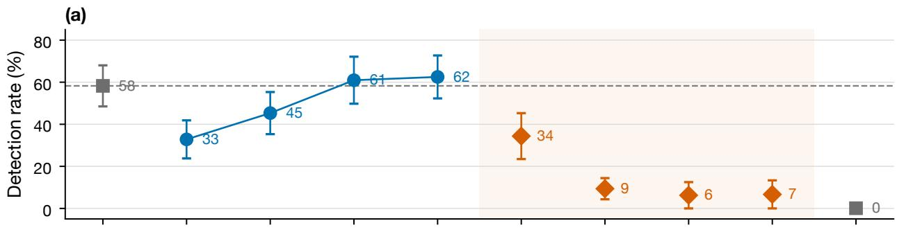

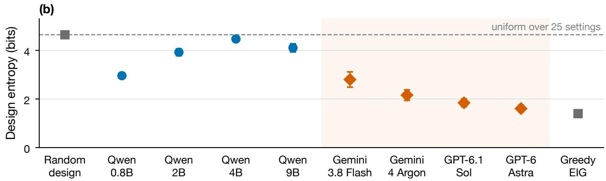  
Experimenter (open models by size; frontier reasoning models; reference policies)

Figure 2: Several tested estimation-oriented experimenters retain little detection power. (a) Rate at which a valid adequacy test detects a planted model error within 30 experiments, and (b) entropy of the experimenter’s design distribution, on 16 misspecified worlds in four families (15 for GPT-6 Astra). Open Qwen3.5 models (blue) keep detection power by scanning or repeating settings; several frontier reasoning models (red, two providers) concentrate their designs like the informationmaximizing optimizer (greedy EIG). The association between concentration and detection in these selected worlds is not a causal capability comparison. Whiskers are ±1 s.e. across worlds; open models use 4 campaigns per world, frontier models 1–2 (pilot), random design and greedy EIG 200. The dashed lines mark random design’s detection rate and the entropy of a uniform design.

the truth have power at most α at every horizon. A suficient condition, proved with a test supermartingale that needs no bound on likelihood ratios, uses cumulative separation, including errors identifiable only by combining several individually inconclusive designs. It is a suficient guarantee, not a matching minimax rate.

2. An expansion-relative uncertainty diagnostic (Section F.1). An agent-computable quantity that splits exactly into predictive uncertainty and model discrepancy, equals the posterior expected error of the working model when the truth is drawn from the expansion’s prior, and whose ignorance part is a supermartingale that falls in conditional expectation by the predictive information each experiment carries about the target, so the agent can condition additional discrimination efort on expansion-relative uncertainty. A finite-model fixed-truth bound gives a conservative calibration, while exact counterexamples separate failure of action ranking from premature return to the base policy. Its interpretation does not extend to truths outside the proposed expansion.

3. Generic-family detection collapse; environment-dependent accuracy (Section G).

Across seven families and randomly drawn misspecifications, greedy EIG removes essentially all detection power, while its efect on accuracy changes sign across families. We report a pre-registered predictor of the accuracy efect that failed.

4. Design and detector trade-ofs (Sections F and G.6). Budgeted discrimination recovers much of random-design detection in the initial generic benchmark, while fitted-curve stress tests expose fixed-budget recovery failures. Crossed comparisons separate acquisition from detector scope. A frozen Bernoulli comparison retains a gain over the tested hybrid under a continuous-null denominator; Gaussian endpoint gains are negligible. The broader categorical numerator has an explicit finite-sample coding cost. The completed independent-prior exactcap comparison yields no eligible confirmation horizon, limiting broader claims for the proposed acquisition.

5. Language-model experimenters (Section H). A harness that lets an LLM choose experiments while detection is scored exactly. Small open models keep their detection power by scanning the design list; frontier reasoning models from two providers design like optimizers, leave little misfit visible on their own designs, and lose it. A tested monitor prompt raises measured detection in two models even without targeted setting suggestions. The completed component ablation does not isolate numerical-score use, and setting-specific gains remain unresolved at this pilot sample size.

## B Related work

Design for model inadequacy. Box and Draper (1959) trade the bias of a fitted response surface against the chance of detecting its inadequacy; Atkinson (1972) designs experiments for an original model and a nested extension simultaneously; model-discrimination criteria such as Bayesian KL-optimality (Tommasi and L´opez-Fidalgo, 2009) choose designs where rival models disagree. Catanach and Das (2023) explicitly define expected discriminatory information through predictive KL divergence and study its trade-of with information gain in dynamical systems. This is a close predecessor of our discrepancy criterion. Under common one-step posterior predictives their Eq. 41 gives $D _ { t } ( a ) = \mathrm { K L } ( q _ { t } ( \cdot \mid a ) \| p _ { t } ( \cdot \mid a ) )$ , while memberwise ED adds the within-expansion information $U _ { t } ( a )$ . This standard identity can change action rankings, without proving superiority over their trajectory-design method; our focus is adaptive design’s efect on testing power. The de la Garza phenomenon (de la Garza, 1954) explains why estimation-optimal designs use minimal support, which is exactly the regime in which our ceiling bites. Our falsification budget combines established discrimination ideas with an anytime-valid test; we do not claim the first sequential model-discrimination method or the idea of reserving design efort for adequacy checking.

Adaptive design under misspecification. Modern Bayesian experimental design is reviewed by Rainforth et al. (2023); amortized policies include Foster et al. (2021). Robustness to misspecification has been pursued through generalized Bayesian updates (Barlas et al., 2025) and max–min objectives (Abdulsamad et al., 2026). A distinct evidence-aware objective, Chen et al. (2026)’s bias-against criterion, controls misleading evidence under the joint Bayesian model through a variance-penalized EIG bound; that objective is diferent from rejecting a composite scientific model class. We study the latter detection question. Bach (2007) analyses active learning for misspecified generalized linear models. In economics, Esponda and Pouzo (2016) and Fudenberg et al. (2021) characterize where misspecified agents who choose their own data end up (Berk–Nash equilibria); our own-design misfit $D ( \nu )$ is the residual at such a fixed point.

Model-class revision and a close contemporary predecessor. Ma et al. (2026) already combine within-class information blind spots, class-level discrimination across complementary experiments, exploration, and anytime-valid class rejection with structural revision. Our work must be evaluated against this close predecessor, and we do not claim to introduce those concepts. Their blind spot is a two-design Gaussian example in which one-step information gain never observes the class error; their separation quantity J⋆ is the best achievable class separation over design allocations, and the scaling of rejection cost with $\log ( 1 / \alpha ) / J ^ { \star }$ is reported empirically; and their discovery policy is learned, pairing structural edits with experiments, from 2,000 training environments. The contributions here are complementary. (i) The ceiling of Theorem 3 bounds the power of any level-α test through the misfit visible on the policy’s own design occupancy, and the suficient condition gives the suficient direction under additional premises; neither establishes a matching minimax rate. (ii) We measure how often this happens across generic and mechanistic families, on measured replicate data, in a 100-design screen and in frontier language-model agents. (iii) The blindness certificate is computable from the agent’s own posteriors and comes with Bayesian and fixed-truth calibration and an information budget. (iv) The final rule needs no training: it gates probing on the certificate, uses a target score that avoids the predictive cancellation constructed in Appendix K.2, keeps an exploration floor so that probing never stops forever, and its cost on a correct model is measured.

Evidence-driven allocation and finite deadlines. Multi-armed testing already optimizes evidence allocation: Sandoval et al. (2026) establish oracle growth and high-confidence rejection-time guarantees, and Lin et al. (2026) analyze adaptive sampling for multiple testing. Their conditionalincrement premises are not implied by the anytime validity of our profile-ratio process; its successive value ratios can fail that premise (Appendix L.2). Clerico et al. (2026) derive deadline-optimal testing from a Neyman–Pearson event and its null Doob martingale. We use that established construction to distinguish detector-specific zero power from unavailable information in our existing finite-horizon example, not as a new general optimality principle or a complete empirical comparison.

Anytime-valid testing. We use e-processes and Ville’s inequality (Ramdas et al., 2023), with a universal-inference denominator so the test is valid at every parameter of the working model under any adaptive design.

Controlled sensing, coverage and acquisition cost. Forced exploration is standard in sequential controlled sensing; Deshmukh et al. (2019) ensure order- T sampling of each control under their composite-testing assumptions. Vershinin et al. (2025) distinguish sample count from expected physical acquisition cost. Appendix K.5 combines explicit cyclic coverage with a universal alternative to remove the pointwise informative-target assumption in a finite stationary setting. Appendix K.6 extends the calculation to compact continuous nulls with explicit covering and numerical-error penalties. This distinct cyclic variant remains an unlaunched prototype; neither result establishes practical eficiency or automatically covers the fixed-budget policies in our completed independentprior benchmark. Yang et al. (2026) also study identifiability and reliable scientific discovery, with stated generator-coverage and finite-state assumptions for their recovery guarantees; neither their result nor ours establishes unrestricted discovery.

Scientific agents. Dubova et al. (2026) show in a multi-agent simulation that theory-motivated experiment choice produces an “illusion of epistemic success” and that random choice yields better theories; we give the detection side of that observation a formal ceiling, test it with the acquisition function machine-learning systems actually use, and evaluate targeted budgets as possible alternatives to random sampling. BoxingGym (Gandhi et al., 2025) benchmarks LLM experimental design; POPPER (Huang et al., 2025) uses sequential e-values to validate a given hypothesis; Jhaveri et al. (2026) find confirmation bias in LLM rule discovery; LLM-IDEA (Shetty and Braga-Neto, 2026) diagnoses non-identifiability. Our policy-level power analysis complements these studies. The ceiling follows standard relative-entropy chain rules and data processing; its role here is to expose the information bottleneck induced by the experimenter’s design occupancy.

## C Setup

An agent runs $T$ experiments. At step t it chooses a design $a _ { t } \in \mathcal A$ (finite) and observes $y _ { t } \in \mathcal { V }$ (finite) drawn from the unknown truth $\textstyle P ( \cdot \mid a _ { t } )$ . Its working model is $\mathcal { M } _ { 0 } = \{ p _ { \theta } ( \cdot \mid a ) : \theta \in \Theta \}$ ; an expansion $\mathcal { M } _ { 1 } \supseteq \mathcal { M } _ { 0 }$ is available. A policy π maps the history $H _ { t - 1 } = ( a _ { 1 } , y _ { 1 } , \dots , a _ { t - 1 } , y _ { t - 1 } )$ , plus any internal randomness, to a distribution over ${ \mathcal { A } } .$ Greedy EIG, an amortized design network and a prompted language model are all policies. We write $P ^ { \pi }$ for the law of $H _ { T }$ when the truth is $P _ { \mathrm { : } }$ and $Q _ { \theta } ^ { \pi }$ when the truth is $p _ { \theta } ;$ the same policy acts in both worlds.

Adequacy e-process. Let $q _ { s } ( \cdot \mid a )$ be any predictive distribution fixed before $y _ { s }$ is observed (we use the $\mathcal { M } _ { 1 }$ posterior predictive). Define

$$
E _ { t } \ = \ \frac { \prod _ { s \leq t } q _ { s } ( y _ { s } \mid a _ { s } ) } { \operatorname* { s u p } _ { \theta \in \Theta } \prod _ { s \leq t } p _ { \theta } ( y _ { s } \mid a _ { s } ) } , \qquad \tau = \operatorname* { i n f } \{ t : E _ { t } \geq 1 / \alpha \} .\tag{1}
$$

The agent detects misspecification at τ . Without expansion it keeps its policy; with expansion it switches to $\mathcal { M } _ { 1 }$ at $\tau$ and continues with greedy EIG under $\mathcal { M } _ { 1 }$

Own-design misfit. Let $\delta _ { \theta } ( a ) = \operatorname { K L } ( P ( \cdot \mid a ) \parallel p _ { \theta } ( \cdot \mid a ) )$ be the misfit of θ visible at design $^ { a , }$ $\begin{array} { r } { \nu _ { T } ^ { \pi } ( a ) = T ^ { - 1 } \mathbb { E } _ { P ^ { \pi } } \sum _ { t < T } { \mathbf 1 } \{ a _ { t } = a \} } \end{array}$ the policy’s expected design occupancy, and

$$
D ( \nu ) = \operatorname* { m i n } _ { \theta \in \Theta } \sum _ { a \in \mathcal { A } } \nu ( a ) \delta _ { \theta } ( a )\tag{2}
$$

the misfit of the best working model on the designs the policy actually uses. Under uniform random design D is the misfit of the projection onto $\mathcal { M } _ { 0 }$ under the uniform design measure; under a policy that concentrates its designs, D can be zero even though $\mathcal { M } _ { 0 }$ is wrong elsewhere.

## D A power ceiling for adaptive designs

We assume $p _ { \theta } ( y \mid a ) > 0$ for all $\theta , a , y$

Proposition 2 (Validity under adaptive design). If the truth is $p _ { \theta _ { 0 } }$ for some $\theta _ { 0 } \in \Theta$ , then for every policy π, $Q _ { \theta _ { 0 } } ^ { \pi } ( \tau < \infty ) \leq \alpha$

Proof. $\begin{array} { r } { E _ { t } \le M _ { t } : = \prod _ { s < t } q _ { s } ( y _ { s } \mid a _ { s } ) / p _ { \theta _ { 0 } } ( y _ { s } \mid a _ { s } ) } \end{array}$ . Conditional on $H _ { s - 1 }$ and $a _ { s } , \mathbb { E } [ q _ { s } ( y _ { s } \mid a _ { s } ) / p _ { \theta _ { 0 } } ( y _ { s } \mid$ $\begin{array} { r } { a _ { s } ) ] = \sum _ { y } q _ { s } ( y \mid a _ { s } ) = \overline { { 1 } } } \end{array}$ , so M is a nonnegative $Q _ { \theta _ { 0 } } ^ { \pi }$ -martingale with $M _ { 0 } = 1$ , whatever rule chose $a _ { s }$ . Ville’s inequality gives $Q _ { \theta _ { 0 } } ^ { \pi } ( \operatorname* { s u p } _ { t } M _ { t } \geq 1 / \alpha ) \leq \alpha$ □

Write $\begin{array} { r } { \operatorname { k l } ( p \parallel q ) = p \log \frac { p } { q } + ( 1 - p ) \log \frac { 1 - p } { 1 - q } } \end{array}$ for the binary relative entropy and $\operatorname { k l } _ { \alpha } ^ { - 1 } ( K ) = \operatorname* { m a x } \{ p \in$ $[ \alpha , 1 ] : \mathrm { k l } ( p \| \alpha ) \leq K \}$

Theorem 3 (Power ceiling). For every policy $\pi ,$ every $\theta \in \Theta$ and every horizon $T _ { i }$ , let $K _ { \theta } =$ $\begin{array} { r } { T \sum _ { a } \nu _ { T } ^ { \pi } ( a ) \delta _ { \theta } ( a ) } \end{array}$ , with $\nu _ { T } ^ { \pi }$ the expected occupancy under the truth. Then

$$
P ^ { \pi } ( \tau \leq T ) \leq \mathrm { { k l } } _ { \alpha } ^ { - 1 } ( K _ { \theta } ) \leq \alpha + \sqrt { K _ { \theta } / 2 } , \qquad h e n c e \quad P ^ { \pi } ( \tau \leq T ) \leq \mathrm { { k l } } _ { \alpha } ^ { - 1 } \bigl ( T D ( \nu _ { T } ^ { \pi } ) \bigr ) .\tag{3}
$$

Proof. The event $A = \{ \tau \leq T \}$ is determined by $H _ { T }$ and the policy’s internal randomness. The two path laws $P ^ { \pi }$ and $Q _ { \theta } ^ { \pi }$ share every policy factor, so by the chain rule KL $\begin{array} { r } { \iota ( P ^ { \pi } \| Q _ { \theta } ^ { \pi } ) = \mathbb { E } _ { P ^ { \pi } } \sum _ { t < T } \delta _ { \theta } ( a _ { t } ) = } \end{array}$ $K _ { \theta }$ . By data processing, $\ker ( P ^ { \pi } ( A ) \left. Q _ { \theta } ^ { \pi } ( A ) \right. \leq K _ { \theta } .$ . By Proposition 2, $Q _ { \theta } ^ { \pi } ( A ) \leq \alpha ; { \mathrm { i f ~ } } { \bar { P } } ^ { \pi } ( A ) > \alpha$ then because $q \mapsto \operatorname { k l } ( p \parallel q )$ is nonincreasing on $[ 0 , p ] , \operatorname { k l } ( P ^ { \pi } ( A ) \| \alpha ) \leq K _ { \theta }$ , which is the first inequality. Pinsker’s inequality $\operatorname { k l } ( p \| \alpha ) \geq 2 ( p - \alpha ) ^ { 2 }$ gives the second. Minimizing over $\theta$ gives the bound in terms of D. □

The proof uses only that $\{ \tau \leq T \}$ is an event of the history with probability at most α under $Q _ { \theta } ^ { \pi }$ . The same bound therefore holds for any test, sequential or fixed-horizon, with level α at $\theta ,$ including the most powerful test of $p _ { \theta }$ against the true $P ,$ which no agent can run because it requires knowing P. Section G.1 uses this oracle to separate information loss from detector weakness.

Remark 4. The ceiling holds for any numerator $q _ { s }$ , any expansion and any agent. It depends on the policy only through where it looks, $\nu _ { T } ^ { \pi }$ , and not through how it reasons. A language-model scientist is subject to it exactly as greedy EIG is.

Corollary 5 (Saturating designs never detect). Suppose νπ is supported on $S \subseteq A$ for all T and $\mathcal { M } _ { 0 }$ is saturated on $S { : }$ some $\theta _ { S }$ has $p _ { \theta _ { S } } ( \cdot \mid a ) = P ( \cdot \mid a )$ for all $a \in S$ . Then $P ^ { \pi } ( \tau < \infty ) \leq \alpha ;$ , as if the model were correct.

Estimation-optimal designs for a k-parameter model typically use about k support points (de la Garza, 1954), and a k-parameter family can often reproduce the truth’s response at k points. EIG-greedy policies that concentrate near such designs therefore drive $D ( \nu _ { T } )$ toward zero. Blindness means exactly this: some working model nearly matches the truth on the occupied designs. That happens when the discrepancy lies of the support, and also when it lies on the support but a working model can absorb it there.

Corollary 6 (A necessary falsification budget). If $P ^ { \pi } ( \tau \leq T ) \geq 1 - \beta > \alpha$ , then $\begin{array} { r } { T \sum _ { a } \nu _ { T } ^ { \pi } ( a ) \delta _ { \theta } ( a ) \geq } \end{array}$ $\operatorname { k l } ( 1 - \beta \| \alpha )$ for every θ (about 2.65 nats for $\alpha = \beta = 0 . 0 5 )$ . In particular, $i f \ M _ { 0 }$ is saturated on S by $\theta _ { S }$ and the policy places a fraction $\gamma$ of its designs outside S, then $\gamma \geq \mathrm { k l } ( 1 - \beta \parallel \alpha ) / ( T \operatorname* { m a x } _ { a } \delta _ { \theta _ { S } } ( a ) )$ Proof. $\mathrm { k l } _ { \alpha } ^ { - 1 }$ is increasing, so $\operatorname { k l } _ { \alpha } ^ { - 1 } ( K _ { \theta } ) \geq 1 - \beta$ forces $K _ { \theta } \geq \operatorname { k l } ( 1 - \beta \Vert \alpha )$ . For the second claim, $\delta _ { \theta _ { S } } = 0$ on S, so $\begin{array} { r } { \sum _ { a } \nu ( a ) \delta _ { \theta _ { S } } ( a ) \leq \gamma \operatorname* { m a x } _ { a } \delta _ { \theta _ { S } } ( a ) } \end{array}$ □

Corollary 6 is necessary. A suficient guarantee holds when the finite expansion contains the truth, but it must allow several designs to discriminate jointly. Define the R´enyi divergence of order $\begin{array} { l } { { \frac { 1 } { 2 } } } \end{array}$ and its cumulative separation by

$$
d _ { \theta } ( a ) = - 2 \log \sum _ { y } \sqrt { P ( y \mid a ) p _ { \theta } ( y \mid a ) } , \qquad R _ { t } = \operatorname * { m i n } _ { \theta \in \Theta } \sum _ { s \leq t } d _ { \theta } ( a _ { s } ) .\tag{4}
$$

The minimum is taken after accumulating the evidence over designs: diferent parameters may fit each setting separately, while no single parameter fits them together.

Theorem ${ \textbf { 7 } } ( { \mathrm { A } }$ suficient cumulative falsification budget). Let Θ and $\mathcal { M } _ { 1 }$ be finite, let $q _ { s }$ be the posterior predictive $o f \mathcal { M } _ { 1 }$ under a uniform prior, and let $P \in \mathcal { M } _ { 1 }$ . For every adaptive policy, with probability at least $1 - \beta _ { i }$ , simultaneously for all $t ,$

$$
\log E _ { t } \geq R _ { t } - 2 \log ( | \Theta | / \beta ) - \log | \mathcal { M } _ { 1 } | .\tag{5}
$$

Consequently detection occurs by the first time $R _ { t } \geq \log ( 1 / \alpha ) + \log \vert \mathcal { M } _ { 1 } \vert + 2 \log ( \vert \Theta \vert / \beta )$ , if such a time occurs.

Proof. The mixture numerator is at least $\begin{array} { r } { | \mathcal { M } _ { 1 } | ^ { - 1 } \prod _ { s < t } P ( y _ { s } \mid a _ { s } ) } \end{array}$ . For each θ, define

$$
\rho _ { \theta } ( a ) = \sum _ { y } { \sqrt { P ( y \mid a ) p _ { \theta } ( y \mid a ) } } .
$$

Conditional on the past and $a _ { s } .$ , the mean under P of the square-root likelihood ratio is $\rho _ { \theta } ( a _ { s } )$ Thus the process

$$
M _ { t } ^ { \theta } = \prod _ { s \leq t } \frac { \sqrt { p _ { \theta } ( y _ { s } \mid a _ { s } ) / P ( y _ { s } \mid a _ { s } ) } } { \rho _ { \theta } ( a _ { s } ) }
$$

is a nonnegative martingale. Ville’s inequality and a union bound over Θ give, with probability at least $1 - \beta$ , for every t and θ,

$$
\sum _ { s \leq t } \log { \frac { P ( y _ { s } \mid a _ { s } ) } { p _ { \theta } ( y _ { s } \mid a _ { s } ) } } \geq \sum _ { s \leq t } d _ { \theta } ( a _ { s } ) - 2 \log ( | \Theta | / \beta ) .
$$

Taking the minimum over $\theta$ and applying the mixture lower bound proves the result.

No likelihood-ratio bound is required. If $N _ { t }$ observations use designs satisfying minθ $d _ { \theta } ( a ) \geq \Delta$ then $R _ { t } \ge N _ { t } \Delta$ , recovering a suficient condition in terms of the realized number of such probes. For independent budget coins with probability $\gamma , N _ { T }$ is random: replacing it by its mean $\gamma T$ is not a probability guarantee. If every selected probe satisfies this separation, $\operatorname* { P r } ( N _ { T } < \gamma T / 2 ) \leq$ $\exp ( - \gamma T / 8 )$ ; requiring $\gamma T \Delta / 2 \geq \log ( | \mathcal { M } _ { 1 } | / \alpha ) + 2 \log ( | \Theta | / \beta )$ and $\gamma T \geq 8 \log ( 1 / \eta )$ therefore gives power at least $1 - \beta - \eta$ . These are suficient conditions, not a guarantee that our predictive-KL rule finds such settings or an optimal budget frontier. The necessary KL and suficient R´enyi conditions need not match without further comparability assumptions.

Why cumulative separation matters. Consider two Bernoulli settings, null probability vectors (0.2, 0.8) and (0.8, 0.2), and truth (0.2, 0.2). Each setting alone is matched by one null parameter, so minθ $d _ { \theta } ( a ) = 0$ everywhere. Alternating the settings instead gives $R _ { T } = ( T / 2 ) [ - 2 \log ( 0 . 8 ) ]$ for even T. Our independent constructive audit verifies this distinction: at $T = 6 0$ the exact final-time rejection probability is 0.9982, whereas repetition of one setting produced zero rejections in 2,000 campaigns. Exact enumeration through $T = 1 2$ gives false-alarm probabilities below 0.008 under both null parameters for fixed and outcome-adaptive policies. This validates an implementation and illustrates the theorem’s scope; it is not external validation.

## E Detection when the alternative is inadequate

The ceiling concerns the information in the selected designs. A particular detector can also fail because its alternative predicts those outcomes poorly. Along every history,

$$
\log E _ { t } = \left[ \log L _ { P , t } - \operatorname* { m a x } _ { \theta } \log L _ { \theta , t } \right] - \left[ \log L _ { P , t } - \log L _ { 1 , t } \right] ,\tag{6}
$$

where $\boldsymbol { L } _ { P , t }$ is the unavailable true likelihood and $L _ { 1 , t }$ is the finite alternative mixture. This is an exact diagnostic decomposition, not an agent-computable certificate; neither bracket must be nonnegative on an individual path.

Alternative prediction regret. Suppose both candidate classes are finite and positive, and the realized action proportions converge almost surely to $\nu ,$ possibly random. A bounded martingale strong law for candidate log likelihoods relative to $P ,$ and the constant log-sum-exp overhead of the finite mixture, give

$$
\frac { \log E _ { t } } { t } \longrightarrow D _ { 0 } ( \nu ) - D _ { 1 } ( \nu ) , \qquad D _ { i } ( \nu ) = \operatorname* { m i n } _ { h \in \mathcal { M } _ { i } } \sum _ { a } \nu ( a ) \mathrm { K L } ( P _ { a } \| p _ { h , a } ) .
$$

This is a finite-class specialization of established misspecified-likelihood asymptotics (Chatterjee et al., 2018). When $D _ { 0 } > 0$ but $D _ { 1 } = D _ { 0 }$ , the limiting linear evidence growth vanishes despite informative data. Zero linear growth does not imply zero finite-time power or rule out every sublinear crossing.

A broad categorical alternative. Unknown-alternative sequential tests using universal coding are established (Sreedharan and Sharma, 2013). Here assign an independent uniform Dirichlet prior over the K outcome probabilities at each of the finitely many designs. With counts $n _ { a , y }$ and $\begin{array} { r } { N _ { a } = \sum _ { y } n _ { a , y } , } \end{array}$ its predictable density is $q _ { \mathrm { s a t } , t } ( y \mid a ) = ( n _ { a , y } + 1 ) / ( N _ { a } + K )$ and its sequence likelihood is

$$
L _ { \mathrm { s a t } , t } = \prod _ { a } { \frac { ( K - 1 ) ! \prod _ { y } n _ { a , y } ! } { ( N _ { a } + K - 1 ) ! } } .
$$

For every stationary categorical truth and every realized history,

$$
\log L _ { \mathrm { s a t } , t } \geq \log L _ { P , t } - C _ { t } , \qquad C _ { t } = \sum _ { a } \log \binom { N _ { a } + K - 1 } { K - 1 } .\tag{7}
$$

Indeed the multinomial count probability is at most one, and the Dirichlet marginal equals the inverse multinomial coeficient divided by $\binom { N _ { a } + K - 1 } { K - 1 }$ . This gives a transparent conservative bound, not an optimal universal-coding constant.

Proposition 8 (Broad-alternative cumulative separation). For the finite positive null of Theorem $\gamma ,$ any common adaptive policy, and any stationary categorical truth on the fixed finite design set, with probability at least $1 - \beta$ , simultaneously for all t,

$$
\log \frac { L _ { \mathrm { s a t } , t } } { \operatorname* { m a x } _ { \theta } L _ { \theta , t } } \geq R _ { t } - C _ { t } - 2 \log ( | \Theta | / \beta ) .
$$

The true probabilities need not be members of the proposed finite expansion.

Proof. Apply the square-root likelihood-ratio martingale event in the proof of Theorem 7 to every null parameter and time, then combine its true-likelihood lower bound with (7). □

Independent uniform exploration with a fixed positive probability samples every design at a positive asymptotic rate. If P difers from each finite null member somewhere, $R _ { t }$ then grows linearly almost surely, while $C _ { t } = O ( | A | ( K - 1 ) \log t )$ , giving eventual rejection almost surely. The complexity penalty can nevertheless defeat power at practical budgets. This argument does not cover unrestricted physical dynamics, a growing design set, nonstationary responses, or a continuous null approximated by a finite grid. For example, the new fitted-curve setup has 50 designs and 61 outcome categories (60 finite bin edges plus both tails). At $T = 3 0$ , the broad Dirichlet regret bound ranges from 54.87 nats if every observation is at one design to 123.33 nats if all are at distinct designs. With 625 null members and $\alpha = \beta = 0 . 0 5$ , the suficient rejection certificate requires $R _ { t } > 7 6 . 7 3$ to 145.19 nats. This is a deterministic cost calculation, not a measured failure of a broad detector on those datasets; a negative lower bound does not imply low actual power.

A fixed likelihood hedge. For proper sequence likelihoods $L _ { j , t }$ and fixed positive weights summing to one, $\begin{array} { r } { L _ { \mathrm { h e d g e } , t } \ = \ \sum _ { j } \lambda _ { j } L _ { j , t } } \end{array}$ retains null validity and obeys log $E _ { \mathrm { h e d g e , } t } ~ \geq ~ \log E _ { j , t } +$ log $\lambda _ { j }$ for every expert and path. We test a three-way mixture of a structured expansion, the full categorical alternative, and a one-design-contamination alternative that integrates uniform categorical probabilities at one design and uses a shared null member elsewhere. This is an established mixture construction, not a new testing principle. It adds flexibility with an explicit likelihood penalty and does not promise equal detection times.

## F Falsification budgets

Corollary 6 says detection must be paid for with design mass where the working model is wrong. The agent does not know where that is, but it can ask where the expansion and the working model disagree. For the Bayes-factor process $\Pi _ { s } q _ { s } / \Pi _ { s } p _ { s }$ , the expected one-step log-growth at design a under the expansion’s predictive $q _ { t }$ is exactly $\mathrm { K L } ( q _ { t } ( \cdot \mid a ) \parallel p _ { t } ( \cdot \mid a ) )$ , where $p _ { t }$ is the working model’s predictive. For the valid e-process (1), whose denominator is a running maximum likelihood, it is at most KL $\cdot ( q _ { t } ( \cdot \mid a ) \parallel p _ { \hat { \theta } _ { t - 1 } } ( \cdot \mid a ) )$ with $\hat { \theta } _ { t - 1 }$ the running maximum-likelihood point, and we use the posterior predictive as a smoothed proxy (Section G.8 reports the completed comparison with designs aimed at the e-process itself). A falsification budget $\gamma$ runs the base policy, but at each step, with probability $\gamma ,$ plays

$$
a _ { t } \in \arg \operatorname* { m a x } _ { a \in \mathcal { A } } \operatorname { K L } \big ( q _ { t } ( \cdot \mid a ) \big \| p _ { t } ( \cdot \mid a ) \big ) .\tag{8}
$$

This is the sequential analogue of a compound estimation-and-discrimination design (Atkinson, 1972; Tommasi and L´opez-Fidalgo, 2009; Catanach and Das, 2023); the predictive-KL criterion itself is established rather than a new acquisition function. The natural control spends the same budget on a uniformly random design (random mixing); uniform random design is the case $\gamma = 1$ of random mixing.

## F.1 Knowing when you are blind

Theorem 3 says an agent cannot tell whether its model is wrong on designs it never visits. It can quantify unresolved predictive uncertainty within an expansion: whether hypotheses in that expansion still disagree on the protected target. This is not a certificate that all possible errors could have been revealed. Let $w _ { t } ^ { 1 }$ be the posterior over the expansion $\mathcal { M } _ { 1 } , q _ { t }$ its predictive and $p _ { t }$ the working model’s predictive, and let $\mu$ weight the protected target. Define the blindness certificate

$$
B _ { t } = \sum _ { x } \mu ( x ) \mathbb { E } _ { h \sim w _ { t } ^ { 1 } } \mathrm { K L } \big ( p _ { h } ( \cdot \mid x ) \big | \big | p _ { t } ( \cdot \mid x ) \big ) .\tag{9}
$$

Proposition 9 (Certificate). $( i ) \ B _ { t } = U _ { t } + D _ { t }$ , with ignorance $\begin{array} { r } { U _ { t } = \sum _ { x } \mu ( x ) \mathbb { E } _ { h \sim w _ { * } ^ { 1 } } \mathrm { K L } ( p _ { h } ( \cdot \ \mid } \end{array}$ $x ) \parallel q _ { t } ( \cdot | x ) )$ and evidence $\begin{array} { r } { D _ { t } = \sum _ { x } \mu ( x ) \mathrm { K L } ( q _ { t } ( \cdot  { | } x )  { | | } p _ { t } ( \cdot  { | } x ) ) . ( i i ) } \end{array}$ If the truth is drawn from the prior of M1, then $\begin{array} { r } { \mathbb { E } \big [ \sum _ { x } \mu ( x ) \mathrm { K L } ( \bar { P } ( \cdot \mid x ) \| p _ { t } ( \cdot \mid x ) ) \big | H _ { t } \big ] = B _ { t } } \end{array}$ and $\begin{array} { r } { \mathbb { E } \big [ \sum _ { x } \mu ( x ) \mathrm { K L } ( P ( \cdot \mid x ) \| q _ { t } ( \cdot \mid } \end{array}$ $x ) ) \left| \ H _ { t } \right] = U _ { t }$

Proof. (i) For each x, $\mathbb { E } _ { h } \sum _ { y } p _ { h }$ log $\begin{array} { r } { \frac { p _ { h } } { p _ { t } } = \mathbb E _ { h } \sum _ { y } p _ { h } } \end{array}$ log $\begin{array} { r } { \frac { p _ { h } } { q _ { t } } + \sum _ { y } q _ { t } \log \frac { q _ { t } } { p _ { t } } } \end{array}$ , because $\mathbb { E } _ { h } p _ { h } = q _ { t }$ . (ii) Under the Bayesian joint, and because the policy’s randomness is independent of the truth, the truth given $H _ { t }$ is distributed as $w _ { t } ^ { 1 }$ (policy factors cancel), and both functionals are evaluated at quantities fixed by $H _ { t }$ □

The identities in (ii) are Bayesian: they average over truths drawn from the expansion’s prior. A looser fixed-truth bound is available for a fixed finite expansion; neither statement covers truths outside $\mathcal { M } _ { 1 }$

Proposition 10 (Fixed-truth calibration in a finite expansion). Let $\mathcal { M } _ { 1 }$ be finite with strictly positive outcome probabilities and a positive prior π fixed before the data. Fix $P \in \mathcal { M } _ { 1 }$ . Under every predictable policy, with P-probability at least $1 - \beta$ , simultaneously for all t,

$$
w _ { t } ^ { 1 } ( P ) > \beta \pi ( P ) , \qquad \mathrm { e r r } _ { t } ^ { 1 } \leq \frac { U _ { t } } { \beta \pi ( P ) } , \qquad \mathrm { e r r } _ { t } ^ { 0 } \leq \frac { B _ { t } } { \beta \pi ( P ) } ,
$$

where $\begin{array} { r } { \operatorname { e r r } _ { t } ^ { 1 } = \sum _ { x } \mu ( x ) \mathrm { K L } ( P ( \cdot  { \mid x ) \| } q _ { t } ( \cdot  { \mid x ) } ) } \end{array}$ and $\mathrm { e r r } _ { t } ^ { 0 }$ uses $p _ { t }$ instead of $q _ { t }$ . The computable set $C _ { t } = \{ h : w _ { t } ^ { 1 } ( h ) > \beta \pi ( h ) \}$ contains $P$ at every time on that event, so max $_ { \mathit { h } \in C _ { t } } \sum _ { x } \mu ( x ) \mathrm { K L } ( p _ { h } ( \cdot \ |$ $x ) \| p _ { t } ( \cdot \mid x ) )$ also upper-bounds $\mathrm { e r r } _ { t } ^ { 0 }$

Proof. Writing $\begin{array} { r } { Q _ { t } = \sum _ { h } \pi ( h ) L _ { h , t } . } \end{array}$ , the ratio $Q _ { t } / L _ { P , t }$ is a nonnegative mean-one martingale under P. Ville’s inequality gives $Q _ { t } / L _ { P , t } < 1 / \beta$ simultaneously in time with probability at least $1 - \beta$ Since $w _ { t } ^ { 1 } ( P ) = \pi ( P ) L _ { P , t } / Q _ { t }$ , the posterior bound follows. Keep the nonnegative P summand in the definitions of $U _ { t }$ and $B _ { t }$ to obtain the error bounds; the last claim follows from $P \in C _ { t }$ □

For a uniform prior the factor is $m / \beta ,$ with $m = | \mathcal { M } _ { 1 } |$ . Thus small $U _ { t }$ controls uncertainty in the expansion but leaves $D _ { t }$ in the working-predictive error bound. A suficient conservative gate for working error at most ε is $B _ { t } \ \leq \ \beta \pi _ { \mathrm { m i n } } \varepsilon ;$ the confidence-set maximum can avoid that worst-prior-mass factor. These are represented-truth statements for one fixed expansion and prior, not guarantees under arbitrary class revision or continuous-truth quadrature. Appendix K.7 gives a standard likelihood-confidence-set extension over a declared continuous family, with a protected-risk gate and an implemented outward optimization reference connected to a proper sequence numerator and causal campaign recorder. A small registered feasibility study finds no intervention savings and substantial computational overhead (Appendix K.8); broader benefits remain unestablished; a finite grid maximum is not a certified continuous bound. Section G.8 reports the completed test of that limitation. $U _ { t }$ is computable from the agent’s own models and data, with no access to the truth. It has a second reading that explains how it falls.

Proposition 11 (Expected ignorance decreases by target-predictive information). For each target $x , \ U _ { t } ( x ) = \mathbb { E } _ { h \sim w _ { * } ^ { 1 } } \mathrm { K L } ( p _ { h } ( \cdot \ \vert \ x ) \Vert q _ { t } ( \cdot \ \vert \ x ) ) = I ( h ; Y _ { x } \ \vert \ H _ { t } )$ , the mutual information between the expansion’s hypothesis and a fresh outcome at x. If the truth is drawn from the prior of $\mathcal { M } _ { 1 }$ , then for every policy

$$
\mathbb { E } \big [ U _ { t + 1 } \big | H _ { t } , a _ { t + 1 } \big ] = U _ { t } - \sum _ { x } \mu ( x ) I \big ( Y _ { x } ; y _ { t + 1 } \big | H _ { t } , a _ { t + 1 } \big ) \le U _ { t } .
$$

Proof. The identity is the definition of mutual information with $q _ { t } = \mathbb { E } _ { h \sim w _ { \star } ^ { 1 } p _ { h } }$ . Given $h ,$ the next outcome $y _ { t + 1 }$ and a fresh $Y _ { x }$ are independent, so $I ( h ; Y _ { x } , y _ { t + 1 } ) = I ( h ; y _ { t + 1 } ) + I ( h ; Y _ { x } \mid y _ { t + 1 } )$ and $I ( y _ { t + 1 } ; h , Y _ { x } ) = I ( y _ { t + 1 } ; h )$ give $I ( h ; Y _ { x } \mid y _ { t + 1 } ) = I ( h ; Y _ { x } ) - I ( Y _ { x } ; y _ { t + 1 } )$ , all conditional on $\left( H _ { t } , a _ { t + 1 } \right)$ ; averaging over $y _ { t + 1 }$ and weighting by $\mu$ gives the claim. □

So $U _ { t }$ is a nonnegative supermartingale under the Bayesian joint: its conditional mean decreases by target-predictive information. It need not decrease on an individual trajectory. In the constructive audit, one observation raises U from 0.0799 to 0.3267 nats, while its conditional mean falls to 0.0544. A restricted singleton expansion can have $B = U = 0$ while true protected KL error is 0.4159 nats. Low ignorance therefore cannot establish adequacy when the expansion is wrong. The decrease is the expected predictive information gain of Bickford Smith et al. (2023), computed under $\mathcal { M } _ { 1 }$ rather than $\mathcal { M } _ { 0 } ;$ a working-model EIG step that the expansion deems uninformative about the target leaves the agent exactly as blind as before. $U _ { t }$ is large when members of the expansion that agree on the designs used so far disagree on the target, which is when concentrated designs leave the own-design misfit of Theorem 3 small; this link is heuristic, since the ceiling depends on the unknown truth. An agent that computes $U _ { t }$ therefore knows when it is blind relative to its expansion, even though it cannot know whether it is wrong. This suggests an adaptive falsification budget: play the targeted design (8) while $U _ { t } \geq u ^ { \star }$ and the base policy otherwise, so that targeted efort depends on unresolved uncertainty within the expansion. Under the Bayesian joint, the nonnegative supermartingale converges but need not fall below $u ^ { \star }$ ; before expansion, the rule then continues to select targeted designs.

Corollary 12 (Interpretation of the pre-expansion uncertainty threshold). Suppose the truth is drawn from the prior of $\mathcal { M } _ { 1 }$ . Before adequacy-triggered expansion, at every history $H _ { t }$ at which the adaptive rule selects its base policy for step t + 1,

$$
\mathbb { E } \Big [ \sum _ { x } \mu ( x ) \mathrm { K L } \big ( P ( \cdot \mid x ) \| q _ { t } ( \cdot \mid x ) \big ) \Big | H _ { t } \Big ] < u ^ { \star } \quad a n d
$$

$$
\mathbb { E } \Big [ \sum _ { x } \mu ( x ) \mathrm { K L } \big ( P ( \cdot \mid x ) \| p _ { t } ( \cdot \mid x ) \big ) \Big | H _ { t } \Big ] < u ^ { \star } + D _ { t } .
$$

Proof. Before expansion, the rule selects its base policy at step $t + 1$ only when $U _ { t } < u ^ { \star } ;$ apply Proposition 9(ii) and $B _ { t } = U _ { t } + D _ { t }$ □

In words: whenever the pre-expansion rule selects its base policy, its posterior expected error about the target, under the expansion’s prior, is below the tolerance $u ^ { \star }$ plus the discrepancy $D _ { t }$ it has already seen. This is a posterior-mean statement under the expansion prior, not a frequentist high-probability guarantee for a fixed truth. It also does not imply the adequacy test has rejected: predictive discrepancy $D _ { t }$ and rejection are distinct.

Action ranking and intervention triggering have diferent failure modes. Predictive averages can cancel: Appendix K.2 gives a finite positive construction in which predictive-KL targeting keeps selecting an uninformative design with probability at least $3 / 4 - \alpha$ . Changing the score does not by itself repair the trigger. Proposition 15 gives a two-model example containing the truth where both predictive-KL and expected-discrepancy targeting choose the useful design, but U falls below 0.1 after its first response on either branch. The policy then returns to an uninformative base forever, the rejection statistic stays at $7 / 5$ or $3 / 5$ , and working target error remains kl(0.9∥0.5). The same failure occurs at $u = \log ( 2 0 ) / 3 0$ . Appendix K audits a conditional detect-or-resolve statement; its strong informativeness assumption is not proved for either greedy rule. A whole-certificate gate changes the error interpretation and probing efort, but using the same numeric threshold on B is not a universal repair.

## G Experiments

Families. Seven grid-exact families with 25 designs each: dose–response (logistic, Bernoulli), linear regression (Gaussian), Michaelis–Menten kinetics (Gaussian), pharmacokinetic decay (Gaussian), a Poisson log-linear rate, hyperbolic temporal discounting with a two-dimensional design (Bernoulli), and a two-dimensional logistic boundary (Bernoulli). Gaussian outcomes are binned into 16 classes, so inference on the parameter grid (576–625 points) is exact. The expansion $\mathcal { M } _ { 1 }$ adds one local Gaussian bump in link space (5 centres in 1-D, 9 in 2-D, 4 amplitudes), and contains $\mathcal { M } _ { 0 }$ . Misspecified truths are $\mathcal { M } _ { 0 }$ members plus a random local bump (random centre, width and sign) or a random smooth deviation; well-specified controls are $\mathcal { M } _ { 0 }$ members. The protected target is predictive accuracy over all 25 designs (expected Brier score against the truth). Horizon $T = 6 0 , \alpha = 0 . 0 5$ 200 seeds per world and policy. The simulator reproduces the original pilot study to five decimals. Pass/fail criteria for every experiment were written down before it ran.

Detectability. In four families — Poisson, dose–response and both two-dimensional families — even random design almost never detected the planted errors within 60 experiments, and extending the horizon to 200 did not change that (pre-registered; random design then detected in 3.3%, 11.2%, 0% and 0% of campaigns, with no false alarms). That is a limit of the expansion class and the horizon, not of the design rule, and we report those families rather than drop them. Even there, greedy EIG detected nothing in any of the 12 Poisson worlds while random design reached 67.5% in one. Our primary descriptive population includes all misspecified worlds. We additionally call a world detectable if random design detects in at least 20% of seeds; 21 of 84 worlds qualify (12 PK, 5 Michaelis–Menten, 4 linear). The all-world audit is post hoc. This subgroup is selected using the same random-design outcomes reported in the comparison, so subgroup estimates are descriptive and potentially selection-biased. A confirmatory evaluation needs a separate screening seed set and independently generated worlds.

## G.1 Detection collapses under EIG design

Figure 3a shows the main result. Over all 84 misspecified worlds the adequacy test fired in 18.4% of random-design campaigns and in 0.03% of greedy-EIG campaigns; on the 21 detectable worlds, 71.2% versus 0.1%. Per family, random versus greedy detection was 75.8% versus 0.2% (PK), 30.2% versus 0% (Michaelis–Menten) and 22.6% versus 0% (linear). The test never fired in any of the 33,600 well-specified campaigns (28 controls × 200 seeds × 6 policies), consistent with Proposition 2. All four pre-registered criteria of this experiment passed.

Own-design misfit tracks the collapse. For every world and policy we computed the policy’s design occupancy $\nu _ { T } ,$ its own-design misfit $D ( \nu _ { T } )$ exactly on the parameter grid, and the ceiling of Theorem 3. Across 336 (world, policy) cells the observed detection rate never exceeded the ceiling (pre-registered; zero violations, a check of the implementation and of Monte Carlo error rather than evidence for the theorem). The ceiling is loose: On the 21 detectable worlds greedy EIG used a median of 4 designs with own-design misfit 0.0059 nats per step, giving a median ceiling of 0.31 (Pinsker: 0.47) against an observed detection rate of 0.001; random design spread over all 25 designs with misfit 0.30. The evidence for the mechanism is therefore not the bound but the ranking: own-design misfit ranks detection across all misspecified cells (Spearman $\rho = 0 . 7 7 )$ ). The targeted budget of Section F restores own-design misfit to the random-design level (0.30) while using a median of 9 designs.

Is it the detector? The universal-inference test is conservative, so collapse could reflect a weak detector rather than uninformative data. We applied four detectors to the same campaigns $( T = 3 0$ , 200 campaigns per world and policy, the three detectable generic families and both mechanistic environments): the universal-inference test; a posterior predictive check (discrepancy $- \textstyle \sum _ { s } \log p _ { \theta } ( y _ { s } \mid a _ { s } ) )$ ; a fixed-horizon Bayes factor of $\mathcal { M } _ { 1 }$ against $\mathcal { M } _ { 0 } ;$ and an oracle, the most powerful test of the own-design projection $p _ { \theta ^ { \ast } }$ ∗ against the true $P ,$ calibrated to level 0.05 by running the same policy on data from $p _ { \theta ^ { \ast } }$ . No agent can run the oracle, but by the remark after Theorem 3 its population power bounds that of any test with level α at $\theta ^ { * }$ . The reported oracle uses a quantile estimated from 200 simulated null campaigns, so its empirical power is an estimate rather than a certified upper bound; independent calibration and calibration uncertainty are needed for a confirmatory comparison. On the 12 detectable generic worlds, greedy EIG’s data defeated every detector: the oracle detected in 31.5% of campaigns against 99.6% for random design, the predictive check in 10.5% against 81.8%, and the Bayes factor in 4.8% against 84.8%. The collapse there is a loss of information. Two-compartment pharmacokinetics is diferent: the oracle detected in 87.3% of greedy campaigns, the Bayes factor in 46.5% and the valid test in only 15.8%, so most of that environment’s partial collapse is the price of a valid test that does not know the alternative. With substrate inhibition no detector showed a collapse. Our pre-registered pooled criteria, which required greedy’s oracle and practical detection to fall below half of random design’s over all 41 detectable worlds, failed, because those worlds are dominated by the 20 substrate-inhibition worlds; the breakdown by environment is post hoc. The ceiling held in all 228 oracle cells, and on the well-specified controls the predictive check raised false alarms at about its nominal 4%, the Bayes factor at most 0.5% and the valid test none. The valid test is also far from the oracle under random design (64% against 99.6%), which leaves room for more powerful valid detectors.

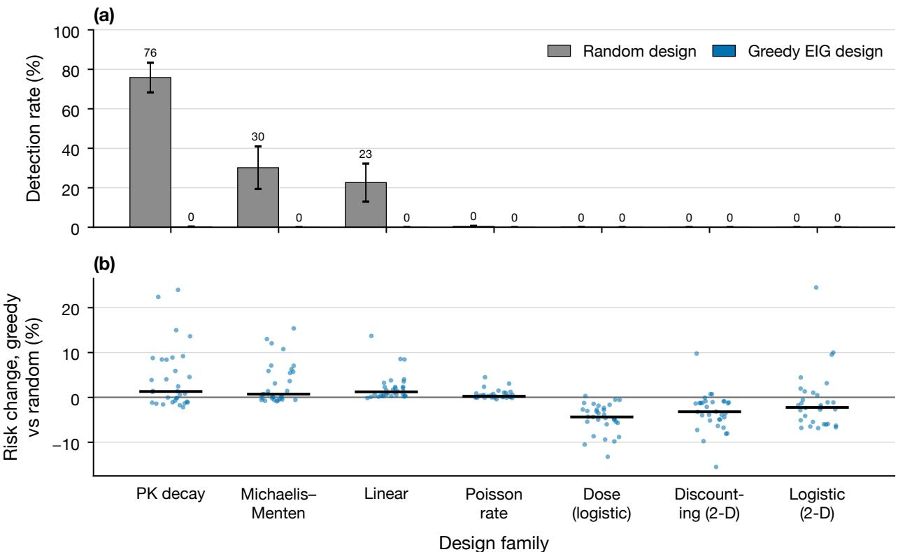  
Figure 3: Greedy EIG yields low detection in the generic families; its accuracy cost changes sign. (a) Rate at which the valid adequacy test (1) fires within 60 experiments, mean over 12 misspecified worlds per family (200 seeds each); whiskers are ±1 s.e. across worlds. (b) Change in protected risk of greedy EIG relative to random design, fixed working model, one dot per misspecified world (32 per family, 200 seeds each); bars are medians.

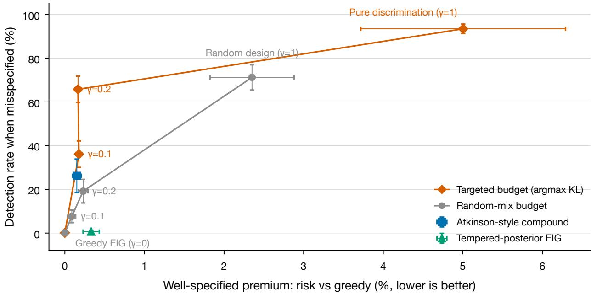

Figure 4: A targeted falsification budget buys most of randomization’s detection at a fraction of its cost. Horizontal axis: mean relative increase in protected risk over greedy EIG on the 28 well-specified controls. Vertical axis: detection rate on the 21 detectable misspecified worlds. Whiskers are ±1 s.e. across worlds; 200 seeds per world and policy; the working model is expanded on detection. Lines connect the measured budget settings and are guides only; pure discrimination is the targeted budget at $\gamma = 1$ . Separate markers show two baselines: an Atkinson-style compound criterion and greedy EIG under a tempered (generalized-Bayes) posterior.

## G.2 The accuracy efect is family-dependent

The popular story that optimal experimentation under a wrong model also produces a worse model does not survive randomization over misspecifications (Figure 3b). Across 224 misspecified worlds with a fixed working model, greedy EIG was significantly worse than random design $( z > 3 )$ in 39.7% of worlds and significantly better in 41.1%. Median relative changes ranged from −4.4% (dose–response) to +1.3% (PK); the largest losses reached +24.5%. In the dose–response family that motivated the pilot study, greedy design was never significantly worse. A pre-registered predictor, which held that the loss occurs when the error lies where greedy design does not look, failed with the wrong sign (AUROC 0.36): losses occur where greedy design over-samples the error. This matches Corollary 5: the working model absorbs the discrepancy into its parameters on a small support. It is detection, not accuracy, that adaptive design reliably destroys.

## G.3 Falsification budgets

Figure 4 compares targeted budgets (8) with equal-budget random mixing. Random design detects in 71.2% of campaigns on detectable worlds but costs +2.35% (±0.53) risk in well-specified worlds. A targeted budget of $\gamma = 0 . 2$ detects in 65.8% (92% of random design) at +0.17% (±0.04); γ = 0.1 detects in 36.1% at +0.18%. Random mixing at the same budgets detects in only 19.2% and 7.6%. Targeting beat random mixing in all 21 detectable worlds at both budgets (sign test $p = 4 . 8 \times 1 0 ^ { - 7 } )$ ). Because the agent expands its model when the test fires, detection also buys accuracy: on detectable worlds, protected risk relative to greedy EIG fell by 14.4% under random design, 11.5% under $\gamma = 0 . 2$ and 6.8% under $\gamma = 0 . 1$ . A post hoc audit retaining all 84 misspecified worlds gives detection rates of 17.68% for the targeted 20% budget, 18.44% for random design, and 4.84% for equal-budget random mixing. The targeted budget’s mean diference from greedy EIG is $+ 1 7 . 6 5$ percentage points, with a descriptive 95% bootstrap interval [13.49, 22.15] obtained by resampling worlds within each family. This interval reflects variation across the existing worlds and does not separately model within-world campaign uncertainty; it is not an independent confirmation. In an earlier run, using the pilot’s Bayes-ratio detector (valid only for the Bayes-marginal null), the pre-registered target of 80% of random design’s detection was missed at $\gamma = 0 . 1 \ ( 6 5 \% ) ; \gamma = 0 . 2$ was then pre-registered for the valid-detector run reported here.

Baselines. We compared three alternatives on the same worlds and seeds, with pre-registered criteria, all of which held. This tempered-posterior baseline does not restore detection: greedy EIG under a tempered posterior (power 0.5), as a simple robustness-inspired baseline, detected in 0.6% of campaigns and cost $+ 0 . 3 3 \%$ in well-specified worlds. This baseline uses ordinary predictive EIG with tempered weights; it is not an implementation of the Gibbs EIG acquisition of Barlas et al. (2025), and does not establish that GBOED or robust design more broadly fails to detect error. The tested compound setting is weaker than the tested stochastic budget: maximizing normalized EIG plus half the normalized discrepancy, a compound-design-inspired heuristic rather than a reproduction of Atkinson (1972), detected in $2 6 . 2 \% \mathrm { a t } + 0 . 1 5 \%$ ; the $\gamma = 0 . 2$ budget detected 2.5 times as often at the same cost (+0.17%). We conjecture, but have not tested, that a criterion applied at every step keeps returning to designs whose discrepancy the current fit already absorbs, while occasional full-weight probes do not. Pure discrimination over-pays: spending every experiment on (8) $( \gamma = 1 )$ detected most often (93.5%) and reduced risk most on detectable worlds (−15.1%), but cost +5.00% when the model was right, twice the premium of random design. Neither the compound coeficient nor the tempering power was optimized on a separate development set, so these comparisons do not establish superiority to the respective method families. Between greedy design and pure discrimination, the budget γ traces the trade-of between staying blind and paying for insurance; small budgets sit near its eficient end (Figure 4).

Sensitivity. We varied one setting at a time around the defaults on the three families where errors are detectable (pre-registered; all criteria held, and no setting produced a false alarm). Greedy EIG never detected in more than 0.9% of campaigns, while random design detected in 64–82%, across test levels $\alpha \in \{ 0 . 0 1 , 0 . 0 5 , 0 . 1 \}$ , horizons $T \in \{ 3 0 , 6 0 , 1 2 0 \}$ and expansion widths {0.06, 0.12, 0.24}. The targeted budget’s detection rose smoothly with its size: 14%, 36%, 66%, 79% and 88% for $\gamma = 0 . 0 5 , 0 . 1 , 0 . 2 , 0 . 3$ and 0.5, with a premium that stayed below 40% of random design’s in every setting. A narrower expansion (width 0.06) made the budget slightly more sensitive than random design (70.4% versus 69.4%); a broader one made it less (56.7% versus 73.4%), plausibly because a broader expansion class describes the localized planted errors less well.

## G.4 Mechanistic environments

The families above plant generic deviations. We also built two environments with physically real errors and the expansion a scientist would actually try next, each with 200 log-spaced designs instead of 25 (pre-registered; 20 misspecified and 4 well-specified worlds each, 200 campaigns per world and policy). In enzyme kinetics the working model is Michaelis–Menten and the truth, like the expansion, adds substrate inhibition $( K _ { i }$ between 0.5 and 20 times $K _ { m } )$ . In pharmacokinetics the working model is one-compartment elimination and the truth, like the expansion, is two-compartment (a fast distribution phase holding 20–80% of the dose, 3–30 times faster).

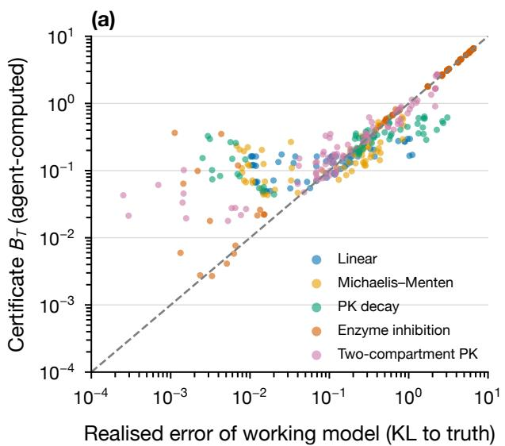

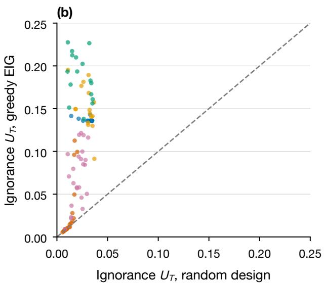  
Figure 5: Expansion-relative diagnostics correlate with realized error in the tested worlds. (a) The blindness certificate $B _ { T }$ of Proposition 9, computed by the agent from its own models and data, against the realized protected error of its working model, for every (world, policy) cell; the dashed line is equality. (b) The ignorance part $U _ { T }$ under greedy EIG against random design, one point per world; the dashed line is equality. 96 worlds in five environments (76 misspecified, 20 well-specified), 200 campaigns each, $T = 6 0$

Detection collapse is environment-dependent here, and the pre-registered collapse criterion failed in both. With substrate inhibition greedy EIG still detected in 94.6% of campaigns (random design 98.9%): estimating $V _ { \mathrm { m a x } }$ requires measurements at high substrate concentration, which is exactly where inhibition shows, so the error lies on the optimizer’s own designs and Theorem 3 imposes no ceiling. With two-compartment kinetics the collapse was partial: greedy EIG detected in 29.3% against 80.9% for random design on the 11 worlds where any policy could detect (in the other 9, the fast phase was too fast to be seen on the design grid by any policy). The falsification budget was robust in both: at $\gamma = 0 . 2$ it detected in 99.9% and 87.4% of campaigns, matching or exceeding random design, at a well-specified premium of +0.08% and +0.18% against +1.14% and +1.22%. In pharmacokinetics, where the error mattered, it also cut protected risk by 27.3% relative to greedy EIG, the same as random design. The lesson is the one the theory states: an optimizer goes blind when some working model can match the truth on the designs it needs, which is common but not universal, and a small targeted budget is cheap insurance in either case.

## G.5 Expansion-relative uncertainty in practice

We computed the certificate of Section F.1 in 96 worlds: the three generic families where errors are detectable and the two mechanistic environments (pre-registered, with one amendment recorded before any full run: after a one-world pilot showed that $B _ { t }$ also grows when an error is detected, the blindness criterion and the adaptive trigger were switched from $B _ { t }$ to its ignorance part $U _ { t } )$ The diagnostic is associated with realized error in these worlds (Figure 5a): across all cells the rank correlation between $B _ { T }$ and the realized error was 0.91, and within each environment 0.63–0.99, with the median ratio of certificate to realized error between 0.90 and 1.30. It errs on the cautious side where the error is small, because it also counts what the data could not rule out. The diagnostic also distinguishes unresolved uncertainty under the two policies (Figure 5b): greedy EIG ended with more ignorance than random design in 100% of worlds in four environments, about five times as much on average (0.11 versus 0.02). The exception is informative: with substrate inhibition, where Section G.4 found that greedy EIG is not blind, its ignorance was higher in only 62% of worlds and close to random design’s. This association is supportive in the tested environments; it is not proof of calibration outside the expansion prior or a universally reliable blindness detector.

The adaptive budget, which spends targeted designs only while $U _ { t } \geq u ^ { \star }$ , used fewer of them when the model was right (2.7–6.6 per campaign at $u ^ { \star } \geq 0 . 2$ , against 12 for a fixed 20% budget) and at $u ^ { \star } = 0 . 1$ matched random design’s detection on detectable worlds (84.0% against 83.9%) at a premium of +0.08% against +0.89%. Against the frontier traced by fixed budgets it detected 0.10–0.20 more at equal premium for $u ^ { \star } \in \{ 0 . 1 , 0 . 2 , 0 . 3 \}$ , meeting the pre-registered criterion, but the 95% bootstrap intervals over worlds include zero (for $\begin{array} { r } { u ^ { \star } = 0 . 2 , \left[ - 0 . 0 1 , 0 . 3 3 \right] \rangle } \end{array}$ , because the premiums being compared are a few hundredths of a percent. We therefore claim that adaptive budgeting is a cheap operating point, not that it dominates fixed budgets.

## G.6 Crossing acquisition and detector alternatives

A registered mechanism pilot uses 24 newly generated Bernoulli worlds in three shape groups (single-cell, opposite two-cell and smooth cubic discrepancies), plus nine exact null controls. There are nine designs, a nine-member linear-probability working class, and local and quadratic finite expansions. Nine acquisition policies each generate 256 campaigns; seven numerator experts score the same history with a shared maximum-null denominator. Rejection changes neither design nor prediction, which remains under $\mathcal { M } _ { 0 }$

At T = 600, on identical random-design histories, the quadratic/full/contamination hedge increases detection over the quadratic-only numerator by 39.99, 80.86 and 90.48 percentage points in the three shape groups. World-bootstrap intervals are [33.10, 47.56], [70.02, 90.63] and [80.27, 97.66]. This is a detector-scope efect; broad numerators leave greedy endpoint histories almost entirely unrejected. Their complexity also matters: the fully saturated alternative alone is weaker than the local finite alternative for some localized errors.

The proposed quadratic hybrid, allocating 10% of observations to predictive-KL targeting and 10% to random probing, missed its registered 10-point improvement criterion on pooled two-cell/cubic worlds: the observed gain with a broad hedge was 9.40 points ([1.29, 22.10]), so that criterion fails. Its control excess-Brier premium is 0.00002724 at $T = 6 0 0$ , below the declared absolute limit but about 33% of the small remaining greedy excess error. Absolute and relative prediction costs tell diferent stories.

A symmetric Bernoulli expansion can have exactly the same initial mixture predictive as the null despite substantial alternative uncertainty. If only zero-deviation endpoints are observed, this cancellation can persist. Writing $\begin{array} { r } { q _ { 1 } = \sum _ { h } w _ { 1 } ( h ) P _ { h } } \end{array}$ for the expanded posterior predictive, the standard information decomposition gives

$$
\begin{array} { r } { \mathbb { E } _ { h \sim w _ { 1 } } \mathrm { K L } ( P _ { h } \| q _ { 0 } ) = \mathrm { K L } ( q _ { 1 } \| q _ { 0 } ) + I _ { w _ { 1 } } ( h ; Y ) , } \end{array}
$$

at each candidate design and observed history. The expected-KL score therefore also rewards parameter information within the expansion. Its advantage over mean-predictive KL cannot alone identify a distinct class-discrimination mechanism; alternative-parameter EIG and combinedlatent EIG remain required controls. Class-label information with nuisance integration is already an established design target (Drovandi et al., 2014; Hainy et al., 2022). We included a stronger posterior-expected-KL acquisition control at the same 20% budget; its good development performance motivated a frozen independent comparison against the stronger local hybrid on new shapes and two observation modalities. The frozen comparison is complete: on all 24 new Bernoulli worlds at $T = 6 0 0$ , the expected-discrepancy control detects in 85.29% against 61.60% for the local hybrid, a gain of 23.68 points ([20.07, 27.10]), meeting its registered ten-point target. Fully random acquisition with the same hedge detects in 85.34% on these worlds. Thus this operating point approximately matches its detection while retaining an 80% estimation allocation; the result does not establish better detection than random design. On the discretized Gaussian observations both methods are near full detection, with only a 0.033-point diference at this horizon. There is no substantive Gaussian gain there. The initial mixture distributions coincide under the Bernoulli observation model but difer under the Gaussian categories, confirming the algebraic modality distinction. At the earlier predeclared Gaussian horizon $T = 2 0 0$ , expected discrepancy detects in 96.35%, the hybrid in 85.48%, and the mean-predictive-KL control in 96.92%. Thus the control is useful but does not establish superiority over the best tested acquisition in that modality. The modalities also difer in signal/noise and coding dimension, so performance diferences do not isolate a pure causal efect of cancellation. A subsequent robustness replay uses a conservative continuous-linear-null likelihood upper bound to test whether the Bernoulli advantage survives removal of the coarse parameter-grid denominator. In the boundary-safe confirmation, expected-discrepancy detection is 63.20% versus 41.41% for the hybrid, a 21.79-point diference ([18.02, 25.81]), meeting the unchanged ten-point target. The replay includes nine additional controls with continuous coeficients absent from the inference grid. A supporting tangent globally upper-bounds the concave binomial likelihood over endpoint probabilities in $[ 0 , 1 ] ^ { 2 }$ , so its conservatism does not depend on a local optimizer finding the supremum. The first replay failed its numerical-gap gate on one greedy control; a child with bounded coordinate rescue clears the gate, with every finite-detector cell unchanged. Final maximum supporting gap is below $1 0 ^ { - 5 }$ and the maximum sampled continuous-control alarm rate is 0.78%. These replay checks do not supply new-world confirmation or extend the finite-null power theorem to an infinite null.

These are deliberately constructed of-endpoint discrepancies, not a prevalence estimate for scientific discovery. Intervals resample eight worlds per shape and do not separately model campaign Monte Carlo uncertainty. A fully calibrated diagnosis of false reassurance, realistic domains, and faithful close-method comparisons remain necessary.

Exact audit outside the proposed expansion. Take truth (0.2, 0.2), null Bernoulli vectors (0.2, 0.8) and (0.8, 0.2), and an expansion that additionally contains (0.7, 0.7). With fixed alternating designs at $T = 1 0 0$ , exact final rejection probability is $7 . 4 4 \times 1 0 ^ { - 7 }$ for that wrong finite mixture, and exceeds 0.99999 for the broad Beta alternative and their equal hedge. Here $D _ { 0 } = D _ { 1 } = 0 . 4 1 5 9$ nats, illustrating the alternative-regret bottleneck. Five registered numerical checks pass, including exhaustive adaptive-path calculations through T = 12 and 9,656 coding-bound checks. They corroborate formulas and implementations, not novelty, prevalence or a theorem proof.

Auditing the nonmyopic comparison. An independent finite-control audit checks a proposed two-step planner before larger comparisons. The null laws have Bernoulli success probabilities (0.2, 0.2) and (0.8, 0.8), and the structural alternatives (0.2, 0.8) and (0.8, 0.2). The detector uses an equal four-law sequence mixture and the maximum-null denominator. After histories restricted to the first action, a two-step rejection-probability objective is identically zero. With fixed-action ties it remains uninformative: at $T = 1 2$ its power is zero. A class-information fallback gives 57.15% power, matching simple class information, predictive-KL acquisition and the exact full-horizon Bayesian planner under the declared prior. All five audit gates pass, including independent path enumeration and exact null control; this is one constructed example, not a new acquisition advantage or a general failure of nonmyopic design. In this setup $E _ { t } \leq ( 1 + 4 ^ { r } ) / 2$ for r measurements at the second action. At threshold 20 at least three are necessary. If the base action is fixed first and only probe steps may use the second, a hard 20% cap at $T = 1 2$ permits only two and cannot reject. Probabilistic mixing is a diferent constraint. Randomized-tie null EIG is exactly the random control here; both actions are equally informative under the null, so this case does not establish a prediction-cost trade-of. Future comparisons require an explicit fallback/reward/horizon and probe-budget feasibility, as well as strong simple acquisition controls.

Connecting the continuous-logistic detector. A separate integration audit uses three settings $x \in \{ - 1 , 0 , 1 \}$ and the scientific null $p ( x ) = { \mathrm { s i g m o i d } } ( a + b x )$ for $( a , b ) \in [ - 3 , 3 ] ^ { 2 }$ . An outwarddecimal supporting-plane bound supplies the denominator; the numerator is an equal hedge of a fixed U/inverse-U sequence mixture and per-setting Beta(1, 1) marginals. Exhaustive length-12 response paths under three predictable policies give 39 policy/truth cells. All five registered checks pass; the largest exact first-crossing risk over 11 declared null laws and three policies is 1.0254%, below $\alpha = 0 . 0 5$ . The finite fixtures are implementation checks, not empirical validation of every continuous coeficient. Cycling the three settings detects each declared shape with probability 58.74%; endpoint-only sampling detects neither. At the endpoints each shape is observationally identical to a valid constant logistic null, so any level-α test there has power at most α at any horizon. A simple outcome-adaptive rule gives 68.15% and 9.41% on the two shapes, illustrating a failure of robustness rather than a new acquisition advantage. All 12,288 stored paths reconcile in an independent replay. Among 1,281 count states, eight require coordinate rescue and 19 retain optimizer non-success flags; nevertheless the maximum independently certified profile gap is below the registered 10−7 tolerance, with no unresolved threshold decisions. The alternatives are deliberately strong and included in the numerator; prediction costs, independent-prior confirmation and domain validation remain untested by this audit.

## G.7 Independent-prior development with exact attempt caps

A separately registered comparison removes truth-indexed inference priors and uses the continuous scientific null $p ( x ) = \mathrm { s i g m o i d } ( a + b x ) , ( a , b ) \in [ - 3 , 3 ] ^ { 2 }$ , at nine available actions. Its inference prior is specified independently of the evaluation worlds, using $9 \times 9$ nuisance quadrature, while the test denominator profiles the full continuous null. The proper numerator is a fixed equal hedge of a structural mixture and independent per-action Beta(1, 1) sequence marginals. Six null worlds and 18 non-null worlds cover structural bumps, near-null departures and changes outside the structural prior. Sixteen response-history replicates, 12 policies and horizons 60 and 120 give 9,216 main campaigns; 12 prespecified $1 7 \times 1 7$ checks complete the allocation of 9,228. The candidate here is fixed-schedule expected discrepancy, not the later gated-floor heuristic. Prediction loss averages the nine actions uniformly.

All records pass full runner history replay and independent immutable-source, raw/index, trace, resource and fixed-class endpoint checks. The recovered 4,928-record prefix is retained unchanged and 4,300 further records complete remotely. No record is dropped. Capped policies receive exactly 12 or 24 pre-outcome override opportunities, including charges for choosing the base action. Al H observations continue after rejection and prediction remains in $M _ { 0 }$ , unlike the expansion-afterrejection studies below. The complete allocation accounts for $^ { 8 3 0 , 5 2 0 }$ observations and 262,872 charged attempts.

The frozen rule chooses the highest-detection capped control over all 18 non-null worlds, breaking ties by lower null prediction loss and then name. At $H = 6 0$ , class MI wins the tie at $4 / 2 8 8 = 1 . 3 9 \%$ at $H = 1 2 0$ , alternative-parameter EIG wins the tie at $1 4 / 2 8 8 = 4 . 8 6 \%$ . The candidate gives

Table 2: No registered horizon meets the baseline detectability requirement. Detection percentages over 18 equally weighted non-null worlds, with 16 response-history replicates per world and method. Parentheses give within-world Monte Carlo standard errors on this fixed panel, not population confidence intervals; a zero estimated error does not establish zero uncertainty. All physical observations continue to the horizon. References are ineligible for capped-baseline selection. Run 2095b9fe, scientific registration 22c10ec2, completed source 15cd075.
<table><tr><td>Method</td><td>Attempts (60/120)</td><td>H = 60</td><td>H = 120</td></tr><tr><td>Expected discrepancy (candidate)</td><td>12/24</td><td>0.35 (0.35)</td><td>4.51 (1.15)</td></tr><tr><td>Random overrides</td><td>12/24</td><td>0.00 (0.00)</td><td>0.69 (0.47)</td></tr><tr><td>Balanced coverage</td><td>12/24</td><td>0.00 (0.00)</td><td>0.00 (0.00)</td></tr><tr><td>Class MI</td><td>12/24</td><td>1.39 (0.68)</td><td>4.86 (1.24)</td></tr><tr><td>Alternative-parameter EIG</td><td>12/24</td><td>0.69 (0.47)</td><td>4.86 (1.21)</td></tr><tr><td>Combined latent EIG</td><td>12/24</td><td>0.00 (0.00)</td><td>4.86 (1.18)</td></tr><tr><td>Predictive KL</td><td>12/24</td><td>1.39 (0.68)</td><td>4.86 (1.24)</td></tr><tr><td>Two-step class information</td><td>12/24</td><td>1.04 (0.59)</td><td>3.12 (0.97)</td></tr><tr><td>Shared-parameter projection</td><td>12/24</td><td>0.35 (0.35)</td><td>2.08 (0.75)</td></tr><tr><td>No override (reference)</td><td>0/0</td><td>0.00 (0.00)</td><td>0.00 (0.00)</td></tr><tr><td>Full random (reference)</td><td>60/120</td><td>2.78 (0.95)</td><td>7.29 (1.38)</td></tr><tr><td>Cycle (reference)</td><td>60/120</td><td>2.43 (0.86)</td><td>10.42 (1.46)</td></tr></table>

1/288 and 13/288, respectively (Table 2). Neither control estimate reaches the registered 20%– 95% eligibility range. Consequently no confirmation horizon or comparator is frozen. These are development estimates after control selection, not evidence of population-best controls, inferential equivalence or universal candidate failure. Mean null excess log losses are 0.02534 versus 0.02112 nats at the shorter horizon and 0.01029 versus 0.00994 at the longer horizon, for the candidate and respective highest-power controls. No null alarm is recorded in 96 main campaigns per method and horizon; zero alarms do not establish exact calibration.

The logs retain 224 solver-gap flags in 183 histories. For every flagged prefix, the stored numerator upper bound divided by the certified feasible- likelihood lower bound is below 20. Thus even an exact null-profile calculation cannot create a crossing at those prefixes; no numerical rule or endpoint is changed. The 12 limited prior-grid pairs all retain nonrejection, but their action sequences difer by up to 41 of 120 steps and their excess log losses by up to 0.00709 nats. These sparse checks do not establish grid-insensitivity across controls or worlds.

A post hoc check of the observed information bottleneck. We additionally insert the simulator’s true sequence likelihood into the recorded denominator bounds, preserving the existing profile-gap acceptance guard and each policy’s saved history. This uses unavailable truth, samples no outcomes, changes no actions and is not a deployable detector or new power experiment. At H = 120, 68 of the candidate’s 288 non-null histories cross under this truth-informed numerator, compared with 13 actual rejections; 55 histories cross only in the truth-informed diagnostic. In contrast, no no-override history crosses even with that numerator. Full cycling yields 112 truth-informed crossings and 30 actual ones. These checks distinguish histories that remain unrevealing from histories whose realized signal is poorly captured by the implemented sequence numerator. They do not identify an attainable replacement or establish a causal acquisition advantage. The registered negative decision remains unchanged; fresh superiority confirmation is not initiated from this study.

Ablating the two proper likelihood components. A further post hoc ablation scores the already implemented structural marginal $L _ { t } ^ { \mathrm { s t r } }$ and per-action Beta marginal $L _ { t } ^ { \mathrm { b r o a d } }$ separately on every saved history, retaining the same profile bounds and numerical acceptance guard. All 9,228 original first-rejection endpoints reproduce. On the candidate’s 288 non-null histories at $H = 1 2 0$ , the component crossing counts are 10 and 13, against 13 for their equal hedge; both component event sets are contained in the hedge’s event set, with no unresolved event bounds. Since w $L _ { t } ^ { \mathrm { s t r } } + ( 1 - w ) L _ { t } ^ { \mathrm { b r o a d } } \leq \operatorname* { m a x } ( L _ { t } ^ { \mathrm { s t r } } , L _ { t } ^ { \mathrm { b r o a d } } )$ for every fixed $w \in [ 0 , 1 ]$ , changing only these mixture weights cannot add a rejection on the other saved histories. At $H = 6 0$ the broad component adds two events, so the conclusion is specific to the longer-horizon histories. Neither retrospective component selection nor the unpenalized maximum is a valid combined test at the original level. No acquisition or prediction policy is rerun; the registered decision stays unchanged. This narrows a possible repair direction without demonstrating a useful attainable replacement or new-world improvement.

## G.8 Expansion and data-derived stress tests

The wrong-class/width experiment is now complete (96 worlds, 200 campaigns, $T = 6 0 )$ . On the registered wrong-class random-detectable subgroup, the fixed budget detects in 83.83% against 84.96% for random design, satisfying its 75%-recovery criterion. Within-environment rank correlations of $B _ { T }$ with true working-model KL error range from 0.396 to 0.832, meeting the registered correlation criterion. The expected increase in false reassurance does not occur: the registered conditional proportion is 11.61% for the wrong class and 13.83% for the right class, so that hypothesis fails. These conditional denominators and detectable sets difer, and correlation does not establish out-of-class calibration.

Width mismatch changes the operating point: the narrow expansion’s budget gives 69.31% detection versus 69.38% for random design, while the wide expansion gives 54.05% versus 70.18%. These are expansion-specific selected subgroups; width variants exist only in the generic environments, so their pooled statistics cannot be compared directly with a right-class pool that also includes mechanistic environments.

Data-derived simulations. We fit richer curves to Indometh, Theoph and DNase data and generate independent outcomes from those curves (41 fitted/control worlds, 200 campaigns per policy, 50 candidate settings). This is a fitted-curve simulation, not a prospective experiment or evaluation on held-out real observations. Working grids are centered on projections of the fitted truth, and noise is modified by a bin-width floor; these choices limit external-validity claims.

At $T = 3 0$ in the six fitted Indometh worlds, greedy detection is 12.33%, random design 55.58%, the fixed 20% budget 37.17%, and the adaptive rule 34.25%. The registered collapse criterion passes, but the budget reaches only 66.9% of random design’s detection, missing the registered 80% target. This robustness criterion fails. At the shorter $T = 1 2$ , the respective rates are 0.92%, 20.58%, 21.50% and 31.08%; this descriptive short-horizon pattern does not reverse the registered failure at $T = 3 0$

Exactly well-specified Theoph controls raise no recorded alarms in any arm at $T = 3 0$ , with a fixed-budget total-risk premium of 0.034%, meeting the registered control criterion. The nearwell-specified fitted richer Theoph curves are reported separately; non-rejection of a working model in the original data does not establish adequacy. In the 11 DNase curves, random detection is 12.00%, the fixed budget 5.77% and greedy design 0%; the correlation of fitted discrepancy with random-design detection is 0.917, descriptively. Curve-fit uncertainty, fit/evaluation separation, and continuous-parameter grid sensitivity remain unresolved. Repeated generated campaigns are not additional independent subjects.

Richer expansions on fitted curves. A registered follow-up compares the original mechanistic expansion, a finer mechanistic grid, and its union with local response bumps on the same Indometh/DNase curves. The union’s fixed-budget detection improves by 19.64 points over the original expansion on seven commonly detectable worlds, but its recovery ratio is only 0.679, below the registered 0.8 target. Thus X1 fails and X2/X3 pass. The adaptive union arm has 88.25% detection versus 77.69% for random design on eight selected worlds. This adaptive finding was exploratory, not the registered fixed-budget hypothesis. Across all 17 fitted misspecified worlds the corresponding rates are 44.76% and 38.76%. Changing the expansion changes both acquisition and the detector numerator; this experiment alone does not attribute the improvement to either component.

Confirmation on previously unused fitted datasets. The frozen construction is applied to 47 eligible ChickWeight curves and the treated/untreated Puromycin curves, with 14 exact controls and 200 campaigns per world. These datasets were unused in development, but their observations are fitted to synthetic response laws; the inference grids are still centered on projections of the fitted truths. They are not held-out-observation validation. No eligible fits fail. On 35 random-detectable worlds at $T = 3 0$ , adaptive union detection is 96.47%, random 82.23%, and the fixed budget 92.04%. C1 passes, but the 4.43-point adaptive/fixed gain misses the registered ten-point C2 target. C3 fails because one of 2,800 adaptive control campaigns rejects, despite a small 0.0182% mean control total-risk premium. This does not by itself contradict level-0.05 validity; the registered requirement was zero observed alarms. The gain over random remains across all 49 misspecified fitted worlds: 74.39% versus 59.90%, with the fixed budget at 68.87%. These post hoc all-world results remove outcome selection from the descriptive pool. Figure 6 compares the all-world detection diferences. The pool is dominated by 47 chicks; two enzyme-state curves do not establish broad cross-domain generalization. Adaptive design also uses more targeted probes: 8.18 versus 2.30 before rejection on selected worlds, and 15.18 versus 6.01 on controls, out of 30 observations. It is not an equal-intervention-budget comparison, and post-rejection prediction uses the expanded class. Matched-cost controls and priors defined independently of fitted truths remain necessary.

Second fitted-dataset study: an adaptive non-replication. The next registered study uses nine dose-response curves and 48 soybean plots, plus 21 exact controls, with 200 generated campaigns per world and policy. These are again fitted-curve simulations with inference grids centered on the fitted truths, rather than held-out-observation validation. On 46 worlds selected by observed random-design detection at T = 30, the original adaptive rule detects in 71.78%, below random design’s 82.47%, the fixed budget’s 91.75%, expanded-model EIG’s 86.53%, and class-discrimination EIG’s 93.61%. Adaptive class-discrimination targeting within the same uncertainty trigger gives 74.08%. The original D1, D4 and D5 gates fail; their criteria are unchanged. At T = 12 the selected 26-world adaptive/random comparison reverses (81.98% versus 64.44%, D2 passes), but the heuristic $u ^ { \star } = \log ( 1 / \alpha ) / T$ gives 73.13% and fails D6. It is not a proved calibration of protected risk. The control-cost/false-alarm gate D3 passes; one of 4,200 adaptive control campaigns rejects at $T = 3 0$

Post hoc pooling over all 57 misspecified worlds retains the longer-horizon adaptive deficit: 59.39% versus random’s 67.56%. The fixed budget gives 75.48%, but this pool is dominated by 48 soybean plots. Its all-world dose-response detection is 11.72% versus random’s 25.50%, whereas on soybean it is 87.44% versus 75.45%. Thus neither adaptive nor fixed targeting is uniformly superior across these families. The original outcome-selected gates remain the registered analyses; world bootstrap intervals are descriptive and do not supply independent-subject replication. Shared seed labels do not align outcome uniforms when policies consume diferent random draws, and intervention budgets difer. Aggregate targeted-step counts do not establish a temporal stopping mechanism; prospective action traces are needed to test that explanation. These failures strengthen the case for independently constructed priors, explicit realized-cost accounting and strong classical controls.

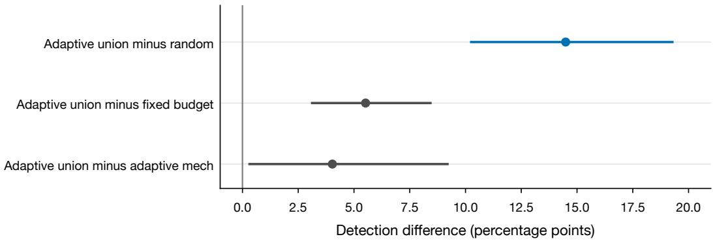  
Figure 6: The adaptive gain shrinks against stronger controls. All 49 previously unused fitted worlds at $T = 3 0$ , with 200 campaigns per world; whiskers are descriptive 95% world-bootstrap intervals, not separate campaign uncertainty or population guarantees. Probing budgets difer, and the third contrast changes both acquisition and detector expansion. The registered selected-world and zero-alarm failures remain failures.

Whole-certificate triggering: an improved heuristic on reused worlds. A follow-up targets posterior-expected discrepancy and intervenes while $B _ { t } = U _ { t } + D _ { t } \geq 0 . 1$ and the detector has not fired. On 152 development worlds (122 misspecified and 30 controls), the 64 random-detectable worlds give 96.27% detection at $T = 3 0$ , versus 92.20% for the original adaptive rule and 86.95% for expected-discrepancy targeting with the original U trigger. The original E1, E3 and secondary E4 gates pass. The four-model construction used to amend the rule before launch is development evidence, not a new independent test. Control campaigns use a mean 17.74 targeted steps, versus 15.59 for the original adaptive rule and 6.00 for fixed targeting.

With that score and trigger frozen, a further evaluation reuses exactly the 57 misspecified doseresponse/soybean worlds, 21 controls and seeds above. All 936 shared comparator cells reproduce the previous run exactly; the score and trigger code remain unchanged. On the selected 46-world pool at $T = 3 0$ , detection is 96.48%, versus random’s 82.47%, fixed targeting’s 91.75% and full class EIG’s 93.61%; all original F1–F4 point-mean criteria pass. However, descriptive world-bootstrap intervals for the diferences from fixed targeting and full class EIG include zero: 4.73 points [−0.68, 10.19] and 2.87 points [−1.30, 6.89]. The rule uses 6.68 targeted steps before detection on these worlds, versus 9.20 for the original adaptive rule and 2.30 for the fixed budget. Its mean total-risk control premium is 0.025%; one of 4,200 control campaigns rejects. These costs are neither matched physical budgets nor excess-risk premiums.

Across all 57 worlds, detection is 82.24% versus full class EIG’s 79.85%. The family weighting matters: on all nine dose-response worlds the rates are 35.39% versus 39.67%, and equal family weighting gives 63.20% versus 63.53%. The positive pooled result is therefore a promising simulation follow-up, not independent confirmation or uniform superiority. The experiment also lacks predictive-

KL targeting with the same B trigger, so it is not a full score-by-trigger factorial. Moreover, the two-model construction in Appendix K gives probability at least 0.1 of premature return under a B threshold of 0.1 itself. Improving the empirical rule does not supply fixed-truth risk calibration.

New fitted tree-growth families and threshold sensitivity. The frozen whole-B rule is also evaluated on two previously unused dataset families: 14 Loblolly pine trees and five Orange trees, plus 19 exact controls. Truth is a logistic curve fitted to each tree; the working family is a power law with an inference grid centered on its fit to that truth curve. No fits fail. New family and campaign seeds improve independence from the earlier rule-development examples, but all available tree observations enter these fits. This remains a fitted-curve simulation, not validation on untouched observations or a prior specified independently of the truth.

Only one misspecified world has random detection at least 0.2 at T = 30, so the registered fallback evaluates G1–G4 on all 19 worlds; all four pass. Detection is 49.11% for the new rule, 6.05% for random design, 7.16% for fixed targeting, 11.08% for the original adaptive rule, 24.34% for expanded-model EIG and 45.37% for full class EIG. Our audit reconstructs the fallback pool from the saved world records: the original printed summary and its T = 30 bootstrap instead use the single random-detectable world. Newly computed descriptive world-bootstrap intervals on all 19 give diferences from random and class EIG of 43.05 points [33.63, 51.50] and 3.74 points [1.95, 5.45], respectively (5,000 resamples, seed zero). These do not control multiplicity or establish generalization from two small dataset families. Both family means favor the new rule over class EIG: 59.50% versus 55.11% for Loblolly and 20.00% versus 18.10% for Orange. At T = 12, detection remains low: 2.39% versus random’s 0.18% and class EIG’s 1.68%. No control campaign rejects; the mean total-risk premium is 0.0057%. However, control campaigns use 18.63 targeted interventions out of 30, versus 6.02 for fixed targeting, and the misspecified worlds use 25.06 versus 5.94. A small prediction premium does not mean negligible probing cost.

A separate threshold study reuses 128 development worlds (102 misspecified, 26 controls); 832 unchanged policy/world/horizon cells reproduce the earlier development run exactly. On 55 randomdetectable worlds at T = 30, thresholds 0.03, 0.05, 0.1, 0.2 and 0.3 give detection 96.51%, 96.51%, 95.99%, 92.09% and 85.68%, respectively. The original S1–S2 robustness/cost criteria pass, but the synthetic subgroup falls from 87.88% to 77.83% between thresholds 0.1 and 0.2. Control targeted steps range from 29.59 at 0.03 to 4.50 at 0.3; the respective total-risk premiums are 0.271% and 0.035%. This is a measured trade-of on reused development worlds, not a calibrated risk threshold or a guarantee of smooth response across families. Neither study supplies the missing fully crossed, physically matched-cost comparison.

A decaying forced-targeting floor. A further variant plays the same expected-discrepancy target with independent probability $0 . 5 / \sqrt { t + 1 }$ whenever the whole-B gate is closed and the test has not rejected (zero-based t). Its development study reuses 128 worlds and seeds; all 1,040 unchanged comparator cells exactly match earlier records. On the 55 random-detectable worlds at $T = 3 0$ , detection is 96.07% versus 95.99% for the gate alone; all 102 misspecified-world means are 63.73% and 63.69%. The original W1–W3 point-mean criteria pass. W1’s two-model construction frequencies—99.15% versus 76.40% in 2,000 campaigns—were already observed before registration; their repeated report is not independent confirmation. The control total-risk premium rises from 0.160% to 0.188%, and targeted steps from 18.52 to 19.78 out of 30; each rule rejects in one of 5,200 control campaigns. These are development tolerance gates, not inferential non-inferiority tests or physically matched budgets.

We separately calculate finite-history probabilities on that exact two-model construction, without sampling campaigns or calling the simulation core. Histories merge by informative-observation and success counts, with exact rational likelihood/rejection decisions, outward gate bounds and outward binary64 probability transitions. Independent unmerged branch enumeration checks short prefixes under both the null and true law. All four registered numerical checks pass. At $T = 2 0 0$ rejection under the true law is 76.7687% for the whole-B gate and 98.7707% with the floor; expected targeted counts under the null are 2.787 and 16.272. The always-target reference detects with probability exceeding 99.9999% and uses 196.274 expected probes under the null. Numerical probability enclosures have widths below $2 . 5 \times 1 0 ^ { - 1 3 }$ , conditional on the stated model and arithmetic assumptions; they are not confidence intervals or new-world evidence. This mathematical reference does not reconstruct floating-point acquisition bit for bit; rounding can create score ties in the simulation implementation. Figure 7 shows the resulting fixed-policy trade-of.

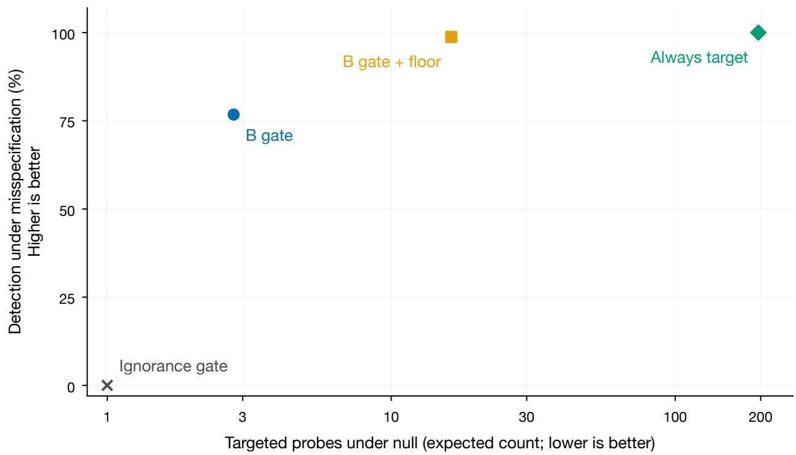  
Figure 7: Preventing permanent cessation has a probing cost. Four fixed policies on the two-model construction at $T = 2 0 0 ;$ the horizontal axis uses the correct-model law and is logarithmic, while the vertical axis uses the misspecified law. Deterministic numerical enclosures are smaller than the markers; no sampled campaigns, swept frontier or interpolation is shown. Counts stop at rejection. The ignorance-gate point follows analytically.

Appendix K.4 proves eventual rejection only if forced targets uniformly separate the represented truth from every null member. That assumption is not proved for the acquisition rule in general. The $O ( \sqrt { T } )$ bound covers additional probes when the gate is closed, not all targeted efort or fixed-truth risk calibration. These qualified results support testing the variant further, without designating a universally best final rule.

Crossing score, trigger and persistent targeting. A separate finite-history audit crosses predictive KL versus expected discrepancy, U versus B triggers, and the presence of the same forced-target floor on the two known constructions. It retains 75 system–law–policy cells, including null laws, both signs of the cancellation departure, fixed-slot controls and unrestricted coverage references. All six registered numerical checks pass; unmerged short-history enumeration checks every cell, and the largest probability-mass enclosure width is $6 . 3 4 \times 1 0 ^ { - 1 4 }$ . Figure 8 separates the two mechanisms. In the two-model example the scores choose the same action at every finite history, so a score change has no efect. In the four-model example, predictive KL always chooses a before any x observation: its x predictive is exactly $1 / 2$ , while its a predictive difers from 1/2. Both gates and a floor that repeatedly calls that score therefore retain the same blind design. At $T = 3 0$ its rejection probability is 0.9122%, the null-law probability on those observations. Expected discrepancy with the whole-B gate and floor instead rejects with probability 90.5933%, but makes 11.607 expected override attempts versus 29.406 for the blind score; same-as-base attempts are charged. These are conditional policy efects, not an equal-efort or new-domain superiority claim. All 30 physical observations continue, with base actions after rejection; override counts stop at the first crossing.

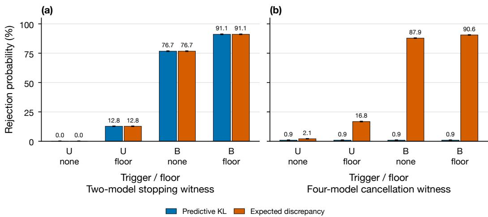  
Figure 8: A correct trigger cannot repair a blind target score. Two known positive-departure witnesses at $T = 3 0 \colon$ scores coincide in (a), whereas predictive cancellation in (b) survives forced targeting. Bars show deterministic probability enclosures, smaller than the plotted marks, not confidence intervals; no sampled seeds. Mirrored departures, nulls, fixed-slot controls and efort endpoints remain in the complete record.

The fixed-slot control also exposes a reachability limitation. Six potential overrides at $T = 3 0$ allow at most six informative observations on the two-model witness, for which $( 1 + ( 9 / 5 ) ^ { 6 } ) / 2 =$ $2 7 3 5 3 3 / 1 5 6 2 5 < 2 0 ;$ at least seven are required. Its zero power cannot evaluate score superiority at an adequate cap. This audit establishes neither a practical matched-budget advantage nor new independent confirmation; the larger independent-prior comparison remains separate. A forced-target floor is not the cyclic coverage required by Appendix K.6.

Frozen floor on previously evaluated fitted worlds. The floor variant is next evaluated on the same dose-response, soybean and tree worlds and campaign seeds used above: 76 misspecified worlds and 40 controls, with 200 campaigns per policy and horizon. All 116 planned world records are present. Relevant score, trigger, action-selection, coin-stream and default-coeficient code blocks remain unchanged from the frozen rule; all 1,160 shared comparator cells exactly reproduce the preceding studies. The original K1–K3 point-mean tolerance and control criteria pass, without turning these checks into inferential non-inferiority tests or fresh-data confirmation.

At T = 30, the selected 46-world dose-response/soybean pool gives 98.91% detection versus the gate alone’s 96.48%. The diference is 2.43 points with a newly computed descriptive world-bootstrap interval [0.02, 6.17] (5,000 resamples, seed zero). Four world means improve and 42 tie; two soybean plots account for 92.4% of the pooled gain. Across all 19 tree worlds the rates are 49.18% versus 49.11%, a 0.08-point diference with interval [0, 0.21]; two worlds improve and 17 tie. At T = 12, the registered pools have identical floor/gate world means. The all-57-world dose-response/soybean means at T = 30 are 84.25% versus 82.24%, but the nine dose-response curves still favor full class EIG over the floor (39.67% versus 36.33%). The positive result remains heterogeneous.

On controls at T = 30, the floor increases mean targeted steps from 11.14 to 13.52 in the dose-response and soybean pool, and from 18.63 to 19.77 in the tree pool. The floor’s mean total-risk premiums are 0.0279% and 0.0073%, respectively; one of 4,200 dose-response/soybean control campaigns and none of 3,800 tree control campaigns reject. The small prediction premiums do not imply matched or negligible intervention costs. All observations enter the fitted curves and truth-centered grids. Bootstrap intervals condition on those worlds, with no multiplicity correction or propagation of curve-fit uncertainty. Saved world means do not identify individual campaign histories or temporal mechanisms.

Measured-replicate replay, conditional on the observed datasets. A separate study replaces fitted-curve outcome simulation with uniform resampling from observed replicate bins at each queried positive dose. There are 20 curves: five spinach curves, two S. alba curves, ryegrass, lettuce and eleven DNase runs; each has 6–8 queryable doses and 2–4 recorded replicates per positive dose. All 20 planned records, comprising six policies with 200 campaigns at T = 30, are present. An independent audit reconstructs raw-data grouping, bin histograms, noise estimates, nonlinear fits and the recorded labels from the frozen source and CSV files.

On the seven curves labelled misspecified by the full-data fitted-mean comparison $\left( p < 0 . 0 1 \right)$ greedy working-model EIG detects in 0.14% of campaigns, random design in 79.86%, the floor rule in 94.79%, and class-discrimination EIG in 95.50%. Greedy design visits 3.24 distinct doses on average, compared with random design’s 7.02. The newly derived paired world-bootstrap diference of the floor over random is 14.93 points with interval [4.07, 28.07] (5,000 draws, seed zero); six curves improve and one ties. Its diference from class EIG is −0.71 points, [−3.64, 1.50]. These are descriptive intervals conditional on seven curves, not inferential non-inferiority tests. The original R1–R3 point-mean and alarm-tolerance criteria reproduce as passing.

Five further curves are labelled ambiguous and excluded from these label-based primary comparisons. The eight curves labelled adequate $\left( p > 0 . 2 \right)$ have a mean floor-rule alarm frequency of 2.19%, but 33 of their 35 alarms occur on spinach curve 4 (16.5%, 33/200). Nonsignificance of a nonlinear fitted-mean comparison does not establish model adequacy. More fundamentally, each empirical replay distribution has zero mass in at least 57 of the 61 bins at every queried action, while every clipped-Gaussian null member assigns positive mass to all bins. Thus none of these replay distributions belongs to the formal categorical null, including those labelled adequate. Their alarm frequencies cannot establish null calibration. The same raw observations determine the parameter grids, control-response scale, bins, noise and labels; none is reserved as untouched validation. Resampling conditions on the empirical distribution and adds no new laboratory replicates. Saved results omit prediction risks, override counts and individual campaign traces, preventing a cost or predictive-benefit conclusion from this study.

A 100-action constructed interaction screen and a horizon reversal. A completed simulation uses ten dose levels for each of two compounds, giving 100 joint actions. The working model is a product of two Hill-response curves, with known slopes and unknown potencies on a $2 5 \times 2 5$ grid. There are 24 interaction worlds with of-grid potencies and eight exact-grid noninteraction controls. A finite alternative adds mechanistic interactions and local two-dimensional bumps. Outcomes use a binned Gaussian observation model with known standard deviation 0.05. This is constructed data, not a measured drug screen. All 32 world records and 512 policy–horizon cells are present, with 200 campaign executions per cell. The frozen target, gate and independent-floor code matches the preceding implementation.

At $T = 3 0 ,$ , the registered detectability fallback evaluates all 24 interaction worlds: greedy detection is zero, random detection is 6.54%, the gate-only rule reaches 45.69%, the floor rule 47.69%, and class-discrimination EIG 35.40%. All original Z1–Z4 criteria pass. At T = 60, however, class EIG reaches 70.17% across all 24 worlds, against 59.31% for the floor and 22.19% for random. The floor is worse than class EIG on 23 worlds and ties on one; the new descriptive world-bootstrap diference is −10.85 points, [−16.19, −6.23]. The separate random-selected eight-world pool gives 97.00% for the floor and 99.38% for class EIG and must not replace the all-world result. The longer horizon uses the same worlds and seed ranges, not a fresh independent confirmation.

At T = 30, the floor raises exact-grid control total Brier risk by 0.0857% relative to greedy and records no alarm in 1,600 control campaigns. Its mean targeted steps are 12.36 versus 9.98 without the floor; small prediction premiums do not establish equal or negligible acquisition cost. Grid-null validity does not extend to a continuous scientific null, and of-grid potency error contributes alongside interaction error. The result supports a conditional short-horizon benefit, not a universally best policy.

Post hoc prediction and nonrejection endpoints. Reanalysis of the existing saved world means gives mean within-world relative total Brier-risk changes from greedy of −1.52%, −2.10% and −8.20% for the floor on all 57 dose-response/soybean, 19 tree and 102 development misspecification worlds, respectively. Random design gives −3.23%, −2.75% and −7.59%. Thus the floor does not dominate prediction across these pools. Mean absolute floor-risk diferences are −0.00753, −0.00963 and −0.03498. This score includes irreducible outcome noise and predictions after possible expansion; the saved means do not separate excess error or isolate detection’s causal benefit. Across all 57 dose-response/soybean worlds, nonrejection decreases from 50.01% under greedy to 15.75% under the floor. The smaller 38.08% to 1.09% comparison applies only to the 46 worlds selected by random-arm detectability. Nonrejection is not calibrated reassurance or a direct measure of harmful deployment. These analyses are post hoc, use previously evaluated worlds and are not fresh confirmatory evidence.

A source-location adaptation. We adapt the inverse-square source-location model of Foster et al. (2021) to an unexpected second source. This is a modified simulation, not a reproduction of their neural-design benchmark: we use 100 fixed measurement locations, a uniform 25 × 25 one-source location grid, 22 binned and probability-floored outcomes, and signal saturation parameter m = 0.1 rather than their 10−4. The background is b = 0.1 and log-signal noise standard deviation is 0.5. There are 24 two-source worlds and eight exact-grid one-source controls; the second source has continuous location and strength, while the finite expansion uses only 25 coarse locations and two extra-source strengths. The expansion therefore generally omits the exact truth. Six policies are evaluated with 200 campaigns per world at both declared horizons.

Table 3 retains all two-source worlds. The source-defined short-horizon selection instead includes 22 worlds whose observed random-arm detection is at least 20%. On that subset the floor exceeds class EIG by 0.18 percentage points; on all 24 worlds it is slightly worse. The excluded worlds are not failures or unusable data. The original four point gates pass, but their mean-threshold comparisons do not establish inferential noninferiority. The two horizons reuse worlds and seed ranges, not independent confirmations.

Table 3: Source-location detection (percent), averaging all 24 two-source worlds equally. These are saved campaign means from run fd0610ac, source 7a4ecca; no random-detectability selection is applied in this table.
<table><tr><td> $T$ </td><td>Greedy</td><td>Random</td><td>Disc 0.2</td><td>Floor</td><td> $M _ { 1 }$  EIG</td><td>Class EIG</td></tr><tr><td>30</td><td>2.40</td><td>71.83</td><td>58.19</td><td>94.25</td><td>92.58</td><td>94.65</td></tr><tr><td>60</td><td>6.42</td><td>92.23</td><td>86.35</td><td>97.85</td><td>97.94</td><td>98.23</td></tr></table>

At $T = 3 0$ , mean control expected half-Brier increments over greedy are $4 . 2 4 \times 1 0 ^ { - 4 }$ for the floor and $1 . 9 6 \times 1 0 ^ { - 3 }$ for class EIG. The ratio of their mean within-world relative premiums is 0.217; their total-risk ratio is 0.996, so this is not fourfold lower total risk or measurement cost. Every policy collects all $T$ observations and can switch prediction and design to $M _ { 1 }$ after rejection. The saved targeted-step counter does not charge class-EIG actions and is not a common intervention budget. No alarm is recorded in 1,600 control campaigns per policy and horizon, but this does not establish calibration outside the declared finite null. The saved output contains 384 world–policy–horizon means; individual campaign traces are unavailable for an independent detector or acquisition replay. This study supports allocation efects in the modified finite-grid problem, not physical source discovery, equal-efort superiority or confirmation of the independent-prior fixed-class benchmark.

A finite MAP class-separation control. A subsequent saved-result comparison implements a plug-in class-separation score related to Ma et al. (2026): choose one MAP strictly expanded member, then maximize its cumulative KL separation from the working class using one shared finite-grid null parameter across observed action counts plus the next action. This is a finite one-step adaptation, not the original learned joint edit–experiment system; it omits candidate-edit search, structural complexity, calibration/cost ranking, fixed exploration and revision machinery. This finite acquisition fit does not specify the scientific detector null. All six source-defined point gates reproduce from 1,320 aggregate cells in 148 reused worlds. The original short-horizon pools select 22 location and 46 dose/soybean worlds and retain all 19 tree worlds. Across all misspecified worlds, the floor-minus-class-separation diferences at $T = 3 0$ are +2.42, −1.03 and +1.50 percentage points, respectively; at $T = 1 2$ they are +0.97 for dose/soybean and −0.87 for tree. The prediction-premium gates do not measure physical or computational cost, and the detection gates compare point means rather than inferential noninferiority. Four unchanged location-policy columns reproduce the earlier means exactly. Neither those repeated outcomes nor this partial prior-work adaptation supply fresh confirmation or replace the independent-prior study’s negative horizon decision.

Continuous-null scope and numerical detection. Appendix K.6 extends the finite-null separation argument to compact log-Lipschitz nulls, combining established covering and likelihood methods with universal alternative coding, explicit cyclic coverage and certified numerical error. A deterministic epoch allocation gives a time-uniform bound with logarithmic model-complexity cost. The result requires the proper numerator, identifiability, an unbounded coverage schedule and numerical liveness; it does not certify the evaluated forced-target floor or establish fast detection at practical budgets.

Two exact calculations illustrate the distinction. For a single Bernoulli action, a uniform-Beta sequence numerator and threshold 20, substituting the grid $\{ 1 / 4 , 3 / 4 \}$ for the scientific null $p \in [ 1 / 1 0 , 9 / 1 0 ]$ gives a fixed-time rejection probability of $2 0 0 2 0 5 6 7 3 6 3 1 / 5 4 9 7 5 5 8 1 3 8 8 8 = 3 6 . 4 2 \%$ at $T = 4 0$ under the true null $p = 1 / 2$ . The exact continuous profile rejects no count event at that horizon. This is an exhaustive rational calculation over 41 count events, not an estimated error rate or a measurement of our production detector. In a separate two-action complementary history with counts (20, 80) and (80, 20), the proper per-action Beta numerator divided by the exact sharedprobability profile exceeds $5 \times 1 0 ^ { 1 4 }$ . The always-valid log-profile upper bound $U _ { T } = 0$ , however, yields a statistic at most one on every history and cannot reject at threshold 20. Conservative computation preserves validity but can destroy detection; bounded numerical error and actual threshold checks are separate power premises. Nine deterministic checks verify the fixture calculations and implementation contracts, not empirical performance.

A continuous working model and a revised gate. The independent-prior development study completed its registered histories and selected no confirmation horizon: the strongest capped arm detected only $1 4 / 2 8 8 = 4 . 8 6 \%$ at $H = 1 2 0$ . This result remains a failure of that fixed-budget candidate. It did not evaluate the later whole-certificate gate with a floor. A post hoc calculation using Theorem 3 gives an allocation-uniform ceiling through

$$
D ^ { \star } = \operatorname* { m a x } _ { \nu \in \Delta ( A ) } \operatorname* { m i n } _ { \theta \in [ - 3 , 3 ] ^ { 2 } } \sum _ { a } \nu ( a ) \mathrm { K L } ( p _ { h } ( \cdot  { | a ) | } | p _ { \theta } ( \cdot  { | a ) } ) .
$$

The mean upper bound on power is 0.611 at $H = 6 0$ and 0.679 at $H = 1 2 0$ over the 18 non-null worlds. This does not establish attainable power; a ceiling of one, reached by five of six outside-prior worlds at $H = 6 0$ , is vacuous. Saved-history truth-numerator crossings demonstrate signal on some actual histories that the implemented numerator misses. They implicate numerator regret alongside history quality and horizon, without attributing the entire gap to coding cost. Independent feasible-parameter upper witnesses reproduce the ceiling means; the original float optimization gap was not an interval certificate.

A subsequent registered study used 24 fresh worlds from the same generator (seed 2637501), $T = 2 4 0$ , and 50 campaigns per world and arm. Its uniform 41-by-41 working grid and expanded bump library difer from the independent-prior study; this is a new panel, not a controlled horizononly extension. The detector hedges sequence likelihoods from the bump mixture and per-action Beta(1,1) predictives with weights one half. Its denominator uses the concavity upper bound over the continuous logistic box $[ - 3 , 3 ] ^ { 2 }$ . The formula is valid in exact arithmetic. The implementation uses float64 and a 10−9 log-likelihood pad, not the outward-certified detector of the primary study. An independent 80-digit outward check on 131 fixed count fixtures through $T = 4 8 0$ found a minimum slack $9 . 9 9 9 \times 1 0 ^ { - 1 0 }$ ; this is numerical assurance on those fixtures, not certification of all recorded prefixes. The grid pre-filter is safe in exact arithmetic because a grid maximum is a lower bound on the continuous maximum; its borderline floating-point decisions are not outward-certified either.

Greedy EIG detects $1 / 9 0 0 = 0 . 1 1 \%$ , random design $1 7 0 / 9 0 0 = 1 8 . 8 9 \%$ . The frozen $b ^ { \star } = 0 . 1$ rule detects $2 5 / 9 0 0 = 2 . 7 8 \%$ and fails both restoration/comparator criteria N2–N3; N1 and N4 pass. It takes falsification actions on about 8% of steps. After a disclosed development pass on the earlier worlds, but before fresh-world outcomes, three secondary gates were declared. The main secondary gate is

$$
b _ { T } ^ { \star } = \log ( 1 / \alpha ) / T .
$$

This is a revised rule. At $T = 3 0 , \log ( 2 0 ) / 3 0 = 0 . 0 9 9 8 5 7 7 . .$ . is close to 0.1, but not equal; earlier frozen-gate results are not retrospectively relabelled. The earlier failed calibration of the ignorance trigger (D6) also remains a failure of a diferent stopping diagnostic.

At $T = 2 4 0$ the revised gate detects $3 2 2 / 9 0 0 = 3 5 . 7 8 \%$ , versus $2 8 5 / 9 0 0 = 3 1 . 6 7 \%$ for class separation and $2 5 6 / 9 0 0 = 2 8 . 4 4 \%$ for class-discrimination EIG. All three secondary point-threshold criteria pass. Using an independently specified descriptive bootstrap (5,000 paired-world resamples, seed 0, comparator order class separation, class EIG, random), the diferences are +4.1 points [1.4, 7.2], +7.3 [2.2, 12.9], and +16.9 [7.9, 27.2]. These replace the proposal’s unreproduced bootstrap endpoints; they are not simultaneous intervals or inference across arbitrary world populations. The null prediction-risk premium is about +0.03% versus +0.43% for class separation; each arm has zero alarms in 300 null campaigns. Near-null power remains low. All arms miss two matched-bump worlds despite large upper ceilings; those ceilings alone do not distinguish inadequate histories from numerator loss.

Transfer to a diferent horizon on previously evaluated worlds. A registered $T = 6 0$ comparison applies the revised gate unchanged to four previously evaluated families with identical seeds and worlds. This tests transfer of a gate chosen elsewhere; it is not a fresh-world or untouched data confirmation. The drug and tree pools include all misspecified worlds; location and dose/soybean retain the earlier random-detectable pools. All four registered point criteria pass. Drug-screen detection is 76.79% versus 70.17% for class EIG, 69.77% for class separation, and 59.3125% for the frozen gate. All 32 drug world/control rows reproduce the saved greedy, random, class-EIG and frozen-gate detection, risk and action-count aggregates exactly; in particular class EIG is 0.7016666667 and frozen is 0.593125. Paired-world contrasts against class EIG and class separation are +6.6 points [4.0, 9.5] and +7.0 [4.0, 10.4], respectively. Tree detection is 85.84% versus 81.21% and 82.95%; location and dose/soybean are 99.91% and 99.97% for the revised rule. The revised rule’s null risk premium ranges from $+ 0 . 0 1 5 \% \ \mathrm { t o \ t o \ . 1 1 2 \% } ,$ , below both comparators in each family. There is one drug control alarm in 1,600 campaigns and one dose/soybean control alarm in 4,200. Premium means relative excess prediction risk, not fewer experiments, lower runtime or physical acquisition cost; every arm receives T observations.

Proposition 13 (Conditional finite-horizon futility). Let $\begin{array} { r } { E _ { s } = q ( H _ { s } ) / \operatorname* { s u p } _ { \theta \in \Theta } p _ { \theta } ( H _ { s } ) } \end{array}$ , with predictable sub-probability predictives $q _ { u }$ , and stationary truth p . Fix $t < T$ , an Ht-measurable $\theta \in \Theta$ and $\lambda > 0$ . Conditional on H , freeze θ throughout the continuation. Write

$$
R _ { t } ( \theta ) = q ( H _ { t } ) / p _ { \theta } ( H _ { t } ) , \qquad { \bar { D } } _ { \lambda } = \operatorname* { m a x } _ { a } D _ { 1 + \lambda } ( p _ { h } ( \cdot \mid a ) \| p _ { \theta } ( \cdot \mid a ) ) ,
$$

and $c = \log ( 1 / \alpha ) - \log R _ { t } ( \theta ) - ( T - t ) \bar { D } _ { \lambda }$ . For any predictable continuation policy, remaining crossing probability is at most $\phi _ { \lambda } ( c )$ , where

$$
\phi _ { \lambda } ( c ) = \operatorname * { m i n } \{ 1 , ( 1 + \lambda ^ { - 1 } ) \lambda ^ { 1 / ( 1 + \lambda ) } e ^ { - \lambda c / ( 1 + \lambda ) } \} \quad ( c > 0 ) ,
$$

and $\phi _ { \lambda } ( c ) = 1$ otherwise. If absolute continuity fails or $\bar { D } _ { \lambda } = \infty ,$ use the vacuous bound one. If the accumulated numerator is zero, the product numerator stays zero and cannot cross.

Proof. For positive $R _ { t }$ , log $E _ { s } \ \le$ log $R _ { t } ( \theta ) + M _ { s } + S _ { s }$ , with $\begin{array} { r } { M _ { s } = \sum _ { u = t + 1 } ^ { s } \log ( q _ { u } / p _ { h } ) ( Y _ { u } ) } \end{array}$ and $\begin{array} { r } { { S _ { s } } = \sum _ { u = t + 1 } ^ { s } \log ( { p _ { h } } / { p _ { \theta } } ) ( Y _ { u } ) } \end{array}$ . Under $P _ { h } ( \cdot \mid H _ { t } ) , e ^ { M _ { s } }$ is a nonnegative supermartingale started at one: its conditional multiplicative mean is $\begin{array} { r } { \sum _ { y : p _ { h } ( y | a _ { u } ) > 0 } q _ { u } ( y ) \le 1 } \end{array}$ . Also $\begin{array} { r l } { \exp \{ \lambda S _ { s } - \lambda \sum _ { u = t + 1 } ^ { s } D _ { 1 + \lambda } ( a _ { u } ) \} } \end{array}$ is a martingale started at one. Predictability of actions and freezing of θ justify each conditional identity. Two Ville bounds, a union bound, and $D _ { 1 + \lambda } \geq 0$ show that a crossing requires one of events with total probability at most $\delta + \delta ^ { \prime }$ , whenever $\log ( 1 / \delta ) + \lambda ^ { - 1 } \log ( 1 / \delta ^ { \prime } ) = c$ . Put $\delta = e ^ { - x }$ $\delta ^ { \prime } = e ^ { - \lambda ( c - x ) }$ . Minimization gives $x = ( \lambda c - \log \lambda ) / ( 1 + \lambda )$ and the stated expression. Bounds above one are trivial, including Ville bounds with $\delta \geq 1$ □

For a truth drawn from a correctly specified finite expansion prior, posterior $\pi _ { t } ,$ and an $H _ { t ^ { - } }$ measurable working point $\widehat { \theta } _ { t } .$ conditioning on the truth and averaging gives

$$
F _ { t } = \sum _ { h } \pi _ { t } ( h ) \operatorname* { i n f } _ { \lambda > 0 } \phi _ { \lambda } \Big ( \log ( 1 / \alpha ) - \log R _ { t } ( \hat { \theta } _ { t } ) - ( T - t ) \bar { D } _ { \lambda } ( h , \hat { \theta } _ { t } ) \Big ) .
$$

Thus the agent’s posterior-predictive probability of a remaining crossing under any continuation is at most $F _ { t }$ . Minimizing over a fixed finite λ grid also gives a valid, weaker bound. This does not give a fixed-truth guarantee for of-library worlds. The numerator need not equal the planning prior, but $\pi _ { t }$ must be the actual posterior under the declared generative prior.

The bound relates an evidence deficit to remaining budget times a maximum R´enyi divergence. It motivates considering a $1 / ( T - t )$ scale; replacing the maximum R´enyi quantity by mean expected discrepancy, $T - t$ by $T .$ , and log $R _ { t }$ by zero is heuristic. In particular $R _ { t } ( \hat { { \boldsymbol { \theta } } } _ { t } ) \geq E _ { t } ;$ substituting $E _ { t }$ into the bound need not preserve its validity. Neither the constant nor positive detection probability follows from the proposed gate. The separate simulation check of C1 is a loose diagnostic, not a proof; its $t = 0$ average bound is not tighter than the KL ceiling on the development panel.

Finite-horizon e-value futility is established prior work: Baas et al. (2026) optimize power and expected sample size using dynamic programming, explicitly including curtailment. Taga et al. (2026) optimize horizon-aware betting and identify hopeless regions. Our proposition instead gives a conservative conditional upper bound for a composite universal-inference detector under adaptive design; we claim no first finite-horizon futility result. Agrawal et al. (2025) study sequential stopping-time lower bounds; Forr´e (2026) give lower-tail conditions yielding type-II error bounds, the complementary achievability direction.

Another fresh panel at $T = 4 8 0$ . The third registered comparison uses seed 2637601, 24 worlds and 50 campaigns per world and arm. The calibrated gate detects $4 6 8 / 9 0 0 = 5 2 . 0 0 \%$ versus $4 6 3 / 9 0 0 = 5 1 . 4 4 \%$ for class separation, $4 2 2 / 9 0 0 = 4 6 . 8 9 \%$ for class EIG, and 38 $\mathrm { \Delta \Psi _ { } | / 9 0 0 = 4 2 . 6 7 \% }$ for random design. Its class-separation contrast $\mathrm { i s + 0 . 6 ~ p o i n t s ~ [ - 1 . 8 , 2 . 7 ] } .$ : no resolved advantage, and no equivalence claim. Earlier prefixes give 21.78% versus 20.67% at $T = 1 2 0$ and 39.89% versus 37.89% at $T = 2 4 0 \colon$ ; these are descriptive comparisons within the same campaigns. The frozen gate still fails, at $9 2 / 9 0 0 = 1 0 . 2 2 \%$ . All five registered criteria pass, including point-threshold competitiveness; Q5 is an empirical check with Monte Carlo slack, not numerical verification of a theorem. Null risk premiums are +0.014% for the calibrated gate and +0.365% for class separation. Each arm raises zero alarms in 300 null campaigns; these observations do not replace the mathematical validity premises. The $F _ { t } \geq 0 . 2$ gate has identical detection indicators and times on all 900 non-null and 300 null campaigns. There are 468 detected and 432 undetected non-null campaigns. Its null premium is $+ 0 . 0 2 6 \%$ . Equal saved outcomes do not prove universal behavioral equivalence or identify all intermediate actions.

We retain the original frozen-rule failures and evaluate the calibrated gate as a revised candidate. Confirmation with the independent-prior pipeline’s original priors and outward-certified detector remains open.

A targeted/random acquisition hedge. A registered follow-up splits each falsification step equally between predictive-KL targeting and a uniformly random design. At the fixed 20% budget it fails all three detection gates, while passing its control-cost gate. On the seven random-detectable Indometh/DNase fitted worlds at $T = 3 0$ , detection is 32.57%, versus 39.21% for targeting and 63.00% for fully random designs. On the selected synthetic-right worlds it is 57.66% versus 73.22% for targeting, missing the allowed three-point loss. Its worst group-wise detection/random ratio is 0.517, below targeting’s 0.622, despite a mean control total-risk premium of only 0.076%. The 30% budget is descriptive and does not rescue the registered 20% failures. These outcome-selected groups and repeated fitted worlds are not external confirmation; the risk uses prediction after class switching, unlike the fixed-class crossed study. This acquisition hedge is distinct from mixing detector sequence likelihoods.

Designs aimed at detector growth. We compared predictive-KL targeting with targeting the running maximum-likelihood null and the exact expected one-step log-growth of the universalinference statistic (96 worlds, 200 campaigns, budgets 10%/20%, horizons 30/60). At T = 30, on the registered random-detectable subgroup and a 20% budget, the original rule detects in 78.34%, the maximum-likelihood-targeting rule in 76.22%, and the growth-targeting rule in 78.13%. The registered five-point improvement criterion fails. The selected growth rule satisfies the control-cost criterion and at T = 60 nearly matches random design (83.56% versus 83.92%), but the origina rule already gives 83.49%. The experiment does not establish an improvement from the more exact one-step objective. Selection of the better new rule and the outcome-selected subgroup remain development analyses.

## H Language-model experimenters

Theorem 3 applies to any policy, including a prompted language model. We built a harness in which the LLM only chooses designs. At each step it sees a natural-language description of the experiment, the working model, the allowed settings and its own history of settings and outcomes, and names the next setting. The harness samples the outcome from the planted truth and scores the LLM’s data with the same exact posterior, adequacy e-process and protected target as above. A second prompt adds the instruction that the working model may be wrong and that measurements should be chosen so the error would be revealed.

Pilot. We ran a local 4-billion-parameter model (Qwen3.5-4B, 4-bit, thinking of) on the four families where detection is possible, using the four misspecified worlds per family on which random design detected most often in the generality study, plus one well-specified control per family; T = 30, 4 campaigns per world and prompt. All 4,800 responses parsed. Table 4 summarizes the result: the model did not collapse. Its designs were nearly as spread out as random design and it detected the error as often. The mechanism is not reassuring, though. Under the plain prompt, 65% of its steps moved to the adjacent setting in the list, and some campaigns visited the settings in order. The model kept its detection power by scanning, not by reasoning about where its model might fail. The falsification prompt halved the scanning (32% adjacent moves) and raised detection by 4.7 points, short of the 10-point efect we pre-registered. Neither prompt raised a false alarm on the controls. Whether stronger models, which can reason like design optimizers, concentrate their designs and inherit the ceiling of Theorem 3 is the question this pilot leaves open.

Model size. We repeated the plain-prompt protocol, with identical worlds, seeds and sampling keys, for 0.8B, 2B and 9B models of the same family (Table 4). Detection rose monotonically with size, from 32.8% (0.8B) to 62.5% (9B). The smallest model concentrated its designs most (7.1 distinct settings per 30-step campaign), but by repeating the same setting in 24% of its steps, not by seeking informative designs, and it detected least, consistent with Theorem 3 when concentration leaves little misfit visible. The 9B model’s designs were somewhat more concentrated than the 4B model’s (4.10 versus 4.47 bits) without losing detection. Within this family, then, capability buys coverage rather than collapse; the pre-registered collapse signals were not met.

Frontier reasoning models. We then ran two frontier reasoning models through the same harness (GPT-6 Astra and GPT-6.1 Sol via the OpenAI API, reasoning efort “medium”), as a pre-registered low-budget pilot: plain prompt, the 16 misspecified worlds, 2 campaigns per world. A hard spend cap stopped Astra after 13 worlds. Both models collapsed (Table 4). Astra detected the error in 7.7% of campaigns against 71.3% for random design on the same worlds (diference 0.64, 95% bootstrap interval [0.42, 0.83]; random design detected more often in 12 of 13 worlds, sign test $p = 0 . 0 0 2 )$ ; Sol detected in 6.2% against 58.3% (diference 0.52, [0.31, 0.72]; 14 of 15, $p = 0 . 0 0 0 5 )$ . Their designs explain why. Both concentrated on about four settings per 30-step campaign (design entropy 1.60 and 1.84 bits, against 1.40 for greedy EIG and 4.64 for random design), and 61% of their measurements sat at the two ends of the range. On all four linear-model worlds their design distributions were exactly those of greedy EIG: every measurement at one of the two endpoints, the textbook optimal design for a straight line, on which a straight line can never be falsified (Corollary 5). The only detections by either model came in one Poisson world. A follow-up run completed two of Astra’s three missing Poisson worlds; it never detected there either, giving 6.7% against 62.1% over 15 worlds. The models were not careless: on the nonlinear families they reasoned at length (about 1,300 reasoning tokens per decision) before choosing. They were doing optimal design well, and on these worlds optimal design leaves almost no misfit visible on its own designs, which by Theorem 3 removes the chance to notice a wrong model. Across capability the picture is therefore not monotone: the smallest models fail by repetition, mid-sized open models keep detection by scanning, and frontier models lose it by optimizing.

Restoring detection in a frontier model. We then tested two fixes on GPT-6.1 Sol, with a harness that stops on any API or quota error and excludes any campaign with a fallback decision (pre-registered; all 72 campaigns were clean). A one-sentence warning (“the working model may be wrong somewhere in the allowed range; choose measurements so that, if it is wrong, your data would reveal it”) raised detection from 6.2% to 62.5%, at or above random design’s 58.3%: Sol spread its measurements almost uniformly (4.53 bits) and improved in all 10 worlds where the arms difered (sign test $p = 0 . 0 0 1 )$ . The falsification budget, which leaves the prompt unchanged and overrides 20% of Sol’s choices with the targeted design (8), raised detection to 46.9% (9 of 10 worlds, $p = 0 . 0 1 \mathrm { \Omega }$ ) while keeping Sol’s designs concentrated (2.34 bits). These selected-world results show that prompt changes and a mechanical budget can restore detection in this tested setting; they do not establish a general limit or guarantee for frontier experimenters. The small open model gained only 4.7 points from the same warning. Both fixes were nearly free when the working model was right: on the four well-specified control worlds (8 campaigns per fix) neither raised a false alarm, and protected risk changed by +0.2% (warning) and +0.6% (budget) relative to Sol’s plain prompt.

Showing the agent its blindness. The certificate of Section F.1 can be handed to the language model. We added one line to Sol’s plain prompt at every step, computed by the harness from the expansion’s posterior: its current ignorance $U _ { t }$ (with the remark that spreading measurements at random typically ends near 0.02) and the three settings with the largest per-setting ignorance, with no instruction about what to do (pre-registered; 40 campaigns, all clean). Detection rose from 6.2% to 68.8%, above random design’s 58.3% (gain 0.63, 95% bootstrap interval [0.31, 0.88]; better in 12 of 13 worlds where the arms difered, $p = 0 . 0 0 2 )$ . Sol spread its designs (3.26 bits per world, against 1.84) and ended with the lowest ignorance of any arm (0.027, against 0.131 plain, 0.041 with the warning and 0.038 with the budget). On the well-specified controls it raised no false alarm and changed protected risk by +0.7%. The score and setting suggestions jointly changed this model’s experimental choices. The intervention includes actionable information and a random-design reference value; the completed score-only and placebo-suggestion ablation is reported below. That comparison leaves the score’s numerical values confounded with inadequacy framing and reference guidance unless a constant-score control is included. The prompt’s informal zero-score explanation is stronger than the theorem: $U _ { t } = 0$ does not rule out errors outside the proposed expansion. (An indexing bug in the run’s built-in control analysis was fixed and the controls re-analysed from the logged campaigns.)

Table 4: Open language models keep detection power; frontier reasoning models from two providers lose it, and the blindness monitor restores it. Pooled over the misspecified worlds in four families, T = 30. Detection uses the valid adequacy test; design entropy is that of the pooled design distribution (uniform over 25 settings is 4.64 bits). Baselines use 200 campaigns per world; open models 4 campaigns per world and prompt. ∗Frontier pilot: 2 campaigns per world; random design detects 0.713 on the 13 worlds Astra completed. †Second provider: 1–2 campaigns per world (spend caps truncated second campaigns), all 16 worlds in both arms.
<table><tr><td>Design policy</td><td>Detection rate</td><td>Design entropy (bits)</td><td>Protected risk</td></tr><tr><td>Random design</td><td>0.583</td><td>4.64</td><td>0.407</td></tr><tr><td>Greedy EIG</td><td>0.001</td><td>1.40</td><td>0.421</td></tr><tr><td>Qwen3.5-0.8B, plain prompt</td><td>0.328</td><td>2.96</td><td>0.436</td></tr><tr><td>Qwen3.5-2B, plain prompt</td><td>0.453</td><td>3.92</td><td>0.423</td></tr><tr><td>Qwen3.5-4B, plain prompt</td><td>0.609</td><td>4.47</td><td>0.409</td></tr><tr><td>Qwen3.5-9B, plain prompt</td><td>0.625</td><td>4.10</td><td>0.410</td></tr><tr><td>Qwen3.5-4B, falsification prompt</td><td>0.656</td><td>4.39</td><td>0.409</td></tr><tr><td>GPT-6.1 Sol, plain prompt*</td><td>0.062</td><td>1.84</td><td>0.418</td></tr><tr><td>GPT-6 Astra, plain prompt* (13 worlds)</td><td>0.077</td><td>1.60</td><td>0.419</td></tr><tr><td>GPT-6.1 Sol, falsification prompt*</td><td>0.625</td><td>4.53</td><td></td></tr><tr><td>GPT-6.1 Sol, plain prompt + 20% budget*</td><td>0.469</td><td>2.34</td><td></td></tr><tr><td>GPT-6.1 Sol, plain prompt + blindness monitor*</td><td>0.688</td><td>3.26</td><td></td></tr><tr><td>Gemini 3.8 Flash, plain prompt†</td><td>0.344</td><td>2.80</td><td>0.414</td></tr><tr><td>Gemini 4 Argon, plain prompt†</td><td>0.094</td><td>2.16</td><td>0.415</td></tr><tr><td>Gemini 3.8 Flash + blindness monitor†</td><td>0.562</td><td>3.29</td><td>0.410</td></tr><tr><td>Gemini 4 Argon + blindness monitor†</td><td>0.750</td><td>3.57</td><td>0.409</td></tr></table>

A second provider. To test whether collapse and its cure are artifacts of one model family, we repeated the plain and monitor arms with Google’s Gemini 4 Argon and the faster Gemini 3.8 Flash (default dynamic thinking), under the same harness, worlds and pre-registered criteria: collapse if plain detection is below half of random design’s, restoration if the monitor adds at least 0.20, and safety if the monitor raises no false alarm on the controls and changes their protected risk by at most 5%. Each model had a hard \$8 cap; the jobs were ordered so that the caps truncated only second campaigns, leaving every world and control with at least one campaign in both arms (138 campaigns, all clean). Argon collapsed: 9.4% detection against 58.3% for random design, with designs nearly as concentrated as Sol’s (2.16 bits). The monitor raised it to 75.0% (gain 0.66, 95% bootstrap interval [0.41, 0.88]; better in 12 of 13 worlds where the arms difered, $p = 0 . 0 0 3 )$ , while ignorance fell from 0.119 to 0.030. Flash, which concentrated less (2.80 bits), collapsed only partly: 34.4% detection, which misses the pre-registered collapse threshold of 29%. The monitor still raised it to 56.2% (gain

0.22, [0.00, 0.44]; 7 of 8 worlds, $p = 0 . 0 7 )$ . Across the four frontier models, detection falls roughly as design concentration rises (Figure 2), consistent with Theorem 3 when concentration lowers the own-design misfit. Neither monitor arm raised a false alarm on the controls. Flash’s control risk changed by +1.4%. Argon failed the pre-registered safety criterion: pooled over campaigns, its control risk rose by 10.6%. The spend cap produced unequal campaign counts by control world, so the pooled contrast mixes monitor efects with diferences in world composition. The monitor arm kept both campaigns of the highest-risk control and the plain arm both of the lowest-risk one, and control by control the risks agree to within 1.5% (mean of per-control means +0.6%; this analysis was not pre-registered).

Separating the monitor prompt from targeted suggestions. A registered ablation removes the suggested settings (score-only prompt) or replaces them with three uniformly random settings, retaining the true score and reference guidance. At T = 30 on the same 16 selected misspecified worlds, score-only detection is 59.38% for Sol and 56.25% for Argon, meeting the registered twentypoint improvement over the historical plain arms in both models. Random-suggestion detection is 62.50% and 56.25%. The registered requirement that targeted suggestions add at least fifteen points passes for Argon and fails for Sol. No new arm raises an alarm on its eight control campaigns, so both no-alarm gates pass; this small control sample does not establish general safety or a prediction-cost guarantee.

All 80 Sol campaigns are clean. Argon retains 76 of 80; four campaigns abort after repeated call failures, with no parse fallbacks among retained campaigns. In the original ablation, plain and full-monitor references were historical. Matching all four Argon arms leaves 29 world–seed pairs covering all 16 worlds; the score-only world-weighted rate becomes 53.13%, and the targeted/randomsuggestion gap remains 18.75 points. Sol’s monitor variants have complete 32-pair support; its plain reference retains per-world aggregate outcomes rather than individual detection indicators. The declared point criteria are preserved. Descriptive world-bootstrap intervals for the targeted/randomsuggestion gap are [−15.63, 28.13] points for Sol and [−6.25, 43.75] for Argon (Figure 9). Neither resolves a positive setting-specific efect at this sample size. Allowing arbitrary outcomes for missing Argon campaigns in the planned 32-campaign-per-arm allocation yields a gap from 12.5 to 25.0 points, spanning the registered fifteen-point target. These are sensitivity analyses, not replacement criteria.

Interleaved plain/full reruns. A registered follow-up reruns plain and full-monitor prompts with interleaved jobs. Spend limits leave 44 of 64 planned campaigns for Argon and 35 of 64 for Sol; available common-world means are 12.50% versus 71.88% on 16 worlds and 7.69% versus 61.54% on 13 worlds, respectively. Both original available-data replication/stability criteria pass. No new control campaigns are collected. The score-only and placebo arms still come from the earlier run. Matching all four arms on identical world–seed support leaves 21 pairs for Argon and 15 for Sol. Full-minus-placebo diferences become 12.50 and −11.54 points, with descriptive world-bootstrap intervals [0, 31.25] and [−42.31, 19.23] points. Over the full planned 32-campaign-per-arm allocation, allowing arbitrary missing outcomes gives full-minus-plain bounds [9.38, 71.88] points for Argon and [−18.75, 71.88] for Sol. These bounds do not identify whether the registered forty-point threshold is met; the original reported passes are retained. Partial interleaving therefore does not remove missingness or make the four-arm comparison concurrent.

The supported conclusion is that the tested monitor prompt can improve detection without targeted setting suggestions. It does not identify a causal contribution of the numerical $U _ { t }$ values: score-only still includes model-inadequacy framing and a random-design reference, and the ablation lacks a constant-score control. Failure of Sol’s pointing gate does not establish equivalence, and Argon’s point-threshold pass does not establish a statistically resolved or missingness-robust pointing benefit.

A safety layer around selected language models. The harness overrides a proposed design before detection when the whole-certificate gate $B _ { t } \geq 0 . 1$ or a floor coin with probability $0 . 5 / \sqrt { t + 1 }$ calls for a falsification action; otherwise the plain-prompt language model chooses. These are the original frozen-gate $T = 3 0$ pilots, not tests of the slightly diferent log(20)/30 gate. Registered point criteria require detection gains of at least 40 points over external plain-arm references, at most five points below monitor references, and at most one alarm in eight control campaigns with paired risk premium at most 0.5%.

Argon detects $2 6 / 3 2 = 8 1 . 2 5 \%$ across 16 selected misspecified worlds. All 48 planned campaigns complete cleanly, including eight wrapper and eight plain controls; the paired control premium is $+ 0 . 2 2 6 \%$ , with zero wrapper alarms. The harness takes about 44% of wrapper steps. External interleaved-rerun references are 12.5% plain and 71.9% monitor; these are not concurrent randomized wrapper comparisons. All three registered point criteria pass.

Sol completes only 24 of 32 planned non-null campaigns before the spend cap, with $1 9 / 2 4 =$ 79.17% campaign-weighted detection. Because completion counts vary by world, its equally weighted mean over the 16 represented worlds is 81.25%. The initial run also completes five wrapper controls, but no paired plain controls: its recorded W3 failure was unassessable and is retained as such. A separate registered control-completion run supplies three wrapper and eight plain controls with the same seeds. Across the eight combined control pairs, wrapper alarms are zero and the premium is $+ 0 . 2 0 1 \% ;$ completion W3 passes. W1–W2 pass on available cases against external 7.7% plain and 61.5% monitor references. The eight missing non-null campaigns remain missing; the full planned balanced-campaign detection could range from $1 9 / 3 2 = 5 9 . 3 8 \%$ to 27/32 = 84.38% without assumptions. The harness takes about 49% of initial wrapper steps. These are small, selected pilots, not capability or provider comparisons.

An API-free control uses the same 16 misspecified worlds, four null controls, and 200 seeds per arm. Wrapping greedy EIG raises printed detection from 0.1% to 76.3%, and wrapping random from 57.3% to 76.9%; each wrapped arm has zero alarms in 800 controls. Paired null risk premiums are +0.18% and −0.44%. All four registered point criteria pass. A two-seed preview preceded registration and those seeds remain included. The registered Argon binomial consistency check passes, but assumes a homogeneous crossing probability and ignores heterogeneity across paired worlds. The small diference between the wrapped non-language designers supports robustness on this panel; it does not establish agent independence, equivalence to the language models, or detection guarantees for arbitrary agents. The layer directly controls many acquisitions, so these gains cannot be attributed to improved language-model reasoning.

Self-reports did not discriminate reliably in the pilot. After each campaign we asked Sol whether its working model was adequate for the data. It answered $^ { 6 6 } \mathrm { n o } ^ { 9 9 }$ in 84% of misspecified campaigns but also in 88% of campaigns where the model was correct, so this self-assessment did not distinguish the two groups; the pre-registered criterion that it discriminate failed. Gemini 4 Argon erred the other way: under the plain prompt it judged its model adequate in 71% of the misspecified campaigns it failed to detect. These prompts did not produce useful adequacy judgments in this pilot; broader claims about self-assessment require more prompts and independent worlds.

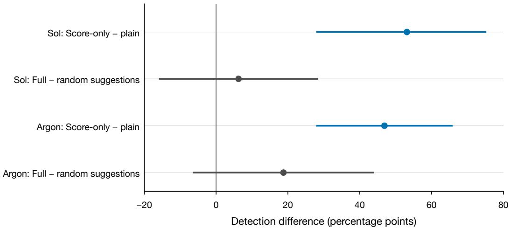  
Figure 9: Prompt gains are clearer than setting-specific gains in this pilot. Diferences across 16 selected worlds at $T = 3 0$ ; whiskers are descriptive 95% world-bootstrap intervals. The original ablation uses historical reference arms; Argon retains one or two campaigns per world after failures and earlier spend caps. The score-only prompt also supplies framing and reference guidance.

## I Limitations

The completed empirical worlds are low-dimensional simulators with planted misspecification; most earlier studies infer on finite grids, while the independent-prior study profiles a continuous logistic null and retains its negative confirmation decision. The new crossed study is a deliberately constructed mechanism benchmark, and previously unused ChickWeight/Puromycin and dose-response/soybean data supply fitted-curve simulations rather than held-out-observation validation; four of seven generic families stayed essentially undetectable at $T = 6 0$ and $T = 2 0 0$ , and in the two mechanistic environments the collapse was partial or absent (Section G.4). The expansion $\mathcal { M } _ { 1 }$ is a generic bump class; when the truth lies far from $\mathcal { M } _ { 1 }$ , detection (Theorem 3 still applies) and especially the accuracy gain from expansion will be smaller. Theorem 7 assumes the expansion contains the truth and that the selected designs accumulate separation against every null parameter; we do not prove that the adaptive rule (8) does. The fixed-truth certificate also requires a finite expansion containing the truth; randomly drawn of-grid truths need not satisfy that assumption. The continuous confidence-set extension needs a separately declared family containing the truth. Its implemented global risk reference has analytical checks and a small integrated feasibility study, which yields no intervention savings and does not establish useful performance. Neither calibration justifies the heuristic $u ^ { \star } = \log ( 1 / \alpha ) / T$ , nor the final gate $b ^ { \star } = \log ( 1 / \alpha ) / T$ . The revised gate passed registered point criteria on two fresh panels and a reused-world horizon-transfer comparison; it is not proved, and the same calibration failed for the earlier ignorance trigger. The frozen absolute gate $b ^ { \star } = 0 . 1$ failed on continuous-null panels at $T = 2 4 0$ and $T = 4 8 0$ . The two-model trigger counterexample shows that even a correct target choice can cease too early. The frontier-model evidence is a pilot: four models from two providers, one prompt, 1–2 campaigns per world, and 15 of 16 worlds for GPT-6 Astra. The sampled models show similar efects across two providers; generality across prompts, selection of worlds, and agent scafolds is untested. Frontier-model worlds were chosen for high random-design detection in earlier simulations, and campaign counts are small and sometimes truncated by spend caps. Capability, architecture, provider and prompting vary together, preventing a causal capability claim. Expected Brier risk includes irreducible outcome noise; a small relative premium in total risk need not be small relative to excess predictive error. Future comparisons should report both quantities and absolute risk diferences. World-level uncertainty should distinguish variation across worlds from sampling uncertainty within campaigns. Most older simulator policies expand on rejection, whereas the independent-prior study and LLM harness score the fixed working model; their prediction-risk results therefore concern diferent revision policies. The completed primary comparison provides no eligible confirmation horizon, and the truth-informed diagnostic is retrospective rather than an available scientific policy.

## J Experimental details

Table 5: The seven design families. Each has 25 designs and a grid-exact working model $\mathcal { M } _ { 0 }$ “Deviation scale” A sets the amplitude of planted deviations and of the expansion $\mathcal { M } _ { 1 }$ , in link units (logit, mean, or log rate).
<table><tr><td>Family</td><td>Designs</td><td>Working model</td><td>Outcomes</td><td>A</td></tr><tr><td>Dose-response</td><td> $x \in [ - 4 , 8 ]$ </td><td> $\mathrm { l o g i t } p = b ( x - a ) \ ( 3 1 \times 2 0 )$ </td><td>Bernoulli</td><td>3.0</td></tr><tr><td>Linear</td><td> $x \in [ - 1 , 1 ]$ </td><td> $\mu = \alpha + \beta x ~ ( 2 5 \times 2 5 )$ </td><td>Gaussian,  $\sigma = 0 . 5$ </td><td>1.0</td></tr><tr><td>Michaelis-Menten</td><td> $S \in [ 0 . 1 , 1 0 0 ] .$ </td><td> $\mu = V _ { \mathrm { m a x } } S / ( K _ { m } + S ) \ ( 2 5 \times 2 5 )$ </td><td>Gaussian,  $\sigma = 0 . 1$ </td><td>0.3</td></tr><tr><td>PK decay</td><td> $t \in [ 0 . 2 5 , 1 2 ]$ </td><td> $\mu = C _ { 0 } e ^ { - k t } \ ( 2 5 \times 2 5 )$ </td><td>Gaussian,  $\sigma = 0 . 0 8$ </td><td>0.25</td></tr><tr><td>Poisson rate</td><td> $x \in [ 0 , 1 ]$ </td><td> $\log \lambda = \alpha + \beta x ~ ( 2 5 \times 2 5 )$ </td><td>Poisson, 0-15+</td><td>0.8</td></tr><tr><td>Discounting (2-D) delay × ratio,</td><td></td><td> $\mathrm { l o g i t } p = ( R / ( 1 + k D ) - 1 ) / \tau ( 2 5 \times 2 5 )$ </td><td>Bernoulli</td><td>2.0</td></tr><tr><td>Logistic (2-D)</td><td> $[ - 1 , 1 ] ^ { 2 } , 5 \times 5$ </td><td> $\mathrm { l o g i t } p = s ( u ^ { \top } x - c ) \ ( 1 6 \times 9 \times 4 )$ </td><td>Bernoulli</td><td>2.5</td></tr></table>

Outcomes and inference. Gaussian outcomes are reported in 16 bins (14 interior bins between fixed edges plus two open tails), so the likelihood of every grid point is exact. Poisson counts above 14 share one tail class. Posteriors over $\mathcal { M } _ { 0 }$ and $\mathcal { M } _ { 1 }$ start uniform on their grids and are updated exactly.

Expansion and truths. $\mathcal { M } _ { 1 }$ adds g A $\exp ( - \Vert \tilde { x } - c \Vert ^ { 2 } / ( 2 \cdot 0 . 1 2 ^ { 2 } ) )$ in link units to every member of $\mathcal { M } _ { 0 }$ , with design coordinates x˜ scaled to $[ 0 , 1 ] , g \in \{ \pm 0 . 5 , \pm 1 \}$ and centres $c \in \{ 0 . 1 , 0 . 3 , 0 . 5 , 0 . 7 , 0 . 9 \}$ (1-D) or $\{ 0 . 1 5 , 0 . 5 , 0 . 8 5 \} ^ { 2 }$ (2-D); $g = 0$ recovers $\mathcal { M } _ { 0 } . \mathrm { ~ \normalfont ~ \AA ~ }$ truth starts from a parameter drawn uniformly from the interior of the $\mathcal { M } _ { 0 }$ grid. A bump adds a Gaussian deviation with amplitude $\pm U ( 0 . 5 , 1 ) A$ , centre $U [ 0 , 1 ] ^ { d }$ and width log-uniform on [0.04, 0.3]. A smooth deviation is a sum of three random cosines with amplitudes $N ( 0 , ( A / 2 ) ^ { 2 } )$ and frequencies U(0.3, 1.5). Well-specified controls add nothing.

Policies and metrics. Greedy EIG maximizes expected information gain about the $\mathcal { M } _ { 0 }$ parameter at each step. After detection with expansion on, every policy designs greedily under $\mathcal { M } _ { 1 }$ . Protected risk is half the expected multiclass Brier score of the posterior predictive against the truth, averaged uniformly over the 25 designs; for binary outcomes it equals the usual Brier score. Every (world, policy) cell uses 200 independent seeds; $T = 6 0 , \alpha = 0 . 0 5$

Reproducibility. All experiments run from one Python package with a fixed command; each result is tied to a recorded commit and run. Runs cited in this draft: generality gate (fixed-class accuracy, Figure 3b), valid-detector re-test (detection and budgets, Figures 3a and 4), and theory check (Section G.1). A separate run reproduces the original pilot study to five decimals.

## K Fixed-truth calibration and limits of adaptive probing

The following statements concern one fixed, finite, strictly positive expansion. They do not transfer a finite-grid guarantee to a continuous scientific null or to truths outside the expansion.

## K.1 A conditional detect-or-resolve statement

Let $\mathcal { M } _ { 0 } ~ \subset ~ \mathcal { M } _ { 1 }$ be finite, $m \ = \ \vert \mathcal { M } _ { 1 } \vert$ , and let $P \in \mathcal { M } _ { 1 } \backslash \mathcal { M } _ { 0 }$ . Use a uniform prior on $\mathcal { M } _ { 1 }$ and the detector (1). For $g \in \mathcal { M } _ { 1 }$ write $\begin{array} { r } { S _ { g , t } = \sum _ { s < t } d _ { g } ( a _ { s } ) } \end{array}$ , with $d _ { g }$ defined as in (4). Define $W = \{ g : \ p _ { g } ( \cdot \mid x ) \neq P ( \cdot \mid x )$ for some x with $\mu ( x ) > 0 \}$ . If W is empty then $U _ { t } = 0$ identically. Otherwise fix $0 < u \leq$ log m and set

$$
c _ { \mathrm { d e t } } = \log ( m / \alpha ) + 2 \log ( m / \beta ) , \qquad c _ { \mathrm { r e s } } = 2 \log ( m / \beta ) + 2 \log ( 2 | W | / u ) .
$$

Proposition 14 (Conditional detect or resolve). Under every predictable policy there is an event of P-probability at least $1 - \beta$ on which, simultaneously in time,

$$
\tau > t \implies R _ { t } < c _ { \mathrm { d e t } } , \qquad U _ { t } \geq u \implies \operatorname* { m i n } _ { g \in W } S _ { g , t } < c _ { \mathrm { r e s } } .
$$

Call a design ∆-informative i $\begin{array} { r } { \mathrm { { ' } m i n } _ { \theta \in { \mathcal { M } } _ { 0 } } d _ { \theta } ( a ) \geq \Delta } \end{array}$ or min $_ { g \in W } d _ { g } ( a ) \geq \Delta$ . On the same event, if $\tau > T$ and $U _ { T } \geq u$ , fewer than $( c _ { \mathrm { d e t } } + c _ { \mathrm { r e s } } ) / \Delta$ of the first $\bar { T }$ designs are ∆-informative.

Proof. For each $g \neq P$ , the normalized square-root likelihood-ratio martingale from Theorem $7$ and a union bound over at most m members give an event of probability at least $1 - \beta$ on which

$$
\log ( L _ { g , t } / L _ { P , t } ) < - S _ { g , t } + 2 \log ( m / \beta ) \quad \mathrm { f o r ~ a l l ~ } g \neq P , t .
$$

The numerator is at least $L _ { P , t } / m ,$ , so log $E _ { t } > R _ { t } - \log m - 2 \log ( m / \beta )$ , proving the detection implication. Put $\varepsilon = w _ { t } ^ { 1 } ( W )$ . Members outside W agree with P on the target. Grouping that common predictive component and then bounding the entropy of the remaining |W| labels gives, when $\varepsilon > 0$

$$
U _ { t } \leq \varepsilon + \varepsilon \log ( | W | / \varepsilon ) < 2 \sqrt { \varepsilon | W | } .
$$

Indeed the common component contributes at most $- ( 1 - \varepsilon ) \log ( 1 - \varepsilon ) \leq \varepsilon$ , and the remaining label entropy is at most $\varepsilon \log ( | W | / \varepsilon )$ . For $v = \varepsilon / | W | \leq 1$ , use v log $( 1 / v ) \leq ( 2 / e ) \sqrt { v }$ and $\varepsilon \leq { \sqrt { \varepsilon | W | } }$ . If $\varepsilon = 0$ then $U _ { t } = 0$ directly. If every $S _ { g , t }$ for $g \in W$ were at least $c _ { \mathrm { r e s } }$ , then

$$
\varepsilon \leq \sum _ { g \in W } L _ { g , t } / L _ { P , t } < | W | ( m / \beta ) ^ { 2 } e ^ { - c _ { \mathrm { r e s } } } = u ^ { 2 } / ( 4 | W | ) ,
$$

contradicting $U _ { t } \geq u$ . Finally, count the designs satisfying each of the two informativeness conditions. Nonnegative separation gives $R _ { T } \geq n _ { \mathrm { d e t } } \Delta$ and $\begin{array} { r } { \operatorname* { m i n } _ { g \in W } S _ { g , T } \geq n _ { \mathrm { r e s } } \Delta } \end{array}$ ; their sum bounds the union count. □

Intersect this event at level $\beta / 2$ with Proposition 10 at level $\beta / 2$ . If every targeted design is ∆-informative, then by $T = \lceil ( c _ { \mathrm { d e t } } + c _ { \mathrm { r e s } } ) / \Delta \rceil$ , with constants evaluated at $\beta / 2$ , some $t \in \{ 0 , \ldots , T \}$ has either $\tau \leq t$ or $U _ { t } < u$ . In the latter case the expanded-predictive error is below $2 m u / \beta ,$ , while working-predictive error is below $2 m ( u + D _ { t } ) / \beta$ . The timing uses $U _ { t }$ to choose action $a _ { t + 1 } ;$ resolution at time zero is allowed. This is an existence statement, not permanent resolution. The pointwise informativeness condition is stronger than separation obtained by complementary designs and has not been established for either greedy acquisition rule in this paper.

## K.2 Predictive cancellation

Let actions be $a , x ,$ , target $\delta _ { x }$ , null $\theta = ( 1 / 2 , 1 / 2 )$ , and a uniform expansion $\{ \theta , P , P ^ { \prime } , h \}$ , where probability pairs at $( a , x )$ are $P = ( 1 / 2 , 9 / 1 0 ) , P ^ { \prime } = ( 1 / 2 , 1 / 1 0 )$ and $h = ( 9 / 1 0 , 1 / 2 )$ . Along the auxiliary experiment that always chooses $a ,$ , weights take the form $( v , v , v , 1 - 3 v )$ with $v =$ $1 / ( 3 + L _ { h } / L _ { P } )$ . The predictive at x is exactly $1 / 2$ , whereas at a it is $9 / 1 0 - 6 v / 5 > 1 / 2$ for every finite history. Thus predictive-KL targeting uniquely chooses $a$ in exact arithmetic. Ville’s inequality gives probability at least $3 / 4$ that $L _ { h } / L _ { P } < 4$ for all time, hence $v > 1 / 7$ and $U _ { t } > 2 \mathrm { k l } ( 9 / 1 0 \lVert 1 / 2 ) / 7 > 0 . 1$ Under the always-a experiment, $P$ and θ induce identical observations; null validity bounds the probability of any rejection by α. On the intersection of these two events the actual U-triggered policy coincides with the always-a experiment forever. With probability at least $3 / 4 - \alpha$ it never rejects and its working and expanded target errors both remain $\operatorname { k l } ( 9 / 1 0 \Vert 1 / 2 )$ . Finite-precision rounding may change vanishing score diferences into ties; this infinite-horizon argument assumes exact arithmetic and does not follow from a finite simulation alone.

## K.3 Premature return to the base policy

Proposition 15 (A correct target score does not repair the ignorance trigger). There is a strictly positive two-model expansion containing the truth for which both predictive-KL and posterior-expecteddiscrepancy targeting choose the useful design, but the rule with U trigger 0.1 takes exactly one useful observation and never rejects at $\alpha = 0 . 0 5$ , on every response path.

Proof. Use actions $a , x ,$ target $\delta _ { x }$ , working law $\theta = ( 1 / 2 , 1 / 2 )$ , true law $P = ( 1 / 2 , 9 / 1 0 )$ and the uniform expansion $\{ \theta , P \}$ . Let the base always choose a, a valid deterministic EIG tie rule under the singleton null. Both target scores are zero at a and positive at x at every finite nondegenerate posterior. Initially $U _ { 0 } = 0 . 1 0 1 7 4 9 2 2 5 \ldots > 0 . 1$ . After the first observation at $x _ { i }$ , success gives weight $w ( P ) = 9 / 1 4$ and $U _ { 1 } = 0 . 0 9 7 8 1 6 5 0 5 \ldots ;$ failure gives $w ( P ) = 1 / 6$ and $U _ { 1 } = 0 . 0 5 2 4 2 8 6 1 9$ Thus both branches return to a. Because the models agree at $^ { a , }$ all later posterior weights and likelihood ratios remain fixed. The sequence statistic stays respectively at $7 / 5$ or $3 / 5$ , below 20, while working target error remains $\mathrm { k l } ( 9 / 1 0 \| 1 / 2 ) = 0 . 3 6 8 0 6 4 2 0 7 \dots$ . The same branch inequalities hold at $u = \log ( 2 0 ) / 3 0$ . Exact rational weights and outward 60-digit logarithm enclosures verify the stated strict inequalities; no sampling is used. □

The stated deterministic base tie rule is essential to the forever claim. A randomized-tie or forced-coverage base that keeps visiting x can accumulate evidence after the targeted branch stops. This is not a zero-power statement for every U-triggered policy.

After success in this construction $B _ { 1 } = 0 . 2 3 6 6 1 2 7 0 4 . . . > 0 . 1$ despite $U _ { 1 } < 0 . 1$ , so a whole-B gate continues at that history. After failure, $B _ { 1 } = 0 . 0 6 1 3 4 4 0 3 4 \ldots < 0 . 1$ ; this threshold itself is not a calibrated fixed-truth guarantee. Targeting, trigger calibration and realized probing efort therefore require separate comparisons. Neither changing the score nor using the same numeric threshold on B establishes a universal repair. In fact the first target failure has true probability 1/10. On that branch the $B \geq 0 . 1$ rule also returns permanently to $^ { a , }$ with statistic $3 / 5$ and true target KL error $0 . 3 6 8 0 6 4 2 0 7 \ldots > 0 . 1$ . Thus even with a represented truth it has probability at least 0.1 of permanent return above that error margin. If that return is interpreted as reassurance, its error probability exceeds a proposed frequentist risk budget $\beta = 0 . 0 5$ . The same deterministic base assumption is essential. This branch does not contradict improvement on the separately tested four-model construction or other empirical worlds; it rules out treating the numeric $B$ trigger as a general calibrated guarantee. Exact rational branch probability and outward enclosures verify this deduction without sampling.

## K.4 A conditional forced-targeting safety net

An independent decaying exploration coin addresses permanent cessation, under a stronger design condition than has been proved for our acquisition objective. This is a corollary of Theorem $^ { 7 , }$ rather than a new inference principle. Let potential independent coins $F _ { t }$ have probabilities $\epsilon _ { t } \in [ 0 , 1 ]$ independently of response randomness, and before rejection choose a targeted design whenever the ordinary gate opens or $F _ { t } = 1$

Proposition 16 (Conditional eventual detection and extra-probe cost). Use the finite positive null and represented truth, uniform expansion prior and proper mixture detector of Theorem 7. Suppose every forced target selected before rejection satisfies minθ∈Θ $d _ { \theta } ( a _ { t } ) \geq \Delta > 0$ $I f \sum _ { t } \epsilon _ { t } = \infty$ , then $\Pr ( \tau < \infty ) = 1$ . Writing $\begin{array} { r } { S _ { T } = \sum _ { t < T } \epsilon _ { t } } \end{array}$ , if

$$
\Delta S _ { T } / 2 \geq \log ( 1 / \alpha ) + \log | \mathcal { M } _ { 1 } | + 2 \log ( | \Theta | / \beta ) ,
$$

then $\operatorname* { P r } ( \tau \le T ) \ge 1 - \beta - \exp ( - S _ { T } / 8 )$ . The expected number of additional forced probes taken while the ordinary gate is closed is at most $S _ { T }$ . For $\epsilon _ { t } = c / \sqrt { t } , 0 < c \leq 1$ , this is at most $2 c \sqrt { T }$

Proof. Let $\begin{array} { r } { Z _ { T } = \sum _ { t < T } F _ { t } } \end{array}$ , defining potential coins even after rejection. On $\{ \tau > T \}$ , at least $Z _ { T }$ observations are informative, hence $R _ { T } \ge \Delta Z _ { T }$ . The restriction to this event matters because targeting may cease after rejection. On the simultaneous good event of Theorem $^ { 7 , }$ this lower bound forces rejection once suficiently large. If the coin probabilities have infinite sum, independent Borel–Cantelli gives $Z _ { T } \to \infty$ almost surely. Therefore $\operatorname* { P r } ( \tau = \infty ) \leq \beta$ for every $\beta > 0$ , which proves eventual rejection. For finite $T ,$ the independent Bernoulli Chernof bound gives $\mathrm { P r } ( Z _ { T } <$ $S _ { T } / 2 ) \leq e ^ { - S _ { T } / 8 } ;$ ; combine it with the theorem by a union bound. Finally the additional-probe indicator is bounded by $F _ { t } ;$ take expectations and use $\begin{array} { r } { \sum _ { t \leq T } t ^ { - 1 / 2 } \leq 2 \sqrt { T } } \end{array}$ □

The cost bound concerns additional cold-gate probes, under any truth; it does not bound all ordinary-gate probes or the total-efort diference between two policies whose histories diverge. Nor does it calibrate a numeric B threshold. The separation condition is not established for expecteddiscrepancy targeting in general and does not cover complementary designs that are informative only jointly. Truths outside the finite expansion and numerical posterior underflow also lie outside this exact-arithmetic guarantee.

## K.5 Cyclic coverage with an alternative that need not contain the truth

The preceding forced-target result assumes each forced target separates the truth from every null member. A diferent policy can replace that assumption with identifiability across the available actions. Forced exploration in controlled sensing, including schedules producing order- $\sqrt { T }$ visits to each control, is established (Deshmukh et al., 2019). The following is a composition with Proposition 8, not a new general testing principle or a guarantee for the targeted-floor policies already evaluated.

Let $m = | A | < \infty$ , let the outcome alphabet have $K \geq 2$ categories, and let Θ be a finite nonempty strictly positive null. Assume a stationary, strictly positive categorical truth $P$ satisfies

$$
{ \mathrm { f o r ~ e v e r y ~ } } \theta \in \Theta , \quad { \mathrm { t h e r e ~ e x i s t s ~ } } a \in { \mathcal { A } } { \mathrm { ~ w i t h ~ } } P _ { a } \neq p _ { \theta , a } .
$$

Write $d _ { \theta } ( a )$ as in (4) and define

$$
D _ { * } = \operatorname* { m i n } _ { \theta \in \Theta } \sum _ { a \in \mathcal { A } } d _ { \theta } ( a ) > 0 .
$$

The agent need not know $D _ { * }$ or P. Before outcomes are observed, draw independent potential coins $F _ { t } \sim \mathrm { B e r n o u l l i } ( \epsilon _ { t } )$ , independent of response randomness. Before rejection, a forced coin selects the next action in a fixed full cycle through ${ \mathcal { A } } ,$ with priority over the ordinary targeting gate. Other choices may follow any predictable rule. After rejection the override may stop. Use a proper sequence likelihood $Q _ { t }$ with a fixed universal component satisfying $Q _ { t } \geq \lambda L _ { \mathrm { s a t } , t } , 0 < \lambda \leq 1$ , and reject at $\tau = \operatorname* { i n f } \{ t : Q _ { t } / \operatorname* { m a x } _ { \theta } L _ { \theta , t } \geq 1 / \alpha \}$

Corollary 17 (Coverage suficient for eventual detection). Let $\begin{array} { r } { S _ { T } = \sum _ { t \le T } \epsilon _ { t } } \end{array}$ . For $0 < \alpha , \beta < 1$ , if

$$
\begin{array} { c } { \displaystyle \left\lfloor \frac { S _ { T } } { 2 m } \right\rfloor D _ { * } \geq \log ( 1 / \alpha ) + \log ( 1 / \lambda ) + 2 \log ( | \Theta | / \beta ) } \\ { + m ( K - 1 ) \log ( T + K - 1 ) , } \end{array}\tag{10}
$$

then $\operatorname* { P r } _ { P } ( \tau \le T ) \ge 1 - \beta - \exp ( - S _ { T } / 8 )$ . For $\epsilon _ { t } = c / \sqrt { t } , 0 < c \leq 1$ , eventual rejection has probability one. The expected number of completed coverage-route observations before rejection and through $T$ is at most $S _ { T } \leq 2 c \sqrt { T }$ . The likelihood test retains level-α validity for each null member.

Proof. Define $\begin{array} { r } { Z _ { T } = \sum _ { t < T } F _ { t } } \end{array}$ , including potential coins after rejection. On $\{ \tau > T \}$ , the full cycle gives at least $\lfloor Z _ { T } / m \rfloor$ observations at every action. Nonnegativity of $d _ { \theta } ( a )$ implies $R _ { T } \geq \lfloor Z _ { T } / m \rfloor D _ { * }$ on this event, even when a single action has min $d _ { \theta } ( a ) = 0$ . Proposition 8 and the fixed mixture component give, with probability at least $1 - \beta ,$ , simultaneously at every time,

$$
\log \frac { Q _ { T } } { \operatorname* { m a x } _ { \theta } L _ { \theta , T } } \geq R _ { T } - C _ { T } - 2 \log ( | \Theta | / \beta ) + \log \lambda .
$$

The count bound in (7) satisfies $C _ { T } \le m ( K - 1 ) \log ( T + K - 1 )$ . The independent Bernoulli Chernof bound is $\operatorname* { P r } ( Z _ { T } < S _ { T } / 2 ) \le \exp ( - S _ { T } / 8 )$ . Thus, on the intersection of the two good events, (10) contradicts $\tau > T$ . A union bound proves the finite-horizon claim. With $\epsilon _ { t } = c / \sqrt { t } , S _ { T } \sim 2 c \sqrt { T }$ dominates log T. For each fixed $\beta > 0$ the condition eventually holds, yielding $\operatorname* { P r } ( \tau = \infty ) \leq \beta ;$ let $\beta \downarrow 0$ . The coverage-route indicator is at most $F _ { t }$ , giving the expected-count bound under any truth. Finally, under a null member, $Q _ { t } /$ maxθ $L _ { \theta , t } \leq Q _ { t } / L _ { \theta , t } ;$ whose right-hand side is a nonnegative likelihood-ratio martingale for the same adaptive policy. Ville’s inequality proves validity. □

For example, with two Bernoulli actions, truth $( 1 / 5 , 1 / 5 )$ , and null members $( 1 / 5 , 4 / 5 )$ and $( 4 / 5 , 1 / 5 )$ , each action separately has zero minimum separation. The mismatched afinity is $4 / 5$ so $D _ { * } = - 2 \log ( 4 / 5 ) > 0 ;$ cycling supplies joint evidence. The finite-time bound is conservative and can be vacuous at realistic budgets. It establishes neither a numerical gate calibration nor superiority over uniform, balanced or cost-aware allocation. It bounds coverage-route counts, not all ordinary-gate probes, physical cost without action prices, or the total-efort diference between policies with diferent histories. An unbounded continuation with a diverging coverage budget is essential to the asymptotic claim; a hard fixed override cap does not satisfy that premise. The argument does not cover a continuous null by replacing it with a grid, growing action sets, or nonstationary outcomes. The suficient universal-coding argument needs separation to dominate its logarithmic penalty; mere infinite exploration is not enough to establish that using this bound. This observation does not prove that slower exploration schedules fail.

## K.6 Compact continuous nulls and numerical likelihood error

A finite inference grid does not replace the scientific null. This subsection extends the coverage calculation to a compact continuous null under an explicit log-likelihood covering condition. Cover ing arguments for likelihood confidence sets and regret-to-confidence conversions are established (Kirschner et al., 2025); the contribution here is the stated combination with cumulative separation, universal alternative coding, cyclic coverage and certified numerical error. It is not a new genera inference principle.

Let A and Y be fixed finite sets, $m = | \mathcal { A } | \geq 1 , K = | \mathcal { V } | \geq 2$ , and let P be a stationary strictly positive categorical truth: the next response has conditional law $\textstyle P ( \cdot \mid a _ { t } )$ given the history and chosen action. Let Θ be nonempty and compact, and let $p _ { \theta } ( y \mid a ) > 0$ be continuous in θ for each $( a , y )$ . Use any common predictable policy and a proper sequence likelihood $Q _ { T } \ge \lambda L _ { \mathrm { s a t } , T }$ with fixed $0 < \lambda \leq 1$ . Write $f _ { T } ( \theta ) = \log L _ { \theta , T } , f _ { T } ^ { * } = \operatorname* { s u p } _ { \theta \in \Theta } f _ { T } ( \theta )$ , and $\begin{array} { r } { R _ { T } = \operatorname* { i n f } _ { \theta \in \Theta } \sum _ { s < T } d _ { \theta } ( a _ { s } ) } \end{array}$ . Let $H _ { j } = 2 ^ { j } , j = 0 , 1 , . . . ,$ and let $j ( T ) = \lceil \log _ { 2 } T \rceil$ . For each epoch, suppose a deterministic finite set $\Theta _ { j } \subset \Theta$ , of cardinality $N _ { j }$ , satisfies

$$
\operatorname* { s u p } _ { \theta \in \Theta } \operatorname* { i n f } _ { \vartheta \in \Theta _ { j } } \operatorname* { m a x } _ { a , y } \vert \log p _ { \theta } ( y \vert a ) - \log p _ { \vartheta } ( y \vert a ) \vert \le \kappa _ { j } / H _ { j } .\tag{11}
$$

The set is a proof device, not a replacement denominator for the test.

Proposition 18 (Continuous-null cumulative separation). For every $0 < \beta < 1$ , with probability at least $1 - \beta$ , simultaneously for all positive integers $T _ { \perp }$

$$
\begin{array} { r } { \log Q _ { T } - f _ { T } ^ { * } \geq R _ { T } - C _ { T } - \log ( 1 / \lambda ) - \kappa _ { j ( T ) } } \\ { - 2 \log \left( \frac { N _ { j ( T ) } ( j ( T ) + 1 ) ( j ( T ) + 2 ) } { \beta } \right) , } \end{array}\tag{12}
$$

where $C _ { T }$ is the coding bound in (7). The test rejecting when log $Q _ { T } - f _ { T } ^ { * } \geq \log ( 1 / \alpha )$ retains anytime level α at every $\theta \in \Theta$

Proof. Set $\beta _ { j } = \beta / [ ( j + 1 ) ( j + 2 ) ]$ , so $\textstyle \sum _ { j } \beta _ { j } = \beta$ . For each epoch $j$ and $\vartheta \in \Theta _ { j }$ , use the squareroot likelihood-ratio martingale from Theorem 7. Ville’s inequality and a union bound over the deterministic cover give, except on an event of probability at most $\beta _ { j }$ , simultaneously for every $T$

$$
\log L _ { P , T } - \operatorname* { m a x } _ { \vartheta \in \Theta _ { j } } f _ { T } ( \vartheta ) \geq \operatorname* { m i n } _ { \vartheta \in \Theta _ { j } } \sum _ { s \leq T } d _ { \vartheta } ( a _ { s } ) - 2 \log ( N _ { j } / \beta _ { j } ) .
$$

The cover is contained in the null, so its minimum separation is at least $R _ { T }$ . At a time with $j = j ( T )$ we have $T \leq H _ { j }$ ; hence condition (11) gives $f _ { T } ^ { * } \leq \mathrm { m a x } _ { \vartheta \in \Theta _ { j } } f _ { T } ( \vartheta ) + \kappa _ { j }$ . Union over epochs and combine with the universal coding bound and fixed mixture weight. The likelihood ratio $Q _ { T } / L _ { \theta , T }$ is a nonnegative martingale under each null member for the same adaptive policy, and dominates $Q _ { T } / \exp ( f _ { T } ^ { * } )$ . Ville’s inequality proves validity. The latter statistic need not itself be a martingale or have valid conditional multiplicative increments. □

An explicit logistic cover. For $p _ { \theta } ( 1 ~ | ~ a ) = \sigma ( \theta ^ { \top } \phi ( a ) ) , \Theta = [ - B , B ] ^ { d } , B > 0$ , and $G \geq$ $\operatorname* { m a x } _ { a } \| \phi ( a ) \| _ { 1 } > 0$ , the log probability has gradient $( y - p _ { \theta } ( 1 \mid a ) ) \phi ( a )$ and is G-Lipschitz in the parameter $\ell _ { \infty }$ norm. A tensor grid with $n _ { j } = \lceil 2 B G H _ { j } \rceil$ equal intervals per coordinate is contained in Θ, has $N _ { j } = ( n _ { j } + 1 ) ^ { d }$ , and places a point within $B / n _ { j }$ in each coordinate. Thus (11) holds with $\kappa _ { j } = 1 / 2$ . For the nine-action scientific family $\sigma ( a + b x ) \ \mathrm { o n \ [ - 3 , 3 ] ^ { 2 } }$ and $x \in [ - 1 , 1 ]$ , one can take $d = 2 , B = 3 , G = 2$ , and $N _ { j } = ( 1 2 H _ { j } + 1 ) ^ { 2 }$ . This theoretical cover is not the $9 \times 9$ or $1 7 \times 1 7$ inference quadrature used by acquisition.

Separating validity from numerical power. Suppose verified numerical bounds provide $\ell _ { T } \le f _ { T } ^ { * } \le U _ { T } , \underline { { q } } _ { T } \le \log Q _ { T } \le \overline { { q } } _ { T }$ , and $\bar { b } _ { T } \geq \log ( 1 / \alpha )$ . Set $g _ { T } = U _ { T } - \ell _ { T } , w _ { T } = \bar { q } _ { T } - \underline { { q } } _ { T }$ , and $h _ { T } = \bar { b } _ { T } - \log ( 1 / \alpha )$ . The reported rejection margin obeys, on the same probability event,

$$
\begin{array} { r l } & { \frac { q _ { T } } { T } - U _ { T } - \bar { b } _ { T } \geq R _ { T } - C _ { T } - \log ( 1 / \lambda ) - \kappa _ { j ( T ) } } \\ & { \phantom { \frac { q _ { T } } { T } - } - 2 \log \biggr ( \frac { N _ { j ( T ) } ( j ( T ) + 1 ) ( j ( T ) + 2 ) } { \beta } \biggl ) - \log ( 1 / \alpha ) - ( g _ { T } + w _ { T } + h _ { T } ) . } \end{array}
$$

Here $U _ { T } - f _ { T } ^ { * } \leq g _ { T }$ , since $\ell _ { T } \leq f _ { T } ^ { * }$ ; analogous inequalities hold for numerator and threshold rounding. A lower threshold enclosure ${ \underline { { b } } } _ { T } \leq \log ( 1 / \alpha )$ gives the computable bound $h _ { T } \leq \bar { b } _ { T } - \underline { { b } } _ { T }$ . Rejecting only at a nonnegative reported margin preserves validity. A loose $U _ { T }$ can nevertheless prevent rejection indefinitely. If an implementation can remain unresolved or suppress a certified crossing for another reason, that behaviour requires a separate liveness condition; validity alone does not imply power.

Corollary 19 (Continuous-null coverage with controlled numerical error). Assume $P \neq p _ { \theta }$ as action-indexed distributions for every $\theta \in \Theta$ . Then $\begin{array} { r } { D _ { * } = \operatorname* { m i n } _ { \theta \in \Theta } \sum _ { a } d _ { \theta } ( a ) > 0 } \end{array}$ . Use the independent potential coins and full-cycle priority of Appendix K.5. Suppose all auxiliary acceptance conditions hold and a nonnegative reported margin triggers rejection at every analyzed time. On $\{ \tau > T \}$ suppose numerical error satisfies the deterministic envelope $g _ { T } + w _ { T } + h _ { T } \leq \eta _ { T } ,$ exact arithmetic has $\eta _ { T } = 0$ . If

$$
\begin{array} { r l } & { \left\lfloor \frac { S _ { T } } { 2 m } \right\rfloor D _ { * } \geq \log ( 1 / \alpha ) + \log ( 1 / \lambda ) + \kappa _ { j ( T ) } + \eta _ { T } } \\ & { \qquad + m ( K - 1 ) \log ( T + K - 1 ) + 2 \log \left( \frac { N _ { j ( T ) } ( j ( T ) + 1 ) ( j ( T ) + 2 ) } { \beta } \right) , } \end{array}\tag{13}
$$

then Pr $_ P ( \tau \le T ) \ge 1 - \beta - \exp ( - S _ { T } / 8 )$ . For the logistic cover, $\epsilon _ { t } = c / \sqrt { t } , 0 < c \leq 1$ , and $\eta _ { T } = o ( \sqrt { T } )$ , eventual rejection has probability one; expected coverage-route count through $T$ is at most $2 c \sqrt { T }$

Proof. Strict positivity, continuity and compactness make $\textstyle \sum _ { a } d _ { \theta } ( a )$ continuous with a strictly positive minimum: zero would require equality of both distributions at every action. On $\{ \tau > T \}$ ， the cycle implies $R _ { T } \ge \lfloor Z _ { T } / m \rfloor D _ { * }$ . Use Proposition 18, the numerical-margin bound, $C _ { T } \ \leq$ $m ( K - 1 ) \log ( T + K - 1 )$ and $\operatorname* { P r } ( Z _ { T } < S _ { T } / 2 ) \le \exp ( - S _ { T } / 8 )$ to contradict $\tau > T$ on both good events. With the specified logistic cover, all terms except ηT are ${ \cal O } ( \log T )$ , while $S _ { T } \sim 2 c \sqrt { T }$ . For every fixed $\beta > 0$ the condition eventually holds. Let $T \to \infty$ and then $\beta \downarrow 0$ . The expectedcount bound follows from the coverage indicator being at most $F _ { t }$ , independently of the numerical computation. □

The finite-time bound can be extremely conservative. Compactness, identifiability, a proper universal component, actual cyclic coverage and numerical liveness remain substantive premises. The theorem does not cover an unrestricted continuous action set, a noncompact null with zero separation infimum, nonstationarity, a hard fixed coverage cap or predictive-risk reassurance. In particular, it does not automatically validate the existing forced-target floor, the primary benchmark’s fixed scheduled allocations, or a finite-grid detector. The truth-dependent $D _ { * }$ and $R _ { T }$ are analysis quantities, not computable reassurance certificates for the agent. Its logarithmic covering penalty is not asserted optimal. Epoch allocation avoids a union over every integer horizon, but remains a standard deterministic union-bound construction.

## K.7 Confidence-set inversion beyond prior atoms

The posterior-mass bound in Proposition 10 uses a positive atom at the true law. Confidence-set inversion avoids that requirement. Let $\{ P _ { \eta } : \eta \in K \}$ be a separately declared compact family with strictly positive likelihoods and continuous likelihood and target-risk maps. For any proper predictable response-sequence likelihood $Q _ { t }$ , set

$$
{ \mathcal { C } } _ { t } = \{ \eta \in K : L _ { \eta , t } \geq \beta Q _ { t } \} , \qquad A _ { t } = \operatorname* { s u p } _ { \eta \in { \mathcal { C } } _ { t } } \sum _ { x } \mu ( x ) \mathrm { K L } ( P _ { \eta } ( \cdot \mid x ) \| p _ { t } ( \cdot \mid x ) ) .
$$

If $\mathcal { C } _ { t }$ is empty, report expansion insuficiency rather than reassurance; for the risk gate define $A _ { t } = + \infty$ in that case.

Proposition 20 (A protected-risk gate from likelihood confidence sets). For each fixed $P _ { \eta ^ { * } }$ in the declared family, under any predictable design policy, with probability at least $1 - \beta$ the true target error is at most $A _ { t }$ simultaneously in time. This does not require the numerator prior to assign positive point mass, or any support, to $\eta ^ { * }$ . Consequently returning to the base only when a certified upper bound on $A _ { t }$ is at most $\varepsilon$ has probability at most $\beta$ of ever reassuring while true protected error exceeds $\varepsilon .$

Proof. Under the fixed truth $P _ { \eta ^ { * } } , Q _ { t } / L _ { \eta ^ { * } , t }$ is a nonnegative mean-one martingale. Ville’s inequality bounds the probability that it ever reaches $1 / \beta$ by $\beta .$ . On the complement, $L _ { \eta ^ { * } , t } > \beta Q _ { t }$ for every t, so $\eta ^ { * } \in \mathcal { C } _ { t }$ and its target risk is bounded by the supremum defining $A _ { t }$ □

This is the standard likelihood-ratio confidence-sequence construction (Kirschner et al., 2025) applied to the protected-risk decision, not a new general inference principle. It controls target prediction error, not membership in $\mathcal { M } _ { 0 }$ , and assumes the truth belongs to the separately declared family. It does not require the truth to be a posterior quadrature point. However, maximizing risk only over that finite grid does not certify the continuous-family supremum. A valid numerical gate needs an outer confidence set and a global upper bound on risk. With outward likelihood intervals, prune a parameter region only if its likelihood upper bound is below a lower bound on $\beta Q _ { t }$ Bound risk over every unpruned region; unresolved optimization must not trigger reassurance. The continuous risk reference is now implemented for finite unions of bounded two-coeficient logistic families with fixed structural ofsets. It retains a complete binary partition, outward likelihood and risk bounds, and independently replayable feasible witnesses. Empty sets, exhausted budgets and unresolved enclosures do not permit reassurance. The reference is now coupled to a proper sequence numerator and pre-outcome campaign traces; the limited feasibility evaluation below does not establish an advantageous resource trade-of. No stopping-time or detection-power guarantee is claimed.

An analytical check separates sample count from design coverage. Let $a , b \in [ - 3 , 3 ] , p _ { a , b } ( x ) =$ $\sigma ( a + b x )$ , working probabilities $1 / 2 , \beta = 0 . 0 5 .$ , and collect 100 successes and 100 failures entirely at $x = 0$ . Use the proper fixed Bernoulli-1/2 sequence numerator $Q = 2 ^ { - 2 0 0 }$ . Writing $p _ { 0 } = \sigma ( a )$ the confidence condition is exactly $[ 4 p _ { 0 } ( 1 - p _ { 0 } ) ] ^ { 1 0 0 } \geq 0 . 0 5$ . Consequently $| a | \leq a _ { \mathrm { m a x } }$ with $a _ { \mathrm { m a x } } =$ $0 . 3 4 7 0 2 8 4 9 8 3 \ldots$ while b remains unrestricted. The exact risk suprema for targets $x = 0$ and $x = 1$ are respectively $\mathrm { k l } ( \sigma ( a _ { \mathrm { m a x } } ) \Vert 1 / 2 ) = 0 . 0 1$ 482998049 . . . and $\mathrm { k l } ( \sigma ( 3 + a _ { \mathrm { m a x } } ) \Vert 1 / 2 ) = 0 . 5 4 4 7 8 9 1 7 4 7 8$ The reference certifies the observed target below $\varepsilon = 0 . 0 2$ and exhibits a compatible risk exceeding 0.50228 at the unobserved target. The latter witness $( a , b ) = ( 0 , - 3 )$ stays compatible for every balanced even sample size at $x = 0$ , since its likelihood equals Q. These are analytical histories checked against a separate closed-form calculation, not measured power or observed truth error. Ten numerical checks and eight literal certificates validate the reference’s stated operations, not campaign-scale coverage, eficiency or scientific superiority.

## K.8 Integrated risk-gate feasibility

A registered short-horizon feasibility study uses six prospectively selected worlds from an independently generated 24-world development specification: two nulls, two matched bumps, one near-nul departure and one outside-prior quadratic departure. It runs 42 campaigns at $T = 1 2 \colon$ expected discrepancy, balanced coverage and class information, each with fixed scheduled interventions or risk-based safe suppression, plus no overrides. Four additional campaigns check primary/refined quadrature on two worlds and two fixed policies. Eligible slots number exactly two; suppression does not move a slot. Risk settings are fixed before collection: $\beta = 0 . 0 5$ , uniform action target, $\varepsilon = 0 . 1$ 50-digit arithmetic, at most 32 splits and depth 30. The declared continuous family contains the null and 18 fixed numerical structural ofsets, with $a , b \in [ - 3 , 3 ]$ . It is not a guarantee for every generated departure. Working prediction always remains under $\mathcal { M } _ { 0 }$

All 46 histories (552 observations) replay successfully; no collection failure or unresolved detector decision occurs. Every one of 36 gate evaluations finds a compatible model whose risk exceeds the margin. Consequently no intervention is suppressed, and all 18 gated/fixed pairs have identical actions, outcomes and prediction endpoints. No arm rejects on these short histories. Gate computation takes 89.0 seconds of 118.7 seconds total collection time, with 124.7 additional seconds for full replays; paired collection time is a median 15.3 times that of the corresponding fixed arm in this local run. Compressed records total 790,287 bytes. These timings are implementation and short-history measurements, not general complexity bounds. The result establishes integration feasibility while exposing conservatism and computation without observed experimental savings. It does not establish power, a preferred policy, family-wide empirical calibration or a confirmation-ready method.

## L When an ED gate does and does not imply remaining power

This analysis follows protocol commit df1ce0f, written after the integration review and conference draft. It is an analytical contribution with exact finite-state checks, not another empirical confirmation. The standard concentration tools are not new: horizon-aware betting already relates drift, wealth and time-to-go (Taga et al., 2026), and lower-tail control is central to power guarantees for test supermartingales (Forr´e, 2026). Our purpose is to test the logical implication used to motivate the ED gate, while retaining numerator regret and the remaining budget explicitly.

## L.1 A represented-truth, correctly specified-prior counterexample

Consider one Bernoulli action, null $p _ { 0 } = 1 / 2$ , expansion $\{ p _ { - } , p _ { + } \} = \{ 1 / 1 0 0 , 9 9 / 1 0 0 \}$ , and an equal prior. Use that same prior for both the planning posterior and the detector numerator. Either represented alternative can be the truth; all outcome probabilities are strictly positive. With k successes in t observations,

$$
E _ { t , k } = \frac { 2 ^ { t } } 2 \left\{ ( 9 9 / 1 0 0 ) ^ { k } ( 1 / 1 0 0 ) ^ { t - k } + ( 1 / 1 0 0 ) ^ { k } ( 9 9 / 1 0 0 ) ^ { t - k } \right\} .
$$

Both alternatives have the same divergence from the null,

$$
d = { \frac { 9 9 } { 1 0 0 } } \log { \frac { 9 9 } { 5 0 } } + { \frac { 1 } { 1 0 0 } } \log { \frac { 1 } { 5 0 } } = 0 . 6 3 7 1 4 5 6 4 6 2 \ldots .
$$

Consequently $B _ { t } = \mathrm { E D } _ { t } = d$ at every possible history, regardless of posterior weights. For $\alpha = 1 / 2 0$ and $T = 5$ this exceeds $\log ( 2 0 ) / 5 = 0 . 5 9 9 1 4 6 4 5 4 7 \ldots ^ { . }$ the gate is always open, every available

experiment is selected, and there is no acquisition bottleneck. Nevertheless, convexity in k puts the maximum sequence likelihood at $k = 0 , t ,$ , so for $1 \leq t \leq 5$

$$
\operatorname* { m a x } _ { k } E _ { t , k } = 2 ^ { t - 1 } \{ ( 9 9 / 1 0 0 ) ^ { t } + ( 1 / 1 0 0 ) ^ { t } \} \leq 2 ^ { t - 1 } \leq 1 6 < 2 0 .
$$

Detection probability is exactly zero under either represented truth and hence under the correctly specified expansion prior. At $t = 0 , E = 1$ . The sharper maximum at $t = 5$ is $1 5 . 2 1 5 8 4 0 8$ . Thus even persistent ED above the proposed threshold, correct representation, correct prior, and fully informative acquisition do not by themselves imply any positive power for this detector. The issue is a finite-horizon evidence margin and mixture coding cost, not failure to discover an informative setting. At $T = 6$ the exact crossing probability becomes $( 9 9 / 1 0 0 ) ^ { 6 } + ( 1 / 1 0 0 ) ^ { 6 } = 0 . 9 4 1 4 8 0 1 4 9 4 0 2$

## L.2 An exact deadline oracle on the same observations

The preceding zero-power result concerns the specified mixture detector. It is not an impossibility for all valid tests of these five observations. Deadline-optimal testing via a Neyman–Pearson rejection event and its null Doob martingale is established machinery (Clerico et al., 2026, Proposition 2). We apply that construction to the existing example, allowing an explicit auxiliary test randomization.

Let C be the event that all five outcomes agree, draw an independent $U \sim \mathrm { U n i f } [ 0 , 1 ]$ after the fifth outcome, and reject on $A = C \cap \{ U \leq 4 / 5 \}$ . Then

$$
\begin{array} { c } { { P _ { 0 } ( A ) = \displaystyle \frac { 4 } { 5 } \displaystyle \frac { 2 } { 2 ^ { 5 } } = \displaystyle \frac { 1 } { 2 0 } , } } \\ { { P _ { p _ { - } } ( A ) = P _ { p _ { + } } ( A ) = \displaystyle \frac { 4 } { 5 } \left\{ ( 9 9 / 1 0 0 ) ^ { 5 } + ( 1 / 1 0 0 ) ^ { 5 } \right\} } } \\ { { = 0 . 7 6 0 7 9 2 0 4 . } } \end{array}
$$

The null-conditional process $V _ { t } = P _ { 0 } ( \boldsymbol { A } \mid H _ { t } ) / \alpha$ is a nonnegative martingale starting at one. For $1 \leq t < 5$ it equals $2 ^ { t - 1 }$ on an all-equal prefix and zero otherwise; $H _ { 5 }$ includes $U _ { : }$ , so $V _ { 5 } = 2 0 \mathbf { 1 } _ { A }$ It cannot cross earlier, and it controls false rejection under arbitrary monitoring, including after the deadline if held constant. The auxiliary randomization is part of this oracle test, not another scientific observation or a component of the original detector.

This power is sharp for randomized tests against the two specified alternatives. The equalmixture likelihood ratio is maximized on $C ,$ at $L _ { \mathrm { { m a x } } } = 1 6 \{ ( 9 9 / 1 0 0 ) ^ { 5 } + ( 1 / 1 0 0 ) ^ { 5 } \}$ . Every level-α test $\psi$ has equal-prior average power at most $\alpha L _ { \mathrm { m a x } } = 0 . 7 6 0 7 9 2 0 4$ . Its worst-case power cannot exceed its average. Our symmetric test attains this bound under both alternatives, proving minimax optimality for this fixture. Thus the same informative data support substantial detection with a diferent deadline-specific statistic, while the original mixture still has exactly zero power. This strengthens the distinction between available information and evidence captured; it does not validate the ED gate constant or supply a practical continuous-null detector repair.

An exact rational checker covers horizons 1–12, constructs the randomized likelihood-ratio test, verifies its linear-program dual bound, and checks all 454 null-martingale transitions including terminal randomization. Original mixture first crossings are separately recomputed. This is an analytical follow-up to a known example, not a new empirical confirmation.

Conditional increments need a separate check. Conditional e-increments are a stronger premise than validity of an entire profile e-process (Sandoval et al., 2026; Lin et al., 2026). For one Bernoulli action with null parameters $\{ 1 / 5 , 4 / 5 \}$ and an independent Bernoulli- $1 / 2$ numerator,

$E _ { 1 } = 5 / 8$ . A repeated outcome gives $E _ { 2 } = 2 5 / 6 4 ;$ ; a mixed pair gives $E _ { 2 } = 2 5 / 1 6$ . Under the true null $p = 1 / 5$ , conditional on $Y _ { 1 } = 1$ 2

$$
\begin{array} { c } { { \mathbb { E } _ { 1 / 5 } [ E _ { 2 } / E _ { 1 } \mid Y _ { 1 } = 1 ] = \displaystyle \frac { 1 5 } { 5 } \displaystyle \frac { 4 } { 8 } + \frac { 4 } { 5 } \displaystyle \frac { 5 } { 2 } } } \\ { { = \displaystyle \frac { 1 7 } { 8 } > 1 . } } \end{array}
$$

The profile process retains its anytime-valid domination by each fixed-null likelihood-ratio martingale. Its value ratios cannot simply be inserted as conditionally valid one-step e-values into another algorithm. A faithful comparison requires an explicit valid construction for the shared null.

## L.3 A conditional bound that pays the missing costs

Fix an unrejected history $H _ { t }$ , a truth $p _ { h }$ , terminal time $T _ { i }$ , and finite null family Θ of size m. Let $n = T - t$ . For each θ define

$$
Z _ { s , \theta } = \log { \frac { p _ { h } ( Y _ { s } \mid a _ { s } ) } { p _ { \theta } ( Y _ { s } \mid a _ { s } ) } } , \qquad d _ { s , \theta } = \mathbb { E } _ { h } [ Z _ { s , \theta } \mid H _ { s - 1 } , a _ { s } ] = \operatorname { K L } ( p _ { h } ( \cdot \mid a _ { s } ) \| p _ { \theta } ( \cdot \mid a _ { s } ) ) .
$$

Actions are predictable, including their independent randomization. Suppose $Z _ { s , \theta }$ has conditional range of width at most deterministic $w _ { s , \theta }$ on every continuation, and set $\begin{array} { r } { V _ { \theta } = \sum _ { s = t + 1 } ^ { T } w _ { s , \theta } ^ { 2 } > 0 } \end{array}$ . All quantities below are conditional on this fixed history. Assume there is an event G of probability at least $1 - \eta$ on which, simultaneously,

1. the proper continuation numerator has regret at most r: $\begin{array} { r } { \log ( Q _ { T } / Q _ { t } ) \geq \sum _ { s = t + 1 } ^ { T } \log p _ { h } ( Y _ { s } \mid } \end{array}$ $a _ { s } ) - r ;$ ;

2. the selected designs satisfy $\textstyle \sum _ { s = t + 1 } ^ { T } d _ { s , \theta } \geq K _ { \theta }$ for every $\theta ;$

3. the implemented terminal log statistic is at least log $Q _ { T } - \operatorname* { m a x } _ { \theta }$ log $L _ { \theta , T } - \varepsilon$ , and the terminal threshold comparison is evaluated without another suppressing acceptance rule.

Here $r , \varepsilon$ and $K _ { \theta }$ are fixed given $H _ { t } ; \varepsilon \ge 0$ includes any proved denominator/numerator numerical loss. The range bounds must hold outside G as well. Failure of one of these premises must not silently be assigned zero probability. Write $b = \log ( 1 / \alpha ) , R _ { t } ( \theta ) = Q _ { t } / L _ { \theta , t }$ and

$$
A _ { \theta } = \log R _ { t } ( \theta ) + K _ { \theta } - r - \varepsilon - b .
$$

Proposition 21 (Conditional achievability with regret and numerical loss). If all $A _ { \theta } > 0$ , the probability of detection by T, conditional on $H _ { t }$ , is at least

$$
\left[ 1 - \eta - \sum _ { \theta \in \Theta } \exp \{ - 2 A _ { \theta } ^ { 2 } / V _ { \theta } \} \right] _ { + } .
$$

If a margin is nonpositive, replace that parameter’s summand by one, yielding the trivial lower bound. Zero-range parameters can instead be treated by their deterministic increments directly.

Proof. For a fixed θ, Hoefding’s conditional exponential bound, iterated over the predictable designs, gives

$$
P _ { h } \left( \sum _ { s = t + 1 } ^ { T } ( Z _ { s , \theta } - d _ { s , \theta } ) < - a \bigg | H _ { t } \right) \leq e ^ { - 2 a ^ { 2 } / V _ { \theta } } ( a > 0 ) .
$$

On G, the implemented terminal log statistic is at least

$$
\operatorname* { m i n } _ { \theta } \left\{ \log R _ { t } ( \theta ) + \sum _ { s = t + 1 } ^ { T } Z _ { s , \theta } \right\} - r - \varepsilon .
$$

If no crossing has occurred by $T .$ , this is below $b .$ For some $\theta$ the centered sum must then be below $- A _ { \theta }$ . A union bound over the finite null and a probability cost $\eta$ for $G ^ { c }$ prove the claim. Terminal crossing is suficient for crossing by $T ;$ there is no optional-stopping approximation. □

For an actual mixture containing truth h, its detector posterior weight $\pi _ { t } ^ { \mathrm { n u m } } ( h )$ gives the pathwise conditional regret bound $r = - \log \pi _ { t } ^ { \mathrm { n u m } } ( h )$ , with zero regret-failure probability. This is the numerator’s weight, not an interchangeable planning posterior. For a continuous scientific null the finite union requires a covering or other uniform argument, with its own approximation and complexity costs; substituting the inference grid is not valid. This proposition alone therefore does not certify the production continuous-null gate.

## L.4 A continuous logistic-null lower bound without a parameter grid

The finite-null union above cannot simply be applied to an inference grid. For the particular Bernoulli logistic family, however, centering removes the log-partition term and leaves an afine function of the null parameter. The result below combines this elementary geometry with standard conditional Hoefding concentration (Howard et al., 2018). It is a family-specific suficient bound, not a new concentration inequality. Lower-tail assumptions remain essential (Forr´e, 2026); no conditional e-increment property is asserted for ratios of successive profile statistics.

Condition on an unrejected history $H _ { t }$ . Let $p _ { s } = p _ { h } ( 1 \mid a _ { s } ) \in ( 0 , 1 )$ , where the actions are predictable, including their independent randomization, and let $x _ { s } = x ( a _ { s } )$ . The scientific null is $p _ { \theta } ( 1 \mid a ) = \sigma ( a _ { 0 } + a _ { 1 } x ( a ) )$ for $\theta = ( a _ { 0 } , a _ { 1 } ) \in \Theta = [ - 3 , 3 ] ^ { 2 }$ . Define $Z _ { s , \theta }$ and $d _ { s , \theta }$ as above, and let $\mathcal { V } = \{ - 3 , 3 \} ^ { 2 }$ contain the four vertices. Suppose deterministic numbers $V _ { v } \geq 0$ , fixed given $H _ { t }$ satisfy on every continuation

$$
\sum _ { s = t + 1 } ^ { T } \{ \log \mathrm { i t } p _ { s } - v _ { 0 } - v _ { 1 } x _ { s } \} ^ { 2 } \leq V _ { v } , \qquad v \in \mathcal { V } .
$$

These are squared conditional-range bounds for the centered log likelihood, not observed variances or fitted posterior uncertainty. Suppose an event $G$ has conditional probability at least $1 - \eta$ and, on $G ,$

1. the proper numerator satisfies lo $\begin{array} { r } { \mathsf { g } ( Q _ { T } / Q _ { t } ) \geq \sum _ { s = t + 1 } ^ { T } \log p _ { h } ( Y _ { s } \mid a _ { s } ) - r ; } \end{array}$

2. cumulative separation and the already accumulated evidence satisfy

$$
\operatorname* { i n f } _ { \theta \in \Theta } \left\{ \log R _ { t } ( \theta ) + \sum _ { s = t + 1 } ^ { T } d _ { s , \theta } \right\} \geq K ;
$$

3. the efective terminal log statistic, after conservative threshold padding, is at least log $Q _ { T } -$ ${ \operatorname* { s u p } } _ { \theta \in \Theta } \log L _ { \theta , T } - \varepsilon .$ , and rejection is evaluated when this efective statistic reaches $\log ( 1 / \alpha )$ any additional numerical acceptance guard succeeds.

Here $r , K , \varepsilon \geq 0$ except that K may have either sign, and these quantities are fixed given $H _ { t } ;$ the range bounds hold outside G as well. In particular, an unresolved production profile-gap guard must be charged to $G ^ { c }$ or otherwise ruled out, rather than silently treated as successful. The numerical loss ε includes any conservative threshold padding.

Proposition 22 (Four-corner continuous-null achievability). Write $A = K - r - \varepsilon - \log ( 1 / \alpha )$ . If $A > 0$ , conditional detection probability by T is at least

$$
\left[ 1 - \eta - \sum _ { v \in \mathcal { V } : V _ { v } > 0 } \exp \{ - 2 A ^ { 2 } / V _ { v } \} \right] _ { + } .
$$

For a common envelope V, a suficient margin for probability at least $1 - \eta - \beta$ is $K \geq r + \varepsilon +$ $\log ( 1 / \alpha ) + \sqrt { ( V / 2 ) \log ( 4 / \beta ) }$ , where $0 < \beta < 1$ . A nonpositive margin gives only the trivial bound. Zero-range vertices have identically zero centered noise and can be omitted when $A > 0$

Proof. The Bernoulli likelihood gives the exact centered identity

$$
Z _ { s , \theta } - d _ { s , \theta } = ( Y _ { s } - p _ { s } ) \{ \log \mathrm { i t } p _ { s } - a _ { 0 } - a _ { 1 } x _ { s } \} .
$$

Thus $\begin{array} { r } { N _ { \theta } = \sum _ { s = t + 1 } ^ { T } ( Z _ { s , \theta } - d _ { s , \theta } ) } \end{array}$ is afine in θ, pathwise. Every interior $N _ { \theta }$ is a convex combination of the four $N _ { v } .$ so in $\dot { \boldsymbol { \theta } } _ { \in \Theta } N _ { \theta } = \operatorname* { m i n } _ { v } N _ { v }$ . For each fixed vertex, conditional Hoefding’s lemma and iteration give $P _ { h } ( N _ { v } < - A \mid H _ { t } ) \le \exp ( - 2 A ^ { 2 } / V _ { v } )$ for $A > 0$ . On $G ,$ if all $N _ { v } \ge - A$ , the implemented terminal statistic is at least

$$
\operatorname* { i n f } _ { \theta \in \Theta } \left\{ \log R _ { t } ( \theta ) + \sum _ { s = t + 1 } ^ { T } d _ { s , \theta } + N _ { \theta } \right\} - r - \varepsilon \geq K - A - r - \varepsilon = \log ( 1 / \alpha ) .
$$

It rejects by T. A union bound over the four noise events and $G ^ { c }$ proves the result; no independence between vertices or between $G$ and the noise is needed. The common-envelope form follows by bounding the four summands. □

Only the centered noise reduces to corners. The cumulative-KL infimum and likelihood supremum remain over the whole continuous box, whose optimizers can be interior. Replacing the scientific denominator by four corner likelihoods would invalidate it. For $| x _ { s } | \le 1$ and $p _ { s } \in [ \delta , 1 - \delta ]$ $0 < \delta < 1 / 2$ , one available envelope is $V = ( T - t ) \{ \log ( ( 1 - \delta ) / \delta ) + 6 \} ^ { 2 }$ . This is deliberately conservative. The result allows arbitrary predictable actions but does not prove that the ED policy attains $K$ or bounds its numerator regret. It neither validates the gate constant nor reverses any failed empirical diagnostic.

Declared checks and non-vacuity. Exact rational response/action-coin tree checks at horizons 1–5 verify 34,100 centered-likelihood identities on 1,364 leaves with 25 parameter points, afine corner extrema and normalized exponential-martingale mass. They use a scaled-logit fixture with rational odds, not new scientific worlds. They corroborate the algebra; the proof of concentration is the conditional Hoefding argument, not these finite checks.

For a separate analytical example declared before evaluation, cycle the nine dyadic settings $x _ { j } = ( j - 4 ) / 4$ , set truth to $1 / 4$ at indices 0, 1, 7, 8 and $3 / 4$ elsewhere, use $\alpha = 1 / 2 0$ , and retain the proper partition hedge. On complete cycles the minimizing null is interior, $( a _ { 0 } , a _ { 1 } ) = ( \log ( 1 9 / 1 7 ) , 0 )$ symmetry makes the slope score zero, the mean success probability is $1 9 / 3 6$ , and convexity of Bernoulli cross entropy proves global optimality. The per-observation minimum KL is $d = H ( 1 9 / 3 6 ) -$

$H ( 1 / 4 ) = 0 . 1 2 9 2 6 8 0 3 1 2 5 \ldots ,$ with binary entropy H. For T cycling observations, $K \geq 9 \lfloor { T } / { 9 } \rfloor d ;$ any remaining visit adds nonnegative KL, without assuming that the unbalanced allocation has the same minimizer. The three truth blocks give the conservative regret

$$
r \leq \log 2 + \log 9 + \log 2 8 + \sum _ { B = 1 } ^ { 3 } \log ( N _ { B } + 1 ) + 3 \log ( 1 1 / 7 ) ,
$$

using $\pi / 2 < 1 1 / 7$ in Appendix M.7. The numerator does not receive the truth. For the ideal exact-profile detector, $\eta = \varepsilon = 0$ and $V = T ( \log 3 + 6 ) ^ { 2 }$ . At the two declared horizons, $T = 1 8$ gives only zero as a lower bound; $T = 1 0 { , } 0 0 0$ gives a lower bound exceeding 0.9925, with $K \geq 1 2 9 2 . 5 5 1 0$ $r \ \leq \ 3 1 . 6 1 4 9$ and a failure bound below 0.00749. Outward 80-digit arithmetic encloses these expressions. They are mathematical bounds, not measured powers, a sample-size recommendation, or guarantees for the production numerical guard. The large suficient budget illustrates the bound’s looseness. No new horizon or candidate search was performed, and the registered reused-history failure of this numerator is unchanged.

## L.5 What would make a gate constant suficient?

Suppose the protected weighting is a probability measure on available actions, so ED maximization has score at least $B _ { s }$ . Suppose, on $G _ { i }$ , there are at least $\ell > 0$ remaining probes with $B _ { s } \geq c b / T$ and, for their chosen actions,

$$
\begin{array} { r } { \mathrm { K L } ( p _ { h } ( \cdot  { | } a _ { s } ) \| p _ { \theta } ( \cdot  { | } a _ { s } ) ) \geq \kappa \mathrm { E D } _ { s } ( a _ { s } ) \quad \mathrm { f o r ~ e v e r y ~ } \theta , \qquad \kappa > 0 . } \end{array}
$$

These are strong truth-specific coverage/calibration assumptions, not consequences of posterior correctness, an initially open gate, or large mean ED. Nonnegative KL on other steps gives $K _ { \theta } \geq { \kappa \ell c b } / { T }$ . For $V \geq \operatorname* { m a x } _ { \theta } V _ { \theta }$ and $0 < \beta < 1$ , it sufices that

$$
c \geq { \frac { T } { \kappa \ell b } } \left[ b - \operatorname* { m i n } _ { \theta } \log R _ { t } ( \theta ) + r + \varepsilon + { \sqrt { { \frac { V } { 2 } } \log { \frac { m } { \beta } } } } \right]
$$

to obtain conditional detection probability at least $1 - \eta - \beta$ . A negative right side can be replaced by zero. The chosen c still has to satisfy the coverage premise; this is a conditional implication, not a circular method for proving that the gate stays open. Complementary designs can relax pointwise calibration by directly lower-bounding cumulative $K _ { \theta }$

At $t = 0$ , even $\kappa = 1$ and $\ell = T$ leave coding, numerical and concentration penalties beyond b. Hence $c = 1$ cannot in general guarantee high power. A late history with little evidence or fewer remaining probes has a larger required budget. Conversely, favorable accumulated $R _ { t } ( \theta )$ can reduce the needed efort. The original gate uses none of these margins explicitly. This identifies why its observed successes do not turn its constant into a theorem. The earlier cumulative R´enyi suficiency result remains useful and requires no bounded log increments; the present conditional KL bound is not claimed uniformly sharper.

## L.6 Exact checks and their limits

A rational first-crossing dynamic program retains non-crossed probability mass at each success count, transfers it under the declared Bernoulli law, and absorbs mass only when the exact rational statistic reaches 20. All planned horizons 5, 6, 12, 20, 60, 120 are checked under both truths and the null. At $T = 5$ , every prefix count is exhaustively below threshold; at $T = 6$ the exact probability above is recovered. At terminal $T = 2 0$ , all 21 unrejected count-state prefixes through $t = 5$ have exact conditional power at least the bound. These checks corroborate arithmetic and indexing, not a proof for arbitrary policies. No response sequences are sampled. The suficient bound remains conservative; its role is an auditable implication with explicit premises, not a fitted replacement for the observed gate.

## M Independent audit of the later diagnostic and measured-data studies

These studies followed the earlier manuscript audit. Their registered failures remain failures. The initial audit used retained run logs without rerunning policy campaigns. The subsequent registered correction in Section M.5 is a separate empirical study.

## M.1 Four dificult bumps: signal capture on a fixed design

The post hoc diagnostic selected two matched bumps from each continuous-null panel: indices 7 and 11 at seed 2637501, $T = 2 4 0$ , and indices 9 and 8 at seed 2637601, $T = 4 8 0$ . The first three have zero observed detection for all four tested policies; the fourth has 6% detection under separation and the revised rule. Thus the description “every arm misses” is approximate for the fourth. The diagnostic uses the same float64 concavity denominator as those panels; its code’s word “certified” does not supply outward numerical certification.

For each truth, a floating-point constraint-generation calculation maximizes

$$
D ^ { * } = \operatorname* { m a x } _ { \nu } \operatorname* { m i n } _ { \theta \in [ - 3 , 3 ] ^ { 2 } } \sum _ { a } \nu ( a ) \mathrm { K L } ( P _ { a } \| p _ { \theta , a } ) .
$$

A fixed allocation rounds $T \nu ^ { * }$ to integers by largest remainders and permutes its action list before responses are drawn. All four numerators see the same 100 response sequences per world. The truth-informed numerator is unavailable to an experimenter. The other three are a uniform $\mathcal { M } _ { 1 }$ path mixture, per-action Beta(1, 1) prediction, and their equal path mixture. Table 6 transcribes the saved log.

Table 6: Dificult-bump diagnostics. $T D ^ { * }$ is rounded numerical separation, not achievable power. Detection is out of 100 fixed-design campaigns; the neighborhood mass uses uniform weights over 38,185 library members.
<table><tr><td>Panel/bump</td><td>Nearest mean KL</td><td> $T D ^ { * }$ </td><td> $\log \pi _ { . 0 0 5 }$ </td><td>Oracle</td><td> $\mathcal { M } _ { 1 }$ </td><td>Beta</td><td>Hedge</td></tr><tr><td>240/1</td><td>.000732</td><td>4.3</td><td>-7.99</td><td>.71</td><td>.03</td><td>.05</td><td>.04</td></tr><tr><td>240/5</td><td>.000951</td><td>3.9</td><td>-7.78</td><td>.55</td><td>.01</td><td>.01</td><td>.01</td></tr><tr><td>480/3</td><td>.000160</td><td>2.9</td><td>-6.47</td><td>.41</td><td>.02</td><td>.03</td><td>.03</td></tr><tr><td>480/2</td><td>.000764</td><td>5.8</td><td>-7.15</td><td>.86</td><td>.07</td><td>.11</td><td>.11</td></tr></table>

The neighborhood contains respectively 13, 16, 59 and 30 members within mean actionwise KL .005. Its negative log mass is a coding-cost proxy, not the realized sequence regret. Positive nearest-member KL demonstrates close approximation, rather than exact truth membership in this finite library. The large oracle/hedge gap establishes numerator loss on these fixed, truth-informed designs. It does not decompose losses on the policies’ actual adaptive histories or show that every implementable numerator must fail.

The study separately reruns 50 seeds per policy and computes $D$ at their pooled empirical occupancy. Within each world, list greedy, random, separation and revised rule in that order. Across the four worlds, TD is

$$
( 1 . 2 5 , 1 . 7 0 , 2 . 5 8 , 1 . 5 7 ) , \quad ( . 2 8 , 1 . 7 1 , 2 . 1 7 , . 9 0 ) ,
$$

(.69, 1.23, 1.48, 1.13), (.02, 2.39, 3.73, 3.71).

These are plug-in occupancy estimates, not exact expected occupancies or oracle replay on saved histories. Separation below log 20 is not a theorem of zero power. The declared numerator rule (oracle at least .5, hedge at most .2) triggers in three worlds; neither rule triggers for bump3. The implemented history rule requires $T D ^ { * } > 3 \log { 2 0 }$ and all policies below log 20; it triggers in none. The narrative claim of a second formally diagnosed history bottleneck is therefore unsupported. Acquisition and numerator limitations both remain plausible, without a complete causal allocation of their efects.

## M.2 A valid three-expert numerator that did not improve the panel

The next study replaces the two-expert hedge with $\begin{array} { r } { Q ^ { \mathrm { t r i o } } = \frac { 1 } { 3 } Q ^ { \mathcal { M } _ { 1 } } + \frac { 1 } { 3 } Q ^ { \mathrm { B e t a } } + \frac { 1 } { 3 } Q ^ { \mathrm { M A P } } } \end{array}$ . The last expert predicts $. 9 p _ { \mathrm { M A P } ( H _ { s - 1 } ) } ( y \mid a _ { s } ) + . 1 / K$ , using only earlier responses. Each component is a proper predictable path law, so their mixture is proper and costs at most log 3 relative to its best component. This is a path mixture, not an average of per-step component predictions with fixed weights. The same floating denominator qualification applies. Detection also controls later intervention activity, so changes in this statistic can change subsequent policy histories.

On the reused $T = 4 8 0$ panel, both hedge and trio detect 52.0% of 900 non-null campaigns. One world’s rate rises .06 to .08 and another falls .66 to .64; the worst change is −.02. Trio has no observed alarms in 300 null campaigns. Registered C1 (gain at least .03) fails; C2 (null alarms at most .05) and C3 (no world loss exceeding .10) pass their point criteria. A two-seed smoke check touched both panels before the main run; these are reused worlds and seeds, not untouched confirmation units.

At the four fixed designs, the oracle/hedge/trio rates are $. 7 1 / . 0 4 / . 0 4 , . 5 5 / . 0 1 / . 0 1 , . 4 1 / . 0 3 / . 0 1$ and $. 8 6 / . 1 1 / . 1 5$ . Mean improvement .005 fails the declared development threshold .15. The fourth reported arm is plug-in-plus-Beta, with the same rates as trio, although the description planned plug-in-only. That substitution is a protocol deviation; plug-in-only performance was not reported. On the reused $T = 2 4 0$ panel, revised-rule rates round to .358 for both numerators; separation rounds to .317 with hedge and .304 with trio; no null alarms are recorded. These negative results reject this candidate improvement. They do not exclude all prior reweighting, prequential prediction, or GROW-based constructions. The GROW criterion optimizes worst-case expected log evidence, which difers from finite-horizon crossing probability (Ram et al., 2026).

## M.3 Why no universal finite-horizon coding floor follows

The suggested explanation $T D \gtrsim \log ( 1 / \alpha ) + ( k / 2 )$ log T for every predictable numerator is not established. Worst-case universal-coding regret, pointwise almost-everywhere asymptotics, and a finite-horizon lower bound on testing power have diferent quantifiers. No verified theorem supplies the proposed corollary for this adaptive finite library. In particular, the three bump-shape parameters do not by themselves determine an identifiable regular dimension under these designs; the baseline parameters are also unknown.

Here is an obstruction to a uniform finite-horizon interpretation. Let $P _ { 0 }$ generate i.i.d. Bernoulli observations with success probability $1 / 2$ and declared horizon $T .$ . Let $\begin{array} { r } { A = \{ \sum _ { s = 1 } ^ { T } Y _ { s } \geq r \} } \end{array}$ , and choose its null mass $\delta = P _ { 0 } ( A ) < \alpha$ . Define the strictly positive proper path law

$$
Q = ( 1 - \epsilon ) P _ { 0 } ( \cdot \mid A ) + \epsilon P _ { 0 } , \qquad 0 < \epsilon < 1 .
$$

Its prefix likelihood ratio is the nonnegative $P _ { 0 }$ martingale

$$
E _ { s } = \epsilon + ( 1 - \epsilon ) P _ { 0 } ( A \mid H _ { s } ) / \delta .
$$

Conditional factorization gives a predictable numerator without access to the alternative truth. At T, $E _ { T } = \epsilon + ( 1 - \epsilon ) / \delta$ on A and ϵ otherwise. Ville’s inequality controls all prefix crossings; terminal power alone is at least $P _ { p } ( A )$ whenever the first value exceeds $1 / \alpha$

For $T = 1 0 0 0 0 , r = 5 0 9 9 , \epsilon = . 1 , \alpha = . 0 5$ , numerical binomial summation gives $\delta = . 0 2 4 4 1 6 4 7$ $E _ { T } = 3 6 . 9 6 0 3 6$ on A, and $P _ { . 5 1 5 } ( A ) = . 8 4 8 6 0 2 5 1$ . Yet

$$
T \mathrm { K L } ( \mathrm { B e r } ( . 5 1 5 ) \| \mathrm { B e r } ( . 5 ) ) = 4 . 5 0 0 6 7 5 2 4 < \log 2 0 + \frac { 1 } { 2 } \log 1 0 0 0 0 = 7 . 6 0 0 9 0 2 4 6 .
$$

These numerical values use two checked floating binomial-sum formulations, not interval arithmetic; the martingale construction and validity are exact. This is a horizon-specific construction, not a proposed production detector. For local alternatives $p _ { T } = 1 / 2 + 1 . 5 / \sqrt { T }$ $T \mathrm { K L }  4 . 5$ and the terminal power stays nontrivial while the proposed logarithmic penalty diverges. This does not contradict an almost-everywhere asymptotic regret statement for a fixed universal predictor and fixed parameters. It prevents importing such a statement as a universal finite-budget impossibility claim.

## M.4 A larger replay of measured drug-combination wells

Disposition: withheld as supporting evidence pending corrected preprocessing and a registered rerun. The audit identified contamination of negative-control means by solvent annotations on active-drug wells. The original result is preserved below as an experiment with a data-preparation error; its registered G1 failure remains a failure.

The later replay uses the raw combination screen of Jaaks et al. (2022), archived as Figshare dataset 19141916, rather than an independent prospective screen. The committed input is named gdsc2 units300.csv.gz; this filename does not make it a GDSC2 monotherapy validation dataset. Replicate-count eligibility requires two anchor concentrations times seven library doses, plus seven library-alone and two anchor-alone settings, each with at least three recorded outcomes. A seed-2026 label-blind sample selects 300 units (cell line, anchor, library drug) from 10,427 eligible units. Labels were not used for selection, but all recorded outcomes are subsequently used to fit labels, grid centers and noise levels before campaigns.

The preprocessing intends to divide intensity minus its plate’s mean blank by mean negative control minus mean blank, following the original screen’s normalization formula. However, its selector combines all DMSO annotation rows with NC rows. Many DMSO rows describe solvent in active-drug wells, including positive controls: they are not untreated wells. In plate14512, 374 of 384 DMSO annotation rows share positions and identical intensities with active single-agent or positive-control annotations. Their mean intensity is21,887.01, versus25,846.82 for NC-tagged wells; the blank mean is272.39. The resulting denominator is materially contaminated. These exact well matches establish the defect without relying on a statistical label or model fit. Selecting physical control wells by validated plate roles must precede a new normalization; a corrected replay has not been run.

The script joins anchor/library annotations by plate and well position and pools single-agent outcomes across plates. This audit verified the original archive MD5 against the publisher-linked dataset, reconstructed the eligible pool and exact selected identities, and matched every selected recorded viability to the cached normalized-well table. A bounded-memory raw check covers eight deterministic sampled plates, not the whole archive. Preprocessing scripts were recovered from the author’s cache; they were not part of the frozen run’s source snapshot. Their present hashes and audit scope are recorded separately. Exact reconstruction of the flawed values is a provenance check, not validation of that normalization. The eight-plate audit also records unpaired library annotations discarded by the inner join. Their well roles require explicit disposition rather than silent imputation.

A subsequent archive-wide provenance check streams all 3,106 plates and reconstructs all 368,661 historical recorded values exactly. It identifies 98 selected combination wells and 112 selected single-agent wells with multiple active annotations, afecting units73,114,120. Eight other units use the same compound as anchor and library. The original 300-unit correction therefore fails its physical-role data gate. A separately registered cohort excludes those eleven whole units using metadata before any new labels or policy outcomes: 289 distinct-drug units,25 cell lines and355,353 recorded observations. Its corrected data export passes reconstruction, control-role, coordinate and 23-action checks. That data-only review supplied no replacement performance claim; the subsequent registered campaign is reported in Section M.5. The original failed criterion and withheld 300-unit result remain unchanged.

The 23-action, T = 30 replay samples outcomes with replacement. There are 31 categories from 30 edges, correcting the description’s “30 bins.” The null is a four-parameter Bliss-style dose-response grid of 1,925 members; the expansion adds two potency shifts, giving 22,925 members including the null. Grid centers and Gaussian noise use all observations, not held-out calibration data. The Gaussian-bin model has positive probability in every category; sparse empirical replay distributions have zero categories. Thus the empirical truths are outside the finite grid null, including units labelled “adequate.” Their alarm rates are not estimates of Type I error under true null membership.

Labels use an approximate nonlinear nested-model F comparison (four versus six parameters): $p < . 0 1$ yields 168 “misspecified” units, $p > . 2$ yields 108 “adequate” units, and 24 are ambiguous. The first group contains 151 labelled synergistic and 17 antagonistic shifts. Non-rejection does not establish model adequacy; nonlinearity, shared controls, pooled singles and plate efects limit this label interpretation. These are fit-based categories, not biological ground truth or validated synergy discoveries.

Table 7: Historical large-replay summaries from flawed normalization; withheld as supporting evidence. There are 50 campaigns/unit/arm. Detection averages the 168 low-p units; alarms and relative prediction-risk premiums average the 108 high-p units. Values retain the run log’s rounding.
<table><tr><td>Arm</td><td>Low-p detection</td><td>High-p alarm</td><td>High-p risk premium</td></tr><tr><td>Greedy</td><td>.040</td><td>.0011</td><td>0.00%</td></tr><tr><td>Random</td><td>.078</td><td>.0000</td><td>-1.65%</td></tr><tr><td>Class EIG</td><td>.273</td><td>.0206</td><td>-.89%</td></tr><tr><td>Separation</td><td>.264</td><td>.0196</td><td>-.57%</td></tr><tr><td>Revised rule</td><td>.247</td><td>.0006</td><td>-.21%</td></tr></table>

The logged unit-bootstrap contrasts for the revised rule are +.169 [.131, .209] against random, $- . 0 2 6 \ [ - . 0 4 6 , - . 0 0 7 ]$ against EIG, and −.017 [−.041, .004] against separation. The corresponding unit win/tie/loss counts are 114/41/13, 39/57/72, and 52/54/62. G1 collapse fails; G2 restoration, G3 the .05 point margin, and G4 the high-p alarm/premium point thresholds pass. G3 is not a noninferiority inference. The rounded G1 gap does not justify an exact .001 margin claim. EIG has higher measured detection, so this replay does not establish method superiority for the proposed rule.

Crucially, the frozen driver saves only rounded aggregate and cell-line summaries, not per-unit or campaign records. This audit reconciles the transcription and implemented criteria, but cannot independently recompute those bootstrap intervals or fit-label counts from retained results. Units also share cell lines, drugs and single-agent pools; the unit bootstrap does not account for that clustering. A follow-up must retain records and assess cell-line and shared-pool dependence. The very small final high-p alarm count does not support a general safety advantage. With the normalization defect, this run currently supplies no accepted extension of the real-data evidence. Corrected well roles, retained unit results, clustered uncertainty and independent calibration are required before reassessing its conclusions.

## M.5 Registered correction: a larger descriptive replay, with a mixed result

This registered correction retains the previously selected 289-unit cohort and physical normalization above; it is not untouched-unit or prospective validation. All units remain: 127 low-p fit-labelled, 85 high-p, and 77 ambiguous. The low-p group spans 20 cell lines, with 75 fitted synergistic and 52 antagonistic directions. These approximate nonlinear-F labels are not biological ground truth. Historical 300-unit labels were 168/108/24; missing per-unit records prevent identifying individual label transitions or causally separating normalization and cohort changes.

Each unit has 50 response seeds per arm at T = 30, with five unchanged arms, 31 Gaussianbin categories and the fitted 1,925-member null/22,925-member expansion. The revised gate is log(20)/30, not exactly .1. Sampling is with replacement from recorded outcomes. All 72,250 campaigns retain indicators, zero-based first-crossing indices, terminal protected Brier/2 risk and action counts summing to 30. Model/noise fitting uses the full data. Prediction switches to the expansion after rejection, so risk diferences include that revision.

Table 8: Corrected replay. Detection among 127 low-p units (6,350 campaigns/arm); high-p alarms and relative risk premium among 85 high-p units (4,250/arm). The last column is a separate known-grid-null simulation (5,780/arm), not an empirical adequacy label. Means weight units equally.
<table><tr><td>Arm</td><td>Detection (%)</td><td>High-p alarm (%)</td><td>Risk premium (%)</td><td>Simulated-null alarms</td></tr><tr><td>Greedy</td><td>2.38</td><td>.094</td><td>0</td><td>0</td></tr><tr><td>Random</td><td>3.42</td><td>.212</td><td>-.787</td><td>0</td></tr><tr><td>Class EIG</td><td>17.37</td><td>1.153</td><td>+.105</td><td>1</td></tr><tr><td>Separation</td><td>16.02</td><td>.353</td><td>+.028</td><td>0</td></tr><tr><td>Revised rule</td><td>14.16</td><td>.494</td><td>+.017</td><td>0</td></tr></table>

G1 fails again: $2 . 3 8 > 3 . 4 2 / 2$ . G2 passes its ten-point random-gain criterion (observed 10.74); G3 passes its five-point comparator margin (class-EIG deficit 3.21); G4 passes its high-p alarm/risk thresholds. These point passes establish neither inferential noninferiority, a population ten-point gain, nor real-data Type I control.

The unit-weighted cell interval puts the revised rule below class EIG; its lower endpoint also extends beyond the allowed five-point point margin. The equal-cell estimand gives a less resolved contrast and does not replace the registered equal-unit primary. The random-gain interval includes efects below ten points. The result supports recovery over weak random sampling, with a stronger classical comparator and unresolved population margins. Cell resampling does not capture every shared-drug or shared-well dependence.

Table 9: Revised-rule minus comparator, percentage points. Registered paired bootstrap sensitivity uses 5,000 draws; cell resampling retains all units in each drawn cell line. All intervals are descriptive and conditional on fitted labels.
<table><tr><td>Comparator</td><td>Unit point and IID interval</td><td>Unit-weighted cell interval</td><td>Equal-cell point and cell interval</td></tr><tr><td>Random</td><td>10.74 [7.09, 14.83]</td><td>[6.46, 16.24]</td><td>16.01 [8.01, 25.73]</td></tr><tr><td>Class EIG</td><td>-3.21 [−5.39, −1.34]</td><td>[−5.70, −.68]</td><td>-1.67 [-4.24, .93]</td></tr><tr><td>Separation</td><td>-1.86 [−4.61, .85]</td><td>[−5.07, 1.12]</td><td>.85 [−2.65, 5.23]</td></tr></table>

A pre-launch amendment selects one fitted null member per unit before responses, then simulates 20 campaigns/arm with distinct fixed seeds shared across arms. All 28,900 campaigns are retained; chosen laws are positive normalized 23-by-31 arrays. Revised-rule alarms are $0 / 5 { , } 7 8 0$ , class EIG 1/5,780, all other arms zero; none exceeds the report-only Hoefding/union warning level 6.996%. Conditioning on fitted finite grids and independent response streams does not make empirical high-p units true nulls, validate a continuous Gaussian null using a grid denominator, or certify floating arithmetic.

Independent reanalysis reproduces labels from F/degrees of freedom, seed lists, endpoint means, point criteria and IID/cell intervals. Closed-form RSS agrees within $1 . 4 3 \times 1 0 ^ { - 1 4 }$ , reconstructed null probabilities within $6 . 9 4 \times 1 0 ^ { - 1 6 }$ , and the corrected file hash matches pre-launch export. These deterministic checks neither refit nor resimulate policies. Counts/times alone cannot reconstruct adaptive histories or verify each first crossing. Earlier normalization/role failures and original G1 failure remain recorded.

## M.6 Quantifying rounded null-simulation kernels

An exact continuous-null detector does not make a stored simulation kernel an exact member of that null. We separately audit this representation issue for the running original-prior, horizon-480 development study; this is an input audit, with no new response histories or power claim. Its registration, eligibility rules and source remain fixed.

Finite-horizon transfer. Let P and $\widetilde { P }$ use the same history-dependent randomized policy, numerical updates and rejection map. Suppose their conditional response kernels, on every common history and chosen action at step s, difer in total variation by at most a deterministic $\epsilon _ { s } .$ . Couple policy randomness identically and response kernels maximally until the first disagreement. Conditional on agreement so far, the next disagreement probability is at most $\epsilon _ { s } .$ . Therefore, for any trajectory event $A ,$ including rejection at any time through $H$

$$
| \widetilde { P } ( A ) - P ( A ) | \leq 1 - \prod _ { s = 1 } ^ { H } ( 1 - \epsilon _ { s } ) \leq \sum _ { s = 1 } ^ { H } \epsilon _ { s } .
$$

Here total variation is $\operatorname* { s u p } _ { A } | P ( A ) - { \widetilde P } ( A ) |$ . The argument allows discontinuous action ties, adaptive stopping and post-rejection policy changes; it does not condition on a future adaptive action sequence. If exact-null rejection probability is at most α, the rounded law consequently has bound min $\{ 1 , \alpha + \textstyle \sum _ { s } \epsilon _ { s } \}$ . This elementary coupling transfer is not a new general testing theorem, nor an unbounded-horizon guarantee.

Saved-input check. We checked all 49 frozen source-manifest entries and all 24 saved world hashes, then numerically interpreted only the six unperturbed null worlds. Coeficients, coordinates and stored probabilities were exported as their exact binary64 values. The coeficients lie in $[ - 3 , 3 ] ^ { 2 }$ and the nine coordinates are exact multiples of $1 / 4$ . Outward arithmetic at 80 decimal digits encloses each sigmoid $( a + b x )$ and bounds its distance from the stored probability. An independent exact-rational, 128-term exponential Taylor bound, with a geometric remainder, verifies all 54 enclosures and kernel-error bounds. No truths were regenerated or policies rerun. Hash consistency is not a defense against malicious re-signing or a new audit of campaign outcomes.

For each of these six nulls, 480 $\operatorname* { m a x } _ { x } \epsilon ( x ) < 7 \times 1 0 ^ { - 1 4 }$ . Thus rounding contributes an additive allowance below that value to the finite-horizon false-alarm bound, under the common-policy conditional-response model. It does not supply an observed false-alarm rate. We also checked a finite uniform grid explicitly: for independent uniform $U \in \{ 0 , \ldots , 2 ^ { 5 3 } - 1 \} / 2 ^ { 5 3 }$ and strict $U < p ,$ the success probability is $\lceil 2 ^ { 5 3 } p \rceil / 2 ^ { 5 3 }$ . Using these exact grid probabilities still gives an allowance below $7 \times 1 0 ^ { - 1 4 }$ for all six nulls. Independence of these ideal grid draws and policy randomness is an assumption; this audit does not certify that fixed PCG64 seeds produce independent random bits. The stored kernels remain approximations, the result is limited to these null inputs and $H = 4 8 0$ and no other detector’s float arithmetic or unresolved decisions are validated by this calculation.

## M.7 A constructive repair of a numerator bottleneck

The truth-numerator diagnostic does not give an implementable replacement. Here an exact constructed example shows that sharing observations across neighboring settings can repair a coding bottleneck, using a proper numerator that receives no truth argument. This is analytical development, not an empirical improvement on the primary panel or a new confirmation. Bayesian partition mixtures and their dynamic programs are established (Solari, 2026); contextual multiscale sequential audits already use mixtures over tree prunings with explicit coding penalties (Ullah, 2026). General sequential probability assignment with side information has a substantial regret literature (Jia et al., 2025). We claim the controlled construction and comparison, not the invention of these principles.

A fixed proper local-sharing likelihood. Order the m fixed actions before observing outcomes. For each contiguous partition P into k blocks put

$$
w ( \mathcal { P } ) = \frac { 1 } { m { \binom { m - 1 } { k - 1 } } } , \qquad K ( s , f ) = \frac { ( 2 s ) ! ( 2 f ) ! } { 4 ^ { s + f } s ! f ! ( s + f ) ! } .
$$

There are $\binom { m - 1 } { k - 1 }$ such partitions, so the weights sum to one. Within a block, K is the $\mathrm { B e t a } ( 1 / 2 , 1 / 2 )$ ordered-sequence likelihood, without binomial multiplicities. With pooled block counts $( s _ { B } , f _ { B } )$ define

$$
Q _ { t } ^ { \mathrm { p a r t } } = \sum _ { \mathcal { P } } w ( \mathcal { P } ) \prod _ { B \in \mathcal { P } } K ( s _ { B } , f _ { B } ) .
$$

Each response belongs to one block per component. Given the current action, its next-response probabilities are posterior-weighted Beta predictives; they sum to one even when the action depends on previous outcomes. Thus $Q _ { t } ^ { \mathrm { p a r t } }$ is a proper predictable sequence law. This mixes complete path likelihoods, rather than repeatedly resetting fixed per-step weights or multiplying overlapping cells. The dynamic program sums block evidences by last block and block count in $O ( m ^ { 3 } )$ arithmetic operations; it does not post-select the best partition.

For any truth constant within a partition $\mathcal { P }$ of k blocks, the arcsine prior density is at least $2 / \pi$ times the uniform density. The uniform Beta sequence law has regret at most log( $( N _ { B } + 1 )$ against any fixed block probability, since a binomial event has probability at most one. Consequently, pathwise,

$$
\log Q _ { t } ^ { \mathrm { p a r t } } \geq \log L _ { P , t } - \log m - \log \binom { m - 1 } { k - 1 } - \sum _ { B \in \mathcal { P } } \log ( N _ { B } + 1 ) - k \log ( \pi / 2 ) .
$$

This conservative bound makes the cost of sharing explicit. Keeping the all-singleton partition also gives $Q _ { t } ^ { \mathrm { p a r t } } \geq m ^ { - 1 } ( 2 / \pi ) ^ { m } Q _ { t } ^ { \mathrm { f l a t } }$ for the existing independent per-action $\mathrm { B e t a } ( 1 , 1 )$ law. This is a log-likelihood comparison, not pathwise dominance, preserved crossing times or a power guarantee.

Let $S _ { t }$ be the original stored structural marginal with its weights normalized exactly. Both $Q _ { t } ^ { \mathrm { o l d } } = ( S _ { t } + Q _ { t } ^ { \mathrm { f l a t } } ) / 2$ and $Q _ { t } ^ { \mathrm { n e w } } = ( S _ { t } + Q _ { t } ^ { \mathrm { p a r t } } ) / 2$ are proper. Dividing either by the same continuous null profile gives anytime level-α tests under predictable actions, by fixed-null likelihood-ratio domination.

Proposition 23 (Computer-assisted continuous-null coding witness). Use nine settings $x _ { j } = { }$ $( j - 4 ) / 4 , j = 0 , . . . , 8$ , a fixed twice-repeated cycle, $T = 1 8 , \alpha = 1 / 2 0$ , and the scientific null $\sigma ( a + b x ) ~ o n ~ [ - 3 , 3 ] ^ { 2 }$ . Keep the original 9-by-9 inference prior and structural library. There is a stationary strictly positive Bernoulli truth for which the original hedge’s detection probability is at most $1 - ( . 9 9 ) ^ { 1 8 } < . 1 6 5 4 9$ , while the new hedge’s is at least $( . 9 9 ) ^ { 1 8 } > . 8 3 4 5 1$ , with identical observation allocation.

Proof. Set the success probabilities to .01 at indices 0, 1, 7, 8 and .99 at the other five settings. Let C be the event that both observations at each setting take its more likely outcome. Then $P ( C ) = ( . 9 9 ) ^ { 1 8 }$ . On $C ,$ each setting has at most two identical responses at every prefix. For the flat numerator, a first visit has likelihood ratio one against the constant-1 $. / 2$ null, and a second visit multiplies it by $4 / 3 .$ . Hence every prefix ratio is at most $( 4 / 3 ) ^ { 9 } < 2 0 $ . The original structural-plus-flat hedge requires its separate check: exact rational evaluation of the stored normalized prior gives

$$
\operatorname* { m a x } _ { 0 \leq t \leq 1 8 } 2 ^ { t } Q _ { t } ^ { \mathrm { o l d } } < 7 . 3 2 0 < 2 0 .
$$

The continuous null contains the constant-1/2 member, so its profile is at least $2 ^ { - t } ;$ ; the original test cannot reject anywhere on $C .$

At $t = 1 8 .$ symmetry gives zero slope score. The intercept score vanishes at $a = \log ( 5 / 4 ) , b = 0$ an interior feasible point. Concavity of the logistic log likelihood proves the exact global profile $L _ { 0 } ^ { * } = ( 5 / 9 ) ^ { 1 0 } ( 4 / 9 ) ^ { 8 }$ . Independent exact partition enumeration and the dynamic program agree on

$$
Q _ { 1 8 } ^ { \mathrm { p a r t } } = \frac { 2 3 2 9 2 7 1 7 9 7 } { 7 2 1 5 5 4 5 0 5 7 2 8 0 } , \qquad \frac { Q _ { 1 8 } ^ { \mathrm { n e w } } } { L _ { 0 } ^ { * } } \geq \frac { Q _ { 1 8 } ^ { \mathrm { p a r t } } } { 2 L _ { 0 } ^ { * } } > 3 7 . 8 5 > 2 0 .
$$

The new test rejects by 18 on C. Its power is therefore at least $P ( C ) ;$ the old test’s power is at most $P ( C ^ { c } )$ . These are bounds, not exact full crossing probabilities. Neither numerator receives the truth probabilities. □

Checks and limits. Five deterministic fixture methods check exact normalization on adaptive response trees, dynamic-program agreement with a separate polynomial-integration and partition enumeration, predictive telescoping, empty histories and unsafe inputs. The stored-prior comparison uses exact binary64 values as rationals; its approved prior hash begins 31ec062d213c, with the full identity in the machine-readable proof record. The finite rational computation is part of the computer-assisted proof, rather than a symbolic bound for arbitrary priors; all 19 checked prefix marginals also lie within their earlier outward Decimal enclosures. The separately declared 19-step continuation also passes a terminal crossing check with an outward continuous-profile certificate; the 18-step example uses no optimizer or logarithmic arithmetic. Both are reported. The actual-prior check and strictly positive corollary were disclosed follow-ups after the first sharing-only calculation, not blind empirical confirmations.

This deliberately aligned, ordered, piecewise-constant construction shows possibility, not prevalence or superiority on smooth/of-library worlds. Partition coding has its own costs, and the numerator may lose useful crossings elsewhere. It does not validate the ED gate constant, infer a practical power guarantee from mean discrepancy, change any registered failure, or establish a new benchmark result. Fresh registered evaluation and resource accounting are required before adopting this candidate in the production rule.

Registered reused-history diagnostic: failure. After fixing this candidate, we registered a separate diagnostic on all original block-0, nine-action, T = 120 discrepancy-guided and cycling histories: 24 worlds, 16 repeats and two history arms, giving 768 histories and 92,160 prefixes. These worlds, outcomes and previous negative summaries were already known. We changed only the numerator score, retaining saved structural marginals, outward continuous-profile bounds, threshold enclosures and the original $1 0 ^ { - 7 }$ profile-gap guard. No actions, responses, prior fits or denominators were regenerated. The partition component was evaluated exactly; the new hedge used 80-digit outward arithmetic.

All histories completed without numeric failures, all original first crossings reproduced, and possible/certain crossing counts agreed with no guard-blocked possible prefixes. A separate retainedrecord audit reconciled every prefix flag and first event, source/input identities, count summaries and bootstrap arithmetic; it did not independently recompute every partition likelihood or profile certificate. Non-null counts were:

<table><tr><td>Fixed history arm</td><td>Original hedge</td><td>e Partition alone</td><td>New hedge</td></tr><tr><td>Discrepancy-guided</td><td>13/288</td><td>11/288</td><td>10/288</td></tr><tr><td>Cycling</td><td>30/288</td><td>20/288</td><td>20/288</td></tr></table>

The new hedge gained no events and lost three and ten, respectively. Its new-minus-original contrasts were −1.04 percentage points (descriptive paired-world percentile interval [−2.78, 0]) and −3.47 points ([−8.33, 0]), using the registered 5,000 resamples of 18 whole non-null worlds, with all 16 repeats retained. These are reused-world development intervals, without multiplicity-adjusted confirmation or population coverage claims. All three numerators had zero alarms among each arm’s 96 null histories; this descriptive observation is not a calibration proof.

The primary requirement of at least five percentage points of improvement failed. The requirement that no non-null world lose more than ten points also failed: the largest loss was six of 16 histories in one cycling world. Integrity and the null point-fraction criterion passed, so the overall registered diagnostic failed. The secondary partition-only result cannot replace that failure. Scoring took approximately 114 seconds wall time, excluding previous collection, acquisition and profile computation; no end-to-end resource advantage is established. We retain the original hedge and do not promote this candidate. The constructed proposition proves possibility in its aligned example, while this diagnostic demonstrates its limited transfer to the previously studied worlds. Fixed-history rescoring does not establish behavior of a policy whose future actions depend on a changed detector, or performance on fresh scientific units.

## M.8 Audit scope and assisted research workflow

Here “independent audit” means a separate code and proof-checking pass with access to completed results, including language-model-assisted review and deterministic checks, not blinded external replication or human peer review. Language models also assisted coding and drafting. Versioned source, recoverable results, proofs and retained failures support the claims; assistant agreement is not evidence. Human authors remain responsible for the submission’s content and disclosures.