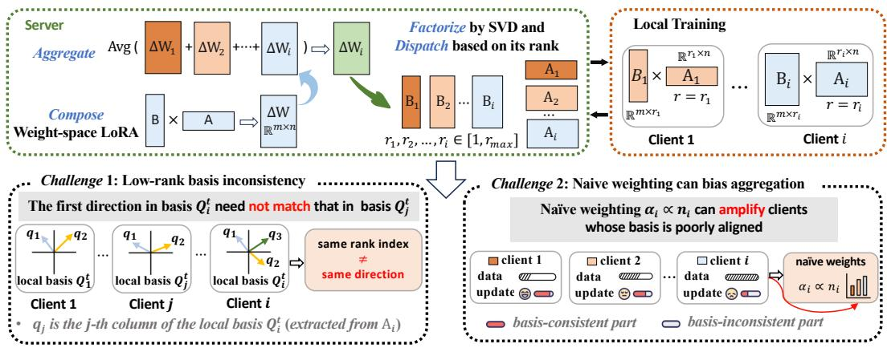
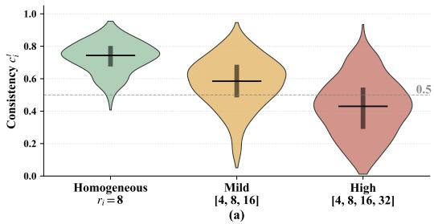
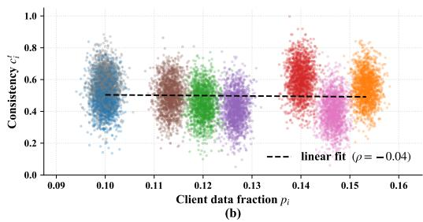
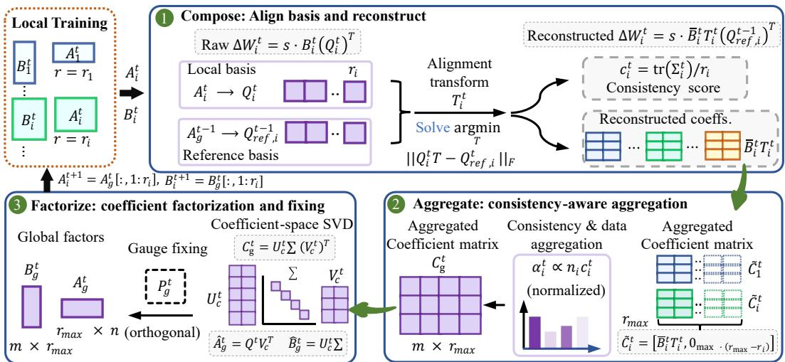
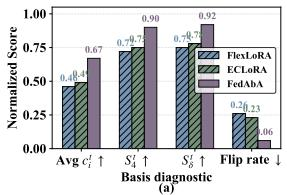
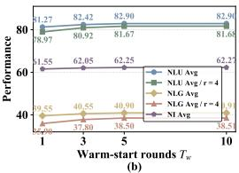
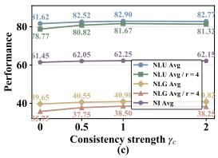
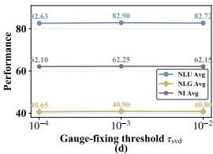

# Align Before Aggregation: Basis-Consistent Federated LoRA under Heterogeneous Ranks

Pengpeng Qiao1 Yang Cao1 Lingling Zhang2 Guo Cheng3 Junwei Chen1 Manjiang Yu4 Wei Yang Bryan Lim5 Masatoshi Yoshikawa6

1Institute of Science Tokyo 2Capital Normal University 3Beijing Institute of Technology 4The University of Queensland 5Nanyang Technological University 6Osaka Seikei University

peng2qiao@gmail.com, cao@c.titech.ac.jp, 7089@cnu.edu.cn guo\_cheng@bit.edu.cn, 214wadechen@gmail.com, manjiang.yu@uq.edu.cn bryan.limwy@ntu.edu.sg, yoshikawa-mas@g.osaka-seikei.ac.jp

## Abstract

Federated fine-tuning of large language models (LLMs) under heterogeneous client capacities is increasingly important, and low-rank adaptation (LoRA) with heterogeneous ranks makes it practical. Existing server-side aggregators compose local matrix updates ∆W from client-specific LoRA factors (A , B ) before ag gregating them. Although these matrix updates lie in the same weight space Rm×n and can be averaged directly, the LoRA factors that generate them may expressed client-specific local basis. In the typical compose–aggregate–factorize–dispatch loop, this basis inconsistency can make the rank-ri reference prefix dispatched to lower-rank clients unstable after server-side refactorization. In this work, we propose FedAbA, a basis-consistent federated LoRA aggregation framework for heterogeneous ranks. FedAbA first extracts each client’s local basis, aligns it to the corresponding prefix of the global reference basis, and constructs a basis-consistent reconstruction of each local matrix update before aggregation. It then aggregates these reconstructions with weights that combine client data size and consistency score, followed by exact coefficient-space SVD refactorization and gauge fixing before rank-prefix dispatch. Our theoretical analysis clarifies the role of basis consistency and supports the proposed consistency-aware aggregation mechanism. Extensive experiments show that FedAbA outperforms representative federated LoRA baselines, with the largest gains under the strongest rank heterogeneity.

## 1 Introduction

Large pretrained models, especially large language models (LLMs) [9, 8, 14], have become a central backbone for a wide range of downstream applications [25, 34]. In many realistic deployments, however, the data needed to adapt these models is decentralized and privacy-sensitive. Federated learning (FL) offers a natural solution by allowing distributed clients to collaboratively fine-tune a shared model without exposing raw local data [30, 29, 31, 46, 37, 39, 2]. Since full-parameter federated fine-tuning is prohibitively expensive in both communication and on-device computation, low-rank adaptation (LoRA) [17] has emerged as a practical parameter-efficient choice for federated fine-tuning of LLMs. In practice, clients also differ substantially in resources [1, 12, 20, 35], which naturally leads them to adopt different ranks $r _ { i } ,$ yielding heterogeneous-rank federated LoRA.

Why heterogeneous ranks are difficult. A typical server-side aggregation pipeline in federated LoRA follows a compose–aggregate–factorize–dispatch loop, as shown in Figure 1. Client i uploads LoRA factors $( A _ { i } , \bar { B _ { i } } )$ . The server composes the local matrix update $\Delta \bar { W } _ { i } = s B _ { i } A _ { i } \in \bar { \mathbb { R } } ^ { m \times n }$ averages these local matrix updates across clients, factorizes the averaged matrix into new global LoRA factors, and dispatches the rank $- r _ { i }$ reference prefix of those global factors back to client i. The difficulty is not the size of $\Delta W _ { i } \colon$ regardless of $r _ { i } ,$ every $\Delta W _ { i }$ lies in the same matrix space and can be averaged as a matrix. The difficulty arises from what happens after this matrix average, because the server repeatedly moves between matrix updates and low-rank factors, while the factors uploaded by different clients can be learned in client-specific local basis. This mismatch comes from the non-uniqueness of low-rank factorization. For any invertible matrix $R \in \mathbb { R } ^ { r _ { i } \times r _ { i } }$

  
Figure 1: Illustration of federated LoRA under heterogeneous ranks. Compose–aggregate–factorize– dispatch training process (top). Two challenges: basis inconsistency and biased aggregation (bottom).

$$
B _ { i } A _ { i } = ( B _ { i } R ) ( R ^ { - 1 } A _ { i } ) , \qquad A _ { i } \in \mathbb { R } ^ { r _ { i } \times n } , \qquad B _ { i } \in \mathbb { R } ^ { m \times r _ { i } } .
$$

Th $^ { 1 5 , }$ even two clients that learn similar matrix updates can encode them in different local basis. This ambiguity is less harmful when all clients use the same rank, because each client receives the full global LoRA factors and no rank-prefix truncation is imposed. Under heterogeneous ranks, however, lower-rank clients receive only the rank $- r _ { i }$ reference prefix of the global LoRA factors. After local training, the first uploaded direction of client i need not correspond to the same reference direction as the first uploaded direction of client $j .$ When the server aggregates local matrix updates, refactorizes via SVD, and redistributes rank-r reference prefixes, the prefix coordinates received by lower-rank clients may change their semantics across rounds. This makes it important to define aggregation relative to an explicit global reference basis. We refer to this phenomenon as basis inconsistency.

Furthermore, basis inconsistency also affects how clients should be weighted. The typical aggregation strategy uses data-size weighting. Under heterogeneous-rank LoRA, however, a client with many samples can still be poorly aligned with the global reference basis. Giving such a client a large weight may amplify components that are poorly compatible with the reference basis and are later affected by reconstruction or refactorization. This suggests that server aggregation should reflect not only how much data a client has, but also how consistent its local basis is with the global reference basis.

Motivation: Align before aggregation. To address these challenges, we propose FedAbA, a basisconsistent federated LoRA aggregation framework that aligns client updates to a shared global reference basis before aggregation. Using the orthonormal basis induced by the previous-round global right factor as the reference basis, the server extracts each client’s local basis from its uploaded right factor, aligns it to the corresponding reference prefix via orthogonal Procrustes, and reconstructs the local matrix update on that prefix. This reconstruction is essential: merely rotating local LoRA factors leaves the composed update $\Delta W _ { i }$ unchanged and therefore cannot alter server aggregation. The alignment step also produces a consistency score that measures how well the client’s local basis matches the reference prefix. FedAbA then aggregates basis-consistent reconstructions using weights that combine client data size and consistency score. Finally, the averaged basis-consistent global update is refactorized by an exact coefficient-space SVD, avoiding a full $m \times n \ : \mathrm { S V D }$ , and a lightweight gauge-fixing step removes arbitrary sign flips and near-degenerate ordering changes before the first $r _ { i }$ components are sent back to client i. Our contributions are summarized as follows:

• We identify that the main challenge in heterogeneous-rank federated LoRA is the lack of explicit basis reconciliation against a global reference basis in the compose–aggregate–factorize– dispatch loop, rather than a dimensional mismatch in the local matrix updates. We also show that factor-space rotations alone cannot resolve this issue.

  
Figure 2: (a) Distribution of $c _ { i } ^ { t }$ at t=10 shifts downward as rank heterogeneity grows. (b) Under strong heterogeneity, $c _ { i } ^ { t }$ is weakly correlated with the data-size weight $p _ { i }$

• We propose FedAbA, a server-side aggregation framework that reconstructs each local matrix update under a shared global reference basis before aggregation, uses both data size and consistency score in aggregation, and enables an exact coefficient-space SVD refresh, rather than a full-update SVD, with gauge fixing before rank-prefix dispatch.

• We provide theoretical analysis showing how the consistency score characterizes basis compatibility and supports consistency-aware aggregation under heterogeneous ranks. Experiments show that FedAbA consistently outperforms representative federated LoRA baselines.

## 2 Method

## 2.1 Problem Setup

We consider federated fine-tuning of LLMs under heterogeneous client LoRA ranks. A server coordinates N clients. Client i owns a private dataset $\mathcal { D } _ { i }$ of size $n _ { i }$ and uses LoRA rank $r _ { i } \in [ 1 , { r _ { \operatorname* { m a x } } } ]$ At round t, an active subset $S ^ { t } \subseteq \{ 1 , \cdot \cdot \cdot , N \}$ of clients participates. We describe the method for a single LoRA-inserted layer and omit the layer index.

Let $W _ { 0 } \in \mathbb { R } ^ { m \times n }$ be the frozen pretrained weight. Client i maintains local LoRA factors $A _ { i } ^ { t } \in \mathbb { R } ^ { r _ { i } \times n }$ and $B _ { i } ^ { t } \in \mathbb { R } ^ { m \times r _ { i } }$ , producing the local matrix update $\Delta W _ { i } ^ { t } = s B _ { i } ^ { t } A _ { i } ^ { t } \in \mathbb { R } ^ { m \times n }$ , where s is the LoRA scaling factor. Unless otherwise specified, both $A _ { i }$ and $B _ { i }$ are trainable during local fine-tuning, so the row space of $A _ { i } ^ { t }$ and the corresponding local basis may change across rounds. The server maintains global LoRA factors $A _ { g } ^ { t } \in \mathbb { R } ^ { \tilde { r } _ { \operatorname* { m a x } } \times n }$ and $B _ { g } ^ { t } \in \mathbb { R } ^ { m \times \check { r } _ { \operatorname* { m a x } } }$ , and distributes the rank- $- r _ { i }$ prefix $A _ { g } ^ { t } [ 1 { : } r _ { i } , : ]$ and $B _ { g } ^ { t } [ : , 1 : r _ { i } ]$ to client i.

Under heterogeneous ranks, lower-rank clients receive only the rank-ri prefix of the global factors, so the per-coordinate semantics of those prefixes are determined by how the global basis is ordered across rounds. Aggregating client contributions on a shared, explicit global reference basis is therefore central to controlling cross-round prefix stability. We next quantify how severe this basis inconsistency is in practice (Section 2.2) before describing FedAbA (Section 2.3). Table 6 summarizes the notation.

## 2.2 Motivation

The basis-inconsistency phenomenon described in Section 1 is naturally quantified by the alignment between each client’s local basis and the global reference basis it should be measured against. For client i at round t, let $Q _ { i } ^ { t } \in \mathbb { R } ^ { n \times r _ { i } }$ be the local basis obtained from a thin QR decomposition of the uploaded right factor $( A _ { i } ^ { i } ) ^ { \top }$ , and let $Q _ { \mathrm { r e f } , i } ^ { t - 1 } \in \mathbb { R } ^ { n \times r _ { i } }$ denote the reference prefix taken from the global reference basis $Q _ { g } ^ { t - 1 } = ( A _ { g } ^ { t - 1 } ) ^ { \top }$ . We define the consistency score

$$
\boldsymbol { c } _ { i } ^ { t } = \frac { 1 } { r _ { i } } \operatorname { t r } ( \Sigma _ { i } ^ { t } ) \ \in \ [ 0 , 1 ] , \qquad ( Q _ { i } ^ { t } ) ^ { \top } Q _ { \mathrm { r e f } , i } ^ { t - 1 } = U _ { i } ^ { t } \Sigma _ { i } ^ { t } ( V _ { i } ^ { t } ) ^ { \top } ,\tag{1}
$$

which is the average principal-angle cosine between the local basis and the reference prefix $( c _ { i } ^ { t } = 1$ means perfect alignment). This is the same quantity that FedAbA later uses for both basis alignment and aggregation weighting (Section 2.3); we therefore measure it directly on a representative federated

  
Figure 3: Overview of FedAbA.

LoRA training backbone. Note that $c _ { i } ^ { t } < 1$ generically because (i) $A _ { i }$ is locally trainable, so the local basis a client uploads has drifted from the reference prefix it received at the start of the round, and (ii) the server’s SVD-based refactorization can refresh the global basis between rounds. To probe how this consistency behaves in practice, we fine-tune LLAMA-2-7B with $N { = } 8$ clients on DOLLY-15K using FlexLoRA [1] as the training backbone (see Appendix B for details).

Observation 1 (rank heterogeneity sharply degrades basis consistency). Figure 2(a) shows the distribution of $c _ { i } ^ { t }$ over all clients and adapted layers at round t=10 under the three regimes. Even in the homogeneous case the median sits well below 1, and as rank heterogeneity grows the entire distribution shifts downward, with a substantial mass of $c _ { i } ^ { t }$ values falling below 0.5 under high heterogeneity. By Theorem $3 . 3 ,$ , a smaller $c _ { i } ^ { t }$ directly translates into a larger reconstruction residual $\sqrt { 2 r _ { i } ( 1 - c _ { i } ^ { t } ) }$ , so naive aggregation under heterogeneous ranks operates on increasingly inconsistent local bases. This motivates explicitly aligning each client’s local basis to the reference prefix before aggregation, rather than relying on post-hoc server-side SVD to reconcile mismatched contributions.

Observation $\ v { 2 } \left( c _ { i } ^ { t } \right.$ varies sharply across clients and is weakly correlated with data size). Figure 2(b) plots $c _ { i } ^ { t }$ against the data-size weight $p _ { i }$ under the high-heterogeneity regime. The two quantities are weakly correlated $( | \rho | < 0 . 2 )$ , and clients with the largest $p _ { i }$ are not necessarily those with the largest $c _ { i } ^ { t }$ . Pure data-size weighting can therefore amplify contributions from clients whose local basis is poorly aligned with the reference prefix, exactly the case in which the reconstruction residual is largest. This motivates a consistency-aware aggregation weight that combines $p _ { i }$ with $c _ { i } ^ { t }$

Together, these observations point to two design choices that FedAbA makes in Section 2.3: (i) before aggregation, replace each client’s local basis with the corresponding reference prefix via an orthogonal Procrustes alignment, so that all client contributions are expressed under a shared global reference basis; and (ii) weight client contributions by $\alpha _ { i } ^ { t } \propto p _ { i } c _ { i } ^ { t }$ , so that data-rich but basis-misaligned clients no longer dominate the aggregate. Fig. 3 illustrates the overall workflow of FedAbA.

## 2.3 Basis-Consistent Federated LoRA Aggregation

At the start of round $t ,$ the server holds the previous-round global LoRA factors $( A _ { g } ^ { t - 1 } , B _ { g } ^ { t - 1 } )$ ). We define the global reference basis as $Q _ { g } ^ { t - 1 } : = ( A _ { g } ^ { t - 1 } ) ^ { \top } \in \mathbb { R } ^ { n \times r _ { \operatorname* { m a x } } }$ , which has orthonormal columns by construction. For client $i ,$ the corresponding reference prefix is $Q _ { \mathrm { r e f } , i } ^ { t - 1 } : = Q _ { g } ^ { t - 1 } [ : , 1 : r _ { i } ] \in \mathbb { R } ^ { n \times r _ { i } }$ All clients in the same round are therefore aligned to prefixes of the same global reference basis.

FedAbA proceeds in three steps: (i) extract and align each client’s local basis; (ii) construct a basisconsistent local matrix update under the reference prefix; and (iii) aggregate these basis-consistent updates with consistency-aware weights and refactorize the aggregate for rank-prefix dispatch.

## Step 1: Local basis extraction and alignment

The server does not align the raw right factor $A _ { i } ^ { t }$ directly, because $A _ { i } ^ { t }$ entangles basis directions with coefficient magnitudes. Instead, it extracts the local basis by a thin QR decomposition of $( A _ { i } ^ { t } ) ^ { \top }$

$$
\begin{array} { r } { ( A _ { i } ^ { t } ) ^ { \top } = Q _ { i } ^ { t } ( C _ { i } ^ { t } ) ^ { \top } , \qquad Q _ { i } ^ { t } \in \mathbb { R } ^ { n \times r _ { i } } , \quad ( Q _ { i } ^ { t } ) ^ { \top } Q _ { i } ^ { t } = I _ { r _ { i } } , \quad C _ { i } ^ { t } \in \mathbb { R } ^ { r _ { i } \times r _ { i } } . } \end{array}\tag{2}
$$

Substituting $A _ { i } ^ { t } = C _ { i } ^ { t } ( Q _ { i } ^ { t } ) ^ { \top }$ into $\Delta W _ { i } ^ { t } = s B _ { i } ^ { t } A _ { i } ^ { t }$ gives

$$
\Delta W _ { i } ^ { t } = s \bar { B } _ { i } ^ { t } ( Q _ { i } ^ { t } ) ^ { \top } , \qquad \bar { B } _ { i } ^ { t } : = B _ { i } ^ { t } C _ { i } ^ { t } \in \mathbb { R } ^ { m \times r _ { i } } .\tag{3}
$$

Here $Q _ { i } ^ { t }$ is the local basis, while ${ \bar { B } } _ { i } ^ { t }$ contains the corresponding coefficients. This representation separates the basis to be aligned from the coefficients to be preserved. Given $Q _ { i } ^ { t }$ and $Q _ { \mathrm { r e f } , i } ^ { t - \mathrm { \bar { 1 } } } .$ , the server computes the orthogonal Procrustes alignment

$$
T _ { i } ^ { t } = \arg \operatorname* { m i n } _ { T \in \mathcal { O } ( r _ { i } ) } \| Q _ { i } ^ { t } T - Q _ { \mathrm { r e f } , i } ^ { t - 1 } \| _ { F } ^ { 2 } ,\tag{4}
$$

where $\mathcal { O } ( r _ { i } )$ is the orthogonal group. Writing $( Q _ { i } ^ { t } ) ^ { \top } Q _ { \mathrm { r e f } , i } ^ { t - 1 } = U _ { i } ^ { t } \Sigma _ { i } ^ { t } ( V _ { i } ^ { t } ) ^ { \top }$ , the solution is $T _ { i } ^ { t } =$ $U _ { i } ^ { t } ( V _ { i } ^ { t } ) ^ { \top }$ . This alignment removes the best within-rank rotation between the local basis and the reference prefix while preserving coefficient norms.

The singular values $\sigma _ { i , j } ^ { t }$ of $( Q _ { i } ^ { t } ) ^ { \top } Q _ { \mathrm { r e f } , i } ^ { t - 1 }$ are the cosines of the principal angles between the two bases, and the alignment step recovers the same consistency score introduced in Section $2 . 2 \colon c _ { i } ^ { t } = $ $\begin{array} { r } { \frac { 1 } { r _ { i } } \mathrm { t r } ( \Sigma _ { i } ^ { t } ) = \frac { 1 } { r _ { i } } \sum _ { j = 1 } ^ { \bar { r } _ { i } } \sigma _ { i , j } ^ { t } \in \mathrm { [ 0 , 1 ] } } \end{array}$ . A larger $c _ { i } ^ { t }$ indicates better consistency between the local basis and the reference prefix; FedAbA reuses $c _ { i } ^ { t }$ for aggregation weighting in Step 3.

## Step 2: Basis-consistent reconstruction

A central design decision of FedAbA is that the server does not merely rotate local factors. For any orthogonal $T \in \mathcal { O } ( r _ { i } ) , \bar { B } _ { i } ^ { t } T ( Q _ { i } ^ { t } T ) ^ { \top } = \bar { B } _ { i } ^ { t } ( Q _ { i } ^ { t } ) ^ { \top }$ . Thus, factor rotation leaves the composed matrix update unchanged. Aggregating rotated factors would therefore produce the same matrix aggregate as aggregating the raw $\bar { \Delta \dot { W } } _ { i } ^ { t }$ . Proposition 3.1 formalizes this invariance.

Instead, FedAbA constructs a basis-consistent local matrix update by replacing the local basis with the reference prefix:

$$
\begin{array} { r } { \Delta \widetilde { W } _ { i } ^ { t } = s \bar { B } _ { i } ^ { t } T _ { i } ^ { t } ( Q _ { \mathrm { r e f } , i } ^ { t - 1 } ) ^ { \top } . } \end{array}\tag{5}
$$

This construction uses all $r _ { i }$ aligned coefficient columns of client i, but expresses them on the reference prefix. It does not select a subset of local basis directions.

Let $E _ { i } ^ { t } : = Q _ { i } ^ { t } T _ { i } ^ { t } - Q _ { \mathrm { r e f } , i } ^ { t - 1 }$ . Then the raw local matrix update decomposes as

$$
\Delta W _ { i } ^ { t } = \Delta \widetilde { W } _ { i } ^ { t } + s \bar { B } _ { i } ^ { t } T _ { i } ^ { t } ( E _ { i } ^ { t } ) ^ { \top } .\tag{6}
$$

The difference $\Delta W _ { i } ^ { t } - \Delta \widetilde { W } _ { i } ^ { t }$ is the reconstruction residual caused by replacing the local basis with the reference prefix. This residual is not a collection of unused basis directions. It quantifies the difference between the raw local update and its reference-basis reconstruction. In FedAbA, only $\Delta \widetilde { W } _ { i } ^ { t }$ is aggregated. Theorem 3.3 shows that ${ \| \Delta W _ { i } ^ { t } - \Delta \widetilde { W } _ { i } ^ { t } \| _ { F } } \le s \| \bar { B } _ { i } ^ { t } \| _ { 2 } \sqrt { 2 r _ { i } ( 1 - c _ { i } ^ { t } ) }$

## Step 3: Consistency-aware aggregation and refactorization

The server combines the data-size weight $\begin{array} { r } { p _ { i } ^ { t } = n _ { i } / \sum _ { j \in S ^ { t } } n _ { j } } \end{array}$ with the consistency score $c _ { i } ^ { t } \mathrm { { : } }$

$$
\alpha _ { i } ^ { t } = \frac { p _ { i } ^ { t } c _ { i } ^ { t } } { \sum _ { j \in \cal S ^ { t } } p _ { j } ^ { t } c _ { j } ^ { t } } = \frac { n _ { i } c _ { i } ^ { t } } { \sum _ { j \in \cal S ^ { t } } n _ { j } c _ { j } ^ { t } } .\tag{7}
$$

We assume $\begin{array} { r } { Z ^ { t } = \sum _ { j \in S ^ { t } } p _ { j } ^ { t } c _ { j } ^ { t } } \end{array}$ is positive. The case $Z ^ { t } = 0$ occurs only when all active clients have $c _ { i } ^ { t } = 0$ , so the consistency scores provide no weighting signal; we then fall back to $\alpha _ { i } ^ { t } = p _ { i } ^ { t }$ . The aggregated basis-consistent update is $\begin{array} { r } { \Delta \bar { \boldsymbol { W } } _ { g } ^ { t } = \sum _ { i \in \mathcal { S } ^ { t } } \alpha _ { i } ^ { t } \Delta \widetilde { \boldsymbol { W } } _ { i } ^ { t } } \end{array}$

Equivalently, define the zero-padded coefficient matrix $\widetilde { C } _ { i } ^ { t } = \left[ \bar { B } _ { i } ^ { t } T _ { i } ^ { t } , \ 0 _ { m \times ( r _ { \operatorname* { m a x } } - r _ { i } ) } \right] \in \mathbb { R } ^ { m \times r _ { \operatorname* { m a x } } }$ Then we can rewrite

$$
\Delta \bar { W } _ { g } ^ { t } = s C _ { g } ^ { t } ( Q _ { g } ^ { t - 1 } ) ^ { \top } , \qquad C _ { g } ^ { t } = \sum _ { i \in \cal S ^ { t } } \alpha _ { i } ^ { t } \widetilde { C } _ { i } ^ { t } .\tag{8}
$$

This coefficient-space view makes the heterogeneous-rank structure explicit: client i contributes coefficient columns associated with the first $r _ { i }$ basis directions of the global reference basis. To redistribute the aggregate in rank $- r _ { \mathrm { m a x } } \mathrm { L o R A }$ form, the server performs an exact coefficient-space SVD refresh. Since $\breve { C ^ { t } } _ { g } \in \mathbb { R } ^ { m \times r _ { \operatorname* { m a x } } }$ , it suffices to compute

$$
\begin{array} { r } { C _ { g } ^ { t } = U _ { c } ^ { t } \Sigma _ { c } ^ { t } ( V _ { c } ^ { t } ) ^ { \top } , } \end{array}\tag{9}
$$

where $V _ { c } ^ { t } \in \mathbb { R } ^ { r _ { \operatorname* { m a x } } \times r _ { \operatorname* { m a x } } }$ is orthogonal and zero singular values are padded if necessary. Then

$$
\begin{array} { r } { \Delta \bar { \boldsymbol { W } } _ { g } ^ { t } = s \boldsymbol { U } _ { c } ^ { t } \Sigma _ { c } ^ { t } ( \boldsymbol { Q } _ { g } ^ { t - 1 } { \boldsymbol { V } _ { c } ^ { t } } ) ^ { \top } . } \end{array}\tag{10}
$$

The provisional global factors are $\widehat { A } _ { g } ^ { t } = ( Q _ { g } ^ { t - 1 } V _ { c } ^ { t } ) ^ { \top } , \widehat { B } _ { g } ^ { t } = U _ { c } ^ { t } \Sigma _ { c } ^ { t }$ . They exactly represent the aggregated basis-consistent update: $s \widehat { B } _ { g } ^ { t } \widehat { A } _ { g } ^ { t } = \Delta \bar { W } _ { g } ^ { t }$ . Thus, the server decomposes only the coefficient matrix $C _ { g } ^ { t } \in \mathbb { R } ^ { m \times r _ { \operatorname* { m a x } } }$ rather than materializing and decomposing the full $m \times n$ update.

Gauge fixing. The SVD in Eq. (9) can introduce arbitrary sign flips and swaps among nearly equal singular values. These changes do not affect the composed matrix update, but they can relabel the factor indices sent to clients. We thus use a lightweight gauge-fixing step before rank-prefix dispatch.

Let $\tau _ { \mathrm { s v d } } > 0$ be a relative-gap threshold. After sorting singular values in descending order, we form contiguous near-degenerate blocks by splitting at adjacent relative gaps larger than $\tau _ { \mathrm { s v d } }$ . Within each block, provisional directions in $\widehat { Q } _ { g } ^ { t } = ( \widehat { A } _ { g } ^ { t } ) ^ { \top }$ are matched to the corresponding columns of $Q _ { g } ^ { t - 1 }$ by maximum absolute cosine similarity, with signs chosen to make the matched cosines nonnegative. This yields a block-wise signed permutation matrix $P _ { g } ^ { t }$ . The final global factors are

$$
A _ { g } ^ { t } = P _ { g } ^ { t } \widehat { A } _ { g } ^ { t } , \qquad B _ { g } ^ { t } = \widehat { B } _ { g } ^ { t } ( P _ { g } ^ { t } ) ^ { \top } .\tag{11}
$$

Since $P _ { g } ^ { t }$ is orthogonal, $s B _ { g } ^ { t } A _ { g } ^ { t } = s \widehat { B } _ { g } ^ { t } \widehat { A } _ { g } ^ { t } = \overline { { \Delta W } } _ { g } ^ { t } .$ . Thus, gauge fixing changes only the factor representation, not the composed global matrix update.

Remark 2.1 (Span of the global basis). The SVD refresh changes the global basis but not its span in the default FedAbA algorithm. After gauge fixing,

$$
Q _ { g } ^ { t } = ( A _ { g } ^ { t } ) ^ { \top } = Q _ { g } ^ { t - 1 } V _ { c } ^ { t } ( P _ { g } ^ { t } ) ^ { \top } = Q _ { g } ^ { t - 1 } O _ { g } ^ { t } , \qquad O _ { g } ^ { t } \in \mathcal { O } ( r _ { \operatorname* { m a x } } ) .
$$

Therefore, span $( Q _ { q } ^ { t } ) = \operatorname { s p a n } ( Q _ { q } ^ { t - 1 } )$ . By induction, the span of the global basis remains the warmstart span throughout training. FedAbA should therefore be understood as a basis-consistent aggregation method within a warm-started global basis.

## 2.4 Workflow and Complexity

Algorithm 1 summarizes the training workflow of FedAbA. FedAbA requires a non-degenerate initial global reference basis. Since a zero LoRA update does not define meaningful basis directions, we initialize the first global LoRA factors by a warm-start phase: the server performs several standard federated LoRA aggregation rounds without basis-consistent reconstruction, computes a rank-rmax truncated SVD of the resulting aggregated matrix update, and uses the resulting factors as $( A _ { g } ^ { 0 } , B _ { g } ^ { 0 } )$

The client-side training protocol and communication are unchanged relative to standard federated LoRA fine-tuning. All additional operations are performed on the server. For each active client, thin QR of $( A _ { i } ^ { t } ) ^ { \top }$ costs $O ( n r _ { i } ^ { 2 } )$ . Forming $( Q _ { i } ^ { t } ) ^ { \top } Q _ { \mathrm { r e f , \prime } } ^ { t - 1 }$ and solving the Procrustes problem costs $O ( n r _ { i } ^ { 2 } + r _ { i } ^ { 3 } )$ . Computing $\bar { B } _ { i } ^ { t } = B _ { i } ^ { t } C _ { i } ^ { t }$ and $\bar { B } _ { i } ^ { t } T _ { i } ^ { t }$ costs $O ( m r _ { i } ^ { 2 } )$ . Coefficient aggregation costs $O ( | S ^ { \dot { t } } | m r _ { \operatorname* { m a x } } )$ . The final SVD is performed on $C _ { g } ^ { t } \in \mathbb { R } ^ { m \times r _ { \operatorname* { m a x } } }$ , costing $O ( m r _ { \mathrm { m a x } } ^ { 2 } + r _ { \mathrm { m a x } } ^ { 3 } )$ , rather than on a full m × n matrix. Communication complexity remains $O ( r _ { i } ( m + n ) )$ ) per client.

## 3 Theoretical Analysis

This section analyzes the aggregation of FedAbA. We first show why factor rotation alone cannot resolve basis inconsistency (Section 3.1), then quantify the reconstruction through the consistency

score and justify consistency-aware weighting (Section 3.2), and finally give an idealized convergence interpretation (Section 3.3). Throughout, we use the basis–coefficient form $\Delta W _ { i } ^ { t } = s \bar { B } _ { i } ^ { t } ( Q _ { i } ^ { t } ) ^ { \top }$ and the basis-consistent reconstruction $\Delta \widetilde { W } _ { i } ^ { t } = s \bar { B } _ { i } ^ { t } T _ { i } ^ { t } ( Q _ { \mathrm { r e f } , i } ^ { t - 1 } ) ^ { \top }$ . Full proofs are in Appendix E.

## 3.1 Basis Alignment Requires Reconstruction, Not Rotation

A natural first attempt is to rotate each client’s LoRA factors by the Procrustes solution before aggregation. This operation is invisible after composing the matrix update.

Proposition 3.1 (Factor rotation invariance). For $T \in \mathcal { O } ( r _ { i } ) , s \bar { B } _ { i } ^ { t } T ( Q _ { i } ^ { t } T ) ^ { \top } = s \bar { B } _ { i } ^ { t } ( Q _ { i } ^ { t } ) ^ { \top } = \Delta W _ { i } ^ { t }$

FedAbA therefore replaces the aligned local basis with the reference prefix, as in Eq. (5) (proof in Appendix E.1). The reconstructed updates then admit a single shared-basis representation.

Proposition 3.2 (Shared-basis representation). Let $\widetilde { C } _ { i } ^ { t } = [ \bar { B } _ { i } ^ { t } T _ { i } ^ { t } , 0 _ { m \times ( r _ { \operatorname* { m a x } } - r _ { i } ) } ]$ . Then $\Delta \widetilde { W } _ { i } ^ { t } =$ $s \widetilde { C } _ { i } ^ { t } ( Q _ { g } ^ { t - 1 } ) ^ { \top }$ and $\begin{array} { r } { \Delta \boldsymbol { \bar { W } } _ { g } ^ { t } = \boldsymbol { s } \big ( \sum _ { i \in \mathcal { S } ^ { t } } \alpha _ { i } ^ { t } \widetilde { C } _ { i } ^ { t } \big ) ( \boldsymbol { Q } _ { g } ^ { t - 1 } ) ^ { \intercal } } \end{array}$ , so rank $( \Delta \bar { W } _ { g } ^ { t } ) \le r _ { \operatorname* { m a x } } .$

Consequently (proof in Appendix E.2), the coefficient-space SVD refresh in Eq. (10) exactly refactorizes $\Delta \bar { W } _ { g } ^ { t } ,$ and the gauge fixing in Eq. (11) only re-labels factor coordinates. Both steps are bias-free; their formal statements (exact refresh, gauge invariance, and span invariance within the warm-started global basis) are deferred to Appendix E.3.

## 3.2 Reconstruction Residual and Consistency-Aware Weighting

Let $( Q _ { i } ^ { t } ) ^ { \top } Q _ { \mathrm { r e f } , i } ^ { t - 1 } = U _ { i } ^ { t } \Sigma _ { i } ^ { t } ( V _ { i } ^ { t } ) ^ { \top }$ and recall $\begin{array} { r } { c _ { i } ^ { t } = \frac { 1 } { r _ { i } } \operatorname { t r } ( \Sigma _ { i } ^ { t } ) } \end{array}$ . The next theorem connects this score to both the basis alignment quality and the reconstruction residual.

Theorem 3.3 (Reconstruction residual is controlled by basis consistency). min $_ { T \in \mathcal { O } ( r _ { i } ) } \parallel Q _ { i } ^ { t } T -$

$$
Q _ { \mathrm { r e f } , i } ^ { t - 1 } \| _ { F } ^ { 2 } = 2 r _ { i } ( 1 - c _ { i } ^ { t } ) , a n d \| \Delta W _ { i } ^ { t } - \Delta \widetilde { W } _ { i } ^ { t } \| _ { F } \leq s \| \bar { B } _ { i } ^ { t } \| _ { 2 } \sqrt { 2 r _ { i } ( 1 - c _ { i } ^ { t } ) } .
$$

Thus $c _ { i } ^ { t }$ is exactly the average principal-angle cosine between local basis and reference prefix (proof in Appendix E.4). The residual vanishes when $c _ { i } ^ { t } = 1$ and grows monotonically as alignment degrades. Assumption 3.4 (Uniform coefficient-radius bound). There exists $\kappa _ { t } > 0$ such that s $| \bar { B } _ { i } ^ { t } | | _ { 2 } \sqrt { r _ { i } } \le \kappa _ { t }$ for every $i \in S ^ { t }$

Theorem 3.5 (Consistency-aware weighting tightens a reconstruction bound). Let $b _ { i } ^ { t } \quad : =$ $\kappa _ { t } \sqrt { 2 ( 1 - c _ { i } ^ { t } ) }$ . Under Assumption $\begin{array} { r } { 3 . 4 , \| \Delta W _ { i } ^ { t } - \Delta \widetilde { W } _ { i } ^ { t } \| _ { F } \leq b _ { i } ^ { t } . \ I f \sum _ { j \in S ^ { t } } p _ { j } ^ { t } c _ { j } ^ { t } > 0 } \end{array}$ , the consistencyaware weights $\begin{array} { r } { \alpha _ { i } ^ { t } = \frac { p _ { i } ^ { t } c _ { i } ^ { t } } { \sum _ { j } p _ { j } ^ { t } c _ { j } ^ { t } } } \end{array}$ satisfy $\begin{array} { r } { \sum _ { i } \alpha _ { i } ^ { t } b _ { i } ^ { t } \le \sum _ { i } p _ { i } ^ { t } b _ { i } ^ { t } } \end{array}$

Remark 3.6 (Variational view). Theorem 3.5 (proof in Appendix E.5) gives a bounded-error justification. Appendix E.6 shows that $\alpha _ { i } ^ { t }$ is also the unique maximizer of a KL-regularized log-consistency objective relative to p, providing a complementary variational characterization.

## 3.3 Idealized Convergence Interpretation

We finally show how the reconstruction step enters a standard smooth non-convex stochastic descent analysis. Define $\begin{array} { r } { G ^ { t } : = \sum _ { i \in \mathcal { S } ^ { t } } \alpha _ { i } ^ { t } \Delta W _ { i } ^ { t } } \end{array}$ and $\widetilde G ^ { t } : = \Delta \bar { W } _ { g } ^ { t } .$ . By Proposition 3.2, rank $( \widetilde G ^ { t } ) \le r _ { \operatorname* { m a x } }$ , so the SVD refresh and gauge fixing preserve $\widetilde { G } ^ { t }$ exactly and contribute no additional bias beyond the reconstruction step itself.

Assumption 3.7 (Idealized smooth stochastic descent model). F is L-smooth, $\mathbb { E } [ G ^ { t } \ | \ W ^ { t } ] \ =$ $\nabla F ( W ^ { \widehat { t } } )$ , and $\mathbb { E } [ \| G ^ { t } - \nabla F ( W ^ { t } ) \| _ { F } ^ { 2 } \mid W ^ { t } ] \leq \sigma ^ { 2 }$

Theorem 3.8 (Convergence with reconstruction bias). Let $e ^ { t } : = \widetilde { G } ^ { t } - G ^ { t }$ and consider $W ^ { t + 1 } =$ $W ^ { t } - \eta \widetilde { G } ^ { t }$ with $\eta \leq 1 / ( 4 L )$ ). Under Assumption 3.7,

$$
\frac { 1 } { T } \sum _ { t = 0 } ^ { T - 1 } \mathbb { E } \| \nabla F ( W ^ { t } ) \| _ { F } ^ { 2 } \leq \frac { 4 ( F ( W ^ { 0 } ) - F ^ { \star } ) } { \eta T } + 4 L \eta \sigma ^ { 2 } + \frac { 2 + 4 L \eta } { T } \sum _ { t = 0 } ^ { T - 1 } \mathbb { E } \| e ^ { t } \| _ { F } ^ { 2 } ,\tag{12}
$$

and $\begin{array} { r } { \| e ^ { t } \| _ { F } \leq \sum _ { i \in \mathcal { S } ^ { t } } \alpha _ { i } ^ { t } s \| \bar { B } _ { i } ^ { t } \| _ { 2 } \sqrt { 2 r _ { i } ( 1 - c _ { i } ^ { t } ) } . } \end{array}$

Table 1: Performance comparison of six baselines across various models and tasks.
<table><tr><td rowspan="2">Method</td><td colspan="4">NLU, RoBERTa-large</td><td colspan="4">NLG-style, LLaMA-2-7B</td><td colspan="2">NI, LLaMA-1B</td></tr><tr><td>MRPC F1</td><td>CoLA MCC</td><td>QNLI ACC</td><td>RTE ACC</td><td>Wizard (MMLU)</td><td>Dolly-15K (MMLU)</td><td>Alpaca (MMLU)</td><td>Alpaca (MT-Bench)</td><td>Natural Instructions v2 Rouge-L</td><td>Rouge-1</td></tr><tr><td>HetLORA</td><td>86.6</td><td>59.8</td><td>93.8</td><td>67.5</td><td>34.5</td><td>43.8</td><td>32.3</td><td>3.57</td><td>57.0</td><td>65.3</td></tr><tr><td>FLoRA</td><td>87.2</td><td>61.8</td><td>93.5</td><td>71.8</td><td>35.4</td><td>44.9</td><td>34.6</td><td>3.80</td><td>57.1</td><td>65.3</td></tr><tr><td>LoRA-A2</td><td>88.9</td><td>62.5</td><td>93.8</td><td>79.5</td><td>35.6</td><td>45.4</td><td>35.6</td><td>4.03</td><td>57.4</td><td>65.4</td></tr><tr><td>FlexLoRA</td><td>88.7</td><td>62.4</td><td>93.8</td><td>78.3</td><td>36.2</td><td>45.9</td><td>36.2</td><td>4.13</td><td>57.6</td><td>65.5</td></tr><tr><td>ECLoRA</td><td>89.7</td><td>62.9</td><td>93.9</td><td>82.3</td><td>36.3</td><td>46.1</td><td>36.5</td><td>4.15</td><td>57.7</td><td>65.5</td></tr><tr><td>Fed-PLoRA</td><td>89.5</td><td>63.1</td><td>94.0</td><td>81.8</td><td>36.6</td><td>47.2</td><td>37.3</td><td>4.23</td><td>58.1</td><td>65.8</td></tr><tr><td>FedAbA</td><td>90.3</td><td>63.6</td><td>94.2</td><td>83.5</td><td>37.1</td><td>47.8</td><td>37.8</td><td>4.32</td><td>58.4</td><td>66.1</td></tr></table>

The bound (proof in Appendix E.7) isolates FedAbA’s reconstruction effect via a measurable bias term controlled by the consistency scores.

## 4 Experiment

## 4.1 Setup

Datasets and metrics. We evaluate FedAbA on three benchmarks. For natural language understanding (NLU), we use four GLUE tasks [32]: MRPC, CoLA, QNLI, and RTE. For NLG-style instruction tuning, we train on Dolly-15K [10], Alpaca [28], and WizardLM [38], and evaluate with MMLU or MT-Bench as specified in Table 1. For natural instructions (NI), we use Natural Instructions v2 [33] and report ROUGE-L/ROUGE-1. For NLU and NLG-style experiments, we construct 10-client federated settings with Dirichlet(0.5) partitioning. For NI, each client corresponds to one task; we sample 100 training clients and use a participation rate of 0.1, i.e., 10 clients per round.

Baselines. We compare FedAbA against six baselines for heterogeneous-rank federated LoRA: FlexLoRA [1], HetLoRA [7], ECLoRA [27], LoRA-A2 [20], FLoRA [35] and Fed-PLoRA [45].

Implementation Details. For NLU/NLG-style/NI experiments, we use RoBERTa-large/LLaMA-2-7B/LLaMA-1B-dj-refine-150B as the frozen backbone and train for 100/50/100 communication rounds, respectively. LoRA is inserted into attention projection layers. For NLU and NLG-style, client ranks are assigned as [4, 4, 8, 8, 16, 16, 32, 32, 64, 64]. For NI, client ranks are balanced over 4, 8, 16, and 32. All methods use AdamW with learning rate $2 \times 1 0 ^ { - 4 }$ . The batch size is 8 for GLUE and NLG-style experiments, and 4 or 8 for Natural Instructions. The maximum sequence length is 128 for GLUE and 512 for the LLaMA-based experiments. We uses 5 warm-start rounds.

## 4.2 Performance

Exp-1: Main Results. Table 1 compares FedAbA with heterogeneous-rank LoRA baselines on NLU, NLG-style, and NI benchmarks. FedAbA obtains the best reported results across the three task families. The gains are most visible in settings where rank-prefix dispatch is more sensitive to basis drift, while margins are smaller on tasks where most methods already perform strongly. HetLoRA and FLoRA handle rank mismatch through padding or stacking, and FlexLoRA and ECLoRA aggregate reconstructed updates without explicit basis reconciliation. FedAbA improves this pipeline by making aggregation basis-consistent before refactorization. We further compare FedAbA and Fed-PLoRA using three independent matched runs on six selected metrics. Appendix F.1 reports the mean and sample standard deviation across runs; FedAbA achieves a higher mean on all six metrics.

Exp-2: Results on different-rank clients. Table 2 evaluates the dispatched rank- $\cdot r _ { i }$ prefixes on each client’s local test split. FedAbA improves all rank groups, with the largest gains at $r = 4$ and $r = 8 .$ . This is consistent with our motivation: low-rank clients receive only short global prefixes and are most sensitive to cross-round basis drift. The smaller gain at higher ranks is also expected because high-rank clients receive a larger portion of the global adapter. These results show that FedAbA improves not only global average performance but also the stability and utility of low-rank prefixes. We also compare FedAbA and Fed-PLoRA on a fixed subset containing the 20% of Natural Instructions clients with the lowest average consistency in the default FedAbA run. FedAbA achieves higher average ROUGE-L and ROUGE-1 on this subset (Appendix F.2).

Table 2: Performance comparison across different LoRA ranks on Dolly and Natural Instructions $\mathbf { v } 2 .$
<table><tr><td rowspan="2">Method</td><td colspan="6">NLG-style, LLaMA-2-7B, Dolly-15K</td><td colspan="5">NI, LLaMA-1B, Natural Instructions v2</td></tr><tr><td>Overall (Rouge-L)</td><td> $r = 4$ </td><td> $r = 8$ </td><td> $r = 1 6$ </td><td> $r = 3 2$ </td><td> $r = 6 4$ </td><td>Overall</td><td>r = 4</td><td> $r = 8$ </td><td>r = 16</td><td>r = 32</td></tr><tr><td>HetLORA</td><td>29.2</td><td>27.6</td><td>28.5</td><td>29.4</td><td>30.2</td><td>31.0</td><td>57.0</td><td>54.8</td><td>56.5</td><td>57.8</td><td>59.1</td></tr><tr><td>FLoRA</td><td>28.7</td><td>26.8</td><td>27.9</td><td>28.8</td><td>30.1</td><td>30.9</td><td>57.1</td><td>54.2</td><td>56.1</td><td>58.0</td><td>59.5</td></tr><tr><td>LoRA-A²</td><td>30.0</td><td>28.5</td><td>29.4</td><td>30.1</td><td>30.8</td><td>31.4</td><td>57.4</td><td>55.0</td><td>56.7</td><td>58.2</td><td>59.8</td></tr><tr><td>FlexLoRA</td><td>30.2</td><td>28.0</td><td>29.0</td><td>30.4</td><td>31.3</td><td>32.0</td><td>57.6</td><td>55.1</td><td>56.9</td><td>58.4</td><td>60.0</td></tr><tr><td>ECLoRA</td><td>30.2</td><td>28.2</td><td>29.1</td><td>30.4</td><td>31.4</td><td>31.9</td><td>57.7</td><td>55.5</td><td>57.2</td><td>58.6</td><td>60.2</td></tr><tr><td>Fed-PLoRA</td><td>31.3</td><td>29.7</td><td>30.8</td><td>31.5</td><td>32.1</td><td>32.6</td><td>58.1</td><td>56.6</td><td>57.9</td><td>58.8</td><td>60.5</td></tr><tr><td>FedAbA</td><td>32.4</td><td>31.2</td><td>32.0</td><td>32.5</td><td>33.0</td><td>33.4</td><td>58.4</td><td>57.4</td><td>58.6</td><td>59.0</td><td>60.6</td></tr></table>

Table 3: Performance comparison across different rank heterogeneity regimes on NLU, NL ${ \cal G } ,$ and NI.
<table><tr><td>Task Family</td><td>Rank Regime</td><td>Rank Setting</td><td>HetLoRA</td><td>FLoRA</td><td>LoRA-A2</td><td>FlexLoRA</td><td>ECLoRA</td><td>Fed-PLoRA</td><td>FedAbA</td></tr><tr><td rowspan="3">NLU Avg.</td><td>Homo.</td><td>[8] × 10</td><td>76.33</td><td>77.98</td><td>80.00</td><td>79.80</td><td>80.80</td><td>80.75</td><td>80.97</td></tr><tr><td>Mild</td><td>{4, 8, 16}</td><td>76.65</td><td>78.43</td><td>80.73</td><td>80.17</td><td>81.35</td><td>81.28</td><td>81.72</td></tr><tr><td>High</td><td>{4, 8, 16, 32, 64}</td><td>76.93</td><td>78.58</td><td>81.18</td><td>80.80</td><td>82.20</td><td>82.10</td><td>82.90</td></tr><tr><td rowspan="3">NLG Avg. (MMLU)</td><td>Homo.</td><td>[8] × 10</td><td>36.37</td><td>37.70</td><td>38.07</td><td>38.77</td><td>38.86</td><td>39.14</td><td>39.30</td></tr><tr><td>Mild</td><td>{4, 8, 16}</td><td>36.60</td><td>38.17</td><td>38.57</td><td>39.00</td><td>39.16</td><td>39.51</td><td>39.83</td></tr><tr><td>High</td><td>{4, 8, 16, 32, 64}</td><td>36.87</td><td>38.30</td><td>38.87</td><td>39.43</td><td>39.63</td><td>40.37</td><td>40.90</td></tr><tr><td rowspan="3">NI Avg. (ROUGE-L/1)</td><td>Homo.</td><td>r = 8</td><td>61.05</td><td>61.10</td><td>61.00</td><td>61.40</td><td>61.40</td><td>61.55</td><td>61.60</td></tr><tr><td>Mild</td><td>{4, 8, 16}</td><td>61.15</td><td>61.25</td><td>61.20</td><td>61.50</td><td>61.45</td><td>61.70</td><td>61.90</td></tr><tr><td>High</td><td> $\{ 4 , 8 , 1 6 , 3 2 \}$ </td><td>61.15</td><td>61.20</td><td>61.40</td><td>61.55</td><td>61.60</td><td>61.95</td><td>62.25</td></tr></table>

Table 4: System efficiency comparison across base- Table 5: Ablation study of FedAbA components lines. Lower is better for all metrics across NLU, NLG, and NI tasks.
<table><tr><td>Method</td><td>Comm. / Round (N=10)</td><td>Effective Rank</td><td>Aggregation Time</td><td>Server Memory</td></tr><tr><td>HetLoRA</td><td>520 MB</td><td>64</td><td>0.15s</td><td>67 MB</td></tr><tr><td>FLoRA</td><td>2.86 GB</td><td>248</td><td>0.12s</td><td>260 MB</td></tr><tr><td>LoRA-A2</td><td>931 MB</td><td>64</td><td>0.35s</td><td>67 MB</td></tr><tr><td>FlexLoRA</td><td>520 MB</td><td>64</td><td>130s</td><td>2.15 GB</td></tr><tr><td>ECLoRA</td><td>520 MB</td><td>64</td><td>4.0s</td><td>4.3 GB</td></tr><tr><td>Fed-PLoRA</td><td>931 MB</td><td>64</td><td>0.35s</td><td>67 MB</td></tr><tr><td>FedAbA</td><td>520 MB</td><td>64</td><td>2.0s</td><td>190 MB</td></tr></table>

<table><tr><td>Variant</td><td>NLU Avg.</td><td>NLG MMLU</td><td>Alpaca MT-Bench</td><td>NI R-L</td><td>NI R-1</td></tr><tr><td>w/o basis consistency</td><td>82.02</td><td>39.95</td><td>4.15</td><td>57.8</td><td>65.6</td></tr><tr><td>rotation-only</td><td>82.07</td><td>40.00</td><td>4.16</td><td>57.9</td><td>65.6</td></tr><tr><td>w/o Procrustes</td><td>82.32</td><td>40.20</td><td>4.20</td><td>58.0</td><td>65.8</td></tr><tr><td>w/o ci weighting</td><td>82.42</td><td>40.40</td><td>4.25</td><td>58.1</td><td>65.9</td></tr><tr><td>w/o data size</td><td>82.62</td><td>40.55</td><td>4.27</td><td>58.2</td><td>66.0</td></tr><tr><td>w/o gauge fixing</td><td>82.52</td><td>40.50</td><td>4.26</td><td>58.2</td><td>65.9</td></tr><tr><td>FedAbA</td><td>82.90</td><td>40.90</td><td>4.32</td><td>58.4</td><td>66.1</td></tr></table>

Exp-3: Effect of Rank Heterogeneity. Table 3 compares all methods under three rank regimes. In the homogeneous regime, rank-prefix truncation is less exposed because clients use the same LoRA rank. As rank heterogeneity grows, the methods separate more clearly. HetLoRA and FLoRA remain limited by padding or stacking, while FlexLoRA and ECLoRA remain competitive but lack explicit reference-basis reconciliation before aggregation. FedAbA achieves the best performance in all regimes, with its largest margin under high heterogeneity. This trend is consistent with Theorems 3.3 and 3.5: basis-consistent reconstruction and consistency-aware weighting become more useful when local bases are less consistent with the reference prefix.

Exp-4: Basis diagnostics. Fig. 4(a) evaluates basis stability under high rank heterogeneity. For each evaluated client, layer, and round, we form $\boldsymbol { M } _ { i } ^ { t } = ( Q _ { i } ^ { t } ) ^ { \top } \boldsymbol { Q } _ { \mathrm { r e f } , i } ^ { \dot { t } - 1 }$ ; its singular values are principal-angle cosines between the uploaded local basis and the reference prefix. We report average consistency $c _ { i } ^ { t } ,$ selected prefix-depth scores $S _ { k } ^ { t } = \mathbb { E } [ \sigma _ { k } ( M _ { i } ^ { t } ) \mid r _ { i } \geq k ]$ , and the sign/order flip rate across consecutive global bases. FedAbA yields higher alignment scores and a lower flip rate than baselines.

Exp-5: Sensitivity Analysis. Figure 4(b)–(d) studies sensitivity under high rank heterogeneity. Performance improves with a short warm-start and saturates around $T _ { w } { = } 5$ . For consistency weighting, we use the generalized rule αt $\propto p _ { i } ^ { t } ( c _ { i } ^ { t } ) ^ { \gamma _ { c } }$ , where $\gamma _ { c } = 1$ is the default setting; moderate consistency weighting performs best. FedAbA is also stable across the tested gauge-fixing thresholds $\tau _ { \mathrm { s v d } }$

Exp-6: System Efficiency. Table 4 compares per-round system cost. FedAbA keeps the same rankprefix communication as HetLoRA, FlexLoRA, and ECLoRA, and avoids the stacked-rank expansion of FLoRA and auxiliary communication of LoR $\mathrm { A { - } A ^ { 2 } / l }$ Fed-PLoRA. FedAbA is more expensive than purely factor-space baselines, but substantially cheaper than dense reconstruction-based methods (FlexLoRA and ECLoRA). Its efficiency comes from aggregating coefficient matrices and performing SVD on $C _ { g } ^ { t } \in \mathbb { R } ^ { m \times r _ { \operatorname* { m a x } } }$ , rather than materializing and decomposing a full $m \times n$ update.

Exp-7: Ablation Study Table 5 ablates each component on the high-heterogeneity setting, and the order of the drops mirrors the design hierarchy of the method. Removing basis-consistent reconstruction entirely (w/o basis consistency) causes the largest drop, identifying reconstruction as the central component. Replacing reconstruction with rotation only (rotation-only) recovers almost none of the gain, which empirically confirms Proposition 3.1 and rules out factor-rotation strategies as a substitute. Replacing Procrustes with generic orthonormalization loses the optimal alignment guaranteed by Theorem 3.3. Removing $c _ { i } ^ { t }$ or the data-size term from the weights shows that the bound-tightening property of Theorem 3.5 requires both factors. Disabling gauge fixing reintroduces the sign-flip pathology visible in Figure 4(a). Each component thus addresses a distinct, theoretically identified source of basis inconsistency.

  
Figure 4: Sensitivity analysis under high rank heterogeneity. (a) Basis diagnostics comparing FlexLoRA, ECLoRA. (b)–(d) Sensitivity of FedAbA to warm-start rounds $T _ { w } ,$ consistency weighting strength $\gamma _ { c } ,$ and gauge-fixing threshold $\tau _ { \mathrm { s v d } }$ , respectively.

Exp-8: Additional Backbones. We additionally evaluate FedAbA on Qwen3-4B and LLaMA-2-13B using the Dolly-15K protocol. FedAbA improves MMLU scores over Fed-PLoRA by 0.7 points on both backbones. Appendix F.3 provides the full comparison and experimental setting.

## 5 Conclusion

We proposed FedAbA, a basis-consistent aggregation method for heterogeneous-rank federated LoRA. By aligning client updates before aggregation and stabilizing rank-prefix dispatch, FedAbA achieves superior performance compared to SOTA heterogeneous Federated LoRA methods.

## Acknowledgments and Disclosure of Funding

This work is supported by JSPS KAKENHI 26K21227, JST PRESTO JPMJPR23P5, JST CREST JPMJCR21M2, JST NEXUS JPMJNX25C4, NSFC under Grant 62302043, the Interdisciplinary Project of Capital Normal University under Grant 2026JCZD02, and A\*STAR under its Japan-Singapore Joint Call: JST-A\*STAR 2024 under Grant R2416IR139.

## References

[1] Jiamu Bai, Daoyuan Chen, Bingchen Qian, Liuyi Yao, and Yaliang Li. Federated fine-tuning of large language models under heterogeneous tasks and client resources. Advances in Neural Information Processing Systems, 37:14457–14483, 2024.

[2] Bei Bi, Zhiwei Zhang, Pengpeng Qiao, Ye Yuan, and Guoren Wang. Fedsig: a federated graph augmentation for class-imbalanced node classification. In International Conference on Database Systemsfor Advanced Applications, pages 474–490. Springer, 2024.

[3] Jieming Bian, Lei Wang, Letian Zhang, and Jie Xu. Fedalt: Federated fine-tuning through adaptive local training with rest-of-world lora. In Proceedings of the AAAI Conference on Artificial Intelligence, volume 40, pages 19728–19736, 2026.

[4] Chang Che, Ziqi Wang, Pengwan Yang, Cheems Wang, Hui Ma, and Zenglin Shi. Lora in lora: Towards parameter-efficient architecture expansion for continual visual instruction tuning. In Proceedings of the AAAI Conference on Artificial Intelligence, volume 40, pages 19978–19986, 2026.

[5] Junwei Chen, Pengpeng Qiao, Wei Yang Bryan Lim, Manjiang Yu, and Yang Cao. Privacypreserving llm preference alignment: A systematic survey. TechRxiv, 2026.

[6] Tianran Chen, Jiarui Chen, Baoquan Zhang, Zhehao Yu, Shidong Chen, Rui Ye, Xutao Li, and Yunming Ye. Sensitivity-aware efficient fine-tuning via compact dynamic-rank adaptation. In Proceedings of the Computer Vision and Pattern Recognition Conference, pages 9655–9664, 2025.

[7] Yae Jee Cho, Luyang Liu, Zheng Xu, Aldi Fahrezi, and Gauri Joshi. Heterogeneous lora for federated fine-tuning of on-device foundation models. In Proceedings ofthe 2024 conference on empirical methods in natural language processing, pages 12903–12913, 2024.

[8] Aakanksha Chowdhery, Sharan Narang, Jacob Devlin, Maarten Bosma, Gaurav Mishra, Adam Roberts, Paul Barham, Hyung Won Chung, Charles Sutton, Sebastian Gehrmann, et al. Palm: Scaling language modeling with pathways. Journal ofMachine Learning Research, 24(240): 1–113, 2023.

[9] Ngo Cong-Lem, Ali Soyoof, and Diki Tsering. A systematic review of the limitations and associated opportunities of chatgpt. International Journal of Human–Computer Interaction, 41 (7):3851–3866, 2025.

[10] Mike Conover, Matt Hayes, Ankit Mathur, Jianwei Xie, Jun Wan, Sam Shah, Ali Ghodsi, Patrick Wendell, Matei Zaharia, and Reynold Xin. Free dolly: Introducing the world’s first truly open instructiontuned llm. 2023.

[11] Chenghao Fan, Zhenyi Lu, Sichen Liu, Chengfeng Gu, Xiaoye Qu, Wei Wei, and Yu Cheng. Make lora great again: Boosting lora with adaptive singular values and mixture-of-experts optimization alignment. In International Conference on Machine Learning, pages 15804–15832. PMLR, 2025.

[12] Xiuwen Fang and Mang Ye. Towards robust parameter-efficient fine-tuning for federated learning. In Advances in Neural Information Processing Systems, 2025.

[13] Zhidong Gao, Zhenxiao Zhang, Yuanxiong Guo, and Yanmin Gong. Federated adaptive finetuning of large language models with heterogeneous quantization and lora. In Ieee infocom 2025-ieee conference on computer communications, pages 1–10. IEEE, 2025.

[14] Aaron Grattafiori, Abhimanyu Dubey, Abhinav Jauhri, Abhinav Pandey, Abhishek Kadian, Ahmad Al-Dahle, Aiesha Letman, Akhil Mathur, Alan Schelten, Alex Vaughan, et al. The llama 3 herd of models. arXiv preprint arXiv:2407.21783, 2024.

[15] Pengxin Guo, Shuang Zeng, Yanran Wang, Huijie Fan, Feifei Wang, and Liangqiong Qu. Selective aggregation for low-rank adaptation in federated learning. arXiv preprint arXiv:2410.01463, 2024.

[16] Jiangpeng He, Zhihao Duan, and Fengqing Zhu. Cl-lora: Continual low-rank adaptation for rehearsal-free class-incremental learning. In Proceedings of the Computer Vision and Pattern Recognition Conference, pages 30534–30544, 2025.

[17] Edward J Hu, Yelong Shen, Phillip Wallis, Zeyuan Allen-Zhu, Yuanzhi Li, Shean Wang, Liang Wang, Weizhu Chen, et al. Lora: Low-rank adaptation of large language models. Iclr, 1(2):3, 2022.

[18] Xinhao Huang, You-Liang Huang, and Zeyi Wen. Sola: Leveraging soft activation sparsity and low-rank decomposition for large language model compression. In Proceedings of the AAAI Conference on Artificial Intelligence, volume 39, pages 17494–17502, 2025.

[19] Minsoo Kim, Sihwa Lee, Wonyong Sung, and Jungwook Choi. Ra-lora: Rank-adaptive parameter-efficient fine-tuning for accurate 2-bit quantized large language models. In Findings ofthe Associationfor Computational Linguistics: ACL 2024, pages 15773–15786, 2024.

[20] Jabin Koo, Minwoo Jang, and Jungseul Ok. Towards robust and efficient federated low-rank adaptation with heterogeneous clients. In Proceedings of the 63rd Annual Meeting of the Associationfor Computational Linguistics (Volume 1: Long Papers), pages 416–429, 2025.

[21] Xun Li, Lei Liu, Yuzhou Liu, Yu Zhao, Peng Zhang, and Huaxiao Liu. Multimodal fusion for android malware detection based on large pre-trained models. IEEE Transactions on Software Engineering, 51(5):1569–1590, 2025.

[22] Zequan Liu, Jiawen Lyn, Wei Zhu, Xing Tian, and Yvette Graham. Alora: Allocating low-rank adaptation for fine-tuning large language models. In Proceedings of the 2024 Conference of the North American Chapter of the Association for Computational Linguistics: Human Language Technologies (Volume 1: Long Papers), pages 622–641, 2024.

[23] Yijun Lu, Zihan Fang, Pengpeng Qiao, Zheng Lin, Jing Yang, Yuxin Zhang, Lip Yee, Zhe Chen, and Jun Luo. Conflict-aware federated fine-tuning of large language models with mixture-ofexperts. In 2026 6th International Conference on Computer Science and Blockchain (CCSB), pages 430–434. IEEE, 2026.

[24] Yulong Mao, Kaiyu Huang, Changhao Guan, Ganglin Bao, Fengran Mo, and Jinan Xu. Dora: Enhancing parameter-efficient fine-tuning with dynamic rank distribution. In Proceedings of the 62nd Annual Meeting of the Association for Computational Linguistics (Volume 1: Long Papers), pages 11662–11675, 2024.

[25] Mahmoud Mohammadi, Yipeng Li, Jane Lo, and Wendy Yip. Evaluation and benchmarking of llm agents: A survey. In Proceedings ofthe 31st ACM SIGKDD Conference on Knowledge Discovery and Data Mining V. 2, pages 6129–6139, 2025.

[26] Humza Naveed, Asad Ullah Khan, Shi Qiu, Muhammad Saqib, Saeed Anwar, Muhammad Usman, Naveed Akhtar, Nick Barnes, and Ajmal Mian. A comprehensive overview of large language models. ACM Transactions on Intelligent Systems and Technology, 16(5):1–72, 2025.

[27] Wanyi Ning, Jingyu Wang, Qi Qi, Haifeng Sun, Daixuan Cheng, Cong Liu, Lei Zhang, Zirui Zhuang, and Jianxin Liao. Federated fine-tuning on heterogeneous loras with error-compensated aggregation. IEEE Transactions on Neural Networks and Learning Systems, 2025.

[28] Baolin Peng, Chunyuan Li, Pengcheng He, Michel Galley, and Jianfeng Gao. Instruction tuning with gpt-4. arXiv preprint arXiv:2304.03277, 2023.

[29] Pengpeng Qiao, Kangfei Zhao, Bei Bi, Zhiwei Zhang, Ye Yuan, and Guoren Wang. Feed: Towards personalization-effective federated learning. In 2024 IEEE 40th International Conference on Data Engineering (ICDE), pages 1779–1791. IEEE, 2024.

[30] Zhiwei Tang, Yanmeng Wang, and Tsung-Hui Chang. z-signfedavg: A unified stochastic sign-based compression for federated learning. In Proceedings of the AAAI Conference on Artificial Intelligence, volume 38, pages 15301–15309, 2024.

[31] Shujuan Tian, Jie Wu, Wei Li, Yanchun Li, Han Wang, Pengpeng Qiao, and Young-June Choi. Meta-pfl: Meta-based personalized federated learning against gradient inversion attacks. IEEE Transactions on Dependable and Secure Computing, 2026.

[32] Alex Wang, Amanpreet Singh, Julian Michael, Felix Hill, Omer Levy, and Samuel Bowman. Glue: A multi-task benchmark and analysis platform for natural language understanding. In Proceedings of the 2018 EMNLP workshop BlackboxNLP: Analyzing and interpreting neural networksfor NLP, pages 353–355, 2018.

[33] Yizhong Wang, Swaroop Mishra, Pegah Alipoormolabashi, Yeganeh Kordi, Amirreza Mirzaei, Atharva Naik, Arjun Ashok, Arut Selvan Dhanasekaran, Anjana Arunkumar, David Stap, et al. Super-naturalinstructions: Generalization via declarative instructions on 1600+ nlp tasks. In Proceedings of the 2022 conference on empirical methods in natural language processing, pages 5085–5109, 2022.

[34] Zhuo Wang, Wen Wu, Guoqing Wang, Guangze Ye, and Zhenxiao Cheng. Metaeval: Measuring the discrimination of benchmarks for efficient llm evaluation. In Proceedings of the AAAI Conference on Artificial Intelligence, volume 40, pages 33773–33781, 2026.

[35] Ziyao Wang, Zheyu Shen, Yexiao He, Guoheng Sun, Hongyi Wang, Lingjuan Lyu, and Ang Li. Flora: Federated fine-tuning large language models with heterogeneous low-rank adaptations. Advances in Neural Information Processing Systems, 37:22513–22533, 2024.

[36] Fei Wu, Jia Hu, Geyong Min, and Shiqiang Wang. Adaptive rank allocation for federated parameter-efficient fine-tuning of language models. IEEE Transactions on Computers, 2026.

[37] Wentai Wu, Chiyuan Tan, Zhetao Li, Saiqin Long, Pengpeng Qiao, Zhirun Zheng, Weiwei Lin, and Yang Cao. One size fits all: Achieving generic and communication-efficient federated multi-task learning via bi-level sparsification. IEEE Transactions on Mobile Computing, 2026.

[38] Can Xu, Qingfeng Sun, Kai Zheng, Xiubo Geng, Pu Zhao, Jiazhan Feng, Chongyang Tao, and Daxin Jiang. Wizardlm: Empowering large language models to follow complex instructions. arXiv preprint arXiv:2304.12244, 2023.

[39] Bo Yan, Yurong Hao, Dingqi Liu, Huabin Sun, Pengpeng Qiao, Wei Yang Bryan Lim, Yang Cao, and Chuan Shi. Spattack: Subgroup poisoning attacks on federated recommender systems. In Proceedings of the ACM Web Conference 2026, pages 6529–6540, 2026.

[40] Yunlu Yan, Chun-Mei Feng, Wangmeng Zuo, Rick Siow Mong Goh, Yong Liu, and Lei Zhu. Federated residual low-rank adaptation of large language models. In The Thirteenth International Conference on Learning Representations, 2025.

[41] Yaming Yang, Dilxat Muhtar, Yelong Shen, Yuefeng Zhan, Jianfeng Liu, Yujing Wang, Hao Sun, Weiwei Deng, Feng Sun, Qi Zhang, et al. Mtl-lora: Low-rank adaptation for multi-task learning. In Proceedings of the AAAI Conference on Artificial Intelligence, volume 39, pages 22010–22018, 2025.

[42] Dacao Zhang, Kun Zhang, Shimao Chu, Le Wu, Xin Li, and Si Wei. More: A mixture of lowrank experts for adaptive multi-task learning. In Findings ofthe Associationfor Computational Linguistics: ACL 2025, pages 1311–1324, 2025.

[43] Qingru Zhang, Minshuo Chen, Alexander Bukharin, Nikos Karampatziakis, Pengcheng He, Yu Cheng, Weizhu Chen, and Tuo Zhao. Adalora: Adaptive budget allocation for parameterefficient fine-tuning. arXiv preprint arXiv:2303.10512, 2023.

[44] Ruiyi Zhang, Rushi Qiang, Sai Ashish Somayajula, and Pengtao Xie. Autolora: Automatically tuning matrix ranks in low-rank adaptation based on meta learning. In Proceedings ofthe 2024 Conference ofthe North American Chapter ofthe Associationfor Computational Linguistics: Human Language Technologies (Volume 1: Long Papers), pages 5048–5060, 2024.

[45] Zikai Zhang, Rui Hu, and Jiahao Xu. Heterogeneous federated fine-tuning with parallel one-rank adaptation. In The Fourteenth International Conference on Learning Representations, 2026.

[46] Xiangkai Zhu, Yeyu Yan, Pengpeng Qiao, Tingrui Pei, Yanchun Li, and Saiqin Long. Fedrahi: Reliability-aware hierarchical collaboration for federated graph foundation models. In Proceed ings of the 32nd ACM SIGKDD Conference on Knowledge Discovery and Data Mining V. 2, pages 6958–6968, 2026.

## A Algorithms

The algorithm of proposed FedAbA is summarized in Algorithm 1.

Table 6: Notation used throughout the paper.
<table><tr><td>Symbol</td><td>Meaning</td></tr><tr><td> $N , S ^ { t }$ </td><td>total number of clients; active client set at round t</td></tr><tr><td> $\begin{array} { r } { n _ { i } , p _ { i } ^ { t } = n _ { i } / \sum _ { j \in { \cal S } ^ { t } } n _ { j } } \end{array}$ </td><td>client i’s sample count; data-size weight</td></tr><tr><td> $r _ { i } , r _ { \operatorname* { m a x } }$   $( A _ { i } ^ { t } , B _ { i } ^ { t } )$ </td><td>client ¿’s LoRA rank; maximum rank used by the server</td></tr><tr><td> $\dot { \Delta } \dot { W } _ { i } ^ { t } = s B _ { i } ^ { t } A _ { i } ^ { t }$ </td><td>client i’s LoRA factors at round  $t ,$  shapes  $( r _ { i } , n )$  and  $( m , r _ { i } )$ </td></tr><tr><td> $( A _ { g } ^ { t } , B _ { g } ^ { t } )$ </td><td>client  $i \ ' s$  local matrix update global LoRA factors at round  $t ,$  shapes  $( r _ { \operatorname* { m a x } } , n )$  and  $( m , r _ { \operatorname* { m a x } } )$ </td></tr><tr><td> $\begin{array} { r } { Q _ { a } ^ { t - 1 } = ( A _ { a } ^ { t - 1 } ) ^ { \top } } \end{array}$ </td><td>global reference basis (round t aggregates against this)</td></tr><tr><td> $Q _ { \mathrm { r e f } , i } ^ { \tilde { t } - 1 } = Q _ { g } ^ { \tilde { t } - 1 } [ : , 1 : r _ { i } ]$ </td><td> $i \ ' s$ </td></tr><tr><td></td><td>client reference prefix</td></tr><tr><td> $Q _ { i } ^ { t }$   $\bar { \bar { B } } _ { i } ^ { t } = B _ { i } ^ { t } C _ { i } ^ { t }$ </td><td>client i&#x27;s local basis (thin-QR factor of  $\left( A _ { i } ^ { t } \right) ^ { \top } )$ </td></tr><tr><td> $T _ { i } ^ { t }$ </td><td>coefficient matrix in the basis-coefficient form  $\Delta W _ { i } ^ { t } = s \bar { B } _ { i } ^ { t } ( Q _ { i } ^ { t } ) ^ { \top }$ </td></tr><tr><td> $c _ { i } ^ { i } \in [ 0 , 1 ]$ </td><td>orthogonal Procrustes alignment matrix consistency score (between local basis and reference prefix)</td></tr><tr><td> $\alpha _ { i } ^ { t }$ </td><td>consistency-aware aggregation weight,  $\alpha _ { i } ^ { t } \propto p _ { i } c _ { i } ^ { t }$ </td></tr><tr><td> $\Delta \widetilde { W } _ { i } ^ { t }$ </td><td>basis-consistent reconstruction of  $\Delta W _ { i } ^ { t }$ </td></tr><tr><td> $\Delta \hat W _ { g } ^ { t }$ </td><td></td></tr><tr><td></td><td>aggregated basis-consistent global update</td></tr></table>

Algorithm 1 FedAbA: Basis-Consistent Federated LoRA Aggregation   
1: We assume $\begin{array} { r } { Z ^ { t } = \sum _ { j } p _ { j } c _ { j } ^ { t } > 0 ; } \end{array}$ the degenerate fallback $\alpha _ { i } ^ { t } = p _ { i }$ when $Z ^ { t } = 0$ is omitted for   
clarity.   
2: Warm-start: obtain $( A _ { g } ^ { 0 } , B _ { g } ^ { 0 } )$ by several standard federated LoRA aggregation rounds and   
rank $- r _ { \mathrm { m a x } } \mathrm { \bf S V D }$   
3: for round $t = 1 , 2 , \dots , T$ do   
4: Server sends $\overset { \cdot } { A _ { g } ^ { t - 1 } } [ 1 : r _ { i } , : ]$ and $B _ { g } ^ { t - 1 } [ : , 1 : r _ { i } ]$ to each active client $i \in S ^ { t }$   
5: Each client locally fine-tunes both LoRA factors and uploads $( A _ { i } ^ { t } , B _ { i } ^ { t } )$   
6: Set $Q _ { g } ^ { t - 1 } = ( A _ { g } ^ { t - 1 } ) ^ { \top }$   
7: for each $i \in S ^ { t }$ do   
8: Compute thin QR $( A _ { i } ^ { t } ) ^ { \top } = Q _ { i } ^ { t } ( C _ { i } ^ { t } ) ^ { \top }$ and set $\bar { B } _ { i } ^ { t } = B _ { i } ^ { t } C _ { i } ^ { t }$   
9: Set $\begin{array} { r } { \bar { Q } _ { \mathrm { r e f } , i } ^ { t - 1 } = Q _ { g } ^ { t - 1 } [ : , \dot { 1 } : r _ { i } ] . } \end{array}$   
10: Compute SVD $\begin{array} { r } { ( Q _ { i } ^ { t } ) ^ { \top } Q _ { \mathrm { r e f } , i } ^ { t - 1 } = U _ { i } ^ { t } \Sigma _ { i } ^ { t } ( V _ { i } ^ { t } ) ^ { \top } ; } \end{array}$ ; set $T _ { i } ^ { t } = U _ { i } ^ { t } ( V _ { i } ^ { t } ) ^ { \top }$   
11: Compute $\begin{array} { r } { c _ { i } ^ { t } = \frac { 1 } { r _ { i } } \mathrm { t r } ( \Sigma _ { i } ^ { t } ) . } \end{array}$   
12: Form $\tilde { C } _ { i } ^ { t } = [ \bar { B } _ { i } ^ { t } \bar { T } _ { i } ^ { t } , 0 _ { m \times ( r _ { \operatorname* { m a x } } - r _ { i } ) } ] .$   
13: end for   
14: For all $\begin{array} { r } { i \in \mathcal { S } ^ { t } \colon \alpha _ { i } ^ { t } = \frac { p _ { i } ^ { t } c _ { i } ^ { t } } { \sum _ { j \in \mathcal { S } ^ { t } } p _ { j } ^ { t } c _ { j } ^ { t } } . } \end{array}$   
15: Aggregate $\begin{array} { r } { C _ { g } ^ { t } = \sum _ { i \in { \cal S } ^ { t } } \alpha _ { i } ^ { t } \widetilde { C } _ { i } ^ { t } . } \end{array}$   
16: Compute coefficient-space SVD $C _ { g } ^ { t } = U _ { c } ^ { t } \Sigma _ { c } ^ { t } ( V _ { c } ^ { t } ) ^ { \top }$ ; set $\widehat { A } _ { g } ^ { t } = ( Q _ { g } ^ { t - 1 } V _ { c } ^ { t } ) ^ { \top } , \widehat { B } _ { g } ^ { t } = U _ { c } ^ { t } \Sigma _ { c } ^ { t } .$   
17: Compute block-wise signed permutation $P _ { g } ^ { t }$ via SVD gauge fixing (Section 2.3); set $A _ { g } ^ { t } =$   
$P _ { g } ^ { t } \widehat { A } _ { g } ^ { t } , B _ { g } ^ { t } = \widehat { B } _ { g } ^ { t } ( P _ { g } ^ { t } ) ^ { \top }$   
18: end for

## B Details of the Motivation Experiments

Setup. Both observations in Section 2.2 use the same federated LoRA training backbone. We fine-tune LLAMA-2-7B with LoRA adapters (rank-scaled by $\alpha / r$ with $\alpha { = } 1 6 )$ inserted into q\_proj and v\_proj of every transformer block, giving 64 adapted layers. The DOLLY-15K dataset is partitioned across N=8 clients via a Dirichlet split with concentration 0.5 over instruction categories; all clients participate in every round. Each round runs one local epoch of AdamW $( \ln 2 \times 1 0 ^ { - 4 }$ batch size 8, sequence length 512) followed by FlexLoRA [1] server aggregation (compose $\Delta W _ { i } =$ $s B _ { i } A _ { i }$ , average with data-size weights, rank $- r _ { \mathrm { m a x } }$ truncated SVD, prefix dispatch). We deliberately use a naive aggregator as the training backbone so the measured quantities reflect the behavior of existing methods, not of FedAbA. Three rank regimes are studied: homogeneous $r _ { i } { = } 8 ;$ mild (4, 4, 8, 8, 8, 8, 16, 16); strong (4, 4, 8, 8, 16, 16, 32, 32). All runs use the same random seed so that differences across regimes are attributable to rank configuration alone. Training runs on 4×A100 40 GB with FSDP, taking ≈ 6 minutes per round.

Measurements. Both subplots use the consistency score from Eq. (1). At each round t and each adapted layer ℓ, we save every active client’s uploaded right factor $A _ { i , \ell } ^ { t }$ and the server’s previous-round global right factor $A _ { g , \ell } ^ { t - 1 }$ ; we then compute $Q _ { i , \ell } ^ { t }$ as the thin-QR Q-factor of $( A _ { i , \ell } ^ { t } ) ^ { \top }$ $Q _ { \mathrm { r e f } , i , \ell } ^ { t - 1 } = ( A _ { g , \ell } ^ { t - 1 } ) ^ { \top } [ : , 1 : r _ { i } ] ,$ , and $\begin{array} { r } { c _ { i , \ell } ^ { t } = \frac { 1 } { r _ { i } } \sum _ { k } \sigma _ { k } \big ( ( Q _ { i , \ell } ^ { t } ) ^ { \top } Q _ { \mathrm { r e f } , i , \ell } ^ { t - 1 } \big ) } \end{array}$

For Observation 1 (subplot (a)), we record $c _ { i , \ell } ^ { 1 0 }$ at round t=10 for every client i and every adapted layer ℓ, giving $N \times 6 4 = 5 1 2$ values per regime, which are aggregated into the violin in subplot (a). An intermediate round is chosen because $A _ { i } ^ { \overline { { t } } }$ is not yet informative before round ∼ 5 and FlexLoRA has partially converged after round $\sim 3 0 ;$ ; the qualitative trend is stable for any t ∈ [8, 20].

For Observation 2 (subplot (b)), we run the strong-heterogeneity regime for $T { = } 5 0$ rounds and, for every round $t \in [ 5 , 3 0 ]$ and every layer ℓ, plot $( p _ { i } , c _ { i , \ell } ^ { t } )$ as a single point, where $p _ { i } = n _ { i } / \sum _ { j } n _ { j }$ is the (round-independent) data-size weight. The reported correlation $\rho$ is the Pearson correlation between $p _ { i }$ and $c _ { i , \ell } ^ { t }$ over all such points. All QR and SVD operations are done in double precision on CPU after detaching from the training graph.

## C Additional Related Works

## D Related Work

## D.1 LoRA with Adaptive Rank

LoRA [17, 4] reduces the trainable parameters of large pretrained models [21, 26] by representing each weight update as a low-rank product. Since a fixed rank may be suboptimal across layers, tasks, or clients, several works study adaptive-rank LoRA [18, 19, 11, 24, 6, 42]. AdaLoRA [43] allocates rank budgets according to parameter importance under a global parameter constraint, while subsequent LoRA variants explore routing, pruning, or decomposing LoRA components to improve parameter efficiency [22, 24]. These methods mainly focus on centralized fine-tuning or single-model adaptation, where rank allocation is optimized within one training process.

## D.2 Federated Learning with LoRA

Federated fine-tuning with LoRA [3, 17, 44, 41, 16, 23, 5] has been widely studied to reduce the communication and computation cost of adapting large language models. A direct application of FedAvg to LoRA factors averages the two factors separately, but this does not generally match the average of the composed updates $B _ { i } A _ { i }$ , leading to aggregation discordance [35]. To avoid this issue, FFA-LoRA freezes one LoRA factor and aggregates the other, while FedSA-LoRA [15] analyzes the asymmetric roles of the LoRA factors and shares only the factor associated with general knowledge. LoRA-A2 [20] alternates which factor is trained and combines this with adaptive rank selection. FRLoRA [40] instead accumulates residual low-rank updates into the model weights and reinitializes local LoRA factors in the principal singular space to mitigate constrained parameter space and client drift. RFedLR [12] studies robust federated PEFT under noisy labels, combining sensitivity-aware local tuning with adaptive federated LoRA aggregation.

Another line of work targets heterogeneous client ranks [7, 13, 36]. HetLoRA [7] supports different client ranks through zero-padding and truncation. FLoRA [35] stacks client LoRA factors so that the product of the stacked factors exactly represents the sum of local updates, naturally supporting heterogeneous ranks but increasing the effective global rank. FlexLoRA [1] and ECLoRA [27] compose each local update into a full-size matrix, aggregate these matrix updates, and redistribute rank-specific factors by SVD, thereby leveraging heterogeneous client resources. Fed-PLoRA [45] further reformulates LoRA as multiple parallel one-rank adapters to reduce initialization and aggregation noise under heterogeneous client ranks. These methods address rank mismatch and aggregation discordance, but they do not explicitly reconcile the client-specific local bases against a shared reference before aggregation. FedAbA is complementary: it first reconstructs each local update under a shared global reference basis, weights updates by both data size and basis consistency, and then performs an exact coefficient-space SVD refresh with gauge fixing for stable rank-prefix dispatch.

## E Theoretical Proofs

This appendix provides complete statements and proofs for the theoretical results in Section 3, together with two formal results deferred from the main text: the exact-SVD-refresh, gauge-invariance, and span-invariance properties (Section E.3, referenced from Section 3.1) and the variational characterization of the consistency-aware weighting rule (Section E.6, referenced from Remark 3.6). We restate each proposition, theorem, and assumption before its proof so that the appendix is self-contained.

Notation. After the thin QR decomposition in Eq. (2), the local matrix update of client i at round t can be written as

$$
\Delta W _ { i } ^ { t } = s \bar { B } _ { i } ^ { t } ( Q _ { i } ^ { t } ) ^ { \top } , \qquad ( Q _ { i } ^ { t } ) ^ { \top } Q _ { i } ^ { t } = I _ { r _ { i } } ,\tag{13}
$$

where $\bar { B } _ { i } ^ { t } = B _ { i } ^ { t } C _ { i } ^ { t }$ . The reference prefix for client i is

$$
Q _ { \mathrm { r e f } , i } ^ { t - 1 } = Q _ { g } ^ { t - 1 } [ : , 1 : r _ { i } ] .\tag{14}
$$

The orthogonal Procrustes alignment is

$$
T _ { i } ^ { t } = \arg \operatorname* { m i n } _ { T \in \mathcal { O } ( r _ { i } ) } \| Q _ { i } ^ { t } T - Q _ { \mathrm { r e f } , i } ^ { t - 1 } \| _ { F } ^ { 2 } .\tag{15}
$$

The basis-consistent local matrix update is

$$
\begin{array} { r } { \Delta \widetilde { W } _ { i } ^ { t } = s \bar { B } _ { i } ^ { t } T _ { i } ^ { t } ( Q _ { \mathrm { r e f } , i } ^ { t - 1 } ) ^ { \top } . } \end{array}\tag{16}
$$

Writing

$$
( Q _ { i } ^ { t } ) ^ { \top } Q _ { \mathrm { r e f } , i } ^ { t - 1 } = U _ { i } ^ { t } \Sigma _ { i } ^ { t } ( V _ { i } ^ { t } ) ^ { \top } ,\tag{17}
$$

the consistency score is

$$
c _ { i } ^ { t } = \frac { 1 } { r _ { i } } \operatorname { t r } ( \Sigma _ { i } ^ { t } ) = \frac { 1 } { r _ { i } } \sum _ { j = 1 } ^ { r _ { i } } { \sigma _ { i , j } ^ { t } } .\tag{18}
$$

Unless otherwise stated, we assume that $Q _ { i } ^ { t }$ and $Q _ { \mathrm { r e f } , i } ^ { t - 1 }$ have orthonormal columns. We also assume

$$
\sum _ { j \in \cal S ^ { t } } p _ { j } ^ { t } c _ { j } ^ { t } > 0
$$

whenever the consistency-aware weight

$$
\alpha _ { i } ^ { t } = \frac { p _ { i } ^ { t } c _ { i } ^ { t } } { \sum _ { j \in \mathcal { S } ^ { t } } p _ { j } ^ { t } c _ { j } ^ { t } }
$$

is used.

## E.1 Factor Rotation Invariance (Proposition 3.1)

Proposition E.1 (Factor rotation invariance; restatement of Proposition 3.1). For any orthogonal matrix $T \in { \mathcal { O } } ( r _ { i } )$

$$
s \bar { B } _ { i } ^ { t } T ( Q _ { i } ^ { t } T ) ^ { \top } = s \bar { B } _ { i } ^ { t } ( Q _ { i } ^ { t } ) ^ { \top } = \Delta W _ { i } ^ { t } .\tag{19}
$$

Proof. Since $T \in { \mathcal { O } } ( r _ { i } )$ , we have $T T ^ { \top } = I _ { r _ { i } }$ . Therefore,

$$
s \bar { B } _ { i } ^ { t } T ( Q _ { i } ^ { t } T ) ^ { \top } = s \bar { B } _ { i } ^ { t } T T ^ { \top } ( Q _ { i } ^ { t } ) ^ { \top }\tag{20}
$$

$$
= s \bar { B } _ { i } ^ { t } ( T T ^ { \top } ) ( Q _ { i } ^ { t } ) ^ { \top }\tag{21}
$$

$$
= s \bar { B } _ { i } ^ { t } ( Q _ { i } ^ { t } ) ^ { \top }\tag{22}
$$

$$
= \Delta W _ { i } ^ { t } ,\tag{23}
$$

where the last equality follows from Eq. (13).

□

Proposition E.1 shows that rotating both the coefficient matrix and the local basis is only a reparameterization. It changes the LoRA factors but leaves the composed matrix update unchanged. Therefore, merely rotating local factors before aggregation cannot change the server-side aggregate; FedAbA must explicitly replace the local basis with the reference prefix, as in Eq. (16).

## E.2 Shared-Basis Representation (Proposition 3.2)

Lemma E.2 (Nested prefix consistency). For any two active clients $i , j \in S ^ { t }$ with $r _ { i } \leq r _ { j }$

$$
Q _ { \mathrm { r e f } , i } ^ { t - 1 } = Q _ { \mathrm { r e f } , j } ^ { t - 1 } [ : , 1 : r _ { i } ] .\tag{24}
$$

Proof. By definition,

$$
\begin{array} { r } { Q _ { \mathrm { r e f } , i } ^ { t - 1 } = Q _ { g } ^ { t - 1 } [ : , 1 : r _ { i } ] , \qquad Q _ { \mathrm { r e f } , j } ^ { t - 1 } = Q _ { g } ^ { t - 1 } [ : , 1 : r _ { j } ] . } \end{array}
$$

Since $r _ { i } \leq r _ { j }$ , the first $r _ { i }$ columns of $Q _ { \mathrm { r e f } , j } ^ { t - 1 }$ are exactly the first $r _ { i }$ columns of $Q _ { g } ^ { t - 1 }$ , which are $Q _ { \mathrm { r e f } , i } ^ { t - 1 }$ □

Proposition E.3 (Shared-basis representation; restatement of Proposition 3.2). Define the zeropadded coefficient matrix

$$
\widetilde { C } _ { i } ^ { t } = \left[ \bar { B } _ { i } ^ { t } T _ { i } ^ { t } , \ 0 _ { m \times ( r _ { \operatorname* { m a x } } - r _ { i } ) } \right] \in \mathbb { R } ^ { m \times { r _ { \operatorname* { m a x } } } } .\tag{25}
$$

Then

$$
\Delta \widetilde { W } _ { i } ^ { t } = s \widetilde { C } _ { i } ^ { t } ( Q _ { g } ^ { t - 1 } ) ^ { \top } , \qquad \Delta \bar { W } _ { g } ^ { t } = s \left( \sum _ { i \in S ^ { t } } \alpha _ { i } ^ { t } \widetilde { C } _ { i } ^ { t } \right) ( Q _ { g } ^ { t - 1 } ) ^ { \top } .\tag{26}
$$

Consequently,

$$
\mathrm { r a n k } ( \Delta \bar { W } _ { g } ^ { t } ) \le r _ { \mathrm { m a x } } .\tag{27}
$$

Proof. Since

$$
Q _ { \mathrm { r e f } , i } ^ { t - 1 } = Q _ { g } ^ { t - 1 } [ : , 1 : r _ { i } ] ,
$$

we can write

$$
\begin{array} { r } { ( Q _ { \mathrm { r e f } , i } ^ { t - 1 } ) ^ { \top } = \left[ I _ { r _ { i } } \mathrm { ~ } 0 _ { r _ { i } \times ( r _ { \mathrm { m a x } } - r _ { i } ) } \right] ( Q _ { g } ^ { t - 1 } ) ^ { \top } . } \end{array}\tag{28}
$$

Substituting Eq. (28) into Eq. (16),

$$
\Delta \widetilde { W } _ { i } ^ { t } = s \bar { B } _ { i } ^ { t } T _ { i } ^ { t } ( Q _ { \mathrm { r e f } , i } ^ { t - 1 } ) ^ { \top }\tag{29}
$$

$$
= s \bar { B } _ { i } ^ { t } T _ { i } ^ { t } \big [ I _ { r _ { i } } ~ 0 _ { r _ { i } \times ( r _ { \operatorname* { m a x } } - r _ { i } ) } \big ] ( Q _ { g } ^ { t - 1 } ) ^ { \top }\tag{30}
$$

$$
= s \left[ \bar { B } _ { i } ^ { t } T _ { i } ^ { t } , \ 0 _ { m \times ( r _ { \operatorname* { m a x } } - r _ { i } ) } \right] ( Q _ { g } ^ { t - 1 } ) ^ { \top }\tag{31}
$$

$$
\begin{array} { r } { = s \widetilde { C } _ { i } ^ { t } ( Q _ { g } ^ { t - 1 } ) ^ { \top } . } \end{array}\tag{32}
$$

Aggregating over active clients gives

$$
\Delta \bar { W } _ { g } ^ { t } = \sum _ { i \in \mathcal { S } ^ { t } } \alpha _ { i } ^ { t } \Delta \widetilde { W } _ { i } ^ { t }\tag{33}
$$

$$
= s \left( \sum _ { i \in \mathcal { S } ^ { t } } \alpha _ { i } ^ { t } \widetilde { C } _ { i } ^ { t } \right) ( Q _ { g } ^ { t - 1 } ) ^ { \top } .\tag{34}
$$

Let

$$
C _ { g } ^ { t } = \sum _ { i \in \cal S ^ { t } } \alpha _ { i } ^ { t } \widetilde { C } _ { i } ^ { t } \in \mathbb { R } ^ { m \times r _ { \operatorname* { m a x } } } .
$$

Then

$$
\Delta \bar { \boldsymbol { W } } _ { g } ^ { t } = s \boldsymbol { C } _ { g } ^ { t } ( \boldsymbol { Q } _ { g } ^ { t - 1 } ) ^ { \top } ,
$$

so rank $( \Delta \bar { W } _ { g } ^ { t } ) \le r _ { \operatorname* { m a x } }$

Proposition E.3 is a per-round statement: at round $t ,$ all reconstructed client updates are expressed in the global reference basis $Q _ { g } ^ { t - 1 }$ . After aggregation, the server may refactorize $\Delta \bar { W } _ { g } ^ { t }$ and obtain a refreshed basis $Q _ { g } ^ { t }$ , which becomes the global reference basis for the next round.

## E.3 Exact SVD Refresh, Gauge Invariance, and Span Invariance

This subsection provides the formal statements deferred from Section 3.1. It establishes that the SVD refresh in Eq. (10) and the gauge fixing in Eq. (11) together preserve the aggregated update exactly and keep the global basis within its warm-started span, justifying the “bias-free” claim used in Section 3.3.

Proposition E.4 (Exact SVD refresh). Let

$$
C _ { g } ^ { t } = \sum _ { i \in \cal S ^ { t } } \alpha _ { i } ^ { t } \widetilde { C } _ { i } ^ { t } \in \mathbb { R } ^ { m \times r _ { \operatorname* { m a x } } } ,
$$

and let its SVD be

$$
\begin{array} { r } { C _ { g } ^ { t } = U _ { c } ^ { t } \Sigma _ { c } ^ { t } ( V _ { c } ^ { t } ) ^ { \top } . } \end{array}\tag{35}
$$

If

$$
\widehat { A } _ { g } ^ { t } = ( Q _ { g } ^ { t - 1 } V _ { c } ^ { t } ) ^ { \top } , \qquad \widehat { B } _ { g } ^ { t } = U _ { c } ^ { t } \Sigma _ { c } ^ { t } ,\tag{36}
$$

then

$$
s \widehat { B } _ { g } ^ { t } \widehat { A } _ { g } ^ { t } = \Delta \bar { W } _ { g } ^ { t } .\tag{37}
$$

Proof. By Proposition E.3,

$$
\Delta \bar { W } _ { g } ^ { t } = s C _ { g } ^ { t } ( Q _ { g } ^ { t - 1 } ) ^ { \top } .
$$

Substituting the SVD of $C _ { g } ^ { t }$

$$
\Delta \bar { W } _ { g } ^ { t } = s U _ { c } ^ { t } \Sigma _ { c } ^ { t } ( V _ { c } ^ { t } ) ^ { \top } ( Q _ { g } ^ { t - 1 } ) ^ { \top }
$$

$$
= s U _ { c } ^ { t } \Sigma _ { c } ^ { t } ( Q _ { g } ^ { t - 1 } V _ { c } ^ { t } ) ^ { \top }\tag{38}
$$

(39)

$$
\mathbf { \chi } = s \widehat { B } _ { g } ^ { t } \widehat { A } _ { g } ^ { t } .\tag{40}
$$

The SVD refresh therefore exactly refactorizes the reconstructed aggregate, with no additional projection error. □

Definition E.5 (Block-wise SVD gauge fixing). Let $\widehat { Q } _ { g } ^ { t } = ( \widehat { A } _ { g } ^ { t } ) ^ { \top }$ be the provisional right basis after SVD refresh. The SVD is sign-ambiguous and, inside nearly degenerate singular-value blocks, order-ambiguous. Given a relative threshold $\tau _ { \mathrm { s v d } } > 0$ , we form blocks of indices whose singular values are nearly equal. Within each block, we match provisional directions in $\widehat { Q } _ { g } ^ { t }$ to directions in $Q _ { g } ^ { t - 1 }$ by maximum absolute cosine similarity and flip signs so that matched cosines are nonnegative. This produces a block-wise signed permutation matrix $P _ { g } ^ { t } .$

Proposition E.6 (Gauge-fixing invariance). Let $( \widehat { A } _ { g } ^ { t } , \widehat { B } _ { g } ^ { t } )$ be provisional global factors satisfying $s \widehat { B } _ { g } ^ { t } \widehat { A } _ { g } ^ { t } = \Delta \bar { W } _ { g } ^ { t } .$ Let Pt be any orthogonal matrix, including the block-wise signed permutation from Definition $\check { E } . 5 ,$ and define

$$
A _ { g } ^ { t } = P _ { g } ^ { t } \widehat { A } _ { g } ^ { t } , \qquad B _ { g } ^ { t } = \widehat { B } _ { g } ^ { t } ( P _ { g } ^ { t } ) ^ { \top } .\tag{41}
$$

Then

$$
s B _ { g } ^ { t } A _ { g } ^ { t } = s \widehat { B } _ { g } ^ { t } \widehat { A } _ { g } ^ { t } = \Delta \bar { W } _ { g } ^ { t } .\tag{42}
$$

Proof. Since $P _ { g } ^ { t }$ is orthogonal, $( P _ { g } ^ { t } ) ^ { \top } P _ { g } ^ { t } = I$ . Therefore,

$$
s B _ { g } ^ { t } A _ { g } ^ { t } = s \widehat { B } _ { g } ^ { t } ( P _ { g } ^ { t } ) ^ { \top } P _ { g } ^ { t } \widehat { A } _ { g } ^ { t }\tag{43}
$$

$$
= s \widehat { B } _ { g } ^ { t } \widehat { A } _ { g } ^ { t }\tag{44}
$$

$$
= \Delta \bar { W } _ { g } ^ { t } .\tag{45}
$$

□

The gauge-fixing step therefore changes only the factor representation, not the composed global matrix update.

Proposition E.7 (Span invariance of the default FedAbA refresh; formal version of Remark 2.1). Let

$$
\widehat { A } _ { g } ^ { t } = ( Q _ { g } ^ { t - 1 } V _ { c } ^ { t } ) ^ { \top }
$$

be the provisional right factor after coefficient-space SVD refresh, and let

$$
A _ { g } ^ { t } = P _ { g } ^ { t } \widehat { A } _ { g } ^ { t }
$$

be the gauge-fixed rightfactor, where both $V _ { c } ^ { t }$ and $P _ { g } ^ { t }$ are orthogonal. Then

$$
Q _ { g } ^ { t } : = ( A _ { g } ^ { t } ) ^ { \top } = Q _ { g } ^ { t - 1 } O _ { g } ^ { t }
$$

for some $O _ { g } ^ { t } \in \mathcal { O } ( r _ { \operatorname* { m a x } } )$ . Consequently,

$$
\operatorname { s p a n } ( Q _ { g } ^ { t } ) = \operatorname { s p a n } ( Q _ { g } ^ { t - 1 } ) .
$$

Proof. By definition,

$$
\begin{array} { r } { Q _ { g } ^ { t } = ( A _ { g } ^ { t } ) ^ { \top } = ( P _ { g } ^ { t } \widehat { A } _ { g } ^ { t } ) ^ { \top } = ( \widehat { A } _ { g } ^ { t } ) ^ { \top } ( P _ { g } ^ { t } ) ^ { \top } . } \end{array}
$$

Since $( \widehat { A } _ { g } ^ { t } ) ^ { \top } = Q _ { g } ^ { t - 1 } V _ { c } ^ { t }$

$$
Q _ { g } ^ { t } = Q _ { g } ^ { t - 1 } V _ { c } ^ { t } ( P _ { g } ^ { t } ) ^ { \top } .
$$

Let $O _ { q } ^ { t } : = V _ { c } ^ { t } ( P _ { q } ^ { t } ) ^ { \top }$ . Because both $V _ { c } ^ { t }$ and $P _ { g } ^ { t }$ are orthogonal, $O _ { g } ^ { t }$ is also orthogonal. Hence $Q _ { g } ^ { t } = \mathbf { \check { Q } } _ { g } ^ { t - 1 } O _ { g } ^ { t }$ , which implies span $( Q _ { g } ^ { t } ) = \operatorname { s p a n } ( Q _ { g } ^ { t - 1 } )$ □

This proposition shows that the default FedAbA refresh changes the global basis only within the span of the previous global basis. It does not introduce new basis directions after warm-start.

## E.4 Reconstruction Residual (Theorem 3.3)

Theorem E.8 (Reconstruction residual is controlled by basis consistency; restatement of Theorem 3.3). The minimum basis alignment residual satisfies

$$
\operatorname* { m i n } _ { T \in \mathcal { O } ( r _ { i } ) } \Vert Q _ { i } ^ { t } T - Q _ { \mathrm { r e f } , i } ^ { t - 1 } \Vert _ { F } ^ { 2 } = 2 r _ { i } ( 1 - c _ { i } ^ { t } ) ,\tag{46}
$$

and the basis-consistent local matrix update satisfies

$$
\| \Delta W _ { i } ^ { t } - \Delta \widetilde { W } _ { i } ^ { t } \| _ { F } \leq s \| \bar { B } _ { i } ^ { t } \| _ { 2 } \sqrt { 2 r _ { i } ( 1 - c _ { i } ^ { t } ) } .\tag{47}
$$

Proof. We prove the two claims separately.

Step 1: exact alignment residual. For any $T \in { \mathcal { O } } ( r _ { i } )$ ,

$$
\| Q _ { i } ^ { t } T - Q _ { \mathrm { r e f } , i } ^ { t - 1 } \| _ { F } ^ { 2 } = \mathrm { t r } \left[ ( Q _ { i } ^ { t } T - Q _ { \mathrm { r e f } , i } ^ { t - 1 } ) ^ { \top } ( Q _ { i } ^ { t } T - Q _ { \mathrm { r e f } , i } ^ { t - 1 } ) \right]\tag{48}
$$

$$
= \operatorname { t r } \left( T ^ { \top } ( Q _ { i } ^ { t } ) ^ { \top } Q _ { i } ^ { t } T \right) + \operatorname { t r } \left( ( Q _ { \mathrm { r e f } , i } ^ { t - 1 } ) ^ { \top } Q _ { \mathrm { r e f } , i } ^ { t - 1 } \right)\tag{49}
$$

$$
- 2 \operatorname { t r } \left( \boldsymbol { T } ^ { \intercal } ( \boldsymbol { Q } _ { i } ^ { t } ) ^ { \intercal } \boldsymbol { Q } _ { \mathrm { r e f } , i } ^ { t - 1 } \right) .\tag{50}
$$

Since both $Q _ { i } ^ { t }$ and $Q _ { \mathrm { r e f } , i } ^ { t - 1 }$ have orthonormal columns, $( Q _ { i } ^ { t } ) ^ { \top } Q _ { i } ^ { t } = I _ { r _ { i } }$ and $( Q _ { \mathrm { r e f } , i } ^ { t - 1 } ) ^ { \top } Q _ { \mathrm { r e f } , i } ^ { t - 1 } = I _ { r _ { i } }$ Thus,

$$
\| Q _ { i } ^ { t } T - Q _ { \mathrm { r e f } , i } ^ { t - 1 } \| _ { F } ^ { 2 } = 2 r _ { i } - 2 \operatorname { t r } ( T ^ { \top } M _ { i } ^ { t } ) , \qquad M _ { i } ^ { t } : = ( Q _ { i } ^ { t } ) ^ { \top } Q _ { \mathrm { r e f } , i } ^ { t - 1 } .\tag{51}
$$

Let $M _ { i } ^ { t } = U _ { i } ^ { t } \Sigma _ { i } ^ { t } ( V _ { i } ^ { t } ) ^ { \top }$ . By von Neumann’s trace inequality,

$$
\mathrm { t r } ( T ^ { \top } M _ { i } ^ { t } ) \leq \mathrm { t r } ( \Sigma _ { i } ^ { t } )
$$

for every orthogonal T, with equality attained by $T _ { i } ^ { t } = U _ { i } ^ { t } ( V _ { i } ^ { t } ) ^ { \top }$ . Therefore,

$$
\operatorname* { m i n } _ { T \in \mathcal { O } ( r _ { i } ) } \| Q _ { i } ^ { t } T - Q _ { \mathrm { r e f } , i } ^ { t - 1 } \| _ { F } ^ { 2 } = 2 r _ { i } - 2 \operatorname { t r } ( \Sigma _ { i } ^ { t } ) = 2 r _ { i } ( 1 - c _ { i } ^ { t } ) .\tag{52}
$$

Step 2: matrix reconstruction residual. For any $T \in { \mathcal { O } } ( r _ { i } )$ , define $\Delta W _ { i } ^ { t } ( T ) : = s \bar { B } _ { i } ^ { t } T ( Q _ { \mathrm { r e f } , i } ^ { t - 1 } ) ^ { \top }$ Since $T T ^ { \top } = I _ { r _ { i } }$ i ,

$$
\Delta W _ { i } ^ { t } = s \bar { B } _ { i } ^ { t } ( Q _ { i } ^ { t } ) ^ { \top } = s \bar { B } _ { i } ^ { t } T T ^ { \top } ( Q _ { i } ^ { t } ) ^ { \top } = s \bar { B } _ { i } ^ { t } T ( Q _ { i } ^ { t } T ) ^ { \top } .\tag{53}
$$

Hence

$$
\Delta W _ { i } ^ { t } - \Delta W _ { i } ^ { t } ( T ) = s \bar { B } _ { i } ^ { t } T ( Q _ { i } ^ { t } T ) ^ { \top } - s \bar { B } _ { i } ^ { t } T ( Q _ { \mathrm { r e f } , i } ^ { t - 1 } ) ^ { \top }\tag{54}
$$

$$
= s \bar { B } _ { i } ^ { t } T ( Q _ { i } ^ { t } T - Q _ { \mathrm { r e f } , i } ^ { t - 1 } ) ^ { \top } .\tag{55}
$$

Taking Frobenius norms and using $\| X Y \| _ { F } \leq \| X \| _ { 2 } \| Y \| _ { F } .$

$$
\Vert \Delta W _ { i } ^ { t } - \Delta W _ { i } ^ { t } ( T ) \Vert _ { F } \leq s \Vert \bar { B } _ { i } ^ { t } T \Vert _ { 2 } \Vert Q _ { i } ^ { t } T - Q _ { \mathrm { r e f } , i } ^ { t - 1 } \Vert _ { F }\tag{56}
$$

$$
= s \| \bar { B } _ { i } ^ { t } \| _ { 2 } \| Q _ { i } ^ { t } T - Q _ { \mathrm { r e f } , i } ^ { t - 1 } \| _ { F } ,\tag{57}
$$

where the last equality uses the orthogonality of T. Setting $T = T _ { i } ^ { t }$ and using Step 1,

$$
\| \Delta W _ { i } ^ { t } - \Delta \widetilde { W } _ { i } ^ { t } \| _ { F } \leq s \| \bar { B } _ { i } ^ { t } \| _ { 2 } \sqrt { 2 r _ { i } ( 1 - c _ { i } ^ { t } ) } .
$$

## E.5 Consistency-Aware Weighting (Assumption 3.4 and Theorem 3.5)

Assumption E.9 (Uniform coefficient-radius bound; restatement of Assumption 3.4). There exists $\kappa _ { t } > 0$ such that

$$
s \| \bar { B } _ { i } ^ { t } \| _ { 2 } \sqrt { r _ { i } } \le \kappa _ { t }\tag{58}
$$

for every $i \in S ^ { t }$

Theorem E.10 (Consistency-aware weighting tightens a reconstruction bound; restatement of Theorem 3.5). Let

$$
b _ { i } ^ { t } : = \kappa _ { t } \sqrt { 2 ( 1 - c _ { i } ^ { t } ) } .\tag{59}
$$

Under Assumption E.9,

$$
\lVert \Delta W _ { i } ^ { t } - \Delta \widetilde { W } _ { i } ^ { t } \rVert _ { F } \leq b _ { i } ^ { t }\tag{60}
$$

for every $\begin{array} { r } { i \in \mathcal S ^ { t } . \ I f \sum _ { j \in \mathcal S ^ { t } } p _ { j } ^ { t } c _ { j } ^ { t } > 0 } \end{array}$ , then

$$
\sum _ { i \in \mathcal { S } ^ { t } } \alpha _ { i } ^ { t } b _ { i } ^ { t } \leq \sum _ { i \in \mathcal { S } ^ { t } } p _ { i } ^ { t } b _ { i } ^ { t } .\tag{61}
$$

Proof. By Theorem E.8,

$$
\| \Delta W _ { i } ^ { t } - \Delta \widetilde { W } _ { i } ^ { t } \| _ { F } \leq s \| \bar { B } _ { i } ^ { t } \| _ { 2 } \sqrt { 2 r _ { i } ( 1 - c _ { i } ^ { t } ) } .
$$

Using Assumption E.9,

$$
s \| \bar { B } _ { i } ^ { t } \| _ { 2 } \sqrt { 2 r _ { i } ( 1 - c _ { i } ^ { t } ) } = \sqrt { 2 ( 1 - c _ { i } ^ { t } ) } \cdot s \| \bar { B } _ { i } ^ { t } \| _ { 2 } \sqrt { r _ { i } } \leq \kappa _ { t } \sqrt { 2 ( 1 - c _ { i } ^ { t } ) } = b _ { i } ^ { t } .\tag{62}
$$

This proves Eq. (60).

It remains to prove the weighted inequality. Define $b ( c ) = \kappa _ { t } \sqrt { 2 ( 1 - c ) }$ , which is non-increasing on [0, 1]. Let I and J be two independent random indices drawn from the distribution $\{ p _ { i } \} _ { i \in { \cal S } ^ { t } }$ . Since c 7→ c is non-decreasing and $c \mapsto b ( c )$ is non-increasing,

$$
( c _ { I } ^ { t } - c _ { J } ^ { t } ) ( b _ { I } ^ { t } - b _ { J } ^ { t } ) \leq 0 .
$$

Taking expectation,

$$
\mathbb { E } [ ( c _ { I } ^ { t } - c _ { J } ^ { t } ) ( b _ { I } ^ { t } - b _ { J } ^ { t } ) ] \leq 0 .\tag{63}
$$

Expanding and using independence of $I , J ,$

$$
\begin{array} { r } { \mathbb { E } [ ( c _ { I } ^ { t } - c _ { J } ^ { t } ) ( b _ { I } ^ { t } - b _ { J } ^ { t } ) ] = 2 \mathbb { E } [ c _ { I } ^ { t } b _ { I } ^ { t } ] - 2 \mathbb { E } [ c _ { I } ^ { t } ] \mathbb { E } [ b _ { I } ^ { t } ] . } \end{array}\tag{64}
$$

Thus, $\mathbb { E } [ c _ { I } ^ { t } b _ { I } ^ { t } ] \leq \mathbb { E } [ c _ { I } ^ { t } ] \mathbb { E } [ b _ { I } ^ { t } ]$ , i.e.,

$$
\sum _ { i \in S ^ { t } } p _ { i } c _ { i } ^ { t } b _ { i } ^ { t } \le \left( \sum _ { i \in S ^ { t } } p _ { i } ^ { t } c _ { i } ^ { t } \right) \left( \sum _ { i \in S ^ { t } } p _ { i } ^ { t } b _ { i } ^ { t } \right) .\tag{65}
$$

Since $\textstyle \sum _ { i } p _ { i } ^ { t } c _ { i } ^ { t } > 0$ , dividing by this positive denominator gives

$$
\frac { \sum _ { i } p _ { i } ^ { t } c _ { i } ^ { t } b _ { i } ^ { t } } { \sum _ { i } p _ { i } ^ { t } c _ { i } ^ { t } } \leq \sum _ { i } p _ { i } ^ { t } b _ { i } ^ { t } ,
$$

i.e., $\begin{array} { r } { \sum _ { i } \alpha _ { i } ^ { t } b _ { i } ^ { t } \le \sum _ { i } p _ { i } ^ { t } b _ { i } ^ { t } . } \end{array}$

Remark on equality. If all consistency scores are equal on the support of $p ,$ then $\alpha _ { i } ^ { t } = p _ { i } ^ { t }$ and Eq. (61) holds with equality. If all $p _ { i } ^ { t } > 0$ and the consistency scores are not all equal, then the inequality is strict.

## E.6 Variational Characterization of the Weighting Rule (Remark 3.6)

This subsection formalizes Remark 3.6 from the main text, showing that the consistency-aware weighting rule $\alpha _ { i } ^ { t }$ admits a variational characterization as a KL-regularized log-consistency maximizer.

Proposition E.11 (Variational characterization of $\alpha _ { i } ^ { t } )$ . Assume $p _ { i } ^ { t } > 0$ and $c _ { i } ^ { t } > 0$ for every $i \in S ^ { t }$ Then

$$
\alpha _ { i } ^ { t } = \frac { p _ { i } ^ { t } c _ { i } ^ { t } } { \sum _ { j \in \mathcal { S } ^ { t } } p _ { j } ^ { t } c _ { j } ^ { t } }\tag{66}
$$

is the unique maximizer of

$$
\operatorname* { m a x } _ { \alpha \in \Delta _ { | \mathcal { S } ^ { t } | } } \left\{ \sum _ { i \in \mathcal { S } ^ { t } } \alpha _ { i } \log c _ { i } ^ { t } - \mathrm { K L } ( \alpha \| p ) \right\} ,\tag{67}
$$

where $\begin{array} { r } { \mathrm { K L } ( \alpha \| p ) = \sum _ { i } \alpha _ { i } \log \frac { \alpha _ { i } } { p _ { i } } , } \end{array}$

Proof. The Lagrangian is

$$
\mathcal { L } ( \alpha , \lambda ) = \sum _ { i } \alpha _ { i } \log c _ { i } ^ { t } - \sum _ { i } \alpha _ { i } \log \frac { \alpha _ { i } } { p _ { i } } + \lambda \left( \sum _ { i } \alpha _ { i } - 1 \right) .
$$

Differentiating with respect to $\alpha _ { i } ,$

$$
\frac { \partial \mathcal { L } } { \partial \alpha _ { i } } = \log c _ { i } ^ { t } - \left( \log \frac { \alpha _ { i } } { p _ { i } } + 1 \right) + \lambda .
$$

Setting the derivative to zero, log $\begin{array} { r } { \frac { \alpha _ { i } } { p _ { i } } = \log c _ { i } ^ { t } + \lambda - 1 , \mathrm { s o } \alpha _ { i } = e ^ { \lambda - 1 } p _ { i } ^ { t } c _ { i } ^ { t } } \end{array}$ . The simplex constraint gives $e ^ { \lambda - 1 } = 1 / \sum _ { j } p _ { j } c _ { j } ^ { t }$ , hence

$$
\alpha _ { i } = \frac { p _ { i } ^ { t } c _ { i } ^ { t } } { \sum _ { j } p _ { j } ^ { t } c _ { j } ^ { t } } .
$$

The objective in Eq. (67) is a linear function of α minus $\mathrm { K L } ( \alpha \| p )$ . Since $\mathrm { K L } ( \alpha \| p )$ is strictly convex on the relative interior of the simplex when $p _ { i } ^ { t } > 0$ , the objective is strictly concave, and the stationary point is the unique maximizer. □

## E.7 Idealized Optimization Interpretation (Assumption 3.7 and Theorem 3.8)

Assumption E.12 (Idealized smooth stochastic descent model; restatement of Assumption 3.7). The objective $F$ is L-smooth, and the raw aggregate $\begin{array} { r } { G ^ { t } = \sum _ { i \in \cal S ^ { t } } \alpha _ { i } ^ { t } \Delta W _ { i } ^ { t } } \end{array}$ satisfies

$$
\begin{array} { r } { \mathbb { E } [ G ^ { t } \mid W ^ { t } ] = \nabla F ( W ^ { t } ) , \qquad \mathbb { E } [ \| G ^ { t } - \nabla F ( W ^ { t } ) \| _ { F } ^ { 2 } \mid W ^ { t } ] \leq \sigma ^ { 2 } . } \end{array}\tag{68}
$$

Theorem E.13 (Convergence with reconstruction bias; restatement of Theorem 3.8). Define

$$
\widetilde { G } ^ { t } = \sum _ { i \in \cal S ^ { t } } \alpha _ { i } ^ { t } \Delta \widetilde { W } _ { i } ^ { t } , \qquad e ^ { t } = \widetilde { G } ^ { t } - G ^ { t } .\tag{69}
$$

Consider the idealized server update

$$
W ^ { t + 1 } = W ^ { t } - \eta \widetilde { G } ^ { t }\tag{70}
$$

with $\eta \leq 1 / ( 4 L )$ . Under Assumption E.12,

$$
\frac { 1 } { T } \sum _ { t = 0 } ^ { T - 1 } \mathbb { E } \| \nabla F ( W ^ { t } ) \| _ { F } ^ { 2 } \leq \frac { 4 ( F ( W ^ { 0 } ) - F ^ { \star } ) } { \eta T } + 4 L \eta \sigma ^ { 2 } + \frac { 2 + 4 L \eta } { T } \sum _ { t = 0 } ^ { T - 1 } \mathbb { E } \| e ^ { t } \| _ { F } ^ { 2 } .\tag{71}
$$

Moreover,

$$
\| e ^ { t } \| _ { F } \leq \sum _ { i \in \mathcal { S } ^ { t } } \alpha _ { i } ^ { t } s \| \bar { B } _ { i } ^ { t } \| _ { 2 } \sqrt { 2 r _ { i } ( 1 - c _ { i } ^ { t } ) } .\tag{72}
$$

Proof. We first bound the reconstruction perturbation. By definition,

$$
e ^ { t } = \sum _ { i \in S ^ { t } } \alpha _ { i } ^ { t } ( \Delta \widetilde { W } _ { i } ^ { t } - \Delta W _ { i } ^ { t } ) .\tag{73}
$$

Using the triangle inequality and $\alpha _ { i } ^ { t } \geq 0 .$

$$
\| e ^ { t } \| _ { F } \leq \sum _ { i \in S ^ { t } } \alpha _ { i } ^ { t } \| \Delta \widetilde { W } _ { i } ^ { t } - \Delta W _ { i } ^ { t } \| _ { F } .
$$

By Theorem E.8,

$$
\| \Delta \widetilde { W } _ { i } ^ { t } - \Delta W _ { i } ^ { t } \| _ { F } \leq s \| \bar { B } _ { i } ^ { t } \| _ { 2 } \sqrt { 2 r _ { i } ( 1 - c _ { i } ^ { t } ) } ,
$$

which proves Eq. (72).

We now prove the convergence bound. Since F is L-smooth,

$$
F ( W ^ { t + 1 } ) \leq F ( W ^ { t } ) + \langle \nabla F ( W ^ { t } ) , W ^ { t + 1 } - W ^ { t } \rangle + \frac { L } { 2 } \| W ^ { t + 1 } - W ^ { t } \| _ { F } ^ { 2 }\tag{74}
$$

$$
= F ( W ^ { t } ) - \eta \langle \nabla F ( W ^ { t } ) , \widetilde { G } ^ { t } \rangle + \frac { L \eta ^ { 2 } } { 2 } \Vert \widetilde { G } ^ { t } \Vert _ { F } ^ { 2 } .\tag{75}
$$

Using $\widetilde { G } ^ { t } = G ^ { t } + e ^ { t }$

$$
F ( W ^ { t + 1 } ) \leq F ( W ^ { t } ) - \eta \langle \nabla F ( W ^ { t } ) , G ^ { t } \rangle - \eta \langle \nabla F ( W ^ { t } ) , e ^ { t } \rangle\tag{76}
$$

$$
+ \frac { L \eta ^ { 2 } } { 2 } \lVert G ^ { t } + e ^ { t } \rVert _ { F } ^ { 2 } .\tag{77}
$$

Using $\| G ^ { t } + e ^ { t } \| _ { F } ^ { 2 } \leq 2 \| G ^ { t } \| _ { F } ^ { 2 } + 2 \| e ^ { t } \| _ { F } ^ { 2 }$

$$
\begin{array} { r l } & { F ( W ^ { t + 1 } ) \leq F ( W ^ { t } ) - \eta \langle \nabla F ( W ^ { t } ) , G ^ { t } \rangle - \eta \langle \nabla F ( W ^ { t } ) , e ^ { t } \rangle } \\ & { \qquad + L \eta ^ { 2 } \Vert G ^ { t } \Vert _ { F } ^ { 2 } + L \eta ^ { 2 } \Vert e ^ { t } \Vert _ { F } ^ { 2 } . } \end{array}\tag{78}
$$

(79)

Taking conditional expectation given $W ^ { t }$ and using Assumption E.12,

$$
\begin{array} { r } { \mathbb { E } [ \langle \nabla F ( W ^ { t } ) , G ^ { t } \rangle \ | \ W ^ { t } ] = \| \nabla F ( W ^ { t } ) \| _ { F } ^ { 2 } , } \end{array}
$$

and

$$
\begin{array} { r } { \mathbb { E } [ \| G ^ { t } \| _ { F } ^ { 2 } \ | \ W ^ { t } ] = \| \nabla F ( W ^ { t } ) \| _ { F } ^ { 2 } + \mathbb { E } [ \| G ^ { t } - \nabla F ( W ^ { t } ) \| _ { F } ^ { 2 } \ | \ W ^ { t } ] } \end{array}\tag{80}
$$

$$
\leq \| \nabla F ( W ^ { t } ) \| _ { F } ^ { 2 } + \sigma ^ { 2 } .\tag{81}
$$

Thus,

$$
\begin{array} { r } { \mathbb { E } [ F ( W ^ { t + 1 } ) \ | \ W ^ { t } ] \leq F ( W ^ { t } ) - \eta \| \nabla F ( W ^ { t } ) \| _ { F } ^ { 2 } - \eta \mathbb { E } [ \langle \nabla F ( W ^ { t } ) , e ^ { t } \rangle \ | \ W ^ { t } ] } \end{array}\tag{82}
$$

$$
+ L \eta ^ { 2 } \| \nabla F ( W ^ { t } ) \| _ { F } ^ { 2 } + L \eta ^ { 2 } \sigma ^ { 2 } + L \eta ^ { 2 } \mathbb { E } [ \| e ^ { t } \| _ { F } ^ { 2 } \ | \ W ^ { t } ] .\tag{83}
$$

By Young’s inequality,

$$
- \langle \nabla F ( W ^ { t } ) , e ^ { t } \rangle \leq \frac { 1 } { 2 } \| \nabla F ( W ^ { t } ) \| _ { F } ^ { 2 } + \frac { 1 } { 2 } \| e ^ { t } \| _ { F } ^ { 2 } .
$$

Substituting,

$$
\mathbb { E } [ F ( W ^ { t + 1 } ) \mid W ^ { t } ] \leq F ( W ^ { t } ) - \eta \left( \frac { 1 } { 2 } - L \eta \right) \Vert \nabla F ( W ^ { t } ) \Vert _ { F } ^ { 2 }\tag{84}
$$

$$
+ L \eta ^ { 2 } \sigma ^ { 2 } + \left( \frac { \eta } { 2 } + L \eta ^ { 2 } \right) \mathbb { E } [ \Vert e ^ { t } \Vert _ { F } ^ { 2 } \ \vert \ W ^ { t } ] .\tag{85}
$$

If $\eta \leq 1 / ( 4 L )$ , then $\begin{array} { r } { \frac { 1 } { 2 } - L \eta \ge \frac { 1 } { 4 } } \end{array}$ , so

$$
\frac { \eta } { 4 } \| \nabla F ( W ^ { t } ) \| _ { F } ^ { 2 } \le F ( W ^ { t } ) - \mathbb { E } [ F ( W ^ { t + 1 } ) \mid W ^ { t } ] + L \eta ^ { 2 } \sigma ^ { 2 } + \left( \frac { \eta } { 2 } + L \eta ^ { 2 } \right) \mathbb { E } [ \| e ^ { t } \| _ { F } ^ { 2 } \mid W ^ { t } ] .
$$

Taking full expectation and summing over $t = 0 , \ldots , T - 1$

$$
\frac { \eta } { 4 } \sum _ { t = 0 } ^ { T - 1 } \mathbb { E } \| \nabla F ( W ^ { t } ) \| _ { F } ^ { 2 } \leq F ( W ^ { 0 } ) - \mathbb { E } [ F ( W ^ { T } ) ] + T L \eta ^ { 2 } \sigma ^ { 2 }\tag{86}
$$

$$
+ \left( \frac { \eta } { 2 } + L \eta ^ { 2 } \right) \sum _ { t = 0 } ^ { T - 1 } \mathbb { E } \Vert e ^ { t } \Vert _ { F } ^ { 2 } .\tag{87}
$$

Using $F ( W ^ { T } ) \geq F ^ { \star }$ and dividing by ηT /4,

$$
\frac { 1 } { T } \sum _ { t = 0 } ^ { T - 1 } \mathbb { E } \| \nabla F ( W ^ { t } ) \| _ { F } ^ { 2 } \leq \frac { 4 ( F ( W ^ { 0 } ) - F ^ { \star } ) } { \eta T } + 4 L \eta \sigma ^ { 2 } + \frac { 2 + 4 L \eta } { T } \sum _ { t = 0 } ^ { T - 1 } \mathbb { E } \| e ^ { t } \| _ { F } ^ { 2 } .
$$

Why there is no projection bias. By Proposition E.3, $\widetilde { G } ^ { t } = s C _ { g } ^ { t } ( Q _ { g } ^ { t - 1 } ) ^ { \top }$ for some $C _ { g } ^ { t } \in \mathbb { R } ^ { m \times r _ { \operatorname* { m a x } } }$ so rank $( \widetilde G ^ { t } ) \le r _ { \operatorname* { m a x } }$ . Combined with Propositions E.4 and E.6, the rank $- r _ { \mathrm { m a x } }$ SVD refresh and gauge fixing exactly represent $\widetilde { G } ^ { t }$ . They change only the factor representation and the next-round global reference basis; they do not add a separate low-rank projection error.

## F Additional Experimental Results

## F.1 Results across Independent Runs

We compare FedAbA and Fed-PLoRA over three independent matched runs under the settings of the main evaluation. The repeated-run study covers MRPC F1, RTE accuracy, MMLU after Dolly-15K tuning, MT-Bench after Alpaca tuning, and Natural Instructions ROUGE-L and ROUGE-1. For metrics evaluated at every communication round, the final score of each run is averaged over the last five rounds. Table 7 reports the mean and sample standard deviation across the three run-level scores. Thus, the reported standard deviation measures variation across independent runs, rather than variation across the five evaluation rounds within a run.

Table 7: Repeated-run comparison: mean ± sample standard deviation over three independent matched runs. Dolly-15K and Alpaca denote training datasets, evaluated with MMLU and MT-Bench, respectively.
<table><tr><td>Method</td><td>MRPC F1</td><td>RTE Acc.</td><td>Dolly-15K  $\mathbf { M M L U }$ </td><td>Alpaca  $\mathbf { M T - B e n c h }$ </td><td>NI  $\mathrm { R O U G E { - } L }$ </td><td>NI  $\mathrm { R O U G E { - } 1 }$ </td></tr><tr><td>Fed-PLoRA</td><td> $8 9 . 4 2 \pm 0 . 4 5$ </td><td> $8 1 . 6 3 \pm 1 . 1 0$ </td><td> $4 7 . 1 7 \pm 0 . 5 8$ </td><td> $4 . 2 1 \pm 0 . 1 2$ </td><td> $5 7 . 9 8 \pm 0 . 4 6$ </td><td> $6 5 . 6 6 \pm 0 . 4 8$ </td></tr><tr><td>FedAbA</td><td> ${ \bf 9 0 . 2 8 \pm 0 . 6 4 }$ </td><td> ${ \bf 8 3 . 2 8 \pm 0 . 8 2 }$ </td><td> $4 7 . 8 7 \pm 0 . 4 0$ </td><td> ${ \bf 4 . 3 1 \pm 0 . 1 4 }$ </td><td> ${ \bf 5 8 . 3 7 \pm 0 . 3 0 }$ </td><td> ${ \bf 6 6 . 0 5 \pm 0 . 6 3 }$ </td></tr></table>

Table 8: Natural Instructions results over all clients and the fixed lowest-consistency 20% subset.
<table><tr><td rowspan="2">Method</td><td colspan="2">All clients</td><td colspan="2">Lowest-consistency 20%</td></tr><tr><td>ROUGE-L</td><td>ROUGE-1</td><td>ROUGE-L</td><td>ROUGE-1</td></tr><tr><td>Fed-PLoRA</td><td>58.1</td><td>65.8</td><td>54.8</td><td>62.4</td></tr><tr><td>FedAbA</td><td>58.4</td><td>66.1</td><td>55.1</td><td>62.6</td></tr></table>

## F.2 Performance on Low-Consistency Clients

We examine performance on clients whose uploaded bases are less aligned with the reference in the Natural Instructions task-as-client setting. We rank clients by their average consistency in the default FedAbA run and select the lowest 20%. The same fixed subset is used to evaluate both FedAbA and Fed-PLoRA. Table 8 reports ROUGE-L and ROUGE-1 over all clients and over this subset.

Compared with Fed-PLoRA, FedAbA improves all-client ROUGE-L and ROUGE-1 by 0.3 points each. On the fixed low-consistency subset, the corresponding improvements are 0.3 and 0.2 points. The improvement over Fed-PLoRA therefore also appears in the average performance of this subset. This comparison evaluates the complete methods and does not isolate the effect of residual removal or establish improvement for every individual client.

## F.3 Additional Backbone Evaluation

We evaluate additional backbones while retaining the Dolly-15K high-rank-heterogeneity protocol and the MMLU evaluation used in the main experiment. Qwen3-4B tests a model from another architecture family, while LLaMA-2-13B tests a larger model in the LLaMA-2 family. Table 9 includes the original LLaMA-2-7B results for reference and compares FedAbA with FlexLoRA, ECLoRA, Fed-PLoRA, and a FedAbA variant without basis-consistent reconstruction.

Table 9: Backbone comparison after federated fine-tuning on Dolly-15K, evaluated with MMLU.
<table><tr><td>Method</td><td>LLaMA-2-7B</td><td>Qwen3-4B</td><td>LLaMA-2-13B</td></tr><tr><td>FlexLoRA</td><td>45.9</td><td>57.0</td><td>51.7</td></tr><tr><td>ECLoRA</td><td>46.1</td><td>57.2</td><td>51.9</td></tr><tr><td>Fed-PLoRA</td><td>47.2</td><td>58.3</td><td>53.0</td></tr><tr><td>FedAbA w/o basis-consistent reconstruction</td><td>46.9</td><td>58.0</td><td>52.7</td></tr><tr><td>FedAbA</td><td>47.8</td><td>59.0</td><td>53.7</td></tr></table>

## G Broader Impact

FedAbA aims to improve federated LLM fine-tuning under heterogeneous client capacities by stabilizing rank-prefix dispatch through basis-consistent aggregation, which may benefit privacypreserving adaptation in domains where data ownership or regulation limits data sharing, particularly for resource-constrained clients that can only afford low-rank adapters.

## H Limitations

Despite its effectiveness, FedAbA has several limitations. First, the default aggregation operates within the span of the warm-started global basis: the SVD refresh and gauge fixing evolve the global basis only by an orthogonal transform of the warm-start basis, which stabilizes rank-prefix semantics across rounds but cannot introduce genuinely new basis directions if the warm-start span is unrepresentative. Second, FedAbA aggregates only the basis-consistent reconstruction of each client’s local matrix update and discards the corresponding residual; when the consistency score is small for low-rank clients in early rounds, this trades a non-negligible residual signal for cross-round prefix stability, and a principled mechanism for selectively recovering it without reintroducing inconsistency is left to future work.

## NeurIPS Paper Checklist

## 1. Claims

Question: Do the main claims made in the abstract and introduction accurately reflect the paper’s contributions and scope?

Answer: [Yes]

Justification: The main claims made in the abstract and introduction accurately reflect the paper’s contributions and scope.

Guidelines:

• The answer [N/A] means that the abstract and introduction do not include the claims made in the paper.

• The abstract and/or introduction should clearly state the claims made, including the contributions made in the paper and important assumptions and limitations. A [No] or [N/A] answer to this question will not be perceived well by the reviewers.

• The claims made should match theoretical and experimental results, and reflect how much the results can be expected to generalize to other settings.

• It is fine to include aspirational goals as motivation as long as it is clear that these goals are not attained by the paper.

## 2. Limitations

Question: Does the paper discuss the limitations of the work performed by the authors?

Answer: [Yes]

Justification: We detail the limitations of the framework in the appendix.

Guidelines:

• The answer [N/A] means that the paper has no limitation while the answer [No] means that the paper has limitations, but those are not discussed in the paper.

• The authors are encouraged to create a separate “Limitations” section in their paper.

• The paper should point out any strong assumptions and how robust the results are to violations of these assumptions (e.g., independence assumptions, noiseless settings, model well-specification, asymptotic approximations only holding locally). The authors should reflect on how these assumptions might be violated in practice and what the implications would be.

• The authors should reflect on the scope of the claims made, e.g., if the approach was only tested on a few datasets or with a few runs. In general, empirical results often depend on implicit assumptions, which should be articulated.

• The authors should reflect on the factors that influence the performance of the approach. For example, a facial recognition algorithm may perform poorly when image resolution is low or images are taken in low lighting. Or a speech-to-text system might not be used reliably to provide closed captions for online lectures because it fails to handle technical jargon.

• The authors should discuss the computational efficiency of the proposed algorithms and how they scale with dataset size.

• If applicable, the authors should discuss possible limitations of their approach to address problems of privacy and fairness.

• While the authors might fear that complete honesty about limitations might be used by reviewers as grounds for rejection, a worse outcome might be that reviewers discover limitations that aren’t acknowledged in the paper. The authors should use their best judgment and recognize that individual actions in favor of transparency play an important role in developing norms that preserve the integrity of the community. Reviewers will be specifically instructed to not penalize honesty concerning limitations.

## 3. Theory assumptions and proofs

Question: For each theoretical result, does the paper provide the full set of assumptions and a complete (and correct) proof?

Answer: [Yes]

Justification: The complete assumptions, lemmas, and proofs are provided in the appendix. Guidelines:

• The answer [N/A] means that the paper does not include theoretical results.

• All the theorems, formulas, and proofs in the paper should be numbered and crossreferenced.

• All assumptions should be clearly stated or referenced in the statement of any theorems.

• The proofs can either appear in the main paper or the supplemental material, but if they appear in the supplemental material, the authors are encouraged to provide a short proof sketch to provide intuition.

• Inversely, any informal proof provided in the core of the paper should be complemented by formal proofs provided in appendix or supplemental material.

• Theorems and Lemmas that the proof relies upon should be properly referenced.

## 4. Experimental result reproducibility

Question: Does the paper fully disclose all the information needed to reproduce the main experimental results of the paper to the extent that it affects the main claims and/or conclusions of the paper (regardless of whether the code and data are provided or not)?

Answer: [Yes]

Justification: The paper provides comprehensive information necessary to reproduce the main experimental results, ensuring transparency and replicability of the findings.

Guidelines:

• The answer [N/A] means that the paper does not include experiments.

• If the paper includes experiments, a [No] answer to this question will not be perceived well by the reviewers: Making the paper reproducible is important, regardless of whether the code and data are provided or not.

• If the contribution is a dataset and/or model, the authors should describe the steps taken to make their results reproducible or verifiable.

• Depending on the contribution, reproducibility can be accomplished in various ways. For example, if the contribution is a novel architecture, describing the architecture fully might suffice, or if the contribution is a specific model and empirical evaluation, it may be necessary to either make it possible for others to replicate the model with the same dataset, or provide access to the model. In general. releasing code and data is often one good way to accomplish this, but reproducibility can also be provided via detailed instructions for how to replicate the results, access to a hosted model (e.g., in the case of a large language model), releasing of a model checkpoint, or other means that are appropriate to the research performed.

• While NeurIPS does not require releasing code, the conference does require all submissions to provide some reasonable avenue for reproducibility, which may depend on the nature of the contribution. For example

(a) If the contribution is primarily a new algorithm, the paper should make it clear how to reproduce that algorithm.

(b) If the contribution is primarily a new model architecture, the paper should describe the architecture clearly and fully.

(c) If the contribution is a new model (e.g., a large language model), then there should either be a way to access this model for reproducing the results or a way to reproduce the model (e.g., with an open-source dataset or instructions for how to construct the dataset).

(d) We recognize that reproducibility may be tricky in some cases, in which case authors are welcome to describe the particular way they provide for reproducibility. In the case of closed-source models, it may be that access to the model is limited in some way (e.g., to registered users), but it should be possible for other researchers to have some path to reproducing or verifying the results.

## 5. Open access to data and code

Question: Does the paper provide open access to the data and code, with sufficient instructions to faithfully reproduce the main experimental results, as described in supplemental material?

Answer: [Yes]

Justification: Our code is available at https://anonymous.4open.science/r/FedAbA-6774 Guidelines:

• The answer [N/A] means that paper does not include experiments requiring code.

• Please see the NeurIPS code and data submission guidelines (https://neurips.cc/ public/guides/CodeSubmissionPolicy) for more details.

• While we encourage the release of code and data, we understand that this might not be possible, so [No] is an acceptable answer. Papers cannot be rejected simply for not including code, unless this is central to the contribution (e.g., for a new open-source benchmark).

• The instructions should contain the exact command and environment needed to run to reproduce the results. See the NeurIPS code and data submission guidelines (https: //neurips.cc/public/guides/CodeSubmissionPolicy) for more details.

• The authors should provide instructions on data access and preparation, including how to access the raw data, preprocessed data, intermediate data, and generated data, etc.

• The authors should provide scripts to reproduce all experimental results for the new proposed method and baselines. If only a subset of experiments are reproducible, they should state which ones are omitted from the script and why.

• At submission time, to preserve anonymity, the authors should release anonymized versions (if applicable).

• Providing as much information as possible in supplemental material (appended to the paper) is recommended, but including URLs to data and code is permitted.

## 6. Experimental setting/details

Question: Does the paper specify all the training and test details (e.g., data splits, hyperparameters, how they were chosen, type of optimizer) necessary to understand the results?

Answer: [Yes]

Justification: We specify all the training and test details in the appendix.

Guidelines:

• The answer [N/A] means that the paper does not include experiments.

• The experimental setting should be presented in the core of the paper to a level of detail that is necessary to appreciate the results and make sense of them.

• The full details can be provided either with the code, in appendix, or as supplemental material.

## 7. Experiment statistical significance

Question: Does the paper report error bars suitably and correctly defined or other appropriate information about the statistical significance of the experiments?

Answer: [Yes]

Justification: The results are reproducible with low errors.

Guidelines:

• The answer [N/A] means that the paper does not include experiments.

• The authors should answer [Yes] if the results are accompanied by error bars, confidence intervals, or statistical significance tests, at least for the experiments that support the main claims of the paper.

• The factors of variability that the error bars are capturing should be clearly stated (for example, train/test split, initialization, random drawing of some parameter, or overall run with given experimental conditions).

• The method for calculating the error bars should be explained (closed form formula, call to a library function, bootstrap, etc.)

• The assumptions made should be given (e.g., Normally distributed errors).

• It should be clear whether the error bar is the standard deviation or the standard error of the mean.

• It is OK to report 1-sigma error bars, but one should state it. The authors should preferably report a 2-sigma error bar than state that they have a 96% CI, if the hypothesis of Normality of errors is not verified.

• For asymmetric distributions, the authors should be careful not to show in tables or figures symmetric error bars that would yield results that are out of range (e.g., negative error rates).

• If error bars are reported in tables or plots, the authors should explain in the text how they were calculated and reference the corresponding figures or tables in the text.

## 8. Experiments compute resources

Question: For each experiment, does the paper provide sufficient information on the computer resources (type of compute workers, memory, time of execution) needed to reproduce the experiments?

Answer: [Yes]

Justification: We provide the information on the computer resources in appendix.

Guidelines:

• The answer [N/A] means that the paper does not include experiments.

• The paper should indicate the type of compute workers CPU or GPU, internal cluster, or cloud provider, including relevant memory and storage.

• The paper should provide the amount of compute required for each of the individual experimental runs as well as estimate the total compute.

• The paper should disclose whether the full research project required more compute than the experiments reported in the paper (e.g., preliminary or failed experiments that didn’t make it into the paper).

## 9. Code of ethics

Question: Does the research conducted in the paper conform, in every respect, with the NeurIPS Code of Ethics https://neurips.cc/public/EthicsGuidelines?

Answer: [Yes]

Justification: The research conducted in this paper strictly adheres to the NeurIPS Code of Ethics. We ensured that all data used in our study was obtained with proper consent, and we adhered to principles of fairness, transparency, and accountability. The research does not involve any form of discrimination or harm to individuals or groups, and we made sure to conduct the study with full respect for privacy and confidentiality.

Guidelines:

• The answer [N/A] means that the authors have not reviewed the NeurIPS Code of Ethics.

• If the authors answer [No], they should explain the special circumstances that require a deviation from the Code of Ethics.

• The authors should make sure to preserve anonymity (e.g., if there is a special consideration due to laws or regulations in their jurisdiction).

## 10. Broader impacts

Question: Does the paper discuss both potential positive societal impacts and negative societal impacts of the work performed?

Answer: [Yes]

Justification: The paper discusses the potential positive societal impacts of the work performed, highlighting the benefits and advancements it can bring to the field and society at large in the appendix.

Guidelines:

• The answer [N/A] means that there is no societal impact of the work performed.

• If the authors answer [N/A] or [No], they should explain why their work has no societal impact or why the paper does not address societal impact.

• Examples of negative societal impacts include potential malicious or unintended uses (e.g., disinformation, generating fake profiles, surveillance), fairness considerations (e.g., deployment of technologies that could make decisions that unfairly impact specific groups), privacy considerations, and security considerations.

• The conference expects that many papers will be foundational research and not tied to particular applications, let alone deployments. However, if there is a direct path to any negative applications, the authors should point it out. For example, it is legitimate to point out that an improvement in the quality of generative models could be used to generate Deepfakes for disinformation. On the other hand, it is not needed to point out that a generic algorithm for optimizing neural networks could enable people to train models that generate Deepfakes faster.

• The authors should consider possible harms that could arise when the technology is being used as intended and functioning correctly, harms that could arise when the technology is being used as intended but gives incorrect results, and harms following from (intentional or unintentional) misuse of the technology.

• If there are negative societal impacts, the authors could also discuss possible mitigation strategies (e.g., gated release of models, providing defenses in addition to attacks, mechanisms for monitoring misuse, mechanisms to monitor how a system learns from feedback over time, improving the efficiency and accessibility of ML).

## 11. Safeguards

Question: Does the paper describe safeguards that have been put in place for responsible release of data or models that have a high risk for misuse (e.g., pre-trained language models, image generators, or scraped datasets)?

Answer: [N/A]

Justification: This paper presents no such risks.

Guidelines:

• The answer [N/A] means that the paper poses no such risks.

• Released models that have a high risk for misuse or dual-use should be released with necessary safeguards to allow for controlled use of the model, for example by requiring that users adhere to usage guidelines or restrictions to access the model or implementing safety filters.

• Datasets that have been scraped from the Internet could pose safety risks. The authors should describe how they avoided releasing unsafe images.

• We recognize that providing effective safeguards is challenging, and many papers do not require this, but we encourage authors to take this into account and make a best faith effort.

## 12. Licenses for existing assets

Question: Are the creators or original owners of assets (e.g., code, data, models), used in the paper, properly credited and are the license and terms of use explicitly mentioned and properly respected?

Answer: [Yes]

Justification: We have appropriately credited and cited the creators or original owners of all assets, including code, data, and papers, used in our work. Additionally, the licenses and terms of use for these assets have been explicitly stated and fully respected.

Guidelines:

• The answer [N/A] means that the paper does not use existing assets.

• The authors should cite the original paper that produced the code package or dataset.

• The authors should state which version of the asset is used and, if possible, include a URL.

• The name of the license (e.g., CC-BY 4.0) should be included for each asset.

• For scraped data from a particular source (e.g., website), the copyright and terms of service of that source should be provided.

• If assets are released, the license, copyright information, and terms of use in the package should be provided. For popular datasets, paperswithcode.com/datasets has curated licenses for some datasets. Their licensing guide can help determine the license of a dataset.

• For existing datasets that are re-packaged, both the original license and the license of the derived asset (if it has changed) should be provided.

• If this information is not available online, the authors are encouraged to reach out to the asset’s creators.

## 13. New assets

Question: Are new assets introduced in the paper well documented and is the documentation provided alongside the assets?

Answer: [N/A]

Justification: The paper does not introduce any new assets.

Guidelines:

• The answer [N/A] means that the paper does not release new assets.

• Researchers should communicate the details of the dataset/code/model as part of their submissions via structured templates. This includes details about training, license, limitations, etc.

• The paper should discuss whether and how consent was obtained from people whose asset is used.

• At submission time, remember to anonymize your assets (if applicable). You can either create an anonymized URL or include an anonymized zip file.

## 14. Crowdsourcing and research with human subjects

Question: For crowdsourcing experiments and research with human subjects, does the paper include the full text of instructions given to participants and screenshots, if applicable, as well as details about compensation (if any)?

Answer: [N/A]

Justification: This paper does not involve crowdsourcing or research involving human subjects.

Guidelines:

• The answer [N/A] means that the paper does not involve crowdsourcing nor research with human subjects.

• Including this information in the supplemental material is fine, but if the main contribution of the paper involves human subjects, then as much detail as possible should be included in the main paper.

• According to the NeurIPS Code of Ethics, workers involved in data collection, curation, or other labor should be paid at least the minimum wage in the country of the data collector.

## 15. Institutional review board (IRB) approvals or equivalent for research with human subjects

Question: Does the paper describe potential risks incurred by study participants, whether such risks were disclosed to the subjects, and whether Institutional Review Board (IRB) approvals (or an equivalent approval/review based on the requirements of your country or institution) were obtained?

Answer: [N/A]

Justification: This paper does not involve crowdsourcing or research with human subjects.

Guidelines:

• The answer [N/A] means that the paper does not involve crowdsourcing nor research with human subjects.

• Depending on the country in which research is conducted, IRB approval (or equivalent) may be required for any human subjects research. If you obtained IRB approval, you should clearly state this in the paper.

• We recognize that the procedures for this may vary significantly between institutions and locations, and we expect authors to adhere to the NeurIPS Code of Ethics and the guidelines for their institution.

• For initial submissions, do not include any information that would break anonymity (if applicable), such as the institution conducting the review.

## 16. Declaration of LLM usage

Question: Does the paper describe the usage of LLMs if it is an important, original, or non-standard component of the core methods in this research? Note that if the LLM is used only for writing, editing, or formatting purposes and does not impact the core methodology, scientific rigor, or originality of the research, declaration is not required.

Answer: [N/A]

Justification: The core method development in this research does not involve LLMs as any important, original, or non-standard components.

## Guidelines:

• The answer [N/A] means that the core method development in this research does not involve LLMs as any important, original, or non-standard components.

• Please refer to our LLM policy in the NeurIPS handbook for what should or should not be described.