# AutoCompress: Automated Hardware-Guided Model Compression

Sheldon Liang, Ali Taghibakhshi\*, Saurav Muralidharan\*,   
Sharath Turuvekere Sreenivas, Ashwath Aithal, Pavlo Molchanov, Nima Tajbakhsh   
\*Project Lead

LLM pruning must preserve quality while meeting hardware- and workload-specific constraints on latency, throughput, and memory. Existing pruning workflows often target parameter counts, requiring practitioners to manually select model sizes that meet latency, throughput, and GPU memory limits. However, parameter count alone does not predict these metrics, which depend on the model architecture, workload, hardware, and serving engine. We introduce AutoCompress, a hardware-guided compression framework that directly incorporates such constraints into diferentiable architecture search. AutoCompress jointly optimizes global and per-layer structure to produce heterogeneous architectures, guided by serving-engine cost models validated against end-to-end latency, throughput, and memory measurements. We evaluate AutoCompress on long-context local coding, batched datacenter serving, and latency-sensitive in-game interaction. Compared to the state-of-the-art Minitron pruning framework, AutoCompress improves average accuracy across eight benchmarks by 6.57, 2.35, and 0.57 percentage points on RTX 5070, RTX 5080, and H100, respectively. AutoCompress also compresses Nemotron 3.5 Super from 120B to 74B parameters for single-B200 BF16 serving at 128K context, retaining 95% of its mean benchmark score.

## 1. Introduction

Large language models (LLMs) have demonstrated strong capabilities in reasoning, code generation, and long-context understanding. However, their substantial compute and memory requirements make them expensive to deploy, particularly on hardware with limited resources.

In practice, the requirements for deploying an LLM vary considerably across applications and hardware. For instance, a local coding assistant must support long contexts within the limited memory of a consumer GPU, while a datacenter deployment must sustain high throughput when serving many requests concurrently. An in-game character presents a diferent challenge: the model must generate responses within a strict latency budget while sharing GPU resources with rendering. These scenarios place diferent demands on model compression, prioritizing memory capacity, batched throughput, or a combination of latency and memory limits. Efective compression therefore requires choosing an architecture that satisfies the specific deployment constraints while retaining as much of the original model’s quality as possible.

Existing pruning frameworks provide efective recipes for deriving smaller models, but adapting them to specific deployment requirements still requires substantial manual efort. For instance, Minitron Muralidharan et al. (2024); Taghibakhshi et al. (2026) performs architecture search within a user-defined search space and parameter budget, leaving practitioners to translate deployment constraints into suitable pruning targets. Additionally, parameter count alone does not capture the cost of executing a model on the target hardware and serving engine (see Figure 1), and memory estimates based only on model weights and the KV cache omit additional allocations, such as execution workspaces and runtime bufers.

The search space is another important consideration: restricting layers to uniform dimensions, as in Minitron’s search, excludes architectures that allocate capacity diferently across layers. These considerations motivate an automated pruning framework that jointly searches model-wide and per-layer dimensions, supports explicit latency, throughput, and memory constraints, and uses cost estimates calibrated and validated within the target serving environment.

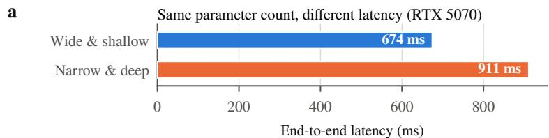

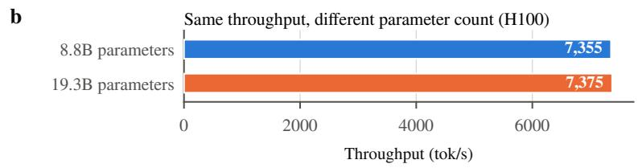  
Figure 1 | Parameter count is a poor proxy for serving cost. (a) Two model architectures with the same parameter count (3.61B total, 1.26B active); the narrow, deep one has 35% higher latency on an RTX 5070. (b) Two model architectures that meet the same throughput on an H100; one has 2.2× the parameters of the other.

To address these challenges, we introduce AutoCompress, an automated, hardware-guided model pruning framework that uses diferentiable architecture search to identify compressed models subject to latency or throughput targets, parameter budgets, and memory limits, either individually or in combination. The search jointly optimizes global architectural dimensions and per-layer structure, allowing diferent layers to retain diferent sizes and shapes. It uses cost models derived from measurements and allocation rules within the target serving engine.

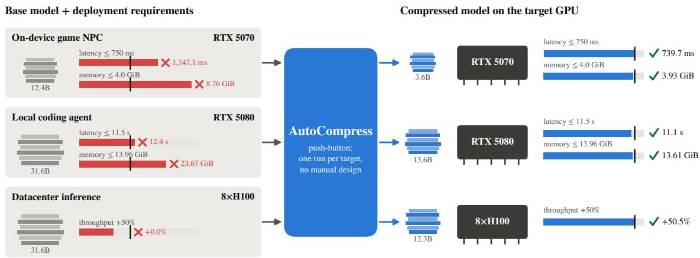  
Figure 2 | AutoCompress overview. Given a base model and deployment constraints, AutoCompress automatically selects, prunes, and distills an architecture for on-device gaming, local coding, or datacenter serving. The compressed models meet their latency, memory, or throughput targets, measured on real GPUs.

As illustrated in Figure 2, AutoCompress takes a pretrained base model and a deployment target specifying the hardware, workload, and resource constraints, and produces a standalone compressed model. The process is fully automated, from cost modeling and architecture selection to pruning and quality recovery, eliminating manual architecture design and translation of deployment requirements into parameter budgets. Across three distinct deployment scenarios, AutoCompress improves average accuracy over a deployment-adapted Minitron baseline by 6.57, 2.35, and 0.57 percentage points on RTX 5070, RTX 5080, and H100, respectively, while using approximately 2-3.3× fewer search tokens. We further demonstrate scalability by compressing Nemotron 3.5 Super from 120B to 74B parameters, enabling BF16 serving at 128K context and batch size 16 within 178 GB on a single B200, with a 2.85-point decrease in mean benchmark score.

This paper makes the following key contributions:

• Hardware-guided compression. We introduce AutoCompress, a diferentiable search framework that jointly optimizes global and per-layer structure under latency, throughput, parameter, and memory constraints.

• Serving-aware cost models. We develop and validate cost models that capture execution time and memory allocations within the target serving engine.

• Diverse deployment objectives. We evaluate AutoCompress on long-context local coding, batched datacenter serving, and latency-sensitive in-game interaction against a deployment-adapted Minitron baseline.

• Accuracy within budget. AutoCompress improves average benchmark accuracy by 6.57, 2.35, and 0.57 percentage points on RTX 5070, RTX 5080, and H100, respectively, while meeting deployment targets. We further demonstrate scalability through a 120B-to-74B compression case study.

## 2. Budget-Aware Architecture Search

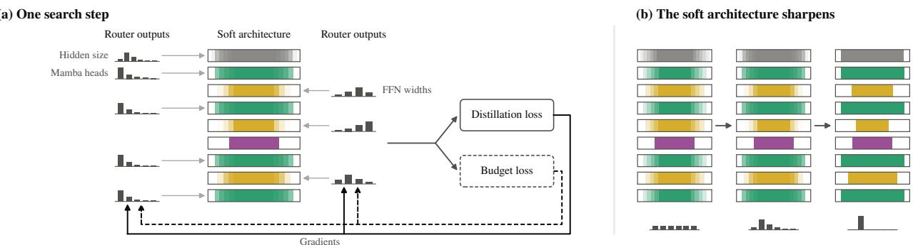  
Figure 3 | Joint search over global and per-layer structure. (a) Router outputs define soft architecture masks, updated through gradients from distillation and budget losses. (b) As search progresses, the distributions sharpen toward discrete choices, yielding a heterogeneous architecture.

AutoCompress selects a compressed architecture for a specified deployment target by jointly training an architecture router and a weight-sharing supernet. Given a pretrained parent and a search space, the router learns architectural choices that balance model quality against resource constraints. The selected architecture is then extracted from the parent and recovered through knowledge distillation.

## 2.1. Deployment Target and Search Procedure

Given a pretrained model, which we refer to as the parent, our goal is to derive a smaller model that satisfies a deployment target �. � specifies the hardware, serving configuration, precision, and workload, including batch size, cached-prefix length, and input/output lengths. Resource constraints impose a memory limit, a latency limit or throughput requirement, or a combination of these.

Our procedure has four stages. First, we construct cost models for the target deployment (see §3 for more details). Second, we rank the parent’s components by importance and reorder its weights to initialize a supernet, which shares weights across candidate architectures. Third, we jointly train an architecture router, which selects among these candidates, and the supernet using distillation from the frozen parent and resource penalties. Finally, we extract the selected architecture from the reordered parent’s weights and recover its quality through distillation, producing a standalone model.

## 2.2. Search Space and Shared Weights

Our search combines global dimensions shared across layers with per-layer dimensions that allow heterogeneous architectures. Candidate choices depend on the parent model, deployment target, and serving-engine support. We search over hidden size and Mamba head count, together with per-layer expert counts and routed and shared FFN widths. Mamba head count is shared across layers when varied globally. Supported per-layer choices also include zero width to remove a layer: for MoE layers, zero routed width results in a dense MLP when shared width is positive, while setting both widths to zero removes the layer. Thus, layer removal is represented within the same search space as width pruning. §4.2 specifies the candidate values and fixed dimensions for each deployment.

To share weights across candidates, we rank components by activation-based importance and permute their weights so that the highest-ranked components come first (Muralidharan et al., 2024). This ordering covers residual channels, Mamba heads within each head group, experts, and routed and shared FFN channels. Each candidate therefore uses a subset of the same supernet weights.

## 2.3. Architecture Router

The architecture router learns logits over the candidate values for each search axis, with separate logits for each layer on per-layer axes. As illustrated in Figure 3(a), these choices define a soft architecture optimized through distillation and budget losses. We sample diferentiable architecture choices using Gumbel-softmax (Jang et al., 2017; Maddison et al., 2017):

$$
y _ { c } = \frac { \exp ( ( \kappa _ { t } z _ { c } + g _ { c } ) / \tau _ { t } ) } { \sum _ { j } \exp ( ( \kappa _ { t } z _ { j } + g _ { j } ) / \tau _ { t } ) } .\tag{1}
$$

Here, $z _ { c }$ is the logit for choice $c , \ g _ { c }$ is independent standard Gumbel noise, and the sum spans all choices on the axis. The logit scale $\kappa _ { t }$ controls the strength of learned preferences relative to noise, while the temperature $\tau _ { t }$ controls how closely the relaxed choices approach one-hot selections. Increasing $\kappa _ { t }$ and decreasing �� progressively sharpen the soft architecture toward discrete choices (Figure 3(b)); their schedules are specified in §4.4.

Soft architecture masks. We translate each sampled choice into a mask over the importancesorted components. A component’s mask is the sum of $y _ { c }$ over choices that retain it. For example, when choosing between widths 64 and 128, the first 64 channels receive weight one, while the remaining channels receive weight �128. These masks allow gradients to update architecture choices while the shared weights adapt. Each batch is divided equally among independently sampled configurations. Expert-count masks additionally account for top-� expert selection, as described in §6.2.

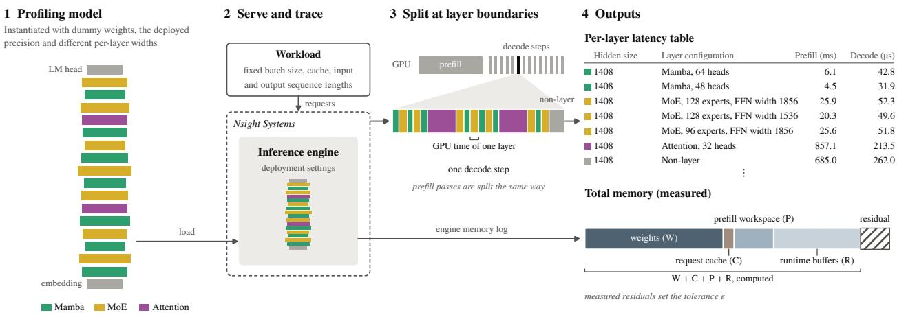  
Figure 4 | Measuring per-layer latency and memory (1) A model with multiple diferent layer configurations is instantiated. (2) Inference engine serves the model under the deployment setting while Nsight Systems traces runtime. (3) The trace is split at layer boundaries, for prefill and for every decode step. (4) Each layer’s runtime becomes one row of the latency table; One profiling run obtains many layer measurements along with total memory usage, whose residual over $W + C + P + R \ ( { \mathrm { E q . ~ 4 } } )$ sets the tolerance �.

Joint objective. The frozen parent serves as the distillation teacher, while the router and supernet are trained jointly. We combine logit distillation (Hinton et al., 2015) with a resource penalty:

$$
\mathcal { L } = \mathcal { L } _ { \mathrm { K D } } + \alpha \sum _ { r } \left[ \operatorname* { m a x } ( 0 , \rho _ { r } - 1 ) + \operatorname* { m a x } ( 0 , 1 - \delta - \rho _ { r } ) \right] .\tag{2}
$$

Here, ${ \mathcal { L } } _ { \mathrm { K D } }$ is the forward KL divergence from the parent’s token distribution to the sampled supernet’s distribution. For each constrained resource $r , \rho _ { r }$ is the cost predicted from the soft architecture choices divided by its budget. For example, a latency cap $T _ { \mathrm { m a x } }$ gives $\rho _ { T } = \hat { T } / T _ { \operatorname* { m a x } }$ . At a fixed workload, a throughput requirement is expressed as an upper bound on serving time.

The coeficient � balances resource constraints against distillation, while � controls the permitted unused budget. We use $\delta = 0 . 0 2$ , yielding zero penalty between 98% and 100% of each cap. The penalty discourages budget violations above this band and encourages greater capacity below it.

## 2.4. Architecture Extraction and Recovery

Once architecture search converges, we select the highest-logit choice from each router gate and evaluate the resulting discrete architecture using our cost models. We initialize the selected model with the corresponding weights from the importance-sorted parent and recover its quality through logit distillation (§4.5). Recovery thus starts from the retained parent weights, not the trained supernet weights.

## 3. Modeling Deployment Cost

AutoCompress uses cost models to estimate each search candidate’s latency, throughput, and memory usage under the target serving configuration. We describe these models below and evaluate their accuracy and profiling cost in §B.1 and §B.2, respectively.

## 3.1. Latency and throughput

Profiling every complete architecture is impractical due to the large combinatorial space produced by joint global and per-layer choices. We instead measure individual layer configurations within the target serving engine and combine their runtimes to estimate model latency. A deployment scenario � specifies the hardware, serving configuration, precision, and workload, including concurrency, batch size, and input and output lengths. For architecture $^ { a , }$ we estimate latency as

$$
\hat { T } ( a \mid \mathcal { D } ) = T _ { 0 } ( d \mid \mathcal { D } ) + \sum _ { \ell = 1 } ^ { L } t _ { \ell } ( a _ { \ell } ; d \mid \mathcal { D } ) .\tag{3}
$$

Here, � is the global hidden size, � is the parent’s layer count, and $a \ell$ specifies the configuration at layer ℓ. The measured runtime $t _ { \ell }$ is zero for a removed layer, while $T _ { 0 }$ accounts for embedding, the LM head, sampling, and serving-engine overhead.

Measurement procedure. Each profiling run serves a short model containing approximately ten diferent layer configurations initialized with dummy weights. We match the target deployment’s engine, precision, batch size, sequence lengths, and cache settings, and use Nsight Systems traces to measure GPU time at layer boundaries separately for prefill and decode. A single run therefore populates multiple entries in the timing table (Figure 4). We estimate each candidate’s latency by summing its corresponding entries and adding �0.

Profiling within the serving engine captures deployment-specific kernels and execution behavior. However, architectural changes can afect kernel selection, cache behavior, and overhead, limiting the accuracy of an additive estimate. We validate these estimates on complete architectures excluded from timing-table construction (§B.1).

## 3.2. Memory

For architecture � under deployment scenario �, we estimate serving memory as

$$
{ \hat { M } } ( a \mid { \mathcal { D } } ) = W + C + P + R + \epsilon _ { \mathcal { D } } .\tag{4}
$$

Here, � is weight memory computed from tensor shapes and deployed data types. The request cache � includes attention KV and Mamba convolution and SSM caches, sized for the target sequence length and batch size. The prefill workspace � depends on the query-head configuration and prefill chunk size, while runtime bufers � include MoE matrix-multiplication and Mamba projection workspaces sized by the relevant widest layers.

The allowance �� accounts for CUDA context, graph allocations, and other unmodeled memory. We set it to the largest residual between measured memory and $W + C + P + R$ across calibration server starts under �. These measurements can be collected during latency profiling without additional runs (Figure 4).

## 4. Experimental Setup

We evaluate AutoCompress across three deployment scenarios with distinct latency, throughput, and memory requirements. Below, we describe the models and workloads, search spaces, baseline, and training and evaluation procedures.

Table 1 | Deployment settings.
<table><tr><td></td><td>On-device game NPC</td><td>Local coding agent</td><td>Datacenter inference</td></tr><tr><td>Hardware</td><td>1× RTX 5070 (12 GB)</td><td>1× RTX 5080 (16 GB)</td><td>8× H100, TP1 × DP8</td></tr><tr><td>Parent</td><td>Nemotron Nano 3 Elastic 12B (12.4B / 2.1B active)</td><td>Nemotron 3.5 Lightning (31.6B / 3.6B active)</td><td>Nemotron 3.5 Lightning (31.6B / 3.6B active)</td></tr><tr><td>Workload</td><td>batch size 1; 2,048 input + 256 output tokens</td><td>batch size 1; 262,144 cached + 16,384 input + 1,024 out- put tokens</td><td>batch size 128 per GPU; 8,192 input + 65,536 output tokens</td></tr><tr><td>Latency throughput target</td><td>latency ≤ 750 ms</td><td>latency ≤ 11.5 s</td><td>throughput ≥7,330 tok/s per GPU (+50% over the parent)</td></tr><tr><td>Memory target</td><td>≤4.0 GiB</td><td>≤13.96 GiB</td><td></td></tr><tr><td>Parent cost</td><td>1,147 ms, 8.76 GiB</td><td>12.44 s, 23.67 GiB</td><td>4,922 tok/s per GPU</td></tr></table>

## 4.1. Models and Deployment Settings

We use two parent models with hybrid Mamba, attention, and MoE architectures: Nemotron Nano 3 Elastic 12B Taghibakhshi et al. (2026) and Nemotron 3.5 Lightning NVIDIA (2026a). Table 1 summarizes the workloads and resource limits for each scenario.

On-device game NPC. An interactive character must respond quickly while sharing GPU memory with rendering. We compress Nemotron Nano 3 Elastic 12B for an RTX 5070, the current most popular GPU among Steam users Valve Corporation (2026). We impose a 4 GiB memory budget, leaving 8 GiB of memory, equivalent to an entry-level gaming GPU, for game rendering. Latency is targeted at 750ms end-to-end to match modern voice agent standards NVIDIA (2026b). The workload, 2048 input and 256 output tokens, is taken as an upperbound of sample lengths in the NPC dialogue V2 dataset chimbiwide (2024).

Local coding agent. A local coding agent must process long contexts within consumer-GPU memory limits. We compress Nemotron 3.5 Lightning for an RTX 5080 using a long cached prefix followed by additional input and single-request generation. Workload and latency targets come from TraceLab Zhu et al. (2026), a trace dataset of production coding agents. We round up recorded Codex p90 sequence lengths to set our workload, 262,144 cache, 16,384 input, and 1,024 output tokens. The latency target is 11.5 s, the mean time an LLM step takes in the dataset traces. The memory target is set as the limit of vLLM Kwon et al. (2023) running on an RTX 5080 GPU with default memory utilization, 13.96 GiB.

Datacenter inference. Batched serving prioritizes aggregate throughput. We use the same Lightning parent on an 8×H100 node with a decode-heavy workload of 8,192 input and 65,536 output tokens per request. After sweeping parallelism layouts and batch size, TP1 × DP8 with batch size 128 per GPU maximizes the node’s aggregate throughput. We then set the target of 7,330 output tokens per second per GPU, a 50% increase of throughput over the parent model.

All models are served using vLLM 0.27.1 (Kwon et al., 2023). Profiling and cost estimation use the same precision, workload, and cache settings as deployment (see Appendix C for details).

Table 2 | Candidate values for learned architecture search. Hidden size is global; expert counts and FFN widths vary by layer.
<table><tr><td>Dimension</td><td>Lightning 3.5: RTX 5080 / H100</td><td>Nano 3 12B: RTX 5070</td></tr><tr><td>Hidden size d</td><td>2688, 2432, 2176, 1920, 1664, 1408</td><td>1920, 1792, 1664, 1536, 1408, 1280</td></tr><tr><td>Mamba H</td><td>64, 56, 48, 40, 32 (global)</td><td>64 or remove (per layer)</td></tr><tr><td>Routed experts  $E _ { \ell }$ </td><td>128, 112, 96, 80, 64</td><td>128, 96, 64, 32</td></tr><tr><td>Routed FFN width  $F _ { \ell }$ </td><td>1856, 1536, 1280, 1024</td><td>960, 704, 448, 192, 0</td></tr><tr><td>Shared FFN width  $S _ { \ell }$  Depth</td><td>3712, 2816, 1920 Fixed</td><td>3712, 2688, 1856, 1024, 0 Mamba and MoE layers may be removed</td></tr></table>

## 4.2. Candidate Architectures

Table 2 lists the candidate values for each deployment setting. With 23 Mamba and 23 MoE layers in each parent, these choices yield approximately $2 . 3 7 \times 1 0 ^ { 4 2 }$ distinct architectures for Lightning 3.5 and $1 . 2 0 \times 1 0 ^ { 5 2 }$ for Nano 3 12B before applying deployment constraints.

## 4.3. Minitron++ Baseline

Existing pruning methods do not directly support our joint search space and deployment constraints. We therefore adapt the Minitron pruning and screening procedure (Muralidharan et al., 2024) to use our serving-cost models, with the same importance-sorted parent and deployment budgets as AutoCompress. We call this new baseline Minitron++. We use uniform per-layer dimensions and retain all layers. We enumerate combinations from Table 2, except on RTX 5070, where Mamba head counts range from 64 to eight in steps of eight and zero FFN widths are excluded.

We retain candidates within 5% below every resource cap that cannot be enlarged along any axis without shrinking another or violating a constraint. This yields 6, 11, and 95 candidates for RTX 5070, RTX 5080, and H100, respectively. We use a wider band than AutoCompress’s 2% because the latter admits only one maximal RTX 5080 candidate.

Each candidate receives 100 distillation iterations (approximately 1.7B tokens), using the target’s batch size, data, and peak learning rate. We select the candidate with the lowest mean loss over iterations 76–100. For H100, we first rank all 95 candidates by loss before training and screen only the top five. The selected architecture receives the same recovery training as AutoCompress’s student.

## 4.4. Search Training Details

Router and optimization. Each router gate is a two-layer network with hidden width 256. Its output layer is zero-initialized, while the first layer is randomly initialized. The router uses a learning rate of $2 \times 1 0 ^ { - }$ 3 without warmup. The supernet uses peak and minimum learning rates of $4 \times 1 0 ^ { - 5 }$ and $5 \times 1 0 ^ { - 6 }$ , with a 60-step warmup. Each batch contains 2048 sequences of 8192 tokens, divided equally among 32 sampled configurations.

Sampling schedule and termination. Over 250 steps, the logit scale in Eq. 1 increases linearly from 1 to 10, while the temperature decreases geometrically from 1.0 to 0.05. Approximately 0.4% of samples use hard one-hot choices. We extract an architecture once every gate assigns at least 0.95 probability to its leading choice. The reported architectures were extracted at iterations 170, 249, and 179 for RTX 5080, RTX 5070, and H100, respectively.

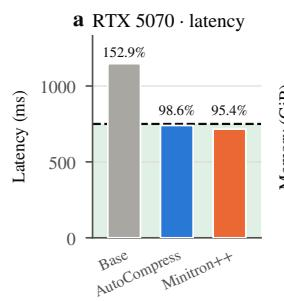

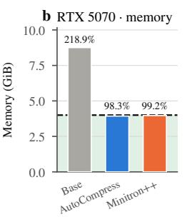

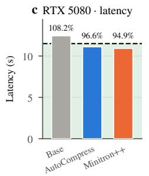

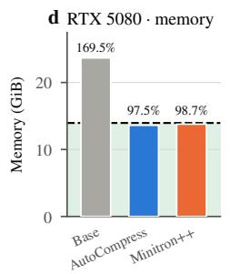

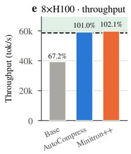  
Figure 5 | Budget adherence. All selected architectures satisfy their deployment budgets when measured on real hardware.

Budget-weight selection. The resource penalty is zero between 98% and 100% of each cap. We selected $\alpha = 0 . 3$ through an H100 sweep and reused it for RTX 5080. RTX 5070 uses a higher budget weight of $\alpha = 1$ due to its tighter budget constraints.

Parallelism. RTX 5080- and H100-targeted searches use eight-way tensor parallelism and eightway expert parallelism across 32 H100 nodes. The RTX 5070-targeted search uses four-way tensor parallelism and eight-way expert parallelism across 8 H100 nodes. Search costs are reported in §B.2.

## 4.5. Distillation Details

After architecture selection, we use knowledge distillation to recover quality lost during pruning. Each student is sliced from the importance-sorted parent and trained using only the parent’s output logits as supervision. For each deployment target, AutoCompress and baseline students receive the same data in the same order, batch size, and learning-rate schedule. Batches contain 2048 sequences of 8192 tokens, with peak and minimum learning rates of $4 \times 1 0 ^ { - 5 }$ and $5 \times 1 0 ^ { - 6 }$ , respectively.

## 4.6. Benchmarks

We evaluate reasoning, coding, knowledge, and instruction following across eight benchmarks: AIME25 Mathematical Association of America (2025), LiveCodeBench v5 Jain et al. (2025), MMLU-Pro Wang et al. (2024), MATH-500 Hendrycks et al. (2021); Lightman et al. (2024), GSM8K Cobbe et al. (2021), IFEval Zhou et al. (2023), IFBench Pyatkin et al. (2025), and GPQA-Diamond Rein et al. (2024). All evaluations use reasoning mode with temperature 1.0 and top-� 1.0. We sample 16 responses per problem for AIME25, eight for GPQA-Diamond, one for MMLU-Pro, and four for the remaining benchmarks. We report pass@1 averaged over samples, with prompt-level strict accuracy for IFEval and IFBench.

## 5. Results

We compare AutoCompress with the Minitron++ homogeneous baseline under the same deployment budgets and matched recovery training.

Table 3 | Accuracy and architecture-selection tokens under matched deployment budgets. Search tokens count architecture selection; KD tokens count recovery training. KD loss is averaged over the final 25 iterations on matched batches. Benchmark scores are final-checkpoint pass@1 (%), with prompt-level strict accuracy for IFEval and IFBench. Evaluation follows §4.6; Avg averages the eight benchmarks.
<table><tr><td>Contract</td><td>Method</td><td>Search tokens ↓</td><td>KD tokens</td><td>KD loss ↓</td><td>AIME25</td><td>LiveCodeBench</td><td>MMLU-Pro</td><td>MATH-500</td><td>GSM8K</td><td>IFEval</td><td>IFBench</td><td>GPQA</td><td>Avg8</td></tr><tr><td rowspan="2">RTX 5070</td><td>AUTOCOMPRESS</td><td>4.18B</td><td>30B</td><td>0.1909</td><td>0.42</td><td>1.11</td><td>26.46</td><td>36.40</td><td>47.54</td><td>55.13</td><td>24.49</td><td>21.78</td><td>26.67</td></tr><tr><td>Minitron++</td><td>8.49B</td><td>30B</td><td>0.2366</td><td>0.00</td><td>0.48</td><td>19.76</td><td>29.90</td><td>34.29</td><td>43.76</td><td>17.43</td><td>15.21</td><td>20.10</td></tr><tr><td rowspan="2">RTX 5080</td><td>AUTOCOMPRESS</td><td>2.85B</td><td>10B</td><td>0.1637</td><td>52.71</td><td>49.44</td><td>67.45</td><td>93.60</td><td>92.87</td><td>83.64</td><td>55.61</td><td>55.87</td><td>68.90</td></tr><tr><td>Minitron++</td><td>8.57B</td><td>10B</td><td>0.1710</td><td>48.75</td><td>43.81</td><td>67.89</td><td>92.70</td><td>92.93</td><td>79.57</td><td>49.83</td><td>56.94</td><td>66.55</td></tr><tr><td rowspan="2">8×H100</td><td>AUTOCOMPRESS</td><td>3.00B</td><td>10B</td><td>0.1809</td><td>55.42</td><td>48.02</td><td>64.80</td><td>92.80</td><td>92.49</td><td>82.53</td><td>53.74</td><td>53.09</td><td>67.86</td></tr><tr><td>Minitron++</td><td>9.98B</td><td>10B</td><td>0.1820</td><td>53.54</td><td>47.78</td><td>64.43</td><td>92.85</td><td>92.72</td><td>81.38</td><td>52.04</td><td>53.60</td><td>67.29</td></tr></table>

## 5.1. Accuracy Under Deployment Budgets

As seen from Table 3, AutoCompress improves Avg8 by 6.57, 2.35, and 0.57 percentage points for RTX 5070, RTX 5080, and H100, respectively. Final distillation loss is lower by 19.3%, 4.3%, and 0.6%, respectively.

All selected architectures meet their predicted deployment budgets (Figure 5). The RTX 5070 and RTX 5080 AutoCompress students also meet their latency and memory limits on hardware, measuring 739.7 ms / 3.93 GiB and 11.1 s / 13.61 GiB, respectively.

## 5.2. Architecture Selection Cost

The Minitron++ baseline uses approximately 2.0×, 3.0×, and 3.3× as many architecture-selection tokens as AutoCompress for RTX 5070, RTX 5080, and H100, respectively (Table 3). Recovery training uses the same token budget for both methods within each target.

## 5.3. Case Study at Scale

To test AutoCompress at a larger scale, we set the deployment objective to fit Nemotron 3.5 Super (NVIDIA, 2026a) on a single B200 GPU in BF16 at a context length of 131,072 tokens. The parent’s estimated serving footprint is approximately 280 GB, exceeding the device’s 180 GB capacity. At this context length, the AutoCompress model supports a maximum batch size of 16, using 178 GB of GPU memory (Figure 6a). The resulting architecture has approximately 74B parameters, down from 120B in the parent, a 38.3% reduction.

Architecture selection uses deployment memory footprint constraint, and the router selects layerspecific MoE routed expert counts and intermediate sizes while retaining the parent’s backbone layers. Appendix D gives the final architecture and individual benchmark scores.

Architecture search converges within 4B tokens, in similar range to previous smaller scale use in Table 3. Recovery uses 68B tokens at 8192 context and 48B at 131072, for 120B tokens in total. Search and recovery used 32 GB200 nodes (128 GPUs) for approximately 64 hours. Given the training cost, we did not run the Minitron++ baseline for this case study.

After recovery, the unweighted mean of the nine reported benchmark scores is 54.74, compared with 57.58 for the parent, a decrease of 2.85 points (Figure 6b). AutoCompress also exceeds the 45.44 mean of Nemotron 3 Super, a 120B-parameter reference model, by 9.30 points.

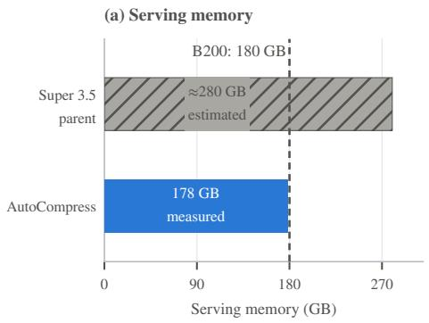

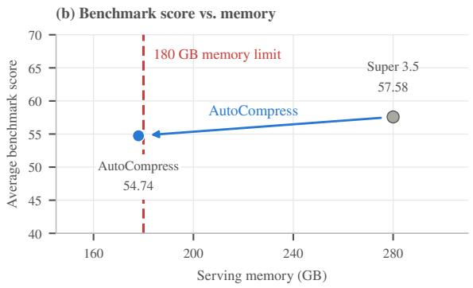

Figure 6 | Compression at scale. (a) The Super 3.5 parent’s estimated BF16 serving footprint of approximately 280 GB exceeds the B200’s 180 GB capacity; the AutoCompress model supports a maximum batch size of 16 at 131,072-token context, with measured serving memory of 178 GB. (b) Mean benchmark score versus serving memory; the arrow connects the parent to the AutoCompress model, and the red dashed line marks the 180 GB memory limit. The mean includes 9 benchmarks and the breakdown is available in Appendix D.  
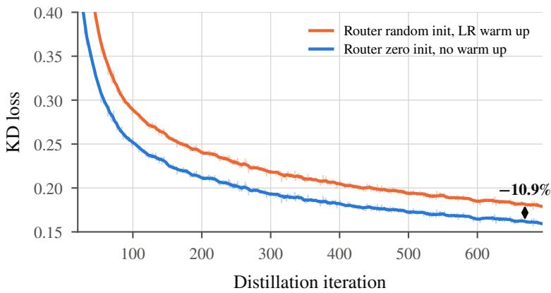  
Figure 7 | Router initialization and warmup. Distillation loss of architectures selected by two RTX 5080 searches. Zero router-output initialization without router warmup yields 10.9% lower loss than random initialization with warmup.

## 6. Ablations and Analysis

We examine how router initialization and expert masking afect architecture selection and model quality. We then analyze the search dynamics and learned architectures to understand how distillation and resource constraints shape global and per-layer choices.

## 6.1. Router Initialization

Random router-output initialization creates an initial bias over architecture choices. Learning-rate warmup limits the early updates that could correct this bias before the sampling distribution sharpens. We therefore initialize the router’s output layer to zero and remove router warmup, while retaining warmup for the model weights. In the RTX 5080 comparison, this configuration selects an architecture with 10.9% lower distillation loss than random router-output initialization with warmup, as shown in Figure 7.

a  
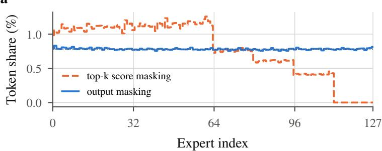

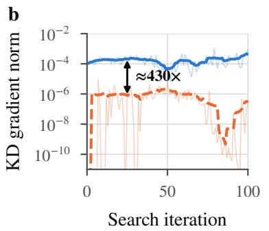

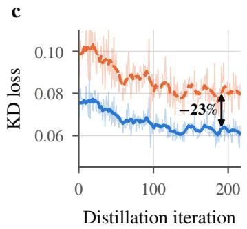  
Figure 8 | MoE routed expert masking. Comparison of top-k score masking and expert output masking in expert token share, router KD gradient and architecture quality.

## 6.2. MoE Routed Expert Masking

A direct extension of channel masking to expert masking is applying soft masks to expert routing scores before top-� selection. We have found that this reduces trafic to experts retained only by larger architecture choices. These experts then contribute little gradient to the architecture router. As an alternative, output masking applies the soft mask after expert selection, preserving access to these experts during search. We compare the 2 expert masking methods in Figure 8. Output masking ensures evenly routed experts and provides stable distillation gradients. The resulting architecture gets 23% lower distillation loss compared to using top-k score masking.

## 6.3. Router Decisions and Learned Architectures

We log architecture-choice probabilities and gradients from the distillation and budget terms of Eq. 2. Figure 9 shows the RTX 5080 search. The shared-expert intermediate size settles first and remains at full size, followed by Mamba heads at iteration 41 and hidden size at iteration 50. MoE routed expert counts and intermediate sizes settle last. Distillation-gradient norms are larger for the shared and global choices, while budget-gradient norms are larger for the remaining MoE choices. Preserving the shared expert is consistent with its relatively low serving cost: at hidden size 2688, nearly halving its intermediate size saves only 7.5 ms and 5 MiB per layer, compared with 33.7 ms and 307 MiB for a similar reduction in MoE intermediate size.

On H100, AutoCompress and Minitron++ select the same hidden size and Mamba head count. Minitron++ uses uniform MoE routed expert counts and intermediate sizes, while AutoCompress varies both across layers. At the same throughput target, AutoCompress achieves 0.6% lower distillation loss and 0.57 percentage points higher Avg8 (Table 3). These gains come with a 3.3× reduction in architecture-selection tokens relative to Minitron++. Complete architectures are given in Appendix A.

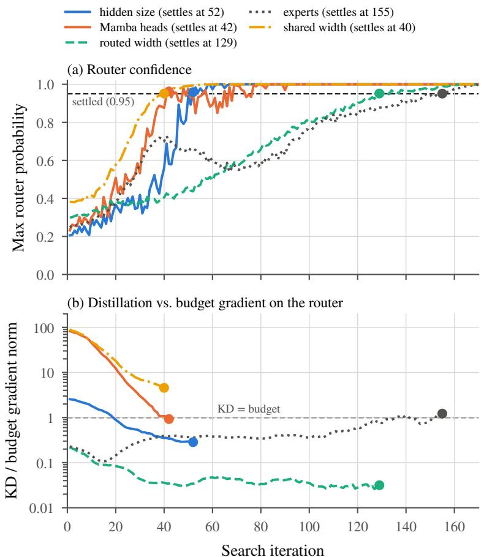  
Figure 9 | RTX 5080 router diagnostics. Top: maximum choice probability on each architecture axis. Bottom: ratio of distillation-gradient norm to budget-gradient norm; a value above one indicates a larger distillation-gradient norm.

## 7. Related Work

Structured LLM pruning. Structured pruning reduces model size by removing layers, attention heads, or hidden and intermediate dimensions (Xia et al., 2022; Ma et al., 2023; Xia et al., 2024; Ashkboos et al., 2024; Men et al., 2025), with recent work extending pruning and recovery to large MoE models (Tang et al., 2026). Minitron (Muralidharan et al., 2024) combines importance-based pruning with knowledge distillation; we follow this recipe to initialize our supernet and adapt its architecture-selection procedure as our evaluation baseline. These methods primarily optimize retained structure and quality recovery at a prescribed model size or compression ratio.

Hardware-aware approaches incorporate execution cost into architecture selection. ZipLM (Kurtić et al., 2023) iteratively removes components according to their loss–runtime trade-of, while SPRINT (Park et al., 2025) selects sublayers using latency reduction and post-pruning tunability. Related approaches include latency-constrained knapsack optimization (Shen et al., 2022), hardwarein-the-loop architecture search for mobile deployment (Huang et al., 2026), and joint optimization of latency and model size (Ali et al., 2026). Puzzle (Bercovich et al., 2024) is particularly relevant: it evaluates candidate block replacements using blockwise distillation, selects a heterogeneous architecture through mixed-integer programming under throughput and memory constraints, and recovers quality through global distillation. Its formulation selects per-layer replacements at a fixed hidden dimension and does not support hidden-dimension pruning. The hybrid MoE extension introduces iterative compression, heterogeneous expert widths and routing budgets, and Mamba state pruning (Bercovich et al., 2026); however, the public implementation does not include Mamba head or expert-width pruning. In contrast, AutoCompress jointly optimizes hidden size, Mamba head count, and per-layer MoE structure through diferentiable search, guided by serving-engine cost models calibrated to the target hardware, workload, and precision.

Cost models and serving. Prior work highlights the need to validate latency predictors for both accuracy and architecture ranking (Akhauri & Abdelfattah, 2024; Zhang et al., 2021). MoE serving costs also depend on execution phase and parallelism, which FLOPs alone do not capture (Patel et al., 2026). Complementary approaches optimize runtime memory use (Ukarande et al., 2026) or serving configurations for a fixed model (Cho et al., 2026). We instead guide architecture search with cost models derived from serving-engine measurements and allocation rules (Kwon et al., 2023), using the target workload and precision, and validate their predictions on held-out models running on the target hardware (§B.1).

## 8. Conclusion

We have presented AutoCompress, a hardware-guided compression framework that jointly optimizes global and per-layer structure under latency, throughput, parameter, and memory constraints. Its cost models capture execution time and memory allocations within the target serving engine, accounting for the hardware and workload used in deployment. A budget-aware architecture router combines these cost estimates with distillation signals to learn how much capacity to retain across layers. The selected architecture is extracted from the parent and recovered through distillation, producing a standalone model without manual architecture design.

Across long-context local coding, batched datacenter serving, and latency-sensitive in-game interaction, AutoCompress improves accuracy over the deployment-adapted Minitron++ baseline. With matched recovery training, Avg8 increases by 6.57, 2.35, and 0.57 percentage points on RTX 5070, RTX 5080, and H100, respectively, while architecture-selection tokens decrease by factors of approximately 2.0, 3.0, and 3.3. All selected architectures meet their predicted deployment budgets, with serving measurements confirming latency and memory adherence for both RTX AutoCompress students. The 120B-to-74B Nemotron 3.5 Super case study extends these results to larger models, enabling single-GPU BF16 serving at 128K context while retaining approximately 95% of the parent’s mean benchmark score.

## References

Akhauri, Y. and Abdelfattah, M. S. On latency predictors for neural architecture search. Proceedings of Machine Learning and Systems, 6:512–523, 2024.

Ali, M. J., Niar, S., and Talbi, E.-G. Multi-objective structured pruning of llms for latency and model size optimization. arXiv preprint arXiv:2607.22583, 2026.

Ashkboos, S., Croci, M., Gennari do Nascimento, M., Hoefler, T., and Hensman, J. Slicegpt: Compress large language models by deleting rows and columns. In International Conference on Learning Representations, volume 2024, pp. 11682–11701, 2024.

Bercovich, A., Ronen, T., Abramovich, T., Ailon, N., Assaf, N., Dabbah, M., Galil, I., Geifman, A., Geifman, Y., Golan, I., et al. Puzzle: Distillation-based nas for inference-optimized llms. arXiv preprint arXiv:2411.19146, 2024.

Bercovich, A., Abramovich, T., Afrimi, D., Aharon, S., Ailon, N., Anisimov, V., Argov, O. U., Ashkenazi, M., Asida, T., Assaf, N., et al. Nemotron-labs-3-puzzle-75b-a9b: Compressing hybrid moe llms. arXiv preprint arXiv:2607.04371, 2026.

chimbiwide. Npc-dialogue\_v2. https://huggingface.co/datasets/chimbiwide/NPC-Dialogue\_ v2, 2024. Generated using Google Gemini 2.0 Flash. 1,688 high-quality NPC conversations for RPG dialogue systems.

Cho, S. M., Lee, J., Tang, C., Lee, Y., Jeong, G., Agape, A., Batura, S., Boivin, V., Chen, S., Chen, R., et al. Optimizing deployment configurations for llm inference. Proceedings of Machine Learning and Systems, 8:1415–1430, 2026.

Cobbe, K., Kosaraju, V., Bavarian, M., Chen, M., Jun, H., Kaiser, L., Plappert, M., Tworek, J., Hilton, J., Nakano, R., Hesse, C., and Schulman, J. Training verifiers to solve math word problems. arXiv preprint arXiv:2110.14168, 2021.

Hendrycks, D., Burns, C., Kadavath, S., Arora, A., Basart, S., Tang, E., Song, D., and Steinhardt, J. Measuring mathematical problem solving with the MATH dataset. In Advances in Neural Information Processing Systems (NeurIPS), Datasets and Benchmarks Track, 2021.

Hinton, G., Vinyals, O., and Dean, J. Distilling the knowledge in a neural network. arXiv preprint arXiv:1503.02531, 2015.

Huang, H., Fedorov, I., Gromov, A., Beckerman, B., Suda, N., Eriksson, D., Balandat, M., Conway, R., Huber, P., Sankar, C., et al. Mobilellm-flash: Latency-guided on-device llm design for industry scale deployment. In Proceedings of the 64th Annual Meeting of the Association for Computational Linguistics (ACL 2026), pp. 749–760, 2026.

Jain, N., Han, K., Gu, A., Li, W.-D., Yan, F., Zhang, T., Wang, S., Solar-Lezama, A., Sen, K., and Stoica, I. LiveCodeBench: Holistic and contamination free evaluation of large language models for code. In International Conference on Learning Representations (ICLR), 2025.

Jang, E., Gu, S., and Poole, B. Categorical reparameterization with Gumbel-Softmax. In International Conference on Learning Representations (ICLR), 2017.

Kurtić, E., Frantar, E., and Alistarh, D. Ziplm: Inference-aware structured pruning of language models. Advances in Neural Information Processing Systems, 36:65597–65617, 2023.

Kwon, W., Li, Z., Zhuang, S., Sheng, Y., Zheng, L., Yu, C. H., Gonzalez, J. E., Zhang, H., and Stoica, I. Eficient memory management for large language model serving with PagedAttention. In Proceedings of the 29th Symposium on Operating Systems Principles (SOSP), 2023. URL https://arxiv.org/abs/2309.06180.

Lightman, H., Kosaraju, V., Burda, Y., Edwards, H., Baker, B., Lee, T., Leike, J., Schulman, J., Sutskever, I., and Cobbe, K. Let’s verify step by step. In International Conference on Learning Representations (ICLR), 2024.

Ma, X., Fang, G., and Wang, X. Llm-pruner: On the structural pruning of large language models. Advances in neural information processing systems, 36:21702–21720, 2023.

Maddison, C. J., Mnih, A., and Teh, Y. W. The concrete distribution: A continuous relaxation of discrete random variables. In International Conference on Learning Representations (ICLR), 2017.

Mathematical Association of America. American invitational mathematics examination (AIME) 2025. https://maa.org/maa-invitational-competitions/, 2025.

Men, X., Xu, M., Zhang, Q., Yuan, Q., Wang, B., Lin, H., Lu, Y., Han, X., and Chen, W. Shortgpt: Layers in large language models are more redundant than you expect. pp. 20192–20204, 2025.

Muralidharan, S., Turuvekere Sreenivas, S., Joshi, R., Chochowski, M., Patwary, M., Shoeybi, M., Catanzaro, B., Kautz, J., and Molchanov, P. Compact language models via pruning and knowledge distillation. Advances in Neural Information Processing Systems, 37:41076–41102, 2024.

NVIDIA. Nvidia nemotron 3.5 super and lightning. Technical report, NVIDIA, 2026a. URL https://research.nvidia.com/labs/nemotron/Nemotron-3.5-Super-and-Lightning/.

NVIDIA. Nemotron Voice Agent blueprint. https://build.nvidia.com/nvidia/ nemotron-voice-agent, 2026b. Accessed 2026-10-29.

Park, S., Lee, S., Kim, J., Lee, J., Jo, H., and Kang, U. Accurate sublayer pruning for large language models by exploiting latency and tunability information. arXiv preprint arXiv:2506.03510, 2025.

Patel, P., Lee, D., Iwasaki, S., and Krishnamurthy, A. Demystifying the mixture of experts serving tax. Proceedings of Machine Learning and Systems, 8:1247–1260, 2026.

Pyatkin, V., Malik, S., Graf, V., Ivison, H., Huang, S., Dasigi, P., Lambert, N., and Hajishirzi, H. Generalizing verifiable instruction following. arXiv preprint arXiv:2507.02833, 2025.

Rein, D., Hou, B. L., Stickland, A. C., Petty, J., Pang, R. Y., Dirani, J., Michael, J., and Bowman, S. R. GPQA: A graduate-level Google-proof Q&A benchmark. In Conference on Language Modeling (COLM), 2024.

Shen, M., Yin, H., Molchanov, P., Mao, L., Liu, J., and Alvarez, J. M. Structural pruning via latency-saliency knapsack. Advances in Neural Information Processing Systems, 35:12894–12908, 2022.

Taghibakhshi, A., Turuvekere Sreenivas, S., Muralidharan, S., Chochowski, M., Karnati, Y., Joshi, R., Mahabaleshwarkar, A., Chen, Z., Suhara, Y., Olabiyi, O., et al. Eficient hybrid language model compression through group-aware ssm pruning. Advances in Neural Information Processing Systems, 38:122956–122976, 2026.

Tang, S., Wang, Z., Zheng, B., Wang, L., Men, R., Zhang, S., Yuan, X., Qiu, Z., Shen, Z., and Liu, D. Slimqwen: Exploring the pruning and distillation in large moe model pre-training. arXiv preprint arXiv:2605.08738, 2026.

Ukarande, A., Shekhar, D., Blackstein, M., and Rangan, R. Eficient, vram-constrained xlm inference on clients. Proceedings of Machine Learning and Systems, 8:1884–1900, 2026.

Valve Corporation. Steam hardware & software survey: September 2026. https://store. steampowered.com/hwsurvey/, 2026. Accessed 2026-10-29.

Wang, Y., Ma, X., Zhang, G., Ni, Y., Chandra, A., Guo, S., Ren, W., Arulraj, A., He, X., Jiang, Z., Li, T., Ku, M., Wang, K., Zhuang, A., Fan, R., Yue, X., and Chen, W. MMLU-Pro: A more robust and challenging multi-task language understanding benchmark. In Advances in Neural Information Processing Systems (NeurIPS), Datasets and Benchmarks Track, 2024.

Xia, M., Zhong, Z., and Chen, D. Structured pruning learns compact and accurate models. In Proceedings of the 60th Annual Meeting of the Association for Computational Linguistics (Volume 1: Long Papers), pp. 1513–1528, 2022.

Xia, M., Gao, T., Zeng, Z., and Chen, D. Sheared llama: Accelerating language model pre-training via structured pruning. In International Conference on Learning Representations, volume 2024, pp. 5385–5409, 2024.

Zhang, L. L. et al. nn-meter: Towards accurate latency prediction of deep-learning model inference on diverse edge devices. In Proceedings of MobiSys, 2021.

Zhou, J., Lu, T., Mishra, S., Brahma, S., Basu, S., Luan, Y., Zhou, D., and Hou, L. Instructionfollowing evaluation for large language models. arXiv preprint arXiv:2311.07911, 2023.

Zhu, K., Jacob, M., Ma, C., Pan, Y., Wang, S., Krishnamurthy, A., and Kasikci, B. TraceLab: Characterizing coding agent workloads for LLM serving. arXiv preprint arXiv:2606.30560, 2026.

Figure 10 | Architectures. Both parent models have 52 total layers, 23 Mamba layers, 23 MoE layers and 6 attention layers. Attention layers are all kept full.  
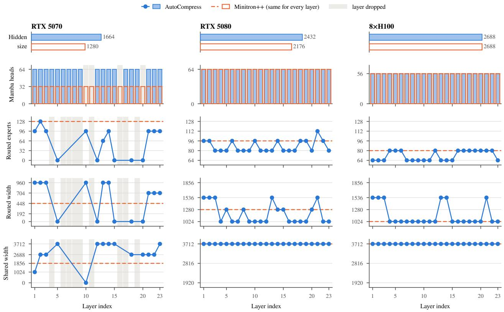

## A. Per-Layer Architectures

Figure 10 shows every Mamba and FFN layer of the AutoCompress and Minitron students.

## B. Cost-Model Details

## B.1. Cost-model Accuracy

We test the timing models on complete homogeneous and heterogeneous architectures with diferent widths and depths, none used to construct the layer timing tables. Figure 11 compares predictions with serving measurements.

For memory, we compare with an estimate based on weights at their deployed precision, request KV cache, and recurrent state, following the components commonly used in compression cost models (Bercovich et al., 2024, 2026). Across six served RTX models, this estimate under-predicts memory by 31–43%. Figure 12 includes the stated MoE activation bufer and shows one example on each GPU. The remaining allocations include prefill workspaces, other runtime bufers, CUDA-graph pools, page rounding, and non-PyTorch memory. Explicit accounting reduces the error by roughly an order of magnitude in these measurements.

## B.2. Profiling and training cost

Table 4 reports the runs, timing-table entries, and GPU-hours needed to profile each deployment target. On RTX 5080, 60 runs covering 468 entries took approximately 3.5 GPU-hours. H100

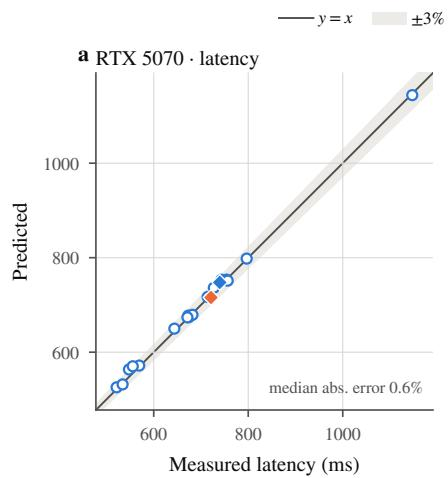

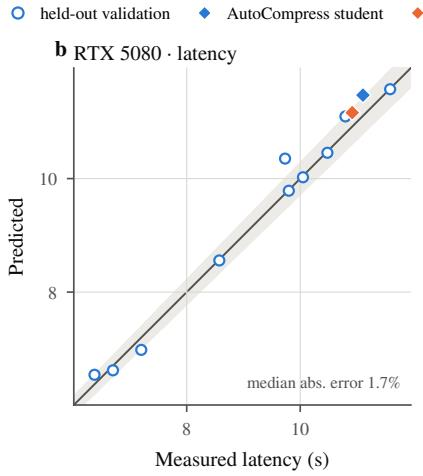

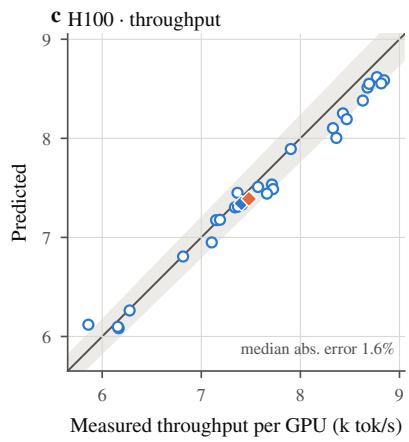  
Figure 11 | Cost-model accuracy: predicted vs. measured end-to-end latency (RTX 5070, RTX 5080) and throughput per GPU (H100) on held-out architectures, including the searched ones.

Table 4 | Measurement cost of each contract’s latency cost model (Table 1).
<table><tr><td>Contract</td><td>Runs</td><td>Table entries</td><td>GPU-h</td></tr><tr><td>Local coding (RTX 5080)</td><td>60</td><td>468</td><td>3.5</td></tr><tr><td>Datacenter throughput (H100)</td><td>180</td><td>408</td><td>24.8</td></tr><tr><td>On-device NPC (RTX 5070)</td><td>96</td><td>660</td><td>4.5</td></tr></table>

profiling used 180 runs and 24.8 GPU-hours, while RTX 5070 used 96 runs and 4.5 GPU-hours. Each short profiling model contains multiple configurations, allowing one run to contribute several layer timings.

## C. Model Serving Details

Serving uses vLLM 0.27.1 (Kwon et al., 2023). Experts, shared experts, and the LM head use NVFP4; Mamba projections use FP8; attention uses BF16; and KV cache and Mamba state use FP8 and FP32, respectively. Timing and memory predictions use these deployed precisions. The H100 throughput target is evaluated at a fixed batch size, so a reduction in batch serving time also reduces completion time for those requests.

## D. Large-Scale Case Study

Figure 13 shows the final architecture selected for the Nemotron 3.5 Super case study in §5.3. MoE routed expert counts range from 240 to 496, and MoE intermediate sizes range from 1536 to 2560, compared with 512 and 2688 in the parent. The model retains all 88 backbone layers, hidden size 4096, and shared-expert intermediate size 5376.

Figure 14 compares individual benchmark scores for AutoCompress, its Nemotron 3.5 Super parent, and Nemotron 3 Super. The unweighted mean covers nine reported metrics; GDPval-AA v2 is an index, while the remaining eight scores are percentages.

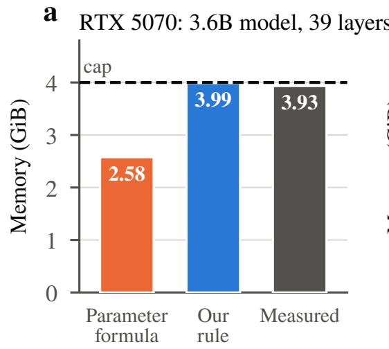

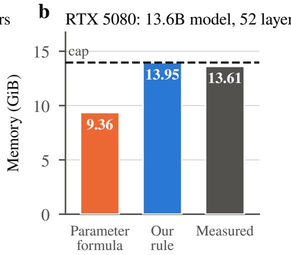

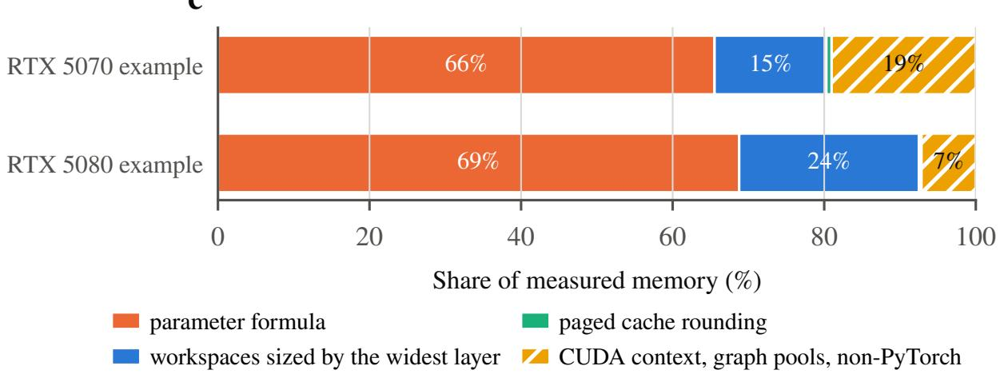  
Figure 12 | A conventional memory formula misses about a third of the memory. (a, b) Memory predicted by a conventional formula (weights at deployed precision, per-sequence KV cache and Mamba state, an MoE activation bufer) and by our memory cost model (§3.2), against measured vLLM memory: a 3.6B-parameter, 39-layer model on the RTX 5070 and a 13.6B-parameter, 52-layer model on the RTX 5080. (c) What the formula misses, as shares of measured memory.

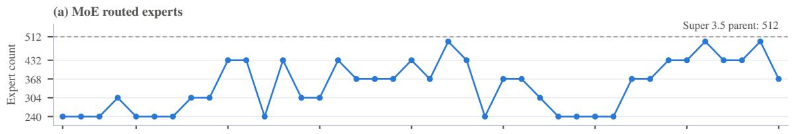

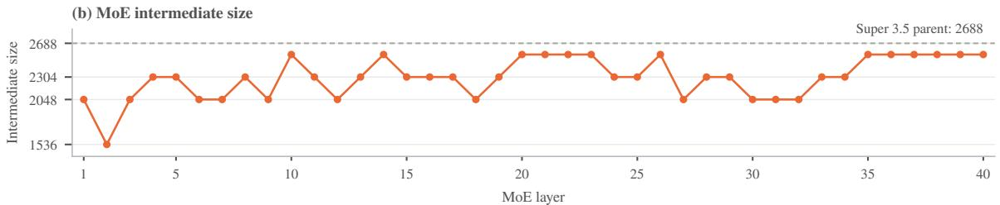  
Figure 13 | Final MoE architecture selected by AutoCompress. (a) MoE routed expert counts and (b) MoE intermediate sizes across all 40 MoE layers, ordered by backbone depth. Dashed lines show the parent’s uniform dimensions: 512 routed experts and intermediate size 2688.

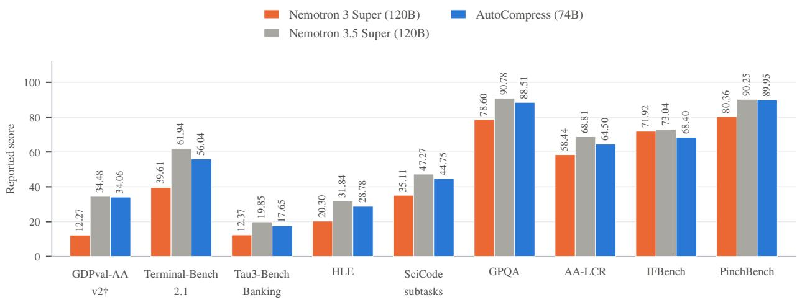  
Figure 14 | Benchmark scores after compression and distillation. Nemotron 3.5 Super and Auto-Compress, with Nemotron 3 Super as a reference. The unweighted means across these nine metrics are 57.58, 54.74, and 45.44, respectively. † GDPval-AA v2 is an index; the other scores are percentages.