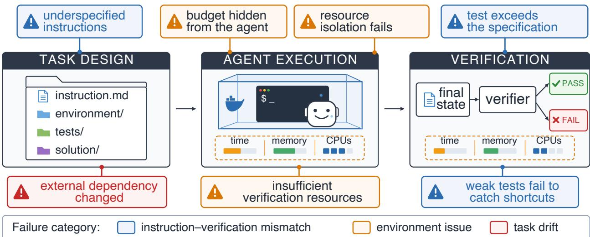
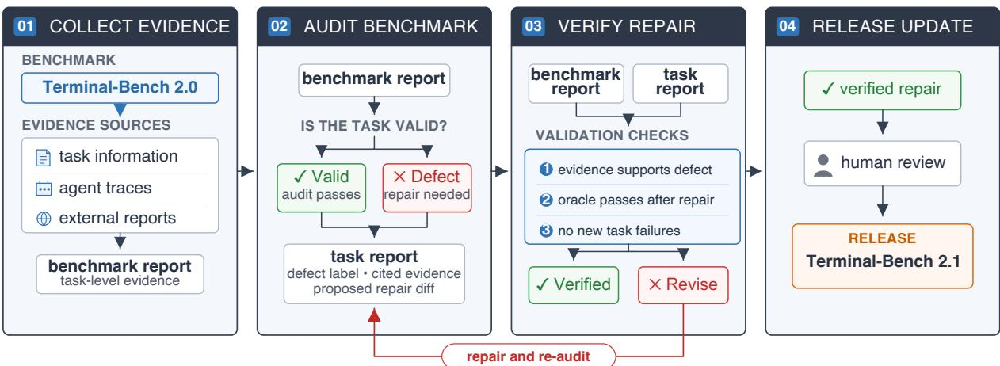
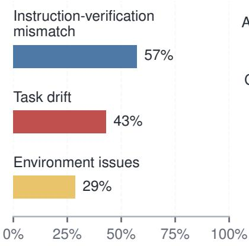
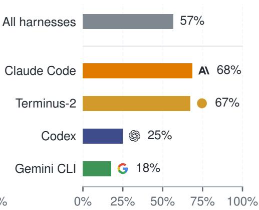
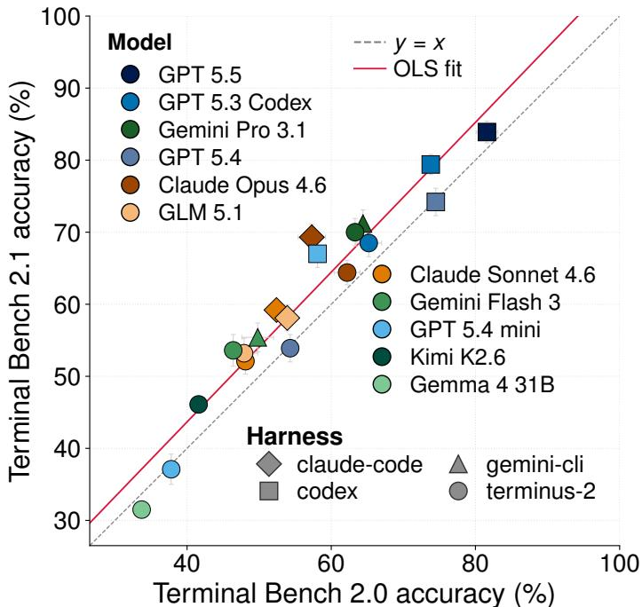
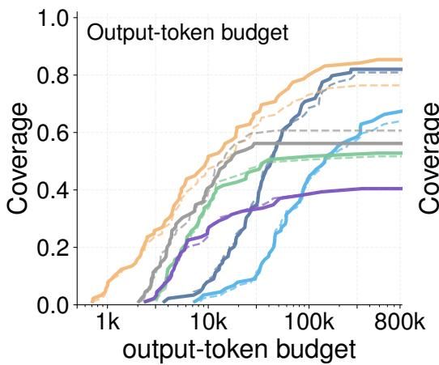
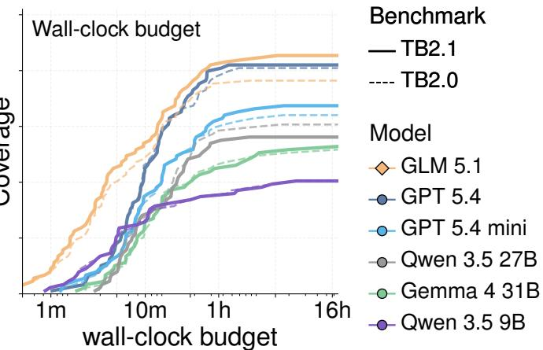
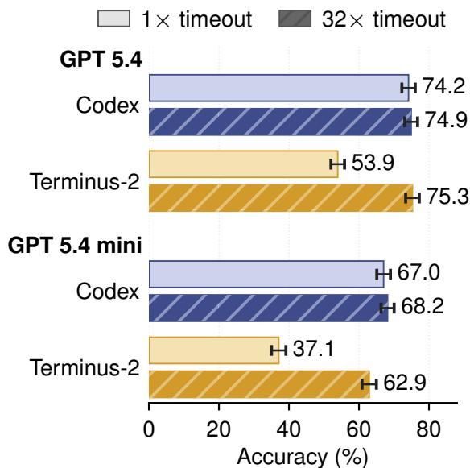
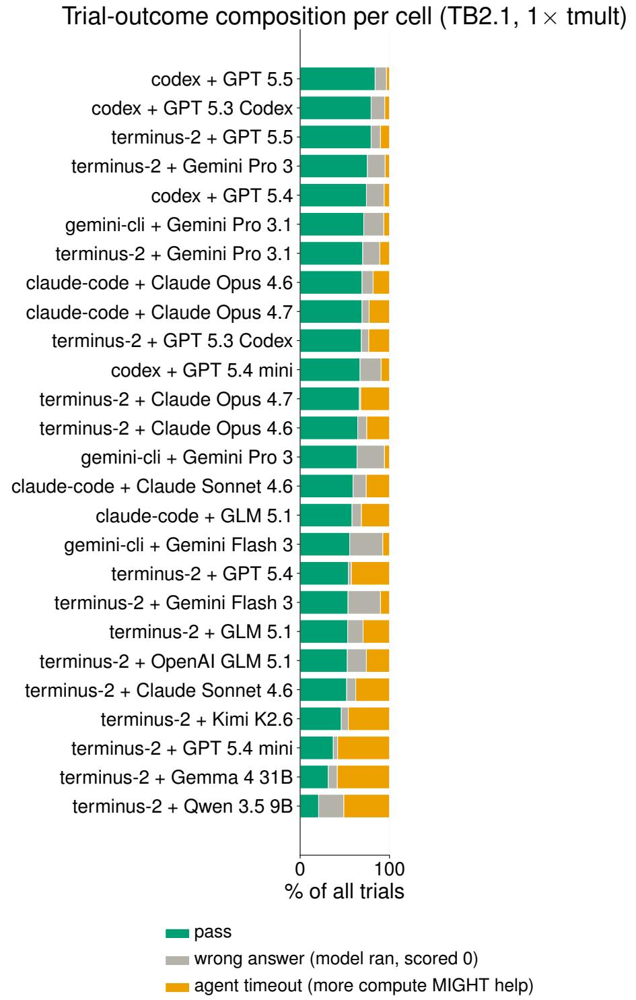

# Benchmarks as Software: Terminal-Bench and the Case for Continuous Benchmarks

E. Kelly Buchanan1\* Crystal Zhou2 Scott W. Linderman1 Christopher Ré1 1Stanford University 2Cornell University

## Abstract

Coding agents are among the most economically consequential deployments of LLMs to date, making reliable evaluation increasingly important. Yet even benchmarks that are carefully validated at release can become stale. As models improve, they can discover valid solutions that existing verifiers reject, while changes to evaluation infrastructure can invalidate assumptions embedded in tasks and tests. We call the resulting accumulation of defects benchmark maintenance debt: a growing gap between benchmark scores and the capabilities they are intended to measure.

We introduce a continuous-validation workflow for agentic benchmarks that combines community reports, task artifacts, agent traces, automated oracle checks, and human-gated repairs. We apply this workflow to Terminal-Bench 2.0, a benchmark that underwent extensive human and LM-assisted review and red-teaming before release. Our audit identifies issues in roughly 30% of the benchmark, and we release the resulting repairs as Terminal-Bench 2.1. These repairs change evaluation results: accuracy increased by over 10 percentage points and leaderboard positions move by up to three ranks, even as the overall ranking remains highly correlated (Spearman ρ = 0.958).

Beyond accuracy, we evaluate how resource allocation shapes benchmark conclusions. We show that fixed wall-clock and output-token budgets can materially change apparent agent performance: For example, extending the time limit closes a 20 pp harness gap on GPT 5.4 and shrinks a 30 pp gap on GPT 5.4 mini to 5 pp. Benchmark maintenance is therefore not only about repairing task artifacts: resource budgets are part of the measurement specification and must be validated alongside the tasks themselves.

More broadly, our results highlight that benchmark maintenance debt is not just accumulated bugs: benchmarks sit in an evolving ecosystem of dependencies, infrastructure, and agents, so their assumptions and resource settings must be revalidated over time.

## 1 Introduction

Agentic benchmark scores shape product claims and research investment. But agentic benchmarks are not static datasets: over time, these systems accumulate defects that decouple a model's score from the capability the benchmark is meant to measure. In turn benchmark maintenance debt, the backlog of task-side defects that must be repaired or retired for benchmarks to remain valid. These surface along the agentic-task lifecycle as shown in Fig. 1: benchmark designers can encode assumptions about how agents will solve a task, which break when agents find valid solution paths the designer did not anticipate, or shortcuts that pass the tests without solving the task. Furthermore, tasks that depend on external state (packages, APIs, websites) can break when that state changes after release, causing failures unrelated to agent capability.

For agentic benchmarks, validity requires ongoing maintenance. Terminal-Bench 2.0 [Merrill et al., 2026] illustrates this need: its tasks underwent human review, LM-assisted auditing, and exploit testing before release [Zhu et al., 2025], yet within months its issue trackers contained over 50 open reports tagged as task defects [Terminal-Bench Team, 2026a,b, Zeng et al., 2026], spanning different assumptions made across the full task stack (Fig. 1). Extensive release-time validation therefore does not eliminate the need for subsequent auditing and repair. Furthermore, a defect report does not establish its cause or justify a particular fix. Proposed repairs require their own validation. For example, we found some proposals addressed the underlying validity failure by clarifying the task or repairing the oracle; others only patched the observed symptom, for example by relaxing a regex or broadening an acceptance condition. Maintainers therefore need a consistent process for establishing defects, reviewing proposed changes, and checking that repairs preserve the intended task.

  
Figure 1: Failure surfaces along the agentic-task lifecycle. From authoring to execution and verification, each stage can admit a failure that contributes to benchmark maintenance debt. Colors mark the three failure categories (blue: instruction-verification mismatch, orange: environment issues, red: task drift).

Resource allocation and infrastructure variation further complicate this process. Differences in time and memory limits, environment configuration, and model or sandbox providers can make the same task behave differently across evaluation setups, complicating both the reproduction of reported failures and the validation of repairs [Anthropic, 2026, OpenAI, 2025b]. Freezing environments trades fidelity for reproducibility, filtering questionable tasks [OpenAI, 2024] trades coverage for precision, and refreshing evaluation sets [Jain et al., 2025] keeps tasks unseen by models but does not fix tasks that break after release. We develop a complementary benchmark audit tool for reviewing tasks. We apply it to Terminal-Bench 2.0, release the resulting update as Terminal-Bench 2.1, and examine how the revisions affect evaluation results.

Our contributions are:

• A continuous validation workflow. We show that benchmark validation can itself be continuous: modern agentic tools make it practical to combine community reports, public execution traces, agent-assisted triage, and human adjudication into a maintainable workflow for identifying, repairing, retiring, and documenting benchmark issues (Sec. 4).

• An updated benchmark, Terminal Bench 2.1. We apply this workflow to Terminal-Bench 2.0 and release Terminal-Bench 2.1. The workflow surfaces issues in roughly one third of the benchmark by combining community reports, agent-assisted review, and maintainer adjudication. We categorize these issues into three recurring sources of benchmark maintenance debt: environment issues, instruction-verification mismatches, and task drift (Sec. 5)

  
Figure 2: Agentic pipeline for continuous benchmark validation. An evidence collector agent gathers complementary evidence streams: static task files, prior agent traces, and external reports. An auditor agent applies audit principles for specification fidelity, tests, resources, and risk then drafts a cited repair, which is checked against evidence while /oracle rebuilds the task and runs the reference solution. The repair workflow can open a draft PR with evidence; maintainer review gates the verified release.

• The effects of benchmark repair. We re-evaluate 19 agents on Terminal-Bench 2.0 and Terminal-Bench 2.1 and show that repair can change reported accuracy and efficiency conclusions without fully overturning the leaderboard. Agent rankings remain highly correlated but individual scores move by nontrivial margins (Sec. 6). Even with feasibility restored, we highlight the changes in performance due to resource allocation (e.g. >50% of failed trials are due to timeouts, and up to \~68% for some harnesses) (Fig. 3b).

## 2 Related Work

Benchmark auditing. Prior work has studied how benchmark conclusions change when the evaluation set is revised. Recht et al. [2019] resampled ImageNet and CIFAR test sets and used rank correlation between the original and new test sets to evaluate whether a benchmark measures a stable construct. We adopt the same protocol, and apply it to a different failure mode: task-side defects in an executable agent benchmark.

A second response is to validate and filter benchmark instances. SWE-Bench Verified [OpenAI, 2024] contracted professional developers to audit SWE-Bench [Jimenez et al., 2024] and released a conservatively filtered subset. WebArena Verified [ServiceNow Research, 2026] applies a similar validated-subset approach to WebArena [Zhou et al., 2024]. Related audits identify solution leakage, weak test suites, and task/outcome-validity failures in agentic benchmarks [?Yu et al., 2025, Zhu et al., 2025]. These approaches typically treat validation as a one-shot curation pass and reduce the benchmark rather than repairing it.

A third response is to time-window or refresh benchmarks. LiveCodeBench [Jain et al., 2025] and LiveBench [White et al., 2025] continuously add new problems to reduce contamination and benchmark staleness. This approach is closest in spirit to continuous validation, but instead we focus on repairing rather than filtering

Auditing tooling. Benchmark auditing is facilitated by a growing stack of operational tools. The Agentic Benchmark Checklist (ABC) [Zhu et al., 2025] provides rubrics for auditing outcome validity and task validity. Tools such as Docent [Meng et al., 2025] and LangSmith LangChain [2026] make large-scale inspection tractable by ingesting benchmark trajectories for review. Complementary adversarial tools audit benchmark hackability by searching for ways that agents can pass tests without satisfying the intended task. These tools address different parts of the audit pipeline. Rubrics specify the evaluation criteria; ingestion tools collect evidence; red-teamers identify candidate defects; and human adjudication resolves ambiguous cases. We combine these ingredients into a continuous validation workflow (Sec. 4).

Agentic evaluation. Executable agent benchmarks do not evaluate a model in isolation: scores also depend on the agent harness, the execution environment, and the resource budget. Harness effects are well documented [Yang et al., 2024, Wang et al., 2025]. Merrill et al. [2026] found that, on average, the choice of harness matters less than the choice of model. Environment effects have received less attention: Anthropic [2026] shows that infrastructure configuration alone can shift agentic coding scores. We extend this line of work in two ways: averages can hide large within-vendor harness gaps (\~20 pp for some models), and that these gaps largely reflect speed under the default time budget.

## 3 Problem Setup

Every task has a failure surface. A task is a timed exam with the following components:

• Instruction: the natural-language problem description shown to the agent.

• Environment: a Docker image with pre-installed software and any provided files.

• Oracle: the known-correct solution.

• Test: the grading code that runs after the agent stops.

• Resources: CPU, memory, and wall-clock budgets.

An agent is a model with access to tools. The agent harness is the system that gives a model the tools it needs to interact with its environment. A trial is one independent attempt at a task by an agent. For agent a working on task t with ${ n } _ { a , t }$ trials, $\hat { p } _ { a , t }$ is the mean reward. The coverage, or pass@k, estimates the probability that at least one of the trials succeeds. The coverage is the unbiased pass@k estimator from Chen et al. 2021 throughout.

Datasets. We operate with two datasets: the evidence data and the evaluation data. The evidence data is the external evidence gathered on the benchmark, including trial data from the leaderboard, used to identify and fix defective tasks and release Terminal Bench 2.1. The evaluation data is a set of TB2.0 and TB2.1 trials, run for 19 agents, used to measure the effect of the fixes.

To isolate the role of efficiency, we run an additional condition on TB2.0 and TB2.1 that deliberately deviates from the benchmark guidelines: we increase the resources allocated, giving agents more time to complete each task. Owing to cost, this condition is run on a subset of the agents.

## 4 Benchmark Auditing Workflow

Our goal is to audit agentic benchmarks for task-side defects and to produce candidate repairs that maintainers can review. We have at our disposal three evidence streams: the task's specification, prior execution traces, and community reports from the web. We want this evidence compiled into a task-level audit report: a defect label, supporting evidence, and a proposed fix when one is available. We define three agent workflows for collecting evidence, auditing, and verifying the final report.

Audit rubric. A central requirement of the workflow is a rubric. Without one, an agent can flag suspicious behavior, but its behavior may not be consistent or easy to parse. Previous work has developed rubrics to audit benchmarks [Zhu et al., 2025]. We build on this idea, but adapt it for a maintenance workflow. In this setting, we found it more useful to ask for a small number of action-oriented defect labels tied to likely repairs, rather than broad free-form validity judgments. The auditor therefore assigns a primary task-side defect category and records secondary labels when applicable. This makes reports comparable across agents and gives maintainers a concrete review target. We ask auditors to classify each task using the following primary defect categories:

• No defect found: the task is well specified, the oracle is accepted, the verifier checks the intended behavior, and the stated resource budget is sufficient

• Instruction-verification mismatch: the task instruction and the verifier disagree. This includes underspecified instructions whose hidden constraints appear only in tests, as well as overspecified tests that reject behavior satisfying the task as written.

• Task drift: the task changed after release because of mutable external state, such as package versions, network resources, public APIs, or web content.

• Environment issues: the task is solvable in principle, but the provided environment and resources (CPU, memory, storage, or system/network configuration) prevent the oracle, the verifier, or a valid agent solution from running reliably.

Audit workflow. The audit workflow is illustrated in Fig. 2. For each task, the evidence agent produces a structured report containing information on the benchmark, the task specification, trace information, and community reports. The role of this agent is to organize available evidence for a downstream auditor, while keeping observation separate from adjudication.

An auditor applies the rubric to each task. The auditor checks whether the task is well specified, solvable, verifiable, and whether the verifier accepts valid solutions and rejects invalid ones. The rubric here follows the ABC guidelines [Zhu et al., 2025], and it produces a task-level report containing a primary defect label, a short justification, the location of the defect, and a proposed repair.

A verifier reviews the evidence and the auditor's label. We include this stage because auditing alone did not capture task drift reliably in the pilot runs. The verifier agent is asked to run the oracle, challenge the proposed label, identify missing evidence, and check whether the proposed fix addresses the underlying defect. The full breakdown is in Appx. A.

Repair conventions. Once a defect is identified, the repair is not always mechanical, but involves human judgment [Zhu et al., 2025]. We follow these conventions for each defect category:

• Instruction-verification mismatch: any solution satisfying the task as written is accepted, and invalid solutions are rejected.

• Task drift: make the dependency reproducible where possible and remove any dependency that prevents the oracle from running reliably.

• Environment Issues: We set a feasibility floor: a known-correct oracle solution and the verifier should run reliably within the benchmark budget.

(a) Pervasive task issues

  
(b) Timeouts among unsuccessful trials

Revised tasks (%)  
  
(c) Environment and resource issues

<table><tr><td colspan="2">Memory</td><td rowspan="2">Disk</td></tr><tr><td>Reference solution</td><td>18%</td></tr><tr><td rowspan="2">Agent</td><td></td><td></td></tr><tr><td>14%</td><td>14%</td></tr></table>

Unsuccessful trials (%)  
Figure 3: Three views of where task errors come from. (a) Prevalence of defect categories in 28 tasks from Terminal Bench 2.0; a task can have more than one. (b) Prevalence of timeouts among failed Terminal Bench 2.1 trials at the default time budget, by harness (the set of agents varies by harness). (c) Share of revised tasks where the reference solution or agent attempts hit or reached the Terminal Bench 2.0 memory or disk limit.

Resource issues. For resource-related failures, we adjust the binding resource axes (wall-clock time, memory, or CPU count; sometimes more than one) to the factor closest to the original proposal or at least 1.5× the observed requirement of the oracle solution and verifier.

This convention serves two purposes. First, it prevents false negatives caused by infrastructure noise: a correct solution should not fail because the verifier or oracle only barely fits within the budget, but we should leave enough slack for the problem to be solved. Second, the resource sets the task difficulty, and here we leave those as close to what the original task contributors intended.

An alternative would be to tune resource budgets per task. However, doing so would require repeated sweeps over any resource and would introduce an additional subjective design choice into the process. While the feasibility rule is conservative, it is an auditable convention.

Shared repair rules. When tasks depend on live APIs, the difficulty can change after the audit When a repair changes task difficulty, we document the change rather than tuning the task back to match its previous pass rate by following expert guidelines.

Workflow evaluation. We evaluate the audit workflow in the setting it was designed for: postrelease benchmark maintenance. We used the workflow during Terminal-Bench 2.0 maintenance to surface candidate task defects, attach evidence, and propose repairs for maintainer review. The accepted repairs were then shipped as Terminal-Bench 2.1.

We evaluate the workflow along three dimensions. First, we ask whether the workflow is agentagnostic: under the same rubric, do different auditors assign similar defect labels? Second, we ask whether this agreement persists when the workflow is instantiated with lower-cost auditor models. Third, we evaluate the workflow as a maintainer-in-the-loop triage system by comparing its flags against a human-adjudicated set of repairs.

As we described previously, the agents assign a task to a defect category. The defect categories were selected based on results from a 15-task pilot subset of Terminal-Bench 2.0 and approximately 1,500 TB2.0 execution trials. The pilot fixed only the category definitions, not per-task labels

To evaluate whether the workflow is agent-agnostic, we ran it with two classes of auditors. Managed coding assistants, Claude Code (Opus 4.6) and Codex (GPT-5.4), agree on the primary defect category, including no defect, at κ = 0.80 over all 89 TB2.0 tasks.

Lower-cost API auditors agree on the binary triage decision (flagged vs. clean) at $\kappa = 0 . 5 5 – 0 . 7 7$ over the same 89 tasks (Table 1), but less on attribution: per-category agreement (one-vs-rest, since a task can carry multiple labels) is moderate for instruction-verification mismatch $( \kappa = 0 . 6 0 )$ and environment issues $( \kappa = 0 . 5 9 )$ , and low for task drift $( \kappa = 0 . 2 1 – 0 . 4 1 )$ . We therefore rely on the deterministic oracle check rather than auditor labels to detect drift. Rerunning the reference solution helps detect drift that disrupts the reference execution or its verification.

These results suggest that capable auditors are largely agent-agnostic in both triage and attribution, while lower-cost auditors are reliable for triage but require the oracle check and maintainer review for attribution. Agreement measures consistency rather than correctness. An extended breakdown appears in Appx. A.

To prevent leakage from the community reports the workflow is designed to consume, all evaluation runs disable the auditors' web-search tools; in deployment, web search stays on.

Against the final TB2.1 release, the workflow reaches 57.1% precision and 71.4% recall. Because the workflow contributed to constructing the repair set, these metrics measure retrospective agreement with the release rather than independent defect discovery; the workflow is best viewed as a triage tool, the outputs of which are then filtered by maintainer review.

## 5 From Terminal Bench 2.0 to 2.1

Applying the audit workflow to Terminal-Bench 2.0 surfaced issues in 28 tasks, roughly a third of the benchmark. These consolidate defects found in prior audits, namely the 11 tasks flagged in Terminal-Bench Verified [Z.ai, 2026] (compared in Appx. A.3) and 5 further tasks addressed across various public issues and pull requests [Terminal-Bench Team, 2026a,b], together with 14 additional tasks that the audit newly identified as needing repair. Two tasks can appear in more than one source, giving 28 in total.

Fig. 3 shows the breakdown of the task defects in the 28 tasks that needed repair. The most common failure mode was instruction-verification mismatch (present in 57% of the tasks). For example, on the task query-optimize, the verifier enforced byte-for-byte preservation of the database file, a requirement absent from the original instructions. The repair made this restriction explicit. [?Yu et al., 2025].

The second most common defect was task drift (43% of tasks). Tasks that depend on external state, such as package versions, public APIs, and web content, break when that state changes after release. We repair drift by removing the dependency where possible and pinning it otherwise (See Appx. A).

The third category, environment issues (29% of tasks), comes from resource budgets. In TB2.0, task contributors set CPU, memory, and time budgets for each task based on their own resource use. These estimates were sometimes too tight (Fig. 3c): the oracle solution, the verifier, or the agent hit or reached its memory or disk limit, so trials could fail because of resource limits rather than incorrect solutions. Execution backends (Docker, Daytona) also differ in how they isolate filesystems, enforce memory limits, and expose networks between agent and verifier. The audit raises the binding budgets so the oracle runs with at least 1.5× slack on each, restoring a feasibility floor.

An audit of this size is dangerous: if repairs reorder the leaderboard, prior claims about relative agent performance may need to be revisited. We test this directly in the next sections.

## 6 Results

The performance of an agent is a product of the model, harness and resources [Yang et al., 2024, Kapoor et al., 2026, Merrill et al., 2026]. While we generally compare model and harness, here we show the impact of resources as well. We use TB2.1 to ask which conclusions are stable under changes to this measurement stack. First, we compare TB2.0 and TB2.1 at the default protocol to test whether repairs change accuracy and rankings. Second, we vary the time budget to test whether repairs change the efficiency frontier: which agents solve tasks, and how much budget they need to do so. Third, we ask how much of a fixed-budget harness gap is explained by speed under the timeout. Scalar leaderboards hide these distinctions because they collapse benchmark version, harness, and resource budget into one number.

## 6.1 The audit raises accuracy and changes close rankings

We evaluate 19 agents from multiple providers and compare the accuracy in both TB 2.0 and TB 2.1, as illustrated in Fig. 4. The correlation is high (Spearman $\rho ~ = ~ 0 . 9 5 8 )$ with an OLS fit of $\mathrm { T B 2 . 1 } = 2 . 1 + 1 . 0 4 \cdot \mathrm { T B 2 . 0 }$ The lift is uneven: Claude Code + Claude Opus 4.6 lifts over 7 pp above the fit and climbs three places, while Codex + GPT 5.4 sits below the fit. The two weakest agents, which fall below 40% on TB 2.0 accuracy, both fall below the fit and lose accuracy on TB 2.1. This is consistent with the difficulty of the repaired tasks: 19 of the 28 repaired tasks were hard, 7 medium, and 2 easy, so repairs that make hard tasks solvable matter little to agents that rarely solve them.

The largest gains are concentrated among tasks with instruction-verification mismatches. In TB 2.1, five tasks increased from pass rates of at most 15% to over 50% after repairs centered on the verifier, ac-

  
Figure 4: Terminal Bench 2.1 changes accuracy unevenly across agents. Spearman $\rho = 0 . 9 5 8$ with a task-bootstrap 95% CI of [0.881, 0.979] across 19 agents.

counting for roughly 62.7% of the total absolute pass-rate change on the modified-task subset (full breakdown in Appx. C). These tasks fall under instruction-verification mismatch: agents were often producing valid solutions, but TB 2.0 failed to recognize them. The remaining 23 modified tasks contribute smaller changes in both directions. In some cases, the audit made tasks stricter by removing false-positive credit or tightening the intended specification, lowering TB 2.1 pass rates relative to TB 2.0.

## 6.2 The audit can shift the efficiency frontier

Setting resources for executable agent benchmarks is non-trivial. A task score depends not only on whether an agent can solve the task, but also on whether it can solve it within the allocated resources. Fig. 3b shows that over 50% of failed trials ended due to timeout, ranging from 68% under claude-code to 18% under gemini-cli; for the weakest agent-model pairs, timeouts dominate (Appx. C.2).

  
Figure 5: Cost-aware effectiveness shifts across the audit. Coverage improves as resource budgets increase.

We therefore evaluate the test-time scaling properties of these models. For each agent-model pair, we increase the wall-clock budget up to 32× the original task timeout and measure how many tasks are solved as the budget increases. This larger budget is an upper bound: agents can exit once they finish, so they do not need to consume the full allocation. Few timeouts remain at the largest budget, except for the small models included (Qwen 3.5), so most remaining failures are not timeout artifacts: these tasks stayed unsolved under the tested configurations.

Fig. 5 shows coverage for six agent-model pairs: five use Terminus-2, while GLM 5.1 with Claude Code is included as a reference point because it lies on the efficient frontier. The solid curves show TB2.1 and the dashed curves show TB2.0. Each curve should be read in two ways. Its left-right position shows efficiency: a curve that rises earlier corresponds to an agent that solves tasks with less time or fewer output tokens. Its final height shows coverage at the largest budget: if the curve flattens below 1.0, then giving more budget does not recover the remaining tasks.

  
Figure 6: The harness gap is mostly a time-budget effect. TB2.1 accuracy for Codex and Terminus-2 at the standard allocated time and with timeouts extended to 32×. Extending the budget closes most of the Codex-Terminus-2 gap.

First, agents differ substantially in efficiency. GLM 5.1 reaches high coverage at much smaller budgets than the other agents, so its curve sits farther to the left. GPT 5.4 reaches high final coverage as well, but at the expense of more tokens. The smaller open models, including Qwen 3.5 9B, Qwen 3.5 27B, and Gemma 4 31B, solve many tasks as the budget increases, but their curves flatten at lower coverage. Since the wall-clock sweep nearly eliminates timeout errors for most pairs, the remaining failures are not timeout artifacts: these tasks stay unsolved under the tested configurations.

Second, the audit changes these curves unevenly. GLM 5.1 solves 8 more tasks on TB2.1 and overtakes GPT 5.4, whose coverage barely changes. For the Qwen pairs, by contrast, the TB2.0 and TB2.1 curves are nearly unchanged. Thus, efficiency rankings can also be affected by the benchmark

version.

Harness gaps depend on the time budget Prior work has shown that harnesses and agentcomputer interfaces affect agent performance [Yang et al., 2024, Kapoor et al., 2026, Merrill et al., 2026]. We ask: how much of a fixed-budget harness gap disappears when the slower harness is moved along the efficiency frontier?

Fig. 6 uses within-vendor harness swaps as a diagnostic. At the default time, Codex gives much higher scores than Terminus-2 for OpenAI models. Harness choice moves GPT 5.4's accuracy by \~20 pp, rivaling between-model performance. However, most of the harness gap is recovered when we give the tasks a longer budget, suggesting speed rather than capability gains.

The results here show that a fixed resource budget is an arbitrary operating point and that the choice is not innocuous: it can change efficiency conclusions for individual models. This supports setting a principled floor and testing sensitivity to the budget, rather than calibrating to any one choice of agents and models.

## 7 External Validity: Auditing Harbor-Index v0.1

To evaluate whether the workflow transfers beyond Terminal-Bench, we applied it to 34 randomly selected tasks from an 80-task snapshot during the development of Harbor-Index v0.1. The snapshot drew from 29 source benchmarks spanning diverse domains and evaluation procedures [Shi et al., 2026]. Many tasks had been reimplemented in a shared format, creating additional opportunities for defects in instructions, environments, and grading logic.

The Harbor team manually reviewed all 34 tasks, including those the workflow did not flag. The workflow flagged 14 tasks, of which manual review confirmed 12 as defective (86% precision). Findings included instruction-verification mismatches, infrastructure failures, and dependencies on mutable external state. For example, several GAIA2 tasks rejected correct reference solutions because an auxiliary grading service was invoked under the wrong condition. In GSO, instructions omitted a condition required by the grader.

Manual review also identified defects the workflow missed: an incorrect reference answer in Lab-Bench, nondeterministic grading in QCircuitBench, and an HLE instruction admitting two plausible correct answers. Two additional bugs in shared grading code affected 13 tasks, overlapping with tasks already flagged for other defects: the GSO grader executed the agent-produced program twice, and the GAIA2 grader mishandled special characters.

The results show that the workflow can identify defects beyond Terminal-Bench. The missed cases motivate further investigation of benchmark-specific checks, repeated execution, and domain expertise. The Harbor-Index team subsequently extended validation with trajectory-level judges and further rounds of review and repair; we refer readers to Shi et al. [2026] for details.

## 8 Discussion

Continuous validation. The audit pipeline surfaced 28 task-side defects in TB2.0, including 12 cases of post-release drift. Drift is by definition a recurring failure mode: more dependencies will rot between this paper's submission and its publication.

This is the case for version control rather than one-shot validation: each release should be a numbered dataset, pinned to task-level digests, with a public record of what changed. Live-CodeBench [Jain et al., 2025] already operates this way for contamination control; the same discipline applies to task-side defects.

Ranking stability under benchmark repair Across 19 agents, rankings remain highly correlated between TB2.0 and TB2.1 (Spearman $\rho = 0 . 9 5 8 )$ , while individual scores shift by up to 12 percentage points and leaderboard positions move by up to three ranks. Thus, the broad ordering is stable under these repairs, but absolute performance estimates and comparisons between nearby agents can depend on the benchmark version.

The largest gains concentrate on instruction-verification mismatches, the most prevalent defect category. The audit also shows the sensitivity of efficiency conclusions to different design choices, and how setting a feasibility floor is an affordable fix.

Overall, this work provides (i) an audit methodology that surfaces and repairs benchmark defects; (ii) the TB2.1 artifact, demonstrating that audit-driven repairs can preserve agent rank ordering while shifting absolute scores; and (iii) evidence that, on TB2.1, both task definitions and resource budgets shape published scores in ways current reporting practice does not control for. Finally, because this pipeline can run continuously, Terminal Bench 2.1 is a checkpoint rather than a terminal state.

## Reproducibility statement

Terminal-Bench 2.1 is publicly available at github.com/harbor-framework/terminal-bench-2-1. The task revisions and supporting discussion are documented in: github.com/harbor-framework /terminal-bench-2/pull/53.

The audit workflow is described in Sec. 4, and Appx. A details the continuous-validation checks. The evaluation setup is documented in Appx. B, including the models (Appx. B.1), harnesses (Appx. B.2), and per-agent configurations (Appx. B.3). Per-task pass-rate changes between TB2.0 and TB2.1 are reported in Appx. C.1.

The workflow has also been incorporated into Terminal-Bench's ongoing task-review process, documented at https://github.com/harbor-framework/terminal-bench/blob/main/docs/TA SK\_REVIEW\_AUTOMATION.md. This implementation continues to evolve through contributions from maintainers and the community and may differ from the version evaluated in this paper.

To support reproducibility, the project website at https://ekbuchanan.com/terminal-bench -2-1-paper/ provides a snapshot of the workflow, prompts, and results reported in this paper.

## Acknowledgements

We thank the Terminal Bench Team and members of the community for reporting issues in the public GitHub repositories. We gratefully acknowledge the support of NIH under Nos. RF1MH133778, U54EB020405 (Mobilize), and R01GM124443 (SimTK); NSF under Nos. CCF2247015 (Hardware-Aware), CCF1763315 (Beyond Sparsity), CCF1563078 (Volume to Velocity), 2223827, 1937301 (RTML), 1900638 (Open Federated Virtual Assistants), 2028602 (PPoSS), and 24-554 (AIMing); DARPA under No. HR00112520038 (Fallingwater); US DEVCOM ARL under Nos. W911NF-23- 2-0184 (Long-context) and W911NF-21-2-0251 (Interactive Human-AI Teaming); NSTXL under No. N00164-23-9-G057-01 (Energy-Efficient AI Hardware); ONR under Nos. N000142312633 (Deep Signal Processing), N000142212426 (Misinformation Analysis), N000142012480 (Non-Euclidean Geometry), and N000142012275 (Data Programming); Stanford HAI under Nos. 247183, 215955, and 345077 (Evo); Snorkel AI (Open Benchmarks Grant); Together AI; Google DeepMind; Google Research; Google Cloud; NXP, Xilinx, LETI-CEA, Intel, IBM (Code Generation), Microsoft. NEC, Toshiba, TSMC, ARM, Hitachi, BASF, Accenture, Ericsson, Qualcomm, Analog Devices, Salesforce, Total, Lightspeed, the Laude Institute, Prime Intellect, Anthropic, the HAI-GCP Cloud Credits for Research program, the Stanford Data Science Initiative (SDSI), the Stanford Marlowe Computing Platform, the McKnight Foundation, and members of the Stanford DAWN project: Meta, Google, and VMWare; and members of the Stanford SEAMS project: IBM and Felicis. This work was also partially supported by IBM and Felicis as an affiliate member of Stanford Institute for Human-centered Artificial Intelligence (HAI)'s industry program. We also gratefully acknowledge computing resources provided by Stanford's Marlowe Computing Instrument. The U.S. Government is authorized to reproduce and distribute reprints for Governmental purposes notwithstanding any copyright notation thereon. Any opinions, findings, and conclusions or recommendations expressed in this material are those of the authors and do not necessarily reflect the views, policies, or endorsements, either expressed or implied, of NIH, ONR, DARPA, or the U.S. Government.

## References

Anthropic. Claude code: An agentic coding tool. Software documentation, 2025. URL https: //docs.anthropic.com/en/docs/agents-and-tools/claude-code/overview. CLI reference: https://docs.anthropic.com/en/docs/agents-and-tools/claude-code/cli-reference.

Anthropic. Quantifying infrastructure noise in agentic coding evals. Anthropic Engineering Blog, 2026. URL https://www.anthropic.com/engineering/infrastructure-noise.

Anthropic. Introducing Claude Opus 4.6. Anthropic announcement and system card, February 5 2026a. URL https://www.anthropic.com/news/claude-opus-4-6. Terminal-Bench 2.0 reported on Terminus-2 harness (Codex CLI for OpenAI models), 1× guaranteed / 3× ceiling resource allocation, 5-15 samples per task across staggered batches.

Anthropic. Introducing Claude Sonnet 4.6. Anthropic announcement and system card, February 17 2026b. URL https://www.anthropic.com/news/claude-sonnet-4-6.

Mark Chen, Jerry Tworek, Heewoo Jun, Qiming Yuan, et al. Evaluating large language models trained on code. arXiv preprint, 2021. URL https://arxiv.org/abs/2107.03374.

Google. Gemini CLI: An open-source AI agent for the terminal. Open-source software (Apache 2.0), 2025. URL https://github.com/google-gemini/gemini-cli. Documentation: https: //geminicli.com/docs/; tool reference: https://geminicli.com/docs/tools/.

Google DeepMind. Gemini 3 Flash: Model card. Technical report, Google DeepMind, December 2025. URL https://storage.googleapis.com/deepmind-media/Model-Cards/Gemini-3-F lash-Model-Card.pdf.

Google DeepMind. Gemini 3.1 Pro: Model card. Technical report, Google DeepMind, February 2026a. URL https://storage.googleapis.com/deepmind-media/Model-Cards/Gemini-3-1 -Pro-Model-Card.pdf

Google DeepMind. Gemma 4: Open multimodal models. Model card and announcement; https: //ai.google.dev/gemma/docs/core/model\_card\_4, 2026b. URL https://deepmind.google/ models/gemma/gemma-4/. Released April 2026. Sizes: E2B, E4B, 26B MoE, 31B Dense; 256K context. We use the 31B Dense variant in the broader 20-pair audit pool.

Naman Jain, King Han, Alex Gu, Wen-Ding Li, Fanjia Yan, Tianjun Zhang, et al. LiveCodeBench: Holistic and contamination free evaluation of large language models for code. In The Thirteenth International Conference on Learning Representations, 2025. URL https://arxiv.org/abs/24 03.07974.

Carlos E. Jimenez, John Yang, Alexander Wettig, Shunyu Yao, Kexin Pei, Ofir Press, and Karthik Narasimhan. SWE-bench: Can language models resolve real-world GitHub issues? In International Conference on Learning Representations (ICLR), 2024. URL https://arxiv.org/abs/2310.0 6770.

Sayash Kapoor, Benedikt Stroebl, Peter Kirgis, Nitya Nadgir, Zachary S. Siegel, Boyi Wei, Tianci Xue, Ziru Chen, et al. Holistic agent leaderboard: The missing infrastructure for AI agent evaluation. In International Conference on Learning Representations (ICLR), 2026. URL https://proceedings.iclr.cc/paper\_files/paper/2026/hash/a0928f924a344aaebbb7f6 cd8d56e34c-Abstract-Conference.html.

Kimi Team. Kimi K2.5: Visual agentic intelligence. arXiv preprint arXiv:2602.02276, 2026. URL https://arxiv.org/abs/2602.02276.

LangChain. Langsmith: Ai agent and llm observability platform. https://www.langchain.com/ langsmith/observability, 2026. Accessed: 2026-06-30.

Kevin Meng, Vincent Huang, Jacob Steinhardt, and Sarah Schwettmann. Introducing docent, 2025. URL https://transluce.org/introducing-docent. Transluce AI Technical Report.

Mike A. Merrill, Alexander G. Shaw, et al. Terminus: The terminal-bench baseline agent, 2025. URL https://github.com/terminal-bench/terminus. Baseline agent scaffold for Terminal-Bench

Mike A. Merrill, Alexander G. Shaw, Nicholas Carlini, Boxuan Li, Harsh Raj, Ivan Bercovich, et al. Terminal-Bench: Benchmarking agents on hard, realistic tasks in command line interfaces. In International Conference on Learning Representations (ICLR), 2026. URL https://proceeding s.iclr.cc/paper\_files/paper/2026/hash/444a3737adaee10d86ad2ef5f74468e6-Abstrac t-Conference.html.

OpenAI. Introducing SWE-bench Verified. OpenAI blog post, 2024. URL https://openai.com/i ndex/introducing-swe-bench-verified/. Human-validated 500-task subset of Jimenez et al. [2024].

OpenAI. Codex CLI: A lightweight coding agent that runs in the terminal. Software platform, 2025a. URL https://openai.com/codex. CLI reference: https://developers.openai.com/ codex/cli/reference/.

OpenAI. Ghosts in the codex machine. Technical report, 2025b. OpenAI technical report.

OpenAI. GPT-5.3-Codex system card. Technical report, OpenAI, 2026a. URL https://deployme ntsafety.openai.com/gpt-5-3-codex/gpt-5-3-codex.pdf.

OpenAI. GPT-5.4 Thinking system card. Technical report, OpenAI, 2026b. URL https://deploy mentsafety.openai.com/gpt-5-4-thinking/gpt-5-4-thinking·pdf.

OpenAI. GPT-5.5 system card. Technical report, OpenAI, 2026c. URL https://deploymentsafe ty.openai.com/gpt-5-5/gpt-5-5.pdf.

OpenAI. Harness engineering: leveraging Codex in an agent-first world. https://openai.com/ind ex/harness-engineering/, February 2026d. Accessed: 2026-05-05.

Qwen Team. Qwen3.5-27B model card. Hugging Face model card, 2026a. URL https: //huggingface.co/Qwen/Qwen3.5-27B/blob/fc05daec18b0/README.md. Revision fc05daec18b0a78c049392ed2e771dde82bdf654.

Qwen Team. Qwen3.5-9B model card. Hugging Face model card, 2026b. URL https: //huggingface.co/Qwen/Qwen3.5-9B/blob/c20223623576/README.md.Revision c202236235762e1c871ad0ccb60c8ee5ba337b9a

Benjamin Recht, Rebecca Roelofs, Ludwig Schmidt, and Vaishaal Shankar. Do ImageNet classifiers generalize to ImageNet? Proceedings of ICML, 2019. URL https://arxiv.org/abs/1902.10811.

ServiceNow Research. WebArena Verified: Reliable evaluation for web agents. Software release, 2026. URL https://github.com/ServiceNow/webarena-verified. Audited 812-task subset of Zhou et al. [2024].

Lin Shi, Haowei Lin, Zixuan Zhu, Xiaoyue Zhou, and Xiang Li et al. Harbor adapters and harborindex: Infrastructure and a curated meta-dataset for large-scale agentic evaluation, 2026. URL https://arxiv.org/abs/2609.04298.

Terminal-Bench Team. Terminal-bench: GitHub issue and pull-request tracker, 2026a. URL https://github.com/harbor-framework/terminal-bench. Accessed May 2026; communityreported defects against the public TB and TB2.0 task sets.

Terminal-Bench Team. Terminal-bench 2.0: GitHub issue and pull-request tracker, 2026b. URL https://github.com/harbor-framework/terminal-bench-2. Accessed May 2026; communityreported defects against the public TB2.0 task set.

Xingyao Wang, Boxuan Li, Yufan Song, Frank F. Xu, Xiangru Tang, Mingchen Zhuge, Jiayi Pan, Yueqi Song, Bowen Li, Jaskirat Singh, Hoang H. Tran, Fuqiang Li, Ren Ma, Mingzhang Zheng, Bill Qian, Yanjun Shao, Niklas Muennighoff, Yizhe Zhang, Binyuan Hui, Junyang Lin, Robert Brennan, Hao Peng, Heng Ji, and Graham Neubig. Openhands: An open platform for AI software developers as generalist agents. In The Thirteenth International Conference on Learning Representations, 2025. URL https://openreview.net/forum?id=0Jd3ayDDoF.

Colin White, Samuel Dooley, Manley Roberts, Arka Pal, Benjamin Feuer, Siddhartha Jain, Ravid Shwartz-Ziv, Neel Jain, Khalid Saifullah, Sreemanti Dey, Shubh-Agrawal, Sandeep Singh Sandha, Siddartha Venkat Naidu, Chinmay Hegde, Yann LeCun, Tom Goldstein, Willie Neiswanger, and Micah Goldblum. Livebench: A challenging, contamination-free LLM benchmark. In The Thirteenth International Conference on Learning Representations, 2025.

John Yang, Carlos E Jimenez, Alexander Wettig, Kilian Lieret, Shunyu Yao, Karthik R Narasimhan, and Ofir Press. SWE-agent: Agent-computer interfaces enable automated software engineering. In The Thirty-eighth Annual Conference on Neural Information Processing Systems, 2024. URL https://arxiv.org/abs/2405.15793.

Shunyu Yao, Jeffrey Zhao, Dian Yu, Nan Du, Izhak Shafran, Karthik Narasimhan, and Yuan Cao. ReAct: Synergizing reasoning and acting in language models. In International Conference on Learning Representations (ICLR), 2023. URL https://arxiv.org/abs/2210.03629.

Boxi Yu et al. UTBoost: Rigorous evaluation of coding agents on SWE-Bench. In Proceedings of the Annual Meeting of the Association for Computational Linguistics (ACL), 2025. URL https://arxiv.org/abs/2506.09289.

Z.ai. Terminal-bench 2.0 verified: Instruction & environment fix version. Hugging Face dataset, ht tps://huggingface.co/datasets/zai-org/terminal-bench-2-verified, 2026. Documents 89 environment fixes and 11 instruction fixes; reports a 5.5 pp shift on Claude Opus 4.5 from environment fixes alone. Companion to GLM-5 [Zeng et al., 2026].

Aohan Zeng, Xin Lv, Zhenyu Hou, Zhengxiao Du, Qinkai Zheng, Bin Chen, Da Yin, et al. GLM-5: from vibe coding to agentic engineering. arXiv preprint, 2026. URL https://arxiv.org/abs/ 2602.15763.

Shuyan Zhou, Frank F. Xu, Hao Zhu, Xuhui Zhou, Robert Lo, Abishek Sridhar, et al. WebArena: A realistic web environment for building autonomous agents. In International Conference on Learning Representations (ICLR), 2024. URL https://arxiv.org/abs/2307.13854.

Yuxuan Zhu, Tengjun Jin, Yada Pruksachatkun, Andy Zhang, Shu Liu, Sasha Cui, et al. Establishing best practices in building rigorous agentic benchmarks. In Advances in Neural Information Processing Systems, volume 38, 2025.

## Appendix Contents

A Audit Workflow Details 17   
A.1 Continuous-validation pipeline 17   
A.2 Audit Workflow Evaluation 17   
A.3 Comparison with Terminal-Bench 2.0 Verified . 17   
B Terminal-Bench Benchmark Evaluation 18   
B.1 Models evaluated 18   
B.2 Harness Evaluation 18   
B.3 Agent configuration overrides 18   
C Supplementary results 22   
C.1 Per-task pass-rate changes (TB2.0 → TB2.1) 22   
C.2 Agent Failure Decomposition 22

## A Audit Workflow Details

## A.1 Continuous-validation pipeline

As benchmark users continue to open issues and pull requests, maintainers need a lightweight way to check whether proposed changes preserve task validity. We implement this audit workflow with GitHub Actions that can be invoked manually or triggered automatically on pull requests for a given task.

The pipeline exposes two checks:

• /audit calls the auditor agent to review the task instructions and available trial logs.

• /oracle builds the task environment and runs the reference solution, checking that a knowncorrect solution still passes.

Propose-only. Although agents could be given permission to propose fixes and merge pull requests automatically, we deliberately restrict the workflow to propose-only operation. Each run is capped at five repair iterations, and the workflow grants pull-requests but prevents agents from directly changing repository state. Instead, proposed fixes are emitted as maintainer-reviewable diffs in audit/changes/<task>.diff.

The audit rubrics are integrated in https://github.com/harbor-framework/terminal-bench.

The original discussion can be found in https://github.com/harbor-framework/terminal-bench-2/pull/53

## A.2 Audit Workflow Evaluation

We measure agreement at two levels. Managed coding assistants, Claude Code (Opus 4.6) and Codex (GPT-5.4), agree on the primary defect category, including no defect, at κ = 0.80 over all 89 tasks. Lower-cost API auditors are evaluated on the binary triage decision (flagged vs. clean) over all 89 TB2.0 tasks (Table 1), with pairwise agreement of $\kappa = 0 . 5 5 – 0 . 7 7$ . Per category (one-vs-rest), their agreement is moderate for instruction-verification mismatch (κ = 0.60) and environment issues (κ = 0.59) and low for task drift (κ = 0.21–0.41). Because every drift defect breaks the reference solution, the deterministic /oracle check catches drift regardless of auditor labels.

Table 1: Inter-judge agreement. Cohen's κ between pairs of judges on the binary flag (flagged vs. audit-clean) over all 89 TB2.0 tasks.
<table><tr><td>Agent A</td><td>Agent B</td><td></td><td>Agree Disagree</td><td>κ</td></tr><tr><td>gpt-4o-mini</td><td>gpt-4o</td><td>69</td><td>20</td><td>0.550</td></tr><tr><td>gpt-4o-mini</td><td>gemini-2.5-flash</td><td>79</td><td></td><td>100.769</td></tr><tr><td>gpt-4o</td><td>gemini-2.5-flash</td><td>69</td><td></td><td>200.549</td></tr></table>

Per-task map to error categories Table 2 shows the failure modes assigned to different tasks found to need repair. Table 3 shows the final 28 revised tasks, and which component in the task was updated for TB 2.1.

## A.3 Comparison with Terminal-Bench 2.0 Verified

Z.ai released Terminal-Bench 2.0 Verified [Z.ai, 2026], an earlier public audit of TB2.0. Terminal-Bench 2.0 Verified makes two kinds of changes. First, environment fixes applied to all 89 tasks make the task images run under the Claude Code runtime: for example, installing procps, whose absence crashed the agent, and capping the cores visible to caffe-cifar-10 so that parallel builds no longer run out of memory. Z.ai reports that these fixes alone raise Claude Opus 4.5 from 52.4% to 57.9%, an early demonstration that environment defects, not only task content, move leaderboard scores. Second, instruction fixes correct 11 tasks whose instructions and tests disagree.

Table 2: Failure-modes among the 28 tasks revised in TB2.1.
<table><tr><td>Instruction-verificationmis- match (16)</td><td>Environment issues (8)</td><td>Task drift (12)</td></tr><tr><td>adaptive-rejection-sampler, build-pmars, caffe-cifar-10, configure-git-webserver, filter- inference, install-windows-3.11, mteb-leaderboard, mteb-retrieve, polyglot-c-py, polyglot-rust-c, query-optimize, sam-cell-seg, torch- tensor-parallelism, train-fasttext</td><td>caffe-cifar-10, compile-compcert, adaptive-rejection-sampler, build- crack-7z-hash, filter-js-from-html, pmars, build-pov-ray, extract- gpt2-codegolf, query-optimize, js-from-html,fix-git,hf-model- torch-pipeline-parallelism,torch- tensor-parallelism</td><td>moves-from-video, financial- document-processor, make-doom- for-mips, mcmc-sampling-stan, mteb-leaderboard, mteb-retrieve, overfull-hbox,protein-assembly, rstan-to-pystan</td></tr></table>

Terminal-Bench 2.1 repairs these 11 tasks. It adopts Verified's repair on four tasks.

We note two core differences. First, when an instruction and its test disagree, Verified edits the instruction to state what the test checks, whereas Terminal-Bench 2.1 more often edits the test to accept any correct solution; stating the grader's expectation tells the agent part of the solution, while relaxing the grader leaves the task as hard as its contributor intended. Second, Verified adapts the task images to a specific harness, including a note on five tasks telling the agent not to use the Read tool on images or PDFs:

IMPORTANT: You do not have multimodal capabilities. Do not use the Read tool to directly read images or PDFs. Please use other approaches to process the content.

TB2.1 adds no harness-specific changes, so every agent is evaluated on the same task.

## B Terminal-Bench Benchmark Evaluation

## B.1 Models evaluated

The evidence data included leaderboard trials from the 13 models listed in Table 4.

## B.2 Harness Evaluation

Models were evaluated with a common baseline harness, terminus-2 [Merrill et al., 2026], and, where available, the model provider's preferred agent harness. The latter includes Anthropic's Claude Code CLI [Anthropic, 2025], OpenAI's Codex CLI [OpenAI, 2025a, 2026d], and Google's Gemini CLI [Google, 2025].

## B.3 Agent configuration overrides

Table 6 lists the agent configurations. Rows marked “default" use the harness-level defaults documented in Table 5.

We note that terminus-2 triggers proactive summarization when the free context drops below a threshold (default 8K tokens). We leave the default for frontier-API models and GLM 5.1, where a single turn rarely exceeds 8K tokens. For the open-weight long-context models (Gemma 4 31B and Kimi K2.6, both with 256K context windows), we raise the threshold to 131K tokens after observing trials where summarization fired too late to leave room for one more turn.

The Gemma 4 31B and Kimi K2.6 rows in Table 6 are collapsed for readability; the full sampling settings are:

Table 3: Breakdown of the 28 TB 2.0 tasks revised in TB 2.1, by the stage of the task definition that required repair.
<table><tr><td>Task</td><td></td><td></td><td>Instr. Env. Oracle</td><td></td><td>Tests Time Mem. CPUs</td><td></td><td></td></tr><tr><td>adaptive-rejection-sampler</td><td>√</td><td></td><td>√</td><td></td><td></td><td></td><td></td></tr><tr><td>build-pmars</td><td>√</td><td></td><td></td><td>√</td><td></td><td></td><td></td></tr><tr><td>build-pov-ray</td><td></td><td></td><td>√</td><td></td><td></td><td></td><td></td></tr><tr><td>caffe-cifar-10</td><td>√</td><td>√</td><td></td><td>√</td><td>√</td><td>√</td><td>√</td></tr><tr><td>crack-7z-hash</td><td></td><td></td><td></td><td></td><td>√</td><td>√</td><td></td></tr><tr><td>compile-compcert</td><td></td><td>√</td><td></td><td></td><td></td><td></td><td>√</td></tr><tr><td>configure-git-webserver</td><td></td><td></td><td>√</td><td>√</td><td></td><td></td><td></td></tr><tr><td>extract-moves-from-video</td><td>√</td><td>√</td><td></td><td></td><td></td><td></td><td></td></tr><tr><td>filter-js-from-html</td><td>√</td><td></td><td></td><td></td><td>√</td><td>√</td><td></td></tr><tr><td>financial-document-processor</td><td></td><td></td><td>√</td><td></td><td></td><td></td><td></td></tr><tr><td>fix-git</td><td></td><td>√</td><td></td><td>√</td><td></td><td></td><td></td></tr><tr><td>gpt2-codegolf</td><td></td><td></td><td></td><td></td><td></td><td>√</td><td></td></tr><tr><td>hf-model-inference</td><td></td><td></td><td></td><td>√</td><td></td><td></td><td></td></tr><tr><td>install-windows-3.11</td><td>√</td><td></td><td></td><td>√</td><td></td><td></td><td></td></tr><tr><td>make-doom-for-mips</td><td></td><td></td><td>√</td><td></td><td></td><td></td><td></td></tr><tr><td>mcmc-sampling-stan</td><td></td><td></td><td></td><td>√</td><td></td><td></td><td></td></tr><tr><td>mteb-leaderboard</td><td>√</td><td>√</td><td></td><td></td><td></td><td>√</td><td></td></tr><tr><td>mteb-retrieve</td><td>√</td><td>√</td><td></td><td></td><td></td><td></td><td></td></tr><tr><td>overfull-hbox</td><td></td><td></td><td>√</td><td></td><td></td><td></td><td></td></tr><tr><td>polyglot-c-py</td><td></td><td></td><td></td><td>√</td><td></td><td></td><td></td></tr><tr><td>polyglot-rust-c</td><td></td><td></td><td></td><td>√</td><td></td><td></td><td></td></tr><tr><td>protein-assembly</td><td></td><td>√</td><td>√</td><td></td><td></td><td></td><td></td></tr><tr><td>query-optimize</td><td>√</td><td></td><td></td><td></td><td>√</td><td></td><td></td></tr><tr><td>rstan-to-pystan</td><td></td><td></td><td>√</td><td></td><td></td><td></td><td></td></tr><tr><td>sam-cell-seg</td><td>√</td><td></td><td></td><td>√</td><td></td><td></td><td></td></tr><tr><td>torch-pipeline-parallelism</td><td></td><td></td><td></td><td></td><td></td><td>√</td><td></td></tr><tr><td>torch-tensor-parallelism</td><td>√</td><td></td><td></td><td></td><td></td><td>√</td><td></td></tr><tr><td>train-fasttext</td><td></td><td></td><td></td><td>√</td><td></td><td></td><td></td></tr></table>

• Gemma 4 31B: temperature 1.0, interleaved thinking on, max input tokens 253,952, max output tokens 8,192, proactive-summarization threshold 131,072, top\_p= 0.95, top\_k= 20, presence\_penalty= 1.5.

• Kimi K2.6: temperature 0.6, interleaved thinking on, max input tokens 253,952, max output tokens 8,192, proactive-summarization threshold 131,072, top\_p= 0.95, top\_k= 20.

Table 4: Models evaluated. One row per model entry used in the agent-rank comparison or compute-scaling analyses. CTX values in italics are pinned smaller by the harness config; plain values are the vendor maximum.
<table><tr><td>Model</td><td>Provider</td><td>Route</td><td>Ctx</td></tr><tr><td>Claude Opus 4.6 [Anthropic, 2026a]</td><td>Anthropic</td><td>Anthropic API</td><td>200K</td></tr><tr><td>Claude Sonnet 4.6 [Anthropic, 2026b]</td><td>Anthropic</td><td>Anthropic API</td><td>200K</td></tr><tr><td>GPT 5.3 Codex [OpenAI, 2026a]</td><td>OpenAI</td><td>OpenAI API</td><td>400K</td></tr><tr><td>GPT 5.4 [OpenAI, 2026b]</td><td>OpenAI</td><td>OpenAI API</td><td>400K</td></tr><tr><td>GPT 5.4 mini [OpenAI, 2026b]</td><td>OpenAI</td><td>OpenAI API</td><td>400K</td></tr><tr><td>GPT 5.5 [OpenAI, 2026c]</td><td>OpenAI</td><td>OpenAI API</td><td>400K</td></tr><tr><td>Gemini Flash 3 [Google DeepMind, 2025]</td><td>Google</td><td>Google API</td><td>1M</td></tr><tr><td>Gemini Pro 3.1 [Google DeepMind, 2026a]</td><td>Google</td><td>Google API</td><td>1M</td></tr><tr><td>Gemma 4 31B [Google DeepMind, 2026b]</td><td>Google</td><td>Together.ai</td><td>256K (131K)</td></tr><tr><td>GLM 5.1 [Zeng et al., 2026]</td><td>Z.AI</td><td>Anthropic-shape</td><td>200K</td></tr><tr><td>Kimi K2.6 [Kimi Team, 2026]</td><td>Moonshot AI</td><td>Together.ai</td><td>256K (131K)</td></tr><tr><td>Qwen 3.5 9B [Qwen Team, 2026b]</td><td>Alibaba</td><td>Together.ai</td><td>254K (131K)</td></tr><tr><td>Qwen 3.5 27B [Qwen Team, 2026a]</td><td>Alibaba</td><td>Together.ai</td><td>254K</td></tr></table>

Table 5: Harnesses evaluated.
<table><tr><td>Harness</td><td>Scaffold</td><td>Source / defaults</td></tr><tr><td></td><td>terminus-2 single-agent ReAct [Yao et al., 2023]</td><td>Terminal-Bench 2.0 baseline [Merrill et al., 2025, Terminal-Bench Team, 2026a]; including JSON-action parser, shell + file I/O tools. Defaults: enable_summarize=True,proactive_summarization_threshold=8000, temperature=1.0 for thinking-capable models.</td></tr><tr><td></td><td>claude-code provider-managed agentic CLI</td><td>Anthropic Claude Code, headless [Anthropic, 2025]; self-managed tool palette + context compaction. Defaults in our runs: reasoning_effort=high, adaptive thinking on.</td></tr><tr><td>codex</td><td>provider-managed agentic CLI</td><td>OpenAI Codex CLI, non-interactive [OpenAI, 2025a, 2026d]; native Responses-API tool calls, managed context. use_responses_api=True.</td></tr><tr><td></td><td>gemini-cli provider-managed agentic CLI</td><td>Google Gemini CLI, Apache 2.0 [Google, 2025]; shell + file I/O tools, managed context.</td></tr></table>

Table 6: Agent-model configurations. “Default" means the harness-level defaults of Table 5 apply unchanged. Additional overrides are listed below.
<table><tr><td>Agent</td><td>Model</td><td>Overrides vs. harness default</td></tr><tr><td>claude-code</td><td>Claude Opus 4.6</td><td>reasoning_effort=high</td></tr><tr><td>claude-code</td><td>Claude Sonnet 4.6</td><td>reasoning_effort=high</td></tr><tr><td>claude-code</td><td>GLM 5.1</td><td>default</td></tr><tr><td>codex</td><td>GPT 5.3 Codex</td><td>reasoning_effort=xhigh</td></tr><tr><td>codex</td><td>GPT 5.4</td><td>reasoning_effort=xhigh</td></tr><tr><td>codex</td><td>GPT 5.4 mini</td><td>reasoning_effort=xhigh</td></tr><tr><td>codex</td><td>GPT 5.5</td><td>reasoning_effort=xhigh, temperature=1.0</td></tr><tr><td>gemini-cli</td><td>Gemini Flash 3</td><td>default</td></tr><tr><td>gemini-cli</td><td>Gemini Pro 3.1</td><td>default</td></tr><tr><td>terminus-2</td><td>Claude Opus 4.6</td><td>reasoning_effort=high, T=1</td></tr><tr><td>terminus-2</td><td>Claude Sonnet 4.6</td><td>reasoning_effort=high, T=1</td></tr><tr><td>terminus-2</td><td>GLM 5.1</td><td>T=1.0, thinking.type=enabled</td></tr><tr><td>terminus-2</td><td>GPT 5.3 Codex</td><td>reasoning_effort=xhigh, use_responses_api=True</td></tr><tr><td>terminus-2</td><td>GPT 5.4</td><td>reasoning_effort=xhigh, use_responses_api=True</td></tr><tr><td>terminus-2</td><td>GPT 5.4 mini</td><td>reasoning_effort=xhigh, use_responses_api=True</td></tr><tr><td>terminus-2</td><td>GPT 5.5</td><td>reasoning_effort=xhigh, T=1, use_responses_api=True</td></tr><tr><td>terminus-2</td><td>Gemini Flash 3</td><td>reasoning_effort=high</td></tr><tr><td>terminus-2</td><td>Gemini Pro 3.1</td><td>reasoning_effort=high</td></tr><tr><td>terminus-2</td><td>Gemma 4 31B</td><td>T=1.0, interleaved_thinking=True; open-weight pin block (see text)</td></tr><tr><td>terminus-2</td><td>Kimi K2.6</td><td>T=0.6, interleaved_thinking=True; open-weight pin block (see text)</td></tr></table>

## C Supplementary results

## C.1 Per-task pass-rate changes (TB2.0 → TB2.1)

Table 7 reports the per-task pass-rate change from TB2.0 to TB2.1, averaged across all agents After the changes no task remains unsolved. The largest regression is in task overfull-hbox: in TB2.0 a broken environment build left the verifier without ground truth, crediting outputs that the repaired verifier rejects.

Table 7: Changed-task pass rates. Rates aggregated across all agent model pairs evaluated.
<table><tr><td>Task</td><td>TB2.0</td><td>TB2.1</td></tr><tr><td>adaptive-rejection-sampler</td><td>31.7%</td><td>58.3%</td></tr><tr><td>build-pmars</td><td>75.0%</td><td>81.7%</td></tr><tr><td>build-pov-ray</td><td>75.0%</td><td>68.3%</td></tr><tr><td>caffe-cifar-10</td><td>5.0%</td><td>69.2%</td></tr><tr><td>compile-compcert</td><td>45.0%</td><td>48.3%</td></tr><tr><td>configure-git-webserver</td><td>46.7%</td><td>50.0%</td></tr><tr><td>crack-7z-hash</td><td>75.0%</td><td>86.7%</td></tr><tr><td>extract-moves-from-video</td><td>8.3%</td><td>13.3%</td></tr><tr><td>filter-js-from-html</td><td>0.0%</td><td>6.7%</td></tr><tr><td>financial-document-processor</td><td>61.7%</td><td>56.7%</td></tr><tr><td>fix-git</td><td>98.3%</td><td>95.0%</td></tr><tr><td>gpt2-codegolf</td><td>15.0%</td><td>18.3%</td></tr><tr><td>hf-model-inference</td><td>88.3%</td><td>86.7%</td></tr><tr><td>install-windows-3.11</td><td>0.0%</td><td>23.3%</td></tr><tr><td>make-doom-for-mips</td><td>6.7%</td><td>1.7%</td></tr><tr><td>mcmc-sampling-stan</td><td>75.0%</td><td>71.7%</td></tr><tr><td>mteb-leaderboard</td><td>28.3%</td><td>36.7%</td></tr><tr><td>mteb-retrieve</td><td>15.0%</td><td>41.7%</td></tr><tr><td>overfull-hbox</td><td>53.3%</td><td>36.7%</td></tr><tr><td>polyglot-c-py</td><td>5.0%</td><td>80.0%</td></tr><tr><td>polyglot-rust-c</td><td>5.0%</td><td>66.7%</td></tr><tr><td>protein-assembly</td><td>20.0%</td><td>15.0%</td></tr><tr><td>query-optimize</td><td>50.0%</td><td>43.3%</td></tr><tr><td>rstan-to-pystan</td><td>58.3%</td><td>58.3%</td></tr><tr><td>sam-cell-seg</td><td>0.0%</td><td>53.3%</td></tr><tr><td>torch-pipeline-parallelism</td><td>8.3%</td><td>10.0%</td></tr><tr><td>torch-tensor-parallelism</td><td>15.0%</td><td>66.7%</td></tr><tr><td>train-fasttext</td><td>5.0%</td><td>3.3%</td></tr></table>

## C.2 Agent Failure Decomposition

Agentic evaluation infrastructure is still a work in progress: runner failures, provider interruptions, authentication errors, sandbox crashes, and setup timeouts can all occur before the agent has produced a task-level outcome. To avoid mixing these infrastructure failures with model behavior, this analysis uses a conservative whitelist-filtering approach. The table builder retains only trials whose terminal state can be interpreted as an agent outcome: a pass, a completed but wrong answer, or an AgentTimeoutError. Timed-out trials are still graded on the state the agent left, and 11.8% of graded timeouts pass. Other upstream infrastructure errors are filtered before the decomposition is computed. However, we note that these filtered infrastructure trials account for roughly 27% of upstream trials.

Fig. 7 decomposes each whitelisted trial into one of three mutually exclusive outcomes: a pass (reward = 1), a completed but incorrect answer (reward = 0), or an agent timeout (AgentTimeout Error). At fixed budget, the weakest agents are dominated by timeouts rather than by scored wrong answers. This timeout-dominant pattern appears for terminus-2 paired with Qwen 3.5 9B, Gemma 4 31B, Kimi K2.6, and GPT 5.4 mini. For these cells, many runs end before the agent finishes. These results motivate the budget sweeps in Sec. 6.2.

  
Figure 7: Trial outcomes by agent. Each horizontal bar shows, for one agent, the fraction of trials that passed (green), returned a clean wrong answer (gray), or hit AgentTimeoutError (amber).