# CAMP: Context-Aware Mapping and Placement for LLMs on 3D-IMC Arrays

Orh<sub>u</sub>n Görk<sub>e</sub>m   
IBM R<sub>esea</sub>r<sub>c</sub>h   
Rü<sub>sc</sub>hlik<sub>on,</sub> S<sub>w</sub>it<sub>zer</sub>l<sub>an</sub>d   
orhun.goerkem1@ibm.com

Vi<sub>c</sub>t<sub>o</sub>ri<sub>a</sub> Cl<sub>e</sub>ri<sub>co</sub> IBM R<sub>esea</sub>r<sub>c</sub>h Rü<sub>sc</sub>hlik<sub>on,</sub> S<sub>w</sub>it<sub>zer</sub>l<sub>an</sub>d Victoria.Clerico.Da.Costa@ibm.com

H<sub>s</sub>in<sub>yu</sub> T<sub>sa</sub>i IBM R<sub>esea</sub>r<sub>c</sub>h San Jose, CA, USA htsai@us.ibm.com

Ath<sub>a</sub>n<sub>as</sub>i<sub>os</sub> V<sub>as</sub>il<sub>opou</sub>l<sub>os</sub> IBM R<sub>esea</sub>r<sub>c</sub>h Rü<sub>sc</sub>hlik<sub>on,</sub> S<sub>w</sub>it<sub>zer</sub>l<sub>an</sub>d ATV@zurich.ibm.com

Ha<sup>d</sup>jer Benmeziane IBM R<sub>esea</sub>r<sub>c</sub>h Rü<sub>sc</sub>hlik<sub>on,</sub> S<sub>w</sub>it<sub>zer</sub>l<sub>an</sub>d Hadjer.Benmeziane@ibm.com

Ab<sub>u</sub> S<sub>e</sub>b<sub>as</sub>ti<sub>an</sub>   
IBM R<sub>esea</sub>r<sub>c</sub>h   
Rü<sub>sc</sub>hlik<sub>on,</sub> S<sub>w</sub>it<sub>zer</sub>l<sub>an</sub>d   
ASE@zurich.ibm.com   
G<sub>eo</sub>r<sub>g</sub>i<sub>os</sub> P<sub>ago</sub>ni<sub>s</sub>   
IBM R<sub>esea</sub>r<sub>c</sub>h   
Rü<sub>sc</sub>hlik<sub>on,</sub> S<sub>w</sub>it<sub>zer</sub>l<sub>an</sub>d   
Georgios.Pagonis@ibm.com   
Irem Bo<sub>y</sub>bat   
IBM R<sub>esea</sub>r<sub>c</sub>h   
Rü<sub>sc</sub>hlik<sub>on,</sub> S<sub>w</sub>it<sub>zer</sub>l<sub>an</sub>d   
IBO@zurich.ibm.com

Willi<sub>a</sub>m Andr<sub>ew</sub> Sim<sub>o</sub>n IBM R<sub>esea</sub>r<sub>c</sub>h Rü<sub>sc</sub>hlik<sub>on,</sub> S<sub>w</sub>it<sub>zer</sub>l<sub>an</sub>d William.Simon1@ibm.com

## Abstract

Lar<sub>g</sub>e Lan<sub>g</sub>ua<sub>g</sub>e Models (LLMs) incur severe memor<sub>y</sub>-access <sub>over</sub>h<sub>ea</sub>d<sub>s</sub> d<sub>ue</sub> t<sub>o</sub> th<sub>e cos</sub>t <sub>o</sub>f l<sub>oa</sub>di<sub>ng</sub> l<sub>arge we</sub>i<sub>g</sub>ht <sub>ma</sub>t<sub>r</sub>i<sub>ces</sub> and Ke<sub>y</sub>-Value (KV) caches. Analo<sub>g</sub> In-Memor<sub>y</sub> Com<sub>p</sub>utin<sub>g</sub> (AIMC) is an emer<sub>g</sub>in<sub>g</sub> solution that enables com<sub>p</sub>utation directl<sub>y</sub> on static wei<sub>g</sub>hts stored in memor<sub>y,</sub> substantiall<sub>y</sub> reducin<sub>g</sub> ener<sub>gy</sub> and latenc<sub>y</sub>. 3D-IMC further stacks memor<sub>y</sub> arra<sub>y</sub>s into vertical tiers<sub>,</sub> increasin<sub>g</sub> ca<sub>p</sub>acit<sub>y</sub> but revealing a new challenge: how weights are placed in memor<sub>y</sub> determines which Matrix-Vector Multi<sub>p</sub>lications (MVMs) <sub>can</sub> <sub>execu</sub>t<sub>e</sub> <sub>concurren</sub>tl<sub>y,</sub> <sub>a</sub>f<sub>ec</sub>ti<sub>ng</sub> l<sub>a</sub>t<sub>ency</sub> <sub>an</sub>d th<sub>roug</sub>h<sub>pu</sub>t<sub>.</sub> The concurrenc<sub>y</sub> as<sub>p</sub>ect of 3D-IMC wei<sub>g</sub>ht-ma<sub>pp</sub>in<sub>g</sub> remains <sub>un</sub>d<sub>erexp</sub>l<sub>ore</sub>d i<sub>n</sub> th<sub>e</sub> lit<sub>era</sub>t<sub>ure,</sub> l<sub>ea</sub>di<sub>ng</sub> t<sub>o</sub> <sub>su</sub>b<sub>-op</sub>ti<sub>ma</sub>l <sub>u</sub>ti<sub>-</sub> liz<sub>a</sub>ti<sub>o</sub>n <sub>o</sub>f <sub>co</sub>m<sub>pu</sub>t<sub>e</sub> r<sub>esou</sub>r<sub>ces</sub> <sub>o</sub>n 3D-IMC <sub>c</sub>hi<sub>ps.</sub>

In this context we <sub>p</sub>ro<sub>p</sub>ose Context-Aware Ma<sub>pp</sub>in<sub>g</sub> and Placement (CAMP), an inference-context-aware wei<sub>g</sub>ht ma<sub>p</sub>- <sub>p</sub>in<sub>g</sub> <sub>a</sub>l<sub>go</sub>rithm f<sub>o</sub>r 3D-IMC-b<sub>ase</sub>d LLM <sub>acce</sub>l<sub>e</sub>r<sub>a</sub>t<sub>o</sub>r<sub>s.</sub> CAMP ca<sub>p</sub>tures the <sub>p</sub>otential resource contention resultin<sub>g</sub> from the architecture, targeted network, and runtime context in a conflict matrix, enabling throughput-optimized weight mapping. Thi<sub>s</sub> <sub>mapp</sub>i<sub>ng</sub> i<sub>s</sub> <sub>re</sub>fi<sub>ne</sub>d th<sub>roug</sub>h <sub>a</sub> <sub>pro</sub>fili<sub>ng-</sub>d<sub>r</sub>i<sub>ven</sub> f<sub>ee</sub>db<sub>ac</sub>k l<sub>oop</sub> th<sub>a</sub>t <sub>e</sub>fi<sub>c</sub>i<sub>en</sub>tl<sub>y</sub> <sub>prunes</sub> th<sub>e</sub> <sub>searc</sub>h <sub>space</sub> <sub>an</sub>d <sub>re</sub>t<sub>urns</sub> <sub>op-</sub> timiz<sub>e</sub>d m<sub>app</sub>in<sub>gs w</sub>ithin <sub>p</sub>r<sub>ac</sub>ti<sub>ca</sub>l r<sub>u</sub>ntim<sub>es.</sub> CAMP i<sub>s a</sub>n <sub>o</sub>ffli<sub>ne, so</sub>ft<sub>ware-</sub>b<sub>ase</sub>d <sub>so</sub>l<sub>u</sub>ti<sub>on requ</sub>i<sub>r</sub>i<sub>ng no</sub> h<sub>ar</sub>d<sub>ware c</sub>h<sub>anges</sub> <sub>a</sub>nd im<sub>p</sub>r<sub>ov</sub>in<sub>g</sub> 3D-IMC <sub>co</sub>m<sub>pu</sub>t<sub>e</sub> <sub>u</sub>tiliz<sub>a</sub>ti<sub>o</sub>n fr<sub>o</sub>m 42<sub>.</sub>4% t<sub>o</sub> 60.3%, deliverin<sub>g</sub> u<sub>p</sub> to 2.0× hi<sub>g</sub>her 3D-IMC throu<sub>g</sub>h<sub>p</sub>ut and 1.74× hi<sub>g</sub>her end-to-end throu<sub>g</sub>h<sub>p</sub>ut over state-of-the-art ma<sub>pp</sub><sup>i</sup>n<sub>g</sub> a<sup>l</sup><sub>g</sub>or<sup>i</sup>t<sup>h</sup>ms.

CCS Concepts: • Computer systems organization → Heterogeneous (hybrid) systems; Parallel architectures; • Hardware → Emerging architectures.

Keywords: In-memory computing; LLM inference; batch-<sub>p</sub>arallelism<sub>;</sub> wei<sub>g</sub>ht ma<sub>pp</sub>in<sub>g;</sub> 3D-IMC

## 1 Introduction

Lar<sub>g</sub>e Lan<sub>g</sub>ua<sub>g</sub>e Models (LLMs) have recentl<sub>y</sub> demon-<sub>s</sub>t<sub>ra</sub>t<sub>e</sub>d <sub>remar</sub>k<sub>a</sub>bl<sub>e</sub> <sub>capa</sub>biliti<sub>es</sub> <sub>across</sub> <sub>na</sub>t<sub>ura</sub>l l<sub>anguage</sub> <sub>pro-</sub> cessin<sub>g</sub> and be<sub>y</sub>ond [27], makin<sub>g</sub> them widel<sub>y</sub> ado<sub>p</sub>ted in industr<sub>y</sub> and ever<sub>y</sub>da<sub>y</sub> life. Servin<sub>g</sub> LLMs eficientl<sub>y</sub> is theref<sub>ore</sub> <sub>an</sub> i<sub>mpor</sub>t<sub>an</sub>t b<sub>u</sub>t <sub>c</sub>h<sub>a</sub>ll<sub>eng</sub>i<sub>ng</sub> <sub>goa</sub>l<sub>,</sub> <sub>ma</sub>d<sub>e</sub> h<sub>ar</sub>d<sub>er</sub> b<sub>y</sub> <sub>grow-</sub> in<sub>g</sub> <sub>p</sub>arameter counts [24, 27, 44].

Th<sub>e</sub> m<sub>a</sub>in<sub>s</sub>tr<sub>ea</sub>m h<sub>a</sub>rd<sub>wa</sub>r<sub>e</sub> f<sub>o</sub>r LLM inf<sub>e</sub>r<sub>e</sub>n<sub>ce</sub> i<sub>s</sub> th<sub>e</sub> Gr<sub>ap</sub>hics Processin<sub>g</sub> Unit (GPU). While well suited to the com<sub>p</sub>utehea<sub>vy</sub> <sub>p</sub>refill <sub>p</sub>hase<sub>,</sub> GPU com<sub>pu</sub>te reso<sub>u</sub>rces are <sub>u</sub>nder<sub>u</sub>tilized durin<sub>g</sub> the memor<sub>y</sub>-bound decode <sub>p</sub>hase [15, 22, 24], where limited memor<sub>y</sub> bandwidth results in Ke<sub>y</sub>-Value (KV) cache and wei<sub>g</sub>ht loadin<sub>g</sub> dominatin<sub>g</sub> inference time. Prior <sub>wor</sub>k<sub>s</sub> t<sub>ar e</sub>t th<sub>e</sub> KV<sub>-</sub>l<sub>oa</sub>di<sub>n</sub> b<sub>o</sub>ttl<sub>enec</sub>k <sub>v</sub>i<sub>a so</sub>ft<sub>ware</sub> t<sub>ec</sub>h<sub>-</sub> ni<sub>q</sub>ues such as KV com<sub>p</sub>ression [38, 45, 48], new models such as State-S<sub>p</sub>ace Models (SSMs) [11], or memor<sub>y</sub>-centric hardware such as D<sub>y</sub>namic Random-Access Memor<sub>y</sub> (DRAM)- based Processin<sub>g</sub>-In-Memor<sub>y</sub> (PIM) [12, 22, 32, 46]. Mean-<sub>w</sub>hil<sub>e,</sub> th<sub>e we</sub>i<sub>g</sub>ht l<sub>oa</sub>di<sub>ng</sub> b<sub>o</sub>ttl<sub>enec</sub>k <sub>can</sub> b<sub>e m</sub>iti<sub>ga</sub>t<sub>e</sub>d <sub>w</sub>ith s<sub>p</sub>arsit<sub>y</sub> and <sub>q</sub>uantization [13, 26], or eliminated alto<sub>g</sub>ether via Non-Volatile Memor<sub>y</sub> (NVM)-based Analo<sub>g</sub> In-Memor<sub>y</sub> Com<sub>p</sub>utin<sub>g</sub> (AIMC) accelerators [3–5, 9, 25, 41].

AIMC accelerators eliminate <sub>w</sub>ei<sub>g</sub>ht mo<sub>v</sub>ement b<sub>y</sub> exec<sub>u</sub>tin<sub>g</sub> Matrix-Vector Multi<sub>p</sub>lications (MVMs) involvin<sub>g</sub> static wei<sub>g</sub>hts directl<sub>y</sub> within the memor<sub>y</sub> arra<sub>y</sub>. However<sub>,</sub> NVM’s <sub>p</sub>oor write and endurance characteristics [19] re<sub>q</sub>uire all <sub>ne</sub>t<sub>wor</sub>k <sub>we</sub>i<sub>g</sub>ht<sub>s</sub> t<sub>o</sub> fit <sub>on-c</sub>hi<sub>p.</sub> A<sub>s</sub> <sub>mo</sub>d<sub>e</sub>l <sub>s</sub>i<sub>ze</sub> <sub>grows,</sub> thi<sub>s</sub> <sub>co</sub>n<sub>s</sub>tr<sub>a</sub>int h<sub>as</sub> <sub>e</sub>n<sub>cou</sub>r<sub>age</sub>d r<sub>esea</sub>r<sub>c</sub>h int<sub>o</sub> 3D AIMC d<sub>ev</sub>i<sub>ces,</sub> <sub>w</sub>h<sub>ose memory arrays cons</sub>i<sub>s</sub>t <sub>o</sub>f <sub>ver</sub>ti<sub>ca</sub>ll<sub>y s</sub>t<sub>ac</sub>k<sub>e</sub>d ti<sub>ers, en-</sub> ablin<sub>g</sub> hi<sub>g</sub>h stora<sub>g</sub>e densit<sub>y</sub> [5, 9, 25, 41].

Orhun Görkem, Athanasios Vasilopoulos, Georgios Pagonis, Victoria Clerico, Hadjer Benmeziane, Irem Boybat, Hsinyu Tsai, Abu Sebastian, and William Andrew Simon

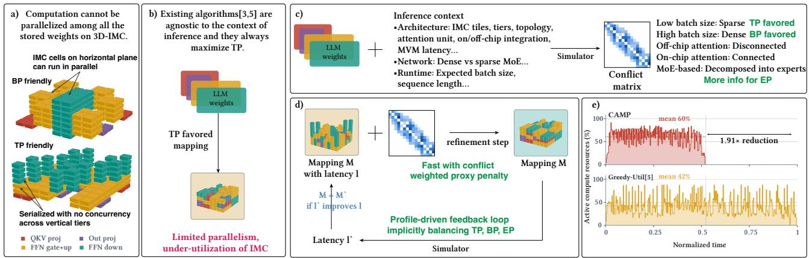  
Figure 1. (a) Static weights may be mapped to improve the latency of an individual MVM (TP) or enable MVMs to execute concurrentl<sub>y</sub> (BP). (b) Existin<sub>g</sub> al<sub>g</sub>orithms alwa<sub>y</sub>s maximize TP a<sub>g</sub>nosticall<sub>y</sub> to inference context. (c) In contrast, CAMP ma<sub>p</sub>s in a context-aware manner b<sub>y</sub> first encodin<sub>g</sub> the context in a conflict matrix. (d) A refinement loo<sub>p</sub> conver<sub>g</sub>es to a ma<sub>pp</sub>in<sub>g</sub> with an o<sub>p</sub>timized balance of TP, BP, and EP, (e) im<sub>p</sub>rovin<sub>g</sub> runtime eficienc<sub>y</sub> via better utilization of 3D-IMC com<sub>p</sub>ute resources.

While 3D AIMC (3D-IMC) increases stora<sub>g</sub>e ca<sub>p</sub>acit<sub>y</sub> via <sub>v</sub>ertical inte<sub>g</sub>ration<sub>,</sub> com<sub>pu</sub>te ca<sub>p</sub>abilit<sub>y</sub> remains static<sub>,</sub> as multi<sub>p</sub>le tiers within the same arra<sub>y</sub> cannot be accessed si-<sub>mu</sub>lt<sub>aneous</sub>l<sub>y.</sub> Thi<sub>s</sub> li<sub>m</sub>it<sub>a</sub>ti<sub>on crea</sub>t<sub>es a</sub> t<sub>ra</sub>d<sub>e-o</sub>f b<sub>e</sub>t<sub>ween</sub> <sub>p</sub>ri<sub>o</sub>ritizin<sub>g s</sub>in<sub>g</sub>l<sub>e</sub>-MVM l<sub>a</sub>t<sub>e</sub>n<sub>cy a</sub>nd <sub>e</sub>n<sub>a</sub>blin<sub>g</sub> int<sub>e</sub>r-MVM <sub>concurrency,</sub> <sub>w</sub>hi<sub>c</sub>h <sub>can</sub> b<sub>e</sub> t<sub>une</sub>d th<sub>roug</sub>h th<sub>e</sub> <sub>we</sub>i<sub>g</sub>ht <sub>map-</sub> <sub>p</sub>in<sub>g</sub> as illustrated in Fi<sub>g</sub>ure 1a. Wei<sub>g</sub>ht ma<sub>pp</sub>in<sub>g</sub> determines the degree of Tensor Parallelism (TP) by fixing how many com<sub>p</sub>ute resources are allocated to a sin<sub>g</sub>le MVM<sub>,</sub> tunin<sub>g</sub> its latency. It also determines the degree of Batch Parallelism (BP), the ability of the accelerator to process multiple tokens wit<sup>h</sup>in a <sup>b</sup>atc<sup>h</sup> concurrent<sup>l</sup>y <sup>b</sup>y assigning MVMs to <sup>d</sup>isjoint resources and enablin<sub>g</sub> inter-token com<sub>p</sub>utation overla<sub>p</sub>. Finall<sub>y</sub>, for Mixture-of-Ex<sub>p</sub>erts (MoE) models, wei<sub>g</sub>ht ma<sub>pp</sub>in<sub>g</sub> defines Expert Parallelism (EP), or how compute resources are allocated to ex<sub>p</sub>erts within an MoE la<sub>y</sub>er.

Althou<sub>g</sub>h o<sub>p</sub>timized wei<sub>g</sub>ht ma<sub>pp</sub>in<sub>g</sub> benefits runtime <sub>p</sub>erformance due to better com<sub>p</sub>ute utilization<sub>,</sub> o<sub>p</sub>timizin<sub>g</sub> 3D-IMC wei<sub>g</sub>ht ma<sub>pp</sub>in<sub>g</sub> is challen<sub>g</sub>in<sub>g</sub>:

Optimizing individual parallelism dimensions by findin<sub>g</sub> a ma<sub>pp</sub>in<sub>g</sub> that maximizes even a sin<sub>g</sub>le form of <sub>p</sub>arall<sub>e</sub>li<sub>sm</sub> i<sub>s</sub> difi<sub>cu</sub>lt d<sub>ue</sub> t<sub>o vary</sub>i<sub>ng</sub> LLM <sub>wor</sub>kl<sub>oa</sub>d <sub>s</sub>t<sub>ruc</sub>t<sub>ures,</sub> <sub>run</sub>ti<sub>me con</sub>t<sub>ex</sub>t<sub>s, an</sub>d <sub>acce</sub>l<sub>era</sub>t<sub>or arc</sub>hit<sub>ec</sub>t<sub>ures.</sub>

Balancing parallelism across the TP, BP, and EP paradigms i<sub>s</sub> <sub>ano</sub>th<sub>er</sub> <sub>c</sub>h<sub>a</sub>ll<sub>enge,</sub> <sub>as</sub> <sub>op</sub>ti<sub>m</sub>i<sub>z</sub>i<sub>ng</sub> <sub>one</sub> f<sub>orm</sub> <sub>o</sub>f <sub>para</sub>ll<sub>e</sub>li<sub>sm</sub> can directl<sub>y</sub> constrain the others [16]. For exam<sub>p</sub>le, increasin<sub>g</sub> TP <sub>a</sub>ll<sub>oca</sub>t<sub>es</sub> m<sub>o</sub>r<sub>e</sub> r<sub>esou</sub>r<sub>ces</sub> t<sub>o a s</sub>in<sub>g</sub>l<sub>e</sub> MVM<sub>,</sub> r<sub>e</sub>d<sub>uc</sub>in<sub>g</sub> available resources for concurrentl<sub>y</sub> executin<sub>g</sub> other MVMs <sub>a</sub>nd th<sub>e</sub>r<sub>e</sub>b<sub>y</sub> limitin<sub>g</sub> BP<sub>.</sub> Simil<sub>a</sub>rl<sub>y,</sub> in<sub>c</sub>r<sub>eas</sub>in<sub>g</sub> EP <sub>co</sub>n<sub>ce</sub>n trates resources in ex<sub>p</sub>erts<sub>,</sub> allowin<sub>g</sub> ex<sub>p</sub>erts to run concurrentl<sub>y</sub> but reducin<sub>g</sub> availabilit<sub>y</sub> to other MVMs.

Robustness across inference contexts consisting of syst<sub>em</sub> <sub>arc</sub>hit<sub>ec</sub>t<sub>ures,</sub> <sub>vary</sub>i<sub>ng</sub> <sub>wor</sub>kl<sub>oa</sub>d<sub>s,</sub> <sub>an</sub>d <sub>expec</sub>t<sub>e</sub>d <sub>run</sub>ti<sub>me</sub> contexts is necessar<sub>y</sub> to develo<sub>p</sub> a <sub>g</sub>enerall<sub>y</sub> a<sub>pp</sub>licable <sub>p</sub>erformant ma<sub>pp</sub>in<sub>g</sub> solution.

Finally, mapping-space complexity precludes exhaustive search due to the enormous wei<sub>g</sub>ht ma<sub>pp</sub>in<sub>g</sub> search s<sub>p</sub>ace<sub>,</sub> which <sub>g</sub>rows ra<sub>p</sub>idl<sub>y</sub> with the number of MVMs to be ma<sub>pp</sub>ed <sub>an</sub>d th<sub>e</sub> <sub>num</sub>b<sub>er</sub> <sub>o</sub>f <sub>ava</sub>il<sub>a</sub>bl<sub>e</sub> <sub>resource</sub> <sub>con</sub>fi<sub>gura</sub>ti<sub>ons</sub> <sub>a</sub>l<sub>ong</sub> b<sub>o</sub>th th<sub>e p</sub>l<sub>anar an</sub>d <sub>ver</sub>ti<sub>ca</sub>l di<sub>mens</sub>i<sub>ons.</sub> St<sub>a</sub>t<sub>e-o</sub>f<sub>-</sub>th<sub>e-ar</sub>t ma<sub>pp</sub>in<sub>g</sub> methods [3, 5] overcome this b<sub>y</sub> <sub>g</sub>reed<sub>y</sub> ma<sub>pp</sub>in<sub>g</sub> <sub>p</sub>r<sub>oce</sub>d<sub>u</sub>r<sub>es o</sub>nl<sub>y</sub> m<sub>a</sub>ximizin<sub>g</sub> TP<sub>, a</sub>t th<sub>e e</sub>x<sub>pe</sub>n<sub>se o</sub>f BP<sub>,</sub> EP<sub>,</sub> and robustness a<sub>g</sub>ainst var<sub>y</sub>in<sub>g</sub> inference contexts.

To address these challenges, we propose Context-Aware Mapping and Placement (CAMP), an inference-contextaware ma<sub>pp</sub>in<sub>g</sub> al<sub>g</sub>orithm for 3D-IMC-based LLM acceler-<sub>a</sub>t<sub>o</sub>r<sub>s.</sub> Fi<sub>gu</sub>r<sub>e</sub> 1 <sub>p</sub>r<sub>ov</sub>id<sub>es a</sub>n <sub>ove</sub>r<sub>v</sub>i<sub>ew o</sub>f CAMP<sub>.</sub> CAMP <sub>a</sub>dd<sub>resses</sub> th<sub>e</sub> <sub>c</sub>h<sub>a</sub>ll<sub>enges</sub> <sub>o</sub>f <sub>we</sub>i<sub>g</sub>ht <sub>mapp</sub>i<sub>ng</sub> <sub>as</sub> f<sub>o</sub>ll<sub>ows:</sub>

(1) First, a <sub>p</sub>rofilin<sub>g</sub> <sub>p</sub>hase anal<sub>y</sub>zes the workload under the ex<sub>p</sub>ected inference context — the s<sub>y</sub>stem architecture<sub>,</sub> tar<sub>g</sub>et LLM<sub>,</sub> <sub>an</sub>d <sub>run</sub>ti<sub>me</sub> <sub>con</sub>t<sub>ex</sub>t <sub>—</sub> <sub>an</sub>d <sub>enco</sub>d<sub>es</sub> th<sub>e</sub> <sub>pro</sub>b<sub>a</sub>bilit<sub>y</sub> <sub>o</sub>f resource conflicts between pairs of static MVMs into a conflict matrix. The mapping process then uses this matrix to <sub>a</sub>d<sub>ap</sub>t <sub>au</sub>t<sub>oma</sub>ti<sub>ca</sub>ll<sub>y an</sub>d <sub>ro</sub>b<sub>us</sub>tl<sub>y</sub> t<sub>o</sub> th<sub>e g</sub>i<sub>ven c</sub>i<sub>rcums</sub>t<sub>ances.</sub>

(2) Next, an initial ma<sub>pp</sub>in<sub>g</sub> <sub>p</sub>hase ma<sub>p</sub>s all static MVMs to the 3D-IMC accelerator<sub>,</sub> usin<sub>g</sub> the conflict matrix to ma<sub>p</sub> MVMs <sup>l</sup>i<sup>k</sup>e<sup>l</sup>y to conten<sup>d</sup> <sup>f</sup>or resources to <sup>d</sup>isjoint resource <sub>g</sub>r<sub>oups,</sub> im<sub>p</sub>r<sub>ov</sub>in<sub>g</sub> BP <sub>a</sub>nd EP<sub>.</sub>

(3) Finally, the mapping is refined via a profile-guided, feedback-driven pruned search, which utilizes the projecte<sup>d</sup> <sup>l</sup>atency o<sup>f</sup> varie<sup>d</sup> can<sup>d</sup>i<sup>d</sup>ate mappings to gui<sup>d</sup>e re<sup>fi</sup>ne-<sub>men</sub>t t<sub>owar</sub>d <sub>opera</sub>ti<sub>ng po</sub>i<sub>n</sub>t<sub>s a</sub>t <sub>w</sub>hi<sub>c</sub>h th<sub>e</sub> b<sub>a</sub>l<sub>ance</sub> b<sub>e</sub>t<sub>ween</sub> TP<sub>,</sub> BP<sub>, an</sub>d EP i<sub>s</sub> t<sub>une</sub>d f<sub>or max</sub>i<sub>mum resource u</sub>tili<sub>za</sub>ti<sub>on.</sub>

Th<sub>e</sub> <sub>exac</sub>t <sub>p</sub>l<sub>anar</sub> <sub>an</sub>d <sub>ver</sub>ti<sub>ca</sub>l <sub>we</sub>i<sub>g</sub>ht <sub>p</sub>l<sub>acemen</sub>t<sub>s</sub> <sub>are</sub> <sub>o</sub>b<sub>-</sub> t<sub>a</sub>i<sub>ne</sub>d <sub>e</sub>fi<sub>c</sub>i<sub>en</sub>tl<sub>y</sub> th<sub>roug</sub>h <sub>a</sub> <sub>proxy</sub> <sub>pena</sub>lt<sub>y</sub> <sub>compu</sub>t<sub>e</sub>d f<sub>rom</sub> th<sub>e con</sub>fli<sub>c</sub>t <sub>ma</sub>t<sub>r</sub>i<sub>x, w</sub>hi<sub>c</sub>h <sub>prunes a</sub> l<sub>arge reg</sub>i<sub>on o</sub>f th<sub>e searc</sub>h s<sub>p</sub>ace. A beam search strate<sub>gy</sub> trades solution o<sub>p</sub>timalit<sub>y</sub> a<sub>g</sub>ainst o<sub>p</sub>timization time<sub>, p</sub>lacin<sub>g</sub> CAMP between a f<sub>u</sub>ll<sub>y</sub> <sub>gree</sub>d<sub>y</sub> h<sub>eur</sub>i<sub>s</sub>ti<sub>c</sub> <sub>an</sub>d <sub>g</sub>l<sub>o</sub>b<sub>a</sub>ll<sub>y</sub> <sub>op</sub>ti<sub>ma</sub>l <sub>me</sub>th<sub>o</sub>d<sub>s,</sub> <sub>w</sub>hil<sub>e</sub> <sub>y</sub>i<sub>e</sub>ld<sub>-</sub> in<sub>g</sub> near-o<sub>p</sub>timal ma<sub>pp</sub>in<sub>g</sub>s within acce<sub>p</sub>table runtimes.

The contrib<sub>u</sub>tions of this <sub>p</sub>a<sub>p</sub>er are th<sub>u</sub>s:

• We anal<sub>y</sub>ze how s<sub>y</sub>stem architecture, LLM model, and runtime characteristics, collectively referred to as the inference context, impact runtime throughput and latency.

• We introduce the conflict matrix, a compact abstract <sub>represen</sub>t<sub>a</sub>ti<sub>on</sub> th<sub>a</sub>t <sub>enco</sub>d<sub>es</sub> th<sub>e</sub> i<sub>n</sub>f<sub>erence</sub> <sub>con</sub>t<sub>ex</sub>t i<sub>n</sub> <sub>a</sub> sin<sub>g</sub>le structure amenable to eficient o<sub>p</sub>timization.

• We propose Context-Aware Mapping and Placement (CAMP), an inference-context-aware weight-mapping al-<sub>gor</sub>ith<sub>m</sub> b<sub>u</sub>ilt <sub>on</sub> thi<sub>s a</sub>b<sub>s</sub>t<sub>rac</sub>ti<sub>on, w</sub>hi<sub>c</sub>h fi<sub>rs</sub>t d<sub>e</sub>t<sub>erm</sub>i<sub>nes</sub> <sub>eac</sub>h <sub>we</sub>i<sub>g</sub>ht t<sub>ensor</sub>’<sub>s p</sub>l<sub>acemen</sub>t <sub>s</sub>h<sub>ape an</sub>d <sub>ass</sub>i<sub>gnmen</sub>t t<sub>o</sub> 3D-IMC<sub>,</sub> then refines <sub>p</sub>lacement via a <sub>p</sub>r<sub>u</sub>ned search over <sub>res</sub>h<sub>ap</sub>i<sub>ngs, gu</sub>id<sub>e</sub>d b<sub>y pro</sub>fili<sub>ng-</sub>i<sub>n-</sub>th<sub>e-</sub>l<sub>oop</sub> f<sub>ee</sub>db<sub>ac</sub>k<sub>.</sub>

• We demonstrate cross-regime adaptivity, as CAMP produces markedl<sub>y</sub> diferent ma<sub>pp</sub>in<sub>g</sub>s across runtime cont<sub>ex</sub>t<sub>s,</sub> <sub>ne</sub>t<sub>wor</sub>k<sub>s,</sub> <sub>an</sub>d h<sub>ar</sub>d<sub>ware,</sub> <sub>m</sub>i<sub>n</sub>i<sub>m</sub>i<sub>z</sub>i<sub>ng</sub> l<sub>a</sub>t<sub>ency</sub> <sub>a</sub>t l<sub>ow</sub> batch sizes<sub>,</sub> maximizin<sub>g</sub> throu<sub>g</sub>h<sub>p</sub>ut at hi<sub>g</sub>h batch sizes<sub>,</sub> <sub>a</sub>nd n<sub>a</sub>ti<sub>ve</sub>l<sub>y</sub> <sub>e</sub>n<sub>a</sub>blin<sub>g</sub> EP in M<sub>o</sub>E LLM<sub>s.</sub>

Thorou<sub>g</sub>h evaluations demonstrate u<sub>p</sub> to 2.0× hi<sub>g</sub>her 3D-IMC runtime throu<sub>g</sub>h<sub>p</sub>ut, 1.74× hi<sub>g</sub>her end-to-end throu<sub>g</sub>h<sub>p</sub>ut, <sub>a</sub>nd <sub>a</sub> 42% in<sub>c</sub>r<sub>ease</sub> in 3D-IMC <sub>co</sub>m<sub>pu</sub>t<sub>e</sub> <sub>u</sub>tiliz<sub>a</sub>ti<sub>o</sub>n<sub>,</sub> <sub>va</sub>lid<sub>a</sub>tin<sub>g</sub> CAMP’<sub>s</sub> 3D-IMC <sub>we</sub>i<sub>g</sub>ht m<sub>app</sub>in<sub>g</sub> <sub>e</sub>f<sub>ec</sub>ti<sub>ve</sub>n<sub>ess.</sub>

## 2 Background

## 2.1 Large Language Models

LLM<sub>s are s</sub>t<sub>a</sub>t<sub>e-o</sub>f<sub>-</sub>th<sub>e-ar</sub>t <sub>mo</sub>d<sub>e</sub>l<sub>s across many</sub> d<sub>oma</sub>i<sub>ns an</sub>d comprise transformer blocks, which employ the attention mechanism<sub>,</sub> ca<sub>p</sub>turin<sub>g</sub> lon<sub>g</sub>-ran<sub>g</sub>e inter-token de<sub>p</sub>endencies [27], and Feed-Forward Network (FFN) la<sub>y</sub>ers that transf<sub>orm</sub> th<sub>e</sub> l<sub>earne</sub>d t<sub>o</sub>k<sub>en-</sub>l<sub>eve</sub>l <sub>assoc</sub>i<sub>a</sub>ti<sub>ons</sub> i<sub>n</sub>t<sub>o</sub> hi<sub>g</sub>h<sub>er-</sub>l<sub>eve</sub>l re<sub>p</sub>resentations. While LLMs’ s<sub>u</sub>bstantial re<sub>p</sub>resentational ca<sub>p</sub>acit<sub>y</sub> makes them extremel<sub>y</sub> versatile<sub>,</sub> the<sub>y</sub> also incur <sub>su</sub>b<sub>s</sub>t<sub>an</sub>ti<sub>a</sub>l <sub>compu</sub>t<sub>e an</sub>d <sub>memory</sub> d<sub>eman</sub>d<sub>s</sub> f<sub>rom</sub> th<sub>e</sub>i<sub>r s</sub>t<sub>a</sub>ti<sub>c</sub> and d<sub>y</sub>namic <sub>p</sub>arameter counts.

## 2.2 Challenges in LLM execution

Th<sub>e e</sub>f<sub>ec</sub>ti<sub>veness o</sub>f th<sub>e a</sub>tt<sub>en</sub>ti<sub>on mec</sub>h<sub>an</sub>i<sub>sm on</sub> l<sub>ong se-</sub> <sub>quences</sub> <sub>s</sub>t<sub>ems</sub> f<sub>rom</sub> it<sub>s</sub> <sub>a</sub>bilit<sub>y</sub> t<sub>o</sub> <sub>mo</sub>d<sub>e</sub>l d<sub>epen</sub>d<sub>enc</sub>i<sub>es</sub> b<sub>e-</sub> tween all token <sub>p</sub>airs [42]. However, the <sub>q</sub>uadratic com<sub>p</sub>utationa<sup>l</sup> comp<sup>l</sup>exity o<sup>f</sup> attention poses a major c<sup>h</sup>a<sup>ll</sup>enge <sup>f</sup>or lon<sub>g</sub>-context inference. KV cachin<sub>g</sub> miti<sub>g</sub>ates this issue b<sub>y</sub> <sub>compu</sub>ti<sub>ng</sub> <sub>an</sub>d <sub>cac</sub>hi<sub>ng</sub> k<sub>eys</sub> <sub>an</sub>d <sub>va</sub>l<sub>ues</sub> f<sub>or</sub> <sub>a</sub>ll t<sub>o</sub>k<sub>ens</sub> <sub>once</sub> (prefill) and reusing the stored values for each output token (decode), reducing per-token attention complexity from � (�<sup>2</sup>) to � (�) [34].

While KV cachin<sub>g</sub> reduces decode-<sub>p</sub>hase com<sub>p</sub>utation<sub>,</sub> <sub>cac</sub>h<sub>e</sub>d <sub>va</sub>l<sub>ues</sub> <sub>mus</sub>t b<sub>e</sub> <sub>re-</sub>f<sub>e</sub>t<sub>c</sub>h<sub>e</sub>d f<sub>rom</sub> th<sub>e</sub> <sub>memory</sub> f<sub>or</sub> <sub>every</sub> <sub>genera</sub>t<sub>e</sub>d t<sub>o</sub>k<sub>en.</sub> L<sub>arge</sub> <sub>we</sub>i<sub>g</sub>ht <sub>parame</sub>t<sub>er</sub> <sub>coun</sub>t<sub>s</sub> <sub>a</sub>dd f<sub>ur</sub>th<sub>er</sub> memor<sub>y</sub> <sub>p</sub>ressure<sub>,</sub> motivatin<sub>g</sub> memor<sub>y</sub>-centric solutions to miti<sub>g</sub>ate bandwidth limitations.

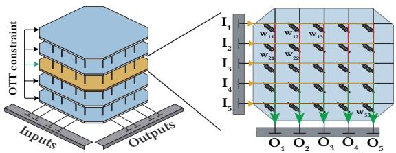  
Figure 2. Each tier in an 3D-IMC memory array stores <sub>w</sub>ei<sub>g</sub>hts that are <sub>u</sub>sed to <sub>p</sub>erform MVMs in-sit<sub>u</sub>.

## 2.3 Reducing data movement via IMC

In- and near-memor<sub>y</sub> com<sub>p</sub>utin<sub>g</sub> <sub>p</sub>aradi<sub>g</sub>ms have emer<sub>g</sub>ed <sup>as</sup> p<sup>romisin</sup>g <sup>a</sup>pp<sup>roaches</sup> <sup>to</sup> <sup>reduce</sup> <sup>the</sup> <sup>memor</sup>y p<sup>ressure</sup> im<sub>p</sub>osed b<sub>y</sub> lar<sub>g</sub>e KV caches and static wei<sub>g</sub>hts. Their ke<sub>y</sub> <sub>p</sub>rinci<sub>p</sub>le is to minimize ex<sub>p</sub>ensive data transfers b<sub>y p</sub>erf<sub>orm</sub>i<sub>ng compu</sub>t<sub>a</sub>ti<sub>on c</sub>l<sub>oser</sub> t<sub>o w</sub>h<sub>ere</sub> d<sub>a</sub>t<sub>a are s</sub>t<sub>ore</sub>d <sub>or</sub> b<sub>y</sub> <sub>exp</sub>l<sub>o</sub>iti<sub>ng</sub> hi<sub>g</sub>h<sub>-</sub>b<sub>an</sub>d<sub>w</sub>idth l<sub>oca</sub>l i<sub>n</sub>t<sub>erconnec</sub>t<sub>s.</sub>

On the attention side<sub>,</sub> one s<sub>u</sub>ch a<sub>pp</sub>roach is DRAM-based PIM [18, 28–30, 32, 46], alleviatin<sub>g</sub> the KV-cache access bottl<sub>enec</sub>k b<sub>y exp</sub>l<sub>o</sub>iti<sub>ng</sub> th<sub>e</sub> i<sub>n</sub>t<sub>erna</sub>l b<sub>an</sub>d<sub>w</sub>idth <sub>o</sub>f DRAM <sub>an</sub>d <sub>p</sub>erformin<sub>g</sub> attention-related com<sub>p</sub>utation near KV stora<sub>g</sub>e.

A com<sub>p</sub>lementar<sub>y</sub> a<sub>pp</sub>roach addressin<sub>g</sub> static wei<sub>g</sub>hts is NVM-b<sub>ase</sub>d AIMC <sub>acce</sub>l<sub>e</sub>r<sub>a</sub>t<sub>o</sub>r<sub>s, as</sub> ill<sub>us</sub>tr<sub>a</sub>t<sub>e</sub>d in Fi<sub>gu</sub>r<sub>e</sub> 2<sub>.</sub> S<sub>uc</sub>h <sub>arc</sub>hit<sub>ec</sub>t<sub>ures</sub> <sub>represen</sub>t <sub>mo</sub>d<sub>e</sub>l <sub>we</sub>i<sub>g</sub>ht<sub>s</sub> <sub>as</sub> <sub>ana</sub>l<sub>og</sub> <sub>s</sub>t<sub>a</sub>t<sub>es</sub> <sub>suc</sub>h <sub>as</sub> <sub>ce</sub>ll <sub>con</sub>d<sub>uc</sub>t<sub>ance</sub> <sub>an</sub>d <sub>exp</sub>l<sub>o</sub>it <sub>ana</sub>l<sub>og</sub> d<sub>ev</sub>i<sub>ce</sub> <sub>c</sub>h<sub>arac-</sub> teristics to <sub>p</sub>erform massivel<sub>y</sub> <sub>p</sub>arallel MVMs directl<sub>y</sub> within memor<sub>y</sub> arra<sub>y</sub>s, eliminatin<sub>g</sub> wei<sub>g</sub>ht movement [4, 5, 9, 19, 20, 25, 31, 33, 37, 43]. While AIMC’s <sub>p</sub>oor write and endurance characteristics [19] make it ill-suited to storin<sub>g</sub> fre<sub>q</sub>uentl<sub>y</sub> chan<sub>g</sub>in<sub>g</sub> data such as the KV cache<sub>,</sub> avoidin<sub>g</sub> re<sub>p</sub>eated static <sub>we</sub>i<sub>g</sub>ht t<sub>rans</sub>f<sub>ers a</sub>ll<sub>ows</sub> AIMC <sub>acce</sub>l<sub>era</sub>t<sub>ors</sub> t<sub>o re</sub>d<sub>uce</sub> i<sub>n</sub>f<sub>er-</sub> ence latenc<sub>y</sub> and im<sub>p</sub>rove ener<sub>gy</sub> eficienc<sub>y</sub> si<sub>g</sub>nificantl<sub>y</sub>. The dif<sub>eren</sub>t <sub>c</sub>h<sub>arac</sub>t<sub>er</sub>i<sub>s</sub>ti<sub>cs o</sub>f KV <sub>cac</sub>h<sub>e an</sub>d <sub>s</sub>t<sub>a</sub>ti<sub>c we</sub>i<sub>g</sub>ht<sub>s</sub> h<sub>ave</sub> motivated interest in attention/static MVM disaggregation, in <sub>w</sub>hi<sub>c</sub>h <sub>a</sub>tt<sub>e</sub>nti<sub>o</sub>n <sub>ope</sub>r<sub>a</sub>ti<sub>o</sub>n<sub>s a</sub>nd MVM<sub>s w</sub>ith <sub>s</sub>t<sub>a</sub>ti<sub>c we</sub>i<sub>g</sub>ht<sub>s</sub> execute on se<sub>p</sub>arate s<sub>p</sub>ecialized hardware [1, 28, 29, 46, 47].

For conciseness<sub>, w</sub>e hereafter sim<sub>p</sub>l<sub>y u</sub>se the term MVM t<sub>o re</sub>f<sub>er</sub> t<sub>o a</sub>ll MVM<sub>s w</sub>ith <sub>s</sub>t<sub>a</sub>ti<sub>c we</sub>i<sub>g</sub>ht<sub>s acce</sub>l<sub>era</sub>t<sub>e</sub>d <sub>w</sub>ith AIMC, specifically the Query-Key-Value (QKV), output, and the FFN Gated U<sub>p</sub> (G+U) and down <sub>p</sub>rojections. This is in <sub>co</sub>ntr<sub>as</sub>t t<sub>o</sub> MVM<sub>s</sub> <sub>w</sub>ith d<sub>y</sub>n<sub>a</sub>mi<sub>c</sub> in<sub>pu</sub>t<sub>s</sub> <sub>occu</sub>rrin<sub>g</sub> in th<sub>e</sub> <sub>a</sub>tt<sub>en</sub>ti<sub>on</sub> bl<sub>oc</sub>k <sub>an</sub>d <sub>execu</sub>t<sub>e</sub>d <sub>on</sub> th<sub>e a</sub>tt<sub>en</sub>ti<sub>on un</sub>it<sub>.</sub>

## 2.4 3D-IMC opportunities and challenges

A<sub>s</sub> LLM<sub>s</sub> <sub>co</sub>ntin<sub>ue</sub> t<sub>o</sub> <sub>g</sub>r<sub>ow</sub> in <sub>pa</sub>r<sub>a</sub>m<sub>e</sub>t<sub>e</sub>r <sub>cou</sub>nt<sub>,</sub> in<sub>c</sub>r<sub>eas</sub>in<sub>g</sub> <sub>memory</sub> d<sub>ens</sub>it<sub>y</sub> h<sub>as</sub> b<sub>ecome</sub> <sub>necessary</sub> t<sub>o</sub> <sub>accommo</sub>d<sub>a</sub>t<sub>e</sub> th<sub>e</sub>i<sub>r</sub> stora<sub>g</sub>e re<sub>q</sub>uirements. To address this ca<sub>p</sub>acit<sub>y</sub> bottleneck<sub>,</sub> <sub>p</sub>ro<sub>p</sub>osed three-dimensional AIMC (3D-IMC) architectures si<sub>g</sub>nificantl<sub>y</sub> increase the wei<sub>g</sub>ht ca<sub>p</sub>acit<sub>y</sub> of conventional AIMC architect<sub>u</sub>res thro<sub>ug</sub>h the vertical inte<sub>g</sub>ration of memor<sub>y</sub> arra<sub>y</sub>s [5, 10, 25, 36, 41].

Orhun Görkem, Athanasios Vasilopoulos, Georgios Pagonis, Victoria Clerico, Hadjer Benmeziane, Irem Boybat, Hsinyu Tsai, Abu Sebastian, and William Andrew Simon

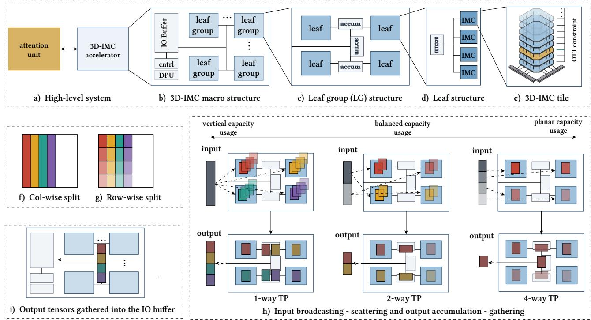  
Figure 3. Hierarchical H-tree architecture (a-e) [20, 36, 37]. Weight mapping options when leaf groups comprise 4 leaves (f-i).

H<sub>owever,</sub> b<sub>ecause ver</sub>ti<sub>ca</sub>l ti<sub>er-</sub>l<sub>eve</sub>l <sub>para</sub>ll<sub>e</sub>li<sub>sm canno</sub>t b<sub>e</sub> i<sub>mp</sub>l<sub>emen</sub>t<sub>e</sub>d d<sub>ue</sub> t<sub>o</sub> <sub>per</sub>i<sub>p</sub>h<sub>era</sub>l <sub>s</sub>h<sub>ar</sub>i<sub>ng</sub> <sub>an</sub>d <sub>ver</sub>ti<sub>ca</sub>l i<sub>n-</sub> terconnect bandwidth constraints<sub>,</sub> com<sub>p</sub>ute ca<sub>p</sub>acit<sub>y</sub> scales onl<sub>y</sub> in the <sub>p</sub>lanar dimension in several <sub>p</sub>o<sub>p</sub>ular 3D-memor<sub>y</sub> <sub>p</sub>aradi<sub>g</sub>ms s<sub>u</sub>ch as NAND flash<sub>,</sub> a limitation referred to as the One-Tier-at-a-Time (OTT) constraint [3, 5].

This limitation re<sub>q</sub>uires thou<sub>g</sub>htful interconnect desi<sub>g</sub>n to eficientl<sub>y</sub> serve activations and <sub>g</sub>ather out<sub>p</sub>uts. A <sub>p</sub>o<sub>p</sub>ular desi<sub>g</sub>n that achieves these <sub>g</sub>oals is a hierarchical H-tree [10, 20, 28, 46], illustrated in Fi<sub>g</sub>ure 3(a-e). In such a desi<sub>g</sub>n, the 3D-IMC <sub>a</sub>r<sub>c</sub>hit<sub>ec</sub>t<sub>u</sub>r<sub>e co</sub>m<sub>p</sub>ri<sub>ses a</sub>n <sub>a</sub>rr<sub>ay o</sub>f $N _ { L G }$ LeafGroups (LGs), hereafter referred to as the 3D-IMC macro, interconnected b<sub>y</sub> an H-tree to<sub>p</sub>olo<sub>gy</sub> [20, 36, 37]. This structure is <sub>p</sub>referred for its in<sub>p</sub>ut-broadcastin<sub>g</sub> and out<sub>p</sub>ut-accumulation ca<sub>p</sub>abilities<sub>,</sub> enablin<sub>g</sub> lar<sub>g</sub>e MVMs to be <sub>p</sub>arallelized across m<sub>u</sub>lti<sub>p</sub>le LGs. Each LG is f<sub>u</sub>rther com<sub>p</sub>osed of $N _ { L }$ leaves, each containin<sub>g</sub> $N _ { T }$ vertically stacked AIMC tiles, as shown in Fi<sub>g</sub>ure 3(e). Accumulation units within leaves and LGs f<sub>ac</sub>ilit<sub>a</sub>t<sub>e ou</sub>t<sub>pu</sub>t <sub>accumu</sub>l<sub>a</sub>ti<sub>on, ena</sub>bli<sub>ng mu</sub>lti<sub>p</sub>l<sub>e</sub> l<sub>eaves</sub> t<sub>o</sub> contribute to the out<sub>p</sub>ut of one MVM<sub>,</sub> a feature ex<sub>p</sub>loited in Section 3.1. Be<sub>y</sub>ond the macro<sub>,</sub> the architecture <sub>p</sub>rovides a <sub>g</sub>lobal IO bufer for intermediate vectors<sub>,</sub> a Di<sub>g</sub>ital Processin<sub>g</sub> Unit (DPU) for activation functions, and a <sub>g</sub>lobal controller. The accelerator is <sub>p</sub>aired with an attention unit which <sub>p</sub>erforms the attention sta<sub>g</sub>e<sub>,</sub> includin<sub>g</sub> KV-cache loadin<sub>g,</sub> while the accelerator is res<sub>p</sub>onsible for the static MVMs.

## 3 Motivational study: Impact of weight mapping in 3D-IMC on runtime

This work is motivated b<sub>y</sub> the followin<sub>g</sub> insi<sub>g</sub>hts into how th<sub>e</sub> <sub>p</sub>r<sub>ocess</sub> <sub>o</sub>f m<sub>app</sub>in<sub>g</sub> <sub>a</sub>n indi<sub>v</sub>id<sub>ua</sub>l MVM int<sub>o</sub> th<sub>e</sub> 3D-IMC <sub>macro</sub> i<sub>mpac</sub>t<sub>s</sub> <sub>g</sub>l<sub>o</sub>b<sub>a</sub>l th<sub>roug</sub>h<sub>pu</sub>t<sub>,</sub> <sub>an</sub>d h<sub>ow</sub> th<sub>e</sub> LLM i<sub>n</sub>f<sub>er-</sub> ence context directl<sub>y</sub> im<sub>p</sub>acts the o<sub>p</sub>timal choice of ma<sub>pp</sub>in<sub>g</sub>.

## 3.1 Mapping weights to 3D-IMC tiles and tiers

The wei<sub>g</sub>hts of MVMs are tiled before bein<sub>g</sub> ma<sub>pp</sub>ed to 3D-IMC til<sub>es.</sub> Th<sub>e</sub> tilin<sub>g a</sub>nd <sub>ac</sub>ti<sub>va</sub>ti<sub>o</sub>n-fl<sub>ow s</sub>tr<sub>a</sub>t<sub>egy</sub> i<sub>s s</sub>imilar to that of [20]. As Fi<sub>g</sub>ure 3(f-<sub>g</sub>) illustrates, the wei<sub>g</sub>ht matrix is first s<sub>p</sub>lit column-wise alon<sub>g</sub> the out<sub>p</sub>ut dimension and then row-wise alon<sub>g</sub> the in<sub>p</sub>ut dimension. The row s<sub>p</sub>lit is chosen so that each block fills one leaf (four tiles).

Once an MVM’s wei<sub>g</sub>hts are tiled col<sub>u</sub>mn- and row-wise<sub>,</sub> th<sub>e</sub> til<sub>e</sub>d bl<sub>oc</sub>k<sub>s</sub> i<sub>n</sub> <sub>eac</sub>h <sub>co</sub>l<sub>umn</sub> <sub>are</sub> <sub>p</sub>l<sub>ace</sub>d <sub>on</sub> LG<sub>s</sub> <sub>as</sub> <sub>s</sub>h<sub>own</sub> in Fi<sub>g</sub>ure 3(h). All blocks of a column (shown with the same color in the fi<sub>g</sub>ure) must reside on the same LG, since acc<sub>u</sub>m<sub>u</sub>lation can onl<sub>y</sub> occ<sub>u</sub>r <sub>w</sub>ithin an LG. Cr<sub>u</sub>ciall<sub>y, w</sub>ithin an LG, the blocks of a column (diferent shades of the same color) can be ma<sub>pp</sub>ed onto one or more leaves, e.<sub>g</sub>. 1, 2, or 4 leaves (or 4, 8, or 16 tiles) in macro confi<sub>g</sub>urations with 4 lea<sub>v</sub>es <sub>p</sub>er LG. We refer to the <sub>�</sub>-leaf o<sub>p</sub>tion as <sub>�</sub>-<sub>w</sub>a<sub>y</sub> TP<sub>,</sub> b<sub>ecause</sub> th<sub>e num</sub>b<sub>er o</sub>f <sub>mappe</sub>d l<sub>eaves</sub> d<sub>e</sub>t<sub>erm</sub>i<sub>nes</sub> th<sub>e</sub> d<sub>egree</sub> of TP for the corres<sub>p</sub>ondin<sub>g</sub> MVM. Under the 1-<sub>w</sub>a<sub>y</sub> TP o<sub>p</sub>- ti<sub>on, a</sub>ll bl<sub>oc</sub>k<sub>s are ver</sub>ti<sub>ca</sub>ll<sub>y s</sub>t<sub>ac</sub>k<sub>e</sub>d <sub>on</sub> th<sub>e same</sub> f<sub>our</sub> til<sub>es</sub> i<sub>n a</sub> l<sub>ea</sub>f<sub>.</sub> Th<sub>e</sub> 2<sub>- an</sub>d 4<sub>-way</sub> TP <sub>op</sub>ti<sub>ons sprea</sub>d <sub>eac</sub>h bl<sub>oc</sub>k across more tiles<sub>,</sub> reducin<sub>g</sub> vertical stackin<sub>g</sub> alon<sub>g</sub> a column.

Thi<sub>s</sub> fl<sub>ex</sub>ibilit<sub>y</sub> <sub>ena</sub>bl<sub>es</sub> t<sub>ra</sub>d<sub>e-o</sub>f<sub>s</sub> b<sub>e</sub>t<sub>ween</sub> <sub>ver</sub>ti<sub>ca</sub>l <sub>an</sub>d <sub>p</sub>l<sub>anar</sub> ma<sub>pp</sub>in<sub>g</sub>s<sub>,</sub> as discussed in Section 3.2.

At r<sub>u</sub>ntim<sub>e,</sub> th<sub>e</sub> in<sub>pu</sub>t <sub>ac</sub>ti<sub>va</sub>ti<sub>o</sub>n i<sub>s</sub> br<sub>oa</sub>d<sub>cas</sub>t t<sub>o</sub> th<sub>e</sub> LG<sub>s</sub> holdin<sub>g</sub> the wei<sub>g</sub>hts ofthe corres<sub>p</sub>ondin<sub>g</sub> MVM. Within each LG<sub>,</sub> th<sub>e</sub> i<sub>npu</sub>t <sub>vec</sub>t<sub>or</sub> i<sub>s</sub> <sub>sca</sub>tt<sub>ere</sub>d i<sub>n</sub>t<sub>o</sub> <sub>c</sub>h<sub>un</sub>k<sub>s</sub> <sub>an</sub>d <sub>rou</sub>t<sub>e</sub>d t<sub>o</sub> th<sub>e</sub> <sub>re</sub>l<sub>evan</sub>t l<sub>eaves</sub> d<sub>epen</sub>di<sub>ng</sub> <sub>on</sub> th<sub>e</sub> <sub>c</sub>h<sub>osen</sub> <sub>we</sub>i<sub>g</sub>ht <sub>p</sub>l<sub>acemen</sub>t o<sub>p</sub>tion. The resultin<sub>g</sub> out<sub>p</sub>ut vectors are accumulated within <sub>a</sub> l<sub>ea</sub>f <sub>an</sub>d <sub>across</sub> l<sub>eaves</sub> f<sub>or</sub> 2<sub>-</sub> <sub>an</sub>d 4<sub>-</sub>l<sub>ea</sub>f TP<sub>.</sub> Fi<sub>na</sub>ll<sub>y,</sub> th<sub>e</sub> <sub>per-</sub> LG <sub>ou</sub>t<sub>pu</sub>t <sub>vec</sub>t<sub>ors are</sub> t<sub>rans</sub>f<sub>erre</sub>d t<sub>o</sub> th<sub>e g</sub>l<sub>o</sub>b<sub>a</sub>l IO b<sub>u</sub>f<sub>er an</sub>d concatenated. Fi<sub>g</sub>ure 3(h-i) visualizes the <sub>p</sub>rocess.

## 3.2 Single-MVM latency/batch-parallelism trade-of

A hi<sub>g</sub>h d<sub>eg</sub>r<sub>ee o</sub>f TP <sub>pa</sub>r<sub>a</sub>ll<sub>e</sub>liz<sub>es</sub> th<sub>e</sub> MVM <sub>ac</sub>r<sub>oss</sub> th<sub>e</sub> til<sub>e</sub>d wei<sub>g</sub>ht blocks b<sub>y</sub> s<sub>p</sub>readin<sub>g</sub> the com<sub>p</sub>utation over <sub>p</sub>lanar re-<sub>sources,</sub> <sub>w</sub>h<sub>ereas</sub> l<sub>ower</sub> TP <sub>op</sub>ti<sub>ons</sub> <sub>ma</sub>k<sub>e</sub> <sub>more</sub> <sub>use</sub> <sub>o</sub>f th<sub>e</sub> <sub>ver-</sub> tical s<sub>p</sub>ace. This choice has direct <sub>p</sub>erformance im<sub>p</sub>lications. As an exam<sub>p</sub>le<sub>,</sub> Fi<sub>gu</sub>re 1a <sub>v</sub>is<sub>u</sub>alizes the diference bet<sub>w</sub>een 2-<sub>w</sub>a<sub>y</sub> and 4-<sub>w</sub>a<sub>y</sub> TP la<sub>y</sub>o<sub>u</sub>ts. The <sub>v</sub>ertical z-axis is the tier axis, while the 8 × 8 horizontal <sub>p</sub>lane corres<sub>p</sub>onds to the LGs. The 2-<sub>w</sub>a<sub>y</sub> TP o<sub>p</sub>tion is marked as BP-friendl<sub>y</sub> beca<sub>u</sub>se it <sub>g</sub>i<sub>ves up a</sub> d<sub>eg</sub>r<sub>ee o</sub>f TP t<sub>o e</sub>n<sub>a</sub>bl<sub>e</sub> m<sub>o</sub>r<sub>e</sub> BP: th<sub>e</sub> FFN G+U MVM (<sub>y</sub>ellow voxels) can overla<sub>p</sub> with the out<sub>p</sub>ut-<sub>p</sub>rojection and FFN down-<sub>p</sub>rojection MVMs (<sub>g</sub>reen and <sub>p</sub>ur<sub>p</sub>le voxels) <sub>across</sub> t<sub>o</sub>k<sub>ens, s</sub>i<sub>nce</sub> th<sub>ey s</sub>h<sub>are no</sub> LG<sub>s.</sub> Th<sub>e a</sub>d<sub>van</sub>t<sub>age o</sub>f 4-<sub>way</sub> TP i<sub>s</sub> th<sub>a</sub>t it <sub>uses</sub> f<sub>ewe</sub>r <sub>ve</sub>rti<sub>ca</sub>l ti<sub>e</sub>r<sub>s pe</sub>r MVM<sub>, so</sub> l<sub>ess</sub> of the com<sub>pu</sub>tation is serialized<sub>,</sub> <sub>g</sub>i<sub>v</sub>in<sub>g</sub> shorter <sub>p</sub>er-MVM l<sub>a</sub>t<sub>enc</sub>i<sub>es.</sub> Th<sub>e mos</sub>t <sub>su</sub>it<sub>a</sub>bl<sub>e op</sub>ti<sub>on s</sub>h<sub>ou</sub>ld b<sub>e c</sub>h<sub>osen</sub> b<sub>ase</sub>d <sub>on</sub> th<sub>e</sub> t<sub>arge</sub>t<sub>e</sub>d <sub>wor</sub>kl<sub>oa</sub>d <sub>an</sub>d <sub>expec</sub>t<sub>e</sub>d <sub>run</sub>ti<sub>me con</sub>t<sub>ex</sub>t<sub>.</sub>

## 3.3 Impact of inference context on TP degree

W<sub>e</sub> fi<sub>n</sub>d th<sub>a</sub>t th<sub>e op</sub>ti<sub>ma</sub>l <sub>se</sub>l<sub>ec</sub>ti<sub>on o</sub>f TP d<sub>egree</sub> f<sub>or</sub> i<sub>n</sub>di<sub>v</sub>id<sub>ua</sub>l MVMs is heavily influenced by the inference context, which <sub>can</sub> b<sub>e</sub> b<sub>ro</sub>k<sub>en</sub> d<sub>own</sub> i<sub>n</sub>t<sub>o</sub> th<sub>ree ca</sub>t<sub>egor</sub>i<sub>es:</sub>

Architectural characteristics such as the tier count and <sub>p</sub>l<sub>anar</sub> <sub>space</sub> d<sub>e</sub>fi<sub>ne</sub> <sub>ava</sub>il<sub>a</sub>bl<sub>e</sub> h<sub>e</sub>i<sub>g</sub>ht <sub>an</sub>d <sub>w</sub>idth f<sub>or</sub> MVM sha<sub>p</sub>es<sub>,</sub> while LG size defines valid TP de<sub>g</sub>rees. Similarl<sub>y,</sub> <sub>a</sub> l<sub>ow-</sub>b<sub>an</sub>d<sub>w</sub>idth <sub>or coarse-gra</sub>i<sub>ne</sub>d <sub>o</sub>f<sub>-c</sub>hi<sub>p</sub> i<sub>n</sub>t<sub>erconnec</sub>t bet<sub>w</sub>een the 3D-IMC accelerator and the attention <sub>u</sub>nit ma<sub>y</sub> i<sub>n</sub>d<sub>uce sync</sub>h<sub>ron</sub>i<sub>za</sub>ti<sub>on</sub> b<sub>e</sub>t<sub>ween</sub> t<sub>o</sub>k<sub>ens</sub> i<sub>n a</sub> b<sub>a</sub>t<sub>c</sub>h b<sub>e</sub>f<sub>ore</sub> <sub>co</sub>mm<sub>u</sub>ni<sub>ca</sub>ti<sub>o</sub>n<sub>,</sub> limitin<sub>g</sub> BP <sub>ac</sub>r<sub>oss</sub> dif<sub>e</sub>r<sub>e</sub>nt tr<sub>a</sub>n<sub>s</sub>f<sub>o</sub>rm<sub>e</sub>r la<sub>y</sub>ers. Conse<sub>q</sub>uentl<sub>y,</sub> favorin<sub>g</sub> BP for wei<sub>g</sub>ht ma<sub>pp</sub>in<sub>g</sub> across l<sub>ayers</sub> <sub>prov</sub>id<sub>es</sub> littl<sub>e</sub> b<sub>ene</sub>fit<sub>,</sub> <sub>as</sub> th<sub>e</sub> <sub>resu</sub>lti<sub>ng</sub> <sub>compu</sub>t<sub>a</sub>ti<sub>ona</sub>l <sub>para</sub>ll<sub>e</sub>li<sub>sm</sub> <sub>canno</sub>t b<sub>e</sub> <sub>e</sub>f<sub>ec</sub>ti<sub>ve</sub>l<sub>y</sub> <sub>exp</sub>l<sub>o</sub>it<sub>e</sub>d<sub>.</sub>

Network characteristics such as network type and size <sub>a</sub>l<sub>so</sub> <sub>a</sub>f<sub>ec</sub>t th<sub>e</sub> t<sub>ra</sub>d<sub>e-o</sub>f b<sub>e</sub>t<sub>ween</sub> TP <sub>an</sub>d BP<sub>,</sub> <sub>as</sub> l<sub>arger</sub> <sub>ne</sub>t<sub>-</sub> works <sub>p</sub>lace <sub>g</sub>reater <sub>p</sub>ressure on limited com<sub>p</sub>ute resources.

Deservin<sub>g</sub> s<sub>p</sub>ecial mention here are MoE models<sub>,</sub> eficient alternatives to dense LLMs as in<sub>p</sub>ut-s<sub>p</sub>ecific ex<sub>p</sub>ert routin<sub>g</sub> enables s<sub>p</sub>arse FFN com<sub>p</sub>utation [35]. 3D-IMC devices, with their skewed stora<sub>g</sub>e-to-com<sub>p</sub>ute ca<sub>p</sub>acit<sub>y,</sub> naturall<sub>y</sub> ex<sub>p</sub>loit MoE s<sub>p</sub>arsit<sub>y</sub> [5].

M<sub>app</sub>in<sub>g</sub> M<sub>o</sub>E LLM<sub>s</sub> <sub>o</sub>nt<sub>o</sub> 3D-IMC <sub>acce</sub>l<sub>e</sub>r<sub>a</sub>t<sub>o</sub>r<sub>s</sub> r<sub>a</sub>i<sub>ses</sub> t<sub>wo</sub> challen<sub>g</sub>es. First<sub>,</sub> MoEs introduce the conce<sub>p</sub>t of Ex<sub>p</sub>ert Parallelism (EP), where siblin<sub>g</sub> ex<sub>p</sub>erts (ex<sub>p</sub>ert alternatives of the same FFN) can be ma<sub>pp</sub>ed such that the<sub>y</sub> can run in mutuall<sub>y</sub> excl<sub>u</sub>si<sub>v</sub>e sets of IMC tiles in <sub>p</sub>arallel. Ho<sub>w</sub>e<sub>v</sub>er<sub>,</sub> enablin<sub>g</sub> EP comes at the ex<sub>p</sub>ense of TP and BP<sub>,</sub> f<sub>u</sub>rther com<sub>p</sub>licatin<sub>g</sub> the o<sub>p</sub>timization s<sub>p</sub>ace. Second<sub>,</sub> the a<sub>gg</sub>re<sub>g</sub>ate ex<sub>p</sub>ert wei<sub>g</sub>hts <sub>are</sub> l<sub>arger</sub> th<sub>an</sub> th<sub>e</sub>i<sub>r</sub> d<sub>ense</sub> <sub>coun</sub>t<sub>erpar</sub>t<sub>s</sub> <sub>even</sub> th<sub>oug</sub>h <sub>on</sub>l<sub>y</sub> the to<sub>p</sub>-� ex<sub>p</sub>erts are activated <sub>p</sub>er la<sub>y</sub>er. The com<sub>p</sub>ute constraints of 3D-IMC make it infeasible to <sub>p</sub>lace all siblin<sub>g</sub> ex<sub>p</sub>erts suc<sup>h</sup> t<sup>h</sup>at t<sup>h</sup>e<sub>y</sub> execute concurrent<sup>l</sup><sub>y</sub>. <sup>M</sup>a<sub>pp</sub><sup>i</sup>n<sub>g</sub> must th<sub>ere</sub>f<sub>ore</sub> d<sub>ec</sub>id<sub>e</sub> <sub>w</sub>hi<sub>c</sub>h <sub>exper</sub>t<sub>s</sub> t<sub>o</sub> <sub>para</sub>ll<sub>e</sub>li<sub>ze</sub> <sub>an</sub>d <sub>w</sub>hi<sub>c</sub>h t<sub>o</sub> serialize — a decision that can ex<sub>p</sub>loit domain-s<sub>p</sub>ecific ex<sub>p</sub>ert <sub>co-ac</sub>ti<sub>va</sub>ti<sub>on</sub> i<sub>m</sub>b<sub>a</sub>l<sub>ances.</sub> Th<sub>e ex</sub>t<sub>en</sub>t <sub>o</sub>f th<sub>ese</sub> i<sub>m</sub>b<sub>a</sub>l<sub>ances</sub> i<sub>s</sub> disc<sub>u</sub>ssed in A<sub>pp</sub>endix B.

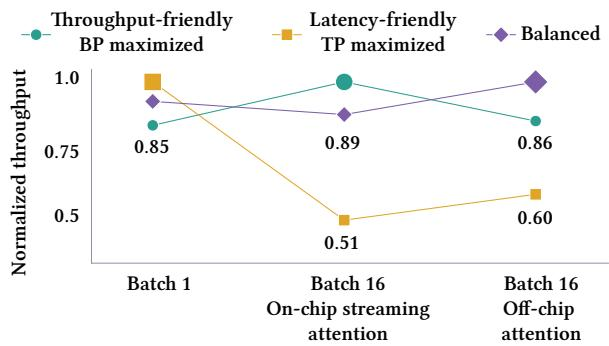  
Figure 4. Impact of 3D-IMC mapping strategies on decodeste<sub>p</sub> throu<sub>g</sub>h<sub>p</sub>ut for Llama 3.1-70B across re<sub>p</sub>resentative runti<sub>me con</sub>t<sub>ex</sub>t<sub>s.</sub> R<sub>esu</sub>lt<sub>s s</sub>h<sub>own</sub> f<sub>or a sequence</sub> l<sub>eng</sub>th <sub>o</sub>f 128<sub>.</sub>

Runtime characteristics such as expected batch size and se<sub>q</sub>uence len<sub>g</sub>th<sub>,</sub> further im<sub>p</sub>act ma<sub>pp</sub>in<sub>g</sub>. Sin<sub>g</sub>le-batch<sub>,</sub> short-context inference is t<sub>yp</sub>ical at the ed<sub>g</sub>e [6], where minimizin<sub>g</sub> latenc<sub>y</sub> throu<sub>g</sub>h hi<sub>g</sub>h TP is <sub>p</sub>referred. In cont<sub>ras</sub>t<sub>,</sub> d<sub>a</sub>t<sub>a cen</sub>t<sub>ers</sub> t<sub>yp</sub>i<sub>ca</sub>ll<sub>y serve</sub> l<sub>arge</sub> b<sub>a</sub>t<sub>c</sub>h<sub>es over</sub> l<sub>ong</sub> <sub>sequences, w</sub>h<sub>ere max</sub>i<sub>m</sub>i<sub>z</sub>i<sub>ng</sub> b<sub>a</sub>t<sub>c</sub>h<sub>-</sub>l<sub>eve</sub>l <sub>over</sub>l<sub>ap</sub> t<sub>o ac</sub>hi<sub>eve</sub> hi<sub>g</sub>h th<sub>roug</sub>h<sub>pu</sub>t i<sub>s more</sub> d<sub>es</sub>i<sub>ra</sub>bl<sub>e.</sub>

## 3.4 Underutilization of the 3D-IMC accelerator

Existin<sub>g</sub> 3D-IMC ma<sub>pp</sub>in<sub>g</sub> al<sub>g</sub>orithms [3, 5] are context-<sub>ag</sub>n<sub>os</sub>ti<sub>c</sub> <sub>a</sub>nd m<sub>a</sub>ximiz<sub>e</sub> TP<sub>,</sub> <sub>u</sub>nd<sub>e</sub>r<sub>u</sub>tilizin<sub>g</sub> <sub>co</sub>m<sub>pu</sub>t<sub>e</sub> r<sub>esou</sub>r<sub>ces</sub> even at saturatin<sub>g</sub> batch sizes. Fi<sub>g</sub>ure 1e shows that the context-a<sub>g</sub>nostic method <sub>p</sub>resented in [5] utilizes onl<sub>y</sub> 42% of t<sup>h</sup>e 3D-IMC compute capacity on average. Its o<sup>b</sup>jective minimizes the latenc<sub>y</sub> of each MVM in isolation and therefore <sub>p</sub>r<sub>ov</sub>id<sub>es</sub> n<sub>o</sub> in<sub>ce</sub>nti<sub>ve</sub> t<sub>o</sub> <sub>e</sub>n<sub>a</sub>bl<sub>e</sub> <sub>co</sub>n<sub>cu</sub>rr<sub>e</sub>nt MVM <sub>e</sub>x<sub>ecu</sub>ti<sub>o</sub>n <sub>across</sub> t<sub>o</sub>k<sub>ens</sub> i<sub>n a</sub> b<sub>a</sub>t<sub>c</sub>h<sub>.</sub>

Fi<sub>g</sub>ure 4 illustrates the im<sub>p</sub>act of wei<sub>g</sub>ht ma<sub>pp</sub>in<sub>g</sub> across inference contexts usin<sub>g</sub> three alternatives: a throu<sub>g</sub>h<sub>p</sub>utfriendl<sub>y</sub> ma<sub>pp</sub>in<sub>g</sub> that <sub>p</sub>romotes overla<sub>pp</sub>ed execution across tokens in a batch<sub>,</sub> a latenc<sub>y</sub>-friendl<sub>y</sub> ma<sub>pp</sub>in<sub>g</sub> that maximizes TP to minimize latenc<sub>y,</sub> and a balanced ma<sub>pp</sub>in<sub>g</sub>. The t<sup>h</sup>rou<sub>g</sub><sup>h</sup><sub>p</sub>ut-<sup>f</sup>r<sup>i</sup>en<sup>dl</sup><sub>y</sub> ma<sub>pp</sub><sup>i</sup>n<sub>g</sub> <sup>i</sup>m<sub>p</sub>roves t<sup>h</sup>rou<sub>g</sub><sup>h</sup><sub>p</sub>ut <sup>b</sup><sub>y</sub> u<sub>p</sub> to 1.96× at a saturatin<sub>g</sub> batch size of 16, whereas the latenc<sub>y</sub>- f<sub>r</sub>i<sub>en</sub>dl<sub>y mapp</sub>i<sub>ng</sub> i<sub>s pre</sub>f<sub>era</sub>bl<sub>e</sub> i<sub>n</sub> l<sub>ower-</sub>b<sub>a</sub>t<sub>c</sub>h <sub>con</sub>t<sub>ex</sub>t<sub>s.</sub>

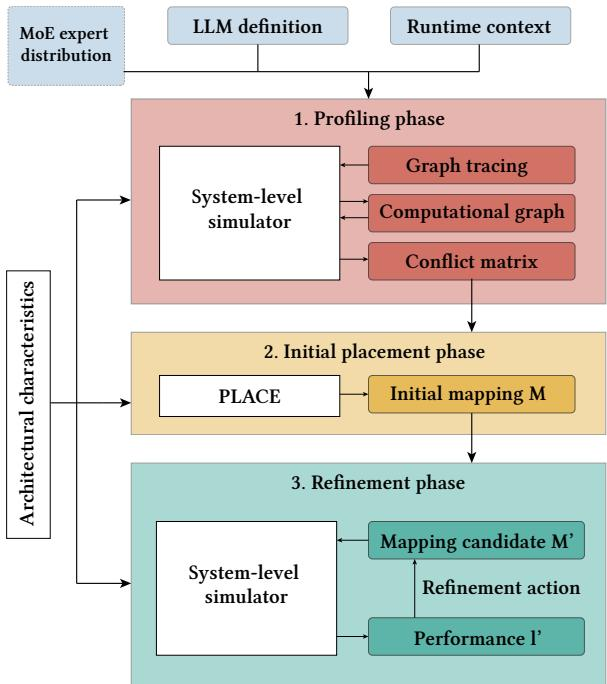  
Figure 5. Overview of the CAMP mapping algorithm.

O<sub>r</sub>th<sub>ogona</sub>ll<sub>y, we</sub> f<sub>ur</sub>th<sub>er vary</sub> th<sub>e</sub> i<sub>n</sub>f<sub>erence con</sub>t<sub>ex</sub>t b<sub>y</sub> chan<sub>g</sub>in<sub>g</sub> the attention <sub>g</sub>ranularit<sub>y</sub>. If attention is conducted per token on-chip in a streamed fashion, it does not prevent t<sub>o</sub>k<sub>ens</sub> f<sub>rom execu</sub>ti<sub>ng</sub> i<sub>n para</sub>ll<sub>e</sub>l <sub>across</sub> dif<sub>eren</sub>t t<sub>rans</sub>f<sub>ormer</sub> la<sub>y</sub>ers. Then throu<sub>g</sub>h<sub>p</sub>ut-friendl<sub>y</sub> ma<sub>pp</sub>in<sub>g</sub> is <sub>p</sub>referable with <sub>p</sub>otentiall<sub>y</sub> hi<sub>g</sub>h BP. In contrast<sub>,</sub> when attention is disa<sub>gg</sub>re-<sub>ga</sub>t<sub>e</sub>d <sub>o</sub>f<sub>-c</sub>hi<sub>p an</sub>d <sub>opera</sub>t<sub>es</sub> i<sub>n a</sub> b<sub>a</sub>t<sub>c</sub>h<sub>e</sub>d f<sub>as</sub>hi<sub>on suc</sub>h th<sub>a</sub>t <sub>s</sub>t<sub>a</sub>ti<sub>c</sub> MVM<sub>s</sub> <sub>a</sub>nd <sub>a</sub>tt<sub>e</sub>nti<sub>o</sub>n <sub>ca</sub>nn<sub>o</sub>t <sub>ove</sub>rl<sub>ap</sub> <sub>ac</sub>r<sub>oss</sub> t<sub>o</sub>k<sub>e</sub>n<sub>s,</sub> th<sub>e</sub> <sub>more</sub> b<sub>a</sub>l<sub>ance</sub>d <sub>mapp</sub>i<sub>ng</sub> <sub>ou</sub>t<sub>per</sub>f<sub>orms</sub> th<sub>e</sub> th<sub>roug</sub>h<sub>pu</sub>t<sub>-</sub> friendl<sub>y</sub> ma<sub>pp</sub>in<sub>g</sub>. Thus<sub>,</sub> because the o<sub>p</sub>timal la<sub>y</sub>out de<sub>p</sub>ends on the inference context<sub>,</sub> a context-a<sub>g</sub>nostic ma<sub>pp</sub>in<sub>g</sub> strate<sub>gy</sub> [3, 5, 18] ma<sub>y</sub> not full<sub>y</sub> realize the com<sub>p</sub>utational <sub>p</sub>otential of the s<sub>y</sub>stem. Our work tar<sub>g</sub>ets <sub>p</sub>recisel<sub>y</sub> this <sub>g</sub>a<sub>p</sub>.

## 4 CAMP Mapping Algorithm

To ex<sub>p</sub>loit this ma<sub>pp</sub>in<sub>g</sub> flexibilit<sub>y</sub> and maximize 3D-IMC th<sub>roug</sub>h<sub>pu</sub>t<sub>,</sub> CAMP <sub>uses</sub> th<sub>e</sub> th<sub>ree-s</sub>t<sub>age</sub> fl<sub>ow</sub> ill<sub>us</sub>t<sub>ra</sub>t<sub>e</sub>d i<sub>n</sub> Figure 5. CAMP comprises profiling, initial-placement, and refinement phases, described in the following subsections.

## 4.1 Profiling phase

The profiling phase quantifies the temporal proximity between MVMs while accountin<sub>g</sub> for the tar<sub>g</sub>et architecture<sub>,</sub> model<sub>,</sub> and r<sub>u</sub>ntime context. This information is s<sub>u</sub>bse<sub>qu</sub>entl<sub>y</sub> used to identif<sub>y</sub> MVMs that are likel<sub>y</sub> to execute concurrentl<sub>y</sub> an<sup>d</sup> t<sup>h</sup>us s<sup>h</sup>ou<sup>ld</sup> occupy <sup>d</sup>isjoint sets o<sup>f</sup> LGs, ena<sup>bl</sup>ing BP.

Fi<sub>rs</sub>t<sub>, we</sub> t<sub>race mo</sub>d<sub>e</sub>l <sub>execu</sub>ti<sub>on un</sub>d<sub>er</sub> th<sub>e expec</sub>t<sub>e</sub>d <sub>run-</sub> time context and lower the resultin<sub>g</sub> com<sub>p</sub>utation to a <sub>g</sub>ra<sub>p</sub>hbased Intermediate Re<sub>p</sub>resentation (IR). The IR is then <sub>p</sub>arsed to identif<sub>y</sub> the dimensions of each MVM ma<sub>pp</sub>ed to the

3D-IMC macro and the estimated latencies of other o<sub>p</sub>er-<sub>a</sub>ti<sub>o</sub>n<sub>s,</sub> in<sub>c</sub>l<sub>u</sub>din<sub>g</sub> l<sub>aye</sub>r n<sub>o</sub>rm<sub>a</sub>liz<sub>a</sub>ti<sub>o</sub>n<sub>,</sub> <sub>ac</sub>ti<sub>va</sub>ti<sub>o</sub>n f<sub>u</sub>n<sub>c</sub>ti<sub>o</sub>n<sub>s,</sub> <sub>an</sub>d <sub>a</sub>tt<sub>en</sub>ti<sub>on.</sub> A <sub>sys</sub>t<sub>em-</sub>l<sub>eve</sub>l <sub>s</sub>i<sub>mu</sub>l<sub>a</sub>t<sub>or</sub> th<sub>en sc</sub>h<sub>e</sub>d<sub>u</sub>l<sub>es</sub> th<sub>e</sub> com<sub>p</sub>utational <sub>g</sub>ra<sub>p</sub>h to extract network runtime metrics. Durin<sub>g</sub> this <sub>p</sub>rofilin<sub>g</sub> <sub>p</sub>hase<sub>,</sub> we relax the <sub>p</sub>h<sub>y</sub>sical resource constraints b<sub>y</sub> <sub>p</sub>rovidin<sub>g</sub> enou<sub>g</sub>h tiles to ma<sub>p</sub> ever<sub>y</sub> MVM <sub>w</sub>ith 4-<sub>way</sub> TP <sub>o</sub>nt<sub>o</sub> m<sub>u</sub>t<sub>ua</sub>ll<sub>y</sub> <sub>e</sub>x<sub>c</sub>l<sub>us</sub>i<sub>ve</sub> LG<sub>s.</sub> Thi<sub>s</sub> <sub>co</sub>nfi<sub>gu</sub>r<sub>a</sub>- ti<sub>on a</sub>ll<sub>ows a</sub>ll i<sub>n</sub>d<sub>epen</sub>d<sub>en</sub>t MVM<sub>s</sub> t<sub>o execu</sub>t<sub>e concurren</sub>tl<sub>y,</sub> ex<sub>p</sub>osin<sub>g</sub> their maximum <sub>p</sub>otential tem<sub>p</sub>oral overla<sub>p,</sub> without contention for com<sub>p</sub>ute resources.

The sim<sub>u</sub>lation <sub>p</sub>ro<sub>v</sub>ides a sched<sub>u</sub>le of o<sub>p</sub>erations consistin<sub>g</sub> of their start and end times. Let J denote the set of MVMs in the workload. For each MVM � ∈ J and each t<sub>o</sub>k<sub>en</sub> $b \in \{ 1 , \ldots , B \}$ <sub>, w</sub>h<sub>ere</sub> � i<sub>s</sub> th<sub>e</sub> b<sub>a</sub>t<sub>c</sub>h <sub>s</sub>i<sub>ze,</sub> th<sub>e sc</sub>h<sub>e</sub>d<sub>u</sub>l<sub>e</sub> d<sub>e</sub>fi<sub>nes</sub> <sub>s</sub>t<sub>ar</sub>t <sub>an</sub>d <sub>en</sub>d ti<sub>mes</sub> $s _ { j , b }$ <sub>an</sub>d $e _ { j , b }$

The schedule satisfies two constraints: (i) two tokens cannot execute the same MVM concurrentl<sub>y,</sub> since the<sub>y</sub> contend for the same <sub>p</sub>h<sub>y</sub>sical arra<sub>y</sub>; (ii) data de<sub>p</sub>endencies <sub>p</sub>revent the MVMs of a sin<sub>g</sub>le token from executin<sub>g</sub> concurrentl<sub>y,</sub> <sub>excep</sub>t f<sub>or</sub> th<sub>e</sub> <sub>exper</sub>t l<sub>ayers</sub> <sub>o</sub>f M<sub>o</sub>E<sub>-</sub>b<sub>ase</sub>d <sub>ne</sub>t<sub>wor</sub>k<sub>s.</sub>

$$
\begin{array} { r l r } & { } & { s _ { j , b + 1 } \geq e _ { j , b } , \quad \forall j \in \mathcal { T } , \ 1 \leq b < B } \\ & { } & { s _ { j + 1 , b } \geq e _ { j , b } , \quad \forall b \leq B } \end{array}\tag{1}
$$

Gi<sub>ven</sub> thi<sub>s</sub> <sub>sc</sub>h<sub>e</sub>d<sub>u</sub>l<sub>e,</sub> <sub>we</sub> <sub>quan</sub>tif<sub>y</sub> th<sub>e</sub> t<sub>empora</sub>l <sub>over</sub>l<sub>ap</sub> $O _ { i , j }$ <sup>b</sup>etween two MVMs � an<sup>d</sup> � <sup>b</sup>y summing t<sup>h</sup>e over<sup>l</sup>ap o<sup>f</sup> a<sup>ll</sup> <sub>p</sub>airs of their token instances:

$$
O _ { i , j } = \sum _ { b = 1 } ^ { B } \sum _ { b ^ { \prime } = 1 } ^ { B } \operatorname* { m a x } \bigl ( 0 , \operatorname* { m i n } ( e _ { i , b } , e _ { j , b ^ { \prime } } ) - \operatorname* { m a x } ( s _ { i , b } , s _ { j , b ^ { \prime } } ) \bigr )\tag{2}
$$

The temporal proximity of � to $j , C _ { i , j }$ <sub>,</sub> i<sub>s</sub> d<sub>e</sub>fi<sub>ne</sub>d <sub>as:</sub>

$$
C _ { i , j } = \frac { O _ { i , j } } { \sum _ { b = 1 } ^ { B } \left( e _ { i , b } - s _ { i , b } \right) }\tag{3}
$$

Th<sub>us,</sub> $C _ { i , j } \in [ 0 , 1 ]$ re<sub>p</sub>resents the <sub>p</sub>ortion of MVM �’s execution t<sup>h</sup>at potentia<sup>ll</sup>y over<sup>l</sup>aps wit<sup>h</sup> MVM �. Sc<sup>h</sup>e<sup>d</sup>u<sup>l</sup>ing constraints (E<sub>q</sub>uation 1) ensure that no overla<sub>p</sub> is doublecounted. The resulting conflict matrix is:

$$
\mathbf { C } \in [ 0 , 1 ] ^ { \mathcal { T } \times \mathcal { I } } , \quad \mathbf { C } _ { i , j } = \left\{ 0 \qquad i = j \wedge \mathrm { L L M ~ i s ~ d e n s e } \right.\tag{4}
$$

F<sub>o</sub>r d<sub>e</sub>n<sub>se</sub> LLM<sub>s,</sub> di<sub>ago</sub>n<sub>a</sub>l <sub>e</sub>ntri<sub>es a</sub>r<sub>e</sub> z<sub>e</sub>r<sub>o</sub> b<sub>ecause a</sub>n MVM <sub>ca</sub>nn<sub>o</sub>t <sub>co</sub>nfli<sub>c</sub>t <sub>w</sub>ith it<sub>se</sub>lf d<sub>u</sub>rin<sub>g</sub> <sub>p</sub>l<sub>ace</sub>m<sub>e</sub>nt<sub>.</sub> F<sub>o</sub>r M<sub>o</sub>Eb<sub>ase</sub>d LLM<sub>s,</sub> h<sub>owever,</sub> <sub>mu</sub>lti<sub>p</sub>l<sub>e</sub> <sub>exper</sub>t i<sub>ns</sub>t<sub>ances</sub> <sub>o</sub>f th<sub>e</sub> <sub>corre-</sub> s<sub>p</sub>ondin<sub>g</sub> dense MVM can execute concurrentl<sub>y,</sub> re<sub>q</sub>uirin<sub>g</sub> th<sub>e</sub> dif<sub>eren</sub>t t<sub>rea</sub>t<sub>men</sub>t d<sub>escr</sub>ib<sub>e</sub>d b<sub>e</sub>l<sub>ow.</sub>

4.1.1 Expanding the conflict matrix for MoE LLMs. For dense LLMs, the set of MVMs J contains the QKV, output, G+U, an<sup>d d</sup>own projections o<sup>f</sup>eac<sup>h</sup> trans<sup>f</sup>ormer <sup>l</sup>ayer. In an MoE-<sup>b</sup>ase<sup>d</sup> mo<sup>d</sup>e<sup>l</sup>, eac<sup>h</sup> G+U an<sup>d</sup> <sup>d</sup>own projection is instead re<sub>p</sub>licated across � ex<sub>p</sub>ert MVMs<sub>,</sub> of which � are <sub>ac</sub>ti<sub>va</sub>t<sub>e</sub>d <sub>per</sub> t<sub>o</sub>k<sub>en.</sub>

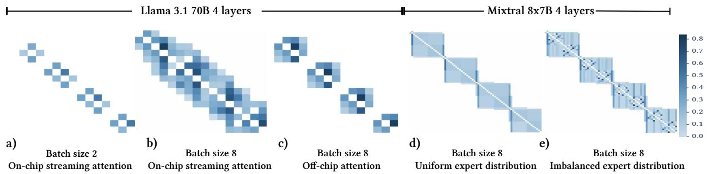  
Figure 6. Conflict matrices shown as heatmaps across workload configurations and inference contexts. An entry in row � and co<sup>l</sup>umn � correspon<sup>d</sup>s to t<sup>h</sup>e tempora<sup>l</sup> proximity o<sup>f</sup> MVMs � an<sup>d</sup> � among t<sup>h</sup>e set o<sup>f</sup> MVMs to <sup>b</sup>e mappe<sup>d</sup>.

Re<sub>p</sub>resentin<sub>g</sub> ex<sub>p</sub>ert-level conflicts introduces two consid-<sub>e</sub>r<sub>a</sub>ti<sub>o</sub>n<sub>s.</sub> Fir<sub>s</sub>t<sub>,</sub> m<sub>u</sub>lti<sub>p</sub>l<sub>e</sub> <sub>e</sub>x<sub>pe</sub>rt<sub>s</sub> in th<sub>e</sub> <sub>sa</sub>m<sub>e</sub> FFN bl<sub>oc</sub>k <sub>a</sub>r<sub>e</sub> activated concurrentl<sub>y</sub>. Thus, the self-conflicts (dia<sub>g</sub>onal entries in the conflict matrix) corres<sub>p</sub>ondin<sub>g</sub> to FFN blocks are <sub>non-zero,</sub> <sub>un</sub>lik<sub>e</sub> th<sub>ose</sub> <sub>o</sub>f d<sub>ense</sub> FFN bl<sub>oc</sub>k<sub>s.</sub> S<sub>econ</sub>d<sub>,</sub> <sub>exper</sub>t activation is not <sub>p</sub>erfectl<sub>y</sub> uniform: some ex<sub>p</sub>ert subsets are <sub>ac</sub>ti<sub>va</sub>t<sub>e</sub>d <sub>more</sub> f<sub>requen</sub>tl<sub>y</sub> th<sub>an</sub> <sub>o</sub>th<sub>ers.</sub> T<sub>o</sub> <sub>mo</sub>d<sub>e</sub>l <sub>exper</sub>t<sub>-</sub>l<sub>eve</sub>l <sub>co</sub>nfli<sub>c</sub>t<sub>s,</sub> <sub>we</sub> d<sub>eco</sub>m<sub>pose</sub> th<sub>e</sub> FFN MVM<sub>s</sub> int<sub>o</sub> indi<sub>v</sub>id<sub>ua</sub>l <sub>e</sub>x-<sub>p</sub>ert MVMs. Let ${ \mathcal { T } } ^ { \prime }$ d<sub>eno</sub>t<sub>e</sub> th<sub>e</sub> <sub>expan</sub>d<sub>e</sub>d <sub>se</sub>t <sub>o</sub>f MVM<sub>s.</sub> F<sub>or</sub> <sub>an</sub> ex<sub>p</sub>ert MVM $i , \mathcal { T } ^ { \prime }$ contains one entr<sub>y</sub> (�, �) for each ex<sub>p</sub>ert $e \in { \mathcal { E } } ,$ whereas a non-ex<sub>p</sub>ert MVM � remains re<sub>p</sub>resented b<sub>y</sub> a sin<sub>g</sub>le entr<sub>y</sub> �. We define a ma<sub>pp</sub>in<sub>g</sub> from ${ \mathcal { T } } ^ { \prime }$ to J:

$$
\pi ( i , e ) = i , \quad \pi : \mathcal { T } ^ { \prime } \to \mathcal { T }\tag{5}
$$

This ma<sub>pp</sub>in<sub>g</sub> associates each ex<sub>p</sub>anded MVM <sub>w</sub>ith its corres<sub>p</sub>ondin<sub>g</sub> MVM in the dense network. $\pi ( i ) = i$ f<sub>or a</sub> non-expert MVM. We expand the dense conflict matrix C into the more ex<sub>p</sub>ressi<sub>v</sub>e $\mathbf { \tilde { C } } \in [ 0 , 1 ] ^ { | \mathcal { T } ^ { \prime } | \times | \mathcal { T } ^ { \prime } | }$ :

$$
\widetilde { \mathbf { C } } _ { k , l } = \mathbf { C } _ { \pi ( k ) , \pi ( l ) } \cdot \frac { \omega ( k , l ) } { \sum _ { l ^ { \prime } \in \mathrm { s i b l i n g s } ( l ) } \omega ( k , l ^ { \prime } ) } \quad \forall ( k , l ) \in | \mathcal { T } ^ { \prime } | \times | \mathcal { T } ^ { \prime } |\tag{6}
$$

The wei<sub>g</sub>htin<sub>g</sub> function <sub>�</sub> distributes each dense-MVM conflict amon<sub>g</sub> the corres<sub>p</sub>ondin<sub>g</sub> ex<sub>p</sub>ert <sub>p</sub>airs in <sub>p</sub>ro<sub>p</sub>ortion to their use. E<sub>q</sub>uation 6 conserves each row: for an<sub>y</sub> <sup>�</sup> an<sup>d</sup> origina<sup>l</sup> MVM �, t<sup>h</sup>e expan<sup>d</sup>e<sup>d</sup> entries sum to t<sup>h</sup>e ori<sub>g</sub>inal conflict<sub>,</sub> $\begin{array} { r } { \sum _ { l : \pi ( l ) = j } \widetilde { \mathbf { C } } _ { k , l } = \mathbf { C } _ { \pi ( k ) , j } } \end{array}$ <sub>.</sub> F<sub>or a per</sub>f<sub>ec</sub>tl<sub>y</sub> b<sub>a</sub>l<sub>-</sub> <sub>ance</sub>d M<sub>o</sub>E <sub>ne</sub>t<sub>wor</sub>k<sub>, �</sub> i<sub>s cons</sub>t<sub>an</sub>t <sub>an</sub>d di<sub>s</sub>t<sub>r</sub>ib<sub>u</sub>t<sub>es con</sub>fli<sub>c</sub>t<sub>s</sub> <sub>u</sub>nif<sub>o</sub>rml<sub>y</sub> <sub>ac</sub>r<sub>oss</sub> <sub>e</sub>x<sub>pe</sub>rt<sub>s.</sub> A<sub>ppe</sub>ndix B d<sub>e</sub>fin<sub>es</sub> <sub>�</sub> f<sub>o</sub>r n<sub>o</sub>n-<sub>u</sub>nif<sub>o</sub>rm <sub>e</sub>x<sub>pe</sub>rt-<sub>ac</sub>ti<sub>va</sub>ti<sub>o</sub>n di<sub>s</sub>trib<sub>u</sub>ti<sub>o</sub>n<sub>s.</sub> F<sub>o</sub>r <sub>s</sub>im<sub>p</sub>li<sub>c</sub>it<sub>y,</sub> <sub>we</sub> write C and J throu<sub>g</sub>hout the remainder of the <sub>p</sub>a<sub>p</sub>er; for MoE models these denote the expanded eC and J<sup>′</sup>.

4.1.2 Inference context encoded by the conflict matrix. The conflict matrix captures all three categories of inference context<sub>,</sub> as illustrated b<sub>y</sub> the heatma<sub>p</sub>s in Fi<sub>g</sub>ure 6. Architectural characteristics: Figure 6(b,c) compares confli<sub>c</sub>t <sub>ma</sub>t<sub>r</sub>i<sub>ces</sub> f<sub>or</sub> th<sub>e se</sub>tti<sub>ngs w</sub>ith <sub>on-c</sub>hi<sub>p an</sub>d <sub>o</sub>f<sub>-c</sub>hi<sub>p a</sub>tt<sub>en-</sub> ti<sub>o</sub>n <sub>u</sub>nit<sub>s,</sub> r<sub>espec</sub>ti<sub>ve</sub>l<sub>y.</sub> Wh<sub>e</sub>n th<sub>e a</sub>tt<sub>e</sub>nti<sub>o</sub>n <sub>u</sub>nit i<sub>s</sub> int<sub>eg</sub>r<sub>a</sub>t<sub>e</sub>d on-chi<sub>p</sub>, as in [5, 47], individual batch tokens can be streamed into the attention unit at fine <sub>g</sub>ranularit<sub>y,</sub> enablin<sub>g</sub> contin-<sub>uous</sub> i<sub>n</sub>t<sub>er-</sub>l<sub>ayer</sub> <sub>over</sub>l<sub>ap</sub> <sub>across</sub> t<sub>o</sub>k<sub>ens</sub> i<sub>n</sub> th<sub>e</sub> b<sub>a</sub>t<sub>c</sub>h<sub>.</sub> Thi<sub>s</sub> fi<sub>ne-gra</sub>i<sub>ne</sub>d <sub>over</sub>l<sub>ap pro</sub>d<sub>uces</sub> th<sub>e connec</sub>t<sub>e</sub>d <sub>con</sub>fli<sub>c</sub>t <sub>ma-</sub> trix in Fi<sub>g</sub>ure 6(b). When the attention unit is disa<sub>gg</sub>re<sub>g</sub>ated of-chi<sub>p</sub> [46], <sub>g</sub>atherin<sub>g</sub> the accelerator out<sub>p</sub>uts for of-chi<sub>p</sub> communication introduces a barrier between la<sub>y</sub>ers<sub>,</sub> <sub>p</sub>reventing overlap between the preceding QKV projection layer and t<sup>h</sup>e su<sup>b</sup>sequent output projection <sup>l</sup>ayer. T<sup>h</sup>is <sup>b</sup>arrier pro<sup>d</sup>uces the disconnected conflict matrix in Fi<sub>g</sub>ure 6(c).

Algorithm 1 Initial placement phase and placement algo-  
<sub>r</sub>ith<sub>m</sub>   
Require: MVMs J in computation order; conflict matrix C; leaf   
<sub>g</sub>rou<sub>p</sub>s H; tier bud<sub>g</sub>et �   
Ensure: mapping $\mathbf { M } \colon \mathbf { M } _ { j , h , t } \in \{ 0 , 1 \}$ w<sup>h</sup>et<sup>h</sup>er MVM � occupies <sup>l</sup>ea<sup>f</sup>   
<sub>g</sub>rou<sub>p</sub> ℎ in tier �   
$\begin{array} { r } { 1 \colon \mathrm { T P } _ { j }  1 \quad \forall j \in \mathcal { T } } \end{array}$ ;   
2: return Place(J )   
3: function Place(J)   
4: $\mathbf { M } _ { j , h , t }  0 \quad \forall j \in \mathcal { T } , h \in \mathcal { H } , t < T$   
5: for all $j \in \mathcal { T }$ do   
6: (ℎ<sub>�</sub>, �<sub>�</sub> ) ← Footprint(�, TP<sub>�</sub> )   
7: P ← Candidates(M, ℎ<sub>�</sub>, �<sub>�</sub>)   
8: for all $\mathbf { M } ^ { \prime } \in \mathcal { P }$ do   
9: �<sub>�,ℎ</sub> ← max $\mathbf { M ^ { \prime } } _ { j , h , t } \quad \forall j \in \mathcal { T } , h \in \mathcal { H }$   
�<�   
10: $\begin{array} { r } { x _ { i , j } \gets 1 \left[ \left( \sum _ { h \in \mathcal { H } } { u _ { i , h } \cdot u _ { j , h } } \right) \geq 1 \right] } \end{array}$   
11: $\begin{array} { r } { \gamma ( \mathbf { M } ^ { \prime } )  \sum _ { i < j } \mathbf { C } _ { i , j } \cdot x _ { i , j } \quad \forall i , j \in \mathcal { T } } \end{array}$   
12: end for   
13: M ← arg min<sub>M</sub>′ <sub>∈ P</sub>  � (M<sup>′</sup>)   
14: end for   
15: return M   
16: end function

Network characteristics: Figure 6(a-c) represents Llama 70B, whereas Fi<sub>g</sub>ure 6(d,e) re<sub>p</sub>resents Mixtral 8×7B with ex-<sub>p</sub>ert la<sub>y</sub>ers decom<sub>p</sub>osed into individual ex<sub>p</sub>erts. Incor<sub>p</sub>oratin<sub>g</sub> the ex<sub>p</sub>ected ex<sub>p</sub>ert-acti<sub>v</sub>ation distrib<sub>u</sub>tion allo<sub>w</sub>s CAMP t<sub>o accoun</sub>t f<sub>or co-ac</sub>ti<sub>va</sub>ti<sub>on</sub> lik<sub>e</sub>lih<sub>oo</sub>d<sub>.</sub>

Runtime characteristics: Figure 6(a,b) illustrates how batch <sub>s</sub>i<sub>ze a</sub>f<sub>ec</sub>t<sub>s</sub> th<sub>e con</sub>fli<sub>c</sub>t <sub>ma</sub>t<sub>r</sub>i<sub>x.</sub> S<sub>ma</sub>ll<sub>er</sub> b<sub>a</sub>t<sub>c</sub>h <sub>s</sub>i<sub>zes pro</sub>d<sub>uce</sub> f<sub>ewer</sub> <sub>po</sub>t<sub>en</sub>ti<sub>a</sub>l <sub>con</sub>fli<sub>c</sub>t<sub>s</sub> b<sub>e</sub>t<sub>ween</sub> MVM <sub>pa</sub>i<sub>rs</sub> <sub>an</sub>d th<sub>ere</sub>f<sub>ore</sub> s<sub>p</sub>arser conflict matrices.

```latex
Algorithm 2 Refinement phase
Require: initial mapping $\mathbf { M } _ { \mathrm { i n i t } } ;$ b<sub>eam w</sub>idth $W ;$ <sub>ac</sub>ti<sub>on w</sub>idth �
Ensure: refined mapping M
1: �<sub>i it</sub> ← Schedule $\mathbf { \hat { M } } _ { \mathrm { i n i t } } )$
2: $S _ { \mathrm { i n i t } } \gets ( \mathbf { M } _ { \mathrm { i n i t } } , l _ { \mathrm { i n i t } } ) ; B \gets \{ S _ { \mathrm { i n i t } } \} ; S ^ { * } \gets S _ { \mathrm { i n i t } } ;$
3: while $B \neq \varnothing$ do
4: $B _ { \mathrm { c a n d } }  0$
5: for all $S = \left( \mathbf { M } , l \right) \in B$ do
6: $A ( S ) \gets \{ a _ { j , \mathrm { T P } _ { j , S } \to \mathrm { T P _ { n e w } } } \mid j \in \mathcal { I } , \mathrm { T P _ { n e w } } > \mathrm { T P } _ { j , S } \}$
7: $A _ { k } ( S ) \gets$ to<sub>p</sub> � actions in �(�)
8: for all $a \in A _ { k } ( S )$ do
9: $\mathbf { M } ^ { \prime } \gets \mathrm { P L A C E } ( a ( \mathbf { M } ) )$
10: �<sup>′</sup> ← Schedule(M<sup>′</sup>)
11: $B _ { \mathrm { c a n d } } \gets B _ { \mathrm { c a n d } } \cup \{ ( \mathbf { M } ^ { \prime } , l ^ { \prime } ) \}$
12: end for
13: end for
14: $S ^ { * } \gets \arg \operatorname* { m i n } _ { ( \mathbf { M } ^ { \prime } , l ^ { \prime } ) \in B _ { \mathrm { c a n d } } \cup \{ S ^ { * } \} } l ^ { \prime }$
15: � ← to<sub>p</sub> � states in $B _ { \mathrm { c a n d } }$
16: end while
17: return M<sup>∗</sup> from $S ^ { * }$
```

Note that the conflict matrix is just an intermediate result, guiding the rest of the algorithm when mapping the wei<sub>g</sub>hts. The next two <sub>p</sub>hases run in a workload-a<sub>g</sub>nostic <sub>manner as a</sub>ll th<sub>e wor</sub>kl<sub>oa</sub>d<sub>-re</sub>l<sub>a</sub>t<sub>e</sub>d <sub>c</sub>h<sub>arac</sub>t<sub>er</sub>i<sub>s</sub>ti<sub>cs are en-</sub> <sub>co</sub>d<sub>e</sub>d i<sub>n</sub>t<sub>o</sub> th<sub>e con</sub>fli<sub>c</sub>t <sub>ma</sub>t<sub>r</sub>i<sub>x.</sub>

## 4.2 Initial placement phase and placement algorithm

The initial <sub>p</sub>lacement <sub>p</sub>hase <sub>p</sub>roduces the first wei<sub>g</sub>ht ma<sub>p</sub>- <sub>p</sub>i<sub>ng</sub> f<sub>rom</sub> th<sub>e</sub> <sub>pro</sub>fili<sub>ng</sub> <sub>resu</sub>lt<sub>s.</sub> Al<sub>gor</sub>ith<sub>m</sub> 1 d<sub>escr</sub>ib<sub>es</sub> th<sub>e</sub> <sub>p</sub>lacement <sub>p</sub>rocess. Because the Place function is <sub>g</sub>reed<sub>y</sub> and order de<sub>p</sub>endent<sub>,</sub> MVMs are first arran<sub>g</sub>ed in com<sub>p</sub>utation order, followin<sub>g</sub> the heuristic in [5].

Once ordered<sub>,</sub> MVMs are <sub>p</sub>laced consec<sub>u</sub>tivel<sub>y</sub>. For each MVM � an<sup>d</sup> its TP option, $\mathrm { T P } _ { j }$ <sub>,</sub> we first com<sub>p</sub>ute its stora<sub>g</sub>e f<sub>oo</sub>t<sub>pr</sub>i<sub>n</sub>t i<sub>n</sub> t<sub>erms</sub> <sub>o</sub>f th<sub>e</sub> <sub>num</sub>b<sub>er</sub> <sub>o</sub>f LG<sub>s</sub> $( h _ { j } )$ <sub>an</sub>d <sub>ver</sub>ti<sub>ca</sub>l ti<sub>ers</sub> $( \tau _ { j } )$ <sub>requ</sub>i<sub>re</sub>d<sub>.</sub> W<sub>e</sub> th<sub>en</sub> <sub>enumera</sub>t<sub>e</sub> <sub>a</sub>ll <sub>com</sub>bi<sub>na</sub>ti<sub>ons</sub> <sub>o</sub>f <sub>a</sub>t l<sub>eas</sub>t $h _ { j }$ LGs that can be tar<sub>g</sub>eted b<sub>y</sub> a sin<sub>g</sub>le H-tree broadcast ste<sub>p,</sub> t<sub>oge</sub>th<sub>er</sub> <sub>w</sub>ith th<sub>e</sub>i<sub>r</sub> fi<sub>rs</sub>t $\tau _ { j }$ consecutive em<sub>p</sub>t<sub>y</sub> tiers<sub>,</sub> to form th<sub>e</sub> <sub>se</sub>t <sub>o</sub>f <sub>can</sub>did<sub>a</sub>t<sub>e</sub> <sub>mapp</sub>i<sub>ngs.</sub> E<sub>ac</sub>h <sub>can</sub>did<sub>a</sub>t<sub>e</sub> i<sub>s</sub> <sub>score</sub>d b<sub>y</sub> <sub>a</sub> scoring function �, using the conflict matrix C to quantify the <sub>we</sub>i<sub>g</sub>ht<sub>e</sub>d <sub>con</sub>fli<sub>c</sub>t<sub>s</sub> b<sub>e</sub>t<sub>ween</sub> th<sub>e</sub> MVM<sub>s</sub> <sub>a</sub>l<sub>rea</sub>d<sub>y</sub> <sub>p</sub>l<sub>ace</sub>d <sub>an</sub>d the candidate ma<sub>pp</sub>in<sub>g</sub>. The candidate with the minimum total wei<sub>g</sub>hted conflict is <sub>p</sub>icked. This <sub>p</sub>rocess is re<sub>p</sub>eated until all MVMs are ma<sub>pp</sub>ed.

D<sub>u</sub>rin<sub>g</sub> initi<sub>a</sub>l <sub>p</sub>l<sub>ace</sub>m<sub>e</sub>nt<sub>,</sub> <sub>we</sub> <sub>ass</sub>i<sub>g</sub>n <sub>a</sub> 1-<sub>way</sub> TP <sub>op</sub>ti<sub>o</sub>n t<sub>o</sub> <sub>eve</sub>r<sub>y</sub> MVM<sub>.</sub> Thi<sub>s</sub> minimiz<sub>es</sub> th<sub>e</sub> n<sub>u</sub>mb<sub>e</sub>r <sub>o</sub>f til<sub>es,</sub> l<sub>eaves, a</sub>nd LGs re<sub>q</sub>uired b<sub>y</sub> each MVM<sub>,</sub> at the cost of occu<sub>py</sub>in<sub>g</sub> more <sub>v</sub>ertical tiers. This confi<sub>gu</sub>ration ser<sub>v</sub>es as a startin<sub>g</sub> <sub>p</sub>oint f<sub>or</sub> th<sub>e re</sub>fi<sub>nemen</sub>t <sub>p</sub>h<sub>ase.</sub>

## 4.3 Refinement phase

The refinement <sub>p</sub>hase iterativel<sub>y</sub> im<sub>p</sub>roves ma<sub>pp</sub>in<sub>g</sub> b<sub>y</sub> modif<sub>y</sub>in<sub>g</sub> th<sub>e</sub> TP <sub>op</sub>ti<sub>o</sub>n<sub>s</sub> <sub>o</sub>f indi<sub>v</sub>id<sub>ua</sub>l MVM<sub>s.</sub> CAMP <sub>e</sub>x<sub>p</sub>l<sub>o</sub>r<sub>es</sub> the search space of TP degree combinations using a beam search with the system-level simulator in the feedback loop. Al<sub>gor</sub>ith<sub>m</sub> 2 <sub>presen</sub>t<sub>s</sub> th<sub>e re</sub>fi<sub>nemen</sub>t <sub>pseu</sub>d<sub>oco</sub>d<sub>e.</sub>

Initi<sub>a</sub>ll<sub>y,</sub> <sub>a</sub>ll MVM<sub>s</sub> <sub>a</sub>r<sub>e</sub> m<sub>appe</sub>d <sub>us</sub>in<sub>g</sub> 1-<sub>way</sub> TP<sub>,</sub> m<sub>a</sub>ximizin<sub>g</sub> BP at the cost of TP. The refinement <sub>p</sub>hase determines whether increasin<sub>g</sub> the TP de<sub>g</sub>ree of selected MVMs <sub>p</sub>ro-<sub>v</sub>id<sub>es a</sub> f<sub>avora</sub>bl<sub>e</sub> t<sub>ra</sub>d<sub>e-o</sub>f b<sub>e</sub>t<sub>ween</sub> l<sub>ower</sub> i<sub>n</sub>di<sub>v</sub>id<sub>ua</sub>l MVM latenc<sub>y</sub> and com<sub>p</sub>romised BP. We call such a revision an action: $a _ { j , m  n }$ c<sup>h</sup>anges MVM � <sup>f</sup>rom �-way to �-way TP. A<sub>pp</sub>l<sub>y</sub>in<sub>g</sub> an action <sub>y</sub>ields a new ma<sub>pp</sub>in<sub>g,</sub> and the <sub>p</sub>air of a mapping M and its latency � forms a state $S = \left( \mathbf { M } , l \right)$ <sub>.</sub> Sin<sub>ce</sub> evaluatin<sub>g</sub> ever<sub>y</sub> assi<sub>g</sub>nment is intractable<sub>,</sub> CAMP kee<sub>p</sub>s onl<sub>y</sub> the � most promising states after each iteration, a beam of width � . The search be<sub>g</sub>ins from a sin<sub>g</sub>le state<sub>,</sub> the initial <sub>p</sub>l<sub>acemen</sub>t<sub>,</sub> <sub>w</sub>ith <sub>can</sub>did<sub>a</sub>t<sub>e</sub> <sub>ac</sub>ti<sub>ons:</sub>

$$
A = \{ a _ { j , 1  2 } \mid j \in { \mathcal { T } } \} .
$$

Each iteration <sub>p</sub>roceeds as follows. For ever<sub>y</sub> state in the b<sub>ea</sub>m<sub>,</sub> CAMP <sub>o</sub>rd<sub>e</sub>r<sub>s</sub> th<sub>e ca</sub>ndid<sub>a</sub>t<sub>e ac</sub>ti<sub>o</sub>n<sub>s</sub> b<sub>y</sub> th<sub>e co</sub>m<sub>pu</sub>t<sub>e</sub> latenc<sub>y</sub> of their corres<sub>p</sub>ondin<sub>g</sub> MVMs <sub>u</sub>nder that state’s TP de<sub>g</sub>rees<sub>,</sub> <sub>p</sub>rioritizin<sub>g</sub> hi<sub>g</sub>her-latenc<sub>y</sub> MVMs<sub>,</sub> and ex<sub>p</sub>ands the to<sub>p</sub> �. Ex<sub>p</sub>andin<sub>g</sub> an action u<sub>p</sub>dates the TP o<sub>p</sub>tion of its MVM and remaps the weights of all MVMs using Place from Al<sub>gor</sub>ith<sub>m</sub> 1<sub>.</sub> Th<sub>e sys</sub>t<sub>em-</sub>l<sub>eve</sub>l <sub>s</sub>i<sub>mu</sub>l<sub>a</sub>t<sub>or</sub> th<sub>en eva</sub>l<sub>ua</sub>t<sub>es</sub> th<sub>e</sub> resulting mapping M<sup>′</sup> and yields its latency $l ^ { \prime } ,$ <sub>p</sub>ro<sup>d</sup>uc<sup>i</sup>n<sub>g</sub> a new state $S ^ { \prime } = \left( \mathbf { M } ^ { \prime } , l ^ { \prime } \right)$ . Of the� ×� states <sub>g</sub>enerated this wa<sub>y</sub>, th<sub>e</sub> � <sub>w</sub>ith th<sub>e</sub> l<sub>owes</sub>t l<sub>a</sub>t<sub>ency</sub> f<sub>orm</sub> th<sub>e</sub> <sub>nex</sub>t b<sub>eam.</sub> Wh<sub>en</sub> <sub>no</sub> <sub>ca</sub>ndid<sub>a</sub>t<sub>e</sub> <sub>ac</sub>ti<sub>o</sub>n<sub>s</sub> r<sub>e</sub>m<sub>a</sub>in<sub>,</sub> CAMP r<sub>e</sub>t<sub>u</sub>rn<sub>s</sub> th<sub>e</sub> m<sub>app</sub>in<sub>g</sub> $\mathbf { M } ^ { * }$ <sub>o</sub>f th<sub>e</sub> l<sub>owes</sub>t<sub>-</sub>l<sub>a</sub>t<sub>ency</sub> <sub>s</sub>t<sub>a</sub>t<sub>e</sub> <sub>exp</sub>l<sub>ore</sub>d<sub>.</sub>

A<sub>s</sub> b<sub>eam</sub> <sub>w</sub>idth � <sub>an</sub>d <sub>ac</sub>ti<sub>on</sub> <sub>w</sub>idth � <sub>approac</sub>h i<sub>n</sub>fi<sub>n</sub>it<sub>y,</sub> b<sub>eam</sub> <sub>searc</sub>h <sub>approac</sub>h<sub>es</sub> <sub>ex</sub>h<sub>aus</sub>ti<sub>ve</sub> <sub>exp</sub>l<sub>ora</sub>ti<sub>on</sub> <sub>o</sub>f th<sub>e</sub> TP <sub>con</sub>fi<sub>gura</sub>ti<sub>on</sub> <sub>space.</sub> I<sub>n</sub> <sub>prac</sub>ti<sub>ce,</sub> th<sub>e</sub>i<sub>r</sub> <sub>va</sub>l<sub>ues</sub> b<sub>a</sub>l<sub>ance</sub> <sub>searc</sub>h <sub>q</sub>ualit<sub>y</sub> a<sub>g</sub>ainst simulation cost<sub>,</sub> thus de<sub>p</sub>endin<sub>g</sub> on the numb<sub>e</sub>r <sub>o</sub>f MVM<sub>s</sub> <sub>a</sub>nd th<sub>e</sub> <sub>cos</sub>t <sub>o</sub>f <sub>eac</sub>h <sub>s</sub>im<sub>u</sub>l<sub>a</sub>ti<sub>o</sub>n<sub>.</sub> A<sub>ppe</sub>ndix C<sub>.</sub>1 <sub>ana</sub>l<sub>yzes</sub> th<sub>e</sub> <sub>sca</sub>l<sub>e</sub> <sub>o</sub>f th<sub>e</sub> <sub>we</sub>i<sub>g</sub>ht<sub>-mapp</sub>i<sub>ng</sub> <sub>pro</sub>bl<sub>em</sub> <sub>an</sub>d <sub>s</sub>h<sub>ows</sub> th<sub>a</sub>t <sub>ex</sub>h<sub>aus</sub>ti<sub>ve exp</sub>l<sub>ora</sub>ti<sub>on</sub> i<sub>s</sub> i<sub>n</sub>f<sub>eas</sub>ibl<sub>e a</sub>t thi<sub>s sca</sub>l<sub>e, w</sub>hil<sub>e</sub> A<sub>pp</sub>endix C.2 <sub>p</sub>rovides ablations on � and �.

## 5 Experimental setup

## 5.1 3D-IMC macro configuration

We consider a 512 × 512, 320-tier AIMC tile [7], with 1,024 <sub>suc</sub>h til<sub>es</sub> <sub>requ</sub>i<sub>re</sub>d t<sub>o</sub> <sub>accommo</sub>d<sub>a</sub>t<sub>e</sub> th<sub>e</sub> <sub>parame</sub>t<sub>er</sub> <sub>coun</sub>t<sub>s</sub> of SotA LLMs such as Llama-3.1-70B and Mixtral-8×7B. The MVM latenc<sub>y</sub> of each AIMC tile is 100 ns, consistent with [5]. L<sub>eaves a</sub>r<sub>e</sub> int<sub>e</sub>r<sub>co</sub>nn<sub>ec</sub>t<sub>e</sub>d b<sub>y a</sub>n H-tr<sub>ee a</sub>r<sub>c</sub>hit<sub>ec</sub>t<sub>u</sub>r<sub>e s</sub>imilar to the desi<sub>g</sub>ns in [20, 37]. Further, we <sub>p</sub>arameterize the <sub>num</sub>b<sub>er o</sub>f H<sub>-</sub>t<sub>ree c</sub>h<sub>anne</sub>l<sub>s ava</sub>il<sub>a</sub>bl<sub>e</sub> f<sub>or</sub> t<sub>ransm</sub>itti<sub>ng</sub> d<sub>a</sub>t<sub>a.</sub> E<sub>ac</sub>h <sub>c</sub>h<sub>anne</sub>l h<sub>as a w</sub>idth <sub>ma</sub>t<sub>c</sub>h<sub>e</sub>d t<sub>o</sub> th<sub>e</sub> til<sub>e</sub> di<sub>mens</sub>i<sub>on,</sub> 512<sub>,</sub> and is dee<sub>p</sub>l<sub>y p</sub>i<sub>p</sub>elined<sub>,</sub> allowin<sub>g</sub> 64 8-bit in<sub>p</sub>uts to be t<sub>ransm</sub>itt<sub>e</sub>d <sub>eac</sub>h <sub>cyc</sub>l<sub>e.</sub> W<sub>e use</sub> $n _ { \mathrm { L G } } = 6 4$ LG<sub>s w</sub>ith $n _ { L } = 4$ l<sub>eaves</sub> <sub>pe</sub>r <sub>g</sub>r<sub>oup,</sub> <sub>a</sub>nd f<sub>ou</sub>r H-tr<sub>ee</sub> <sub>c</sub>h<sub>a</sub>nn<sub>e</sub>l<sub>s.</sub> A<sub>ppe</sub>ndix A<sub>.</sub>1 <sub>presen</sub>t<sub>s</sub> th<sub>e</sub> <sub>a</sub>bl<sub>a</sub>ti<sub>on</sub> <sub>suppor</sub>ti<sub>ng</sub> th<sub>ese</sub> <sub>c</sub>h<sub>o</sub>i<sub>ces</sub> <sub>an</sub>d <sub>resu</sub>lt<sub>s</sub> f<sub>or o</sub>th<sub>er macro con</sub>fi<sub>gura</sub>ti<sub>ons.</sub>

## 5.2 Attention/MVM disaggregation setup

O<sub>ur</sub> <sub>spee</sub>d<sub>up</sub> <sub>eva</sub>l<sub>ua</sub>ti<sub>on</sub> t<sub>arge</sub>t<sub>s</sub> th<sub>e</sub> <sub>memory-</sub>b<sub>oun</sub>d d<sub>eco</sub>d<sub>e</sub> <sub>p</sub>hase. Within decode<sub>,</sub> we a<sub>pp</sub>l<sub>y</sub> attention/static MVM disa<sub>g</sub>- <sub>g</sub>r<sub>ega</sub>ti<sub>o</sub>n<sub>,</sub> <sub>ass</sub>i<sub>g</sub>nin<sub>g</sub> <sub>s</sub>t<sub>a</sub>ti<sub>c</sub> MVM<sub>s</sub> t<sub>o</sub> th<sub>e</sub> 3D-IMC <sub>acce</sub>l<sub>e</sub>r<sub>a</sub>t<sub>o</sub>r<sub>,</sub> while assi<sub>g</sub>nin<sub>g</sub> attention to the attention unit(s) under var<sub>y</sub>- in<sub>g</sub> confi<sub>g</sub>urations, such as 1 or 2 NVIDIA A100 GPUs (80GB), H100 GPUs (80GB), or B200 GPUs (180 GB).

## 5.3 Target models and mapping configuration

We evaluate CAMP on Llama-3.1-8B/70B [40], Qwen-72B [2], and Mixtral-8×7B [21]. Results are obtained b<sub>y</sub> combinin<sub>g</sub> GPU<sub>-pro</sub>fil<sub>e</sub>d <sub>a</sub>tt<sub>en</sub>ti<sub>on</sub> b<sub>enc</sub>h<sub>mar</sub>k<sub>s w</sub>ith <sub>a</sub> T<sub>orc</sub>h<sub>-</sub>i<sub>n</sub>t<sub>egra</sub>t<sub>e</sub>d 3D-IMC <sub>s</sub>im<sub>u</sub>l<sub>a</sub>t<sub>o</sub>r<sub>.</sub> Th<sub>e</sub> d<sub>e</sub>t<sub>a</sub>il<sub>s</sub> <sub>o</sub>n <sub>p</sub>r<sub>o</sub>filin<sub>g</sub> GPU-r<sub>e</sub>l<sub>a</sub>t<sub>e</sub>d m<sub>e</sub>trics are <sub>p</sub>rovided in A<sub>pp</sub>endix D.

Ideall<sub>y,</sub> ma<sub>pp</sub>in<sub>g</sub> all la<sub>y</sub>ers at once <sub>w</sub>ith CAMP <sub>w</sub>o<sub>u</sub>ld <sub>y</sub>ield th<sub>e</sub> <sub>mos</sub>t <sub>e</sub>fi<sub>c</sub>i<sub>en</sub>t <sub>so</sub>l<sub>u</sub>ti<sub>on.</sub> Th<sub>e</sub> <sub>run</sub>ti<sub>me</sub> <sub>o</sub>f th<sub>e</sub> <sub>propose</sub>d <sub>a</sub>l<sub>gor</sub>ith<sub>m,</sub> h<sub>owever, sca</sub>l<sub>es qua</sub>d<sub>ra</sub>ti<sub>ca</sub>ll<sub>y w</sub>ith th<sub>e num</sub>b<sub>er</sub> of MVMs bein<sub>g</sub> ma<sub>pp</sub>ed. A detailed com<sub>p</sub>lexit<sub>y</sub> anal<sub>y</sub>sis is <sub>p</sub>rovided in A<sub>pp</sub>endix C.3. As a tradeof between ma<sub>pp</sub>in<sub>g</sub> r<sub>u</sub>ntime and inter-la<sub>y</sub>er <sub>p</sub>i<sub>p</sub>elinin<sub>g,</sub> <sub>w</sub>e r<sub>u</sub>n CAMP on ei<sub>g</sub>ht l<sub>ayers</sub> f<sub>or</sub> th<sub>e</sub> d<sub>ense</sub> <sub>ne</sub>t<sub>wor</sub>k<sub>s</sub> <sub>an</sub>d <sub>rep</sub>li<sub>ca</sub>t<sub>e</sub> th<sub>e</sub> <sub>resu</sub>lti<sub>ng</sub> ma<sub>pp</sub>in<sub>g</sub> across the remainin<sub>g</sub> la<sub>y</sub>ers. For Mixtral<sub>,</sub> we run CAMP on <sub>g</sub>rou<sub>p</sub>s of four la<sub>y</sub>ers<sub>,</sub> solvin<sub>g</sub> for each <sub>g</sub>rou<sub>p</sub> inde<sub>p</sub>endentl<sub>y,</sub> as ex<sub>p</sub>ert activation distributions difer across l<sub>ayers un</sub>l<sub>ess a un</sub>if<sub>orm</sub> di<sub>s</sub>t<sub>r</sub>ib<sub>u</sub>ti<sub>on</sub> i<sub>s assume</sub>d<sub>.</sub> W<sub>e a</sub>ll<sub>oca</sub>t<sub>e</sub> the vertical tiers in <sub>p</sub>ro<sub>p</sub>ortion to the number of la<sub>y</sub>ers bein<sub>g</sub> <sub>mappe</sub>d<sub>, so</sub> th<sub>a</sub>t th<sub>e</sub> t<sub>o</sub>t<sub>a</sub>l <sub>num</sub>b<sub>er o</sub>f <sub>occup</sub>i<sub>e</sub>d ti<sub>ers rema</sub>i<sub>ns</sub> f<sub>eas</sub>ibl<sub>e.</sub> Mi<sub>x</sub>t<sub>ra</sub>l <sub>resu</sub>lt<sub>s are average</sub>d <sub>over</sub> 50 t<sub>r</sub>i<sub>a</sub>l<sub>s</sub> t<sub>o m</sub>iti<sub>-</sub> <sub>ga</sub>t<sub>e</sub> th<sub>e</sub> <sub>ran</sub>d<sub>omness</sub> <sub>o</sub>f <sub>exper</sub>t <sub>ac</sub>ti<sub>va</sub>ti<sub>on,</sub> <sub>w</sub>hi<sub>c</sub>h <sub>correspon</sub>d<sub>s</sub> to 1600 × batch size ex<sub>p</sub>ert-<sub>p</sub>air sam<sub>p</sub>les.

## 5.4 Comparison baselines

W<sub>e</sub> <sub>co</sub>m<sub>pa</sub>r<sub>e</sub> CAMP m<sub>app</sub>in<sub>g</sub> r<sub>esu</sub>lt<sub>s</sub> <sub>aga</sub>in<sub>s</sub>t t<sub>wo</sub> 3D-IMC wei<sub>g</sub>ht-ma<sub>pp</sub>in<sub>g</sub> al<sub>g</sub>orithms from the literature:

1. Greedy-Util [5]: The Greedy-Util benchmark greedily m<sub>aps</sub> MVM<sub>s</sub> in <sub>e</sub>x<sub>ecu</sub>ti<sub>o</sub>n <sub>o</sub>rd<sub>e</sub>r<sub>,</sub> m<sub>a</sub>ximizin<sub>g</sub> TP f<sub>o</sub>r <sub>a</sub>ll MVM<sub>s.</sub> Th<sub>e a</sub>l<sub>gor</sub>ith<sub>m se</sub>l<sub>ec</sub>t<sub>s</sub> th<sub>e se</sub>t <sub>o</sub>f <sub>acce</sub>l<sub>era</sub>t<sub>or</sub> til<sub>es</sub> with the lowest tile utilization<sub>,</sub> com<sub>p</sub>uted b<sub>y</sub> countin<sub>g</sub> the number of non-em<sub>p</sub>t<sub>y</sub> tiers on each tile. For ex<sub>p</sub>ert MVMs, this count is wei<sub>g</sub>hted b<sub>y</sub> 1/�. As a result, siblin<sub>g</sub> ex<sub>p</sub>ert MVMs are stacked onto the same set of tiles. We use Greed<sub>y</sub>-Util as the <sub>p</sub>rimar<sub>y</sub> baseline because of its s<sub>y</sub>stematic a<sub>pp</sub>roach and similarit<sub>y</sub> to our tar<sub>g</sub>et use case.

2. 3D-aCortex [3]: The 3D-aCortex benchmark greedily m<sub>aps</sub> MVM<sub>s</sub> <sub>w</sub>ith m<sub>a</sub>ximiz<sub>e</sub>d TP<sub>,</sub> r<sub>epea</sub>tin<sub>g</sub> th<sub>e</sub> m<sub>app</sub>in<sub>g</sub> <sub>p</sub>rocess � times (1000 was chosen here) with randomized MVM orderin<sub>g</sub>s. The ma<sub>pp</sub>in<sub>g</sub> with the fewest vertical ti<sub>ers</sub> i<sub>s</sub> th<sub>en se</sub>l<sub>ec</sub>t<sub>e</sub>d<sub>.</sub>

3. Full-compute: We propose an idealized performance up-<sub>per</sub> b<sub>oun</sub>d th<sub>a</sub>t <sub>represen</sub>t<sub>s</sub> th<sub>e</sub> <sub>po</sub>t<sub>en</sub>ti<sub>a</sub>l th<sub>roug</sub>h<sub>pu</sub>t if th<sub>e</sub> 3D-IMC macro’s com<sub>p</sub>ute resources remain full<sub>y</sub> utilized throu<sub>g</sub>hout inference. This is com<sub>p</sub>uted b<sub>y</sub> confi<sub>g</sub>urin<sub>g</sub> all MVMs with the maximum de<sub>g</sub>ree of TP and allowin<sub>g</sub> wei<sub>g</sub>ht rema<sub>pp</sub>in<sub>g,</sub> e.<sub>g</sub>.<sub>,</sub> allowin<sub>g</sub> an<sub>y</sub> MVM to run on an<sub>y</sub> <sub>open se</sub>t <sub>o</sub>f LG<sub>s w</sub>ith <sub>no a</sub>dditi<sub>ona</sub>l <sub>cos</sub>t<sub>.</sub> Whil<sub>e suc</sub>h b<sub>e-</sub> havior cannot be ex<sub>p</sub>ected from an<sub>y</sub> ma<sub>pp</sub>in<sub>g</sub> al<sub>g</sub>orithm i<sub>n rea</sub>lit<sub>y</sub> d<sub>ue</sub> t<sub>o</sub> th<sub>e poor wr</sub>it<sub>e an</sub>d <sub>en</sub>d<sub>urance c</sub>h<sub>arac</sub>t<sub>er-</sub> istics of NVM devices [19], this assum<sub>p</sub>tion nevertheless <sub>serves</sub> <sub>as</sub> <sub>a</sub> <sub>use</sub>f<sub>u</sub>l <sub>re</sub>f<sub>erence,</sub> <sub>represen</sub>ti<sub>ng</sub> th<sub>e</sub> <sub>compu</sub>t<sub>e</sub> <sub>roo</sub>fli<sub>ne o</sub>f th<sub>e</sub> 3D<sub>-</sub>IMC <sub>acce</sub>l<sub>era</sub>t<sub>or.</sub>

## 6 Experimental Results

In this section<sub>,</sub> <sub>w</sub>e anal<sub>y</sub>ze CAMP’s thro<sub>ug</sub>h<sub>pu</sub>t and rob<sub>u</sub>stn<sub>ess</sub> <sub>ac</sub>r<sub>oss</sub> <sub>va</sub>ri<sub>ous</sub> <sub>se</sub>ttin<sub>gs,</sub> in<sub>c</sub>l<sub>u</sub>din<sub>g</sub> th<sub>e</sub> t<sub>a</sub>r<sub>ge</sub>t LLM<sub>,</sub> r<sub>u</sub>ntime context<sub>,</sub> s<sub>y</sub>stem confi<sub>g</sub>uration<sub>,</sub> additional constraints<sub>,</sub> and end-to-end <sub>p</sub>erformance im<sub>p</sub>lications. Su<sub>pp</sub>lementar<sub>y</sub> re-<sub>su</sub>lt<sub>s exp</sub>l<sub>or</sub>i<sub>ng expan</sub>d<sub>e</sub>d <sub>ana</sub>l<sub>yses an</sub>d <sub>a</sub>bl<sub>a</sub>ti<sub>ons are</sub> d<sub>e</sub>f<sub>erre</sub>d to the A<sub>pp</sub>endix.

## 6.1 3D-IMC accelerator performance improvement

W<sub>e</sub> fi<sub>rs</sub>t <sub>ana</sub>l<sub>yze</sub> CAMP’<sub>s</sub> th<sub>roug</sub>h<sub>pu</sub>t b<sub>ene</sub>fit <sub>w</sub>ithi<sub>n</sub> th<sub>e</sub> <sub>scope</sub> it dir<sub>ec</sub>tl<sub>y a</sub>f<sub>ec</sub>t<sub>s</sub>: th<sub>e e</sub>x<sub>ecu</sub>ti<sub>o</sub>n <sub>o</sub>f MVM<sub>s o</sub>n th<sub>e</sub> 3D-IMC <sub>acce</sub>l<sub>era</sub>t<sub>or</sub> d<sub>ur</sub>i<sub>ng</sub> th<sub>e</sub> d<sub>eco</sub>d<sub>e</sub> <sub>p</sub>h<sub>ase.</sub> Fi<sub>gure</sub> 7 <sub>presen</sub>t<sub>s</sub> th<sub>e</sub> th<sub>roug</sub>h<sub>pu</sub>t <sub>resu</sub>lt<sub>s norma</sub>li<sub>ze</sub>d t<sub>o</sub> th<sub>e</sub> G<sub>ree</sub>d<sub>y-</sub>Util b<sub>ase</sub>li<sub>ne.</sub>

At <sub>sma</sub>ll<sub>er</sub> b<sub>a</sub>t<sub>c</sub>h <sub>s</sub>i<sub>zes,</sub> BP i<sub>s</sub> li<sub>m</sub>it<sub>e</sub>d<sub>, w</sub>ith <sub>no</sub> BP <sub>a</sub>t <sub>a</sub> b<sub>a</sub>t<sub>c</sub>h <sub>s</sub>iz<sub>e o</sub>f 1<sub>.</sub> A<sub>cco</sub>rdin<sub>g</sub>l<sub>y,</sub> f<sub>o</sub>r d<sub>e</sub>n<sub>se</sub> LLM<sub>s suc</sub>h <sub>as</sub> Ll<sub>a</sub>m<sub>a a</sub>nd Qwen, the TP-maximizing baselines are optimal as only TP i<sub>s ava</sub>il<sub>a</sub>bl<sub>e, w</sub>ith CAMP m<sub>a</sub>t<sub>c</sub>hin<sub>g</sub> th<sub>e</sub>ir <sub>pe</sub>rf<sub>o</sub>rm<sub>a</sub>n<sub>ce.</sub> H<sub>ow</sub>- <sub>eve</sub>r<sub>,</sub> f<sub>o</sub>r M<sub>o</sub>E-b<sub>ase</sub>d LLM<sub>s,</sub> EP <sub>p</sub>r<sub>ov</sub>id<sub>es a</sub>n <sub>a</sub>dditi<sub>o</sub>n<sub>a</sub>l <sub>sou</sub>r<sub>ce</sub> <sub>o</sub>f <sub>para</sub>ll<sub>e</sub>li<sub>sm even</sub> i<sub>n s</sub>i<sub>ng</sub>l<sub>e-</sub>b<sub>a</sub>t<sub>c</sub>h <sub>wor</sub>kl<sub>oa</sub>d<sub>s.</sub> C<sub>onsequen</sub>tl<sub>y,</sub> the full-com<sub>p</sub>ute bound <sub>p</sub>rojects a modest 1.15× s<sub>p</sub>eedu<sub>p</sub> for Mixtral inference<sub>, w</sub>hile CAMP achie<sub>v</sub>es an a<sub>v</sub>era<sub>g</sub>e thro<sub>ug</sub>h-<sub>p</sub>ut s<sub>p</sub>eedu<sub>p</sub> of 1.10×, reachin<sub>g</sub> u<sub>p</sub> to 1.14× de<sub>p</sub>endin<sub>g</sub> on th<sub>e exper</sub>t<sub>s ac</sub>ti<sub>va</sub>t<sub>e</sub>d b<sub>y</sub> th<sub>e</sub> b<sub>a</sub>t<sub>c</sub>h<sub>.</sub>

As batch size increases<sub>,</sub> im<sub>p</sub>ro<sub>v</sub>in<sub>g</sub> BP becomes fa<sub>v</sub>orable. Throu<sub>g</sub>h<sub>p</sub>ut <sub>g</sub>ains reach 1.95× for Llama 8B, 1.91× for Llama 70B, and 2.0× for Qwen 72B. For Mixtral, CAMP achieves a 1.71× avera<sub>g</sub>e s<sub>p</sub>eedu<sub>p</sub> and u<sub>p</sub> to a 1.84× maximum s<sub>p</sub>eedu<sub>p</sub>. W<sub>e</sub> <sub>o</sub>b<sub>se</sub>r<sub>ve</sub> th<sub>a</sub>t CAMP d<sub>oes</sub> n<sub>o</sub>t <sub>a</sub>l<sub>ways</sub> m<sub>a</sub>ximiz<sub>e</sub> th<sub>e</sub> TP d<sub>egree</sub> <sub>o</sub>f <sub>eac</sub>h MVM<sub>,</sub> <sub>a</sub>ll<sub>ow</sub>i<sub>ng</sub> <sub>mu</sub>t<sub>ua</sub>ll<sub>y</sub> <sub>exc</sub>l<sub>us</sub>i<sub>ve</sub> <sub>se</sub>t<sub>s</sub> <sub>o</sub>f til<sub>es</sub> <sub>an</sub>d LG<sub>s</sub> t<sub>o</sub> b<sub>e</sub> <sub>a</sub>ll<sub>oca</sub>t<sub>e</sub>d t<sub>o</sub> dif<sub>eren</sub>t MVM<sub>s.</sub> Alth<sub>oug</sub>h this increases the com<sub>p</sub>ute latenc<sub>y</sub> of individual MVMs<sub>,</sub> the additional latenc<sub>y</sub> is ofset b<sub>y</sub> an increase in BP.

The <sub>g</sub>a<sub>p</sub> bet<sub>w</sub>een CAMP and F<sub>u</sub>ll-com<sub>pu</sub>te <sub>w</sub>idens as the batch size increases. The underl<sub>y</sub>in<sub>g</sub> assum<sub>p</sub>tion that an<sub>y</sub> MVM ma<sub>y</sub> occu<sub>py</sub> an<sub>y</sub> free LG becomes more <sub>p</sub>rominent as more MVMs com<sub>p</sub>ete for com<sub>p</sub>ute s<sub>p</sub>ace<sub>,</sub> resultin<sub>g</sub> in less feasible ma<sub>pp</sub>in<sub>g</sub>s and loosenin<sub>g</sub> the u<sub>pp</sub>er bound. Even so<sub>,</sub> CAMP e<sup>l</sup>iminates a majority o<sup>f</sup> t<sup>h</sup>e t<sup>h</sup>roug<sup>h</sup>put gap <sup>b</sup>etween th<sub>e</sub> b<sub>ase</sub>li<sub>nes an</sub>d thi<sub>s</sub> th<sub>eore</sub>ti<sub>ca</sub>l <sub>upper</sub> b<sub>oun</sub>d<sub>.</sub>

Orhun Görkem, Athanasios Vasilopoulos, Georgios Pagonis, Victoria Clerico, Hadjer Benmeziane, Irem Boybat, Hsinyu Tsai, Abu Sebastian, and William Andrew Simon

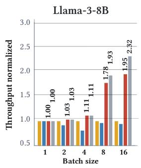

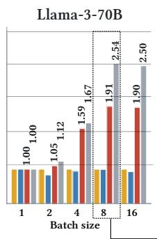

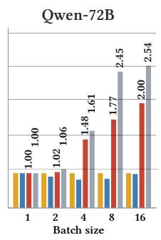

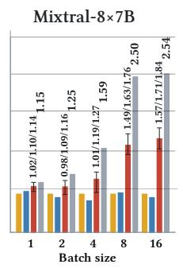

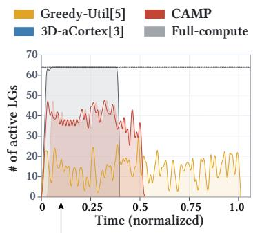

Figure 7. MVM speedup across mapping algorithms, workloads, and batch sizes. An additional plot for ongoing compute utilization in terms of the number of active LGs is also a<sub>pp</sub>ended.  
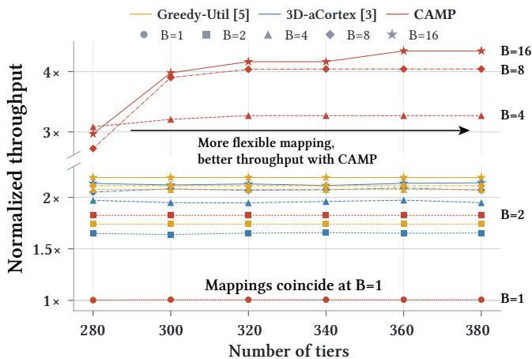  
Figure 8. Normalized Llama 70B throughput vs. vertical tier count across ma<sub>pp</sub><sup>i</sup>n<sub>g</sub> a<sup>l</sup><sub>g</sub>or<sup>i</sup>t<sup>h</sup>ms.

## 6.2 Impact of tier count on throughput

Althou<sub>g</sub>h we ado<sub>p</sub>t a 320-tier desi<sub>g</sub>n [7], 3D-IMC macros ma<sub>y</sub> <sub>p</sub>rovide diferent memor<sub>y</sub> ca<sub>p</sub>acities<sub>,</sub> afectin<sub>g</sub> throu<sub>g</sub>h<sub>p</sub>ut b<sub>y</sub> limitin<sub>g</sub> ma<sub>pp</sub>in<sub>g</sub> flexibilit<sub>y</sub>. Fi<sub>g</sub>ure 8 illustrates this efect. Limitin<sub>g</sub> the desi<sub>g</sub>n to 280 vertical tiers reduces throu<sub>g</sub>h<sub>p</sub>ut at batch sizes 4<sub>,</sub> 8<sub>,</sub> and 16<sub>,</sub> where hi<sub>g</sub>h BP was <sub>p</sub>reviousl<sub>y</sub> obtained at the cost of some TP. Conversel<sub>y,</sub> relaxin<sub>g</sub> the tier limit t<sub>o</sub> 360 <sub>o</sub>r 380<sub>,</sub> <sub>co</sub>n<sub>s</sub>i<sub>s</sub>t<sub>e</sub>nt <sub>w</sub>ith <sub>o</sub>n<sub>go</sub>in<sub>g</sub> tr<sub>e</sub>nd<sub>s</sub> in 3Dmemor<sub>y</sub> technolo<sub>gy,</sub> <sub>p</sub>rovides additional ma<sub>pp</sub>in<sub>g</sub> flexibilit<sub>y</sub> <sub>an</sub>d hi<sub>g</sub>h<sub>er</sub> th<sub>roug</sub>h<sub>pu</sub>t<sub>.</sub>

G<sub>ree</sub>d<sub>y-</sub>Util <sub>an</sub>d 3D<sub>-a</sub>C<sub>or</sub>t<sub>ex, on</sub> th<sub>e o</sub>th<sub>er</sub> h<sub>an</sub>d<sub>, are agnos-</sub> tic to these reso<sub>u</sub>rce limits. 3D-aCortex al<sub>w</sub>a<sub>y</sub>s o<sub>p</sub>timizes for th<sub>e</sub> <sub>num</sub>b<sub>er</sub> <sub>o</sub>f <sub>occup</sub>i<sub>e</sub>d ti<sub>ers</sub> <sub>an</sub>d <sub>se</sub>ttl<sub>es</sub> <sub>on</sub> th<sub>e</sub> <sub>mapp</sub>i<sub>ng</sub> <sub>w</sub>ith th<sub>e</sub> <sub>sma</sub>ll<sub>es</sub>t ti<sub>er</sub> <sub>occupancy</sub> <sub>among</sub> th<sub>e</sub> <sub>samp</sub>l<sub>e</sub>d <sub>can</sub>did<sub>a</sub>t<sub>es,</sub> <sub>w</sub>hil<sub>e</sub> G<sub>ree</sub>d<sub>y-</sub>Util <sub>s</sub>i<sub>mp</sub>l<sub>y</sub> fill<sub>s</sub> th<sub>e</sub> ti<sub>ers</sub> f<sub>rom</sub> b<sub>o</sub>tt<sub>om</sub> t<sub>o</sub> t<sub>op</sub> in MVM com<sub>p</sub>utation order. Both therefore reach the same l<sub>eve</sub>l <sub>o</sub>f th<sub>roug</sub>h<sub>pu</sub>t <sub>regar</sub>dl<sub>ess</sub> <sub>o</sub>f th<sub>e</sub> <sub>num</sub>b<sub>er</sub> <sub>o</sub>f <sub>ava</sub>il<sub>a</sub>bl<sub>e</sub> ti<sub>ers,</sub> <sub>w</sub>ith <sub>sma</sub>ll fl<sub>uc</sub>t<sub>ua</sub>ti<sub>ons</sub> <sub>s</sub>t<sub>emm</sub>i<sub>ng</sub> f<sub>rom</sub> <sub>ran</sub>d<sub>omness</sub> i<sub>n</sub> the 3D-aCortex al<sub>g</sub>orithm.

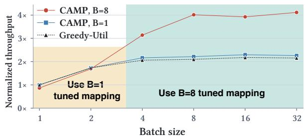  
Figure 9. Llama 70B speedup with mappings tuned by CAMP f<sub>or</sub> b<sub>a</sub>t<sub>c</sub>h <sub>s</sub>i<sub>zes</sub> 1 <sub>an</sub>d 8<sub>,</sub> <sub>compare</sub>d <sub>w</sub>ith G<sub>ree</sub>d<sub>y-</sub>Util<sub>.</sub> Th<sub>e</sub> two ma<sub>pp</sub>in<sub>g</sub>s remain robust across batch sizes<sub>,</sub> avoidin<sub>g</sub> rema<sub>pp</sub>in<sub>g</sub> and wei<sub>g</sub>ht <sub>p</sub>ro<sub>g</sub>rammin<sub>g</sub> for new batch sizes.

## 6.3 Robustness across changing runtime context

D<sub>ue</sub> t<sub>o</sub> th<sub>e a</sub>d<sub>ap</sub>ti<sub>v</sub>it<sub>y o</sub>f CAMP t<sub>o</sub> dif<sub>e</sub>r<sub>e</sub>nt inf<sub>e</sub>r<sub>e</sub>n<sub>ce co</sub>ntexts<sub>,</sub> a ma<sub>pp</sub>in<sub>g</sub> obtained under the ex<sub>p</sub>ectation of a sin<sub>g</sub>leb<sub>a</sub>t<sub>c</sub>h i<sub>n</sub>f<sub>erence</sub> dif<sub>ers</sub> <sub>su</sub>b<sub>s</sub>t<sub>an</sub>ti<sub>a</sub>ll<sub>y</sub> f<sub>rom</sub> <sub>one</sub> <sub>o</sub>bt<sub>a</sub>i<sub>ne</sub>d f<sub>or</sub> b<sub>a</sub>t<sub>c</sub>h <sub>s</sub>i<sub>ze</sub> 8<sub>.</sub> Thi<sub>s</sub> <sub>can</sub> <sub>ra</sub>i<sub>se</sub> <sub>concerns</sub> <sub>w</sub>h<sub>en</sub> th<sub>e</sub> i<sub>n</sub>f<sub>erence</sub> <sub>con</sub>t<sub>ex</sub>t i<sub>s</sub> hi<sub>g</sub>hl<sub>y</sub> <sub>var</sub>i<sub>a</sub>bl<sub>e,</sub> i<sub>.e.,</sub> <sub>w</sub>h<sub>en</sub> th<sub>e</sub> b<sub>a</sub>t<sub>c</sub>h <sub>s</sub>i<sub>ze</sub> <sub>c</sub>h<sub>anges</sub> d<sub>u</sub>rin<sub>g</sub> LLM ser<sub>v</sub>in<sub>g</sub>. We therefore anal<sub>y</sub>ze rob<sub>u</sub>stness in Fi<sub>g</sub>- <sub>ure</sub> 9<sub>,</sub> <sub>w</sub>hi<sub>c</sub>h <sub>s</sub>h<sub>ows</sub> th<sub>a</sub>t <sub>a</sub> <sub>mapp</sub>i<sub>ng</sub> t<sub>une</sub>d f<sub>or</sub> b<sub>a</sub>t<sub>c</sub>h <sub>s</sub>i<sub>ze</sub> 8 out<sub>p</sub>erforms Greed<sub>y</sub>-Util at all batch sizes ≥ 4. Thus, with onl<sub>y</sub> two ma<sub>pp</sub>in<sub>g</sub> o<sub>p</sub>tions<sub>,</sub> one tuned for sin<sub>g</sub>le-batch and <sub>one</sub> t<sub>une</sub>d f<sub>or</sub> l<sub>arge</sub> b<sub>a</sub>t<sub>c</sub>h<sub>es,</sub> <sub>a</sub>ll b<sub>a</sub>t<sub>c</sub>h <sub>s</sub>i<sub>zes</sub> <sub>can</sub> b<sub>e</sub> <sub>serve</sub>d <sub>more e</sub>fi<sub>c</sub>i<sub>en</sub>tl<sub>y</sub> th<sub>an w</sub>ith th<sub>e</sub> G<sub>ree</sub>d<sub>y-</sub>Util <sub>a</sub>lt<sub>erna</sub>ti<sub>ve.</sub>

## 6.4 Impact of � and � on CAMP performance

Fi<sub>g</sub>ure 10 illustrates the im<sub>p</sub>act of <sub>p</sub>arameters � and � on CAMP <sub>p</sub>erformance when ma<sub>pp</sub>in<sub>g</sub> Llama 70B with a batch <sub>s</sub>iz<sub>e</sub> <sub>o</sub>f 8<sub>.</sub> Th<sub>e</sub> fir<sub>s</sub>t <sub>po</sub>int t<sub>o</sub> n<sub>o</sub>t<sub>e</sub> i<sub>s</sub> th<sub>a</sub>t m<sub>a</sub>ximizin<sub>g</sub> BP <sub>as</sub> <sub>p</sub>erformed in the initial ma<sub>pp</sub>in<sub>g</sub> <sub>p</sub>hase alread<sub>y</sub> <sub>p</sub>rovides su<sub>p</sub>erior latenc<sub>y</sub> over Greed<sub>y</sub>-Util. Refinement further im-<sub>p</sub>ro<sub>v</sub>es <sub>g</sub>ains<sub>,</sub> as the o<sub>p</sub>timal balance bet<sub>w</sub>een TP and BP lies some<sub>w</sub>here bet<sub>w</sub>een the t<sub>w</sub>o extremes. O<sub>p</sub>timization c<sub>u</sub>r<sub>v</sub>es i<sub>n</sub>di<sub>ca</sub>t<sub>e</sub> th<sub>a</sub>t <sub>more ex</sub>h<sub>aus</sub>ti<sub>ve searc</sub>h<sub>es ena</sub>bl<sub>e</sub>d b<sub>y</sub> l<sub>arger</sub> � <sub>an</sub>d � <sub>va</sub>l<sub>ues</sub> <sub>ac</sub>hi<sub>eve</sub> f<sub>ur</sub>th<sub>er</sub> i<sub>mprove</sub>d l<sub>a</sub>t<sub>enc</sub>i<sub>es.</sub> W<sub>e</sub> <sub>no</sub>t<sub>e</sub> th<sub>a</sub>t th<sub>ese</sub> i<sub>mprovemen</sub>t<sub>s are sma</sub>ll <sub>a</sub>t <sub>\~</sub>5%<sub>.</sub> W<sub>e</sub> f<sub>ur</sub>th<sub>er no</sub>t<sub>e</sub> th<sub>a</sub>t <sub>we</sub> t<sub>erm</sub>i<sub>na</sub>t<sub>e</sub>d th<sub>e</sub> b<sub>eam</sub> <sub>searc</sub>h <sub>a</sub>ft<sub>er</sub> 400 <sub>non-</sub>i<sub>mprov</sub>i<sub>ng</sub> <sub>ac</sub>ti<sub>on eva</sub>l<sub>ua</sub>ti<sub>ons</sub> i<sub>n</sub> th<sub>ese</sub> t<sub>es</sub>t<sub>s, a</sub> li<sub>m</sub>it th<sub>a</sub>t <sub>was c</sub>h<sub>osen em-</sub> <sub>p</sub>iricall<sub>y</sub> and conservativel<sub>y</sub>. A<sub>pp</sub>endix C.2 <sub>p</sub>rovides further <sub>ana</sub>l<sub>ys</sub>i<sub>s</sub> <sub>o</sub>f b<sub>eam</sub> <sub>parame</sub>t<sub>ers.</sub>

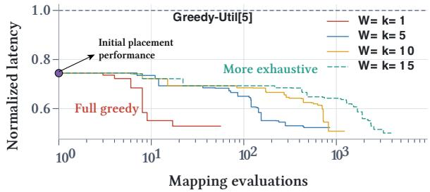  
Figure 10. Optimization curves illustrating latency improve-<sub>men</sub>t d<sub>ur</sub>i<sub>ng</sub> th<sub>e re</sub>fi<sub>nemen</sub>t <sub>p</sub>h<sub>ase w</sub>ith dif<sub>eren</sub>t b<sub>eam searc</sub>h <sub>parame</sub>t<sub>ers</sub> � <sub>an</sub>d �<sub>.</sub> Th<sub>e</sub> t<sub>arge</sub>t <sub>wor</sub>kl<sub>oa</sub>d i<sub>s</sub> Ll<sub>ama</sub> 70B <sub>w</sub>ith <sub>a</sub> b<sub>a</sub>t<sub>c</sub>h <sub>s</sub>i<sub>ze o</sub>f 8<sub>.</sub>

## 6.5 Mapping implications on end-to-end latency

Whil<sub>e</sub> th<sub>e prece</sub>di<sub>ng resu</sub>lt<sub>s</sub> d<sub>emons</sub>t<sub>ra</sub>t<sub>e su</sub>b<sub>s</sub>t<sub>an</sub>ti<sub>a</sub>l th<sub>roug</sub>h<sub>-</sub> <sub>p</sub>ut <sub>g</sub>ains for MVMs<sub>,</sub> we now examine how these <sub>g</sub>ains <sub>p</sub>ro<sub>p</sub>a-<sub>g</sub>ate to end-to-end decodin<sub>g p</sub>erformance. In this section<sub>,</sub> we <sub>p</sub>resent s<sub>y</sub>stem-level simulation results that <sub>p</sub>air the 3D-IMC <sub>acce</sub>l<sub>e</sub>r<sub>a</sub>t<sub>o</sub>r <sub>w</sub>ith <sub>va</sub>ri<sub>ous</sub> GPU<sub>s ope</sub>r<sub>a</sub>tin<sub>g as a</sub>tt<sub>e</sub>nti<sub>o</sub>n <sub>u</sub>nit<sub>s.</sub> D<sub>ue</sub> t<sub>o</sub> Amd<sub>a</sub>hl’<sub>s</sub> l<sub>aw, a su</sub>b<sub>s</sub>t<sub>a</sub>nti<sub>a</sub>l <sub>spee</sub>d<sub>up</sub> in th<sub>e</sub> 3D-IMC <sub>acce</sub>l<sub>era</sub>t<sub>or</sub> h<sub>as</sub> li<sub>m</sub>it<sub>e</sub>d i<sub>mpac</sub>t <sub>on en</sub>d<sub>-</sub>t<sub>o-en</sub>d <sub>per</sub>f<sub>ormance</sub> when KV loadin<sub>g</sub> and attention com<sub>p</sub>utation dominate the inference runtime. Fi<sub>g</sub>ure 11 <sub>p</sub>resents the end-to-end s<sub>p</sub>eedu<sub>p</sub>s over 2×A100/H100 GPU baselines across 3D-IMC-enabled <sub>sys</sub>t<sub>ems comp</sub>l<sub>emen</sub>t<sub>e</sub>d <sub>w</sub>ith dif<sub>eren</sub>t <sub>a</sub>tt<sub>en</sub>ti<sub>on un</sub>it<sub>s an</sub>d <sub>se-</sub> <sub>que</sub>n<sub>ce</sub> l<sub>e</sub>n<sub>g</sub>th<sub>s</sub> f<sub>o</sub>r Gr<sub>ee</sub>d<sub>y</sub>-Util <sub>a</sub>nd CAMP<sub>.</sub> With <sub>a</sub>n A100 <sub>a</sub>ttention unit and a se<sub>q</sub>uence len<sub>g</sub>th of 4096<sub>,</sub> wei<sub>g</sub>ht-ma<sub>pp</sub>in<sub>g</sub> o<sub>p</sub>timization <sub>p</sub>rovides minimal throu<sub>g</sub>h<sub>p</sub>ut im<sub>p</sub>rovement b<sub>ecause a</sub>tt<sub>e</sub>nti<sub>o</sub>n d<sub>o</sub>min<sub>a</sub>t<sub>es</sub> inf<sub>e</sub>r<sub>e</sub>n<sub>ce</sub> r<sub>u</sub>ntim<sub>e.</sub> R<sub>e</sub>d<sub>uc</sub>in<sub>g</sub> se<sub>q</sub>uence len<sub>g</sub>th<sub>,</sub> for exam<sub>p</sub>le throu<sub>g</sub>h KV-cache com<sub>p</sub>action <sub>or</sub> b<sub>y</sub> t<sub>arge</sub>ti<sub>ng s</sub>h<sub>or</sub>t<sub>er-con</sub>t<sub>ex</sub>t <sub>wor</sub>kl<sub>oa</sub>d<sub>s,</sub> i<sub>ncreases</sub> th<sub>e</sub> b<sub>en-</sub> <sub>e</sub>fit: <sub>a</sub>t <sub>a</sub> <sub>seque</sub>n<sub>ce</sub> l<sub>e</sub>n<sub>g</sub>th <sub>o</sub>f 128<sub>,</sub> CAMP r<sub>a</sub>i<sub>ses</sub> th<sub>e</sub> 3D-IMC + A100 s<sub>p</sub>eedu<sub>p</sub> over baseline to 5.5×, com<sub>p</sub>ared to 4.4× with Greed<sub>y</sub>-Util. More <sub>p</sub>o<sub>w</sub>erf<sub>u</sub>l GPUs<sub>,</sub> red<sub>u</sub>ced-<sub>p</sub>recision KV cachin<sub>g,</sub> and sharin<sub>g</sub> the 3D-IMC accelerator across multi<sub>p</sub>le GPUs f<sub>u</sub>rther balance attention and MVM o<sub>v</sub>erheads. Wh<sub>en</sub> b<sub>a</sub>t<sub>c</sub>h<sub>es</sub> f<sub>rom</sub> dif<sub>eren</sub>t GPU<sub>s are</sub> i<sub>n</sub>t<sub>er</sub>l<sub>eave</sub>d f<sub>or execu-</sub> ti<sub>o</sub>n <sub>o</sub>f th<sub>e</sub>ir MVM<sub>s o</sub>n th<sub>e</sub> 3D-IMC <sub>acce</sub>l<sub>e</sub>r<sub>a</sub>t<sub>o</sub>r<sub>,</sub> AIMC-<sub>s</sub>id<sub>e</sub> <sub>u</sub>tiliz<sub>a</sub>ti<sub>o</sub>n in<sub>c</sub>r<sub>eases,</sub> m<sub>a</sub>kin<sub>g</sub> <sub>we</sub>i<sub>g</sub>ht-m<sub>app</sub>in<sub>g</sub> <sub>op</sub>timiz<sub>a</sub>ti<sub>o</sub>n even more <sup>i</sup>m<sub>p</sub>ortant. <sup>A</sup><sub>pp</sub><sup>l</sup><sub>y</sub><sup>i</sup>n<sub>g</sub> t<sup>h</sup>ese strate<sub>g</sub><sup>i</sup>es to<sub>g</sub>et<sup>h</sup>er translates 3D-IMC accelerator throu<sub>g</sub>h<sub>p</sub>ut <sub>g</sub>ains to a 16.3× end-to-end throu<sub>g</sub>h<sub>p</sub>ut im<sub>p</sub>rovement over the GPU baseline at a se<sub>q</sub>uence len<sub>g</sub>th of 4096, u<sub>p</sub> from 12.7× for Greed<sub>y</sub>-Util.

B<sub>ecause</sub> KV l<sub>oa</sub>di<sub>ng</sub> b<sub>o</sub>ttl<sub>enec</sub>k<sub>s near</sub>l<sub>y a</sub>ll i<sub>n</sub>f<sub>erence s</sub>t<sub>ac</sub>k<sub>s</sub> <sub>a</sub>t l<sub>ong</sub> <sub>con</sub>t<sub>ex</sub>t<sub>,</sub> <sub>many</sub> <sub>wor</sub>k<sub>s</sub> <sub>a</sub>dd<sub>ress</sub> it di<sub>rec</sub>tl<sub>y</sub> th<sub>roug</sub>h KV com<sub>p</sub>ression [38, 45, 48], memor<sub>y</sub>-centric accelerators [12, 15, 29], and architectural alternatives such as SSMs [11]. As th<sub>ese</sub> t<sub>ec</sub>h<sub>n</sub>i<sub>ques</sub> <sub>re</sub>li<sub>eve</sub> th<sub>e</sub> KV b<sub>o</sub>ttl<sub>enec</sub>k<sub>,</sub> th<sub>e</sub> <sub>s</sub>h<sub>are</sub> <sub>o</sub>f <sub>en</sub>d<sub>-</sub> to-end latenc<sub>y</sub> <sub>g</sub>overned b<sub>y</sub> wei<sub>g</sub>ht ma<sub>pp</sub>in<sub>g</sub> <sub>g</sub>rows<sub>,</sub> further reinforcin<sub>g</sub> its im<sub>p</sub>ortance. Moreo<sub>v</sub>er<sub>,</sub> short-se<sub>qu</sub>ence <sub>u</sub>se <sub>cases s</sub>h<sub>ou</sub>ld <sub>no</sub>t b<sub>e un</sub>d<sub>eres</sub>ti<sub>ma</sub>t<sub>e</sub>d<sub>.</sub> E<sub>ven</sub> t<sub>o</sub>d<sub>ay,</sub> th<sub>e</sub> MVM<sub>-</sub> bound re<sub>g</sub>imes which benefit from o<sub>p</sub>timized ma<sub>pp</sub>in<sub>g</sub> cover im<sub>p</sub>ortant de<sub>p</sub>lo<sub>y</sub>ments<sub>,</sub> includin<sub>g</sub> ed<sub>g</sub>e assistants<sub>,</sub> shortform Question Answering (QA), and classification, where re<sub>q</sub>uests are short (e.<sub>g</sub>., 99% of Al<sub>p</sub>aca [39] <sub>p</sub>rom<sub>p</sub>ts contain fewer than 114 tokens).

## 7 Related work

3D-IMC is an emer<sub>g</sub>in<sub>g</sub> com<sub>p</sub>utin<sub>g</sub> <sub>p</sub>aradi<sub>g</sub>m whose archit<sub>ec</sub>t<sub>ura</sub>l <sub>an</sub>d <sub>sys</sub>t<sub>em-</sub>l<sub>eve</sub>l d<sub>es</sub>i<sub>gn pr</sub>i<sub>nc</sub>i<sub>p</sub>l<sub>es are s</sub>till <sub>un</sub>d<sub>er</sub> active ex<sub>p</sub>loration [3, 5, 10, 20, 25, 36, 37]. Des<sub>p</sub>ite brin<sub>g</sub>in<sub>g</sub> si<sub>g</sub>nificant im<sub>p</sub>ro<sub>v</sub>ements to the 3D-IMC domain from architectural [37], dataflow [20], and a<sub>pp</sub>lication [10] <sub>p</sub>ers<sub>p</sub>ectives, a lar<sub>g</sub>e <sub>p</sub>ortion of the <sub>p</sub>rior art does not reveal s<sub>p</sub>ecific wei<sub>g</sub>ht ma<sub>pp</sub>in<sub>g</sub> details.

Amon<sub>g</sub> concrete wei<sub>g</sub>ht ma<sub>pp</sub>in<sub>g</sub> contributions in the literature, 3D-aCortex [3] stands out as one of the <sub>p</sub>ioneerin<sub>g</sub> works in this domain<sub>,</sub> levera<sub>g</sub>in<sub>g</sub> 3D-NAND flash arra<sub>y</sub>s for Dee<sub>p</sub> Neural Network (DNN) acceleration. In addition, our <sub>p</sub>rimar<sub>y</sub> baseline<sub>,</sub> Greed<sub>y</sub>-Util<sub>,</sub> is based on the ma<sub>pp</sub>in<sub>g</sub> methodolo<sub>gy</sub> <sub>p</sub>ro<sub>p</sub>osed in [5]. That work <sub>p</sub>ioneers the use of 3D-IMC for MoE workloads b<sub>y</sub> ex<sub>p</sub>loitin<sub>g</sub> the ali<sub>g</sub>nment b<sub>e</sub>t<sub>ween</sub> th<sub>e sparse compu</sub>t<sub>a</sub>ti<sub>ona</sub>l <sub>s</sub>t<sub>ruc</sub>t<sub>ure o</sub>f M<sub>o</sub>E<sub>s an</sub>d th<sub>e</sub> com<sub>pu</sub>te-stora<sub>g</sub>e ca<sub>p</sub>acit<sub>y</sub> imbalance inherent in 3D-IMC.

PackM<sub>y</sub>Wei<sub>g</sub>hts [17] is a ma<sub>pp</sub>in<sub>g</sub> work in the IMC do-<sub>ma</sub>i<sub>n</sub> th<sub>a</sub>t <sub>compares</sub> “<sub>s</sub>t<sub>ac</sub>k<sub>e</sub>d” <sub>an</sub>d “fl<sub>a</sub>tt<sub>ene</sub>d” <sub>mapp</sub>i<sub>ng</sub> l<sub>ay-</sub> o<sub>u</sub>ts to fit as man<sub>y w</sub>ei<sub>g</sub>hts as <sub>p</sub>ossible into SRAM IMC and thereb<sub>y</sub> avoid wei<sub>g</sub>ht-reloadin<sub>g</sub> costs. HD-MoE [18] tar<sub>g</sub>ets 3D-DRAM n<sub>ea</sub>r-m<sub>e</sub>m<sub>o</sub>r<sub>y p</sub>r<sub>ocess</sub>in<sub>g a</sub>nd <sub>op</sub>timiz<sub>es</sub> th<sub>e</sub> tr<sub>a</sub>d<sub>e</sub>- <sub>o</sub>f b<sub>e</sub>t<sub>wee</sub>n TP <sub>a</sub>nd EP <sub>us</sub>in<sub>g a</sub> Mix<sub>e</sub>d-Int<sub>ege</sub>r Lin<sub>ea</sub>r Pr<sub>o</sub>- <sub>g</sub>rammin<sub>g</sub> (MILP)-based method. As these works are <sub>p</sub>ro-<sub>pose</sub>d f<sub>or</sub> dif<sub>eren</sub>t <sub>memory</sub> t<sub>ec</sub>h<sub>no</sub>l<sub>og</sub>i<sub>es,</sub> th<sub>e</sub>i<sub>r</sub> <sub>compu</sub>t<sub>e</sub> <sub>con-</sub> <sub>s</sub>tr<sub>a</sub>int<sub>s a</sub>nd <sub>co</sub>mm<sub>u</sub>ni<sub>ca</sub>ti<sub>o</sub>n <sub>c</sub>h<sub>a</sub>r<sub>ac</sub>t<sub>e</sub>ri<sub>s</sub>ti<sub>cs</sub> dif<sub>e</sub>r fr<sub>o</sub>m <sub>ou</sub>r<sub>s,</sub> <sub>w</sub>hi<sub>c</sub>h limit<sub>s</sub> th<sub>e</sub>ir <sub>app</sub>li<sub>ca</sub>bilit<sub>y</sub> t<sub>o</sub> 3D-NVM-b<sub>ase</sub>d AIMC<sub>.</sub> In th<sub>e</sub> d<sub>o</sub>m<sub>a</sub>in <sub>o</sub>f NVM-b<sub>ase</sub>d 3D-IMC<sub>,</sub> CAMP i<sub>s,</sub> t<sub>o</sub> th<sub>e</sub> b<sub>es</sub>t <sub>o</sub>f <sub>our</sub> k<sub>now</sub>l<sub>e</sub>d<sub>ge,</sub> th<sub>e</sub> fi<sub>rs</sub>t <sub>wor</sub>k th<sub>a</sub>t t<sub>arge</sub>t<sub>s</sub> <sub>we</sub>i<sub>g</sub>ht <sub>mapp</sub>i<sub>ng</sub> <sub>op</sub>ti<sub>m</sub>i<sub>za</sub>ti<sub>on</sub> <sub>a</sub>t thi<sub>s</sub> <sub>sca</sub>l<sub>e</sub> <sub>o</sub>f <sub>ro</sub>b<sub>us</sub>t<sub>ness</sub> <sub>an</sub>d <sub>e</sub>fi<sub>c</sub>i<sub>ency.</sub>

## 8 Conclusion

CAMP <sub>a</sub>d<sub>ap</sub>t<sub>s</sub> t<sub>o</sub> th<sub>e</sub> <sub>e</sub>x<sub>pec</sub>t<sub>e</sub>d LLM inf<sub>e</sub>r<sub>e</sub>n<sub>ce</sub> <sub>co</sub>nt<sub>e</sub>xt t<sub>o</sub> m<sub>a</sub>ximiz<sub>e</sub> <sub>co</sub>m<sub>pu</sub>t<sub>e</sub> <sub>u</sub>tiliz<sub>a</sub>ti<sub>o</sub>n in 3D-IMC-b<sub>ase</sub>d LLM <sub>acce</sub>l-<sub>era</sub>t<sub>ors</sub> b<sub>y exp</sub>l<sub>o</sub>iti<sub>ng ava</sub>il<sub>a</sub>bl<sub>e</sub> t<sub>ensor-,</sub> b<sub>a</sub>t<sub>c</sub>h<sub>-, an</sub>d <sub>exper</sub>t<sub>-</sub> <sub>p</sub>arallelism o<sub>pp</sub>ortunities. After encodin<sub>g</sub> the inference context in a conflict matrix<sub>,</sub> CAMP <sub>u</sub>ses a <sub>p</sub>rofilin<sub>g</sub>-dri<sub>v</sub>en feedb<sub>ac</sub>k <sub>process</sub> t<sub>o</sub> t<sub>une we</sub>i<sub>g</sub>ht <sub>p</sub>l<sub>acemen</sub>t <sub>an</sub>d i<sub>mprove</sub> th<sub>roug</sub>h<sub>-</sub> <sub>p</sub>ut over context-a<sub>g</sub>nostic ma<sub>pp</sub>in<sub>g</sub> baselines. Our ex<sub>p</sub>eriments show that static MVM throu<sub>g</sub>h<sub>p</sub>ut increases b<sub>y</sub> u<sub>p</sub> to 2.0× and that much of this im<sub>p</sub>rovement <sub>p</sub>ro<sub>p</sub>a<sub>g</sub>ates to <sub>en</sub>d<sub>-</sub>t<sub>o-en</sub>d <sub>per</sub>f<sub>ormance w</sub>h<sub>en</sub> th<sub>e sys</sub>t<sub>em</sub> i<sub>nc</sub>l<sub>u</sub>d<sub>es e</sub>fi<sub>c</sub>i<sub>en</sub>t

Orhun Görkem, Athanasios Vasilopoulos, Georgios Pagonis, Victoria Clerico, Hadjer Benmeziane, Irem Boybat, Hsinyu Tsai, Abu Sebastian, and William Andrew Simon

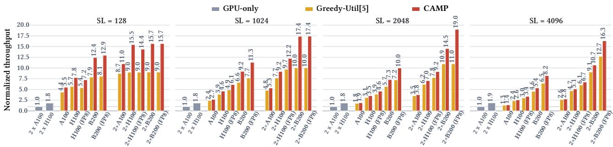  
Figure 11. End-to-end decode phase speedup of Llama 70B with a 3D-IMC accelerator paired with various attention units, relative to the 2×A100/H100 GPU baselines. Batch sizes of 16/16/64 are utilized for A100/H100/B200 GPUs, res<sub>p</sub>ectivel<sub>y</sub>. In the 2-GPU <sub>sys</sub>t<sub>e</sub>m<sub>s, o</sub>n<sub>e</sub> 3D-IMC <sub>acce</sub>l<sub>e</sub>r<sub>a</sub>t<sub>o</sub>r i<sub>s s</sub>h<sub>a</sub>r<sub>e</sub>d b<sub>e</sub>t<sub>wee</sub>n t<sub>wo</sub> GPU<sub>s, eac</sub>h <sub>se</sub>r<sub>v</sub>in<sub>g</sub> th<sub>e a</sub>b<sub>ove</sub>-m<sub>e</sub>nti<sub>o</sub>n<sub>e</sub>d b<sub>a</sub>t<sub>c</sub>h <sub>s</sub>iz<sub>es.</sub>

disa<sub>gg</sub>re<sub>g</sub>ated attention units. These <sub>g</sub>ains re<sub>q</sub>uire onl<sub>y</sub> an <sub>o</sub>fli<sub>ne so</sub>ft<sub>ware so</sub>l<sub>u</sub>ti<sub>on an</sub>d <sub>no</sub> h<sub>ar</sub>d<sub>ware mo</sub>difi<sub>ca</sub>ti<sub>ons.</sub>

## Acknowledgments

G<sub>e</sub>n<sub>e</sub>r<sub>a</sub>ti<sub>ve</sub> AI <sub>was</sub> <sub>u</sub>tiliz<sub>e</sub>d t<sub>o</sub> <sub>ass</sub>i<sub>s</sub>t in d<sub>eve</sub>l<sub>op</sub>m<sub>e</sub>nt <sub>o</sub>f <sub>co</sub>d<sub>e</sub> and for <sub>g</sub>rammatical and t<sub>yp</sub>o<sub>g</sub>ra<sub>p</sub>hical <sub>p</sub>roofreadin<sub>g,</sub> not for writin<sub>g</sub>. The authors <sub>p</sub>erformed due dili<sub>g</sub>ence in verif<sub>y</sub>in<sub>g</sub> g<sup>enerated</sup> <sup>out</sup>p<sup>ut.</sup>

## References

[1] K<sub>y</sub>le Aubre<sub>y</sub> and Farshad Ghodsian. 2026. Inside NVIDIA Gro<sub>q</sub> 3 LPX: Th<sub>e</sub> L<sub>ow</sub>-L<sub>a</sub>t<sub>e</sub>n<sub>cy</sub> Inf<sub>e</sub>r<sub>e</sub>n<sub>ce</sub> A<sub>cce</sub>l<sub>e</sub>r<sub>a</sub>t<sub>o</sub>r f<sub>o</sub>r th<sub>e</sub> NVIDIA V<sub>e</sub>r<sub>a</sub> Rubin Platform. htps://developer.nvidia.com/blog/inside-nvidiagroq-3-lpx-the-low-latency-inference-accelerator-for-the-nvidiavera-rubin-platform/ NVIDIA Technical Blog.

[2] Jinze Bai, Shuai Bai, Yunfei Chu, Ze<sub>y</sub>u Cui, Kai Dan<sub>g</sub>, Xiaodon<sub>g</sub> Den<sub>g</sub>, Yan<sub>g</sub> Fan, Wenbin Ge, Yu Han, Fei Huan<sub>g</sub>, Bin<sub>y</sub>uan Hui, Luo Ji, Mei Li, Junyang Lin, Runji Lin, Dayiheng Liu, Gao Liu, Chengqiang Lu, Kemin<sub>g</sub> Lu, Jianxin Ma, Rui Men, Xin<sub>g</sub>zhan<sub>g</sub> Ren, Xuanchen<sub>g</sub> Ren, Chuanqi Tan, Sinan Tan, Jianhong Tu, Peng Wang, Shijie Wang, Wei Wan<sub>g</sub>, Shen<sub>gg</sub>uan<sub>g</sub> Wu, Benfen<sub>g</sub> Xu, Jin Xu, An Yan<sub>g</sub>, Hao Yan<sub>g</sub>, Jian Yan<sub>g</sub>, Shushen<sub>g</sub> Yan<sub>g</sub>, Yan<sub>g</sub> Yao, Bowen Yu, Hon<sub>gy</sub>i Yuan, Zhen<sub>g</sub> Yuan, Jianwei Zhan<sub>g</sub>, Xin<sub>g</sub>xuan Zhan<sub>g</sub>, Yichan<sub>g</sub> Zhan<sub>g</sub>, Zhenru Zhan<sub>g</sub>, Chan<sub>g</sub> Zhou, Jin<sub>g</sub>ren Zhou, Xiaohuan Zhou, and Tianhan<sub>g</sub> Zhu. 2023. Qwen Technical Report. arXiv:2309.16609 [cs.CL] htps://arxiv.org/ abs/2309.16609

[3] Mohammad Bavand<sub>p</sub>our, Shubham Saha<sub>y</sub>, Mohammad Reza Mahm<sub>oo</sub>di<sub>,</sub> <sub>a</sub>nd Dmitri B<sub>.</sub> Str<sub>u</sub>k<sub>ov.</sub> 2019<sub>.</sub> 3D-<sub>a</sub>C<sub>o</sub>rt<sub>e</sub>x: An Ultr<sub>a</sub>-C<sub>o</sub>m<sub>pac</sub>t Ener<sub>gy</sub>-Eficient Ne<sub>u</sub>rocom<sub>pu</sub>tin<sub>g</sub> Platform Based on Commercial 3D NAND Flash Memories. arXiv:1908.02472 [cs.ET] htps://arxiv.org/ abs/1908.02472

[4] Ashish Redd<sub>y</sub> Bommana, Farshad Firouzi, and Krishnendu Ch<sub>a</sub>kr<sub>a</sub>b<sub>a</sub>rt<sub>y.</sub> 2026<sub>.</sub> COMET-3D: C<sub>o</sub>m<sub>pu</sub>t<sub>e</sub>-in-M<sub>e</sub>m<sub>o</sub>r<sub>y</sub>-B<sub>ase</sub>d Tr<sub>a</sub>n<sub>s</sub>f<sub>o</sub>rm<sub>e</sub>r A<sub>cce</sub>l<sub>e</sub>r<sub>a</sub>t<sub>o</sub>r With O<sub>p</sub>timiz<sub>e</sub>d Pi<sub>pe</sub>lin<sub>e a</sub>nd 3D H<sub>e</sub>terogeneous Integration. IEEE Transactions on Computer-Aided Design of Integrated Circuits and Systems 45, 3 (2026), 1418–1431. doi:10.1109/TCAD.2025.3601526

[5] Julian Büchel, Athanasios Vasilo<sub>p</sub>oulos, William Andrew Simon, Irem B<sub>oy</sub>b<sub>a</sub>t<sub>,</sub> H<sub>s</sub>inY<sub>u</sub> T<sub>sa</sub>i<sub>,</sub> G<sub>eo</sub>fr<sub>ey</sub> W<sub>.</sub> B<sub>u</sub>rr<sub>,</sub> H<sub>e</sub>rn<sub>a</sub>n C<sub>as</sub>tr<sub>o,</sub> Bill Fili<sub>p</sub>i<sub>a</sub>k<sub>,</sub> Manue<sup>l</sup> Le Ga<sup>ll</sup>o, A<sup>bb</sup>as Ra<sup>h</sup>imi, Vijay Narayanan, an<sup>d</sup> A<sup>b</sup>u Se<sup>b</sup>astian. 2025<sub>.</sub> Efi<sub>c</sub>i<sub>en</sub>t <sub>sca</sub>li<sub>ng o</sub>f l<sub>arge</sub> l<sub>anguage mo</sub>d<sub>e</sub>l<sub>s w</sub>ith <sub>m</sub>i<sub>x</sub>t<sub>ure o</sub>f experts and 3D analog in-memory computing. Nature Computational Science 5, 1 (01 Jan 2025), 13–26. doi:10.1038/s43588-024-00753-x

[6] Zhixion<sub>g</sub> Chen, Bin<sub>g</sub>jie Zhu, Jian<sub>g</sub>zhou Wan<sub>g</sub>, H<sub>y</sub>undon<sub>g</sub> Shin, Arumu<sub>g</sub>am Nallanathan, and Dusit (Tao) Ni<sub>y</sub>ato. 2026. Network Ed<sub>g</sub>e Inference for Lar<sub>g</sub>e Lan<sub>g</sub>ua<sub>g</sub>e Models: Princi<sub>p</sub>les<sub>,</sub> Techni<sub>q</sub>ues<sub>,</sub> and Opportunities. ACM Comput. Surv. 58, 12, Article 317 (May 2026), 35 pages. doi:10.1145/3809166

[7] Wanik Cho, Chanhui Jeon<sub>g</sub>, Jon<sub>g</sub>woo Kim, Jon<sub>g</sub>seok Jun<sub>g</sub>, Keunseon Ahn, Ja<sub>y</sub>oon Goo, San<sub>g</sub>k<sub>y</sub>u Lee, Ka<sub>y</sub>oun<sub>g</sub> Cho, Tei Cho, Dauni Kim, Gwan Park, Yushin Ahn, Soo<sub>y</sub>eol Chai, Gwihan Ko, Sun<sub>y</sub>oun<sub>g</sub> Jun<sub>g</sub>, Eunwoo Jo, Taehun Park, Jinh<sub>y</sub>un Ban, Cheoljoon<sub>g</sub> Park, Jae H<sub>y</sub>un Park, Sanghoon Oh, Sojin Jeong, Youngjun Kwak, Kyungsoo Jeong, Jin<sub>y</sub>eo<sub>p</sub> Kim, Minchol Shin, Eunho Yan<sub>g</sub>, Taisik Shin, Youn<sub>g</sub>il Kim, Jiseon<sub>g</sub> Mun, Chan<sub>y</sub>an<sub>g</sub> R<sub>y</sub>u, Huih<sub>y</sub>eon Park, Chan<sub>g</sub>wan Ha, Jon<sub>g</sub> Tai Park<sub>,</sub> Pen<sub>g</sub> Zhan<sub>g,</sub> Soo<sub>y</sub>on<sub>g</sub> Park<sub>,</sub> Reza<sub>u</sub>l Ha<sub>qu</sub>e<sub>,</sub> Han<sub>g</sub> Tian<sub>,</sub> S<sub>u</sub>n<sub>g</sub>h<sub>w</sub>a Ok, Wonbeom Choi, Jun<sub>y</sub>oun Lim, Don<sub>g</sub>k<sub>y</sub>u Yoon, Sechun Park, Wons<sub>u</sub>n Park<sub>,</sub> Kichan<sub>g</sub> G<sub>w</sub>on<sub>,</sub> Se<sub>u</sub>n<sub>gp</sub>il Lee<sub>,</sub> H<sub>w</sub>an<sub>g</sub> H<sub>u</sub>h<sub>,</sub> Woo<sub>py</sub>o Jeon<sub>g</sub>, and Jun<sub>g</sub>dal Choi. 2025. A 321-La<sub>y</sub>er 2Tb 4b/cell 3D-NAND-Flash Memory with a 75MB/s Program Throughput. In 2025 IEEE International Solid-State Circuits Conference (ISSCC), Vol. 68. 512–514. doi:10.1109/ISSCC49661.2025.10904748

[8] Jun<sub>y</sub>on<sub>g</sub> Den<sub>g</sub>, Lin Jian<sub>g</sub>, Yun Zhu, Xiao<sub>y</sub>an Xie, Xinchuan<sub>g</sub> Liu, Feilon<sub>g</sub> He, Shuan<sub>g</sub> Son<sub>g</sub>, and Liz<sub>y</sub> Kurian John. 2020. HRM: Ht<sub>ree</sub> b<sub>ase</sub>d <sub>recon</sub>fi<sub>gura</sub>ti<sub>on mec</sub>h<sub>an</sub>i<sub>sm</sub> i<sub>n recon</sub>fi<sub>gura</sub>bl<sub>e</sub> h<sub>omoge-</sub> neous PE array. Journal of Semiconductors 41, 2 (2020), 022402. doi:10.1088/1674-4926/41/2/022402

[9] Prat<sub>y</sub>ush Dhin<sub>g</sub>ra, Janardhan Rao Do<sub>pp</sub>a, and Partha Pratim Pande. 2025<sub>.</sub> Atl<sub>eus</sub>: A<sub>cce</sub>l<sub>e</sub>r<sub>a</sub>tin<sub>g</sub> Tr<sub>a</sub>n<sub>s</sub>f<sub>o</sub>rm<sub>e</sub>r<sub>s</sub> <sub>o</sub>n th<sub>e</sub> Ed<sub>ge</sub> En<sub>a</sub>bl<sub>e</sub>d b<sub>y</sub> 3D Hetero<sub>g</sub>eneous Man<sub>y</sub>core Architectures. arXiv:2501.09588 [cs.AR] htps://arxiv.org/abs/2501.09588

[10] Prat<sub>y</sub>ush Dhin<sub>g</sub>ra, Pramit Kumar Pal, Janardhan Rao Do<sub>pp</sub>a, and P<sub>ar</sub>th<sub>a</sub> P<sub>ra</sub>ti<sub>m</sub> P<sub>an</sub>d<sub>e.</sub> 2026<sub>.</sub> ThAME<sub>:</sub> 3D M<sub>emory-</sub>E<sub>na</sub>bl<sub>e</sub>d H<sub>e</sub>t<sub>e</sub>r<sub>oge</sub>n<sub>eous</sub> A<sub>cce</sub>l<sub>e</sub>r<sub>a</sub>t<sub>o</sub>r f<sub>o</sub>r LLM Mixt<sub>u</sub>r<sub>e o</sub>f Ex<sub>pe</sub>rt<sub>s.</sub> arXiv:2607.17074 [cs.AR] htps://arxiv.org/abs/2607.17074

[11] Albert Gu, Karan Goel, and Christo<sub>p</sub>her Ré. 2022. Eficientl<sub>y</sub> Modelin<sub>g</sub> Lon<sub>g</sub> Se<sub>q</sub>uences with Structured State S<sub>p</sub>aces. arXiv:2111.00396 [cs.LG] htps://arxiv.org/abs/2111.00396

[12] Yufen<sub>g</sub> Gu, Alireza Khadem, Sumanth Umesh, Nin<sub>g</sub> Lian<sub>g</sub>, Xavier S<sub>e</sub>r<sub>vo</sub>t<sub>,</sub> On<sub>u</sub>r M<sub>u</sub>tl<sub>u,</sub> R<sub>av</sub>i I<sub>ye</sub>r<sub>, a</sub>nd R<sub>ee</sub>t<sub>upa</sub>rn<sub>a</sub> D<sub>as.</sub> 2025<sub>.</sub> PIM I<sub>s</sub> All Y<sub>ou</sub> N<sub>ee</sub>d: A CXL-En<sub>a</sub>bl<sub>e</sub>d GPU-Fr<sub>ee</sub> S<sub>ys</sub>t<sub>e</sub>m f<sub>o</sub>r L<sub>a</sub>r<sub>ge</sub> L<sub>a</sub>n<sub>guage</sub> Model Inference. In Proceedings of the 30th ACM International Conference on Architectural Support for Programming Languages and Operating Systems, Volume 2 (Rotterdam, Netherlands) (ASPLOS ’25). A<sub>ssoc</sub>i<sub>a</sub>ti<sub>o</sub>n f<sub>o</sub>r C<sub>o</sub>m<sub>pu</sub>tin<sub>g</sub> M<sub>ac</sub>hin<sub>e</sub>r<sub>y,</sub> N<sub>ew</sub> Y<sub>o</sub>rk<sub>,</sub> NY<sub>,</sub> USA<sub>,</sub> 862–881<sub>.</sub> doi:10.1145/3676641.3716267

[13] Jin<sub>y</sub>an<sub>g</sub> Guo, Jian<sub>y</sub>u Wu, Zinin<sub>g</sub> Wan<sub>g</sub>, Jiahen<sub>g</sub> Liu, Ge Yan<sub>g</sub>, Yifu Ding, Ruihao Gong, Haotong Qin, and Xianglong Liu. 2024. Compressing Large Language Models by Joint Sparsification and Quantization. In Proceedings of the 41st International Conference on Machine Learning (Proceedings ofMachine Learning Research, Vol. 235), Ruslan S<sub>a</sub>l<sub>a</sub>kh<sub>u</sub>tdi<sub>nov,</sub> Zi<sub>co</sub> K<sub>o</sub>lt<sub>er,</sub> K<sub>a</sub>th<sub>er</sub>i<sub>ne</sub> H<sub>e</sub>ll<sub>er,</sub> Ad<sub>r</sub>i<sub>an</sub> W<sub>e</sub>ll<sub>er,</sub> N<sub>ur</sub>i<sub>a</sub> Oliver, Jonathan Scarlett, and Felix Berkenkam<sub>p</sub> (Eds.). PMLR, 16945– 16957. htps://proceedings.mlr.press/v235/guo24g.html

[14] Dan Hendr<sub>y</sub>cks, Collin Burns, Steven Basart, And<sub>y</sub> Zou, Mantas Mazeika, Dawn Son<sub>g</sub>, and Jacob Steinhardt. 2021. Measurin<sub>g</sub> Massive Multitask Language Understanding. In International Conference on Learning Representations (ICLR). htps://openreview.net/forum?id= d7KBjmI3GmQ

[15] Guseul Heo, San<sub>gy</sub>eo<sub>p</sub> Lee, Jaehon<sub>g</sub> Cho, H<sub>y</sub>unmin Choi, San<sub>g</sub>h<sub>y</sub>eon Lee, Hyungkyu Ham, Gwangsun Kim, Divya Mahajan, and Jongse P<sub>a</sub>rk<sub>.</sub> 2024<sub>.</sub> N<sub>eu</sub>PIM<sub>s</sub>: NPU-PIM H<sub>e</sub>t<sub>e</sub>r<sub>oge</sub>n<sub>eous</sub> A<sub>cce</sub>l<sub>e</sub>r<sub>a</sub>ti<sub>o</sub>n f<sub>o</sub>r Batched LLM Inferencing. In Proceedings ofthe 29th ACM International Conference on Architectural Support for Programming Languages and Operating Systems, Volume 3 (La Jolla, CA, USA) (ASPLOS ’24). A<sub>ssoc</sub>i<sub>a</sub>ti<sub>o</sub>n f<sub>o</sub>r C<sub>o</sub>m<sub>pu</sub>tin<sub>g</sub> M<sub>ac</sub>hin<sub>e</sub>r<sub>y,</sub> N<sub>ew</sub> Y<sub>o</sub>rk<sub>,</sub> NY<sub>,</sub> USA<sub>,</sub> 722–737<sub>.</sub> doi:10.1145/3620666.3651380

[16] Mert Hida<sub>y</sub>eto<sub>g</sub>lu, Aurick Qiao, Michael W<sub>y</sub>att, Jef Rasle<sub>y</sub>, Yuxion<sub>g</sub> He, an<sup>d</sup> Samyam Raj<sup>bh</sup>an<sup>d</sup>ari. 2026. S<sup>h</sup>i<sup>f</sup>t Para<sup>ll</sup>e<sup>l</sup>ism: Low-Latency, High-Throughput LLM Inference for Dynamic Workloads. In Proceedings ofthe 31st ACM International Conference on Architectural Support for Programming Languages and Operating Systems, Volume 2 (USA) (ASPLOS ’26). Association for Computing Machinery, New York, NY, USA, 1749–1763. doi:10.1145/3779212.3790219

[17] Pou<sub>y</sub>a Houshmand and Marian Verhelst. 2024. Pack m<sub>y</sub> wei<sub>g</sub>hts and r<sub>u</sub>n! Minimizin<sub>g</sub> overheads for in-memor<sub>y</sub> com<sub>pu</sub>tin<sub>g</sub> accelerators. arXiv:2409.11437 [cs.AR] htps://arxiv.org/abs/2409.11437

[18] Haochen Huan<sub>g</sub>, Shuzhan<sub>g</sub> Zhon<sub>g</sub>, Zhe Zhan<sub>g</sub>, Shuan<sub>g</sub>chen Li, Dimin Ni<sub>u,</sub> H<sub>o</sub>n<sub>g</sub>zh<sub>o</sub>n<sub>g</sub> Zh<sub>e</sub>n<sub>g,</sub> R<sub>u</sub>n<sub>s</sub>h<sub>e</sub>n<sub>g</sub> W<sub>a</sub>n<sub>g, a</sub>nd M<sub>e</sub>n<sub>g</sub> Li<sub>.</sub> 2025<sub>.</sub> HD-M<sub>o</sub>E: H<sub>y</sub>brid <sub>a</sub>nd D<sub>y</sub>n<sub>a</sub>mi<sub>c</sub> P<sub>a</sub>r<sub>a</sub>ll<sub>e</sub>li<sub>s</sub>m f<sub>o</sub>r Mixt<sub>u</sub>r<sub>e</sub>-<sub>o</sub>f-Ex<sub>pe</sub>rt LLM<sub>s</sub> with 3D Near-Memory Processing. arXiv:2509.09420 [cs.PF] htps: //arxiv.org/abs/2509.09420

[19] Shubham Jain, Hsin<sub>y</sub>u Tsai, Chin<sub>g</sub>-Tzu Chen, Ramachandran Mur<sub>a</sub>lidh<sub>a</sub>r<sub>,</sub> Ir<sub>e</sub>m B<sub>oy</sub>b<sub>a</sub>t<sub>,</sub> M<sub>a</sub>rtin M<sub>.</sub> Fr<sub>a</sub>nk<sub>,</sub> St<sub>a</sub>ni<sub>s</sub>ł<sub>aw</sub> W<sub>o</sub>źni<sub>a</sub>k<sub>,</sub> Mi-<sup>l</sup>os Stanisav<sup>l</sup>jevic, Praneet A<sup>d</sup>usumi<sup>ll</sup>i, Pritis<sup>h</sup> Narayanan, Ko<sup>h</sup>ji Hoso<sup>k</sup>awa, Masatos<sup>h</sup>i Is<sup>h</sup>ii, Arvin<sup>d</sup> Kumar, Vijay Narayanan, an<sup>d</sup> Ge ofre<sub>y</sub> W. Burr. 2023. A Hetero<sub>g</sub>eneous and Pro<sub>g</sub>rammable Com<sub>p</sub>ute In-M<sub>e</sub>m<sub>o</sub>r<sub>y</sub> A<sub>cce</sub>l<sub>e</sub>r<sub>a</sub>t<sub>o</sub>r Ar<sub>c</sub>hit<sub>ec</sub>t<sub>u</sub>r<sub>e</sub> f<sub>o</sub>r An<sub>a</sub>l<sub>og</sub>-AI U<sub>s</sub>in<sub>g</sub> D<sub>e</sub>n<sub>se</sub> 2-D Mesh. IEEE Transactions on Very Large Scale Integration (VLSI) Systems 31, 1 (2023), 114–127. doi:10.1109/TVLSI.2022.3221390

[20] Yongjoo Jang, Sangwoo Hwang, Hojin Lee, Sangwoo Jung, Donghun Lee, Wonbo Shim, and Jaeha Kun<sub>g</sub>. 2025. Dissectin<sub>g</sub> and Re-Ar<sub>c</sub>hit<sub>ec</sub>tin<sub>g</sub> 3D NAND Fl<sub>as</sub>h PIM Arr<sub>ays</sub> f<sub>o</sub>r Efi<sub>c</sub>i<sub>e</sub>nt Sin<sub>g</sub>l<sub>e</sub>-B<sub>a</sub>t<sub>c</sub>h T<sub>o</sub> ken Generation in LLMS. In 2025 IEEE 43rd International Conference on Computer Design (ICCD). 237–244. doi:10.1109/ICCD65941.2025.00040

[21] Albert Q. Jian<sub>g</sub>, Alexandre Sabla<sub>y</sub>rolles, Antoine Roux, Arthur Mensch<sub>,</sub> Blanche Savar<sub>y,</sub> Chris Bamford<sub>,</sub> Devendra Sin<sub>g</sub>h Cha<sub>p</sub>lot<sub>,</sub> Die<sub>g</sub>o d<sub>e</sub> l<sub>as</sub> C<sub>asas,</sub> Emm<sub>a</sub> B<sub>ou</sub> H<sub>a</sub>nn<sub>a,</sub> Fl<sub>o</sub>ri<sub>a</sub>n Br<sub>essa</sub>nd<sub>,</sub> Gi<sub>a</sub>nn<sub>a</sub> L<sub>e</sub>n<sub>gye</sub>l<sub>,</sub> G<sub>u</sub>ill<sub>au</sub>m<sub>e</sub> B<sub>ou</sub>r<sub>,</sub> G<sub>u</sub>ill<sub>au</sub>m<sub>e</sub> L<sub>a</sub>m<sub>p</sub>l<sub>e,</sub> Léli<sub>o</sub> R<sub>e</sub>n<sub>a</sub>rd L<sub>avau</sub>d<sub>,</sub> L<sub>uc</sub>il<sub>e</sub> S<sub>au</sub>lni<sub>e</sub>r<sub>,</sub> M<sub>a</sub>ri<sub>e</sub>-Ann<sub>e</sub> L<sub>ac</sub>h<sub>au</sub>x<sub>,</sub> Pi<sub>e</sub>rr<sub>e</sub> St<sub>oc</sub>k<sub>,</sub> S<sub>a</sub>nd<sub>eep</sub> S<sub>u</sub>br<sub>a</sub>m<sub>a</sub>ni<sub>a</sub>n<sub>,</sub> S<sub>op</sub>hi<sub>a</sub> Y<sub>a</sub>n<sub>g,</sub> Sz<sub>y</sub>m<sub>o</sub>n Ant<sub>o</sub>ni<sub>a</sub>k<sub>,</sub> T<sub>eve</sub>n L<sub>e</sub> S<sub>cao,</sub> Thé<sub>op</sub>hil<sub>e</sub> G<sub>e</sub>r<sub>ve</sub>t<sub>,</sub> Thib<sub>au</sub>t L<sub>avr</sub>il<sub>,</sub> Th<sub>omas</sub> W<sub>ang,</sub> Ti<sub>mo</sub>thé<sub>e</sub> L<sub>acro</sub>i<sub>x, an</sub>d Willi<sub>am</sub> El Sayed. 2024. Mixtral of Experts. arXiv:2401.04088 [cs.LG] htps: //arxiv.org/abs/2401.04088

[22] Don<sub>g</sub>wook Kim, Doh<sub>y</sub>un Kim, and Eui-Youn<sub>g</sub> Chun<sub>g</sub>. 2025. CPP: Cl<sub>us</sub>t<sub>e</sub>r<sub>e</sub>d NPU-PIM H<sub>e</sub>t<sub>e</sub>r<sub>oge</sub>n<sub>eous</sub> C<sub>o</sub>m<sub>pu</sub>tin<sub>g</sub> T<sub>opo</sub>l<sub>ogy</sub> f<sub>o</sub>r LLM In ference. In 2025 International Technical Conference on Circuits/Systems, Computers, and Communications (ITC-CSCC). 1–6. doi:10.1109/ITC-CSCC66376.2025.11137596

[23] Woosuk Kwon, Zhuohan Li, Si<sub>y</sub>uan Zhuan<sub>g</sub>, Yin<sub>g</sub> Shen<sub>g</sub>, Lianmin Zhen<sub>g</sub>, Cod<sub>y</sub> Hao Yu, Jose<sub>p</sub>h Gonzalez, Hao Zhan<sub>g</sub>, and Ion Stoica. 2023. Eficient Memor<sub>y</sub> Mana<sub>g</sub>ement for Lar<sub>g</sub>e Lan<sub>g</sub>ua<sub>g</sub>e Model Serving with PagedAttention. In Proceedings ofthe 29th Symposium on Operating Systems Principles (Koblenz, Germany) (SOSP ’23). As-<sub>soc</sub>i<sub>a</sub>ti<sub>o</sub>n f<sub>o</sub>r C<sub>o</sub>m<sub>pu</sub>tin<sub>g</sub> M<sub>ac</sub>hin<sub>e</sub>r<sub>y,</sub> N<sub>ew</sub> Y<sub>o</sub>rk<sub>,</sub> NY<sub>,</sub> USA<sub>,</sub> 611–626<sub>.</sub> doi:10.1145/3600006.3613165

[24] Hao<sub>y</sub>an<sub>g</sub> LI, Yimin<sub>g</sub> Li, Anxin Tian, Tianhao Tan<sub>g</sub>, Zhanchao Xu, Xuejia Chen, Nicole HU, Wei Dong, Li Qing, and Lei Chen. 2025. A Surve<sub>y</sub> on Lar<sub>g</sub>e Lan<sub>g</sub>ua<sub>g</sub>e Model Acceleration based on KV Cache Management. Transactions on Machine Learning Research (2025). htps: //openreview.net/forum?id=z3JZzu9EA3

[25] Fanzi Meng, Xiapeng Xu, Tianze Wu, Xinxin Xu, Xiaojiang Guo, Qiang T<sub>a</sub>n<sub>g,</sub> <sub>a</sub>nd Li<sub>a</sub>n<sub>g</sub> Zh<sub>ao.</sub> 2025<sub>.</sub> N<sub>a</sub>ndPIM: An O<sub>p</sub>timiz<sub>a</sub>ti<sub>o</sub>n Fr<sub>a</sub>m<sub>e</sub>- <sub>wo</sub>rk f<sub>o</sub>r 2D/3D NAND-B<sub>ase</sub>d PIM F<sub>ea</sub>t<sub>u</sub>rin<sub>g</sub> G<sub>e</sub>n<sub>e</sub>ti<sub>c</sub> Al<sub>go</sub>rithm-b<sub>ase</sub>d Search of Design Space. In 2025 International Symposium of Electronics Design Automation (ISEDA). 132–137. doi:10.1109/ISEDA65950.2025. 11101657

[26] Mohammad Mozafari, Amir Yazdanbakhsh, and Mar<sub>y</sub>am Mehri Dehnavi. 2025. SLiM: One-shot Quantization and Spar-<sub>s</sub>it<sub>y w</sub>ith L<sub>ow</sub>-r<sub>a</sub>nk A<sub>pp</sub>r<sub>o</sub>xim<sub>a</sub>ti<sub>o</sub>n f<sub>o</sub>r LLM W<sub>e</sub>i<sub>g</sub>ht C<sub>o</sub>m<sub>p</sub>r<sub>ess</sub>i<sub>o</sub>n<sub>.</sub> In Proceedings ofthe 42nd International Conference on Machine Learning (Proceedings of Machine Learning Research, Vol. 267), Aarti Singh, Mar<sub>y</sub>am Fazel, Daniel Hsu, Simon Lacoste-Julien, Felix Berkenkam<sub>p</sub>, Te<sub>g</sub>an Maharaj, Kiri Wa<sub>g</sub>staf, and Jerr<sub>y</sub> Zhu (Eds.). PMLR, 45024–45049. htps://proceedings.mlr.press/v267/mozafari25a.html

[27] Humza Naveed, Asad Ullah Khan, Shi Qiu, Muhammad Sa<sub>q</sub>ib, Saeed Anwar, Mu<sup>h</sup>amma<sup>d</sup> Usman, Navee<sup>d</sup> A<sup>kh</sup>tar, Nic<sup>k</sup> Barnes, an<sup>d</sup> Ajma<sup>l</sup> Mian. 2024. A Com<sub>p</sub>rehensi<sub>v</sub>e O<sub>v</sub>er<sub>v</sub>ie<sub>w</sub> of Lar<sub>g</sub>e Lan<sub>gu</sub>a<sub>g</sub>e Models. arXiv:2307.06435 [cs.CL] htps://arxiv.org/abs/2307.06435

[28] Yue Pan, Zihan Xia, Po-Kai Hsu, Lanxian<sub>g</sub> Hu, H<sub>y</sub>un<sub>gy</sub>o Kim, Janak S<sup>h</sup>ar<sup>d</sup>a, Minxuan Z<sup>h</sup>ou, Nam Sung Kim, S<sup>h</sup>imeng Yu, Tajana Rosing, and Min<sub>gu</sub> Kan<sub>g</sub>. 2025. Strat<sub>u</sub>m: S<sub>y</sub>stem-Hard<sub>w</sub>are Co-Desi<sub>g</sub>n <sub>w</sub>ith Ti<sub>e</sub>r<sub>e</sub>d M<sub>o</sub>n<sub>o</sub>lithi<sub>c</sub> 3D-St<sub>ac</sub>k<sub>a</sub>bl<sub>e</sub> DRAM f<sub>o</sub>r Efi<sub>c</sub>i<sub>e</sub>nt M<sub>o</sub>E S<sub>e</sub>r<sub>v</sub>in<sub>g.</sub> In Proceedings of the 58th IEEE/ACM International Symposium on Microarchitecture (MICRO ’25). Association for Computing Machinery, New York, NY, USA, 1–17. doi:10.1145/3725843.3756043

[29] Jaeh<sub>y</sub>un Park, Jaewan Choi, Kwanhee K<sub>y</sub>un<sub>g</sub>, Michael Jaemin Kim, Yon<sub>g</sub>suk Kwon, Nam Sun<sub>g</sub> Kim, and Jun<sub>g</sub> Ho Ahn. 2024. AttAcc! U<sub>n</sub>l<sub>eas</sub>hi<sub>ng</sub> th<sub>e</sub> P<sub>ower o</sub>f PIM f<sub>or</sub> B<sub>a</sub>t<sub>c</sub>h<sub>e</sub>d T<sub>rans</sub>f<sub>ormer-</sub>b<sub>ase</sub>d G<sub>ener-</sub> ative Model Inference. In Proceedings of the 29th ACM International Conference on Architectural Support for Programming Languages and Operating Systems, Volume 2 (La Jolla, CA, USA) (ASPLOS ’24). As-<sub>soc</sub>i<sub>a</sub>ti<sub>o</sub>n f<sub>o</sub>r C<sub>o</sub>m<sub>pu</sub>tin<sub>g</sub> M<sub>ac</sub>hin<sub>e</sub>r<sub>y,</sub> N<sub>ew</sub> Y<sub>o</sub>rk<sub>,</sub> NY<sub>,</sub> USA<sub>,</sub> 103–119<sub>.</sub> doi:10.1145/3620665.3640422

[30] Xin<sub>y</sub>u Qu, Zehua Zhan<sub>g</sub>, Runnan Xu, and Yufei Ma. 2025. 3D-MoE: A<sub>cce</sub>l<sub>e</sub>r<sub>a</sub>tin<sub>g</sub> M<sub>u</sub>lti-Ex<sub>pe</sub>rt A<sub>c</sub>ti<sub>va</sub>t<sub>e</sub>d LLM<sub>s</sub> <sub>o</sub>n 3D In/N<sub>ea</sub>r-M<sub>e</sub>m<sub>o</sub>r<sub>y</sub> Computing Architecture via Hybrid Parallelism. In 2025 IEEE/ACM International Conference On Computer Aided Design (ICCAD). 1–9. doi:10.1109/ICCAD66269.2025.11240872

[31] Abu Sebastian, Manuel Le Gallo, Riad Khaddam-Aljameh, and Evan-<sub>g</sub>elos Eleftheriou. 2020. Memor<sub>y</sub> devices and a<sub>pp</sub>lications for inmemory computing. Nature Nanotechnology 15, 7 (2020), 529–544. doi:10.1038/s41565-020-0655-z

[32] Seon<sub>g</sub> Hoon Seo,Jun<sub>g</sub>hoon Kim, Don<sub>g</sub>h<sub>y</sub>un Lee, Seonah Yoo, Seokwon Moon, Yeonhon<sub>g</sub> Park, and Jae W. Lee. 2025. FACIL: Flexible DRAM Address Ma<sub>pp</sub>in<sub>g</sub> for SoC-PIM Coo<sub>p</sub>erati<sub>v</sub>e On-de<sub>v</sub>ice LLM Inference. In 2025 IEEE International Symposium on High Performance Computer Architecture (HPCA). 1720–1733. doi:10.1109/HPCA61900.2025.00127

[33] Yakun So<sub>p</sub>hia Shao, Jason Clemons, Ran<sub>g</sub>harajan Venkatesan, Brian Zimmer, Matthew Fojtik, Nan Jiang, Ben Keller, Alicia Klinefelter, Nathaniel Pinckne<sub>y,</sub> Pri<sub>y</sub>anka Raina<sub>,</sub> Ste<sub>p</sub>hen G. Tell<sub>,</sub> Yan<sub>q</sub>in<sub>g</sub> Zhan<sub>g,</sub> William J. Dall<sub>y</sub>, Joel Emer, C. Thomas Gra<sub>y</sub>, Brucek Khailan<sub>y</sub>, and Ste<sub>p</sub>hen W. Keckler. 2019. Simba: Scalin<sub>g</sub> Dee<sub>p</sub>-Learnin<sub>g</sub> Inference

with Multi-Chip-Module-Based Architecture. In Proceedings of the 52nd Annual IEEE/ACM International Symposium on Microarchitecture (Columbus, OH, USA) (MICRO-52). Association for Computing Machinery, New York, NY, USA, 14–27. doi:10.1145/3352460.3358302

[34] Noam Shazeer. 2019. Fast Transformer Decodin<sub>g</sub>: One Write-Head is All You Need. arXiv:1911.02150 [cs.NE] htps://arxiv.org/abs/1911. 02150

[35] Noam Shazeer, \*Azalia Mirhoseini, \*Krz<sub>y</sub>sztof Maziarz, And<sub>y</sub> Davis, Quoc Le, Geofrey Hinton, and Jef Dean. 2017. Outrageously Large Neural Networks: The Sparsely-Gated Mixture-of-Experts Layer. In International Conference on Learning Representations. htps://openreview. net/forum?id=B1ckMDqlg

[36] Wonbo Shim, Hon<sub>g</sub>wu Jian<sub>g</sub>, Xiaochen Pen<sub>g</sub>, and Shimen<sub>g</sub> Yu. 2021. Ar<sub>c</sub>hit<sub>ec</sub>t<sub>u</sub>r<sub>a</sub>l D<sub>es</sub>i<sub>g</sub>n <sub>o</sub>f 3D NAND Fl<sub>as</sub>h b<sub>ase</sub>d C<sub>o</sub>m<sub>pu</sub>t<sub>e</sub>-in-M<sub>e</sub>m<sub>o</sub>r<sub>y</sub> for Inference Engine. In Proceedings of the International Symposium on Memory Systems (Washington, DC, USA) (MEMSYS ’20). Association for Computing Machinery, New York, NY, USA, 77–85. doi:10.1145/ 3422575.3422779

[37] Wonbo Shim and Shimen<sub>g</sub> Yu. 2021. S<sub>y</sub>stem-Technolo<sub>gy</sub> Codesi<sub>g</sub>n of 3-D NAND Flash-Based Compute-in-Memory Inference Engine. IEEE Journal on Exploratory Solid-State Computational Devices and Circuits 7, 1 (2021), 61–69. doi:10.1109/JXCDC.2021.3093772

[38] Hanshi Sun, Li-Wen Chan<sub>g</sub>, Wenlei Bao, Size Zhen<sub>g</sub>, Nin<sub>g</sub>xin Zhen<sub>g</sub>, Xin Liu, Harry Dong, Yuejie C<sup>h</sup>i, an<sup>d</sup> Bei<sup>d</sup>i C<sup>h</sup>en. 2025. S<sup>h</sup>a<sup>d</sup>owKV: KV Cache in Shado<sub>w</sub>s for Hi<sub>g</sub>h-Thro<sub>ug</sub>h<sub>pu</sub>t Lon<sub>g</sub>-Context LLM Inference. In Proceedings ofthe 42nd International Conference on Machine Learning (Proceedings of Machine Learning Research, Vol. 267), Aarti Singh, Mar<sub>y</sub>am Fazel, Daniel Hsu, Simon Lacoste-Julien, Felix Berkenkam<sub>p</sub>, Te<sub>g</sub>an Maharaj, Kiri Wa<sub>g</sub>staf, and Jerr<sub>y</sub> Zhu (Eds.). PMLR, 57355– 57373. htps://proceedings.mlr.press/v267/sun25b.html

[39] Rohan Taori, Ishaan Gulrajani, Tian<sub>y</sub>i Zhan<sub>g</sub>, Yann Dubois, Xuechen Li<sub>,</sub> C<sub>a</sub>rl<sub>os</sub> G<sub>ues</sub>trin<sub>,</sub> P<sub>e</sub>r<sub>cy</sub> Li<sub>a</sub>n<sub>g, a</sub>nd T<sub>a</sub>t<sub>su</sub>n<sub>o</sub>ri B<sub>.</sub> H<sub>as</sub>him<sub>o</sub>t<sub>o.</sub> 2023<sub>.</sub> Stanford Alpaca: An Instruction-following LLaMA model. htps:// github.com/tatsu-lab/stanford\_alpaca.

[40] Hu<sub>g</sub>o Touvron, Thibaut Lavril, Gautier Izacard, Xavier Martinet, Marie-Ann<sub>e</sub> L<sub>ac</sub>h<sub>au</sub>x<sub>,</sub> Tim<sub>o</sub>thé<sub>e</sub> L<sub>ac</sub>r<sub>o</sub>ix<sub>,</sub> B<sub>ap</sub>ti<sub>s</sub>t<sub>e</sub> R<sub>o</sub>zièr<sub>e,</sub> N<sub>a</sub>m<sub>a</sub>n G<sub>oya</sub>l<sub>,</sub> Eri<sub>c</sub> Hambro, Faisal Azhar, Aurelien Rodri<sub>g</sub>uez, Armand Joulin, Edouard Gr<sub>ave,</sub> <sub>a</sub>nd G<sub>u</sub>ill<sub>au</sub>m<sub>e</sub> L<sub>a</sub>m<sub>p</sub>l<sub>e.</sub> 2023<sub>.</sub> LL<sub>a</sub>MA: O<sub>pe</sub>n <sub>a</sub>nd Efi<sub>c</sub>i<sub>e</sub>nt Foundation Language Models. arXiv:2302.13971 [cs.CL] htps://arxiv. org/abs/2302.13971

[41] HsinYu Tsai, Hadjer Benmeziane, Irem Bo<sub>y</sub>bat, Julian Büchel, Pritish Nara<sub>y</sub>anan, Manuel Le Gallo, Shubham Jain, Athanasios Vasilo<sub>p</sub>oulos, Wi<sup>ll</sup>iam Simon, Ko<sup>h</sup>ji Hoso<sup>k</sup>awa, Masatos<sup>h</sup>i Is<sup>h</sup>ii, Yasuteru Ko<sup>hd</sup>a, An Ch<sub>e</sub>n<sub>,</sub> Ch<sub>a</sub>rl<sub>es</sub> M<sub>ac</sub>kin<sub>,</sub> K<sub>aou</sub>t<sub>a</sub>r El M<sub>ag</sub>hr<sub>aou</sub>i<sub>,</sub> At<sub>suya</sub> Ok<sub>a</sub>z<sub>a</sub>ki<sub>,</sub> Alexander M. Friz, Jose Luquin, Abu Sebastian, Vijay Narayanan, and G<sub>eo</sub>fr<sub>ey</sub> W<sub>.</sub> B<sub>u</sub>rr<sub>.</sub> 2025<sub>.</sub> An<sub>a</sub>l<sub>og</sub> AI A<sub>cce</sub>l<sub>e</sub>r<sub>a</sub>t<sub>o</sub>r<sub>s</sub> f<sub>o</sub>r Tr<sub>a</sub>n<sub>s</sub>f<sub>o</sub>rm<sub>e</sub>r-b<sub>ase</sub>d Lan<sub>g</sub>ua<sub>g</sub>e Models: Hardware<sub>,</sub> Workload<sub>,</sub> and Power Performance. In 2025 IEEE International Memory Workshop (IMW). 1–4. doi:10.1109/ IMW61990.2025.11026974

[42] Ashish Vaswani, Noam Shazeer, Niki Parmar, Jakob Uszkoreit, Llion Jones, Aidan N. Gomez, Łukasz Kaiser, and Illia Polosukhin. 2017. Attention is all you need. In Proceedings ofthe 31st International Conference on Neural Information Processing Systems (Long Beach, California, USA) (NIPS’17). Curran Associates Inc., Red Hook, NY, USA, 6000–6010. htps://dl.acm.org/doi/10.5555/3295222.3295349

[43] Naveen Verma, Hon<sub>gy</sub>an<sub>g</sub> Jia, Hossein Valavi, Yin<sub>q</sub>i Tan<sub>g</sub>, Murat Oz<sub>a</sub>t<sub>ay,</sub> L<sub>u</sub>n<sub>g</sub>-Y<sub>e</sub>n Ch<sub>e</sub>n<sub>,</sub> B<sub>o</sub>n<sub>a</sub>n Zh<sub>a</sub>n<sub>g, a</sub>nd P<sub>e</sub>t<sub>e</sub>r D<sub>eav</sub>ill<sub>e.</sub> 2019<sub>.</sub> In Memory Computing: Advances and Prospects. IEEE Solid-State Circuits Magazine 11, 3 (2019), 43–55. doi:10.1109/MSSC.2019.2922889

[44] Jason Wei, Yi Ta<sub>y</sub>, Rishi Bommasani, Colin Rafel, Barret Zo<sub>p</sub>h, Sebas ti<sub>a</sub>n B<sub>o</sub>r<sub>geau</sub>d<sub>,</sub> D<sub>a</sub>ni Y<sub>oga</sub>t<sub>a</sub>m<sub>a,</sub> M<sub>aa</sub>rt<sub>e</sub>n B<sub>os</sub>m<sub>a,</sub> D<sub>e</sub>nn<sub>y</sub> Zh<sub>ou,</sub> D<sub>o</sub>n<sub>a</sub>ld M<sub>e</sub>tzl<sub>e</sub>r<sub>,</sub> Ed H<sub>.</sub> Chi<sub>,</sub> T<sub>a</sub>t<sub>su</sub>n<sub>o</sub>ri H<sub>as</sub>him<sub>o</sub>t<sub>o,</sub> Ori<sub>o</sub>l Vin<sub>ya</sub>l<sub>s,</sub> P<sub>e</sub>r<sub>cy</sub> Li<sub>a</sub>n<sub>g,</sub> Jef Dean, and William Fedus. 2022. Emer<sub>g</sub>ent Abilities of Lar<sub>g</sub>e Lan guage Models. Transactions on Machine Learning Research (2022).

htps://openreview.net/forum?id=yzkSU5zdwD

[45] Guan<sub>g</sub>xuan Xiao, Yuandon<sub>g</sub> Tian, Beidi Chen, Son<sub>g</sub> Han, and Mike L<sub>ew</sub>i<sub>s.</sub> 2024<sub>.</sub> Efi<sub>c</sub>i<sub>e</sub>nt Str<sub>ea</sub>min<sub>g</sub> L<sub>a</sub>n<sub>guage</sub> M<sub>o</sub>d<sub>e</sub>l<sub>s w</sub>ith Att<sub>e</sub>nti<sub>o</sub>n Sinks. In The Twelfth International Conference on Learning Representations. htps://openreview.net/forum?id=NG7sS51zVF

[46] Weihon<sub>g</sub> Xu, Haein Choi, Po-Kai Hsu, Shimen<sub>g</sub> Yu, and Tajana Simuni<sub>c.</sub> 2026<sub>.</sub> SLIM: A H<sub>e</sub>t<sub>e</sub>r<sub>oge</sub>n<sub>eous</sub> A<sub>cce</sub>l<sub>e</sub>r<sub>a</sub>t<sub>o</sub>r f<sub>o</sub>r Ed<sub>ge</sub> Inf<sub>e</sub>r<sub>e</sub>n<sub>ce</sub> of Sparse Large Language Model via Adaptive Thresholding. ACM Trans. Embed. Comput. Syst. 25, 3, Article 46 (May 2026), 28 pages. doi:10.1145/3750727

[47] Zhon<sub>g</sub>kai Yu, Shen<sub>g</sub>wen Lian<sub>g</sub>, Tian<sub>y</sub>un Ma, Yunke Cai, Zi<sub>y</sub>uan Nan, Di Huan<sub>g</sub>, Xinkai Son<sub>g</sub>, Yifan Hao, Jie Zhan<sub>g</sub>, Tian Zhi, Yon<sub>g</sub>wei Zhao, Zidong Du, Xing Hu, Qi Guo, and Tianshi Chen. 2024. Cambricon-LLM: A Chi<sub>p</sub>l<sub>e</sub>t-B<sub>ase</sub>d H<sub>y</sub>brid Ar<sub>c</sub>hit<sub>ec</sub>t<sub>u</sub>r<sub>e</sub> f<sub>o</sub>r On-D<sub>ev</sub>i<sub>ce</sub> Inf<sub>e</sub>r<sub>e</sub>n<sub>ce</sub> of 70B LLM. In Proceedings of the 2024 57th IEEE/ACM International Symposium on Microarchitecture (Austin, TX, USA) (MICRO ’24). IEEE Press 1474–1488. doi:10.1109/MICRO61859.2024.00108

[48] Amir Zandieh, Majid Daliri, Majid Hadian, and Vahab Mirrokni. 2026. TurboQuant: Online Vector Quantization with Near-optimal Distortion Rate. In The Fourteenth International Conference on Learning Representations. htps://openreview.net/forum?id=tO3ASKZlok

## A Architectural characteristics impact analysis

This a<sub>pp</sub>endix anal<sub>y</sub>zes CAMP’s ada<sub>p</sub>tabilit<sub>y</sub> to var<sub>y</sub>in<sub>g</sub> ar-<sub>c</sub>hit<sub>ec</sub>t<sub>ura</sub>l d<sub>es</sub>i<sub>gn c</sub>h<sub>o</sub>i<sub>ces an</sub>d <sub>cons</sub>t<sub>ra</sub>i<sub>n</sub>t<sub>s.</sub>

## A.1 3D-IMC macro topology design space exploration

A<sub>s</sub> indi<sub>ca</sub>t<sub>e</sub>d in S<sub>ec</sub>ti<sub>o</sub>n 5<sub>,</sub> th<sub>e</sub> n<sub>u</sub>mb<sub>e</sub>r <sub>o</sub>f til<sub>es</sub> in th<sub>e</sub> 3D-IMC macro is fixed at 1<sub>,</sub>024 due to ca<sub>p</sub>acit<sub>y</sub> re<sub>q</sub>uirements for <sub>serv</sub>i<sub>ng</sub> <sub>mo</sub>d<sub>ern</sub> LLM <sub>wor</sub>kl<sub>oa</sub>d<sub>s.</sub> H<sub>owever,</sub> th<sub>e</sub> hi<sub>erarc</sub>hi<sub>ca</sub>l confi<sub>g</sub>uration of the 3D-IMC macro<sub>,</sub> re<sub>p</sub>resented as $( N _ { L G }$ × $N _ { L } \times N _ { T } )$ <sub>,</sub> <sub>w</sub>h<sub>ere</sub> $N _ { L G } , N _ { L }$ <sub>,</sub> <sub>an</sub>d $N _ { T }$ d<sub>eno</sub>t<sub>e</sub> th<sub>e</sub> <sub>num</sub>b<sub>er</sub> <sub>o</sub>f LG<sub>s,</sub> th<sub>e num</sub>b<sub>er o</sub>f l<sub>eaves per</sub> LG<sub>, an</sub>d th<sub>e num</sub>b<sub>er o</sub>f til<sub>es per</sub> l<sub>ea</sub>f<sub>,</sub> <sub>respec</sub>ti<sub>ve</sub>l<sub>y,</sub> <sub>rema</sub>i<sub>ns</sub> <sub>a</sub> fl<sub>ex</sub>ibl<sub>e</sub> d<sub>es</sub>i<sub>gn</sub> <sub>parame</sub>t<sub>er</sub> th<sub>a</sub>t can have si<sub>g</sub>nificant <sub>p</sub>erformance im<sub>p</sub>lications.

The first consideration is TP ca<sub>p</sub>acit<sub>y</sub>. Str<sub>u</sub>ct<sub>u</sub>rall<sub>y,</sub> acc<sub>u</sub> m<sub>u</sub>lation is <sub>p</sub>erformed within LGs<sub>,</sub> where the acc<sub>u</sub>m<sub>u</sub>lation <sub>un</sub>it<sub>s are</sub> l<sub>oca</sub>t<sub>e</sub>d<sub>.</sub> I<sub>ncreas</sub>i<sub>ng</sub> th<sub>e num</sub>b<sub>er o</sub>f til<sub>es w</sub>ithi<sub>n an</sub> LG <sub>a</sub>ll<sub>ows more par</sub>ti<sub>a</sub>l <sub>sums</sub> t<sub>o</sub> b<sub>e compu</sub>t<sub>e</sub>d <sub>concurren</sub>tl<sub>y,</sub> th<sub>ere</sub>b<sub>y ena</sub>bli<sub>ng a</sub> hi<sub>g</sub>h<sub>er</sub> d<sub>egree o</sub>f TP<sub>.</sub> F<sub>or examp</sub>l<sub>e,</sub> th<sub>e</sub> $( 1 6 \times 1 6 \times 4 )$ <sub>con</sub>fi<sub>gura</sub>ti<sub>on</sub> h<sub>as</sub> 64 til<sub>es per</sub> $\mathrm { L G } ,$ <sub>w</sub>h<sub>ereas</sub> th<sub>e</sub> $( 1 2 8 \times 4 \times 2 )$ confi<sub>g</sub>uration has onl<sub>y</sub> 8 tiles <sub>p</sub>er LG<sub>,</sub> resultin<sub>g</sub> i<sub>n more</sub> li<sub>m</sub>it<sub>e</sub>d TP<sub>.</sub>

The second consideration is o<sub>u</sub>t<sub>pu</sub>t <sub>g</sub>ran<sub>u</sub>larit<sub>y</sub>. A leaf can-<sub>no</sub>t <sub>genera</sub>t<sub>e more</sub> th<sub>an one ou</sub>t<sub>pu</sub>t t<sub>ensor</sub> b<sub>ecause</sub> th<sub>e par</sub>ti<sub>a</sub>l <sub>sums</sub> f<sub>rom</sub> th<sub>e</sub> til<sub>es</sub> <sub>w</sub>ithi<sub>n</sub> <sub>a</sub> l<sub>ea</sub>f <sub>are</sub> <sub>a</sub>l<sub>ways</sub> <sub>accumu</sub>l<sub>a</sub>t<sub>e</sub>d<sub>.</sub> Th<sub>ere</sub>f<sub>ore,</sub> <sub>a</sub>t <sub>mos</sub>t $N _ { L G } \times N _ { L }$ <sub>ou</sub>t<sub>pu</sub>t t<sub>ensors</sub> <sub>can</sub> b<sub>e</sub> <sub>ga</sub>th<sub>ere</sub>d in a sin<sub>g</sub>le <sub>g</sub>ather ste<sub>p</sub>. Conse<sub>q</sub>uentl<sub>y,</sub> confi<sub>g</sub>urations such as $( 1 6 \times 4 \times 1 6 )$ <sub>an</sub>d $\left( 3 2 \times 2 \times 1 6 \right)$ <sub>canno</sub>t <sub>accommo</sub>d<sub>a</sub>t<sub>e mo</sub>d<sub>e</sub>l<sub>s</sub> <sub>w</sub>ith lar<sub>g</sub>e MVMs<sub>,</sub> s<sub>u</sub>ch as Llama 70B<sub>,</sub> <sub>w</sub>hose MVMs can <sub>g</sub>en-<sub>era</sub>t<sub>e more</sub> th<sub>an</sub> 64 <sub>ou</sub>t<sub>pu</sub>t <sub>c</sub>h<sub>un</sub>k<sub>s.</sub> D<sub>e</sub>t<sub>a</sub>il<sub>e</sub>d <sub>a</sub>bl<sub>a</sub>ti<sub>on resu</sub>lt<sub>s</sub> on these trade-ofs are <sub>p</sub>resented in Fi<sub>g</sub>ure 12.

B<sub>ase</sub>d <sub>on</sub> th<sub>ese cons</sub>id<sub>era</sub>ti<sub>ons, we se</sub>l<sub>ec</sub>t th<sub>e</sub> $( 6 4 \times 4 \times 4 )$ confi<sub>g</sub>uration<sub>,</sub> as it <sub>p</sub>rovides com<sub>p</sub>etitive <sub>p</sub>erformance across <sub>a range o</sub>f <sub>wor</sub>kl<sub>oa</sub>d<sub>s w</sub>hil<sub>e o</sub>f<sub>er</sub>i<sub>ng a</sub> f<sub>avora</sub>bl<sub>e</sub> t<sub>ra</sub>d<sub>e-o</sub>f between TP ca<sub>p</sub>acit<sub>y</sub> and out<sub>p</sub>ut <sub>g</sub>ranularit<sub>y</sub>.

## A.2 H-tree bandwidth

Even when wei<sub>g</sub>ht ma<sub>pp</sub>in<sub>g</sub> enables hi<sub>g</sub>h BP and EP<sub>,</sub> com-<sub>mun</sub>i<sub>ca</sub>ti<sub>on</sub> b<sub>o</sub>ttl<sub>enec</sub>k<sub>s</sub> i<sub>n</sub> th<sub>e</sub> d<sub>a</sub>t<sub>a</sub>fl<sub>ow</sub> <sub>can</sub> <sub>preven</sub>t MVM<sub>s</sub> from executin<sub>g</sub> concurrentl<sub>y</sub>. To assess the sensitivit<sub>y</sub> of th<sub>roug</sub>h<sub>pu</sub>t t<sub>o</sub> th<sub>e</sub> H<sub>-</sub>t<sub>ree</sub> <sub>commun</sub>i<sub>ca</sub>ti<sub>on</sub> b<sub>an</sub>d<sub>w</sub>idth<sub>,</sub> <sub>we</sub> evaluated the s<sub>y</sub>stem with a var<sub>y</sub>in<sub>g</sub> number of H-tree in<sub>p</sub>ut <sub>an</sub>d <sub>ou</sub>t<sub>pu</sub>t <sub>c</sub>h<sub>anne</sub>l<sub>s.</sub> Th<sub>e resu</sub>lt<sub>s are s</sub>h<sub>own</sub> i<sub>n</sub> Fi<sub>gure</sub> 13<sub>.</sub> When comm<sub>u</sub>nication is limited to a sin<sub>g</sub>le in<sub>pu</sub>t/o<sub>u</sub>t<sub>pu</sub>t <sub>c</sub>h<sub>anne</sub>l<sub>,</sub> th<sub>e</sub> BP <sub>ena</sub>bl<sub>e</sub>d b<sub>y</sub> th<sub>e</sub> <sub>mapp</sub>i<sub>ng</sub> i<sub>s</sub> <sub>mas</sub>k<sub>e</sub>d b<sub>ecause</sub> i<sub>npu</sub>t<sub>s canno</sub>t b<sub>e</sub> b<sub>roa</sub>d<sub>cas</sub>t <sub>concurren</sub>tl<sub>y.</sub> A<sub>s can</sub> b<sub>e seen,</sub> CAMP throu<sub>g</sub>h<sub>p</sub>ut <sub>g</sub>ains var<sub>y</sub> between 1.40× and 1.91× as th<sub>e c</sub>h<sub>anne</sub>l <sub>coun</sub>t i<sub>s swep</sub>t f<sub>rom</sub> 1 t<sub>o</sub> 4<sub>.</sub> Thi<sub>s</sub> i<sub>n</sub>di<sub>ca</sub>t<sub>es</sub> th<sub>a</sub>t an o<sub>p</sub>timized ma<sub>pp</sub>in<sub>g</sub> must be <sub>p</sub>aired with suficient H-tree b<sub>an</sub>d<sub>w</sub>idth t<sub>o</sub> f<sub>u</sub>ll<sub>y u</sub>tili<sub>ze compu</sub>t<sub>e resources.</sub>

## A.3 MVM latency on 3D-IMC tiles

MVM latenc<sub>y</sub> is the time re<sub>q</sub>uired to com<sub>p</sub>ute a $5 1 2 \times 5 1 2$ MVM <sub>o</sub>n <sub>a</sub>n <sub>ac</sub>ti<sub>ve</sub> ti<sub>e</sub>r <sub>o</sub>f <sub>a</sub> 3D-IMC til<sub>e.</sub> D<sub>epe</sub>ndin<sub>g</sub> <sub>o</sub>n th<sub>e</sub> ado<sub>p</sub>ted technolo<sub>gy,</sub> this latenc<sub>y</sub> ma<sub>y</sub> <sub>v</sub>ar<sub>y</sub>. CAMP has a <sub>g</sub>reater im<sub>p</sub>act <sub>w</sub>ith faster AIMC tiles. Fi<sub>gu</sub>re 13 sho<sub>w</sub>s that <sub>p</sub>eak throu<sub>g</sub>h<sub>p</sub>ut <sub>g</sub>ains occur at an MVM latenc<sub>y</sub> of 100 ns. A<sub>s</sub> MVM l<sub>a</sub>t<sub>ency</sub> i<sub>ncreases,</sub> TP b<sub>ecomes</sub> <sub>more</sub> b<sub>ene</sub>fi<sub>c</sub>i<sub>a</sub>l<sub>.</sub> B<sub>ecause</sub> Gr<sub>ee</sub>d<sub>y</sub>-Util m<sub>a</sub>ximiz<sub>es</sub> TP b<sub>y</sub> d<sub>e</sub>f<sub>au</sub>lt <sub>a</sub>nd CAMP ada<sub>p</sub>ts to <sub>p</sub>rioritize TP<sub>,</sub> the two al<sub>g</sub>orithms conver<sub>g</sub>e toward similar ma<sub>pp</sub>in<sub>g</sub>s.

## B Domain-specific expert parallelism in MoEs

E<sub>ven</sub> th<sub>oug</sub>h th<sub>e</sub> M<sub>o</sub>E<sub>-</sub>b<sub>ase</sub>d <sub>ne</sub>t<sub>wor</sub>k<sub>s are</sub> t<sub>ra</sub>i<sub>ne</sub>d f<sub>or un</sub>i<sub>-</sub> f<sub>o</sub>rm <sub>u</sub>tiliz<sub>a</sub>ti<sub>o</sub>n <sub>o</sub>f <sub>e</sub>x<sub>pe</sub>rt MVM<sub>s,</sub> it i<sub>s poss</sub>ibl<sub>e</sub> t<sub>o e</sub>n<sub>cou</sub>nt<sub>e</sub>r i<sub>m</sub>b<sub>a</sub>l<sub>ance</sub>d <sub>u</sub>tili<sub>za</sub>ti<sub>on o</sub>f <sub>exper</sub>t<sub>s a</sub>t th<sub>e</sub> l<sub>ayer</sub> l<sub>eve</sub>l <sub>w</sub>h<sub>en</sub> <sub>p</sub>rom<sub>p</sub>ts from s<sub>p</sub>ecific domains are used. Fi<sub>g</sub>ure 14 illustrates this on two exam<sub>p</sub>le domains. Domain-s<sub>p</sub>ecific ex<sub>p</sub>ertactivation imbalances are re<sub>p</sub>resented in the ma<sub>pp</sub>in<sub>g</sub> <sub>p</sub>rocess via the ex<sub>p</sub>anded conflict matrix in E<sub>q</sub>uation 6. The weig<sup>h</sup>ting <sup>f</sup>unction � uses t<sup>h</sup>e joint <sup>d</sup>istri<sup>b</sup>ution o<sup>f</sup> expertactivation combinations<sub>,</sub> com<sub>p</sub>uted b<sub>y</sub> avera<sub>g</sub>in<sub>g</sub> over domain s<sub>p</sub>ecific <sub>p</sub>rom<sub>p</sub>ts from the MMLU dataset [14].

Given the set of ex<sub>p</sub>erts E with $| \mathcal { E } | = E ,$ <sub>,</sub> <sub>o</sub>f <sub>w</sub>hi<sub>c</sub>h th<sub>e</sub> t<sub>op</sub> � ex<sub>p</sub>erts are activated <sub>p</sub>er token <sub>p</sub>er la<sub>y</sub>er<sub>,</sub> let $R \subseteq { \mathcal { E } }$ <sub>w</sub>ith $| R | = K$ d<sub>eno</sub>t<sub>e one o</sub>f $\textstyle { \binom { E } { K } }$ such combinations. We s<sub>p</sub>ecif<sub>y</sub> $P _ { i } ( R )$ <sub>as</sub> th<sub>e pro</sub>b<sub>a</sub>bilit<sub>y</sub> th<sub>a</sub>t <sub>su</sub>b<sub>se</sub>t � i<sub>s se</sub>l<sub>ec</sub>t<sub>e</sub>d f<sub>or a</sub> t<sub>o</sub>k<sub>en</sub> <sub>a</sub>t th<sub>e u</sub>nd<sub>eco</sub>m<sub>pose</sub>d MVM �<sub>.</sub> Thi<sub>s</sub> di<sub>s</sub>trib<sub>u</sub>ti<sub>o</sub>n <sub>ca</sub>n b<sub>e es</sub>timated em<sub>p</sub>iricall<sub>y</sub> from a re<sub>p</sub>resentative set ofin<sub>p</sub>ut <sub>p</sub>rom<sub>p</sub>ts: th<sub>e mo</sub>d<sub>e</sub>l i<sub>s execu</sub>t<sub>e</sub>d <sub>over</sub> th<sub>e</sub> d<sub>a</sub>t<sub>ase</sub>t<sub>,</sub> th<sub>e ac</sub>ti<sub>va</sub>t<sub>e</sub>d <sub>exper</sub>t <sub>su</sub>b<sub>se</sub>t i<sub>s recor</sub>d<sub>e</sub>d f<sub>or eac</sub>h t<sub>o</sub>k<sub>en, an</sub>d th<sub>e resu</sub>lti<sub>ng</sub> f<sub>requen-</sub> <sub>c</sub>i<sub>es are norma</sub>li<sub>ze</sub>d t<sub>o o</sub>bt<sub>a</sub>i<sub>n</sub> $P _ { i } ( R )$ . Indi<sub>v</sub>id<sub>u</sub>al and <sub>p</sub>air<sub>w</sub>ise ex<sub>p</sub>ert activation <sub>p</sub>robabilities then follow b<sub>y</sub> mar<sub>g</sub>inalization:

$$
p _ { k } = p _ { i , e } = \sum _ { R \subseteq \mathcal { E } \wedge e \in R } P _ { i } ( R )\tag{7}
$$

The corres<sub>p</sub>ondin<sub>g</sub> <sub>p</sub>airwise <sub>p</sub>robabilities are:

$$
/ p _ { k , l } = / p _ { ( i , e _ { 1 } ) , ( i , e _ { 2 } ) } = \sum _ { R \subseteq \mathcal { E } \land e _ { 1 } , e _ { 2 } \in R } P _ { i } ( R )\tag{8}
$$

<sup>f</sup>or ex<sub>p</sub>erts $e _ { 1 }$ <sub>an</sub>d $e _ { 2 }$ <sub>o</sub>f MVM �<sub>.</sub> Sin<sub>ce</sub> th<sub>e co</sub>nfli<sub>c</sub>t m<sub>a</sub>trix re<sub>p</sub>resents <sub>p</sub>airwise conflicts onl<sub>y,</sub> no hi<sub>g</sub>her-order mar<sub>g</sub>inals are re<sub>q</sub>uired. Given these <sub>p</sub>robabilities<sub>,</sub> the wei<sub>g</sub>hts are:

$$
\omega ( k , l ) = \left\{ \begin{array} { l l } { p _ { k , l } } & { k = ( i , e ) \wedge l = ( i , e ^ { \prime } ) } \\ { p _ { k } \cdot p _ { l } } & { \mathrm { o t h e r w i s e } } \end{array} \right.\tag{9}
$$

<sub>w</sub>ith th<sub>e conven</sub>ti<sub>on</sub> $p _ { k } ~ = ~ 1$ <sub>w</sub>h<sub>en</sub> � i<sub>s</sub> <sub>no</sub>t <sub>an</sub> <sub>exper</sub>t MVM<sub>.</sub> Th<sub>e</sub> int<sub>u</sub>iti<sub>o</sub>n i<sub>s</sub> t<sub>o use</sub> m<sub>easu</sub>r<sub>e</sub>d <sub>co</sub>-<sub>ac</sub>ti<sub>va</sub>ti<sub>o</sub>n <sub>s</sub>t<sub>a</sub>ti<sub>s</sub>- tics where the<sub>y</sub> matter most<sub>,</sub> namel<sub>y</sub> between siblin<sub>g</sub> ex<sub>p</sub>erts <sub>o</sub>f th<sub>e</sub> <sub>same</sub> MVM<sub>,</sub> <sub>an</sub>d t<sub>o</sub> f<sub>a</sub>ll b<sub>ac</sub>k <sub>on</sub> <sub>an</sub> i<sub>n</sub>d<sub>epen</sub>d<sub>ence</sub> <sub>as-</sub> s<sub>u</sub>m<sub>p</sub>tion for inter-MVM conflicts. This <sub>p</sub>rocess <sub>p</sub>rod<sub>u</sub>ces th<sub>e</sub> dif<sub>erences</sub> b<sub>e</sub>t<sub>ween</sub> th<sub>e con</sub>fli<sub>c</sub>t <sub>ma</sub>t<sub>r</sub>i<sub>ces</sub> i<sub>n</sub> Fi<sub>gure</sub> 6<sub>.</sub>

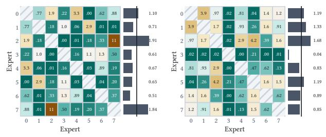

Orhun Görkem, Athanasios Vasilopoulos, Georgios Pagonis, Victoria Clerico, Hadjer Benmeziane, Irem Boybat, Hsinyu Tsai, Abu Sebastian, and William Andrew Simon

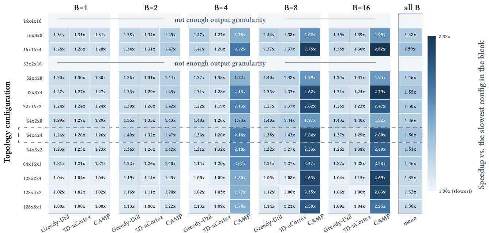  
Figure 12. Throughput comparison for Llama 70B in a grid of 3D-IMC macro topology configurations and mapping algorithms. To<sub>p</sub>olo<sub>gy</sub> confi<sub>g</sub>urations use the format $< N _ { L G } \times N _ { L } \times N _ { T ^ { > } }$ <sub>: num</sub>b<sub>er o</sub>f LG<sub>s,</sub> l<sub>eaves per</sub> LG<sub>, an</sub>d til<sub>es per</sub> l<sub>ea</sub>f<sub>.</sub>

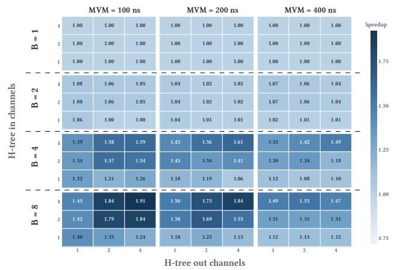  
Figure 13. Throughput speedup of CAMP over Greedy Util [5] as the number of in<sub>p</sub>ut/out<sub>p</sub>ut channels and MVM l<sub>a</sub>t<sub>ency</sub> <sub>vary,</sub> <sub>pro</sub>fil<sub>e</sub>d <sub>on</sub> Ll<sub>ama</sub> 70B<sub>.</sub>

W<sub>e</sub> <sub>eva</sub>l<sub>ua</sub>t<sub>e</sub> CAMP’<sub>s</sub> r<sub>o</sub>b<sub>us</sub>tn<sub>ess</sub> <sub>ac</sub>r<sub>oss</sub> <sub>e</sub>x<sub>pe</sub>rt-<sub>ac</sub>ti<sub>va</sub>ti<sub>o</sub>n distributions induced b<sub>y</sub> diferent <sub>p</sub>rom<sub>p</sub>t domains. Fi<sub>g</sub>ure 15 shows that <sub>g</sub>reater ex<sub>p</sub>ert-activation imbalance <sub>p</sub>roduces lar<sub>g</sub>er s<sub>p</sub>eedu<sub>p</sub>s. The s<sub>p</sub>eedu<sub>p</sub> over Greed<sub>y</sub>-Util rises from 1.63× to 1.82× when we switch to an imbalanced distributi<sub>o</sub>n<sub>.</sub> Thi<sub>s</sub> imb<sub>a</sub>l<sub>a</sub>n<sub>ce</sub> indi<sub>ca</sub>t<sub>es w</sub>hi<sub>c</sub>h <sub>e</sub>x<sub>pe</sub>rt MVM<sub>s s</sub>h<sub>ou</sub>ld <sub>occupy</sub> <sub>mu</sub>t<sub>ua</sub>ll<sub>y</sub> <sub>exc</sub>l<sub>us</sub>i<sub>ve</sub> <sub>resources</sub> <sub>an</sub>d <sub>w</sub>hi<sub>c</sub>h <sub>can</sub> <sub>s</sub>h<sub>are</sub> resources. On realistic sam<sub>p</sub>les from the MMLU dataset [14], s<sub>p</sub>eedu<sub>p</sub>s ran<sub>g</sub>e from 1.63× to 1.82×, reflectin<sub>g</sub> the limited imbalance <sub>p</sub>resent. Greed<sub>y</sub>-Util <sub>p</sub>erformance does not var<sub>y</sub> <sub>across</sub> d<sub>oma</sub>i<sub>ns</sub> b<sub>ecause</sub> it d<sub>oes no</sub>t <sub>ena</sub>bl<sub>e</sub> EP<sub>: w</sub>h<sub>en a</sub>ll <sub>ex-</sub> <sub>p</sub>ert MVMs are serialized<sub>,</sub> the activated ex<sub>p</sub>erts do not afect

Figure 14. Expert co-activation frequencies with respect to uniform fre<sub>q</sub>uenc<sub>y</sub> in Mixtral-8×7B for 50 MMLU <sub>p</sub>rom<sub>p</sub>ts [14] from the “<sub>g</sub>lobal facts” (left, la<sub>y</sub>er 31) and “business ethics” (ri<sub>g</sub>ht, la<sub>y</sub>er 11) domains. Althou<sub>g</sub>h MoEb<sub>ase</sub>d <sub>ne</sub>t<sub>wor</sub>k<sub>s</sub> <sub>are</sub> t<sub>ra</sub>i<sub>ne</sub>d t<sub>o</sub> b<sub>a</sub>l<sub>ance</sub> <sub>exper</sub>t <sub>u</sub>tili<sub>za</sub>ti<sub>on,</sub> co-activation fre<sub>q</sub>uencies var<sub>y</sub> across domains and la<sub>y</sub>ers.

<sub>per</sub>f<sub>ormance.</sub> 3D<sub>-a</sub>C<sub>or</sub>t<sub>ex</sub> fl<sub>uc</sub>t<sub>ua</sub>t<sub>es</sub> <sub>s</sub>li<sub>g</sub>htl<sub>y,</sub> b<sub>u</sub>t th<sub>e</sub> <sub>var</sub>i<sub>-</sub> <sub>a</sub>ti<sub>o</sub>n i<sub>s w</sub>ithin r<sub>u</sub>n-t<sub>o</sub>-r<sub>u</sub>n n<sub>o</sub>i<sub>se</sub> b<sub>ecause</sub> it minimiz<sub>es</sub> ti<sub>e</sub>r <sub>u</sub>sa<sub>g</sub>e <sub>w</sub>itho<sub>u</sub>t considerin<sub>g</sub> ex<sub>p</sub>ert acti<sub>v</sub>ations.

## C Mapping search space and runtime complexity analysis

Thi<sub>s appen</sub>di<sub>x ana</sub>l<sub>yzes</sub> th<sub>e</sub> b<sub>oun</sub>d<sub>s o</sub>f th<sub>e searc</sub>h <sub>space</sub> th<sub>a</sub>t contains all ma<sub>pp</sub>in<sub>g</sub> <sub>p</sub>ossibilities and anal<sub>y</sub>zes the runtime com<sub>p</sub>lexit<sub>y</sub> of the CAMP al<sub>g</sub>orithm.

## C.1 Bounds of the search space cardinality

The size of the ma<sub>pp</sub>in<sub>g</sub> search s<sub>p</sub>ace motivates a searchs<sub>p</sub>ace-<sub>p</sub>r<sub>u</sub>nin<sub>g</sub> al<sub>g</sub>orithm s<sub>u</sub>ch as CAMP. The search s<sub>p</sub>ace can be com<sub>p</sub>ared to a 3D bin-<sub>p</sub>ackin<sub>g</sub> <sub>p</sub>roblem<sub>,</sub> in which MVM<sub>s</sub> <sub>represen</sub>t <sub>res</sub>h<sub>apa</sub>bl<sub>e</sub> 3D b<sub>oxes</sub> th<sub>a</sub>t <sub>mus</sub>t b<sub>e</sub> <sub>pac</sub>k<sub>e</sub>d into a sin<sub>g</sub>le bin. While exact enumeration of the ma<sub>pp</sub>in<sub>g</sub> s<sub>p</sub>ace is intractable<sub>,</sub> we characterize its com<sub>p</sub>lexit<sub>y</sub> usin<sub>g</sub> con-<sub>serva</sub>ti<sub>ve</sub> l<sub>ower an</sub>d <sub>upper</sub> b<sub>oun</sub>d<sub>s an</sub>d <sub>an un</sub>bi<sub>ase</sub>d M<sub>on</sub>t<sub>e</sub> Carlo estimator. Let |� | denote the ma<sub>pp</sub>in<sub>g</sub>-s<sub>p</sub>ace cardinal-<sup>i</sup>t<sub>y</sub>.

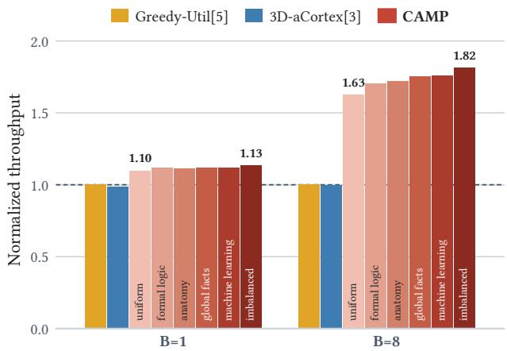  
Figure 15. Speedup across expert-activation distributions deri<sub>v</sub>ed em<sub>p</sub>iricall<sub>y</sub> from in<sub>pu</sub>t domains in the MMLU dataset [14]. “Uniform” and “imbalanced” are s<sub>y</sub>nthetic distributions illustratin<sub>g</sub> the extremes. Uniform is full<sub>y</sub> uniform <sub>on exper</sub>t<sub>-co-ac</sub>ti<sub>va</sub>ti<sub>ons.</sub> A<sub>n</sub>d f<sub>or</sub> “i<sub>m</sub>b<sub>a</sub>l<sub>ance</sub>d”<sub>, we</sub> i<sub>ncrease</sub>d coeficient ofvariation (CV = std/mean) for co-activation prob-<sub>a</sub>biliti<sub>es</sub> t<sub>o</sub> 0<sub>.</sub>8 <sub>w</sub>h<sub>e</sub>r<sub>e</sub> th<sub>e</sub> r<sub>ea</sub>li<sub>s</sub>ti<sub>c</sub> d<sub>o</sub>m<sub>a</sub>in<sub>s</sub> fr<sub>o</sub>m MMLU h<sub>ave</sub> it b<sub>e</sub>t<sub>ween</sub> 0<sub>.</sub>15 <sub>an</sub>d 0<sub>.</sub>32<sub>.</sub> R<sub>esu</sub>lt<sub>s are average</sub>d <sub>over</sub> 50 t<sub>r</sub>i<sub>a</sub>l<sub>s.</sub>

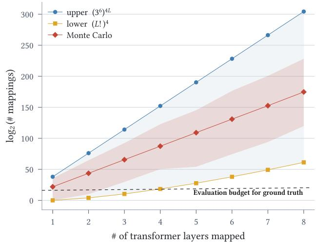  
Figure 16. Estimated number of options for mapping � Ll<sub>ama</sub> 70B t<sub>rans</sub>f<sub>ormer</sub> l<sub>ayers on</sub>t<sub>o</sub> th<sub>e mo</sub>d<sub>e</sub>l<sub>e</sub>d 3D<sub>-</sub>IMC <sub>macro.</sub> Th<sub>e re</sub>d <sub>curve s</sub>h<sub>ows</sub> th<sub>e</sub> M<sub>on</sub>t<sub>e</sub> C<sub>ar</sub>l<sub>o es</sub>ti<sub>ma</sub>t<sub>e;</sub> th<sub>e</sub> <sub>o</sub>th<sub>er curves s</sub>h<sub>ow conserva</sub>ti<sub>ve</sub> l<sub>ower an</sub>d <sub>upper</sub> b<sub>oun</sub>d<sub>s.</sub>

Lower bound: The lower bound can be intuitively described as selectin<sub>g</sub> an<sub>y</sub> ma<sub>pp</sub>in<sub>g</sub> such that all MVMs fit within the bi<sub>n, an</sub>d th<sub>en permu</sub>ti<sub>ng</sub> th<sub>e</sub> l<sub>oca</sub>ti<sub>on o</sub>f <sub>a</sub>ll id<sub>en</sub>ti<sub>ca</sub>ll<sub>y s</sub>i<sub>ze</sub>d MVMs. The total number of <sub>p</sub>ossible <sub>p</sub>ermutations re<sub>p</sub>resents th<sub>e</sub> l<sub>ower</sub> b<sub>oun</sub>d <sub>o</sub>f th<sub>e</sub> <sub>searc</sub>h <sub>space.</sub>

Consider ma<sub>pp</sub>in<sub>g</sub> the wei<sub>g</sub>hts of the set of MVMs J f<sub>rom</sub> � t<sub>rans</sub>f<sub>ormer</sub> l<sub>ayers.</sub> F<sub>or a conserva</sub>ti<sub>ve</sub> b<sub>oun</sub>d<sub>, we</sub> fi<sub>x</sub> th<sub>e</sub> TP d<sub>egree o</sub>f <sub>eac</sub>h MVM i<sub>n</sub> $\mathcal { T }$ and <sub>p</sub>artition the MVMs into e<sub>q</sub>uivalence <sub>g</sub>rou<sub>p</sub>s b<sub>y</sub> size. Let $g _ { m }$ d<sub>eno</sub>t<sub>e</sub> th<sub>e</sub> <sub>group</sub> <sub>o</sub>f MVMs of size $m ,$ <sub>an</sub>d l<sub>e</sub>t � d<sub>eno</sub>t<sub>e</sub> th<sub>e se</sub>t <sub>o</sub>f <sub>a</sub>ll <sub>groups.</sub> Th<sub>en:</sub>

$$
| S | \geq \prod _ { g _ { m } \in G } | g _ { m } | !\tag{10}
$$

Given an<sub>y</sub> feasible ma<sub>pp</sub>in<sub>g</sub> of all MVMs in $\mathcal { T }$ <sub>,</sub> th<sub>e</sub> <sub>p</sub>l<sub>ace-</sub> ments of same-sized MVMs can alwa<sub>y</sub>s be exchan<sub>g</sub>ed. This <sub>g</sub><sup>i</sup>ves $| g _ { m } | !$ <sub>p</sub>ermutat<sup>i</sup>ons <sup>f</sup>or eac<sup>h</sup> <sub>g</sub>rou<sub>p</sub> $g _ { m }$ . Combinin<sub>g</sub> the <sub>p</sub>ermutations across <sub>g</sub>rou<sub>p</sub>s <sub>y</sub>ields E<sub>q</sub>uation 10.

F<sub>or</sub> Ll<sub>ama</sub> 70B<sub>,</sub> <sub>eac</sub>h t<sub>rans</sub>f<sub>ormer</sub> l<sub>ayer</sub> <sub>con</sub>t<sub>a</sub>i<sub>ns</sub> f<sub>our</sub> di<sub>s-</sub> tin<sub>c</sub>t <sub>s</sub>iz<sub>es</sub> <sub>o</sub>f MVM<sub>s.</sub> D<sub>ue</sub> t<sub>o</sub> th<sub>e</sub> r<sub>epe</sub>titi<sub>ve</sub> <sub>s</sub>tr<sub>uc</sub>t<sub>u</sub>r<sub>e</sub> <sub>o</sub>f tr<sub>a</sub>n<sub>s</sub>- formers<sub>,</sub> these MVMs re<sub>p</sub>eat for � la<sub>y</sub>ers. When ma<sub>pp</sub>in<sub>g</sub> � la<sub>y</sub>ers of Llama 70B<sub>,</sub> there are four e<sub>q</sub>uivalence <sub>g</sub>rou<sub>p</sub>s with � MVMs in each. E<sub>qu</sub>ation 10 becomes:

$$
\vert { S } \vert \ge ( L ! ) ^ { 4 }\tag{11}
$$

This lower bound onl<sub>y</sub> <sub>p</sub>ermutes same-sized MVMs amon<sub>g</sub> th<sub>e</sub>i<sub>r p</sub>l<sub>acemen</sub>t<sub>s;</sub> it <sub>exc</sub>l<sub>u</sub>d<sub>es a</sub>lt<sub>erna</sub>ti<sub>ve</sub> TP d<sub>egrees an</sub>d <sub>p</sub>l<sub>acemen</sub>t l<sub>ayou</sub>t<sub>s.</sub> E<sub>ven</sub> thi<sub>s</sub> l<sub>oose</sub> l<sub>ower</sub> b<sub>oun</sub>d <sub>s</sub>h<sub>ows</sub> th<sub>a</sub>t ma<sub>pp</sub>in<sub>g</sub> ei<sub>g</sub>ht la<sub>y</sub>ers of Llama 70B re<sub>q</sub>uires at least $( 8 ! ) ^ { 4 }$ ≈ $2 ^ { 6 1 }$ evaluations to identif<sub>y</sub> the o<sub>p</sub>timum.

Upper bound: System capacity is the limiting factor on the ma<sub>pp</sub>in<sub>g</sub> s<sub>p</sub>ace. To obtain a conservative u<sub>pp</sub>er bound on ma<sub>pp</sub>in<sub>g</sub>-s<sub>p</sub>ace cardinalit<sub>y,</sub> we assume that the s<sub>y</sub>stem has no <sub>ve</sub>rti<sub>ca</sub>l-ti<sub>e</sub>r limit<sub>.</sub> Int<sub>u</sub>iti<sub>ve</sub>l<sub>y,</sub> thi<sub>s</sub> r<sub>e</sub>m<sub>oves</sub> int<sub>e</sub>r-MVM <sub>co</sub>nstraints<sub>,</sub> allowin<sub>g</sub> ever<sub>y</sub> MVM to assume all <sub>p</sub>ossible sha<sub>p</sub>es. Th<sub>us,</sub> th<sub>e permu</sub>t<sub>a</sub>ti<sub>on o</sub>f <sub>a</sub>ll <sub>poss</sub>ibl<sub>e s</sub>h<sub>apes</sub> f<sub>or a</sub>ll <sub>poss</sub>ibl<sub>e</sub> MVMs re<sub>p</sub>resents the u<sub>pp</sub>er bound of the ma<sub>pp</sub>in<sub>g</sub> search <sup>s</sup>p<sup>ace.</sup>

Each MVM in J can be ma<sub>pp</sub>ed to an<sub>y</sub> subset of LGs on the 3D-IMC macro<sub>,</sub> constrained onl<sub>y</sub> b<sub>y</sub> H-tree broadcastin<sub>g</sub>: at each level<sub>,</sub> the in<sub>p</sub>ut ma<sub>y</sub> <sub>p</sub>ro<sub>p</sub>a<sub>g</sub>ate left<sub>,</sub> ri<sub>g</sub>ht<sub>,</sub> or b<sub>o</sub>th<sub>,</sub> th<sub>ere</sub>b<sub>y</sub> d<sub>e</sub>t<sub>erm</sub>i<sub>n</sub>i<sub>ng</sub> th<sub>e</sub> <sub>s</sub>i<sub>ng</sub>l<sub>e-pass</sub> <sub>reac</sub>h<sub>a</sub>bl<sub>e</sub> LG<sub>s</sub> f<sub>or</sub> wei<sub>g</sub>ht ma<sub>pp</sub>in<sub>g</sub> [8]. Accordin<sub>g</sub>l<sub>y</sub>, there can be $3 ^ { d }$ <sub>suc</sub>h <sub>su</sub>b<sub>-</sub> <sub>se</sub>t<sub>s, w</sub>h<sub>ere</sub> � i<sub>s</sub> th<sub>e</sub> d<sub>ep</sub>th <sub>o</sub>f th<sub>e</sub> H<sub>-</sub>t<sub>ree.</sub> Th<sub>en,</sub> if th<sub>e</sub> LG<sub>s</sub> i<sub>n a</sub> subset are alread<sub>y</sub> occu<sub>p</sub>ied<sub>,</sub> the wei<sub>g</sub>hts are sim<sub>p</sub>l<sub>y</sub> ma<sub>pp</sub>ed to one tier above. In this settin<sub>g,</sub> the ma<sub>pp</sub>in<sub>g</sub> search s<sub>p</sub>ace consists of |J | inde<sub>p</sub>endent decisions, <sub>y</sub>ieldin<sub>g</sub> the u<sub>pp</sub>er b<sub>oun</sub>d<sub>:</sub>

$$
| S | \le ( 3 ^ { d } ) ^ { | \mathcal { T } | }\tag{12}
$$

F<sub>o</sub>r Ll<sub>a</sub>m<sub>a</sub> 70B<sub>,</sub> $\vert \mathcal { T } \vert = 4 L$ <sub>,</sub> <sub>an</sub>d f<sub>or</sub> <sub>our</sub> <sub>arc</sub>hit<sub>ec</sub>t<sub>ura</sub>l <sub>se</sub>tti<sub>ng,</sub> $d = 6 .$

Monte Carlo estimator: In reality, the size of the search s<sub>p</sub>ace chan<sub>g</sub>es as MVMs are ma<sub>pp</sub>ed<sub>,</sub> and future MVMs are <sub>cons</sub>t<sub>ra</sub>i<sub>ne</sub>d<sub>.</sub> Th<sub>us,</sub> th<sub>e</sub> t<sub>rue searc</sub>h <sub>space</sub> f<sub>a</sub>ll<sub>s somew</sub>h<sub>ere</sub> b<sub>e</sub>t<sub>ween</sub> th<sub>e</sub> l<sub>ower</sub> <sub>an</sub>d <sub>upper</sub> b<sub>oun</sub>d<sub>s.</sub>

We <sub>qu</sub>antif<sub>y</sub> this <sub>v</sub>ia a Monte Carlo sim<sub>u</sub>lation that randoml<sub>y</sub> orders the MVMs in $\mathcal { T }$ <sub>an</sub>d <sub>maps</sub> th<sub>em</sub> <sub>one</sub> b<sub>y</sub> <sub>one.</sub> The number of ma<sub>pp</sub>in<sub>g</sub> o<sub>p</sub>tions for $\mathrm { M V M } \ j \in \mathcal { T }$ i<sub>s</sub> d<sub>eno</sub>t<sub>e</sub>d <sup>b</sup><sub>y</sub> $n _ { j }$ . A ma<sub>pp</sub>in<sub>g</sub> is <sub>p</sub>icked uniforml<sub>y</sub> at random and committ<sub>e</sub>d<sub>.</sub> Th<sub>e</sub> <sub>mappe</sub>d <sub>resources</sub> <sub>are</sub> <sub>mar</sub>k<sub>e</sub>d <sub>as</sub> <sub>occup</sub>i<sub>e</sub>d t<sub>o</sub> <sub>o</sub>b<sub>ey</sub> the occu<sub>p</sub>anc<sub>y</sub> constraints. The number of ma<sub>pp</sub>in<sub>g</sub> o<sub>p</sub>tions f<sub>or</sub> <sub>a</sub> t<sub>r</sub>i<sub>a</sub>l i<sub>s</sub> th<sub>e</sub> <sub>pro</sub>d<sub>uc</sub>t $\Pi _ { j \in \mathcal { I } } n _ { j }$ <sub>o</sub>f th<sub>e</sub> <sub>op</sub>ti<sub>on</sub> <sub>coun</sub>t<sub>s</sub> <sub>a</sub>t eac<sup>h</sup> <sub>p</sub><sup>l</sup>acement ste<sub>p</sub>:

$$
X = \prod _ { j = 0 } ^ { | { \mathcal { T } } | - 1 } n _ { j }\tag{13}
$$

� i<sub>s a</sub>n <sub>u</sub>nbi<sub>ase</sub>d <sub>es</sub>tim<sub>a</sub>t<sub>o</sub>r <sub>o</sub>f $| S | ;$

$$
\mathbb { E } [ X ] = \sum _ { { \bf M } \in { \cal S } } ( \prod _ { j = 0 } ^ { | { \mathcal J } | - 1 } { \frac { 1 } { n _ { j } } } ) \times ( \prod _ { j = 0 } ^ { | { \mathcal J } | - 1 } n _ { j } ) = \sum _ { { \bf M } \in { \cal S } } 1 = | S |\tag{14}
$$

R<sub>eac</sub>hi<sub>ng</sub> <sub>a</sub> <sub>spec</sub>ifi<sub>c</sub> l<sub>ea</sub>f i<sub>n</sub> th<sub>e</sub> M<sub>on</sub>t<sub>e</sub> C<sub>ar</sub>l<sub>o</sub> <sub>searc</sub>h t<sub>ree</sub> h<sub>as</sub> <sub>p</sub>robabilit<sub>y</sub> $\textstyle \prod _ { j = 0 } ^ { \cdot { \mathcal { T } } | - 1 } { \frac { 1 } { n _ { j } } }$ <sub>, an</sub>d th<sub>e reac</sub>h<sub>e</sub>d l<sub>ea</sub>f<sub>re</sub>t<sub>urns</sub> $\Pi _ { j = 0 } ^ { | \mathcal { T } | - 1 } n _ { j }$ ma<sub>pp</sub>in<sub>g</sub> o<sub>p</sub>tions. We re<sub>p</sub>ort the avera<sub>g</sub>e across trials as the estimated search-s<sub>p</sub>ace cardinalit<sub>y</sub>.

Th<sub>e</sub> r<sub>e</sub>d M<sub>o</sub>nt<sub>e</sub> C<sub>a</sub>rl<sub>o</sub> <sub>cu</sub>r<sub>ve</sub> in Fi<sub>gu</sub>r<sub>e</sub> 16 li<sub>es</sub> b<sub>e</sub>t<sub>wee</sub>n th<sub>e</sub> l<sub>ower</sub> <sub>an</sub>d <sub>upper</sub> b<sub>oun</sub>d<sub>s</sub> <sub>an</sub>d <sub>con</sub>fi<sub>rms</sub> th<sub>a</sub>t <sub>ex</sub>h<sub>aus</sub>ti<sub>ve</sub> <sub>searc</sub>h is infeasible. S<sub>p</sub>ecificall<sub>y,</sub> identif<sub>y</sub>in<sub>g</sub> the o<sub>p</sub>timal ma<sub>pp</sub>in<sub>g</sub> for ei<sub>g</sub>ht la<sub>y</sub>ers of Llama 70B re<sub>q</sub>uires a<sub>pp</sub>roximatel<sub>y</sub> $\dot { 2 } ^ { 1 7 \overline { { 5 } } }$ <sub>s</sub>i<sub>mu</sub>l<sub>a</sub>ti<sub>on</sub> <sub>eva</sub>l<sub>ua</sub>ti<sub>ons.</sub> Th<sub>e</sub> <sub>searc</sub>h <sub>space</sub> <sub>grows</sub> f<sub>ur</sub>th<sub>er</sub> f<sub>or</sub> the MoE-based Mixtral network because decom<sub>p</sub>osin<sub>g</sub> ex<sub>p</sub>ert MVMs <sub>y</sub>ields 18 MVMs <sub>p</sub>er transformer la<sub>y</sub>er rather than f<sub>our.</sub>

Althou<sub>g</sub>h exact o<sub>p</sub>timization methods such as MILP ma<sub>y</sub> appear app<sup>l</sup>ica<sup>bl</sup>e, t<sup>h</sup>ey require proxy o<sup>b</sup>jective <sup>f</sup>unctions. Deve<sup>l</sup>oping proxy o<sup>b</sup>jectives t<sup>h</sup>at capture <sup>b</sup>atc<sup>h</sup>-<sup>l</sup>eve<sup>l</sup> over<sup>l</sup>ap <sub>an</sub>d <sub>resource-con</sub>fli<sub>c</sub>t i<sub>n</sub>t<sub>erac</sub>ti<sub>ons rema</sub>i<sub>ns</sub> f<sub>u</sub>t<sub>ure wor</sub>k<sub>.</sub>

## C.2 Impact of� and � on throughput and search space coverage

As explained in Section 4.3, we adopt a beam search strategy when selectin<sub>g</sub> a <sub>g</sub>ood set of TP de<sub>g</sub>rees for the MVMs<sub>,</sub> with th<sub>e</sub> b<sub>eam w</sub>idth � <sub>an</sub>d th<sub>e ac</sub>ti<sub>on w</sub>idth � <sub>serv</sub>i<sub>ng as</sub> t<sub>una</sub>bl<sub>e</sub> <sub>parame</sub>t<sub>ers</sub> th<sub>a</sub>t <sub>con</sub>t<sub>ro</sub>l th<sub>e</sub> <sub>ex</sub>h<sub>aus</sub>ti<sub>veness</sub> <sub>o</sub>f th<sub>e</sub> <sub>searc</sub>h<sub>.</sub> I<sub>n</sub> th<sub>e</sub> <sub>prev</sub>i<sub>ous</sub> <sub>sec</sub>ti<sub>on,</sub> <sub>we</sub> <sub>a</sub>l<sub>so</sub> <sub>s</sub>h<sub>owe</sub>d th<sub>e</sub> <sub>sca</sub>l<sub>e</sub> <sub>o</sub>f th<sub>e</sub> <sub>searc</sub>h <sub>space</sub> <sub>an</sub>d th<sub>e</sub> i<sub>mprac</sub>ti<sub>ca</sub>lit<sub>y</sub> <sub>o</sub>f <sub>a</sub> f<sub>u</sub>ll<sub>y</sub> <sub>ex</sub>h<sub>aus</sub>ti<sub>ve</sub> <sub>searc</sub>h<sub>.</sub>

Th<sub>e ques</sub>ti<sub>on</sub> th<sub>a</sub>t <sub>rema</sub>i<sub>ns</sub> i<sub>s</sub> h<sub>ow ex</sub>h<sub>aus</sub>ti<sub>ve</sub> th<sub>e</sub> b<sub>eam</sub> <sub>searc</sub>h <sub>mus</sub>t b<sub>ecome</sub> t<sub>o</sub> <sub>c</sub>l<sub>ose</sub> th<sub>e</sub> <sub>op</sub>ti<sub>ma</sub>lit<sub>y</sub> <sub>gap</sub> b<sub>e</sub>t<sub>ween</sub> th<sub>e</sub> b<sub>ase</sub>li<sub>nes</sub> <sub>an</sub>d th<sub>e</sub> id<sub>ea</sub>li<sub>ze</sub>d th<sub>roug</sub>h<sub>pu</sub>t <sub>upper</sub> b<sub>oun</sub>d f<sub>or</sub> th<sub>e</sub> m<sub>o</sub>d<sub>e</sub>l<sub>e</sub>d 3D-IMC-b<sub>ase</sub>d LLM <sub>acce</sub>l<sub>e</sub>r<sub>a</sub>t<sub>o</sub>r<sub>.</sub> Fi<sub>gu</sub>r<sub>e</sub> 17 <sub>s</sub>h<sub>ows</sub> th<sub>e</sub> <sub>re</sub>l<sub>a</sub>ti<sub>ve</sub> th<sub>roug</sub>h<sub>pu</sub>t <sub>o</sub>bt<sub>a</sub>i<sub>ne</sub>d <sub>an</sub>d <sub>correspon</sub>di<sub>ng</sub> <sub>num-</sub> ber of ma<sub>pp</sub>in<sub>g</sub> evaluations as the � and � <sub>p</sub>arameters are <sub>a</sub>bl<sub>a</sub>t<sub>e</sub>d<sub>.</sub> Wh<sub>en</sub> th<sub>e</sub> b<sub>a</sub>t<sub>c</sub>h <sub>s</sub>i<sub>ze</sub> i<sub>s</sub> 1<sub>,</sub> th<sub>e op</sub>ti<sub>m</sub>i<sub>za</sub>ti<sub>on pa</sub>th i<sub>s</sub> strai<sub>g</sub>htforward<sub>,</sub> because the most <sub>p</sub>erformant ma<sub>pp</sub>in<sub>g</sub> is to maximize the de<sub>g</sub>ree of TP for all ma<sub>pp</sub>ed MVMs. There is th<sub>ere</sub>f<sub>ore no</sub> th<sub>roug</sub>h<sub>pu</sub>t dif<sub>erence</sub> b<sub>e</sub>t<sub>ween a</sub> f<sub>u</sub>ll<sub>y gree</sub>d<sub>y</sub> b<sub>eam searc</sub>h $( W = k = 1 )$ <sub>an</sub>d <sub>more</sub> <sub>ex</sub>h<sub>aus</sub>ti<sub>ve</sub> <sub>con</sub>fi<sub>gura-</sub> ti<sub>ons.</sub> B<sub>a</sub>t<sub>c</sub>h <sub>s</sub>i<sub>ze</sub> 8<sub>, on</sub> th<sub>e o</sub>th<sub>er</sub> h<sub>an</sub>d<sub>, requ</sub>i<sub>res</sub> b<sub>a</sub>l<sub>anc</sub>i<sub>ng</sub> the de<sub>g</sub>rees of TP and BP<sub>,</sub> so increasin<sub>g</sub> � and � <sub>g</sub>enerall<sub>y</sub> i<sub>mproves</sub> th<sub>e</sub> th<sub>roug</sub>h<sub>pu</sub>t <sub>reac</sub>h<sub>e</sub>d b<sub>y</sub> th<sub>e</sub> b<sub>eam</sub> <sub>searc</sub>h<sub>.</sub> W<sub>e</sub> <sub>repor</sub>t <sub>our resu</sub>lt<sub>s w</sub>ith th<sub>e</sub> $W = k = 5$ <sub>con</sub>fi<sub>gura</sub>ti<sub>on</sub> i<sub>n</sub> th<sub>e</sub> <sub>o</sub>th<sub>er</sub> fi<sub>gures</sub> <sub>an</sub>d <sub>resu</sub>lt<sub>s;</sub> <sub>we</sub> <sub>no</sub>t<sub>e,</sub> h<sub>owever,</sub> th<sub>a</sub>t th<sub>ey</sub> <sub>cou</sub>ld b<sub>e</sub> i<sub>mprove</sub>d b<sub>y</sub> 4% h<sub>a</sub>d <sub>we c</sub>h<sub>osen</sub> th<sub>e more ex</sub>h<sub>aus</sub>ti<sub>ve op-</sub> ti<sub>on o</sub>f $W = k = 1 5$ . This comes at the cost of rou<sub>g</sub>hl<sub>y</sub> 4.6× more ma<sub>pp</sub>in<sub>g</sub> evaluations. Nevertheless<sub>,</sub> even $W = k = 1 5$ l<sub>ea</sub>d<sub>s</sub> t<sub>o on</sub>l<sub>y</sub> 3930 <sub>eva</sub>l<sub>ua</sub>ti<sub>ons, a re</sub>l<sub>a</sub>ti<sub>ve</sub>l<sub>y</sub> l<sub>ow num</sub>b<sub>er w</sub>ith res<sub>p</sub>ect to the search-s<sub>p</sub>ace com<sub>p</sub>lexit<sub>y</sub> shown in the <sub>p</sub>revious section.

One exce<sub>p</sub>tional data <sub>p</sub>oint is $W = 1 , k = 1 0$ <sub>, w</sub>hi<sub>c</sub>h <sub>resu</sub>lt<sub>s</sub> i<sub>n a</sub> d<sub>ecrease</sub> i<sub>n</sub> th<sub>roug</sub>h<sub>pu</sub>t <sub>compare</sub>d t<sub>o</sub> th<sub>e</sub> l<sub>ower ac</sub>ti<sub>on</sub> <sub>w</sub>idth <sub>con</sub>fi<sub>gura</sub>ti<sub>ons a</sub>t th<sub>e same</sub> b<sub>eam w</sub>idth<sub>.</sub> Th<sub>e reason</sub> is that increasin<sub>g</sub> the action width at $W = 1$ <sub>con</sub>t<sub>r</sub>ib<sub>u</sub>t<sub>es</sub> littl<sub>e</sub> t<sub>o</sub> th<sub>e ex</sub>h<sub>aus</sub>ti<sub>veness o</sub>f th<sub>e searc</sub>h<sub>.</sub> Th<sub>e mos</sub>t l<sub>a</sub>t<sub>ency-</sub> im<sub>p</sub>rovin<sub>g</sub> action is selected amon<sub>g</sub> 10 candidates instead of 1 or 5, but this only makes the search a steepest descent, which is still a <sub>p</sub>urel<sub>y</sub> <sub>g</sub>reed<sub>y</sub> a<sub>pp</sub>roach. Gettin<sub>g</sub> stuck in a <sub>worse</sub> l<sub>oca</sub>l <sub>m</sub>i<sub>n</sub>i<sub>mum</sub> th<sub>ere</sub>f<sub>ore</sub> <sub>rema</sub>i<sub>ns</sub> <sub>poss</sub>ibl<sub>e</sub> <sub>un</sub>l<sub>ess</sub> th<sub>e</sub> b<sub>eam w</sub>idth � i<sub>s</sub> i<sub>ncrease</sub>d<sub>.</sub>

## C.3 Runtime complexity of CAMP

CAMP <sub>co</sub>n<sub>s</sub>i<sub>s</sub>t<sub>s o</sub>f thr<sub>ee p</sub>h<sub>ases w</sub>ith dif<sub>e</sub>r<sub>e</sub>nt <sub>co</sub>m<sub>p</sub>l<sub>e</sub>xiti<sub>es.</sub> L<sub>e</sub>t � d<sub>eno</sub>t<sub>e</sub> th<sub>e num</sub>b<sub>er o</sub>f MVM<sub>s</sub> t<sub>o</sub> b<sub>e mappe</sub>d<sub>.</sub> Th<sub>e pro</sub>fil<sub>-</sub> in<sub>g p</sub>hase ma<sub>p</sub>s the MVMs under the assum<sub>p</sub>tion of infinite <sup>com</sup>p<sup>ute</sup> <sup>resources</sup>, <sup>so</sup> <sup>the</sup> <sup>ma</sup>pp<sup>in</sup>g <sup>is</sup> <sup>a</sup> <sup>sin</sup>g<sup>le</sup> g<sup>reed</sup>y p<sup>ass</sup> in which each MVM is <sub>p</sub>laced one b<sub>y</sub> one. The com<sub>p</sub>lexit<sub>y</sub> of the <sub>p</sub>rofilin<sub>g</sub> <sub>p</sub>hase is therefore �(�). The initial ma<sub>pp</sub>in<sub>g</sub> <sub>p</sub>hase assi<sub>g</sub>ns 1-wa<sub>y</sub> TP to ever<sub>y</sub> MVM and <sub>p</sub>laces them one b<sub>y one</sub> i<sub>n</sub> th<sub>e same gree</sub>d<sub>y,</sub> i<sub>n-or</sub>d<sub>er</sub> f<sub>as</sub>hi<sub>on.</sub> Th<sub>e con</sub>fli<sub>c</sub>t <sub>ma</sub>t<sub>r</sub>i<sub>x o</sub>bt<sub>a</sub>i<sub>ne</sub>d f<sub>rom</sub> th<sub>e pro</sub>fili<sub>ng p</sub>h<sub>ase</sub> i<sub>s consu</sub>lt<sub>e</sub>d d<sub>ur</sub>i<sub>ng</sub> th<sub>e p</sub>l<sub>acemen</sub>t <sub>o</sub>f <sub>eac</sub>h MVM<sub>,</sub> b<sub>u</sub>t thi<sub>s a</sub>dd<sub>s</sub> littl<sub>e cos</sub>t b<sub>ecause</sub> the matrix is s<sub>p</sub>arse row-wise. Denotin<sub>g</sub> the avera<sub>g</sub>e number of non-zero entries <sub>p</sub>er row as �<sub>,</sub> the com<sub>p</sub>lexit<sub>y</sub> of the initial ma<sub>pp</sub>in<sub>g p</sub>hase is �(��), which reduces to $O ( N )$ <sub>w</sub>h<sub>en</sub> � i<sub>s</sub> i<sub>n</sub>d<sub>epen</sub>d<sub>en</sub>t <sub>o</sub>f �<sub>.</sub> Th<sub>e</sub> <sub>re</sub>fi<sub>nemen</sub>t <sub>p</sub>h<sub>ase</sub> i<sub>s</sub> th<sub>e</sub> <sub>mos</sub>t ti<sub>me-</sub> consumin<sub>g p</sub>art of the al<sub>g</sub>orithm. A <sub>p</sub>lacement <sub>p</sub>rocedure similar to the one in the initial ma<sub>pp</sub>in<sub>g</sub> <sub>p</sub>hase is a<sub>pp</sub>lied it<sub>era</sub>ti<sub>ve</sub>l<sub>y un</sub>til <sub>no</sub> f<sub>ur</sub>th<sub>er ac</sub>ti<sub>ons rema</sub>i<sub>n.</sub> At <sub>eac</sub>h <sub>re</sub>fi<sub>ne-</sub> <sup>ment</sup> <sup>ste</sup>p, $W \times k$ <sub>can</sub>did<sub>a</sub>t<sub>e ac</sub>ti<sub>ons are eva</sub>l<sub>ua</sub>t<sub>e</sub>d<sub>, w</sub>h<sub>ere</sub> � i<sub>s</sub> th<sub>e</sub> b<sub>eam w</sub>idth <sub>an</sub>d � i<sub>s</sub> th<sub>e ac</sub>ti<sub>on w</sub>idth<sub>, an</sub>d <sub>eac</sub>h candidate re<sub>q</sub>uires a <sub>p</sub>lacement <sub>p</sub>ass costin<sub>g</sub> $O ( N )$ <sub>;</sub> a sin<sub>g</sub>le ste<sub>p</sub> therefore costs �(���). Each MVM admits at most � TP-chan<sub>g</sub>in<sub>g</sub> actions<sub>,</sub> so the number of ste<sub>p</sub>s is at most ��<sub>.</sub> F<sub>o</sub>r in<sub>s</sub>t<sub>a</sub>n<sub>ce, w</sub>ith $1 \cdot , \ 2 \cdot ,$ and 4-<sub>w</sub>a<sub>y</sub> TP<sub>,</sub> the <sub>p</sub>ossible transitions <sub>p</sub>er MVM are 1-to-2 and 2-to-4<sub>,</sub> <sub>g</sub>ivin<sub>g</sub> $A \ : = \ : 2$ Tr<sub>ea</sub>tin<sub>g</sub> $W , k ,$ <sub>an</sub>d � <sub>as cons</sub>t<sub>an</sub>t<sub>s,</sub> th<sub>e re</sub>fi<sub>nemen</sub>t <sub>p</sub>h<sub>ase</sub> costs $\bar { O ( \ l W k A N ^ { 2 } ) } = O ( N ^ { 2 } )$ <sub>.</sub> Th<sub>e overa</sub>ll <sub>comp</sub>l<sub>ex</sub>it<sub>y</sub> i<sub>s</sub> th<sub>us</sub> $O ( N ) + O ( C N ) + O ( W k A N ^ { 2 } ) = O ( N ^ { 2 } )$ <sub>w</sub>ith <sub>respec</sub>t t<sub>o</sub> th<sub>e</sub> number of MVMs bein<sub>g</sub> ma<sub>pp</sub>ed<sub>,</sub> �.

As mentioned in Section 5.3<sub>,</sub> � can be lowered b<sub>y</sub> ma<sub>pp</sub>in<sub>g</sub> fewer transformer la<sub>y</sub>ers at once and re<sub>p</sub>licatin<sub>g</sub> the ma<sub>pp</sub>in<sub>g</sub> f<sub>or</sub> th<sub>e</sub> <sub>res</sub>t <sub>o</sub>f th<sub>e</sub> l<sub>ayers.</sub> Thi<sub>s</sub> i<sub>s</sub> <sub>a</sub> t<sub>ra</sub>d<sub>eo</sub>f b<sub>e</sub>t<sub>ween</sub> <sub>mapp</sub>i<sub>ng</sub> <sub>q</sub>ualit<sub>y</sub> and runtime. Another similar tradeof is tunin<sub>g</sub> the �<sub>,</sub> � <sub>pa</sub>r<sub>a</sub>m<sub>e</sub>t<sub>e</sub>r<sub>s as s</sub>h<sub>ow</sub>n in S<sub>ec</sub>ti<sub>o</sub>n C<sub>.</sub>2<sub>.</sub>

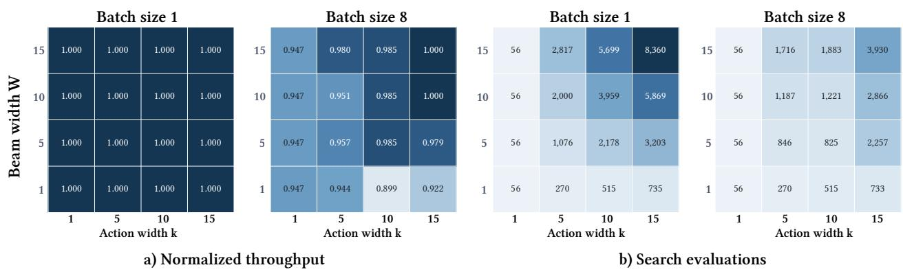

Figure 17. Ablation on parameters of beam width � and top � actions.  
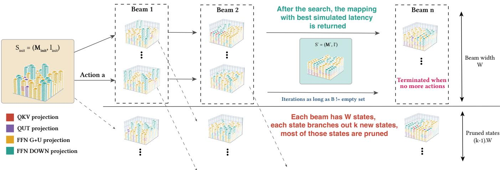  
Figure 18. Refinement iterations with beam search.

Technicall<sub>y</sub> � is not a lar<sub>g</sub>e number. For exam<sub>p</sub>le<sub>,</sub> for Llama 70B with 80 transformer la<sub>y</sub>ers � = 320. For Mixtral, when we decom<sub>p</sub>ose ex<sub>p</sub>ert la<sub>y</sub>ers into individual MVMs<sub>,</sub> � = 576. Quadratic com<sub>p</sub>lexity is not an issue at this scale. Ho<sub>w</sub>e<sub>v</sub>er<sub>,</sub> each iteration in the refinement ste<sub>p</sub> re<sub>qu</sub>ires in-<sub>vo</sub>ki<sub>ng</sub> th<sub>e s</sub>i<sub>mu</sub>l<sub>a</sub>t<sub>or</sub> f<sub>or pro</sub>fil<sub>e-gu</sub>id<sub>e</sub>d f<sub>ee</sub>db<sub>ac</sub>k<sub>, an</sub>d <sub>s</sub>i<sub>mu</sub>l<sub>a-</sub> tors can have various latencies de<sub>p</sub>endin<sub>g</sub> on their <sub>g</sub>ranularit<sub>y an</sub>d <sub>so</sub>ft<sub>ware s</sub>t<sub>ac</sub>k <sub>e</sub>fi<sub>c</sub>i<sub>ency.</sub> Th<sub>ere</sub>f<sub>ore, we no</sub>t<sub>e</sub> th<sub>a</sub>t th<sub>e</sub> runtime of the wei<sub>g</sub>ht ma<sub>pp</sub>in<sub>g</sub> al<sub>g</sub>orithm is also determined b<sub>y</sub> th<sub>e run</sub>ti<sub>me o</sub>f th<sub>e s</sub>i<sub>mu</sub>l<sub>a</sub>t<sub>or.</sub>

Finall<sub>y,</sub> we note that wei<sub>g</sub>ht ma<sub>pp</sub>in<sub>g</sub> and rema<sub>pp</sub>in<sub>g</sub> on NVM-b<sub>ase</sub>d 3D-IMC <sub>a</sub>r<sub>e</sub> r<sub>es</sub>tri<sub>c</sub>t<sub>e</sub>d d<sub>ue</sub> t<sub>o e</sub>nd<sub>u</sub>r<sub>a</sub>n<sub>ce</sub> limit<sub>a</sub>- tions. In <sub>p</sub>ractice<sub>,</sub> the wei<sub>g</sub>hts are <sub>p</sub>ro<sub>g</sub>rammed once<sub>,</sub> ofline<sub>,</sub> and then used re<sub>p</sub>eatedl<sub>y</sub> durin<sub>g</sub> inference. Wei<sub>g</sub>ht ma<sub>pp</sub>in<sub>g</sub> t<sup>h</sup>ere<sup>f</sup>ore <sup>d</sup>oes not <sup>h</sup>ave to meet strict service-<sup>l</sup>eve<sup>l</sup> o<sup>b</sup>jectives. With <sub>q</sub>uadratic com<sub>p</sub>lexit<sub>y,</sub> CAMP balances ma<sub>pp</sub>in<sub>g</sub> <sub>q</sub>ualit<sub>y</sub> a<sub>g</sub>ainst runtime<sub>,</sub> sittin<sub>g</sub> between full<sub>y</sub> <sub>g</sub>reed<sub>y</sub> methods and exact o<sub>p</sub>timization methods of ex<sub>p</sub>onential com<sub>p</sub>lexit<sub>y</sub>.

## D GPU Profiling

End-to-end GPU-onl<sub>y</sub> latencies are measured with vLLM [23] (version 0.18.0) servin<sub>g</sub> an INT8 wei<sub>g</sub>ht- and activation-<sub>qua</sub>ntiz<sub>e</sub>d <sub>va</sub>ri<sub>a</sub>nt <sub>o</sub>f Ll<sub>a</sub>m<sub>a</sub> 3<sub>.</sub>1 70B In<sub>s</sub>tr<sub>uc</sub>t<sup>1</sup><sub>,</sub> <sub>a</sub>t <sub>a</sub> t<sub>e</sub>n<sub>so</sub>r <sub>para</sub>ll<sub>e</sub>li<sub>sm</sub> d<sub>egree</sub> <sub>o</sub>f t<sub>wo.</sub> Ch<sub>un</sub>k<sub>e</sub>d <sub>pre</sub>fill i<sub>s</sub> <sub>ena</sub>bl<sub>e</sub>d<sub>,</sub> <sub>pre</sub>fi<sub>x</sub> <sub>cac</sub>hi<sub>ng</sub> i<sub>s</sub> di<sub>sa</sub>bl<sub>e</sub>d<sub>,</sub> <sub>an</sub>d th<sub>e</sub> f<sub>rac</sub>ti<sub>on</sub> <sub>o</sub>f d<sub>ev</sub>i<sub>ce</sub> <sub>memory</sub> <sub>re-</sub> served for the en<sub>g</sub>ine (gpu\_memory\_utilization) is set to 0<sub>.</sub>9. Disablin<sub>g</sub> <sub>p</sub>refix cachin<sub>g</sub> ensures that ever<sub>y</sub> re<sub>q</sub>uest <sub>p</sub>erf<sub>orms</sub> th<sub>e</sub> f<sub>u</sub>ll <sub>amoun</sub>t <sub>o</sub>f <sub>wor</sub>k i<sub>mp</sub>li<sub>e</sub>d b<sub>y</sub> it<sub>s</sub> i<sub>npu</sub>t <sub>sequence</sub> l<sub>eng</sub>th<sub>.</sub>

F<sub>or</sub> <sub>eac</sub>h <sub>com</sub>bi<sub>na</sub>ti<sub>on</sub> <sub>o</sub>f i<sub>npu</sub>t <sub>sequence</sub> l<sub>eng</sub>th <sub>an</sub>d b<sub>a</sub>t<sub>c</sub>h size, the maximum model len<sub>g</sub>th (max\_model\_len) and the <sub>max</sub>i<sub>mum</sub> <sub>num</sub>b<sub>er</sub> <sub>o</sub>f b<sub>a</sub>t<sub>c</sub>h<sub>e</sub>d t<sub>o</sub>k<sub>ens</sub> <sub>per</sub> <sub>sc</sub>h<sub>e</sub>d<sub>u</sub>l<sub>er</sub> <sub>s</sub>t<sub>ep</sub> (max\_num\_batched\_tokens) are com<sub>p</sub>uted d<sub>y</sub>namicall<sub>y</sub> so th<sub>a</sub>t <sub>a</sub>ll <sub>pre</sub>fill <sub>reques</sub>t<sub>s</sub> <sub>o</sub>f th<sub>e</sub> b<sub>a</sub>t<sub>c</sub>h <sub>are</sub> <sub>a</sub>d<sub>m</sub>itt<sub>e</sub>d i<sub>n</sub> <sub>a</sub> <sub>s</sub>i<sub>ng</sub>l<sub>e</sub> <sub>sc</sub>h<sub>e</sub>d<sub>u</sub>l<sub>er</sub> <sub>s</sub>t<sub>ep.</sub> Th<sub>e</sub> <sub>pre</sub>fill <sub>p</sub>h<sub>ase</sub> th<sub>ere</sub>f<sub>ore</sub> <sub>comp</sub>l<sub>e</sub>t<sub>es</sub> b<sub>e</sub>f<sub>ore</sub> <sub>genera</sub>ti<sub>on</sub> b<sub>eg</sub>i<sub>ns,</sub> <sub>an</sub>d <sub>no</sub> <sub>sc</sub>h<sub>e</sub>d<sub>u</sub>l<sub>er</sub> <sub>s</sub>t<sub>ep</sub> <sub>m</sub>i<sub>xes</sub> <sub>pre</sub>fill <sub>an</sub>d d<sub>eco</sub>d<sub>e</sub> <sub>wor</sub>k<sub>.</sub>

We enable the torch <sub>p</sub>rofiler at en<sub>g</sub>ine initialization and <sub>p</sub>arse the resultin<sub>g</sub> traces ofline. From each trace we retain <sub>on</sub>l<sub>y</sub> th<sub>e</sub> d<sub>eco</sub>d<sub>e-on</sub>l<sub>y sc</sub>h<sub>e</sub>d<sub>u</sub>l<sub>er s</sub>t<sub>eps w</sub>hi<sub>c</sub>h <sub>can</sub> b<sub>e</sub> id<sub>en</sub>tifi<sub>e</sub>d b<sub>y a con</sub>t<sub>ex</sub>t l<sub>eng</sub>th <sub>o</sub>f <sub>zero an</sub>d <sub>a num</sub>b<sub>er o</sub>f <sub>genera</sub>ti<sub>on</sub> t<sub>o</sub>k<sub>ens</sub> <sub>equa</sub>l t<sub>o</sub> th<sub>e</sub> b<sub>a</sub>t<sub>c</sub>h <sub>s</sub>i<sub>ze.</sub> Th<sub>e</sub> <sub>repor</sub>t<sub>e</sub>d l<sub>a</sub>t<sub>ency</sub> i<sub>s</sub> th<sub>e</sub> mean over ten suc<sup>h</sup> ste<sub>p</sub>s.