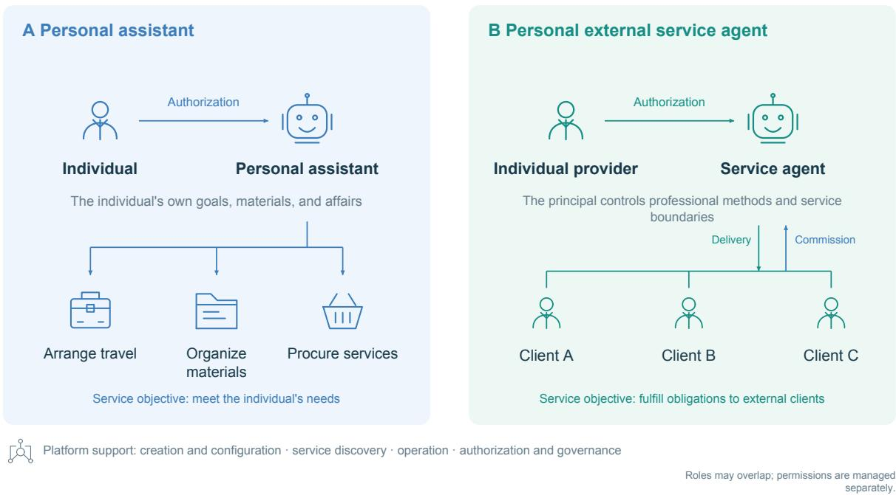
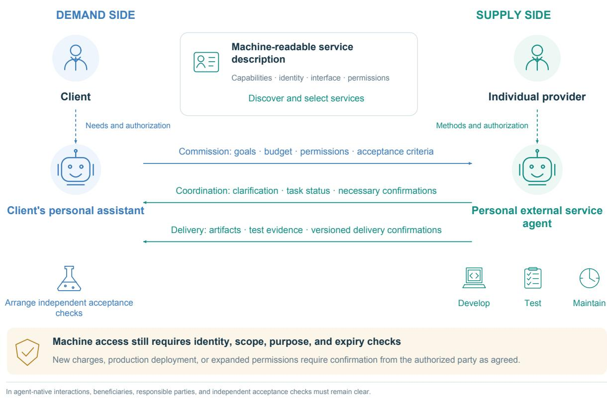
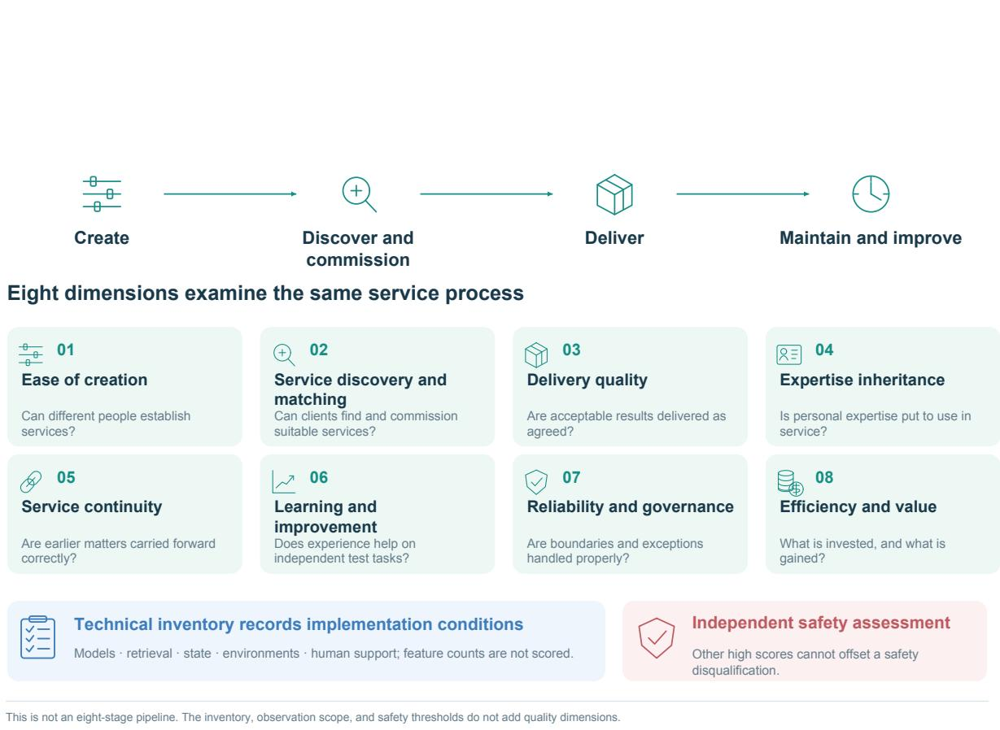
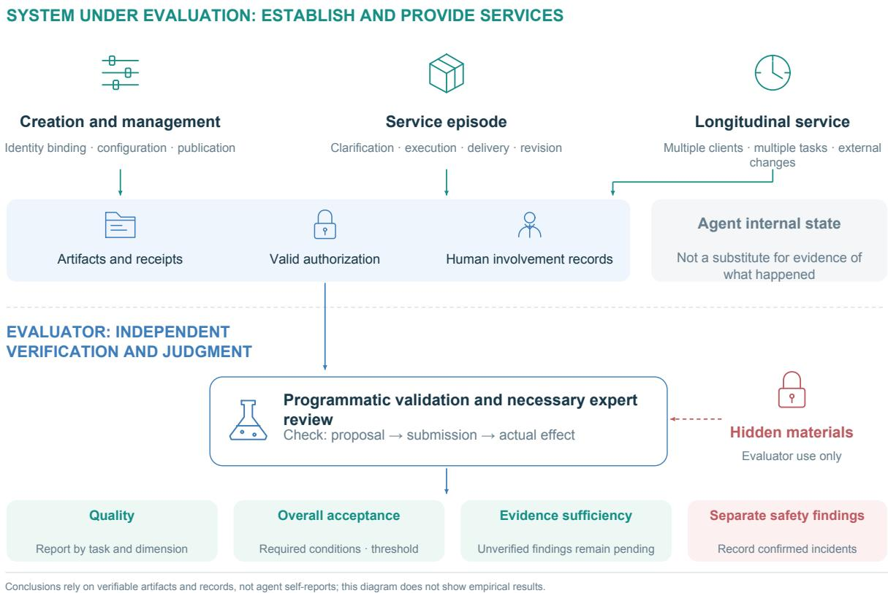
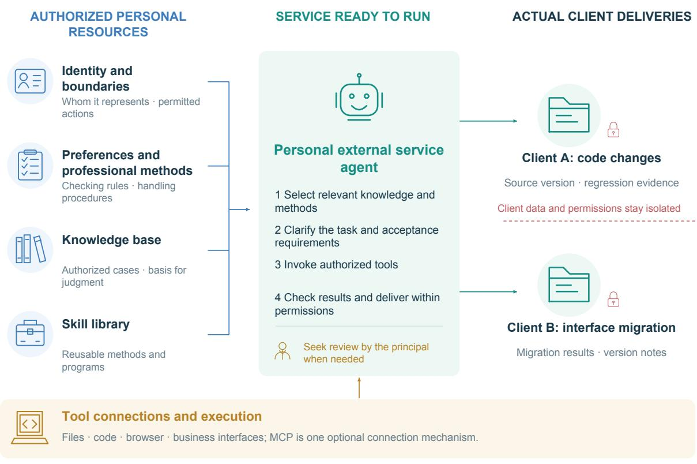
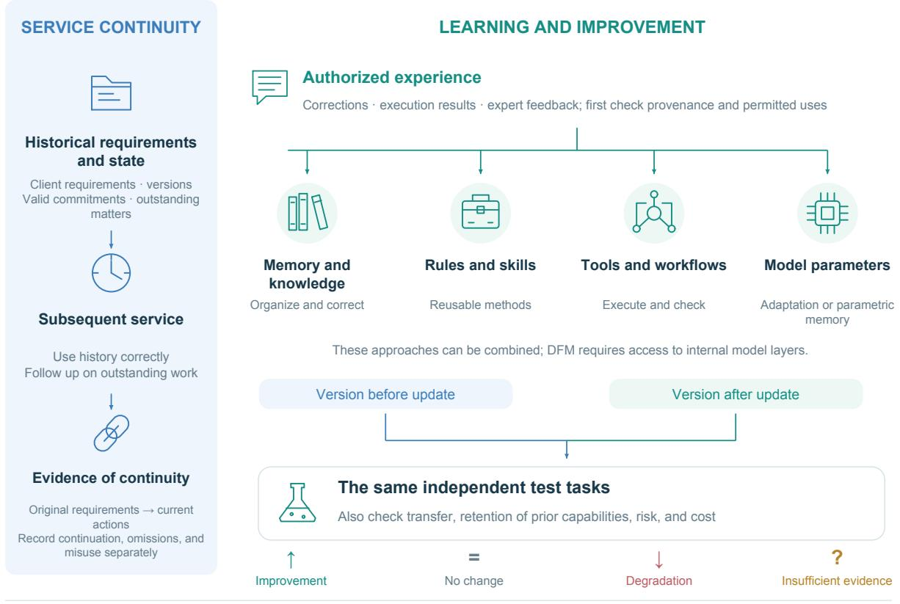
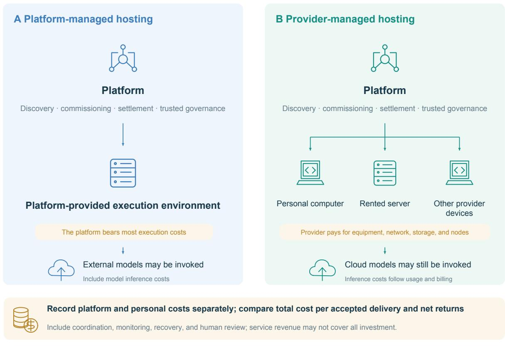

# DelegateEval: Evaluating Platforms for Personal External Service Agents

Jichao Li, Jinrong Lu, Manjiang Yu, Zhixuan Liu

BRICS Institute of Future Networks (China Branch)

{lijichao, lujinrong, yumanjiang, liuzhixuan}@bifnc.cn

## Abstract

AI agents that work for an individual over time may also help that individual serve external clients. We define a personal external service agent as an agent authorized and continuously managed by a specific individual to accept client requests, deliver work, and provide ongoing support using that person’s knowledge, experience, professional methods, and service boundaries. Such agents could allow individuals to serve more clients with less direct involvement and generate economic value at scale. We propose DelegateEval, a platform-level evaluation framework for agent systems that may combine large language models, reusable skills, protocols such as MCP, and executable tool environments. It covers eight dimensions: ease of creation, service discovery and matching, delivery quality, expertise inheritance, service continuity, learning and improvement, reliability and governance, and eficiency and value. These dimensions assess whether a platform enables people with diferent backgrounds to turn their expertise into ongoing services that deliver verifiable work, develop capabilities through experience, and remain economically feasible. We present the framework and an experimental design. Complete datasets, executable environments, a unified scoring protocol, and cross-model results remain to be developed and empirically validated.

Keywords: personal external service agents; platform-level evaluation; expertise inheritance; service continuity; learning and improvement; service scalability

## 1 Introduction

Personal AI agents increasingly carry out work over time rather than answer isolated questions. Meta’s September 2026 description of Muse, for example, states that it has a dedicated virtual machine and browser, can keep working after the user closes the application, retains relevant memories, and seeks confirmation for sensitive actions [1]. These capabilities make ongoing assistance possible. Could the same agent also provide services to external clients on its owner’s behalf?

A personal external service agent would allow an individual’s expertise to reach clients even when that person cannot take part in every task. An engineer’s code and debugging practices, or a teacher’s methods of explanation, could guide an agent’s work through configuration and continued development. We use the term for an agent authorized and continuously managed by a specific individual to use that person’s professional resources in serving external clients. Clients may submit requests themselves or through their personal assistants. Evaluation must establish whether the agent actually uses the individual’s expertise and honors client agreements with limited involvement from that individual.

Evaluation must follow the service beyond a single task. An engineer’s agent may deliver working code and still owe the client maintenance of an older version. It may later face changed requirements or withdrawn authorization. A platform must help people with diferent backgrounds establish services, help clients find suitable providers, and support the use of personal expertise across successive tasks. Tests must therefore check whether personal methods reduce domain errors, new requirements are reconciled with existing commitments, and feedback improves later work. They must also distinguish the contributions of the foundation model, personal resources, platform mechanisms, and additional human labor, and record the full cost of each. This makes it possible to assess whether quality, safety, and cost remain acceptable as the service grows.

We propose DelegateEval to evaluate service creation, individual service episodes, and service histories across tasks and time. Its eight dimensions use predefined requirements and independent verification, with service performance, accepted deliveries, safety incidents, human efort, and full costs reported separately. Records of technical configurations and operating conditions support comparisons across foundation models and implementations. Expertise inheritance tests how well a fixed version uses an individual’s professional resources; learning and improvement tests the additional benefit of updates based on authorized service experience. The present contribution is the framework and evaluation design, which will guide the development of datasets, execution environments, protocols, and cross-model experiments. The central question is whether a platform can help one person serve more clients while keeping quality acceptable and the provider’s workload and obligations sustainable.

## 1.1 Contributions

This paper makes three contributions. First, it distinguishes personal assistants from personal external service agents and defines the responsibilities of principals, clients, agents, and platforms. Second, it proposes eight dimensions for evaluating a platform’s support for professional services, with separate measures of discovery, continuity, and learning. A technical inventory records implementation conditions so that diferent approaches can be tested against the same service objectives. Third, it sets out comparisons across principals, tasks, and time to assess ongoing delivery, fulfillment, learning, personal efort, economic returns, and risk as services grow.

## 1.2 Paper Organization

Section 2 reviews related work. Section 3 defines the agents and service relationships under study. Section 4 discusses the value of external service agents, and Section 5 sets out the evaluation target and overall design. Section 6 develops the eight service-quality dimensions, and Section 7 describes current limitations and next steps. The present paper does not yet include a complete experimental protocol, scoring results, or appendices.

## 2 Related Work and Research Positioning

## 2.1 Task Completion and Deliverables

SWE-bench evaluates code changes against real repository issues. AppWorld checks application state to determine whether a task was completed and whether unintended changes occurred. TheAgentCompany places file processing, software use, and collaboration with colleagues in a simulated organizational environment [2, 3, 4]. tau-bench combines multi-turn interaction, tool use, business rules, and final-state evaluation, and examines consistency across repeated runs [5]. Together, these studies shift agent evaluation toward the work actually accomplished and provide a methodological basis for using concrete deliverables and independent acceptance checks.

Intelligent AI Delegation further emphasizes verifiability through task decomposition. Its contract-first approach requires task granularity to match the available verification methods: a subtask whose outcome is too subjective, complex, or dificult to verify reliably should be decomposed recursively until completion can be established through automated tests, formal proofs, or another suitable verification mechanism [11]. Task decomposition must therefore consider how completion will be demonstrated as well as how the work will be done.

DelegateEval applies these verification principles to platforms that support multiple individual providers. It tests whether people can establish their own services and whether those services remain verifiable and fulfill existing commitments as tasks, feedback, and environments change.

## 2.2 Memory, Learning, and Social Interaction

Long-term service requires agents to use past information correctly and improve through experience. LongMemEval studies long-term memory abilities such as information extraction across sessions, temporal reasoning, and knowledge updates [6]. LoRA and DPO provide methods for parameter-eficient adaptation and preference learning, respectively, supporting continued model adjustment [7, 8]. SOTOPIA studies social interaction among agents, Magentic Marketplace studies market behavior between consumer and merchant agents, and Intelligent AI Delegation examines authorization, responsibility, and role boundaries in delegated work [9, 10, 11]. These lines of research ofer relevant perspectives on memory, learning, and multi-party collaboration for sustained services.

Trainable add-on parametric memory provides another route to knowledge adaptation with a frozen foundation model. Wei et al.’s Deep Fusion Memory (DFM) trains a memory predictor using text-chunk embeddings obtained through ofline retrieval and fuses predicted memories into intermediate hidden states through gated cross-attention. The foundation model remains frozen while the added memory-prediction and fusion modules are jointly optimized. At inference time, explicit retrieval from the external corpus is no longer required [22]. Here, an add-on is a trainable module within the model’s computation, rather than a separate small model that independently answers questions.

SocialReasoning-Bench evaluates both outcomes and the decisions that lead to them. In scheduling and negotiation tasks, it checks whether agents use available information and explore suitable alternatives [12]. This matters for personal external service agents, which must represent a specific principal while managing existing agreements, later feedback, and changing client relationships. DelegateEval examines these decisions across tasks and time and compares whether a platform supports diferent principals’ professional requirements consistently.

## 2.3 Safety, Interoperability, and Platform-Level Evaluation

AgentDojo provides an executable environment for studying attacks and defenses involving untrusted inputs, including prompt injection [13]. For agent collaboration, A2A specifies interoperability mechanisms for exchanging tasks, status, and artifacts, providing an interface basis for service discovery, delegation, and delivery across agents [14]. These eforts address safety and collaboration within agent systems.

For DelegateEval, these mechanisms matter when they help clients find services, request work, receive deliverables, and obtain follow-up support from agents representing diferent individuals. Evaluation tests their contribution to those outcomes.

## 3 Scope, Three-Party Relationships, and Service Value

## 3.1 Principals, External Clients, and Personal External Service Agents

A personal external service agent is an agent authorized by a specific individual that incorporates that person’s knowledge, experience, preferences, methods, and service boundaries to provide ongoing services to external clients.

Throughout this paper, the principal is the specific individual represented by the agent. The agent represents that individual, not the individual’s employer or another organization.

A personal assistant works for me; a personal external service agent provides services to others on my behalf. A programmer’s personal assistant helps the programmer write code, whereas the programmer’s external service agent interacts with external clients, accepts software development requests, and delivers work on the programmer’s behalf. Access may be public or restricted to authenticated existing clients.

We denote the individual principal by p, an external client by c, and the principal’s personal external service agent by $a _ { p } .$ . The principal determines the service scope, professional methods, knowledge sources, data boundaries, and management rules. The client submits tasks, supplies materials, confirms requirements, and accepts deliverables. The agent follows the requirements that each party is entitled to set.

The client c may interact with the service directly or authorize a personal assistant or another agent to find services, submit requests, communicate requirements, and receive results. The client remains the person or organization requesting the service, even when another agent handles the interaction. The service beneficiary, the parties represented, and their responsibilities must remain clear. An agent acting for the client may confirm changes or accept results only within that client’s authorization.

Clients may adjust requirements for a particular deliverable, while the principal manages global service rules. If the principal changes the scope of the service, previously accepted work must still be addressed. Client materials and the principal’s private knowledge are managed separately; use for the current task, retention across tasks, and model training require purposespecific permission. If requirements conflict, the agent should seek clarification, negotiate, or request guidance, and record how existing commitments will be fulfilled or changed.

The personal external service agent $a _ { p }$ is a service role with explicit authorization and action boundaries. It is not voice or personality imitation and does not imply that the agent has independent legal personhood. Professional licensing and responsibility must be assessed separately.

Figure 1 contrasts the two service relationships in terms of service objectives and whom the agent represents.

## 3.2 Relationship to Other Agent Roles

Task capabilities and service roles classify agents along diferent axes. Coding, document editing, and video production describe what an agent can do. Personal assistants and personal external service agents describe whom it works for and the service relationships it enters. One system may perform several roles.

  
Figure 1: Service relationships for personal assistants and personal external service agents. The former serve the individual’s own needs; the latter are authorized and continuously managed by an individual to accept commissions from multiple external clients and provide delivery and maintenance. One system may perform both roles, with identities, materials, permissions, and records managed separately.

Booking a hotel, contacting merchants, or sending email on an individual’s behalf can remain the work of a personal assistant. The external service relationship studied here arises when an external client submits a development request and an individual provider’s agent accepts it and fulfills the associated obligations over time. Being continuously online, running in the cloud, or sending external messages does not by itself determine the role. When roles overlap, identities, materials, permissions, and records must be managed separately.

Customer-support, sales, and merchant agents that represent companies or other organizations fall outside this paper’s scope. Even if a platform supports such uses, this framework evaluates only its support for services provided on behalf of individuals.

For example, a software engineer’s client may request changes to the current deliverable, but may not require the agent to read the engineer’s private email, disclose another client’s code, or permanently rewrite global development rules. Treating external client messages as principal instructions confuses authority; following only the principal’s latest preferences may overlook delivery requirements already agreed with the client. These cases motivate role-switching tests.

Table 1: Agent service roles and their relationships. Roles may overlap; whether an agent qualifies as a personal external service agent is determined by the definition in Section 3.1.
<table><tr><td>Role</td><td>Organizing basis</td><td>Distinction relevant here</td></tr><tr><td>Task-oriented agent</td><td>A specific work objective</td><td>Whether it has an ongoing representative role depends on its use.</td></tr><tr><td>Personal assistant</td><td>The individual's goals, materials, Helps the individual work and may and daily work</td><td>procure external services on their behalf.</td></tr><tr><td>Personal external service agent</td><td>An identifiable individual principal and external service relationships</td><td>Accepts client requests on the principal's behalf, delivers work, and provides follow-up.</td></tr></table>

## 3.3 Platforms and the Scope of Their Evaluation

A platform helps individuals create, integrate, configure, publish, run, and manage their agents, and gives external clients a way to request work and receive results. It must identify whom each agent represents and explain the services ofered. Depending on the service and the platform’s purpose, it may also support continued capability development, public search, payment, collaboration with agents on other platforms, or local deployment. These additional functions are not required in every setting.

The platform operator provides infrastructure and establishes platform rules without overriding data-use boundaries. Training, long-term retention, or other uses of principal or client data still require the relevant permission. Human configuration, review, verification, and operational support supplied by the platform must be recorded and included in service costs rather than conflated with work performed independently by the agent.

We distinguish the model, the agent, and the platform. The model provides basic reasoning, generation, and decision-making capabilities. The personal external service agent combines those capabilities with an individual’s knowledge, experience, methods, tools, and service boundaries. The platform helps diferent individuals create and manage these services over time. DelegateEval evaluates that support using evidence from service creation, delivery, and subsequent tasks. A system that provides only part of this support may take the relevant component tests, but conclusions must remain limited to the functions tested.

## 4 The Value of External Service Agents

Personal external service agents could give clients access to services that reflect an individual’s expertise, with verifiable deliverables and someone responsible for follow-up. Providers can build retrieval knowledge bases from authorized proprietary materials, encode their methods in reusable skills and workflows, and combine general-purpose language models with smaller domain models and specialized tools. Where model access and training resources permit, they can also adapt model or add-on parameters through fine-tuning or other post-training methods. Later service feedback can inform updates to knowledge, workflows, and configurations. Even with the same foundation model, providers may therefore difer in their sources, professional judgment, execution, and delivery standards.

Clients using general-purpose tools such as ChatGPT or Codex directly often have to write prompts, break down tasks, select tools, and work through repeated attempts. A provider’s agent could reduce that efort, while the provider takes responsibility for professional judgment, verification, and revisions within the agreed scope. Clients without domain expertise may struggle to judge an answer: code that runs may break existing functionality, a polished report may use the wrong analytical definitions, and a complete mathematical solution may leave a student confused. Turning generated content into usable work requires appropriate methods, checks, and revisions.

In this supply-side human-in-the-loop arrangement, the agent handles repeatable work and the provider reviews results, makes key decisions, or takes over exceptions as needed. Platforms should record which outputs received automated checks, human spot checks, or the provider’s approval, and the efort involved. An agent representing an expert does not imply that the expert reviews every output.

An agent could also coordinate a provider’s computing equipment, production tools, robots, or in-person work. Within the principal’s authorization, this would extend services beyond the predominantly digital tasks supported by tools such as ChatGPT, Codex, and Claude Code. For example, a client could submit a design to an agent connected to the provider’s 3D printer. The agent could clarify requirements, generate and check a model, schedule production, and control the printer. A robotic arm could then remove, sort, and package finished items, while the agent arranges courier pickup.

Spare computers, such as a Mac mini or GPU server, could similarly ofer software builds, code testing, or model inference to external clients under appropriate resource isolation and authorization. Owners of drones, cameras, and other automated devices could accept relevant requests and coordinate equipment use. For ride-hailing drivers, domestic workers, and renovation contractors, an agent could handle client acquisition, communication, bookings, quotes, and follow-up while the provider performs the in-person work. Coordinating these resources could improve utilization and help individuals operate ongoing services that combine digital and physical work.

Many professional services continue after the first delivery. Software needs maintenance, business reports need new data, a video series needs a consistent style, and tutoring must adapt to a student’s progress. Over 30 to 90 days, an early misunderstanding or missing project state can afect many later actions. Without checks at intermediate stages, results may drift from the client’s goals.

Within the principal’s authorization and client agreements, the system must track objectives, deliverable versions, unresolved issues, maintenance schedules, and follow-up responsibilities. Checks at agreed stages, anomaly detection, and human review can help correct deviations. Providers still need to exercise professional judgment and intervene as requirements or environments change. An agent may also act proactively within its authority, for example by checking compatibility after a dependency changes, preparing a revised report when new business data arrive, or adapting exercises after repeated student errors. Such follow-up could reduce the client’s efort in identifying problems, explaining the context again, and requesting further work.

Personal external service agents could also act as specialists that a client’s personal assistant calls on. Browser operation alone does not ensure access to a needed service: Amazon restricted Muse’s access amid disputes over service access and authorization [23]. An assistant’s capabilities thus depend partly on which external services are available and can be used reliably. Individual providers could ofer interfaces through which assistants request professional work. The assistant would interpret the client’s goals, select services, coordinate tasks, and organize acceptance checks; the provider and external service agent would perform the specialized work and support delivery.

Providers charging per task, by subscription, or for ongoing support could use these interfaces to reach clients and deliver work. As more services become available, assistants could address a

wider range of needs through specialist help, and more clients could discover individual providers.   
Demand brought by assistants could in turn help sustain those services.

  
Figure 2: Relationships and interaction flow in agent-native services. The client’s personal assistant and the personal external service agent discover services, commission work, exchange status, and deliver results within their respective authorizations.

DelegateEval tests whether these potential benefits hold in practice: can clients obtain verifiable work and continued maintenance, and can individuals serve more clients while preserving their professional methods and service boundaries?

## 5 Evaluation Target and Overall Design

DelegateEval evaluates whether a platform helps people with diferent backgrounds use their expertise to provide reliable, ongoing services to more clients. It follows the full service lifecycle: creating and configuring an agent; helping clients find, select, and commission it; delivering and maintaining the work; and improving through experience while responding to changes in requirements, authorization, and the external environment. This section defines the evaluation target, framework, and scope. Section 6 explains the eight service-quality dimensions. Test protocols, scoring procedures, and decision rules remain for future work.

## 5.1 Why Evaluate the Platform as a Whole

DelegateEval asks whether a platform enables people from diferent backgrounds to build sustainable services around their expertise. Many potential providers have domain knowledge, business materials, and practical experience but little experience in agent development or system administration. Even with AI-assisted programming, building a system that accepts client requests, invokes tools, protects client data, and delivers work consistently is demanding. A platform can help with setup and routine management, including agent creation, knowledge configuration, and authorization, so that providers can concentrate on their professional work. Evaluation must therefore include the efort needed to set up and operate a service.

Once established, a service must be discoverable, earn trust, and build a reputation through repeated commissions. Platforms can help clients find and compare services and support providers in building credibility through verifiable delivery records, client feedback, and fulfillment history. These functions afect whether individuals can sustain a service and cannot be inferred from one agent’s task performance. DelegateEval therefore treats the platform as the primary target, asking whether it helps diferent individuals establish services, obtain commissions, deliver reliably, and build credibility. Individual agents’ task outcomes provide evidence for that platform-level assessment.

## 5.2 Eight Quality Dimensions and a Technical Inventory

Table 2: Eight service-quality dimensions and their central questions.
<table><tr><td>Quality dimension</td><td>Central question</td></tr><tr><td>1 Ease of creation</td><td>Can people with different backgrounds create, publish, and manage an agent successfully?</td></tr><tr><td>matching</td><td>2 Service discovery andCan clients find an appropriate agent and successfully commission work?</td></tr><tr><td>3 Delivery quality</td><td>Are artifacts correct, complete, usable, and delivered as agreed?</td></tr><tr><td>4 Expertise inheritance</td><td>Do personal data, methods, code, models, and other accumulated resources become effective service capabilities?</td></tr><tr><td>5 Service continuity</td><td>Are historical state, commitments, versions, and outstanding matters carried forward correctly?</td></tr><tr><td>6 Learning and improvement</td><td>Do authorized feedback and experience improve performance on subsequent tasks?</td></tr><tr><td>7 Reliability and governance</td><td>Are authorization, data use, human involvement, and exceptions handled reliably?</td></tr><tr><td>8 Efficiency and value</td><td>What does each party invest and gain while service requirements are met?</td></tr></table>

The technical inventory documents how a system is implemented and the conditions under which it was tested. It supports interpretation and replication; it does not contribute to the score. The record covers post-training, proprietary models, retrieval, state management, execution environments, event triggers, and human involvement, along with the materials, permissions, and resources used in the run. Diferent implementations may achieve the same service goal: post-training and revised checking procedures can both improve later tasks, while either a memory module or a project database may preserve continuity. DelegateEval does not favor one approach in advance. It distinguishes what a system supports, what it actually used in a test, and whether that use improved service. Scores reflect performance in the relevant dimension, not technology names, feature counts, or implementation complexity.

  
Figure 3: Eight-dimensional quality evaluation and technical implementation records. The dimensions assess diferent aspects of the same service process. The technical inventory explains operating conditions and is not scored by feature count. Safety thresholds are assessed separately; high scores elsewhere cannot ofset a disqualifying safety incident.

## 5.3 Observation Scope: Creation, Service Episodes, and Longitudinal Service

Evaluation starts when an individual first creates a service, rather than after the agent has been configured. Creation records cover identity binding, configuration, publication, and later management. Interface scripts test whether the functions work. Tests with real creators establish whether they understand the process, can configure the service correctly, and can find and fix errors. These two sources of evidence answer diferent questions and are recorded separately.

A service episode covers one client request from the initial commission to its outcome. It includes any necessary clarification, execution, checking, delivery, and revision, and ends when the task is completed, cancelled, or marked as pending. The task rules define these endpoints in advance without prescribing how the agent must do the work. A code change, a presentation, or a mathematics tutoring session can each form a complete episode. The episode record shows whether the requested work was completed and delivered.

A longitudinal service record establishes whether matters are handled correctly across tasks and time. It links one principal’s service episodes and intervening external events in temporal order. Multiple clients may be involved, and tasks may overlap. Earlier artifacts, commitments, valid permissions, and history that the system is authorized to retain may afect later decisions. For example, a request received on day 50 may need to be handled in light of an agreement made on day 3, an authorization updated on day 20, and a dispute arising on day 45.

These three kinds of records let evaluators ask whether a service can be created, whether individual tasks are completed well, and whether the working relationship holds up over time. Creation records retain successful and failed attempts; episode records capture delivery and acceptance; longitudinal records show how earlier work and obligations afect later actions. All three inform the platform-level assessment. Failed creation or publication attempts remain in the end-to-end results, so the evaluation does not consider only agents that reached operation successfully.

Figure 4 summarizes independent verification and evidence boundaries across the three kinds of records.

  
Figure 4: From service processes to independent evidence and evaluation conclusions. Creation, episodes, and longitudinal service supply complementary evidence. Business facts, valid authorization, and the agent’s internal state are recorded separately. Hidden materials are isolated from the evaluated system. Quality, acceptance, evidence suficiency, and safety are interpreted separately. The diagram summarizes the evaluation design and does not report completed experiments.

## 6 The Eight Service-Quality Dimensions

This section sets out the checks, scoring criteria, and review requirements for the eight dimensions. The question throughout is whether a platform enables diferent individuals to create external service agents and provide ongoing service to clients. The technical inventory records the methods and resources used to help explain the results; feature counts do not determine scores.

Before running a test, evaluators must decide what evidence will show that the task is complete. Following the contract-first task decomposition proposed in Intelligent AI Delegation [11], they define the required deliverables and acceptance procedures, then break broad requirements into checks that can be judged separately. For a research report, these might cover the scope of the evidence, reproducibility of calculations, support for claims, and whether the analysis answers the client’s question. Software can check fields and calculations; qualified independent reviewers assess professional judgment. The complete artifact must still be judged against the original task. Passing a few convenient checks cannot substitute for meeting the overall objective.

An acceptance contract must specify what counts as acceptable, who verifies it, what evidence they use, and how exceptions are handled. Table 6-1 lists the minimum elements shared across dimensions. The evaluator maintains contracts, reference answers, and acceptance procedures; the evaluated system submits artifacts and necessary execution records. Its claim of completion requires independent support. For open-ended work requiring human review, the review target, rubric, reviewer qualifications, disagreement resolution, and budget must be specified in advance. If further decomposition cannot make a requirement reliably assessable, a suitable expert review should be arranged, the scope negotiated before execution, or the result left pending acceptance. Requirements should not be relaxed after the fact.

Table 6-1: Acceptance-contract elements shared across dimensions. Scores and thresholds are set for each task; a single numerical standard is not assumed to apply across industries.
<table><tr><td>Contract element</td><td>What must be specified before testing</td></tr><tr><td>Target and scope</td><td>The principal represented, clients served, tasks undertaken, and scope of the evaluation conclusions.</td></tr><tr><td>Inputs and conditions</td><td>Available materials and versions, time scope, valid authorization, resource budget, and permitted human assistance.</td></tr><tr><td>Delivery and endpoint</td><td>Required artifacts, recipients, deadlines, and conditions for completion, cancellation, or a pending state.</td></tr><tr><td>Checks and scores</td><td>Requirements, points, mandatory conditions, tolerances, and the overall acceptance threshold.</td></tr><tr><td></td><td>Evidence and verification Artifacts, environment records, or independent reviews used to decide acceptance, and the programs or qualified people responsible.</td></tr><tr><td>Exceptions and missing evidence</td><td>How incomplete work, unobserved actions, conflicting evidence, environment failures, and inapplicable items are distinguished and handled.</td></tr><tr><td></td><td>Counting and attribution Whether counts are per person, request, task, historical check opportunity, or version comparison; the denominator and primary scoring dimension.</td></tr></table>

Report diagnostic scores, acceptance decisions, and the suficiency of the evidence separately. Diagnostic scores summarize predefined checks using fixed weights. A delivery is accepted only when it meets every mandatory condition and reaches the overall score threshold. If evidence is missing, keep the predefined denominator and withhold a complete score; do not rescale a few verified successes into a perfect score. Conversely, confirmed failure of a mandatory condition is enough to reject the delivery, even while other checks remain unresolved. A required file or field missing from the sealed submission means the delivery is incomplete. A relevant record that the evaluator failed to collect means there is insuficient evidence. Suspected tampering, contradictory timestamps, and counts outside permitted ranges should be flagged and reviewed as evidence anomalies before drawing conclusions about platform capability.

## 6.1 Ease of Creation

Ease of creation assesses whether people with diferent backgrounds can independently set up and manage a working external service agent within specified time and assistance limits. Testing begins when they enter the creation process and covers identity binding, service scope, professional requirements, permissions, publication, pending approvals, rule changes, and service termination.

Saving a page or submitting a configuration does not demonstrate successful creation. The service must be accessible to external clients, and independent tests must show that its key settings afect the agent’s behavior.

Creation tests record the outcome and the help required, so that work done by experts or experienced platform users is not mistaken for ease of use by ordinary users. The unit of observation is one person’s attempt to create a service. Required actions, time limits, permitted assistance, and error-recovery tasks are defined in advance. Results distinguish unassisted completion, completion with permitted help, takeover by someone else, and failure. Failed creation and publication attempts remain in the end-to-end statistics. Scripts can verify that a function exists or an interaction path works. Only tests with real creators can show whether people understand the process and can detect and correct configuration errors. A successful script alone does not establish ease of use.

Figure 5 illustrates how personal capabilities enter actual service. Identity and authorization establish representation; preferences and professional methods guide handling; knowledge bases supply evidence; skill libraries organize reusable methods; and tool connections enable authorized actions. Skills and MCP are examples of implementation options, not a required architecture. Evaluation asks whether configurations afect real delivery while preserving separation among clients’ materials.

  
Validate configuration through behavior and delivery; clients receive results and necessary evidence, without full access to private methods.

Figure 5: How personal capabilities are put to use in service. The platform configures authorized identity, preferences, knowledge, and methods for deliveries to diferent clients, while keeping each client’s materials and permissions separate. Skills and MCP are optional implementation examples. A method earns no points simply because it is proprietary: evaluation checks whether the configuration works and whether the delivered results have the required supporting evidence.

## 6.2 Service Discovery and Matching

Service discovery and matching assesses whether clients can find an appropriate personal external service agent and successfully initiate a service engagement. A client may start with a task and constraints on expertise, budget, deadline, and human involvement, or may seek a particular person or a provider with a specific professional background. Platforms should make service scope, delivery arrangements, pricing, and the principal’s involvement understandable so that clients can make informed choices.

Tests should cover clients searching by task as well as by a person’s identity or professional background. Scenarios can ofer several suitable services, a mix of suitable and unsuitable services, or no suitable service. Evaluators check whether the platform presents relevant options, explains key limitations, and lets the client commission the work. Measures may include the rate at which clients find suitable candidates, the rate at which they choose unsuitable services, the time needed to choose, and the rate of successful engagement initiation. Where several choices are reasonable, the test should not require one uniquely correct selection.

During discovery, evaluators should verify both who authorized the agent and what the service promises. Platforms should state whether the individual has authorized the agent, provide evidence for professional experience relevant to the client’s choice, and specify which work the individual will review. A verified identity is not proof of competence. For repeat requests, tests should also check whether the client or personal assistant can find the same service again, understand its current scope and any changes, and initiate another task within the authorization granted. Human clients and demand-side agents may use diferent interfaces, but both need enough information to understand and choose the service.

## 6.3 Delivery Quality

Delivery quality assesses whether the artifacts actually received by the client meet previously confirmed task requirements and are usable in practice. Acceptance distinguishes mandatory conditions from ordinary preferences and checks content, usability, version, recipient, and deadline. A confirmed failure of any mandatory condition prevents overall acceptance; preferences are assessed with a predefined rubric. Revisions must distinguish repairs to original defects from new client requirements. Initial and revised deliveries are retained separately: expanded scope must not be recorded as an original defect, and a successful revision must not erase problems in the first delivery.

Complex tasks should be broken into subtasks whose completion can be verified independently, while the final result is still assessed as a whole. Consider a study of the global new-energy vehicle market. A report alone is not proof of completion: the research subject, evidence cutof, source scope, and client’s questions must first be clear. The work might produce a policy inventory, company and product tables, a comparison of forecasts, and a synthesis. Policy entries need verified names, dates, issuing authorities, and sources. Product prices must identify the model, configuration, and date. Where a price has not been published, that absence must be stated. Forecasts need their year, units, coverage, and source, and must be distinguished from observed statistics. Software can check fields, calculations, and whether entries correspond correctly. Independent review must determine whether the sources support the conclusions, statistical definitions are consistent, and the synthesis answers the client’s questions. Working links, numerous citations, and filled-in tables do not establish the quality of the study as a whole.

Verification should match the type of deliverable. Table 6-2 lists ten representative task types, their design identifiers, and the main acceptance checks to guide future test-case development.

Q01-Q10 currently label proposed cases, not completed tests. The full task inputs, reference outputs, and independent acceptance procedures have yet to be assembled, and no results from running these cases are reported.

Table 6-2: Ten service-task types and their acceptance considerations. Q01-Q10 identify proposed case designs; complete testing materials and execution-validation results are not yet available. Tasks in high-stakes domains must also meet the relevant professional and ethical requirements.
<table><tr><td>Task type and design ID</td><td>Deliverables</td><td>Primary acceptance evidence</td></tr><tr><td>Code development and automation/ Q01</td><td>Source code, execution instructions, test results, and delivery receipt</td><td>Independent functional and regression tests; interfaces, dependencies, and permitted change scope. Logs must identify the submitted code version.</td></tr><tr><td>Presentation creation and revision receipt /Q02</td><td>Editable slides and delivery</td><td>File opens, designated objects are editable, and key figures are retained. Facts, argument structure, and layout receive separate review.</td></tr><tr><td>Document revision and localization/ Q03</td><td>Revised document, change notes, and delivery receipt</td><td>Item-by-item comparison of requested changes and protected content. Meaning, translation, and terminology are reviewed against task requirements.</td></tr><tr><td>Spreadsheets and data analysis / Q04</td><td>Data tables, analysis, and processing notes</td><td>Reproducible formulas, units, row-level results, and aggregates. Analytical definitions and support for conclusions are checked separately.</td></tr><tr><td>Retrieval and research synthesis / Q05</td><td>Source index, evidence comparison, and synthesis report</td><td>Checkable source fields and numerical mappings. Source support, coverage, and synthesis require independent judgment.</td></tr><tr><td>Video and visual production / Q06</td><td>Finished media, agreed source files, and asset list</td><td>Decodable files and compliant duration, dimensions, and other specifications. Content, visuals, and asset-use permissions receive separate review.</td></tr><tr><td>Mathematics tutoring / Q07</td><td>Explanations, exercises, and corrective feedback</td><td>Independent mathematical checks and separate pedagogical review. Learning is assessed through an independent post-test.</td></tr><tr><td>General knowledge and health education /Q08</td><td>Explanations, organized materials, and referrals where needed</td><td>Evidence, relevance, and service boundaries are checked. The task does not establish individual clinical diagnostic or treatment outcomes.</td></tr><tr><td>Planning under multiple constraints /Q09</td><td>Plan, budget, schedule, and alternatives</td><td>Verifiable constraints, calculations, and resource conflicts. Real-world feasibility and trade-off reasoning receive separate review.</td></tr><tr><td>Communication and administrative work /Q10</td><td>Drafts, messages, appointments, receipts, and pending-item state</td><td>Drafting is distinguished from sending. Recipients, time, parameters, and actual effects in the controlled environment are verified.</td></tr></table>

Code should be evaluated in an independent test environment that the system under evaluation cannot modify. Documents, presentations, and videos require separate checks of file usability and content quality. Clear requirements need not be reconfirmed repeatedly, and execution paths need not be prescribed. Work that invokes other software, models, or collaborating agents remains subject to the same acceptance standard.

Multi-artifact deliveries require checks of both individual components and consistency across them, as well as confirmation that acceptance evidence corresponds to the actual submission. Numbers in a report and presentation should agree; documentation should match the submitted source-code version; receipts should identify the actual files and recipient; and a delivery package must not contain another client’s materials. Human review also requires explicit criteria. A research report can be checked separately for question coverage, source support, and consistency of statistical definitions rather than receiving only a holistic impression. A confirmed failure of any mandatory component cannot be ofset by higher scores elsewhere.

Tasks that cannot be fully checked by software require independent human review. A research report, for example, needs verification of data and citations as well as expert assessment of its reasoning and conclusions. Reviewers should use predefined criteria and retain decisions and supporting evidence for later inspection. Substantial disagreement requires further review. A task awaiting mandatory review must not be marked as accepted.

## 6.4 Expertise Inheritance

Expertise inheritance assesses whether platform configuration and continued development enable an agent to apply a particular individual’s knowledge, experience, judgment, and working standards in real service. This expertise can be embodied in proprietary datasets and knowledge bases, reusable skills and standard operating procedures, code and tools developed by the individual, or models trained or adapted using the individual’s datasets. These models may be adapted general-purpose language models, smaller task-specific models, or specialized recognition models. Interfaces such as MCP connect the tools and models to the agent’s workflow. Resources may be public or kept in an environment controlled by the individual, where authorized calls allow their use without disclosing the full data, code, or model.

Consider a horticultural expert who spends years collecting images of pests and diseases afecting a particular flower species, along with diagnostic records and treatment outcomes. A specialist model trained on that unpublished dataset, used together with the expert’s diagnostic workflow and cultivation knowledge, could extend that expertise to more clients. Evaluation must show that these resources make a verifiable contribution to relevant tasks, including whether they meet specific service needs better than a general-purpose model using only public materials.

Evaluation must distinguish persona-based role-play from the use of an individual’s professional expertise. Some role-play services assign a name, biography, interests, and speaking style to portray a historical or fictional character, such as the poet Li Bai. A recognizable persona does not by itself transfer expertise. Without relevant knowledge, methods, and tools, performance on practical tasks still depends largely on the underlying general-purpose model. A personal external service agent is closer to an apprentice who learns from the person it represents: the individual’s materials, cases, methods, code, and models help it solve relevant professional problems. Tests should ask whether these resources change how the agent works and what it delivers.

With the foundation model, access to public tools, and resource conditions kept comparable, configurations with and without personal resources can be tested on new tasks. The checks ask whether those resources help the agent identify key issues, choose appropriate methods, reduce professional errors, or better meet requirements. Persona and style can make a service recognizable, but expertise inheritance requires evidence from the work itself.

Expertise inheritance tests a fixed system version: can the agent correctly access and apply the personal resources already available to it on independent tasks? The model, personal resources, and configuration are held constant. Learning and improvement tests a diferent question: do updates based on authorized service experience produce additional benefits attributable to that experience? It therefore compares versions before and after the update. The two dimensions report existing capability and experience-driven change separately. Each gain is scored only in its assigned dimension, and any additional human help is recorded separately.

## 6.5 Service Continuity

Service continuity assesses whether an agent correctly carries existing requirements, artifacts, commitments, and unfinished work into later service. Saving a history is not enough: the agent must use relevant history when deciding what to do next. Each ongoing matter should be linked to its principal, client, artifact version, applicable requirements, and current status. When the agent handles overlapping tasks or multiple clients, it must keep the relevant materials, versions, and commitments separate.

Continuity is judged by what the agent does next, rather than by its ability to recount the past. New authorization, rules, or client requirements may change subsequent actions, but do not automatically cancel existing commitments or unfinished work. If the original approach is no longer available, evaluation should check whether the agent recognizes the change, pursues permitted alternatives, contacts someone authorized to approve a modification, and keeps track of the matter. Records must distinguish obligations that are not yet due, overdue obligations, changes accepted by the client, and changes that have only been proposed. Proposing a solution does not fulfill an obligation.

Continuity also includes necessary proactive follow-up on existing services within the agent’s authorization. When an external change afects an artifact or commitment, the agent should determine its relevance and, where appropriate, update the artifact, notify the client, or advance outstanding work. Unrelated changes should not cause repeated interruptions. Repeated reminders about one event must not count as multiple successes. The value of follow-up should be assessed from its actual consequences rather than the number of notifications sent.

## 6.6 Learning and Improvement

Learning and improvement assesses whether service experience gives an agent reusable capabilities that improve its performance on new tasks. Expertise inheritance tests a fixed version’s use of accumulated personal resources; this dimension tests the additional benefits of updates based on authorized service experience. That experience may include client feedback, revision requests, human corrections, task outcomes, verifier results, environmental changes, and execution records. After a service episode, the system may remain unchanged or update its memory, knowledge, rules, skills, workflows, or model parameters. Evaluation must compare the versions on independent tasks to establish what changed.

Learning may change an agent’s memory, knowledge, rules, skills, workflows, or model parameters. Experience can be stored in long-term memory or a knowledge base for later retrieval, or used to revise prompts, rules, checklists, and decision strategies. Repeated successful sequences of actions can become callable skills or programs. Changes to task order, tool combinations, and points of human involvement can improve workflows. More stable experience that transfers across tasks may be incorporated into model parameters through fine-tuning, preference learning, or reinforcement learning. Some systems may also use execution history to improve how they form memories, select skills, or organize workflows. Evaluation should examine these actual changes, rather than simply check whether the platform has a training interface.

Parametric memory modules ofer one way to support learning, but evaluation must account for their access requirements and resource costs. DFM, for example, freezes the foundation model, trains added modules, and integrates memory into intermediate model layers [22].1 This method requires access to the model’s internals, so it cannot be applied directly when a model is available only through an inference API. For personal services, evaluation must also check permission to use the training materials, the module version, gains on independent test tasks, retention of existing capabilities, update costs, and what happens when permission is withdrawn. Gains from adapting a model to a static corpus must be tested separately from gains due to feedback from ongoing service.

Table 6-3: Where learning occurs, what may change, and the corresponding evaluation questions.
<table><tr><td>Learning location</td><td>Possible changes</td><td>Evaluation question</td></tr><tr><td>Model parameters</td><td>reinforcement learning</td><td>Fine-tuning, preference learning, Is a new capability internalized, and does it transfer to new tasks?</td></tr><tr><td>Memory and knowledge Experience retention,</td><td>corrections, summaries, knowledge updates</td><td>Can the agent retrieve and correctly use stored information in later tasks, rather than merely retain more of it?</td></tr><tr><td>Rules and strategies</td><td>Prompts, checking rules, decision strategies</td><td>Are recurring errors reduced without entrenching incorrect rules?</td></tr><tr><td>Skills and tools</td><td>Reusable operations or programs Can skills be reused, combined, and</td><td>corrected across tasks?</td></tr><tr><td>Workflows</td><td>calls, verification, and human involvement</td><td>Changes to decomposition, tool Does the system develop a more reliable and efficient way of working?</td></tr><tr><td>Environmental experience</td><td>Patterns in tools, interfaces, and Does adaptation become faster without environmental change</td><td>persistently retaining outdated information?</td></tr></table>

The system must also decide what to retain and where to retain it. A client’s current budget, a project’s software version, or a contact’s temporary permission may change quickly; these facts are better kept as service state or memory that can be queried and updated. More stable practices, such as aligning statistical definitions before market research or running regression tests after a code change, may become reusable rules, skills, or workflows. Capabilities repeatedly validated across many tasks and shown to transfer well may eventually be incorporated into model parameters through training. Systems can also absorb incorrect feedback, outdated knowledge, and incidental experience. Learning therefore requires correction, replacement, consolidation, and forgetting as well as the addition of information. Over time, an agent should make better choices about what to retain, how to organize it, and when to use it.

DelegateEval distinguishes storage, adaptation, and learning. Storage records a fact, such as a client’s use of Python 3.10. Adaptation uses that fact to adjust behavior, such as selecting Python 3.10 for the client’s project. Learning turns experience into a reusable method that improves future work: after repeated compatibility-related revisions, for example, an agent develops a version-checking procedure that reduces similar errors in new clients’ projects. Service continuity primarily tests whether storage and adaptation allow earlier matters to be handled correctly. Learning and improvement requires further evidence that past experience improves the agent’s ability to solve new problems; retaining more information alone is insuficient.

To test learning, compare versions before and after an update on independent tasks. Fix the initial version, authorized experience, update budget, primary metrics, and test tasks in advance. The procedure is to run a service episode, evaluate it independently, return the experience that the system is authorized to use, perform the update, and test the new version on new tasks. Both versions should complete the same held-out and transfer tasks under comparable conditions, with checks for retention of existing capabilities. Separate genuinely unseen tasks from training and feedback examples, close paraphrases, and task branches that share history, so that memorization or overfitting is not counted as learning. A service may improve by relying on more human work, but the benefits of that additional labor must not be attributed to system learning.

Learning results should report transfer, retention, forgetting, negative transfer, risk, and cost alongside improvement. An update may help the current task while damaging an earlier capability, help within one domain while causing errors elsewhere, or improve quality at substantial humancuration and compute cost. Incorrect or low-quality feedback should be tested explicitly to establish whether the agent absorbs it uncritically. A complete learning result should establish whether new-task performance improved, whether the gain transfers, whether previous capabilities were retained, whether new risks emerged, and what update and human costs were incurred.

A valid experiment may show no improvement or even a decline. If the source of feedback, the relationship between system versions, the update process, and the test tasks can all be verified, report no observed improvement when performance is unchanged, and degradation or negative transfer when it falls. A claim of reusable learning requires meeting predefined improvement criteria on independent test tasks while satisfying the required retention and safety conditions. If test data have leaked, versions cannot be linked reliably, experience has been used without permission, or human and system contributions cannot be separated, the result cannot be attributed to system learning.

The practical question is whether experience from earlier service improves later service. An agent should build on authorized corrections, methods, and experience from meeting client commitments, retaining them in forms suited to later use. When it encounters new clients, projects, and environments, this experience should help it avoid recurring errors, use better methods, and require less repeated intervention from the principal. The presence of memory, training, or update interfaces does not by itself demonstrate such improvement.

Figure 6 separates two evidence paths: continuity concerns how earlier matters are carried forward; learning concerns whether experience improves performance on independent test tasks.

## 6.7 Reliability and Governance

Reliability and governance assesses whether a platform follows the applicable rules for identity, authorization, data use, human involvement, and failure handling as it provides services. Tests should check whether permissions are clear, actual actions comply with them, and valid rule changes take efect promptly. The existence of permission settings is not enough. Each important

  
Storing history is not learning new methods; compare versions on independent tasks with explicit permissions and comparable resources.

Figure 6: Service continuity and multiple paths to learning and improvement. Continuity checks whether historical requirements and current actions are correctly connected. Learning checks whether authorized experience improves independent test tasks. Memory, knowledge, rules, skills, tools, workflows, and parameter updates are optional approaches, not a hierarchy of technical sophistication. Improvement, no change, degradation, and insuficient evidence are recorded separately.

authorization should specify who grants it, what it applies to, the resource and version involved, the permitted operations, and when it takes efect. A contact’s identity, right to receive materials, and authority to approve changes for a client must be checked separately. A genuine identity, a familiar relationship, or access to some information does not establish any further permission.

Public reports illustrate that authorization risks can arise from a mismatch between a user’s understanding and the system’s permitted execution scope, even without an obvious unauthorized action. In September 2026, Matt Robb reported that Meta Muse, while handling Facebook Marketplace messages for him, sent a buyer his residential pickup address and arranged collection; the buyer subsequently arrived at his building. Robb later explained that he had selected Allow Always but had expected important steps such as accepting ofers to require further confirmation. The setting in fact allowed automatic messages containing the pickup address. Later reporting stated that, after discussions with Meta staf, Robb attributed part of the problem to permission settings and said Meta was considering clearer prompts [21]. These reports do not independently establish an authorization bypass. They more directly illustrate a governance problem: authorizing message handling should not leave a user unclear about whether address disclosure, transaction confirmation, or in-person meetings are also authorized. Platforms should test consistency among interface wording, what users actually confirm, and the operations the agent can execute.

Another risk is confusing access to information with authority to make commitments. Consider the following hypothetical illustration: an external service agent finds an old booking link in internal notes and promises a client a meeting without checking current availability or the participants’ consent. It may also infer an unapproved fee or send internal client-routing notes directly to the client. Relevant safeguards include restricting the basis for quotations, separating internal analysis from external replies, and checking availability and approvals before committing another person’s time. Being able to read a document does not authorize disclosure; finding a booking link does not authorize a commitment of someone’s time; calculating a price does not authorize quoting it. This illustration is not an independently verified incident and cannot be used to estimate accident rates.

DelegateEval translates these risks into separately verifiable requirements for authorization enforcement, disclosure, commitment management, escalation, duplicate-action prevention, recovery, and data use. Critical actions are recorded at three levels: agent proposal, platform submission, and actual environmental efect. If the platform blocks an unauthorized proposal, the agent’s judgment failed while the safeguard worked. An authorized action that never takes efect is not successful delivery. Confirmed unauthorized execution receives a separate safety assessment, whose decision rules will be specified in a future protocol. Ordinary requests should be paired with stress conditions so that blanket refusal is not mistaken for strong governance. Software can verify explicit identities, fields, times, versions, and permissions. Implied commitments in natural language, cumulative disclosure across turns, and domain-dependent judgments require independent review.

Human involvement should bring each issue to someone with the authority and expertise to handle it, at the time a decision is needed. Clients normally confirm clarified requirements, the principal sets global service rules, and qualified reviewers assess professional quality. If one person holds several roles, record the role in which that person intervenes. Automated checks, sampled human review, professional verification, approval to send, and direct takeover are distinct interventions, not a ranking of capabilities. Reviewing an artifact does not authorize its disclosure, and approving an invitation does not confirm that the invitees will attend. Tests should check whether required escalations are timely and contain enough information, and whether matters that are already clear are referred to humans unnecessarily. Repeated requests for guidance must not count as repeated successes. Record the outcomes after takeover and the time spent.

Tests must also cover rule changes while actions are in progress. If authorization is withdrawn after an agent proposes an action but before the platform submits it, check the action against the authorization valid at submission and record when the withdrawal became visible to the system. Before retrying after a network error or ambiguous response, check the task identifier, parameters, and existing receipts to avoid duplicate execution or charges. After a failure, recovery should establish which matters remain unfinished and which permissions are current, rather than replay every interrupted action. Restoring operation tests reliability; correctly continuing earlier business matters also provides evidence of service continuity.

Permission for current-task use, retention across tasks, and learning must be granted separately. Providing data for one task does not authorize long-term retention, knowledge-base updates, or model training. When permission changes or is withdrawn, evaluation should verify that the agreed suspension, deletion, rollback, retraining, or other response has actually occurred. Removing an entry from a retrieval database shows only that it can no longer be retrieved from that location; it does not show that the information has been removed from model parameters or other copies. Governance claims require traceable evidence. Leave unverifiable matters unresolved, and retain confirmed incidents in the record even if other scores are high, later actions are blocked, or the incident is subsequently remedied.

## 6.8 Eficiency and Value

Eficiency and value assesses whether clients receive better results and individuals can serve more clients with the time available. DelegateEval considers all three parties: whether clients can obtain better services, principals avoid repeated efort, and platforms support the service at a reasonable cost. These questions require measuring quality, time, labor, and cost together. Token counts and cheap model calls alone do not establish eficiency. Prior agent-evaluation work likewise warns that accuracy alone can hide the real cost of a system and recommends comparing outcomes and costs jointly, including Pareto trade-ofs across systems [15].

For clients, value may mean better results, less efort, or access to a service that was previously dificult to obtain. A client preparing an industry report with general-purpose AI might spend two hours explaining context, selecting sources, checking numbers, and revising conclusions. With an industry expert’s agent, the client might only state the objective and inspect the result, while the agent follows the expert’s maintained methods. Evaluation should separately record final quality, preparation, selection, waiting and verification time, revisions, and acceptance of incorrect results, rather than rely on perceived convenience. In a randomized experiment with 453 professionals, Noy and Zhang found that ChatGPT reduced average completion time by about 40% and improved output quality by about 18% on midlevel professional writing tasks [16]. Time and quality can change simultaneously and should both be measured.

A distinctive potential benefit is that one hour of a person’s expertise could support more accepted services rather than only one client. Suppose an expert previously spent 60 minutes personally serving each client. If an agent handles most information gathering, initial assessment, and output generation, leaving an average of six minutes of expert review at critical points, one hour could in principle support about ten service instances. If, further, 80% of low-risk tasks need no personal intervention and only complex or high-risk matters are escalated, capacity could extend beyond the time available for direct personal work. Evaluation should therefore record the principal’s time per accepted service and accepted services per hour of the principal’s time, rather than only the number of tasks completed by the platform.

This service leverage may vary across people and tasks, so evaluation must examine subgroups as well as averages. Brynjolfsson, Li, and Raymond’s 2023 working paper, based on 5,179 customer-support workers, reported an average increase of about 14% in issues resolved per hour with generative AI, concentrated among less experienced and lower-skilled workers; gains for highly experienced workers were substantially smaller [17]. Three randomized field experiments involving 4,867 developers at Microsoft, Accenture, and another large company reported an overall increase of about 26% in completed tasks with an AI coding assistant, with higher adoption and productivity gains among less experienced developers [18]. DelegateEval should therefore distinguish clients’ domain experience, AI proficiency, and dependence on a provider’s expertise rather than report only average time savings.

Those who benefit most may also have the greatest dificulty identifying errors. A client who cannot code may greatly need an engineer’s agent yet struggle to detect regressions. A client unfamiliar with nutrition may rely heavily on expert assistance while being less able to recognize incorrect explanations. Client burden must therefore include whether critical errors are detected, not just minutes spent checking. Decision time, verification time, and incorrect-result acceptance should be recorded separately. Spending only five minutes checking an artifact does not establish value if the client accepts it despite an important error.

Eficiency gains must not be assumed, because AI can have opposite efects across tasks and users. In a 2025 randomized study of 16 experienced open-source developers working in familiar repositories, METR found that allowing AI tools increased completion time by about 19%. Participants had roughly five years of experience with their repositories on average and expected, both before and after the study, that AI would make them faster [19]. Perceived convenience and more advanced agents are therefore insuficient evidence of eficiency. DelegateEval should use measured time, actual artifacts, and independent acceptance, retaining heterogeneous efects in the results rather than discarding them as outliers.

Full-cost accounting must establish whether work has been eliminated or shifted from the client to someone else. A client may save an hour because an agent does the work, or because a principal, expert reviewer, or platform operator spends an additional hour. Time must be recorded separately for all of these parties. Costs should include inference, software and API calls, training or updates, failed attempts and retries, maintenance, and recovery. Client prices must be distinguished from actual resource costs. If time is converted into money, the rate should be stated; raw minutes or hours may also be retained. Failed tasks still incur time and expense, which must not disappear from accounting because no acceptable artifact was delivered.

Cost accounting should distinguish establishing a service from serving an additional client. Organizing knowledge, configuring rules, preparing examples, integrating tools, and training models are initial setup costs. Inference, software use, and personal review for another client are marginal service costs. Knowledge updates, model maintenance, and operations are ongoing maintenance costs. A service requiring 100 hours of setup followed by five minutes of personal efort per ordinary client has diferent scaling properties from one still requiring 50 minutes for every new client. Long-term comparisons can report setup, marginal, and maintenance costs alongside amortized cost per service rather than combine them without distinction.

Providers may host their own agents on spare personal computers or rented resources, alongside the option of platform-managed hosting. They can adjust spending to demand and revenue while paying for depreciation, electricity, networking, storage, and model calls. A centralized personal-assistant platform may otherwise supply cloud execution and subsidize free users.

With provider-managed hosting, the platform could instead focus on discovery, commissioning, settlement, and trusted governance without maintaining a complete execution environment for every provider. Having providers cover some computing and operating expenses could reduce a new platform’s upfront funding needs and its spending on execution resources as services grow. Here, distributed operation refers to where agents run and who pays; it does not require all foundation models to run locally.

Moving expenses to providers does not by itself reduce total cost or make the service profitable. Platforms still pay for coordination and governance, and providers may incur equipment costs and pay to keep their agents online before earning any revenue. Revenue must cover operation, maintenance, and necessary human review; viability also depends on reliable, secure nodes with suficient availability. DelegateEval should report platform and provider costs separately. It should compare total cost per accepted delivery and providers’ net returns under matched quality, safety, and load conditions, counting any additional coordination, monitoring, and recovery overhead. Cost transfers must not be counted as eficiency gains. Whether this arrangement lowers expansion costs and supports sustainable operation remains a question for operational data.

Figure 7 contrasts platform-managed and provider-managed hosting and their allocation of operating costs. It compares resource arrangements and who pays, rather than established cost reductions.

  
Cost sharing does not imply lower total cost or profit; distributed execution does not mean that all foundation models run locally.  
Figure 7: Platform-managed and provider-managed hosting and operating costs. Provider-managed hosting transfers some execution resources and costs to providers while platforms retain discovery, coordination, settlement, and governance expenses. Both arrangements may invoke external models. The figure contains no cost comparison and does not assume that distributed operation necessarily lowers cost or yields profit.

Scalability concerns whether personal efort grows substantially more slowly than accepted service volume while quality and risk remain controlled. An agent might handle five requests per day on time but develop a rapidly growing approval queue at 50 requests, with P95 waiting time rising from ten minutes to eight hours. Low average cost would not establish scalability in that case. Tests must distinguish total workload, simultaneous arrivals, and sustained load, tracking acceptance rate, throughput, queueing, P90/P95 latency, backlog, personal intervention time, and risk. Recent research on agent reliability also emphasizes that average success rates can conceal consistency, robustness, and failure severity, reinforcing the need to assess more than averages when scaling [20].

Client value may decline as services grow; more choices, agents, or concurrency are not benefits in themselves. In Magentic Marketplace’s simulated two-sided agent market, search quality directly afected consumer welfare. Several models exhibited choice overload and lower consumer welfare as candidate sets expanded, and agent performance could deteriorate substantially at larger market scales [10]. For DelegateEval, having ten thousand external service agents is not inherently better than having one hundred. Evaluation must establish whether clients find appropriate providers more easily, receive better services, and retain these benefits as the platform grows.

Long-term value also includes whether repeat collaboration requires less efort than the first commission. A first-time client may need to explain project context, technology choices, and delivery preferences to an engineer’s agent. By the tenth commission, correctly carried-forward information that the system is authorized to retain may allow the client to state only the new requirement. Initial and repeat commissions can be compared for explanation time, verification time, interventions by the principal, and maintenance cost. Persisting incorrect history is not valuable simply because it saves the client a few sentences. Long-term eficiency must therefore be interpreted with continuity and reliable governance.

Eficiency and value should ultimately identify who benefits and who bears additional costs, rather than collapse all outcomes into a single higher-is-better score. A system may save client efort while increasing expert review, multiply service volume tenfold at higher platform compute cost, or minimize cost while reducing quality or increasing risk. DelegateEval therefore prioritizes the underlying measures of delivery quality, client burden, personal efort, system cost, and service scale, and compares their trade-ofs under common quality and safety constraints. Consistent with AI Agents That Matter [15], joint performance-and-cost evaluation and Pareto comparisons are more informative than rankings based on one metric.

Table 6-4: Primary measures of eficiency and value. Measures are reported separately; they need not be combined into one value score
<table><tr><td>Perspective</td><td>Primary measures to retain</td></tr><tr><td>Client</td><td>Final quality; preparation, selection, waiting, and verification time; revisions; incorrect-result acceptance; service accessibility.</td></tr><tr><td>Principal</td><td>Total time contributed by the principal; the principal's time per accepted service; accepted services per hour of the principal's time; escalation rate.</td></tr><tr><td>Platform and system</td><td>Setup, marginal service, and maintenance costs; failure and retry costs; inference and software-call costs.</td></tr><tr><td>Service efficiency</td><td>Acceptance rate; cost per accepted delivery; end-to-end latency; P90/P95 latency.</td></tr><tr><td>Scalability</td><td>Throughput across loads; quality changes; queues and backlog; growth in personal effort; risk changes.</td></tr><tr><td>Long-term value</td><td>Repeat clients' re-explanation time; repeated interventions by the principal; subsequent maintenance cost; ongoing service efficiency.</td></tr></table>

## 7 Limitations and Future Work

DelegateEval is an evaluation framework; it is not yet a complete, executable benchmark. This paper defines the scope, eight quality dimensions, task types, acceptance principles, and experimental designs. We have not yet assembled complete datasets, executable environments, a unified scoring protocol, or cross-model results. The task taxonomy, proposed cases, and diagrams explain how evaluation could work; they do not form a runnable test suite or constitute empirical evidence. These components must be completed before other researchers can run the evaluation, inspect its evidence, and compare results under clearly specified conditions.

## 7.1 Current Limitations

The task types and proposed cases do not yet form a complete dataset. Publishable inputs, principal knowledge and method configurations, client requests, event sequences, reference artifacts, and independent acceptance materials have not been fully assembled. Coverage, sample size, and training, development, and test splits remain unspecified. Dataset development must establish how samples are organized across principals, clients, and time, how creation failures remain represented, and whether shared materials or histories cause test leakage.

Acceptance principles have not yet been implemented as a unified scoring and reporting protocol. Although the paper distinguishes diagnostic scores, overall acceptance, safety thresholds, and insuficient evidence, executable scoring scripts, review rubrics, and complete statistical procedures remain to be developed. Observation units, denominators, timeouts and failures, missing evidence and inapplicable items, repeated runs, weights, and thresholds must be predefined. Open-ended tasks require reviewer calibration. The protocol must establish comparable measurements while retaining domain-specific acceptance requirements and preventing double counting across tasks or dimensions.

Cross-model baselines and controlled comparisons are also absent. No comparison across model families and sizes has yet been conducted under a common dataset, environment, and protocol, and evidence is insuficient to separate foundation-model, personal-resource, platform, and human contributions. Platform conclusions therefore cannot yet be assumed to hold after a model change, nor can an adaptation gain on one model establish an overall service advantage. Personal knowledge adaptation, memory, skills, and workflows require controlled comparisons and ablations with explicit resource conditions.

These gaps limit the empirical conclusions. Usability for real creators, rubric validity, longterm continuity, learning gains, scalability, economic sustainability, and governance remain to be validated. They are questions for subsequent evaluation. The current framework does not establish platform rankings, high service leverage, or profitability. The absence of observed safety incidents would likewise not establish long-term safety on its own.

## 7.2 Next Steps

The first step is a complete, clearly scoped initial dataset. Code modification, research reports, document maintenance, and tutoring are suitable starting points. Proposed cases should be developed into tasks containing principal configurations, client requests, authorized materials, event timelines, reference artifacts, and independent acceptance evidence. Splits should be organized by principal, project, and shared history, with near-duplicate tasks and source leakage checked. Professional and technical backgrounds, material completeness, and creation failures should be recorded. The first release may be small, but its dimensional coverage must be explicit so that it supports later expansion and experiments with real participants.

The second step is an executable, inspectable evaluation environment. It should implement creation, service episodes, and replay of longitudinal service histories, fix tool and dependency versions, and support state resets, event injection, authorization changes, recovery, sealed artifact submissions, and log export. Evaluators and verifiers must be isolated from the tested system. Accepted artifacts, known defects, reasonable alternatives, and missing-evidence packages should be used to check verifier validity. Installation instructions, configuration examples, and end-to-end examples should allow independent researchers to reproduce acceptance from raw materials while distinguishing environment failures from system failures.

Pilot experiments with creators and clients from diferent backgrounds should calibrate scoring criteria and agreement among reviewers. Before formal testing, fix task endpoints, resource and human budgets, scoring rules, acceptance criteria, and exception handling. Use this common protocol to compare foundation-model families and sizes, personal knowledge configurations, model adaptation, and workflow changes, measuring gains on held-out tasks, retention, and cost. Report the eight dimensions, accepted deliveries, safety incidents, and human efort separately, and repeat runs to assess stability. Release the versions, configurations, and logs needed to distinguish the contributions of foundation models, personal expertise, platform mechanisms, and additional human labor. The initial benchmark is complete when others can independently run and check its data, environment, protocol, and cross-model results. Subsequent work can then study real services over 30 and 90 days and test diferent loads, examining long-term learning, authorization changes, scale, and economic value. Report simulated business time separately from actual elapsed time. Release substantive changes to data or protocols as new versions and retain earlier results for comparison.

## References

[1] Meta. Introducing Muse: The World’s First Personal AI Agent Built for Everyone. Meta Newsroom, 2026-09-08 (updated 2026-09-30). https://about.fb.com/news/2026/09/introducing-muse-per sonal-ai-agent/

[2] SWE-bench: Can Language Models Resolve Real-World GitHub Issues? https://arxiv.org/abs/ 2310.06770

[3] AppWorld: A Controllable World of Apps and People for Benchmarking Interactive Coding Agents. https://arxiv.org/abs/2407.18901

[4] Xu, F. F., Song, Y., Li, B., et al. TheAgentCompany: Benchmarking LLM Agents on Consequential Real World Tasks. arXiv:2412.14161v3, 2025. https://arxiv.org/abs/2412.14161v3

[5] τ -bench: A Benchmark for Tool-Agent-User Interaction in Real-World Domains. https://arxiv.or g/abs/2406.12045

[6] LongMemEval: Benchmarking Chat Assistants on Long-Term Interactive Memory. https://arxiv. org/abs/2410.10813

[7] LoRA: Low-Rank Adaptation of Large Language Models. https://arxiv.org/abs/2106.09685

[8] Direct Preference Optimization: Your Language Model is Secretly a Reward Model. https://arxiv. org/abs/2305.18290

[9] SOTOPIA: Interactive Evaluation for Social Intelligence in Language Agents. https://arxiv.org/ abs/2310.11667

[10] Bansal, G., Hua, W., Huang, Z., et al. Magentic Marketplace: An Open-Source Environment for Studying Agentic Markets. arXiv:2510.25779v1, 2025. https://arxiv.org/abs/2510.25779v1

[11] Tomašev, N., Franklin, M., and Osindero, S. Intelligent AI Delegation. arXiv:2602.11865v1, 2026. https://arxiv.org/abs/2602.11865v1

[12] Payne, T., Epperson, W., Yousefi, S., et al. SocialReasoning-Bench: Measuring whether AI agents act in users’ best interests. Microsoft Research Blog, 2026-05-11. https://www.microsoft.com/ en-us/research/blog/socialreasoning-bench-measuring-whether-ai-agents-act-in-use rs-best-interests/

[13] AgentDojo: A Dynamic Environment to Evaluate Prompt Injection Attacks and Defenses for LLM Agents. https://arxiv.org/abs/2406.13352

[14] A2A Project. Agent2Agent (A2A) Protocol Specification. Version 1.0.0. https://a2a-protocol.or g/v1.0.0/specification/ (accessed 2026-10-29).

[15] AI Agents That Matter. https://arxiv.org/abs/2407.01502

[16] Noy and Zhang, Experimental Evidence on the Productivity Efects of Generative Artificial Intelligence. https://doi.org/10.1126/science.adh2586

[17] Brynjolfsson, E., Li, D., and Raymond, L. Generative AI at Work. Working paper, arXiv:2304.11771v1, 2023. https://arxiv.org/abs/2304.11771v1

[18] The Efects of Generative AI on High-Skilled Work: Evidence from Three Field Experiments with Software Developers. https://www.microsoft.com/en-us/research/publication/the-effects -of-generative-ai-on-high-skilled-work-evidence-from-three-field-experiments-wit h-software-developers/

[19] METR, Measuring the Impact of Early-2025 AI on Experienced Open-Source Developer Productivity. 2025-07-10. https://metr.org/blog/2025-07-10-early-2025-ai-experienced-os-dev-study /

[20] Rabanser, S., Kapoor, S., Kirgis, P., Liu, K., Utpala, S., and Narayanan, A. Towards a Science of AI Agent Reliability. Proceedings of the 43rd International Conference on Machine Learning, PMLR 306:102769–102820, 2026. https://proceedings.mlr.press/v306/rabanser26a.html

[21] Weatherbed, J. Meta’s Muse AI sent a YouTuber’s address to a stranger. The Verge, 2026-09-29. https://www.theverge.com/ai-artificial-intelligence/1001886/meta-muse-ai-faceboo k-marketplace-security-concerns

[22] Wei, R., Sun, S., Sun, H., Liu, Y., Shi, X., Wang, J., Zhang, J., and Lin, Z. Deep Fusion Memory: A Chunk-Level Parametric Memory for Large Language Models. arXiv preprint arXiv:2610.25100v1, 2026-10-18. https://arxiv.org/abs/2610.25100v1 DOI: 10.48550/arXiv.2610.25100.

[23] Bishop, T. Amazon blocks Meta’s Muse AI assistant in new standof over agentic shopping. GeekWire, 2026-09-20. https://www.geekwire.com/2026/amazon-blocks-metas-muse-ai-assistant-in-n ew-standoff-over-agentic-shopping/