# EQUIVARIANT DEEP LEARNING IN DIRECT-PRODUCTSPACE FOR ELECTRONIC-STRUCTURE HAMILTONIANPREDICTION

Shi Yin1,# , Zujian Dai1,#, Xinyang Pan2, Lixin He2,1,#

1 Institute of Artificial Intelligence, Hefei Comprehensive National Science Center

2 Laboratory of Quantum Information, University of Science and Technology of China # Corresponding authors.

## ABSTRACT

Deep learning provides a promising route to efficient prediction of electronicstructure Hamiltonians, enabling high-throughput screening across large collections of materials. However, most existing equivariant architectures propagate features in direct-sum spaces of irreducible spherical tensors, whereas the target Hamiltonian is naturally an operator block in a direct-product representation over local orbital and spin bases. This representation mismatch fragments contiguous Hamiltonian blocks, obscures direct manipulation of orbital couplings, and organizes features into irregular angular-momentum components that require numerous transformations and are poorly aligned with efficient hardware execution and memory management. To address both the representation mismatch and computational bottleneck, we propose DP-Learner, an equivariant learning framework that performs message passing directly on Hamiltonian-like operator blocks in the direct-product space. Theoretically, we propose Lie-generator-based directional embedding and invariantly weighted left–right products and contractions that preserve equivariance to SO(3), SU(2), and spatial inversions, without explicit Clebsch–Gordan decomposition or inverse reconstruction. Methodologically, we instantiate this principle as a Transformer architecture, in which Hamiltonian-like feature matrices or tensors evolve through equivariant operators in the direct-product space, while non-linear invariant scalar routing controls structured gating over matrix units, directional propagation, attention, and environment-embedded context interactions. We further construct MP-HAM-110K, a large-scale Hamiltonian dataset comprising more than 110,000 material structures covering 68 elements with both Hamiltonian and wavefunction data. Experiments on MP-HAM-110K and Materials-HAM-SOC demonstrate that DP-Learner dramatically improves Hamiltonian prediction accuracy and inference efficiency over the state-of-the-art method, with up to a 40.6% reduction in prediction error, an 11.2× speedup in neural inference, and a 95.2% reduction in peak GPU memory consumption.

## 1 INTRODUCTION

Accurately computing electronic-structure Hamiltonians, from which energy spectra, band topology, and electronic wavefunctions can be obtained, enables the prediction of electrical, optical, transport, and dynamical properties and ultimately connects microscopic electronic structure to macroscopic condensed-matter behavior. Such capabilities are essential for overcoming the efficiency bottleneck of traditional trial-and-error materials development and enabling low-cost, high-throughput materials screening for accelerated discovery. For decades, Hamiltonians have been primarily computed using density functional theory (DFT) (Hohenberg & Kohn, 1964; Kohn & Sham, 1965). However, DFT requires a self-consistent (SC) iteration loop involving repeated matrix diagonalizations, leading to a prohibitive computational cost of $\mathcal { O } ( T N ^ { \hat { 3 } } )$ for a system of size N and T SC iterations. This cubic scaling severely limits the simulation of large-scale or structurally complex materials.

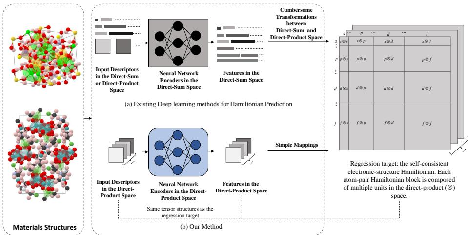  
Figure 1: Existing approaches often encode features in the direct-sum representations of irreducible spherical tensors, creating a mismatch with the Hamiltonian target and requiring irregular, transformation-heavy computations that are difficult to execute efficiently. In contrast, DP-Learner operates directly in the Hamiltonian’s native direct-product representation, preserving the target tensor structure, orbital and spin couplings, as well as the symmetry constraints throughout the network for accurate and efficient equivariant Hamiltonian prediction.

The landscape of computational physics has been substantially reshaped by the recent integration of artificial intelligence (Zhang et al., 2025). State-of-the-art deep geometric networks (Gong et al., 2023; Yu et al., 2023b; Zhang et al., 2024; Zhong et al., 2024; Wang et al., 2024; Yin et al., 2025; Li et al., 2025) have demonstrated the capability to directly map spatial atomic configurations to the corresponding electronic-structure Hamiltonian matrices. By bypassing the expensive self-consistent iterations, these data-driven approaches achieve orders-of-magnitude computational acceleration in acquiring core electronic-structure quantities, enabling high-fidelity exploration of novel materials. For more details, readers are directed to Appendix B.

However, current deep learning methods for electronic-structure Hamiltonian prediction still face central limitations in both representation quality and computational efficiency. Physically, the Hamiltonian is naturally represented as operator blocks in the direct-product (or tensor-product) space of local orbital and spin bases, where orbital and spin degrees of freedom are coupled with the underlying spatial geometry within a unified matrix- or tensor-valued observable. In contrast, existing equivariant architectures for Hamiltonian prediction commonly re-express these observables as direct sums of irreducible spherical tensors. This indirect organization fragments contiguous Hamiltonian blocks and obscures explicit orbital couplings. In SO(3) tensor-product layers, feature products repeatedly undergo Clebsch–Gordan decomposition into irreducible components. Moreover, the heterogeneous channel sizes and angular-momentum-dependent tensor product, decomposition and reconstruction paths commonly involve padding and masking, sparse Clebsch–Gordan coefficient accesses, frequent indexing and coefficient lookups, and many small tensor kernels. These irregular operations complicate memory management, reduce data reuse, and are poorly matched to dense computation on modern hardware accelerators, particularly for rich basis sets containing d and f-orbitals or explicit spin degrees of freedom.

A recent advance in Hamiltonian prediction is NextHAM (Yin et al., 2026), which introduces the zeroth-step Hamiltonian $H ^ { ( 0 ) }$ as a physically informed input descriptor that is naturally represented in the same direct-product operator space as the target Hamiltonian and can be efficiently constructed without matrix diagonalization. Because $H ^ { ( 0 ) }$ already encodes substantial electronicstructure priors while sharing the matrix topology, orbital basis, and symmetry constraints of the final self-consistent Hamiltonian, it alleviates the information sparsity of conventional atomic or bond embeddings and provides a unified, physically informed representation across diverse materials. This advance substantially improves cross-material transferability of the neural network, moving Hamiltonian learning beyond individual material systems with limited variation toward generalizable electronic-structure prediction over a chemically diverse materials space of more than 60 elements. However, NextHAM still converts $H ^ { ( 0 ) }$ into irreducible spherical tensors for feature propagation. The mismatch between fragmented features in the direct-sum space and native Hamiltonian blocks, together with the overhead of sparse and heterogeneous tensor operations and the heavy transformation between direct-sum and direct-product states, still remains. A detailed discussion of these related works is provided in Appendix D.

To address the representation mismatch and computational burdens, we propose DP-Learner, an equivariant Hamiltonian-prediction framework that performs message passing directly on complete atom-pair Hamiltonian blocks in the Direct-Product space. Starting from the zeroth-step Hamilto nian $\bar { H } ^ { ( 0 ) }$ , DP-Learner preserves the matrix or tensor layout of the target self-consistent Hamiltonian $H ^ { ( T ) }$ throughout the network and learns the correction from $H ^ { ( 0 ) }$ to $H ^ { ( T ) }$ . This design naturally captures the intrinsic coupling structure of Hamiltonians in the direct-product space, while avoiding Clebsch–Gordan decompositions of feature tensor products and conversions between Hamiltonian matrices and irreducible features, providing substantial advantages in computational efficiency and hardware utilization, as analyzed in Appendix H.

Theoretically, we establish a Hamiltonian-native equivariant deep learning framework based on two complementary ingredients. First, we develop a Lie-generator-based directional embedding mech anism that maps each local geometric direction $\hat { \mathbf { r } } _ { a b }$ to an equivariant operator acting on the local orbital or orbital–spin spaces associated with the Hamiltonian block in the direct-product space. Second, we construct invariantly weighted left–right product and contraction mechanisms to update Hamiltonian-like matrices and spinor tensors while preserving their transformation laws under spatial rotations and inversions. These formulations encode geometric information and electronic couplings in a unified direct-product space instead of decomposing and reconstructing them through irreducible channels.

Methodologically, we develop our learning framework as an expressive and equivariant Transformer architecture in the direct-product space. Each layer encodes both equivariant matrix or tensor features and invariant scalar features. Normalized Frobenius summaries are computed for the directproduct units within each Hamiltonian block, where each unit couples one row orbital set to one column orbital set. These summaries, together with radial features and scalar node and edge features, are processed by non-linear scalar networks to produce per-unit gates, attention weights, directional weights, and contraction coefficients. Multi-head attention updates node features and conditions the edge-feature update, while constructing equivariant atom-wise context representations. The directional operator and the context then update each edge matrix or tensor through left, right, and bilateral products and contractions. Dimension-normalized products, LayerNorm, LayerScale, and zero-initialized update heads stabilize deep residual learning around $H ^ { ( 0 ) }$

Broad-coverage benchmarks for deep learning Hamiltonian prediction remain limited. To address this gap, we construct and release MP-HAM-110K, a benchmark comprising more than 110,000 diverse material structures sampled from the Materials Project (Jain et al., 2013) and covering 68 elements. It spans the first six rows of the periodic table and employs a rich atomic basis up to 4s2p2d1f. MP-HAM-110K is approximately six times larger than the existing Materials-HAM-SOC dataset and includes structures containing more than 150 atoms, whereas Materials-HAM-SOC contains at most 80 atoms per structure. It thus provides a valuable benchmark for Hamiltonian prediction across chemically diverse materials and larger structures.

Comprehensive experiments on the proposed MP-HAM-110K benchmark and the existing Materials-HAM-SOC dataset demonstrate that DP-Learner achieves state-of-the-art Hamiltonian prediction accuracy together with dramatically improved computational efficiency across chemically diverse materials spanning more than 60 elements, substantially outperforming NextHAM, the pioneering universal Hamiltonian baseline published very recently. The predicted Hamiltonians also yield accurate band structures. These results demonstrate the value of representation learning in the direct-product space for accurate and efficient electronic-structure prediction, materials screening, and discovery.

## 2 PRELIMINARY

Let $H _ { a b }$ denote the atom-pair Hamiltonian block whose row basis belongs to atom a and whose column basis belongs to atom b. Throughout the paper, Hamiltonian block refers to this complete matrix or tensor for one atomic pair, while direct-product unit refers to the part of the block coupling one row orbital set to one column orbital set, with the spin degree of freedom included in the spinorbit-coupled (SOC) setting. The notation covers both on-site blocks $( a = b )$ and off-site blocks $( a \neq b )$ . For a non-SOC system represented in a real orbital basis, a spatial rotation $R \in S O ( 3 )$ acts as

$$
\begin{array} { r } { \mathcal { T } _ { R } ( H _ { a b } ) = D _ { a } ( R ) H _ { a b } D _ { b } ( R ) ^ { \top } , } \end{array}\tag{1}
$$

where $D _ { a } ( R )$ and $D _ { b } ( R )$ are the SO(3) representations aligned with the local basis spaces of $H _ { a b } .$ They are constructed by block-diagonal concatenation of the corresponding irreducible Wigner-D matrices for the local orbital sets.

For an SOC system, each basis function carries an orbital index and a spin index. The corresponding complex Hamiltonian block transforms as

$$
\mathcal { T } _ { R } \left( ( H _ { a b } ) _ { i \alpha , j \beta } \right) = \sum _ { k \gamma , l \delta } ( \widetilde { D } _ { a } ) _ { i \alpha , k \gamma } ( R ) ( H _ { a b } ) _ { k \gamma , l \delta } ( \widetilde { D } _ { b } ^ { \dagger } ) _ { l \delta , j \beta } ( R ) ,\tag{2}
$$

where $\widetilde { D } _ { a } ( R )$ and $\widetilde { D } _ { b } ( R )$ are the orbital–spin representations associated with the local basis spaces. Here $R \in { \dot { S } } { \dot { O } } ( 3 )$ denotes a proper active spatial rotation, and the spin degree of freedom transforms through a corresponding lift of R to $S U ( \bar { 2 } )$ . In addition to rotational symmetry, Hamiltonians also exhibit symmetry under spatial inversion. For a comprehensive symmetry analysis of Hamiltonians, we refer the reader to Appendix C.

## 3 THEORY: EQUIVARIANCE IN DIRECT-PRODUCT SPACE

Conventional equivariant networks for Hamiltonian prediction usually learn features in direct sums of irreducible tensors, whereas a Hamiltonian block is naturally represented as a matrix or tensor in the direct-product space of local orbital bases, with spin degrees of freedom additionally included when SOC is considered. Formal definitions of the direct-product and direct-sum spaces and their associated representations are provided in Definitions A.7 and A.8, respectively; the direct-product units of Hamiltonian blocks are defined in Definition A.9. Here, we aim to establish a rigorous theoretical foundation for symmetry-preserving operations in the Hamiltonian direct-product space, with exact $S O ( 3 )$ equivariance, the corresponding $S U ( 2 )$ spinor equivariance, and spatial-inversion equivariance, providing the theoretical basis for Section 4.

## 3.1 EQUIVARIANT DIRECTIONAL EMBEDDING

The direction vector $\hat { \mathbf { r } } _ { a b }$ specifies an orientation in three-dimensional space, but cannot directly act on the row or column basis of a Hamiltonian block. To bridge this gap, we develop a Lie-generatorbased directional embedding formulation that maps the local geometric direction into equivariant operators acting directly on Hamiltonian-like matrices or tensors in the direct-product space. Specifically, we contract the Cartesian components of $\hat { \mathbf { r } } _ { a b }$ with orbital- and spin-resolved Lie generators to obtain the atom-wise directional operators $V _ { \xi } ^ { \mathrm { S O ( 3 ) } }$ and $V _ { \xi } ^ { \mathrm { S U ( 2 ) } }$ for non-SOC and SOC systems, respectively, as detailed in Appendix E. Under proper spatial rotations and spatial inversion, these directional operators obey the corresponding equivariance laws in the orbital or orbital–spin representations, as formalized in the following theorem:

Theorem 3.1 (Equivariance of Lie-algebraic directional embeddings). The directional embeddings $V _ { \xi } ^ { \mathrm { S O ( 3 ) } } ( \hat { \mathbf { r } } )$ and $\bar { V } _ { \xi } ^ { \mathrm { S U ( 2 ) } } ( \hat { \mathbf { r } } )$ defined in Appendix E transform equivariantly under spatial rotations and are spatial-inversion equivariant with operator-level intrinsic parity $\eta _ { V } = - 1$ . For non-SOC systems, $\dot { V } _ { \xi } ^ { \mathrm { S O ( 3 ) } }$ is a real orbital matrix and satisfies

$$
D _ { \xi } ( R ) V _ { \xi } ^ { \mathrm { S O ( 3 ) } } ( \hat { \mathbf { r } } ) D _ { \xi } ( R ) ^ { \top } = V _ { \xi } ^ { \mathrm { S O ( 3 ) } } ( R \hat { \mathbf { r } } ) .\tag{3}
$$

For SOC systems, $V _ { \xi } ^ { \mathrm { S U ( 2 ) } }$ is a complex spinor tensor with components $( V _ { \xi } ^ { \mathrm { S U ( 2 ) } } ) _ { i \alpha , p \mu }$ and satisfies

$$
\sum _ { r \gamma , s \delta } ( \widetilde { D } _ { \xi } ) _ { i \alpha , r \gamma } ( R ) ( V _ { \xi } ^ { \mathrm { S U } ( 2 ) } ( \hat { \mathbf { r } } ) ) _ { r \gamma , s \delta } ( \widetilde { D } _ { \xi } ^ { \dagger } ) _ { s \delta , p \mu } ( R ) = ( V _ { \xi } ^ { \mathrm { S U } ( 2 ) } ( R \hat { \mathbf { r } } ) ) _ { i \alpha , p \mu } .\tag{4}
$$

Under spatial inversion $\mathcal { T } : \hat { \mathbf { r } } \mapsto - \hat { \mathbf { r } } ,$ , with $\mathsf { P } _ { \xi }$ denoting the local parity operator defined in Eq. (35), the two embeddings further satisfy

$$
V _ { \xi } ^ { \mathrm { S O } ( 3 ) } ( - \hat { \mathbf { r } } ) = - \mathsf { P } _ { \xi } V _ { \xi } ^ { \mathrm { S O } ( 3 ) } ( \hat { \mathbf { r } } ) \mathsf { P } _ { \xi } ^ { \top } , V _ { \xi } ^ { \mathrm { S U } ( 2 ) } ( - \hat { \mathbf { r } } ) = - \mathsf { P } _ { \xi } V _ { \xi } ^ { \mathrm { S U } ( 2 ) } ( \hat { \mathbf { r } } ) \mathsf { P } _ { \xi } ^ { \dagger } .\tag{5}
$$

## 3.2 SO(3)-EQUIVARIANT OPERATORS

For non-SOC systems, consider three feature matrices in the direct-product space:

$$
F _ { a b } \in \mathbb { R } ^ { d _ { a } \times d _ { b } } , \qquad A _ { a } ^ { ( m ) } \in \mathbb { R } ^ { d _ { a } \times d _ { a } } , \qquad B _ { b } ^ { ( m ) } \in \mathbb { R } ^ { d _ { b } \times d _ { b } } .\tag{6}
$$

Here $F _ { a b }$ is the feature associated with atom pair $( a , b )$ , while $A _ { a } ^ { ( m ) }$ and ${ B } _ { b } ^ { ( m ) }$ are atom-wise features acting on the orbital bases of atoms a and b, respectively. The dimensions $d _ { a }$ and $d _ { b }$ denote the numbers of orbital basis functions on the two atoms. The superscript $m = 1 , \ldots , M$ indexes different feature heads, and $c _ { m }$ denotes an invariant scalar coefficient.

Theorem 3.2 (SO(3) equivariance of operators in the direct-product space). Assume that $F _ { a b }$ satisfies the same SO(3) transformation rule as the Hamiltonian block in $E q . ( l )$ . Assume also that $A _ { a } ^ { ( m ) }$ and $B _ { b } ^ { ( m ) }$ satisfy the same transformation rule as $E q . \ ( l )$ with $( a , b )$ replaced by $( a , a )$ , and $( a , b )$ replaced by (b, b), respectively. Define

$$
\left[ M _ { S O ( 3 ) } ( F _ { a b } ) \right] _ { i j } = \sum _ { m = 1 } ^ { M } c _ { m } \sum _ { p = 1 } ^ { d _ { a } } \sum _ { q = 1 } ^ { d _ { b } } \left( A _ { a } ^ { ( m ) } \right) _ { i p } ( F _ { a b } ) _ { p q } \left( B _ { b } ^ { ( m ) } \right) _ { q j } ,\tag{7}
$$

where $i , p$ index the orbital basis $o f$ atom a and $j , q$ index the orbital basis of atom b. Then $\mathcal { M } _ { S O ( 3 ) } ( F _ { a b } )$ satisfies the same $S O ( { \bar { 3 } } )$ transformation rule as Eq. (1).

In Eq. $( 7 ) , A _ { a } ^ { ( m ) }$ can be instantiated by either the directional matrix $V _ { a } ^ { \mathrm { S O ( 3 ) } }$ or the equivariant context matrix $N _ { a } ^ { \mathrm { S O ( 3 ) } }$ defined in Appendix G.4. ${ B } _ { b } ^ { ( m ) }$ can be instantiated by either $\big ( V _ { b } ^ { \mathrm { S O ( 3 ) } } \big ) ^ { \top }$ or $( N _ { b } ^ { \mathrm { S O ( 3 ) } } ) ^ { \top }$

## 3.3 SU(2)-EQUIVARIANT OPERATORS

For SOC systems, consider three feature tensors in the direct-product space:

$$
\begin{array} { r } { F _ { a b } \in \mathbb { C } ^ { L _ { a } \times 2 \times L _ { b } \times 2 } , \qquad A _ { a } ^ { ( m ) } \in \mathbb { C } ^ { L _ { a } \times 2 \times L _ { a } \times 2 } , \qquad B _ { b } ^ { ( m ) } \in \mathbb { C } ^ { L _ { b } \times 2 \times L _ { b } \times 2 } . } \end{array}\tag{8}
$$

The components of $F _ { a b }$ are written as $F _ { i \alpha , j \beta }$ , where i, j index orbital basis functions on atoms $a , b ,$ and $\alpha , \beta \in \{ 1 , 2 \}$ index spin. The tensors $A _ { a } ^ { ( m ) }$ and ${ B } _ { b } ^ { ( m ) }$ act on the orbital-spin bases of atoms a and $b ,$ respectively.

Theorem 3.3 (SU(2) equivariance of operators in the direct-product space). Assume that $F _ { a b }$ satisfies the same SU(2) spinor transformation rule as the Hamiltonian block in Eq. (2), with $H _ { a b }$ replaced by $F _ { a b }$ . Assume also that $A _ { a } ^ { ( m ) }$ and $B _ { h } ^ { ( m ) }$ satisfy the same transformation rule as $E q . \ ( 2 )$ with $( a , b )$ replaced by $( a , a )$ , and $( a , b )$ replaced by $( b , b )$ , respectively. Define

$$
\left[ M _ { S U ( 2 ) } ( F _ { a b } ) \right] _ { i \alpha , j \beta } = \sum _ { m = 1 } ^ { M } c _ { m } \sum _ { p = 1 } ^ { L _ { a } } \sum _ { \mu = 1 } ^ { 2 } \sum _ { q = 1 } ^ { L _ { b } } \sum _ { \nu = 1 } ^ { 2 } \left( A _ { a } ^ { ( m ) } \right) _ { i \alpha , p \mu } F _ { p \mu , q \nu } \left( B _ { b } ^ { ( m ) } \right) _ { q \nu , j \beta } ,\tag{9}
$$

where $c _ { m }$ is an invariant scalar. Then $\mathcal { M } _ { S U ( 2 ) } ( F _ { a b } )$ satisfies the same SU(2) spinor transformation rule as Eq. (2).

In Eq. $( 9 ) , A _ { a } ^ { ( m ) }$ can be instantiated by either the directional spinor tensor $V _ { a } ^ { \mathrm { S U } ( 2 ) }$ or the equivariant context tensor $N _ { a } ^ { \mathrm { S U ( 2 ) } }$ defined in Appendix G.4. $B _ { b } ^ { ( m ) }$ can be instantiated by either $( V _ { b } ^ { \mathrm { S U ( 2 ) } } ) ^ { \dag }$ † or $( N _ { b } ^ { \mathrm { S U ( 2 ) } } ) ^ { \dag }$

## 3.4 EQUIVARIANCE TO SPATIAL INVERSIONS

Theorem 3.4 (Spatial-inversion equivariance of operators in the direct-product space). Assume that the column basis of $A _ { a } ^ { ( m ) }$ and the row basis of $F _ { a b }$ are the same ordered local basis of atom $^ { a , }$ while the row basis of ${ B } _ { b } ^ { ( m ) }$ and the column basis of $F _ { a b }$ are the same ordered local basis ofatom $b ,$

including spin in the SOC setting. For local-set indices $u , u ^ { \prime } \in B _ { a }$ and $v , v ^ { \prime } \in \mathcal { B } _ { b }$ , assume that the units of $F _ { a b } , A _ { a } ^ { ( m ) }$ , and ${ B } _ { b } ^ { ( m ) }$ satisfy

$$
F _ { a b } ^ { u ^ { \prime } \otimes v ^ { \prime } } ( { \mathcal { T } } X ) = \eta _ { F } ( - 1 ) ^ { l _ { u ^ { \prime } } + l _ { v ^ { \prime } } } F _ { a b } ^ { u ^ { \prime } \otimes v ^ { \prime } } ( X ) ,\tag{10}
$$

$$
\left[ A _ { a } ^ { ( m ) } \right] ^ { u \otimes u ^ { \prime } } ( \mathbb { Z } X ) = \eta _ { A } ^ { ( m ) } ( - 1 ) ^ { l _ { u } + l _ { u ^ { \prime } } } \left[ A _ { a } ^ { ( m ) } \right] ^ { u \otimes u ^ { \prime } } ( X ) ,\tag{11}
$$

$$
\left[ B _ { b } ^ { ( m ) } \right] ^ { v ^ { \prime } \otimes v } ( \mathbb { Z } X ) = \eta _ { B } ^ { ( m ) } ( - 1 ) ^ { l _ { v ^ { \prime } } + l _ { v } } \left[ B _ { b } ^ { ( m ) } \right] ^ { v ^ { \prime } \otimes v } ( X ) .\tag{12}
$$

$H c _ { m }$ is inversion invariant, then the u $\otimes v$ unit generated by the m-th head in Eqs. (7) and (9) satisfies

$$
\begin{array} { r } { [ \boldsymbol { M } _ { m } ( F _ { a b } ) ] ^ { \boldsymbol { u } \otimes \boldsymbol { v } } ( \boldsymbol { \mathcal { T } } \boldsymbol { X } ) = \eta _ { \boldsymbol { A } } ^ { ( m ) } \eta _ { F } \eta _ { B } ^ { ( m ) } ( - 1 ) ^ { l _ { \boldsymbol { u } } + l _ { \boldsymbol { v } } } [ \boldsymbol { M } _ { m } ( F _ { a b } ) ] ^ { \boldsymbol { u } \otimes \boldsymbol { v } } ( \boldsymbol { X } ) . } \end{array}\tag{13}
$$

Therefore, for a Hamiltonian-shaped input with $\eta _ { F } = + 1$ , requiring $\eta _ { A } ^ { ( m ) } \eta _ { B } ^ { ( m ) } = + 1 f o r$ r every retained head ensures that their sum preserves the Hamiltonian inversion parity $( - 1 ) ^ { l _ { u } + l _ { v } }$ defined in $E q .$ (36) for every output unit.

For the non-SOC model, this result together with the established $S O ( 3 )$ equivariance gives full $O ( 3 )$ equivariance. For SOC systems, it combines the $S U ( 2 )$ equivariance with the corresponding orbital-parity action.

Proposition 3.5 (Equivariance of invariantly weighted operator aggregation). Iffeature matrices or tensors $F _ { e }$ are expressed in the same carrier space and common local basis, with matching direct-product-unit structure, dimensions, and equivariant transformation laws, and share the same operator-level intrinsic inversion parity ηF, then $\begin{array} { r } { N _ { v } = \sum _ { e : \mathrm { d s t } ( e ) = v } \alpha _ { e } F _ { e } } \end{array}$ obeys the same rotation and inversion laws as the aggregatedfeatures $F _ { e } ,$ provided that the weights $\alpha _ { e }$ are invariant scalars.

Implication. Scalar features can flexibly modulate the equivariant features without changing their transformation laws under rotations and inversions, thus enhancing the model capacity.

Proofs of all theorems and propositions are provided in Appendix F.

## 4 METHODOLOGY

We instantiate our theory as an equivariant and expressive Transformer architecture that jointly learns equivariant features in the direct-product space and invariant scalar features. Following the residual learning strategy of NextHAM (Yin et al., 2026), DP-Learner takes the zeroth-step Hamiltonian $H ^ { ( 0 ) }$ as input and learns a residual correction to predict the self-consistent Hamiltonian $H ^ { ( T ) }$ We represent the equivariant atom-pair features propagated between layers as $H ^ { ( 0 ) }$ plus accumulated corrections in the target orbital or orbital–spin basis, as defined in Appendix G.1. Directional embeddings, attention, and matrix or tensor contractions combine bond directions with many-body environment information while preserving SO(3) or spinor $S U ( 2 )$ equivariance and spatial-inversion equivariance. Figure 2 summarizes the architecture. The components described below are detailed in the corresponding subsections of Appendix G, and the training loss is given in Appendix I. Appendix H analyzes the computational efficiency relative to representation learning methods (Geiger & Smidt, 2022; Passaro & Zitnick, 2023) in the direct-sum space.

Dual conversion between equivariant and invariant features. DP-Learner gains non-linear expressive power from invariant scalar features while preserving equivariance in the direct-product space. Normalized Frobenius norms summarize each direct-product unit of the current matrix or tensor. Multi-layer perceptrons (MLPs) combine these summaries with invariant node, edge, and radial features to predict gates, directional weights, attention weights, and contraction coefficients. These invariant scalars then modulate the equivariant features without changing their transformation laws. Appendix G.2 gives the corresponding equations.

Equivariant updates using directions. We encode the pair direction $\hat { \mathbf { r } } _ { a b }$ using fixed orbital and spin Lie generators to construct directional operators acting on the local orbital or orbital–spin bases of atoms a and b. These operators update the equivariant atom-pair feature through a bilateral contraction, injecting bond-orientation information into the direct-product space. An invariant scalar coefficient controls the strength of this update. Details are given in Appendices E and G.3.

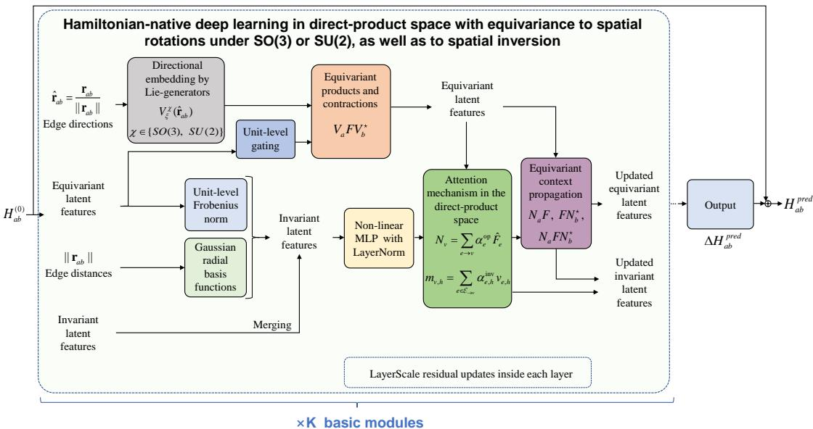  
Figure 2: Overview of the neural network architecture of DP-Learner.

Attention-based updates of node, edge, and context features. The attention module updates invariant node and edge features and constructs equivariant atom-wise context features. Multi-head attention aggregates invariant edge features to update the destination-node features. In parallel, attention over incoming equivariant features assigns invariant weights and aggregates the matrices or tensors in a common local basis to form the context $N _ { v }$ . The updated node features, radial features, current edge features, and new Frobenius summaries then determine the invariant edge update. Appendix G.4 describes these operations.

Equivariant updates using context features. The context features at atoms a and b update the corresponding equivariant atom-pair feature through left, right, and bilateral products or contractions. Invariant coefficients predicted from the local environment control the three contributions, propagating many-body information from neighboring Hamiltonian blocks. The resulting correction is accumulated for the next layer. Appendix G.5 gives the complete equations.

Stabilization techniques and $H ^ { ( 0 ) }$ -centered residual correction. Dimension-aware normalization controls the growth of numerical scales of equivariant features during repeated contractions: per-unit Frobenius summaries use root-mean-square magnitudes, and one-sided and bilateral contractions are scaled by $D ^ { - 1 / 2 }$ and $D ^ { - 1 }$ , respectively, where D is the matrix dimension in the common basis layout. LayerNorm operates within invariant MLPs, while LayerScale regulates the equivariant, edge, and node updates. The output heads are zero initialized so that the initial prediction equals $H ^ { ( 0 ) }$ , and directional weights use $w = 1 + \Delta w$ to retain the fixed generator contribution. After K layers, the output module produces the Hamiltonian correction $\Delta H ^ { \mathrm { \scriptsize { \mathrm { \scriptsize { p r e d } } } } }$ , which is added to $H ^ { ( 0 ) }$ to obtain the final prediction. Appendix G.6 describes the initialization and output.

## 5 DATASET

To enable Hamiltonian learning at a broader scale and with greater diversity, we construct and release MP-HAM-110K, comprising more than 110,000 material structures sampled from the Materials Project (Jain et al., 2013), for which self-consistent first-principles calculations are performed to obtain Hamiltonian annotations. MP-HAM-110K provides zeroth-step Hamiltonians $\bar { H } ^ { ( 0 ) }$ , selfconsistent Hamiltonians $H ^ { ( T ) }$ , overlap matrices, and the wavefunction information required for reciprocal-space supervision. As discussed in Appendix D.2, the dataset is formulated in the non-SOC orbital $S O ( 3 )$ setting to bridge the gap in existing data resources and provide a scalable complement to computationally demanding SOC datasets. This design enables efficient data generation, learning, and inference over a broad materials space. Further details are provided in Appendix J.

Table 1: Accuracy and computational efficiency comparison on the Materials-HAM-SOC benchmark (Yin et al., 2026) and the proposed MP-HAM-110K benchmark. $N _ { \theta }$ denotes the total number of network parameters. As detailed in Appendix K, $\overline { { \mathrm { M A E } } } _ { \mathrm { G } }$ denotes the Gauge MAE metric; tNN denotes the mean per-sample runtime of the neural inference stage, including input feeding, neuralnetwork execution, result format conversion and saving; $\overline { { M } } _ { \mathrm { G P U } }$ denotes the mean per-sample peak GPU memory reserved by PyTorch. Lower values indicate better performance for all metrics.
<table><tr><td rowspan="3">Method</td><td colspan="4">Materials-HAM-SOC</td><td colspan="4">MP-HAM-110K</td></tr><tr><td> $N _ { \theta }$  (M)</td><td> $\overline { { \mathrm { M A E } } } _ { \mathrm { G } }$  (meV)</td><td> $\bar { t } _ { \mathrm { N N } }$  (s)</td><td> $\overline { { M } } _ { \mathrm { G P U } }$  (GiB)</td><td> $N _ { \theta }$  (M)</td><td> $\overline { { \mathrm { M A E } } } _ { \mathrm { G } }$  (meV)</td><td> $\bar { t } _ { \mathrm { N N } }$  (s)</td><td> $\overline { { M } } _ { \mathrm { G P U } }$  (GiB)</td></tr><tr><td>NextHAM</td><td>50.285</td><td>1.417</td><td>3.014</td><td>20.398</td><td>50.263</td><td>2.394</td><td>2.032</td><td>6.135</td></tr><tr><td>DP-Learner</td><td>26.445</td><td>0.841</td><td>0.269</td><td>0.989</td><td>26.094</td><td>1.595</td><td>0.203</td><td>0.531</td></tr></table>

## 6 EMPIRICAL STUDY

Given the page limit, we present only the key experimental results in the main text. Ablation stud ies, element-wise error analyses, and additional band-structure comparisons are comprehensively provided in Appendix L and are also referenced in the analysis below. We compare the prediction accuracy and computational efficiency of DP-Learner with NextHAM (Yin et al., 2026), a recent state-of-the-art method for Hamiltonian prediction across a broad range of elements. Experiments are conducted on Materials-HAM-SOC and MP-HAM-110K, both of which cover chemically diverse periodic materials and provide the zeroth-step Hamiltonians required by the two methods. Other Hamiltonian benchmarks often focus on specific material systems, lack publicly accessible data, or do not provide $H ^ { ( 0 ) }$ , limiting their suitability for this comparison, as discussed in Appendix D.2. The software and hardware environments, parameter settings, and training and inference configurations for both methods are detailed in Appendix K.

As shown in Table 1, DP-Learner improves both accuracy and efficiency relative to NextHAM. On Materials-HAM-SOC, it reduces Gauge MAE (Wang et al., 2024) by 40.6%, peak GPU memory consumption by 95.2%, and the parameter count by 47.4%, while achieving an 11.2× speedup in neural inference. On MP-HAM-110K, it reduces Gauge MAE by 33.4%, peak GPU memory consumption by 91.3%, and the parameter count by 48.1%, with a 10.0× inference speedup. Together, these results establish a new state of the art on both benchmarks in Hamiltonian prediction accuracy and inference efficiency. Preserving the Hamiltonian structure provides an inductive bias for learning how the local environment affects orbital or orbital–spin couplings, while equivariant matrix contractions enable efficient batched computation. Table 4 in Appendix L further shows substantial reductions in Gauge MAE relative to using $H ^ { ( 0 ) }$ directly on both datasets. Figure 7 illustrates the improvement in band structures: DP-Learner closely reproduces the DFT reference bands, whereas $H ^ { ( 0 ) }$ exhibits pronounced deviations.

The results on MP-HAM-110K further demonstrate the efficiency of the non-SOC formulation. Although its testing structures contain approximately twice as many atoms on average as those in Materials-HAM-SOC, DP-Learner requires substantially less inference time and GPU memory. It is worth noting that the higher reported MAE on MP-HAM-110K does not by itself indicate poorer regression performance. The reported errors also reflect the different block structures of SOC and non-SOC Hamiltonians: the SOC error is averaged over four spin blocks, whereas the non-SOC error is evaluated over a single orbital block. In SOC systems, $\bar { H } ^ { ( 0 ) }$ already closely approximates the spin-flip blocks, as shown by the statistics in NextHAM (Yin et al., 2026). The reported SOC error is averaged over all four spin blocks, including the two spin-flip blocks with negligible errors. Consequently, the mean error over the two spin-conserving blocks is approximately twice the overall error. After accounting for this averaging, the errors are comparable to those on the single orbital block in the non-SOC setting.

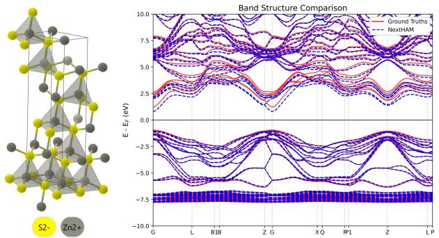

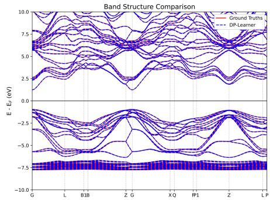  
Figure 3: Band structure comparison for a representative testing sample from Materials-HAM-SOC. Red solid lines show the DFT reference bands used as ground truths in our dataset; blue dashed lines show the bands obtained from the Hamiltonians predicted by NextHAM (left) and DP-Learner (right). Additional DP-Learner results are shown in Figures 9 and 11. The displayed energies are referenced to the Fermi energy $E _ { F }$

Figures 8 and 10 in Appendix L compare prediction accuracy across element-defined subsets of the Materials-HAM-SOC and MP-HAM-110K testing sets, respectively. For each element, we collect all of the testing structures containing it and compute the Gauge MAE metric within each subset. DP-Learner outperforms NextHAM in every subset shown, with consistent accuracy improvements across all of the elements represented in these testing sets. These results demonstrate that the accuracy gains brought by DP-Learner cover chemically diverse materials, rather than being confined to structures containing a few specific elements. The gains in Hamiltonian prediction accuracy also translate into more accurate band structures. For the ZnS example in Figure 3, DP-Learner substantially reduces the deviations present in the prediction results of NextHAM, particularly in the band gap, and closely reproduces the DFT reference bands. Figures 9 and 11 provide further evidence of band structure agreement of our method with DFT calculations across diverse materials, including structurally complex systems with many closely spaced bands. These results demonstrate the practical value of DP-Learner for electronic-structure analysis and highlight its potential for industrial applications in which electrical conductivity and optical properties are critical. The ablation studies on both datasets in Table 4 demonstrate the individual contributions of five core components to prediction accuracy: updating equivariant features across layers, incorporating bond directions, aggregating equivariant context features, predicting invariant coefficients from the local environment, and scaling residual feature updates with LayerScale. The full model combines all five components and achieves the lowest prediction error on both datasets. Taken together, these results support the central premise of DP-Learner: learning equivariant features in the direct-product space with preservation of the Hamiltonian structure supports both accurate prediction and efficient computation.

## 7 CONCLUSION

We present an equivariant Hamiltonian prediction framework that operates directly on Hamiltonianlike operator blocks in the direct-product space. By preserving the native matrix or spinor-tensor structure of Hamiltonians throughout message passing, DP-Learner avoids the representation mismatch and irregular tensor transformations between direct-product and direct-sum spaces used by conventional methods. The framework combines Lie-generator-based directional embedding with invariantly weighted left–right contractions, ensuring exact rotation and inversion equivariance. These principles are instantiated as an equivariant Transformer architecture, where dense left–right operator products and contractions are guided by non-linear invariant scalar routing over gates, directional propagation, attention, and environmental context. We further present MP-HAM-110K, a comprehensive benchmark with over 110,000 periodic-material structures across 68 elements, supporting systematic evaluation of universal Hamiltonian prediction at substantially larger scale. Experiments on MP-HAM-110K and Materials-HAM-SOC demonstrate that DP-Learner achieves superior Hamiltonian prediction accuracy and dramatic gains in inference efficiency compared to the state-of-the-art NextHAM method.

## AI USE STATEMENT

LLMs were used for manuscript language polishing to improve fluency and grammatical correctness.

## ETHICS STATEMENT

This work aims to advance deep-learning methods for materials research. Although no immediate adverse social or ethical consequences are apparent, it remains important to consider the broader implications of data-driven scientific modeling. DP-Learner provides a physically informed framework for learning Hamiltonians directly in their native direct-product space. This design improves the alignment between the model architecture and the underlying quantum-mechanical representation of the prediction target, while substantially improving computational efficiency. Nevertheless, the detailed roles of the learned invariant routing coefficients, attention weights, and environmentdependent operator interactions remain only partially understood. Further analysis of these learned quantities may clarify how physical information is encoded and utilized by the model, thereby strengthening the scientific interpretability, reliability, and applicability of its predictions across diverse materials systems.

## REPRODUCIBILITY STATEMENT

Proofs of all theorems and propositions are provided in Appendix F. The network architecture, training objective, and implementation details are described in Appendices G, I, and K, respectively. Dataset construction, annotations, and splits are documented in Appendix J, and the ablation configurations for both datasets are specified in Appendix L.

The source code and pretrained model weights are available through an anonymous link: https://dzefile.hpccube.com:65011/efile/s/w/YWlmb3JtYXRlcmlhbHM= 6a9f3a62a80f02c4&, with access code: GUgZ. The proposed MP-HAM-110K dataset is available through another anonymous link: https://dzefile.hpccube.com: 65011/efile/s/w/YWlmb3JtYXRlcmlhbHM=\_5b81ae7c44ef8d7e&, with access code: rjvT.

## REFERENCES

Ilyes Batatia, David P Kovacs, Gregor Simm, Christoph Ortner, and Gabor Cs ´ anyi. Mace: Higher´ order equivariant message passing neural networks for fast and accurate force fields. In NeurIPS, pp. 11423–11436, 2022.

Simon Batzner, Albert Musaelian, Lixin Sun, Mario Geiger, Jonathan P Mailoa, Mordechai Kornbluth, Nicola Molinari, Tess E Smidt, and Boris Kozinsky. E (3)-equivariant graph neural networks for data-efficient and accurate interatomic potentials. Nature Communications, 13(1): 2453, 2022.

Andrea Dal Corso. Projector augmented wave method with spin-orbit coupling: Applications to simple solids and zincblende-type semiconductors. Physical Review B, 86(8):085135, 2012.

Mildred S Dresselhaus, Gene Dresselhaus, and Ado Jorio. Group theory: application to the physics of condensed matter. Springer Science & Business Media, 2007.

Johannes Gasteiger, Florian Becker, and Stephan Gunnemann. Gemnet: Universal directional graph¨ neural networks for molecules. Advances in Neural Information Processing Systems, 34:6790– 6802, 2021.

Mario Geiger and Tess E. Smidt. e3nn: Euclidean Neural Networks. CoRR, abs/2207.09453, 2022.

Xiaoxun Gong, He Li, Nianlong Zou, Runzhang Xu, Wenhui Duan, and Yong Xu. General framework for E(3)-equivariant neural network representation of density functional theory Hamiltonian. Nature Communications, 14(1):2848, 2023.

D. R. Hamann. Optimized norm-conserving Vanderbilt pseudopotentials. Physical Review B, 88(8): 085117, 2013.

Pierre Hohenberg and Walter Kohn. Inhomogeneous electron gas. Physical Review, 136(3B):B864, 1964.

Anubhav Jain, Shyue Ping Ong, Geoffroy Hautier, Wei Chen, William Davidson Richards, Stephen Dacek, Shreyas Cholia, Dan Gunter, David Skinner, Gerbrand Ceder, et al. Commentary: The Materials Project: A materials genome approach to accelerating materials innovation. APL materials, 1(1), 2013.

Gan Jin, Hongsheng Pang, Yuyang Ji, Zujian Dai, and Lixin He. Pyatb: An efficient python package for electronic structure calculations using ab initio tight-binding model. Computer Physics Communications, 291:108844, 2023.

Robert O Jones. Density functional theory: Its origins, rise to prominence, and future. Reviews of modern physics, 87(3):897, 2015.

Kuzma Khrabrov, Anton Ber, Artem Tsypin, Konstantin Ushenin, Egor Rumiantsev, Alexander Telepov, Dmitry Protasov, Ilya Shenbin, Anton Alekseev, Mikhail Shirokikh, Sergey Nikolenko, Elena Tutubalina, and Artur Kadurin. ∇2DFT: A universal quantum chemistry dataset of druglike molecules and a benchmark for neural network potentials. In NeurIPS, Datasets and Bench marks Track, 2024.

Walter Kohn and Lu Jeu Sham. Self-consistent equations including exchange and correlation effects. Physical Review, 140(4A):A1133, 1965.

R. B. Lehoucq, D. C. Sorensen, and C. Yang. ARPACK Users’ Guide: Solution of Large-Scale Eigenvalue Problems with Implicitly Restarted Arnoldi Methods. 1998.

He Li, Zun Wang, Nianlong Zou, Meng Ye, Runzhang Xu, Xiaoxun Gong, Wenhui Duan, and Yong Xu. Deep-learning density functional theory Hamiltonian for efficient ab initio electronicstructure calculation. Nature Computational Science, 2(6):367–377, 2022.

Pengfei Li, Xiaohui Liu, Mohan Chen, Peize Lin, Xinguo Ren, Lin Lin, Chao Yang, and Lixin He. Large-scale ab initio simulations based on systematically improvable atomic basis. Computational Materials Science, 112:503–517, 2016.

Yunyang Li, Zaishuo Xia, Lin Huang, Xinran Wei, Samuel Harshe, Han Yang, Erpai Luo, Zun Wang, Jia Zhang, Chang Liu, Bin Shao, and Mark Gerstein. Enhancing the Scalability and Applicability of Kohn-Sham Hamiltonians for Molecular Systems. In ICLR, 2025.

Zhixin Liang, Yunlong Wang, Chi Ding, Junjie Wang, Hui-Tian Wang, Dingyu Xing, and Jian Sun. Hot-ham: an accurate and efficient e (3)-equivariant machine-learning electronic structures calculation framework. Chinese Physics Letters, 43(2):020704, 2026.

Peize Lin, Xinguo Ren, and Lixin He. Strategy for constructing compact numerical atomic orbital basis sets by incorporating the gradients of reference wavefunctions. Physical Review B, 103(23): 235131, 2021.

Peize Lin, Xinguo Ren, Xiaohui Liu, and Lixin He. Ab initio electronic structure calculations based on numerical atomic orbitals: Basic fomalisms and recent progresses. WIREs Computational Molecular Science, 14:e1687, 2024.

Erpai Luo, Xinran Wei, Lin Huang, Yunyang Li, Han Yang, Zaishuo Xia, Zun Wang, Chang Liu, Bin Shao, and Jia Zhang. Efficient and scalable density functional theory hamiltonian prediction through adaptive sparsity. In ICML, 2025.

Agnes Nagy. Density functional. theory and application to atoms and molecules. ´ Physics Reports, 298(1):1–79, 1998.

Saro Passaro and C. Lawrence Zitnick. Reducing SO(3) convolutions to SO(2) for Efficient Equivariant GNNs. In ICML, pp. 27420–27438, 2023.

John P. Perdew, Kieron Burke, and Matthias Ernzerhof. Generalized Gradient Approximation Made Simple. Physical Review Letters, 77(18):3865–3868, 1996.

Chen Qian, Valdas Vitartas, James R Kermode, and Reinhard J Maurer. Equivariant electronic hamiltonian prediction with many-body message passing. npj Computational Materials, 2026.

Kristof T Schutt, Huziel E Sauceda, P-J Kindermans, Alexandre Tkatchenko, and K-R M¨ uller.¨ Schnet–a deep learning architecture for molecules and materials. The Journal of chemical physics, 148(24), 2018.

Kristof T Schutt, Michael Gastegger, Alexandre Tkatchenko, K-R M ¨ uller, and Reinhard J Maurer.¨ Unifying machine learning and quantum chemistry with a deep neural network for molecular wavefunctions. Nature Communications, 10(1):5024, 2019.

Nathaniel Thomas, Tess Smidt, Steven Kearnes, Lusann Yang, Li Li, Kai Kohlhoff, and Patrick Riley. Tensor field networks: Rotation-and translation-equivariant neural networks for 3d point clouds. arXiv preprint arXiv:1802.08219, 2018.

Viren Tyagi, Mike Pols, Geert Brocks, and Shuxia Tao. Tracing ion migration in halide perovskites with machine learned force fields. The Journal ofPhysical Chemistry Letters, 16(20):5153–5159, 2025.

Oliver Unke, Mihail Bogojeski, Michael Gastegger, Mario Geiger, Tess Smidt, and Klaus-Robert Muller. Se (3)-equivariant prediction of molecular wavefunctions and electronic densities. In¨ NeurIPS, pp. 14434–14447, 2021.

M. J. van Setten, M. Giantomassi, E. Bousquet, M. J. Verstraete, D. R. Hamann, X. Gonze, and G.- M. Rignanese. The pseudodojo: Training and grading a 85 element optimized norm-conserving pseudopotential table. Computer Physics Communications, 226:39–54, 2018.

Yuxiang Wang, Yang Li, Zechen Tang, He Li, Zilong Yuan, Honggeng Tao, Nianlong Zou, Ting Bao, Xinghao Liang, Zezhou Chen, et al. Universal materials model of deep-learning density functional theory Hamiltonian. Science Bulletin, 69(16):2514–2521, 2024.

Chen Hao Xia, Manasa Kaniselvan, Alexandros Nikolaos Ziogas, Marko Mladenovic, Rayen´ Mahjoub, Alexander Maeder, and Mathieu Luisier. Learning the Electronic Hamiltonian of Large Atomic Structures. In ICML, 2025.

Shi Yin, Xinyang Pan, Fengyan Wang, and Lixin He. Tracegrad: a Framework Learning Expressive SO(3)-equivariant Non-linear Representations for Electronic-Structure Hamiltonian Prediction. In ICML, 2025.

Shi Yin, Zujian Dai, Xinyang Pan, and Lixin He. Advancing universal deep learning for electronicstructure hamiltonian prediction of materials. In ICLR, 2026.

Haiyang Yu, Meng Liu, Youzhi Luo, Alex Strasser, Xiaofeng Qian, Xiaoning Qian, and Shuiwang Ji. QH9: A Quantum Hamiltonian Prediction Benchmark for QM9 Molecules. In NeurIPS, 2023a.

Haiyang Yu, Zhao Xu, Xiaofeng Qian, Xiaoning Qian, and Shuiwang Ji. Efficient and Equivariant Graph Networks for Predicting Quantum Hamiltonian. In ICML, pp. 40412–40424, 2023b.

He Zhang, Chang Liu, Zun Wang, Xinran Wei, Siyuan Liu, Nanning Zheng, Bin Shao, and Tie-Yan Liu. Self-consistency training for density-functional-theory hamiltonian prediction. In ICML, 2024.

Xuan Zhang, Limei Wang, Jacob Helwig, Youzhi Luo, Cong Fu, Yaochen Xie, Meng Liu, Yuchao Lin, Zhao Xu, Keqiang Yan, et al. Artificial intelligence for science in quantum, atomistic, and continuum systems. Foundations and Trends® in Machine Learning, 18(4):385–912, 2025.

Yang Zhong, Hongyu Yu, Mao Su, Xingao Gong, and Hongjun Xiang. Transferable equivariant graph neural networks for the Hamiltonians of molecules and solids. npj Computational Materials, 9(1):182, 2023.

Yang Zhong, Hongyu Yu, Jihui Yang, Xingyu Guo, Hongjun Xiang, and Xingao Gong. Universal machine learning kohn–sham hamiltonian for materials. Chinese Physics Letters, 41(7):077103, 2024.

## A OVERVIEW OF BASIC CONCEPTS IN GROUP THEORY

This section presents the group-theoretic definitions used throughout the paper. The presentation is intentionally brief and focuses on the concepts relevant to Hamiltonian blocks. For a more comprehensive physical introduction, we refer the reader to standard texts on group theory in solid-state physics (Dresselhaus et al., 2007).

Definition A.1 (Group). A group is a pair $( \mathscr { G } , \cdot )$ , where $\mathcal { G }$ is a nonempty set and

$$
\cdot : \mathcal { G } \times \mathcal { G }  \mathcal { G }
$$

is a binary operation satisfying the following axioms:

1. Closure. For any $g _ { 1 } , g _ { 2 } \in { \mathcal { G } }$

$$
g _ { 1 } \cdot g _ { 2 } \in { \mathcal { G } } .
$$

2. Associativity. For any $g _ { 1 } , g _ { 2 } , g _ { 3 } \in \mathcal { G } .$

$$
( g _ { 1 } \cdot g _ { 2 } ) \cdot g _ { 3 } = g _ { 1 } \cdot ( g _ { 2 } \cdot g _ { 3 } ) .
$$

3. Identity. There exists an element $e \in { \mathcal { G } }$ , called the identity element, such that for every $g \in { \mathcal { G } } _ { : }$

$$
e \cdot g = g \cdot e = g .
$$

4. Inverse. For every $g \in { \mathcal { G } }$ , there exists an element $g ^ { - 1 } \in \mathcal G$ , called the inverse of $^ { g , }$ such that

$$
g \cdot g ^ { - 1 } = g ^ { - 1 } \cdot g = e .
$$

Definition A.2 (Linear representation). Let $V$ be a finite-dimensional real or complex vector space. A representation of $\mathcal { G }$ on $V$ is a group homomorphism

$$
\rho : \mathcal G  G L ( V ) , \qquad \rho ( g _ { 1 } g _ { 2 } ) = \rho ( g _ { 1 } ) \rho ( g _ { 2 } ) , \quad \rho ( e ) = I _ { \mathrm { \tiny ~ ( ~ ) ~ } }
$$

After choosing a basis of $V , \rho ( g )$ is represented by an invertible matrix. In this paper, the relevant representations are the orbital representations of $S O ( 3 )$ and their orbital–spin extensions induced by the $S U ( 2 )$ lift of spatial rotations.

Definition A.3 (Invariant subspace and irreducible representation). A subspace $U \subseteq V$ is invariant under $\rho$ if

$$
\rho ( g ) U \subseteq U , \qquad \forall g \in { \mathcal { G } } .
$$

Equivalently, every vector initially in $U$ remains in $U$ after the group action. The representation $\rho$ is irreducible if its only invariant subspaces are $\{ 0 \}$ and $V .$ Otherwise, $\rho$ is reducible and, for compact groups, can be decomposed after a suitable change of basis into a direct sum of irreducible representations.

Definition A.4 (Equivariant and invariant maps). Let $\rho _ { V }$ and $\rho _ { W }$ be representations of $\mathcal { G }$ on vector spaces $V$ and W. A map $f : V \to W$ is equivariant if

$$
f ( \rho _ { V } ( g ) v ) = \rho _ { W } ( g ) f ( v ) , \qquad \forall g \in \mathcal { G } , v \in V .
$$

If $W$ carries the trivial representation, this condition reduces to invariance:

$$
f ( \rho _ { V } ( g ) v ) = f ( v ) .
$$

In DP-Learner, scalar networks act on invariant quantities, while matrix or spinor-tensor states carry nontrivial equivariant representations.

Definition A.5 (SO(3) and $S U ( 2 ) )$ . The special orthogonal group is

$$
S O ( 3 ) = \left\{ R \in \mathbb { R } ^ { 3 \times 3 } : R ^ { \top } R = I , { \mathrm { ~ d e t } } R = 1 \right\} ,
$$

the group of proper rotations in three-dimensional Euclidean space. The special unitary group is

$$
S U ( 2 ) = \left\{ U \in \mathbb { C } ^ { 2 \times 2 } : U ^ { \dagger } U = I , \operatorname* { d e t } U = 1 \right\} .
$$

The group $S U ( 2 )$ is the double cover of $S O ( 3 )$ and provides the spinor representation associated with spatial rotations. Thus, a 2π rotation acts as −I on spin- $1 / 2$ states, while a 4π rotation returns to I.

Definition A.6 (Wigner representations and spinor lift). For each integer angular-momentum label $l \geq 0 .$ , let $V _ { l }$ denote the $( \bar { 2 \boldsymbol { l } } + \boldsymbol { 1 } )$ )-dimensional orbital representation space. A spatial rotation $R \in$ $S O ( 3 )$ acts on $V _ { l }$ through a Wigner representation matrix

$$
D ^ { l } ( R ) \in \mathbb { R } ^ { ( 2 l + 1 ) \times ( 2 l + 1 ) }
$$

in a real spherical-harmonic basis, or through the equivalent complex Wigner matrix in a complex spherical basis.

In the SOC setting, the orbital space is tensored with the spin- $1 / 2$ space. If $U ^ { 1 / 2 } ( R ) \in S U ( 2 )$ denotes the corresponding spinor lift of $R ,$ then the orbital–spin representation used in this paper is

$$
\widetilde { D } ^ { l } ( R ) = D ^ { l } ( R ) \otimes U ^ { 1 / 2 } ( R ) .
$$

Definition $\mathbf { A . 7 }$ (Direct-product space and representation). Throughout this paper, following common usage in physics, the term direct-product space refers to the tensor-product space $V _ { 1 } \otimes { \breve { V } } _ { 2 }$

Let $V _ { 1 }$ and $V _ { 2 }$ be finite-dimensional vector spaces with bases $\{ e _ { i } \} _ { i = 1 } ^ { m }$ and $\{ f _ { j } \} _ { j = 1 } ^ { n }$ , respectively. Their direct-product space is

$$
V _ { 1 } \otimes V _ { 2 } = { \mathrm { s p a n } } \left\{ e _ { i } \otimes f _ { j } \right\} _ { i = 1 , \ldots , m ; j = 1 , \ldots , n } .
$$

The basis degrees of freedom are therefore indexed jointly by a pair $( i , j )$ , and

$$
\dim ( V _ { 1 } \otimes V _ { 2 } ) = ( \dim V _ { 1 } ) ( \dim V _ { 2 } ) = m n .
$$

A general element $T \in V _ { 1 } \otimes V _ { 2 }$ can be written as

$$
T = \sum _ { i = 1 } ^ { m } \sum _ { j = 1 } ^ { n } T _ { i j } e _ { i } \otimes f _ { j } ,
$$

so its coefficients naturally form a two-index array.

If

$$
\rho _ { 1 } : { \mathcal { G } } \to G L ( V _ { 1 } ) , \qquad \rho _ { 2 } : { \mathcal { G } } \to G L ( V _ { 2 } )
$$

are representations of a group G, their direct-product representation acts simultaneously on the two factors:

$$
( \rho _ { 1 } \otimes \rho _ { 2 } ) ( g ) ( v _ { 1 } \otimes v _ { 2 } ) = \rho _ { 1 } ( g ) v _ { 1 } \otimes \rho _ { 2 } ( g ) v _ { 2 } .
$$

For the operator spaces relevant to this work, let $\{ f ^ { j } \} _ { j = 1 } ^ { n }$ denote the dual basis of $V _ { 2 } ^ { * }$ . Here the superscript ∗ denotes the algebraic dual space. The canonical isomorphism

$$
{ \mathrm { H o m } } ( V _ { 2 } , V _ { 1 } ) \cong V _ { 1 } \otimes V _ { 2 } ^ { * }
$$

identifies a linear operator $Q : V _ { 2 }  V _ { 1 }$ with

$$
Q = \sum _ { i = 1 } ^ { m } \sum _ { j = 1 } ^ { n } Q _ { i j } e _ { i } \otimes f ^ { j } ,
$$

whose coefficients form an $m \times n$ matrix. The induced group action is

$$
Q \mapsto \rho _ { 1 } ( g ) Q \rho _ { 2 } ( g ) ^ { - 1 } .
$$

For orthogonal representations, $\rho _ { 2 } ( g ) ^ { - 1 } = \rho _ { 2 } ( g ) ^ { \top }$ , whereas for unitary representations, $\rho _ { 2 } ( g ) ^ { - 1 } =$ $\rho _ { 2 } ( g ) ^ { \dagger }$

Definition A.8 (Direct-sum space and representation). Let $V _ { 1 }$ and $V _ { 2 }$ be finite-dimensional vector spaces with bases $\{ e _ { i } \} _ { i = 1 } ^ { m }$ and $\{ f _ { j } \} _ { j = 1 } ^ { n }$ , respectively. Their direct-sum space is

$$
V _ { 1 } \oplus V _ { 2 } = \left\{ \left( v _ { 1 } , v _ { 2 } \right) : v _ { 1 } \in V _ { 1 } , v _ { 2 } \in V _ { 2 } \right\} ,
$$

with basis

$$
\{ ( e _ { i } , 0 ) \} _ { i = 1 } ^ { m } \cup \{ ( 0 , f _ { j } ) \} _ { j = 1 } ^ { n } .
$$

The two sets of basis degrees of freedom are concatenated rather than pairwise combined, and hence

$$
\dim ( V _ { 1 } \oplus V _ { 2 } ) = \dim V _ { 1 } + \dim V _ { 2 } = m + n .
$$

A general element is written as

$$
v _ { 1 } \oplus v _ { 2 } = ( v _ { 1 } , v _ { 2 } ) .
$$

If

$$
\rho _ { 1 } : { \mathcal { G } } \to G L ( V _ { 1 } ) , \qquad \rho _ { 2 } : { \mathcal { G } } \to G L ( V _ { 2 } )
$$

are representations of ${ \mathcal { G } } _ { : }$ their direct-sum representation acts separately on the two components:

$$
( \rho _ { 1 } \oplus \rho _ { 2 } ) ( g ) ( v _ { 1 } , v _ { 2 } ) = \big ( \rho _ { 1 } ( g ) v _ { 1 } , \rho _ { 2 } ( g ) v _ { 2 } \big ) .
$$

In a basis adapted to the two summands, the corresponding representation matrix is block diagonal:

$$
( \rho _ { 1 } \oplus \rho _ { 2 } ) ( g ) = \left[ \stackrel { \rho _ { 1 } ( g ) } { 0 } \quad \stackrel { 0 } { \rho _ { 2 } ( g ) } \right] .
$$

Thus, a vector initially belonging to one summand remains in that summand under the group action. More generally, $\oplus _ { \lambda } \dot { V } _ { \lambda }$ carries the block-diagonal representation

$$
\bigoplus _ { \lambda } \rho _ { \lambda } ( g ) .
$$

In summary, the direct-product space pairwise combines basis indices and has multiplicative dimension, whereas the direct-sum space concatenates separate basis sets and has additive dimension.

Definition $\mathbf { A . 9 }$ (Direct-product unit as a local coupling operator). Let $V _ { u }$ and $V _ { v }$ be the orbital subspaces spanned by two local orbital sets u and v, with angular degrees $l _ { u }$ and $l _ { v } .$ We write Hom(X, Y) for the vector space of all linear maps from X to $\dot { Y }$ . For finite-dimensional spaces, there is a canonical isomorphism

$$
\operatorname { H o m } ( X , Y ) \cong Y \otimes X ^ { * } .
$$

A direct-product unit coupling the v-side orbital set to the u-side orbital set is therefore an operator

$$
\mathbf { Q } ^ { u \otimes v } \in \operatorname { H o m } ( V _ { v } , V _ { u } ) \cong V _ { u } \otimes V _ { v } ^ { * } .
$$

In an orthonormal real orbital basis, this unit is represented by a matrix

$$
\mathbf { Q } ^ { u \otimes v } \in \mathbb { R } ^ { ( 2 l _ { u } + 1 ) \times ( 2 l _ { v } + 1 ) }
$$

and transforms under an active spatial rotation as

$$
\mathcal { T } _ { R } \left( \mathbf { Q } ^ { u \otimes v } \right) = D ^ { l _ { u } } ( R ) \mathbf { Q } ^ { u \otimes v } D ^ { l _ { v } } ( R ) ^ { \top } .\tag{14}
$$

If the complete operator block $\mathbf { Q }$ is inversion homogeneous with operator-level intrinsic parity $\eta _ { Q } \in$ $\{ + 1 , - 1 \}$ , shared by all of its non-zero direct-product units, then

$$
{ \bf Q } ^ { u \otimes v } ( { \cal T } X ) = \eta _ { Q } ( - 1 ) ^ { l _ { u } + l _ { v } } { \bf Q } ^ { u \otimes v } ( X ) .
$$

Here, the factor $( - 1 ) ^ { l _ { u } + l _ { v } }$ arises from the orbital parities of the row and column subspaces, while $\eta _ { Q }$ characterizes the intrinsic inversion parity of the operator itself. A complete atom-pair Hamiltonian block is assembled from all direct-product units associated with the local orbital sets on the two atoms. The full-block rotation and inversion laws for Hamiltonians, together with their corresponding extension to complex orbital–spin bases in the SOC setting, are formalized in Appendix $\bar { \mathrm { C } } .$

Definition A.10 (Clebsch–Gordan decomposition). As introduced in Definition $\mathbf { A . 9 , }$ the local orbital subspaces $V _ { u }$ and $V _ { v }$ carry irreducible $S O ( 3 )$ representations of angular degrees $l _ { u }$ and $l _ { v }$ respectively. We therefore write

$$
V _ { u } \cong V _ { l _ { u } } , \qquad V _ { v } \cong V _ { l _ { v } } ,
$$

so that a direct-product unit can be regarded as an operator

$$
\mathbf { Q } ^ { u \otimes v } \in V _ { l _ { u } } \otimes V _ { l _ { v } } ^ { * } .
$$

Choose the magnetic basis $\{ | l _ { u } , m _ { u } \rangle \} _ { m _ { u } = - l _ { u } } ^ { l _ { u } }$ of $V _ { l _ { u } }$ and the dual basis $\{ \langle l _ { v } , m _ { v } | \} _ { m _ { v } = - l _ { v } } ^ { l _ { v } }$ of $V _ { l _ { v } } ^ { * }$ The operator can then be written as

$$
\mathbf { Q } ^ { u \otimes v } = \sum _ { m _ { u } = - l _ { u } } ^ { l _ { u } } \sum _ { m _ { v } = - l _ { v } } ^ { l _ { v } } Q _ { m _ { u } , m _ { v } } ^ { u \otimes v } | l _ { u } , m _ { u } \rangle \otimes \langle l _ { v } , m _ { v } | ,\tag{15}
$$

where $Q _ { m _ { u } , m _ { v } } ^ { u \otimes v }$ are the matrix elements of $\mathbf { Q } ^ { u \otimes v }$ in the direct-product basis.

To express the same operator in irreducible angular-momentum components, we use the fact that every integer-angular-momentum irreducible representation of $S O ( 3 )$ is self-dual:

$$
V _ { l _ { v } } ^ { * } \cong V _ { l _ { v } } .
$$

After choosing a fixed equivariant identification between these two spaces, the Clebsch–Gordan decomposition gives

$$
V _ { l _ { u } } \otimes V _ { l _ { v } } ^ { * } \cong V _ { l _ { u } } \otimes V _ { l _ { v } } \cong \bigoplus _ { L = | l _ { u } - l _ { v } | } ^ { l _ { u } + l _ { v } } V _ { L } .\tag{16}
$$

This decomposition reorganizes the matrix elements of $\mathbf { Q } ^ { u \otimes v }$ into irreducible components with total angular momentum L.

Using the coefficient tensor $C _ { M , m _ { u } , m _ { v } } ^ { L , l _ { u } , l _ { v } } ;$ , the Clebsch–Gordan decomposition maps the directproduct matrix/tensor components into the following irreducible components in the direct-sum space:

$$
q _ { M } ^ { L } = \sum _ { m _ { u } , m _ { v } } C _ { M , m _ { u } , m _ { v } } ^ { L , l _ { u } , l _ { v } } Q _ { m _ { u } , m _ { v } } ^ { u \otimes v } , \qquad L = | l _ { u } - l _ { v } | , \ldots , l _ { u } + l _ { v } ,\tag{17}
$$

where $M = - L , \dots , L .$

The original direct-product matrix/tensor components can be recovered through the inverse transformation:

$$
Q _ { m _ { u } , m _ { v } } ^ { u \otimes v } = \sum _ { L = | l _ { u } - l _ { v } | } ^ { l _ { u } + l _ { v } } \sum _ { M = - L } ^ { L } \mathrm { c o n j } \left( C _ { M , m _ { u } , m _ { v } } ^ { L , l _ { u } , l _ { v } } \right) q _ { M } ^ { L } .\tag{18}
$$

## B ELECTRONIC STRUCTURE CALCULATIONS: FROM DENSITY FUNCTIONAL THEORY TO DEEP LEARNING METHODS

Density Functional Theory (DFT) (Hohenberg & Kohn, 1964; Kohn & Sham, 1965) is one of the central computational frameworks for electronic-structure calculations in condensed matter physics, quantum chemistry, and materials science. Instead of explicitly treating the full many-electron wavefunction, DFT uses the electron density $\rho ( \mathbf { r } )$ as the fundamental variable. This reformulation greatly reduces the complexity of the quantum many-body problem while retaining the essential information required for many ground-state properties. Owing to this balance between physical fidelity and computational tractability, DFT has become a standard tool for computing band structures, orbital energies, relaxed geometries, and electronic, magnetic, optical, and transport-related properties.

The practical formulation most widely used in materials calculations is Kohn–Sham DFT (Kohn & Sham, 1965). It maps the interacting many-electron problem to an auxiliary single-particle problem,

$$
\hat { H } \psi _ { i } ( \mathbf { r } ) = \epsilon _ { i } \psi _ { i } ( \mathbf { r } ) , \qquad \hat { H } = - \frac { \hbar ^ { 2 } } { 2 m } \nabla ^ { 2 } + V _ { \mathrm { e x t } } ( \mathbf { r } ) + V _ { \mathrm { H X C } } [ \rho ] ( \mathbf { r } ) ,\tag{19}
$$

where $\hat { H }$ is the effective Kohn–Sham Hamiltonian. The potential consists of the external potential $V _ { \mathrm { e x t } }$ and the Hartree–exchange–correlation contribution

$$
V _ { \mathrm { H X C } } [ \rho ] ( { \bf r } ) = V _ { \mathrm { H } } [ \rho ] ( { \bf r } ) + V _ { \mathrm { X C } } [ \rho ] ( { \bf r } ) ,
$$

where $V _ { \mathrm { H } }$ and $V _ { \mathrm { X C } }$ are both evaluated as functionals of the density. For periodic systems, the density is obtained from the occupied Kohn–Sham orbitals as

$$
\rho ( \mathbf { r } ) = \sum _ { \mathbf { k } } w _ { \mathbf { k } } \sum _ { n } f _ { n \mathbf { k } } \left| \psi _ { n \mathbf { k } } ( \mathbf { r } ) \right| ^ { 2 } ,\tag{20}
$$

where $w _ { \mathbf { k } }$ is the weight of the k-point and $f _ { n \mathbf { k } }$ denotes the occupation of band n at k.

To solve Eq. (19) numerically, the orbitals are expanded in a finite basis. In localized-basis electronic-structure codes, numerical atomic orbitals (NAOs) are commonly used because of their

compact spatial support and favorable efficiency. A basis function is written as the product of a radial function and a real spherical harmonic,

$$
\phi _ { \kappa \zeta l m } ( \mathbf { r } ) = f _ { \kappa \zeta l } ( r ) \widetilde { Y } _ { l m } ( \widetilde { \mathbf { r } } ) ,\tag{21}
$$

where κ denotes the chemical species, ζ labels the radial channel, l and m are the angular momentum and magnetic quantum numbers, and ˜r denotes the angular direction of r. The radial part is tabulated on a radial grid and is truncated beyond a cutoff radius $r _ { c }$ . In many implementations it can be represented by a finite spherical-Bessel expansion,

$$
f _ { \kappa \zeta l } ( r ) = \left\{ \begin{array} { l l } { \displaystyle \sum _ { q } c _ { \kappa \zeta l q } j _ { l } ( q r ) , } & { r < r _ { c } , } \\ { 0 , } & { r \geq r _ { c } . } \end{array} \right.\tag{22}
$$

Let $\alpha = ( i , u )$ be a composite index denoting the u-th atomic orbital centered on atom i in the reference unit cell, and define

$$
\phi _ { \alpha \mathbf { R } } ( \mathbf { r } ) = \phi _ { u } ( \mathbf { r } - \tau _ { i } - \mathbf { R } ) ,
$$

where $\tau _ { i }$ is the atomic position within the unit cell and R is a lattice vector. The Bloch eigenstates are then expanded as

$$
\psi _ { n \mathbf { k } } ( \mathbf { r } ) = \frac { 1 } { \sqrt { N _ { k } } } \sum _ { \mathbf { R } } \sum _ { \alpha } C _ { n \alpha , \mathbf { k } } e ^ { i \mathbf { k } \cdot \mathbf { R } } \phi _ { \alpha \mathbf { R } } ( \mathbf { r } ) ,\tag{23}
$$

where $C _ { n \alpha , \mathbf { k } }$ is the expansion coefficient of orbital α for band n at k, and $N _ { k }$ is the number of unit cells in the Born–von–Karm´ an supercell, equivalently the number of sampled ´ k-points.

Substituting Eq. (23) into the Kohn–Sham equation gives the generalized eigenvalue problem

$$
H ( \mathbf { k } ) C _ { \mathbf { k } } = S ( \mathbf { k } ) C _ { \mathbf { k } } E _ { \mathbf { k } } ,\tag{24}
$$

where $H ( \mathbf { k } ) , S ( \mathbf { k } )$ , and $C _ { \mathbf { k } }$ are the Hamiltonian matrix, overlap matrix, and eigenvector matrix at k, respectively. The diagonal matrix $E _ { \mathbf { k } }$ contains the Kohn–Sham eigenvalues $\epsilon _ { n \mathbf { k } }$

The reciprocal-space Hamiltonian is obtained from real-space matrix elements. For orbitals $\phi _ { \alpha 0 }$ and $\phi _ { \beta \mathbf { R } }$ , with

$$
\phi _ { \alpha 0 } ( \mathbf { r } ) = \phi _ { u } ( \mathbf { r } - \tau _ { i } ) , \qquad \phi _ { \beta \mathbf { R } } ( \mathbf { r } ) = \phi _ { v } ( \mathbf { r } - \tau _ { j } - \mathbf { R } ) ,
$$

the real-space Hamiltonian element is

$$
H _ { \alpha \beta } ( \mathbf { R } ) = \left. \phi _ { \alpha 0 } \bigg \vert - \frac { \hbar ^ { 2 } } { 2 m } \nabla ^ { 2 } + V _ { \mathrm { e x t } } + V _ { \mathrm { H X C } } [ \rho ] \bigg \vert \phi _ { \beta \mathbf { R } } \right. .\tag{25}
$$

The corresponding matrix at k is obtained through the lattice Fourier transform

$$
H _ { \alpha \beta } ( \mathbf { k } ) = \sum _ { \mathbf { R } } e ^ { i \mathbf { k } \cdot \mathbf { R } } H _ { \alpha \beta } ( \mathbf { R } ) .\tag{26}
$$

The overlap matrix is transformed in the same way:

$$
S _ { \alpha \beta } ( { \bf k } ) = \sum _ { \bf R } e ^ { i { \bf k \cdot R } } s _ { \alpha \beta } ( { \bf R } ) , \qquad S _ { \alpha \beta } ( { \bf R } ) = \langle \phi _ { \alpha 0 } \vert \phi _ { \beta { \bf R } } \rangle .\tag{27}
$$

A standard Kohn–Sham calculation proceeds through a self-consistent-field (SCF) iteration:

1. Initialization: choose an initial density $\rho ^ { ( 0 ) } ( \mathbf { r } )$ and set the iteration index $t = 0$

2. Potential update: construct $V _ { \mathrm { H X C } } [ \rho ^ { ( t ) } ] ( { \bf r } )$ from the current density.

3. Hamiltonian assembly: build the Hamiltonian matrix $\mathbf { H } ^ { ( t ) }$ using Eq. (25).

4. Eigenproblem solution: Fourier transform the real-space matrices to reciprocal space and solve Eq. (24) to obtain $\psi _ { n \bf { k } } ^ { ( t ) } ( \bf { r } )$ and $\epsilon _ { n \bf { k } } ^ { ( t ) }$

5. Density update: compute the next density $\rho ^ { ( t + 1 ) } ( \mathbf { r } )$ from the occupied orbitals using Eq. (20).

6. Convergence check: update $t \gets t + 1$ and repeat until the input and output densities satisfy a prescribed convergence criterion.

Schematically, the procedure can be written as

$$
\rho ^ { ( 0 ) } ( \mathbf { r } ) \to V _ { \mathrm { H X C } } [ \rho ^ { ( 0 ) } ] ( \mathbf { r } ) \to \mathbf { H } ^ { ( 0 ) } \to \{ \psi _ { n \mathbf { k } } ^ { ( 0 ) } , \epsilon _ { n \mathbf { k } } ^ { ( 0 ) } \} \to \rho ^ { ( 1 ) } ( \mathbf { r } ) \to \cdots \to \rho ^ { ( T ) } ( \mathbf { r } ) \to \mathbf { H } ^ { ( T ) } .
$$

After convergence, $\mathbf { H } ^ { ( T ) }$ defines the self-consistent electronic structure and can be used to compute band structures, orbital energies, total energies, and related electronic, magnetic, optical, and transport properties.

Although Kohn–Sham DFT has been highly successful across materials science, chemistry, and physics (Nagy, 1998; Jones, 2015), its computational cost remains substantial for complex systems. A major cost arises from solving the generalized eigenvalue problem in Eq. (24); dense diagonalization scales cubically with the matrix dimension, i.e., $\mathcal { O } ( M _ { \mathrm { b a s } } ^ { 3 ^ { \bullet } } )$ , where $M _ { \mathrm { b a s } }$ is the number of basis functions. For localized atomic-orbital calculations with a fixed number of basis functions per atom, $M _ { \mathrm { b a s } }$ grows linearly with the number of atoms $N$ , so the dense eigensolution scales as $\mathcal { O } ( N ^ { 3 } )$ . Since the eigenvalue problem must be solved repeatedly within an SCF loop requiring $T$ iterations, a dense eigensolver can incur a total computational cost of $\mathcal { O } ( T N ^ { 3 } )$ , imposing a substantial computational burden.

Recent machine-learning approaches (Schutt et al., 2019; Unke et al., 2021; Li et al., 2022; Gong ¨ et al., 2023; Yu et al., 2023b; Li et al., 2025; Luo et al., 2025; Yin et al., 2025) address this bottleneck by learning to predict the converged Hamiltonian $H _ { \alpha \beta } ^ { ( T ) }$ directly from atomic structures and related descriptors. In this setting, the expensive SCF trajectory is replaced by a single neural forward pass that outputs the final Hamiltonian matrix elements, thereby bypassing the repeated full-matrix eigensolutions required during conventional self-consistency.

The locality of NAOs gives the Hamiltonian a sparse block structure. Because basis functions have finite spatial extent, $H _ { \alpha \beta } ( \mathbf { R } )$ is non-zero only when the corresponding atoms lie within an interaction cutoff. If N is the number of atoms and $\overline { E }$ denotes the average number of neighboring atoms within this cutoff, then the number of local atomic pairs, and hence the number of Hamiltonian blocks to predict, scales as $\mathcal { O } ( N \overline { { E } } )$ ). For small systems in which $\overline { E }$ grows with $N ,$ the number of non-zero blocks can exhibit $N ^ { 2 }$ scaling. In sufficiently large systems, however, $\overline { E }$ approaches a constant, and the number of non-zero Hamiltonian blocks scales linearly as $\mathcal { O } ( N )$

Once the Hamiltonian has been predicted, many downstream electronic properties do not require the full eigenspectrum. In particular, electronic and transport properties are often governed primarily by bands within a limited energy window around the Fermi level. In such cases, one may compute only the targeted eigenstates near this energy window using sparse iterative eigensolvers, including shift-invert methods implemented in ARPACK (Lehoucq et al., 1998). When only a small fraction of the spectrum is required, the resulting computational cost can be substantially lower than that of full diagonalization. Learned Hamiltonian models therefore eliminate the repeated diagonalizations of the SCF procedure and can further combine sparse Hamiltonian representations with targeted local eigensolutions for downstream analysis. For very large materials systems, this combination provides a scalable pathway in which Hamiltonian prediction can approach $\mathcal { O } ( N )$ scaling, while the subsequent spectral calculation is restricted to the physically relevant energy window near the Fermi level, allowing the relevant electronic states to be computed efficiently. This substantially improves the feasibility of large-scale materials analysis, screening, and design, compared to the traditional DFT method.

## C SYMMETRY OF HAMILTONIANS

This section provides a rigorous formulation of the symmetry laws obeyed by Hamiltonians under spatial rotations and inversion, expanding the compact statements given in Section 2. The associated group-theoretic concepts have been introduced in Definitions A.7, A.8, and A.9.

Hamiltonian-block and direct-product-unit organization. For an atomic pair $( a , b )$ , the complete atom-pair Hamiltonian block $H _ { a b }$ couples the localized basis of atom b to that of atom a. Let $u \in B _ { a }$ and $v \in B _ { b }$ index local orbital sets on the two atoms, with angular degrees $l _ { u }$ and $l _ { v } ,$ respectively. Let $V _ { u }$ and $V _ { v }$ denote the corresponding local orbital subspaces. The direct-product unit

$H _ { a b } ^ { u \otimes v }$ is a linear map from $V _ { v }$ to $V _ { u }$ , or equivalently an element of

$$
V _ { u } \otimes V _ { v } ^ { * } .
$$

The complete atom-pair block is assembled from all such direct-product units:

$$
H _ { a b } = \left[ H _ { a b } ^ { u \otimes v } \right] _ { u \in \mathcal { B } _ { a } , v \in \mathcal { B } _ { b } } .
$$

Each unit represents one row–column coupling between a pair of local orbital sets and is associated with the angular-momentum-degree pair $( \bar { l } _ { u } , \bar { l _ { v } } )$ .

For systems without spin-orbit coupling, the Hamiltonian block is typically represented in a real orbital basis. Under an active spatial rotation $R \in S O ( 3 )$ , the real spherical-harmonic basis associated with angular-momentum label l transforms according to the orthogonal Wigner-D representation matrix

$$
D ^ { l } ( R ) \in \mathbb { R } ^ { ( 2 l + 1 ) \times ( 2 l + 1 ) } .\tag{28}
$$

Each direct-product unit satisfies

$$
\mathcal { T } _ { R } \left( H _ { a b } ^ { u \otimes v } \right) = D ^ { l _ { u } } ( R ) H _ { a b } ^ { u \otimes v } D ^ { l _ { v } } ( R ) ^ { \top } .\tag{29}
$$

Defining the atom-wise block-diagonal representation matrices

$$
D _ { a } ( R ) = \bigoplus _ { u \in \mathcal { B } _ { a } } D ^ { l _ { u } } ( R ) , \qquad D _ { b } ( R ) = \bigoplus _ { v \in \mathcal { B } _ { b } } D ^ { l _ { v } } ( R ) ,\tag{30}
$$

gives the block-level equivariant form in Eq. (1).

When spin-orbit coupling is included, the basis expands from pure orbital states to orbital–spin states $| l , m _ { l } \rangle \otimes | s , m _ { s } \rangle$ ⟩. Each direct-product unit becomes a complex spinor tensor

$$
H _ { a b } ^ { u \otimes v } \in \mathbb { C } ^ { ( 2 l _ { u } + 1 ) \times 2 \times ( 2 l _ { v } + 1 ) \times 2 } ,\tag{31}
$$

with components $( H _ { a b } ^ { u \otimes v } ) _ { m _ { u } \alpha , m _ { v } \beta }$ , where $m _ { u } , m _ { v }$ index magnetic basis components and $\alpha , \beta \in$ {1, 2} index spin.

For a spatial rotation $R ,$ let $U ^ { 1 / 2 } ( R ) \in \mathbb { C } ^ { 2 \times 2 }$ denote its spin- $1 / 2$ representation, i.e., the corresponding $S U ( 2 )$ lift. The orbital–spin representation for angular-momentum label l is

$$
\widetilde { D } ^ { l } ( R ) = D ^ { l } ( R ) \otimes U ^ { 1 / 2 } ( R ) .\tag{32}
$$

The spinor Hamiltonian block transforms through contractions over both orbital and spin indices:

$$
T _ { R } \left( ( H _ { a b } ^ { u \otimes v } ) _ { m _ { u } \alpha , m _ { v } \beta } \right) = \sum _ { n _ { u } \mu , n _ { v } \nu } \widetilde { D } _ { m _ { u } \alpha , n _ { u } \mu } ^ { l _ { u } } ( R ) ( H _ { a b } ^ { u \otimes v } ) _ { n _ { u } \mu , n _ { v } \nu } \widetilde { D } _ { n _ { v } \nu , m _ { v } \beta } ^ { l _ { v } \dagger } ( R ) .\tag{33}
$$

At the full-block level, defining

$$
\widetilde { D } _ { a } ( R ) = \bigoplus _ { u \in { \cal B } _ { a } } \widetilde { D } ^ { l _ { u } } ( R ) , \qquad \widetilde { D } _ { b } ( R ) = \bigoplus _ { v \in { \cal B } _ { b } } \widetilde { D } ^ { l _ { v } } ( R ) ,\tag{34}
$$

gives the block-level equivariant form in Eq. (2).

Spatial-inversion representation. Let I denote spatial inversion, $\mathbf { r } \mapsto - \mathbf { r } .$ . Since an orbital subspace of angular degree l has parity $( - 1 ) ^ { l }$ and spin is an axial degree of freedom, we can define the parity action on each local orbital set $u \in B _ { \xi }$ by

$$
\mathsf { P } _ { \xi , u } = \left\{ \begin{array} { l l } { ( - 1 ) ^ { l _ { u } } I _ { 2 l _ { u } + 1 } , } & { \mathrm { n o n - S O C } , } \\ { ( - 1 ) ^ { l _ { u } } I _ { 2 l _ { u } + 1 } \otimes I _ { 2 } , } & { \mathrm { S O C } , } \end{array} \right. \qquad \mathsf { P } _ { \xi } = \bigoplus _ { u \in \mathcal { B } _ { \xi } } \mathsf { P } _ { \xi , u } .\tag{35}
$$

The physical Hamiltonian is inversion homogeneous with operator-level intrinsic parity $\eta _ { H } = + 1$ Its direct-product units obey

$$
H _ { a b } ^ { u \otimes v } ( { \mathcal { T } } X ) = \mathsf { P } _ { a , u } H _ { a b } ^ { u \otimes v } ( X ) \mathsf { P } _ { b , v } ^ { \star } = ( - 1 ) ^ { l _ { u } + l _ { v } } H _ { a b } ^ { u \otimes v } ( X ) .\tag{36}
$$

Assembling all units gives the equivalent full-block law

$$
H _ { a b } ( { \mathcal { T } } X ) = \mathsf { P } _ { a } H _ { a b } ( X ) \mathsf { P } _ { b } ^ { \star } .\tag{37}
$$

More generally, an operator block $Q _ { a b }$ is called inversion homogeneous with operator-level (blocklevel) intrinsic parity $\eta _ { Q } \in \{ + 1 , - 1 \}$ if the same $\eta _ { Q }$ is shared by all of its non-zero direct-product units and

$$
Q _ { a b } ^ { u \otimes v } ( { \cal Z X } ) = \eta _ { Q } \mathsf { P } _ { a , u } Q _ { a b } ^ { u \otimes v } ( { \cal X } ) \mathsf { P } _ { b , v } ^ { \star } = \eta _ { Q } ( - 1 ) ^ { l _ { u } + l _ { v } } Q _ { a b } ^ { u \otimes v } ( { \cal X } ) .\tag{38}
$$

For the Hamiltonian block, $\eta _ { Q } = \eta _ { H } = + 1$ , whereas the Lie-generator-based directional embedding has intrinsic parity $\eta _ { V } = - 1$

## D RELATED WORK

## D.1 EQUIVARIANT NEURAL NETWORKS FOR ELECTRONIC-STRUCTURE HAMILTONIANPREDICTION: CURRENT STATUS AND BOTTLENECKS

Symmetry is a fundamental principle in physics and is closely connected to conservation laws. Symmetry-preserving neural networks have therefore become a standard paradigm for learning atomistic quantities from three-dimensional structures. Early models such as SchNet construct scalar representations from invariant geometric descriptors, primarily interatomic distances (Schutt¨ et al., 2018). Subsequent equivariant architectures propagate vectors and higher-order tensors transforming under irreducible representations of spatial rotations, using equivariant linear maps, tensor products, Clebsch–Gordan decompositions, and non-linear gating mechanisms (Thomas et al., 2018; Geiger & Smidt, 2022; Gasteiger et al., 2021; Batzner et al., 2022; Batatia et al., 2022). By retaining directional information, these models provide richer representations than purely invariant scalar networks and have become the foundation of modern deep learning models of atomic systems.

Deep-learning Hamiltonian models directly predict Kohn–Sham Hamiltonians from material structures, bypassing expensive self-consistent iterations and enabling efficient calculations of band structures, densities of states, and related electronic properties. For example, the original DeepH framework uses local coordinates to transform the rotation-equivariant Hamiltonian prediction problem into an invariant learning problem (Li et al., 2022); DeepH-E3 upgrades this local-frame invariant formulation with explicit $\bar { S } O ( 3 )$ -equivariant message passing over irreducible tensor features and Wigner–Eckart reconstruction, providing a more expressive representation of directional orbital couplings and supporting spin–orbit coupling (Gong et al., 2023); DeepH-2 retains a bond-aligned local z-axis, realizes global $S O ( 3 )$ equivariance through more efficient SO(2) operations, and combines this formulation with an equivariant Transformer (Wang et al., 2024). Other studies improve trans ferability, many-body modeling, sparsity, non-linear expressiveness, or tensor-product efficiency (Yu et al., 2023b; Qian et al., 2026; Zhong et al., 2023; 2024; Luo et al., 2025; Yin et al., 2025; Liang et al., 2026).

Many existing Hamiltonian-prediction models use learnable element embeddings for atoms and, in some architectures, explicit element-pair embeddings for atom pairs. These chemical descriptors are typically initialized randomly and optimized from the training data, with limited explicit electronic-structure priors. Consequently, element-dependent orbital characteristics and element pair-dependent electronic couplings must be inferred largely through data-driven learning, which can limit generalization across chemically diverse systems. Because elements and element pairs are highly imbalanced in materials databases, embeddings associated with rare elements, unusual bonds, and underrepresented chemical environments receive limited supervision and can generalize poorly to unseen material systems. Moreover, maintaining separate lookup tables requires $\mathcal O ( M )$ parameters for element embeddings and, when explicit element-pair embeddings are used, up to $\overset { \cdot } { \mathcal { O } } ( M ^ { 2 } )$ parameters for edge embeddings, where M is the number of covered elements. The resulting data sparsity and rapidly growing representation cost pose substantial challenges to constructing universal electronic-structure Hamiltonian models that span broad regions of the periodic table.

NextHAM addresses these limitations by replacing conventional node and edge embeddings with the zeroth-step Hamiltonian $H ^ { ( 0 ) }$ as a physically informed input descriptor (Yin et al., 2026). Unlike randomly initialized element and element-pair embeddings, $H ^ { ( 0 ) }$ incorporates electronic-structure information from the atomic configuration and initial charge density, including electron–ion interactions and an initial approximation to electron–electron interactions. This substantially alleviates the data-sparsity problem associated with rare elements and infrequent element pairs, while avoiding embedding tables whose size grows with the number of chemical species, making the input representation naturally scalable to broad chemical spaces. At the output stage, NextHAM only learns the residual correction

$$
\Delta H = H ^ { ( T ) } - H ^ { ( 0 ) }\tag{39}
$$

rather than reconstructing the self-consistent Hamiltonian from scratch. NextHAM has achieved remarkable cross-material generalization over a chemically diverse materials space containing more than 60 elements (Yin et al., 2026). These results demonstrate the effectiveness of $H ^ { ( 0 ) }$ -conditioned learning as a practical route toward universal electronic-structure Hamiltonian prediction.

However, a fundamental representation mismatch remains in most of the existing equivariant methods for Hamiltonian prediction: the Hamiltonian is naturally an operator in the direct-product space, whereas the neural network usually represents and propagates information through a direct sum of irreducible tensor features. Specifically, an atom-pair Hamiltonian block is a linear map from the local basis space of atom b to that of atom a,

$$
H _ { a b } \in \mathrm { H o m } ( V _ { b } , V _ { a } ) \cong V _ { a } \otimes V _ { b } ^ { * } , \qquad H _ { a b } \in \mathbb { C } ^ { d _ { a } \times d _ { b } } .\tag{40}
$$

The full block is assembled from orbital units in the direct-product space,

$$
H _ { a b } = \left[ H _ { a b } ^ { u \otimes v } \right] _ { u \in \mathcal { B } _ { a } , v \in \mathcal { B } _ { b } } , \qquad H _ { a b } ^ { u \otimes v } \in V _ { u } \otimes V _ { v } ^ { * } ,\tag{41}
$$

where, for orbital angular momenta $l _ { u }$ and $l _ { v } .$

$$
H _ { a b } ^ { u \otimes v } \in \mathbb { C } ^ { ( 2 l _ { u } + 1 ) \times ( 2 l _ { v } + 1 ) } .\tag{42}
$$

Thus, in a fixed localized basis, each direct-product unit is naturally represented as a regular matrix with explicit row–column structure.

However, most of the existing equivariant Hamiltonian models (Gong et al., 2023; Yu et al., 2023b; Zhong et al., 2023; Wang et al., 2024; Zhong et al., 2024; Liang et al., 2026; Qian et al., 2026) adopt direct sums of irreducible tensor features as their persistent internal representation. For an orbital pair in the SO(3) setting, the corresponding direct-product representation decomposes as

$$
V _ { u } \otimes V _ { v } ^ { * } \cong \bigoplus _ { L = | l _ { u } - l _ { v } | } ^ { l _ { u } + l _ { v } } V _ { L } , \qquad \mathrm { d i m } V _ { L } = 2 L + 1 ,\tag{43}
$$

so that a complete coupling is represented by a collection of irreducible channels

$$
\left\{ q _ { a b } ^ { u v , L } \in V _ { L } \right\} _ { L = \left| l _ { u } - l _ { v } \right| } ^ { l _ { u } + l _ { v } } .\tag{44}
$$

Although the total number of degrees of freedom is preserved,

$$
( 2 l _ { u } + 1 ) ( 2 l _ { v } + 1 ) = \sum _ { L = | l _ { u } - l _ { v } | } ^ { l _ { u } + l _ { v } } ( 2 L + 1 ) ,\tag{45}
$$

a regular direct-product matrix is fragmented and reorganized into multiple irreducible tensor channels of heterogeneous sizes.

Even in NextHAM, where the input $H ^ { ( 0 ) }$ is already a Hamiltonian operator in its native directproduct space, the corresponding blocks are still transformed into irreducible tensor features in the direct-sum space, propagated in that feature space, and subsequently reconstructed to obtain the Hamiltonian residual (∆H) (Yin et al., 2026) in the direct-product space. Thus, although $H ^ { ( 0 ) }$ provides a strong Hamiltonian-level physical prior, its native direct-product structure is not preserved in the internal representation throughout the network.

This representation mismatch introduces both representation-learning bottlenecks and computational overheads. From a representation-learning perspective, representing a Hamiltonian block that naturally lives in the direct-product space with direct sums of irreducible tensor features fragments its coherent row–column coupling structure across multiple angular-momentum channels, making the underlying orbital-coupling relationships less explicit in the internal representation. From a computational perspective, representing complete Hamiltonian matrices as direct sums of irreducible tensors and processing them without information loss suffers from high computational complexity. At the hardware-execution level, the heterogeneous dimensions $( 2 \bar { L } + 1 )$ implied by Eq. (43) lead to irregular feature layouts and angular-momentum-dependent routing paths, as analyzed in Appendix H. The introduction of spin degrees of freedom in SOC systems further increases this heterogeneity. Practical implementations therefore involve extensive irregular indexing and gathering, masking, padding, coefficient lookup, and many small tensor-product operations, which are poorly matched to the dense matrix-multiplication kernels highly optimized on modern graphics processing units, particularly for rich basis sets containing d- and f-orbitals.

Our framework is designed to address this representation and computational bottleneck. Since the Hamiltonian is intrinsically an operator in the direct-product space, we develop encoding and message-passing mechanisms that keep Hamiltonian-like features in the same direct-product matrix or tensor space throughout the network. This aligns the internal neural representation with the native representation of the Hamiltonian, while reducing computational complexity and enabling efficient execution through dense matrix operations and hardware acceleration. As demonstrated in our experiments, this design yields substantial advantages in both prediction accuracy and computational efficiency in terms of time and memory cost.

## D.2 BENCHMARKS AND DATA RESOURCES FOR DEEP LEARNING OF HAMILTONIANS: CURRENT LANDSCAPE AND REMAINING GAPS

Large-scale datasets such as QH9 and $\nabla ^ { 2 } \mathrm { D F T }$ (Yu et al., 2023a; Khrabrov et al., 2024) provide valuable benchmarks for molecular Hamiltonian learning. However, their elemental coverage is restricted to five elements (H, C, N, O, and F) in QH9 and eight elements (H, C, N, O, F, S, Cl, and Br) in $\nabla ^ { 2 } \mathrm { D F T }$ . Both datasets focus on finite molecular systems and do not provide Hamiltonian data for periodic crystals. Consequently, despite their large scale, these datasets lack the broad elemental coverage and periodic crystal structures needed to train and evaluate generalizable Hamiltonian models across chemically diverse periodic materials.

In contrast, publicly available Hamiltonian datasets for periodic materials remain limited. Early studies have largely focused on individual material classes or system-specific benchmarks, such as graphene, MoS2, Bi2Se3, and amorphous $\mathrm { H f O _ { 2 } }$ (Li et al., 2022; Gong et al., 2023; Xia et al., 2025). More recent work, such as MACE-H (Qian et al., 2026), has likewise evaluated periodic Hamiltonian prediction on material datasets covering C, Mo, S, Bi, Se, Te, and Au. Although these studies established the feasibility of deep Hamiltonian prediction, their restricted material scopes limit both the training and systematic evaluation of cross-material generalization, preventing them from serving as large-scale universal benchmarks for diverse periodic materials.

More recent efforts have extended Hamiltonian learning toward broader material spaces. DeepH 2 (Wang et al., 2024) and HamGNN (Zhong et al., 2024) expand the elemental and structural coverage beyond earlier system-specific benchmarks. However, the associated datasets and electronicstructure resources are not yet available as fully open and standardized benchmarks for unified training and evaluation across broad materials spaces. In addition, compromises in dataset construction and basis selection may limit physical coverage. For example, DeepH-2 reduces computational complexity by adopting a truncated basis without f-orbitals, which may affect the description of materials in which higher-angular-momentum orbitals play important roles.

The emerging $H ^ { ( 0 ) }$ -conditioned paradigm for Hamiltonian prediction, such as NextHAM (Yin et al., 2026), requires benchmark datasets to provide a broader range of electronic-structure quantities for developing generalizable models. Such methods require not only the final self-consistent Hamiltonian, but also the zeroth-step Hamiltonian, overlap matrices, and additional electronic-structure information for reciprocal-space supervision. Materials-HAM-SOC (Yin et al., 2026) addresses this need by providing a broad SOC Hamiltonian benchmark containing 17,000 periodic structures spanning 68 elements, together with high-quality localized basis sets, zeroth-step Hamiltonians, self-consistent Hamiltonians, and overlap matrices. Its explicit treatment of SOC provides a strin gent benchmark for spinor Hamiltonian learning, but also substantially increases the computational and memory costs of data generation, training, and inference, and can make self-consistent DFT calculations more difficult to converge.

From a physical perspective, explicit SOC effects are relatively weak for many light-element systems. Although SOC is essential for describing spin-dependent phenomena and topological properties in many heavy-element compounds, scalar-relativistic non-SOC calculations remain useful for studying equilibrium structures and atomic dynamics, including in some systems containing heavy elements. For equilibrium properties, a systematic PAW study of 56 solids found that relativistic corrections beyond the scalar-relativistic approximation caused small changes in the lattice constants and bulk moduli of some systems containing fifth- or sixth-period elements, while changes in the other systems examined were below the numerical resolution (Dal Corso, 2012). For atomic dynamics, a study of iodide-defect migration in $\mathrm { C s } \mathrm { P b } { \mathrm { I } } _ { 3 }$ found that SOC had no significant influence on the forces in their evaluations. The authors therefore omitted SOC from the force-field training calculations to reduce computational cost (Tyagi et al., 2025). These findings illustrate the practical value of non-SOC reference data for structural and dynamical studies and motivate complementary SOC and non-SOC Hamiltonian benchmarks. A large-scale non-SOC benchmark with broad chemical coverage, rich orbital bases, and the electronic-structure annotations required for $H ^ { ( 0 ) }$ -conditioned learning therefore provides a useful resource for scalable materials modeling.

To bridge this gap and provide a substantially larger and more scalable data resource, we construct MP-HAM-110K, a benchmark dataset for $H ^ { ( 0 ) }$ -conditioned Hamiltonian learning in the non-SOC orbital $S O ( 3 )$ setting. MP-HAM-110K contains 113,800 diverse periodic material structures sampled from the Materials Project (Jain et al., 2013), covers 68 elements from the first six rows of the periodic table, and employs high-quality localized numerical atomic-orbital basis sets with up to 4s2p2d1f orbitals per element. For each structure, it provides the atomic structure, zeroth-step Hamiltonian $H ^ { ( 0 ) }$ , self-consistent Hamiltonian $H ^ { ( T ) }$ , overlap matrix S, band-structure references, and wavefunction-related annotations required for reciprocal-space supervision. These quantities support physically informed residual learning, and joint real- and reciprocal-space supervision.

Compared with Materials-HAM-SOC (Yin et al., 2026), MP-HAM-110K contains more than six times as many material structures and extends the system size to unit cells containing up to 169 atoms, thereby providing a broader testbed for large-scale and cross-material Hamiltonian learning. At the same time, its non-SOC formulation avoids the additional orbital–spin degrees of freedom and offers a computationally lighter setting for data generation, model training, and inference. The two datasets therefore serve complementary roles: MP-HAM-110K supports scalable orbital Hamil tonian learning over a substantially larger materials space, whereas Materials-HAM-SOC provides a benchmark for spinor Hamiltonian prediction with explicit SOC. Together, they enable systematic evaluation of generalizable Hamiltonian models across both large-scale non-SOC and explicitly spin–orbit-coupled settings.

## E CONSTRUCTION OF DIRECTIONAL EMBEDDINGS USING LIE ALGEBRAGENERATORS

To incorporate bond directions into equivariant feature updates in the direct-product space, we encode each direction as an equivariant operator acting on the local orbital or orbital–spin basis. The operator is constructed by contracting the Cartesian components of the direction with fixed Liealgebra generators and combining the resulting channels with invariant scalar weights. Below, we define these generators and construct the corresponding directional embeddings for non-SOC and SOC systems.

## E.1 ORBITAL ROTATION GENERATORS

We first define the matrices that describe rotations of the local orbital basis. A local orbital set u contains the $2 l _ { u } + 1$ basis functions with a common radial function and orbital angular momentum $l _ { u } .$ . Rotations mix these basis functions through a real orthogonal matrix $D ^ { ( l _ { u } ) } ( R )$ , which forms a $( 2 l _ { u } + 1 )$ )-dimensional representation of $S O ( 3 )$ . The infinitesimal rotations about the three Cartesian axes are described by the fixed matrices

$$
\mathbf { K } ^ { ( l _ { u } ) } = \left( K _ { x } ^ { ( l _ { u } ) } , K _ { y } ^ { ( l _ { u } ) } , K _ { z } ^ { ( l _ { u } ) } \right) , \qquad K _ { \rho } ^ { ( l _ { u } ) } \in \mathbb { R } ^ { ( 2 l _ { u } + 1 ) \times ( 2 l _ { u } + 1 ) } .\tag{46}
$$

These generators are real and antisymmetric. They satisfy the $\mathfrak { s o } ( 3 )$ commutation relations,

$$
[ K _ { x } ^ { ( l _ { u } ) } , K _ { y } ^ { ( l _ { u } ) } ] = K _ { z } ^ { ( l _ { u } ) } ,\tag{47}
$$

together with cyclic permutations. A finite rotation is obtained by exponentiating the generators:

$$
D ^ { ( l _ { u } ) } ( R ) = \exp \left( \sum _ { \rho \in \{ x , y , z \} } \theta _ { \rho } K _ { \rho } ^ { ( l _ { u } ) } \right) ,\tag{48}
$$

where $\mathbf { \theta } \theta = \theta \mathbf { \hat { n } }$ specifies a rotation by angle θ about the unit axis nˆ.

The full orbital basis of atom ξ consists of a collection of local orbital sets, denoted by $B _ { \xi }$ . Sets with different radial functions are treated separately, even if they have the same $l _ { u }$ . Since rotations act within each set, the generators and rotation matrices for the full orbital basis have the block-diagonal form

$$
K _ { \xi , \rho } = \bigoplus _ { u \in \mathcal { B } _ { \xi } } K _ { \rho } ^ { ( l _ { u } ) } , \qquad D _ { \xi } ( R ) = \bigoplus _ { u \in \mathcal { B } _ { \xi } } D ^ { ( l _ { u } ) } ( R ) .\tag{49}
$$

## E.2 ORBITAL–SPIN GENERATORS

For SOC systems, a spatial rotation acts on both the orbital and spin degrees of freedom. We therefore extend the orbital generators to the tensor product of the local orbital space and the twodimensional spin space. Using $\hbar = 1$ , we define the Hermitian orbital angular-momentum generators and the spin-1/2 generators as

$$
L _ { \xi , \rho } = i K _ { \xi , \rho } , \qquad S _ { \rho } = \frac 1 2 \sigma _ { \rho } ,\tag{50}
$$

where $\sigma _ { \rho }$ are the Pauli matrices. The generator of a simultaneous orbital and spin rotation is

$$
J _ { \xi , \rho } = L _ { \xi , \rho } \otimes I _ { 2 } + I _ { \mathrm { o r b } , \xi } \otimes S _ { \rho } ,\tag{51}
$$

where $I _ { \mathrm { o r b } , \xi }$ and $I _ { 2 }$ are the identity matrices on the local orbital and spin spaces, respectively. The first term rotates the orbital components, and the second rotates the spin components. For the same axis–angle vector θ, the combined transformation is

$$
\widetilde { D } _ { \xi } ( R ) = \exp \left( - i \sum _ { \rho \in \{ x , y , z \} } \theta _ { \rho } J _ { \xi , \rho } \right) .\tag{52}
$$

This is the spinor rotation associated with θ. The convention $L _ { \xi , \rho } = i K _ { \xi , \rho }$ ensures that its orbital part agrees with $D _ { \xi } ( R )$ defined above.

## E.3 DIRECTIONAL EMBEDDINGS FROM GENERATOR CHANNELS

We now use these generators to encode a unit bond direction ˆr as an operator acting on the local basis of atom ξ. Each local orbital set provides an orbital generator channel and, in SOC systems, an additional spin generator channel. Within each channel, we contract the three Cartesian generator components with ˆr and multiply the result by an invariant scalar weight. This allows the contribution of each channel to depend on the local pair environment while preserving rotational equivariance.

Let $P _ { \xi , u }$ denote the projector from the full local orbital space onto set $u \in B _ { \xi } ,$ , including all of its $2 l _ { u } + 1$ magnetic components. Because rotations preserve each set, $P _ { \xi , u }$ commutes with $\bar { D } _ { \xi } ( R )$ . In the orbital–spin space, the corresponding projector $P _ { \xi , u } \otimes I _ { 2 }$ commutes with $\widetilde { D } _ { \xi } ( R )$

For non-SOC systems, the orbital generator channel associated with set u is

$$
G _ { \xi , \rho } ^ { u , \mathrm { o r b } } = P _ { \xi , u } K _ { \xi , \rho } P _ { \xi , u } , \qquad u \in \mathcal { B } _ { \xi } .\tag{53}
$$

This projection retains the generator block for set u and sets all other blocks to zero. The directional orbital operator is then

$$
V _ { \xi } ^ { \mathrm { S O ( 3 ) } } ( \hat { \mathbf { r } } ) = \sum _ { u \in \mathcal { B } _ { \xi } } w _ { \xi , u } ^ { \mathrm { o r b } } \sum _ { \rho \in \{ x , y , z \} } \hat { r } _ { \rho } G _ { \xi , \rho } ^ { u , \mathrm { o r b } } ,\tag{54}
$$

where $w _ { \xi , u } ^ { \mathrm { o r b } }$ is an invariant scalar function of the local pair environment. The same weight multiplies all three Cartesian components of a channel.

For SOC systems, we keep the orbital and spin contributions separate so that they can be assigned independent weights. Their generators are

$$
G _ { \xi , \rho } ^ { u , \mathrm { o r b } } = ( P _ { \xi , u } L _ { \xi , \rho } P _ { \xi , u } ) \otimes I _ { 2 } , \qquad G _ { \xi , \rho } ^ { u , \mathrm { s p i n } } = P _ { \xi , u } \otimes S _ { \rho } .\tag{55}
$$

The orbital channel acts on the orbital components within set $u ,$ while the spin channel acts on the spin components associated with that set. Combining the two gives the directional spinor operator

$$
V _ { \xi } ^ { \mathrm { S U } ( 2 ) } ( \hat { \mathbf { r } } ) = \sum _ { u \in \mathcal { B } _ { \xi } } \sum _ { \rho \in \{ x , y , z \} } \hat { r } _ { \rho } \left[ w _ { \xi , u } ^ { \mathrm { o r b } } G _ { \xi , \rho } ^ { u , \mathrm { o r b } } + w _ { \xi , u } ^ { \mathrm { s p i n } } G _ { \xi , \rho } ^ { u , \mathrm { s p i n } } \right] ,\tag{56}
$$

where $w _ { \xi , u } ^ { \mathrm { o r b } }$ and $w _ { \xi , u } ^ { \mathrm { s p i n } }$ are independent invariant scalar functions of the local pair environment.

To express both constructions in a common notation, we collect their channel indices into

$$
\begin{array} { r } { \mathcal { C } _ { \xi } ^ { \mathrm { S O } ( 3 ) } = \{ ( u , \mathrm { o r b } ) : u \in \mathcal { B } _ { \xi } \} , \qquad \mathcal { C } _ { \xi } ^ { \mathrm { S U } ( 2 ) } = \{ ( u , \mathrm { o r b } ) , ( u , \mathrm { s p i n } ) : u \in \mathcal { B } _ { \xi } \} . } \end{array}\tag{57}
$$

Here $\lambda = ( u , \mathrm { o r b } )$ or $( u , \mathrm { s p i n } )$ identifies a channel, and $\chi \in \{ \mathrm { S O } ( 3 ) , \mathrm { S U } ( 2 ) \}$ specifies the non-SOC or SOC construction. Writing the corresponding generator and weight as $G _ { \xi , \rho } ^ { \chi , \lambda }$ and $w _ { \xi } ^ { \chi , \lambda }$ respectively, Eqs. (54) and (56) become

$$
V _ { \xi } ^ { \chi } ( \hat { \mathbf { r } } ) = \sum _ { \lambda \in \mathcal { C } _ { \xi } ^ { \chi } } \sum _ { \rho \in \{ x , y , z \} } w _ { \xi } ^ { \chi , \lambda } \hat { r } _ { \rho } G _ { \xi , \rho } ^ { \chi , \lambda } , \qquad \chi \in \{ \mathrm { S O } ( 3 ) , \mathrm { S U } ( 2 ) \} .\tag{58}
$$

The directional embeddings defined above satisfy the equivariance laws for spatial rotations and spatial inversion stated in Theorem 3.1, with operator-level intrinsic parity $\eta _ { V } = - 1$ . The proofs are provided in Appendix F.

## F PROOFS FOR SECTION 3

Proof of Theorem 3.1. We use the active rotation convention in Eqs. (1) and (2). Under a proper rotation, the three generators in each channel transform as the components of a vector:

$$
\mathcal { R } _ { \xi } ( R ) G _ { \xi , \rho } ^ { \chi , \lambda } \mathcal { R } _ { \xi } ( R ) ^ { \star } = \sum _ { \kappa \in \{ x , y , z \} } R _ { \kappa \rho } G _ { \xi , \kappa } ^ { \chi , \lambda } ,\tag{59}
$$

where $\mathcal { R } _ { \xi } ( R ) = D _ { \xi } ( R )$ and $\star = \top$ for non-SOC systems, while $\mathcal { R } _ { \xi } ( R ) = \widetilde { D } _ { \xi } ( R )$ and $\star = \dagger$ for SOC systems. Applying Eq. (59) to Eq. (54) gives

$$
\begin{array} { l } { { \displaystyle D _ { \xi } ( R ) V _ { \xi } ^ { \mathrm { S O } ( 3 ) } ( \hat { \mathbf { r } } ) D _ { \xi } ( R ) ^ { \top } = \sum _ { \lambda } w _ { \xi } ^ { \mathrm { S O } ( 3 ) , \lambda } \sum _ { \rho } \hat { r } _ { \rho } \left[ D _ { \xi } ( R ) G _ { \xi , \rho } ^ { \mathrm { S O } ( 3 ) , \lambda } D _ { \xi } ( R ) ^ { \top } \right] } } \\ { ~ } \\ { { \displaystyle = \sum _ { \lambda } w _ { \xi } ^ { \mathrm { S O } ( 3 ) , \lambda } \sum _ { \kappa } \left( \sum _ { \rho } R _ { \kappa \rho } \hat { r } _ { \rho } \right) G _ { \xi , \kappa } ^ { \mathrm { S O } ( 3 ) , \lambda } } } \\ { ~ } \\ { { \displaystyle = V _ { \xi } ^ { \mathrm { S O } ( 3 ) } ( R \hat { \mathbf { r } } ) } . } \end{array}\tag{60}
$$

Here $\begin{array} { r } { \sum _ { \rho } R _ { \kappa \rho } \hat { r } _ { \rho } = ( R \hat { \mathbf { r } } ) _ { \kappa } } \end{array}$ , and the invariant channel weights commute with the group action.

For the SOC representation, the same calculation uses Hermitian conjugation and the SOC generator set:

$$
\begin{array} { r l } & { \displaystyle \sum _ { r > r , s \delta } ( \widetilde { D } _ { \xi } ) _ { i \alpha , r > \gamma } ( R ) \left( V _ { \xi } ^ { \mathrm { S U } ( 2 ) } ( \hat { \mathbf { r } } ) \right) _ { r > s \delta } ( \widetilde { D } _ { \xi } ^ { \dagger } ) _ { s \delta , p \mu } ( R ) } \\ & { = \displaystyle \sum _ { \lambda } w _ { \xi } ^ { \mathrm { S U } ( 2 ) , \lambda } \sum _ { \rho } \hat { r } _ { \rho } \left[ \displaystyle \sum _ { r > , s \delta } ( \widetilde { D } _ { \xi } ) _ { i \alpha , r > \gamma } ( R ) ( G _ { \xi , \rho } ^ { \mathrm { S U } ( 2 ) , \lambda } ) _ { r > s \delta } ( \widetilde { D } _ { \xi } ^ { \dagger } ) _ { s \delta , p \mu } ( R ) \right] } \\ & { = \displaystyle \sum _ { \lambda } w _ { \xi } ^ { \mathrm { S U } ( 2 ) , \lambda } \sum _ { \kappa } ( R \hat { \mathbf { r } } ) _ { \kappa } ( G _ { \xi , \kappa } ^ { \mathrm { S U } ( 2 ) , \lambda } ) _ { i \alpha , p \mu } } \\ & { = \left( V _ { \xi } ^ { \mathrm { S U } ( 2 ) } ( R \hat { \mathbf { r } } ) \right) _ { i \alpha , p \mu } . } \end{array}\tag{61}
$$

This proves the proper-rotation statements in Eqs. (3) and (4).

For spatial inversion, each generator channel acts within a fixed local orbital set. Since the parity operator is proportional to the identity on each such set, with an additional spin identity in the SOC setting, every channel satisfies

$$
\begin{array} { r } { \mathsf { P } _ { \xi } G _ { \xi , \rho } ^ { \chi , \lambda } \mathsf { P } _ { \xi } ^ { \star } = G _ { \xi , \rho } ^ { \chi , \lambda } , \qquad \chi \in \{ \mathrm { S O } ( 3 ) , \mathrm { S U } ( 2 ) \} . } \end{array}\tag{62}
$$

Because the channel weights are invariant and I sends $\hat { \mathbf { r } } \mapsto - \hat { \mathbf { r } } .$ , Eq. (58) gives

$$
\begin{array} { r l } & { V _ { \xi } ^ { \chi } ( - \hat { \mathbf { r } } ) = - \displaystyle \sum _ { \lambda \in \mathcal { C } _ { \xi } ^ { \chi } } \displaystyle \sum _ { \rho } w _ { \xi } ^ { \chi , \lambda } \hat { r } _ { \rho } G _ { \xi , \rho } ^ { \chi , \lambda } } \\ & { \quad \quad \quad = - \displaystyle \sum _ { \lambda \in \mathcal { C } _ { \xi } ^ { \chi } } \displaystyle \sum _ { \rho } w _ { \xi } ^ { \chi , \lambda } \hat { r } _ { \rho } \mathsf { P } _ { \xi } G _ { \xi , \rho } ^ { \chi , \lambda } \mathsf { P } _ { \xi } ^ { \star } } \\ & { \quad \quad \quad = - \mathsf { P } _ { \xi } V _ { \xi } ^ { \chi } ( \hat { \mathbf { r } } ) \mathsf { P } _ { \xi } ^ { \star } . } \end{array}\tag{63}
$$

Taking $\star = \top$ in the non-SOC setting and $\star = \dagger$ in the SOC setting proves Eq. (5). Equivalently, every non-zero directional unit obeys

$$
\left[ V _ { \xi } ^ { \chi } ( - \hat { \mathbf { r } } ) \right] ^ { u \otimes u ^ { \prime } } = \eta _ { V } ( - 1 ) ^ { l _ { u } + l _ { u ^ { \prime } } } \left[ V _ { \xi } ^ { \chi } ( \hat { \mathbf { r } } ) \right] ^ { u \otimes u ^ { \prime } } , \qquad \eta _ { V } = - 1 ,\tag{64}
$$

establishing that both directional embeddings are inversion homogeneous with operator-level intrinsic parity −1. □

ProofofTheorem 3.2. Under the convention in Eq. (1), the relevant transformations are

$$
\begin{array} { r } { \mathcal { T } _ { R } ( A _ { a } ^ { ( m ) } ) = D _ { a } ( R ) A _ { a } ^ { ( m ) } D _ { a } ( R ) ^ { \top } , } \end{array}\tag{65}
$$

$$
\begin{array} { r } { \mathcal { T } _ { R } ( B _ { b } ^ { ( m ) } ) = D _ { b } ( R ) B _ { b } ^ { ( m ) } D _ { b } ( R ) ^ { \top } , } \end{array}\tag{66}
$$

$$
\begin{array} { r } { \mathcal { T } _ { R } ( F _ { a b } ) = D _ { a } ( R ) F _ { a b } D _ { b } ( R ) ^ { \top } . } \end{array}\tag{67}
$$

Because $D _ { a } ( R )$ and $D _ { b } ( R )$ are orthogonal, $D _ { a } ( R ) ^ { \top } D _ { a } ( R ) = I _ { a }$ and $D _ { b } ( R ) ^ { \top } D _ { b } ( R ) = I _ { b }$ . Applying the contraction after rotation gives

$$
\begin{array} { l } { { \mathcal { M } _ { S O ( 3 ) } ( T _ { R } F _ { a b } ) = \displaystyle \sum _ { m } c _ { m } \big ( D _ { a } A _ { a } ^ { ( m ) } D _ { a } ^ { \top } \big ) \big ( D _ { a } F _ { a b } D _ { b } ^ { \top } \big ) \big ( D _ { b } B _ { b } ^ { ( m ) } D _ { b } ^ { \top } \big ) } }  \\ { { \mathrm { } } } \\ { { \mathrm { } = D _ { a } \left( \displaystyle \sum _ { m } c _ { m } A _ { a } ^ { ( m ) } F _ { a b } B _ { b } ^ { ( m ) } \right) D _ { b } ^ { \top } = D _ { a } ( R ) \mathcal { M } _ { S O ( 3 ) } ( F _ { a b } ) D _ { b } ( R ) ^ { \top } , } } \end{array}\tag{68}
$$

where the argument R has been suppressed in the intermediate expressions for readability. Thus the output obeys the same transformation rule as the input Hamiltonian block. □

Proof of Theorem 3.3. Under the convention in Eq. (2),

$$
{ \mathcal T } _ { R } ( A _ { a } ^ { ( m ) } ) _ { i \alpha , p \mu } = \sum _ { k \gamma , r \rho } ( \widetilde { D } _ { a } ) _ { i \alpha , k \gamma } ( A _ { a } ^ { ( m ) } ) _ { k \gamma , r \rho } ( \widetilde { D } _ { a } ^ { \dagger } ) _ { r \rho , p \mu } ,\tag{69}
$$

$$
T _ { R } ( F _ { a b } ) _ { p \mu , q \nu } = \sum _ { s \sigma , t \tau } ( \widetilde { D } _ { a } ) _ { p \mu , s \sigma } F _ { s \sigma , t \tau } ( \widetilde { D } _ { b } ^ { \dagger } ) _ { t \tau , q \nu } ,\tag{70}
$$

$$
\mathcal { T } _ { R } ( B _ { b } ^ { ( m ) } ) _ { q \nu , j \beta } = \sum _ { u v , l \delta } ( \widetilde { D } _ { b } ) _ { q \nu , u v } ( B _ { b } ^ { ( m ) } ) _ { u v , l \delta } ( \widetilde { D } _ { b } ^ { \dagger } ) _ { l \delta , j \beta } .\tag{71}
$$

Substituting these expressions into Eq. (9) produces internal contractions of the form

$$
\sum _ { p \mu } ( \widetilde { D } _ { a } ^ { \dagger } ) _ { r \rho , p \mu } ( \widetilde { D } _ { a } ) _ { p \mu , s \sigma } = \delta _ { r s } \delta _ { \rho \sigma } , \qquad \sum _ { q \nu } ( \widetilde { D } _ { b } ^ { \dagger } ) _ { t \tau , q \nu } ( \widetilde { D } _ { b } ) _ { q \nu , u v } = \delta _ { t u } \delta _ { \tau v } ,\tag{72}
$$

using the unitarity of the orbital–spin representations. All internal representation matrices cancel, leaving

$$
\mathcal { M } _ { S U ( 2 ) } ( \mathcal { T } _ { R } F _ { a b } ) _ { i \alpha , j \beta } = \sum _ { k \gamma , l \delta } ( \widetilde { D } _ { a } ) _ { i \alpha , k \gamma } \left[ \mathcal { M } _ { S U ( 2 ) } ( F _ { a b } ) \right] _ { k \gamma , l \delta } ( \widetilde { D } _ { b } ^ { \dagger } ) _ { l \delta , j \beta } .\tag{73}
$$

This exactly matches the spinor-tensor transformation rule in Eq. (2).

Proof of Theorem 3.4. For either $\chi \in \{ \mathrm { S O } ( 3 ) , \mathrm { S U } ( 2 ) \}$ , the u ⊗ v output unit can be written as

$$
\left[ M _ { \chi } ( F _ { a b } ) \right] ^ { u \otimes v } = \sum _ { m = 1 } ^ { M } \sum _ { u ^ { \prime } \in \mathcal { B } _ { a } } \sum _ { v ^ { \prime } \in \mathcal { B } _ { b } } c _ { m } \left[ A _ { a } ^ { ( m ) } \right] ^ { u \otimes u ^ { \prime } } F _ { a b } ^ { u ^ { \prime } \otimes v ^ { \prime } } \left[ B _ { b } ^ { ( m ) } \right] ^ { v ^ { \prime } \otimes v } .\tag{74}
$$

Because $A _ { a } ^ { ( m ) } , F _ { a b }$ , and $B _ { b } ^ { ( m ) }$ are inversion homogeneous, their non-zero units transform according to Eq. (38). One contracted path therefore acquires the factor

$$
\begin{array} { c } { { \eta _ { A } ^ { ( m ) } ( - 1 ) ^ { l _ { u } + l _ { u ^ { \prime } } } \cdot \eta _ { F } ( - 1 ) ^ { l _ { u ^ { \prime } } + l _ { v ^ { \prime } } } \cdot \eta _ { B } ^ { ( m ) } ( - 1 ) ^ { l _ { v ^ { \prime } } + l _ { v } } } } \\ { { = \eta _ { A } ^ { ( m ) } \eta _ { F } \eta _ { B } ^ { ( m ) } ( - 1 ) ^ { l _ { u } + l _ { v } } , } } \end{array}\tag{75}
$$

because the internal orbital parities associated with $u ^ { \prime }$ and $v ^ { \prime }$ each appear twice. The spin identity in the SOC setting contributes no additional inversion sign. Since $c _ { m }$ is inversion invariant, the m-th contraction term is inversion homogeneous with $\eta _ { \mathrm { o u t } } ^ { ( m ) } \stackrel { - } { = } \eta _ { A } ^ { ( m ) } \eta _ { F } \eta _ { B } ^ { ( m ) }$ . If these products are equal for all retained terms, the sum has the same operator-level intrinsic parity. For an input $F _ { a b }$ that obeys the Hamiltonian transformation law under spatial inversion, $\eta _ { F } ~ = ~ + 1$ . Requiring $\eta _ { A } ^ { ( m ) } \eta _ { B } ^ { ( m ) } =$ +1 for every retained term then gives $\eta _ { \mathrm { o u t } } ^ { ( m ) } ~ = ~ + 1$ Consequently, each output unit transforms with the same factor $( - 1 ) ^ { l _ { u } + l _ { v } }$ as the corresponding Hamiltonian unit, establishing spatial-inversion equivariance. □

Summary of operator-level intrinsic parities. The Hamiltonian, every persistent Hamiltonianshaped feature, the attention-derived context, and the identity operator have

$$
\eta _ { H } = \eta _ { F } = \eta _ { N } = \eta _ { I } = + 1 ,\tag{76}
$$

whereas Eq. (64) gives $\eta _ { V } ~ = ~ - 1$ . Taking a transpose or Hermitian adjoint does not change the operator-level intrinsic parity. Consequently, the bilateral directional action has $\eta _ { V } \eta _ { F } \eta _ { V } ~ =$ $( - 1 ) ( + 1 ) ( - 1 ) = + 1$ , while each one-sided or bilateral context action contains only factors with intrinsic parity +1. Per-unit gating, residual addition, and LayerScale modulation use invariant scalars and preserve the same operator-level parity and its unitwise factor $\eta _ { Q } ( - 1 ) ^ { l _ { u } + l _ { v } }$

ProofofProposition 3.5. Let $\mathcal { R } _ { v } ( R )$ denote the local representation associated with atom v, with $\star = \top$ for the non-SOC $S O ( 3 )$ setting and $\star = \dagger$ for the SOC spinor setting. Since all incoming operators are expressed in the same carrier space and common local basis, they obey

$$
F _ { e } ( R X ) = \mathcal { R } _ { v } ( R ) F _ { e } ( X ) \mathcal { R } _ { v } ( R ) ^ { \star } .
$$

Using the rotational invariance of $\alpha _ { e }$ , the aggregated context therefore transforms as

$$
\begin{array} { l } { { \displaystyle N _ { v } ( R X ) = \sum _ { e \downarrow \mathrm { d } \times \mathrm { t } ( e ) = v } \alpha _ { e } ( R X ) F _ { e } ( R X ) } } \\ { ~ = \sum _ { e \downarrow \mathrm { d } \times \mathrm { t } ( e ) = v } \alpha _ { e } ( X ) \mathcal { R } _ { v } ( R ) F _ { e } ( X ) \mathcal { R } _ { v } ( R ) ^ { \star } } \\ { ~ = \mathcal { R } _ { v } ( R ) \left[ \displaystyle \sum _ { e \in \mathrm { d } \times \mathrm { t } ( e ) = v } \alpha _ { e } ( X ) F _ { e } ( X ) \right] \mathcal { R } _ { v } ( R ) ^ { \star } } \\ { ~ = \mathcal { R } _ { v } ( R ) N _ { v } ( X ) \mathcal { R } _ { v } ( R ) ^ { \star } . } \end{array}\tag{77}
$$

Hence $N _ { v }$ obeys the same proper-rotation law as every incoming operator $F _ { e }$

For spatial inversion, let the incoming operators share the operator-level intrinsic parity $\eta _ { F }$ . Restricting the aggregation to one direct-product unit $u \otimes u ^ { \prime }$ , with $u , u ^ { \prime } \in B _ { v }$ , gives

$$
\begin{array} { r l } { N _ { v } ^ { u \otimes u ^ { \prime } } ( \mathbb { Z } X ) = \displaystyle \sum _ { e \colon \mathrm { d s t } ( e ) = v } \alpha _ { e } ( \mathbb { Z } X ) F _ { e } ^ { u \otimes u ^ { \prime } } ( \mathbb { Z } X ) } & { } \\ { \displaystyle = \eta _ { F } ( - 1 ) ^ { l _ { u } + l _ { u ^ { \prime } } } \sum _ { e \colon \mathrm { d s t } ( e ) = v } \alpha _ { e } ( X ) F _ { e } ^ { u \otimes u ^ { \prime } } ( X ) } & { } \\ { \displaystyle = \eta _ { F } ( - 1 ) ^ { l _ { u } + l _ { u ^ { \prime } } } N _ { v } ^ { u \otimes u ^ { \prime } } ( X ) . } & { } \end{array}\tag{78}
$$

The same $\eta _ { F }$ is therefore shared by every non-zero context unit, so $\eta _ { N } = \eta _ { F }$ . For the Hamiltonianshaped feature stream involved in the architecture, $\eta _ { F } = + 1$ and hence $\eta _ { N } = + 1$ □

## G ARCHITECTURAL DETAILS OF THE PROPOSED NEURAL NETWORK

## G.1 DELTA REPRESENTATION LEARNING FROM $H ^ { ( 0 ) }$ IN THE DIRECT-PRODUCT SPACE

The equivariant atom-pair feature $F _ { a b } ^ { ( k ) }$ passed from one layer to the next is represented in the same direct-product space as the Hamiltonian block for atoms $( a , b )$ . Its indices refer to the orbital basis for non-SOC systems,

$$
\boldsymbol { F } _ { a b } ^ { ( k ) } \in \mathbb { R } ^ { d _ { a } \times d _ { b } } , \qquad ( \boldsymbol { F } _ { a b } ^ { ( k ) } ) _ { i j } ,\tag{79}
$$

and to the orbital–spin basis for SOC systems,

$$
F _ { a b } ^ { ( k ) } \in \mathbb { C } ^ { L _ { a } \times 2 \times L _ { b } \times 2 } , \qquad ( F _ { a b } ^ { ( k ) } ) _ { i \alpha , j \beta } .\tag{80}
$$

We initialize this feature with the zeroth-step Hamiltonian block $H _ { a b } ^ { ( 0 ) }$ and accumulate a correction in that basis:

$$
\Delta F _ { a b } ^ { ( 0 ) } = 0 , \qquad F _ { a b } ^ { ( k ) } = H _ { a b } ^ { ( 0 ) } + \Delta F _ { a b } ^ { ( k ) } .\tag{81}
$$

Alongside these equivariant atom-pair features, the network maintains invariant node and edge features that describe the local environment and determine the coefficients for the equivariant updates. The following subsections describe how the two types of features are initialized and updated within each layer.

Both implementations pad the atom-wise bases to a common $4 s 2 p 2 d 1 f$ orbital-set layout, with a consistent ordering of orbital and spin components. Corresponding basis slots thus carry the same rotation and parity representations on every atom. In this layout, each equivariant atom-pair feature is a real $2 7 \times 2 7$ matrix for non-SOC systems or a complex $2 7 \times 2 \times 2 7 \times 2$ tensor for SOC systems. The latter is reshaped into a $5 4 \times 5 4$ matrix for contractions. The common matrix dimension is therefore $D = 2 7$ for non-SOC and $D = 5 4$ for SOC. This shared representation allows incoming edge matrices to be aggregated into equivariant atom-wise context features.

## G.2 DUAL CONVERSION BETWEEN EQUIVARIANT AND INVARIANT FEATURES

The invariant node and edge features provide the inputs to scalar neural networks that control the equivariant updates. They receive information about pair distances and the current equivariant atompair features through quantities that are unchanged by rotations and spatial inversion. We encode the pair distance $r _ { a b } = \| \mathbf { r } _ { a b } \|$ with Gaussian radial basis functions,

$$
\phi _ { t } ( r _ { a b } ) = \exp \left[ - \frac { ( r _ { a b } - \mu _ { t } ) ^ { 2 } } { 2 \sigma ^ { 2 } } \right] , \qquad t = 1 , \ldots , T _ { \mathrm { r b f } } ,\tag{82}
$$

and summarize each direct-product unit of $F _ { a b } ^ { ( k ) }$ by a normalized Frobenius norm. For non-SOC units, this summary is

$$
n _ { a b , u v } ^ { ( k ) , \mathrm { S O } ( 3 ) } = \left[ \frac { 1 } { d _ { u } ^ { \mathrm { o r b } } d _ { v } ^ { \mathrm { o r b } } } \sum _ { m _ { u } , m _ { v } } \left| F _ { a b , m _ { u } m _ { v } } ^ { u \otimes v , ( k ) } \right| ^ { 2 } + \varepsilon _ { n } \right] ^ { 1 / 2 } ,\tag{83}
$$

and for SOC units, it is

$$
n _ { a b , u v } ^ { ( k ) , \mathrm { S U } ( 2 ) } = \left[ \frac { 1 } { d _ { u } d _ { v } } \sum _ { m _ { u } , \alpha , m _ { v } , \beta } \left| F _ { a b , m _ { u } \alpha , m _ { v } \beta } ^ { u \otimes v , ( k ) } \right| ^ { 2 } + \varepsilon _ { n } \right] ^ { 1 / 2 } .\tag{84}
$$

Here $d _ { u } ^ { \mathrm { { o r b } } }$ is the number of orbital basis functions in set u, and $d _ { u }$ also counts the spin components in the SOC setting. Orthogonal or unitary left–right transformations and spatial inversion preserve these norms, so their concatenation is an invariant vector.

For a directed edge $e = ( a , b )$ , we take a as the source atom, $\mathrm { s r c } ( e )$ , and b as the destination atom, dst(e). We denote the concatenated norms by ${ \bf n } _ { e } ^ { ( k ) }$ and the radial features by $\phi _ { e }$ . At initialization, an MLP combines the norms of $F _ { e } ^ { ( 0 ) } = H _ { e } ^ { ( 0 ) }$ with the radial features to construct the invariant edge feature. Summing these edge features over the incoming edges of each atom then provides the input for its invariant node feature:

$$
\begin{array} { r } { \mathbf { z } _ { e } ^ { ( 0 ) } = \mathrm { M L P } _ { \mathrm { i n i t } } \left( \mathbf { n } _ { e } ^ { ( 0 ) } \parallel \phi _ { e } \right) , } \end{array}\tag{85}
$$

$$
\mathbf { x } _ { v } ^ { ( 0 ) } = \mathrm { M L P } _ { \mathrm { n o d e - i n i t } } \left( \sum _ { e : \mathrm { d s t } ( e ) = v } \mathbf { z } _ { e } ^ { ( 0 ) } \right) .\tag{86}
$$

At layer k, the scalar networks receive the current Frobenius summaries, the invariant edge feature, the invariant node features of the source and destination atoms, and the radial features:

$$
\eta _ { e } ^ { ( k ) } = \mathbf { n } _ { e } ^ { ( k ) } \parallel \mathbf { z } _ { e } ^ { ( k ) } \parallel \mathbf { x } _ { \mathrm { s r c } ( e ) } ^ { ( k ) } \parallel \mathbf { x } _ { \mathrm { d s t } ( e ) } ^ { ( k ) } \parallel \phi _ { e } .\tag{87}
$$

Here ∥ denotes concatenation. MLPs map $\eta _ { e } ^ { ( k ) }$ to per-unit gates, directional weights, a bilateral directional coefficient, attention logits, and an edge gate. Later in the layer, the updated node features and new Frobenius summaries define a second invariant input for the context coefficients and invariant edge update, as described in Appendix G.4. The two stages connect the feature types in both directions: norms convey information from equivariant atom-pair features to the scalar networks, and invariant coefficients control the equivariant operations.

The first operation within a layer applies a gate to each direct-product unit of $F _ { a b } ^ { ( k ) }$ , producing ${ \widetilde { F } } _ { a b } ^ { ( k ) }$ Each gate is shared across all magnetic components of its row–column orbital-set pair and, for SOC systems, across the spin components as well:

$$
\widetilde { F } _ { a b , m _ { u } , m _ { v } } ^ { u \otimes v , ( k ) } = \left( 1 + g _ { a b , u v } ^ { \mathrm { S O } ( 3 ) } \right) F _ { a b , m _ { u } , m _ { v } } ^ { u \otimes v , ( k ) } ,\tag{88}
$$

$$
\widetilde { F } _ { a b , m _ { u } \alpha , m _ { v } \beta } ^ { u \otimes v , ( k ) } = \left( 1 + g _ { a b , u v } ^ { \mathrm { S U } ( 2 ) } \right) F _ { a b , m _ { u } \alpha , m _ { v } \beta } ^ { u \otimes v , ( k ) } .\tag{89}
$$

Using projectors onto the local orbital sets, the same operation can be written as

$$
\widetilde { F } _ { a b } ^ { ( k ) } = \sum _ { u \in \mathcal { B } _ { a } } \sum _ { v \in \mathcal { B } _ { b } } ( 1 + g _ { a b , u v } ) P _ { a , u } F _ { a b } ^ { ( k ) } \left( P _ { b , v } \right) ^ { \star } ,\tag{90}
$$

For SOC systems, each projector includes the spin identity, $P _ { \xi , u } \otimes I _ { 2 }$ . Throughout this appendix, $\star = \top$ for non-SOC matrices and $\star = \dagger$ for SOC tensors. Because the projectors commute with rotations and spatial inversion and the gates are invariant scalars, the scalar networks can adjust the direct-product units independently without changing the transformation laws of the equivariant atom-pair features.

## G.3 EQUIVARIANT UPDATES USING DIRECTIONS

To incorporate bond orientation, we construct directional operators acting on the local bases of atoms a and b and apply them to the gated equivariant atom-pair feature ${ \widetilde { F } } _ { a b } ^ { ( k ) }$ . For edge $e = ( a , b )$ , the directional MLP uses $\eta _ { e } ^ { ( k ) }$ to predict a residual weight $\Delta w _ { e } ^ { x , \lambda }$ for each generator channel λ. The same residual is used for the corresponding channel on both atoms in the common basis layout. Substituting the parameterization $w = 1 + \Delta u$ into Eq. (58) gives

$$
\begin{array} { r l } & { \qquad w _ { \xi } ^ { \chi , \lambda } = 1 + \Delta w _ { e } ^ { \chi , \lambda } , } \\ & { V _ { \xi } ^ { \chi } ( \hat { \mathbf { r } } _ { a b } ) = \displaystyle \sum _ { \lambda \in \mathcal { C } _ { \xi } ^ { \chi } } \displaystyle \sum _ { \rho \in \{ x , y , z \} } \left( 1 + \Delta w _ { e } ^ { \chi , \lambda } \right) \hat { r } _ { a b , \rho } G _ { \xi , \rho } ^ { \chi , \lambda } , \qquad \xi \in \{ a , b \} . } \end{array}\tag{91}
$$

Here, $\chi \in \{ \mathrm { S O } ( 3 ) , \mathrm { S U } ( 2 ) \}$ and the fixed generators $G _ { \xi , \rho } ^ { \chi , \lambda }$ are defined in Appendix E. The operator acts on the orbital basis in non-SOC systems and on the orbital–spin basis in SOC systems. For on-site pairs, setting the direction vector to zero removes the explicit directional contribution; the implementation uses this convention whenever $r _ { a b } \leq 1 0 ^ { - 6 } \mathrm { ~ \AA ~ }$

The weights $w _ { \xi } ^ { \chi , \lambda }$ determine the contribution of each generator channel to the directional operator. The directional MLP also predicts a separate invariant scalar coefficient $c _ { a b , V H V } ^ { \chi }$ that scales the bilateral contraction of these operators with ${ \widetilde { F } } _ { a b } ^ { ( k ) }$ . For non-SOC systems,

$$
\widehat { F } _ { a b , i j } ^ { ( k ) } = \widetilde { F } _ { a b , i j } ^ { ( k ) } + \frac { c _ { a b , V H V } ^ { \mathrm { S O } ( 3 ) } } { \sqrt { d _ { a } d _ { b } } } \sum _ { p , q } ( V _ { a } ^ { \mathrm { S O } ( 3 ) } ) _ { i p } \widetilde { F } _ { a b , p q } ^ { ( k ) } [ ( V _ { b } ^ { \mathrm { S O } ( 3 ) } ) ^ { \top } ] _ { q j } ,\tag{92}
$$

and for SOC systems,

$$
\widehat { F } _ { a b , i \alpha , j \beta } ^ { ( k ) } = \widetilde { F } _ { a b , i \alpha , j \beta } ^ { ( k ) } + \frac { c _ { a b , V H V } ^ { \mathrm { S U ( 2 ) } } } { \sqrt { ( 2 L _ { a } ) ( 2 L _ { b } ) } } \sum _ { p , \mu , q , \nu } ( V _ { a } ^ { \mathrm { S U ( 2 ) } } ) _ { i \alpha , p \mu } \widetilde { F } _ { a b , p \mu , q \nu } ^ { ( k ) } [ ( V _ { b } ^ { \mathrm { S U ( 2 ) } } ) ^ { \dagger } ] _ { q \nu , j \beta } .\tag{93}
$$

With the matrix dimension D defined in Appendix G.1, both expressions take the form

$$
\widehat F _ { e } ^ { ( k ) } = \widetilde F _ { e } ^ { ( k ) } + \frac { c _ { e , V H V } } { D } V _ { \mathrm { s r c } ( e ) } ^ { \chi } \widetilde F _ { e } ^ { ( k ) } \left( V _ { \mathrm { d s t } ( e ) } ^ { \chi } \right) ^ { \star } ,\tag{94}
$$

where $\chi \in \{ \mathrm { S O } ( 3 ) , \mathrm { S U } ( 2 ) \}$ . The use of a bilateral product follows from spatial-inversion symmetry. Each directional operator has operator-level intrinsic parity $\eta _ { V } = - 1$ , whereas the equivariant atompair feature has $\eta _ { F } = + 1$ . Their product therefore has $\eta _ { \mathrm { o u t } } = \eta _ { V } \eta _ { F } \eta _ { V } = + 1$ and follows the Hamiltonian transformation law under inversion. A one-sided directional product would have $\eta _ { \mathrm { o u t } } =$ −1 and is excluded from this update.

## G.4 ATTENTION-BASED UPDATES OF NODE, EDGE, AND CONTEXT FEATURES

Attention aggregates the incoming edge information at each atom through two branches. The equivariant branch combines the atom-pair features $\widehat F _ { e } ^ { ( k ) }$ obtained after incorporating the bond direction to construct a context feature. The invariant branch combines the current invariant edge features $\mathbf { z } _ { e } ^ { ( k ) }$ to update the node features. Both branches use logits predicted from $\eta _ { e } ^ { ( k ) }$ , whose Frobenius summaries are computed from the input feature $F _ { e } ^ { ( k ) }$ of the current layer. The attention MLP also predicts an edge gate:

$$
( \ell _ { e } ^ { \mathrm { o p } } , b _ { e } , \ell _ { e , 1 } ^ { \mathrm { i n v } } , \ldots , \ell _ { e , H } ^ { \mathrm { i n v } } ) = \mathrm { M L P } _ { \mathrm { a t t } } ( \pmb { \eta } _ { e } ^ { ( k ) } ) .\tag{95}
$$

The superscripts op and inv distinguish the equivariant and invariant branches, respectively, and H is the number of invariant attention heads.

For destination atom $v ,$ let ${ \mathcal { E } } _ {  v }$ be its set of incoming edges. The equivariant branch normalizes its logits over this set and uses the resulting invariant weights to construct the atom-wise context:

$$
\alpha _ { e } ^ { \mathrm { o p } } = \frac { \exp ( \ell _ { e } ^ { \mathrm { o p } } - m _ { v } ^ { \mathrm { o p } } ) } { \sum _ { e ^ { \prime } \in \mathcal { E } _ {  v } } \exp ( \ell _ { e ^ { \prime } } ^ { \mathrm { o p } } - m _ { v } ^ { \mathrm { o p } } ) + \varepsilon _ { \alpha } } , \qquad m _ { v } ^ { \mathrm { o p } } = \operatorname* { m a x } _ { e ^ { \prime } \in \mathcal { E } _ {  v } } \ell _ { e ^ { \prime } } ^ { \mathrm { o p } } ,\tag{96}
$$

$$
N _ { v } ^ { ( k ) } = \sum _ { e \in \mathcal { E } _ {  v } } \alpha _ { e } ^ { \mathrm { o p } } \widehat { F } _ { e } ^ { ( k ) } .\tag{97}
$$

The incoming equivariant atom-pair features use the same representation space and common local basis, as required by Proposition 3.5. Their sum with invariant weights is therefore an equivariant context feature $N _ { v } ^ { ( \bar { k } ) }$ . It also inherits their intrinsic parity, giving $\eta _ { N } = \eta _ { F } = + 1$ . Each non-zero direct-product unit consequently satisfies

$$
[ N _ { v } ^ { ( k ) } ] ^ { u \otimes u ^ { \prime } } ( \varSigma X ) = \eta _ { N } ( - 1 ) ^ { l _ { u } + l _ { u ^ { \prime } } } [ N _ { v } ^ { ( k ) } ] ^ { u \otimes u ^ { \prime } } ( X ) = ( - 1 ) ^ { l _ { u } + l _ { u ^ { \prime } } } [ N _ { v } ^ { ( k ) } ] ^ { u \otimes u ^ { \prime } } ( X ) .\tag{98}
$$

In the invariant branch, each edge feature is projected into H attention heads, $\mathbf { v } _ { e , h } = W _ { V , h } \mathbf { z } _ { e } ^ { ( k ) } +$ ${ \bf b } _ { V , h }$ . The weights for each head are normalized over the same set of incoming edges:

$$
\alpha _ { e , h } ^ { \mathrm { i n v } } = \frac { \exp ( \ell _ { e , h } ^ { \mathrm { i n v } } - m _ { v , h } ^ { \mathrm { i n v } } ) } { \sum _ { e ^ { \prime } \in \mathscr { E } _ {  v } } \exp ( \ell _ { e ^ { \prime } , h } ^ { \mathrm { i n v } } - m _ { v , h } ^ { \mathrm { i n v } } ) + \varepsilon _ { \alpha } } ,\tag{99}
$$

Here $m _ { v , h } ^ { \mathrm { i n v } } = \operatorname* { m a x } _ { e ^ { \prime } \in \mathscr { E } _ {  v } } \ell _ { e ^ { \prime } , h } ^ { \mathrm { i n v } }$ . The displayed denominators follow the SOC implementation, which adds $\varepsilon _ { \alpha } = 1 0 ^ { - 8 }$ to each exponential sum. The non-SOC implementation instead bounds each sum below by $\varepsilon _ { \alpha }$ , for both equivariant and invariant attention. Each head aggregates its projected edge features, and their concatenation determines the residual update of the destination-node feature:

$$
\mathbf { m } _ { v , h } ^ { ( k ) } = \sum _ { e \in \mathcal { E } _ {  v } } \alpha _ { e , h } ^ { \mathrm { i n v } } \mathbf { v } _ { e , h } , \qquad \mathbf { x } _ { v } ^ { ( k + 1 ) } = \mathbf { x } _ { v } ^ { ( k ) } + \gamma _ { \mathrm { n o d e } } \mathrm { M L P } _ { \mathrm { n o d e } } ( \mathrm { C o n c a t } _ { h } \mathbf { m } _ { v , h } ^ { ( k ) } ) .\tag{100}
$$

After these aggregations, the edge gate $b _ { e }$ scales $\widehat F _ { e } ^ { ( k ) }$ to produce the intermediate equivariant atompair feature used in the remaining operations:

$$
\overline { { F } } _ { e } ^ { ( k ) } = ( 1 + b _ { e } ) \widehat { F } _ { e } ^ { ( k ) } .\tag{101}
$$

We compute new normalized Frobenius summaries from $\overline { { F } } _ { e } ^ { ( k ) }$ and concatenate them with the updated invariant node features $\mathbf { x } _ { \mathrm { s r c } ( e ) } ^ { ( k + 1 ) }$ and $\mathbf { x } _ { \mathrm { d s t } ( e ) } ^ { ( k + 1 ) }$ of the source and destination atoms, the current invariant edge feature $\mathbf { z } _ { e } ^ { ( k ) }$ , and the radial features $\phi _ { e }$ . The resulting invariant vector $\xi _ { e } ^ { ( k ) }$ supplies the input for the edge update,

$$
\begin{array} { r } { \mathbf { z } _ { e } ^ { ( k + 1 ) } = \mathbf { z } _ { e } ^ { ( k ) } + \gamma _ { \mathrm { e d g e } } \mathrm { M L P } _ { \mathrm { f e a t } } ( \pmb { \xi } _ { e } ^ { ( k ) } ) , } \end{array}\tag{102}
$$

and for the context-contraction coefficients described next. Thus, the context matrices aggregate $\widehat F _ { e } ^ { ( k ) }$ , while the subsequent context contractions and their coefficients use $\overline { { F } } _ { e } ^ { ( k ) }$ and its summaries.

## G.5 EQUIVARIANT UPDATES USING CONTEXT FEATURES

The context features $N _ { a } ^ { ( k ) }$ and $N _ { b } ^ { ( k ) }$ summarize the equivariant atom-pair features on edges directed into atoms a and $b ,$ respectively. To incorporate this neighborhood information into the correction, we contract $\overline { { F } } _ { a b } ^ { ( k ) }$ with $N _ { a } ^ { ( k ) }$ on the left, $( N _ { b } ^ { ( k ) } ) ^ { \star }$ on the right, or both. An MLP maps $\xi _ { e } ^ { ( k ) }$ to three invariant coefficients, one for each contribution.

Before applying LayerScale, the contribution from context features for non-SOC systems is

$$
\begin{array} { c } { { \displaystyle \mathcal { C } _ { a b , i j } ^ { \mathrm { S O } ( 3 ) , ( k ) } = \frac { u _ { a b , 1 } ^ { \mathrm { S O } ( 3 ) } } { \sqrt { d _ { a } } } \sum _ { p } ( N _ { a } ^ { \mathrm { S O } ( 3 ) } ) _ { i p } \overline { { F } } _ { a b , p j } ^ { ( k ) } } } \\ { { + \displaystyle \frac { u _ { a b , 2 } ^ { \mathrm { S O } ( 3 ) } } { \sqrt { d _ { b } } } \sum _ { q } \overline { { F } } _ { a b , i q } ^ { ( k ) } [ ( N _ { b } ^ { \mathrm { S O } ( 3 ) } ) ^ { \top } ] _ { q j } } } \\ { { + \displaystyle \frac { u _ { a b , 3 } ^ { \mathrm { S O } ( 3 ) } } { \sqrt { d _ { a } d _ { b } } } \sum _ { p , q } ( N _ { a } ^ { \mathrm { S O } ( 3 ) } ) _ { i p } \overline { { F } } _ { a b , p q } ^ { ( k ) } [ ( N _ { b } ^ { \mathrm { S O } ( 3 ) } ) ^ { \top } ] _ { q j } . } } \end{array}\tag{103}
$$

For SOC systems, the corresponding contribution is

$$
\begin{array} { r l } { \displaystyle { \mathcal C _ { a b , i \alpha , j \beta } ^ { \mathrm { S U ( 2 ) } , ( k ) } } = \frac { u _ { a b , 1 } ^ { \mathrm { S U ( 2 ) } } } { \sqrt { 2 L _ { a } } } \sum _ { p , \mu } ( N _ { a } ^ { \mathrm { S U ( 2 ) } } ) _ { i \alpha , p \mu } \overline { { F } } _ { a b , p \mu , j \beta } ^ { ( k ) } } & { } \\ { + \frac { u _ { a b , 2 } ^ { \mathrm { S U ( 2 ) } } } { \sqrt { 2 L _ { b } } } \sum _ { q , \nu } \overline { { F } } _ { a b , i \alpha , q \nu } ^ { ( k ) } [ ( N _ { b } ^ { \mathrm { S U ( 2 ) } } ) ^ { \dagger } ] _ { q \nu , j \beta } } & { } \\ { + \frac { u _ { a b , 3 } ^ { \mathrm { S U ( 2 ) } } } { \sqrt { ( 2 L _ { a } ) ( 2 L _ { b } ) } } \sum _ { p , \mu , q , \nu } \big ( N _ { a } ^ { \mathrm { S U ( 2 ) } } \big ) _ { i \alpha , p \mu } \overline { { F } } _ { a b , p \mu , q \nu } ^ { ( k ) } [ ( N _ { b } ^ { \mathrm { S U ( 2 ) } } ) ^ { \dagger } ] _ { q \nu , j \beta } . } \end{array}\tag{104}
$$

Multiplying $\mathcal { C } _ { a b } ^ { \chi , ( k ) }$ by the LayerScale parameter $\gamma _ { H }$ gives the equivariant feature correction, where $\chi \in \{ \mathrm { \tilde { S O } ( 3 ) } , \mathrm { { S U } ( 2 ) } \}$ . For $e = ( a , b )$ and the common matrix dimension $D _ { : }$ , the unified matrix form is

$$
\begin{array} { r l } & { \delta { F } _ { e } ^ { ( k ) } = \gamma _ { H } \mathcal { C } _ { a b } ^ { \chi , ( k ) } } \\ & { \qquad = \gamma _ { H } \Bigg [ \frac { u _ { e , 1 } } { \sqrt { D } } N _ { \mathrm { s r c } ( e ) } ^ { ( k ) } \overline { { F } } _ { e } ^ { ( k ) } + \frac { u _ { e , 2 } } { \sqrt { D } } \overline { { F } } _ { e } ^ { ( k ) } \left( N _ { \mathrm { d s t } ( e ) } ^ { ( k ) } \right) ^ { \star } } \\ & { \qquad + \frac { u _ { e , 3 } } { D } N _ { \mathrm { s r c } ( e ) } ^ { ( k ) } \overline { { F } } _ { e } ^ { ( k ) } \left( N _ { \mathrm { d s t } ( e ) } ^ { ( k ) } \right) ^ { \star } \Bigg ] . } \end{array}\tag{105}
$$

Here, the orbital and spin indices are combined into matrix indices in the SOC setting.

The context features and the equivariant atom-pair feature all have intrinsic parity +1. For a onesided contraction, the identity operator on the unused side also has intrinsic parity +1. All three contributions therefore satisfy the parity-product rule in Theorem $3 . 4 ,$ so each output unit has the same spatial-inversion transformation law as the corresponding Hamiltonian unit.

We accumulate the resulting correction:

$$
\begin{array} { r } { \Delta F _ { e } ^ { ( k + 1 ) } = \Delta F _ { e } ^ { ( k ) } + \delta F _ { e } ^ { ( k ) } . } \end{array}\tag{106}
$$

The next layer receives $F _ { e } ^ { ( k + 1 ) } = H _ { e } ^ { ( 0 ) } + \Delta F _ { e } ^ { ( k + 1 ) }$ , together with the updated invariant node and edge features.

## G.6 STABILIZATION TECHNIQUES AND $H ^ { ( 0 ) }$ -CENTERED RESIDUAL CORRECTION

Repeated contractions combine feature magnitudes across basis indices. We control their scale with normalization factors determined by the basis dimension, and regulate the learned updates with

LayerNorm and LayerScale. The normalized Frobenius summaries in Eqs. (83)–(84) use root-meansquare magnitudes so that units with different numbers of components have comparable summaries. Dividing one-sided contractions by $\sqrt { D }$ and bilateral contractions by D controls growth with the basis dimension. These factors are invariant scalars and preserve equivariance.

LayerNorm is used in the hidden layers of the invariant MLPs:

$$
{ \bf h } _ { 1 } = \mathrm { S i L U } ( \mathrm { L N } ( W _ { 1 } { \bf x } + { \bf b } _ { 1 } ) ) , \qquad { \bf h } _ { \ell + 1 } = \mathrm { S i L U } ( \mathrm { L N } ( W _ { \ell + 1 } { \bf h } _ { \ell } + { \bf b } _ { \ell + 1 } ) ) ,\tag{107}
$$

Each MLP ends with a linear output without normalization. LayerNorm is not applied to the raw physical inputs or to the equivariant atom-pair features, whose magnitudes remain available to the network. In the large-scale non-SOC implementation, an optional operation limits exceptionally large equivariant feature magnitudes: if the Frobenius norm exceeds a specified threshold, the entire matrix is rescaled by a single invariant scalar detached from gradient computation. This rescaling also preserves equivariance.

Each layer has separate LayerScale parameters $( \gamma _ { H } , \gamma _ { \mathrm { e d g e } } , \gamma _ { \mathrm { n o d e } } )$ for its equivariant atom-pair, invariant edge, and invariant node updates. We initialize these parameters to small values and zero initialize the final affine layers of the MLPs for gating, directional operations, attention, context coefficients, and invariant edge and node updates. At initialization, the resulting weights and coefficients satisfy

$$
\begin{array} { r l } { \Delta w _ { e } ^ { \chi , \lambda } = 0 , } & { { } w _ { \xi } ^ { \chi , \lambda } = 1 , \quad c _ { e , V H V } = 0 , } \\ { g _ { e , u v } = 0 , } & { { } \quad b _ { e } = 0 , \qquad u _ { e , j } = 0 , \qquad j = 1 , 2 , 3 . } \end{array}\tag{108}
$$

These conditions apply to every edge and layer. The unit weights retain the fixed generator contributions to $V _ { a }$ and $V _ { b }$ in Eq. (91). Since $c _ { e , V H V } = 0$ , however, their bilateral contraction makes no change to the gated feature: Eq. (94) gives $\widehat F _ { e } ^ { ( k ) } = \widetilde F _ { e } ^ { ( k ) }$ . The zero gate residuals $g _ { e , u v }$ and $b _ { e }$ also leave the features unchanged by gating. Finally, the three context coefficients $u _ { e , j }$ are zero, so Eq. (105) gives $\delta F _ { e } ^ { ( k ) } = 0$ . Starting from $\Delta F _ { e } ^ { ( 0 ) } = 0$ , the accumulation in Eq. (106) therefore leaves $\Delta F _ { e } ^ { ( K ) } = 0$ , and the initial prediction equals $H _ { e } ^ { ( 0 ) }$

After K layers, the output module maps the accumulated feature correction $\Delta F _ { a b } ^ { ( K ) }$ to the Hamiltonian correction $\Delta H _ { a b } ^ { \mathrm { p r e d } }$ , which is added to the input Hamiltonian block:

$$
H _ { a b } ^ { \mathrm { p r e d } } = H _ { a b } ^ { ( 0 ) } + \Delta H _ { a b } ^ { \mathrm { p r e d } } .\tag{109}
$$

Here $\Delta F _ { a b } ^ { ( K ) }$ is the correction accumulated within the network, whereas $\Delta H _ { a b } ^ { \mathrm { p r e d } }$ is the correction used in the final prediction. The prediction remains in the target orbital or orbital–spin basis and follows the Hamiltonian transformation laws under rotations and spatial inversion.

## H ANALYSIS OF COMPUTATIONAL COMPLEXITY AND HARDWARE EFFICIENCY

We compare the computational efficiency of our proposed equivariant learning method in the directproduct space with that of conventional methods in the direct-sum space, including $S O ( 3 )$ tensor products (Geiger & Smidt, 2022) and SO(2) convolutions used in eSCN (Passaro & Zitnick, 2023), in the context of Hamiltonian prediction. We distinguish two settings: fixed channel multiplicity at each angular degree, and channel multiplicities sufficient to represent a complete Hamiltonian block. The latter setting reflects the computational complexity of updating features that represent complete Hamiltonian blocks and is therefore directly relevant to Hamiltonian prediction.

We use $T ^ { \oplus }$ and $T ^ { \otimes }$ to denote computational costs for operations in the direct-sum and direct-product spaces, respectively. The subscript identifies the method or operation.

Unless stated otherwise, operation counts are per directed edge. For a Hamiltonian block $H _ { a b } \in$ $\mathbb { F } ^ { D _ { a } \times D _ { b } } , P = D _ { a } D _ { b }$ denotes the number of coefficients. We assume that the local basis dimensions at atoms a and b are comparable, $D _ { a } \asymp D _ { b } \asymp D$ , so that $P = \Theta ( D ^ { 2 } )$ . Here, D is the dimension of a local orbital or orbital–spin basis, whereas L is the maximum angular degree of a direct-sum feature. All counts use conventional dense matrix multiplication. The spin dimension is fixed and therefore affects constant factors only. The resulting asymptotic orders apply to the update rules and basis families specified below.

## H.1 THEORETICAL COMPLEXITY

Encoding features in the direct-sum space with fixed channel multiplicity. We begin with a direct-sum feature containing C channels at each angular degree from 0 to $L \colon$

$$
\mathcal { X } _ { L } = \bigoplus _ { l = 0 } ^ { L } \left( \mathbb { F } ^ { C } \otimes V _ { l } \right) , \qquad \mathrm { d i m } V _ { l } = 2 l + 1 .\tag{110}
$$

Its coefficient count is

$$
\dim { \mathcal { X } } _ { L } = C \sum _ { l = 0 } ^ { L } ( 2 l + 1 ) = C ( L + 1 ) ^ { 2 } = \Theta ( C L ^ { 2 } ) .\tag{111}
$$

This setting fixes the multiplicity independently of the angular cutoff; it does not yet specify a complete Hamiltonian block.

For the $S O ( 3 )$ tensor product in this direct-sum space, the feature is coupled to spherical harmonics of the edge direction. We retain all input and output degrees $l _ { i } , l _ { o } \leq L$ and all filter degrees $| l _ { i } - l _ { o } | \leq$ $l _ { f } \leq l _ { i } + \bar { l _ { o } }$ . These choices give

$$
\sum _ { l _ { i } = 0 } ^ { L } \sum _ { l _ { o } = 0 } ^ { L } \left[ 2 \operatorname* { m i n } ( l _ { i } , l _ { o } ) + 1 \right] = \Theta ( L ^ { 3 } )\tag{112}
$$

angular coupling paths. On each path, we evaluate a dense Clebsch–Gordan contraction for every input channel, at cost

$$
\Theta ( C ( 2 l _ { i } + 1 ) ( 2 l _ { f } + 1 ) ( 2 l _ { o } + 1 ) ) .
$$

We then apply a $C \times C$ weight matrix to mix the channels for each of the $2 l _ { o } + 1$ output magnetic components. This second step costs $\Theta \big ( C ^ { 2 } ( 2 l _ { o } + 1 ) \big )$ per path. Summing the angular contractions and channel mixing over all paths yields

$$
T _ { \mathrm { S O ( 3 ) } } ^ { \oplus } ( L , C ) = \Theta ( C L ^ { 6 } + C ^ { 2 } L ^ { 4 } ) .\tag{113}
$$

Thus, for fixed $C ,$ the dense angular contractions give a leading cost of $\Theta ( L ^ { 6 } )$ (Passaro & Zitnick, 2023).

The $S O ( 2 )$ convolution in the direct-sum space first transforms the features using Wigner matrices associated with a rotation that maps the edge direction to a fixed reference axis. In a complex basis, the convolution then mixes coefficients with the same signed magnetic order m across angular degrees and channels. Since each degree $l = | m | , \ldots , L$ contributes $\bar { C }$ coefficients, the corresponding block has dimension $d _ { m } = C ( L - | m | + 1 )$ ). In a real basis, the components associated with m and −m are processed jointly, which preserves the asymptotic complexity. Dense mixing over all orders $- L \leq \bar { m } \leq L$ therefore costs

$$
T _ { \mathrm { S O ( 2 ) , m i x } } ^ { \oplus } ( L , C ) = \Theta \left( \sum _ { m = - L } ^ { L } d _ { m } ^ { 2 } \right) = \Theta ( C ^ { 2 } L ^ { 3 } ) .\tag{114}
$$

After mixing, the output is transformed back to the original coordinate frame using the inverse rotation. Applying the forward and inverse rotations through dense Wigner matrices costs

$$
T _ { \mathrm { r o t } } ^ { \oplus } ( L , C ) = \Theta \left( C \sum _ { l = 0 } ^ { L } ( 2 l + 1 ) ^ { 2 } \right) = \Theta ( C L ^ { 3 } ) .\tag{115}
$$

Combining the mixing and rotation operations gives

$$
T _ { \mathrm { S O ( 2 ) } } ^ { \oplus } ( L , C ) = \Theta ( C ^ { 2 } L ^ { 3 } + C L ^ { 3 } ) .\tag{116}
$$

For fixed C, the total cost is $\Theta ( L ^ { 3 } )$ (Passaro & Zitnick, 2023).

The $\Theta ( L ^ { 6 } )$ cost of the $S O ( 3 )$ tensor product and the $\Theta ( L ^ { 3 } )$ cost of the $S O ( 2 )$ convolution therefore both apply here to direct-sum features with fixed channel multiplicity and $\Theta ( C L ^ { 2 } )$ coefficients. To compare these operations for features representing a complete Hamiltonian block, we must first determine how the required channel multiplicities grow with the orbital basis.

Encoding features in the direct-sum space for representing a complete Hamiltonian block. Let $\scriptstyle { B _ { a } }$ and $B _ { b }$ denote the retained orbital sets on atoms a and $b ,$ respectively. Their largest angular degree is

$$
\ell _ { \mathrm { o r b } } = \operatorname* { m a x } \left( \left\{ l _ { u } : u \in \mathcal { B } _ { a } \right\} \cup \left\{ l _ { v } : v \in \mathcal { B } _ { b } \right\} \right)\tag{117}
$$

The orbital space at atom a is

$$
{ \mathcal W } _ { a } = \bigoplus _ { l = 0 } ^ { \ell _ { \mathrm { o r b } } } \left( \mathbb { F } ^ { r _ { a , l } } \otimes V _ { l } \right) , \qquad { \cal D } _ { a } ^ { \mathrm { o r b } } = \sum _ { l = 0 } ^ { \ell _ { \mathrm { o r b } } } r _ { a , l } ( 2 l + 1 ) ,\tag{118}
$$

where $r _ { a , l }$ counts the radial copies at degree l; the space at atom b is defined analogously. We study a family of bases in which $\ell _ { \mathrm { o r b } }$ increases, radial multiplicities remain bounded, and each atom retains $\Theta ( \ell _ { \mathrm { o r b } } )$ angular degrees. With spin multiplicity $\nu _ { \chi } = 1$ for non-SOC and $\nu _ { \chi } = 2$ for SOC, the local basis dimensions are $D _ { a } = \nu _ { \chi } D _ { a } ^ { \mathrm { o r b } }$ and $D _ { b } = \nu _ { \chi } D _ { b } ^ { \mathrm { o r b } }$ . Under these assumptions,

$$
D _ { a } , D _ { b } = \Theta ( \ell _ { \mathrm { o r b } } ^ { 2 } ) , \qquad P = \Theta ( D ^ { 2 } ) = \Theta ( \ell _ { \mathrm { o r b } } ^ { 4 } ) .\tag{119}
$$

This relation determines the conversion from angular-degree scaling to scaling in the coefficient count $P .$

The space of complete Hamiltonian blocks is

$$
\mathcal { H } _ { a b } = \mathrm { H o m } ( \mathcal { W } _ { b } ^ { \chi } , \mathcal { W } _ { a } ^ { \chi } ) , \quad \mathcal { W } _ { a } ^ { \chi } = \mathcal { W } _ { a } \otimes \mathbb { F } ^ { \nu _ { \chi } } , \quad \mathrm { d i m } \mathcal { H } _ { a b } = P .\tag{120}
$$

Its orbital part decomposes into the direct-sum space as

$$
\operatorname { H o m } ( { \mathcal { W } } _ { b } , { \mathcal { W } } _ { a } ) \cong \bigoplus _ { J = 0 } ^ { 2 \ell _ { \mathrm { o r b } } } \left( \mathbb { F } ^ { \mu _ { a b , J } } \otimes V _ { J } \right) .\tag{121}
$$

The multiplicity at coupled degree J is

$$
\mu _ { a b , J } = \sum _ { l _ { a } , l _ { b } = 0 } ^ { \ell _ { \mathrm { o r b } } } r _ { a , l _ { a } } r _ { b , l _ { b } } { \bf 1 } [ | l _ { a } - l _ { b } | \leq J \leq l _ { a } + l _ { b } ] ,\tag{122}
$$

because each orbital-set pair contributes one copy of every degree allowed by the angularmomentum triangle condition. In particular, the decomposition preserves the full orbital coefficient count:

$$
\sum _ { J = 0 } ^ { 2 \ell _ { \mathrm { o r b } } } \mu _ { a b , J } ( 2 J + 1 ) = D _ { a } ^ { \mathrm { o r b } } D _ { b } ^ { \mathrm { o r b } } = \Theta ( P ) .\tag{123}
$$

Each multiplicity is at most $\mathcal { O } ( \ell _ { \mathrm { o r b } } ^ { 2 } )$ , and

$$
\mu _ { a b , J } = \Theta ( \ell _ { \mathrm { o r b } } ^ { 2 } ) = \Theta ( D )\tag{124}
$$

holds for $\Theta ( \ell _ { \mathrm { o r b } } )$ degrees with $J = \Theta ( \ell _ { \mathrm { o r b } } )$ . The fixed spin dimension adds components in SOC without changing these orders. Hence a direct-sum representation of the complete Hamiltonian requires multiplicities that grow with the basis size. The fixed-C estimates above cannot be applied while keeping $\dot { C }$ constant in this setting.

For the same dense $S O ( 3 )$ tensor product in the direct-sum space, replace $C$ on each angular path by the relevant input and output multiplicities. The angular contraction and channel mixing then cost, respectively,

$$
\Theta ( \mu _ { a b , J _ { i } } ( 2 J _ { i } + 1 ) ( 2 J _ { f } + 1 ) ( 2 J _ { o } + 1 ) ) \quad \mathrm { { a n d } } \quad \Theta ( \mu _ { a b , J _ { i } } \mu _ { a b , J _ { o } } ( 2 J _ { o } + 1 ) ) .
$$

Summing over all admissible paths gives $\ell _ { \mathrm { o r b } } ^ { 8 }$ operations in each contribution, so

$$
T _ { \mathrm { S O ( 3 ) } } ^ { \oplus } ( P ) = \Theta ( \ell _ { \mathrm { o r b } } ^ { 8 } ) = \Theta ( P ^ { 2 } ) = \Theta ( D ^ { 4 } ) .\tag{125}
$$

This is the cost of applying the specified dense direct-sum update while retaining all coefficients of the Hamiltonian block.

For the $S O ( 2 )$ convolution in the direct-sum space, a magnetic-order block now includes the multiplicities of every degree $J \geq | m | !$

$$
d _ { m } = \sum _ { J = | m | } ^ { 2 \ell _ { \mathrm { o r b } } } \mu _ { a b , J }\tag{126}
$$

There are $\Theta ( \ell _ { \mathrm { o r b } } )$ such orders with $d _ { m } = \Theta ( \ell _ { \mathrm { o r b } } ^ { 3 } )$ . Dense mixing over all magnetic orders therefore requires

$$
T _ { \mathrm { S O ( 2 ) , m i x } } ^ { \oplus } ( P ) = \Theta \left( \sum _ { m = - 2 \ell _ { \mathrm { o r b } } } ^ { 2 \ell _ { \mathrm { o r b } } } d _ { m } ^ { 2 } \right) = \Theta ( P ^ { 7 / 4 } ) = \Theta ( D ^ { 7 / 2 } ) .\tag{127}
$$

The accompanying edge-frame rotations cost

$$
T _ { \mathrm { r o t } } ^ { \oplus } ( P ) = \Theta \biggl ( \sum _ { J = 0 } ^ { 2 \ell _ { \mathrm { o r b } } } \mu _ { a b , J } ( 2 J + 1 ) ^ { 2 } \biggr ) = \Theta ( P ^ { 5 / 4 } ) = \Theta ( D ^ { 5 / 2 } ) .\tag{128}
$$

Mixing determines the leading total cost, $T _ { \mathrm { S O ( 2 ) } } ^ { \oplus } ( P ) = \Theta ( P ^ { 7 / 4 } )$ . This result assumes that every magnetic order is included in the direct-sum convolution. If mixing is restricted to a fixed range $| m | \leq m _ { \mathrm { m a x } } .$ , its cost becomes $\Theta ( P ^ { 3 / 2 } )$ for the same basis family, with a corresponding restriction on the couplings performed by each update.

Encoding features in the direct-product space for representing a complete Hamiltonian block. DP-Learner retains the same $P$ coefficients as a matrix feature $F _ { a b } ^ { ( k ) } \in \mathbb { F } ^ { D _ { a } \times D _ { b } }$ . Each layer updates this equivariant atom-pair feature using bond directions and context features through a fixed number of left, right, and bilateral matrix products, independent of $D$ . For operators $\mathring { A _ { a } } \in \mathbb { F } ^ { D _ { a } \times D _ { c } }$ a and $B _ { b } \in \dot { \mathbb { F } } ^ { D _ { b } ^ { \smile } \times \dot { D } _ { b } }$ acting on the row and column bases of $F _ { a b } .$ , respectively, the individual costs are

$$
\begin{array} { r l } & { T ^ { \otimes } ( A _ { a } F _ { a b } ) = \Theta ( D _ { a } ^ { 2 } D _ { b } ) , } \\ & { T ^ { \otimes } ( F _ { a b } B _ { b } ) = \Theta ( D _ { a } D _ { b } ^ { 2 } ) , } \\ & { T ^ { \otimes } ( A _ { a } F _ { a b } B _ { b } ) = \Theta ( D _ { a } ^ { 2 } D _ { b } + D _ { a } D _ { b } ^ { 2 } ) . } \end{array}\tag{129}
$$

For comparable local basis dimensions, $D _ { a } \asymp D _ { b } \asymp D$ , these products and their intermediate matrices give the layer cost and feature storage

$$
T _ { \mathrm { D P - L e a m e r } } ^ { \otimes } ( P ) = \Theta ( P ^ { 3 / 2 } ) = \Theta ( D ^ { 3 } ) , \qquad M _ { \mathrm { f e a t u r e } } = \Theta ( P ) = \Theta ( D ^ { 2 } ) ,\tag{130}
$$

Here, $M _ { \mathrm { f e a t u r e } }$ includes the matrix feature and its intermediate matrices within one layer. The leading cubic cost follows from the fixed number of contractions on complete Hamiltonian matrices.

To account for the remaining operations, let h be the invariant hidden width and $q = | B _ { a } | | B _ { b } |$ the number of direct-product units. Per-unit norms, directional-operator construction, scalar weighting, attention aggregation, and residual additions require $\mathcal { O } ( P )$ work. With fixed MLP depth, radialfeature width, and attention-head count, the invariant MLPs require $\mathcal { O } ( q h + h ^ { 2 } )$ operations per edge and $\mathcal { O } ( h ^ { 2 } )$ per node. For the basis family above, $q = \Theta ( D )$ . Thus, when h is also fixed, these operations have lower order in $D$ and leave the leading $\Theta ( \dot { D } ^ { 3 } )$ layer cost unchanged.

Across K layers and |E| directed edges, the matrix contractions require $\Theta ( K | \mathcal { E } | D ^ { 3 } )$ operations, and the invariant node updates add $\mathcal { O } ( \breve { K } | \mathcal { V } | h ^ { 2 } )$ . For a fixed basis and network architecture, a bounded number of neighbors per atom therefore gives total cost linear in the number of atoms.

Input and output conversion for methods in the direct-sum space. We now count the transformations needed at the input and output stages of a network operating in the direct-sum space. At the input stage, it takes the complete matrix $H _ { a b } ^ { ( 0 ) }$ as input, converting it into irreducible components. At the output stage, it returns a complete Hamiltonian matrix by converting features in the direct-sum space to the direct-product space. These input and output conversions are distinct from the repeated Clebsch–Gordan decompositions of feature tensor products within $S O ( 3 )$ message-passing layers, whose costs are included in the layer-update analysis above.

For an orbital-set pair $( u , v )$ , let $p _ { u v } = ( 2 l _ { u } + 1 ) ( 2 l _ { v } + 1 )$ be the number of coefficients in its direct-product unit. The magnetic selection rule permits $\mathcal { O } ( \operatorname* { m i n } ( l _ { u } , l _ { v } ) + 1 )$ coupled coefficients per matrix entry. Evaluating only these permitted positions gives a conversion cost of

$$
\begin{array} { r l r } {  { T _ { \mathrm { c o n v e r s i o n , s p a r s e } } ( P ) = \Theta \biggl ( \sum _ { u \in \mathcal { B } _ { a } } \sum _ { v \in \mathcal { B } _ { b } } p _ { u v } \bigl ( \operatorname* { m i n } ( l _ { u } , l _ { v } ) + 1 \bigr ) \biggr ) } } \\ & { } & { = \Theta ( \ell _ { \mathrm { o r b } } ^ { 5 } ) = \Theta ( P ^ { 5 / 4 } ) = \Theta ( D ^ { 5 / 2 } ) . \quad } \end{array}\tag{131}
$$

Alternatively, multiplying by a dense $p _ { u v } \times p _ { u v }$ coefficient matrix for each orbital-set pair costs

$$
T _ { \mathrm { c o n v e r s i o n , d e n s e } } ( P ) = \Theta \left( \sum _ { u \in \mathcal { B } _ { a } } \sum _ { v \in \mathcal { B } _ { b } } p _ { u v } ^ { 2 } \right) = \Theta ( \ell _ { \mathrm { o r b } } ^ { 6 } ) = \Theta ( P ^ { 3 / 2 } ) = \Theta ( D ^ { 3 } ) .\tag{132}
$$

The inverse transformation has the same order. Thus, a complete prediction requires one input and one output transformation, each costing up to $\mathcal { O } ( P ^ { 3 / 2 } )$ for these implementations. DP-Learner updates and predicts the Hamiltonian in the target basis, so neither conversion is needed.

Comparison of computational costs. We now compare the three methods when their equivariant features retain all coefficients of an atom-pair Hamiltonian block. In the direct-sum space, the channel multiplicities required to retain this information depend on the orbital basis and grow with the basis family considered here. The comparison therefore differs from the setting in which the number of channels at each angular degree is held fixed. Table 2 summarizes the results for both settings.

For the basis family in Eq. (119), with $D _ { a } \asymp D _ { b } \asymp D$ , the costs of updating these equivariant features for one directed edge in a single layer are

$$
\begin{array} { r } { T _ { \mathrm { S O ( 3 ) } } ^ { \oplus } = \Theta ( D ^ { 4 } ) , \qquad } \\ { T _ { \mathrm { S O ( 2 ) } } ^ { \oplus } = \Theta ( D ^ { 7 / 2 } ) , \qquad } \\ { T _ { \mathrm { D P \mathrm { - } L e a r n e r } } ^ { \otimes } = \Theta ( D ^ { 3 } ) . \qquad } \end{array}\tag{133}
$$

Here, the first two costs correspond to $S O ( 3 )$ tensor products and $S O ( 2 )$ convolutions in the directsum space, respectively.

To obtain the cost of a complete prediction from $H _ { a b } ^ { ( 0 ) }$ to $H _ { a b } ^ { \mathrm { p r e d } }$ , we account for all K layers. The direct-sum networks additionally require a conversion of the input Hamiltonian into direct-sum features and a reconstruction of the output Hamiltonian from those features. Using $P = D _ { a } D _ { b } = \Theta ( D ^ { 2 } )$ , the total costs per directed edge are

$$
\begin{array} { r l } & { T _ { \mathrm { n e t , S O ( 3 ) } } ^ { \oplus } ( P , K ) = \Theta ( K P ^ { 2 } ) + 2 T _ { \mathrm { c o n v e r s i o n } } , } \\ & { T _ { \mathrm { n e t , S O ( 2 ) } } ^ { \oplus } ( P , K ) = \Theta ( K P ^ { 7 / 4 } ) + 2 T _ { \mathrm { c o n v e r s i o n } } , } \\ & { T _ { \mathrm { n e t , D P \mathrm { - } L e a r n e r } } ^ { \otimes } ( P , K ) = \Theta ( K P ^ { 3 / 2 } ) , } \end{array}\tag{134}
$$

where $T _ { \mathrm { c o n v e r s i o n } }$ denotes the cost of one forward or inverse Clebsch–Gordan transformation between a Hamiltonian block and its direct-sum representation.

The computational advantages of DP-Learner arise from two aspects. First, under the assumptions above, its matrix contractions require $\Theta ( P ^ { 3 / 2 } )$ operations per layer, compared with $\Theta ( P ^ { 2 } )$ for $S O ( 3 )$ tensor products and $\Theta ( P ^ { 7 / 4 } )$ for $S O ( 2 )$ convolutions in the direct-sum space. Second, its equivariant features retain the orbital or orbital–spin matrix structure throughout the network, eliminating the input decomposition and output reconstruction described above. The next subsection explains how these design choices also enable efficient implementation on hardware accelerators.

## H.2 HARDWARE EFFICIENCY

Both Materials-HAM-SOC (Yin et al., 2026) and MP-HAM-110K use the common $4 s 2 p 2 d 1 f$ basis layout described in Appendix G.1. The local basis dimensions on atoms a and b are therefore equal, $D _ { a } = D _ { b } = D$ , with $D = 2 7$ for non-SOC and $D = 5 4$ for SOC. DP-Learner stores equivariant atom-pair features in arrays of shape [|E|, D, D] and equivariant atom-wise context features in arrays of shape $[ | \nu | , D , D ]$ . The storage required for these features and their intermediate matrices within one layer is $\mathcal { O } ( ( | \mathcal { E } | ^ { - } | \mathcal { V } | ) P )$ , where $\dot { P } = D ^ { 2 }$

The common matrix dimensions allow the network to update many atom-pair features together using optimized dense matrix multiplication kernels. In particular, the contractions that incorporate bond directions and context features can be evaluated in batches without separating the features by angular degree or magnetic order. The computation of per-unit Frobenius norms, application of invariant weights, and attention aggregation also operate directly on the same matrix arrays. The representation thus supports the full sequence of equivariant feature operations in a consistent layout.

Table 2: Comparison of feature sizes and computational costs per directed edge. The upper part assumes C channels at each angular degree. The lower part compares methods that represent a complete Hamiltonian block with $P$ coefficients, using the basis family in Eq. (119). The layerupdate column reports the cost of one message-passing layer. Direct-sum methods additionally convert the input Hamiltonian into irreducible features and reconstruct the output Hamiltonian after message passing. The last column gives an upper bound on the cost of each conversion. DP-Learner operates directly on Hamiltonian blocks and requires neither conversion.
<table><tr><td>Representation Method</td><td></td><td></td><td></td><td>Feature size Layer-update cost Input/output conversion</td></tr><tr><td colspan="5">Fixed channel multiplicity C</td></tr><tr><td>Direct-sum</td><td> $S O ( 3 )$  tensor product</td><td> $\Theta ( C L ^ { 2 } )$ </td><td> $\mathcal { O } ( C L ^ { 6 } + C ^ { 2 } L ^ { 4 } )$ </td><td></td></tr><tr><td></td><td>SO(2) convolution (eSCN)</td><td> $\Theta \dot { ( C L ^ { 2 } ) }$ </td><td> $\mathcal { O } ( C ^ { 2 } L ^ { 3 } + C L ^ { 3 } )$ </td><td></td></tr><tr><td colspan="5">Retaining all coefficients of a complete Hamiltonian block:  $P = D _ { a } D _ { b } = \Theta ( D ^ { 2 } )$ </td></tr><tr><td>Direct-sum</td><td> $S O ( 3 )$  tensor product</td><td>P</td><td> $\Theta ( P ^ { 2 } )$ </td><td>Up to  $\mathcal { O } ( P ^ { 3 / 2 } )$ </td></tr><tr><td></td><td>SO(2) convolution (eSCN)</td><td>P</td><td> $\Theta ( P ^ { 7 / 4 } )$ </td><td>Up to  $\mathcal { O } ( P ^ { 3 / 2 } )$ </td></tr><tr><td>Direct-product DP-Learner</td><td></td><td>P</td><td> $\Theta \dot { ( } P ^ { 3 / 2 } \dot { ) }$ </td><td>Not required</td></tr></table>

In comparison, $S O ( 3 )$ tensor products in the direct-sum space perform contractions along angular coupling paths with different tensor dimensions and access the corresponding Clebsch–Gordan coefficients. $S O ( 2 )$ convolutions in the direct-sum space rotate features into and out of the edge-aligned frame and mix coefficients in blocks whose sizes depend on the magnetic order. Implementations that process these paths or blocks separately require repeated indexing and coefficient or feature reads. Batching tensors with different shapes may also require padding and masking. These operations can increase memory traffic and kernel-launch overhead, while many small contractions can limit data reuse. DP-Learner organizes its equivariant feature updates as a fixed number of batched matrix products with common dimensions, allowing these operations to use the dense computation supported by modern hardware accelerators.

DP-Learner avoids the computation and memory traffic required to convert between Hamiltonian blocks and irreducible features. When a complete Hamiltonian block is processed in the direct-sum space, its orbital or orbital–spin entries must first be decomposed into coupled angular components. The predicted components must then be converted back into Hamiltonian matrix entries at the output. In addition to the arithmetic costs derived in Appendix H.1, these conversions require access to Clebsch–Gordan coefficients, reorganization of feature indices, and temporary storage for intermediate results. The number of components grows with the angular degrees of the orbital basis, increasing this overhead for the rich basis sets considered here.

DP-Learner retains the orbital or orbital–spin matrix structure throughout message passing and updates the couplings directly through matrix contractions. It therefore avoids costly conversions between direct-product and direct-sum representations. The common matrix layout also allows features from many atom pairs to be processed together using optimized dense matrix multiplication kernels. Avoiding these conversions and performing feature updates through batched matrix operations contribute to the inference-time and GPU-memory improvements reported in Table 1.

## I TRAINING LOSS FUNCTION

DP-Learner learns a Hamiltonian correction so that the prediction

$$
{ \bf H } ^ { \mathrm { p r e d } } ( { \bf R } ) = { \bf H } ^ { ( 0 ) } ( { \bf R } ) + \Delta { \bf H } ^ { \mathrm { p r e d } } ( { \bf R } )
$$

approximates the self-consistent ground-truth Hamiltonian. The loss therefore supervises the correction through the resulting full Hamiltonian. The output assembly used for evaluation is specified in Eq. (109). Here, R denotes the lattice vector connecting the reference unit cell and a neighboring unit cell.

Hamiltonian comparison must account for the arbitrary choice of energy reference. In a nonorthogonal basis, adding $\mu \mathbf { S }$ to a Hamiltonian, where $\mu$ is a real scalar and S is the overlap matrix, shifts all generalized eigenvalues by $\mu$ while preserving eigenvectors and energy differences. Following the gauge-error formulation of Wang et al. (2024), we use a common shift $\mu$ for the real-space and reciprocal-space supervision targets and determine it by minimizing their joint loss.

Real-space supervision. The real-space loss compares the predicted Hamiltonian with the groundtruth Hamiltonian after alignment of the energy reference:

$$
\begin{array} { r l } & { \mathrm { l o s s } ( { \bf R } ) = \mathbb { E } _ { { \bf R } } \left[ \lambda _ { R } \cdot \mathrm { l o s s } _ { H } ( { \bf R } ) \right] , } \\ & { \mathrm { l o s s } _ { H } ( { \bf R } ) = M S E \big ( { \bf H ^ { \mathrm { p r e d } } ( { \bf R } ) } , { \bf H ^ { \mathit { g t } } } ( { \bf R } , \mu ) \big ) , } \end{array}\tag{135}
$$

where $M S E$ denotes the mean squared error over Hamiltonian matrix elements and $\lambda _ { R }$ controls the weight of the real-space term. The unshifted ground-truth Hamiltonian is the self-consistent result,

$$
{ \bf H } ^ { g t } ( { \bf R } ) = { \bf H } ^ { ( T ) } ( { \bf R } ) .
$$

The aligned supervision target is

$$
{ \bf H } ^ { g t } ( { \bf R } , \mu ) = { \bf H } ^ { g t } ( { \bf R } ) + \mu \cdot { \bf S } ( { \bf R } ) ,\tag{136}
$$

where ${ \bf S } ( { \bf R } )$ is the real-space overlap matrix.

Reciprocal-space supervision. Following NextHAM (Yin et al., 2026), we also supervise the Hamiltonian in reciprocal space, where band structures and observables that depend on eigenstates are evaluated. In a non-orthogonal localized basis, small real-space Hamiltonian errors can be amplified by the generalized eigenvalue problem involving the overlap matrix, affecting both eigenvalues and eigenvectors. The reciprocal-space term addresses these errors by comparing the Hamiltonians in the ground-truth eigenbasis, with separate weights for the low-energy subspace, the high-energy subspace, and the coupling between them.

The predicted reciprocal-space Hamiltonian is obtained by Fourier transforming the full real-space prediction:

$$
\mathbf { H } ^ { \mathrm { p r e d } } ( \mathbf { k } ) = \sum _ { \mathbf { R } } e ^ { i \mathbf { k } \cdot \mathbf { R } } { \mathbf { H } } ^ { \mathrm { p r e d } } ( \mathbf { R } ) .
$$

The aligned ground-truth Hamiltonian $\mathbf { H } ^ { g t } ( \mathbf { k } , \mu )$ is obtained by the same Fourier transform of ${ \bf H } ^ { g t } ( { \bf R } , \mu )$ . We represent both Hamiltonians in the ground-truth eigenbasis

$$
\mathcal { U } ( \mathbf { k } ) = [ \mathcal { P } ( \mathbf { k } ) , \mathcal { Q } ( \mathbf { k } ) ] .
$$

The columns of $\mathcal { P } ( \mathbf { k } )$ and $\mathcal Q ( \mathbf k )$ span the low-energy and high-energy subspaces, respectively, with the energy threshold specified in Appendix K. The generalized eigenvectors are normalized with respect to the overlap matrix:

$$
\mathcal { U } ( \mathbf { k } ) ^ { \dagger } \mathbf { S } ( \mathbf { k } ) \mathcal { U } ( \mathbf { k } ) = I .
$$

Consequently, adding $\mu \mathbf { S } ( \mathbf { k } )$ to the ground-truth Hamiltonian adds $\mu I$ in this basis. The shift changes only the diagonal entries and leaves the blocks coupling the two subspaces unchanged. The transformed Hamiltonians are partitioned as

$$
\begin{array} { r l } & { \widetilde { \mathbf { H } } ( \mathbf { k } ) = \mathcal { U } ( \mathbf { k } ) ^ { \dagger } \mathbf { H } ^ { \mathrm { p r e d } } ( \mathbf { k } ) \mathcal { U } ( \mathbf { k } ) = [ \widetilde { \mathbf { H } } _ { P P } ( \mathbf { k } ) \quad \widetilde { \mathbf { H } } _ { P Q } ( \mathbf { k } ) ] , } \\ & { \widetilde { \mathbf { H } } _ { Q P } ( \mathbf { k } ) \quad \widetilde { \mathbf { H } } _ { Q Q } ( \mathbf { k } ) ] , } \\ & { \widetilde { \mathbf { H } } ^ { g t } ( \mathbf { k } , \mu ) = \mathcal { U } ( \mathbf { k } ) ^ { \dagger } \mathbf { H } ^ { g t } ( \mathbf { k } , \mu ) \mathcal { U } ( \mathbf { k } ) = [ \widetilde { \mathbf { H } } _ { P P } ^ { g t } ( \mathbf { k } , \mu ) \quad \widetilde { \mathbf { H } } _ { P Q } ^ { g t } ( \mathbf { k } , \mu ) ] . } \end{array}
$$

Because this basis consists of ground-truth eigenvectors, the ground-truth block coupling the two subspaces vanishes:

$$
\widetilde { \mathbf { H } } _ { P Q } ^ { g t } ( \mathbf { k } , \mu ) = \mathbf { 0 } .
$$

Prediction errors can produce nonzero entries in $\widetilde { \mathbf { H } } _ { P Q } ( \mathbf { k } )$ , mixing the low-energy and high-energy subspaces and potentially distorting the resulting bands. We therefore penalize errors in the two diagonal blocks and in the coupling block:

$$
\begin{array} { r l } & { \mathrm { l o s s } ( { \bf k } ) = \mathbb { E } _ { \bf k } \Big [ \lambda _ { \mathcal { P } } \cdot M S E \big ( \widetilde { \bf H } _ { P P } ( { \bf k } ) , \widetilde { \bf H } _ { P P } ^ { g t } ( { \bf k } , \mu ) \big ) } \\ & { \quad \quad \quad \quad \quad + \lambda _ { \mathcal { Q } } \cdot M S E \big ( \widetilde { \bf H } _ { Q Q } ( { \bf k } ) , \widetilde { \bf H } _ { Q Q } ^ { g t } ( { \bf k } , \mu ) \big ) } \\ & { \quad \quad \quad \quad \quad + \lambda _ { P Q } \cdot M S E \big ( \widetilde { \bf H } _ { P Q } ( { \bf k } ) , \widetilde { \bf H } _ { P Q } ^ { g t } ( { \bf k } , \mu ) \big ) \Big ] , } \end{array}\tag{137}
$$

The weights $\lambda _ { \mathcal { P } } , \lambda _ { \mathcal { Q } }$ , and $\lambda _ { P Q }$ control the relative contributions of the three terms.

Joint loss and optimal energy shift. Combining the real-space and reciprocal-space terms gives

$$
\begin{array} { r l } { { \mathrm { l o s s } _ { a l l } } } & { { = } { \mathrm { l o s s } } ( { \bf R } ) + { \mathrm { l o s s } } ( { \bf k } ) } \\ & { { = } \mathbb { E } _ { { \bf R } } [ \lambda _ { R } \cdot \mathrm { l o s s } _ { H } ( { \bf R } ) ] } \\ & { ~ + \mathbb { E } _ { { \bf k } } [ \lambda _ { \mathcal { P } } \cdot \mathrm { l o s s } _ { \mathcal { P } } ( { \bf k } ) + \lambda _ { \mathcal { Q } } \cdot \mathrm { l o s s } _ { \mathcal { Q } } ( { \bf k } ) + \lambda _ { P Q } \cdot \mathrm { l o s s } _ { P Q } ( { \bf k } ) ] . } \end{array}\tag{138}
$$

Here, $\log _ { \mathcal { P } } ( \mathbf { k } ) , \log _ { \mathcal { Q } } ( \mathbf { k } )$ , and loss ${ \cal P } Q ^ { \left( { \bf k } \right) }$ refer to the three mean-squared-error terms in Eq. (137). Since the supervision targets depend linearly on $\mu ,$ the joint loss is quadratic in this scalar. We determine the common energy shift by the stationarity condition

$$
\frac { \partial \mathrm { l o s s } _ { a l l } } { \partial \mu } = 0 .
$$

The $P Q$ term does not contribute to this condition because its target is unchanged by the energy shift. The real-space term and the diagonal entries of the $P P$ and $Q Q$ blocks give the analytical solution

$$
\begin{array} { r l } & { \displaystyle \mu = \frac { \Delta _ { 1 } } { \Delta _ { 2 } } , } \\ & { \displaystyle \Delta _ { 1 } = \frac { \lambda _ { R } } { \mathrm { N } _ { R } } \sum _ { \mathbf { R } , \alpha , \beta } \mathbf { R e } \Big ( \mathrm { c o n j } \big ( [ \mathbf { H } ^ { \mathrm { p r e s d } } ( \mathbf { R } ) - \mathbf { H } ^ { g } ( \mathbf { R } ) ] _ { \alpha \beta } \big ) \ \mathbf { S } ( \mathbf { R } ) _ { \alpha \beta } \Big ) } \\ & { \displaystyle \quad \quad + \frac { \lambda _ { P } } { \mathrm { N } _ { P } } \sum _ { \mathbf { k } , \alpha } \mathbf { R e } \Big ( \big [ \tilde { \mathbf { H } } _ { P P } ( \mathbf { k } ) - \tilde { \mathbf { H } } _ { P P } ^ { g t } ( \mathbf { k } ) \big ] _ { \alpha \alpha } \Big ) } \\ & { \displaystyle \quad \quad + \frac { \lambda _ { Q } } { \mathrm { N } _ { Q } } \sum _ { \mathbf { k } , \alpha } \mathbf { R e } \Big ( \big [ \tilde { \mathbf { H } } _ { Q Q } ( \mathbf { k } ) - \tilde { \mathbf { H } } _ { Q Q } ^ { g t } ( \mathbf { k } ) \big ] _ { \alpha \alpha } \Big ) , } \\ & { \displaystyle \Delta _ { 2 } = \frac { \lambda _ { R } } { \mathrm { N } _ { R } } \sum _ { \mathbf { R } , \alpha , \beta } \mathrm { c o n j } \big ( \mathbf { S } ( \mathbf { R } ) _ { \alpha \beta } ) \ \mathbf { S } ( \mathbf { R } ) _ { \alpha \beta } + \sum _ { \mathbf { k } , \alpha } \frac { \lambda _ { P } } { \mathrm { N } _ { P } } + \sum _ { \mathbf { k } , \alpha } \frac { \lambda _ { Q } } { \mathrm { N } _ { Q } } , } \end{array}\tag{139}
$$

where $\mathrm { c o n j } ( \cdot )$ denotes scalar or entrywise complex conjugation. The quantities $\Nu _ { R } , \Nu _ { \mathcal { P } }$ , and $\Nu _ { \mathcal { Q } }$ are the total numbers of Hamiltonian matrix elements in the real-space, ${ \bar { P } } P ,$ , and $Q Q$ losses, respectively. The ground-truth reciprocal-space blocks written without $\mu$ in Eq. (139) are the unshifted blocks. Substituting this value of $\mu$ into both supervision targets aligns their energy reference according to the joint objective.

## J DATASET DETAILS

To construct our MP-HAM-110K dataset, first-principles calculations are performed with the localized numerical atomic-orbital implementation of ABACUS (Li et $\mathrm { a l . , } 2 0 1 6 ;$ Lin et al., 2024). We use the Perdew–Burke–Ernzerhof (PBE) exchange–correlation functional (Perdew et al., 1996) and scalar-relativistic optimized norm-conserving Vanderbilt (ONCV) pseudopotentials (Hamann, 2013) from the PseudoDojo library (van Setten et al., 2018). The self-consistent calculations employ a wave-function cutoff of 100 Ry, a Γ-centered k-point mesh with a reciprocal-space spacing of $\mathrm { { \bar { 0 } . 0 \dot { 8 } B o h r ^ { - 1 } } }$ , Gaussian smearing of $1 0 ^ { - 3 } \mathrm { R y } ,$ and a charge-density convergence threshold of $1 0 ^ { - 7 }$ All calculations are spin-unpolarized and exclude spin–orbit coupling. For each structure, the zerothstep Hamiltonian $H ^ { ( 0 ) }$ , the converged Hamiltonian $H ^ { ( T ) }$ , and the overlap matrix $S$ are generated, and PYATB (Jin et al., 2023) is used for band-structure post-processing. The element-resolved pseudopotential valence configurations and numerical atomic-orbital (NAO) basis sets (Lin et al., 2021) are summarized in Table 3. The dataset additionally provides the wavefunction-related information required for constructing the reciprocal-space loss. For each training sample, the ground-truth reciprocal-space Hamiltonian and overlap matrix at the sampled k point are used to solve the gen eralized Kohn–Sham eigenvalue problem, yielding the ground-truth eigenvalues and eigenvectors. The resulting Kohn–Sham eigenvectors define the ground-truth eigenstate basis, which is partitioned into low- and high-energy subspaces and subsequently used to project the predicted and ground-truth Hamiltonians for constructing the k-space loss.

Table 3: Element-resolved scalar-relativistic ONCV-PBE pseudopotentials and numerical atomicorbital (NAO) basis sets used for the non-SOC dataset.
<table><tr><td>Z</td><td>Element</td><td>UPF</td><td>Pseudopotential valence</td><td>NAO basis</td><td>rc (a.u.)</td></tr><tr><td>1</td><td>H</td><td>H.upf</td><td> $1 s ^ { 1 }$ </td><td>2s 1p</td><td>7</td></tr><tr><td>2</td><td>He</td><td>He.upf</td><td> $1 s ^ { 2 }$ </td><td>2s 1p</td><td>7</td></tr><tr><td>3</td><td>Li</td><td>Li.upf</td><td> ${ 1 s ^ { 2 } 2 s ^ { 1 } }$ </td><td>4s 1p</td><td>7</td></tr><tr><td>4</td><td>Be</td><td>Be.upf</td><td> ${ 1 s ^ { 2 } 2 s ^ { 2 } }$ </td><td>4s 1p</td><td>7</td></tr><tr><td>5</td><td>B</td><td>B.upf</td><td> $2 s ^ { 2 } 2 p ^ { 1 }$ </td><td>2s 2p 1d</td><td>7</td></tr><tr><td>6</td><td>C</td><td>C.upf</td><td> $2 s ^ { 2 } 2 p ^ { 2 }$ </td><td>2s 2p 1d</td><td>7</td></tr><tr><td>7</td><td>N</td><td>N.upf</td><td> $2 s ^ { 2 } 2 p ^ { 3 }$ </td><td>2s 2p 1d</td><td>7</td></tr><tr><td>8</td><td>0</td><td>0.upf</td><td> $2 s ^ { 2 } 2 \bar { p } ^ { 4 }$ </td><td>2s 2p 1d</td><td>7</td></tr><tr><td>9</td><td>F</td><td>F.upf</td><td> $2 s ^ { 2 } 2 \bar { p } ^ { 5 }$ </td><td>2s 2p 1d</td><td>7</td></tr><tr><td>10</td><td>Ne</td><td>Ne.upf</td><td> $2 s ^ { 2 } 2 p ^ { 6 }$ </td><td>2s 2p 1d</td><td>7</td></tr><tr><td>11</td><td>Na</td><td>Na.upf</td><td> $2 s ^ { 2 } 2 \bar { p } ^ { 6 } 3 s ^ { 1 }$ </td><td>4s 2p 1d</td><td>7</td></tr><tr><td>12</td><td>Mg</td><td>Mg.upf</td><td> $2 s ^ { 2 } 2 \bar { p } ^ { 6 } 3 s ^ { 2 }$ </td><td>4s 2p 1d</td><td>7</td></tr><tr><td>13</td><td>Al</td><td>Al.upf</td><td> $3 s ^ { 2 } 3 p ^ { 1 }$ </td><td>2s 2p 1d</td><td>7</td></tr><tr><td>14</td><td>Si</td><td>Si.upf</td><td> $3 s ^ { 2 } 3 \bar { p } ^ { 2 }$ </td><td>2s 2p 1d</td><td>7</td></tr><tr><td>15</td><td>P</td><td>P.upf</td><td> $3 s ^ { 2 } 3 p ^ { 3 }$ </td><td>2s 2p 1d</td><td>7</td></tr><tr><td>16</td><td>S</td><td>S.upf</td><td> $3 s ^ { 2 } \bar { 3 p ^ { 4 } }$ </td><td>2s 2p 1d</td><td>7</td></tr><tr><td>17</td><td>Cl</td><td>Cl.upf</td><td> $3 s ^ { 2 } 3 p ^ { 5 }$ </td><td>2s 2p 1d</td><td>7</td></tr><tr><td>18</td><td>Ar</td><td>Ar.upf</td><td> $3 s ^ { 2 } 3 \bar { p } ^ { 6 }$ </td><td>2s 2p 1d</td><td>7</td></tr><tr><td>19</td><td>K</td><td>K.upf</td><td> $3 s ^ { 2 } 3 p ^ { 6 } 4 s ^ { 1 }$ </td><td>4s 2p 1d</td><td>7</td></tr><tr><td>20</td><td>Ca</td><td>Ca.upf</td><td> $3 s ^ { 2 } \ : 3 \bar { p } ^ { 6 } \ : 4 s ^ { 2 }$ </td><td>4s 2p 1d</td><td>8</td></tr><tr><td>21</td><td>Sc</td><td>Sc.upf</td><td> $3 s ^ { 2 } 3 \dot { p } ^ { 6 } 3 d ^ { 1 } 4 s ^ { 2 }$ </td><td>4s 2p 2d 1 f</td><td>7</td></tr><tr><td>22</td><td>Ti</td><td>Ti.upf</td><td> $3 s ^ { 2 } 3 \bar { p } ^ { 6 } 3 d ^ { 2 } 4 s ^ { 2 }$ </td><td>4s 2p 2d 1 f</td><td>8</td></tr><tr><td>23</td><td>V</td><td>V.upf</td><td> $3 s ^ { 2 } 3 p ^ { 6 } 3 d ^ { 3 } 4 s ^ { 2 }$ </td><td>4s 2p 2d 1 f</td><td>7</td></tr><tr><td>24</td><td>Cr</td><td>Cr.upf</td><td> $3 s ^ { 2 } 3 \dot { p } ^ { 6 } 3 d ^ { 5 } 4 s ^ { 1 }$ </td><td>4s 2p 2d 1 f</td><td>8</td></tr><tr><td>25</td><td>Mn</td><td>Mn.upf</td><td> $3 s ^ { 2 } 3 \bar { p } ^ { 6 } 3 d ^ { 5 } 4 s ^ { 2 }$ </td><td>4s 2p 2d 1 f</td><td>8</td></tr><tr><td>26</td><td>Fe</td><td>Fe.upf</td><td> $3 s ^ { 2 } 3 \bar { p } ^ { 6 } 3 d ^ { 6 } 4 s ^ { 2 }$ </td><td>4s 2p 2d 1 f</td><td>7</td></tr><tr><td>27</td><td>Co</td><td>Co.upf</td><td> $3 s ^ { 2 } 3 \dot { p } ^ { 6 } 3 d ^ { 7 } 4 s ^ { 2 }$ </td><td>4s 2p 2d 1 f</td><td>7</td></tr><tr><td>28</td><td>Ni</td><td>Ni.upf</td><td> $3 s ^ { 2 } 3 \dot { p } ^ { 6 } 3 d ^ { 8 } 4 s ^ { 2 }$ </td><td>4s 2p 2d 1 f</td><td>7</td></tr><tr><td>29</td><td>Cu</td><td>Cu.upf</td><td> $3 s ^ { 2 } 3 \dot { p } ^ { 6 } 3 d ^ { 1 0 } 4 s ^ { 1 }$ </td><td>4s 2p 2d 1 f</td><td>7</td></tr><tr><td>30</td><td>Zn</td><td>Zn.upf</td><td> $3 s ^ { 2 } 3 \dot { p } ^ { 6 } 3 d ^ { 1 0 } 4 s ^ { 2 }$ </td><td>4s 2p 2d 1 f</td><td>7</td></tr><tr><td>31</td><td>Ga</td><td>Ga.upf</td><td> $3 d ^ { 1 0 } \ \overline { { 4 s } } ^ { 2 } 4 p ^ { 1 }$ </td><td>2s 2p 2d 1 f</td><td>7</td></tr><tr><td>32</td><td>Ge</td><td>Ge.upf</td><td> $3 d ^ { 1 0 } 4 s ^ { 2 } 4 \dot { p } ^ { 2 }$ </td><td>2s 2p 2d 1 f</td><td>7</td></tr><tr><td>33</td><td>As</td><td>As.upf</td><td></td><td>2s 2p 1d</td><td>7</td></tr><tr><td>34</td><td>Se</td><td>Se.upf</td><td> $4 s ^ { 2 } 4 p ^ { 3 }$   $4 s ^ { 2 } 4 \bar { p } ^ { 4 }$ </td><td>2s 2p 1d</td><td>7</td></tr><tr><td>35</td><td>Br</td><td>Br.upf</td><td> ${ 4 s ^ { 2 } 4 p ^ { 5 } }$ </td><td>2s 2p 1d</td><td>7</td></tr><tr><td>36</td><td>Kr</td><td>Kr.upf</td><td> $4 s ^ { 2 } 4 p ^ { 6 }$ </td><td>2s 2p 1d</td><td>8</td></tr><tr><td>37</td><td>Rb</td><td>Rb.upf</td><td> $4 s ^ { 2 } \ 4 \bar { p } ^ { 6 } \ 5 s ^ { 1 }$ </td><td>4s 2p 1d</td><td>8</td></tr><tr><td>38</td><td>Sr</td><td>Sr.upf</td><td> $4 s ^ { 2 } 4 \dot { p } ^ { 6 } 5 s ^ { 2 }$ </td><td>4s 2p 1d</td><td>8</td></tr><tr><td>39</td><td>Y</td><td>Y.upf</td><td> $4 s ^ { 2 } 4 \dot { p } ^ { 6 } 4 d ^ { 1 } 5 s ^ { 2 }$ </td><td>4s 2p 2d 1 f</td><td>7</td></tr><tr><td>40</td><td>Zr</td><td>Zr.upf</td><td> $4 s ^ { 2 } 4 \bar { p } ^ { 6 } 4 d ^ { 2 } 5 s ^ { 2 }$ </td><td>4s 2p 2d 1 f</td><td>8</td></tr><tr><td>41</td><td>Nb</td><td>Nb.upf</td><td> $4 s ^ { 2 } 4 \bar { p } ^ { 6 } 4 d ^ { 4 } 5 s ^ { 1 }$ </td><td>4s 2p 2d 1 f</td><td>7</td></tr><tr><td>42</td><td>Mo</td><td>Mo.upf</td><td> $4 s ^ { 2 } 4 \bar { p } ^ { 6 } 4 d ^ { 5 } 5 s ^ { 1 }$ </td><td>4s 2p 2d 1 f</td><td>7</td></tr><tr><td>43</td><td>Tc</td><td>Tc.upf</td><td> $4 s ^ { 2 } 4 \dot { p } ^ { 6 } 4 d ^ { 5 } 5 s ^ { 2 }$ </td><td>4s 2p 2d 1 f</td><td>8</td></tr><tr><td>44</td><td>Ru</td><td>Ru.upf</td><td> $4 s ^ { 2 } 4 \dot { p } ^ { 6 } 4 d ^ { 7 } 5 s ^ { 1 }$ </td><td>4s 2p 2d 1 f</td><td>8</td></tr><tr><td>45</td><td>Rh</td><td>Rh.upf</td><td> $4 s ^ { 2 } 4 \bar { p } ^ { 6 } 4 d ^ { 8 } 5 s ^ { 1 }$ </td><td>4s 2p 2d 1 f</td><td>8</td></tr><tr><td>46</td><td>Pd</td><td>Pd.upf</td><td> $4 s ^ { 2 } \bar { 4 p ^ { 6 } } 4 d ^ { 1 0 }$ </td><td>2s 2p 2d 1 f</td><td>7</td></tr><tr><td>47</td><td>Ag</td><td>Ag.upf</td><td> $4 s ^ { 2 } 4 \dot { p } ^ { 6 } 4 d ^ { 1 0 } 5 s ^ { 1 }$ </td><td>4s 2p 2d 1 f</td><td>7</td></tr><tr><td>48</td><td>Cd</td><td>Cd.upf</td><td> $4 s ^ { 2 } 4 \bar { p } ^ { 6 } 4 d ^ { 1 0 } 5 s ^ { 2 }$ </td><td>4s 2p 2d 1 f</td><td>7</td></tr><tr><td>49</td><td>In</td><td>In.upf</td><td> $4 d ^ { 1 0 } \bar { 5 } s ^ { 2 } 5 p ^ { 1 }$ </td><td>2s 2p 2d 1 f</td><td>7</td></tr><tr><td>50</td><td>Sn</td><td>Sn.upf</td><td> $4 d ^ { 1 0 } 5 s ^ { 2 } 5 \bar { p } ^ { 2 }$ </td><td>2s 2p 2d 1 f</td><td>7</td></tr><tr><td>51</td><td>Sb</td><td>Sb.upf</td><td> $4 d ^ { 1 0 } 5 s ^ { 2 } 5 \boldsymbol { p } ^ { 3 }$ </td><td>2s 2p 2d 1 f</td><td>7</td></tr><tr><td>52</td><td>Te</td><td>Te.upf</td><td> $4 d ^ { 1 0 } 5 s ^ { 2 } 5 \bar { p } ^ { 4 }$ </td><td>2s 2p 2d 1 f</td><td>7</td></tr><tr><td>53</td><td>I</td><td>I.upf</td><td> $5 s ^ { 2 } 5 p ^ { 5 }$ </td><td>2s 2p 1d</td><td>7</td></tr><tr><td>54</td><td>xe</td><td>Xe.upf</td><td> $5 s ^ { 2 } 5 p ^ { 6 }$ </td><td>2s 2p 1d</td><td>7</td></tr><tr><td>55</td><td>Cs</td><td>Cs.upf</td><td> $5 s ^ { 2 } 5 \overline { { p } } ^ { 6 } 6 s ^ { 1 }$ </td><td>4s 2p 1d</td><td>8</td></tr><tr><td>56</td><td>Ba</td><td>Ba.upf</td><td> $5 s ^ { 2 } 5 p ^ { 6 } 6 s ^ { 2 }$ </td><td>4s 2p 1d</td><td>8</td></tr><tr><td>72</td><td>Hf</td><td>Hf.upf</td><td> $5 s ^ { 2 } 5 p ^ { 6 } 5 d ^ { 2 } 6 s ^ { 2 }$ </td><td>4s 2p 2d 1 f</td><td>7</td></tr><tr><td>73</td><td>Ta</td><td>Ta.upf</td><td> $5 s ^ { 2 } 5 \bar { p } ^ { 6 } 5 d ^ { 3 } 6 s ^ { 2 }$ </td><td>4s 2p 2d 1 f</td><td>7</td></tr><tr><td>74</td><td>W</td><td>W.upf</td><td> $5 s ^ { 2 } 5 \bar { p } ^ { 6 } 5 d ^ { 4 } 6 s ^ { 2 }$ </td><td>4s 2p 2d 1 f</td><td>8</td></tr><tr><td>75</td><td>Re</td><td>Re.upf</td><td> $5 s ^ { 2 } 5 \bar { p } ^ { 6 } 5 d ^ { 5 } 6 s ^ { 2 }$ </td><td>4s 2p 2d 1 f</td><td>7</td></tr><tr><td>76</td><td>Os</td><td>Os.upf</td><td> $5 s ^ { 2 } 5 p ^ { 6 } 5 d ^ { 6 } 6 s ^ { 2 }$ </td><td>4s 2p 2d 1 f</td><td>8</td></tr><tr><td>77</td><td>Ir</td><td>Ir.upf</td><td> $5 s ^ { 2 } 5 p ^ { 6 } 5 d ^ { 7 } 6 s ^ { 2 }$ </td></table>

Continued on next page

Table 3 – continued from previous page
<table><tr><td>Z</td><td>Element</td><td>UPF</td><td>Pseudopotential valence</td><td>NAO basis</td><td> $r _ { \mathrm { c } } \ \mathrm { ( a . u . ) }$ </td></tr><tr><td>83</td><td>Bi</td><td>Bi.upf</td><td> $5 d ^ { 1 0 } 6 s ^ { 2 } 6 p ^ { 3 }$ </td><td>2s 2p 2d 1 f</td><td>7</td></tr></table>

The crystal structure files were obtained from the Materials Project database (Jain et al., 2013), yielding 113,800 periodic structures. The dataset is randomly divided into 91,040 training, 11,380 validation, and 11,380 testing structures, corresponding to an 8:1:1 split. It covers 68 elements, comprising H–Ba and Hf–Bi. The unit cells contain 1–169 atoms, with a mean of 31.62 atoms per structure, and 1–9 distinct element types. Figure 6 shows 18 representative structures ordered from 14 to 106 atoms, illustrating the diversity of their chemical compositions and structural complexity. The atomic-count and element-diversity distributions in Figure 4 show that most structures contain 11–60 atoms and three or four element types, with closely matched profiles across the three splits. Figure 5 presents the corresponding element-occurrence frequencies; all 68 elements occur in the training set, while 65 and 66 occur in the validation and test sets, respectively.

## K IMPLEMENTATION DETAILS

Computational environment and baseline reproduction. All experiments use PyTorch 2.2.0 with CUDA 12.1 on cloud servers equipped with NVIDIA A800 GPUs, each with 80 GiB of memory, same as that of NextHAM. The NextHAM results in Table 1 are obtained using its official code 1. For Materials-HAM-SOC, we evaluate the released pretrained models and obtain results consistent with the original study. For MP-HAM-110K, we train and evaluate NextHAM from scratch. Because the released code targets SOC systems, we make only the adaptations required for the non-SOC dataset, primarily adjusting the input feature dimensions.

The original NextHAM framework uses four sub-models to predict Hamiltonian corrections for different atom-pair distance intervals (Yin et al., 2026). DP-Learner instead uses a single model to predict corrections across the full distance range. In our experiments, this model provides sufficient expressive capacity to capture the corrections across different distances, without partitioning the prediction task among separate models. We also observe that using separate DP-Learner models for individual distance intervals increases the tendency to overfit. Each NextHAM sub-model receives the entire structure as input but predicts corrections only for atom pairs within its assigned interval. The four outputs are assembled according to these intervals to form the complete Hamiltonian prediction. Our comparison therefore includes all four NextHAM sub-models and the single DP-Learner model, so that both methods perform the complete prediction task. With the official implementation, running all four NextHAM sub-models on a single GPU causes out-of-memory errors for some structures during both training and inference. We therefore retain its original configuration, distributing the four sub-models across four GPUs. DP-Learner uses one GPU for both training and inference. The reported parameter counts, GPU memory consumption, and inference times account for the complete predictor of each method.

Graph construction and feature representations. We construct the atomic graph using a cutoff distance of 8.0 A to define the Hamiltonian blocks of atom pairs. Both the non-SOC and SOC˚ models use $K = 1 2 \mathrm { l a y e r s }$ , with independent parameters in each layer. The invariant node and edge features each have dimension 256. Attention for aggregating invariant features uses 4 heads with 64 channels per head, while a separate scalar attention weight controls the aggregation of equivariant features. Pair distances are expanded using $T _ { \mathrm { r b f } } = 1 2 8$ Gaussian basis functions with fixed centers evenly spaced over [0, 8.0] A. The standard deviation in Eq. (82) is˚ $\sigma = 0 . 5 \times 8 . 0 / 1 2 8 = 0 . 0 3 1 2 5 \mathrm { \AA }$

Both models use a common layout of nine local orbital sets, with angular degrees (0, 0, 0, 0, 1, 1, 2, 2, 3), corresponding to four s sets, two p sets, two d sets, and one f set. For the non-SOC model, the resulting 27 orbital basis functions give real $2 7 \times 2 7$ equivariant atom-pair features in the direct-product space. The directional MLP predicts one orbital weight for each local orbital set, and all gates and contraction coefficients are real.

For the SOC model, each orbital has two spin components. The equivariant atom-pair features therefore have shape $2 7 \times 2 \times 2 7 \times 2$ and are reshaped into complex 54×54 matrices for contractions.

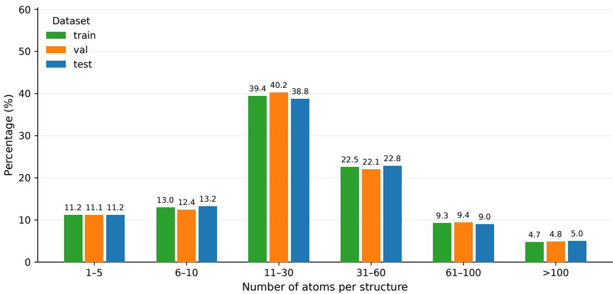

(a) Distribution of the number of atoms in the supplied unit cell.  
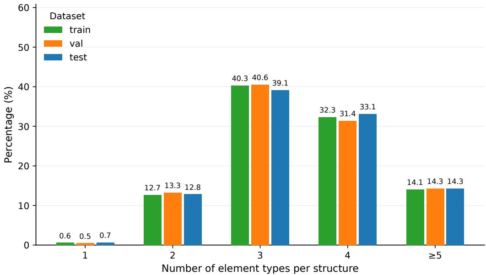  
(b) Distribution of the number of distinct element types per structure.  
Figure 4: Distributions of atomic counts and numbers of element types in the training, validation, and testing sets.

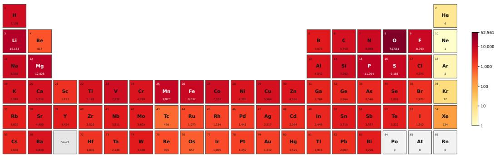

(a) Training set (91,040 structures).  
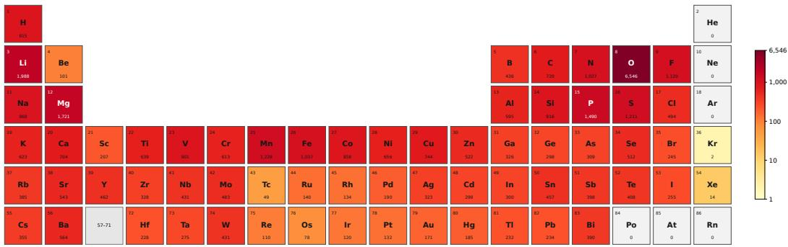

(b) Validation set (11,380 structures).  
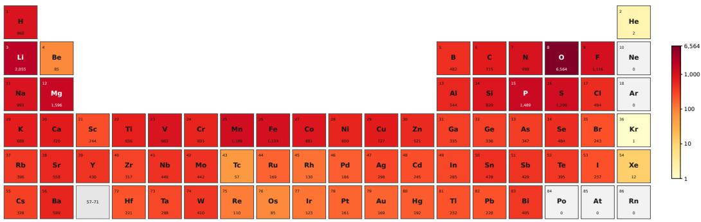  
(c) Testing set (11,380 structures).  
Figure 5: Element-occurrence frequencies in the training, validation, and testing sets.

The implementation permutes the external spin-major layout $2 \times 2 7 \times 2 \times 2 7$ into this orbitalmajor layout before the contractions and reverses the permutation at the output. The directional MLP predicts nine orbital weights and nine spin weights separately. The per-unit gates, directional weights, and contraction coefficients are complex scalars formed from pairs of real MLP outputs. The invariant node and edge features and the attention logits remain real. In both models, the equivariant feature update using bond directions includes only the bilateral directional contraction defined in Appendix G.3.

MLP parameterization. The $9 \times 9 = 8 1$ direct-product units provide 81 normalized Frobenius summaries in both models. Concatenating these summaries with the radial features gives the MLP for initial edge features an input dimension of $8 1 + 1 2 8 = 2 0 9 $ Within each layer, the MLPs for per-unit gating, directional embedding, attention, context-contraction coefficients, and invariant edge updates receive inputs comprising the Frobenius summaries, the radial features, and the three 256-dimensional feature vectors associated with the edge, its source atom, and its destination atom. Their input dimension is therefore $8 1 + 1 2 8 + 3 \times 2 5 \bar { 6 } = 9 7 7$ . The MLPs for initial node features and invariant node updates each receive a 256-dimensional input.

The MLPs for per-unit gating, directional embedding, and attention each have three hidden layers. The MLPs for initial node and edge features, context-contraction coefficients, and invariant node and edge updates each have two hidden layers. Every hidden layer has width 256 and applies an affine transformation, LayerNorm, and SiLU in that order. Each MLP ends with an affine output layer without normalization or activation. The MLP for context-contraction coefficients produces three real scalars in the non-SOC model and three complex scalars in the SOC model.

The non-SOC and SOC configurations contain 26,093,805 and 26,445,381 parameters, respectively, counting all registered parameter tensors.

Time-reversal symmetry. For SOC systems, we follow NextHAM (Yin et al., 2026) in applying corrections to the real parts of the two spin-conserving blocks. Its analysis on Materials-HAM-SOC shows that the discrepancies between $H ^ { ( 0 ) }$ and the self-consistent Hamiltonian are concentrated in these components, while the errors in the spin-flip blocks and the imaginary parts of the spin-conserving blocks are negligible. We therefore retain these remaining components from $H ^ { ( 0 ) }$ During output post-processing, we average the real parts of the predicted corrections to the $\uparrow \uparrow$ and ↓↓ blocks and add the resulting real matrix to both spin-conserving blocks of $H ^ { ( 0 ) }$ . This procedure preserves the time-reversal symmetry of Hamiltonians.

Initialization and normalization. Each layer has three trainable LayerScale parameters, initialized to 0.01, for updating the equivariant features, invariant edge features, and invariant node features. The weights and biases of the final affine layers in the MLPs for per-unit gating, directional embedding, attention, context-contraction coefficients, and invariant node and edge updates are initialized to zero.

With the parameterization in Eq. (91), the directional weights start at one. The gate residuals, the coefficient $c _ { e , V H V }$ for the bilateral directional contraction, and the three coefficients $u _ { e , j }$ for contractions using context features start at zero, as summarized in Eq. (108). The resulting initial prediction is $H ^ { ( 0 ) }$ , following the update equations in Appendix G.6.

The normalized Frobenius summaries use $\varepsilon _ { n } = 1 0 ^ { - 5 }$ inside the square root. Each matrix multiplication used to update equivariant features with directional or contextual information is divided by $\sqrt { D }$ , where $D = 2 7$ for non-SOC and $D = 5 4$ for SOC. A bilateral contraction involving two matrix multiplications therefore has an overall normalization factor of $D ^ { - 1 }$

Training protocol. For the reciprocal-space loss, ground-truth eigenstates with energies at or below $E _ { F } + 1 0 \mathrm { e V }$ define the low-energy subspace $\mathcal { P } _ { \cdot }$ , and the remaining states define the high-energy subspace $\mathcal { Q }$ , following NextHAM (Yin et al., 2026). For the joint loss in Eq. (138), we use the same weights as NextHAM: $\lambda _ { R } = 0 . 9 9 9 5 5 , \lambda _ { \mathcal { P } } = 0 . 0 0 0 2 , \lambda _ { \mathcal { Q } } = 0 . 0 0 0 1$ , and $\lambda _ { P Q } = 0 . 0 0 0 1 5$ . These weights control the real-space Hamiltonian loss and the reciprocal-space losses for the $\mathcal { P } , \mathcal { Q } .$ , and $P Q$ blocks, respectively, as defined in Appendix I.

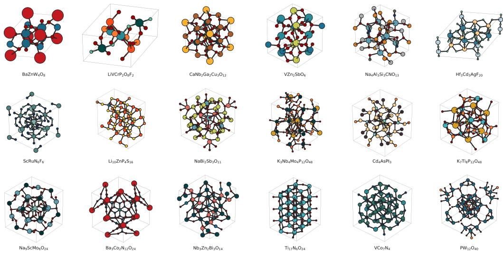  
Figure 6: Sampled material structures from our MP-HAM-110K dataset.

We train DP-Learner for 100 epochs with Adam and select the checkpoint with the best performance on the validation set for testing. The learning rate increases linearly from $1 0 ^ { - 6 } { \mathrm { ~ t o ~ } } 5 \times \dot { 1 } 0 ^ { - 4 }$ during the first five epochs, then follows a cosine decay to $1 0 ^ { - 5 }$ over the remaining 95 epochs. On each dataset, we train the full model and each of the five architectural ablation variants from scratch with three random seeds (2025, 2026, and 2027) and report the mean results over the three runs. For the full models and the ablation studies, the standard deviation of Gauge MAE across runs is below 0.005 meV.

Accuracy evaluation. Although mean absolute error (MAE) provides a straightforward measure of prediction accuracy, Hamiltonians must be compared with a common energy reference. In a nonorthogonal atomic-orbital basis, adding $\mu \mathbf { S }$ to the Hamiltonian, where $\mu$ is a real scalar and S is the overlap matrix, shifts all eigenvalues equally while preserving eigenvectors and energy differences. An unaligned MAE can therefore penalize differences arising solely from the arbitrary choice of energy reference.

To account for this gauge freedom, we evaluate Hamiltonian prediction accuracy using Gauge MAE, following the evaluation protocol of NextHAM (Yin et al., 2026) and the gauge-error formulation of Wang et al. (2024). For each test structure, a common energy-reference offset is removed before computing the mean absolute error over entries selected by the evaluation mask. For SOC systems, the metric uses the complex modulus of each entrywise error and includes all four spin blocks. Results are averaged over test structures and reported in meV. The full model, the architectural ablations, and the Only $H ^ { ( 0 ) }$ reference use the same evaluation procedure.

Efficiency evaluation. We report the mean peak GPU memory per test structure using PyTorch’s reserved-memory metric. The measurement includes resident model parameters and input tensors, together with the additional memory required to compute the prediction. To account for the complete predictor, we sum the peak GPU memory values across all four GPUs used by the complete NextHAM predictor. For DP-Learner, which uses a single model on one GPU, we record the peak memory on that device.

We also measure the elapsed wall-clock time for transferring model inputs, executing the forward pass, converting the outputs into a DFT-compatible Hamiltonian format, and saving the predicted Hamiltonians to disk. Since both methods share the same pre-processing pipeline, including the construction of the zeroth-step Hamiltonian $H ^ { ( 0 ) }$ , the pre-processing cost is not included, allowing a direct comparison of model-dependent inference costs. The reported time is averaged over test structures. Concurrent model computations are counted once within this elapsed interval; runtimes across GPUs are not summed.

## L ADDITIONAL EXPERIMENTAL RESULTS

We compare DP-Learner with an Only $H ^ { ( 0 ) }$ reference and five architectural ablation variants on both Materials-HAM-SOC (Yin et al., 2026) and MP-HAM-110K, using the SOC and non-SOC formulations, respectively. The Only $H ^ { ( 0 ) }$ reference measures the improvement achieved by learning a correction to the zeroth-step Hamiltonian. The five architectural ablations assess the individual contributions of the following components to Hamiltonian prediction accuracy: updating equivariant features across layers, incorporating bond directions through Lie generators, aggregating equivariant features from neighboring atom pairs, predicting invariant coefficients from the local environment, and scaling residual feature updates with LayerScale. Each architectural ablation starts from the corresponding full architecture in Appendix G and makes the changes described below. Within each dataset, all comparisons use the same testing structures and evaluation procedure. The five trained variants also use the same split, training objective, optimizer, learning-rate schedule, and training duration as the full model. The radial basis, cutoff radius, invariant hidden width, MLP depth, and attention configuration also follow the corresponding full model wherever these components are retained.

The settings below apply to both formulations, with $\chi \in \{ \mathrm { S O } ( 3 ) , \mathrm { S U } ( 2 ) \}$ . We use $\chi = \mathrm { S O ( 3 ) }$ $\star = { } \top$ , and $D = 2 7$ for the non-SOC model on MP-HAM-110K, and $\chi = \mathrm { S U } ( 2 ) , \star = \dagger$ , and $D = 5 4$ for the SOC model on Materials-HAM-SOC. The feature symbols follow the corresponding formulation; we omit $\chi$ where the same expression applies to both.

The reference and ablation settings are described below.

Only $H ^ { ( 0 ) }$ . This reference uses the zeroth-step Hamiltonian directly as the prediction, $H _ { a b } ^ { \mathrm { p r e d } } =$ $H _ { a b } ^ { ( 0 ) } .$ , without applying a neural network correction. It has no trainable parameters and requires no training. We evaluate it on both testing sets using the same Gauge MAE procedure as the learned models. This comparison quantifies the accuracy gained by learning the correction from the initial Hamiltonian to the self-consistent reference.

Without equivariant feature updates across layers. In the full model, invariant node and edge features determine the coefficients used to update equivariant atom-pair features in the direct-product space. This variant removes those equivariant feature updates and retains message passing through invariant node and edge features. In particular, it removes the intermediate features $F _ { e } ^ { ( k ) }$ , their per-unit and edge gating, the construction of directional operators, and the attention that aggregates equivariant features into atom-wise context features. The matrix contractions that update equivariant features using directional information,

$$
V _ { \mathrm { s r c } ( e ) } ^ { \chi } \widetilde { F } _ { e } ^ { ( k ) } \left( V _ { \mathrm { d s t } ( e ) } ^ { \chi } \right) ^ { \star }\tag{140}
$$

and contextual information,

$$
N _ { \mathrm { s r c } ( e ) } ^ { ( k ) } \overline { { F } } _ { e } ^ { ( k ) } , \qquad \overline { { F } } _ { e } ^ { ( k ) } \left( N _ { \mathrm { d s t } ( e ) } ^ { ( k ) } \right) ^ { \star } , \qquad N _ { \mathrm { s r c } ( e ) } ^ { ( k ) } \overline { { F } } _ { e } ^ { ( k ) } \left( N _ { \mathrm { d s t } ( e ) } ^ { ( k ) } \right) ^ { \star }\tag{141}
$$

are therefore absent from every layer. The retained invariant networks use fixed summaries of $H ^ { ( 0 ) }$ throughout message passing and predict scalar coefficients that modify $H ^ { ( 0 ) }$ at the output.

The initial invariant features are constructed in the same way as in the full model. Let ${ \bf n } _ { e } ^ { ( 0 ) }$ contain the normalized Frobenius norms of the direct-product units of $H _ { e } ^ { ( 0 ) }$ , computed using Eq. (83) for non-SOC and Eq. (84) for SOC. The initial edge and node features are

$$
\begin{array} { r } { \mathbf { z } _ { e } ^ { ( 0 ) } = \mathrm { M L P } _ { \mathrm { i n i t } } \left( \mathbf { n } _ { e } ^ { ( 0 ) } \parallel \phi _ { e } \right) , } \end{array}\tag{142}
$$

$$
\mathbf { x } _ { v } ^ { ( 0 ) } = \mathrm { M L P } _ { \mathrm { n o d e - i n i t } } \left( \sum _ { e : \mathrm { d s t } ( e ) = v } \mathbf { z } _ { e } ^ { ( 0 ) } \right) .\tag{143}
$$

Since no intermediate equivariant features are updated, each layer combines the fixed summaries ${ \bf n } _ { e } ^ { ( 0 ) }$ with the current invariant features and radial information:

$$
\eta _ { e , \mathrm { i n v } } ^ { ( k ) } = \mathbf { n } _ { e } ^ { ( 0 ) } \parallel \mathbf { z } _ { e } ^ { ( k ) } \parallel \mathbf { x } _ { \mathrm { s r c } ( e ) } ^ { ( k ) } \parallel \mathbf { x } _ { \mathrm { d s t } ( e ) } ^ { ( k ) } \parallel \phi _ { e } .\tag{144}
$$

The scalar attention logits are predicted from $\eta _ { e , \mathrm { i n v } } ^ { ( k ) }$ , and the attention value vectors are obtained from $\mathbf { z } _ { e } ^ { ( k ) }$ . Multi-head attention then updates the invariant node features according to Eq. (100). The updated node features enter the input for the invariant edge update,

$$
\xi _ { e , \mathrm { i n v } } ^ { ( k ) } = \mathbf { n } _ { e } ^ { ( 0 ) } \parallel \mathbf { z } _ { e } ^ { ( k ) } \parallel \mathbf { x } _ { \mathrm { s r c } ( e ) } ^ { ( k + 1 ) } \parallel \mathbf { x } _ { \mathrm { d s t } ( e ) } ^ { ( k + 1 ) } \parallel \phi _ { e } ,\tag{145}
$$

which gives

$$
\begin{array} { r } { \mathbf { z } _ { e } ^ { ( k + 1 ) } = \mathbf { z } _ { e } ^ { ( k ) } + \gamma _ { \mathrm { e d g e } } \mathrm { M L P } _ { \mathrm { f e a t } } \left( \pmb { \xi } _ { e , \mathrm { i n v } } ^ { ( k ) } \right) . } \end{array}\tag{146}
$$

Thus, the invariant node and edge networks continue to learn non-linear functions of the neighboring environment, while the Hamiltonian summaries remain fixed across layers.

An output MLP maps the final invariant features to one scalar coefficient for each direct-product unit of $H ^ { ( 0 ) }$ . This readout allows the variant to learn a Hamiltonian correction after the equivariant feature updates have been removed. Its input is

$$
\zeta _ { a b } = \mathbf { n } _ { a b } ^ { ( 0 ) } \parallel \mathbf { z } _ { a b } ^ { ( K ) } \parallel \mathbf { x } _ { a } ^ { ( K ) } \parallel \mathbf { x } _ { b } ^ { ( K ) } \parallel \phi _ { a b } ,\tag{147}
$$

and its outputs are

$$
\left\{ \beta _ { a b , u v } ^ { \chi } \right\} _ { u \in \mathcal { B } _ { a } , v \in \mathcal { B } _ { b } } = \mathrm { M L P } _ { \mathrm { o u t } } \left( \zeta _ { a b } \right) .\tag{148}
$$

The coefficients $\beta _ { a b , u v } ^ { \chi }$ are real for non-SOC and complex for SOC; in the latter case, each complex coefficient is formed from two real MLP outputs. To apply these coefficients to the corresponding orbital sets, define

$$
\Pi _ { \xi , u } ^ { \chi } = \left\{ { \begin{array} { l l } { P _ { \xi , u } , } & { \chi = \mathrm { S O } ( 3 ) , } \\ { P _ { \xi , u } \otimes I _ { 2 } , } & { \chi = \mathrm { S U } ( 2 ) . } \end{array} } \right.\tag{149}
$$

where $P _ { \xi , u }$ projects onto the complete magnetic subspace of orbital set u on atom ξ. For SOC, the tensor product with $I _ { 2 }$ includes both spin components. The correction before the final output processing is

$$
\Delta H _ { a b } ^ { \mathrm { i n v } , \chi } = \sum _ { u \in \mathcal { B } _ { a } } \sum _ { v \in \mathcal { B } _ { b } } \beta _ { a b , u v } ^ { \chi } \Pi _ { a , u } ^ { \chi } H _ { a b } ^ { ( 0 ) } \left( \Pi _ { b , v } ^ { \chi } \right) ^ { \star } .\tag{150}
$$

The same output module as in the full model maps $\Delta H _ { a b } ^ { \mathrm { i n v } , \chi }$ to the final Hamiltonian correction $\Delta H _ { a b } ^ { \mathrm { p r e d } }$ . The prediction is

$$
H _ { a b } ^ { \mathrm { p r e d } } = H _ { a b } ^ { ( 0 ) } + \Delta H _ { a b } ^ { \mathrm { p r e d } } .\tag{151}
$$

The output assembly therefore follows Eq. (109), while this variant does not propagate equivariant features across layers. The final affine layer of $\mathrm { M L P _ { o u t } }$ is zero initialized, so that $\bar { \beta } _ { a b , u v } ^ { \chi } = 0$ and the initial prediction equals $H _ { a b } ^ { ( 0 ) }$

The coefficients $\beta _ { a b , u v } ^ { \chi }$ are invariant, and the projectors commute with the rotation and spatialinversion representations. The correction therefore follows the same transformation law as the Hamiltonian. Before the common output processing, all entries within each direct-product unit are multiplied by the same scalar. This multiplication can adjust the magnitude and, for complex coefficients, the phase of each unit according to the environment, but it does not mix its row or column components. This variant compares learning equivariant matrix features across layers with using invariant message passing to modulate the fixed units of $H ^ { ( 0 ) }$

Without directional embedding. In this variant, we remove the directional operators in Eq. (58) and their bilateral contraction with the equivariant atom-pair features in Eq. (94). The gated feature therefore passes directly to the attention calculation and aggregation of equivariant context features:

$$
\widehat F _ { e } ^ { ( k ) } = \widetilde F _ { e } ^ { ( k ) } , \qquad \forall e , k .\tag{152}
$$

This modification removes the orbital contribution to the directional embedding in the non-SOC model and both the orbital and spin contributions in the SOC model.

Per-unit gating, aggregation of equivariant atom-wise context features, and updating equivariant atom-pair features using those context features remain active. The invariant node and edge networks and the stabilization mechanisms are also retained. Given that $H ^ { ( 0 ) }$ already depends on the orbital orientation, this comparison measures the additional contribution of using bond directions explicitly through the Lie-generator-based embedding.

Without aggregation of equivariant context features. This variant removes the mechanism that aggregates incoming equivariant atom-pair features into the atom-wise context $N _ { v } ^ { ( k ) }$ in Eq. (97). The associated logits $\ell _ { e } ^ { \mathrm { o p } }$ and weights $\alpha _ { e } ^ { \mathrm { o p } }$ are removed, and the context feature is replaced by the identity matrix at every layer:

$$
N _ { v } ^ { ( k ) } = I _ { D } , \qquad \forall v , k .\tag{153}
$$

The local bases of the source and destination atoms are padded to the same dimension $D .$ Substitut ing $N _ { v } ^ { ( k ) } = I _ { D }$ into Eq. (105) gives

$$
\delta F _ { e } ^ { ( k ) } = \gamma _ { H } \left( \frac { u _ { e , 1 } + u _ { e , 2 } } { \sqrt { D } } + \frac { u _ { e , 3 } } { D } \right) \overline { { F } } _ { e } ^ { ( k ) } .\tag{154}
$$

The left, right, and bilateral matrix contractions thus reduce to scalar multiplication of the current equivariant atom-pair feature. The coefficients $u _ { e , 1 } , u _ { e , 2 } .$ , and $u _ { e , 3 }$ are still predicted from the invariant features of the local environment.

Updating equivariant features using directional information, scalar attention, invariant node and edge updates, and all stabilization mechanisms are retained. Neighboring atoms can therefore still influence the predicted scalar coefficients through invariant message passing. What is removed is the aggregation of neighboring equivariant matrix features and their subsequent action on the orbital or orbital–spin components of the current atom-pair feature.

Without environment-dependent invariant coefficients. In the full model, MLPs use the local environment to predict invariant coefficients for updating equivariant features and logits for attention. This ablation term replaces these MLPs with directly learnable parameters of the same output shapes. Each layer has its own set of parameters, shared across all atom pairs. These parameters are optimized during training but do not vary with the input environment. The per-unit gates, directionalweight residuals, coefficient for the bilateral contraction using directional operators, edge gate, and coefficients for contractions using context features become

$$
\begin{array} { r l r l r l } { g _ { e , u v } ^ { ( k ) } = \overline { { g } } _ { u v } ^ { ( k ) } , \qquad } & { } & { \Delta { w } _ { e } ^ { ( k ) } = \overline { { \Delta w } } ^ { ( k ) } , \qquad } & { } & { c _ { e , V H V } ^ { ( k ) } = \overline { { c } } _ { V H V } ^ { ( k ) } , } \\ { b _ { e } ^ { ( k ) } = \overline { { b } } ^ { ( k ) } , \qquad } & { } & { u _ { e , j } ^ { ( k ) } = \overline { { u } } _ { j } ^ { ( k ) } , \quad j = 1 , 2 , 3 , \qquad } & { } & { \forall e . } \end{array}\tag{155}
$$

Here, the overbars denote the directly learned parameters. Gates remain distinct across directproduct units, and directional weights remain distinct across generator channels. These coefficients retain the real or complex type used in the corresponding full model, while attention logits remain real. The parameters are initialized to match the outputs of the corresponding heads in the full model:

$$
\begin{array} { r } { \overline { { g } } _ { u v } ^ { ( k ) } = 0 , \qquad \overline { { \Delta w } } ^ { ( k ) } = 0 , \qquad \overline { { c } } _ { V H V } ^ { ( k ) } = 0 , \qquad \overline { { b } } ^ { ( k ) } = 0 , \qquad \overline { { u } } _ { j } ^ { ( k ) } = 0 \quad ( j = 1 , 2 , 3 ) . } \end{array}\tag{156}
$$

The directional weights therefore still start from $w = 1 + \Delta w = 1$ , and the initial Hamiltonian correction is zero.

The attention logits for aggregating equivariant features and for each scalar attention head are also replaced by parameters shared across edges within each layer:

$$
\ell _ { e } ^ { \mathrm { o p } , ( k ) } = \overline { { \ell } } ^ { \mathrm { o p } , ( k ) } , \qquad \ell _ { e , h } ^ { \mathrm { i n v } , ( k ) } = \overline { { \ell } } _ { h } ^ { \mathrm { i n v } , ( k ) } , \qquad \forall e .\tag{157}
$$

The softmax then assigns equal weights to the incoming edges of each destination atom:

$$
\alpha _ { e } ^ { \mathrm { o p } } = \alpha _ { e , h } ^ { \mathrm { i n v } } = \{ \begin{array} { l l } { | \mathcal { E } _ {  v } | ^ { - 1 } , } & { \chi = \mathrm { S O ( 3 ) } , } \\ { ( | \mathcal { E } _ {  v } | + \varepsilon _ { \alpha } ) ^ { - 1 } , } & { \chi = \mathrm { S U ( 2 ) } , } \end{array}  \quad e \in \mathcal { E } _ {  v } .\tag{158}
$$

These expressions follow the denominator stabilization used in the corresponding full models, as described in Appendix G.4. Both assign equal weights within each nonempty incoming-edge set; the SOC weights include the stabilization constant $\varepsilon _ { \alpha }$ and are approximately $| \dot { \mathcal { E } } _ {  v } | ^ { - 1 }$

All matrix contractions that update equivariant features using directional and contextual information are retained. The invariant node and edge networks also remain in the architecture, but their inputdependent features no longer determine the coefficients or attention weights used in the equivariant computation. The Hamiltonian prediction still depends on the input through $H ^ { ( 0 ) }$ , the bond directions, and the aggregated equivariant features. This comparison assesses the benefit of adapting both the coefficients for updating equivariant features and the attention weights to the local environment.

Without LayerScale. In the full model, LayerScale regulates the magnitudes of the residual feature updates through trainable parameters initialized to 0.01. This ablation term fixes the residual scaling factors for the equivariant atom-pair features and the invariant edge and node features to one. In every layer, the effective multipliers in Eqs. (105), (102), and (100) satisfy

$$
\gamma _ { H } = \gamma _ { \mathrm { e d g e } } = \gamma _ { \mathrm { n o d e } } = 1 .\tag{159}
$$

The residual feature updates are therefore added without learnable LayerScale multipliers. Any bounding function applied to these multipliers is bypassed so that their effective values are exactly one.

All feature representations, attention mechanisms, and matrix contractions are retained. The contraction factors $D ^ { - 1 / 2 }$ and $D ^ { - 1 }$ , zero initialization of the correction heads, $w = 1 + \Delta \ i$ w parameterization, and other stabilization mechanisms are unchanged. This variant evaluates the contribution of LayerScale to controlling the magnitudes of the three types of residual feature updates.

Table 4 reports the mean Gauge MAE on both testing sets. The full model achieves 0.841 meV on Materials-HAM-SOC and 1.595 meV on MP-HAM-110K, improving on both the Only $H ^ { ( 0 ) }$ reference and every architectural ablation. Removing any of the five components increases the error in both the SOC and non-SOC formulations.

Using only $H ^ { ( 0 ) }$ gives Gauge MAEs of 2.606 meV on Materials-HAM-SOC and 5.203 meV on MP-HAM-110K. DP-Learner reduces these errors to 0.841 and 1.595 meV, respectively, corresponding to absolute decreases of 1.765 and 3.608 meV. These reductions show that the learned corrections substantially improve on the initial electronic-structure estimates in both settings. The zeroth-step Hamiltonian provides a physically informed starting point, while the network uses the local geometric and electronic environment to refine its orbital or orbital–spin couplings toward the self-consistent reference. Figure 7 shows that the bands obtained from $\bar { H } ^ { ( 0 ) }$ exhibit substantial deviations from the DFT reference, whereas DP-Learner closely reproduces the reference band structures, demonstrating the effectiveness of the learned Hamiltonian corrections.

Removing equivariant feature updates across layers produces the largest error among the trained variants on both datasets: 1.875 meV on Materials-HAM-SOC and 3.421 meV on MP-HAM-110K. These correspond to increases of 122.9% and 114.5% over the respective full models. These results demonstrate the importance of learning equivariant features across layers for both orbital and orbital–spin Hamiltonian prediction. The variant still learns non-linear invariant node and edge features, but its correction before the final output processing is restricted to scaling the direct-product units of $H ^ { ( 0 ) }$ . The full model uses directional operators and equivariant context features to mix the row and column components of atom-pair features during message passing. These matrix contractions allow the network to represent more general changes in individual orbital or orbital–spin couplings induced by the local geometric and electronic environment, providing a more expressive representation for predicting the self-consistent Hamiltonian.

Removing the directional embedding increases Gauge MAE to 1.025 meV on Materials-HAM-SOC and 2.302 meV on MP-HAM-110K, corresponding to increases of 21.9% and 44.3%, respectively. These increases indicate that explicitly incorporating bond directions helps the network model the orientation dependence of orbital and orbital–spin couplings more accurately, even though $H ^ { ( 0 ) }$ already contains some orientation information. The directional embedding contracts bond direction with orbital Lie generators and, for SOC, spin Lie generators to construct operators that act on the row and column components of atom-pair features. With weights learned from the local environment, these operators allow bond orientation to guide feature updates at every layer while preserving equivariance.

Removing the aggregation of equivariant context features increases Gauge MAE to 1.354 meV on Materials-HAM-SOC and 2.433 meV on MP-HAM-110K, corresponding to increases of 61.0% and 52.5%, respectively. These increases demonstrate the importance of incorporating information about neighboring couplings through equivariant matrix features when modeling how the surrounding environment affects each Hamiltonian block. Invariant message passing still conveys information about neighboring atoms and determines the coefficients in Eq. (154), but the equivariant context matrices are no longer available for feature updates. The full model constructs these atom-wise context features from neighboring atom-pair features and uses them in matrix contractions to update the row and column components of each atom-pair feature. The neighboring environment therefore contributes to these updates through both scalar coefficients and equivariant matrices, enabling a more expressive description of its influence on orbital or orbital–spin couplings.

Table 4: Results of ablation study on the Materials-HAM-SOC and MP-HAM-110K testing sets, using the SOC and non-SOC formulations, respectively. Gauge MAE is the gauge-corrected Hamiltonian mean absolute error in meV. The ablation term labeled as Only $H ^ { ( 0 ) }$ reports the error obtained by directly using the zeroth-step Hamiltonian as the prediction, without any learned correction. Results for the full model and the five other ablation terms are averaged over three independent training runs. Lower values indicate better performance.
<table><tr><td rowspan="2">Method</td><td colspan="2">Gauge MAE (meV) ↓</td></tr><tr><td>Materials-HAM-SOC</td><td>MP-HAM-110K</td></tr><tr><td>Only  $H ^ { ( 0 ) }$ </td><td>2.606</td><td>5.203</td></tr><tr><td>Without equivariant feature updates across layers</td><td>1.875</td><td>3.421</td></tr><tr><td>Without directional embedding</td><td>1.025</td><td>2.302</td></tr><tr><td>Without aggregation of equivariant context features</td><td>1.354</td><td>2.433</td></tr><tr><td>Without environment-dependent invariant coefficients</td><td>1.280</td><td>2.230</td></tr><tr><td>Without LayerScale</td><td>0.963</td><td>2.065</td></tr><tr><td>DP-Learner (full)</td><td>0.841</td><td>1.595</td></tr></table>

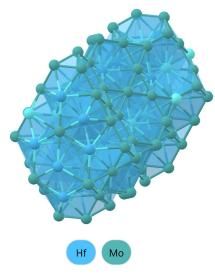

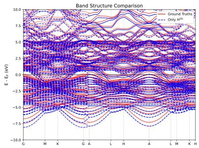

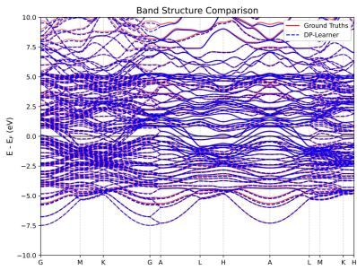

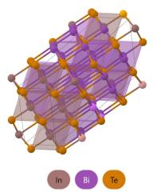

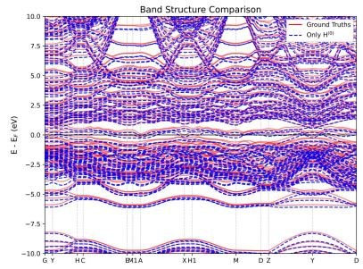

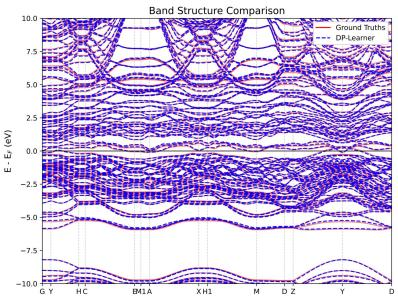

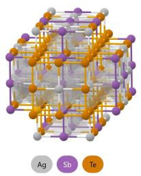

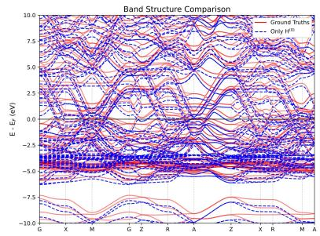

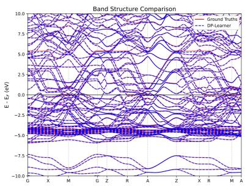  
Figure 7: Band structures obtained using only $H ^ { ( 0 ) }$ and using DP-Learner for three representative structures from the MP-HAM-110K dataset. Each row shows the crystal structure (left), the bands obtained from $H ^ { ( 0 ) }$ (middle), and the DP-Learner bands (right). Red solid lines show the DFT reference bands used as ground truths in our dataset, while blue dashed lines show the results of the corresponding method. Energies are referenced to the Fermi energy $E _ { F }$

Removing the MLPs that predict invariant coefficients and attention logits from the local environment increases Gauge MAE to 1.280 meV on Materials-HAM-SOC and 2.230 meV on MP-HAM-110K, corresponding to increases of 52.2% and 39.8%, respectively. These increases demonstrate the importance of adapting attention and equivariant matrix contractions to the local environment in both formulations. In this variant, the MLP outputs are replaced with learnable parameters shared across all atom pairs within each layer. The matrix contractions remain available, but their coefficients no longer depend on the input, and attention assigns equal weights to the incoming edges at each atom. At each layer, the full model predicts these coefficients and logits from invariant features that encode local geometric and electronic information. These predictions allow the network to adaptively weight neighboring contributions and adjust how directional and contextual information is used to update each equivariant atom-pair feature.

Removing LayerScale increases Gauge MAE to 0.963 meV on Materials-HAM-SOC and 2.065 meV on MP-HAM-110K, corresponding to increases of 14.5% and 29.5%, respectively. These increases highlight the benefit of using LayerScale to control the magnitude of residual feature updates during training. LayerScale provides separate trainable scaling factors for equivariant atompair features and invariant node and edge features, allowing their update magnitudes to be adjusted independently at each layer. The contraction normalizations, zero initialization of the correction branches, and other stabilization mechanisms remain unchanged in this ablation.

Together, the comparison with Only $H ^ { ( 0 ) }$ and the ablations on both datasets demonstrate the accuracy gained from learned corrections and the complementary roles of invariant and equivariant features in Hamiltonian prediction. Invariant features allow the attention weights and contraction coefficients to adapt to the local geometric environment and electronic couplings, while equivariant features retain the Hamiltonian structure in the direct-product space and are refined across layers. Explicit bond directions and equivariant context features provide information about bond orientation and neighboring couplings, respectively, while LayerScale controls the magnitude of residual feature updates. Combining these components yields the lowest prediction error on both datasets, demonstrating the effectiveness of this design for both SOC and non-SOC Hamiltonian prediction.

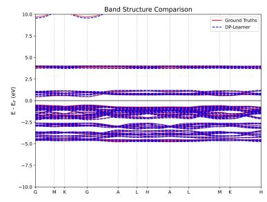

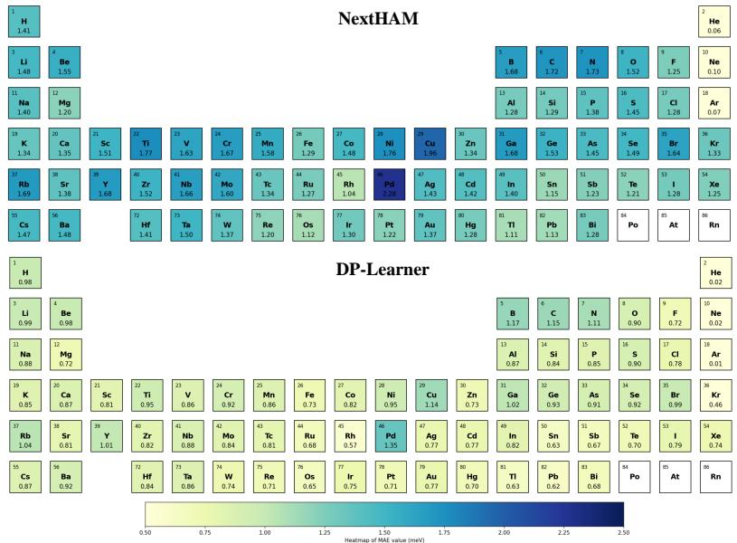  
Figure 8: Gauge MAE (meV) for element-defined subsets of the Materials-HAM-SOC testing set. Each subset contains all test structures with the indicated element. Colors are clipped to the displayed range; numerical labels give the actual errors.

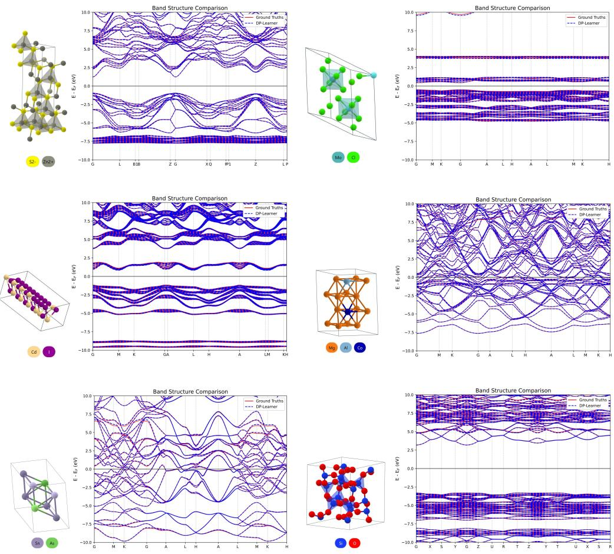  
Figure 9: More band structure results for representative Materials-HAM-SOC testing samples. Red solid lines show the DFT reference bands used as ground truths in our dataset; blue dashed lines show DP-Learner predictions. Energies are referenced to the Fermi energy $E _ { F }$

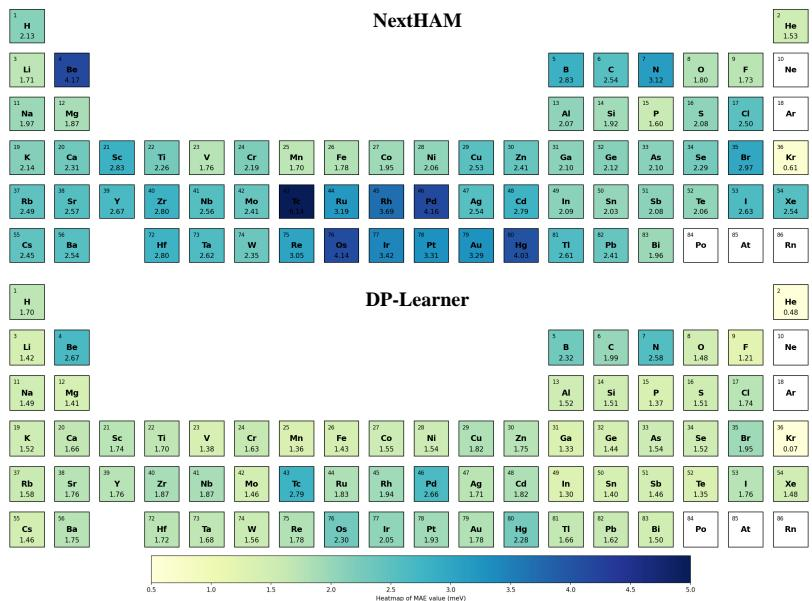  
Figure 10: Gauge MAE (meV) values for element-defined subsets of the MP-HAM-110K testing set. Each subset contains all test structures with the indicated element. Colors are clipped to the displayed range; numerical labels give the actual errors.

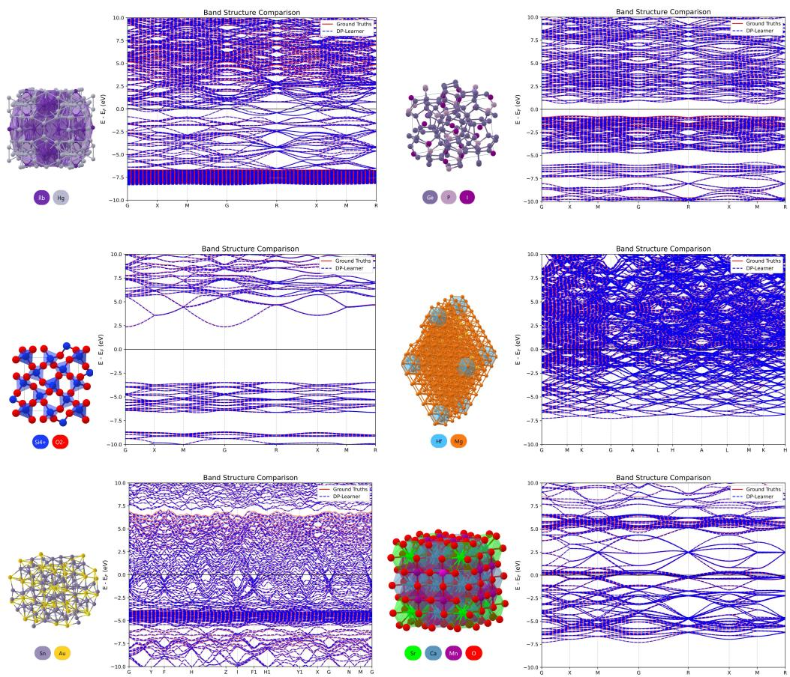  
Figure 11: Additional band-structure results for representative test structures from MP-HAM-110K. Red solid lines show the DFT reference bands used as ground truths in our dataset; blue dashed lines show DP-Learner predictions. Energies are referenced to the Fermi energy $E _ { F }$