# Evaluating Language Model Features for Zero-Shot Time-Series Anomaly Detection Under Isolation Assumption

Romain Hermary University of Luxembourg

Nesryne Mejri

University of Luxembourg

Djamila Aouada University of Luxembourg

romain.hermary@uni.lu

nesryne.mejri@uni.lu

djamila.aouada@uni.lu

## Abstract

Time-Series Anomaly Detection (TSAD) is a fundamentally challenging task: it is unsupervised, requires high local precision capabilities, and sufers from limited labelled data. Recent work has explored adapting Large Language Models (LLMs) to time-series via cross-modal transfer. However, existing approaches are poorly suited to Multivariate TSAD (MTSAD), as tokenisation often obscures fine-grained temporal and variables structures, and most methods optimise auxiliary objectives such as forecasting or reconstruction. We posit that these surrogate objectives become unreliable as model capacity increases. Highly expressive models risk reconstructing or forecasting anomalies, undermining the foundations of both strategies. Instead, we propose to use LLMs purely as feature extractors and directly analyse their induced feature spaces. In this work, investigate the ability of LLMs to provide useful representations for MTSADs in a zero-shot setting through classification. To this end, we study the separability of the extracted features, under the assumption that anomalous features should be isolated from normal ones. We analyse their temporal and contextua discriminative ability using simple step-wise tokenisation schemes, with one time-step per token, which preserve fine-grained local information. Their usability for MTSAD is assessed using an unsupervised Isolation Forest, enabling a direct evaluation of the resulting representation quality. We further investigate whether the observed performance can be attributed to the language-related pre-training of the LLMs or arises independently of it. Our results provide empirical insight into the ability of LLMs to represent multivariate time-series for anomaly detection and highlight broader applications of cross-modal foundation models.

## 1 Introduction

Time-series analysis is inherently challenging due to the high heterogeneity and domain dependence of available datasets, compounded by their limited sizes. These constraints hinder the development of generalpurpose Time-Series Foundation Models (TSFMs) capable of addressing core tasks such as classification, forecasting, and anomaly detection.

Recent work has explored the use of Large Language Models (LLMs) for time-series processing (Zhang et al., 2024; Jiang et al., 2024). Trained on large-scale textual corpora, LLMs possess strong sequential modelling capabilities and have demonstrated notable cross-modal adaptability (Lu et al., 2022). Leveraging pre-trained LLMs as processors for time-series data is therefore an appealing direction, benefiting from the maturity and scale of language modelling research.

A central challenge lies in the mismatch between time-series data and textual representations. Unlike natural language, time-series consist of continuous numerical values with precise temporal and inter-variable relationships. Prior work has identified several directions to address this mismatch, including learned projections, model adaptation, and specialised tokenisers (Spathis & Kawsar, 2024); however, only a few strategies allow the use of LLMs for time-series analysis in a zero-shot manner. The popular direct tokenisation of Gruver et al. (2023) converts numbers to text characters but compromises numerical precision and can fragment values across multiple tokens, disrupting temporal dependencies. These issues are exacerbated in multivariate settings, where serialisation destroys the multivariate structure, hinders dependencies between variables, and drastically inflates token count (Chatzigeorgakidis et al., 2024).

A deeper issue lies in how existing approaches prioritise general representation learning, overlooking the specific demands of Time-Series Anomaly Detection (TSAD). In particular, TSAD poses additional dificulties, as it requires high local sensitivity and is typically formulated in an unsupervised setting due to the absence of anomalies in the training data (Darban et al., 2025; Mejri et al., 2024). Common processing strategies, particularly tokenisation schemes such as patching or quantisation, can obscure fine-grained temporal patterns and attenuate anomalies. Furthermore, most methods rely on auxiliary objectives, notably forecasting or reconstruction; while efective for broad evaluation, these objectives are not aligned with anomaly detection: suficiently expressive models risk reconstructing or forecasting anomalous patterns as faithfully as normal data, thereby suppressing residual scores and leaving anomalies undetected by design (Gong et al., 2019; Yoon et al., 2026). Consequently, higher model capacity and reconstruction fidelity do not guarantee superior anomaly detection; on the contrary, excessive reconstruction capability can actively degrade performance by absorbing anomalous signals.

To circumvent these limitations, we consider anomaly detection through the lens of One-Class Classification (OCC) (Schölkopf et al., 2001), where normal patterns define the data distribution and anomalies correspond to deviations from it. This perspective naturally favours approaches that operate directly on feature representations to estimate abnormality (Hermary et al., 2026). In this context, we investigate features extracted from pre-trained foundation models such as LLMs: as these models continue to scale, assessing their ability to transfer to new modalities in a zero-shot setting becomes increasingly relevant.

In this direction, we propose to evaluate the extent to which LLM-induced representations isolate anomalous from normal patterns. We therefore investigate simple, zero-shot-compatible tokenisation strategies, with an emphasis on step-wise tokenisation where each time-step is mapped to a single token. This design limits the efect of local information erasure, making it particularly suitable for detecting point anomalies while not compromising the detection of other anomaly types, and allowing for a focus on the temporal processing of LLMs.

Our contributions are summarised as follows:

• We discuss the limitations of current foundation model approaches applied to Multivariate Time-Series Anomaly Detection (MTSAD) and propose investigating language model features as an alternative approach, treating anomaly detection as a central objective.

• We propose a unified evaluation protocol designed for imbalanced, unsupervised anomaly detection settings, based on an isolation prior for anomalies.

• We provide an extensive empirical study across multiple LLM architectures, tokenisation methods, datasets and context sizes, ofering insight into the zero-shot applicability of LLMs for MTSAD. We further investigate whether language knowledge is leveraged through trivial tokenisation strategies.

## 2 Related Work

The emergence of TSFMs marks a significant shift from task-specific architectures toward unified frameworks capable of addressing core evaluation tasks such as classification, short- and long-term forecasting, and anomaly detection (Liang et al., 2024; Meyer et al., 2025). Recent advancements, exemplified by UniTS (Gao et al., 2024), demonstrate the feasibility of training models across these diverse tasks simultaneously, allowing for fine-tuning on anomaly detection datasets or direct zero-shot application to novel tasks. However, many current TSFMs remain constrained by a focus on proxy objectives, such as reconstruction or forecasting which are typically limited approaches in anomaly detection (Hermary et al., 2025).

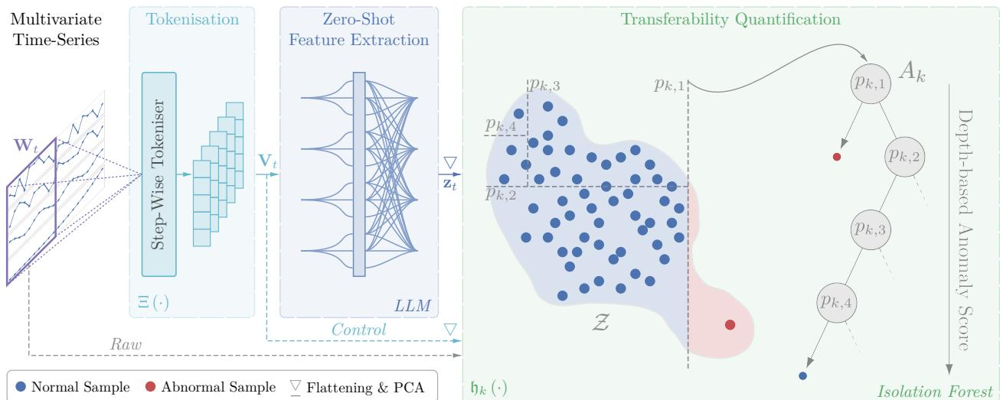  
Figure 1: We adopt a windowed approach, assigning one anomaly score per window. Each window is tokenised step-wise (one token per time-step), processed by a pre-trained LLM, and aggregated into a fixedsize feature vector. An Isolation Forest is then fitted on these features to produce anomaly scores. The resulting performance reflects the suitability of the feature space for anomaly detection and, consequently, the representations transferability to MTSAD. The Raw path corresponds to applying the Isolation Forest directly on the dataset; the Control one on the tokenised dataset.

Parallel to this, the sequential nature of time-series data has led to the adoption of LLMs as powerful backbones for temporal analysis (Zhang et al., 2024). This direction is driven by the inherent multi-modal capabilities of LLMs and their proficiency in processing sequential dependencies (Jiang et al., 2024). Most research in this area focuses on forecasting-based objectives or fine-tuning strategies designed to bridge the modality gap (Bian et al., 2024; Hu et al., 2025; Sun et al., 2024; Masserano et al., 2025).

In the sub-field of time-series anomaly detection, LLMs are increasingly utilised to provide detection capabilities, but also natural language explainability. Architectures like TriP-LLM (Yu et al., 2025) and MADLLM (Tao et al., 2025) train specialised adapters to bridge the modality and domain gaps, while AnomalyLLM (Liu et al., 2024) explores knowledge distillation from LLMs.

Despite these advancements, the direct zero-shot application of LLMs for TSAD remains an emergent field, characterised by a wide array of diverse strategies. While some approaches rely on powerful closed-source models and elaborate prompting (Xu et al., 2026; Dong et al., 2024; Liu et al., 2026), others, like LLMAD (Liu et al., 2025), integrate domain knowledge and databases, converting time-series into tabular or text formats for few-shot explanations. Additional attempts have been made to obtain anomaly positions directly from the LLM via prompting (Russell-Gilbert et al., 2024). However, SigLLM (Alnegheimish et al., 2024) demonstrates that using LLMs in a forecasting-based strategy yields far better results than direct questioning.

Alternatively, research in image-based modalities leverages the maturity of Vision-Language Models (VLMs) by transforming time-series into plots or frequency maps (He et al., 2026; Zhuang et al., 2024). While these visual foundations ofer an alternative for cross-modal analysis, this work focuses on the eficiency and granularity of direct time-series-to-token conversions for multivariate time-series, in zero-shot setting.

## 3 Methodology

We formalise the TSAD problem in Section 3.1 We then detail the tokenisation methods in Section 3.2 and the quantification of transferability in Section 3.3, as illustrated in Figure 1. Finally, we describe standard adaptations of TSFMs for anomaly detection, used as baselines, in Section 3.4.

## 3.1 Problem Formulation

Let $\mathcal { X } : = \{ \mathbf { x } _ { t } \in \mathbb { R } ^ { D } \} _ { t = 1 } ^ { T }$ be a multivariate time-series of length T with D variables, with corresponding labels $\mathcal { Y } : = \{ y _ { t } \in \{ 0 , 1 \} \} _ { t = 1 } ^ { T }$ , indicating normal and anomalous measurements. The goal of TSAD is to find a function f that assigns an anomaly score $s _ { t } = \mathfrak { f } ( \cdot )$ to each measurement. Since anomalies are contextdependent, f operates on a observation window of the past L measurements, i.e., $s _ { t } = \mathfrak { f } ( [ \mathbf { x } _ { t - L + 1 } , \ldots , \mathbf { x } _ { t } ] )$ where $\mathfrak { f } : \mathbb { R } ^ { \hat { L } \times \hat { D } }  \mathbb { R }$ . We thus process the time-series as a set of overlapping windows $\begin{array} { r } { \mathcal { W } : = \{ \mathbf { W } _ { t } \} _ { t = L } ^ { T } , } \end{array}$ with $\mathbf { W } _ { t } : = [ \mathbf { x } _ { t - L + 1 } , \dots , \mathbf { x } _ { t } ]$ . A decision threshold $\tau \in$ R is applied to $s _ { t }$ to obtain predicted labels $\hat { y } _ { t } = \mathbb { I } [ s _ { t } \ge$ $\tau ] \in \{ 0 , 1 \}$ , which we compare to $y _ { t }$ during testing to assess model performance.

## 3.2 Step-Wise Tokenisation Methods

In an attempt to quantify the zero-shot transferability of sequential knowledge in LLMs to MTSAD, we explore simple, least-disruptive methods of encoding time-series for LLM input. Two main challenges arise: (i) a mismatch between the dimensionality of multivariate time-series and the LLM embedding, and (ii) a more fundamental modality gap between continuous signals and discrete text.

Since subtle local deviations can be important in MTSAD, we prioritise encodings that preserve full temporal detail. We therefore consider step-wise tokenisation functions $\Xi : \mathbb { R } ^ { D } \to \mathbb { R } ^ { M }$ that map each time-step to a token $\mathbf { v } _ { t } = \Xi ( \mathbf { x } _ { t } )$ of dimension M (LLM embedding size). We evaluate three alignment strategies.

First, following Zhou et al. (2023), we employ Padding, which zero-pads each time-step vector $\mathbf { x } _ { t } .$ . Second, we utilise Interpolation, which rescales the input by in-filling synthetic dimensions between the original features. These approaches are inherently non-disruptive since $M > D$

Finally, to weigh the modality gap against potential information loss, Closest Vocabulary quantises each timestep by mapping interpolated features to their nearest token embeddings via cosine similarity. Unlike learned mappings (Sun et al., 2024), this approach is non-parametric but destructive, as it discretises continuous values into a fixed vocabulary.

## 3.3 Quantifying Anomaly Separability

We use pre-trained LLMs as feature extractors and assess their zero-shot applicability to MTSAD by quantifying the isolation of anomalous representations. The obtained token sequence $\mathbf { V } _ { t } : = \left( \mathbf { v } _ { t - L + 1 } , \ldots , \mathbf { v } _ { t } \right)$ from a window Wt is passed through the LLM; the processed sequence is finally flattened to obtain the feature vector $\mathbf { z } _ { t } \in \mathbb { R } ^ { L M }$ . After obtaining the set $\mathcal { Z } : = \{ \mathbf { z } _ { t } \} _ { t = L } ^ { T }$ of all window features, we assess the separability of features from normal and anomalous windows.

As no prior knowledge about the nature or structure of anomalies is assumed, we adopt a generic outlierbased perspective: anomalies are treated as observations that deviate from the distribution of normal data. Under this assumption, we use the Isolation Forest (Liu et al., 2008) algorithm to evaluate the suitability of the induced feature space for anomaly detection.

Isolation Forest is an unsupervised method that isolates samples by partitioning the feature space. Let $\mathcal { F } = \{ A _ { 1 } , . . . , A _ { K } \}$ denote an Isolation Forest composed of K binary trees, each of depth $G \in \mathbb { N }$ . Each tree $A _ { k }$ is constructed by recursively partitioning the feature space using G random splits $( \{ p _ { k , i } \} _ { i = 1 } ^ { G } )$ along randomly selected dimensions. For the feature vector $\mathbf { z } _ { t }$ , whose dimensionality is reduced in practice with Principal Component Analysis, its path length $\mathfrak { h } _ { k } ( \mathbf { z } _ { t } )$ in tree $A _ { k }$ is defined as the number of edges from the root to the terminal node containing $\mathbf { z } _ { t }$ . Its expected path length over the forest, $\mathbb { E } _ { \mathcal { F } } [ { \sf h } ( { \mathbf z } _ { t } ) ]$ ], is used to define the anomaly score as:

$$
s _ { t } = 2 ^ { - \alpha \mathbb { E } _ { \mathcal { F } } [ \mathfrak { h } ( \mathbf { z } _ { t } ) ] } ,\tag{1}
$$

where α is a normalisation constant based on the tree depth.

In this formulation, smaller values of $\mathbb { E } _ { \mathcal { F } } \left[ { \mathfrak { h } } ( \mathbf { z } _ { t } ) \right] \ ( i . e .$ , shorter paths) correspond to higher anomaly scores, which stems from the core idea of Isolation Forest that anomalous points are rare and structurally distinct, and are therefore isolated more quickly through fewer random splits.

Due to its low parameterisation and computational eficiency, Isolation Forest is particularly well suited for evaluating fixed feature representations without any additional training or optimisation.

## 3.4 Forecasting & Reconstruction Baselines

We identify two main categories of TSFM usage. The first corresponds to task-specific foundation architectures, designed to address time-series challenges such as forecasting, classification, or anomaly detection. These models are typically developed, trained, and evaluated for a specific task and dataset. The second category consists of pre-trained models, trained on large-scale, generic objectives and subsequently transferred to new datasets and tasks.

For TSAD, both approaches generally rely on proxy objectives, most commonly reconstruction or forecasting. In the reconstruction setting, the anomaly score $\hat { y } _ { t }$ is derived from the Mean Square Error (MSE) between the input window $\mathbf { W } _ { t }$ and its reconstruction $\hat { \mathbf { W } } _ { t }$ :

$$
s _ { t } = \frac { 1 } { L D } \sum _ { j = 1 } ^ { L } \sum _ { i = 1 } ^ { D } \left( \mathbf { W } _ { t } ^ { [ i , j ] } - \hat { \mathbf { W } } _ { t } ^ { [ i , j ] } \right) ^ { 2 } .\tag{2}
$$

In the forecasting setting, models are given a window $\mathbf { W } _ { t }$ and predict the next $H \in \mathbb { N }$ time-steps for each of the D variables. These models typically output a predictive distribution in the form of $Q \in \mathbb { N }$ quantile forecasts $\hat { \mathbf { H } } _ { t , q } \ ( \hat { \mathbf { H } } \in \mathbb { R } ^ { H \times D }$ , and $q \in [ 0 , 1 ] )$ To exploit this distributional output, the PinBall loss $\left( \mathfrak { L } _ { \mathrm { P i n B a l l } } \right)$ a native scoring rule for quantile regression, is usually employed:

$$
\ell ( a , b , q ) = { \left\{ \begin{array} { l l } { q \cdot ( a - b ) } & { { \mathrm { i f ~ } } a \geq b } \\ { ( 1 - q ) \cdot ( b - a ) } & { { \mathrm { i f ~ } } a < b } \end{array} \right. } ,\tag{3}
$$

$$
\mathcal { \underline { { L } } } _ { \mathrm { P i n B a l l } } ( \mathbf { H } _ { t , q } , \hat { \mathbf { H } } _ { t , q } , q ) = \frac { 1 } { F D } \sum _ { j = 1 } ^ { H } \sum _ { i = 1 } ^ { D } \ell \Bigl ( \mathbf { H } _ { t , q } ^ { [ i , j ] } , \hat { \mathbf { H } } _ { t , q } ^ { [ i , j ] } , q \Bigr ) .\tag{4}
$$

Intuitively, observation windows are considered anomalous if they lie in the tails of the predicted distribution, $i . e .$ , if they are unlikely under the model’s forecast. The anomaly score is calculated by aggregating the deviations across forecast steps and quantiles, resulting in a scalar value that increases with the level of surprise:

$$
s _ { t } = \frac { 1 } { Q } \sum _ { \forall q } \mathfrak { L } _ { \mathrm { P i n B a l l } } ( \mathbf { H } _ { t , q } , \hat { \mathbf { H } } _ { t , q } , q ) .\tag{5}
$$

## 4 Experiments

Protocol. Evaluating models based solely on the label of the last time-step of each window $\mathbf { W } _ { t } \in \mathbb { R } ^ { L \times D }$ can be overly restrictive. As the window size increases, anomalies may occur earlier within the window, making this formulation unnecessarily dificult for this study. To relax this constraint, we define the window label as $y _ { t } = \operatorname* { m a x } \left( \{ y _ { i } , \forall i \in [ [ t - L + 1 , t ] ] \} \right)$ , i.e., a window is labelled anomalous if any of its time steps is anomalous. This choice is a standard procedure in TSAD (Zhou et al., 2024) and only slightly alters the proportion of anomalous samples as a function of L. To ensure consistent sample counts across experiments, we adopt a fixed striding strategy (set to the largest window size, 128), which has the additional efect of making each time-step contribute to at most one window. Adjusted statistics are provided in the supplementary material, but we observed that varying these settings has limited impact on the results (complementary experiments with a unit stride are provided in supplementary).

Table 1: Trained and pre-trained TSFM baselines results with reconstruction (MSE) and forecasting $\left( \mathfrak { L } _ { \mathrm { P i n B a l l } } \right)$ proxy objectives. AnomalyTransformer is included as a baseline for comparison. Among the remaining results, the best and second-best are shown in bold and underlined, respectively.
<table><tr><td rowspan="2" colspan="2">Model</td><td colspan="3">PSM</td><td colspan="3">PUMP</td><td colspan="3">SWaT</td><td colspan="3">WaDi</td></tr><tr><td>AUPR</td><td>AUROC</td><td> $\mathbf { F } _ { 1 }$ </td><td>AUPR</td><td>AUROC</td><td> $\mathbf { F } _ { 1 }$ </td><td>AUPR</td><td>AUROC</td><td> $\mathbf { F } _ { 1 }$ </td><td>AUPR</td><td>AUROC</td><td> $\mathbf { F } _ { 1 }$ </td></tr><tr><td rowspan="2">Traned MMISE4</td><td>AnomalyTransformer 68.12±00.40 78.97±00.64 64.00±00.85 22.00±00.07</td><td></td><td></td><td></td><td></td><td>79.56±00.06</td><td>49.09±00.75</td><td>69.97±01.27</td><td></td><td>80.88±00.10 71.69±02.15</td><td>29.27±00.01</td><td>53.03±00.1014.99±00.14</td><td></td></tr><tr><td>GPT4TS</td><td></td><td>52.76±00.11 62.05±00.07 48.65±00.23 07.35±00.00 21.02±00.03</td><td></td><td></td><td></td><td>18.66±00.05</td><td>10.92±00.02</td><td></td><td>22.12±00.0210.33±00.13</td><td>41.37±00.00</td><td>55.82±00.01</td><td>14.07±00.01</td></tr><tr><td rowspan="5">Pial</td><td>TimesNet</td><td>51.83±00.1061.55±00.0647.72±00.26 07.38±00.01</td><td></td><td></td><td></td><td>21.15±00.06</td><td>18.83±00.17</td><td>10.72±00.02</td><td>21.83±00.07</td><td>09.39±01.46</td><td>41.38±00.01</td><td>55.95±00.07</td><td>14.05±00.01</td></tr><tr><td>Chronos (F = 16)</td><td>44.17</td><td>57.55</td><td>44.58</td><td>09.04</td><td>27.75</td><td>12.90</td><td>09.63</td><td>26.94</td><td>02.04</td><td>06.68</td><td>48.62</td><td>13.14</td></tr><tr><td>Chronos (F = 32)</td><td>43.84</td><td>59.86</td><td>53.37</td><td>09.51</td><td>27.84</td><td>16.88</td><td>09.44</td><td>26.96</td><td>05.49</td><td>06.92</td><td>50.40</td><td>12.88</td></tr><tr><td>Chronos (F = 64)</td><td>44.29</td><td>59.16</td><td>53.10</td><td>10.07</td><td>31.99</td><td>20.08</td><td>10.10</td><td>27.29</td><td>03.26</td><td>07.60</td><td>53.61</td><td>13.55</td></tr><tr><td>Chronos (F = 128)</td><td>46.72</td><td>60.65</td><td>52.13</td><td>10.26</td><td>36.74</td><td>21.75</td><td>10.49</td><td>27.54</td><td>06.90</td><td>09.38</td><td>56.06</td><td>15.58</td></tr><tr><td rowspan="4">Pre-aned MISE</td><td>MOMENT (Small)</td><td>53.36</td><td>65.11</td><td>47.71</td><td>12.50</td><td>43.85</td><td>20.43</td><td>09.44</td><td>25.32</td><td>02.32</td><td>11.31</td><td>49.01</td><td>12.78</td></tr><tr><td>MOMENT (Base)</td><td>53.61</td><td>65.31</td><td>48.39</td><td>12.44</td><td>43.57</td><td>20.80</td><td>09.39</td><td>25.25</td><td>02.39</td><td>11.11</td><td>49.21</td><td>12.39</td></tr><tr><td>MOMENT (Large)</td><td>52.98</td><td>65.01</td><td>48.96</td><td>12.23</td><td>46.03</td><td>20.57</td><td>08.99</td><td>25.31</td><td>02.10</td><td>08.10</td><td>48.66</td><td>12.16</td></tr></table>

†AnomalyTransformer has a scoring tailored for AD which comes only partially from the reconstruction error.

Evaluation is performed exclusively on the test set, as the training data contains no anomalies, but no label is required by the Isolation Forest. To account for stochasticity in Principal Component Analysis (PCA) and Isolation Forest algorithms, all results are averaged over five random seeds for the pre-trained and random experiments. Results of AnomalyTransformer, TimesNet, and GPT4TS baselines are also averaged across five seeds.

Datasets. We experimented with four common multi-variate time-series anomaly detection datasets. Specifically, they are: Pooled Server Metrics (PSM) (Abdulaal et al., 2021); PUMP Fillage (PUMP) (Feng & Tian, 2021); Secure Water Treatment (SWaT) (Mathur & Tippenhauer, 2016); Water Distribution (WaDi) (Ahmed et al., 2017). Although these datasets primarily cover the industrial domain, they represent core MTSAD benchmarks and encompass diverse types of anomalies. Nevertheless, given the limitations and heterogeneity of MTSAD data (Wu & Keogh, 2023), we acknowledge that evaluating additional datasets would provide a more comprehensive assessment of the applicability of LLM-derived representations to MTSAD, and defer this to future work. The statistics of the datasets can be found in the supplementary material.

Metrics. To evaluate the anomaly detection performance and thus the models transferability to MTSAD, we consider three main metrics: the Area Under the Receiver Operating Characteristic Curve (AUROC), the Area Under the Area Under the Precision–Recall Curve (AUPR) and the $\mathrm { F _ { 1 } }$ -score $\left( \mathrm { F } _ { 1 } \right)$ with a threshold set by Youden’s Index. We report $\mathrm { F _ { 1 } }$ as an indication of in-situ performance, while acknowledging that selecting the threshold based on evaluation across the full test set introduces label dependence. Youden’s Index nevertheless provides a consistent, balanced criterion for inter-model comparison, avoiding $\mathrm { F _ { 1 } }$ -maximising threshold sweeps or anomaly-ratio-based thresholding, both of which are common in TSAD studies (Wu et al., 2023).

Model Architectures. We chose to use four open source LLM architectures with available weights in our pipeline: GPT2 (Radford et al., 2019), Qwen2 (0.5B) (Yang et al., 2024), Phi-3 (Microsoft, 2024) and Mistral-7B (Jiang et al., 2023). In Section 4.4, we study two additional Qwen versions: Qwen2 (7B) (Yang et al., 2024) and Qwen2-VL (7B) (Wang et al., 2024). These architectures were selected for their diverse origins, likely distinct pre-training corpora, ease of integration into our current systems, and comparable release timelines.

We complement our study with four TSFM baselines outside of our pipeline: TimesNet (Wu et al., 2023), GPT4TS (Zhou et al., 2023), Chronos-2 (Ansari et al., 2025) and MOMENT (Goswami et al., 2024). Times-Net and GPT4TS are reconstruction-based methods, the latter being LLM-based, that are specifically trained on each dataset (Section 4.1). On the other hand, Chronos-2 is already pre-trained on a forecasting task and can be used in a zero-shot setting with a forecasting strategy (Section 4.1), or as a feature extractor (Section 4.3). Similarly, MOMENT is pre-trained on a reconstruction objective and can be used in a zero-shot setting with a reconstruction error scoring strategy (Section 4.1). Additionally, we trained AnomalyTransformer (Xu et al., 2022) to provide ground results from a method that is entirely designed and optimised to detect anomalies in time-series.

Table 2: Results of the studied LLMs under the proposed framework. For conciseness, only results for the best-performing window size are reported. For each metric, average over window-sizes and overall average across window sizes and datasets are also reported for both pre-trained and randomised models.
<table><tr><td rowspan="2" colspan="2">Model</td><td colspan="3">PSM</td><td colspan="3">PUMP</td><td colspan="3">SWaT</td><td colspan="3">WaDi</td></tr><tr><td>AUPR</td><td>AUROC</td><td> $\mathbf { F } _ { 1 }$ </td><td>AUPR</td><td>AUROC</td><td> $\mathbf { F } _ { 1 }$ </td><td>AUPR</td><td>AUROC</td><td> $\mathbf { F } _ { 1 }$ </td><td>AUPR</td><td>AUROC</td><td> $\mathbf { F } _ { 1 }$ </td></tr><tr><td rowspan="2">GPT</td><td rowspan="2"></td><td>L = 32 32.92±0.41</td><td>54.08±0.94 35.81±4.44 17.14±1.08</td><td></td><td></td><td>67.92±1.27</td><td>32.98±2.14</td><td>53.10±6.01</td><td>67.71±0.76</td><td>55.55±7.40</td><td></td><td>15.22±6.46 43.17±2.77 12.53±0.16</td><td></td></tr><tr><td>33.70</td><td>54.86</td><td>37.13</td><td>16.44</td><td>66.86</td><td>31.78</td><td>44.74</td><td>65.79</td><td>49.47</td><td>12.83</td><td>41.44</td><td>12.14</td></tr><tr><td rowspan="2"></td><td rowspan="2"> $\mathbb { E } _ { L }$ </td><td>*36.13</td><td>*56.84</td><td>*39.24</td><td>*18.72</td><td>*73.40</td><td>*38.44</td><td>*46.66</td><td>*67.07</td><td>*48.91</td><td>*16.74</td><td>*43.23</td><td>*12.37</td></tr><tr><td></td><td></td><td></td><td></td><td></td><td></td><td>26.93</td><td>57.24</td><td>32.63</td><td>*29.56</td><td>*60.13</td><td>*34.74</td></tr><tr><td rowspan="4">Mistral</td><td rowspan="2">L = 4</td><td></td><td></td><td></td><td></td><td>32.88±0.89 56.78±0.92 37.38±5.91 18.47±0.78 74.92±1.36 38.51±0.99 26.36±10.52 64.59±3.06</td><td></td><td></td><td></td><td>36.03±4.84</td><td></td><td></td><td>21.40±3.10 45.40±1.33 11.96±0.32</td></tr><tr><td>34.99</td><td>54.54</td><td>35.31</td><td>19.18</td><td>74.43</td><td>39.62</td><td>27.49</td><td>63.41</td><td>35.23</td><td>21.08</td><td>45.34</td><td>12.44</td></tr><tr><td> $\mathbb { E } _ { L }$ </td><td>*36.03</td><td>*55.46</td><td>*39.79</td><td>*17.60</td><td>*72.22</td><td>*36.93</td><td>*48.66</td><td>*68.00</td><td>*49.25</td><td>*23.30</td><td>*44.86</td><td>*11.99</td></tr><tr><td> $\mathbb { E } _ { L , \mathcal { X } }$ </td><td></td><td></td><td></td><td></td><td></td><td></td><td>25.68</td><td>59.43</td><td>30.65</td><td>*31.40</td><td>*60.14</td><td>*34.49</td></tr><tr><td rowspan="4">Phi</td><td rowspan="2">L = 16 29.44±0.54</td><td></td><td></td><td></td><td>53.60±0.42 43.36±2.19 16.03±1.17</td><td>68.41±2.31</td><td>32.96±2.44 47.78±12.76 67.37±1.41</td><td></td><td></td><td></td><td>50.06±10.85 16.31±5.60</td><td>41.39±1.81</td><td>11.46±0.27</td></tr><tr><td>30.14</td><td>51.89</td><td>43.71</td><td>15.73</td><td>66.86</td><td>31.82</td><td>42.35</td><td>65.64</td><td>46.62</td><td>15.90</td><td>41.24</td><td>11.88</td></tr><tr><td> $\mathbb { E } _ { L }$ </td><td>*35.48</td><td>*55.03</td><td>*39.61</td><td>*17.28</td><td>*71.46</td><td>*36.70</td><td>*46.88</td><td>*67.57</td><td>*46.85</td><td>*23.95</td><td>*44.66</td><td>*11.87</td></tr><tr><td> $\mathbb { E } _ { L , \mathcal { X } }$ </td><td></td><td></td><td></td><td></td><td></td><td></td><td>26.03</td><td>56.41</td><td>33.51</td><td>*30.90</td><td>*59.68</td><td>*33.76</td></tr><tr><td rowspan="3">Qwen</td><td rowspan="2">L = 8</td><td>50.72±0.64 67.80±0.58 49.21±1.19 17.94±0.43</td><td></td><td></td><td></td><td></td><td></td><td>73.91±0.53 36.15±0.74 30.71±12.67 65.32±3.50</td><td></td><td>39.47±8.41</td><td>13.93±4.75</td><td></td><td>43.09±2.27 11.74±0.15</td></tr><tr><td>50.58</td><td>65.51 *56.25</td><td>48.78 *35.36</td><td>17.70 *18.32</td><td>72.22 *73.36</td><td>36.77 *38.24</td><td>27.06</td><td>63.91</td><td>37.22 *39.92</td><td>18.33 *20.62</td><td>44.18</td><td>12.31</td></tr><tr><td> $\mathbb { E } _ { L , \mathcal { X } }$ </td><td>*38.25</td><td></td><td></td><td></td><td></td><td></td><td>*38.69</td><td>*65.82 61.46</td><td>33.77</td><td>*28.97</td><td>*44.58 *60.00</td><td>*12.24 *31.44</td></tr></table>

\*Results of the randomised models. $\mathbb { E } _ { L } \colon$ Metric average across window sizes. $\mathbb { E } _ { L , x : }$ Metric average across window sizes and datasets.

Model version identifiers are omitted hereafter for conciseness; for all figures, $\Delta ( a , b ) : = a - b$ and positive results imply better average performance than the baseline.

## 4.1 Performance of TSFMs

We report results for standard TSFM approaches applied to MTSAD in Table 1. TimesNet and GPT4TS are trained in an unsupervised manner using a reconstruction objective, with anomaly scores derived from the reconstruction error (MSE). In contrast, Chronos is used as a pre-trained model, and anomaly scores are computed from the forecasting error using the Pinball loss $\left( \mathfrak { L } _ { \mathrm { P i n B a l l } } \right)$ . Results are reported for forecasting horizons of 16, 32, 64, and 128.

TimesNet and GPT4TS yield nearly identical performance, consistent with recent TSAD benchmarks (Qiu et al., 2025), and perform similarly to other baselines across most datasets. Chronos and MOMENT largely surpass TimesNet and GPT4TS on PUMP, and achieve the majority of the top AUPR and AUROC results on other datasets. However, AUROC scores stay close to or below 50% across most setting, and noticeably behind AnomalyTransformer on three out of the four studied datasets. These results suggest that standard forecasting and reconstruction objectives in TSFMs, trained or zero-shot, are suboptimal for robust anomaly detection, creating an opportunity to investigate alternative strategies including LLM-driven approaches.

Evaluating MOMENT across its Small, Base, and Large variants (roughly scaled by a factor of three in parameter count) reveals marginal but overall slightly declining performance diferences. This suggests that increased model capacity does not necessarily improve performance in TSAD, aligning with our concern that higher reconstruction capability may even degrade detection quality.

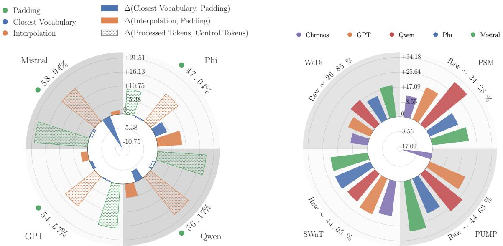  
Figure 2: Comparison of 3 step-wise tokenisation methods. We expose the AUROC result diferences between the Control path and after the LLMs (dotted bars). For plain bars, results with Padding serve as a baseline and study the diferences between those and the ones achieved with Closest Vocabulary and Interpolation. Padding average scores are indicated on the slices sides.  
Figure 3: AUROC results of the studied LLMs on diferent datasets, with Interpolation. We show the results diference with the baseline (i.e., Raw path) and the results achieved by each LLM, i.e., ∆(LLM, Raw). The average baseline results are indicated on the slices sides and are expected results on the 0 ring.

## 4.2 Tokenisation Strategies

We explore three tokenisation strategies: Padding, Interpolation, and Closest Vocabulary. For each method, results are averaged across models and datasets, and reported relative to a baseline (Figure 2).

We first compare the performance of an Isolation Forest applied directly to the tokens (Control as a baseline) with the performance obtained after LLM processing (dotted bars). For Padding and Interpolation, LLM processing yields substantial improvements, with gains of up to ≈ 20 AUROC points for Mistral and Qwen. In contrast, no improvement is observed for Closest Vocabulary, where performance even slightly degrades. This suggests that the benefit of LLMs emerges most when tokenisation preserves suficient information, allowing them to meaningfully enrich the input representations.

To compare tokenisation strategies directly, we then take Padding as a baseline and report relative diferences (after LLM processing). Closest Vocabulary consistently underperforms, with drops of up to 10 AUROC points for Mistral. Interpolation achieves the best results overall, although the gains remain modest for GPT, Mistral, and Qwen (up to ≈ 5 points) and are more pronounced for Phi (up to ≈ 10 points).

Overall, these results indicate that tokenisation has a significant impact on performance, with even simple design choices leading to substantial variations.

## 4.3 Zero-Shot LLM Features Evaluation

AUROC results are summarised in Figure 3. To analyse them, we focus on score diferences relative to a baseline obtained by applying Isolation Forest directly on the raw datasets (Raw path in Figure 1). Results are aggregated as in previous sections. A brief view of quantitative results can be found in Table 2, and complete detailed results are provided in the supplementary.

We additionally include Chronos as a TSFM baseline. Unlike the previous setup in Section 4.1, we use it here as a feature extractor rather than relying on forecasting error: the pre-trained model processes raw time-series directly, and Isolation Forest is applied on the resulting embeddings. As it operates natively on continuous inputs, no tokenisation is required.

Across datasets, Chronos features consistently yields the lowest performance compared to LLM-based approaches, and even falls below the Raw baseline on PUMP. However, its feature-based formulation still improves substantially over its forecasting-based use on SWaT, with gains exceeding 40 AUROC points on average, and achieving similar results on PUMP at L = 128.

Overall, all LLM-based methods improve over the Raw baseline with consistent gains across window sizes and datasets, showcasing the benefits of LLM processing. Phi approaches the performance of the trained GPT4TS baseline, while GPT, Qwen, and Mistral surpass MOMENT on PSM, PUMP and SWaT.

AUPR and $\mathrm { F _ { 1 } }$ exhibit strongly correlated patterns; visualisations for these metrics, as well as detailed results per window size, dataset, and tokenisation are provided in the supplementary material. While directly comparing TSFM baseline scores with Isolation Forest scores obtained from LLM features is not strictly fair, since the latter uses all the test data to construct the forest, the competitive performance of the LLM-based approach demonstrates the viability of these features for anomaly detection. More broadly, these results support using LLMs as zero-shot feature extractors, providing an alternative to adapting standard TSFM architectures for anomaly detection through proxy objectives such as forecasting error, while allowing the resulting feature space to be exploited by other fully unsupervised anomaly detection algorithms.

## 4.4 Impact of Scale and Multi-Modality-Awareness

We assess whether multi-modal pre-training improves transferability to time-series data by comparing Qwen-VL (7B) with its text-only counterpart Qwen (7B), alongside the smaller baseline Qwen (0.5B).

Results in Figure 4 show that, for Padding and Interpolation tokenisations, the smaller Qwen (0.5B) consistently outperforms both larger models by 7 to 8 AUROC points. This suggests that neither increased scale nor multi-modal pre-training provides benefits in this zero-shot setting under these tokenisation schemes. In contrast, larger models perform better with Closest Vocabulary tokenisation despite similar vocabulary sizes (≈ 150k), likely due to their higher embedding dimensionality (896 → 3584) which increases vocabulary capacity and may reduce information loss during discretisation.

However, the performance of Qwen (0.5B) remains consistently superior to both larger versions across all metrics with the two other tokenisation methods, achieving its best average scores and greater gaps with Interpolation. Overall, these results indicate that tokenisation has a stronger efect on performance than either model scale or multi-modal pre-training in this setting.

## 4.5 Inductive Bias and Knowledge Transfer

In the previous sections, we showed that features extracted from LLMs consistently improve anomaly detection performance. However, it remains unclear whether these gains arise from (i) the attention-based architectures themselves, whose inductive bias may naturally produce representations that isolate anomalous time-series, or (ii) knowledge transferred from language pre-training.

To investigate this, Figure 5 compares the average AUPR of each model, randomly initialised over five diferent seeds, with results on Control tokens (dotted bars) and the corresponding pre-trained models (solid bars) with the Interpolation tokenisation. The Isolation Forest is always used with the same random state across all features. Average quantitative results are reported in Table 2 (see \*scores), and full results, including with the other two tokenisation strategies are provided in the supplementary.

Randomly initialised models consistently outperform Control tokens classification (positive dotted bars), achieving gains of up to 29 points for Mistral on SWaT. Surprisingly, pre-training does not consistently improve performance (negative plain bars). Frequently even, pre-trained models perform worse than their randomly initialised counterparts. Only Qwen improves on three of the four datasets, while the other models improve on at most one, supporting Qwen’s overall superiority (Figure 3). Despite using random weights, the deterministic sequence of operations seems suficient to increase feature dissociation.

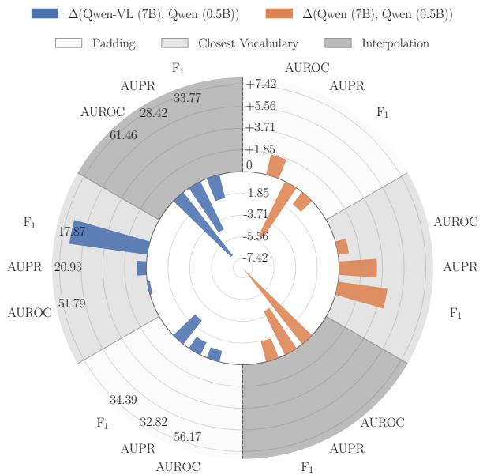  
Figure 4: Results achieved by Qwen (0.5B), Qwen (7B) and ${ \mathrm { Q } } { \mathrm { w e n - V L } }$ (7B), on the 3 tokenisation methods studied. Qwen (0.5B) results, with the respective tokenisation method, serve as a baseline and are shown on the left-hand side of the plot. Qwen (0.5B) baseline scores are indicated below the metrics on the left half.

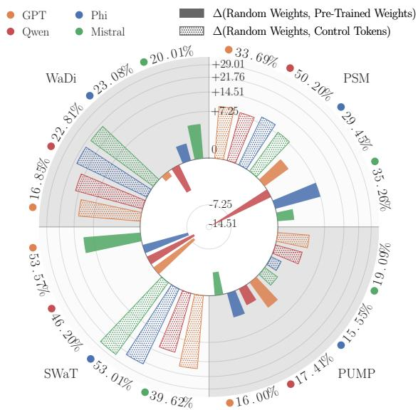  
Figure 5: Comparison of AUPR obtained by applying Isolation Forest to features from randomly initialised models (Random Weights) against two baselines: features from pre-trained models (Pre-Trained Weights, solid bars) and without feature extraction (Control Tokens, dotted bars). Average scores with pre-trained features are shown on the slices sides. Radial scale is gamma corrected $( \gamma = 0 . 5 )$

To further isolate the impact of the architecture, we compared the results against those from a random linear projection and a randomly initialized 3-layer Multilayer Perceptron (MLP). Random LLMs significantly outperformed both baselines (Figure $6 ;$ full linear and MLP results are provided in the supplementary). Combined with the consistent performance observed across diferent LLM architectures, these findings suggest that this property is an intrinsic feature of Transformer-based Natural Language Processing (NLP) models rather than being tied to specific model designs.

These results suggest that pre-training alone is insuficient to guarantee efective zero-shot cross-modal feature extraction, and non-trivial tokenisation strategies or task-specific fine-tuning are required to exploit the knowledge encoded in LLMs. Overall, the architectures themselves seem to provide most of the zero-shot feature extraction capability, whereas efectively leveraging pre-trained knowledge, in a general setting, requires more appropriate tokenisation or task-specific fine-tuning. Similar patterns are observed with AUROC and $\mathrm { F _ { 1 } }$ metrics; figures are provided in the supplementary material.

## 4.6 Pairwise Statistical Analysis

To assess whether performance diferences between the considered LLMs are statistically significant, we perform a two-sided paired Wilcoxon signed-rank test (Wilcoxon, 1945) on their AUROC scores. For each pair of LLMs, the test is performed over the six window sizes and four dataset $; \mathbf { S } ,$ yielding 24 paired measurements per comparison. We report the Holm-adjusted $p \textmd { - }$ value $\left( p _ { \mathrm { a d j } } \right)$ to account for multiple pairwise comparisons, together with the signed rank-biserial correlation r as an efect-size measure. The $p _ { \mathrm { a d j } }$ indicates whether the paired performance diferences provide evidence against the null hypothesis of a zero-centred diference, while |r| quantifies the magnitude of the rank-based diference between the two LLMs.

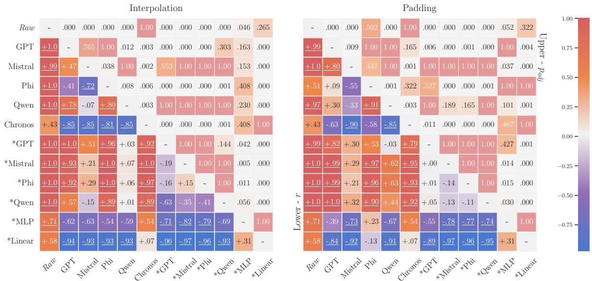  
Figure 6: Pairwise AUROC comparisons between models across datasets and window sizes, for Interpolation and Padding tokenisations. Lower Triangle: Efect size $r \in [ - 1 , 1 ]$ . A positive score implies the row model outperforms the column model; statistically significant tests $( p _ { a d j } < 0 . 0 5 )$ are underlined. Upper Triangle: Corresponding adjusted p-value $( p _ { a d j } \in [ 0 , 1 ] )$ of the paired test. \*Denotes the randomised models.

This procedure is repeated independently for each adapter configuration. We discuss the results for Interpolation and Padding, shown in Figure 6; results for Closest Vocabulary are mostly statistically insignificant and are provided in the supplementary.

For Interpolation, we observe a significant improvement over the Raw tokens for all pre-trained LLMs. Qwen achieves significantly higher AUROC than all other LLMs, except Mistral, for which no significant diference is observed $( p _ { \mathrm { a d j } } = 1 . 0 0 )$ Chronos features consistently underperform the LLM-based representations. Randomised LLMs also exhibit consistently positive efects, significantly outperforming Raw, GPT, Phi, randomised MLP, and randomised Linear. The performance between the pre-trained rand randomised versions of Qwen and Mistral is, however, statistically inconclusive.

The Padding results exhibit a similar behaviour for the randomised models. However, the diferences between pre-trained LLMs are substantially less pronounced, with fewer statistically significant comparisons. When comparing Padding and Interpolation relative to their respective Raw baselines, Phi is the only pre-trained LLM for which Padding leads to a lower performance than Interpolation.

Overall, the strong performance of the randomised models under both tokenisations complements the previous observations on the limited ability of simplistic tokenisation strategies to exploit LLM knowledge. Furthermore, the loss of statistical significance in the diferences between pre-trained models when switching from Interpolation to Padding, not observed for randomised models, further suggests that bridging the cross-domain gap between time-series and NLP representations is non-trivial.

## 5 Conclusion

In this work, we investigated the use of LLM representations for time-series anomaly detection in a zero-shot setting. We proposed an evaluation pipeline to assess the suitability of LLM representations to MTSAD by framing anomaly detection as an unsupervised classification problem and quantifying the isolation of anomalous representations. Our study centres on evaluating time-series feature representation; we extract high-dimensional embeddings from pre-trained LLMs and evaluate diferent steps chosen to minimise the loss of local temporal information. By passing these tokenised sequences through the LLM, we generate feature representations that are then analysed via an Isolation Forest for anomaly detection. Ultimately, the resulting anomaly scores serve as a robust proxy for evaluating the quality of the alignment and the suitability of the representations for MTSAD.

Our results show that even in a zero-shot setting, several LLMs extract useful feature representations for anomaly detection. When combined with shallow unsupervised classifiers, these representations can outperform recent of-the-shelf time-series foundation models based on forecasting error. However, our analysis also indicates that simple tokenisation strategies are generally insuficient to efectively exploit the knowledge encoded in pre-trained LLMs for MTSAD. In fact, we established that in this setting randomly initialised LLMs often achieve significantly strong performance, suggesting that the architectural components of LLMs provide greater benefits than any knowledge acquired through language pre-training.

This study aims to support a research direction in MTSAD with foundation models. Framed around the specificities of TSAD, it highlights the potential of LLMs as feature extractors for time-series data. In particular, it provides clues that LLMs can serve as efective representation refiners in this setting. A promising line of research lies in improving tokenisation strategies to better bridge the domain gap and reduce reliance on fine-tuning, while preserving the local structure of the data that is crucial for anomaly detection.

Future work will extend this study to more language models and model versions, a broader range of datasets, and unsupervised classification methods in order to better account for the diversity of anomaly types and feature space geometries beyond the isolation assumption.

## Acknowledgments

This research was funded by the Luxembourg National Research Fund (FNR), grant reference DEFENCE22/17813724/AUREA.

## References

Ahmed Abdulaal, Zhuanghua Liu, and Tomer Lancewicki. Practical approach to asynchronous multivariate time series anomaly detection and localization. In KDD, pp. 2485–2494. ACM, 2021.

Chuadhry Mujeeb Ahmed, Venkata Reddy Palleti, and Aditya P. Mathur. WADI: a water distribution testbed for research in the design of secure cyber physical systems. In CySWATER@CPSWeek, pp. 25–28. ACM, 2017.

Sarah Alnegheimish, Linh Nguyen, Laure Berti-Équille, and Kalyan Veeramachaneni. Can large language models be anomaly detectors for time series? In DSAA, pp. 1–10. IEEE, 2024.

Abdul Fatir Ansari, Oleksandr Shchur, Jaris Küken, Andreas Auer, Boran Han, Pedro Mercado, Syama Sundar Rangapuram, Huibin Shen, Lorenzo Stella, Xiyuan Zhang, Mononito Goswami, Shubham Kapoor, Danielle C. Maddix, Pablo Guerron, Tony Hu, Junming Yin, Nick Erickson, Prateek Mutalik Desai, Hao Wang, Huzefa Rangwala, George Karypis, Yuyang Wang, and Michael Bohlke-Schneider. Chronos-2: From univariate to universal forecasting. CoRR, abs/2510.15821, 2025.

Yuxuan Bian, Xuan Ju, Jiangtong Li, Zhijian Xu, Dawei Cheng, and Qiang Xu. Multi-patch prediction: Adapting language models for time series representation learning. In ICML, Proceedings of Machine Learning Research, pp. 3889–3912. PMLR / OpenReview.net, 2024.

Georgios Chatzigeorgakidis, Konstantinos Lentzos, and Dimitrios Skoutas. Multicast: Zero-shot multivariate time series forecasting using llms. In ICDEW, pp. 119–127. IEEE, 2024.

Zahra Zamanzadeh Darban, Geofrey I. Webb, Shirui Pan, Charu Aggarwal, and Mahsa Salehi. Deep learning for time series anomaly detection: A survey. ACM Comput. Surv., 57(1):15:1–15:42, 2025.

Manqing Dong, Hao Huang, and Longbing Cao. Can llms serve as time series anomaly detectors? CoRR, abs/2408.03475, 2024.

Cheng Feng and Pengwei Tian. Time series anomaly detection for cyber-physical systems via neural system identification and bayesian filtering. In KDD, pp. 2858–2867. ACM, 2021.

Shanghua Gao, Teddy Koker, Owen Queen, Tom Hartvigsen, Theodoros Tsiligkaridis, and Marinka Zitnik. Units: A unified multi-task time series model. In NeurIPS, 2024.

Dong Gong, Lingqiao Liu, Vuong Le, Budhaditya Saha, Moussa Reda Mansour, Svetha Venkatesh, and Anton van den Hengel. Memorizing normality to detect anomaly: Memory-augmented deep autoencoder for unsupervised anomaly detection. In ICCV, pp. 1705–1714. IEEE, 2019.

Mononito Goswami, Konrad Szafer, Arjun Choudhry, Yifu Cai, Shuo Li, and Artur Dubrawski. MOMENT: A family of open time-series foundation models. In ICML, volume 235 of Proceedings of Machine Learning Research, pp. 16115–16152. PMLR / OpenReview.net, 2024.

Nate Gruver, Marc Finzi, Shikai Qiu, and Andrew Gordon Wilson. Large language models are zero-shot time series forecasters. In NeurIPS, 2023.

Zelin He, Sarah Alnegheimish, and Matthew Reimherr. Harnessing vision-language models for time series anomaly detection. In ${ \underline { { \mathrm { A A A I } } } } .$ pp. 21690–21698. AAAI Press, 2026.

Romain Hermary, Vincent Gaudillière, Abd El Rahman Shabayek, and Djamila Aouada. Removing geometric bias in one-class anomaly detection with adaptive feature perturbation. In WACV, pp. 6612–6622. IEEE, 2025.

Romain Hermary, Samet Hicsonmez, Dan Pineau, Abd El Rahman Shabayek, and Djamila Aouada. Aster: Latent pseudo-anomaly generation for unsupervised time-series anomaly detection. In International Conference on Pattern Recognition, 2026.

Yuxiao Hu, Qian Li, Dongxiao Zhang, Jinyue Yan, and Yuntian Chen. Context-alignment: Activating and enhancing llms capabilities in time series. In ICLR. OpenReview.net, 2025.

Albert Q. Jiang, Alexandre Sablayrolles, Arthur Mensch, Chris Bamford, Devendra Singh Chaplot, Diego de Las Casas, Florian Bressand, Gianna Lengyel, Guillaume Lample, Lucile Saulnier, Lélio Renard Lavaud, Marie-Anne Lachaux, Pierre Stock, Teven Le Scao, Thibaut Lavril, Thomas Wang, Timothée Lacroix, and William El Sayed. Mistral 7b. CoRR, abs/2310.06825, 2023.

Yushan Jiang, Zijie Pan, Xikun Zhang, Sahil Garg, Anderson Schneider, Yuriy Nevmyvaka, and Dongjin Song. Empowering time series analysis with large language models: A survey. In IJCAI, pp. 8095–8103. ijcai.org, 2024.

Yuxuan Liang, Haomin Wen, Yuqi Nie, Yushan Jiang, Ming Jin, Dongjin Song, Shirui Pan, and Qingsong Wen. Foundation models for time series analysis: A tutorial and survey. In KDD, pp. 6555–6565. ACM, 2024.

Chen Liu, Shibo He, Qihang Zhou, Shizhong Li, and Wenchao Meng. Large language model guided knowledge distillation for time series anomaly detection. In IJCAI, pp. 2162–2170. ijcai.org, 2024.

Fei Tony Liu, Kai Ming Ting, and Zhi-Hua Zhou. Isolation forest. In ICDM, pp. 413–422. IEEE Computer Society, 2008.

Jun Liu, Chaoyun Zhang, Jiaxu Qian, Minghua Ma, Si Qin, Chetan Bansal, Qingwei Lin, Saravan Rajmohan, and Dongmei Zhang. Large language models can deliver accurate and interpretable time series anomaly detection. In KDD (2), pp. 4623–4634. ACM, 2025.

Xingyue Liu, Feizhong Zhou, Hanguang Xiao, Zhipeng Li, Shuai Liu, and Lingling Qian. A survey on large language models for medical time series. Expert Syst. Appl., 311:131364, 2026.

Kevin Lu, Aditya Grover, Pieter Abbeel, and Igor Mordatch. Frozen pretrained transformers as universal computation engines. In AAAI, pp. 7628–7636. AAAI Press, 2022.

Luca Masserano, Abdul Fatir Ansari, Boran Han, Xiyuan Zhang, Christos Faloutsos, Michael W. Mahoney, Andrew Gordon Wilson, Youngsuk Park, Syama Sundar Rangapuram, Danielle C. Maddix, and Bernie Wang. Enhancing foundation models for time series forecasting via wavelet-based tokenization. In ICML, Proceedings of Machine Learning Research. PMLR / OpenReview.net, 2025.

Aditya P. Mathur and Nils Ole Tippenhauer. Swat: a water treatment testbed for research and training on ICS security. In CySWATER@CPSWeek, pp. 31–36. IEEE Computer Society, 2016.

Nesryne Mejri, Laura Lopez-Fuentes, Kankana Roy, Pavel Chernakov, Enjie Ghorbel, and Djamila Aouada. Unsupervised anomaly detection in time-series: An extensive evaluation and analysis of state-of-the-art methods. Expert Syst. Appl., 256:124922, 2024.

Marcel Meyer, David Zapata Gonzalez, Sascha Kaltenpoth, and Oliver Müller. Benchmarking time series foundation models for short-term household electricity load forecasting. IEEE Access, 13:218141–218153, 2025.

Microsoft. Phi-3 technical report: A highly capable language model locally on your phone. CoRR, abs/2404.14219, 2024.

Xiangfei Qiu, Zhe Li, Wanghui Qiu, Shiyan Hu, Lekui Zhou, Xingjian Wu, Zhengyu Li, Chenjuan Guo, Aoying Zhou, Zhenli Sheng, Jilin Hu, Christian S. Jensen, and Bin Yang. TAB: unified benchmarking of time series anomaly detection methods. Proc. VLDB Endow., 18(9):2775–2789, 2025.

Alec Radford, Jefrey Wu, et al. Language models are unsupervised multitask learners. Technical report, 2019.

Alicia Russell-Gilbert, Alexander Sommers, Andrew Thompson, Logan Cummins, Sudip Mittal, Shahram Rahimi, Maria Seale, Joseph Jabour, Thomas Arnold, and Joshua Church. AAD-LLM: adaptive anomaly detection using large language models. In IEEE Big Data, pp. 4194–4203. IEEE, 2024.

Bernhard Schölkopf, John C. Platt, John Shawe-Taylor, Alexander J. Smola, and Robert C. Williamson. Estimating the support of a high-dimensional distribution. Neural Comput., 13(7):1443–1471, 2001.

Dimitris Spathis and Fahim Kawsar. The first step is the hardest: pitfalls of representing and tokenizing temporal data for large language models. J. Am. Medical Informatics Assoc., 31(9):2151–2158, 2024.

Chenxi Sun, Hongyan Li, Yaliang Li, and Shenda Hong. TEST: text prototype aligned embedding to activate llm’s ability for time series. In ICLR. OpenReview.net, 2024.

Wei Tao, Xiaoyang Qu, Kai Lu, Jiguang Wan, Guokuan Li, and Jianzong Wang. MADLLM: multivariate anomaly detection via pre-trained llms. In ICME, pp. 1–6. IEEE, 2025.

Peng Wang, Shuai Bai, Sinan Tan, Shijie Wang, Zhihao Fan, Jinze Bai, Keqin Chen, Xuejing Liu, Jialin Wang, Wenbin Ge, Yang Fan, Kai Dang, Mengfei Du, Xuancheng Ren, Rui Men, Dayiheng Liu, Chang Zhou, Jingren Zhou, and Junyang Lin. Qwen2-vl: Enhancing vision-language model’s perception of the world at any resolution. CoRR, abs/2409.12191, 2024.

Frank Wilcoxon. Individual comparisons by ranking methods. Biometrics Bulletin, 1(6):80–83, 1945. doi: 10.2307/3001968.

Thomas Wolf, Lysandre Debut, Victor Sanh, Julien Chaumond, Clement Delangue, Anthony Moi, Pierric Cistac, Tim Rault, Rémi Louf, Morgan Funtowicz, and Jamie Brew. Huggingface’s transformers: Stateof-the-art natural language processing. CoRR, abs/1910.03771, 2019.

Haixu Wu, Tengge Hu, Yong Liu, Hang Zhou, Jianmin Wang, and Mingsheng Long. Timesnet: Temporal 2d-variation modeling for general time series analysis. In ICLR. OpenReview.net, 2023.

Renjie Wu and Eamonn J. Keogh. Current time series anomaly detection benchmarks are flawed and are creating the illusion of progress. IEEE Trans. Knowl. Data Eng., 35(3):2421–2429, 2023.

Jiehui Xu, Haixu Wu, Jianmin Wang, and Mingsheng Long. Anomaly transformer: Time series anomaly detection with association discrepancy. In ICLR. OpenReview.net, 2022.

Xiongxiao Xu, Haoran Wang, Yueqing Liang, Philip S. Yu, Yue Zhao, and Kai Shu. Can multimodal llms perform time series anomaly detection? In WWW, pp. 5392–5403. ACM, 2026.

An Yang, Baosong Yang, Binyuan Hui, Bo Zheng, Bowen Yu, Chang Zhou, Chengpeng Li, Chengyuan Li, Dayiheng Liu, Fei Huang, Guanting Dong, Haoran Wei, Huan Lin, Jialong Tang, Jialin Wang, Jian Yang, Jianhong Tu, Jianwei Zhang, Jianxin Ma, Jianxin Yang, Jin Xu, Jingren Zhou, Jinze Bai, Jinzheng He, Junyang Lin, Kai Dang, Keming Lu, Keqin Chen, Kexin Yang, Mei Li, Mingfeng Xue, Na Ni, Pei Zhang, Peng Wang, Ru Peng, Rui Men, Ruize Gao, Runji Lin, Shijie Wang, Shuai Bai, Sinan Tan, Tianhang Zhu, Tianhao Li, Tianyu Liu, Wenbin Ge, Xiaodong Deng, Xiaohuan Zhou, Xingzhang Ren, Xinyu Zhang, Xipin Wei, Xuancheng Ren, Xuejing Liu, Yang Fan, Yang Yao, Yichang Zhang, Yu Wan, Yunfei Chu, Yuqiong Liu, Zeyu Cui, Zhenru Zhang, Zhifang Guo, and Zhihao Fan. Qwen2 technical report. CoRR, abs/2407.10671, 2024.

Samuel Yoon, Jongwon Kim, Juyoung Ha, and Young Myoung Ko. Patch-based memory gate model in time series foundation model. Transactions on Machine Learning Research, 2026. ISSN 2835-8856.

Yuan-Cheng Yu, Yen-Chieh Ouyang, and Chun-An Lin. Trip-llm: A tri-branch patch-wise large language model framework for time-series anomaly detection. IEEE Access, 13:168643–168653, 2025.

Xiyuan Zhang, Ranak Roy Chowdhury, Rajesh K. Gupta, and Jingbo Shang. Large language models for time series: A survey. In IJCAI, pp. 8335–8343. ijcai.org, 2024.

Qihang Zhou, Shibo He, Haoyu Liu, Jiming Chen, and Wenchao Meng. Label-free multivariate time series anomaly detection. IEEE Trans. Knowl. Data Eng., 36(7):3166–3179, 2024.

Tian Zhou, Peisong Niu, Xue Wang, Liang Sun, and Rong Jin. One fits all: Power general time series analysis by pretrained LM. In NeurIPS, 2023.

Jiaxin Zhuang, Leon Yan, Zhenwei Zhang, Ruiqi Wang, Jiawei Zhang, and Yuantao Gu. See it, think it, sorted: Large multimodal models are few-shot time series anomaly analyzers. CoRR, abs/2411.02465, 2024.

## A Parameters

## A.1 PCA & Isolation Forest

We used the Principle Component Analysis (PCA) algorithm to reduce all analysed vectors to the same dimensionality, before fitting the Isolation Forest. We set the target dimension to 512, and retained on average close to 98% of explained variance; we thus reduced the complexity of the study without compromising the results.

We set the number of trees in the Isolation Forest to 100.

## A.2 Trained Baselines

We trained three TSFM baselines, TimesNet (Wu et al., 2023), GPT4TS (Zhou et al., 2023) and AnomalyTransformer (Xu et al., 2022), on four anomaly detection datasets and presented the results in the main paper. All of them were trained on the full train sets, with parameters matching the published configurations, over 5 diferent seeds, with a window size set to a 100 time-steps. Both GPT4TS and TimesNet were trained for 10 epochs, while 3 were done for AnomalyTransoformer. The projection depth (or d\_model) parameter of the models are reported in Table 3.

Reported results follow the same evaluation protocol with a stride of 128. The models have open-source implementations, and we included them in our codebase to ensure that all experiments are done in the same environment.

## A.3 Pre-Trained Baselines

A window size of 128 was used for MOMENT (Goswami et al., 2024) and Chronos (Ansari et al., 2025). Only one evaluation with a fixed seed (42) was required, since there is no randomised process. Reported results follow the same evaluation protocol with a stride of 128.

## A.4 Environment

Code, requirements, and the Docker image will be made publicly available. Experiments were conducted on NVIDIA RTX A6000 (550.163.01) GPUs and an AMD EPYC 7742 64-Core processor.

## B Models Details

Table 3 summarises the model details. As mentioned in the previous section, TimesNet and GPT4TS where reimplemented. For all other models in the study, we took advantage of the HuggingFace platform (Wolf et al., 2019) and its vast amount of shared architectures and pre-trained weights. The versions used are also depicted in the table.

## C Datasets & Evaluation Setting

Detailed statistics of the 4 datasets used in this study can be found in Table 4. As mentioned in the main paper, our evaluation uses a target modification strategy $( y _ { t } = \operatorname* { m a x } \left( \{ y _ { i } , \forall i \in [ [ t - L + 1 , t ] \} \right) )$ that increase the ratio of anomalous windows.

We also use a stride of 128 throughout the whole study, to keep the same number of samples and increase the throughput of results. We report the efective ratio changes in Table 5. The original ratios of the datasets are greyed out and correspond to both a window size and a stride of 1. The efective ratios from this study are the last row of each datasets, window sizes from 4 to 128. Although these modifications can change the overall statistics of the datasets anomalies, we observed no significant diference with an evaluation on the complete dataset. We thus consider this scale-reduced setting representative of the full evaluation case, in terms of model comparisons. To quantitatively support this simplified protocol, particularly analysing the anomaly distributions over the windows, we provide two complementary statistics: coverage (Table 6) and centroid (Table 7). Coverage is the amount of anomalous time-steps in the window, while centroid is the average temporal position of the anomalous segment within the window. We observe almost no change compared to the windows statistics over the full test set, which supports an equivalence between the protocols. Additionally, we provide results of 6 baselines and 2 LLMs with a stride of 1 (full test set) in Table 8. Results are similar to a stride of 128, used in the main study, and ranking is preserved between models.

Table 3: Details of the models used in the study.
<table><tr><td>Architecture</td><td>HuggingFace (Wolf et al., 2019) Version</td><td>Number of Parameters</td><td>Embedding Size</td><td>Multimodal Training</td><td>Vocabulary Size</td></tr><tr><td>AnomalyTransformer (Xu et al., 2022)</td><td></td><td>5,002,387</td><td>512</td><td>X</td><td></td></tr><tr><td>GPT4TS (Zhou et al., 2023)</td><td></td><td>≈81,960,828</td><td>768</td><td>X</td><td></td></tr><tr><td>TimesNet (Wu et al., 2023)</td><td></td><td>≈28,150,972</td><td>128</td><td>X</td><td></td></tr><tr><td>Chronos (Ansari et al., 2025)</td><td>amazon/chronos-2</td><td>119,477,664</td><td> $D \times P \times 7 6 8 ^ { \dag }$ </td><td>X</td><td></td></tr><tr><td>MOMENT (Small) (Goswami et al., 2024)</td><td>AutonLab/MOMENT-1-small</td><td>35,341,512</td><td>512</td><td>X</td><td></td></tr><tr><td>MOMENT (Base) (Goswami et al., 2024)</td><td>AutonLab/MOMENT-1-base</td><td>109,641,608</td><td>768</td><td>X</td><td></td></tr><tr><td>MOMENT (Large) (Goswami et al., 2024)</td><td>AutonLab/MOMENT-1-large</td><td>341,248,520</td><td>1024</td><td>X</td><td></td></tr><tr><td>GPT (Radford et al., 2019)</td><td>openai-community/gpt2</td><td>124,439,808</td><td>768</td><td>X</td><td>50257</td></tr><tr><td>Qwen (Yang et al., 2024)</td><td>Qwen/Qwen2-0.5B</td><td>494,032,768</td><td>896</td><td>X</td><td>151936</td></tr><tr><td>Qwen (7B) (Yang et al., 2024)</td><td>Qwen/Qwen2-7B</td><td>7,070,619,136</td><td>3584</td><td>X</td><td>152064</td></tr><tr><td>Qwen-VL (7B) (Wang et al., 2024)</td><td>Qwen/Qwen2-VL-7B</td><td>7,070,619,136</td><td>3584</td><td>√</td><td>152064</td></tr><tr><td>Mistral (Jiang et al., 2023)</td><td>mistralai/Mistral-7B-vO.1</td><td>7,110,660,096</td><td>3072</td><td>X</td><td>32000</td></tr><tr><td>Phi (Microsoft, 2024)</td><td>microsoft/Phi-3-mini-4k-instruct</td><td>3,722,578,944</td><td>4096</td><td>X</td><td>32064</td></tr></table>

† When used as feature extractor, Chronos has an output size that depends on the number dimension of the dataset, D, and the number of patches P which defaults to L/16 (L being the window size).

Table 4: Detailed statistics of the time-series anomaly detection datasets.
<table><tr><td rowspan="2">Dataset</td><td rowspan="2">Features</td><td rowspan="2">Train Set</td><td rowspan="2">Test Set</td><td rowspan="2">Anomaly %</td><td colspan="4">Anomalous Sequences</td></tr><tr><td></td><td>Length</td><td></td><td>Num.</td></tr><tr><td></td><td></td><td></td><td></td><td></td><td>Min.</td><td>Max.</td><td>Avg.</td><td></td></tr><tr><td>SWaT (Abdulaal et al., 2021)</td><td>51</td><td>495,000</td><td>449,919</td><td>12.14</td><td>101</td><td>35,900</td><td>1,560.60</td><td>35</td></tr><tr><td>WaDi (Ahmed et al., 2017)</td><td>123 44</td><td>784,537 76,901</td><td>172,801 143,401</td><td>5.77</td><td>88 42</td><td>1,741</td><td>712.64 2,401.33</td><td>14 6</td></tr><tr><td>PUMP (Feng &amp; Tian, 2021) PSM (Abdulaal et al., 2021)</td><td>25</td><td>132,481</td><td>87,841</td><td>10.05 27.76</td><td>1</td><td>8,391 8,861</td><td>338.625</td><td>72</td></tr></table>

## D Complementary Results

## D.1 Main Figures: Other Metrics

We complement the figures of the main paper focusing on one metric with the two others considered in this study. Figure 7a and Figure 7b present AUPR and $\mathrm { F _ { 1 } }$ scores for the overall results over the diferent datasets. Figure 8a and Figure 8b present AUROC and $\mathrm { F _ { 1 } }$ scores for the study on the impact of inductive bias and knowledge transfer. Figure 9 provides the results of the statistical analysis for the Closest Vocabulary tokenisation, along Interpolation and Padding from the main article.

## D.2 Detailed Results

The raw results used to generate the main study of pre-trained LLMs, per window size and with standard deviations, can be found from Table 13 to Table 14. The Raw and Control results are in Table 9 to Table 11. The results for randomised models are in Table 15 to Table 18.

We provide a granular view of the results of all models, per window sizes (4, 8, 16, 32, 64, and 128), datasets (PSM, PUMP, SWaT and WaDi), and metrics (AUROC, AUPR and $\mathrm { F } _ { 1 } )$ from Figure 10 to Figure 18.

Table 5: Efective number of samples and anomaly ratio changes with the application of maximum value on the window targets and strides.
<table><tr><td rowspan="2">Dataset</td><td rowspan="2">Stride</td><td rowspan="2">Test Size (# Windows)</td><td colspan="8">Anomaly % w.r.t. Window Size</td></tr><tr><td>1</td><td>4</td><td>8</td><td></td><td>16</td><td>32</td><td>64</td><td></td><td>128</td></tr><tr><td rowspan="6">PSM</td><td>1</td><td>87841</td><td>27.76</td><td></td><td>28.00</td><td>28.31</td><td>28.87</td><td>29.91</td><td>31.71</td><td></td><td>35.06</td></tr><tr><td>4</td><td>21961</td><td></td><td>27.99</td><td></td><td>1</td><td></td><td></td><td></td><td></td><td></td></tr><tr><td>8</td><td>10981</td><td></td><td></td><td></td><td>28.37</td><td></td><td></td><td></td><td></td><td></td></tr><tr><td>16</td><td>5491</td><td></td><td></td><td></td><td></td><td>28.88</td><td></td><td></td><td></td><td></td></tr><tr><td>32</td><td>2746</td><td></td><td></td><td></td><td></td><td></td><td>30.01</td><td></td><td></td><td></td></tr><tr><td>64</td><td>1373</td><td></td><td></td><td></td><td></td><td></td><td></td><td>31.76</td><td></td><td></td></tr><tr><td rowspan="7">PUMP</td><td>128</td><td>687</td><td>27.51</td><td></td><td>27.80 10.06</td><td>28.38</td><td>28.82</td><td>30.28</td><td></td><td>32.61</td><td>35.23</td></tr><tr><td>1 4</td><td>143401</td><td>10.05</td><td></td><td>10.06</td><td>10.08</td><td>10.11</td><td></td><td>10.18</td><td>10.31</td><td>10.58</td></tr><tr><td>8</td><td>35851</td><td></td><td></td><td></td><td></td><td></td><td></td><td></td><td></td><td></td></tr><tr><td></td><td>17926</td><td></td><td></td><td></td><td>10.08</td><td></td><td></td><td></td><td></td><td></td></tr><tr><td>16</td><td>8963</td><td></td><td></td><td></td><td></td><td>10.12</td><td></td><td></td><td></td><td></td></tr><tr><td>32</td><td>4482</td><td></td><td></td><td></td><td></td><td></td><td>10.17</td><td></td><td></td><td></td></tr><tr><td>64 128</td><td>2241 1121</td><td>9.90</td><td>9.90</td><td></td><td>9.90</td><td>9.99</td><td>10.26</td><td></td><td>10.22</td><td>10.44</td></tr><tr><td rowspan="7">SWaT</td><td>1</td><td>449919</td><td>12.14</td><td></td><td>12.16</td><td>12.19</td><td>12.26</td><td></td><td></td><td>10.26</td><td></td></tr><tr><td>4</td><td>112480</td><td></td><td></td><td>12.17</td><td></td><td></td><td>12.38</td><td></td><td>12.63</td><td>13.10</td></tr><tr><td>8</td><td>56240</td><td></td><td></td><td></td><td>12.20</td><td></td><td></td><td></td><td></td><td></td></tr><tr><td>16</td><td>28120</td><td></td><td></td><td></td><td></td><td>12.27</td><td></td><td></td><td></td><td></td></tr><tr><td>32</td><td>14060</td><td></td><td></td><td></td><td></td><td></td><td>12.40</td><td></td><td></td><td></td></tr><tr><td>64</td><td>7030</td><td></td><td></td><td></td><td></td><td></td><td></td><td></td><td>12.66</td><td></td></tr><tr><td>128</td><td>3515</td><td>12.23</td><td>12.23</td><td></td><td>12.26</td><td>12.29</td><td>12.35</td><td></td><td>12.55</td><td>13.14</td></tr><tr><td rowspan="7">WaDi</td><td>1</td><td>172801</td><td>5.77</td><td></td><td>5.80</td><td>5.83</td><td>5.90</td><td></td><td>6.02</td><td>6.28</td><td>6.80</td></tr><tr><td>4</td><td>43201</td><td></td><td></td><td>5.79</td><td></td><td></td><td></td><td></td><td></td><td></td></tr><tr><td>8</td><td>21601</td><td></td><td></td><td></td><td>5.83</td><td></td><td></td><td></td><td></td><td></td></tr><tr><td>16</td><td>10801</td><td></td><td></td><td></td><td></td><td>5.87</td><td></td><td></td><td></td><td></td></tr><tr><td>32</td><td>5401</td><td></td><td></td><td></td><td></td><td></td><td>5.96</td><td></td><td></td><td></td></tr><tr><td>64</td><td>2701</td><td></td><td></td><td></td><td></td><td></td><td>1</td><td></td><td>6.26</td><td></td></tr><tr><td>128</td><td>1351</td><td>5.85</td><td></td><td>5.92</td><td>6.00</td><td>6.00</td><td>6.14</td><td></td><td>6.37</td><td>6.88</td></tr></table>

Stable AUROC results can be observed throughout all window sizes and datasets. AUPR is less stable throughout the datasets, with especially high or increased standard deviation on SWaT for most models.   
$\mathrm { F _ { 1 } }$ acts as the most unstable metric, but it can be attributed to its inherent dependence on a threshold.   
Applying the Isolation Forest directly on the data (Raw) consistently performs worse on small window sizes;   
most of the time, results are bumped up by going from a window size of 8 to a window size of 16.

## D.3 Wilcoxon Test: Overview

For each pair of LLMs, let $d _ { i } = B _ { i } - A _ { i } \ ( i \in [ [ 1 , \dots , N ] ] )$ denote the paired diference in AUROC for the i-th configuration, where $A _ { i }$ and $B _ { i }$ are the AUROC scores, across datasets and window sizes, of the two LLMs being compared. Zero diferences are excluded from the analysis. The absolute diferences |d $| d _ { i } |$ are ranked in ascending order, yielding ranks $\rho _ { i }$ . The positive and negative rank sums are then defined as:

$$
\omega ^ { + } = \sum _ { i : d _ { i } > 0 } \rho _ { i } , \qquad \omega ^ { - } = \sum _ { i : d _ { i } < 0 } \rho _ { i } .
$$

The Wilcoxon signed-rank test statistic is $\omega = \operatorname* { m i n } ( \omega ^ { + } , \omega ^ { - } )$ . We compute the signed rank-biserial efect size as:

$$
r = \mathrm { s i g n } \left( \widetilde { d } \right) \cdot \left( 1 - \frac { \omega } { \omega _ { \mathrm { m a x } } } \right) = \mathrm { s i g n } \left( \widetilde { d } \right) \cdot \left( 1 - \frac { 2 \omega } { N ( N + 1 ) / 2 } \right) , \qquad \omega _ { \mathrm { m a x } } = \frac { N ( N + 1 ) } { 4 } ,
$$

where $\widetilde { d }$ denotes the median paired diference. The magnitude $| r |$ therefore reflects the degree to which the signed ranks are concentrated in one direction, while its sign indicates the direction of the diference. In our pairwise comparison matrix, a positive r indicates that the LLM represented by the row achieves higher AUROC than the LLM represented by the column, whereas a negative r indicates the opposite. Since all pairwise comparisons are performed over the same N = 24 configurations, the magnitudes of r are directly comparable across model pairs.

Table 6: Efective number of samples and anomalous time-steps window coverage changes with diferent strides.
<table><tr><td rowspan="2">Dataset</td><td rowspan="2">Stride</td><td rowspan="2">Test Size (# Windows)</td><td colspan="8">Anomaly Window Coverage (%) w.r.t. Window Size</td></tr><tr><td>1</td><td>4</td><td>8</td><td>16</td><td></td><td>32</td><td>64</td><td></td><td>128</td></tr><tr><td rowspan="6">PSM</td><td>1</td><td>87841</td><td>100.0</td><td>99.12</td><td>98.05</td><td></td><td>96.09</td><td>92.77</td><td>87.45</td><td></td><td>79.00</td></tr><tr><td>4</td><td>21961</td><td></td><td>99.17</td><td></td><td></td><td></td><td></td><td></td><td></td><td></td></tr><tr><td>8</td><td>10981</td><td></td><td></td><td>97.85</td><td></td><td></td><td></td><td></td><td></td><td></td></tr><tr><td>16</td><td>5491</td><td></td><td></td><td></td><td></td><td>96.09</td><td></td><td></td><td></td><td></td></tr><tr><td>32</td><td>2746</td><td></td><td></td><td></td><td></td><td></td><td>92.48</td><td></td><td></td><td></td></tr><tr><td>64</td><td>1373</td><td></td><td></td><td></td><td></td><td></td><td></td><td>87.30</td><td></td><td></td></tr><tr><td rowspan="7">PUMP</td><td>128</td><td>687</td><td>100.0</td><td></td><td>99.21 99.85</td><td>97.17</td><td>95.21</td><td>90.77</td><td></td><td>85.06</td><td>78.61</td></tr><tr><td>1 4</td><td>143401</td><td>100.0</td><td>99.90</td><td></td><td>99.71</td><td>99.37</td><td>98.73</td><td></td><td>97.46</td><td>94.97</td></tr><tr><td>8</td><td>35851</td><td></td><td></td><td></td><td>99.66</td><td></td><td></td><td></td><td></td><td></td></tr><tr><td></td><td>17926</td><td></td><td></td><td></td><td></td><td></td><td></td><td></td><td></td><td></td></tr><tr><td>16</td><td>8963</td><td></td><td></td><td></td><td></td><td>99.27</td><td></td><td></td><td></td><td></td></tr><tr><td>32</td><td>4482</td><td></td><td></td><td></td><td></td><td></td><td>98.73</td><td></td><td></td><td></td></tr><tr><td>64 128</td><td>2241 1121</td><td>100.0</td><td>100.0</td><td>100.0</td><td></td><td>99.32</td><td>97.71</td><td></td><td>98.29 98.24</td><td>96.19</td></tr><tr><td rowspan="7">SWaT</td><td>1</td><td>449919</td><td>100.0</td><td></td><td>99.80</td><td>99.56</td><td></td><td></td><td></td><td></td><td></td></tr><tr><td>4</td><td>112480</td><td></td><td>99.80</td><td></td><td></td><td>99.07</td><td>98.05</td><td></td><td>96.14</td><td>92.68</td></tr><tr><td>8</td><td>56240</td><td></td><td></td><td></td><td>99.51</td><td></td><td></td><td></td><td></td><td></td></tr><tr><td>16</td><td>28120</td><td></td><td></td><td></td><td></td><td>98.93</td><td></td><td></td><td></td><td></td></tr><tr><td>32</td><td>14060</td><td></td><td></td><td></td><td></td><td></td><td>97.85</td><td></td><td></td><td></td></tr><tr><td>64</td><td>7030</td><td></td><td></td><td></td><td></td><td></td><td></td><td>95.90</td><td></td><td></td></tr><tr><td>128</td><td>3515</td><td>100.0</td><td>100.0</td><td></td><td>99.66</td><td>99.41</td><td>98.58</td><td>96.68</td><td></td><td>92.38</td></tr><tr><td rowspan="7">WaDi</td><td>1</td><td>172801</td><td>100.0</td><td></td><td>99.56</td><td>99.02</td><td>97.95</td><td></td><td>95.85</td><td>91.89</td><td>84.86</td></tr><tr><td>4</td><td>43201</td><td></td><td>99.66</td><td></td><td></td><td></td><td></td><td></td><td></td><td></td></tr><tr><td>8</td><td>21601</td><td></td><td></td><td></td><td>99.07</td><td></td><td></td><td></td><td></td><td></td></tr><tr><td>16</td><td>10801</td><td></td><td></td><td></td><td></td><td>98.34</td><td></td><td></td><td></td><td></td></tr><tr><td>32</td><td>5401</td><td></td><td></td><td></td><td></td><td></td><td>96.83</td><td></td><td></td><td></td></tr><tr><td>64</td><td>2701</td><td></td><td></td><td></td><td></td><td></td><td></td><td></td><td>92.24</td><td></td></tr><tr><td>128</td><td>1351</td><td>100.0</td><td>99.71</td><td></td><td>99.07</td><td>98.93</td><td>95.56</td><td>90.58</td><td></td><td>83.79</td></tr></table>

For each pairwise comparison, the Wilcoxon signed-rank test produces a p-value corresponding to the probability, under the null hypothesis, of observing a diference at least as extreme as the one obtained. Since multiple pairwise Wilcoxon tests are conducted, considering each test independently at the 0.05 significance level would inflate the probability of making at least one false rejection of the null hypothesis. We therefore apply the Holm procedure to the set of p-values obtained from the pairwise tests. The resulting adjusted p-values, denoted by $p _ { \mathrm { a d j } } .$ , account for these multiple comparisons while controlling the group-wise error rate. We consider a pairwise diference statistically significant when $p _ { \mathrm { a d j } } < 0 . 0 5$

## E Closest Vocabulary Overview

Out of interest, we visualised the resulting tokens when converting the time-series to tokens from a vocabulary (Closest Vocabulary). Each model has a diferent vocabulary, and time-steps of a dataset will be converted to various token values and meanings. We provide some examples from Figure 19 to Figure 21.

Table 7: Efective number of samples and anomalous segments window centroids changes with diferent strides.
<table><tr><td rowspan="2">Dataset</td><td rowspan="2">Stride</td><td rowspan="2">Test Size (# Windows)</td><td colspan="8">Anomaly Segment Centroid (% from left to right)</td></tr><tr><td>1</td><td>4</td><td>8</td><td>16</td><td></td><td>32</td><td>64</td><td></td><td>128</td></tr><tr><td rowspan="6">PSM</td><td>1</td><td>87841</td><td>00.00</td><td></td><td>50.00</td><td>50.00</td><td>50.01</td><td>50.01</td><td></td><td>50.05</td><td>50.06</td></tr><tr><td>4</td><td>21961</td><td></td><td>49.94</td><td></td><td></td><td></td><td></td><td></td><td></td><td></td></tr><tr><td>8</td><td>10981</td><td></td><td></td><td>49.98</td><td></td><td></td><td></td><td></td><td></td><td></td></tr><tr><td>16</td><td>5491</td><td></td><td></td><td></td><td></td><td>50.11</td><td></td><td></td><td></td><td></td></tr><tr><td>32</td><td>2746</td><td></td><td></td><td></td><td></td><td></td><td>50.16</td><td></td><td></td><td></td></tr><tr><td>64</td><td>1373</td><td>00.00</td><td></td><td></td><td></td><td>50.54</td><td></td><td>50.01</td><td></td><td></td></tr><tr><td rowspan="7">PUMP</td><td>128</td><td>687</td><td></td><td></td><td>50.17 50.00</td><td>49.78 50.00</td><td>50.00</td><td></td><td>49.87</td><td>49.53</td><td>51.30</td></tr><tr><td>1 4</td><td>143401 35851</td><td>00.00</td><td></td><td>50.02</td><td>1</td><td></td><td></td><td>50.00</td><td>50.00</td><td>50.00</td></tr><tr><td>8</td><td></td><td></td><td></td><td></td><td></td><td></td><td></td><td></td><td></td><td></td></tr><tr><td></td><td>17926</td><td></td><td></td><td></td><td>50.02</td><td></td><td></td><td></td><td></td><td></td></tr><tr><td>16</td><td>8963</td><td></td><td></td><td></td><td></td><td>49.99</td><td></td><td></td><td></td><td></td></tr><tr><td>32</td><td>4482</td><td></td><td></td><td></td><td></td><td></td><td>49.93</td><td></td><td></td><td></td></tr><tr><td>64 128</td><td>2241 1121</td><td>00.00</td><td>50.00</td><td></td><td>50.00</td><td>49.64</td><td>1 48.82</td><td></td><td>50.15 49.72</td><td>50.36</td></tr><tr><td rowspan="7">SWaT</td><td>1</td><td>449919</td><td>00.00</td><td></td><td>50.00</td><td>50.00</td><td>50.00</td><td>50.00</td><td></td><td></td><td></td></tr><tr><td>4</td><td>112480</td><td></td><td></td><td>50.01</td><td></td><td></td><td></td><td></td><td>50.00</td><td>50.00</td></tr><tr><td>8</td><td>56240</td><td></td><td></td><td></td><td>50.03</td><td></td><td></td><td></td><td></td><td></td></tr><tr><td>16</td><td>28120</td><td></td><td></td><td></td><td></td><td>50.01</td><td></td><td></td><td></td><td></td></tr><tr><td>32</td><td>14060</td><td></td><td></td><td></td><td></td><td></td><td>50.02</td><td></td><td></td><td></td></tr><tr><td>64</td><td>7030</td><td></td><td></td><td></td><td></td><td></td><td></td><td></td><td>50.05</td><td></td></tr><tr><td>128</td><td>3515</td><td>00.00</td><td>50.00</td><td></td><td>50.02</td><td>50.08</td><td>50.28</td><td></td><td>50.18</td><td>49.66</td></tr><tr><td rowspan="7">WaDi</td><td>1</td><td>172801</td><td>00.00</td><td></td><td>50.00 49.99</td><td>50.00</td><td>50.00</td><td></td><td>50.00</td><td>50.00</td><td>50.00</td></tr><tr><td>4</td><td>43201</td><td></td><td></td><td></td><td></td><td></td><td></td><td></td><td></td><td></td></tr><tr><td>8</td><td>21601</td><td></td><td></td><td></td><td>50.06</td><td></td><td></td><td></td><td></td><td></td></tr><tr><td>16</td><td>10801</td><td></td><td></td><td></td><td></td><td>49.93</td><td></td><td></td><td></td><td></td></tr><tr><td>32</td><td>5401</td><td></td><td></td><td></td><td></td><td></td><td>49.77</td><td></td><td></td><td></td></tr><tr><td>64</td><td>2701</td><td></td><td></td><td></td><td></td><td></td><td></td><td></td><td>50.01</td><td></td></tr><tr><td>128</td><td>1351</td><td>00.00</td><td></td><td>49.79</td><td>49.47</td><td>50.08</td><td>50.58</td><td></td><td>51.16</td><td>50.89</td></tr></table>

Table 8: Complementary results with a stride of 1.
<table><tr><td rowspan="2">Model</td><td colspan="3">PSM</td><td colspan="3">PUMP</td><td colspan="3">SWaT</td><td colspan="3">WaDi</td></tr><tr><td>AUPR</td><td>AUROC</td><td> $\mathbf { F } _ { 1 }$ </td><td>AUPR</td><td>AUROC</td><td> $\overline { { \mathbf { F } _ { 1 } } }$ </td><td>AUPR</td><td>AUROC</td><td> $\overline { { \mathbf { F } _ { 1 } } }$ </td><td>AUPR</td><td>AUROC</td><td> $\overline { { \mathbf { F } _ { 1 } } }$ </td></tr><tr><td>AnomalyTransformer</td><td>68.25</td><td>78.76</td><td>63.98</td><td>21.98</td><td>79.65</td><td>48.90</td><td>69.13</td><td>80.83</td><td>72.44</td><td>29.40</td><td>52.43</td><td>14.83</td></tr><tr><td>GPT4TS</td><td>52.87</td><td>61.68</td><td>49.18</td><td>07.64</td><td>20.79</td><td>21.87</td><td>10.77</td><td>21.95</td><td>10.19</td><td>40.91</td><td>55.17</td><td>14.17</td></tr><tr><td>TimesNet</td><td>52.25</td><td>61.44</td><td>48.74</td><td>07.63</td><td>20.85</td><td>21.89</td><td>10.60</td><td>21.77</td><td>10.04</td><td>40.87</td><td>55.14</td><td>14.19</td></tr><tr><td>MOMENT (Small)</td><td>52.53</td><td>64.94</td><td>45.35</td><td>12.43</td><td>43.94</td><td>20.43</td><td>12.19</td><td>27.95</td><td>10.57</td><td>19.05</td><td>51.97</td><td>14.02</td></tr><tr><td>MOMENT (Base)</td><td>66.81</td><td>70.80</td><td>54.92</td><td>15.33</td><td>44.56</td><td>26.28</td><td>12.18</td><td>28.03</td><td>05.09</td><td>18.48</td><td>52.11</td><td>14.08</td></tr><tr><td>MOMENT (Large)</td><td>66.36</td><td>70.68</td><td>54.81</td><td>13.85</td><td>51.08</td><td>24.05</td><td>08.88</td><td>24.22</td><td>02.91</td><td>07.97</td><td>49.03</td><td>11.27</td></tr><tr><td>GPT</td><td>33.19</td><td>54.09</td><td>33.17</td><td>15.80</td><td>65.01</td><td>29.85</td><td></td><td></td><td></td><td></td><td></td><td></td></tr><tr><td>Qwen</td><td>50.81</td><td>67.08</td><td>49.60</td><td>17.47</td><td>71.14</td><td>35.85</td><td></td><td></td><td></td><td></td><td></td><td></td></tr></table>

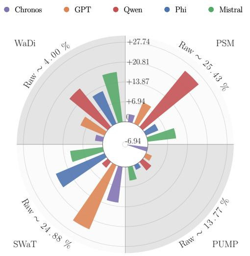  
(a) AUPR

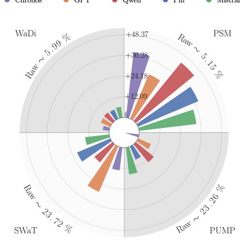  
(b) $F _ { 1 }$  
Figure 7: Results of the studied LLMs on diferent datasets, with Interpolation.

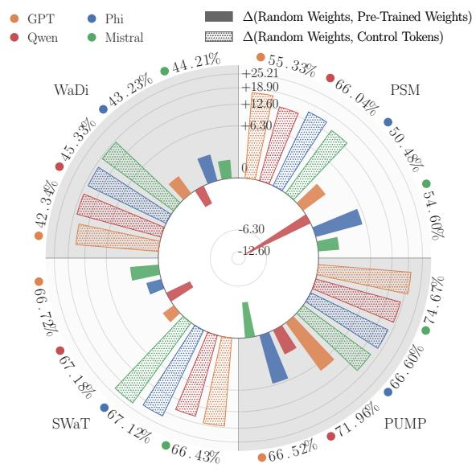  
(a) AUROC

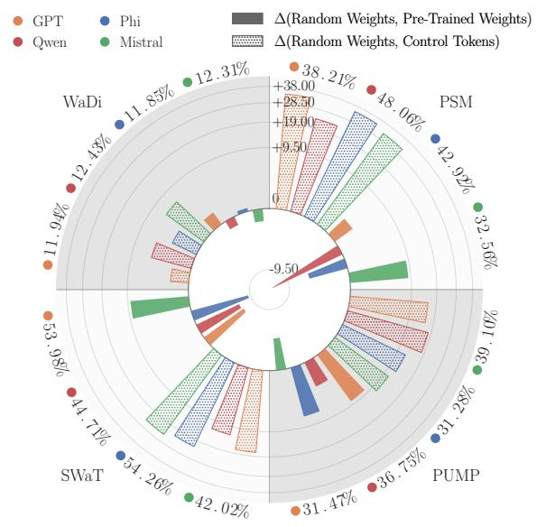  
(b) $\mathrm { F _ { 1 } }$  
Figure 8: Study on the impact of inductive bias and knowledge transfer.

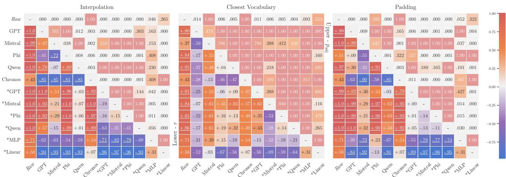  
Figure 9: Wilcoxon test study, with Closest Vocabulary tokenisation results.

Table 9: Results of Isolation Forest on Raw tokens, and on Chronos features (which required no tokenisation). The Control path of the Padding strategy and the Raw path have the same properties, with 0-variance dimensions ignored, and thus the same results.
<table><tr><td rowspan="2">Adapter</td><td rowspan="2">Window Size</td><td colspan="3">PSM</td><td colspan="3">PUMP</td><td colspan="3">SWaT</td><td colspan="3">WaDi</td></tr><tr><td>AUPR</td><td>AUROC</td><td>F1</td><td>AUPR</td><td>AUROC</td><td>F1</td><td>AUPR</td><td>AUROC</td><td>F1</td><td>AUPR</td><td>AUROC</td><td>F1</td></tr><tr><td rowspan="8">Raw</td><td>4</td><td>18.63±0.47</td><td>26.03±1.58</td><td>0.00±0.00</td><td>5.90±0.18</td><td>16.76±2.64</td><td>14.35±8.02</td><td>6.82±0.09</td><td>13.40±0.32</td><td>0.43±0.96</td><td>3.81±0.18</td><td>24.45±2.42</td><td>6.38±4.85</td></tr><tr><td>8</td><td>19.01±0.24</td><td>26.50±1.17</td><td>0.00±0.00</td><td>5.84±0.13</td><td>15.86±2.13</td><td>14.28±7.98</td><td>6.88±0.05</td><td>13.93±0.39</td><td>0.50±1.12</td><td>3.70±0.03</td><td>25.99±0.52</td><td>9.01±5.04</td></tr><tr><td>16</td><td>19.17±0.37</td><td>25.49±1.19</td><td>0.00±0.00</td><td>17.76±3.06</td><td>60.83±2.87</td><td>27.38±3.69</td><td>40.44±4.11</td><td>63.77±1.52</td><td>39.87±3.67</td><td>3.69±0.06</td><td>25.77±1.21</td><td>8.97±5.01</td></tr><tr><td>32</td><td>31.64±1.32</td><td>45.53±2.25</td><td>10.73±2.10</td><td>14.84±0.72</td><td>58.19±0.92</td><td>24.32±0.70</td><td>42.12±4.74</td><td>62.96±1.11</td><td>42.92±3.68</td><td>4.08±0.14</td><td>27.87±0.80</td><td>5.93±5.76</td></tr><tr><td>64</td><td>31.97±1.20</td><td>43.17±1.65</td><td>11.48±4.15</td><td>20.34±2.19</td><td>58.85±0.95</td><td>26.49±0.70</td><td>25.23±7.95</td><td>56.89±2.58</td><td>30.22±4.81</td><td>4.23±0.10</td><td>28.74±0.81</td><td>9.50±5.31</td></tr><tr><td>128</td><td>33.65±1.46</td><td>43.89±2.99</td><td>5.10±1.28</td><td>24.28±1.84</td><td>57.76±0.50</td><td>27.89±1.46</td><td>13.17±1.73</td><td>48.39±1.76</td><td>19.21±2.86</td><td>4.59±0.08</td><td>30.38±0.66</td><td>12.90±0.15</td></tr><tr><td>Average</td><td>25.68</td><td>35.10</td><td>4.55</td><td>14.83</td><td>44.71</td><td>22.45</td><td>22.44</td><td>43.22</td><td>22.19</td><td>4.01</td><td>27.20</td><td>8.78</td></tr><tr><td>Overall</td><td>16.74</td><td>37.56</td><td>14.49</td><td></td><td></td><td></td><td></td><td></td><td></td><td></td><td></td><td></td></tr><tr><td rowspan="8">Chronos (Features)</td><td>4</td><td>27.19±1.55</td><td>48.27±1.59</td><td>30.75±14.58</td><td>6.17±0.19</td><td>26.02±2.66</td><td>10.74±9.81</td><td>19.44±2.64</td><td>57.30±1.52</td><td>23.87±2.30</td><td>18.35±0.04</td><td>45.05±0.55</td><td>10.98±0.20</td></tr><tr><td>8</td><td>27.62±1.15</td><td>48.42±1.89</td><td>33.54±14.31</td><td>6.25±0.17</td><td>27.01±2.17</td><td>14.33±8.01</td><td>42.47±1.01</td><td>69.03±0.56</td><td>38.79±2.68</td><td>4.78±0.06</td><td>42.02±0.47</td><td>11.26±0.03</td></tr><tr><td>16</td><td>26.34±0.76</td><td>45.73±1.83</td><td>24.87±21.68</td><td>5.92±0.11</td><td>21.34±1.79</td><td>7.23±9.91</td><td>47.45±1.08</td><td>67.46±0.72</td><td>44.49±1.63</td><td>4.40±0.17</td><td>36.70±0.95</td><td>7.13±5.66</td></tr><tr><td>32</td><td>26.32±1.05</td><td>43.87±2.35</td><td>35.74±20.19</td><td>6.12±0.10</td><td>21.56±1.62</td><td>18.48±0.01</td><td>47.37±3.17</td><td>67.30±1.34</td><td>45.08±2.60</td><td>4.36±0.05</td><td>35.14±0.44</td><td>11.53±0.03</td></tr><tr><td>64</td><td>30.24±0.53</td><td>46.71±1.69</td><td>38.25±20.03</td><td>6.63±0.21</td><td>28.68±2.24</td><td>18.51±0.02</td><td>43.54±0.86</td><td>66.84±0.61</td><td>41.31±1.18</td><td>4.42±0.08</td><td>33.53±0.88</td><td>7.15±6.52</td></tr><tr><td>128</td><td>30.29±0.66</td><td>42.78±1.20</td><td>51.99±0.19</td><td>7.78±0.28</td><td>36.35±1.75</td><td>18.87±0.06</td><td>28.79±5.04</td><td>59.69±2.22</td><td>30.62±3.89</td><td>4.41±0.06</td><td>28.83±1.02</td><td>10.24±5.72</td></tr><tr><td>Average</td><td>28.00</td><td>45.97</td><td>35.86</td><td>6.48</td><td>26.83</td><td>14.69</td><td>38.18</td><td>64.60</td><td>37.36</td><td>6.79</td><td>36.88</td><td>9.71</td></tr><tr><td>Overall</td><td>19.86</td><td>43.57</td><td>24.41</td><td></td><td></td><td></td><td></td><td></td><td></td><td></td><td></td><td></td></tr></table>

Table 10: Results of Isolation Forest on the Closest Vocabulary tokens (Control).
<table><tr><td rowspan=1 colspan=13>Window           PSM                      PUMP                      SWaT                      WaDiModel  Size   AUPR AUROC   F1     AUPR  AUROC   F1    AUPR  AUROC    F1    AUPR AUROC   F1</td></tr><tr><td rowspan=1 colspan=1>4</td><td rowspan=1 colspan=1>33.32±0.91</td><td rowspan=1 colspan=1>60.38±0.66</td><td rowspan=1 colspan=4>45.18±1.77 13.59±1.02 64.02±1.76 22.49±4.88</td><td rowspan=1 colspan=1>10.04±1.62</td><td rowspan=1 colspan=1>32.15±2.98</td><td rowspan=1 colspan=2>20.83±2.94 12.25±8.15</td><td rowspan=1 colspan=1>41.68±1.68</td><td rowspan=1 colspan=1>9.03±5.05</td></tr><tr><td rowspan=1 colspan=1>8</td><td rowspan=1 colspan=1>34.65±0.67</td><td rowspan=1 colspan=1>58.35±1.24</td><td rowspan=1 colspan=1>44.22±2.29</td><td rowspan=1 colspan=1>18.60±10.30</td><td rowspan=1 colspan=1>65.87±1.59</td><td rowspan=1 colspan=1>24.75±2.63</td><td rowspan=1 colspan=1>11.73±2.04</td><td rowspan=1 colspan=1>42.58±5.04</td><td rowspan=1 colspan=1>18.86±1.97</td><td rowspan=1 colspan=1>14.60±3.59</td><td rowspan=1 colspan=1>42.36±1.68</td><td rowspan=1 colspan=1>11.63±0.35</td></tr><tr><td rowspan=1 colspan=1>16</td><td rowspan=1 colspan=1>33.37±0.65</td><td rowspan=1 colspan=1>56.59±1.30</td><td rowspan=1 colspan=1>45.04±1.13</td><td rowspan=1 colspan=1>16.70±0.80</td><td rowspan=1 colspan=1>70.37±0.68</td><td rowspan=1 colspan=1>27.79±1.13</td><td rowspan=1 colspan=1>21.90±13.48</td><td rowspan=1 colspan=1>53.24±8.58</td><td rowspan=1 colspan=1>11.98±8.21</td><td rowspan=1 colspan=1>18.81±5.59</td><td rowspan=1 colspan=1>44.69±1.65</td><td rowspan=1 colspan=1>12.02±0.50</td></tr><tr><td rowspan=1 colspan=1>32GPT</td><td rowspan=1 colspan=1>33.17±1.60</td><td rowspan=1 colspan=1>54.03±1.23</td><td rowspan=1 colspan=1>41.75±3.72</td><td rowspan=1 colspan=1>29.65±10.34</td><td rowspan=1 colspan=1>72.64±1.36</td><td rowspan=1 colspan=1>36.04±1.70</td><td rowspan=1 colspan=1>14.94±0.86</td><td rowspan=1 colspan=1>46.94±2.28</td><td rowspan=1 colspan=1>18.49±1.61</td><td rowspan=1 colspan=1>23.54±3.15</td><td rowspan=1 colspan=1>45.88±0.92</td><td rowspan=1 colspan=1>12.15±0.39</td></tr><tr><td rowspan=1 colspan=1>64</td><td rowspan=1 colspan=1>35.49±1.03</td><td rowspan=1 colspan=1>54.51±0.63</td><td rowspan=1 colspan=1>40.73±1.63</td><td rowspan=1 colspan=1>22.00±1.80</td><td rowspan=1 colspan=1>72.69±0.95</td><td rowspan=1 colspan=1>37.77±4.44</td><td rowspan=1 colspan=1>15.45±0.50</td><td rowspan=1 colspan=1>47.84±2.35</td><td rowspan=1 colspan=1>26.44±3.51</td><td rowspan=1 colspan=1>24.87±0.05</td><td rowspan=1 colspan=1>44.75±0.60</td><td rowspan=1 colspan=1>12.20±0.20</td></tr><tr><td rowspan=1 colspan=1>128</td><td rowspan=1 colspan=1>37.55±1.19</td><td rowspan=1 colspan=1>54.53±1.48</td><td rowspan=1 colspan=1>44.62±3.72</td><td rowspan=1 colspan=1>25.16±7.17</td><td rowspan=1 colspan=1>73.34±1.24</td><td rowspan=1 colspan=1>34.14±2.74</td><td rowspan=1 colspan=1>15.77±0.47</td><td rowspan=1 colspan=1>49.03±1.87</td><td rowspan=1 colspan=1>23.79±4.63</td><td rowspan=1 colspan=1>24.49±3.03</td><td rowspan=1 colspan=1>44.76±0.72</td><td rowspan=1 colspan=1>13.13±0.33</td></tr><tr><td rowspan=1 colspan=1>Average</td><td rowspan=1 colspan=1>34.59</td><td rowspan=1 colspan=1>56.40</td><td rowspan=1 colspan=1>43.59</td><td rowspan=1 colspan=1>20.95</td><td rowspan=1 colspan=1>69.82</td><td rowspan=1 colspan=1>30.50</td><td rowspan=1 colspan=1>14.97</td><td rowspan=1 colspan=1>45.30</td><td rowspan=1 colspan=1>20.06</td><td rowspan=1 colspan=1>19.76</td><td rowspan=1 colspan=1>44.02</td><td rowspan=1 colspan=1>11.69</td></tr><tr><td rowspan=1 colspan=1>Overall</td><td rowspan=1 colspan=1>22.57</td><td rowspan=1 colspan=1>53.88</td><td rowspan=1 colspan=1>26.46</td><td rowspan=1 colspan=1></td><td rowspan=1 colspan=1></td><td rowspan=1 colspan=1></td><td rowspan=1 colspan=1></td><td rowspan=1 colspan=1></td><td rowspan=1 colspan=1></td><td rowspan=1 colspan=1></td><td rowspan=1 colspan=1></td><td rowspan=1 colspan=1></td></tr><tr><td rowspan=1 colspan=1>4</td><td rowspan=1 colspan=1>35.78±3.21</td><td rowspan=1 colspan=1>57.29±1.04</td><td rowspan=1 colspan=1>40.86±1.40</td><td rowspan=1 colspan=1>7.63±0.30</td><td rowspan=1 colspan=1>39.08±3.63</td><td rowspan=1 colspan=1>19.20±0.25</td><td rowspan=1 colspan=1>10.81±1.07</td><td rowspan=1 colspan=1>30.87±3.03</td><td rowspan=1 colspan=1>13.76±3.88</td><td rowspan=1 colspan=1>11.83±0.98</td><td rowspan=1 colspan=1>43.33±1.56</td><td rowspan=1 colspan=1>11.27±0.11</td></tr><tr><td rowspan=1 colspan=1>8</td><td rowspan=1 colspan=1>37.16±2.67</td><td rowspan=1 colspan=1>56.04±0.76</td><td rowspan=1 colspan=1>37.58±6.38</td><td rowspan=1 colspan=1>7.93±0.11</td><td rowspan=1 colspan=1>41.18±0.83</td><td rowspan=1 colspan=1>19.74±0.65</td><td rowspan=1 colspan=1>15.62±3.11</td><td rowspan=1 colspan=1>33.70±1.52</td><td rowspan=1 colspan=1>14.28±6.40</td><td rowspan=1 colspan=1>16.56±5.17</td><td rowspan=1 colspan=1>45.27±1.51</td><td rowspan=1 colspan=1>12.22±0.24</td></tr><tr><td rowspan=1 colspan=1>16</td><td rowspan=1 colspan=1>39.77±0.65</td><td rowspan=1 colspan=1>56.84±0.81</td><td rowspan=1 colspan=1>38.12±3.22</td><td rowspan=1 colspan=1>8.07±0.12</td><td rowspan=1 colspan=1>42.71±1.16</td><td rowspan=1 colspan=1>19.56±0.34</td><td rowspan=1 colspan=1>16.42±3.20</td><td rowspan=1 colspan=1>36.85±3.98</td><td rowspan=1 colspan=1>16.96±6.30</td><td rowspan=1 colspan=1>19.08±4.99</td><td rowspan=1 colspan=1>47.20±1.19</td><td rowspan=1 colspan=1>12.87±0.26</td></tr><tr><td rowspan=1 colspan=1>32Mistral</td><td rowspan=1 colspan=1>42.45±0.77</td><td rowspan=1 colspan=1>58.84±1.50</td><td rowspan=1 colspan=1>41.81±4.04</td><td rowspan=1 colspan=1>8.61±0.12</td><td rowspan=1 colspan=1>45.49±0.94</td><td rowspan=1 colspan=1>20.88±0.30</td><td rowspan=1 colspan=1>28.93±22.92</td><td rowspan=1 colspan=1>43.90±17.31</td><td rowspan=1 colspan=1>12.18±10.81</td><td rowspan=1 colspan=1>22.58±5.44</td><td rowspan=1 colspan=1>47.34±0.76</td><td rowspan=1 colspan=1>12.58±0.33</td></tr><tr><td rowspan=1 colspan=1>64</td><td rowspan=1 colspan=1>42.18±1.83</td><td rowspan=1 colspan=1>56.59±1.61</td><td rowspan=1 colspan=1>39.09±2.07</td><td rowspan=1 colspan=1>8.27±0.07</td><td rowspan=1 colspan=1>43.29±0.53</td><td rowspan=1 colspan=1>19.82±0.31</td><td rowspan=1 colspan=1>18.88±0.00</td><td rowspan=1 colspan=1>37.09±0.03</td><td rowspan=1 colspan=1>13.83±9.40</td><td rowspan=1 colspan=1>24.89±0.02</td><td rowspan=1 colspan=1>45.10±0.25</td><td rowspan=1 colspan=1>12.44±0.29</td></tr><tr><td rowspan=1 colspan=1>128</td><td rowspan=1 colspan=1>43.81±1.74</td><td rowspan=1 colspan=1>57.75±1.69</td><td rowspan=1 colspan=1>42.77±4.42</td><td rowspan=1 colspan=1>8.57±0.11</td><td rowspan=1 colspan=1>44.23±0.77</td><td rowspan=1 colspan=1>20.03±0.18</td><td rowspan=1 colspan=1>19.32±0.09</td><td rowspan=1 colspan=1>37.38±0.71</td><td rowspan=1 colspan=1>17.93±9.26</td><td rowspan=1 colspan=1>23.32±5.80</td><td rowspan=1 colspan=1>45.91±0.65</td><td rowspan=1 colspan=1>13.56±0.39</td></tr><tr><td rowspan=1 colspan=1>Average</td><td rowspan=1 colspan=1>40.19</td><td rowspan=1 colspan=1>57.22</td><td rowspan=1 colspan=1>40.04</td><td rowspan=1 colspan=1>8.18</td><td rowspan=1 colspan=1>42.66</td><td rowspan=1 colspan=1>19.87</td><td rowspan=1 colspan=1>18.33</td><td rowspan=1 colspan=1>36.63</td><td rowspan=1 colspan=1>14.82</td><td rowspan=1 colspan=1>19.71</td><td rowspan=1 colspan=1>45.69</td><td rowspan=1 colspan=1>12.49</td></tr><tr><td rowspan=1 colspan=1>Overall</td><td rowspan=1 colspan=1>21.60</td><td rowspan=1 colspan=1>45.55</td><td rowspan=1 colspan=1>21.81</td><td rowspan=1 colspan=1></td><td rowspan=1 colspan=1></td><td rowspan=1 colspan=1></td><td rowspan=1 colspan=1></td><td rowspan=1 colspan=1></td><td rowspan=1 colspan=1></td><td rowspan=1 colspan=1></td><td rowspan=1 colspan=1></td><td rowspan=1 colspan=1></td></tr><tr><td rowspan=1 colspan=1>4</td><td rowspan=1 colspan=1>26.87±1.14</td><td rowspan=1 colspan=1>48.39±1.50</td><td rowspan=1 colspan=1>36.03±3.96</td><td rowspan=1 colspan=1>10.48±0.94</td><td rowspan=1 colspan=1>55.23±3.23</td><td rowspan=1 colspan=1>23.00±1.63</td><td rowspan=1 colspan=1>14.91±4.95</td><td rowspan=1 colspan=1>52.85±8.67</td><td rowspan=1 colspan=1>18.48±7.46</td><td rowspan=1 colspan=1>11.14±3.34</td><td rowspan=1 colspan=1>45.52±0.58</td><td rowspan=1 colspan=1>8.99±5.03</td></tr><tr><td rowspan=1 colspan=1>8</td><td rowspan=1 colspan=1>27.98±0.84</td><td rowspan=1 colspan=1>47.81±1.01</td><td rowspan=1 colspan=1>24.00±21.39</td><td rowspan=1 colspan=1>10.66±0.50</td><td rowspan=1 colspan=1>57.12±1.07</td><td rowspan=1 colspan=1>24.79±0.44</td><td rowspan=1 colspan=1>15.26±3.59</td><td rowspan=1 colspan=1>54.38±8.03</td><td rowspan=1 colspan=1>11.26±12.76</td><td rowspan=1 colspan=1>14.07±7.20</td><td rowspan=1 colspan=1>44.59±1.55</td><td rowspan=1 colspan=1>11.65±0.22</td></tr><tr><td rowspan=1 colspan=1>16</td><td rowspan=1 colspan=1>28.29±0.51</td><td rowspan=1 colspan=1>48.70±0.97</td><td rowspan=1 colspan=1>41.96±5.18</td><td rowspan=1 colspan=1>10.23±0.27</td><td rowspan=1 colspan=1>55.00±0.93</td><td rowspan=1 colspan=1>22.11±0.42</td><td rowspan=1 colspan=1>16.27±2.39</td><td rowspan=1 colspan=1>56.42±4.43</td><td rowspan=1 colspan=1>5.56±0.15</td><td rowspan=1 colspan=1>14.33±6.88</td><td rowspan=1 colspan=1>46.15±1.58</td><td rowspan=1 colspan=1>11.73±0.31</td></tr><tr><td rowspan=1 colspan=1>32Phi</td><td rowspan=1 colspan=1>28.98±0.19</td><td rowspan=1 colspan=1>48.36±0.60</td><td rowspan=1 colspan=1>40.60±4.14</td><td rowspan=1 colspan=1>10.72±0.13</td><td rowspan=1 colspan=1>55.41±1.18</td><td rowspan=1 colspan=1>22.34±0.50</td><td rowspan=1 colspan=1>34.59±27.05</td><td rowspan=1 colspan=1>61.27±11.70</td><td rowspan=1 colspan=1>3.34±3.06</td><td rowspan=1 colspan=1>16.91±7.38</td><td rowspan=1 colspan=1>46.32±1.07</td><td rowspan=1 colspan=1>12.53±0.50</td></tr><tr><td rowspan=1 colspan=1>64</td><td rowspan=1 colspan=1>30.88±0.18</td><td rowspan=1 colspan=1>48.13±1.18</td><td rowspan=1 colspan=1>45.83±4.13</td><td rowspan=1 colspan=1>10.80±0.13</td><td rowspan=1 colspan=1>56.98±0.64</td><td rowspan=1 colspan=1>23.22±0.42</td><td rowspan=1 colspan=1>35.80±25.58</td><td rowspan=1 colspan=1>63.46±9.26</td><td rowspan=1 colspan=1>3.60±3.30</td><td rowspan=1 colspan=1>22.43±5.53</td><td rowspan=1 colspan=1>45.25±0.42</td><td rowspan=1 colspan=1>12.37±0.25</td></tr><tr><td rowspan=1 colspan=1>128</td><td rowspan=1 colspan=1>32.01±0.79</td><td rowspan=1 colspan=1>46.37±1.56</td><td rowspan=1 colspan=1>44.20±16.94</td><td rowspan=1 colspan=1>11.15±0.23</td><td rowspan=1 colspan=1>57.46±0.91</td><td rowspan=1 colspan=1>23.54±0.43</td><td rowspan=1 colspan=1>27.64±19.36</td><td rowspan=1 colspan=1>62.69±5.19</td><td rowspan=1 colspan=1>17.34±18.95</td><td rowspan=1 colspan=1>25.87±0.04</td><td rowspan=1 colspan=1>45.22±0.53</td><td rowspan=1 colspan=1>13.01±0.23</td></tr><tr><td rowspan=1 colspan=1>Average</td><td rowspan=1 colspan=1>29.17</td><td rowspan=1 colspan=1>47.96</td><td rowspan=1 colspan=1>38.77</td><td rowspan=1 colspan=1>10.67</td><td rowspan=1 colspan=1>56.20</td><td rowspan=1 colspan=1>23.17</td><td rowspan=1 colspan=1>24.08</td><td rowspan=1 colspan=1>58.51</td><td rowspan=1 colspan=1>9.93</td><td rowspan=1 colspan=1>17.46</td><td rowspan=1 colspan=1>45.51</td><td rowspan=1 colspan=1>11.71</td></tr><tr><td rowspan=1 colspan=1>Overall</td><td rowspan=1 colspan=1>20.35</td><td rowspan=1 colspan=1>52.04</td><td rowspan=1 colspan=1>20.90</td><td rowspan=1 colspan=1></td><td rowspan=1 colspan=1></td><td rowspan=1 colspan=1></td><td rowspan=1 colspan=1></td><td rowspan=1 colspan=1></td><td rowspan=1 colspan=1></td><td rowspan=1 colspan=1></td><td rowspan=1 colspan=1></td><td rowspan=1 colspan=1></td></tr><tr><td rowspan=1 colspan=1>4</td><td rowspan=1 colspan=1>34.68±1.93</td><td rowspan=1 colspan=1>53.57±1.44</td><td rowspan=1 colspan=1>27.72±9.71</td><td rowspan=1 colspan=1>10.19±0.45</td><td rowspan=1 colspan=1>55.43±2.13</td><td rowspan=1 colspan=1>21.67±0.69</td><td rowspan=1 colspan=1>14.56±7.08</td><td rowspan=1 colspan=1>47.85±7.99</td><td rowspan=1 colspan=1>20.03±8.84</td><td rowspan=1 colspan=1>14.40±5.39</td><td rowspan=1 colspan=1>41.91±1.46</td><td rowspan=1 colspan=1>9.10±5.09</td></tr><tr><td rowspan=1 colspan=1>8</td><td rowspan=1 colspan=1>34.48±2.49</td><td rowspan=1 colspan=1>53.01±1.58</td><td rowspan=1 colspan=1>28.14±14.27</td><td rowspan=1 colspan=1>11.52±0.41</td><td rowspan=1 colspan=1>58.45±1.27</td><td rowspan=1 colspan=1>23.00±0.74</td><td rowspan=1 colspan=1>13.39±2.89</td><td rowspan=1 colspan=1>50.57±6.34</td><td rowspan=1 colspan=1>12.52±4.17</td><td rowspan=1 colspan=1>13.23±6.73</td><td rowspan=1 colspan=1>43.13±1.00</td><td rowspan=1 colspan=1>9.20±5.14</td></tr><tr><td rowspan=1 colspan=1>16</td><td rowspan=1 colspan=1>34.75±0.79</td><td rowspan=1 colspan=1>53.10±0.43</td><td rowspan=1 colspan=1>31.44±3.18</td><td rowspan=1 colspan=1>12.58±0.50</td><td rowspan=1 colspan=1>60.98±0.81</td><td rowspan=1 colspan=1>24.06±1.34</td><td rowspan=1 colspan=1>33.39±22.76</td><td rowspan=1 colspan=1>65.86±6.62</td><td rowspan=1 colspan=1>3.10±2.98</td><td rowspan=1 colspan=1>21.34±3.58</td><td rowspan=1 colspan=1>43.44±0.80</td><td rowspan=1 colspan=1>11.42±0.19</td></tr><tr><td rowspan=1 colspan=1>32</td><td rowspan=1 colspan=1>32.83±1.69</td><td rowspan=1 colspan=1>50.63±1.45</td><td rowspan=1 colspan=1>18.66±15.76</td><td rowspan=1 colspan=1>14.10±0.77</td><td rowspan=1 colspan=1>62.80±0.96</td><td rowspan=1 colspan=1>25.78±2.12</td><td rowspan=1 colspan=1>16.51±3.90</td><td rowspan=1 colspan=1>56.44±7.79</td><td rowspan=1 colspan=1>16.33±9.84</td><td rowspan=1 colspan=1>20.75±9.08</td><td rowspan=1 colspan=1>44.08±1.06</td><td rowspan=1 colspan=1>11.77±0.29</td></tr><tr><td rowspan=1 colspan=1>64</td><td rowspan=1 colspan=1>36.18±1.27</td><td rowspan=1 colspan=1>50.07±1.61</td><td rowspan=1 colspan=1>20.90±13.51</td><td rowspan=1 colspan=1>15.82±0.62</td><td rowspan=1 colspan=1>64.12±0.34</td><td rowspan=1 colspan=1>26.76±0.85</td><td rowspan=1 colspan=1>14.97±1.21</td><td rowspan=1 colspan=1>54.51±3.73</td><td rowspan=1 colspan=1>13.14±7.22</td><td rowspan=1 colspan=1>24.78±0.05</td><td rowspan=1 colspan=1>43.61±0.61</td><td rowspan=1 colspan=1>12.18±0.13</td></tr><tr><td rowspan=1 colspan=1>128</td><td rowspan=1 colspan=1>38.03±2.04</td><td rowspan=1 colspan=1>49.02±1.26</td><td rowspan=1 colspan=1>16.80±11.19</td><td rowspan=1 colspan=1>18.15±1.79</td><td rowspan=1 colspan=1>65.81±1.27</td><td rowspan=1 colspan=1>30.12±2.03</td><td rowspan=1 colspan=1>24.57±19.86</td><td rowspan=1 colspan=1>58.11±6.97</td><td rowspan=1 colspan=1>12.44±10.71</td><td rowspan=1 colspan=1>23.11±5.77</td><td rowspan=1 colspan=1>43.17±0.97</td><td rowspan=1 colspan=1>10.33±5.77</td></tr><tr><td rowspan=1 colspan=1>Average</td><td rowspan=1 colspan=1>35.16</td><td rowspan=1 colspan=1>51.57</td><td rowspan=1 colspan=1>23.94</td><td rowspan=1 colspan=1>13.73</td><td rowspan=1 colspan=1>61.26</td><td rowspan=1 colspan=1>25.23</td><td rowspan=1 colspan=1>19.56</td><td rowspan=1 colspan=1>55.56</td><td rowspan=1 colspan=1>12.93</td><td rowspan=1 colspan=1>19.60</td><td rowspan=1 colspan=1>43.22</td><td rowspan=1 colspan=1>10.66</td></tr><tr><td rowspan=1 colspan=1>Overall</td><td rowspan=1 colspan=1>22.01</td><td rowspan=1 colspan=1>52.90</td><td rowspan=1 colspan=1>18.19</td><td rowspan=1 colspan=1></td><td rowspan=1 colspan=1></td><td rowspan=1 colspan=1></td><td rowspan=1 colspan=1></td><td rowspan=1 colspan=1></td><td rowspan=1 colspan=1></td><td rowspan=1 colspan=1></td><td rowspan=1 colspan=1></td><td rowspan=1 colspan=1></td></tr></table>

Table 11: Results of Isolation Forest on the Interpolated tokens (Control).
<table><tr><td rowspan="2">Model</td><td rowspan="2">Window Size</td><td colspan="3">PSM</td><td colspan="3">PUMP</td><td colspan="3">SWaT</td><td colspan="3">WaDi</td></tr><tr><td>AUPR</td><td>AUROC</td><td> $\overline { { \mathbf { F } _ { 1 } } }$ </td><td>AUPR</td><td>AUROC</td><td> $\overline { { \mathbf { F } _ { 1 } } }$ </td><td>AUPR</td><td>AUROC</td><td>F1</td><td>AUPR</td><td>AUROC</td><td> $\overline { { \mathbf { F } _ { 1 } } }$ </td></tr><tr><td rowspan="8">GPT</td><td>4</td><td>20.84±0.99</td><td>33.81±2.50</td><td>0.00±0.00</td><td>7.63±0.84</td><td>39.36±6.42</td><td>17.94±0.09</td><td>6.75±0.15</td><td>10.44±0.95</td><td>8.79±11.83</td><td>3.66±0.08</td><td>24.65±1.11</td><td>4.43±6.07</td></tr><tr><td>8</td><td>22.17±1.01</td><td>36.18±2.68</td><td>0.40±0.89</td><td>13.36±2.04</td><td>57.36±2.34</td><td>21.96±1.53</td><td>10.96±1.57</td><td>44.60±4.46</td><td>19.46±4.43</td><td>3.76±0.01</td><td>27.22±0.47</td><td>11.25±0.06</td></tr><tr><td>16</td><td>27.33±1.50</td><td>42.40±1.81</td><td>5.77±1.73</td><td>17.82±2.98</td><td>61.13±2.05</td><td>27.54±3.17</td><td>41.87±2.22</td><td>63.81±0.96</td><td>40.37±2.29</td><td>3.69±0.06</td><td>25.69±1.31</td><td>8.97±5.02</td></tr><tr><td>32</td><td>29.86±0.96</td><td>44.66±1.49</td><td>6.91±2.21</td><td>14.87±1.35</td><td>57.44±1.55</td><td>24.31±1.02</td><td>42.42±8.58</td><td>62.46±2.16</td><td>42.18±7.82</td><td>4.12±0.12</td><td>28.29±0.74</td><td>5.25±5.83</td></tr><tr><td>64</td><td>31.83±1.24</td><td>43.02±2.22</td><td>13.04±5.52</td><td>20.87±1.52</td><td>59.42±1.45</td><td>28.30±1.91</td><td>28.34±11.60</td><td>57.24±4.18</td><td>33.88±8.84</td><td>4.20±0.08</td><td>28.48±0.51</td><td>7.12±6.50</td></tr><tr><td>128</td><td>33.97±1.15</td><td>43.72±1.77</td><td>11.45±7.16</td><td>27.40±2.62</td><td>59.76±0.87</td><td>30.92±1.30</td><td>14.62±4.68</td><td>47.62±5.49</td><td>22.98±3.87</td><td>4.62±0.08</td><td>30.40±0.63</td><td>12.99±0.17</td></tr><tr><td>Average Overall</td><td>27.67 18.21</td><td>40.63 42.88</td><td>6.26</td><td>16.99</td><td>55.75</td><td>25.16</td><td>24.16</td><td>47.69</td><td>27.94</td><td>4.01</td><td>27.46</td><td>8.33</td></tr><tr><td>4</td><td>20.54±0.44</td><td>32.53±1.02</td><td>16.93 0.00±0.00</td><td>–</td><td>一</td><td>1</td><td></td><td>-</td><td></td><td>–</td><td>-</td><td>-</td></tr><tr><td rowspan="8">Mistral</td><td></td><td></td><td></td><td></td><td>9.04±1.21</td><td>45.87±4.10</td><td>14.07±7.94</td><td>6.95±0.12</td><td>15.91±2.00</td><td>8.70±11.92</td><td>3.68±0.06</td><td>24.81±1.12</td><td>7.03±5.57 11.21±0.02</td></tr><tr><td>8 16</td><td>23.20±1.35</td><td>38.30±2.53</td><td>2.08±2.85</td><td>14.62±1.90</td><td>58.38±1.74</td><td>23.12±1.57</td><td>9.85±0.90</td><td>40.90±3.78</td><td>16.00±9.32</td><td>3.75±0.05</td><td>26.95±0.92</td><td></td></tr><tr><td></td><td>27.58±1.48</td><td>42.21±1.59</td><td>8.72±4.52</td><td>18.67±2.06</td><td>60.79±2.45</td><td>28.54±2.97</td><td>39.21±6.48</td><td>63.26±2.40</td><td>40.00±5.60</td><td>3.68±0.03</td><td>25.60±0.67</td><td>11.23±0.03</td></tr><tr><td>32</td><td>30.50±1.33</td><td>44.52±1.90</td><td>10.71±4.41</td><td>14.79±1.22</td><td>57.79±2.01</td><td>24.62±1.68</td><td>35.75±7.56</td><td>62.11±2.10</td><td>38.44±5.49</td><td>4.15±0.13</td><td>28.77±0.56</td><td>5.92±5.30</td></tr><tr><td>64</td><td>32.40±0.81</td><td>44.46±1.62</td><td>10.14±1.92</td><td>18.60±1.83</td><td>58.70±1.26</td><td>27.32±1.38</td><td>21.75±5.67</td><td>56.12±2.37</td><td>29.35±4.69</td><td>4.18±0.08</td><td>28.40±1.04</td><td>11.89±0.03</td></tr><tr><td>128</td><td>35.03±2.33</td><td>44.86±3.61</td><td>9.67±4.58</td><td>25.58±4.33</td><td>57.84±1.10</td><td>28.33±2.14</td><td>19.60±8.86</td><td>50.44±4.81</td><td>25.06±5.29</td><td>4.66±0.09</td><td>30.84±0.89</td><td>12.89±0.07</td></tr><tr><td>Average Overall</td><td>28.21 17.82</td><td>41.15</td><td>6.89</td><td>16.88</td><td>56.56</td><td>24.33</td><td>22.19</td><td>48.12</td><td>26.26</td><td>4.02</td><td>27.56</td><td>10.03</td></tr><tr><td>4</td><td>20.46±1.02</td><td>43.35</td><td>16.88</td><td>-</td><td></td><td>-</td><td></td><td>-</td><td></td><td></td><td>-</td><td>-</td></tr><tr><td rowspan="8">Phi</td><td>8</td><td></td><td>31.75±2.38</td><td>0.41±0.56</td><td>8.25±1.09</td><td>42.41±4.71</td><td>11.43±8.55</td><td>6.98±0.22</td><td>16.10±3.34</td><td>13.06±11.92</td><td>3.80±0.24</td><td>26.06±0.73</td><td>5.77±5.15</td></tr><tr><td>16</td><td>22.20±1.03 27.38±1.49</td><td>36.92±2.58</td><td>0.00±0.00</td><td>14.40±3.59</td><td>58.92±2.48</td><td>23.70±3.44</td><td>11.29±2.36</td><td>44.51±6.55</td><td>16.97±9.51</td><td>3.75±0.11</td><td>26.96±1.96</td><td>6.75±6.16</td></tr><tr><td>32</td><td>29.92±1.78</td><td>42.43±2.16</td><td>5.85±3.39</td><td>17.49±1.82</td><td>61.10±1.20</td><td>27.38±1.74</td><td>37.66±8.15</td><td>62.11±3.26</td><td>38.89±6.08</td><td>3.68±0.04</td><td>25.66±0.82</td><td>8.97±5.02</td></tr><tr><td>64</td><td>31.48±0.48</td><td>43.59±2.04</td><td>11.75±7.13</td><td>14.60±0.67</td><td>57.61±0.99</td><td>25.11±2.26</td><td>36.36±5.50</td><td>62.24±1.33</td><td>38.15±3.78</td><td>4.03±0.05</td><td>27.75±0.47</td><td>10.31±2.60</td></tr><tr><td>128</td><td>33.50±2.34</td><td>43.65±1.05</td><td>7.87±1.20</td><td>20.25±2.03</td><td>58.98±0.99</td><td>26.30±1.14</td><td>22.50±7.52</td><td>56.26±5.77</td><td>32.23±5.63</td><td>4.15±0.08</td><td>27.89±1.17</td><td>9.50±5.31</td></tr><tr><td></td><td></td><td>42.41±2.67</td><td>7.94±3.41</td><td>25.54±2.74</td><td>57.73±1.13</td><td>27.04±1.35</td><td>16.65±8.08</td><td>47.95±4.31</td><td>24.52±5.43</td><td>4.59±0.05</td><td>30.59±0.96</td><td>10.30±5.76</td></tr><tr><td>Average Overall</td><td>27.49 17.54</td><td>40.12</td><td>5.64</td><td>16.76</td><td>56.13</td><td>23.49</td><td>21.91</td><td>48.20</td><td>27.30</td><td>4.00</td><td>27.48</td><td>8.60</td></tr><tr><td>4</td><td>21.77±0.82</td><td>42.98</td><td>16.26</td><td>一</td><td></td><td></td><td>一</td><td></td><td></td><td></td><td>-</td><td>-</td></tr><tr><td rowspan="8">Qwen</td><td></td><td></td><td>35.22±2.64</td><td>1.51±2.84</td><td>8.54±1.00</td><td>44.20±4.61</td><td>15.27±5.96</td><td>6.90±0.11</td><td>14.27±1.74</td><td>21.77±0.00</td><td>3.68±0.07</td><td>26.24±1.42</td><td>6.66±6.08</td></tr><tr><td>8</td><td>22.05±0.24</td><td>36.83±0.87</td><td>0.39±0.88</td><td>12.65±1.89</td><td>56.36±3.21</td><td>21.52±1.53</td><td>10.00±1.01</td><td>41.43±4.97</td><td>16.72±9.48</td><td>3.75±0.06</td><td>27.00±1.33</td><td>11.27±0.06</td></tr><tr><td>16</td><td>27.13±1.33</td><td>40.92±1.80</td><td>10.70±6.60</td><td>17.64±2.03</td><td>60.91±1.33</td><td>26.14±0.97</td><td>39.31±4.06</td><td>63.19±1.69</td><td>37.37±3.29</td><td>3.72±0.05</td><td>26.27±0.86</td><td>8.96±5.01</td></tr><tr><td>32</td><td>30.25±1.34</td><td>43.91±1.19</td><td>8.73±2.30</td><td>14.75±1.46</td><td>58.04±1.98</td><td>24.04±1.53</td><td>41.37±6.46</td><td>61.66±1.79</td><td>41.29±6.14</td><td>4.06±0.09</td><td>27.89±0.42</td><td>4.61±6.31</td></tr><tr><td>64</td><td>32.19±2.57</td><td>43.13±2.88</td><td>8.62±4.07</td><td>20.24±0.93</td><td>58.16±0.68</td><td>28.39±1.56 28.12±2.33</td><td>31.59±3.28 13.18±2.79</td><td>58.01±1.93 46.88±5.10</td><td>33.34±6.12 20.13±3.92</td><td>4.16±0.09 4.71±0.24</td><td>28.39±1.09 30.94±0.89</td><td>9.53±5.33 12.93±0.09</td></tr><tr><td>128 Average</td><td>33.41±2.54 27.80</td><td>42.21±2.50 40.37</td><td>9.34±4.76 6.55</td><td>24.56±3.68 16.40</td><td>57.66±1.26 55.89</td></table>

Table 12: Results of Isolation Forest on LLM features, pre-trained, with Padding tokenisation.
<table><tr><td rowspan=1 colspan=13>Window           PSM                     PUMP                     SWaT                     WaDiModel     Size   AUPR AUROC   F1    AUPR AUROC   F1     AUPR  AUROC    F1    AUPR  AUROC   F1</td></tr><tr><td rowspan=1 colspan=1>4</td><td rowspan=1 colspan=1>33.93±0.27</td><td rowspan=1 colspan=1>56.15±1.66</td><td rowspan=1 colspan=1>38.26±3.59</td><td rowspan=1 colspan=1>12.14±0.45</td><td rowspan=1 colspan=1>60.44±1.31</td><td rowspan=1 colspan=1>24.42±1.35</td><td rowspan=1 colspan=1>37.16±8.51</td><td rowspan=1 colspan=1>64.33±1.15</td><td rowspan=1 colspan=1>36.54±2.26</td><td rowspan=1 colspan=1>11.64±3.24</td><td rowspan=1 colspan=1>37.53±0.83</td><td rowspan=1 colspan=1>11.26±0.09</td></tr><tr><td rowspan=1 colspan=1>8</td><td rowspan=1 colspan=1>33.72±0.91</td><td rowspan=1 colspan=1>52.53±0.98</td><td rowspan=1 colspan=1>27.90±4.73</td><td rowspan=1 colspan=1>13.32±0.23</td><td rowspan=1 colspan=1>63.37±0.68</td><td rowspan=1 colspan=1>26.51±1.44</td><td rowspan=1 colspan=1>22.50±12.47</td><td rowspan=1 colspan=1>61.20±3.30</td><td rowspan=1 colspan=1>34.02±6.41</td><td rowspan=1 colspan=1>10.51±5.69</td><td rowspan=1 colspan=1>37.37±1.91</td><td rowspan=1 colspan=1>11.38±0.33</td></tr><tr><td rowspan=1 colspan=1>16</td><td rowspan=1 colspan=1>35.05±1.86</td><td rowspan=1 colspan=1>53.20±1.91</td><td rowspan=1 colspan=1>27.40±12.40</td><td rowspan=1 colspan=1>14.39±0.41</td><td rowspan=1 colspan=1>64.49±0.94</td><td rowspan=1 colspan=1>27.36±0.81</td><td rowspan=1 colspan=1>38.09±14.58</td><td rowspan=1 colspan=1>64.83±2.38</td><td rowspan=1 colspan=1>43.27±8.80</td><td rowspan=1 colspan=1>11.95±4.66</td><td rowspan=1 colspan=1>38.96±1.22</td><td rowspan=1 colspan=1>11.66±0.32</td></tr><tr><td rowspan=1 colspan=1>32GPT</td><td rowspan=1 colspan=1>34.85±1.40</td><td rowspan=1 colspan=1>54.25±0.43</td><td rowspan=1 colspan=1>39.97±4.84</td><td rowspan=1 colspan=1>16.11±1.21</td><td rowspan=1 colspan=1>66.35±0.78</td><td rowspan=1 colspan=1>30.62±1.24</td><td rowspan=1 colspan=1>30.21±13.07</td><td rowspan=1 colspan=1>62.89±2.52</td><td rowspan=1 colspan=1>39.30±4.32</td><td rowspan=1 colspan=1>10.46±4.60</td><td rowspan=1 colspan=1>38.81±0.83</td><td rowspan=1 colspan=1>11.95±0.17</td></tr><tr><td rowspan=1 colspan=1>64</td><td rowspan=1 colspan=1>37.37±0.77</td><td rowspan=1 colspan=1>53.54±1.07</td><td rowspan=1 colspan=1>35.42±10.79</td><td rowspan=1 colspan=1>14.74±0.50</td><td rowspan=1 colspan=1>64.35±1.04</td><td rowspan=1 colspan=1>29.29±2.08</td><td rowspan=1 colspan=1>18.05±4.11</td><td rowspan=1 colspan=1>59.62±2.84</td><td rowspan=1 colspan=1>32.14±4.08</td><td rowspan=1 colspan=1>15.63±5.12</td><td rowspan=1 colspan=1>40.63±2.71</td><td rowspan=1 colspan=1>12.14±0.22</td></tr><tr><td rowspan=1 colspan=1>128</td><td rowspan=1 colspan=1>37.67±1.66</td><td rowspan=1 colspan=1>50.94±0.63</td><td rowspan=1 colspan=1>27.18±13.75</td><td rowspan=1 colspan=1>16.12±1.69</td><td rowspan=1 colspan=1>63.72±0.74</td><td rowspan=1 colspan=1>30.84±1.53</td><td rowspan=1 colspan=1>24.12±7.15</td><td rowspan=1 colspan=1>59.27±3.41</td><td rowspan=1 colspan=1>32.07±3.00</td><td rowspan=1 colspan=1>16.12±7.99</td><td rowspan=1 colspan=1>40.86±2.78</td><td rowspan=1 colspan=1>12.92±0.19</td></tr><tr><td rowspan=1 colspan=1>Average</td><td rowspan=1 colspan=1>35.43</td><td rowspan=1 colspan=1>53.43</td><td rowspan=1 colspan=1>32.69</td><td rowspan=1 colspan=1>14.47</td><td rowspan=1 colspan=1>63.79</td><td rowspan=1 colspan=1>28.17</td><td rowspan=1 colspan=1>28.35</td><td rowspan=1 colspan=1>62.02</td><td rowspan=1 colspan=1>36.22</td><td rowspan=1 colspan=1>12.72</td><td rowspan=1 colspan=1>39.03</td><td rowspan=1 colspan=1>11.89</td></tr><tr><td rowspan=1 colspan=1>Overall</td><td rowspan=1 colspan=1>22.74</td><td rowspan=1 colspan=1>54.57</td><td rowspan=1 colspan=1>27.24</td><td rowspan=1 colspan=1></td><td rowspan=1 colspan=1></td><td rowspan=1 colspan=1></td><td rowspan=1 colspan=1></td><td rowspan=1 colspan=1></td><td rowspan=1 colspan=1></td><td rowspan=1 colspan=1></td><td rowspan=1 colspan=1></td><td rowspan=1 colspan=1></td></tr><tr><td rowspan=1 colspan=1>4</td><td rowspan=1 colspan=1>31.10±1.18</td><td rowspan=1 colspan=1>52.01±1.25</td><td rowspan=1 colspan=1>29.20±4.77</td><td rowspan=1 colspan=1>15.89±0.48</td><td rowspan=1 colspan=1>69.91±0.64</td><td rowspan=1 colspan=1>33.60±1.42</td><td rowspan=1 colspan=1>37.00±12.50</td><td rowspan=1 colspan=1>67.05±2.32</td><td rowspan=1 colspan=1>42.80±6.37</td><td rowspan=1 colspan=1>17.04±4.39</td><td rowspan=1 colspan=1>43.32±2.28</td><td rowspan=1 colspan=1>11.41±0.20</td></tr><tr><td rowspan=1 colspan=1>8</td><td rowspan=1 colspan=1>31.08±1.41</td><td rowspan=1 colspan=1>51.56±0.86</td><td rowspan=1 colspan=1>25.90±12.72</td><td rowspan=1 colspan=1>16.62±0.64</td><td rowspan=1 colspan=1>70.91±0.94</td><td rowspan=1 colspan=1>35.13±1.51</td><td rowspan=1 colspan=1>39.35±15.21</td><td rowspan=1 colspan=1>67.31±2.07</td><td rowspan=1 colspan=1>45.98±11.05</td><td rowspan=1 colspan=1>21.42±4.27</td><td rowspan=1 colspan=1>44.59±1.60</td><td rowspan=1 colspan=1>11.64±0.13</td></tr><tr><td rowspan=1 colspan=1>16</td><td rowspan=1 colspan=1>32.03±0.73</td><td rowspan=1 colspan=1>51.65±2.12</td><td rowspan=1 colspan=1>35.88±12.70</td><td rowspan=1 colspan=1>17.36±0.65</td><td rowspan=1 colspan=1>71.93±1.26</td><td rowspan=1 colspan=1>37.26±2.33</td><td rowspan=1 colspan=1>39.21±7.53</td><td rowspan=1 colspan=1>67.16±1.21</td><td rowspan=1 colspan=1>44.65±5.76</td><td rowspan=1 colspan=1>24.18±0.04</td><td rowspan=1 colspan=1>46.51±0.54</td><td rowspan=1 colspan=1>11.92±0.24</td></tr><tr><td rowspan=1 colspan=1>Mistral      32</td><td rowspan=1 colspan=1>33.44±0.69</td><td rowspan=1 colspan=1>52.06±1.17</td><td rowspan=1 colspan=1>26.99±2.42</td><td rowspan=1 colspan=1>17.12±0.41</td><td rowspan=1 colspan=1>70.73±1.13</td><td rowspan=1 colspan=1>35.53±0.30</td><td rowspan=1 colspan=1>34.06±12.69</td><td rowspan=1 colspan=1>66.45±2.12</td><td rowspan=1 colspan=1>41.87±7.93</td><td rowspan=1 colspan=1>21.92±3.38</td><td rowspan=1 colspan=1>45.62±2.18</td><td rowspan=1 colspan=1>12.48±0.43</td></tr><tr><td rowspan=1 colspan=1>64</td><td rowspan=1 colspan=1>35.80±1.74</td><td rowspan=1 colspan=1>50.37±1.17</td><td rowspan=1 colspan=1>18.03±5.04</td><td rowspan=1 colspan=1>16.67±0.41</td><td rowspan=1 colspan=1>68.90±0.93</td><td rowspan=1 colspan=1>36.08±1.33</td><td rowspan=1 colspan=1>30.37±8.96</td><td rowspan=1 colspan=1>65.00±1.62</td><td rowspan=1 colspan=1>37.78±2.50</td><td rowspan=1 colspan=1>24.09±2.05</td><td rowspan=1 colspan=1>45.92±0.91</td><td rowspan=1 colspan=1>12.55±0.20</td></tr><tr><td rowspan=1 colspan=1>128</td><td rowspan=1 colspan=1>34.81±1.01</td><td rowspan=1 colspan=1>48.20±1.61</td><td rowspan=1 colspan=1>31.04±18.84</td><td rowspan=1 colspan=1>16.01±0.28</td><td rowspan=1 colspan=1>67.64±0.59</td><td rowspan=1 colspan=1>33.03±0.66</td><td rowspan=1 colspan=1>29.07±9.84</td><td rowspan=1 colspan=1>62.83±1.92</td><td rowspan=1 colspan=1>38.71±4.67</td><td rowspan=1 colspan=1>24.04±3.27</td><td rowspan=1 colspan=1>45.32±1.94</td><td rowspan=1 colspan=1>13.28±0.20</td></tr><tr><td rowspan=1 colspan=1>Average</td><td rowspan=1 colspan=1>33.04</td><td rowspan=1 colspan=1>50.98</td><td rowspan=1 colspan=1>27.84</td><td rowspan=1 colspan=1>16.61</td><td rowspan=1 colspan=1>70.01</td><td rowspan=1 colspan=1>35.10</td><td rowspan=1 colspan=1>34.84</td><td rowspan=1 colspan=1>65.97</td><td rowspan=1 colspan=1>41.96</td><td rowspan=1 colspan=1>22.11</td><td rowspan=1 colspan=1>45.21</td><td rowspan=1 colspan=1>12.21</td></tr><tr><td rowspan=1 colspan=1>Overall</td><td rowspan=1 colspan=1>26.65</td><td rowspan=1 colspan=1>58.04</td><td rowspan=1 colspan=1>29.28</td><td rowspan=1 colspan=1></td><td rowspan=1 colspan=1>一</td><td rowspan=1 colspan=1></td><td rowspan=1 colspan=1></td><td rowspan=1 colspan=1></td><td rowspan=1 colspan=1></td><td rowspan=1 colspan=1></td><td rowspan=1 colspan=1></td><td rowspan=1 colspan=1></td></tr><tr><td rowspan=1 colspan=1>4</td><td rowspan=1 colspan=1>32.12±0.71</td><td rowspan=1 colspan=1>56.30±1.19</td><td rowspan=1 colspan=1>38.44±4.05</td><td rowspan=1 colspan=1>5.93±0.08</td><td rowspan=1 colspan=1>21.45±1.23</td><td rowspan=1 colspan=1>10.75±9.81</td><td rowspan=1 colspan=1>46.75±10.70</td><td rowspan=1 colspan=1>63.83±0.82</td><td rowspan=1 colspan=1>49.41±6.72</td><td rowspan=1 colspan=1>11.50±4.45</td><td rowspan=1 colspan=1>39.00±1.37</td><td rowspan=1 colspan=1>11.52±0.10</td></tr><tr><td rowspan=1 colspan=1>8</td><td rowspan=1 colspan=1>32.53±1.13</td><td rowspan=1 colspan=1>56.78±1.57</td><td rowspan=1 colspan=1>41.71±3.85</td><td rowspan=1 colspan=1>5.99±0.12</td><td rowspan=1 colspan=1>22.52±1.91</td><td rowspan=1 colspan=1>14.34±8.01</td><td rowspan=1 colspan=1>47.20±9.37</td><td rowspan=1 colspan=1>64.03±1.20</td><td rowspan=1 colspan=1>49.90±6.93</td><td rowspan=1 colspan=1>14.15±6.28</td><td rowspan=1 colspan=1>39.68±2.81</td><td rowspan=1 colspan=1>11.61±0.13</td></tr><tr><td rowspan=1 colspan=1>16</td><td rowspan=1 colspan=1>32.17±0.73</td><td rowspan=1 colspan=1>54.07±1.56</td><td rowspan=1 colspan=1>37.38±3.66</td><td rowspan=1 colspan=1>6.21±0.09</td><td rowspan=1 colspan=1>25.81±1.25</td><td rowspan=1 colspan=1>10.87±9.92</td><td rowspan=1 colspan=1>53.17±6.81</td><td rowspan=1 colspan=1>65.35±0.54</td><td rowspan=1 colspan=1>55.49±5.60</td><td rowspan=1 colspan=1>15.31±8.69</td><td rowspan=1 colspan=1>41.32±3.08</td><td rowspan=1 colspan=1>11.53±0.25</td></tr><tr><td rowspan=1 colspan=1>32Phi</td><td rowspan=1 colspan=1>32.77±0.71</td><td rowspan=1 colspan=1>54.64±0.69</td><td rowspan=1 colspan=1>40.43±7.23</td><td rowspan=1 colspan=1>6.74±0.12</td><td rowspan=1 colspan=1>30.09±1.41</td><td rowspan=1 colspan=1>14.80±8.27</td><td rowspan=1 colspan=1>53.86±5.65</td><td rowspan=1 colspan=1>65.27±0.85</td><td rowspan=1 colspan=1>55.28±7.66</td><td rowspan=1 colspan=1>15.05±6.93</td><td rowspan=1 colspan=1>42.48±3.16</td><td rowspan=1 colspan=1>12.67±0.10</td></tr><tr><td rowspan=1 colspan=1>64</td><td rowspan=1 colspan=1>34.77±1.14</td><td rowspan=1 colspan=1>53.35±1.08</td><td rowspan=1 colspan=1>41.92±9.15</td><td rowspan=1 colspan=1>6.95±0.19</td><td rowspan=1 colspan=1>32.04±1.66</td><td rowspan=1 colspan=1>14.83±8.29</td><td rowspan=1 colspan=1>42.84±12.77</td><td rowspan=1 colspan=1>63.29±2.18</td><td rowspan=1 colspan=1>48.53±7.63</td><td rowspan=1 colspan=1>16.86±5.72</td><td rowspan=1 colspan=1>44.80±1.77</td><td rowspan=1 colspan=1>13.00±0.37</td></tr><tr><td rowspan=1 colspan=1>128</td><td rowspan=1 colspan=1>35.33±0.88</td><td rowspan=1 colspan=1>51.26±1.81</td><td rowspan=1 colspan=1>43.37±6.32</td><td rowspan=1 colspan=1>7.16±0.14</td><td rowspan=1 colspan=1>32.94±0.93</td><td rowspan=1 colspan=1>11.30±10.31</td><td rowspan=1 colspan=1>44.11±10.51</td><td rowspan=1 colspan=1>62.55±1.61</td><td rowspan=1 colspan=1>49.93±8.09</td><td rowspan=1 colspan=1>18.28±6.95</td><td rowspan=1 colspan=1>46.15±3.40</td><td rowspan=1 colspan=1>14.46±0.24</td></tr><tr><td rowspan=1 colspan=1>Average</td><td rowspan=1 colspan=1>33.28</td><td rowspan=1 colspan=1>54.40</td><td rowspan=1 colspan=1>40.54</td><td rowspan=1 colspan=1>6.50</td><td rowspan=1 colspan=1>27.47</td><td rowspan=1 colspan=1>12.81</td><td rowspan=1 colspan=1>47.99</td><td rowspan=1 colspan=1>64.05</td><td rowspan=1 colspan=1>51.42</td><td rowspan=1 colspan=1>15.19</td><td rowspan=1 colspan=1>42.24</td><td rowspan=1 colspan=1>12.47</td></tr><tr><td rowspan=1 colspan=1>Overall</td><td rowspan=1 colspan=1>25.74</td><td rowspan=1 colspan=1>47.04</td><td rowspan=1 colspan=1>29.31</td><td rowspan=1 colspan=1></td><td rowspan=1 colspan=1></td><td rowspan=1 colspan=1></td><td rowspan=1 colspan=1></td><td rowspan=1 colspan=1></td><td rowspan=1 colspan=1></td><td rowspan=1 colspan=1></td><td rowspan=1 colspan=1></td><td rowspan=1 colspan=1></td></tr><tr><td rowspan=1 colspan=1>4</td><td rowspan=1 colspan=1>38.78±0.74</td><td rowspan=1 colspan=1>60.22±1.63</td><td rowspan=1 colspan=1>41.82±1.31</td><td rowspan=1 colspan=1>10.52±0.28</td><td rowspan=1 colspan=1>55.47±0.52</td><td rowspan=1 colspan=1>20.56±0.23</td><td rowspan=1 colspan=1>59.87±2.34</td><td rowspan=1 colspan=1>66.33±0.44</td><td rowspan=1 colspan=1>63.95±4.91</td><td rowspan=1 colspan=1>19.74±4.21</td><td rowspan=1 colspan=1>40.92±2.29</td><td rowspan=1 colspan=1>11.22±0.09</td></tr><tr><td rowspan=1 colspan=1>8</td><td rowspan=1 colspan=1>39.19±0.91</td><td rowspan=1 colspan=1>61.82±0.42</td><td rowspan=1 colspan=1>43.40±3.45</td><td rowspan=1 colspan=1>11.10±1.00</td><td rowspan=1 colspan=1>57.21±2.56</td><td rowspan=1 colspan=1>21.49±0.74</td><td rowspan=1 colspan=1>59.51±2.19</td><td rowspan=1 colspan=1>66.19±0.43</td><td rowspan=1 colspan=1>65.75±3.48</td><td rowspan=1 colspan=1>20.01±5.95</td><td rowspan=1 colspan=1>41.44±3.30</td><td rowspan=1 colspan=1>11.31±0.10</td></tr><tr><td rowspan=1 colspan=1>16</td><td rowspan=1 colspan=1>40.30±0.60</td><td rowspan=1 colspan=1>59.64±0.51</td><td rowspan=1 colspan=1>41.78±1.73</td><td rowspan=1 colspan=1>11.31±0.42</td><td rowspan=1 colspan=1>58.52±0.88</td><td rowspan=1 colspan=1>22.11±0.34</td><td rowspan=1 colspan=1>60.12±0.64</td><td rowspan=1 colspan=1>65.95±0.45</td><td rowspan=1 colspan=1>63.74±1.06</td><td rowspan=1 colspan=1>20.23±3.46</td><td rowspan=1 colspan=1>41.16±2.00</td><td rowspan=1 colspan=1>11.24±0.07</td></tr><tr><td rowspan=1 colspan=1>32Qwen</td><td rowspan=1 colspan=1>40.95±1.07</td><td rowspan=1 colspan=1>56.46±0.52</td><td rowspan=1 colspan=1>36.99±2.68</td><td rowspan=1 colspan=1>11.70±1.09</td><td rowspan=1 colspan=1>58.72±1.48</td><td rowspan=1 colspan=1>22.84±0.12</td><td rowspan=1 colspan=1>57.37±2.47</td><td rowspan=1 colspan=1>66.44±0.34</td><td rowspan=1 colspan=1>63.58±2.23</td><td rowspan=1 colspan=1>20.54±5.66</td><td rowspan=1 colspan=1>43.01±2.78</td><td rowspan=1 colspan=1>11.69±0.16</td></tr><tr><td rowspan=1 colspan=1>64</td><td rowspan=1 colspan=1>42.00±1.81</td><td rowspan=1 colspan=1>55.81±0.98</td><td rowspan=1 colspan=1>38.36±8.78</td><td rowspan=1 colspan=1>12.82±1.32</td><td rowspan=1 colspan=1>60.70±1.98</td><td rowspan=1 colspan=1>23.53±0.40</td><td rowspan=1 colspan=1>56.09±3.47</td><td rowspan=1 colspan=1>65.56±0.36</td><td rowspan=1 colspan=1>59.38±5.98</td><td rowspan=1 colspan=1>22.90±1.43</td><td rowspan=1 colspan=1>43.77±0.90</td><td rowspan=1 colspan=1>12.28±0.21</td></tr><tr><td rowspan=1 colspan=1>128</td><td rowspan=1 colspan=1>44.31±0.62</td><td rowspan=1 colspan=1>56.39±1.04</td><td rowspan=1 colspan=1>45.35±3.40</td><td rowspan=1 colspan=1>11.83±0.45</td><td rowspan=1 colspan=1>58.45±1.02</td><td rowspan=1 colspan=1>24.07±0.43</td><td rowspan=1 colspan=1>51.62±11.68</td><td rowspan=1 colspan=1>63.45±1.33</td><td rowspan=1 colspan=1>55.98±10.53</td><td rowspan=1 colspan=1>24.79±1.50</td><td rowspan=1 colspan=1>44.55±0.79</td><td rowspan=1 colspan=1>13.00±0.18</td></tr><tr><td rowspan=1 colspan=1>Average</td><td rowspan=1 colspan=1>40.92</td><td rowspan=1 colspan=1>58.39</td><td rowspan=1 colspan=1>41.29</td><td rowspan=1 colspan=1>11.55</td><td rowspan=1 colspan=1>58.18</td><td rowspan=1 colspan=1>22.43</td><td rowspan=1 colspan=1>57.43</td><td rowspan=1 colspan=1>65.65</td><td rowspan=1 colspan=1>62.06</td><td rowspan=1 colspan=1>21.37</td><td rowspan=1 colspan=1>42.47</td><td rowspan=1 colspan=1>11.79</td></tr><tr><td rowspan=1 colspan=1>Overall</td><td rowspan=1 colspan=1>32.82</td><td rowspan=1 colspan=1>56.17</td><td rowspan=1 colspan=1>34.39</td><td rowspan=1 colspan=1></td><td rowspan=1 colspan=1></td><td rowspan=1 colspan=1></td><td rowspan=1 colspan=1></td><td rowspan=1 colspan=1></td><td rowspan=1 colspan=1></td><td rowspan=1 colspan=1></td><td rowspan=1 colspan=1></td><td rowspan=1 colspan=1></td></tr><tr><td rowspan=1 colspan=1>4</td><td rowspan=1 colspan=1>34.79±0.28</td><td rowspan=1 colspan=1>56.51±0.79</td><td rowspan=1 colspan=1>34.54±4.93</td><td rowspan=1 colspan=1>15.24±0.33</td><td rowspan=1 colspan=1>66.91±0.69</td><td rowspan=1 colspan=1>31.31±1.67</td><td rowspan=1 colspan=1>46.00±6.78</td><td rowspan=1 colspan=1>65.59±0.46</td><td rowspan=1 colspan=1>46.28±6.12</td><td rowspan=1 colspan=1>22.93±2.59</td><td rowspan=1 colspan=1>45.85±1.89</td><td rowspan=1 colspan=1>9.26±5.19</td></tr><tr><td rowspan=1 colspan=1>8</td><td rowspan=1 colspan=1>35.61±0.79</td><td rowspan=1 colspan=1>56.15±1.30</td><td rowspan=1 colspan=1>38.47±2.76</td><td rowspan=1 colspan=1>15.88±0.56</td><td rowspan=1 colspan=1>69.00±1.06</td><td rowspan=1 colspan=1>33.36±1.67</td><td rowspan=1 colspan=1>37.08±12.13</td><td rowspan=1 colspan=1>64.65±2.21</td><td rowspan=1 colspan=1>43.74±5.71</td><td rowspan=1 colspan=1>23.21±1.23</td><td rowspan=1 colspan=1>44.74±1.23</td><td rowspan=1 colspan=1>11.67±0.33</td></tr><tr><td rowspan=1 colspan=1>16</td><td rowspan=1 colspan=1>33.63±1.17</td><td rowspan=1 colspan=1>52.69±1.60</td><td rowspan=1 colspan=1>32.48±7.06</td><td rowspan=1 colspan=1>16.91±0.48</td><td rowspan=1 colspan=1>71.20±0.96</td><td rowspan=1 colspan=1>37.14±1.97</td><td rowspan=1 colspan=1>45.60±8.48</td><td rowspan=1 colspan=1>66.54±0.97</td><td rowspan=1 colspan=1>46.48±8.64</td><td rowspan=1 colspan=1>22.32±4.02</td><td rowspan=1 colspan=1>45.64±0.60</td><td rowspan=1 colspan=1>11.93±0.24</td></tr><tr><td rowspan=1 colspan=1>32Qwen (7B)</td><td rowspan=1 colspan=1>29.41±0.51</td><td rowspan=1 colspan=1>49.26±1.15</td><td rowspan=1 colspan=1>41.08±3.70</td><td rowspan=1 colspan=1>18.86±2.67</td><td rowspan=1 colspan=1>72.20±1.53</td><td rowspan=1 colspan=1>36.42±0.97</td><td rowspan=1 colspan=1>29.38±11.63</td><td rowspan=1 colspan=1>65.06±1.60</td><td rowspan=1 colspan=1>38.56±4.45</td><td rowspan=1 colspan=1>22.80±3.16</td><td rowspan=1 colspan=1>47.41±1.15</td><td rowspan=1 colspan=1>12.25±0.36</td></tr><tr><td rowspan=1 colspan=1>64</td><td rowspan=1 colspan=1>29.84±0.36</td><td rowspan=1 colspan=1>46.84±0.94</td><td rowspan=1 colspan=1>49.09±0.49</td><td rowspan=1 colspan=1>17.39±0.13</td><td rowspan=1 colspan=1>70.84±0.29</td><td rowspan=1 colspan=1>37.95±0.93</td><td rowspan=1 colspan=1>34.30±15.76</td><td rowspan=1 colspan=1>65.63±2.00</td><td rowspan=1 colspan=1>45.64±11.68</td><td rowspan=1 colspan=1>20.59±7.15</td><td rowspan=1 colspan=1>44.29±1.77</td><td rowspan=1 colspan=1>12.50±0.20</td></tr><tr><td rowspan=1 colspan=1>128</td><td rowspan=1 colspan=1>30.94±0.47</td><td rowspan=1 colspan=1>44.05±0.98</td><td rowspan=1 colspan=1>41.84±22.48</td><td rowspan=1 colspan=1>17.06±0.59</td><td rowspan=1 colspan=1>70.78±0.92</td><td rowspan=1 colspan=1>35.16±1.71</td><td rowspan=1 colspan=1>45.63±12.90</td><td rowspan=1 colspan=1>65.76±1.15</td><td rowspan=1 colspan=1>53.68±8.16</td><td rowspan=1 colspan=1>20.81±8.29</td><td rowspan=1 colspan=1>42.71±2.40</td><td rowspan=1 colspan=1>12.88±0.07</td></tr><tr><td rowspan=1 colspan=1>Average</td><td rowspan=1 colspan=1>32.37</td><td rowspan=1 colspan=1>50.92</td><td rowspan=1 colspan=1>39.58</td><td rowspan=1 colspan=1>16.89</td><td rowspan=1 colspan=1>70.16</td><td rowspan=1 colspan=1>35.22</td><td rowspan=1 colspan=1>39.67</td><td rowspan=1 colspan=1>65.54</td><td rowspan=1 colspan=1>45.73</td><td rowspan=1 colspan=1>22.11</td><td rowspan=1 colspan=1>45.11</td><td rowspan=1 colspan=1>11.75</td></tr><tr><td rowspan=1 colspan=1>Overall</td><td rowspan=1 colspan=1>27.76</td><td rowspan=1 colspan=1>57.93</td><td rowspan=1 colspan=1>33.07</td><td rowspan=1 colspan=1></td><td rowspan=1 colspan=1></td><td rowspan=1 colspan=1></td><td rowspan=1 colspan=1></td><td rowspan=1 colspan=1></td><td rowspan=1 colspan=1></td><td rowspan=1 colspan=1></td><td rowspan=1 colspan=1></td><td rowspan=1 colspan=1></td></tr><tr><td rowspan=1 colspan=1>4</td><td rowspan=1 colspan=1>37.94±1.11</td><td rowspan=1 colspan=1>56.72±0.92</td><td rowspan=1 colspan=1>40.16±2.85</td><td rowspan=1 colspan=1>9.62±0.17</td><td rowspan=1 colspan=1>52.75±0.80</td><td rowspan=1 colspan=1>21.18±0.35</td><td rowspan=1 colspan=1>60.22±0.75</td><td rowspan=1 colspan=1>66.97±0.41</td><td rowspan=1 colspan=1>65.78±1.82</td><td rowspan=1 colspan=1>16.55±4.69</td><td rowspan=1 colspan=1>40.06±2.11</td><td rowspan=1 colspan=1>11.14±0.16</td></tr><tr><td rowspan=1 colspan=1>8</td><td rowspan=1 colspan=1>35.26±1.32</td><td rowspan=1 colspan=1>56.06±0.88</td><td rowspan=1 colspan=1>41.20±3.00</td><td rowspan=1 colspan=1>10.32±0.17</td><td rowspan=1 colspan=1>55.48±0.53</td><td rowspan=1 colspan=1>22.59±0.37</td><td rowspan=1 colspan=1>60.51±0.74</td><td rowspan=1 colspan=1>67.53±0.43</td><td rowspan=1 colspan=1>66.07±2.64</td><td rowspan=1 colspan=1>23.88±0.07</td><td rowspan=1 colspan=1>42.63±1.08</td><td rowspan=1 colspan=1>11.30±0.07</td></tr><tr><td rowspan=1 colspan=1>16</td><td rowspan=1 colspan=1>36.22±1.40</td><td rowspan=1 colspan=1>54.57±0.91</td><td rowspan=1 colspan=1>38.28±1.77</td><td rowspan=1 colspan=1>11.01±0.40</td><td rowspan=1 colspan=1>57.97±1.28</td><td rowspan=1 colspan=1>23.69±0.46</td><td rowspan=1 colspan=1>57.39±4.43</td><td rowspan=1 colspan=1>68.05±0.70</td><td rowspan=1 colspan=1>59.59±6.45</td><td rowspan=1 colspan=1>19.61±6.31</td><td rowspan=1 colspan=1>42.79±2.07</td><td rowspan=1 colspan=1>11.24±0.33</td></tr><tr><td rowspan=2 colspan=1>32Qwen-VL (7B)64</td><td rowspan=1 colspan=1>38.34±1.72</td><td rowspan=1 colspan=1>53.06±0.57</td><td rowspan=1 colspan=1>27.62±5.84</td><td rowspan=1 colspan=1>11.16±0.38</td><td rowspan=1 colspan=1>57.32±1.29</td><td rowspan=1 colspan=1>24.71±0.62</td><td rowspan=1 colspan=1>52.77±9.33</td><td rowspan=1 colspan=1>68.11±1.08</td><td rowspan=1 colspan=1>57.14±8.32</td><td rowspan=1 colspan=1>21.65±3.65</td><td rowspan=1 colspan=1>43.82±1.43</td><td rowspan=1 colspan=1>11.88±0.14</td></tr><tr><td rowspan=1 colspan=1>41.60±1.08</td><td rowspan=1 colspan=1>54.12±0.95</td><td rowspan=1 colspan=1>20.79±3.29</td><td rowspan=1 colspan=1>11.34±0.51</td><td rowspan=1 colspan=1>58.01±1.44</td><td rowspan=1 colspan=1>24.84±0.44</td><td rowspan=1 colspan=1>56.41±2.50</td><td rowspan=1 colspan=1>68.40±0.49</td><td rowspan=1 colspan=1>58.96±4.71</td><td rowspan=1 colspan=1>16.17±9.13</td><td rowspan=1 colspan=1>41.16±2.42</td><td rowspan=1 colspan=1>7.17±6.55</td></tr><tr><td rowspan=1 colspan=1>128</td><td rowspan=1 colspan=1>43.32±0.51</td><td rowspan=1 colspan=1>52.66±1.46</td><td rowspan=1 colspan=1>24.79±13.41</td><td rowspan=1 colspan=1>11.15±0.19</td><td rowspan=1 colspan=1>56.73±1.08</td><td rowspan=1 colspan=1>24.17±0.21</td><td rowspan=1 colspan=1>52.22±7.03</td><td rowspan=1 colspan=1>66.61±0.34</td><td rowspan=1 colspan=1>56.36±4.05</td><td rowspan=1 colspan=1>24.61±2.66</td><td rowspan=1 colspan=1>43.53±1.84</td><td rowspan=1 colspan=1>12.86±0.11</td></tr><tr><td rowspan=1 colspan=1>Average</td><td rowspan=1 colspan=1>38.78</td><td rowspan=1 colspan=1>54.53</td><td rowspan=1 colspan=1>32.14</td><td rowspan=1 colspan=1>10.77</td><td rowspan=1 colspan=1>56.38</td><td rowspan=1 colspan=1>23.53</td><td rowspan=1 colspan=1>56.59</td><td rowspan=1 colspan=1>67.61</td><td rowspan=1 colspan=1>60.65</td><td rowspan=1 colspan=1>20.41</td><td rowspan=1 colspan=1>42.33</td><td rowspan=1 colspan=1>10.93</td></tr><tr><td rowspan=1 colspan=1>Overall</td><td rowspan=1 colspan=1>31.64</td><td rowspan=1 colspan=1>55.21</td><td rowspan=1 colspan=1>31.81</td><td rowspan=1 colspan=1></td><td rowspan=1 colspan=1></td><td rowspan=1 colspan=1></td><td rowspan=1 colspan=1></td><td rowspan=1 colspan=1></td><td rowspan=1 colspan=1></td><td rowspan=1 colspan=1></td><td rowspan=1 colspan=1></td><td rowspan=1 colspan=1></td></tr></table>

Table 13: Results of Isolation Forest on LLM features, pre-trained, with Closest Vocabulary tokenisation.
<table><tr><td rowspan=2 colspan=13>Window           PSM                     PUMP                     SWaT                     WaDiModelSize   AUPR AUROC   F1    AUPR  AUROC   F1    AUPR  AUROC   F1    AUPR AUROC   F1</td></tr><tr><td rowspan=1 colspan=8></td></tr><tr><td rowspan=1 colspan=2>4   32.88±0.60</td><td rowspan=1 colspan=1>56.90±0.84</td><td rowspan=1 colspan=1>40.03±1.31</td><td rowspan=1 colspan=1>18.42±11.41</td><td rowspan=1 colspan=1>64.37±2.81</td><td rowspan=1 colspan=1>24.55±0.73</td><td rowspan=1 colspan=1>11.04±1.62</td><td rowspan=1 colspan=1>40.64±5.46</td><td rowspan=1 colspan=1>22.58±2.44</td><td rowspan=1 colspan=1>12.84±0.76</td><td rowspan=1 colspan=1>42.10±1.60</td><td rowspan=1 colspan=1>2.20±4.92</td></tr><tr><td rowspan=1 colspan=1>8</td><td rowspan=1 colspan=1>34.22±0.45</td><td rowspan=1 colspan=1>57.96±0.86</td><td rowspan=1 colspan=1>43.42±2.20</td><td rowspan=1 colspan=1>18.76±10.42</td><td rowspan=1 colspan=1>66.97±1.88</td><td rowspan=1 colspan=1>27.15±0.43</td><td rowspan=1 colspan=1>14.32±1.05</td><td rowspan=1 colspan=1>43.96±2.36</td><td rowspan=1 colspan=1>17.44±1.37</td><td rowspan=1 colspan=1>15.03±3.70</td><td rowspan=1 colspan=1>42.64±1.88</td><td rowspan=1 colspan=1>11.07±0.81</td></tr><tr><td rowspan=1 colspan=1>16</td><td rowspan=1 colspan=1>31.61±0.62</td><td rowspan=1 colspan=1>53.52±1.35</td><td rowspan=1 colspan=1>38.46±8.20</td><td rowspan=1 colspan=1>17.64±0.95</td><td rowspan=1 colspan=1>71.54±0.82</td><td rowspan=1 colspan=1>31.08±3.49</td><td rowspan=1 colspan=1>14.64±1.42</td><td rowspan=1 colspan=1>44.46±2.10</td><td rowspan=1 colspan=1>17.67±1.17</td><td rowspan=1 colspan=1>17.68±6.18</td><td rowspan=1 colspan=1>44.60±1.67</td><td rowspan=1 colspan=1>11.92±0.35</td></tr><tr><td rowspan=1 colspan=1>32GPT</td><td rowspan=1 colspan=1>33.03±0.80</td><td rowspan=1 colspan=1>53.86±1.63</td><td rowspan=1 colspan=1>40.42±5.97</td><td rowspan=1 colspan=1>19.21±0.68</td><td rowspan=1 colspan=1>71.59±0.64</td><td rowspan=1 colspan=1>31.81±1.98</td><td rowspan=1 colspan=1>15.67±0.58</td><td rowspan=1 colspan=1>49.11±1.63</td><td rowspan=1 colspan=1>19.30±0.26</td><td rowspan=1 colspan=1>23.93±1.28</td><td rowspan=1 colspan=1>44.95±0.34</td><td rowspan=1 colspan=1>11.73±0.09</td></tr><tr><td rowspan=1 colspan=1>64</td><td rowspan=1 colspan=1>36.10±0.60</td><td rowspan=1 colspan=1>55.15±1.42</td><td rowspan=1 colspan=1>44.08±5.15</td><td rowspan=1 colspan=1>24.11±7.86</td><td rowspan=1 colspan=1>71.65±0.98</td><td rowspan=1 colspan=1>34.67±2.80</td><td rowspan=1 colspan=1>16.13±0.50</td><td rowspan=1 colspan=1>50.53±1.94</td><td rowspan=1 colspan=1>24.62±5.83</td><td rowspan=1 colspan=1>23.43±3.04</td><td rowspan=1 colspan=1>43.42±0.78</td><td rowspan=1 colspan=1>12.05±0.15</td></tr><tr><td rowspan=1 colspan=1>128</td><td rowspan=1 colspan=1>39.33±0.75</td><td rowspan=1 colspan=1>55.22±1.04</td><td rowspan=1 colspan=1>43.36±6.01</td><td rowspan=1 colspan=1>22.07±5.78</td><td rowspan=1 colspan=1>66.60±1.14</td><td rowspan=1 colspan=1>31.76±0.99</td><td rowspan=1 colspan=1>16.08±0.41</td><td rowspan=1 colspan=1>49.70±1.35</td><td rowspan=1 colspan=1>22.78±6.16</td><td rowspan=1 colspan=1>22.77±3.32</td><td rowspan=1 colspan=1>43.66±0.55</td><td rowspan=1 colspan=1>13.05±0.16</td></tr><tr><td rowspan=1 colspan=1>Average</td><td rowspan=1 colspan=1>34.53</td><td rowspan=1 colspan=1>55.43</td><td rowspan=1 colspan=1>41.63</td><td rowspan=1 colspan=1>20.03</td><td rowspan=1 colspan=1>68.79</td><td rowspan=1 colspan=1>30.17</td><td rowspan=1 colspan=1>14.65</td><td rowspan=1 colspan=1>46.40</td><td rowspan=1 colspan=1>20.73</td><td rowspan=1 colspan=1>19.28</td><td rowspan=1 colspan=1>43.56</td><td rowspan=1 colspan=1>10.34</td></tr><tr><td rowspan=1 colspan=1>Overall</td><td rowspan=1 colspan=1>22.12</td><td rowspan=1 colspan=1>53.55</td><td rowspan=1 colspan=1>25.72</td><td rowspan=1 colspan=1>-</td><td rowspan=1 colspan=1></td><td rowspan=1 colspan=1></td><td rowspan=1 colspan=1></td><td rowspan=1 colspan=1></td><td rowspan=1 colspan=1></td><td rowspan=1 colspan=1></td><td rowspan=1 colspan=1></td><td rowspan=1 colspan=1></td></tr><tr><td rowspan=1 colspan=1>4</td><td rowspan=1 colspan=1>38.26±1.05</td><td rowspan=1 colspan=1>58.65±0.53</td><td rowspan=1 colspan=1>41.98±1.42</td><td rowspan=1 colspan=1>7.62±0.31</td><td rowspan=1 colspan=1>38.75±3.23</td><td rowspan=1 colspan=1>18.81±0.54</td><td rowspan=1 colspan=1>12.86±4.19</td><td rowspan=1 colspan=1>30.51±4.15</td><td rowspan=1 colspan=1>12.82±7.82</td><td rowspan=1 colspan=1>11.91±4.21</td><td rowspan=1 colspan=1>43.87±1.38</td><td rowspan=1 colspan=1>11.44±0.27</td></tr><tr><td rowspan=1 colspan=1>8</td><td rowspan=1 colspan=1>39.11±0.67</td><td rowspan=1 colspan=1>54.67±1.33</td><td rowspan=1 colspan=1>37.98±1.29</td><td rowspan=1 colspan=1>7.96±0.12</td><td rowspan=1 colspan=1>41.39±1.32</td><td rowspan=1 colspan=1>19.19±0.91</td><td rowspan=1 colspan=1>14.20±2.23</td><td rowspan=1 colspan=1>34.11±2.06</td><td rowspan=1 colspan=1>18.67±4.99</td><td rowspan=1 colspan=1>11.77±3.81</td><td rowspan=1 colspan=1>43.72±1.62</td><td rowspan=1 colspan=1>11.66±0.15</td></tr><tr><td rowspan=1 colspan=1>16</td><td rowspan=1 colspan=1>38.98±0.80</td><td rowspan=1 colspan=1>56.05±1.76</td><td rowspan=1 colspan=1>40.60±4.85</td><td rowspan=1 colspan=1>8.10±0.13</td><td rowspan=1 colspan=1>42.49±1.03</td><td rowspan=1 colspan=1>18.73±0.60</td><td rowspan=1 colspan=1>17.20±1.01</td><td rowspan=1 colspan=1>39.19±13.44</td><td rowspan=1 colspan=1>12.80±9.37</td><td rowspan=1 colspan=1>13.84±5.02</td><td rowspan=1 colspan=1>44.86±1.71</td><td rowspan=1 colspan=1>11.75±0.15</td></tr><tr><td rowspan=1 colspan=1>32Mistral</td><td rowspan=1 colspan=1>40.80±0.54</td><td rowspan=1 colspan=1>57.07±1.17</td><td rowspan=1 colspan=1>39.85±3.34</td><td rowspan=1 colspan=1>8.34±0.13</td><td rowspan=1 colspan=1>43.16±0.95</td><td rowspan=1 colspan=1>19.38±0.54</td><td rowspan=1 colspan=1>17.44±0.69</td><td rowspan=1 colspan=1>35.76±0.44</td><td rowspan=1 colspan=1>20.26±7.52</td><td rowspan=1 colspan=1>22.35±5.43</td><td rowspan=1 colspan=1>44.23±0.74</td><td rowspan=1 colspan=1>9.37±5.24</td></tr><tr><td rowspan=1 colspan=1>64</td><td rowspan=1 colspan=1>43.21±0.64</td><td rowspan=1 colspan=1>57.84±0.89</td><td rowspan=1 colspan=1>45.67±1.71</td><td rowspan=1 colspan=1>8.00±0.10</td><td rowspan=1 colspan=1>40.71±0.82</td><td rowspan=1 colspan=1>18.58±0.37</td><td rowspan=1 colspan=1>17.49±1.50</td><td rowspan=1 colspan=1>36.33±0.49</td><td rowspan=1 colspan=1>6.97±0.00</td><td rowspan=1 colspan=1>18.44±7.84</td><td rowspan=1 colspan=1>43.37±0.63</td><td rowspan=1 colspan=1>12.05±0.11</td></tr><tr><td rowspan=1 colspan=1>128</td><td rowspan=1 colspan=1>43.07±1.22</td><td rowspan=1 colspan=1>57.20±0.55</td><td rowspan=1 colspan=1>46.67±2.64</td><td rowspan=1 colspan=1>8.60±0.17</td><td rowspan=1 colspan=1>44.26±1.12</td><td rowspan=1 colspan=1>19.70±0.21</td><td rowspan=1 colspan=1>18.65±0.89</td><td rowspan=1 colspan=1>36.89±0.52</td><td rowspan=1 colspan=1>10.85±7.72</td><td rowspan=1 colspan=1>23.23±3.65</td><td rowspan=1 colspan=1>44.28±0.63</td><td rowspan=1 colspan=1>13.11±0.30</td></tr><tr><td rowspan=1 colspan=1>Average</td><td rowspan=1 colspan=1>40.57</td><td rowspan=1 colspan=1>56.91</td><td rowspan=1 colspan=1>42.13</td><td rowspan=1 colspan=1>8.10</td><td rowspan=1 colspan=1>41.79</td><td rowspan=1 colspan=1>19.07</td><td rowspan=1 colspan=1>16.31</td><td rowspan=1 colspan=1>35.47</td><td rowspan=1 colspan=1>13.73</td><td rowspan=1 colspan=1>16.92</td><td rowspan=1 colspan=1>44.06</td><td rowspan=1 colspan=1>11.56</td></tr><tr><td rowspan=1 colspan=1>Overall</td><td rowspan=1 colspan=1>20.48</td><td rowspan=1 colspan=1>44.56</td><td rowspan=1 colspan=1>21.62</td><td rowspan=1 colspan=1>一</td><td rowspan=1 colspan=1></td><td rowspan=1 colspan=1></td><td rowspan=1 colspan=1></td><td rowspan=1 colspan=1></td><td rowspan=1 colspan=1></td><td rowspan=1 colspan=1></td><td rowspan=1 colspan=1></td><td rowspan=1 colspan=1></td></tr><tr><td rowspan=1 colspan=1>4</td><td rowspan=1 colspan=1>26.31±0.94</td><td rowspan=1 colspan=1>45.80±0.40</td><td rowspan=1 colspan=1>22.95±21.83</td><td rowspan=1 colspan=1>9.90±0.42</td><td rowspan=1 colspan=1>53.42±1.37</td><td rowspan=1 colspan=1>22.01±0.33</td><td rowspan=1 colspan=1>16.77±3.99</td><td rowspan=1 colspan=1>56.18±5.95</td><td rowspan=1 colspan=1>7.93±9.12</td><td rowspan=1 colspan=1>13.97±0.87</td><td rowspan=1 colspan=1>42.10±1.26</td><td rowspan=1 colspan=1>9.09±5.08</td></tr><tr><td rowspan=1 colspan=1>8</td><td rowspan=1 colspan=1>27.82±0.77</td><td rowspan=1 colspan=1>47.18±1.05</td><td rowspan=1 colspan=1>29.79±17.53</td><td rowspan=1 colspan=1>10.28±0.25</td><td rowspan=1 colspan=1>55.48±0.44</td><td rowspan=1 colspan=1>23.00±0.47</td><td rowspan=1 colspan=1>17.38±0.10</td><td rowspan=1 colspan=1>56.77±0.33</td><td rowspan=1 colspan=1>5.64±0.00</td><td rowspan=1 colspan=1>12.38±6.19</td><td rowspan=1 colspan=1>43.81±1.42</td><td rowspan=1 colspan=1>11.27±0.42</td></tr><tr><td rowspan=1 colspan=1>16</td><td rowspan=1 colspan=1>27.72±0.35</td><td rowspan=1 colspan=1>46.85±0.78</td><td rowspan=1 colspan=1>44.09±1.60</td><td rowspan=1 colspan=1>10.52±0.36</td><td rowspan=1 colspan=1>55.81±0.82</td><td rowspan=1 colspan=1>22.67±0.36</td><td rowspan=1 colspan=1>17.10±0.95</td><td rowspan=1 colspan=1>56.79±2.91</td><td rowspan=1 colspan=1>5.74±0.26</td><td rowspan=1 colspan=1>14.10±4.25</td><td rowspan=1 colspan=1>44.87±1.46</td><td rowspan=1 colspan=1>9.10±5.09</td></tr><tr><td rowspan=1 colspan=1>32Phi</td><td rowspan=1 colspan=1>28.34±0.28</td><td rowspan=1 colspan=1>45.98±0.75</td><td rowspan=1 colspan=1>39.66±15.26</td><td rowspan=1 colspan=1>12.11±0.16</td><td rowspan=1 colspan=1>60.24±0.77</td><td rowspan=1 colspan=1>24.79±0.71</td><td rowspan=1 colspan=1>17.84±0.75</td><td rowspan=1 colspan=1>59.63±0.83</td><td rowspan=1 colspan=1>14.36±13.57</td><td rowspan=1 colspan=1>24.80±0.06</td><td rowspan=1 colspan=1>44.16±0.90</td><td rowspan=1 colspan=1>11.67±0.20</td></tr><tr><td rowspan=1 colspan=1>64</td><td rowspan=1 colspan=1>29.65±0.37</td><td rowspan=1 colspan=1>46.10±1.15</td><td rowspan=1 colspan=1>38.85±21.73</td><td rowspan=1 colspan=1>11.89±0.10</td><td rowspan=1 colspan=1>60.93±0.27</td><td rowspan=1 colspan=1>26.07±0.57</td><td rowspan=1 colspan=1>18.40±0.17</td><td rowspan=1 colspan=1>60.69±0.21</td><td rowspan=1 colspan=1>5.59±0.00</td><td rowspan=1 colspan=1>23.92±1.19</td><td rowspan=1 colspan=1>43.99±0.61</td><td rowspan=1 colspan=1>12.09±0.20</td></tr><tr><td rowspan=1 colspan=1>128</td><td rowspan=1 colspan=1>32.79±0.30</td><td rowspan=1 colspan=1>47.51±0.81</td><td rowspan=1 colspan=1>47.76±4.55</td><td rowspan=1 colspan=1>12.15±0.30</td><td rowspan=1 colspan=1>61.49±1.11</td><td rowspan=1 colspan=1>25.42±0.72</td><td rowspan=1 colspan=1>19.18±0.24</td><td rowspan=1 colspan=1>61.01±0.63</td><td rowspan=1 colspan=1>27.82±16.29</td><td rowspan=1 colspan=1>25.79±0.05</td><td rowspan=1 colspan=1>44.24±0.63</td><td rowspan=1 colspan=1>12.98±0.22</td></tr><tr><td rowspan=1 colspan=1>Average</td><td rowspan=1 colspan=1>28.77</td><td rowspan=1 colspan=1>46.57</td><td rowspan=1 colspan=1>37.18</td><td rowspan=1 colspan=1>11.14</td><td rowspan=1 colspan=1>57.90</td><td rowspan=1 colspan=1>23.99</td><td rowspan=1 colspan=1>17.78</td><td rowspan=1 colspan=1>58.51</td><td rowspan=1 colspan=1>11.18</td><td rowspan=1 colspan=1>19.16</td><td rowspan=1 colspan=1>43.86</td><td rowspan=1 colspan=1>11.03</td></tr><tr><td rowspan=1 colspan=1>Overall</td><td rowspan=1 colspan=1>19.21</td><td rowspan=1 colspan=1>51.71</td><td rowspan=1 colspan=1>20.85</td><td rowspan=1 colspan=1>-</td><td rowspan=1 colspan=1></td><td rowspan=1 colspan=1></td><td rowspan=1 colspan=1></td><td rowspan=1 colspan=1></td><td rowspan=1 colspan=1></td><td rowspan=1 colspan=1></td><td rowspan=1 colspan=1></td><td rowspan=1 colspan=1></td></tr><tr><td rowspan=1 colspan=1>4</td><td rowspan=1 colspan=1>33.81±2.57</td><td rowspan=1 colspan=1>52.71±0.68</td><td rowspan=1 colspan=1>20.95±19.44</td><td rowspan=1 colspan=1>10.14±0.27</td><td rowspan=1 colspan=1>54.85±1.00</td><td rowspan=1 colspan=1>21.56±0.44</td><td rowspan=1 colspan=1>13.27±1.88</td><td rowspan=1 colspan=1>49.93±4.79</td><td rowspan=1 colspan=1>17.70±8.09</td><td rowspan=1 colspan=1>11.73±0.88</td><td rowspan=1 colspan=1>41.68±0.92</td><td rowspan=1 colspan=1>6.74±6.15</td></tr><tr><td rowspan=1 colspan=1>8</td><td rowspan=1 colspan=1>34.58±2.38</td><td rowspan=1 colspan=1>54.19±1.50</td><td rowspan=1 colspan=1>31.16±12.62</td><td rowspan=1 colspan=1>11.63±0.25</td><td rowspan=1 colspan=1>58.04±0.76</td><td rowspan=1 colspan=1>23.38±1.56</td><td rowspan=1 colspan=1>13.00±1.83</td><td rowspan=1 colspan=1>47.60±4.12</td><td rowspan=1 colspan=1>10.64±8.26</td><td rowspan=1 colspan=1>15.53±5.88</td><td rowspan=1 colspan=1>42.42±1.73</td><td rowspan=1 colspan=1>8.03±5.13</td></tr><tr><td rowspan=1 colspan=1>16</td><td rowspan=1 colspan=1>33.49±1.46</td><td rowspan=1 colspan=1>52.34±0.69</td><td rowspan=1 colspan=1>25.49±2.77</td><td rowspan=1 colspan=1>12.93±0.28</td><td rowspan=1 colspan=1>61.11±0.52</td><td rowspan=1 colspan=1>26.07±0.98</td><td rowspan=1 colspan=1>13.72±0.47</td><td rowspan=1 colspan=1>50.06±1.89</td><td rowspan=1 colspan=1>7.20±0.38</td><td rowspan=1 colspan=1>21.49±0.04</td><td rowspan=1 colspan=1>42.23±0.66</td><td rowspan=1 colspan=1>11.32±0.10</td></tr><tr><td rowspan=1 colspan=1>32Qwen</td><td rowspan=1 colspan=1>34.77±0.88</td><td rowspan=1 colspan=1>51.12±1.16</td><td rowspan=1 colspan=1>31.98±12.38</td><td rowspan=1 colspan=1>13.96±0.76</td><td rowspan=1 colspan=1>60.98±0.58</td><td rowspan=1 colspan=1>27.40±0.60</td><td rowspan=1 colspan=1>16.29±2.69</td><td rowspan=1 colspan=1>57.07±6.86</td><td rowspan=1 colspan=1>5.84±1.36</td><td rowspan=1 colspan=1>24.77±0.06</td><td rowspan=1 colspan=1>43.90±0.82</td><td rowspan=1 colspan=1>11.69±0.12</td></tr><tr><td rowspan=1 colspan=1>64</td><td rowspan=1 colspan=1>37.09±0.74</td><td rowspan=1 colspan=1>50.83±1.05</td><td rowspan=1 colspan=1>19.19±2.31</td><td rowspan=1 colspan=1>15.96±0.53</td><td rowspan=1 colspan=1>62.74±0.74</td><td rowspan=1 colspan=1>29.28±2.24</td><td rowspan=1 colspan=1>15.18±0.90</td><td rowspan=1 colspan=1>55.50±2.56</td><td rowspan=1 colspan=1>6.87±1.15</td><td rowspan=1 colspan=1>20.83±4.84</td><td rowspan=1 colspan=1>41.59±1.30</td><td rowspan=1 colspan=1>9.55±5.34</td></tr><tr><td rowspan=1 colspan=1>128</td><td rowspan=1 colspan=1>36.27±0.39</td><td rowspan=1 colspan=1>49.19±1.16</td><td rowspan=1 colspan=1>28.11±13.11</td><td rowspan=1 colspan=1>19.81±1.73</td><td rowspan=1 colspan=1>62.60±0.50</td><td rowspan=1 colspan=1>32.19±1.42</td><td rowspan=1 colspan=1>16.31±1.27</td><td rowspan=1 colspan=1>56.94±2.78</td><td rowspan=1 colspan=1>6.35±0.37</td><td rowspan=1 colspan=1>25.71±0.06</td><td rowspan=1 colspan=1>43.27±0.83</td><td rowspan=1 colspan=1>10.28±5.75</td></tr><tr><td rowspan=1 colspan=1>Average</td><td rowspan=1 colspan=1>35.00</td><td rowspan=1 colspan=1>51.73</td><td rowspan=1 colspan=1>26.15</td><td rowspan=1 colspan=1>14.07</td><td rowspan=1 colspan=1>60.05</td><td rowspan=1 colspan=1>26.65</td><td rowspan=1 colspan=1>14.63</td><td rowspan=1 colspan=1>52.85</td><td rowspan=1 colspan=1>9.10</td><td rowspan=1 colspan=1>20.01</td><td rowspan=1 colspan=1>42.52</td><td rowspan=1 colspan=1>9.60</td></tr><tr><td rowspan=1 colspan=1>Overall</td><td rowspan=1 colspan=1>20.93</td><td rowspan=1 colspan=1>51.79</td><td rowspan=1 colspan=1>17.87</td><td rowspan=1 colspan=1></td><td rowspan=1 colspan=1></td><td rowspan=1 colspan=1></td><td rowspan=1 colspan=1></td><td rowspan=1 colspan=1></td><td rowspan=1 colspan=1></td><td rowspan=1 colspan=1></td><td rowspan=1 colspan=1></td><td rowspan=1 colspan=1></td></tr><tr><td rowspan=1 colspan=1>4</td><td rowspan=1 colspan=1>39.47±3.31</td><td rowspan=1 colspan=1>60.79±1.26</td><td rowspan=1 colspan=1>45.47±0.49</td><td rowspan=1 colspan=1>15.07±13.36</td><td rowspan=1 colspan=1>50.52±5.73</td><td rowspan=1 colspan=1>15.91±8.91</td><td rowspan=1 colspan=1>16.38±6.92</td><td rowspan=1 colspan=1>43.03±8.36</td><td rowspan=1 colspan=1>20.69±3.79</td><td rowspan=1 colspan=1>12.21±4.05</td><td rowspan=1 colspan=1>45.62±1.71</td><td rowspan=1 colspan=1>11.45±0.17</td></tr><tr><td rowspan=1 colspan=1>8</td><td rowspan=1 colspan=1>43.04±1.19</td><td rowspan=1 colspan=1>60.80±0.82</td><td rowspan=1 colspan=1>43.57±0.43</td><td rowspan=1 colspan=1>10.01±0.54</td><td rowspan=1 colspan=1>53.57±1.82</td><td rowspan=1 colspan=1>21.20±0.55</td><td rowspan=1 colspan=1>34.70±22.92</td><td rowspan=1 colspan=1>57.42±16.53</td><td rowspan=1 colspan=1>4.19±3.90</td><td rowspan=1 colspan=1>14.94±3.88</td><td rowspan=1 colspan=1>46.74±1.40</td><td rowspan=1 colspan=1>11.50±0.24</td></tr><tr><td rowspan=1 colspan=1>16</td><td rowspan=1 colspan=1>41.29±1.83</td><td rowspan=1 colspan=1>57.96±1.65</td><td rowspan=1 colspan=1>38.61±4.80</td><td rowspan=1 colspan=1>11.09±0.52</td><td rowspan=1 colspan=1>56.52±1.76</td><td rowspan=1 colspan=1>24.73±0.83</td><td rowspan=1 colspan=1>21.83±13.36</td><td rowspan=1 colspan=1>46.58±9.26</td><td rowspan=1 colspan=1>18.32±8.83</td><td rowspan=1 colspan=1>20.10±3.93</td><td rowspan=1 colspan=1>47.63±1.55</td><td rowspan=1 colspan=1>12.13±0.47</td></tr><tr><td rowspan=1 colspan=1>32Qwen (7B)</td><td rowspan=1 colspan=1>44.86±1.45</td><td rowspan=1 colspan=1>60.74±0.68</td><td rowspan=1 colspan=1>46.04±2.29</td><td rowspan=1 colspan=1>11.39±0.18</td><td rowspan=1 colspan=1>56.67±0.47</td><td rowspan=1 colspan=1>21.68±1.81</td><td rowspan=1 colspan=1>18.66±5.53</td><td rowspan=1 colspan=1>49.39±12.38</td><td rowspan=1 colspan=1>6.63±0.83</td><td rowspan=1 colspan=1>20.33±5.64</td><td rowspan=1 colspan=1>47.92±1.28</td><td rowspan=1 colspan=1>12.42±0.51</td></tr><tr><td rowspan=1 colspan=1>64</td><td rowspan=1 colspan=1>48.01±0.53</td><td rowspan=1 colspan=1>60.77±0.94</td><td rowspan=1 colspan=1>45.99±3.49</td><td rowspan=1 colspan=1>11.53±0.09</td><td rowspan=1 colspan=1>57.33±0.58</td><td rowspan=1 colspan=1>22.10±0.45</td><td rowspan=1 colspan=1>16.22±1.34</td><td rowspan=1 colspan=1>45.24±1.97</td><td rowspan=1 colspan=1>6.88±0.50</td><td rowspan=1 colspan=1>23.65±1.21</td><td rowspan=1 colspan=1>46.07±0.61</td><td rowspan=1 colspan=1>12.04±0.64</td></tr><tr><td rowspan=1 colspan=1>128</td><td rowspan=1 colspan=1>46.13±1.74</td><td rowspan=1 colspan=1>58.33±0.83</td><td rowspan=1 colspan=1>47.20±1.67</td><td rowspan=1 colspan=1>11.62±0.10</td><td rowspan=1 colspan=1>56.16±0.51</td><td rowspan=1 colspan=1>21.90±0.56</td><td rowspan=1 colspan=1>26.21±21.91</td><td rowspan=1 colspan=1>51.83±10.64</td><td rowspan=1 colspan=1>6.58±4.51</td><td rowspan=1 colspan=1>21.30±7.30</td><td rowspan=1 colspan=1>47.43±0.32</td><td rowspan=1 colspan=1>13.92±0.16</td></tr><tr><td rowspan=1 colspan=1>Average</td><td rowspan=1 colspan=1>43.80</td><td rowspan=1 colspan=1>59.90</td><td rowspan=1 colspan=1>44.48</td><td rowspan=1 colspan=1>11.79</td><td rowspan=1 colspan=1>55.13</td><td rowspan=1 colspan=1>21.25</td><td rowspan=1 colspan=1>22.33</td><td rowspan=1 colspan=1>48.92</td><td rowspan=1 colspan=1>10.55</td><td rowspan=1 colspan=1>18.76</td><td rowspan=1 colspan=1>46.90</td><td rowspan=1 colspan=1>12.24</td></tr><tr><td rowspan=1 colspan=1>Overall</td><td rowspan=1 colspan=1>24.17</td><td rowspan=1 colspan=1>52.71</td><td rowspan=1 colspan=1>22.13</td><td rowspan=1 colspan=1></td><td rowspan=1 colspan=1></td><td rowspan=1 colspan=1></td><td rowspan=1 colspan=1></td><td rowspan=1 colspan=1></td><td rowspan=1 colspan=1></td><td rowspan=1 colspan=1></td><td rowspan=1 colspan=1></td><td rowspan=1 colspan=1></td></tr><tr><td rowspan=1 colspan=1>4</td><td rowspan=1 colspan=1>38.00±3.00</td><td rowspan=1 colspan=1>60.23±0.95</td><td rowspan=1 colspan=1>40.36±4.25</td><td rowspan=1 colspan=1>13.05±7.83</td><td rowspan=1 colspan=1>54.32±6.27</td><td rowspan=1 colspan=1>18.67±4.05</td><td rowspan=1 colspan=1>14.09±0.89</td><td rowspan=1 colspan=1>46.86±7.25</td><td rowspan=1 colspan=1>24.60±3.94</td><td rowspan=1 colspan=1>15.13±3.79</td><td rowspan=1 colspan=1>43.08±1.71</td><td rowspan=1 colspan=1>6.73±6.14</td></tr><tr><td rowspan=1 colspan=1>8</td><td rowspan=1 colspan=1>41.24±0.51</td><td rowspan=1 colspan=1>60.75±0.76</td><td rowspan=1 colspan=1>43.12±2.59</td><td rowspan=1 colspan=1>10.03±0.18</td><td rowspan=1 colspan=1>53.88±1.00</td><td rowspan=1 colspan=1>23.10±0.80</td><td rowspan=1 colspan=1>14.78±2.19</td><td rowspan=1 colspan=1>44.59±2.66</td><td rowspan=1 colspan=1>20.97±3.05</td><td rowspan=1 colspan=1>15.42±6.72</td><td rowspan=1 colspan=1>43.45±1.76</td><td rowspan=1 colspan=1>11.31±0.20</td></tr><tr><td rowspan=1 colspan=1>16</td><td rowspan=1 colspan=1>39.75±1.48</td><td rowspan=1 colspan=1>57.65±1.11</td><td rowspan=1 colspan=1>39.15±1.98</td><td rowspan=1 colspan=1>10.52±0.23</td><td rowspan=1 colspan=1>55.44±1.28</td><td rowspan=1 colspan=1>24.42±0.66</td><td rowspan=1 colspan=1>15.96±1.31</td><td rowspan=1 colspan=1>47.45±4.83</td><td rowspan=1 colspan=1>20.18±3.90</td><td rowspan=1 colspan=1>15.14±4.89</td><td rowspan=1 colspan=1>45.08±0.80</td><td rowspan=1 colspan=1>11.92±0.25</td></tr><tr><td rowspan=2 colspan=1>32Qwen-VL (7B)64</td><td rowspan=1 colspan=1>42.85±0.35</td><td rowspan=1 colspan=1>57.51±0.41</td><td rowspan=1 colspan=1>41.68±3.27</td><td rowspan=1 colspan=1>16.67±13.24</td><td rowspan=1 colspan=1>57.35±4.05</td><td rowspan=1 colspan=1>26.62±6.31</td><td rowspan=1 colspan=1>14.18±1.14</td><td rowspan=1 colspan=1>45.40±2.53</td><td rowspan=1 colspan=1>24.49±1.21</td><td rowspan=1 colspan=1>17.73±4.54</td><td rowspan=1 colspan=1>44.38±1.24</td><td rowspan=1 colspan=1>11.81±0.23</td></tr><tr><td rowspan=1 colspan=1>46.38±0.42</td><td rowspan=1 colspan=1>58.88±0.63</td><td rowspan=1 colspan=1>43.12±5.53</td><td rowspan=1 colspan=1>11.81±1.05</td><td rowspan=1 colspan=1>59.03±2.47</td><td rowspan=1 colspan=1>25.41±0.53</td><td rowspan=1 colspan=1>14.28±1.89</td><td rowspan=1 colspan=1>47.48±2.68</td><td rowspan=1 colspan=1>22.65±3.25</td><td rowspan=1 colspan=1>18.24±6.57</td><td rowspan=1 colspan=1>43.24±0.74</td><td rowspan=1 colspan=1>11.96±0.16</td></tr><tr><td rowspan=1 colspan=1>128</td><td rowspan=1 colspan=1>45.70±0.60</td><td rowspan=1 colspan=1>56.66±0.86</td><td rowspan=1 colspan=1>36.96±6.25</td><td rowspan=1 colspan=1>12.07±0.22</td><td rowspan=1 colspan=1>60.06±0.77</td><td rowspan=1 colspan=1>25.36±0.93</td><td rowspan=1 colspan=1>16.65±0.36</td><td rowspan=1 colspan=1>49.39±1.10</td><td rowspan=1 colspan=1>22.79±3.07</td><td rowspan=1 colspan=1>21.90±7.78</td><td rowspan=1 colspan=1>45.05±0.29</td><td rowspan=1 colspan=1>13.05±0.07</td></tr><tr><td rowspan=1 colspan=1>Average</td><td rowspan=1 colspan=1>42.32</td><td rowspan=1 colspan=1>58.61</td><td rowspan=1 colspan=1>40.73</td><td rowspan=1 colspan=1>12.36</td><td rowspan=1 colspan=1>56.68</td><td rowspan=1 colspan=1>23.93</td><td rowspan=1 colspan=1>14.99</td><td rowspan=1 colspan=1>46.86</td><td rowspan=1 colspan=1>22.61</td><td rowspan=1 colspan=1>17.26</td><td rowspan=1 colspan=1>44.05</td><td rowspan=1 colspan=1>11.13</td></tr><tr><td rowspan=1 colspan=1>Overall</td><td rowspan=1 colspan=1>21.73</td><td rowspan=1 colspan=1>51.55</td><td rowspan=1 colspan=1>24.60</td><td rowspan=1 colspan=1></td><td rowspan=1 colspan=1></td><td rowspan=1 colspan=1></td><td rowspan=1 colspan=1></td><td rowspan=1 colspan=1></td><td rowspan=1 colspan=1></td><td rowspan=1 colspan=1></td><td rowspan=1 colspan=1></td><td rowspan=1 colspan=1></td></tr></table>

Table 14: Results of Isolation Forest on LLM features, pre-trained, with Interpolation tokenisation.
<table><tr><td rowspan=2 colspan=13>Window           PSM                     PUMP                     SWaT                     WaDiModel     Size                                                                                              AUROC   F1AUPR AUROC   F1    AUPR AUROC   F1    AUPR  AUROC   F1    AUPR</td></tr><tr><td rowspan=1 colspan=8></td></tr><tr><td rowspan=1 colspan=2>4    32.41±0.69</td><td rowspan=1 colspan=1>57.64±1.64</td><td rowspan=1 colspan=1>39.68±4.47</td><td rowspan=1 colspan=1>15.15±0.30</td><td rowspan=1 colspan=1>65.96±0.65</td><td rowspan=1 colspan=1>30.64±0.98</td><td rowspan=1 colspan=1>36.39±8.54</td><td rowspan=1 colspan=1>65.69±1.11</td><td rowspan=1 colspan=1>45.21±3.51</td><td rowspan=1 colspan=1>11.46±4.23</td><td rowspan=1 colspan=1>39.86±1.69</td><td rowspan=1 colspan=1>11.18±0.19</td></tr><tr><td rowspan=1 colspan=1>8</td><td rowspan=1 colspan=1>32.82±1.18</td><td rowspan=1 colspan=1>57.45±1.61</td><td rowspan=1 colspan=1> $4 1 . 7 2 { \scriptstyle \pm 5 . 0 0 }$ </td><td rowspan=1 colspan=1>16.12±0.84</td><td rowspan=1 colspan=1>67.45±0.62</td><td rowspan=1 colspan=1>31.73±1.55</td><td rowspan=1 colspan=1>46.80±6.62</td><td rowspan=1 colspan=1>66.62±0.86</td><td rowspan=1 colspan=1>50.09±3.62</td><td rowspan=1 colspan=1>10.51±6.86</td><td rowspan=1 colspan=1>38.98±2.43</td><td rowspan=1 colspan=1>11.54±0.29</td></tr><tr><td rowspan=1 colspan=1>16</td><td rowspan=1 colspan=1>32.54±0.62</td><td rowspan=1 colspan=1>55.82±1.14</td><td rowspan=1 colspan=1>37.43±2.91</td><td rowspan=1 colspan=1>16.24±0.35</td><td rowspan=1 colspan=1>67.49±0.40</td><td rowspan=1 colspan=1>31.20±1.32</td><td rowspan=1 colspan=1>44.14±14.42</td><td rowspan=1 colspan=1>66.20±1.97</td><td rowspan=1 colspan=1>49.00±8.70</td><td rowspan=1 colspan=1>9.87±4.44</td><td rowspan=1 colspan=1>40.30±1.26</td><td rowspan=1 colspan=1>11.56±0.18</td></tr><tr><td rowspan=1 colspan=1>32GPT</td><td rowspan=1 colspan=1>32.92±0.41</td><td rowspan=1 colspan=1>54.08±0.94</td><td rowspan=1 colspan=1>35.81±4.44</td><td rowspan=1 colspan=1>17.14±1.08</td><td rowspan=1 colspan=1>67.92±1.27</td><td rowspan=1 colspan=1>32.98±2.14</td><td rowspan=1 colspan=1>53.10±6.01</td><td rowspan=1 colspan=1>67.71±0.76</td><td rowspan=1 colspan=1>55.55±7.40</td><td rowspan=1 colspan=1>15.22±6.46</td><td rowspan=1 colspan=1>43.17±2.77</td><td rowspan=1 colspan=1>12.53±0.16</td></tr><tr><td rowspan=1 colspan=1>64</td><td rowspan=1 colspan=1>34.90±0.47</td><td rowspan=1 colspan=1>53.27±0.96</td><td rowspan=1 colspan=1>34.07±0.82</td><td rowspan=1 colspan=1>17.29±2.22</td><td rowspan=1 colspan=1>66.76±0.95</td><td rowspan=1 colspan=1>32.78±1.91</td><td rowspan=1 colspan=1>49.43±8.92</td><td rowspan=1 colspan=1>66.21±1.26</td><td rowspan=1 colspan=1>51.76±9.00</td><td rowspan=1 colspan=1>13.87±6.10</td><td rowspan=1 colspan=1>42.50±3.11</td><td rowspan=1 colspan=1>12.67±0.35</td></tr><tr><td rowspan=1 colspan=1>128</td><td rowspan=1 colspan=1>36.61±1.15</td><td rowspan=1 colspan=1>50.90±1.69</td><td rowspan=1 colspan=1>34.05±1.67</td><td rowspan=1 colspan=1>16.71±1.35</td><td rowspan=1 colspan=1>65.60±0.87</td><td rowspan=1 colspan=1>31.34±2.19</td><td rowspan=1 colspan=1>38.57±16.42</td><td rowspan=1 colspan=1>62.34±2.28</td><td rowspan=1 colspan=1>45.23±8.79</td><td rowspan=1 colspan=1>16.06±7.13</td><td rowspan=1 colspan=1>43.82±2.45</td><td rowspan=1 colspan=1>13.37±0.41</td></tr><tr><td rowspan=1 colspan=1>Average</td><td rowspan=1 colspan=1>33.70</td><td rowspan=1 colspan=1>54.86</td><td rowspan=1 colspan=1>37.13</td><td rowspan=1 colspan=1>16.44</td><td rowspan=1 colspan=1>66.86</td><td rowspan=1 colspan=1>31.78</td><td rowspan=1 colspan=1>44.74</td><td rowspan=1 colspan=1>65.79</td><td rowspan=1 colspan=1>49.47</td><td rowspan=1 colspan=1>12.83</td><td rowspan=1 colspan=1>41.44</td><td rowspan=1 colspan=1>12.14</td></tr><tr><td rowspan=1 colspan=1>Overall</td><td rowspan=1 colspan=1>26.93</td><td rowspan=1 colspan=1>57.24</td><td rowspan=1 colspan=1>32.63</td><td rowspan=1 colspan=1></td><td rowspan=1 colspan=1></td><td rowspan=1 colspan=1></td><td rowspan=1 colspan=1></td><td rowspan=1 colspan=1></td><td rowspan=1 colspan=1></td><td rowspan=1 colspan=1></td><td rowspan=1 colspan=1></td><td rowspan=1 colspan=1></td></tr><tr><td rowspan=1 colspan=1>4</td><td rowspan=1 colspan=1>32.88±0.89</td><td rowspan=1 colspan=1>56.78±0.92</td><td rowspan=1 colspan=1>37.38±5.91</td><td rowspan=1 colspan=1>18.47±0.78</td><td rowspan=1 colspan=1>74.92±1.36</td><td rowspan=1 colspan=1>38.51±0.99</td><td rowspan=1 colspan=1>26.36±10.52</td><td rowspan=1 colspan=1>64.59±3.06</td><td rowspan=1 colspan=1>36.03±4.84</td><td rowspan=1 colspan=1>21.40±3.10</td><td rowspan=1 colspan=1>45.40±1.33</td><td rowspan=1 colspan=1>11.96±0.32</td></tr><tr><td rowspan=1 colspan=1>8</td><td rowspan=1 colspan=1>33.17±0.57</td><td rowspan=1 colspan=1>56.34±0.69</td><td rowspan=1 colspan=1>37.81±6.80</td><td rowspan=1 colspan=1>19.49±0.27</td><td rowspan=1 colspan=1>76.49±0.52</td><td rowspan=1 colspan=1>41.25±1.36</td><td rowspan=1 colspan=1>27.43±13.12</td><td rowspan=1 colspan=1>64.59±3.40</td><td rowspan=1 colspan=1>37.14±6.96</td><td rowspan=1 colspan=1>18.77±2.85</td><td rowspan=1 colspan=1>43.75±1.33</td><td rowspan=1 colspan=1>12.17±0.12</td></tr><tr><td rowspan=1 colspan=1>16</td><td rowspan=1 colspan=1>33.53±0.92</td><td rowspan=1 colspan=1>54.53±1.18</td><td rowspan=1 colspan=1>34.18±4.22</td><td rowspan=1 colspan=1>19.26±0.39</td><td rowspan=1 colspan=1>75.56±0.43</td><td rowspan=1 colspan=1>39.39±2.03</td><td rowspan=1 colspan=1>29.37±10.70</td><td rowspan=1 colspan=1>65.06±2.11</td><td rowspan=1 colspan=1>37.84±7.99</td><td rowspan=1 colspan=1>20.46±3.68</td><td rowspan=1 colspan=1>44.29±1.66</td><td rowspan=1 colspan=1>11.75±0.17</td></tr><tr><td rowspan=1 colspan=1>32Mistral</td><td rowspan=1 colspan=1>34.47±1.02</td><td rowspan=1 colspan=1>54.39±1.41</td><td rowspan=1 colspan=1>33.68±5.72</td><td rowspan=1 colspan=1>19.55±0.24</td><td rowspan=1 colspan=1>75.29±0.51</td><td rowspan=1 colspan=1>39.75±0.96</td><td rowspan=1 colspan=1>22.67±14.05</td><td rowspan=1 colspan=1>61.49±3.85</td><td rowspan=1 colspan=1>30.49±3.99</td><td rowspan=1 colspan=1>21.18±2.90</td><td rowspan=1 colspan=1>46.52±0.85</td><td rowspan=1 colspan=1>12.53±0.22</td></tr><tr><td rowspan=1 colspan=1>64</td><td rowspan=1 colspan=1>38.13±0.91</td><td rowspan=1 colspan=1>53.81±0.87</td><td rowspan=1 colspan=1>36.26±10.26</td><td rowspan=1 colspan=1>18.91±0.40</td><td rowspan=1 colspan=1>73.14±0.59</td><td rowspan=1 colspan=1>40.53±1.36</td><td rowspan=1 colspan=1>27.58±7.28</td><td rowspan=1 colspan=1>63.85±1.54</td><td rowspan=1 colspan=1>34.06±1.88</td><td rowspan=1 colspan=1>20.80±2.60</td><td rowspan=1 colspan=1>45.15±0.95</td><td rowspan=1 colspan=1>12.88±0.25</td></tr><tr><td rowspan=1 colspan=1>128</td><td rowspan=1 colspan=1>37.75±0.88</td><td rowspan=1 colspan=1>51.38±1.68</td><td rowspan=1 colspan=1>32.55±9.47</td><td rowspan=1 colspan=1>19.43±3.48</td><td rowspan=1 colspan=1>71.14±1.02</td><td rowspan=1 colspan=1>38.31±0.99</td><td rowspan=1 colspan=1>31.53±11.76</td><td rowspan=1 colspan=1>60.90±4.69</td><td rowspan=1 colspan=1>35.80±6.10</td><td rowspan=1 colspan=1>23.84±2.35</td><td rowspan=1 colspan=1>46.90±2.01</td><td rowspan=1 colspan=1>13.37±0.23</td></tr><tr><td rowspan=1 colspan=1>Average</td><td rowspan=1 colspan=1>34.99</td><td rowspan=1 colspan=1>54.54</td><td rowspan=1 colspan=1>35.31</td><td rowspan=1 colspan=1>19.18</td><td rowspan=1 colspan=1>74.43</td><td rowspan=1 colspan=1>39.62</td><td rowspan=1 colspan=1>27.49</td><td rowspan=1 colspan=1>63.41</td><td rowspan=1 colspan=1>35.23</td><td rowspan=1 colspan=1>21.08</td><td rowspan=1 colspan=1>45.34</td><td rowspan=1 colspan=1>12.44</td></tr><tr><td rowspan=1 colspan=1>Overall</td><td rowspan=1 colspan=1>25.68</td><td rowspan=1 colspan=1>59.43</td><td rowspan=1 colspan=1>30.65</td><td rowspan=1 colspan=1></td><td rowspan=1 colspan=1></td><td rowspan=1 colspan=1></td><td rowspan=1 colspan=1></td><td rowspan=1 colspan=1></td><td rowspan=1 colspan=1></td><td rowspan=1 colspan=1></td><td rowspan=1 colspan=1></td><td rowspan=1 colspan=1></td></tr><tr><td rowspan=1 colspan=1>4</td><td rowspan=1 colspan=1>28.21±0.39</td><td rowspan=1 colspan=1>51.77±1.28</td><td rowspan=1 colspan=1>37.27±3.46</td><td rowspan=1 colspan=1>15.33±0.57</td><td rowspan=1 colspan=1>67.44±0.95</td><td rowspan=1 colspan=1>30.74±2.63</td><td rowspan=1 colspan=1>51.15±7.49</td><td rowspan=1 colspan=1>67.24±0.99</td><td rowspan=1 colspan=1>51.82±7.52</td><td rowspan=1 colspan=1>13.83±7.86</td><td rowspan=1 colspan=1>41.41±3.04</td><td rowspan=1 colspan=1>11.45±0.27</td></tr><tr><td rowspan=1 colspan=1>8</td><td rowspan=1 colspan=1>28.86±0.73</td><td rowspan=1 colspan=1>53.75±1.46</td><td rowspan=1 colspan=1>44.25±1.20</td><td rowspan=1 colspan=1>16.01±0.50</td><td rowspan=1 colspan=1>68.54±1.08</td><td rowspan=1 colspan=1>32.32±1.36</td><td rowspan=1 colspan=1>36.58±12.04</td><td rowspan=1 colspan=1>65.79±1.57</td><td rowspan=1 colspan=1>43.78±7.33</td><td rowspan=1 colspan=1>15.86±7.24</td><td rowspan=1 colspan=1>40.43±2.64</td><td rowspan=1 colspan=1>11.54±0.12</td></tr><tr><td rowspan=1 colspan=1>16</td><td rowspan=1 colspan=1>29.44±0.54</td><td rowspan=1 colspan=1>53.60±0.42</td><td rowspan=1 colspan=1>43.36±2.19</td><td rowspan=1 colspan=1>16.03±1.17</td><td rowspan=1 colspan=1>68.41±2.31</td><td rowspan=1 colspan=1>32.96±2.44</td><td rowspan=1 colspan=1>47.78±12.76</td><td rowspan=1 colspan=1>67.37±1.41</td><td rowspan=1 colspan=1>50.06±10.85</td><td rowspan=1 colspan=1>16.31±5.60</td><td rowspan=1 colspan=1>41.39±1.81</td><td rowspan=1 colspan=1>11.46±0.27</td></tr><tr><td rowspan=1 colspan=1>32Phi</td><td rowspan=1 colspan=1>30.25±0.87</td><td rowspan=1 colspan=1>52.93±0.91</td><td rowspan=1 colspan=1>44.61±1.50</td><td rowspan=1 colspan=1>16.22±1.11</td><td rowspan=1 colspan=1>67.26±1.72</td><td rowspan=1 colspan=1>33.59±2.03</td><td rowspan=1 colspan=1>46.24±6.06</td><td rowspan=1 colspan=1>67.08±1.05</td><td rowspan=1 colspan=1>47.75±5.72</td><td rowspan=1 colspan=1>16.54±7.78</td><td rowspan=1 colspan=1>40.59±3.86</td><td rowspan=1 colspan=1>11.62±0.13</td></tr><tr><td rowspan=1 colspan=1>64</td><td rowspan=1 colspan=1>31.03±0.66</td><td rowspan=1 colspan=1>49.71±0.85</td><td rowspan=1 colspan=1>42.21±3.28</td><td rowspan=1 colspan=1>15.34±0.88</td><td rowspan=1 colspan=1>65.05±1.48</td><td rowspan=1 colspan=1>31.30±0.91</td><td rowspan=1 colspan=1>30.35±14.04</td><td rowspan=1 colspan=1>63.45±2.68</td><td rowspan=1 colspan=1>40.11±6.25</td><td rowspan=1 colspan=1>13.41±5.27</td><td rowspan=1 colspan=1>41.33±1.29</td><td rowspan=1 colspan=1>12.21±0.23</td></tr><tr><td rowspan=1 colspan=1>128</td><td rowspan=1 colspan=1>33.05±0.61</td><td rowspan=1 colspan=1>49.57±1.16</td><td rowspan=1 colspan=1>50.57±1.09</td><td rowspan=1 colspan=1>15.43±0.76</td><td rowspan=1 colspan=1>64.45±0.26</td><td rowspan=1 colspan=1>30.05±0.74</td><td rowspan=1 colspan=1>42.00±13.87</td><td rowspan=1 colspan=1>62.89±2.67</td><td rowspan=1 colspan=1>46.19±7.93</td><td rowspan=1 colspan=1>19.48±5.22</td><td rowspan=1 colspan=1>42.26±2.66</td><td rowspan=1 colspan=1>13.02±0.26</td></tr><tr><td rowspan=1 colspan=1>Average</td><td rowspan=1 colspan=1>30.14</td><td rowspan=1 colspan=1>51.89</td><td rowspan=1 colspan=1>43.71</td><td rowspan=1 colspan=1>15.73</td><td rowspan=1 colspan=1>66.86</td><td rowspan=1 colspan=1>31.82</td><td rowspan=1 colspan=1>42.35</td><td rowspan=1 colspan=1>65.64</td><td rowspan=1 colspan=1>46.62</td><td rowspan=1 colspan=1>15.90</td><td rowspan=1 colspan=1>41.24</td><td rowspan=1 colspan=1>11.88</td></tr><tr><td rowspan=1 colspan=1>Overall</td><td rowspan=1 colspan=1>26.03</td><td rowspan=1 colspan=1>56.41</td><td rowspan=1 colspan=1>33.51</td><td rowspan=1 colspan=1></td><td rowspan=1 colspan=1></td><td rowspan=1 colspan=1></td><td rowspan=1 colspan=1></td><td rowspan=1 colspan=1></td><td rowspan=1 colspan=1></td><td rowspan=1 colspan=1></td><td rowspan=1 colspan=1></td><td rowspan=1 colspan=1></td></tr><tr><td rowspan=1 colspan=1>4</td><td rowspan=1 colspan=1>51.87±1.32</td><td rowspan=1 colspan=1>69.32±0.82</td><td rowspan=1 colspan=1>51.06±1.07</td><td rowspan=1 colspan=1>17.41±0.40</td><td rowspan=1 colspan=1>72.98±0.73</td><td rowspan=1 colspan=1>35.84±0.58</td><td rowspan=1 colspan=1>23.84±13.70</td><td rowspan=1 colspan=1>63.11±3.87</td><td rowspan=1 colspan=1>36.99±10.11</td><td rowspan=1 colspan=1>17.74±5.21</td><td rowspan=1 colspan=1>44.57±2.51</td><td rowspan=1 colspan=1>11.67±0.23</td></tr><tr><td rowspan=1 colspan=1>8</td><td rowspan=1 colspan=1>50.72±0.64</td><td rowspan=1 colspan=1>67.80±0.58</td><td rowspan=1 colspan=1>49.21±1.19</td><td rowspan=1 colspan=1>17.94±0.43</td><td rowspan=1 colspan=1>73.91±0.53</td><td rowspan=1 colspan=1>36.15±0.74</td><td rowspan=1 colspan=1>30.71±12.67</td><td rowspan=1 colspan=1>65.32±3.50</td><td rowspan=1 colspan=1>39.47±8.41</td><td rowspan=1 colspan=1>13.93±4.75</td><td rowspan=1 colspan=1>43.09±2.27</td><td rowspan=1 colspan=1>11.74±0.15</td></tr><tr><td rowspan=1 colspan=1>16</td><td rowspan=1 colspan=1>49.67±1.47</td><td rowspan=1 colspan=1>65.46±0.73</td><td rowspan=1 colspan=1>48.48±1.00</td><td rowspan=1 colspan=1>18.05±0.36</td><td rowspan=1 colspan=1>73.46±0.30</td><td rowspan=1 colspan=1>37.64±2.20</td><td rowspan=1 colspan=1>30.23±9.82</td><td rowspan=1 colspan=1>65.67±2.19</td><td rowspan=1 colspan=1>39.64±6.72</td><td rowspan=1 colspan=1>17.53±4.54</td><td rowspan=1 colspan=1>43.15±2.01</td><td rowspan=1 colspan=1>11.86±0.26</td></tr><tr><td rowspan=1 colspan=1>32Qwen</td><td rowspan=1 colspan=1>49.73±0.75</td><td rowspan=1 colspan=1>65.60±0.81</td><td rowspan=1 colspan=1>49.17±1.15</td><td rowspan=1 colspan=1>18.21±0.55</td><td rowspan=1 colspan=1>72.49±0.83</td><td rowspan=1 colspan=1>38.24±1.85</td><td rowspan=1 colspan=1>22.81±4.33</td><td rowspan=1 colspan=1>63.79±2.11</td><td rowspan=1 colspan=1>35.33±4.70</td><td rowspan=1 colspan=1>20.83±8.74</td><td rowspan=1 colspan=1>45.49±3.45</td><td rowspan=1 colspan=1>12.44±0.43</td></tr><tr><td rowspan=1 colspan=1>64</td><td rowspan=1 colspan=1>50.82±1.53</td><td rowspan=1 colspan=1>63.96±1.38</td><td rowspan=1 colspan=1>48.98±1.98</td><td rowspan=1 colspan=1>17.67±0.66</td><td rowspan=1 colspan=1>71.19±0.89</td><td rowspan=1 colspan=1>37.59±0.67</td><td rowspan=1 colspan=1>30.32±6.62</td><td rowspan=1 colspan=1>64.91±1.17</td><td rowspan=1 colspan=1>37.92±4.80</td><td rowspan=1 colspan=1>20.07±6.02</td><td rowspan=1 colspan=1>44.69±2.36</td><td rowspan=1 colspan=1>12.77±0.27</td></tr><tr><td rowspan=1 colspan=1>128</td><td rowspan=1 colspan=1>50.64±1.50</td><td rowspan=1 colspan=1>60.96±1.38</td><td rowspan=1 colspan=1>45.77±1.61</td><td rowspan=1 colspan=1>16.93±0.77</td><td rowspan=1 colspan=1>69.27±1.18</td><td rowspan=1 colspan=1>35.20±1.65</td><td rowspan=1 colspan=1>24.44±10.58</td><td rowspan=1 colspan=1>60.68±2.70</td><td rowspan=1 colspan=1>33.97±3.53</td><td rowspan=1 colspan=1>19.92±6.31</td><td rowspan=1 colspan=1>44.11±2.78</td><td rowspan=1 colspan=1>13.35±0.28</td></tr><tr><td rowspan=1 colspan=1>Average</td><td rowspan=1 colspan=1>50.58</td><td rowspan=1 colspan=1>65.51</td><td rowspan=1 colspan=1>48.78</td><td rowspan=1 colspan=1>17.70</td><td rowspan=1 colspan=1>72.22</td><td rowspan=1 colspan=1>36.77</td><td rowspan=1 colspan=1>27.06</td><td rowspan=1 colspan=1>63.91</td><td rowspan=1 colspan=1>37.22</td><td rowspan=1 colspan=1>18.33</td><td rowspan=1 colspan=1>44.18</td><td rowspan=1 colspan=1>12.31</td></tr><tr><td rowspan=1 colspan=1>Overall</td><td rowspan=1 colspan=1>28.42</td><td rowspan=1 colspan=1>61.46</td><td rowspan=1 colspan=1>33.77</td><td rowspan=1 colspan=1></td><td rowspan=1 colspan=1></td><td rowspan=1 colspan=1></td><td rowspan=1 colspan=1></td><td rowspan=1 colspan=1></td><td rowspan=1 colspan=1></td><td rowspan=1 colspan=1></td><td rowspan=1 colspan=1></td><td rowspan=1 colspan=1></td></tr><tr><td rowspan=1 colspan=1>4</td><td rowspan=1 colspan=1>24.73±0.99</td><td rowspan=1 colspan=1>45.19±1.86</td><td rowspan=1 colspan=1>42.81±0.86</td><td rowspan=1 colspan=1>12.99±1.02</td><td rowspan=1 colspan=1>60.51±1.87</td><td rowspan=1 colspan=1>25.83±1.24</td><td rowspan=1 colspan=1>36.08±10.24</td><td rowspan=1 colspan=1>65.95±1.94</td><td rowspan=1 colspan=1>43.81±6.96</td><td rowspan=1 colspan=1>13.25±4.07</td><td rowspan=1 colspan=1>41.20±1.34</td><td rowspan=1 colspan=1>11.62±0.32</td></tr><tr><td rowspan=1 colspan=1>8</td><td rowspan=1 colspan=1>25.12±0.38</td><td rowspan=1 colspan=1>45.24±1.24</td><td rowspan=1 colspan=1>35.23±19.70</td><td rowspan=1 colspan=1>12.34±0.74</td><td rowspan=1 colspan=1>59.86±1.69</td><td rowspan=1 colspan=1>24.93±1.20</td><td rowspan=1 colspan=1>40.30±16.55</td><td rowspan=1 colspan=1>66.08±2.41</td><td rowspan=1 colspan=1>48.03±11.23</td><td rowspan=1 colspan=1>12.69±8.08</td><td rowspan=1 colspan=1>41.46±2.55</td><td rowspan=1 colspan=1>11.84±0.33</td></tr><tr><td rowspan=1 colspan=1>16</td><td rowspan=1 colspan=1>25.32±0.56</td><td rowspan=1 colspan=1>45.65±0.96</td><td rowspan=1 colspan=1>44.15±1.09</td><td rowspan=1 colspan=1>12.60±0.30</td><td rowspan=1 colspan=1>60.26±1.08</td><td rowspan=1 colspan=1>25.45±0.59</td><td rowspan=1 colspan=1>40.38±13.99</td><td rowspan=1 colspan=1>66.34±2.10</td><td rowspan=1 colspan=1>48.06±9.68</td><td rowspan=1 colspan=1>15.44±4.75</td><td rowspan=1 colspan=1>43.92±2.98</td><td rowspan=1 colspan=1>11.85±0.24</td></tr><tr><td rowspan=2 colspan=1>32Qwen (7B)64</td><td rowspan=1 colspan=1>26.63±0.65</td><td rowspan=1 colspan=1>44.78±1.72</td><td rowspan=1 colspan=1>37.08±19.24</td><td rowspan=1 colspan=1>13.01±0.37</td><td rowspan=1 colspan=1>59.74±1.16</td><td rowspan=1 colspan=1>26.45±2.21</td><td rowspan=1 colspan=1>44.65±10.19</td><td rowspan=1 colspan=1>66.82±1.11</td><td rowspan=1 colspan=1>47.46±8.29</td><td rowspan=1 colspan=1>19.68±5.72</td><td rowspan=1 colspan=1>45.18±2.42</td><td rowspan=1 colspan=1>12.24±0.46</td></tr><tr><td rowspan=1 colspan=1>28.66±0.44</td><td rowspan=1 colspan=1>44.87±1.18</td><td rowspan=1 colspan=1>48.88±0.75</td><td rowspan=1 colspan=1>12.85±1.15</td><td rowspan=1 colspan=1>58.57±2.09</td><td rowspan=1 colspan=1>26.47±1.76</td><td rowspan=1 colspan=1>39.51±11.77</td><td rowspan=1 colspan=1>65.71±1.27</td><td rowspan=1 colspan=1>47.08±9.94</td><td rowspan=1 colspan=1>19.81±5.69</td><td rowspan=1 colspan=1>45.31±2.34</td><td rowspan=1 colspan=1>12.48±0.20</td></tr><tr><td rowspan=1 colspan=1>128</td><td rowspan=1 colspan=1>28.54±0.48</td><td rowspan=1 colspan=1>39.71±1.33</td><td rowspan=1 colspan=1>51.71±0.42</td><td rowspan=1 colspan=1>12.02±0.62</td><td rowspan=1 colspan=1>55.51±1.51</td><td rowspan=1 colspan=1>24.22±1.18</td><td rowspan=1 colspan=1>42.99±10.52</td><td rowspan=1 colspan=1>63.90±1.11</td><td rowspan=1 colspan=1>46.40±5.22</td><td rowspan=1 colspan=1>23.02±3.52</td><td rowspan=1 colspan=1>45.37±2.03</td><td rowspan=1 colspan=1>13.43±0.38</td></tr><tr><td rowspan=1 colspan=1>Average</td><td rowspan=1 colspan=1>26.50</td><td rowspan=1 colspan=1>44.24</td><td rowspan=1 colspan=1>43.31</td><td rowspan=1 colspan=1>12.63</td><td rowspan=1 colspan=1>59.08</td><td rowspan=1 colspan=1>25.56</td><td rowspan=1 colspan=1>40.65</td><td rowspan=1 colspan=1>65.80</td><td rowspan=1 colspan=1>46.81</td><td rowspan=1 colspan=1>17.31</td><td rowspan=1 colspan=1>43.74</td><td rowspan=1 colspan=1>12.24</td></tr><tr><td rowspan=1 colspan=1>Overall</td><td rowspan=1 colspan=1>24.28</td><td rowspan=1 colspan=1>53.21</td><td rowspan=1 colspan=1>31.98</td><td rowspan=1 colspan=1></td><td rowspan=1 colspan=1></td><td rowspan=1 colspan=1></td><td rowspan=1 colspan=1></td><td rowspan=1 colspan=1></td><td rowspan=1 colspan=1></td><td rowspan=1 colspan=1></td><td rowspan=1 colspan=1></td><td rowspan=1 colspan=1></td></tr><tr><td rowspan=1 colspan=1>4</td><td rowspan=1 colspan=1>25.89±0.46</td><td rowspan=1 colspan=1>46.68±0.57</td><td rowspan=1 colspan=1>36.66±15.40</td><td rowspan=1 colspan=1>13.58±0.38</td><td rowspan=1 colspan=1>62.76±0.79</td><td rowspan=1 colspan=1>27.10±1.67</td><td rowspan=1 colspan=1>31.58±13.83</td><td rowspan=1 colspan=1>64.82±2.02</td><td rowspan=1 colspan=1>43.96±6.23</td><td rowspan=1 colspan=1>15.07±3.66</td><td rowspan=1 colspan=1>41.39±1.18</td><td rowspan=1 colspan=1>11.57±0.31</td></tr><tr><td rowspan=1 colspan=1>8</td><td rowspan=1 colspan=1>25.58±0.54</td><td rowspan=1 colspan=1>46.42±0.92</td><td rowspan=1 colspan=1>43.45±1.11</td><td rowspan=1 colspan=1>13.89±0.65</td><td rowspan=1 colspan=1>63.29±1.23</td><td rowspan=1 colspan=1>28.10±2.67</td><td rowspan=1 colspan=1>27.72±11.67</td><td rowspan=1 colspan=1>63.97±1.71</td><td rowspan=1 colspan=1>40.42±3.22</td><td rowspan=1 colspan=1>18.26±6.37</td><td rowspan=1 colspan=1>43.75±2.08</td><td rowspan=1 colspan=1>11.68±0.21</td></tr><tr><td rowspan=1 colspan=1>16</td><td rowspan=1 colspan=1>26.08±0.71</td><td rowspan=1 colspan=1>46.39±1.09</td><td rowspan=1 colspan=1>44.56±0.35</td><td rowspan=1 colspan=1>15.54±0.80</td><td rowspan=1 colspan=1>65.90±0.56</td><td rowspan=1 colspan=1>29.90±1.32</td><td rowspan=1 colspan=1>41.74±14.38</td><td rowspan=1 colspan=1>66.63±2.64</td><td rowspan=1 colspan=1>47.28±6.82</td><td rowspan=1 colspan=1>18.01±6.17</td><td rowspan=1 colspan=1>43.47±3.19</td><td rowspan=1 colspan=1>11.54±0.30</td></tr><tr><td rowspan=2 colspan=1>32Qwen-VL (7B)64</td><td rowspan=1 colspan=1>27.30±0.55</td><td rowspan=1 colspan=1>45.89±0.59</td><td rowspan=1 colspan=1>36.06±20.27</td><td rowspan=1 colspan=1>15.07±0.57</td><td rowspan=1 colspan=1>64.48±1.09</td><td rowspan=1 colspan=1> $3 2 . 0 3 { \scriptstyle \pm 1 . 6 6 }$ </td><td rowspan=1 colspan=1>43.65±10.74</td><td rowspan=1 colspan=1>66.77±1.52</td><td rowspan=1 colspan=1>46.88±4.83</td><td rowspan=1 colspan=1>15.99±8.89</td><td rowspan=1 colspan=1>44.10±3.58</td><td rowspan=1 colspan=1>12.31±0.26</td></tr><tr><td rowspan=1 colspan=1>29.86±0.77</td><td rowspan=1 colspan=1>46.37±1.84</td><td rowspan=1 colspan=1>48.49±0.71</td><td rowspan=1 colspan=1>14.61±0.26</td><td rowspan=1 colspan=1>63.24±0.45</td><td rowspan=1 colspan=1>30.99±0.78</td><td rowspan=1 colspan=1>30.18±13.48</td><td rowspan=1 colspan=1>63.33±4.01</td><td rowspan=1 colspan=1>40.23±6.78</td><td rowspan=1 colspan=1>19.28±3.79</td><td rowspan=1 colspan=1>45.39±1.33</td><td rowspan=1 colspan=1>12.71±0.15</td></tr><tr><td rowspan=1 colspan=1>128</td><td rowspan=1 colspan=1>31.44±0.47</td><td rowspan=1 colspan=1>45.18±1.03</td><td rowspan=1 colspan=1>41.93±22.09</td><td rowspan=1 colspan=1>14.03±0.22</td><td rowspan=1 colspan=1>60.74±0.36</td><td rowspan=1 colspan=1>29.59±0.73</td><td rowspan=1 colspan=1>32.16±8.81</td><td rowspan=1 colspan=1>61.56±2.28</td><td rowspan=1 colspan=1>39.72±4.22</td><td rowspan=1 colspan=1>26.11±0.10</td><td rowspan=1 colspan=1>47.84±1.05</td><td rowspan=1 colspan=1>13.91±0.42</td></tr><tr><td rowspan=1 colspan=1>Average</td><td rowspan=1 colspan=1>27.69</td><td rowspan=1 colspan=1>46.16</td><td rowspan=1 colspan=1>41.86</td><td rowspan=1 colspan=1>14.45</td><td rowspan=1 colspan=1>63.40</td><td rowspan=1 colspan=1>29.62</td><td rowspan=1 colspan=1>34.51</td><td rowspan=1 colspan=1>64.51</td><td rowspan=1 colspan=1>43.08</td><td rowspan=1 colspan=1>18.79</td><td rowspan=1 colspan=1>44.32</td><td rowspan=1 colspan=1>12.29</td></tr><tr><td rowspan=1 colspan=2>Overall   23.86</td><td rowspan=1 colspan=1>54.60</td><td rowspan=1 colspan=1>31.71</td><td rowspan=1 colspan=1></td><td rowspan=1 colspan=1></td><td rowspan=1 colspan=1></td><td rowspan=1 colspan=1></td><td rowspan=1 colspan=4></td><td rowspan=1 colspan=1></td></tr></table>

Table 15: Results random 3-layers MLP model and random Linear projection with (embedding size of 768).

<table><tr><td rowspan=1 colspan=13>Window            PSM                      PUMP                     SWaT                     WaDiModelSize   AUPR AUROC     $\mathbf { F } _ { 1 }$      AUPR AUROC    $\mathbf { F } _ { 1 }$     AUPR  AUROC     $\mathbf { F } _ { 1 }$     AUPR AUROC    $\mathbf { F } _ { 1 }$ </td></tr><tr><td rowspan=1 colspan=2>4    22.18±1.16</td><td rowspan=1 colspan=3>36.07±2.22 1.95±2.45  9.14±0.97</td><td rowspan=1 colspan=6>46.68±2.60 10.23±9.40 7.16±0.12 17.95±1.30 13.06±11.923.77±0.04</td><td rowspan=1 colspan=2>27.31±1.01 7.04±5.60</td></tr><tr><td rowspan=1 colspan=1>8</td><td rowspan=1 colspan=1>22.53±0.60</td><td rowspan=1 colspan=1>37.73±1.49</td><td rowspan=1 colspan=1>2.26±2.34</td><td rowspan=1 colspan=1>14.24±2.00</td><td rowspan=1 colspan=1>58.57±2.68</td><td rowspan=1 colspan=1>25.34±4.16</td><td rowspan=1 colspan=1>22.26±4.34</td><td rowspan=1 colspan=1>56.25±2.44</td><td rowspan=1 colspan=1>27.68±3.31</td><td rowspan=1 colspan=1>3.66±0.05</td><td rowspan=1 colspan=1>24.96±1.14</td><td rowspan=1 colspan=1>4.50±6.16</td></tr><tr><td rowspan=1 colspan=1>16</td><td rowspan=1 colspan=1>27.12±0.65</td><td rowspan=1 colspan=1>42.40±0.85</td><td rowspan=1 colspan=1> $5 . 7 3 { \scriptstyle \pm 2 . 0 5 }$ </td><td rowspan=1 colspan=1>13.03±0.49</td><td rowspan=1 colspan=1>55.13±0.57</td><td rowspan=1 colspan=1>22.59±1.06</td><td rowspan=1 colspan=1>47.51±3.31</td><td rowspan=1 colspan=1>65.68±0.58</td><td rowspan=1 colspan=1>47.66±2.30</td><td rowspan=1 colspan=1>3.70±0.07</td><td rowspan=1 colspan=1>26.01±1.30</td><td rowspan=1 colspan=1>11.22±0.03</td></tr><tr><td rowspan=1 colspan=1>32Linear</td><td rowspan=1 colspan=1>31.51±1.52</td><td rowspan=1 colspan=1>45.80±3.95</td><td rowspan=1 colspan=1>12.36±5.66</td><td rowspan=1 colspan=1>11.95±0.62</td><td rowspan=1 colspan=1> $5 1 . 4 4 { \pm } 1 . 6 9$ </td><td rowspan=1 colspan=1>20.53±0.74</td><td rowspan=1 colspan=1>58.92±0.81</td><td rowspan=1 colspan=1>68.46±0.47</td><td rowspan=1 colspan=1>59.20±1.97</td><td rowspan=1 colspan=1>4.28±0.30</td><td rowspan=1 colspan=1>28.62±0.62</td><td rowspan=1 colspan=1>6.47±3.61</td></tr><tr><td rowspan=1 colspan=1>64</td><td rowspan=1 colspan=1>35.38±1.32</td><td rowspan=1 colspan=1>45.99±1.88</td><td rowspan=1 colspan=1>15.15±4.23</td><td rowspan=1 colspan=1>10.49±0.69</td><td rowspan=1 colspan=1> $4 7 . 8 3 { \pm } 1 . 7 0 $ </td><td rowspan=1 colspan=1>17.13±2.06</td><td rowspan=1 colspan=1>59.35±1.82</td><td rowspan=1 colspan=1>68.20±0.63</td><td rowspan=1 colspan=1>63.28±3.83</td><td rowspan=1 colspan=1>4.78±0.33</td><td rowspan=1 colspan=1>32.69±0.98</td><td rowspan=1 colspan=1>4.76±2.12</td></tr><tr><td rowspan=1 colspan=1>128</td><td rowspan=1 colspan=1>38.02±2.57</td><td rowspan=1 colspan=1>46.38±2.16</td><td rowspan=1 colspan=1>14.56±6.50</td><td rowspan=1 colspan=1>16.01±2.13</td><td rowspan=1 colspan=1>50.12±1.13</td><td rowspan=1 colspan=1>22.75±1.95</td><td rowspan=1 colspan=1>55.83±2.23</td><td rowspan=1 colspan=1>65.86±0.21</td><td rowspan=1 colspan=1>58.64±5.84</td><td rowspan=1 colspan=1>5.13±0.11</td><td rowspan=1 colspan=1>35.06±0.66</td><td rowspan=1 colspan=1>7.58±5.08</td></tr><tr><td rowspan=1 colspan=1>Average</td><td rowspan=1 colspan=1>29.46</td><td rowspan=1 colspan=1>42.40</td><td rowspan=1 colspan=1>8.67</td><td rowspan=1 colspan=1>12.48</td><td rowspan=1 colspan=1>51.63</td><td rowspan=1 colspan=1>19.76</td><td rowspan=1 colspan=1>41.84</td><td rowspan=1 colspan=1>57.07</td><td rowspan=1 colspan=1>44.92</td><td rowspan=1 colspan=1>4.22</td><td rowspan=1 colspan=1>29.11</td><td rowspan=1 colspan=1>6.93</td></tr><tr><td rowspan=1 colspan=1>Overall</td><td rowspan=1 colspan=1>22.00</td><td rowspan=1 colspan=1>45.05</td><td rowspan=1 colspan=1>20.07</td><td rowspan=1 colspan=1>-</td><td rowspan=1 colspan=1></td><td rowspan=1 colspan=1>-</td><td rowspan=1 colspan=1></td><td rowspan=1 colspan=1></td><td rowspan=1 colspan=1></td><td rowspan=1 colspan=1></td><td rowspan=1 colspan=1>一</td><td rowspan=1 colspan=1>-</td></tr><tr><td rowspan=1 colspan=1>4</td><td rowspan=1 colspan=1>27.78±1.01</td><td rowspan=1 colspan=1>47.93±1.47</td><td rowspan=1 colspan=1>24.53±14.35</td><td rowspan=1 colspan=1>8.18±0.24</td><td rowspan=1 colspan=1>42.72±1.05</td><td rowspan=1 colspan=1>7.18±9.83</td><td rowspan=1 colspan=1>42.98±4.11</td><td rowspan=1 colspan=1>63.37±1.30</td><td rowspan=1 colspan=1>42.63±2.72</td><td rowspan=1 colspan=1>5.75±0.42</td><td rowspan=1 colspan=1>47.21±0.71</td><td rowspan=1 colspan=1>10.32±2.05</td></tr><tr><td rowspan=1 colspan=1>8</td><td rowspan=1 colspan=1>26.88±1.45</td><td rowspan=1 colspan=1>44.80±2.80</td><td rowspan=1 colspan=1>12.46±15.11</td><td rowspan=1 colspan=1>8.29±0.32</td><td rowspan=1 colspan=1>42.85±1.37</td><td rowspan=1 colspan=1>11.07±9.37</td><td rowspan=1 colspan=1>44.98±5.68</td><td rowspan=1 colspan=1>63.81±0.72</td><td rowspan=1 colspan=1>45.49±3.00</td><td rowspan=1 colspan=1>6.38±0.55</td><td rowspan=1 colspan=1>49.47±0.76</td><td rowspan=1 colspan=1>12.64±0.30</td></tr><tr><td rowspan=1 colspan=1>16</td><td rowspan=1 colspan=1>28.35±1.53</td><td rowspan=1 colspan=1>42.56±1.43</td><td rowspan=1 colspan=1>15.65±17.13</td><td rowspan=1 colspan=1>9.65±0.32</td><td rowspan=1 colspan=1>45.56±0.73</td><td rowspan=1 colspan=1>12.95±1.32</td><td rowspan=1 colspan=1>48.41±4.25</td><td rowspan=1 colspan=1>64.07±0.80</td><td rowspan=1 colspan=1>49.15±3.49</td><td rowspan=1 colspan=1>7.36±1.42</td><td rowspan=1 colspan=1>50.58±0.80</td><td rowspan=1 colspan=1>13.16±0.38</td></tr><tr><td rowspan=1 colspan=1>32MLP</td><td rowspan=1 colspan=1>29.90±1.33</td><td rowspan=1 colspan=1>43.19±2.14</td><td rowspan=1 colspan=1>6.62±3.16</td><td rowspan=1 colspan=1>11.00±1.35</td><td rowspan=1 colspan=1>48.52±1.94</td><td rowspan=1 colspan=1>18.09±2.47</td><td rowspan=1 colspan=1>49.25±1.49</td><td rowspan=1 colspan=1>63.81±0.53</td><td rowspan=1 colspan=1>48.35±2.06</td><td rowspan=1 colspan=1>6.89±0.28</td><td rowspan=1 colspan=1>48.14±1.26</td><td rowspan=1 colspan=1>12.58±0.25</td></tr><tr><td rowspan=1 colspan=1>64</td><td rowspan=1 colspan=1>32.00±1.56</td><td rowspan=1 colspan=1>43.70±0.77</td><td rowspan=1 colspan=1>5.46±2.67</td><td rowspan=1 colspan=1>18.32±3.40</td><td rowspan=1 colspan=1>51.90±0.84</td><td rowspan=1 colspan=1>23.30±1.08</td><td rowspan=1 colspan=1>50.70±4.33</td><td rowspan=1 colspan=1>64.07±0.66</td><td rowspan=1 colspan=1>51.99±4.57</td><td rowspan=1 colspan=1>6.07±0.73</td><td rowspan=1 colspan=1>45.75±0.93</td><td rowspan=1 colspan=1>11.99±0.92</td></tr><tr><td rowspan=1 colspan=1>128</td><td rowspan=1 colspan=1>33.99±1.23</td><td rowspan=1 colspan=1>41.68±2.69</td><td rowspan=1 colspan=1>8.77±2.52</td><td rowspan=1 colspan=1>19.71±2.34</td><td rowspan=1 colspan=1>49.43±0.78</td><td rowspan=1 colspan=1>22.84±1.71</td><td rowspan=1 colspan=1>42.25±3.55</td><td rowspan=1 colspan=1>61.54±0.70</td><td rowspan=1 colspan=1>43.02±4.74</td><td rowspan=1 colspan=1>6.76±0.58</td><td rowspan=1 colspan=1>45.63±1.14</td><td rowspan=1 colspan=1>10.92±2.42</td></tr><tr><td rowspan=1 colspan=1>Average</td><td rowspan=1 colspan=1>29.82</td><td rowspan=1 colspan=1>43.98</td><td rowspan=1 colspan=1>12.25</td><td rowspan=1 colspan=1>12.53</td><td rowspan=1 colspan=1>46.83</td><td rowspan=1 colspan=1>15.90</td><td rowspan=1 colspan=1>46.43</td><td rowspan=1 colspan=1>63.44</td><td rowspan=1 colspan=1>46.77</td><td rowspan=1 colspan=1>6.53</td><td rowspan=1 colspan=1>47.80</td><td rowspan=1 colspan=1>11.94</td></tr><tr><td rowspan=1 colspan=2>Overall   23.83</td><td rowspan=1 colspan=1>50.51</td><td rowspan=1 colspan=2>21.71</td><td rowspan=1 colspan=1></td><td rowspan=1 colspan=1></td><td rowspan=1 colspan=1></td><td rowspan=1 colspan=3></td><td rowspan=1 colspan=2></td></tr></table>

Table 16: Results of Isolation Forest on LLM features, randomly initialised, with Padding tokenisation.
<table><tr><td rowspan=1 colspan=13>Window           PSM                    PUMP                    SWaT                     WaDiModel     Size   AUPR AUROC   F1    AUPR AUROC   F1    AUPR  AUROC   F1    AUPR  AUROC   F1</td></tr><tr><td rowspan=1 colspan=1>4</td><td rowspan=1 colspan=1>32.95±1.22</td><td rowspan=1 colspan=1>57.44±1.80</td><td rowspan=1 colspan=1>38.27±5.03</td><td rowspan=1 colspan=1>18.42±0.46</td><td rowspan=1 colspan=1>74.88±0.76</td><td rowspan=1 colspan=1>38.92±1.29</td><td rowspan=1 colspan=1>34.47±8.91</td><td rowspan=1 colspan=1>65.79±1.80</td><td rowspan=1 colspan=1>38.29±3.90</td><td rowspan=1 colspan=1>16.55±0.40</td><td rowspan=1 colspan=1>41.37±1.01</td><td rowspan=1 colspan=1>11.55±0.43</td></tr><tr><td rowspan=1 colspan=1>8</td><td rowspan=1 colspan=1>34.33±0.95</td><td rowspan=1 colspan=1>58.02±1.08</td><td rowspan=1 colspan=1>41.70±5.20</td><td rowspan=1 colspan=1>19.47±0.34</td><td rowspan=1 colspan=1>76.99±0.45</td><td rowspan=1 colspan=1>40.80±1.50</td><td rowspan=1 colspan=1>17.63±3.93</td><td rowspan=1 colspan=1>60.50±2.55</td><td rowspan=1 colspan=1>30.11±2.50</td><td rowspan=1 colspan=1>17.64±2.32</td><td rowspan=1 colspan=1>42.84±1.21</td><td rowspan=1 colspan=1>11.91±0.17</td></tr><tr><td rowspan=1 colspan=1>16</td><td rowspan=1 colspan=1>35.23±1.82</td><td rowspan=1 colspan=1>55.55±0.61</td><td rowspan=1 colspan=1>34.54±6.59</td><td rowspan=1 colspan=1>19.75±0.18</td><td rowspan=1 colspan=1>77.05±0.32</td><td rowspan=1 colspan=1>40.58±1.87</td><td rowspan=1 colspan=1>18.69±3.51</td><td rowspan=1 colspan=1>61.58±2.68</td><td rowspan=1 colspan=1>31.92±4.57</td><td rowspan=1 colspan=1>15.98±4.28</td><td rowspan=1 colspan=1>43.35±1.05</td><td rowspan=1 colspan=1>12.25±0.37</td></tr><tr><td rowspan=1 colspan=1>32GPT</td><td rowspan=1 colspan=1>35.36±1.15</td><td rowspan=1 colspan=1>54.04±0.45</td><td rowspan=1 colspan=1>30.18±1.52</td><td rowspan=1 colspan=1>20.09±0.35</td><td rowspan=1 colspan=1>76.72±0.58</td><td rowspan=1 colspan=1>42.22±1.11</td><td rowspan=1 colspan=1>30.66±14.25</td><td rowspan=1 colspan=1>63.94±3.27</td><td rowspan=1 colspan=1>36.35±7.92</td><td rowspan=1 colspan=1>18.28±2.91</td><td rowspan=1 colspan=1>44.77±0.88</td><td rowspan=1 colspan=1>12.66±0.31</td></tr><tr><td rowspan=1 colspan=1>64</td><td rowspan=1 colspan=1>37.58±1.40</td><td rowspan=1 colspan=1>52.75±0.84</td><td rowspan=1 colspan=1>30.10±6.15</td><td rowspan=1 colspan=1>19.13±0.45</td><td rowspan=1 colspan=1>74.86±0.76</td><td rowspan=1 colspan=1>40.74±1.11</td><td rowspan=1 colspan=1>26.53±12.91</td><td rowspan=1 colspan=1>62.40±3.41</td><td rowspan=1 colspan=1>33.70±7.38</td><td rowspan=1 colspan=1>22.22±2.90</td><td rowspan=1 colspan=1>46.10±1.54</td><td rowspan=1 colspan=1>12.99±0.28</td></tr><tr><td rowspan=1 colspan=1>128</td><td rowspan=1 colspan=1>38.29±2.07</td><td rowspan=1 colspan=1>50.69±1.73</td><td rowspan=1 colspan=1>25.17±2.66</td><td rowspan=1 colspan=1>18.80±0.18</td><td rowspan=1 colspan=1>73.97±0.28</td><td rowspan=1 colspan=1>38.48±0.62</td><td rowspan=1 colspan=1>17.40±2.29</td><td rowspan=1 colspan=1>58.15±1.51</td><td rowspan=1 colspan=1>31.55±2.63</td><td rowspan=1 colspan=1>24.09±4.39</td><td rowspan=1 colspan=1>46.92±0.73</td><td rowspan=1 colspan=1>13.58±0.27</td></tr><tr><td rowspan=1 colspan=1>Average</td><td rowspan=1 colspan=1>35.62</td><td rowspan=1 colspan=1>54.75</td><td rowspan=1 colspan=1>33.33</td><td rowspan=1 colspan=1>19.28</td><td rowspan=1 colspan=1>75.74</td><td rowspan=1 colspan=1>40.29</td><td rowspan=1 colspan=1>24.23</td><td rowspan=1 colspan=1>62.06</td><td rowspan=1 colspan=1>33.65</td><td rowspan=1 colspan=1>19.13</td><td rowspan=1 colspan=1>44.23</td><td rowspan=1 colspan=1>12.49</td></tr><tr><td rowspan=1 colspan=1>Overall</td><td rowspan=1 colspan=1>24.56</td><td rowspan=1 colspan=1>59.19</td><td rowspan=1 colspan=1>29.94</td><td rowspan=1 colspan=1></td><td rowspan=1 colspan=1></td><td rowspan=1 colspan=1></td><td rowspan=1 colspan=1></td><td rowspan=1 colspan=1></td><td rowspan=1 colspan=1></td><td rowspan=1 colspan=1></td><td rowspan=1 colspan=1></td><td rowspan=1 colspan=1></td></tr><tr><td rowspan=1 colspan=1>4</td><td rowspan=1 colspan=1>33.48±1.06</td><td rowspan=1 colspan=1>56.32±1.03</td><td rowspan=1 colspan=1>37.13±8.31</td><td rowspan=1 colspan=1>16.17±0.71</td><td rowspan=1 colspan=1>69.05±1.53</td><td rowspan=1 colspan=1>34.39±1.41</td><td rowspan=1 colspan=1>47.27±9.42</td><td rowspan=1 colspan=1>67.94±0.72</td><td rowspan=1 colspan=1>49.79±6.28</td><td rowspan=1 colspan=1>23.01±1.90</td><td rowspan=1 colspan=1>44.48±1.24</td><td rowspan=1 colspan=1>11.19±0.17</td></tr><tr><td rowspan=1 colspan=1>8</td><td rowspan=1 colspan=1>33.34±0.67</td><td rowspan=1 colspan=1>56.87±0.99</td><td rowspan=1 colspan=1>42.60±1.61</td><td rowspan=1 colspan=1>16.06±0.81</td><td rowspan=1 colspan=1>68.75±1.65</td><td rowspan=1 colspan=1>32.80±2.59</td><td rowspan=1 colspan=1>50.87±6.95</td><td rowspan=1 colspan=1>68.08±1.06</td><td rowspan=1 colspan=1>51.40±10.49</td><td rowspan=1 colspan=1>20.33±5.33</td><td rowspan=1 colspan=1>42.68±2.32</td><td rowspan=1 colspan=1>11.35±0.10</td></tr><tr><td rowspan=1 colspan=1>16</td><td rowspan=1 colspan=1>33.94±0.65</td><td rowspan=1 colspan=1>55.17±0.79</td><td rowspan=1 colspan=1>37.70±4.39</td><td rowspan=1 colspan=1>16.97±0.96</td><td rowspan=1 colspan=1>69.54±1.55</td><td rowspan=1 colspan=1>35.94±2.85</td><td rowspan=1 colspan=1>53.87±4.65</td><td rowspan=1 colspan=1>68.35±0.56</td><td rowspan=1 colspan=1>54.53±6.57</td><td rowspan=1 colspan=1>24.03±0.07</td><td rowspan=1 colspan=1>44.63±0.92</td><td rowspan=1 colspan=1>11.41±0.26</td></tr><tr><td rowspan=1 colspan=1>32Mistral</td><td rowspan=1 colspan=1>37.35±1.73</td><td rowspan=1 colspan=1>58.08±0.26</td><td rowspan=1 colspan=1>39.57±6.05</td><td rowspan=1 colspan=1>15.78±0.41</td><td rowspan=1 colspan=1>65.96±0.58</td><td rowspan=1 colspan=1>32.52±0.86</td><td rowspan=1 colspan=1>51.51±5.23</td><td rowspan=1 colspan=1>68.19±0.71</td><td rowspan=1 colspan=1>55.28±4.85</td><td rowspan=1 colspan=1>24.93±0.05</td><td rowspan=1 colspan=1>45.87±0.57</td><td rowspan=1 colspan=1>11.97±0.24</td></tr><tr><td rowspan=1 colspan=1>64</td><td rowspan=1 colspan=1>37.96±2.31</td><td rowspan=1 colspan=1>55.06±2.62</td><td rowspan=1 colspan=1>45.65±3.40</td><td rowspan=1 colspan=1>15.77±0.46</td><td rowspan=1 colspan=1>66.09±1.30</td><td rowspan=1 colspan=1>32.93±0.78</td><td rowspan=1 colspan=1>51.84±7.12</td><td rowspan=1 colspan=1>67.64±0.56</td><td rowspan=1 colspan=1>56.68±6.69</td><td rowspan=1 colspan=1>24.93±0.05</td><td rowspan=1 colspan=1>45.46±0.56</td><td rowspan=1 colspan=1>12.43±0.20</td></tr><tr><td rowspan=1 colspan=1>128</td><td rowspan=1 colspan=1>39.45±1.58</td><td rowspan=1 colspan=1>54.87±1.17</td><td rowspan=1 colspan=1>44.57±6.77</td><td rowspan=1 colspan=1>15.31±1.16</td><td rowspan=1 colspan=1>65.05±2.70</td><td rowspan=1 colspan=1>30.69±1.30</td><td rowspan=1 colspan=1>52.74±5.92</td><td rowspan=1 colspan=1>66.15±0.98</td><td rowspan=1 colspan=1>55.27±7.84</td><td rowspan=1 colspan=1>25.83±0.03</td><td rowspan=1 colspan=1>44.76±0.33</td><td rowspan=1 colspan=1>13.06±0.25</td></tr><tr><td rowspan=1 colspan=1>Average</td><td rowspan=1 colspan=1>35.92</td><td rowspan=1 colspan=1>56.06</td><td rowspan=1 colspan=1>41.20</td><td rowspan=1 colspan=1>16.01</td><td rowspan=1 colspan=1>67.41</td><td rowspan=1 colspan=1>33.21</td><td rowspan=1 colspan=1>51.35</td><td rowspan=1 colspan=1>67.72</td><td rowspan=1 colspan=1>53.83</td><td rowspan=1 colspan=1>23.84</td><td rowspan=1 colspan=1>44.65</td><td rowspan=1 colspan=1>11.90</td></tr><tr><td rowspan=1 colspan=1>Overall</td><td rowspan=1 colspan=1>31.78</td><td rowspan=1 colspan=1>58.96</td><td rowspan=1 colspan=1>35.04</td><td rowspan=1 colspan=1></td><td rowspan=1 colspan=1></td><td rowspan=1 colspan=1></td><td rowspan=1 colspan=1></td><td rowspan=1 colspan=1></td><td rowspan=1 colspan=1></td><td rowspan=1 colspan=1></td><td rowspan=1 colspan=1></td><td rowspan=1 colspan=1></td></tr><tr><td rowspan=1 colspan=1>4</td><td rowspan=1 colspan=1>33.89±1.06</td><td rowspan=1 colspan=1>56.90±1.93</td><td rowspan=1 colspan=1>42.65±1.80</td><td rowspan=1 colspan=1>15.83±0.89</td><td rowspan=1 colspan=1>67.82±1.53</td><td rowspan=1 colspan=1>33.82±2.61</td><td rowspan=1 colspan=1>54.00±3.71</td><td rowspan=1 colspan=1>68.65±0.50</td><td rowspan=1 colspan=1>53.29±3.10</td><td rowspan=1 colspan=1>23.16±2.49</td><td rowspan=1 colspan=1>45.01±1.29</td><td rowspan=1 colspan=1>11.51±0.25</td></tr><tr><td rowspan=1 colspan=1>8</td><td rowspan=1 colspan=1>34.05±0.98</td><td rowspan=1 colspan=1>57.54±1.50</td><td rowspan=1 colspan=1>43.13±3.24</td><td rowspan=1 colspan=1>16.21±0.52</td><td rowspan=1 colspan=1>69.19±1.03</td><td rowspan=1 colspan=1>33.27±0.63</td><td rowspan=1 colspan=1>50.57±2.72</td><td rowspan=1 colspan=1>67.92±0.44</td><td rowspan=1 colspan=1>48.63±4.37</td><td rowspan=1 colspan=1>23.96±0.06</td><td rowspan=1 colspan=1>43.72±0.94</td><td rowspan=1 colspan=1>11.31±0.09</td></tr><tr><td rowspan=1 colspan=1>16</td><td rowspan=1 colspan=1>33.56±2.14</td><td rowspan=1 colspan=1>55.65±1.62</td><td rowspan=1 colspan=1>42.32±2.50</td><td rowspan=1 colspan=1>16.68±0.26</td><td rowspan=1 colspan=1>69.10±0.60</td><td rowspan=1 colspan=1>34.87±1.62</td><td rowspan=1 colspan=1>50.82±9.98</td><td rowspan=1 colspan=1>68.36±1.24</td><td rowspan=1 colspan=1>53.77±6.12</td><td rowspan=1 colspan=1>24.03±0.04</td><td rowspan=1 colspan=1>44.64±0.62</td><td rowspan=1 colspan=1>11.39±0.24</td></tr><tr><td rowspan=1 colspan=1>32Phi</td><td rowspan=1 colspan=1>38.13±1.34</td><td rowspan=1 colspan=1>58.09±1.20</td><td rowspan=1 colspan=1>42.15±5.33</td><td rowspan=1 colspan=1>15.61±0.58</td><td rowspan=1 colspan=1>66.22±1.14</td><td rowspan=1 colspan=1>31.88±1.69</td><td rowspan=1 colspan=1>46.38±10.80</td><td rowspan=1 colspan=1>67.33±1.06</td><td rowspan=1 colspan=1>44.74±4.35</td><td rowspan=1 colspan=1>24.64±0.51</td><td rowspan=1 colspan=1>45.13±0.69</td><td rowspan=1 colspan=1>11.63±0.18</td></tr><tr><td rowspan=1 colspan=1>64</td><td rowspan=1 colspan=1>37.85±1.41</td><td rowspan=1 colspan=1>56.19±1.33</td><td rowspan=1 colspan=1>46.94±1.41</td><td rowspan=1 colspan=1>15.38±0.90</td><td rowspan=1 colspan=1>65.06±1.67</td><td rowspan=1 colspan=1>31.87±2.21</td><td rowspan=1 colspan=1>44.74±6.95</td><td rowspan=1 colspan=1>66.59±0.67</td><td rowspan=1 colspan=1>46.19±5.69</td><td rowspan=1 colspan=1>23.99±1.80</td><td rowspan=1 colspan=1>44.70±1.72</td><td rowspan=1 colspan=1>12.04±0.14</td></tr><tr><td rowspan=1 colspan=1>128</td><td rowspan=1 colspan=1>38.88±0.89</td><td rowspan=1 colspan=1>54.84±1.02</td><td rowspan=1 colspan=1>45.15±7.28</td><td rowspan=1 colspan=1>14.57±0.74</td><td rowspan=1 colspan=1>63.72±1.59</td><td rowspan=1 colspan=1>29.61±1.61</td><td rowspan=1 colspan=1>51.69±4.97</td><td rowspan=1 colspan=1>65.74±0.71</td><td rowspan=1 colspan=1>53.94±7.71</td><td rowspan=1 colspan=1>25.08±1.45</td><td rowspan=1 colspan=1>44.34±1.45</td><td rowspan=1 colspan=1>13.18±0.20</td></tr><tr><td rowspan=1 colspan=1>Average</td><td rowspan=1 colspan=1>36.06</td><td rowspan=1 colspan=1>56.53</td><td rowspan=1 colspan=1>43.72</td><td rowspan=1 colspan=1>15.71</td><td rowspan=1 colspan=1>66.85</td><td rowspan=1 colspan=1>32.55</td><td rowspan=1 colspan=1>49.70</td><td rowspan=1 colspan=1>67.43</td><td rowspan=1 colspan=1>50.09</td><td rowspan=1 colspan=1>24.14</td><td rowspan=1 colspan=1>44.59</td><td rowspan=1 colspan=1>11.84</td></tr><tr><td rowspan=1 colspan=1>Overall</td><td rowspan=1 colspan=1>31.40</td><td rowspan=1 colspan=1>58.85</td><td rowspan=1 colspan=1>34.55</td><td rowspan=1 colspan=1></td><td rowspan=1 colspan=1></td><td rowspan=1 colspan=1></td><td rowspan=1 colspan=1></td><td rowspan=1 colspan=1></td><td rowspan=1 colspan=1></td><td rowspan=1 colspan=1></td><td rowspan=1 colspan=1></td><td rowspan=1 colspan=1></td></tr><tr><td rowspan=1 colspan=1>4</td><td rowspan=1 colspan=1>33.27±2.35</td><td rowspan=1 colspan=1>56.41±2.40</td><td rowspan=1 colspan=1>39.03±4.15</td><td rowspan=1 colspan=1>16.43±0.62</td><td rowspan=1 colspan=1>70.67±1.02</td><td rowspan=1 colspan=1>34.76±2.54</td><td rowspan=1 colspan=1>34.14±10.37</td><td rowspan=1 colspan=1>66.62±1.37</td><td rowspan=1 colspan=1>42.10±4.87</td><td rowspan=1 colspan=1>18.17±6.91</td><td rowspan=1 colspan=1>44.67±2.15</td><td rowspan=1 colspan=1>11.80±0.26</td></tr><tr><td rowspan=1 colspan=1>8</td><td rowspan=1 colspan=1>35.28±2.07</td><td rowspan=1 colspan=1>56.43±2.99</td><td rowspan=1 colspan=1>35.53±10.76</td><td rowspan=1 colspan=1>16.57±1.18</td><td rowspan=1 colspan=1>70.19±2.04</td><td rowspan=1 colspan=1>35.40±3.43</td><td rowspan=1 colspan=1>50.48±3.93</td><td rowspan=1 colspan=1>68.32±0.79</td><td rowspan=1 colspan=1>50.35±4.67</td><td rowspan=1 colspan=1>21.35±3.75</td><td rowspan=1 colspan=1>43.46±2.60</td><td rowspan=1 colspan=1>11.36±0.14</td></tr><tr><td rowspan=1 colspan=1>16</td><td rowspan=1 colspan=1>33.65±1.04</td><td rowspan=1 colspan=1>55.77±0.46</td><td rowspan=1 colspan=1>41.44±5.35</td><td rowspan=1 colspan=1>18.28±0.84</td><td rowspan=1 colspan=1>73.06±1.49</td><td rowspan=1 colspan=1>39.29±2.66</td><td rowspan=1 colspan=1>51.44±5.11</td><td rowspan=1 colspan=1>68.03±0.82</td><td rowspan=1 colspan=1>50.03±5.69</td><td rowspan=1 colspan=1>22.60±2.03</td><td rowspan=1 colspan=1>44.35±1.37</td><td rowspan=1 colspan=1>11.32±0.13</td></tr><tr><td rowspan=1 colspan=1>32Qwen</td><td rowspan=1 colspan=1>35.41±2.25</td><td rowspan=1 colspan=1>56.00±2.59</td><td rowspan=1 colspan=1>39.49±9.02</td><td rowspan=1 colspan=1>17.12±1.13</td><td rowspan=1 colspan=1>69.67±2.41</td><td rowspan=1 colspan=1>36.62±3.51</td><td rowspan=1 colspan=1>35.75±8.43</td><td rowspan=1 colspan=1>66.00±1.22</td><td rowspan=1 colspan=1>39.10±5.31</td><td rowspan=1 colspan=1>21.99±4.94</td><td rowspan=1 colspan=1>45.24±2.15</td><td rowspan=1 colspan=1>11.98±0.55</td></tr><tr><td rowspan=1 colspan=1>64</td><td rowspan=1 colspan=1>37.20±1.08</td><td rowspan=1 colspan=1>53.83±2.53</td><td rowspan=1 colspan=1>40.95±11.83</td><td rowspan=1 colspan=1>15.90±0.96</td><td rowspan=1 colspan=1>66.76±2.30</td><td rowspan=1 colspan=1>34.41±2.01</td><td rowspan=1 colspan=1>42.92±3.52</td><td rowspan=1 colspan=1>66.44±0.38</td><td rowspan=1 colspan=1>43.76±2.91</td><td rowspan=1 colspan=1>23.82±1.53</td><td rowspan=1 colspan=1>44.03±0.77</td><td rowspan=1 colspan=1>9.61±5.38</td></tr><tr><td rowspan=1 colspan=1>128</td><td rowspan=1 colspan=1>38.14±2.69</td><td rowspan=1 colspan=1>53.06±3.15</td><td rowspan=1 colspan=1>38.14±12.37</td><td rowspan=1 colspan=1>15.56±0.44</td><td rowspan=1 colspan=1>65.52±1.12</td><td rowspan=1 colspan=1>33.20±1.76</td><td rowspan=1 colspan=1>42.40±5.65</td><td rowspan=1 colspan=1>63.65±0.89</td><td rowspan=1 colspan=1>39.50±3.80</td><td rowspan=1 colspan=1>24.39±3.04</td><td rowspan=1 colspan=1>44.68±1.42</td><td rowspan=1 colspan=1>13.11±0.18</td></tr><tr><td rowspan=1 colspan=1>Average</td><td rowspan=1 colspan=1>35.49</td><td rowspan=1 colspan=1>55.25</td><td rowspan=1 colspan=1>39.10</td><td rowspan=1 colspan=1>16.64</td><td rowspan=1 colspan=1>69.31</td><td rowspan=1 colspan=1>35.61</td><td rowspan=1 colspan=1>42.86</td><td rowspan=1 colspan=1>66.51</td><td rowspan=1 colspan=1>44.14</td><td rowspan=1 colspan=1>22.05</td><td rowspan=1 colspan=1>44.41</td><td rowspan=1 colspan=1>11.53</td></tr><tr><td rowspan=1 colspan=1>Overall</td><td rowspan=1 colspan=1>29.26</td><td rowspan=1 colspan=1>58.87</td><td rowspan=1 colspan=1>32.59</td><td rowspan=1 colspan=1></td><td rowspan=1 colspan=1></td><td rowspan=1 colspan=1></td><td rowspan=1 colspan=1></td><td rowspan=1 colspan=1></td><td rowspan=1 colspan=1></td><td rowspan=1 colspan=1></td><td rowspan=1 colspan=1></td><td rowspan=1 colspan=1></td></tr><tr><td rowspan=1 colspan=1>4</td><td rowspan=1 colspan=1>32.96±1.09</td><td rowspan=1 colspan=1>57.56±1.32</td><td rowspan=1 colspan=1>42.55±3.12</td><td rowspan=1 colspan=1>16.96±0.32</td><td rowspan=1 colspan=1>70.23±0.65</td><td rowspan=1 colspan=1>34.65±1.84</td><td rowspan=1 colspan=1>52.08±4.56</td><td rowspan=1 colspan=1>68.24±0.76</td><td rowspan=1 colspan=1>52.12±5.55</td><td rowspan=1 colspan=1>24.24±0.05</td><td rowspan=1 colspan=1>45.02±0.68</td><td rowspan=1 colspan=1>11.25±0.33</td></tr><tr><td rowspan=1 colspan=1>8</td><td rowspan=1 colspan=1>33.41±1.17</td><td rowspan=1 colspan=1>56.68±1.42</td><td rowspan=1 colspan=1>42.35±3.12</td><td rowspan=1 colspan=1>16.02±0.88</td><td rowspan=1 colspan=1>68.96±1.47</td><td rowspan=1 colspan=1>31.75±1.67</td><td rowspan=1 colspan=1>54.17±7.19</td><td rowspan=1 colspan=1>68.58±0.49</td><td rowspan=1 colspan=1>59.73±7.71</td><td rowspan=1 colspan=1>23.99±0.05</td><td rowspan=1 colspan=1>44.15±0.69</td><td rowspan=1 colspan=1>11.41±0.17</td></tr><tr><td rowspan=1 colspan=1>16</td><td rowspan=1 colspan=1>33.76±1.14</td><td rowspan=1 colspan=1>54.87±1.66</td><td rowspan=1 colspan=1>38.48±4.53</td><td rowspan=1 colspan=1>16.38±0.33</td><td rowspan=1 colspan=1>68.29±1.05</td><td rowspan=1 colspan=1>35.14±1.48</td><td rowspan=1 colspan=1>55.34±5.56</td><td rowspan=1 colspan=1>68.98±0.80</td><td rowspan=1 colspan=1>58.09±5.57</td><td rowspan=1 colspan=1>24.05±0.05</td><td rowspan=1 colspan=1>44.94±0.61</td><td rowspan=1 colspan=1>11.51±0.19</td></tr><tr><td rowspan=1 colspan=1>32Qwen (7B)</td><td rowspan=1 colspan=1>38.00±0.90</td><td rowspan=1 colspan=1>58.47±2.06</td><td rowspan=1 colspan=1>39.14±6.58</td><td rowspan=1 colspan=1>16.14±1.71</td><td rowspan=1 colspan=1>66.42±3.22</td><td rowspan=1 colspan=1>32.28±2.82</td><td rowspan=1 colspan=1>56.02±4.49</td><td rowspan=1 colspan=1>68.65±0.64</td><td rowspan=1 colspan=1>59.47±6.08</td><td rowspan=1 colspan=1>24.91±0.03</td><td rowspan=1 colspan=1>45.70±0.41</td><td rowspan=1 colspan=1>11.77±0.25</td></tr><tr><td rowspan=1 colspan=1>64</td><td rowspan=1 colspan=1>38.38±2.47</td><td rowspan=1 colspan=1>55.98±2.10</td><td rowspan=1 colspan=1>39.88±11.48</td><td rowspan=1 colspan=1>15.85±0.62</td><td rowspan=1 colspan=1>66.11±0.64</td><td rowspan=1 colspan=1>32.86±2.82</td><td rowspan=1 colspan=1>49.63±5.46</td><td rowspan=1 colspan=1>67.63±0.85</td><td rowspan=1 colspan=1>50.73±5.58</td><td rowspan=1 colspan=1>24.92±0.07</td><td rowspan=1 colspan=1>45.39±0.93</td><td rowspan=1 colspan=1>12.27±0.42</td></tr><tr><td rowspan=1 colspan=1>128</td><td rowspan=1 colspan=1>38.14±0.23</td><td rowspan=1 colspan=1>55.13±0.65</td><td rowspan=1 colspan=1>49.36±2.50</td><td rowspan=1 colspan=1>15.08±0.50</td><td rowspan=1 colspan=1>64.87±0.67</td><td rowspan=1 colspan=1>29.45±1.37</td><td rowspan=1 colspan=1>50.22±5.18</td><td rowspan=1 colspan=1>65.75±0.89</td><td rowspan=1 colspan=1>49.39±5.80</td><td rowspan=1 colspan=1>25.83±0.07</td><td rowspan=1 colspan=1>44.70±0.96</td><td rowspan=1 colspan=1>13.02±0.29</td></tr><tr><td rowspan=1 colspan=1>Average</td><td rowspan=1 colspan=1>35.77</td><td rowspan=1 colspan=1>56.45</td><td rowspan=1 colspan=1>41.96</td><td rowspan=1 colspan=1>16.07</td><td rowspan=1 colspan=1>67.48</td><td rowspan=1 colspan=1>32.69</td><td rowspan=1 colspan=1>52.91</td><td rowspan=1 colspan=1>67.97</td><td rowspan=1 colspan=1>54.92</td><td rowspan=1 colspan=1>24.66</td><td rowspan=1 colspan=1>44.98</td><td rowspan=1 colspan=1>11.87</td></tr><tr><td rowspan=1 colspan=1>Overall</td><td rowspan=1 colspan=1>32.35</td><td rowspan=1 colspan=1>59.22</td><td rowspan=1 colspan=1>35.36</td><td rowspan=1 colspan=1></td><td rowspan=1 colspan=1></td><td rowspan=1 colspan=1></td><td rowspan=1 colspan=1></td><td rowspan=1 colspan=1></td><td rowspan=1 colspan=1></td><td rowspan=1 colspan=1></td><td rowspan=1 colspan=1></td><td rowspan=1 colspan=1></td></tr><tr><td rowspan=1 colspan=1>4</td><td rowspan=1 colspan=1>32.01±1.84</td><td rowspan=1 colspan=1>55.73±1.11</td><td rowspan=1 colspan=1>42.00±2.72</td><td rowspan=1 colspan=1>16.55±0.59</td><td rowspan=1 colspan=1>69.31±0.92</td><td rowspan=1 colspan=1>34.99±2.44</td><td rowspan=1 colspan=1>55.22±3.41</td><td rowspan=1 colspan=1>68.67±0.57</td><td rowspan=1 colspan=1>53.12±5.54</td><td rowspan=1 colspan=1>24.25±0.04</td><td rowspan=1 colspan=1>45.02±0.59</td><td rowspan=1 colspan=1>11.24±0.11</td></tr><tr><td rowspan=1 colspan=1>8</td><td rowspan=1 colspan=1>33.01±1.58</td><td rowspan=1 colspan=1>56.31±0.97</td><td rowspan=1 colspan=1>41.82±2.12</td><td rowspan=1 colspan=1>15.90±0.78</td><td rowspan=1 colspan=1>68.19±1.35</td><td rowspan=1 colspan=1>31.99±2.77</td><td rowspan=1 colspan=1>55.01±2.59</td><td rowspan=1 colspan=1>68.72±0.68</td><td rowspan=1 colspan=1>52.25±3.53</td><td rowspan=1 colspan=1>23.24±1.66</td><td rowspan=1 colspan=1>43.46±1.19</td><td rowspan=1 colspan=1>11.18±0.14</td></tr><tr><td rowspan=1 colspan=1>16</td><td rowspan=1 colspan=1>34.09±0.87</td><td rowspan=1 colspan=1>55.22±1.17</td><td rowspan=1 colspan=1>36.49±6.70</td><td rowspan=1 colspan=1>16.96±0.58</td><td rowspan=1 colspan=1>69.19±0.91</td><td rowspan=1 colspan=1>34.94±1.71</td><td rowspan=1 colspan=1>52.32±8.92</td><td rowspan=1 colspan=1>68.15±1.10</td><td rowspan=1 colspan=1>53.79±9.58</td><td rowspan=1 colspan=1>23.89±0.32</td><td rowspan=1 colspan=1>44.30±1.06</td><td rowspan=1 colspan=1>11.37±0.22</td></tr><tr><td rowspan=2 colspan=1>32Qwen-VL (7B)64</td><td rowspan=1 colspan=1>38.74±1.41</td><td rowspan=1 colspan=1>57.67±1.32</td><td rowspan=1 colspan=1>41.96±3.90</td><td rowspan=1 colspan=1>16.95±1.10</td><td rowspan=1 colspan=1>68.27±1.93</td><td rowspan=1 colspan=1>34.91±3.44</td><td rowspan=1 colspan=1>56.08±4.59</td><td rowspan=1 colspan=1>68.74±0.92</td><td rowspan=1 colspan=1>59.14±7.00</td><td rowspan=1 colspan=1>22.82±4.56</td><td rowspan=1 colspan=1>44.01±2.36</td><td rowspan=1 colspan=1>11.82±0.19</td></tr><tr><td rowspan=1 colspan=1>37.97±1.49</td><td rowspan=1 colspan=1>55.46±0.85</td><td rowspan=1 colspan=1>46.95±1.66</td><td rowspan=1 colspan=1>15.39±0.96</td><td rowspan=1 colspan=1>65.20±1.95</td><td rowspan=1 colspan=1>31.68±3.25</td><td rowspan=1 colspan=1>55.11±3.72</td><td rowspan=1 colspan=1>67.95±0.38</td><td rowspan=1 colspan=1>56.39±3.65</td><td rowspan=1 colspan=1>24.89±0.06</td><td rowspan=1 colspan=1>45.00±0.80</td><td rowspan=1 colspan=1>12.25±0.19</td></tr><tr><td rowspan=1 colspan=1>128</td><td rowspan=1 colspan=1>38.14±1.77</td><td rowspan=1 colspan=1>54.00±1.88</td><td rowspan=1 colspan=1>48.45±2.53</td><td rowspan=1 colspan=1>14.59±0.65</td><td rowspan=1 colspan=1>63.75±1.88</td><td rowspan=1 colspan=1>29.32±0.98</td><td rowspan=1 colspan=1>46.02±12.70</td><td rowspan=1 colspan=1>65.55±1.32</td><td rowspan=1 colspan=1>48.82±5.49</td><td rowspan=1 colspan=1>25.83±0.04</td><td rowspan=1 colspan=1>44.77±0.50</td><td rowspan=1 colspan=1>12.92±0.24</td></tr><tr><td rowspan=1 colspan=1>Average</td><td rowspan=1 colspan=1>35.66</td><td rowspan=1 colspan=1>55.73</td><td rowspan=1 colspan=1>42.94</td><td rowspan=1 colspan=1>16.06</td><td rowspan=1 colspan=1>67.32</td><td rowspan=1 colspan=1>32.97</td><td rowspan=1 colspan=1>53.29</td><td rowspan=1 colspan=1>67.96</td><td rowspan=1 colspan=1>53.92</td><td rowspan=1 colspan=1>24.15</td><td rowspan=1 colspan=1>44.43</td><td rowspan=1 colspan=1>11.80</td></tr><tr><td rowspan=1 colspan=1>Overall</td><td rowspan=1 colspan=1>32.29</td><td rowspan=1 colspan=1>58.86</td><td rowspan=1 colspan=1>35.41</td><td rowspan=1 colspan=1></td><td rowspan=1 colspan=1></td><td rowspan=1 colspan=1></td><td rowspan=1 colspan=1></td><td rowspan=1 colspan=1></td><td rowspan=1 colspan=1></td><td rowspan=1 colspan=1></td><td rowspan=1 colspan=1></td><td rowspan=1 colspan=1></td></tr></table>

Table 17: Results of Isolation Forest on LLM features, randomly initialised, with Closest Vocabulary tokenisation.
<table><tr><td rowspan=1 colspan=13>Window           PSM                     PUMP                     SWaT                     WaDiModelSize   AUPR AUROC   F1    AUPR  AUROC   F1    AUPR  AUROC   F1    AUPR AUROC   F1</td></tr><tr><td rowspan=1 colspan=2>4   30.53±2.59</td><td rowspan=1 colspan=1>53.35±2.89</td><td rowspan=1 colspan=1>39.19±4.85</td><td rowspan=1 colspan=1>9.52±1.75</td><td rowspan=1 colspan=1>49.58±9.81</td><td rowspan=1 colspan=5>22.27±2.50 12.73±3.29 42.56±11.03 18.05±5.01 9.10±4.18</td><td rowspan=1 colspan=1>42.32±3.89</td><td rowspan=1 colspan=1>11.39±0.35</td></tr><tr><td rowspan=1 colspan=1>8</td><td rowspan=1 colspan=1>31.46±2.89</td><td rowspan=1 colspan=1>51.02±5.31</td><td rowspan=1 colspan=1>32.91±10.05</td><td rowspan=1 colspan=1>12.58±2.26</td><td rowspan=1 colspan=1>61.43±6.35</td><td rowspan=1 colspan=1>26.20±5.40</td><td rowspan=1 colspan=1>13.73±1.80</td><td rowspan=1 colspan=1>48.18±6.49</td><td rowspan=1 colspan=1>6.58±2.07</td><td rowspan=1 colspan=1>11.89±6.45</td><td rowspan=1 colspan=1>44.39±1.24</td><td rowspan=1 colspan=1>11.24±0.98</td></tr><tr><td rowspan=1 colspan=1>16</td><td rowspan=1 colspan=1>30.44±0.87</td><td rowspan=1 colspan=1>51.57±1.56</td><td rowspan=1 colspan=1>35.87±4.82</td><td rowspan=1 colspan=1>12.22±3.17</td><td rowspan=1 colspan=1>58.33±7.25</td><td rowspan=1 colspan=1>25.86±6.19</td><td rowspan=1 colspan=1>13.55±2.63</td><td rowspan=1 colspan=1>49.45±6.07</td><td rowspan=1 colspan=1>12.29±7.65</td><td rowspan=1 colspan=1>22.57±3.24</td><td rowspan=1 colspan=1>44.18±1.60</td><td rowspan=1 colspan=1>11.55±0.50</td></tr><tr><td rowspan=1 colspan=1>32GPT</td><td rowspan=1 colspan=1>30.22±2.80</td><td rowspan=1 colspan=1>51.03±3.87</td><td rowspan=1 colspan=1>43.02±4.61</td><td rowspan=1 colspan=1>10.54±1.77</td><td rowspan=1 colspan=1>53.27±7.56</td><td rowspan=1 colspan=1>22.22±3.28</td><td rowspan=1 colspan=1>25.43±24.03</td><td rowspan=1 colspan=1>56.79±11.12</td><td rowspan=1 colspan=1>3.53±2.38</td><td rowspan=1 colspan=1>22.09±3.77</td><td rowspan=1 colspan=1>44.87±2.16</td><td rowspan=1 colspan=1>12.11±0.55</td></tr><tr><td rowspan=1 colspan=1>64</td><td rowspan=1 colspan=1>34.94±4.14</td><td rowspan=1 colspan=1>51.78±2.92</td><td rowspan=1 colspan=1>43.06±6.66</td><td rowspan=1 colspan=1>11.72±2.37</td><td rowspan=1 colspan=1>57.75±6.17</td><td rowspan=1 colspan=1>24.25±4.18</td><td rowspan=1 colspan=1>26.01±21.81</td><td rowspan=1 colspan=1>58.94±8.98</td><td rowspan=1 colspan=1>14.76±17.49</td><td rowspan=1 colspan=1>24.80±0.09</td><td rowspan=1 colspan=1>43.76±1.10</td><td rowspan=1 colspan=1>12.11±0.15</td></tr><tr><td rowspan=1 colspan=1>128</td><td rowspan=1 colspan=1>41.51±3.08</td><td rowspan=1 colspan=1>55.83±2.19</td><td rowspan=1 colspan=1>44.22±4.44</td><td rowspan=1 colspan=1>12.97±3.95</td><td rowspan=1 colspan=1>59.55±10.55</td><td rowspan=1 colspan=1>28.23±10.78</td><td rowspan=1 colspan=1>17.63±1.31</td><td rowspan=1 colspan=1>54.73±8.31</td><td rowspan=1 colspan=1>14.36±14.28</td><td rowspan=1 colspan=1>25.74±0.30</td><td rowspan=1 colspan=1>44.86±1.81</td><td rowspan=1 colspan=1>10.51±5.90</td></tr><tr><td rowspan=1 colspan=1>Average</td><td rowspan=1 colspan=1>33.18</td><td rowspan=1 colspan=1>52.43</td><td rowspan=1 colspan=1>39.71</td><td rowspan=1 colspan=1>11.59</td><td rowspan=1 colspan=1>56.65</td><td rowspan=1 colspan=1>24.84</td><td rowspan=1 colspan=1>18.18</td><td rowspan=1 colspan=1>51.77</td><td rowspan=1 colspan=1>11.59</td><td rowspan=1 colspan=1>19.37</td><td rowspan=1 colspan=1>44.06</td><td rowspan=1 colspan=1>11.48</td></tr><tr><td rowspan=1 colspan=2>Overall   20.58</td><td rowspan=1 colspan=1>51.23</td><td rowspan=1 colspan=1>21.91</td><td rowspan=1 colspan=1>-</td><td rowspan=1 colspan=1>-</td><td rowspan=1 colspan=1></td><td rowspan=1 colspan=1>1</td><td rowspan=1 colspan=1></td><td rowspan=1 colspan=1></td><td rowspan=1 colspan=1></td><td rowspan=1 colspan=1></td><td rowspan=1 colspan=1></td></tr><tr><td rowspan=1 colspan=1>4</td><td rowspan=1 colspan=1>34.58±4.37</td><td rowspan=1 colspan=1>53.74±3.03</td><td rowspan=1 colspan=1>27.91±14.77</td><td rowspan=1 colspan=1>19.99±16.81</td><td rowspan=1 colspan=1>61.16±19.60</td><td rowspan=1 colspan=1>29.62±15.29</td><td rowspan=1 colspan=1>13.74±4.91</td><td rowspan=1 colspan=1>50.68±14.16</td><td rowspan=1 colspan=1>13.23±7.65</td><td rowspan=1 colspan=1>14.64±5.38</td><td rowspan=1 colspan=1>44.95±0.84</td><td rowspan=1 colspan=1>10.62±1.10</td></tr><tr><td rowspan=1 colspan=1>8</td><td rowspan=1 colspan=1>34.78±4.77</td><td rowspan=1 colspan=1>53.46±3.32</td><td rowspan=1 colspan=1>32.30±9.57</td><td rowspan=1 colspan=1>26.37±21.37</td><td rowspan=1 colspan=1>64.00±6.97</td><td rowspan=1 colspan=1>14.24±13.02</td><td rowspan=1 colspan=1>25.71±24.16</td><td rowspan=1 colspan=1>56.16±11.87</td><td rowspan=1 colspan=1>12.12±13.74</td><td rowspan=1 colspan=1>12.68±5.59</td><td rowspan=1 colspan=1>44.49±2.75</td><td rowspan=1 colspan=1>10.02±2.83</td></tr><tr><td rowspan=1 colspan=1>16</td><td rowspan=1 colspan=1>33.10±5.40</td><td rowspan=1 colspan=1>53.15±3.26</td><td rowspan=1 colspan=1>37.92±3.63</td><td rowspan=1 colspan=1>9.30±1.11</td><td rowspan=1 colspan=1>49.54±5.53</td><td rowspan=1 colspan=1>22.08±4.62</td><td rowspan=1 colspan=1>28.26±20.23</td><td rowspan=1 colspan=1>59.69±13.65</td><td rowspan=1 colspan=1>12.26±11.78</td><td rowspan=1 colspan=1>19.44±6.00</td><td rowspan=1 colspan=1>43.92±2.62</td><td rowspan=1 colspan=1>9.13±5.19</td></tr><tr><td rowspan=1 colspan=1>32Mistral</td><td rowspan=1 colspan=1>33.89±4.01</td><td rowspan=1 colspan=1>52.71±2.66</td><td rowspan=1 colspan=1>39.44±6.55</td><td rowspan=1 colspan=1>12.79±2.50</td><td rowspan=1 colspan=1>59.83±5.26</td><td rowspan=1 colspan=1>27.08±5.19</td><td rowspan=1 colspan=1>16.18±1.93</td><td rowspan=1 colspan=1>50.82±8.62</td><td rowspan=1 colspan=1>11.41±8.14</td><td rowspan=1 colspan=1>22.55±5.46</td><td rowspan=1 colspan=1>46.84±1.11</td><td rowspan=1 colspan=1>12.19±0.22</td></tr><tr><td rowspan=1 colspan=1>64</td><td rowspan=1 colspan=1>34.56±2.71</td><td rowspan=1 colspan=1>52.16±2.07</td><td rowspan=1 colspan=1>37.35±11.09</td><td rowspan=1 colspan=1>18.50±6.42</td><td rowspan=1 colspan=1>64.57±8.39</td><td rowspan=1 colspan=1>27.95±9.01</td><td rowspan=1 colspan=1>15.84±1.37</td><td rowspan=1 colspan=1>59.36±4.20</td><td rowspan=1 colspan=1>30.82±10.18</td><td rowspan=1 colspan=1>23.92±1.26</td><td rowspan=1 colspan=1>43.81±1.16</td><td rowspan=1 colspan=1>11.95±0.31</td></tr><tr><td rowspan=1 colspan=1>128</td><td rowspan=1 colspan=1>36.18±3.85</td><td rowspan=1 colspan=1>51.42±3.50</td><td rowspan=1 colspan=1>45.79±3.68</td><td rowspan=1 colspan=1>14.01±2.43</td><td rowspan=1 colspan=1>63.07±4.95</td><td rowspan=1 colspan=1>26.43±2.06</td><td rowspan=1 colspan=1>32.55±20.59</td><td rowspan=1 colspan=1>58.60±10.59</td><td rowspan=1 colspan=1>15.85±13.69</td><td rowspan=1 colspan=1>24.71±1.15</td><td rowspan=1 colspan=1>45.97±1.29</td><td rowspan=1 colspan=1>13.35±0.44</td></tr><tr><td rowspan=1 colspan=1>Average</td><td rowspan=1 colspan=1>34.52</td><td rowspan=1 colspan=1>52.77</td><td rowspan=1 colspan=1>36.78</td><td rowspan=1 colspan=1>16.83</td><td rowspan=1 colspan=1>60.36</td><td rowspan=1 colspan=1>24.57</td><td rowspan=1 colspan=1>22.05</td><td rowspan=1 colspan=1>55.89</td><td rowspan=1 colspan=1>15.95</td><td rowspan=1 colspan=1>19.66</td><td rowspan=1 colspan=1>45.00</td><td rowspan=1 colspan=1>11.21</td></tr><tr><td rowspan=1 colspan=1>Overall</td><td rowspan=1 colspan=1>23.26</td><td rowspan=1 colspan=1>53.50</td><td rowspan=1 colspan=1>22.13</td><td rowspan=1 colspan=1></td><td rowspan=1 colspan=1></td><td rowspan=1 colspan=1></td><td rowspan=1 colspan=1></td><td rowspan=1 colspan=1></td><td rowspan=1 colspan=1></td><td rowspan=1 colspan=1></td><td rowspan=1 colspan=1></td><td rowspan=1 colspan=1></td></tr><tr><td rowspan=1 colspan=1>4</td><td rowspan=1 colspan=1>28.96±2.58</td><td rowspan=1 colspan=1>51.89±2.34</td><td rowspan=1 colspan=1>39.52±7.43</td><td rowspan=1 colspan=1>12.52±6.53</td><td rowspan=1 colspan=1>55.35±8.17</td><td rowspan=1 colspan=1>21.36±2.69</td><td rowspan=1 colspan=1>13.79±1.76</td><td rowspan=1 colspan=1>46.40±2.84</td><td rowspan=1 colspan=1>19.88±7.37</td><td rowspan=1 colspan=1>11.62±2.38</td><td rowspan=1 colspan=1>44.22±2.12</td><td rowspan=1 colspan=1>10.96±0.73</td></tr><tr><td rowspan=1 colspan=1>8</td><td rowspan=1 colspan=1>32.97±5.62</td><td rowspan=1 colspan=1>51.47±3.39</td><td rowspan=1 colspan=1>24.12±16.29</td><td rowspan=1 colspan=1>10.39±1.40</td><td rowspan=1 colspan=1>52.79±5.52</td><td rowspan=1 colspan=1>22.42±3.73</td><td rowspan=1 colspan=1>20.17±15.05</td><td rowspan=1 colspan=1>50.26±11.03</td><td rowspan=1 colspan=1>16.10±14.71</td><td rowspan=1 colspan=1>18.18±4.79</td><td rowspan=1 colspan=1>46.32±2.63</td><td rowspan=1 colspan=1>11.97±0.62</td></tr><tr><td rowspan=1 colspan=1>16</td><td rowspan=1 colspan=1>32.16±4.91</td><td rowspan=1 colspan=1>50.03±4.52</td><td rowspan=1 colspan=1>25.37±16.97</td><td rowspan=1 colspan=1>12.55±3.15</td><td rowspan=1 colspan=1>61.07±10.17</td><td rowspan=1 colspan=1>28.74±7.92</td><td rowspan=1 colspan=1>26.11±23.12</td><td rowspan=1 colspan=1>57.27±11.93</td><td rowspan=1 colspan=1>4.88±2.89</td><td rowspan=1 colspan=1>18.51±5.40</td><td rowspan=1 colspan=1>44.66±2.10</td><td rowspan=1 colspan=1>11.88±0.55</td></tr><tr><td rowspan=1 colspan=1>32Phi</td><td rowspan=1 colspan=1>36.30±4.97</td><td rowspan=1 colspan=1>54.18±3.49</td><td rowspan=1 colspan=1>39.88±4.07</td><td rowspan=1 colspan=1>11.91±4.29</td><td rowspan=1 colspan=1>56.52±9.67</td><td rowspan=1 colspan=1>26.97±11.18</td><td rowspan=1 colspan=1>18.34±1.70</td><td rowspan=1 colspan=1>47.75±9.24</td><td rowspan=1 colspan=1>10.39±7.44</td><td rowspan=1 colspan=1>22.42±5.55</td><td rowspan=1 colspan=1>45.38±1.06</td><td rowspan=1 colspan=1>11.77±0.21</td></tr><tr><td rowspan=1 colspan=1>64</td><td rowspan=1 colspan=1>35.07±3.23</td><td rowspan=1 colspan=1>51.44±2.80</td><td rowspan=1 colspan=1>43.65±8.14</td><td rowspan=1 colspan=1>14.61±4.27</td><td rowspan=1 colspan=1>62.95±5.03</td><td rowspan=1 colspan=1>29.09±3.91</td><td rowspan=1 colspan=1>15.44±3.02</td><td rowspan=1 colspan=1>53.14±4.75</td><td rowspan=1 colspan=1>14.81±12.51</td><td rowspan=1 colspan=1>22.96±4.09</td><td rowspan=1 colspan=1>43.07±2.72</td><td rowspan=1 colspan=1>9.76±5.46</td></tr><tr><td rowspan=1 colspan=1>128</td><td rowspan=1 colspan=1>42.03±3.49</td><td rowspan=1 colspan=1>54.93±2.21</td><td rowspan=1 colspan=1>38.30±10.90</td><td rowspan=1 colspan=1>13.58±1.82</td><td rowspan=1 colspan=1>62.00±5.06</td><td rowspan=1 colspan=1>27.30±4.24</td><td rowspan=1 colspan=1>21.69±7.90</td><td rowspan=1 colspan=1>59.04±7.26</td><td rowspan=1 colspan=1>16.74±15.79</td><td rowspan=1 colspan=1>25.95±0.17</td><td rowspan=1 colspan=1>46.09±1.94</td><td rowspan=1 colspan=1>13.44±0.47</td></tr><tr><td rowspan=1 colspan=1>Average</td><td rowspan=1 colspan=1>34.58</td><td rowspan=1 colspan=1>52.32</td><td rowspan=1 colspan=1>35.14</td><td rowspan=1 colspan=1>12.59</td><td rowspan=1 colspan=1>58.45</td><td rowspan=1 colspan=1>25.98</td><td rowspan=1 colspan=1>19.26</td><td rowspan=1 colspan=1>52.31</td><td rowspan=1 colspan=1>13.80</td><td rowspan=1 colspan=1>19.94</td><td rowspan=1 colspan=1>44.96</td><td rowspan=1 colspan=1>11.63</td></tr><tr><td rowspan=1 colspan=1>Overall</td><td rowspan=1 colspan=1>21.59</td><td rowspan=1 colspan=1>52.01</td><td rowspan=1 colspan=1>21.64</td><td rowspan=1 colspan=1></td><td rowspan=1 colspan=1></td><td rowspan=1 colspan=1></td><td rowspan=1 colspan=1></td><td rowspan=1 colspan=1></td><td rowspan=1 colspan=1></td><td rowspan=1 colspan=1></td><td rowspan=1 colspan=1></td><td rowspan=1 colspan=1></td></tr><tr><td rowspan=1 colspan=1>4</td><td rowspan=1 colspan=1>33.27±5.82</td><td rowspan=1 colspan=1>53.91±4.31</td><td rowspan=1 colspan=1>38.06±9.07</td><td rowspan=1 colspan=1>10.43±2.92</td><td rowspan=1 colspan=1>52.79±10.19</td><td rowspan=1 colspan=1>21.56±3.57</td><td rowspan=1 colspan=1>14.16±4.47</td><td rowspan=1 colspan=1>46.33±7.02</td><td rowspan=1 colspan=1>17.62±7.46</td><td rowspan=1 colspan=1>11.56±4.47</td><td rowspan=1 colspan=1>44.39±1.97</td><td rowspan=1 colspan=1>11.53±0.61</td></tr><tr><td rowspan=1 colspan=1>8</td><td rowspan=1 colspan=1>31.59±4.04</td><td rowspan=1 colspan=1>52.37±3.40</td><td rowspan=1 colspan=1>33.11±11.39</td><td rowspan=1 colspan=1>10.99±3.05</td><td rowspan=1 colspan=1>56.04±9.37</td><td rowspan=1 colspan=1>25.71±7.66</td><td rowspan=1 colspan=1>15.54±1.45</td><td rowspan=1 colspan=1>50.87±4.85</td><td rowspan=1 colspan=1>10.60±11.43</td><td rowspan=1 colspan=1>13.26±6.03</td><td rowspan=1 colspan=1>44.17±2.00</td><td rowspan=1 colspan=1>11.83±0.61</td></tr><tr><td rowspan=1 colspan=1>16</td><td rowspan=1 colspan=1>32.85±4.50</td><td rowspan=1 colspan=1>50.81±3.67</td><td rowspan=1 colspan=1>31.02±12.48</td><td rowspan=1 colspan=1>13.39±3.11</td><td rowspan=1 colspan=1>62.63±6.01</td><td rowspan=1 colspan=1>29.54±6.45</td><td rowspan=1 colspan=1>30.69±21.96</td><td rowspan=1 colspan=1>54.09±13.83</td><td rowspan=1 colspan=1>8.31±8.41</td><td rowspan=1 colspan=1>18.19±7.72</td><td rowspan=1 colspan=1>44.42±1.61</td><td rowspan=1 colspan=1>11.73±0.63</td></tr><tr><td rowspan=1 colspan=1>32</td><td rowspan=1 colspan=1>35.81±2.32</td><td rowspan=1 colspan=1>53.59±4.06</td><td rowspan=1 colspan=1>34.68±7.13</td><td rowspan=1 colspan=1>13.37±3.49</td><td rowspan=1 colspan=1>61.57±8.51</td><td rowspan=1 colspan=1>27.17±5.08</td><td rowspan=1 colspan=1>26.15±24.10</td><td rowspan=1 colspan=1>57.31±11.88</td><td rowspan=1 colspan=1>13.38±15.23</td><td rowspan=1 colspan=1>22.41±5.46</td><td rowspan=1 colspan=1>45.20±1.31</td><td rowspan=1 colspan=1>11.99±0.35</td></tr><tr><td rowspan=1 colspan=1>Qwen64</td><td rowspan=1 colspan=1>35.57±4.03</td><td rowspan=1 colspan=1>52.85±2.78</td><td rowspan=1 colspan=1>37.50±9.93</td><td rowspan=1 colspan=1>10.94±2.94</td><td rowspan=1 colspan=1>54.17±10.03</td><td rowspan=1 colspan=1>22.67±3.63</td><td rowspan=1 colspan=1>15.99±1.65</td><td rowspan=1 colspan=1>52.54±9.05</td><td rowspan=1 colspan=1>4.80±1.96</td><td rowspan=1 colspan=1>24.02±1.22</td><td rowspan=1 colspan=1>45.17±1.07</td><td rowspan=1 colspan=1>12.61±0.54</td></tr><tr><td rowspan=1 colspan=1>128</td><td rowspan=1 colspan=1>35.81±3.36</td><td rowspan=1 colspan=1>50.96±4.14</td><td rowspan=1 colspan=1>44.88±10.64</td><td rowspan=1 colspan=1>17.00±7.79</td><td rowspan=1 colspan=1>66.29±8.86</td><td rowspan=1 colspan=1>34.28±14.87</td><td rowspan=1 colspan=1>27.07±21.06</td><td rowspan=1 colspan=1>59.08±12.02</td><td rowspan=1 colspan=1>19.07±16.14</td><td rowspan=1 colspan=1>25.87±0.19</td><td rowspan=1 colspan=1>45.14±2.32</td><td rowspan=1 colspan=1>13.19±0.51</td></tr><tr><td rowspan=1 colspan=1>Average</td><td rowspan=1 colspan=1>34.15</td><td rowspan=1 colspan=1>52.41</td><td rowspan=1 colspan=1>36.54</td><td rowspan=1 colspan=1>12.69</td><td rowspan=1 colspan=1>58.92</td><td rowspan=1 colspan=1>26.82</td><td rowspan=1 colspan=1>21.60</td><td rowspan=1 colspan=1>53.37</td><td rowspan=1 colspan=1>12.30</td><td rowspan=1 colspan=1>19.22</td><td rowspan=1 colspan=1>44.75</td><td rowspan=1 colspan=1>12.15</td></tr><tr><td rowspan=1 colspan=1>Overall</td><td rowspan=1 colspan=1>21.91</td><td rowspan=1 colspan=1>52.36</td><td rowspan=1 colspan=1>21.95</td><td rowspan=1 colspan=1></td><td rowspan=1 colspan=1></td><td rowspan=1 colspan=1></td><td rowspan=1 colspan=1></td><td rowspan=1 colspan=1></td><td rowspan=1 colspan=1></td><td rowspan=1 colspan=1></td><td rowspan=1 colspan=1></td><td rowspan=1 colspan=1></td></tr><tr><td rowspan=1 colspan=1>4</td><td rowspan=1 colspan=1>33.29±2.96</td><td rowspan=1 colspan=1>54.82±5.13</td><td rowspan=1 colspan=1>41.66±4.72</td><td rowspan=1 colspan=1>10.29±2.90</td><td rowspan=1 colspan=1>53.19±9.92</td><td rowspan=1 colspan=1>18.47±10.87</td><td rowspan=1 colspan=1>13.46±1.83</td><td rowspan=1 colspan=1>43.33±7.27</td><td rowspan=1 colspan=1>15.43±6.84</td><td rowspan=1 colspan=1>11.87±3.73</td><td rowspan=1 colspan=1>43.63±3.08</td><td rowspan=1 colspan=1>11.55±0.33</td></tr><tr><td rowspan=1 colspan=1>8</td><td rowspan=1 colspan=1>32.60±6.05</td><td rowspan=1 colspan=1>52.49±2.41</td><td rowspan=1 colspan=1>39.56±5.22</td><td rowspan=1 colspan=1>12.00±1.98</td><td rowspan=1 colspan=1>60.15±6.62</td><td rowspan=1 colspan=1>26.47±6.53</td><td rowspan=1 colspan=1>13.61±1.66</td><td rowspan=1 colspan=1>46.80±7.87</td><td rowspan=1 colspan=1>8.86±7.37</td><td rowspan=1 colspan=1>13.78±7.52</td><td rowspan=1 colspan=1>44.12±1.96</td><td rowspan=1 colspan=1>11.41±0.45</td></tr><tr><td rowspan=1 colspan=1>16</td><td rowspan=1 colspan=1>32.47±4.41</td><td rowspan=1 colspan=1>53.34±3.31</td><td rowspan=1 colspan=1>40.50±3.19</td><td rowspan=1 colspan=1>26.64±19.56</td><td rowspan=1 colspan=1>65.83±8.44</td><td rowspan=1 colspan=1>22.63±12.81</td><td rowspan=1 colspan=1>27.90±22.05</td><td rowspan=1 colspan=1>56.94±13.28</td><td rowspan=1 colspan=1>17.86±18.86</td><td rowspan=1 colspan=1>15.54±7.65</td><td rowspan=1 colspan=1>43.76±2.42</td><td rowspan=1 colspan=1>11.11±0.84</td></tr><tr><td rowspan=1 colspan=1>32</td><td rowspan=1 colspan=1>32.36±2.05</td><td rowspan=1 colspan=1>52.64±1.78</td><td rowspan=1 colspan=1>39.98±5.48</td><td rowspan=1 colspan=1>14.19±3.78</td><td rowspan=1 colspan=1>60.72±8.49</td><td rowspan=1 colspan=1>19.68±11.73</td><td rowspan=1 colspan=1>22.96±11.37</td><td rowspan=1 colspan=1>57.87±8.13</td><td rowspan=1 colspan=1>4.54±2.79</td><td rowspan=1 colspan=1>19.62±6.49</td><td rowspan=1 colspan=1>45.49±1.14</td><td rowspan=1 colspan=1>10.13±3.30</td></tr><tr><td rowspan=1 colspan=1>64</td><td rowspan=1 colspan=1>38.38±4.17</td><td rowspan=1 colspan=1>55.31±2.73</td><td rowspan=1 colspan=1>39.40±7.03</td><td rowspan=1 colspan=1>31.01±18.95</td><td rowspan=1 colspan=1>69.74±6.44</td><td rowspan=1 colspan=1>35.98±10.38</td><td rowspan=1 colspan=1>15.81±2.92</td><td rowspan=1 colspan=1>50.37±7.56</td><td rowspan=1 colspan=1>26.43±5.57</td><td rowspan=1 colspan=1>23.92±1.20</td><td rowspan=1 colspan=1>43.90±1.30</td><td rowspan=1 colspan=1>12.11±0.16</td></tr><tr><td rowspan=1 colspan=1>128</td><td rowspan=1 colspan=1>37.80±3.15</td><td rowspan=1 colspan=1>52.13±3.54</td><td rowspan=1 colspan=1>47.05±6.53</td><td rowspan=1 colspan=1>18.65±10.64</td><td rowspan=1 colspan=1>65.38±6.55</td><td rowspan=1 colspan=1>29.02±3.62</td><td rowspan=1 colspan=1>28.35±14.97</td><td rowspan=1 colspan=1>58.99±7.33</td><td rowspan=1 colspan=1>22.02±17.83</td><td rowspan=1 colspan=1>21.49±7.61</td><td rowspan=1 colspan=1>44.94±1.40</td><td rowspan=1 colspan=1>13.15±0.43</td></tr><tr><td rowspan=1 colspan=1>Average</td><td rowspan=1 colspan=1>34.48</td><td rowspan=1 colspan=1>53.45</td><td rowspan=1 colspan=1>41.36</td><td rowspan=1 colspan=1>18.80</td><td rowspan=1 colspan=1>62.50</td><td rowspan=1 colspan=1>25.38</td><td rowspan=1 colspan=1>20.35</td><td rowspan=1 colspan=1>52.38</td><td rowspan=1 colspan=1>15.85</td><td rowspan=1 colspan=1>17.70</td><td rowspan=1 colspan=1>44.31</td><td rowspan=1 colspan=1>11.58</td></tr><tr><td rowspan=1 colspan=1>Overall</td><td rowspan=1 colspan=1>22.83</td><td rowspan=1 colspan=1>53.16</td><td rowspan=1 colspan=1>23.54</td><td rowspan=1 colspan=1></td><td rowspan=1 colspan=1>-</td><td rowspan=1 colspan=1></td><td rowspan=1 colspan=1></td><td rowspan=1 colspan=1>一</td><td rowspan=1 colspan=1></td><td rowspan=1 colspan=1></td><td rowspan=1 colspan=1></td><td rowspan=1 colspan=1>-</td></tr><tr><td rowspan=1 colspan=1>4</td><td rowspan=1 colspan=1>31.23±1.70</td><td rowspan=1 colspan=1>54.20±2.28</td><td rowspan=1 colspan=1>35.73±8.06</td><td rowspan=1 colspan=1>9.90±1.55</td><td rowspan=1 colspan=1>51.62±6.91</td><td rowspan=1 colspan=1>20.81±5.15</td><td rowspan=1 colspan=1>13.62±4.46</td><td rowspan=1 colspan=1>50.36±8.76</td><td rowspan=1 colspan=1>16.83±9.92</td><td rowspan=1 colspan=1>13.19±1.85</td><td rowspan=1 colspan=1>43.69±3.12</td><td rowspan=1 colspan=1>11.50±0.41</td></tr><tr><td rowspan=1 colspan=1>8</td><td rowspan=1 colspan=1>31.22±3.12</td><td rowspan=1 colspan=1>51.58±1.55</td><td rowspan=1 colspan=1>32.32±12.13</td><td rowspan=1 colspan=1>10.30±2.50</td><td rowspan=1 colspan=1>53.22±8.90</td><td rowspan=1 colspan=1>21.97±3.07</td><td rowspan=1 colspan=1>22.63±17.50</td><td rowspan=1 colspan=1>54.95±11.06</td><td rowspan=1 colspan=1>6.34±5.94</td><td rowspan=1 colspan=1>16.87±7.30</td><td rowspan=1 colspan=1>43.90±0.56</td><td rowspan=1 colspan=1>11.60±0.19</td></tr><tr><td rowspan=1 colspan=1>16</td><td rowspan=1 colspan=1>31.83±4.78</td><td rowspan=1 colspan=1>51.13±3.52</td><td rowspan=1 colspan=1>17.98±17.47</td><td rowspan=1 colspan=1>11.44±1.20</td><td rowspan=1 colspan=1>58.79±4.53</td><td rowspan=1 colspan=1>24.62±3.89</td><td rowspan=1 colspan=1>16.88±1.12</td><td rowspan=1 colspan=1>47.75±5.89</td><td rowspan=1 colspan=1>9.94±8.41</td><td rowspan=1 colspan=1>20.40±4.47</td><td rowspan=1 colspan=1>45.60±0.62</td><td rowspan=1 colspan=1>9.85±5.52</td></tr><tr><td rowspan=2 colspan=1>32Qwen-VL (7B)64</td><td rowspan=1 colspan=1>36.60±5.71</td><td rowspan=1 colspan=1>54.33±3.39</td><td rowspan=1 colspan=1>24.84±16.78</td><td rowspan=1 colspan=1>13.24±3.47</td><td rowspan=1 colspan=1>60.68±8.55</td><td rowspan=1 colspan=1>27.25±7.26</td><td rowspan=1 colspan=1>15.71±1.65</td><td rowspan=1 colspan=1>52.16±4.05</td><td rowspan=1 colspan=1>15.70±8.81</td><td rowspan=1 colspan=1>23.84±1.33</td><td rowspan=1 colspan=1>43.63±1.83</td><td rowspan=1 colspan=1>9.15±5.12</td></tr><tr><td rowspan=1 colspan=1>36.49±1.87</td><td rowspan=1 colspan=1>54.24±4.17</td><td rowspan=1 colspan=1>39.52±9.98</td><td rowspan=1 colspan=1>11.27±2.64</td><td rowspan=1 colspan=1>55.37±8.76</td><td rowspan=1 colspan=1>23.47±3.77</td><td rowspan=1 colspan=1>15.88±2.71</td><td rowspan=1 colspan=1>55.88±4.21</td><td rowspan=1 colspan=1>4.73±1.56</td><td rowspan=1 colspan=1>24.80±0.07</td><td rowspan=1 colspan=1>43.85±0.99</td><td rowspan=1 colspan=1>9.52±5.33</td></tr><tr><td rowspan=1 colspan=1>128</td><td rowspan=1 colspan=1>41.48±3.52</td><td rowspan=1 colspan=1>55.42±0.49</td><td rowspan=1 colspan=1>40.57±10.45</td><td rowspan=1 colspan=1>13.66±0.99</td><td rowspan=1 colspan=1>62.41±3.79</td><td rowspan=1 colspan=1>26.91±1.52</td><td rowspan=1 colspan=1>27.54±20.33</td><td rowspan=1 colspan=1>61.45±6.51</td><td rowspan=1 colspan=1>21.85±19.26</td><td rowspan=1 colspan=1>21.49±7.50</td><td rowspan=1 colspan=1>44.98±2.21</td><td rowspan=1 colspan=1>13.14±0.31</td></tr><tr><td rowspan=1 colspan=1>Average</td><td rowspan=1 colspan=1>34.81</td><td rowspan=1 colspan=1>53.48</td><td rowspan=1 colspan=1>31.83</td><td rowspan=1 colspan=1>11.64</td><td rowspan=1 colspan=1>57.01</td><td rowspan=1 colspan=1>24.17</td><td rowspan=1 colspan=1>18.71</td><td rowspan=1 colspan=1>53.76</td><td rowspan=1 colspan=1>12.56</td><td rowspan=1 colspan=1>20.10</td><td rowspan=1 colspan=1>44.28</td><td rowspan=1 colspan=1>10.79</td></tr><tr><td rowspan=1 colspan=2>Overall   21.31</td><td rowspan=1 colspan=1>52.13</td><td rowspan=1 colspan=1>19.84</td><td rowspan=1 colspan=1></td><td rowspan=1 colspan=1></td><td rowspan=1 colspan=1></td><td rowspan=1 colspan=1></td><td rowspan=1 colspan=1></td><td rowspan=1 colspan=1></td><td rowspan=1 colspan=1></td><td rowspan=1 colspan=1></td><td rowspan=1 colspan=1></td></tr></table>

Table 18: Results of Isolation Forest on LLM features, randomly initialised, with Interpolation tokenisation.
<table><tr><td rowspan=1 colspan=13>WindowModelSize   AUPR AUROC   F1    AUPR AUROC   F1    AUPR  AUROC   F1    AUPR  AUROC   F1</td></tr><tr><td rowspan=1 colspan=1>4</td><td rowspan=1 colspan=1>34.64±0.63</td><td rowspan=1 colspan=1>60.26±1.54</td><td rowspan=1 colspan=1>44.23±3.25</td><td rowspan=1 colspan=1>17.78±1.40</td><td rowspan=1 colspan=1>73.21±3.40</td><td rowspan=1 colspan=1>36.86±2.89</td><td rowspan=1 colspan=1>48.45±5.62</td><td rowspan=1 colspan=1>68.18±0.95</td><td rowspan=1 colspan=1>48.31±4.69</td><td rowspan=1 colspan=1>13.40±2.90</td><td rowspan=1 colspan=1>40.60±1.45</td><td rowspan=1 colspan=1>11.70±0.42</td></tr><tr><td rowspan=1 colspan=1>8</td><td rowspan=1 colspan=1>34.88±1.52</td><td rowspan=1 colspan=1>58.75±1.34</td><td rowspan=1 colspan=1>42.95±2.76</td><td rowspan=1 colspan=1>19.17±1.64</td><td rowspan=1 colspan=1>75.42±3.86</td><td rowspan=1 colspan=1>39.33±3.96</td><td rowspan=1 colspan=1>44.93±9.10</td><td rowspan=1 colspan=1>67.64±0.85</td><td rowspan=1 colspan=1>47.71±6.05</td><td rowspan=1 colspan=1>14.45±2.39</td><td rowspan=1 colspan=1>42.04±1.38</td><td rowspan=1 colspan=1>11.85±0.31</td></tr><tr><td rowspan=1 colspan=1>16</td><td rowspan=1 colspan=1>34.28±1.26</td><td rowspan=1 colspan=1>57.51±0.90</td><td rowspan=1 colspan=1>40.89±3.72</td><td rowspan=1 colspan=1>19.29±1.09</td><td rowspan=1 colspan=1>74.84±3.21</td><td rowspan=1 colspan=1>39.13±3.66</td><td rowspan=1 colspan=1>46.24±13.83</td><td rowspan=1 colspan=1>67.37±1.99</td><td rowspan=1 colspan=1>48.22±12.17</td><td rowspan=1 colspan=1>16.33±3.62</td><td rowspan=1 colspan=1>43.40±1.50</td><td rowspan=1 colspan=1>11.97±0.30</td></tr><tr><td rowspan=1 colspan=1>32GPT</td><td rowspan=1 colspan=1>35.88±1.72</td><td rowspan=1 colspan=1>56.53±2.03</td><td rowspan=1 colspan=1>37.08±5.26</td><td rowspan=1 colspan=1>19.11±1.33</td><td rowspan=1 colspan=1>73.88±3.54</td><td rowspan=1 colspan=1>38.94±3.43</td><td rowspan=1 colspan=1>55.69±3.88</td><td rowspan=1 colspan=1>69.31±0.71</td><td rowspan=1 colspan=1>58.58±7.57</td><td rowspan=1 colspan=1>13.92±4.30</td><td rowspan=1 colspan=1>44.44±1.93</td><td rowspan=1 colspan=1>12.51±0.14</td></tr><tr><td rowspan=1 colspan=1>64</td><td rowspan=1 colspan=1>37.63±2.06</td><td rowspan=1 colspan=1>54.28±2.15</td><td rowspan=1 colspan=1>34.93±2.97</td><td rowspan=1 colspan=1>18.85±1.37</td><td rowspan=1 colspan=1>72.54±3.62</td><td rowspan=1 colspan=1>39.37±4.32</td><td rowspan=1 colspan=1>46.59±5.49</td><td rowspan=1 colspan=1>66.95±0.71</td><td rowspan=1 colspan=1>47.91±5.72</td><td rowspan=1 colspan=1>19.71±3.10</td><td rowspan=1 colspan=1>43.82±1.72</td><td rowspan=1 colspan=1>12.59±0.25</td></tr><tr><td rowspan=1 colspan=1>128</td><td rowspan=1 colspan=1>39.48±1.51</td><td rowspan=1 colspan=1>53.69±0.76</td><td rowspan=1 colspan=1>35.38±1.95</td><td rowspan=1 colspan=1>18.14±1.29</td><td rowspan=1 colspan=1>70.54±2.81</td><td rowspan=1 colspan=1>37.00±3.32</td><td rowspan=1 colspan=1>38.06±9.78</td><td rowspan=1 colspan=1>62.96±1.59</td><td rowspan=1 colspan=1>42.70±7.89</td><td rowspan=1 colspan=1>22.62±2.98</td><td rowspan=1 colspan=1>45.07±1.53</td><td rowspan=1 colspan=1>13.63±0.35</td></tr><tr><td rowspan=1 colspan=1>Average</td><td rowspan=1 colspan=1>36.13</td><td rowspan=1 colspan=1>56.84</td><td rowspan=1 colspan=1>39.24</td><td rowspan=1 colspan=1>18.72</td><td rowspan=1 colspan=1>73.40</td><td rowspan=1 colspan=1>38.44</td><td rowspan=1 colspan=1>46.66</td><td rowspan=1 colspan=1>67.07</td><td rowspan=1 colspan=1>48.91</td><td rowspan=1 colspan=1>16.74</td><td rowspan=1 colspan=1>43.23</td><td rowspan=1 colspan=1>12.37</td></tr><tr><td rowspan=1 colspan=1>Overall</td><td rowspan=1 colspan=1>29.56</td><td rowspan=1 colspan=1>60.13</td><td rowspan=1 colspan=1>34.74</td><td rowspan=1 colspan=1></td><td rowspan=1 colspan=1></td><td rowspan=1 colspan=1></td><td rowspan=1 colspan=1></td><td rowspan=1 colspan=1></td><td rowspan=1 colspan=1></td><td rowspan=1 colspan=1></td><td rowspan=1 colspan=1></td><td rowspan=1 colspan=1></td></tr><tr><td rowspan=1 colspan=1>4</td><td rowspan=1 colspan=1>34.26±1.86</td><td rowspan=1 colspan=1>57.06±1.44</td><td rowspan=1 colspan=1>40.90±4.75</td><td rowspan=1 colspan=1>18.03±0.58</td><td rowspan=1 colspan=1>74.16±0.99</td><td rowspan=1 colspan=1>38.46±1.67</td><td rowspan=1 colspan=1>51.56±8.35</td><td rowspan=1 colspan=1>69.00±1.10</td><td rowspan=1 colspan=1>51.34±9.52</td><td rowspan=1 colspan=1>22.94±3.28</td><td rowspan=1 colspan=1>44.87±1.43</td><td rowspan=1 colspan=1>11.50±0.30</td></tr><tr><td rowspan=1 colspan=1>8</td><td rowspan=1 colspan=1>33.95±1.45</td><td rowspan=1 colspan=1>56.71±1.09</td><td rowspan=1 colspan=1>41.08±3.48</td><td rowspan=1 colspan=1>17.67±1.03</td><td rowspan=1 colspan=1>73.61±1.65</td><td rowspan=1 colspan=1>36.75±2.32</td><td rowspan=1 colspan=1>51.02±9.23</td><td rowspan=1 colspan=1>68.97±0.98</td><td rowspan=1 colspan=1>51.84±7.50</td><td rowspan=1 colspan=1>22.91±2.23</td><td rowspan=1 colspan=1>44.10±1.54</td><td rowspan=1 colspan=1>11.48±0.32</td></tr><tr><td rowspan=1 colspan=1>16</td><td rowspan=1 colspan=1>34.19±1.48</td><td rowspan=1 colspan=1>54.30±1.75</td><td rowspan=1 colspan=1>33.02±7.49</td><td rowspan=1 colspan=1>18.20±1.15</td><td rowspan=1 colspan=1>73.63±1.36</td><td rowspan=1 colspan=1>37.78±1.37</td><td rowspan=1 colspan=1>53.17±5.14</td><td rowspan=1 colspan=1>68.92±0.93</td><td rowspan=1 colspan=1>51.70±6.22</td><td rowspan=1 colspan=1>22.08±3.22</td><td rowspan=1 colspan=1>44.74±1.50</td><td rowspan=1 colspan=1>11.50±0.27</td></tr><tr><td rowspan=1 colspan=1>32Mistral</td><td rowspan=1 colspan=1>36.87±2.60</td><td rowspan=1 colspan=1>55.59±1.03</td><td rowspan=1 colspan=1>33.52±5.02</td><td rowspan=1 colspan=1>17.64±1.07</td><td rowspan=1 colspan=1>71.79±1.95</td><td rowspan=1 colspan=1>37.27±1.87</td><td rowspan=1 colspan=1>51.65±7.53</td><td rowspan=1 colspan=1>69.03±0.83</td><td rowspan=1 colspan=1>51.45±5.27</td><td rowspan=1 colspan=1>22.94±4.56</td><td rowspan=1 colspan=1>45.11±1.64</td><td rowspan=1 colspan=1>11.88±0.26</td></tr><tr><td rowspan=1 colspan=1>64</td><td rowspan=1 colspan=1>39.47±1.66</td><td rowspan=1 colspan=1>56.03±1.79</td><td rowspan=1 colspan=1>45.25±9.08</td><td rowspan=1 colspan=1>17.50±0.88</td><td rowspan=1 colspan=1>71.05±1.40</td><td rowspan=1 colspan=1>37.68±2.36</td><td rowspan=1 colspan=1>40.52±8.55</td><td rowspan=1 colspan=1>66.76±1.10</td><td rowspan=1 colspan=1>44.95±5.45</td><td rowspan=1 colspan=1>24.08±2.11</td><td rowspan=1 colspan=1>45.31±1.17</td><td rowspan=1 colspan=1>12.30±0.62</td></tr><tr><td rowspan=1 colspan=1>128</td><td rowspan=1 colspan=1>37.46±1.05</td><td rowspan=1 colspan=1>53.05±1.68</td><td rowspan=1 colspan=1>44.96±11.82</td><td rowspan=1 colspan=1>16.55±0.74</td><td rowspan=1 colspan=1>69.11±0.87</td><td rowspan=1 colspan=1>33.63±3.26</td><td rowspan=1 colspan=1>44.04±8.77</td><td rowspan=1 colspan=1>65.35±1.33</td><td rowspan=1 colspan=1>44.25±4.79</td><td rowspan=1 colspan=1>24.83±2.66</td><td rowspan=1 colspan=1>45.05±2.02</td><td rowspan=1 colspan=1>13.26±0.17</td></tr><tr><td rowspan=1 colspan=1>Average</td><td rowspan=1 colspan=1>36.03</td><td rowspan=1 colspan=1>55.46</td><td rowspan=1 colspan=1>39.79</td><td rowspan=1 colspan=1>17.60</td><td rowspan=1 colspan=1>72.22</td><td rowspan=1 colspan=1>36.93</td><td rowspan=1 colspan=1>48.66</td><td rowspan=1 colspan=1>68.00</td><td rowspan=1 colspan=1>49.25</td><td rowspan=1 colspan=1>23.30</td><td rowspan=1 colspan=1>44.86</td><td rowspan=1 colspan=1>11.99</td></tr><tr><td rowspan=1 colspan=1>Overall</td><td rowspan=1 colspan=1>31.40</td><td rowspan=1 colspan=1>60.14</td><td rowspan=1 colspan=1>34.49</td><td rowspan=1 colspan=1></td><td rowspan=1 colspan=1></td><td rowspan=1 colspan=1></td><td rowspan=1 colspan=1></td><td rowspan=1 colspan=1></td><td rowspan=1 colspan=1></td><td rowspan=1 colspan=1></td><td rowspan=1 colspan=1></td><td rowspan=1 colspan=1></td></tr><tr><td rowspan=1 colspan=1>4</td><td rowspan=1 colspan=1>33.66±3.45</td><td rowspan=1 colspan=1>55.19±2.49</td><td rowspan=1 colspan=1>37.34±6.20</td><td rowspan=1 colspan=1>17.49±1.10</td><td rowspan=1 colspan=1>73.17±2.93</td><td rowspan=1 colspan=1>36.94±3.49</td><td rowspan=1 colspan=1>49.68±7.85</td><td rowspan=1 colspan=1>68.81±0.67</td><td rowspan=1 colspan=1>51.56±10.15</td><td rowspan=1 colspan=1>24.24±0.06</td><td rowspan=1 colspan=1>44.89±0.82</td><td rowspan=1 colspan=1>11.28±0.24</td></tr><tr><td rowspan=1 colspan=1>8</td><td rowspan=1 colspan=1>34.74±3.14</td><td rowspan=1 colspan=1>56.82±2.73</td><td rowspan=1 colspan=1>39.24±6.85</td><td rowspan=1 colspan=1>17.46±0.95</td><td rowspan=1 colspan=1>73.00±2.51</td><td rowspan=1 colspan=1>37.19±3.19</td><td rowspan=1 colspan=1>49.65±8.10</td><td rowspan=1 colspan=1>68.67±1.00</td><td rowspan=1 colspan=1>49.90±7.71</td><td rowspan=1 colspan=1>23.41±1.51</td><td rowspan=1 colspan=1>44.21±1.12</td><td rowspan=1 colspan=1>11.37±0.30</td></tr><tr><td rowspan=1 colspan=1>16</td><td rowspan=1 colspan=1>33.00±1.83</td><td rowspan=1 colspan=1>53.79±1.18</td><td rowspan=1 colspan=1>32.41±8.38</td><td rowspan=1 colspan=1>17.49±1.12</td><td rowspan=1 colspan=1>72.54±2.94</td><td rowspan=1 colspan=1>36.74±3.18</td><td rowspan=1 colspan=1>45.65±5.33</td><td rowspan=1 colspan=1>67.94±1.13</td><td rowspan=1 colspan=1>44.18±5.53</td><td rowspan=1 colspan=1>22.52±2.50</td><td rowspan=1 colspan=1>44.09±2.00</td><td rowspan=1 colspan=1>11.41±0.17</td></tr><tr><td rowspan=1 colspan=1>32</td><td rowspan=1 colspan=1>35.68±3.55</td><td rowspan=1 colspan=1>55.72±3.00</td><td rowspan=1 colspan=1>37.96±6.72</td><td rowspan=1 colspan=1>17.54±1.00</td><td rowspan=1 colspan=1>71.31±2.20</td><td rowspan=1 colspan=1>38.30±3.17</td><td rowspan=1 colspan=1>43.37±6.44</td><td rowspan=1 colspan=1>67.43±0.71</td><td rowspan=1 colspan=1>42.39±3.65</td><td rowspan=1 colspan=1>24.21±1.69</td><td rowspan=1 colspan=1>45.24±0.94</td><td rowspan=1 colspan=1>11.75±0.08</td></tr><tr><td rowspan=1 colspan=1>64</td><td rowspan=1 colspan=1>38.17±4.29</td><td rowspan=1 colspan=1>55.01±4.27</td><td rowspan=1 colspan=1>43.53±10.84</td><td rowspan=1 colspan=1>17.24±0.58</td><td rowspan=1 colspan=1>70.22±1.94</td><td rowspan=1 colspan=1>37.16±2.36</td><td rowspan=1 colspan=1>47.74±8.07</td><td rowspan=1 colspan=1>67.24±0.94</td><td rowspan=1 colspan=1>47.21±8.13</td><td rowspan=1 colspan=1>24.32±1.47</td><td rowspan=1 colspan=1>44.77±1.51</td><td rowspan=1 colspan=1>12.21±0.22</td></tr><tr><td rowspan=1 colspan=1>128</td><td rowspan=1 colspan=1>37.65±2.62</td><td rowspan=1 colspan=1>53.65±2.26</td><td rowspan=1 colspan=1>47.18±2.83</td><td rowspan=1 colspan=1>16.47±0.85</td><td rowspan=1 colspan=1>68.52±2.35</td><td rowspan=1 colspan=1>33.87±3.06</td><td rowspan=1 colspan=1>45.18±7.69</td><td rowspan=1 colspan=1>65.31±1.07</td><td rowspan=1 colspan=1>45.87±4.58</td><td rowspan=1 colspan=1>24.98±2.16</td><td rowspan=1 colspan=1>44.75±1.04</td><td rowspan=1 colspan=1>13.21±0.26</td></tr><tr><td rowspan=1 colspan=1>Average</td><td rowspan=1 colspan=1>35.48</td><td rowspan=1 colspan=1>55.03</td><td rowspan=1 colspan=1>39.61</td><td rowspan=1 colspan=1>17.28</td><td rowspan=1 colspan=1>71.46</td><td rowspan=1 colspan=1>36.70</td><td rowspan=1 colspan=1>46.88</td><td rowspan=1 colspan=1>67.57</td><td rowspan=1 colspan=1>46.85</td><td rowspan=1 colspan=1>23.95</td><td rowspan=1 colspan=1>44.66</td><td rowspan=1 colspan=1>11.87</td></tr><tr><td rowspan=1 colspan=1>Overall</td><td rowspan=1 colspan=1>30.90</td><td rowspan=1 colspan=1>59.68</td><td rowspan=1 colspan=1>33.76</td><td rowspan=1 colspan=1>-</td><td rowspan=1 colspan=1>一</td><td rowspan=1 colspan=1></td><td rowspan=1 colspan=1></td><td rowspan=1 colspan=1></td><td rowspan=1 colspan=1></td><td rowspan=1 colspan=1></td><td rowspan=1 colspan=1></td><td rowspan=1 colspan=1>-</td></tr><tr><td rowspan=1 colspan=1>4</td><td rowspan=1 colspan=1>36.98±6.91</td><td rowspan=1 colspan=1>59.36±4.90</td><td rowspan=1 colspan=1>39.23±5.70</td><td rowspan=1 colspan=1>18.59±0.77</td><td rowspan=1 colspan=1>75.08±1.19</td><td rowspan=1 colspan=1>39.68±1.80</td><td rowspan=1 colspan=1>40.18±10.20</td><td rowspan=1 colspan=1>66.45±1.86</td><td rowspan=1 colspan=1>40.86±5.65</td><td rowspan=1 colspan=1>17.61±4.05</td><td rowspan=1 colspan=1>42.98±2.65</td><td rowspan=1 colspan=1>11.77±0.33</td></tr><tr><td rowspan=1 colspan=1>8</td><td rowspan=1 colspan=1>37.59±6.08</td><td rowspan=1 colspan=1>58.54±4.69</td><td rowspan=1 colspan=1>40.35±8.07</td><td rowspan=1 colspan=1>18.55±0.57</td><td rowspan=1 colspan=1>75.02±1.11</td><td rowspan=1 colspan=1>37.98±1.25</td><td rowspan=1 colspan=1>41.72±7.61</td><td rowspan=1 colspan=1>67.51±0.78</td><td rowspan=1 colspan=1>41.42±3.51</td><td rowspan=1 colspan=1>21.35±3.25</td><td rowspan=1 colspan=1>44.36±2.34</td><td rowspan=1 colspan=1>11.79±0.17</td></tr><tr><td rowspan=1 colspan=1>16</td><td rowspan=1 colspan=1>37.20±6.50</td><td rowspan=1 colspan=1>56.97±4.69</td><td rowspan=1 colspan=1>36.33±8.02</td><td rowspan=1 colspan=1>18.63±0.76</td><td rowspan=1 colspan=1>74.52±1.13</td><td rowspan=1 colspan=1>38.37±2.64</td><td rowspan=1 colspan=1>37.07±12.05</td><td rowspan=1 colspan=1>66.18±2.25</td><td rowspan=1 colspan=1>39.38±5.62</td><td rowspan=1 colspan=1>19.16±3.90</td><td rowspan=1 colspan=1>43.93±2.23</td><td rowspan=1 colspan=1>11.99±0.25</td></tr><tr><td rowspan=1 colspan=1>32</td><td rowspan=1 colspan=1>37.56±5.95</td><td rowspan=1 colspan=1>55.43±5.18</td><td rowspan=1 colspan=1>35.72±9.22</td><td rowspan=1 colspan=1>18.82±0.60</td><td rowspan=1 colspan=1>74.02±1.09</td><td rowspan=1 colspan=1>39.13±0.99</td><td rowspan=1 colspan=1>43.64±10.12</td><td rowspan=1 colspan=1>67.38±1.48</td><td rowspan=1 colspan=1>43.05±4.30</td><td rowspan=1 colspan=1>22.50±5.37</td><td rowspan=1 colspan=1>46.81±0.96</td><td rowspan=1 colspan=1>12.38±0.25</td></tr><tr><td rowspan=1 colspan=1>64</td><td rowspan=1 colspan=1>40.16±5.29</td><td rowspan=1 colspan=1>54.98±5.18</td><td rowspan=1 colspan=1>33.34±9.61</td><td rowspan=1 colspan=1>18.01±0.33</td><td rowspan=1 colspan=1>71.64±0.52</td><td rowspan=1 colspan=1>38.68±1.72</td><td rowspan=1 colspan=1>38.52±6.55</td><td rowspan=1 colspan=1>65.58±1.12</td><td rowspan=1 colspan=1>39.92±6.85</td><td rowspan=1 colspan=1>19.61±5.27</td><td rowspan=1 colspan=1>44.08±1.62</td><td rowspan=1 colspan=1>12.36±0.47</td></tr><tr><td rowspan=1 colspan=1>128</td><td rowspan=1 colspan=1>39.99±4.98</td><td rowspan=1 colspan=1>52.24±5.14</td><td rowspan=1 colspan=1>27.20±8.21</td><td rowspan=1 colspan=1>17.31±0.56</td><td rowspan=1 colspan=1>69.84±1.11</td><td rowspan=1 colspan=1>35.62±2.53</td><td rowspan=1 colspan=1>31.03±9.08</td><td rowspan=1 colspan=1>61.85±1.37</td><td rowspan=1 colspan=1>34.90±2.33</td><td rowspan=1 colspan=1>23.52±2.74</td><td rowspan=1 colspan=1>45.35±1.83</td><td rowspan=1 colspan=1>13.18±0.44</td></tr><tr><td rowspan=1 colspan=1>Average</td><td rowspan=1 colspan=1>38.25</td><td rowspan=1 colspan=1>56.25</td><td rowspan=1 colspan=1>35.36</td><td rowspan=1 colspan=1>18.32</td><td rowspan=1 colspan=1>73.36</td><td rowspan=1 colspan=1>38.24</td><td rowspan=1 colspan=1>38.69</td><td rowspan=1 colspan=1>65.82</td><td rowspan=1 colspan=1>39.92</td><td rowspan=1 colspan=1>20.62</td><td rowspan=1 colspan=1>44.58</td><td rowspan=1 colspan=1>12.24</td></tr><tr><td rowspan=1 colspan=1>Overall</td><td rowspan=1 colspan=1>28.97</td><td rowspan=1 colspan=1>60.00</td><td rowspan=1 colspan=1>31.44</td><td rowspan=1 colspan=1></td><td rowspan=1 colspan=1></td><td rowspan=1 colspan=1></td><td rowspan=1 colspan=1></td><td rowspan=1 colspan=1></td><td rowspan=1 colspan=1></td><td rowspan=1 colspan=1></td><td rowspan=1 colspan=1></td><td rowspan=1 colspan=1></td></tr><tr><td rowspan=1 colspan=1>4</td><td rowspan=1 colspan=1>33.23±4.79</td><td rowspan=1 colspan=1>54.72±5.36</td><td rowspan=1 colspan=1>39.52±7.59</td><td rowspan=1 colspan=1>16.83±1.95</td><td rowspan=1 colspan=1>71.48±5.05</td><td rowspan=1 colspan=1>36.51±4.97</td><td rowspan=1 colspan=1>50.22±9.28</td><td rowspan=1 colspan=1>68.80±1.27</td><td rowspan=1 colspan=1>50.59±8.84</td><td rowspan=1 colspan=1>21.17±4.67</td><td rowspan=1 colspan=1>43.84±3.01</td><td rowspan=1 colspan=1>11.37±0.13</td></tr><tr><td rowspan=1 colspan=1>8</td><td rowspan=1 colspan=1>32.83±4.25</td><td rowspan=1 colspan=1>54.77±5.16</td><td rowspan=1 colspan=1>40.80±5.44</td><td rowspan=1 colspan=1>17.07±2.11</td><td rowspan=1 colspan=1>72.05±5.67</td><td rowspan=1 colspan=1>36.41±5.22</td><td rowspan=1 colspan=1>47.39±6.63</td><td rowspan=1 colspan=1>68.52±1.19</td><td rowspan=1 colspan=1>48.17±4.38</td><td rowspan=1 colspan=1>24.04±0.04</td><td rowspan=1 colspan=1>44.73±0.57</td><td rowspan=1 colspan=1>11.58±0.36</td></tr><tr><td rowspan=1 colspan=1>16</td><td rowspan=1 colspan=1>32.42±4.12</td><td rowspan=1 colspan=1>51.98±4.76</td><td rowspan=1 colspan=1>33.51±8.51</td><td rowspan=1 colspan=1>17.07±1.88</td><td rowspan=1 colspan=1>71.53±4.81</td><td rowspan=1 colspan=1>36.93±4.95</td><td rowspan=1 colspan=1>53.48±3.28</td><td rowspan=1 colspan=1>68.98±0.80</td><td rowspan=1 colspan=1>51.54±5.95</td><td rowspan=1 colspan=1>23.18±2.27</td><td rowspan=1 colspan=1>44.99±1.55</td><td rowspan=1 colspan=1>11.63±0.34</td></tr><tr><td rowspan=1 colspan=1>32</td><td rowspan=1 colspan=1>35.71±4.52</td><td rowspan=1 colspan=1>54.16±4.68</td><td rowspan=1 colspan=1>36.97±5.53</td><td rowspan=1 colspan=1>17.33±1.72</td><td rowspan=1 colspan=1>70.89±4.70</td><td rowspan=1 colspan=1>37.79±5.16</td><td rowspan=1 colspan=1>51.88±2.07</td><td rowspan=1 colspan=1>68.79±0.98</td><td rowspan=1 colspan=1>48.08±4.99</td><td rowspan=1 colspan=1>21.99±5.12</td><td rowspan=1 colspan=1>45.08±2.04</td><td rowspan=1 colspan=1>11.78±0.27</td></tr><tr><td rowspan=1 colspan=1>64</td><td rowspan=1 colspan=1>37.28±4.34</td><td rowspan=1 colspan=1>53.12±4.31</td><td rowspan=1 colspan=1>40.61±9.76</td><td rowspan=1 colspan=1>16.77±1.44</td><td rowspan=1 colspan=1>69.58±4.57</td><td rowspan=1 colspan=1>35.71±4.09</td><td rowspan=1 colspan=1>52.41±6.50</td><td rowspan=1 colspan=1>68.08±1.30</td><td rowspan=1 colspan=1>54.90±9.37</td><td rowspan=1 colspan=1>24.93±0.09</td><td rowspan=1 colspan=1>45.40±1.20</td><td rowspan=1 colspan=1>12.30±0.39</td></tr><tr><td rowspan=1 colspan=1>128</td><td rowspan=1 colspan=1>36.23±4.03</td><td rowspan=1 colspan=1>50.71±6.03</td><td rowspan=1 colspan=1>38.83±11.86</td><td rowspan=1 colspan=1>16.05±2.11</td><td rowspan=1 colspan=1>67.57±5.88</td><td rowspan=1 colspan=1>32.85±4.43</td><td rowspan=1 colspan=1>45.52±6.54</td><td rowspan=1 colspan=1>65.47±1.21</td><td rowspan=1 colspan=1>46.42±8.15</td><td rowspan=1 colspan=1>25.52±0.91</td><td rowspan=1 colspan=1>45.02±1.21</td><td rowspan=1 colspan=1>13.09±0.27</td></tr><tr><td rowspan=1 colspan=1>Average</td><td rowspan=1 colspan=1>34.62</td><td rowspan=1 colspan=1>53.24</td><td rowspan=1 colspan=1>38.37</td><td rowspan=1 colspan=1>16.85</td><td rowspan=1 colspan=1>70.52</td><td rowspan=1 colspan=1>36.03</td><td rowspan=1 colspan=1>50.15</td><td rowspan=1 colspan=1>68.11</td><td rowspan=1 colspan=1>49.95</td><td rowspan=1 colspan=1>23.47</td><td rowspan=1 colspan=1>44.84</td><td rowspan=1 colspan=1>11.96</td></tr><tr><td rowspan=1 colspan=1>Overall</td><td rowspan=1 colspan=1>31.27</td><td rowspan=1 colspan=1>59.18</td><td rowspan=1 colspan=1>34.08</td><td rowspan=1 colspan=1></td><td rowspan=1 colspan=1></td><td rowspan=1 colspan=1></td><td rowspan=1 colspan=1></td><td rowspan=1 colspan=1></td><td rowspan=1 colspan=1></td><td rowspan=1 colspan=1></td><td rowspan=1 colspan=1></td><td rowspan=1 colspan=1></td></tr><tr><td rowspan=1 colspan=1>4</td><td rowspan=1 colspan=1>33.43±3.65</td><td rowspan=1 colspan=1>55.83±4.68</td><td rowspan=1 colspan=1>38.53±8.42</td><td rowspan=1 colspan=1>16.98±1.40</td><td rowspan=1 colspan=1>71.67±3.76</td><td rowspan=1 colspan=1>36.43±4.59</td><td rowspan=1 colspan=1>49.88±6.14</td><td rowspan=1 colspan=1>68.71±0.53</td><td rowspan=1 colspan=1>52.58±6.17</td><td rowspan=1 colspan=1>21.69±4.75</td><td rowspan=1 colspan=1>44.30±1.87</td><td rowspan=1 colspan=1>11.36±0.19</td></tr><tr><td rowspan=1 colspan=1>8</td><td rowspan=1 colspan=1>32.44±3.59</td><td rowspan=1 colspan=1>54.73±4.40</td><td rowspan=1 colspan=1>38.21±8.35</td><td rowspan=1 colspan=1>17.23±1.62</td><td rowspan=1 colspan=1>72.41±4.36</td><td rowspan=1 colspan=1>35.81±4.28</td><td rowspan=1 colspan=1>50.04±7.54</td><td rowspan=1 colspan=1>68.52±1.37</td><td rowspan=1 colspan=1>49.81±8.63</td><td rowspan=1 colspan=1>23.80±0.48</td><td rowspan=1 colspan=1>44.24±0.87</td><td rowspan=1 colspan=1>11.49±0.18</td></tr><tr><td rowspan=1 colspan=1>16</td><td rowspan=1 colspan=1>33.63±4.91</td><td rowspan=1 colspan=1>53.37±4.56</td><td rowspan=1 colspan=1>34.61±6.31</td><td rowspan=1 colspan=1>16.92±1.26</td><td rowspan=1 colspan=1>71.19±3.45</td><td rowspan=1 colspan=1>36.48±4.02</td><td rowspan=1 colspan=1>47.84±12.00</td><td rowspan=1 colspan=1>68.36±2.12</td><td rowspan=1 colspan=1>51.33±10.61</td><td rowspan=1 colspan=1>19.46±3.74</td><td rowspan=1 colspan=1>44.19±0.58</td><td rowspan=1 colspan=1>11.42±0.26</td></tr><tr><td rowspan=2 colspan=1>32Qwen-VL (7B)64</td><td rowspan=1 colspan=1>36.30±4.13</td><td rowspan=1 colspan=1>55.18±3.91</td><td rowspan=1 colspan=1>43.24±5.51</td><td rowspan=1 colspan=1>17.26±0.94</td><td rowspan=1 colspan=1>70.67±2.67</td><td rowspan=1 colspan=1>36.61±2.54</td><td rowspan=1 colspan=1>52.56±4.35</td><td rowspan=1 colspan=1>68.78±0.88</td><td rowspan=1 colspan=1>52.83±6.35</td><td rowspan=1 colspan=1>20.99±6.84</td><td rowspan=1 colspan=1>45.11±1.89</td><td rowspan=1 colspan=1>11.98±0.37</td></tr><tr><td rowspan=1 colspan=1>37.66±3.92</td><td rowspan=1 colspan=1>54.20±4.16</td><td rowspan=1 colspan=1>45.55±5.87</td><td rowspan=1 colspan=1>16.96±1.24</td><td rowspan=1 colspan=1>69.92±3.51</td><td rowspan=1 colspan=1>36.16±3.19</td><td rowspan=1 colspan=1>45.38±6.75</td><td rowspan=1 colspan=1>67.77±1.49</td><td rowspan=1 colspan=1>47.92±5.05</td><td rowspan=1 colspan=1>24.94±0.10</td><td rowspan=1 colspan=1>45.58±1.28</td><td rowspan=1 colspan=1>12.31±0.29</td></tr><tr><td rowspan=1 colspan=1>128</td><td rowspan=1 colspan=1>36.00±2.50</td><td rowspan=1 colspan=1>50.22±3.27</td><td rowspan=1 colspan=1>38.11±12.34</td><td rowspan=1 colspan=1>16.53±1.03</td><td rowspan=1 colspan=1>68.65±3.36</td><td rowspan=1 colspan=1>33.33±2.24</td><td rowspan=1 colspan=1>45.94±4.60</td><td rowspan=1 colspan=1>65.60±0.52</td><td rowspan=1 colspan=1>47.46±2.16</td><td rowspan=1 colspan=1>24.96±2.23</td><td rowspan=1 colspan=1>44.53±2.12</td><td rowspan=1 colspan=1>13.13±0.26</td></tr><tr><td rowspan=1 colspan=1>Average</td><td rowspan=1 colspan=1>34.91</td><td rowspan=1 colspan=1>53.92</td><td rowspan=1 colspan=1>39.71</td><td rowspan=1 colspan=1>16.98</td><td rowspan=1 colspan=1>70.75</td><td rowspan=1 colspan=1>35.80</td><td rowspan=1 colspan=1>48.61</td><td rowspan=1 colspan=1>67.96</td><td rowspan=1 colspan=1>50.32</td><td rowspan=1 colspan=1>22.64</td><td rowspan=1 colspan=1>44.66</td><td rowspan=1 colspan=1>11.95</td></tr><tr><td rowspan=1 colspan=1>Overall</td><td rowspan=1 colspan=1>30.78</td><td rowspan=1 colspan=1>59.32</td><td rowspan=1 colspan=1>34.45</td><td rowspan=1 colspan=1></td><td rowspan=1 colspan=1></td><td rowspan=1 colspan=1></td><td rowspan=1 colspan=1></td><td rowspan=1 colspan=1></td><td rowspan=1 colspan=1></td><td rowspan=1 colspan=1></td><td rowspan=1 colspan=1></td><td rowspan=1 colspan=1></td></tr></table>

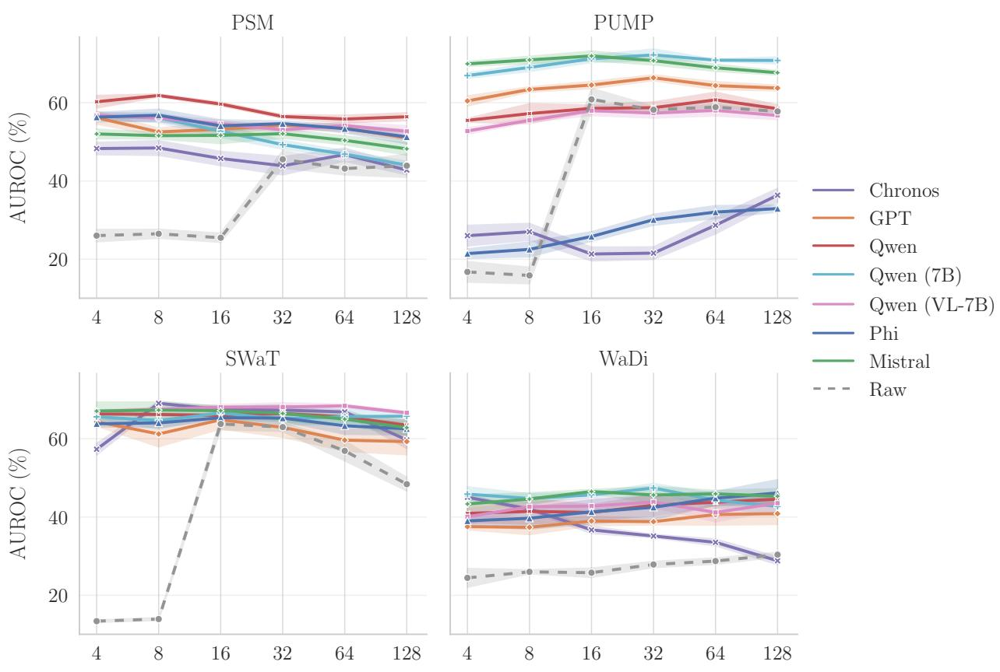  
Figure 10: AUROC Padding

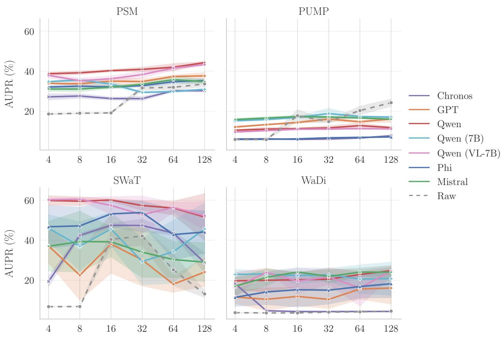  
Figure 11: AUPR Padding

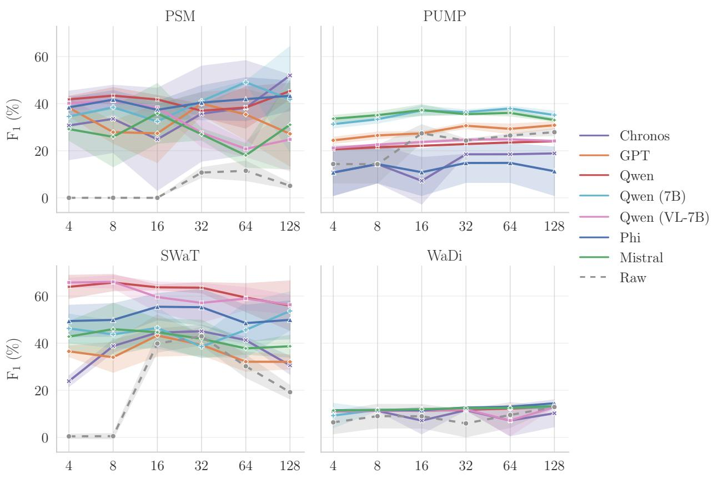  
Figure 12: $\mathrm { F _ { 1 } }$ Padding

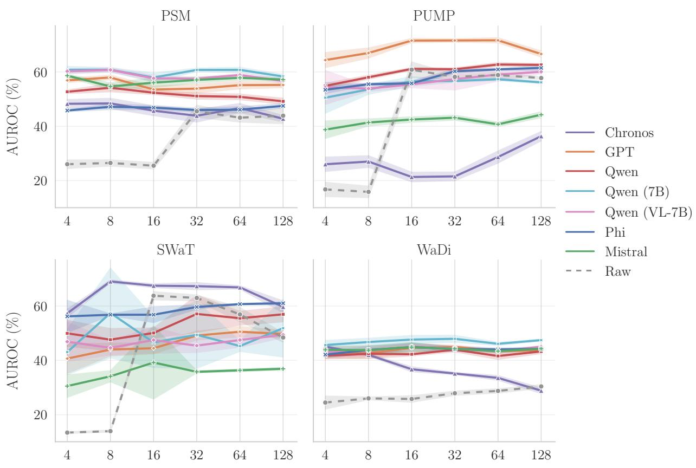  
Figure 13: AUROC Closest Vocabulary

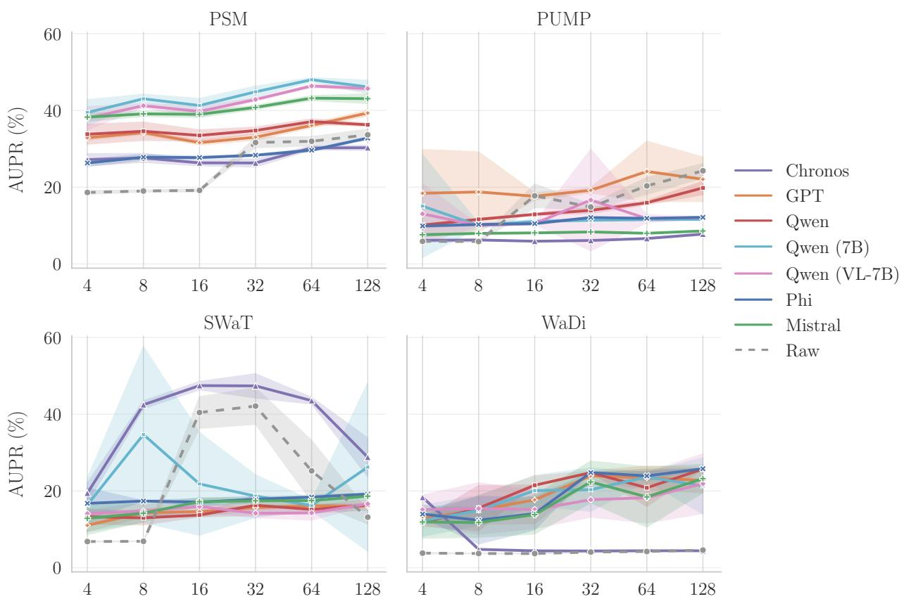  
Figure 14: AUPR Closest Vocabulary

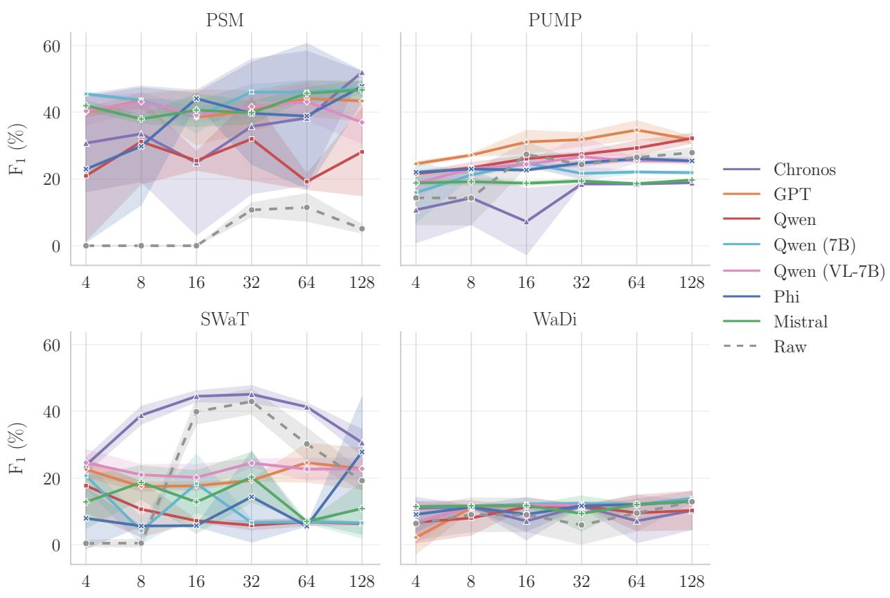  
Figure 15: $\mathrm { F _ { 1 } }$ Closest Vocabulary

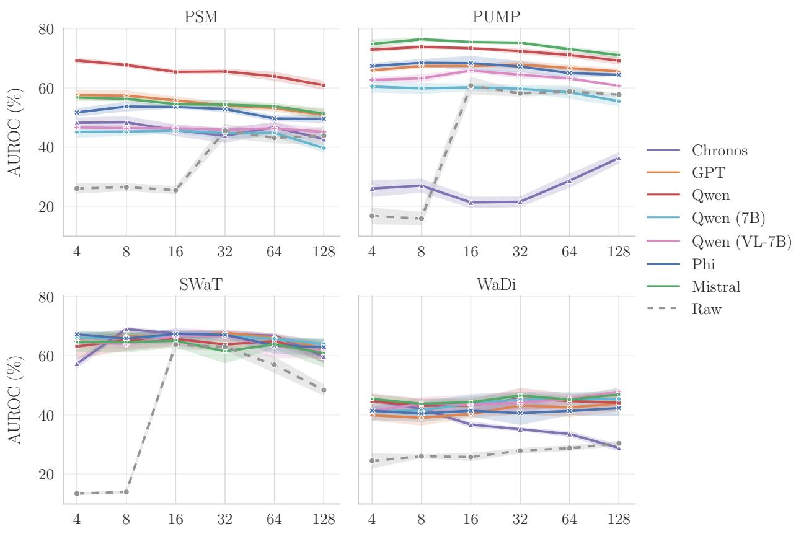  
Figure 16: AUROC Interpolation

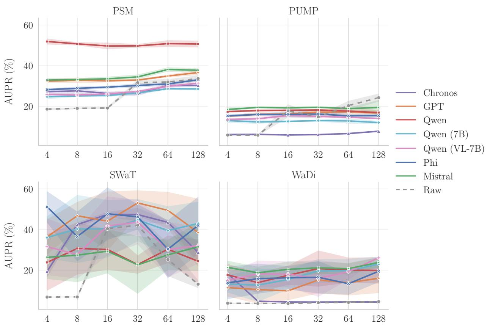  
Figure 17: AUPR Interpolation

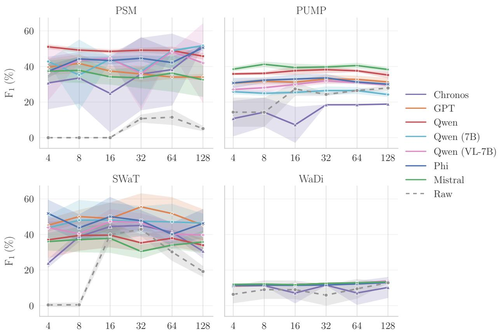  
Figure 18: F1 Interpolation

  
Figure 19: WaDi time-steps translated into GPT2 Vocabulary.

  
Figure 20: PUMP time-steps translated into Mistral-7B Vocabulary.

  
Figure 21: PSM time-steps translated into Qwen2 (0.5B) Vocabulary.