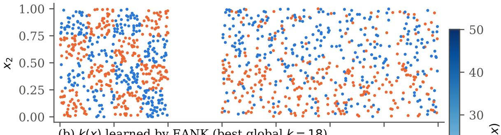
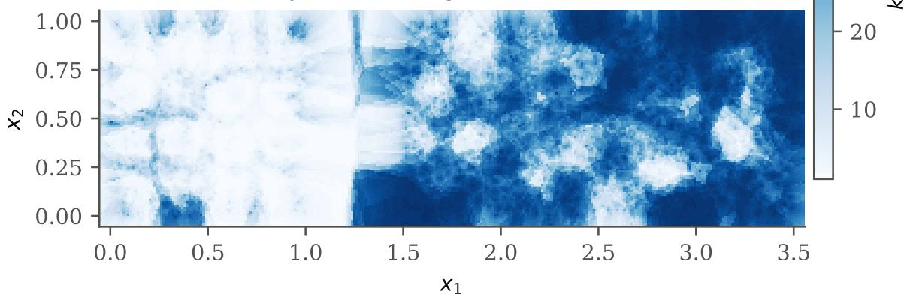
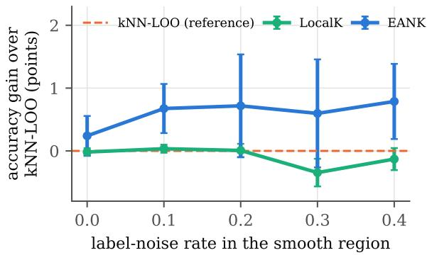
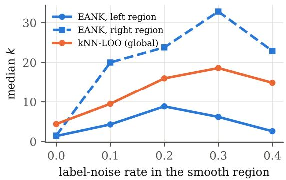
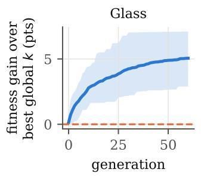
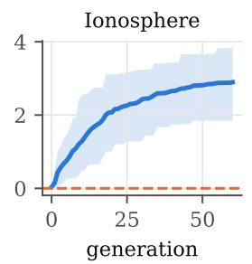
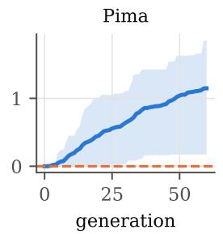
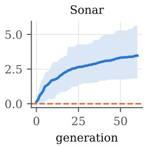
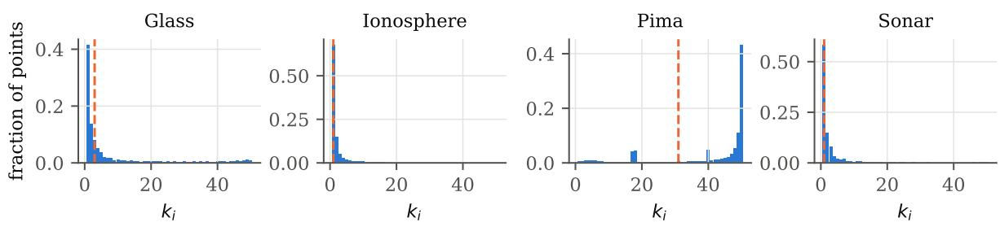
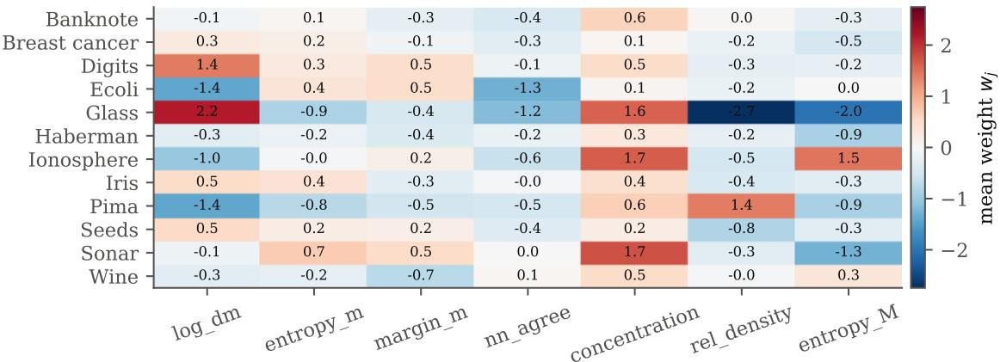

# Evolutionary Adaptive Neighborhood Learning: A Genetic Algorithm for Instance-Dependent k Optimization in Nearest Neighbor Classification

Isaac Touza1,2,∗ , Kaladzavi Guidedi2,3 , Kolyang2,4

1Department of Mathematics and Computer Science, Faculty of Science, University of Maroua, P.O. Box 814, Maroua, Cameroon

2Laboratoire de Recherche en Informatique (LaRI), University of Maroua, Maroua, Cameroon 3Department of Computer Science and Telecommunications, National Advanced School of Engineering, University of Maroua, P.O. Box 46, Maroua, Cameroon

4Higher Teacher’s Training College, University of Maroua, P.O. Box 46, Maroua, Cameroon

## Abstract

The number of neighbours k is the central hyper-parameter of the k-nearest neighbour (k-NN) classifier, and it is almost always chosen globally, by cross-validation or, increasingly, by evolutionary search. Yet the bias–variance trade-of that governs k is local: dense, noise-free regions favour small neighbourhoods, whereas sparse or label-noisy regions favour large ones. Because the global-k search space is one-dimensional, replacing exhaustive search by a genetic algorithm (GA) cannot improve on it. We therefore change the object being optimised. We propose EANK (Evolutionary Adaptive Neighborhood K), which evolves a low-dimensional policy gθ mapping a description of the local neighbourhood of a point (density, label entropy at two scales, vote margin, concentration, relative density) to an instance-dependent number of neighbours $k ( x ) \in \{ 1 , \ldots , K \}$ . A real-coded elitist GA maximises the leave-one-out accuracy of the induced adaptive rule, penalised by a neighbourhood-smoothness term. A pre-computed vote table reduces each fitness evaluation to O(n) look-ups. We prove that (i) a seeded EANK never does worse than the best global k on its training criterion, (ii) the GA converges almost surely to the essential supremum of the fitness, (iii) the learned neighbourhood size is Lipschitz in the meta-features, and (iv) the policy class has a growth function polynomial in the sample size with exponent d + 2. This yields a uniform generalisation bound that does not depend on $n ,$ which per-instance encodings do not enjoy. On a controlled benchmark with spatially heterogeneous structure, EANK recovers small neighbourhoods in the fine-grained region and large ones in the noisy region, and it improves accuracy over the best global k at every noise level. In a nested, 5 × 5-fold evaluation on twelve public datasets, EANK obtains the best average rank among six k-NN variants. Its accuracy is statistically indistinguishable from the tuned global-k baselines, and it is significantly better than the default k = 5. We document the gap between in-sample and out-of-sample gains, and we identify it as the main obstacle for adaptive-neighbourhood methods.

Keywords: k-nearest neighbours; adaptive neighbourhood; genetic algorithms; hyper-parameter optimisation; leave-one-out; generalisation bounds.

## 1 Introduction

The k-nearest neighbour rule [5, 14, 29] remains one of the most widely used non-parametric classifiers. It is simple and universally consistent when $k  \infty$ and $k / n  0 ~ [ 1 2 , 3 0 ]$ , and its predictions are easy to interpret. Its behaviour, however, depends strongly on the neighbourhood size k. A small k gives a low-bias, high-variance rule that is sensitive to label noise. A large k smooths the decision boundary but erases fine structure and minority regions.

In practice k is selected once for the whole input space, by grid search with cross-validation, by leave-one-out (LOO) error, or by a metaheuristic. A recent line of applied work uses genetic algorithms (GAs) to tune k, often jointly with feature selection or distance weights [17, 20, 24, 25]. Further studies examine how the choice of k interacts with feature selection and class imbalance [6]. When k is the only quantity being optimised, the search space $\{ 1 , \ldots , K \}$ is one-dimensional and small. Exhaustive LOO search costs essentially the same as a single k-NN pass, because all K predictions of a point can be read from one sorted neighbour list. Exhaustive search therefore finds the exact optimum of the global-k criterion, and it is an upper bound for any other optimiser of that criterion: a GA, random search [2] or Bayesian optimisation. Replacing grid search by a GA cannot, by construction, improve on it.

The statistical theory of nearest neighbours, by contrast, says that the right amount of smoothing is local. Convergence rates depend on the local density and the local margin [4], k-NN adapts to the local intrinsic dimension [19], and recent adaptive rules choose the neighbourhood point by point [1]. This suggests changing the object being optimised: we look for a function $x \mapsto k ( x )$ rather than an integer.

Approach. We parameterise this function as a policy $k _ { \theta } ( x ) = 1 + \mathrm { r n d } \big ( ( K - 1 ) \sigma ( w ^ { \top } z ( x ) + b ) \big )$ Here $z ( x ) \in \mathbb { R } ^ { d }$ is a small vector of meta-features that describe the neighbourhood of x in the training set (scale, label entropy, vote margin, concentration, relative density), and $\theta =$ $( w , b ) \in \mathbb { R } ^ { d + 1 }$ with $d = 7 .$ . The induced rule classifies x by majority vote among its $k _ { \theta } ( x )$ nearest neighbours. The objective is piecewise constant and non-diferentiable in θ, and it has many plateaus, so we optimise it with a real-coded elitist GA. The fitness is the LOO accuracy of the adaptive rule minus a smoothness penalty on k between neighbouring points.

## Contributions.

1. Formulation. We recast GA-based tuning of k as learning an instance-dependent neighbourhood policy. The policy has a fixed, small number of parameters, independent of n, and it contains every global-k rule as a special case (Section 4).

2. Algorithm. EANK combines interpretable meta-features, a smooth monotone policy and an elitist GA with simulated binary crossover [7, 8], annealed Gaussian mutation and seeding with constant policies. A pre-computed LOO vote table makes a fitness evaluation cost O(n), so a full evolution takes about a tenth of a second on the datasets considered (Sections 4 and 4.5).

3. Theory. We prove that the seeded GA dominates the best global k on its training criterion, that the GA converges almost surely, and that the learned neighbourhood size is stable. Through a Sauer–Shelah argument we also obtain a uniform generalisation bound for the policy class whose complexity term depends on d and log K, not on n. The bound separates the policy approach from per-instance encodings (Section 5).

4. Evidence. We report a controlled synthetic study and a nested 5 × 5-fold benchmark on twelve public datasets against five k-NN baselines, including a classical GA over k and a two-stage local-k method. We add ablations and corrected statistical tests (Section 6). We report negative and null results alongside positive ones.

## 2 Related work

Choosing a global k. Classical recommendations range from $k \approx \sqrt { n }$ to LOO or v-fold cross-validation. The LOO error of k-NN admits distribution-free performance bounds [11, 12], and Ghosh [15] studied the optimal choice of k from a Bayesian viewpoint. Distance weighting [13] and optimally weighted schemes [27] soften the dependence on k without removing it.

Locally adaptive neighbourhoods. Wettschereck and Dietterich [34] proposed locally adaptive nearest neighbour algorithms that store, for each training point, the values of k that classify it correctly and reuse them for nearby queries. Hastie and Tibshirani [16] adapted the metric locally (DANN). Wang et al. [33] chose the neighbourhood size from a statistical confidence criterion. Zhang et al. [35] learned an optimal k for every training sample by sparse reconstruction and then fitted a decision tree (kTree) to predict k for test points. Mullick et al. [21] learned point-specific k with a neural network, with a class-dependent weighting for imbalanced data. On the theory side, Balsubramani et al. [1] gave an adaptive rule with point-wise guarantees that grows the neighbourhood until a statistical bias test is passed, and Chaudhuri and Dasgupta [4], Kpotufe [19] showed that the optimal smoothing is governed by local quantities. These methods either learn targets point by point, which risks overfitting the LOO labels, or use a hand-designed stopping test. EANK sits between the two: a hand-designed, interpretable representation of the neighbourhood, and a learned map from that representation to $k ,$ fitted directly on the end-to-end adaptive LOO accuracy.

Evolutionary optimisation of k-NN. GAs were combined with k-NN early on to learn feature weights [17], and later for joint feature selection and extraction [25]. More recent applied studies use GAs to tune k and select features on medical data [24], or to optimise variables, metrics and weighting schemes in forest inventory [20]. To our knowledge, these approaches all treat k as a single global gene. The genome of EANK instead encodes a decision rule for k. For the theory we rely on the classical convergence analysis of elitist GAs [26] and on Vapnik–Chervonenkis theory [12, 28, 31].

## 3 Problem formulation

Let $\mathbfcal { D } = \{ ( x _ { i } , y _ { i } ) \} _ { i = 1 } ^ { n }$ be an i.i.d. sample from a distribution $\mathbb { P }$ on $\mathbb { R } ^ { p } \times \{ 1 , \ldots , C \}$ . For a query $x ,$ let $x _ { ( 1 ) } ( x ) , x _ { ( 2 ) } ( x ) , . . .$ . be the training points sorted by increasing Euclidean distance to x. For training points, the query itself is excluded (LOO). Let $y _ { ( r ) } ( x )$ denote their labels. For $k \leq K$ the k-NN prediction is

$$
\hat { y } _ { k } ( x ) = \underset { c } { \arg \operatorname* { m a x } } \ \sum _ { r = 1 } ^ { k } \mathbf { 1 } [ y _ { ( r ) } ( x ) = c ] ,\tag{1}
$$

with ties broken towards the class of the closer neighbours (Section 4.3).

Definition 1 (Adaptive neighbourhood rule). A neighbourhood policy is a map $g : \mathbb { R } ^ { p } \to $ $\{ 1 , \ldots , K \}$ . The associated rule is $h _ { g } ( x ) = \hat { y } _ { g ( x ) } ( x )$ . Global k-NN is the special case $g \equiv k$

The ideal policy minimises the risk $R ( g ) = \mathbb { P } \{ h _ { g } ( X ) \neq Y \}$ . We learn $g$ by minimising a regularised empirical criterion

$$
\mathcal { I } ( \theta ) = \underbrace { \frac { 1 } { n } \sum _ { i = 1 } ^ { n } \mathbf { 1 } \left[ \hat { y } _ { k _ { \theta } ( x _ { i } ) } ^ { ( - i ) } ( x _ { i } ) \neq y _ { i } \right] } _ { \mathrm { L O O ~ e r r o r ~ o f ~ t h e ~ a d a p t i v e ~ r u l e } } + \lambda \Omega ( \theta ) , \qquad \Omega ( \theta ) = \frac { 1 } { n q } \sum _ { i = 1 } ^ { n } \sum _ { j \in N _ { q } ( i ) } \frac { | k _ { \theta } ( x _ { i } ) - k _ { \theta } ( x _ { j } ) | } { K - 1 } ,\tag{2}
$$

where $\hat { y } ^ { ( - i ) }$ uses $\mathcal { D } \setminus \{ ( x _ { i } , y _ { i } ) \}$ and $N _ { q } ( i )$ is the set of $q$ nearest training neighbours of $x _ { i }$ . The penalty $\Omega \in [ 0 , 1 ]$ discourages abrupt changes of neighbourhood size between nearby points. Without it, the optimiser could fit idiosyncratic LOO outcomes. Equivalently, we maximise the fitness $F ( \theta ) = 1 - \mathcal { I } ( \theta )$

Two parameterisations of g are possible. A direct encoding stores one $k _ { i }$ per training point and needs a separate rule to extend it to new points, as in Wettschereck and Dietterich [34], Zhang et al. [35]. Its dimension grows with n and, as discussed in Section 5, it has no sample-size-free capacity control. EANK uses a policy encoding with d + 1 parameters, introduced next.

## 4 The EANK method

## 4.1 Neighbourhood meta-features

For every point x (training points in LOO mode), we compute from its sorted neighbour list the following $d = 7$ meta-features, with a local scale m (default 10) and a wider scale M (default 30). Here $\delta _ { r } ( x )$ is the distance to the r-th neighbour and $n _ { c } ^ { ( m ) } ( x )$ is the number of neighbours of class c among the first m.

1. log\_dm: log $\delta _ { m } ( x )$ , an inverse local density.

2. entropy\_m: $H ( n ^ { ( m ) } ( x ) / m ) / \log C .$ the normalised label entropy among m neighbours.

3. margin\_m: $( n _ { [ 1 ] } ^ { ( m ) } ( x ) - n _ { [ 2 ] } ^ { ( m ) } ( x ) ) / m$ , the vote margin between the two leading classes.

4. nn\_agree: $\mathbf { 1 } \big [ y _ { ( 1 ) } ( x ) = \arg \operatorname* { m a x } _ { c } n _ { c } ^ { ( m ) } ( x ) \big ]$ , whether the 1-NN agrees with the m-NN major-$\mathrm { i t y }$

5. concentration: log $\delta _ { 1 } ( x ) - \log \delta _ { m } ( x ) \leq 0$ , which is very negative when an almost-duplicate neighbour exists.

6. rel\_density: log $\begin{array} { r } { \delta _ { m } ( x ) - \frac { 1 } { m } \sum _ { r \leq m } \log \delta _ { m } ( x _ { ( r ) } ) } \end{array}$ , an outlierness score relative to the neighbours’ own scale.

7. entropy\_M: the label entropy among M neighbours, a second, coarser scale.

The features are standardised with means and deviations computed on the training fold. They are cheap by-products of the neighbour search that k-NN performs anyway. None of them uses the label of the query, so test-time meta-features are computed exactly like training-time ones.

## 4.2 Policy

Given $z ( x ) \in \mathbb { R } ^ { d }$ and $\theta = ( w , b )$

$$
k _ { \theta } ( x ) = 1 + \operatorname { r n d } \Bigl ( ( K - 1 ) \sigma \bigl ( w ^ { \top } z ( x ) + b \bigr ) \Bigr ) , \qquad \sigma ( s ) = \frac { 1 } { 1 + e ^ { - s } } ,\tag{3}
$$

where rnd $\begin{array} { r } { \mathbf { \psi } ( a ) ~ = ~ \lfloor a + \frac { 1 } { 2 } \rfloor } \end{array}$ The policy is monotone in a single linear score, which keeps it interpretable: the sign of $w _ { j }$ says whether meta-feature j calls for larger or smaller neighbourhoods. The constant policies $w = 0$ recover every global k. Parameters live in the box $\Theta = [ - B _ { w } , B _ { w } ] ^ { d } \times$ $\left[ - B _ { b } , B _ { b } \right] \left( B _ { w } = 4 , B _ { b } = 6 \right)$

## 4.3 Vote table and fitness evaluation

The cost of evaluating F is dominated by computing the n LOO predictions $\hat { y } _ { k _ { i } } ^ { ( - i ) } ( x _ { i } )$ for arbitrary vectors $( k _ { i } )$ . We pre-compute once the cumulative vote tensor $\begin{array} { r } { V _ { i , k , c } = \sum _ { r < k } \mathbf { 1 } [ y _ { ( r ) } ( x _ { i } ) = c ] } \end{array}$ . A secondary tie-breaking score $\begin{array} { r } { T _ { i , k , c } = \sum _ { r < k } { \bf 1 } [ y _ { ( r ) } ( x _ { i } ) = c ] / r } \end{array}$ favours closer neighbours. Since $T \leq H _ { K }$ (the K-th harmonic number), the combined score $V + T / ( H _ { K } + 1 )$ never lets T override a full vote. The prediction and correctness tables

$$
\begin{array} { r } { P _ { i k } = \underset { c } { \arg \operatorname* { m a x } } \left( V _ { i , k , c } + \frac { T _ { i , k , c } } { H _ { K } + 1 } \right) , \qquad A _ { i k } = \mathbf { 1 } [ P _ { i k } = y _ { i } ] } \end{array}\tag{4}
$$

Algorithm 1: EANK: Evolutionary Adaptive Neighborhood K   
Input: training set $\mathcal { D } , K ,$ scales $m , M ,$ , smoothness $( \lambda , q )$ , GA settings $( P , G )$   
Output: policy parameters $\hat { \theta }$   
1 Compute LOO neighbour lists of all $x _ { i }$ up to rank $K ;$   
2 Build the vote tensor $V ,$ the tie-break tensor T, and the tables $P , A ;$   
3 Compute and standardise the meta-features $z ( x _ { i } ) ;$   
4 $\begin{array} { r } { k ^ { \star }  \arg \operatorname* { m a x } _ { k } \frac { 1 } { n } \sum _ { i } A _ { i k } ; } \end{array}$   
5 Initialise the population with the constant policies for $k ^ { \star }$ and a fixed grid of $k ,$ the rest   
uniform in Θ;   
6 for $g = 1 , \ldots , G$ do   
7 Select parents by tournament; apply SBX and annealed Gaussian mutation; reflect   
into Θ;   
8 Evaluate $\begin{array} { r } { F ( \theta ) = \frac { 1 } { n } \sum _ { i } A _ { i , k _ { \theta } ( x _ { i } ) } - \lambda \Omega ( \theta ) } \end{array}$ for every ofspring;   
9 Keep the 2 best parents and the best ofspring (elitism);   
10 if no improvement during 25 generations then break;   
11 return best genome $\hat { \theta }$ found;   
12 Prediction for a query x: find its K neighbours, compute $z ( x )$ , set $k = k _ { \hat { \theta } } ( x )$ , return   
${ \hat { y } } _ { k } ( x )$

are stored in $O ( n K )$ memory. Then $\begin{array} { r } { F ( \theta ) = \frac { 1 } { n } \sum _ { i } A _ { i , k _ { \theta } ( x _ { i } ) } - \lambda \Omega ( \theta ) } \end{array}$ costs $O ( n ( d + q ) )$ . The global-k LOO curve is the column mean ${ \bar { A } } _ { \cdot k } ,$ , so the best global $k ^ { \star } = \arg \operatorname* { m a x } _ { k } \bar { A } _ { \cdot k }$ comes for free.

## 4.4 Genetic algorithm

Algorithm 1 summarises the method. We use a population of $P = 4 0$ real-coded genomes, binary tournament selection of size 3, simulated binary crossover (SBX) [7, 8] with probability 0.9 and index $\eta = 1 5 ,$ , and Gaussian mutation. Each gene mutates with probability $1 / D \ ( D = d + 1 )$ with at least one gene per ofspring, and the step size is $\sigma _ { g } = \sigma _ { 0 } ( \sigma _ { \mathrm { m i n } } / \sigma _ { 0 } ) ^ { g / G }$ relative to the box width $( \sigma _ { 0 } = 0 . 5 , \sigma _ { \mathrm { m i n } } = 0 . 0 2 )$ . Ofspring are reflected into Θ. Replacement is elitist (2 elites), and evolution stops after $G = 6 0$ generations or 25 generations without improvement. The initial population is seeded with the constant policies encoding $k ^ { \star }$ and $k \in \{ 1 , 3 , 5 , 9 , 1 5 , 2 5 , K \}$ . The remaining genomes are drawn uniformly in Θ.

## 4.5 Computational complexity

Proposition 1 (Cost). With brute-force neighbour search in Rp, EANK training costs $O ( n ^ { 2 } p +$ nK log $K + n K C + P G n ( d + q ) )$ time and $O ( n K + n d )$ memory. Prediction costs $O ( n p + K C + d )$ per query, the same order as k-NN with $k = K$

Proof. The neighbour search costs $O ( n ^ { 2 } p )$ , plus $O ( n K$ log K) to sort the K retained neighbours. Building the cumulative sums $V , T$ and the argmax over classes costs $O ( n K C )$ ; only A (size nK) and $z \ ( { \mathrm { s i z e } } \ n d )$ are kept. A fitness evaluation computes n scores in $O ( n d )$ , looks up n entries of A, and sums nq absolute diferences. The GA performs at most $P ( G + 1 )$ evaluations. Prediction needs one neighbour query, the K cumulative votes and one inner product. □

## 5 Theoretical analysis

All proofs are given in Section A.

## 5.1 Dominance over global k and stability

Proposition 2 (Seeded dominance). Assume $\begin{array} { r } { ( K - 1 ) \sigma ( - B _ { b } ) < \frac { 1 } { 2 } } \end{array}$ and $\begin{array} { r } { ( K - 1 ) \sigma ( B _ { b } ) > K - \frac { 3 } { 2 } } \end{array}$ ; this holds for $B _ { b } = 6$ whenever $K \le 2 0 2$ . Then for every $k \in \{ 1 , \ldots , K \}$ there is $\theta _ { k } \in \Theta$ with $k _ { \theta _ { k } } \equiv k$ , and the output of seeded EANK satisfies

$$
F ( \hat { \theta } ) \ \geq \ \operatorname* { m a x } _ { 1 \leq k \leq K } \ \frac { 1 } { n } \sum _ { i = 1 } ^ { n } A _ { i k } \ = \ L O O \ a c c u r a c y \ o f \ t h e \ b e s t \ g l o b a l \ k .
$$

The guarantee concerns the training criterion. Whether the improvement carries over to unseen data is the question of generalisation, treated below and measured in Section 6.4.

Proposition 3 (Lipschitz neighbourhoods). For all $x , x ^ { \prime }$ and $\theta = ( w , b ) , | k _ { \theta } ( x ) - k _ { \theta } ( x ^ { \prime } ) | \leq$ $\begin{array} { r } { \frac { K - 1 } { 4 } \| w \| _ { 2 } \| z ( x ) - z ( x ^ { \prime } ) \| _ { 2 } + 1 } \end{array}$ . In particular, on Θ the change in k is at most $\begin{array} { r l r } {  { } } & { { } } & { \frac { K - 1 } { 4 } B _ { w } \sqrt { d } \| z ( x ) - } \end{array}$ $z ( x ^ { \prime } ) \bigr | | _ { 2 } + 1$

Points with similar neighbourhood descriptions therefore receive similar neighbourhood sizes. The penalty Ω adds a data-dependent version of this property on the training graph.

## 5.2 Convergence of the genetic search

F takes finitely many values, because $( k _ { \theta } ( x _ { i } ) ) _ { i }$ ranges over a finite set. However, a maximiser of F may sit on a set of Lebesgue measure zero, for example a single boundary point. The meaningful target for a stochastic search on a continuous genome is the essential supremum

$$
F _ { \mathrm { e s s } } ^ { \star } = \operatorname* { m a x } \big \{ v \in F ( \Theta ) : \operatorname { L e b } \{ \theta \in \Theta : F ( \theta ) \geq v \} > 0 \big \} .
$$

Theorem 4 (Almost-sure convergence). Run the GA of Algorithm 1 without the stagnation stop $( G = \infty )$ . Let $F _ { g } ^ { \mathrm { b e s t } }$ be the best fitness in the population at generation g. Then $F _ { g } ^ { \mathrm { b e s t } } \ i s$ non-decreasing and there is $\varepsilon > 0$ , which depends only on $D , \ \sigma _ { 0 } , \ \sigma _ { \mathrm { m i n } } ,$ , Θ and F, such that $\mathbb { P } \{ F _ { g } ^ { \mathrm { b e s t } } < F _ { \mathrm { e s s } } ^ { \star } \} \le ( 1 - \varepsilon ) ^ { g }$ . Consequently $F _ { g } ^ { \mathrm { b e s t } } \geq F _ { \mathrm { e s s } } ^ { \star }$ for all g large enough, almost surely.

Corollary 5. $\begin{array} { r } { F _ { \mathrm { e s s } } ^ { \star } \geq \operatorname* { m a x } _ { k } \frac { 1 } { n } \sum _ { i } A _ { i k } } \end{array}$ . Hence even an unseeded EANK reaches the best global-k LOO accuracy almost surely. Seeding achieves this at generation 0.

This is the elitist analogue, for a continuous genome, of the result of Rudolph [26]: canonical GAs without elitism do not converge to the optimum, while elitist ones do.

## 5.3 Capacity of the policy class and generalisation

Fix the training sample D. Then $z ( \cdot )$ and the map $x \mapsto ( \hat { y } _ { k } ( x ) ) _ { k \leq K }$ are fixed functions, and the adaptive rule $h _ { \theta } = h _ { k _ { \theta } }$ is indexed by $\theta \in \mathbb { R } ^ { d + 1 }$ only.

Lemma 6 (Growth function). For any m points $u _ { 1 } , \ldots , u _ { m } \in \mathbb { R } ^ { p }$ , the number of distinct vectors $( k _ { \theta } ( u _ { 1 } ) , \ldots , k _ { \theta } ( u _ { m } ) )$ realised as θ ranges over $\mathbb { R } ^ { d + 1 }$ is at most

$$
\Pi ( m ) \ \leq \ \sum _ { j = 0 } ^ { d + 2 } { \binom { m ( K - 1 ) } { j } } \ \leq \ \left( { \frac { e m ( K - 1 ) } { d + 2 } } \right) ^ { d + 2 } \qquad ( m ( K - 1 ) \geq d + 2 ) .
$$

Theorem 7 (Uniform generalisation of adaptive policies). Let $\mathcal { V } = \{ ( u _ { j } , v _ { j } ) \} _ { j = 1 } ^ { m }$ be an $i . i . d .$ sample from P, independent of ${ \mathcal { D } } ,$ and let $\hat { R } _ { \mathcal { V } } ( \theta )$ be the error of $h _ { \theta }$ on V. With probability at least $1 - \delta$ over V, simultaneously for all $\theta \in \mathbb { R } ^ { d + 1 }$

$$
R ( h _ { \theta } ) ~ \le ~ \hat { R } _ { \mathcal { V } } ( \theta ) + \sqrt { \frac { 3 2 } { m } \Bigl [ ( d + 2 ) \ln \frac { e m ( K - 1 ) } { d + 2 } + \ln \frac { 8 } { \delta } \Bigr ] } .
$$

Remark 1 (Policy versus per-instance encodings). The bound holds uniformly in $\theta .$ It therefore covers any $\hat { \theta }$ selected by any procedure, including a GA run on V itself, at a price of order $\sqrt { d \log ( m K ) / m }$ that does not depend on the number of training points or on the number of fitness evaluations. A direct encoding $( k _ { 1 } , \ldots , k _ { n } ) \in \{ 1 , \ldots , K \} ^ { n }$ has no such guarantee: up to $K ^ { n }$ assignments can be realised on the training points, so selecting among them on the same sample can overfit arbitrarily. This motivates the policy design of EANK.

Remark 2 (LOO fitness). EANK uses the LOO accuracy on D rather than an independent $\nu ,$ in order to use all the data. Theorem 7 then does not apply verbatim, because the meta-features and the candidates depend on the same sample. Theorem 6 still bounds the efective number of distinct candidates by a polynomial of degree $d + 2 ,$ , which limits the optimism of LOO selection. We quantify this optimism empirically in Section 6.4. A validation-based variant, to which Theorem 7 applies exactly, is a direct extension.

## 6 Experiments

## 6.1 Setup

Datasets. We use twelve public classification datasets (Table 1). Iris, Wine, Breast cancer and Digits come from scikit-learn [23]; the other eight come from the UCI repository [18]. Constant features are removed, and all features are standardised using training-fold statistics.

Methods. All methods share the same neighbour search, tie-breaking rule and $K = 5 0 ,$ so diferences come only from the choice of k. (1) kNN (k=5): the common default. (2) kNN-LOO: global k by exhaustive LOO search, which is the exact optimum of the global-k criterion and therefore an upper bound for grid, random, Bayesian or evolutionary search over k. (3) wkNN-LOO: distance-weighted voting [13] with k chosen by exhaustive LOO. (4) GA-k: a classical GA over the single integer k (population 10, 20 generations), representative of [20, 24]. (5) LocalK: a two-stage local-k method in the spirit of Wettschereck and Dietterich [34], Zhang et al. [35]. Each training point gets the LOO-correct k closest to $k ^ { \star }$ , and a query uses the median of the values of its 5 nearest training points. (6) EANK with $\lambda = 0 . 0 5$ , q = 5, m = 10, M = 30 and the GA settings of Section 4. These defaults were fixed before the benchmark was run and were not tuned per dataset.

Protocol. We use 5× repeated stratified 5-fold cross-validation, i.e. 25 train/test splits per dataset and 300 in total. All model selection (choice of $k ,$ evolution of $\theta ,$ standardisation) happens inside the training fold. The test fold is used only for scoring, so the procedure is nested with respect to every tuned quantity [3, 32]. We report accuracy, macro-F1, balanced accuracy and wall-clock times. Across datasets we use the Friedman test with the Nemenyi critical diference, and Wilcoxon signed-rank tests with Holm correction [9, 10]. Within a dataset we use the corrected resampled t-test of Nadeau and Bengio [22], which accounts for the overlap between training sets.

## 6.2 Controlled study: spatially heterogeneous neighbourhoods

We first test the hypothesis that motivates EANK: an adaptive neighbourhood helps when the optimal amount of smoothing varies across the input space. The synthetic distribution has two regions of equal mass. The left region is a noiseless 4 × 4 checkerboard on $[ 0 , 1 ] ^ { 2 }$ , a fine structure that calls for small k. The right region is a linear boundary on $[ 1 . 5 , 3 . 5 ] \times [ 0 , 1 ]$ whose labels are flipped with probability $\eta ,$ a smooth structure with noisy labels that calls for large k. We train on n = 1200 points and test on 4000 independent points, with 10 replications per noise level.

Figures 1 and 2 and table 2 confirm the hypothesis. Without label noise, both the global and the adaptive rules pick small neighbourhoods. As η grows, the global optimum moves to $k \approx 1 5 \ – 1 9$ , a compromise that over-smooths the checkerboard. EANK instead keeps a small k in the left region and, for $\eta \geq 0 . 1$ , uses a neighbourhood three to nine times larger on the right. EANK is the most accurate method at every noise level. The gain over the best global k ranges from 0.2 to 0.8 points and is significant at $\eta \in \{ 0 . 1 , 0 . 2 , 0 . 4 \}$ . The two-stage LocalK baseline does not improve on the global rule here: per-point LOO targets are too noisy to transfer.

Table 1: Datasets: number of instances n, features p (after removing constant ones), classes C, and imbalance ratio (largest / smallest class).
<table><tr><td>Dataset</td><td>n</td><td>p</td><td>C</td><td>Imb. ratio</td></tr><tr><td>Iris</td><td>150</td><td>4</td><td>3</td><td>1.0</td></tr><tr><td>Wine</td><td>178</td><td>13</td><td>3</td><td>1.5</td></tr><tr><td>Breast cancer</td><td>569</td><td>30</td><td>2</td><td>1.7</td></tr><tr><td>Digits</td><td>1797</td><td>61</td><td>10</td><td>1.1</td></tr><tr><td>Sonar</td><td>208</td><td>60</td><td>2</td><td>1.1</td></tr><tr><td>Ionosphere</td><td>351</td><td>33</td><td>2</td><td>1.8</td></tr><tr><td>Pima</td><td>768</td><td>8</td><td>2</td><td>1.9</td></tr><tr><td>Glass</td><td>214</td><td>9</td><td>6</td><td>8.4</td></tr><tr><td>Seeds</td><td>210</td><td>7</td><td>3</td><td>1.0</td></tr><tr><td>Banknote</td><td>1372</td><td>4</td><td>2</td><td>1.2</td></tr><tr><td>Haberman</td><td>306</td><td>3</td><td>2</td><td>2.8</td></tr><tr><td>Ecoli</td><td>336</td><td>7</td><td>8</td><td>71.5</td></tr></table>

(a) training sample, $\eta = 0 . 3$  
  
(b) k(x) learned by EANK (best global k = 18)

  
Figure 1: Synthetic heterogeneous benchmark (η = 0.3). (a) Training sample: noiseless checkerboard on the left, linear boundary with 30% label noise on the right. (b) Neighbourhood size $k ( x )$ chosen by the learned EANK policy over the input space. The policy selects small neighbourhoods in the fine-grained checkerboard and large ones in the noisy smooth region. The best single global value found by exhaustive LOO search is a compromise between the two.

Table 2: Synthetic benchmark: test accuracy (%, mean over 10 replications) as a function of the label-noise rate η in the smooth region. p: two-sided Wilcoxon signed-rank test, EANK vs. kNN-LOO. Last two columns: global k selected by kNN-LOO, and median k used by EANK in the left / right regions.
<table><tr><td>η</td><td>kNN-LOO</td><td>LocalK</td><td>EANK</td><td>p</td><td>k (global)</td><td>k EANK (L / R)</td></tr><tr><td>0.0</td><td>95.18</td><td>95.17</td><td>95.42</td><td>0.055</td><td>4.4</td><td>1.4 / 1.5</td></tr><tr><td>0.1</td><td>89.81</td><td>89.85</td><td>90.49</td><td>0.004</td><td>9.5</td><td>4.3 / 20.0</td></tr><tr><td>0.2</td><td>84.04</td><td>84.05</td><td>84.76</td><td>0.016</td><td>16.0</td><td>8.8 / 23.8</td></tr><tr><td>0.3</td><td>78.73</td><td>78.39</td><td>79.33</td><td>0.084</td><td>18.6</td><td>6.2 / 32.8</td></tr><tr><td>0.4</td><td>73.05</td><td>72.92</td><td>73.84</td><td>0.010</td><td>14.9</td><td>2.6 / 22.9</td></tr></table>

  
Figure 2: Synthetic benchmark. Left: test-accuracy gain over the best global k (kNN-LOO) versus noise rate $\mathrm { ( m e a n \pm s . d }$ . over 10 paired replications). Right: median neighbourhood size in each region.

Table 3: Test accuracy (%, mean ± s.d. over 25 nested splits). Bold: best per row. An arrow on EANK would mark a significant diference with kNN-LOO (corrected resampled t-test, α = 0.05); none was observed. Mean rank: average Friedman rank over the 12 datasets (lower is better).
<table><tr><td>Dataset</td><td>kNN (k=5)</td><td>kNN-LOO</td><td>wkNN-LOO</td><td>GA-k</td><td>LocalK</td><td>EANK</td></tr><tr><td>Iris</td><td> $9 5 . 2 0 \pm 4 . 2$ </td><td> ${ \bf 9 6 . 2 7 \pm 3 . 5 }$ </td><td> $9 5 . 8 7 \pm 3 . 9$ </td><td> $9 5 . 7 3 \pm 3 . 8$ </td><td> ${ \bf 9 6 . 2 7 \pm 3 . 5 }$ </td><td> $9 5 . 7 3 \pm 3 . 8$ </td></tr><tr><td>Wine</td><td> $9 5 . 7 5 \pm 3 . 6 $ </td><td> $9 6 . 2 9 \pm 3 . 0$ </td><td> ${ \bf 9 6 . 8 6 \pm 2 . 7 }$ </td><td> $9 6 . 5 2 \pm 2 . 5$ </td><td> $9 6 . 2 9 \pm 3 . 0$ </td><td> $9 5 . 8 3 \pm 2 . 6 $ </td></tr><tr><td>Breast cancer</td><td> $9 6 . 5 9 \pm 1 . 7$ </td><td> $9 6 . 6 3 \pm 1 . 5$ </td><td> $9 6 . 4 9 \pm 1 . 5$ </td><td> ${ \bf 9 6 . 7 0 \pm 1 . 5 }$ </td><td> $9 6 . 6 3 \pm 1 . 5$ </td><td> $9 6 . 6 3 \pm 1 . 4$ </td></tr><tr><td>Digits</td><td> $9 7 . 6 6 \pm 0 . 5$ </td><td> $9 7 . 5 8 \pm 0 . 5$ </td><td> $9 7 . 6 4 \pm 0 . 5$ </td><td> $9 7 . 5 8 \pm 0 . 5$ </td><td> $9 7 . 5 8 \pm 0 . 5$ </td><td> ${ \bf 9 7 . 7 0 \pm 0 . 6 }$ </td></tr><tr><td>Sonar</td><td> $8 0 . 9 6 \pm 5 . 8$ </td><td> $8 4 . 8 9 \pm 5 . 1$ </td><td> $8 4 . 7 9 \pm 5 . 2$ </td><td> $8 4 . 8 9 \pm 5 . 1$ </td><td> $8 4 . 7 9 \pm 5 . 1$ </td><td> $\mathbf { 8 4 . 8 9 \pm 4 . 0 }$ </td></tr><tr><td>Ionosphere</td><td> $8 4 . 6 7 \pm 4 . 1$ </td><td> $8 5 . 6 9 \pm 3 . 7$ </td><td> $8 5 . 6 9 \pm 3 . 7$ </td><td> $8 5 . 6 9 \pm 3 . 7$ </td><td> $8 5 . 6 9 \pm 3 . 7$ </td><td>86.61 ± 4.0</td></tr><tr><td>Pima</td><td> $7 3 . 2 8 \pm 3 . 0$ </td><td> $7 5 . 1 0 \pm 2 . 9$ </td><td> $7 5 . 1 8 \pm 2 . 8$ </td><td> $7 5 . 2 1 \pm 3 . 0$ </td><td> $7 5 . 6 8 \pm 3 . 2$ </td><td> ${ \bf 7 5 . 7 3 \pm 2 . 7 }$ </td></tr><tr><td>Glass</td><td> $6 7 . 4 7 \pm 5 . 4$ </td><td> $6 9 . 8 2 \pm 5 . 6$ </td><td> $6 9 . 3 6 \pm 5 . 6$ </td><td> $6 9 . 6 3 \pm 5 . 7$ </td><td> ${ \bf 7 0 . 4 8 \pm 5 . 7 }$ </td><td> $7 0 . 2 9 \pm 5 . 5$ </td></tr><tr><td>Seeds</td><td> $9 2 . 5 7 \pm 3 . 2$ </td><td> $9 2 . 1 0 \pm 4 . 4$ </td><td> ${ \bf 9 2 . 6 7 \pm 3 . 6 }$ </td><td> $9 2 . 0 0 \pm 4 . 1 $ </td><td> $9 2 . 1 0 \pm 4 . 4$ </td><td> ${ \bf 9 2 . 6 7 \pm 4 . 2 }$ </td></tr><tr><td>Banknote</td><td> $9 9 . 8 4 \pm 0 . 2 $ </td><td> $9 9 . 8 0 \pm 0 . 3 $ </td><td> $9 9 . 8 2 \pm 0 . 3$ </td><td> $\mathbf { 9 9 . 8 5 \pm 0 . 2 }$ </td><td> $9 9 . 8 0 \pm 0 . 3$ </td><td> $9 9 . 8 1 \pm 0 . 3$ </td></tr><tr><td>Haberman</td><td> $7 0 . 6 0 \pm 4 . 2$ </td><td> $7 4 . 8 5 \pm 3 . 5$ </td><td> $7 4 . 2 5 \pm 3 . 8$ </td><td> ${ \bf 7 5 . 1 1 \pm 3 . 1 }$ </td><td> $7 5 . 0 4 \pm 3 . 9$ </td><td> $7 3 . 5 4 \pm 3 . 6$ </td></tr><tr><td>Ecoli</td><td> $8 5 . 0 6 \pm 3 . 0$ </td><td> $8 6 . 3 1 \pm 3 . 6$ </td><td> $8 6 . 3 1 \pm 3 . 4$ </td><td> ${ \bf 8 6 . 3 7 \pm 3 . 5 }$ </td><td> $8 6 . 1 9 \pm 3 . 9$ </td><td> $8 6 . 0 1 \pm 3 . 8$ </td></tr><tr><td>Mean acc.</td><td>86.64</td><td>87.94</td><td>87.91</td><td>87.94</td><td>88.04</td><td>87.95</td></tr><tr><td>Mean rank</td><td>5.00</td><td>3.54</td><td>3.42</td><td>2.88</td><td>3.42</td><td>2.75</td></tr></table>

## 6.3 Benchmark results

Table 3 reports test accuracy. EANK obtains the best average rank (2.75), followed by GA-k (2.88), wkNN-LOO and LocalK (3.42), kNN-LOO (3.54) and the default k = 5 (5.00). The Friedman test rejects equality of the six methods $( \chi _ { F } ^ { 2 } = 1 1 . 6 5 , p = 0 . 0 4 0 )$ . The Nemenyi critical diference is 2.18, so only the gap between EANK and $k = 5 \ ( 2 . 2 5 )$ is significant. Table 4 gives the pairwise picture. EANK wins on 11 of 12 datasets against k = 5 (Holm-adjusted $p = 0 . 0 0 5 )$ Against the tuned baselines it wins on 6 to 8 datasets and loses on 4 to 5, and none of these diferences is significant, neither across datasets nor within any single dataset. The largest gains over kNN-LOO occur on Ionosphere (+0.92 points), Pima (+0.62), Seeds (+0.57) and Glass (+0.47). The largest losses occur on Haberman (−1.31), Iris (−0.53) and Wine (−0.46).

Table 4: Pairwise comparison of EANK with each baseline over the 12 datasets (mean accuracy): wins/ties/losses, Wilcoxon signed-rank p-value, Holm-adjusted p-value, and number of datasets on which EANK is significantly better/worse according to the corrected resampled t-test.
<table><tr><td>Baseline</td><td>W/T/L p</td><td>PHolm</td><td>sig. better/worse</td></tr><tr><td>kNN (k=5) 11/0/1</td><td>0.001</td><td>0.005</td><td>0/0</td></tr><tr><td>kNN-LOO 8/0/4</td><td>0.569</td><td>1.000</td><td>0/0</td></tr><tr><td>wkNN-LOO 6/1/5</td><td>0.820</td><td>1.000</td><td>0/0</td></tr><tr><td>GA-k 6/1/5</td><td>0.820</td><td>1.000</td><td>0/0</td></tr><tr><td>LocalK 7/0/5</td><td>0.850</td><td>1.000</td><td>0/0</td></tr></table>

Table 5: Other metrics, averaged over the 12 datasets (ranks: lower is better), and mean wall-clock time per training fold on one CPU core.
<table><tr><td></td><td>kNN (k=5)</td><td>kNN-LOO</td><td>wkNN-LOO</td><td>GA-k</td><td>LocalK</td><td>EANK</td></tr><tr><td>Macro-F1 (mean)</td><td>82.94</td><td>84.25</td><td>84.44</td><td>84.24</td><td>84.45</td><td>84.14</td></tr><tr><td>Macro-F1 (rank)</td><td>4.92</td><td>3.71</td><td>2.88</td><td>3.08</td><td>3.50</td><td>2.92</td></tr><tr><td>Balanced acc. (mean)</td><td>83.05</td><td>84.30</td><td>84.38</td><td>84.28</td><td>84.47</td><td>84.08</td></tr><tr><td>Balanced acc. (rank)</td><td>5.00</td><td>3.67</td><td>2.92</td><td>2.96</td><td>3.38</td><td>3.08</td></tr><tr><td>Fit time (ms)</td><td>3.2</td><td>9.1</td><td>8.1</td><td>10.2</td><td>7.8</td><td>113.8</td></tr><tr><td>Predict time (ms)</td><td>1.4</td><td>2.6</td><td>2.8</td><td>2.6</td><td>2.8</td><td>3.6</td></tr></table>

  
Figure 3: GA convergence on four datasets: fitness gain over the best global k (LOO, points), mean and 10–90% band over 25 folds. The dashed line marks the seeded starting point (Theorem 2).

On macro-F1 and balanced accuracy (Table 5), EANK ranks second, just behind distanceweighted kNN-LOO. The fitness optimises plain accuracy, so this is consistent with the objective rather than evidence of an imbalance-specific benefit. Training takes about 0.11 s per fold, against 0.01 s for exhaustive global search. Prediction is only about 40% slower than k-NN, because the meta-features reuse the neighbour list of the query.

## 6.4 In-sample versus out-of-sample gains

Theorem 2 guarantees that EANK improves the LOO criterion over the best global k. On average the improvement is +1.52 points (up to +5.05 on Glass). The test-set improvement over kNN-LOO, however, averages only +0.01 points. The correlation between the two across datasets is 0.37: datasets where the policy finds more in-sample structure (Glass, Ionosphere, Sonar) tend to be those where EANK helps most, but most of the LOO gain is selection optimism. This is the empirical face of the LOO caveat after Theorem 7. Even a policy with eight parameters can fit chance fluctuations of the LOO correctness table on samples of a few hundred points. The smoothness penalty mitigates this optimism but does not remove it (Section 6.5).

  
Figure 4: Distribution of the neighbourhood sizes $k _ { i }$ assigned by EANK to training points, pooled over folds. Dashed: median global k chosen by kNN-LOO.

Table 6: Ablations over the 12 datasets: mean test accuracy (%), mean rank among the six variants, mean LOO fitness gain over the best global k (points), mean within-fold standard deviation of test-time $k ,$ mean number of fitness evaluations, and mean training time (ms).
<table><tr><td>Variant</td><td>Acc.</td><td>Rank</td><td>LOO gain</td><td>s.d.(k)</td><td>#eval</td><td>Time</td></tr><tr><td>EANK</td><td>87.95</td><td>2.25</td><td>+1.52</td><td>5.24</td><td>2092</td><td>114</td></tr><tr><td>EANK (λ=0)</td><td>87.64</td><td>4.46</td><td>+1.84</td><td>12.56</td><td>1829</td><td>68</td></tr><tr><td>EANK (random search)</td><td>87.81</td><td>3.42</td><td>+0.36</td><td>4.21</td><td>1297</td><td>59</td></tr><tr><td>EANK (no seeding)</td><td>87.68</td><td>3.79</td><td>+1.53</td><td>7.18</td><td>2410</td><td>131</td></tr><tr><td>EANK (density feats)</td><td>87.71</td><td>3.88</td><td>+1.14</td><td>4.44</td><td>2051</td><td>111</td></tr><tr><td>EANK (label feats)</td><td>87.91</td><td>3.21</td><td>+0.98</td><td>3.02</td><td>1901</td><td>101</td></tr></table>

## 6.5 Ablation study

Table 6 isolates each design choice.

• Smoothness (λ = 0). Removing Ω increases the LOO gain (+1.84 vs. +1.52) and more than doubles the variability of k (12.6 vs. 5.2), while lowering test accuracy and giving the worst rank. This is the overfitting mechanism of Section 6.4, and the regulariser counters it.

• Search (random search with the same budget). Random search finds only a quarter of the GA’s LOO improvement (+0.36). It nevertheless reaches a similar test accuracy: the GA’s extra in-sample progress is partly optimism.

• Seeding. Without constant-policy seeds the GA still exceeds the global optimum in-sample (Theorem 5), but it converges more slowly and generalises slightly worse.

• Meta-features. Label-based features (entropy, margin, agreement) carry most of the useful signal. Density features alone are weaker, and the full set is best, although the diferences between feature sets are small.

## 6.6 What do the learned policies say?

In 21% of the folds, the GA returns the seeded constant policy unchanged, i.e. it finds no adaptive policy better than the best global k. This happens in 60% of the folds on Banknote, where all methods exceed 99.8% accuracy, and never on Glass, Ionosphere or Sonar. EANK therefore falls back to the global rule when there is nothing to adapt to. Among non-constant policies, the coeficient of concentration is positive in 78% of the folds: points with an almost-duplicate nearest neighbour get small neighbourhoods. The coeficient of nn\_agree is negative in 71%: when the 1-NN disagrees with the local majority, a larger vote is used. Both patterns match the intuition behind adaptive k. Other coeficients change sign across datasets (Figure 5), which reflects dataset-specific trade-ofs.

  
Figure 5: Mean policy weights $w _ { j }$ per dataset (25 folds). Positive weights increase k.

## 7 Discussion and limitations

When does adaptive k pay of? The synthetic study shows a clear and consistent benefit when the optimal smoothing genuinely varies across the input space. On the twelve standard benchmarks, which are small and mostly homogeneous, EANK is at least as good as tuned global k on average and has the best mean rank. Its advantage is not statistically significant, however, and it loses on some datasets (Haberman, Iris, Wine). We regard this as an honest picture: much of the benefit reported for local-k methods may depend on the evaluation protocol. Our protocol is fully nested, uses corrected tests, and gives the baselines the same tie-breaking rule and the exact global optimum.

Limitations. (i) The fitness is the LOO accuracy on the training set, which is optimistic (Section 6.4). Our generalisation guarantee is exact only for a held-out fitness. (ii) The policy is a monotone function of a linear score. Non-monotone dependencies, such as small k at both very high and very low density, require a richer policy, for instance a small network, which increases d in Theorem 7. (iii) The datasets are small to medium $( n \leq 1 7 9 7 )$ ; with brute-force search the $O ( n ^ { 2 } p )$ neighbour computation dominates for large n, and approximate search would be needed. (iv) We optimise accuracy; imbalance-aware or calibration-aware fitness functions are natural but untested here.

Future work. Promising directions are: held-out or cross-fitted fitness to close the insample/out-of-sample gap; multi-objective evolution that trades accuracy against smoothness and robustness, giving Pareto fronts of policies; class-aware meta-features for imbalanced data; and tracking distribution shift by re-evolving the policy online, warm-started from the previous population.

## 8 Conclusion

We argued that using a genetic algorithm to search for a single global k cannot beat exhaustive search, and we proposed to evolve a neighbourhood policy instead. EANK learns an interpretable, low-dimensional map from local neighbourhood statistics to an instance-dependent k. A precomputed vote table makes each fitness evaluation cost $O ( n )$ . We showed that the method dominates the best global k on its training criterion, that the GA converges almost surely, and that its policy class admits a generalisation bound free of the sample size. Experiments show clear gains when the optimal neighbourhood is spatially heterogeneous, and performance on par with the best tuned baselines, with the best mean rank, on twelve standard datasets. They also identify the gap between in-sample and out-of-sample improvement as the main obstacle that future adaptive-neighbourhood methods must address.

Code and data availability. The Python implementation of EANK, the baselines and the scripts that reproduce every table and figure of this paper are available from the corresponding author upon request. All datasets used in this study are publicly available (Table 1).

## References

[1] Akshay Balsubramani, Sanjoy Dasgupta, Yoav Freund, and Shay Moran. An adaptive nearest neighbor rule for classification. In Advances in Neural Information Processing Systems 32, 2019. doi: 10.48550/arXiv.1905.12717. URL https://cseweb.ucsd.edu/\~dasgupta/ papers/adaptive-nn.pdf.

[2] James Bergstra and Yoshua Bengio. Random search for hyper-parameter optimization. Journal of Machine Learning Research, 13:281–305, 2012. URL https://jmlr.org/papers/ v13/bergstra12a.html.

[3] Gavin C. Cawley and Nicola L. C. Talbot. On over-fitting in model selection and subsequent selection bias in performance evaluation. Journal of Machine Learning Research, 11:2079– 2107, 2010. URL https://www.jmlr.org/papers/v11/cawley10a.html.

[4] Kamalika Chaudhuri and Sanjoy Dasgupta. Rates of convergence for nearest neighbor classification. In Advances in Neural Information Processing Systems 27, 2014. doi: 10.48550/arXiv.1407.0067. URL https://proceedings.neurips.cc/paper/2014/ hash/2b764b803acec2d590f02b160f8a3700-Abstract.html.

[5] Thomas M. Cover and Peter E. Hart. Nearest neighbor pattern classification. IEEE Transactions on Information Theory, 13(1):21–27, 1967. doi: 10.1109/TIT.1967.1053964.

[6] Bryan A. Dawkins and Brett A. McKinney. Multivariate optimization of k for k-nearest-neighbor feature selection with dichotomous outcomes: Complex associations, class imbalance, and application to RNA-Seq in major depressive disorder. IEEE/ACM Transactions on Computational Biology and Bioinformatics, 22(1):39–51, 2025. doi: 10.1109/TCBBIO.2024.3494599.

[7] Kalyanmoy Deb and Ram Bhushan Agrawal. Simulated binary crossover for continuous search space. Complex Systems, 9(2):115–148, 1995. URL https://wpmedia.wolfram.com/ uploads/sites/13/2018/02/09-2-2.pdf.

[8] Kalyanmoy Deb and Hans-Georg Beyer. Self-adaptive genetic algorithms with simulated binary crossover. Evolutionary Computation, 9(2):197–221, 2001. doi: 10.1162/106365601750190406.

[9] Janez Demšar. Statistical comparisons of classifiers over multiple data sets. Journal of Machine Learning Research, 7:1–30, 2006. URL https://www.jmlr.org/papers/v7/ demsar06a.html.

[10] Joaquín Derrac, Salvador García, Daniel Molina, and Francisco Herrera. A practical tutorial on the use of nonparametric statistical tests as a methodology for comparing evolutionary

and swarm intelligence algorithms. Swarm and Evolutionary Computation, 1(1):3–18, 2011. doi: 10.1016/j.swevo.2011.02.002.

[11] Luc Devroye and Terry J. Wagner. Distribution-free performance bounds for potential function rules. IEEE Transactions on Information Theory, 25(5):601–604, 1979. doi: 10.1109/TIT.1979.1056087.

[12] Luc Devroye, László Györfi, and Gábor Lugosi. A Probabilistic Theory of Pattern Recognition. Springer, New York, 1996. doi: 10.1007/978-1-4612-0711-5.

[13] Sahibsingh A. Dudani. The distance-weighted k-nearest-neighbor rule. IEEE Transactions on Systems, Man, and Cybernetics, SMC-6(4):325–327, 1976. doi: 10.1109/TSMC.1976.5408784.

[14] Evelyn Fix and Joseph L. Hodges. Discriminatory analysis. nonparametric discrimination: Consistency properties. Technical Report Project 21-49-004, Report 4, USAF School of Aviation Medicine, Randolph Field, Texas, 1951. URL https://apps.dtic.mil/sti/pdfs/ ADA800276.pdf.

[15] Anil K. Ghosh. On optimum choice of k in nearest neighbor classification. Computational Statistics & Data Analysis, 50(11):3113–3123, 2006. doi: 10.1016/j.csda.2005.06.007.

[16] Trevor Hastie and Robert Tibshirani. Discriminant adaptive nearest neighbor classification. IEEE Transactions on Pattern Analysis and Machine Intelligence, 18(6):607–616, 1996. doi: 10.1109/34.506411.

[17] James D. Kelly, Jr. and Lawrence Davis. A hybrid genetic algorithm for classification. In Proceedings of the 12th International Joint Conference on Artificial Intelligence (IJCAI), pages 645–649, 1991. URL https://ijcai.org/proceedings/1991/94.

[18] Markelle Kelly, Rachel Longjohn, and Kolby Nottingham. The UCI machine learning repository, 2023. URL https://archive.ics.uci.edu.

[19] Samory Kpotufe. k-NN regression adapts to local intrinsic dimension. In Advances in Neural Information Processing Systems 24, pages 729–737, 2011. doi: 10.48550/arXiv.1110.4300. URL https://papers.nips.cc/paper/2011/file/ 05f971b5ec196b8c65b75d2ef8267331-Paper.pdf.

[20] Ronald E. McRoberts, Grant M. Domke, Qi Chen, Erik Næsset, and Terje Gobakken. Using genetic algorithms to optimize k-nearest neighbors configurations for use with airborne laser scanning data. Remote Sensing of Environment, 184:387–395, 2016. doi: 10.1016/j.rse.2016.07.007.

[21] Sankha Subhra Mullick, Shounak Datta, and Swagatam Das. Adaptive learning-based knearest neighbor classifiers with resilience to class imbalance. IEEE Transactions on Neural Networks and Learning Systems, 29(11):5713–5725, 2018. doi: 10.1109/TNNLS.2018.2812279.

[22] Claude Nadeau and Yoshua Bengio. Inference for the generalization error. Machine Learning, 52(3):239–281, 2003. doi: 10.1023/A:1024068626366.

[23] Fabian Pedregosa, Gaël Varoquaux, Alexandre Gramfort, Vincent Michel, Bertrand Thirion, Olivier Grisel, Mathieu Blondel, Peter Prettenhofer, Ron Weiss, Vincent Dubourg, Jake Vanderplas, Alexandre Passos, David Cournapeau, Matthieu Brucher, Matthieu Perrot, and Édouard Duchesnay. Scikit-learn: Machine learning in Python. Journal of Machine Learning Research, 12:2825–2830, 2011. doi: 10.48550/arXiv.1201.0490. URL https://www. jmlr.org/papers/v12/pedregosa11a.html.

[24] Rizki Tri Prasetio. Genetic algorithm to optimize k-nearest neighbor parameter for benchmarked medical datasets classification. JOIN (Jurnal Online Informatika), 5(2):153–160, 2020. doi: 10.15575/join.v5i2.656.

[25] Michael L. Raymer, William F. Punch, Erik D. Goodman, Leslie A. Kuhn, and Anil K. Jain. Dimensionality reduction using genetic algorithms. IEEE Transactions on Evolutionary Computation, 4(2):164–171, 2000. doi: 10.1109/4235.850656.

[26] Günter Rudolph. Convergence analysis of canonical genetic algorithms. IEEE Transactions on Neural Networks, 5(1):96–101, 1994. doi: 10.1109/72.265964.

[27] Richard J. Samworth. Optimal weighted nearest neighbour classifiers. The Annals of Statistics, 40(5):2733–2763, 2012. doi: 10.1214/12-AOS1049.

[28] Norbert Sauer. On the density of families of sets. Journal of Combinatorial Theory, Series A, 13(1):145–147, 1972. doi: 10.1016/0097-3165(72)90019-2.

[29] Bernard W. Silverman and M. Chris Jones. E. Fix and J. L. Hodges (1951): An important contribution to nonparametric discriminant analysis and density estimation (with a reprint of the original report). International Statistical Review, 57(3):233–247, 1989. doi: 10.2307/1403796.

[30] Charles J. Stone. Consistent nonparametric regression. The Annals of Statistics, 5(4): 595–620, 1977. doi: 10.1214/aos/1176343886.

[31] Vladimir N. Vapnik and Alexey Ya. Chervonenkis. On the uniform convergence of relative frequencies of events to their probabilities. Theory of Probability and Its Applications, 16(2): 264–280, 1971. doi: 10.1137/1116025.

[32] Sudhir Varma and Richard Simon. Bias in error estimation when using cross-validation for model selection. BMC Bioinformatics, 7:91, 2006. doi: 10.1186/1471-2105-7-91.

[33] Jigang Wang, Predrag Neskovic, and Leon N. Cooper. Neighborhood size selection in the k-nearest-neighbor rule using statistical confidence. Pattern Recognition, 39(3):417–423, 2006. doi: 10.1016/j.patcog.2005.08.009.

[34] Dietrich Wettschereck and Thomas G. Dietterich. Locally adaptive nearest neighbor algorithms. In Advances in Neural Information Processing Systems 6 (NIPS 1993), pages 184–191, 1994. URL https://papers.nips.cc/paper/1993/hash/ 2b3bf3eee2475e03885a110e9acaab61-Abstract.html.

[35] Shichao Zhang, Xuelong Li, Ming Zong, Xiaofeng Zhu, and Ruili Wang. Eficient kNN classification with diferent numbers of nearest neighbors. IEEE Transactions on Neural Networks and Learning Systems, 29(5):1774–1785, 2018. doi: 10.1109/TNNLS.2017.2673241.

## A Proofs

Proof of Theorem 2. For $k \in \{ 2 , \ldots , K - 1 \}$ , take $w = 0$ and b = logit $\left( ( k - 1 ) / ( K - 1 ) \right)$ . Then $( K - 1 ) \sigma ( b ) = k - 1$ exactly and $k _ { \theta } \equiv k ,$ , with $| b | \leq$ logit $( ( K - 2 ) / ( K - 1 ) ) = \ln ( K - 2 ) < B _ { b }$ for $K \leq 2 0 2$ . For $k = 1$ take $b = - B _ { b } \colon$ since $\begin{array} { r } { ( K - 1 ) \sigma ( - B _ { b } ) < \frac { 1 } { 2 } . } \end{array}$ , the rounding gives 0 and $k _ { \theta } \equiv 1$ . For $k = K$ take $b = B _ { b } \colon$ since $\begin{array} { r } { ( K - 1 ) \sigma ( B _ { b } ) > K - \frac { 3 } { 2 } , } \end{array}$ , the rounding gives $K - 1$ Constant policies have $\Omega = 0 ,$ so $\begin{array} { r } { F ( \theta _ { k } ) = \frac { 1 } { n } \sum _ { i } A _ { i k } } \end{array}$ . The initial population contains $\theta _ { k ^ { \star } }$ , and elitist replacement never removes the current best genome, so the best fitness never decreases. For $B _ { b } = 6 , \sigma ( - 6 ) \approx 0 . 0 0 2 4 7$ , and both conditions hold when $K - 1 < 2 0 2 . 2$ □

Proof of Theorem 3. The logistic function is $\scriptstyle { \frac { 1 } { 4 } } - \operatorname { L i p s c h i t z }$ Hence $| ( K - 1 ) \sigma ( s ) - ( K - 1 ) \sigma ( s ^ { \prime } ) | \leq$ $\begin{array} { r } { \frac { K - 1 } { 4 } \bar { | } w ^ { \dagger } ( z ( x ) - z ( x ^ { \prime } ) ) | } \end{array}$ , and Cauchy–Schwarz bounds the inner product by $\| w \| _ { 2 } \| z ( x ) - z ( x ^ { \prime } ) \| _ { 2 }$ Finally, $\begin{array} { r } { | \lfloor a + \frac { 1 } { 2 } \rfloor - \lfloor a ^ { \prime } + \frac { 1 } { 2 } \rfloor | \leq | a - a ^ { \prime } | + 1 } \end{array}$ for all reals $a , a ^ { \prime }$ . On Θ, $\| w \| _ { 2 } \le B _ { w } \sqrt { d }$ □

Proof of Theorem $\it 4 .$ Monotonicity. The two best parents enter the merged pool that is truncated to the P best, so the best fitness never decreases.

Hitting probability. Let $A = \{ \theta \in \Theta : F ( \theta ) \geq F _ { \mathrm { e s s } } ^ { \star } \}$ , so $\operatorname { L e b } ( A ) > 0$ by definition. Consider one ofspring, whatever its parents and crossover result $\ddot { \theta } \in \Theta$ . With probability at least $D ^ { - ( D - 1 ) }$ all D genes are mutated: one gene is forced, and each of the other $D - 1$ is mutated independently with probability $1 / D$ . Conditional on this event, $\theta ^ { \prime } = \mathcal { R } ( \tilde { \theta } + \sigma _ { g } S \xi )$ , where $\xi \sim \mathcal { N } ( 0 , I _ { D } )$ ${ \cal S } = \mathrm { d i a g } ( s _ { 1 } , . . . , s _ { D } )$ holds the box widths, and R is the coordinate-wise reflection into Θ. Reflection maps each point $t \in \Theta$ back from at least the pre-image t itself, so the density of $\theta ^ { \prime }$ at t is at least the Gaussian density of $\tilde { \theta } + \sigma _ { g } S \xi$ at t. Since $| t _ { j } - \tilde { \theta } _ { j } | \leq s _ { j }$

$$
f _ { \theta ^ { \prime } } ( t ) \ \geq \ \prod _ { j = 1 } ^ { D } { \frac { 1 } { \sqrt { 2 \pi } \sigma _ { g } s _ { j } } } \exp \Bigl ( - { \frac { 1 } { 2 \sigma _ { g } ^ { 2 } } } \Bigr ) \ \geq \ \prod _ { j = 1 } ^ { D } { \frac { 1 } { \sqrt { 2 \pi } \sigma _ { 0 } s _ { j } } } \exp \Bigl ( - { \frac { 1 } { 2 \sigma _ { \operatorname* { m i n } } ^ { 2 } } } \Bigr ) = : c > 0 ,
$$

using $\sigma _ { \mathrm { m i n } } ~ \le ~ \sigma _ { g } ~ \le ~ \sigma _ { 0 }$ . Therefore every ofspring falls in A with probability at least $\varepsilon : =$ $D ^ { - ( D - 1 ) } c \operatorname { L e b } ( \check { A } ) > 0$ , independently of the past given the parents. Without hitting A the best fitness stays below $F _ { \mathrm { e s s } } ^ { \star }$ , and once A is hit elitism keeps the best fitness at or above $F _ { \mathrm { e s s } } ^ { \star }$ . Hence $\mathbb { P } \{ F _ { q } ^ { \mathrm { b e s t } } < F _ { \mathrm { e s s } } ^ { \star } \} \le ( 1 - \varepsilon ) ^ { P g } \le ( 1 - \varepsilon ) ^ { g }$

Almost-sure statement. Since $\begin{array} { r } { \sum _ { g } ( 1 - \varepsilon ) ^ { g } \ < \ \infty } \end{array}$ , the Borel–Cantelli lemma shows that $F _ { g } ^ { \mathrm { b e s t } } \geq F _ { \mathrm { e s s } } ^ { \star }$ eventually, almost surely. (The best fitness may exceed $F _ { \mathrm { e s s } } ^ { \star }$ if the search lands on a Lebesgue-null set of higher fitness, for example through seeds with $w = 0$ and partial mutations that keep some genes unchanged; the theorem does not exclude this.) □

Proof of Theorem 5. Let $\theta _ { k ^ { \star } } = ( 0 , b ^ { \star } )$ with $( K - 1 ) \sigma ( b ^ { \star } ) = k ^ { \star } - 1$ an integer (the cases $k ^ { \star } \in \{ 1 , K \}$ are treated as in Theorem $2 ,$ with $b ^ { \star }$ in the interior of the half-line where the rounding is constant). The training meta-features are bounded, say $\| z ( x _ { i } ) \| \leq Z$ . By continuity there is an open neighbourhood $U$ of $\theta _ { k ^ { \star } }$ ⋆ on which $\begin{array} { r } { | ( K - 1 ) \sigma ( w ^ { \top } z ( x _ { i } ) + b ) - ( k ^ { \star } - 1 ) | < \frac { 1 } { 2 } } \end{array}$ for all i. On $U .$ $k _ { \theta } \equiv k ^ { \star } , \Omega = 0$ , and $\begin{array} { r } { F = \frac { 1 } { n } \sum _ { i } A _ { i k ^ { \star } } } \end{array}$ . Since Leb $\ l ( U \cap \Theta ) > 0$ , the definition of $F _ { \mathrm { e s s } } ^ { \star }$ gives the claim, and Theorem 4 applies to the unseeded GA. □

Proof of Theorem 6. Let $t _ { j } = \mathrm { l o g i t } \left( ( j - \textstyle { \frac { 1 } { 2 } } ) / ( K - 1 ) \right)$ for $j = 1 , \ldots , K - 1$ . By (3), $k _ { \theta } ( u ) =$ $1 + \# \{ j : w ^ { \top } z ( u ) + b \geq t _ { j } \}$ . The vector $( k _ { \theta } ( u _ { i } ) ) _ { i \leq m }$ is therefore determined by the $m ( K - 1 )$ bits $\mathbf { 1 } [ \langle ( w , b , 1 ) , ( z ( u _ { i } ) , 1 , - t _ { j } ) \rangle \geq 0 ]$ . These bits are the values of the homogeneous half-space indicator with normal $( w , b , 1 ) \in \mathbb { R } ^ { d + 2 }$ at the m $( K - 1 )$ points $( z ( u _ { i } ) , 1 , - t _ { j } ) \in \mathbb { R } ^ { d + 2 }$ . Homogeneous halfspaces in $\mathbb { R } ^ { d + 2 }$ have VC dimension $d + 2 .$ , so by the Sauer–Shelah lemma [28] they realise at most $\textstyle \sum _ { j = 0 } ^ { d + 2 } { \binom { m ( K - 1 ) } { j } }$ bit patterns on these points. The last inequality is the standard bound $\begin{array} { r } { \sum _ { j \leq h } \binom { N } { j } \leq ( e \bar { N } / h ) ^ { h } } \end{array}$ for $N \geq h$ □

Proof of Theorem 7. Conditionally on ${ \mathcal { D } } ,$ consider the error indicators $\ell _ { \theta } ( u , v ) = \mathbf { 1 } [ \hat { y } _ { k _ { \theta } ( u ) } ( u ) \neq v ]$ $\theta \in \mathbb { R } ^ { d + 1 }$ . On any m points, the vector of these indicators is a function of $( k _ { \theta } ( u _ { i } ) ) _ { i \leq m } ,$ so the class realises at most $\Pi ( m )$ patterns (Theorem 6). The Vapnik–Chervonenkis inequality [31], in the form of Devroye et al. [12, Thm. 12.5], gives

$$
\mathbb { P } \Big \{ \operatorname* { s u p } _ { \theta } \big | \hat { R } \nu ( \theta ) - R ( h _ { \theta } ) \big | > \epsilon \Big \} \le 8 \Pi ( m ) e ^ { - m \epsilon ^ { 2 } / 3 2 } .
$$

Setting the right-hand side to $\delta$ and using Theorem 6 yields the bound. The bound holds conditionally on every $\mathcal { D } .$ , hence also unconditionally. □

Table 7: Default hyper-parameters of EANK (identical for all datasets).
<table><tr><td>Symbol</td><td>Value</td><td>Symbol</td><td>Value</td></tr><tr><td>K (max. neighbours)</td><td>50</td><td>P (population)</td><td>40</td></tr><tr><td>m, M (feature scales)</td><td>10, 30</td><td>G (generations)</td><td>60 (patience 25)</td></tr><tr><td>λ, q (smoothness)</td><td>0.05, 5</td><td>tournament size</td><td>3</td></tr><tr><td> $B _ { w } , B _ { b } \ ( \mathrm { b o x } )$ </td><td>4,6</td><td> $\mathrm { S B X } ~ p _ { c } , \eta$ </td><td>0.9, 15</td></tr><tr><td>elites</td><td>2</td><td>mutation  $\sigma _ { 0 }  \sigma _ { \mathrm { m i n } }$ </td><td> $0 . 5  0 . 0 2 ~ ( \mathrm { a n n e a l e d } )$ </td></tr></table>

## B Hyper-parameters and implementation details

For every training fold, K is capped at $n _ { \mathrm { t r a i n } } - 1$ , and m and M at K. The implementation uses NumPy and scikit-learn [23]. Neighbour lists are computed with NearestNeighbors, and the query point is removed explicitly from its own list, which handles duplicated points. The random seed of each split is 1000 · repetition + fold. The code rounds with numpy.rint (half to even), which difers from $\left\lfloor a + { \frac { 1 } { 2 } } \right\rfloor$ only on a Lebesgue-null set of parameters; the counting argument of Theorem 6 holds for either convention. The GA needs on average 2092 fitness evaluations (52 generations) per fold.