# FLASHOFFLOADING: LOW-LATENCY KV CACHE OFFLOADING FOR LONG-CONTEXT LLM SERVING

Xuan Wang <sup>1</sup> Zhuanhao Wu <sup>1</sup> Tingzhu Fang <sup>1</sup> <sup>2</sup> Xushi Li <sup>1</sup> <sup>2</sup> Sicheng Zhang <sup>1</sup> <sup>2</sup> ZHENYU YANG <sup>1</sup> Feng Liu <sup>1</sup> <sup>2</sup> Zhaohui Fan <sup>1</sup> Qiang Xie <sup>1</sup> Huayi Zou <sup>1</sup> Yuncong Liu <sup>1</sup> <sup>2</sup> Zeyu Song <sup>1</sup> <sup>2</sup> Ke Zhu <sup>1</sup> <sup>2</sup> Yanjia Zeng <sup>1</sup> <sup>2</sup> Jingchun Gao <sup>1</sup> <sup>2</sup> Yan Shi <sup>1</sup> <sup>3</sup> Kui Luo <sup>1</sup> <sup>2</sup> Gezi Li <sup>1</sup> LiangjunFeng <sup>1</sup> <sup>2</sup> Cheng Li <sup>1</sup>

## ABSTRACT

In large language model (LLM) serving systems, the key-value (KV) cache grows linearly with sequence length and concurrency, so long-context inference easily hits the high-bandwidth memory (HBM) capacity wall and results in low concurrency. Offloading the KV cache to host dynamic random-access memory (DRAM) frees HBM space and raises concurrency, but the additional cache management and host-to-device (H2D) load overhead inflates inference latency, higher concurrency fails to translate into effective throughput. We present FlashOffloading, a host-DRAM-centric inference architecture that fully offloads the KV cache in both the prefill and decode phases. FlashOffloading builds rolling HBM cache for prefill, a hot cache for decode, a reverse sparse index with zero extra miss-lookup overhead, and a compute–load overlapped kernel, optimizing KV offloading latency across the entire pipeline and delivering throughput gains under a time-per-output-token (TPOT) service-level objective (SLO). In experiments deploying GLM-5.2 with multi-token prediction (MTP3) speculative decoding on an Ascend910C prefill–decode (PD)-disaggregated platform, FlashOffloading improves prefill throughput by up to 1.38× and decode throughput by up to 1.91× under a 30 ms TPOT constraint. FlashOffloading is integrated into an open-source serving framework: https://github.com/vllm-project/vllm-ascend/tree/releases/v0.30.0.

## 1 INTRODUCTION

Long-document understanding, repository-scale code analysis, and long-horizon agent interactions are driving LLM context windows toward millions of tokens. Mainstream online serving systems widely adopt PD disaggregation: P nodes perform chunked prefill and D nodes autoregressive decoding. To avoid recomputation, both stages retain full keys and values for every historical token and attention layer (KV cache), creating substantial memory pressure; a typical 1M-token sequence requires 10–100 GB of KV cache. With finite HBM on graphics processing units (GPUs) and neural processing units (NPUs), this limits concurrency and throughput and can make ultra-long requests unservable.

Tiered KV cache offloading extends available memory with host DRAM or storage, offering a direct way around the HBM capacity wall (Xiong et al., 2024; Luo et al., 2025; Zheng et al., 2026). However, these devices provide much lower bandwidth than HBM, so early work targets offline inference or merely makes long sequences servable. Flex-Gen achieves high-throughput, latency-insensitive inference through layerwise KV cache offloading and loading (Sheng et al., 2023); subsequent systems stream KV state (Strati et al., 2024) or offload attention computation and state to tiered memory (Pan et al., 2024; Jiang et al., 2025b; Zhang et al., 2026a), enabling longer sequences and larger batches. Nevertheless, repeated KV transfers still incur substantial bandwidth and latency overheads for online serving (Jiang et al., 2025a; Meng et al., 2025).

Reducing transfer volume is therefore essential for online tiered-memory serving. Prior work exploits attention sparsity and approximate selection (Zhang et al., 2023; Tang et al., 2024; Zhang et al., 2024; Liu et al., 2025a; Chen et al., 2026; Bocharnikov et al., 2026) to retain only a small set of KV cache blocks for attention. ShadowKV uses low-rank key representations (Sun et al., 2025), FreeKV employs speculative retrieval and correction (Liu et al., 2026b), and SparseServe and SAC coordinate hierarchical cache management (Zhou et al., 2025; Ma et al., 2026). These methods reduce bandwidth demand but often degrade model quality by at least 1%, limiting their deployment in real online systems.

Native sparse attention, exemplified by DeepSeek Sparse Attention (DSA), changes this premise. Models such as DeepSeek-V3.2 and GLM-5.2 use learned indexers to select top-k KV entries (DeepSeek-AI, 2025; GLM-5-Team, 2026): the full history must be retained, but each decode step accesses only a small, fine-grained KV cache subset. ESS (Chen et al., 2025), HiSparse (Xie et al., 2026), ECHO (Liu et al., 2026a), and AVSG (Kuang et al., 2026) therefore use HBM–DRAM two-level caches to reduce load volume and offload decode KV cache without degrading model quality. However, cache indexing and fine-grained host-to-device (H2D) loads still substantially increase inference latency.

We observe that prefill and decode differ markedly in computation and KV cache access. Prefill offers ample layercomputation windows and coarse accesses, making bulk transfers easier to overlap with computation. Decode needs only indexer-selected entries: the total H2D volume is small, but accesses are fine-grained (∼1 KB) and cannot start until indexing completes, making them difficult to overlap with computation.

Motivated by this observation, we present FlashOffloading, an architecture that offloads the KV cache in both prefill and decode for real-world LLM serving. For prefill, a pool of four layer buffers keeps the first layer resident and rotates the other three buffers across subsequent layers, overlapping H2D loads with layer computation. For decode, a reverse sparse index supports a large hot cache to reduce misses and load volume; miss-lookups are fused into top-k to eliminate extra miss-lookup latency; and fine-grained fused kernels overlap H2D loads with sparse attention.

This work makes the following contributions:

1. A phase-specialized host-backed KV architecture. We combine layerwise prefill offloading and exact token-selective decode retrieval under a unified hostbacked KV architecture.

2. A bounded-memory layerwise pipeline for prefill. A resident first-layer buffer and three rotating buffers overlap loading, computation, and writeback to overlap transfers with layer computation.

3. A low-latency, exact decode-offloading engine. A reverse sparse index, cache-management kernels with no additional miss-lookup overhead, and compute–load overlap kernels substantially reduce the added cache management and H2D-load latency.

4. An end-to-end implementation and evaluation. We integrate both paths into vLLM-Ascend and deploy GLM-5.2 with MTP3 speculative decoding on an Ascend910C PD-disaggregated platform, improving prefill throughput by up to 1.38× and decode throughput by up to 1.91× under a 30 ms TPOT constraint.

## 2 BACKGROUND AND MOTIVATION

## 2.1 The KV Cache Capacity Problem

Long-sequence workloads create enormous KV cache capacity demands, challenging the performance of LLM serving systems. In LLM inference, the prefill phase processes the input sequence in chunked forward passes and generates the KV cache; the decode phase attends over the full historical KV cache at every step to emit a new token (or multiple tokens under speculative decoding). After deducting the space for weights and activations, mainstream inference frameworks (Kwon et al., 2023) pre-allocate the remaining HBM to the KV cache, requiring the total KV of all running requests to fit within it:

$$
\begin{array} { r l r } { \boldsymbol { M } _ { \mathrm { K V a l l o c } } = \boldsymbol { M } _ { \mathrm { t o t a l } } - \boldsymbol { M } _ { \mathrm { w e i g h t } } - \boldsymbol { M } _ { \mathrm { a c t } } , } & { } & \\  \frac { B S } { \displaystyle \sum _ { b = 1 } ^ { B } \boldsymbol { M } _ { b } \le \boldsymbol { M } _ { \mathrm { K V a l l o c } } , \quad } & { \boldsymbol { M } _ { b } = \kappa _ { \mathrm { b a s e } } \cdot \vert \boldsymbol { S } _ { b } \vert } \end{array}\tag{1}
$$

where $M _ { \mathrm { t o t a l } }$ is the total HBM capacity, $M _ { \mathrm { w e i g h t } }$ the weight footprint (determined only by the model and the parallelism scheme), $M _ { \mathrm { a c t } }$ the activation footprint, BS the batch-size, and $| S _ { b } |$ the sequence length of the b-th request. $\kappa _ { \mathrm { b a s e } }$ is the per-token KV cache footprint under full residency (including indexer state):

$$
\kappa _ { \mathrm { b a s e } } = ( L _ { \mathrm { K V } } \cdot D _ { \mathrm { K V } } + L _ { \mathrm { i n d e x } } \cdot D _ { \mathrm { i n d e x } } ) \cdot P\tag{2}
$$

where $L _ { \mathrm { K V } }$ and $D _ { K V }$ are the number of attention layers and the KV dimension, $L _ { i n d e x }$ and $D _ { i n d e x }$ the layer count and dimension of the DSA indexer $( D _ { i n d e x } = 0$ without DSA), and P the number of bytes per element.

Even for GLM-5.2, which already adopts Multi-head Latent Attention (MLA) for dimensionality compression, the KV cache remains enormous. With BF16 $( L _ { K V } = 7 8 , D _ { K V } =$ 576, $L _ { i n d e x } = 2 1 , D _ { i n d e x } = 1 2 8 )$

$$
\kappa _ { \mathrm { b a s e } } = ( 7 8 \times 5 7 6 + 2 1 \times 1 2 8 ) \times 2 \mathrm { B y t e s } = 9 5 . 2 3 \mathrm { k B } ,\tag{3}
$$

i.e., a per-request HBM footprint of $M _ { b } = 9 5 . 2 3 \mathrm { k B } \times | S _ { b } |$ 6.09 GB, 48.76 GB, and 97.52 GB at the 64k, 512k, and 1M sequence lengths typical of agentic AI. Given typical per-GPU/NPU HBM capacities of 64–128 GB, the KV cache easily hits the capacity wall, posing distinct challenges to prefill and decode (Sections 2.2 and 2.3).

## 2.2 Motivation for Prefill KV Offloading

During prefill, the KV cache of active requests grows as prompt chunks are processed. Keeping the complete history in HBM limits context length and concurrency while leaving less room for activations and new tokens. With H historical tokens and N newly scheduled tokens, full residency requires

$$
\kappa _ { \mathrm { b a s e } } ( H + N ) + M _ { \mathrm { a c t } } ( N ) \leq M _ { \mathrm { a v a i l } } ,\tag{4}
$$

Here, $M _ { \mathrm { a v a i l } }$ is the HBM remaining after weights and fixed allocations. As H grows, the feasible N shrinks, forcing smaller chunks or fewer concurrent requests. More forward passes and scheduling rounds increase TTFT, while undersized chunks and batches reduce accelerator utilization and input throughput; sufficiently long requests cannot fit at all. For GLM-5.2-w4a8 on a two-server, 32-die Ascend 910C prefill node (DP2/TP16/EP32), the deployment reports a perrank KV budget of 20.12 GiB after accounting for weights, activations, and runtime (Ascend-SACT, 2026). A single 1M-token request (1,048,576 tokens) occupies about 93 GiB, exceeding this budget even at a batch size of one.

Unlike conventional prefix caching or swapping inactive requests, prefill therefore requires an offloading scheme that reduces the peak HBM footprint of live KV. Prefill is compute-intensive and exposes substantial per-layer computation that can overlap data movement. Live KV can be placed in host memory and loaded back into HBM one layer at a time when needed, while current-layer computation overlaps future-layer loading and completed-layer writeback. This directly lowers peak HBM and releases capacity for longer contexts, more concurrent requests, or larger chunks.

These capacity gains are useful only if KV movement does not introduce excessive exposed latency. Loading m bytes for layer ℓ over achieved H2D bandwidth $\beta _ { \mathrm { H 2 D } }$ takes at least

$$
T _ { \mathrm { H 2 D } } ^ { ( \ell ) } \geq \frac { m _ { \ell } } { \beta _ { \mathrm { H 2 D } } } .\tag{5}
$$

Let $T _ { \mathrm { w i n d o w } } ^ { ( \ell ) }$ be the independent computation between scheduling the preload and consuming its data. An approximate necessary condition for overlapping H2D with computation is

$$
\begin{array} { r } { T _ { \mathrm { H 2 D } } ^ { ( \ell ) } + T _ { \mathrm { s y n c } } ^ { ( \ell ) } \lesssim T _ { \mathrm { w i n d o w } } ^ { ( \ell ) } . } \end{array}\tag{6}
$$

If H2D and D2H share a serialized copy path, the left-hand side must also include $T _ { \mathrm { D 2 H } } ^ { ( \ell ) }$ . The challenge is to sustain this overlap with a small pool of device buffers: late preloads stall attention, while premature buffer reuse can overwrite KV still being consumed or written back. Layerwise offloading must therefore coordinate loading, computation, and writeback within both the HBM budget and the available computation windows; Section 4 presents our design.

## 2.3 Motivation of Decode Offloading

The KV cache capacity problem makes decode nodes hit the HBM capacity wall: the batch-size, and hence throughput, is limited. Take the production deployment of GLM-5.2- w4a8 (dual-server 32-die Ascend910C, DP16/TP2/EP32):

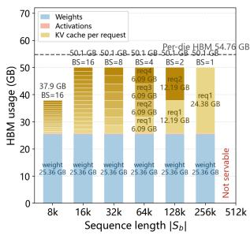

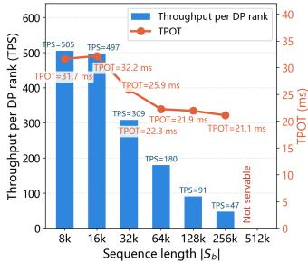  
Figure 1. The HBM capacity wall on decode nodes (dual-server 32- die Ascend910C, DP16/TP2/EP32, GLM-5.2-w4a8). Left: per-die HBM footprint breakdown; right: measured TPOT and throughput.

measured $M _ { \mathrm { K V a l l o c } } = 2 9$ GB after deducting weights and activations, so a request of sequence length $| S _ { b } |$ allows a maximum decode batch-size per DP rank of $B S _ { \mathrm { m a x } } =$ $\left\lfloor M _ { \mathrm { K V a l l o c } } / ( \kappa _ { \mathrm { b a s e } } \cdot | S _ { b } | ) \right\rfloor$ ⌋. The measurements in Figure 1 show two consequences of the capacity wall: at sequence lengths ≥512k a single request no longer fits (ultra-long sequences cannot be served); at $\ge 3 2 \mathbf { k } , \ : B S _ { \mathrm { m a x } }$ drops to single digits, and since Throu $\mathrm { \ g h p u t { _ { d e c o d e } } = B S / T P O T }$ throughput collapses (low long-sequence throughput).

The rise of DSA changes this premise. Since DeepSeek-V3.2 (DeepSeek-AI, 2025) and GLM-5 (GLM-5-Team, 2026), DSA has become mainstream: a lightweight LightningIndexer (LI) selects $T _ { b } \subset S _ { b }$ with $\left| { { T } _ { b } } \right| = k ,$ , and Sparse-FlashAttention (SFA) computes only over $T _ { b } \colon T _ { b } \gets \operatorname { L I } ( S _ { b } )$ Attention Output $ \mathrm { S F A } ( T _ { b } )$ . With $k = 2 0 4 8$ in GLM-5, computation falls to $k / | S _ { b } |$ of full attention.

Decode KV cache offloading with DSA can break the HBM capacity wall. Keep the full KV cache $S _ { b }$ in host DRAM and only a hot cache $C _ { b } \subset S _ { b }$ in HBM. Each step loads $\mathrm { M i s s } _ { b } ~ = ~ T _ { b } - C _ { b }$ while evicting equally many tokens, preserving lossless SFA over the fully resident $T _ { b }$ . The per-request HBM footprint is $M _ { b } ^ { \mathrm { o f f o a d } } = ( L _ { \mathrm { K V } } D _ { \mathrm { K V } } | C _ { b } | +$ $L _ { \mathrm { i n d e x } } D _ { \mathrm { i n d e x } } | S _ { b } | ) P$ , or $8 9 . 8 6 \mathrm { k B } \times \left| C _ { b } \right| + 5 . 3 8 \mathrm { k B } \times \left| S _ { b } \right|$ for GLM-5.2. When $| C _ { b } | \ll | S _ { b } |$ , this is far below full residency.

A larger BS, however, does not automatically increase throughput. Decode throughput is $\mathrm { B S / T P O T } ~ = ~ \mathrm { B S }$ $N _ { \mathrm { s p e c } } / \mathrm { I T L }$ , where $N _ { \mathrm { s p e c } }$ is the average accepted tokens per step. Offloading gives $\mathrm { I T L _ { o f f o a d } ~ = ~ \mathrm { I T L _ { b a s e l i n e } ~ + ~ } }$ T<sub>cache−manage</sub> $L _ { \mathrm { i n d e x } } + T _ { \mathrm { H 2 D - l o a d } } L _ { \mathrm { K V } }$ , adding cache management (miss-lookup, pick eviction, etc.) and miss-loading latency. Baseline throughput already saturates at $B S \approx 3 2$ while $ { T _ { \mathrm { H 2 D - l o a d } } }$ grows with BS. Suppressing these terms poses three challenges: (1) large miss count, requiring a larger $\left| C _ { b } \right|$ to reduce loads; (2) cache management latency that typically grows with $\vert C _ { b } \vert .$ , opposing that remedy; and (3) H2D loads serialized between LI and SFA, since loading awaits top-k selection and SFA awaits loading.

## 2.4 Related Work

Prefill offloading. FlexGen jointly places weights, activations, and KV state across GPU, CPU, and storage to execute models under constrained device-memory budgets (Sheng et al., 2023). DéjàVu streams KV state for prefill–decode disaggregation and fault tolerance (Strati et al., 2024); Mooncake (Qin et al., 2025) and LMCache (Liu et al., 2025b) organize reusable KV cache around disaggregated storage. These systems expand effective cache capacity or migrate state between serving components, but target reusable or inactive KV rather than reducing the peak HBM of active KV while a request executes prefill — precisely the capacity constraint analyzed in Section 2.2.

Decode offloading. Closest to this work are two offloading systems for natively sparse models, HiSparse (Xie et al., 2026) and ECHO (Liu et al., 2026a). Both share a structural limitation in addressing the low-latency challenge: cache management overhead grows with the cache budget (or the top-k size), is paid at every layer of every step, and cannot be decoupled from cache capacity. HiSparse checks hits via a shared-memory hash intersection (build O(k) + full scan $O ( | C _ { b } | ) )$ and evicts by rewriting the entire LRU order each step $( O ( | C _ { b } | ) )$ , with measured miss rates as high as 13%–30%. ECHO performs an independent miss-lookup after top-k $( O ( B S \cdot k )$ per step per layer), evicts via a radix selection over the whole cache pool $( O ( | C _ { b } | ) )$ , and relies on EMA prediction of the top-k scores for load overlap. AVSG (Kuang et al., 2026) follows the same lossless DSA-offloading approach, preserving exact token selections while reusing an HBM buffer across decode steps to reduce H2D traffic. ESS (Chen et al., 2025) first proposed DualBatch-Attention (DBA) overlap, splitting LI along the batch dimension and SFA into hit and miss parts to create windows for H2D loads. However, ESS overlooks cache management overhead, and splitting the kernels incurs additional latency. Our design instead folds the miss-lookup into the top-k process itself (zero extra miss-lookup overhead) and overlaps loads with exact (non-predictive) intra-kernel pipelining. Other sparse offloading systems mainly target non-natively-sparse models (Zhao et al., 2026) and reduce traffic through prediction, auxiliary representations, or vector retrieval (Chen et al., 2026), including InfiniGen, ShadowKV, FreeKV, and RetrievalAttention (Lee et al., 2024; Sun et al., 2025; Liu et al., 2025a; 2026b), which also alter the model-defined attention set.

## 3 PHASE-SPECIALIZED UNIFIED KV OFFLOADING ARCHITECTURE

We propose a phase-specialized yet unified KV offloading architecture. Prefill and decode share one logical KV history backed by host DRAM, together with paged host blocks, block tables, and a common control plane, while specializing device residency and transfer granularity. Committed KV resides in host memory, and the device retains only the bounded working set required by the active phase. At the phase boundary, the host-side KV history is reused or transferred according to the deployment, while device residency switches from full-layer buffers to a token-level hot cache.

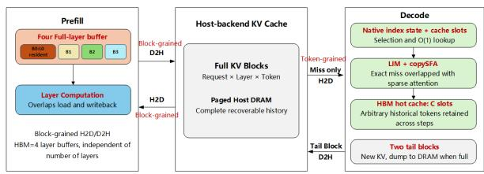  
Figure 2. Phase-specialized unified KV offloading architecture.

Prefill uses four full-layer buffers: $B _ { 0 }$ remains resident for the first layer, while $B _ { 1 } { - } B _ { 3 }$ rotate across later layers to pipeline block-grained H2D loads, layer computation, and D2H writebacks (Zhang et al., 2026b;c). Decode instead retains the native indexer, a C-slot hot cache, two new-KV tail blocks, and the cache\_slots residency map in HBM. LIM and CopySFA coordinate selection, exact miss retrieval, and sparse attention so that only model-selected misses are transferred. Only decode depends on a native sparse indexer; layerwise prefill loads and writes back complete layer KV and therefore also applies to dense attention. Figure 2 shows the two phase-specialized paths and their shared host-backed state.

Let s<sub>KV</sub> be the per-token, per-layer K/V bytes on one tensorparallel rank, T the context length, L the layer count, C the per-layer decode hot-cache capacity, and b the page size. A device-resident baseline requires

$$
M _ { \mathrm { b a s e } } = L T s _ { \mathrm { K V } } .\tag{7}
$$

The dominant phase-specific allocations are approximately

$$
\begin{array} { r l } & { M _ { \mathrm { p r e f i l } } \approx 4 T s _ { \mathrm { K V } } , } \\ & { M _ { \mathrm { d e c o d e } } \approx L ( C + 2 b ) s _ { \mathrm { K V } } + M _ { \mathrm { i n d e x } } ( T ) } \\ & { ~ + M _ { \mathrm { s l o t s } } ( T ) + M _ { \mathrm { m e t a } } . } \end{array}\tag{8}
$$

Thus, prefill retains a dominant K/V fraction of $4 / L ,$ , or about 5.1% for $L = 7 8$ . Decode retains approximately $( C + 2 b ) / T ;$ with $C / T \ = \ 1 / 4$ and $b \ \ll \ T .$ , this approaches a fourfold reduction. Because the native index, cache\_slots, and other metadata may still scale with $T ,$ these expressions quantify the dominant K/V-data savings and slightly overestimate total HBM savings.

## 4 LAYERWISE PREFILL KV CACHE OFFLOADING

This section presents the four-buffer design, followed by its per-layer lifecycle, asynchronous schedule, and overlap condition.

## 4.1 Design Overview

The design exploits Transformer’s layerwise lifetime: although every layer owns KV state, only the current layer consumes its complete KV tensor at a time. The host store preserves the full history by request, layer, and paged token block, while the device allocates only four full-layer buffers (Zhang et al., 2026b;c). $B _ { 0 }$ remains bound to the first layer $L _ { 0 }$ throughout prefill, and a binding table rotates $B _ { 1 } { - } B _ { 3 }$ across all later layers. Indexer state and block-table metadata are stored separately and are not overwritten as the buffers rotate.

Keeping the first layer resident removes the H2D wait for $L _ { 0 }$ and uses its computation to launch the subsequent load–compute–writeback pipeline. Later layers retain bandwidth-efficient block transfers, so greater model depth enlarges host storage without increasing the number of device buffers.

## 4.2 Per-Layer Execution Lifecycle

The implementation reuses the layer hooks exposed by vLLM KVConnector. $L _ { 0 }$ directly uses resident $B _ { 0 } ;$ offloaded layers $\ell \geq 1$ follow this lifecycle through wait\_for\_layer\_load and save\_kv\_layer:

1. Bind and load. The connector selects a free buffer from $B _ { 1 } { - } B _ { 3 }$ , binds it to layer ℓ, and asynchronously loads valid history according to the request block tables. A new request may skip the load, while chunked prefill loads only allocated blocks preceding the current chunk.

2. Wait for readiness. Before attention reads history, wait\_for\_layer\_load waits for that buffer’s H2D event.

3. Append and compute. New K/V for the current chunk is written directly to scheduler-provided slots in the bound buffer. The original prefill attention then consumes both history and appended entries without another staging tensor.

4. Write back and confirm completion. After the current layer finishes, save\_kv\_layer asynchronously writes the updated KV to host memory through blockgrained D2H. The host KV cannot be consumed by a later stage until D2H completes.

5. Release and prefetch. A buffer becomes reusable only after its last compute consumer and D2H writeback complete; the completion event may also launch the future load selected by onload\_layer\_map.

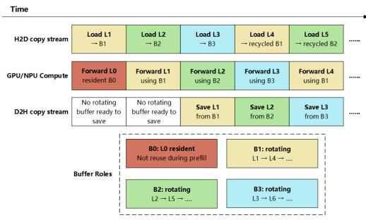  
Figure 3. Four-buffer prefill schedule. The timeline is schematic rather than a measured trace.

This lifecycle applies to every active prefill batch. Continuous batching may update request block tables, but event dependencies preserve buffer ownership. Before decode begins, all writebacks and index-state updates must complete.

## 4.3 Asynchronous Pipeline Schedule and Overlap Conditions

When the platform provides independent engines, the runtime uses separate compute, H2D, and D2H streams. Compute starts immediately with $L _ { 0 }$ in resident $B _ { 0 }$ while $L _ { 1 }$ loads into $B _ { 1 }$ . In steady state, compute executes the current layer, H2D preloads a future layer, and D2H commits a completed layer; the final iterations drain outstanding writebacks.

onload\_layer\_map[i]=j specifies the future layer j to preload when layer i reaches its scheduling point. It combines the three rotating buffers with a chosen prefetch distance and need not select i + 1. A slower H2D may start several layers ahead, but the target buffer must have completed computation and writeback. Device events make compute wait for H2D readiness and reuse wait for compute and D2H completion; if no buffer is free, the pipeline waits rather than overwriting live state.

Figure 3 illustrates the schedule: $L _ { 0 }$ starts on $B _ { 0 } ,$ , after which $B _ { 1 } { - } B _ { 3 }$ rotate so that loading, computation, and writeback progress concurrently.

The overlap achieved by this pipeline depends on the compute windows available for prefetching and buffer reuse. Let $d _ { \mathrm { o n } , \ell }$ be the independent layer computation between preloading layer ℓ and consuming $\mathrm { i t , }$ and $d _ { \mathrm { o f f } , \ell }$ the computation available before its buffer is reused. With independent H2D and D2H engines, exposed latency satisfies

$$
\tau _ { \mathrm { o n , e x p o s e d } } ^ { ( \ell ) } \geq \operatorname* { m a x } \biggl ( 0 , \tau _ { \mathrm { H 2 D } } ^ { ( \ell ) } - d _ { \mathrm { o n } , \ell } \tau _ { \mathrm { c o m p u t e } } \biggr )\tag{9}
$$

$$
\tau _ { \mathrm { o f f , e x p o s e d } } ^ { ( \ell ) } \geq \operatorname* { m a x } \biggl ( 0 , \tau _ { \mathrm { D 2 H } } ^ { ( \ell ) } - d _ { \mathrm { o f f } , \ell } \tau _ { \mathrm { c o m p u t e } } \biggr )\tag{10}
$$

If both directions share a serialized copy path, the conservative condition uses $\tau _ { \mathrm { m o v e } } = \tau _ { \mathrm { H 2 D } } + \tau _ { \mathrm { D 2 H } }$ . When movement exceeds the available window, onload\_layer\_map can increase prefetch distance, or more layers can remain resident (Zhang et al., 2026c). Reserving $B _ { 0 }$ sacrifices one rotating slot but removes the first-layer load and immediately creates the computation window that starts the pipeline.

## 5 LOW-LATENCY DECODE KV CACHE OFFLOADING

This section expands the decode part of the unified KV cache offloading architecture of Section 3: Section 5.1 presents the overall design, and Sections 5.2–5.4 address the three latency challenges raised in Section 2.3.

## 5.1 Overall Design

We modify vLLM-Ascend so that decode nodes execute the decode KV cache offloading of Section 2.3 (Zhang et al., 2026d). As shown in Figure $^ { 4 , }$ the full KV cache $S _ { b }$ of request b is kept in host DRAM, while HBM holds only the hot cache $C _ { b } \subset S _ { b }$ . The design keeps vLLM’s block management: DRAM blocks hold all tokens in their original order, while HBM blocks hold scattered hot tokens $( C _ { b } )$

From the decode node’s perspective, a request’s lifecycle is: after prefill finishes, its KV cache is written into the decode node’s host DRAM KV blocks (P→D transfer); the first decode step loads $| C _ { b } |$ tokens from DRAM into the HBM KV blocks (first-step fill); subsequent steps enter steady state, executing the cache swap-in and eviction flow at every layer of every step. Under MTP3, the steady-state decode flow is:

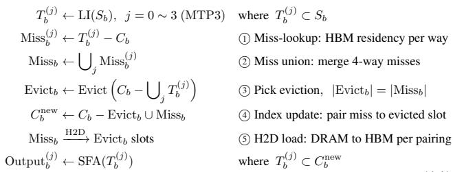

(11)

where Miss<sub>b</sub> is the deduplicated union of the 4-way misses (i.e., this step’s load volume) and Evict<sub>b</sub> is paired with it one-to-one, so the hot-cache size is unchanged $( | C _ { b } ^ { \mathrm { n e w } } | =$ $| C _ { b } | ) ; \textcircled { 1 } - \textcircled { 5 }$ are the five steps of this flow, referenced by these numbers in the following subsections.

Figure 4 illustrates this flow with a single request and a single-way top- $\cdot k = \{ 8 , 4 , 1 7 \}$ (marking each step’s location with token17). To record which tokens reside in HBM, we design the cache index cache\_slots: a 1-D int32 tensor of length $| S _ { b } |$ per request per layer recording each token’s resident slot (-1 if not resident).

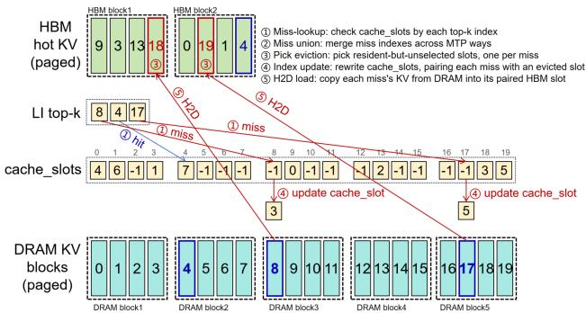

Figure 4. Cache data layout and cache management flow of one steady-state decode step (single-request, single-way top-k view)  
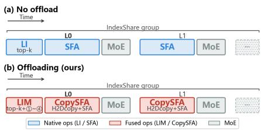  
Figure 5. Kernel pipelines of one steady-state decode step in GLM-5.2.

FlashOffloading’s kernel flow (Figure 5(b)) differs from the non-offloaded flow (Figure 5(a)) in two changes — the LI kernel is replaced by the fused LIM kernel (which performs the cache management of steps ⃝1 –⃝4 while computing top-k), and the SFA kernel is replaced by the fused Copy-SFA kernel (which performs the step-⃝5 H2D load while executing SFA).

## 5.2 Cache Indexing: cache\_slots

Enlarging $\left| C _ { b } \right|$ reduces misses, but prior slot→token indices require step ⃝1 to scan $O ( | C _ { b } | )$ entries, yielding $T _ { \mathrm { c a c h e - m a n a g e } } \sim O ( k ) + O ( | C _ { b } | ) .$ . A small cache therefore increases H2D traffic, while a large one increases management latency.

Our reverse token→slot cache\_slots index makes each miss-lookup an O(1) lookup, reducing management to $T _ { \mathrm { c a c h e - m a n a g e } } \sim O ( k ) + O ( | \mathrm { M i s s } _ { b } | )$ , where $| \mathrm { M i s s } _ { b } | \ll$ $| C _ { b } |$ . Pick eviction and index updates also touch only misses, decoupling latency from capacity: $| C _ { b } | / | S _ { b } |$ can grow from 1/8 to $1 / 4 .$ , supporting nearly 4× larger batches (Section 6.3.1).

## 5.3 Low-Latency Cache Management

Section 5.2 compressed $T _ { \mathrm { c a c h e - m a n a g e } } \quad \mathrm { t o } \quad O ( k ) \ +$ $O ( | \mathrm { M i s s } _ { b } | )$ at the index-structure level; this section further compresses the miss-lookup step (the $O ( k )$ term). The conventional approach waits for top-k to finish, then performs a cache\_slots miss-lookup per selected index — k extra memory accesses per way. Our approach encodes each candidate token’s index and its cache\_slots value into a single int32 before top-k, which participates in the selection together with the scores; after selection, index and slot are decoded from the winning entries, and the miss result follows naturally from top-k. Taking the 20 candidate tokens of Figure 4 as an example:

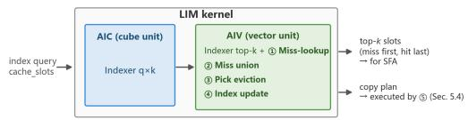  
Figure 6. Internal data flow of the LIM kernel

```python
index = [0, 1, 2, 3, 4, 5, 6, 7, 8, 9, 10, 11, 12, 13, 14, 15, 16, 17, 18, 19]
cache_slots = [4, 6, -1, 1, 7, -1, -1, -1, -1, 0, -1, -1, -1, 2, -1, -1, -1, -1, 3, 5]
# before top-k: encode index and cache_slots pairwise; after: decode slot and index
topk_index = [8, 4, 17] # i.e., T_b
topk_slot = [-1, 7, -1]
```

topk\_slot directly gives the miss-lookup result (token8 and token17 miss; token4 hits slot 7), with miss-lookup overhead eliminated by fusion into LI’s top-k. This optimization is implemented as the Ascend kernel LIM (LightningIndexerManage, Figure 6), whose outputs feed the downstream CopySFA kernel along two paths: the top-k slot list for the attention computation, and copy triples (DRAM source, HBM destination, count) for the step-⃝5 H2D load.

## 5.4 Transfer Overlap

After cache management completes, Miss must be loaded from DRAM to HBM (step ⃝5 ). Prior work ESS (Chen et al., 2025) splits SFA coarsely into a hit-then-miss pair of kernels to overlap the load, but the split breaks the intra-kernel pipeline and overlaps poorly; we instead fuse the H2D load and SFA into a single CopySFA kernel, overlapping at fine granularity inside the kernel.

CopySFA’s key lies in SFA’s KVgather step (Figure 7(a)): SFA splits the 2048 tokens into 4 tiles, each executing KVgather (moving the scattered HBM tokens to a contiguous workspace), Q×K, softmax, and A×V in turn. We branch on miss/hit inside KVgather: miss tokens are fetched from host pin-memory over PCIe/HCCS to on-chip, while hit tokens move from HBM as before (Figure 7(b)); and since LIM has gathered the miss tokens at the head, only 1 of the 4 tiles involves DRAM movement.

The fused kernel (Figure 7(b)) has lower latency than the separate scheme (Figure 7(a)) for two reasons: (1) one fewer HBM read pass — the separate scheme’s miss tokens go through “read DRAM → write slots → read slots → write workspace” (4 passes in total), while CopySFA directly “reads DRAM → writes both slots and workspace” (3 passes); (2) the H2D load is overlapped with AIC computation — in the separate scheme the AIC idles during the

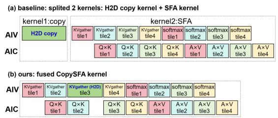  
Figure 7. Intra-kernel pipelines of the non-overlapped and overlapped schemes

H2D load, while in CopySFA the DRAM movement runs in parallel with the hit tiles’ Q×K.

## 6 EVALUATION

This section validates FlashOffloading: Section 6.1 describes the experimental setup; Section 6.2 shows that larger chunk prefill sizes improve prefill throughput; Section 6.3 ablates decode offloading to independently validate its three optimizations; and Section 6.4 evaluates end-to-end inference in a real PD-disaggregated scenario.

## 6.1 Experimental Setup

Platform. All experiments run on Ascend910C NPUs (2 dies per card, 64GB HBM per die; see Section 2.2). The kernel-level unit tests (Sections 6.3.2, 6.3.3) run on a single die; the end-to-end experiments (Section 6.4) run on a fourserver 32-card 64-die cluster with 1P1D PD disaggregation: prefill node 32 dies (DP2/TP16/EP32), decode node 32 dies (DP16/TP2/EP32), and after the P node finishes prefill, the KV cache is written to the D node’s host DRAM via H2H transfer.

Model and framework. The model is GLM-5.2-w4a8c16, with MTP3 uniformly enabled for decode; the inference framework is a modified vLLM 0.30 + vLLM-Ascend 0.30, on which prefill/decode offloading can be toggled independently.

Decode steady-state operating point. The kernel unit tests of Section 6.3 share a typical steady-state decode operating point: HBM hot-cache budget |C<sub>b</sub>| = 12288 tokens and a per-request miss union of about 300 tokens (from the trace measurements of Section 6.3.1); the HBM cache budget of Section 6.4 ranges over 8192–30720 tokens depending on batch-size.

## 6.2 Prefill Offloading Ablation

Method. The platform follows Section 6.1. The client sends one request with 256000 input tokens and one output token (prefill only), with a 50% prefix hit rate: the first 128000 tokens reuse the prefix cache in DRAM, and the remaining 128000 are recomputed. We vary max-num-batched-tokens

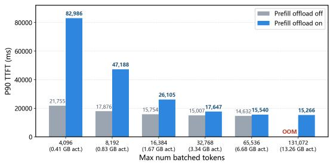  
Figure 8. P90 TTFT across chunk prefill sizes.  
(i.e., chunk prefill size) and compare P90 TTFT with prefill offloading disabled and enabled.

Figure 8 yields three observations:

• Larger max-num-batched-tokens lowers TTFT through higher compute utilization.

• At the same max-num-batched-tokens, prefill offloading increases TTFT: without offloading, the reused prefix is loaded only for the first model.forward; with offloading, it is loaded in every forward pass.

• Prefill offloading reduces KV cache HBM usage, leaving more room for activations and thus larger maxnum-batched-tokens. Consequently, offloading with a larger setting can outperform no offloading with a smaller one.

## 6.3 Decode Offloading Ablation

This section performs policy-level and kernel-level ablations of the three decode-side optimizations, validating that each contributes independently.

## 6.3.1 Cache Strategy and Miss Count

This section validates the claim of Section 5.2: enlarging the cache budget $\left| C _ { b } \right|$ reduces the miss count more than sophisticated eviction policies (e.g., HiSparse’s LRU).

Method. We run GLM-5.2 with MTP3 on Open-SWE longcontext tasks and collect the decode-time top-2048 indices $T _ { b } ^ { ( j ) } ( j = 0 \sim 3 )$ of every layer; an offline simulator then replays the steady-state swap-in/swap-out flow of Section 5.1 on the same access sequence, varying only the eviction policy of step $\textcircled{3} \colon$ Random (random pick), LRU (least-recently selected), Score (evict low-score tokens), and LIM (ours) (score threshold + chunk scan). The dataset is 20 Open-SWE requests: 10 short-sequence (66K–92K tokens) and 10 long-sequence (102K–131K tokens).

The results (Figure 9) show that cache capacity is the primary determinant of the miss count, and the eviction policy a secondary one: enlarging $\left| C _ { b } \right|$ from 8192 to 16384 reduces misses by 43%–49%, while at $| C _ { b } | = 1 6 3 8 4$ Score reduces misses by only another 18%–20% relative to LIM, and the policy gap converges as capacity grows. Our typical configuration (LIM, $| C _ { b } | = 1 4 3 3 6 )$ has 268–350 misses, below HiSparse’s typical configuration (LRU, $| C _ { b } | = 8 1 9 2 )$ at 380–406; although a larger $\left| C _ { b } \right|$ occupies more HBM, it stays under 1/4 of the sequence length, enough to support a ∼4× batch-size increase — and the measurements in Section 2.3 show that throughput already saturates at batch-size≈32. This work turns precisely the HBM that prior work could not exploit into a lower miss count.

Short group (66k\~92k input tokens per request)  
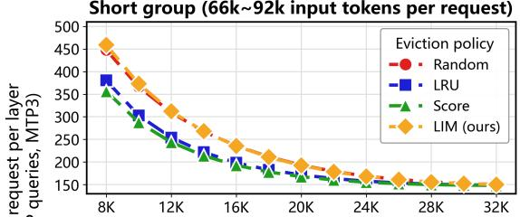

Long group (102k\~131k input tokens per request)  
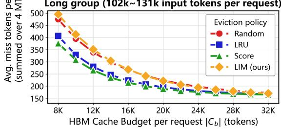  
Figure 9. Average miss tokens per request per layer vs. cache budget and eviction policy

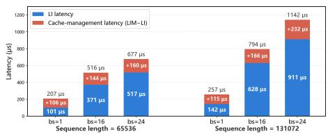  
Figure 10. LIM vs. native LI kernel latency (single Ascend910C die, MTP3, cache budget 12288 tokens, per-request miss union 300 tokens).

## 6.3.2 Index Management Latency

This section validates the low latency of the Section 5.3 cache management scheme.

Method. On a single die (Section 6.1), we unit-test native LI and LIM: both execute the same score computation and top-k, while LIM additionally performs the cache management of $\textcircled{1} - \textcircled{4} ;$ ; the latency difference is the management overhead. The operating point follows Section 6.1.

The results (Figure 10) show the extra cache management latency is only on the order of 106– $- 2 3 2 \mu \mathrm { s } .$ . End to end, only 21 of GLM-5.2’s 78 layers have an LI/LIM kernel, so each decode step adds only about $1 6 0 \mu \mathrm { s } \times 2 1 { \approx } 3 . 4$ ms — a small fraction of the ∼100 ms total ITL.

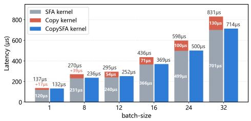  
Figure 11. CopySFA overlapped kernel vs. non-overlapped baseline (single Ascend910C die, MTP3, per-request miss union 300 tokens).

## 6.3.3 H2D Load Overlap Effect

This section validates CopySFA’s H2D load overlap effect (Section 5.4). The kernel unit-test operating point follows Section 6.1, with sequence length 65536; the baseline runs H2Dcopy and SFA serially as two kernels $( T _ { \mathrm { c o p y } } + T _ { \mathrm { S F A } } )$ Figure 11 gives the batch-size sweep from 1 to 32.

The results (Figure 11) show CopySFA yields positive gains in all configurations, with speedups of 1.03×–1.27×. Defining OverlapR $\mathrm { _ { 3 t i o } } = ( T _ { \mathrm { c o p y } } + T _ { \mathrm { S F A } } - T _ { \mathrm { f u s e d } } ) / T _ { \mathrm { c o p y } }$ , the ratio reaches 90%–98% at batch-size ≥ 16.

## 6.4 End-to-End Full-Model Inference Experiments

This section presents FlashOffloading’s benefits in a real PD-disaggregated inference scenario, validating that prefill KV cache offloading and decode KV cache offloading can work together.

## 6.4.1 Workload and Metrics

Workload design. A burst of concurrent requests is fired at the system: input lengths 64000–1000000 tokens, output length 1 (prefill only) or 8192 tokens, and the prefix hit rate set to the 90% typical of mainstream scenarios. Three offloading configurations: none (both off), P-only (prefill offloading only), and P+D (dual offloading).

Metrics. Client side: P99 TE2E (from the burst start until the last request finishes decode), P99 TTFT (until the last request finishes prefill), avg TPOT, avg ITL, and avg input/output throughput (i.e., system-level prefill/decode throughput). Server side: the decode node’s profiling kernellatency breakdown, plus max-num-batched-tokens, per-die HBM usage, and the actual decode batch-size per DP rank.

## 6.4.2 End-to-End Results

Table 1 presents the end-to-end results: for each input length, we first compare prefill offloading off vs. on with output length 1 (prefill only), then compare decode offloading off vs. on with output length 8192 (prefill offloading on in both). Figure 12 visualizes the last two columns of Table 1.

Table 1 and Figure 12 yield six conclusions:

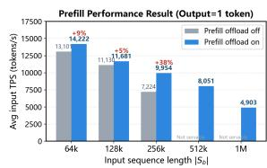

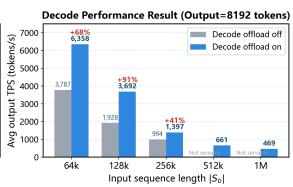  
Figure 12. Throughput comparison with and without offloading at different sequence lengths.

• Ultra-long sequences become servable: 512k/1M sequences need 48.76/97.52 GB KV cache per request, exceeding D-node capacity even for one request; only P+D serves ≥512k.

• Long-sequence prefill improvement: at output length 1, P-only lowers P99 TTFT by 7.9%/4.7%/27.4% (64k/128k/256k) and raises input TPS by 8.6%/5.0%/37.8% — longer inputs gain more.

• Long-sequence decode improvement: at output length 8192, P+D raises the actual decode batch-size 3×/3×/2× over P-only (64k/128k/256k) while TPOT degrades 78.7%/56.6%/42.2% (∼30 ms level); output TPS rises 67.8%/91.5%/40.5%.

• P-node HBM: prefill offloading cuts total use 60.0→50.5 GB: KV preallocation 36.75→9.04 GB (4 rolling buffers; max servable sequence ∼368k→∼1.6M), activations 1.67→13.26 GB, maxnum-batched-tokens 16384→131072 (8×).

• D-node HBM: decode offloading cuts total use 63.7→57.3 GB; per-request residency at 64k falls 6.09→1.78 GB (16k hot-cache budget), so 4→15 requests fit per DP rank (12 in production to control TPOT).

• Under P-only, TTFT at output 8192 exceeds output 1 (64k: 320.7 s vs. 86.4 s): the D node paces PD disaggregation, and longer outputs let decode block prefill.

## 6.4.3 Decode End-to-End Latency Breakdown

This section presents each kernel’s share of ITL in steadystate decode to reveal the source of the TPOT degradation. Figure 13 shows three groups at 64k input: no offloading with BS=4 (baseline), dual offloading with BS=12 (production operating point), and dual offloading with BS=4 (control group, same compute as the baseline).

Figure 13 yields two conclusions:

• Latency control group (dual offloading BS=4 vs. no offloading BS=4): offloading’s inherent latency increment concentrates in the two optimized components. ITL +15.2 ms (+23.7%): LIM +3.0 ms over LI (steps ⃝1 –⃝4 management; matches Section 6.3.2’s 21 layers × ∼144µs); CopySFA only +0.1 ms over SFA (step-⃝5 load almost fully overlapped; 90%+ ratio, Sec-• Production group (dual offloading BS=12 vs. no offloading BS=4): ITL grows far less than batchsize. ITL +50.6 ms (+79%): LIM (11.7 ms) and Copy-SFA (18.5 ms) grow with the BS× miss-union load, MoE sublinearly to 25.9 ms, sync wait 42.5 ms. TPOT 17.0→30.2 ms (+77%), still acceptable; batch-size ×3 with ITL ×1.79, so steady-state decode throughput improves ≈×1.7 (Section 6.4.2).

Table 1. PD-disaggregated results on 32 Ascend910C (64 die), prefill DP2/TP16/EP32, decode DP16/TP2/EP32, prefix cache hit 90%.
<table><tr><td colspan="3">Seq. Length</td><td colspan="5">Prefill HBM usage</td><td colspan="4">Decode HBM usage</td><td colspan="4">Latency</td><td colspan="2">Total Throughput</td></tr><tr><td>Input Output</td><td></td><td>Offload Mode</td><td>Client BS</td><td>weight (GB)</td><td>KV (GB)</td><td>act. (GB)</td><td>max batched</td><td>weight (GB)</td><td>KV (GB)</td><td>KV usage</td><td>BS per</td><td>P99 TE2E</td><td>P99 TTFT</td><td>Avg. TPOT</td><td>Avg. ITL</td><td>Input</td><td>Output</td></tr><tr><td></td><td></td><td></td><td></td><td></td><td></td><td></td><td>toks.</td><td></td><td></td><td>(GB)</td><td>NPU</td><td>(s)</td><td>(s)</td><td>(ms)</td><td>(ms)</td><td></td><td></td></tr><tr><td>64k 64k</td><td>1 1</td><td>none P-only</td><td>192 192</td><td>18.86 18.86</td><td>36.75 9.04</td><td>1.67 13.26</td><td>16384 131072</td><td>25.36 25.36</td><td>28.40 28.40</td><td>一</td><td>一 一</td><td>93.8 86.4</td><td>93.8 86.4</td><td>一 一</td><td>一</td><td>13101 14222</td><td></td></tr><tr><td>64k</td><td>8192</td><td>P-only</td><td>192</td><td>18.86</td><td>9.04</td><td>13.26</td><td>131072</td><td>25.36</td><td>28.40</td><td>24.36</td><td>4</td><td>459.3</td><td>320.7</td><td>16.9</td><td>一 63.6</td><td>3832</td><td>一 3787</td></tr><tr><td>64k</td><td>8192</td><td>P+D</td><td>192</td><td>18.86</td><td>9.04</td><td>13.26</td><td>131072</td><td>25.36</td><td>27.22</td><td>21.79</td><td>12</td><td>344.6</td><td>96.7</td><td>30.2</td><td>110.6</td><td>12707</td><td>6358</td></tr><tr><td></td><td></td><td></td><td></td><td></td><td></td><td></td><td></td><td></td><td></td><td></td><td></td><td></td><td></td><td></td><td></td><td></td><td></td></tr><tr><td>128k 128k</td><td>1 1</td><td>none</td><td>96 96</td><td>18.86 18.86</td><td>36.75 9.04</td><td>1.67 13.26</td><td>16384 131072</td><td>25.36 25.36</td><td>28.40 28.40</td><td>一</td><td>一</td><td>110.4 105.2</td><td>110.4</td><td>1</td><td>一</td><td>11130</td><td></td></tr><tr><td>128k</td><td>8192</td><td>P-only P-only</td><td>96</td><td>18.86</td><td>9.04</td><td>13.26</td><td>131072</td><td>25.36</td><td>28.40</td><td>24.36</td><td>一 2</td><td>456.0</td><td>105.2 320.9</td><td>16.6</td><td>62.3</td><td>11681 3829</td><td>1928</td></tr><tr><td>128k</td><td>8192</td><td>P+D</td><td>96</td><td>18.86</td><td>9.04</td><td>13.26</td><td>131072</td><td>25.36</td><td>27.22</td><td>12.96</td><td>6</td><td>333.2</td><td>122.8</td><td>26.0</td><td>96.1</td><td>10007</td><td>3692</td></tr><tr><td></td><td>1</td><td></td><td></td><td></td><td></td><td></td><td></td><td></td><td></td><td></td><td></td><td></td><td></td><td></td><td></td><td></td><td></td></tr><tr><td>256k 256k</td><td>1</td><td>none P-only</td><td>32 32</td><td>18.86 18.86</td><td>36.75 9.04</td><td>1.67 13.26</td><td>16384 131072</td><td>25.36 25.36</td><td>28.40 28.40</td><td></td><td></td><td>113.4 82.3</td><td>113.4</td><td></td><td></td><td>7224</td><td></td></tr><tr><td>256k</td><td>8192</td><td>P-only</td><td>32</td><td>18.86</td><td>9.04</td><td>13.26</td><td>131072</td><td>25.36</td><td>28.40</td><td>24.36</td><td>一 1</td><td>321.7</td><td>82.3 191.1</td><td>一 16.1</td><td>60.4</td><td>9954 4287</td><td>一 994</td></tr><tr><td>256k</td><td>8192</td><td>P+D</td><td>32</td><td>18.86</td><td>9.04</td><td>13.26</td><td>131072</td><td>25.36</td><td>27.22</td><td>8.27</td><td>2</td><td>317.7</td><td>128.9</td><td>22.9</td><td>84.3</td><td>6355</td><td>1397</td></tr><tr><td>512k</td><td>1</td><td></td><td>32</td><td></td><td></td><td></td><td></td><td></td><td></td><td></td><td></td><td></td><td></td><td></td><td></td><td></td><td></td></tr><tr><td>512k</td><td>1</td><td>none P-only</td><td>32</td><td>18.86 18.86</td><td>36.75 9.04</td><td>1.67 13.26</td><td>16384 131072</td><td>25.36 25.36</td><td>28.40 28.40</td><td></td><td></td><td>203.5</td><td>Not servable</td><td></td><td></td><td></td><td></td></tr><tr><td>512k</td><td>8192</td><td>P-only</td><td>32</td><td>18.86</td><td>9.04</td><td>13.26</td><td>131072</td><td>25.36</td><td>28.40</td><td></td><td></td><td></td><td>203.5 Not servable</td><td></td><td></td><td>8051</td><td></td></tr><tr><td>512k</td><td>8192</td><td>P+D</td><td>32</td><td>18.86</td><td>9.04</td><td>13.26</td><td>131072</td><td>25.36</td><td>27.22</td><td>5.51</td><td>1</td><td>521.8</td><td>325.9</td><td>24.2</td><td>90.4</td><td></td><td>661</td></tr><tr><td></td><td>1</td><td></td><td>32</td><td>18.86</td><td></td><td></td><td></td><td>25.36</td><td></td><td></td><td></td><td></td><td></td><td></td><td></td><td></td><td></td></tr><tr><td>1M 1M</td><td>1</td><td>none P-only</td><td>32</td><td>18.86</td><td>36.75 9.04</td><td>1.67 13.26</td><td>16384 131072</td><td>25.36</td><td>28.40 28.40</td><td></td><td></td><td>652.6</td><td>Not servable 652.6</td><td></td><td></td><td>4903</td><td></td></tr><tr><td>1M</td><td>8192</td><td>P-only</td><td>32</td><td>18.86</td><td>9.04</td><td>13.26</td><td>131072</td><td>25.36</td><td>28.40</td><td></td><td></td><td></td><td>Not servable</td><td></td><td></td><td></td><td></td></tr><tr><td>1M</td><td>8192</td><td>P+D</td><td>32</td><td>18.86</td><td>9.04</td><td>13.26</td><td>131072</td><td>25.36</td><td>27.22</td><td>8.14</td><td>1</td><td>842.4</td><td>572.0</td><td>34.1</td><td>130.6</td><td>5594</td><td>469</td></tr></table>

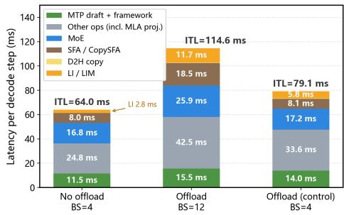  
Figure 13. Kernel-level breakdown of one decode step at 64k input. tion 6.3.3); MoE/SFA compute identical, latency flat. “Other kernels” (e.g., MLA projection) +8.8 ms, from MoE-dispatch synchronization: offloading makes DP ranks’ miss distributions differ, so early-finishing ranks idle at the sync point — deployment-level imbalance, not inherent overhead.

## 7 DISCUSSION

Implications for model design. To overcome the KV cache HBM capacity wall, model architectures are evolving along three routes: DSA (GLM-5, DeepSeek-V3.2 (DeepSeek-AI, 2025; GLM-5-Team, 2026)), extreme compression (e.g., DeepSeek-v4.1), and linear attention (e.g., Kimi K3). The latter two cut capacity but discard information and impair capability; DSA keeps capacity and only exploits attention’s inherent sparsity to dynamically ignore some tokens, with the least capability loss. Without low-latency offloading, DSA’s capacity cost would push models toward lossy routes; FlashOffloading hosts DSA’s full KV history in host DRAM with controlled latency, making the DSA route engineeringviable and letting models evolve toward minimal capability loss.

Implications for accelerator hardware design. FlashOffloading shows that next-generation NPUs/GPUs can ship with less HBM to cut cost, offloading both prefill and decode KV cache to the prefix-cache DRAM layer that inference systems already have.

## 8 CONCLUSION

This paper presents FlashOffloading, a full KV cache offloading architecture for PD-disaggregated long-context inference: host DRAM holds the authoritative KV replica, while residency and transfer granularity switch by stage. Prefill pipelines a bounded four-layer buffer pool; decode decouples cache-management latency from the cache budget (cache\_slots, LIM) and overlaps miss loads inside sparse attention (CopySFA). On Ascend910C, cache management adds only hundred-microsecond latency and up to 98% of miss loads are overlapped; end to end, decode throughput at 64K improves by 1.68×, and 512K/1M sequences become servable — all without changing the model-defined attention set: offloading changes only data placement, not computed results.

## REFERENCES

Ascend-SACT. GLM5.2-KV\_Offloading-1M. AtomGit AI Community, version 0.1.0, 2026. URL https://ai.gitco de.com/Ascend-SACT/GLM5.2-KV\_Offloading-1M. Accessed October 30, 2026.

Bocharnikov, A., Ermakov, I., Kuznedelev, D., Zhdanovskiy, V., and Yershov, Y. KV cache offloading for contextintensive tasks. arXiv preprint arXiv:2604.08426, 2026. URL https://arxiv.org/abs/2604.08426.

Chen, X., Zhang, C., He, J., Liu, W., Zhang, J., Zhou, W., Li, X., Zeng, P., Li, S., Qian, Y., Li, D., and Li, Z. ESS: An offload-centric latent-cache management architecture for DeepSeek-V3.2-Exp. arXiv preprint arXiv:2512.10576, 2025. URL https://arxiv.org/abs/2512.10576.

Chen, Y., Zhang, J., Lu, B., Zhang, Q., Zhang, C., Liu, J., Luo, J., Liu, D., Jiang, H., Chen, Q., Ding, B., Yan, X., Jiang, J., Chen, C., Zhang, M., Li, C., Yang, Y., Yang, F., and Yang, M. RetroInfer: A vector storage engine for scalable long-context LLM inference. Proceedings ofthe VLDB Endowment, 19(5):1016–1031, 2026. doi: 10.14778/3796195.3796212. URL https://arxiv.org/abs/ 2505.02922.

DeepSeek-AI. DeepSeek-V3.2: Pushing the frontier of open large language models. arXiv preprint arXiv:2512.02556, 2025. URL https://arxiv.org/abs/2512.02556.

GLM-5-Team. GLM-5: from vibe coding to agentic engineering. arXiv preprint arXiv:2602.15763, 2026. URL https://arxiv.org/abs/2602.15763.

Jiang, C., Gao, L., Zarch, H. E., and Annavaram, M. KVPR: Efficient LLM inference with I/O-aware KV cache partial recomputation. In Findings of the Association for Computational Linguistics: ACL 2025, pp. 19474–19488, Vienna, Austria, 2025a. Association for Computational Linguistics. doi: 10.18653/v1/2025.findings-acl.997. URL https://aclanthology.org/2025.findings-acl.997/.

Jiang, X., Zhou, Y., Cao, S., Stoica, I., and Yu, M. NEO: Saving GPU memory crisis with CPU offloading for online LLM inference. In Proceedings ofMachine Learning and Systems, volume 7. MLSys, 2025b. URL https://proceedi ngs.mlsys.org/paper\_files/paper/2025/hash/66a026c0d 17040889b50f0dfa650e5e0-Abstract-Conference.html.

Kuang, W., Wang, X., Wu, C., Wang, J., Zhang, W., Chen, B. K., Lan, L., and Zhang, K. AVSG: Accelerated vectorized sparse gather for efficient KV cache offload in sparseattention LLM serving. arXiv preprint arXiv:2609.37538, 2026. URL https://arxiv.org/abs/2609.37538.

Kwon, W., Li, Z., Zhuang, S., Sheng, Y., Zheng, L., Yu, C. H., Gonzalez, J. E., Zhang, H., and Stoica, I. Efficient

memory management for large language model serving with PagedAttention. In Proceedings of the 29th Symposium on Operating Systems Principles, pp. 611–626. ACM, 2023. doi: 10.1145/3600006.3613165. URL https://doi.org/10.1145/3600006.3613165.

Lee, W., Lee, J., Seo, J., and Sim, J. InfiniGen: Efficient generative inference of large language models with dynamic KV cache management. In 18th USENIX Symposium on Operating Systems Design and Implementation (OSDI 24), pp. 155–172, Santa Clara, CA, 2024. USENIX Association. ISBN 978-1-939133-40-3. URL https: //www.usenix.org/conference/osdi24/presentation/lee.

Liu, D., Chen, M., Lu, B., Jiang, H., Han, Z., Zhang, Q., Chen, Q., Zhang, C., Ding, B., Zhang, K., Chen, C., Yang, F., Yang, Y., and Qiu, L. RetrievalAttention: Accelerating long-context LLM inference via vector retrieval. In Advances in Neural Information Processing Systems, volume 38, pp. 54358–54385. Curran Associates, Inc., 2025a. doi: 10.52202/085713-1816. URL https://proceedings.neurips.cc/paper\_files/paper/2025/ hash/4e36d4049fb0fea195a8267c8dcd0824-Abstract-C onference.html.

Liu, G., Chen, W., Li, C., Ning, Z., Lin, J., Yao, Y., Chen, Q., Sun, S., Zhao, J., and Guo, M. ECHO: Efficient KV cache offloading with lossless prefetching for serving native sparse attention LLMs. In 20th USENIX Symposium on Operating Systems Design and Implementation (OSDI 26), pp. 17–37, Seattle, WA, 2026a. USENIX Association. ISBN 978-1-939133-55-7. URL https://www.usenix.org /conference/osdi26/presentation/liu-guangda.

Liu, G., Li, C., Ning, Z., Lin, J., Yao, Y., Ke, D., Guo, M., and Zhao, J. FreeKV: Boosting KV cache retrieval for efficient LLM inference. In International Conference on Learning Representations, 2026b. URL https://openrevi ew.net/forum?id=wXAn7orB1H.

Liu, Y., Cheng, Y., Yao, J., An, Y., Chen, X., Feng, S., Huang, Y., Shen, S., Zhang, R., Du, K., and Jiang, J. LMCache: An efficient KV cache layer for enterprisescale LLM inference. arXiv preprint arXiv:2510.09665, 2025b. URL https://arxiv.org/abs/2510.09665.

Luo, C., Cai, Z., Sun, H., Xiao, J., Yuan, B., Xiao, W., Hu, J., Zhao, J., Chen, B., and Anandkumar, A. Head-Infer: Memory-efficient LLM inference by head-wise offloading. arXiv preprint arXiv:2502.12574, 2025. URL https://arxiv.org/abs/2502.12574.

Ma, R., Ma, T., Li, J., Zha, H., Shang, X., Hu, Q., Liu, Z., Yang, X., Ma, T., and Luo, G. SAC: Disaggregated KV cache system for sparse attention LLMs with CXL. arXiv preprint arXiv:2606.19746, 2026. URL https://arxiv.org/ abs/2606.19746.

Meng, W., Lee, B., and Wang, H. Understanding bottlenecks for efficiently serving LLM inference with KV offloading. arXiv preprint arXiv:2601.19910, 2025. URL https://arxi v.org/abs/2601.19910.

Pan, X., Li, E., Li, Q., Liang, S., Shan, Y., Zhou, K., Luo, Y., Wang, X., and Zhang, J. InstInfer: In-storage attention offloading for cost-effective long-context LLM inference. arXiv preprint arXiv:2409.04992, 2024. URL https://arxi v.org/abs/2409.04992.

Qin, R., Li, Z., He, W., Cui, J., Ren, F., Zhang, M., Wu, Y., Zheng, W., and Xu, X. Mooncake: Trading more storage for less computation — a KVCache-centric architecture for serving LLM chatbot. In 23rd USENIX Conference on File and Storage Technologies (FAST 25), pp. 155– 170, Santa Clara, CA, 2025. USENIX Association. ISBN 978-1-939133-45-8. URL https://www.usenix.org/confe rence/fast25/presentation/qin.

Sheng, Y., Zheng, L., Yuan, B., Li, Z., Ryabinin, M., Chen, B., Liang, P., Re, C., Stoica, I., and Zhang, C. FlexGen: High-throughput generative inference of large language models with a single GPU. In Proceedings of the 40th International Conference on Machine Learning, volume 202 of Proceedings of Machine Learning Research, pp. 31094–31116. PMLR, 2023. URL https://proceedings. mlr.press/v202/sheng23a.html.

Strati, F., Mcallister, S., Phanishayee, A., Tarnawski, J., and Klimovic, A. DéjàVu: KV-cache streaming for fast, fault-tolerant generative LLM serving. In Proceedings of the 41st International Conference on Machine Learning, volume 235 of Proceedings ofMachine Learning Research, pp. 46745–46771. PMLR, 2024. URL https://proceedings.mlr.press/v235/strati24a.html.

Sun, H., Chang, L.-W., Bao, W., Zheng, S., Zheng, N., Liu, X., Dong, H., Chi, Y., and Chen, B. ShadowKV: KV cache in shadows for high-throughput long-context LLM inference. In Proceedings ofthe 42nd International Conference on Machine Learning, volume 267 of Proceedings ofMachine Learning Research, pp. 57355–57373. PMLR, 2025. URL https://proceedings.mlr.press/v267/s un25b.html.

Tang, J., Zhao, Y., Zhu, K., Xiao, G., Kasikci, B., and Han, S. QUEST: Query-aware sparsity for efficient long-context LLM inference. In Proceedings of the 41st International Conference on Machine Learning, volume 235 of Proceedings of Machine Learning Research, pp. 47901–47911. PMLR, 2024. URL https: //proceedings.mlr.press/v235/tang24l.html.

Xie, Z., Huang, Z., Huang, T., Xu, Z., Ma, R., and Kozyrakis, C. HiSparse: Scaling sparse-attention decoding with hierarchical KV cache management. arXiv

preprint arXiv:2608.07009, 2026. URL https://arxiv.org/ abs/2608.07009.

Xiong, Y., Wu, H., Shao, C., Wang, Z., Zhang, R., Guo, Y., Zhao, J., Zhang, K., and Pan, Z. LayerKV: Optimizing large language model serving with layer-wise KV cache management. arXiv preprint arXiv:2410.00428, 2024. URL https://arxiv.org/abs/2410.00428.

Zhang, H., Ji, X., Chen, Y., Fu, F., Miao, X., Nie, X., Chen, W., and Cui, B. PQCache: Product quantization-based KVCache for long context LLM inference. arXiv preprint arXiv:2407.12820, 2024. URL https://arxiv.org/abs/2407 .12820.

Zhang, Q., Zhou, K., Tang, D., Lu, K., Li, C., Yang, Z., Xu, P., and Wan, J. ScoutAttention: Efficient KV cache offloading via layer-ahead CPU pre-computation for LLM inference. arXiv preprint arXiv:2603.27138, 2026a. URL https://arxiv.org/abs/2603.27138. Accepted at the 63rd ACM/IEEE Design Automation Conference (DAC 2026).

Zhang, S. et al. [RFC]: Layerwise and sparse KV cache offloading to support longer sequence length. vLLM RFC #48203, 2026b. URL https://github.com/vllm-project/vll m/issues/48203. GitHub issue opened 2026-07-10.

Zhang, S. et al. [RFC]: Layerwise KV cache offloading to support longer sequence length. vLLM RFC #33398, 2026c. URL https://github.com/vllm-project/vllm/issues /33398. GitHub issue opened 2026-01-30.

Zhang, S. et al. [RFC]: Sparse attention KV cache offloading to support longer sequence length. vLLM RFC #33980, 2026d. URL https://github.com/vllm-project/vllm/issues /33980. GitHub issue opened 2026-02-06.

Zhang, Z., Sheng, Y., Zhou, T., Chen, T., Zheng, L., Cai, R., Song, Z., Tian, Y., Ré, C., Barrett, C., Wang, Z. A., and Chen, B. H O: Heavy-hitter oracle for efficient generative inference of large language models. In Advances in Neural Information Processing Systems, volume 36, pp. 34661–34710. Curran Associates, Inc., 2023. doi: 10.52202/075280-1506. URL https://proceedings.neur ips.cc/paper\_files/paper/2023/hash/6ceefa7b15572587b 78ecfcebb2827f8-Abstract-Conference.html.

Zhao, Z., Lu, B., Lin, S., Chen, Y., Liu, J., Zhang, Y., Miao, Z., Yang, M.-C., Shen, H., Chen, Q., and Yang, F. Unifying sparse attention with hierarchical memory for scalable long-context LLM serving. arXiv preprint arXiv:2604.26837, 2026. URL https://arxiv.org/abs/2604 .26837.

Zheng, X., Wei, D., Gao, J., Song, Y., Mi, Z., and Chen, H. SolidAttention: Low-latency SSD-based serving on memory-constrained PCs. In 24th USENIX Conference

on File and Storage Technologies (FAST 26), pp. 67–82, Santa Clara, CA, 2026. USENIX Association. ISBN 978- 1-939133-53-3. URL https://www.usenix.org/conferenc e/fast26/presentation/zheng.

Zhou, Q., Yin, P., Zuo, P., and Cheng, J. SparseServe: Unlocking parallelism for dynamic sparse attention in longcontext LLM serving. arXiv preprint arXiv:2509.24626, 2025. URL https://arxiv.org/abs/2509.24626.