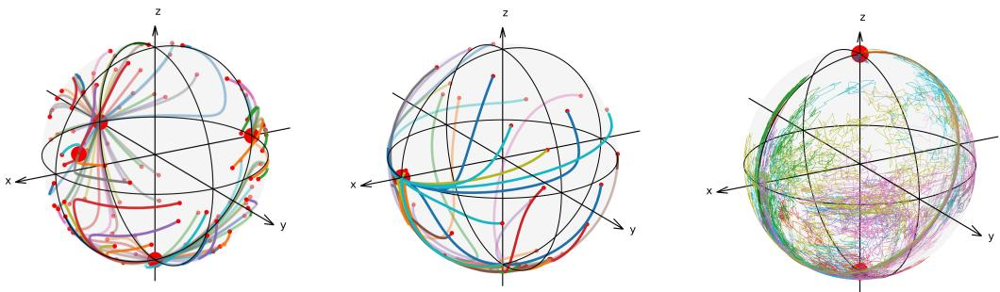
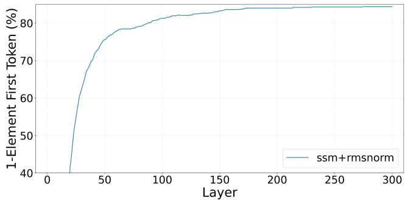
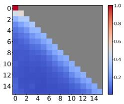
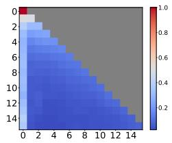
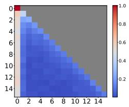
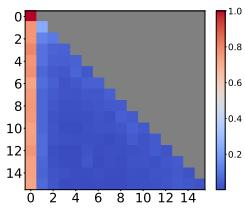
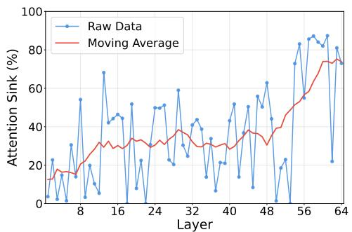
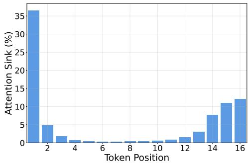

# First-Token Attraction in Mamba Dynamics

Trinh T. Nguyen1∗ Minh-Khoi Nguyen-Nhat2∗ Duy-Tung Pham3 Hoang-Son Do4,5 Tan Minh Nguyen2,† Thieu N. Vo6,†

1 School of Mathematical Sciences, Shanghai Jiao Tong University, China 2 Department of Mathematics, National University of Singapore

3 Khoury College of Computer Sciences, Northeastern University, USA

6 Department of Computer Science, University of Bath, United Kingdom

1q0004349@sjtu.edu.cn 2khoi.nguyen@u.nus.edu 3pham.duy@northeastern.edu 4dhson@math.ac.vn 5do-hoang.son@usth.edu.vn

2tanmn@nus.edu.sg 6ntv22@bath.ac.uk

## Abstract

We study token dynamics in deep Mamba models, with a particular focus on the attracting role of the first token. Unlike attention mechanisms, where token interactions are governed by positive scalar coefficients, Mamba dynamics involve full matrix-valued interaction coefficients with no positivity or definiteness guarantees. This structural difference makes Mamba dynamics substantially harder to analyze and prevents the direct application of existing techniques for attention-based models. To overcome this challenge, we introduce a new analytical framework based on a high-dimensional invariant box and a sharp exit-time argument, which together recover an effective form of sign-definiteness. Using this framework, we characterize the possible limit points of token trajectories and prove explicit exponential convergence rates. Our analysis reveals that the first token has privileged dynamics: its limiting direction attracts subsequent tokens, inducing token clustering and attention-sink phenomena in deep Mamba models. We further show that this attraction mechanism extends to broader sequence dynamics, including state-space models, causal attention, and classical time-series models. Experiments on Falcon-Mamba-7B validate our predictions, showing that concentration on the first token increases with depth and dominates in later layers.

## 1 Introduction

Modern sequence modeling has been dominated by transformers, while state space models (SSMs) have emerged as an important alternative. Transformers have set the standard for representation learning, yet their quadratic complexity with respect to sequence length poses challenges for efficiency and scalability [77]. In parallel, SSMs have reemerged as powerful alternatives that combine principles of recurrence and convolution with ideas from classical control theory [34]. Recent innovations in parameterization and implementation have made SSMs substantially more efficient [25, 26, 24, 29, 45, 36, 63, 72], enabling them to capture long-range dependencies effectively [23, 58] and to excel in benchmark tasks such as the Long Range Arena [74]. Beyond efficiency, these models have demonstrated strong empirical performance in domains as varied as audio, speech, and vision [21, 54, 70].

Within this line of development, the Mamba architecture has emerged as a selective SSM with striking empirical results. Its distinctive component, the selective state-space (S6) layer, introduces input-dependent parameters that grant the model content awareness [22]. This design has proven effective across a wide spectrum of applications, including language modeling [67, 41], vision and video analysis [48, 89, 85, 42], medical imaging [50, 80], tabular data [5], reinforcement learning [64], 3D perception [46], graph learning [79], and even N-dimensional sequence modeling [44]. The breadth of these successes has been linked to Mamba’s ability to generate highly adaptive and expressive representations across modalities [68, 65, 84, 89].

The study of token dynamics–the evolution of token representations within a model–has proven to be a powerful framework for understanding transformers, offering insights into equilibrium structures, stability properties, and clustering phenomena. In contrast, the token dynamics of selective SSMs have received little attention, despite the strong empirical performance of architectures such as Mamba.

## 1.1 Our Contributions

In this paper, we investigate the dynamical properties of tokens in deep pretrained Mamba models. Prior theoretical studies often rely on restrictive conditions such as the absence of normalization and one-dimensional token embeddings (see [78]). We consider the continuous-time limit of pretrained Mamba models without these restrictive assumptions and systematically analyze the asymptotic behavior of token trajectories over time. Our main contributions are summarized as follows:

• We construct a new theoretical framework based on a high-dimensional invariant box for the Mamba dynamics and establish a sharp exit-time argument to determine when token trajectories remain confined to this domain. This framework overcomes the difficulties arising in previous approaches for attention settings.

• We characterize the set of limit points of token trajectories in Mamba models and establish explicit exponential convergence rates (Theorems 3.5, 3.3, 3.6 and 3.9. Our theoretical analysis further demonstrates that the first token exerts an attracting influence on the remaining tokens, a phenomenon that we empirically validate.

• We demonstrate a practical implication of our theoretical results to offer a principled explanation of the attention sink effect in Mamba models via the attraction of the first token.

To validate our theoretical findings and their applications, we conduct extensive experiments by visualizing attention concentration in Falcon-Mamba-7B across different depths. These experimental results confirm the predictive accuracy of our analysis and underscore its practical benefits in realworld scenarios.

Mamba dynamics is far more complicated than causal attention dynamics. Indeed, while our work is inspired by the recent analysis of Transformer dynamics in [35], the mathematical structure of Mamba is much more complex. In the attention setting, the effective interaction coefficients are positive scalars as they are normalized via softmax. The positivity of these interaction coefficients ensures sign-definiteness and enables the use of powerful tools from monotone and cooperative dynamical systems. In contrast, for Mamba, the effective interaction coefficients are full matrices with no positivity or definiteness guarantees. This lack of sign-definiteness is not a minor technical inconvenience; it is an intrinsic structural feature of practical Mamba architectures and invalidates essentially all positivity-based techniques that underpin the current theory of attention dynamics. As a consequence, techniques used for analyzing causal attention dynamics, including hemisphere-based Lyapunov methods [3] and Shub-type genericity arguments [35], completely fail in this architecture.

Our new analytical framework. To overcome the above challenge, we develop a new analytical framework based on a high-dimensional invariant box for the dynamical system governing the continuous-time limit of Mamba, together with a sharp exit-time argument that recovers effective sign-definiteness and determines when token trajectories remain confined to this domain. Within this framework, we characterize all possible token limit points and derive explicit exponential convergence rates toward them. This analysis yields a theoretical explanation for a widely observed empirical phenomenon: the limit point of the first token exerts an attracting influence on subsequent tokens, thereby inducing clustering and attention-sink phenomena. Finally, we extend our analysis of this attracting effect to a broad class of autoregressive sequence models, including state-space models, causal Transformers, and classical time-series models.

Organization. Section 2 derives a dynamical system over the unit sphere arising from the continuoustime limit of Mamba. Section 3 analyzes the limitations of the first token and proves its attraction effect on subsequent tokens. Section 4.1 validates the theory in practical Mamba settings, while Section 5 applies the results to predict attention-sink phenomena in Mamba models.

## 2 Mamba Dynamics as a Flow Map on Sphere

## 2.1 Background – S6 layer

The building block of a selective state-space (Mamba) model is a Mamba block (see [13]). At the heart of the Mamba block is the S6 layer, which plays a key role in the success of deep Mamba models.

S6 layer. Formally, an S6 layer is defined as a function that maps a sequence of tokens $\mathbf { x } =$ $( x _ { 1 } , \ldots , x _ { L } ) \in \mathbb { R } ^ { D \times L }$ to another sequence of tokens $\mathbf { y } = ( y _ { 1 } , \dots , \overset { \cdot } { y } _ { L } ) \in \mathbf { \widehat { \mathbb { R } } } ^ { D \times L }$ (with the same number of channels $D )$ . In this context, each vector xl $\mathsf { \bar { \Psi } } \in \mathbb { R } ^ { D } \operatorname ( \mathrm { o r } y _ { l } \in \mathsf { \bar { \mathbb { R } } } ^ { D } )$ represents a token/word, while the whole sequence $\mathbf { x } = ( x _ { 1 } , \ldots , x _ { L } ) ( \mathrm { o r } \mathbf { y } = ( y _ { 1 } , \ldots , y _ { L } ) )$ is called a prompt/sentence.

For each $d = 1 , \ldots , D$ , the d-th channel output $\hat { y } _ { d } = ( y _ { d 1 } , \dotsc , y _ { d L } ) \in \mathbb { R } ^ { L }$ is determined recurrently from the corresponding d-th channel input $\hat { x } _ { d } = ( x _ { d 1 } , \ldots , x _ { d L } ) \in \mathbb { R } ^ { L }$ via a sequence of hidden states $h _ { d 1 } , \hdots , \dot { h } _ { d L } \in \dot { \mathbb { R } } ^ { N }$ as follows:

$$
\left\{ \begin{array} { l l } { { h _ { d l } = \overline { { { A } } } _ { d l } \cdot h _ { d , l - 1 } + \overline { { { B } } } _ { d l } \cdot x _ { d l } , } } & { { h _ { d 0 } = 0 , } } \\ { { y _ { d l } = C _ { l } \cdot h _ { d l } , } } & { { } } \end{array} \right.\tag{1}
$$

for $l = 1 , \ldots , L$ . Here, the matrices $\overline { { A } } _ { d l } , \overline { { B } } _ { d l }$ , and $C _ { l }$ are input-dependent and time-varying, determined by

$$
\overline { { A } } _ { d l } = e ^ { - a _ { d } \Delta _ { d } ( \boldsymbol { x } _ { l } ) } , \quad \overline { { B } } _ { d l } = \Delta _ { d } ( \boldsymbol { x } _ { l } ) S _ { B } \cdot \boldsymbol { x } _ { l } , \quad \mathrm { a n d } \quad C _ { l } = ( S _ { C } \cdot \boldsymbol { x } _ { l } ) ^ { \top } ,\tag{2}
$$

where $\Delta _ { d } : \mathbb { R } ^ { D }  \mathbb { R }$ is the step size function at the d-th channel and is defined for each $u \in \mathbb { R } ^ { D }$ by

$$
\Delta _ { d } ( u ) = \mathrm { s o f t p l u s } ( S _ { \Delta , d } \cdot u ) = \ln \left( 1 + e ^ { S _ { \Delta , d } \cdot u } \right) .\tag{3}
$$

The hidden positive coefficients $a _ { d } \in \mathbb { R } _ { > 0 }$ , and the step size vectors $S _ { \Delta , d } \in \mathbb { R } ^ { D }$ for $d = 1 , \ldots , D$ as well as the input and output matrices $S _ { B } , S _ { C } \in \mathbb { R } ^ { N \times D }$ , are learnable from input data.

By eliminating the hidden states $h _ { d l }$ in system (1) and recall that $y _ { l } = ( y _ { 1 l } , \dots , y _ { D L } )$ , we obtain the following form (see also [7]):

$$
y _ { l } = \sum _ { j = 1 } ^ { l } A _ { l j } ( { \bf x } ) x _ { j } ,\tag{4}
$$

where $A _ { l j } = \operatorname { d i a g } ( A _ { 1 , l j } , \dotsc , A _ { D , l j } )$ and $S _ { B C } = S _ { C } ^ { \top } S _ { B }$ as well as

$$
A _ { d , l j } ( \mathbf { x } ) = \left\{ \begin{array} { l l } { \displaystyle x _ { l } ^ { \top } S _ { B C } x _ { l } \cdot \Delta _ { d } ( x _ { l } ) , } & { \mathrm { i f ~ } l = j , } \\ { \displaystyle x _ { l } ^ { \top } S _ { B C } x _ { j } \cdot \Delta _ { d } ( x _ { j } ) \cdot \exp \Big ( - a _ { d } \sum _ { k = j + 1 } ^ { l } \Delta _ { d } ( x _ { k } ) \Big ) , } & { \mathrm { i f ~ } l > j . } \end{array} \right.\tag{5}
$$

In our context, the matrix $S _ { B C } = S _ { C } ^ { \top } S _ { B } \in \mathbb { R } ^ { D \times D }$ , which we will refer to as the input-output matrix, plays an essential role in characterizing the dynamical properties of tokens.

## 2.2 Mamba Dynamic as Flow Map on Sphere

All practical implementations of Mamba models incorporate normalization [8], most commonly realized as root mean square (RMS) normalization [87]. In this approach, the sequence of tokens at each layer is normalized by dividing each token by its Euclidean norm. This operation enhances

stability by preventing divergence, thereby reducing rounding errors and avoiding numerical overflow.   
Consequently, the resulting dynamics can be viewed as evolving on the unit sphere $\mathbb { S } ^ { D - 1 }$ throughout.

Follow the framework of [35], a Mamba model including S6 layer and RMS normalization with skip connection can then be viewed as a flow map on $( \mathbb { S } ^ { D - 1 } ) ^ { L }$ of the dynamical system

$$
\frac { d } { d t } x _ { l } ( t ) = \mathbf { P } _ { x _ { l } ( t ) } \Big ( \sum _ { j = 1 } ^ { l } A _ { l j } ( { \mathbf { x } ( t ) } , t ) x _ { j } ( t ) \Big ) , \quad l = 1 , \ldots , L ,\tag{6}
$$

$$
\mathbf { x } ( 0 ) = ( x _ { 1 } ( 0 ) , \ldots , x _ { L } ( 0 ) ) \in ( \mathbb { S } ^ { D - 1 } ) ^ { L } ,\tag{7}
$$

where

• for each $x \in \mathbb { S } ^ { D - 1 }$ , the map $\mathbf { P } _ { x } \colon \mathbb { R } ^ { D } \to T _ { x } \mathbb { S } ^ { D - 1 }$ is the projection onto the tangent space at x of the sphere $\ S ^ { D - 1 }$ and it is defined by $\mathbf { P } _ { x } ( y ) = y \bar { - } \langle \dot { y } , x \rangle$ x for each $y \in \breve { \mathbb { R } } ^ { D }$ ;

• the coefficient $A _ { l j }$ is an $D \times D$ diagonal matrix $A _ { l j } = \operatorname { d i a g } ( A _ { 1 , l j } , \dotsc , A _ { D , l j } )$ with

$$
\begin{array} { r } { A _ { d , l j } ( \mathbf { x } ( t ) , t ) = \left\{ \begin{array} { l l } { \displaystyle x _ { l } ( t ) ^ { \top } S _ { B C } ( t ) x _ { l } ( t ) \cdot \Delta _ { d } ( x _ { l } ( t ) , t ) , } & { \mathrm { i f ~ } l = j , } \\ { \displaystyle x _ { l } ( t ) ^ { \top } S _ { B C } ( t ) x _ { j } \cdot \Delta _ { d } ( x _ { j } ( t ) , t ) \cdot } \\ { \displaystyle \cdot \exp \Big ( - a _ { d } ( t ) \sum _ { k = j + 1 } ^ { l } \Delta _ { d } ( x _ { k } ( t ) , t ) \Big ) , } & { \mathrm { i f ~ } l > j ; } \end{array} \right. } \end{array}\tag{8}
$$

• the step size function at the d-th channel $\Delta _ { d } : \mathbb { R } ^ { D } \times [ 0 , + \infty ) $ R is defined by $\Delta _ { d } ( u , t ) =$ softplus $( S _ { \Delta , d } ( t ) u )$ , for each $( u , t ) \in \mathbb { R } ^ { D } \times [ 0 , + \infty )$

## 2.3 Mamba Interaction Coefficients Are More Complex Than Those in Causal Attention

In our continuous-time view for both Mamba and attention define dynamics, each $\textstyle { \frac { d x _ { l } } { d t } }$ is a linear combination of earlier tokens with interaction coefficients. For attention, the interaction coefficients are positive scalars as they are normalized by softmax. These positive scalar interaction coefficients makes the system comparatively structured and amenable to existing analysis (see [35]).

In contrast, the interaction coefficients of Mamba are far more complicated than those in the causal attention setting. Indeed, the Mamba interaction coefficients are $A _ { l j } ( \mathbf { x } ( t ) , t )$ which are given in equation (8) are full matrices with no positivity or definiteness guarantees. As a consequence, almost all tools and conclusions from the attention setting, including hemisphere-based Lyapunov methods [3] and Shub-type genericity arguments [35], break down.

## 3 Theoretical Results for Mamba Dynamic

Our goal is to study the dynamical properties of tokens in the internal representations of deep Mamba models. In the continuous-time limit, this amounts to analyzing the solution trajectories of the system (6) and characterizing the limiting set li $\mathsf { 1 } _ { t \to + \infty } \{ x _ { 1 } ( t ) , \ldots , \bar { } x _ { L } ( t ) \}$ . In this section, we focus on a simplified Mamba setting in which the model parameters are assumed to be time-independent. An extension to the time-dependent parameter regime is discussed in Section 3.3. Intuitively, we will prove the following:

Observation 3.1. (i) The first token $x _ { 1 } ( t )$ has privileged dynamics: its trajectory determines a discrete set of possible limit points, primarily the coordinate unit vectors $\pm e _ { d } .$ , which serve as attractors (Theorems 3.3 and 3.5). Here, $e _ { d }$ is the coordinate unit vector with 1 at the d-th coordinate and 0 elsewhere.

(ii) Subsequent tokens $x _ { l } ( t )$ with $2 \le l \le L$ are strongly influenced by the first token, often exponentially converging toward the same attractor, thereby creating clusters of tokens in the final layers (see Theorem 3.6 and Proposition 3.7 for the time-indepedent parameter setting and Theorem 3.9 for a time-dependent analogue).

The study of the convergence of all tokens based on the dynamical system (6) without any additional assumption on the model parameters is challenging. To make the proofs feasible while still maintaining the generality practicality of our theoretical findings, we will first assume that all parameters

$S _ { B C } , S _ { \Delta , d }$ and $ { a _ { d } }$ are time-independent in Sections 3.1 and 3.2. Next, a generalization into the case of time-dependent parameters will be presented in Section 3.3. All proofs can be found in Appendix.

These theoretical observations will be empirically validate using practical Mamba architectures, considering both the continuous-time setting (in Subsection 4.1) and the discrete-time setting (in Subsection 4.2).

## 3.1 Possible Limit Points of the First Token

Let us consider the differential equation governing the trajectory of the first token, which is the first equation in the dynamical system (6), given by

$$
\begin{array} { l } { \displaystyle \frac { d } { d t } x _ { 1 } ( t ) = \mathbf { P } _ { x _ { 1 } ( t ) } \big ( A _ { 1 1 } ( \mathbf { x } ( t ) ) x _ { 1 } ( t ) \big ) , } \\ { \displaystyle x _ { 1 } ( 0 ) \in \mathbb { S } ^ { D - 1 } , } \end{array}\tag{9}
$$

where

$$
\begin{array} { r } { A _ { 1 1 } = \mathrm { d i a g } ( A _ { 1 , 1 1 } , A _ { 2 , 1 1 } , \cdot \cdot \cdot , A _ { D , 1 1 } ) , \mathrm { ~ a n d } } \\ { A _ { d , 1 1 } ( \mathbf { x } ( t ) ) = x _ { 1 } ( t ) ^ { \top } S _ { B C } x _ { 1 } ( t ) \cdot \Delta _ { d } ( x _ { 1 } ( t ) ) . \quad } \end{array}
$$

A limit point must be an equilibrium point. We will determine the set of equilibrium points of differential equation (9) in the following proposition.

Proposition 3.2 (All possible equilibrium points of the first token). A vector $y \in \mathbb { S } ^ { D - 1 }$ is an equilibrium of equation (9) if and only if it belongs to one of the following types:

Type 1. $\begin{array} { r } { y \in \bigcup _ { A \subset \{ 1 , 2 , . . . , D \} } \mathcal { H } _ { \Delta , A } } \end{array}$ , where for each subset $A \subset \{ 1 , \ldots , D \}$ , we denote by $\mathcal { H } _ { \Delta , A } : = \langle \{ S _ { \Delta , j } - S _ { \Delta , \operatorname* { m i n } A } , j \in A \} \cup \{ e _ { k } , k \in A \} \rangle ^ { \perp } .$

Type 2. $y \in \mathcal { H } _ { S _ { B C } } : = \left\{ u \in \mathbb { R } ^ { D } | u ^ { \top } S _ { B C } u = 0 \right\}$ , which is the null space of the quadratic surface defined by $S _ { B C }$

IfSBC is definite, then $\mathcal { H } _ { S _ { B C } } = \emptyset$ and Type 2 equilibria do not exist. If,furthermore, the columns $o f S _ { \Delta }$ are linearly independent, then the Type 1 equilibria collapse to exactly two antipodal points $y = \pm \xi ,$ , where $\xi$ is the unique unit vector in the union $\mathsf { U } _ { A \subset \{ 1 , 2 , . . . , D \} } \mathcal { H } _ { \Delta , A }$

Not every equilibrium point is stable, and therefore not every equilibrium point can arise as a limit point. Even for the first token, analyzing stability near equilibria in order to characterize the limit points of equation (9) is delicate and technically involved. This difficulty already appears in the two-dimensional case $D = 2 \colon$ depending on the initial data, the first token may converge to different limiting states, as we see in the following theorem.

Theorem 3.3 (All possible limit points of the first token in two dimensions). Assume that $D = 2$ and let $y ( t ) = ( y _ { 1 } ( \bar { t } ) , y _ { 2 } ( t ) ) \in C ^ { \infty } ( [ 0 , + \infty ) , \mathbb { S } ^ { 1 } )$ be a solution of differential equation (9). Assume further that

$$
( i ) \ S _ { B C } = \mathrm { d i a g } ( \lambda _ { 1 } , \lambda _ { 2 } ) \ w i t h \ \lambda _ { 1 } \neq \lambda _ { 2 } \ o r \lambda _ { 1 } = \lambda _ { 2 } \neq 0 ;
$$

$$
( i i ) \ S _ { \Delta , 2 } \ne S _ { \Delta , 1 } .
$$

In this case, the circle $\mathbb { S } ^ { 1 }$ intersects the line $\langle S _ { \Delta , 2 } - S _ { \Delta , 1 } \rangle ^ { \perp }$ at two antipodal points, say $\pm \xi .$ . Then $\scriptstyle \operatorname* { l i m } _ { t \to + \infty } y ( t )$ exists and belongs to the set

$$
\begin{array} { r l } & { \Omega = \left\{ ( 0 , \pm 1 ) , ( \pm 1 , 0 ) \right\} \cup \left\{ \pm \xi \right\} } \\ & { \quad \quad \cup \left\{ ( \cos \varphi _ { \star } , \sin \varphi _ { \star } ) : \varphi _ { \star } \in [ 0 , 2 \pi ) , \lambda _ { 1 } \cos ^ { 2 } \varphi _ { \star } + \lambda _ { 2 } \sin ^ { 2 } \varphi _ { \star } = 0 \right\} . } \end{array}
$$

Remark 3.4 (Possible limit points of the first token in practical setting). Theorem 3.5 indicates that the first token converges to either of the coordinate unit vectors $\pm e _ { m } .$ . In contrast, Theorem 3.3 reveals additional possible limit points, which are difficult to detect in simulations with randomly chosen model parameters. In practice, even when the assumptions of Theorems 3.5 and 3.3 do not strictly hold, we still observe that the first token typically converges to one of the coordinate unit vectors $\pm e _ { m }$ (see Figure 1 below).

We leave the proof of the above proposition, as well as the study of the stability of these equilibrium points, to Appendix B.1.1. The following theorem proves that the first token $x _ { 1 } ( t )$ likely converges to a limit point of the form $\pm e _ { d }$ for some $d = 1 , \ldots , D$

Theorem 3.5 (First token likely converges to ± $z e _ { d }$ in general). Let $y ( t ) = ( y _ { 1 } ( t ) , \ldots , y _ { D } ( t ) ) \in$ $C ^ { \infty } ( [ 0 , + \infty ) , \ S ^ { D - 1 } )$ be a solution of differential equation (9). Assume that the symmetric part of $S _ { B C }$ is positive definite, and $S _ { \Delta , m } = \mathrm { s i g n } ( y _ { m } ( 0 ) ) \cdot e _ { m } f o r$ each m such that $y _ { m } ( 0 ) \neq 0 .$ . Suppose that there exists $d _ { 0 } \in \{ 1 , . . . , D \}$ such that

$$
| y _ { d _ { 0 } } ( 0 ) | > | y _ { d } ( 0 ) | > 0 ,
$$

for every d $\neq d _ { 0 }$ . Then

$$
\operatorname* { l i m } _ { t  \infty } y ( t ) = \pm e _ { d _ { 0 } } ,
$$

where the sign is $\mathrm { s i g n } ( y _ { d _ { 0 } } ( 0 ) )$ .

## 3.2 All Other Tokens are Attracted by the First Token

Different from the first token, the problem of characterizing the possible limits points of the other token is far more challenge. In this subsection, to make the proofs feasible while still maintaining the generality and practicability of our findings, beside of the time-independent parameters assumption, we will assume further that:

$$
\begin{array} { r l } & { S _ { \Delta , 1 } ( t ) = \ldots = S _ { \Delta , D } ( t ) = : \alpha \in \mathbb { R } ^ { D } , \mathrm { ~ a n d ~ } } \\ & { a _ { 1 } ( t ) = \ldots = a _ { D } ( t ) = : a \in \mathbb { R } , } \end{array}
$$

for any time $t \in [ 0 , + \infty )$ . Under this assumption, we can rewrite dynamical system (6) as:

$$
\frac { d } { d t } x _ { l } ( t ) = \sum _ { j = 1 } ^ { l - 1 } A _ { l j } ( { \bf x } ( t ) ) \cdot { \bf P } _ { x _ { l } ( t ) } ( x _ { j } ( t ) ) , \quad l = 1 , \ldots , L ,\tag{10}
$$

where the coefficients $A _ { l j } ( \mathbf { x } ( t ) )$ are defined as

$$
A _ { l j } ( \mathbf { x } ( t ) ) = x _ { l } ( t ) ^ { \top } S _ { B C } x _ { j } ( t ) \cdot \Delta ( x _ { l } ( t ) ) e ^ { - a \sum _ { k = j + 1 } ^ { l } \Delta ( x _ { k } ( t ) ) } ,\tag{11}
$$

with $\Delta ( x _ { l } ( t ) ) = \ln ( 1 + e ^ { \alpha \cdot x _ { l } ( t ) } )$

In this case, for the first token $x _ { 1 } ( t )$ , we see that

$$
\frac { d } { d t } x _ { 1 } ( t ) = A _ { 1 1 } ( { \bf x } ( t ) , t ) \cdot { \bf P } _ { x _ { 1 } ( t ) } ( x _ { 1 } ( t ) ) = 0 .
$$

This implies that $x _ { 1 } ( t ) = x _ { 1 } ( 0 )$ is a constant function on $[ 0 , + \infty )$ . We will present all possible limit points of $x _ { i } ( t )$ for $i = 2 , \ldots , L$ in Theorem 3.6 and Proposition 3.7 below.

Theorem 3.6 (All tokens are exponentially attracted by the first token). Let $\begin{array} { r l } { \mathbf { x } ( t ) } & { { } = } \end{array}$ $( x _ { 1 } ( t ) , \ldots , x _ { L } ( t ) ) \in C ^ { \infty } ( [ 0 , + \infty ) , ( \overleftarrow \mathbb { S } ^ { D - 1 } ) ^ { L } )$ be a solution of dynamical system (10). Assume that $S _ { B C }$ is symmetric and $\langle x _ { 1 } ( 0 ) , S _ { B C } x _ { 1 } ( 0 ) \rangle > 0$ . Then, there exists a zero-measurable subset Ω $o f ( \mathbb { S } ^ { D - 1 } ) ^ { L - \mathrm { \ i } }$ such that: if the initial point $( \dot { x } _ { 2 } ( 0 ) , . . . , x _ { L } ( 0 ) )$ ) does not belong in Ω then all tokens converge exponentially to $\pm x _ { 1 } ( 0 ) , i . e .$

$$
\sum _ { i = 1 } ^ { L } | x _ { i } ( t ) - s _ { i } x _ { 1 } ( 0 ) | \lesssim e ^ { - C _ { 0 } t } ,
$$

for some constant $C _ { 0 } > 0$ and $s _ { i } \in \{ + 1 , - 1 \}$ for each i.

## Proof strategy. The proof is organized into four steps.

Step 1 (two-token reduction). We first analyze the simplest nontrivial interaction between the first two tokens x and $x _ { 2 }$ . The key scalar is $\langle x _ { 2 } ( t ) , S _ { B C } x _ { 1 } \rangle$ , whose sign controls the long-time behavior. A Grönwall-type estimate yields exponential convergence of $x _ { 2 } ( t ) \ \mathrm { t o } x _ { 1 } ( 0 )$

Step 2 (global positivity regime). We then extend the two-token analysis to the full system under the global positivity assumption that $\left. x _ { i } ( 0 ) , S _ { B C } x _ { j } ( 0 ) \right. > 0$ for all $i , j$ . The main tool is a boxinvariance argument for the interaction variables $\left. x _ { i } ( t ) , S _ { B C } x _ { j } ( t ) \right.$ , showing that trajectories starting in the positive box $[ 0 , 1 ] ^ { L \times L }$ cannot exit it (by a contradiction argument based on uniqueness of ODE solutions). This yields exponential convergence of all downstream tokens $\mathbf { t o } \pm x _ { 1 } ( 0 )$

Step 3 (removing positivity by induction). Next, we drop the positivity assumption and proceed inductively. Assuming that $x _ { 1 } , \ldots , x _ { k - 1 }$ converge exponentially to $x _ { 1 }$ , we show that the interaction coefficient $\langle x _ { k } ( t ) , S _ { B C } ^ { - } x _ { 1 } \rangle$ decays exponentially, implying that $x _ { k } ( t )$ converges to an equilibrium orthogonal to $S _ { B C } x _ { 1 }$

Step 4 (nongenericity oforthogonal equilibria). Finally, we prove that the orthogonal-drift scenario from Step 3 is nongeneric. For a candidate equilibrium $x _ { * } = ( x _ { 1 } , \ldots , x _ { 1 } , \xi )$ , with $\xi \perp S _ { B C } x _ { 1 }$ we linearize the flow at $x _ { * }$ and show that the Jacobian $J ( x _ { * } )$ admits a positive eigenvalue $\lambda _ { + } =$ $a _ { L 1 } ( x _ { * } ) > 0$ , so that $x _ { * }$ is a saddle point. The stable manifold theorem then implies that the set of initial conditions leading to the convergence of tokens to $x _ { * }$ lies in a lower-dimensional manifold of Lebesgue measure zero. This provides a complete proof of Theorem 3.6.

Under slightly stronger assumptions, we can apply Theorem 3.6 to recover the single-cluster case stated below.

Proposition 3.7 (Exponential alignment under positive angle conditions). Suppose the assumptions of Theorem 3.6 hold. In addition, assume that the initial configuration satisfies the positive angle condition:

$$
\langle x _ { i } ( 0 ) , S _ { B C } x _ { j } ( 0 ) \rangle > 0 , \quad \forall i , j \in [ 1 , L ] .
$$

Then all tokens $x _ { l } ( t )$ converge exponentially to the aligned state $x _ { 1 } ( 0 )$ , that $i s ,$

$$
\sum _ { i = 1 } ^ { L } \| x _ { i } ( t ) - x _ { 1 } ( 0 ) \| \ \lesssim \ e ^ { - C _ { 0 } t } ,
$$

for some constant $C _ { 0 } > 0 .$ . Moreover, the positivity ofinteractions is preservedfor all time:

$$
\langle x _ { i } ( t ) , S _ { B C } x _ { j } ( t ) \rangle > 0 , \quad \forall t > 0 .
$$

Remark 3.8 (All token are exponentially attracted by the first token in practical settings). Theorem 3.6 states that, under certain assumptions, each token converges exponentially either to $x _ { 1 } ( 0 )$ or to $- x _ { 1 } ( 0 )$ , depending on the sign of the corresponding coefficient $s _ { i } .$ . Thus, in this setting there are two possible clusters: one around $x _ { 1 } ( 0 )$ and one around $- x _ { 1 } ( 0 )$ ). Proposition 3.7 imposes stricter assumptions under which all tokens converge exponentially to $x _ { 1 } ( 0 )$ . In this case, there is only one cluster.

In practice, when the assumptions of Theorem 3.6 and Proposition 3.7 do not fully hold, it is possible to observe more than two clusters at the end of the dynamics (see for examples in Figure 1 below). However, this occurs only rarely. Almost all trajectories still fall into one of the two dominant clusters predicted by Theorem 3.6.

## 3.3 A generalization to time-dependent regime

In this section, we discuss a generalization of Theorem 3.6 to the setting of time-dependent parameters. Specifically, we allow the parameters to be nonconstant functions of time, subject to additional mild conditions ensuring that the proof strategy from the previous section remains valid.

We borrow the notation from the previous subsection. To keep the proofs tractable while maintaining the generality and practical relevance of our results, we assume that the functions $S _ { B C } ( t ) , \alpha ( t )$ and $a ( t )$ converge exponentially to $S _ { \infty } , \alpha _ { \infty } .$ , and $a _ { \infty } .$ , respectively, when t tends to infinity. (In the previous section, these parameters are constant.) In this case, the interaction coefficients are the matrices

$$
\begin{array} { r } { A _ { l j } ( t , x ) = x _ { l } ^ { \top } S _ { B C } ( t ) x _ { j } \cdot \Delta _ { t } ( x _ { l } ) e ^ { - a ( t ) \sum _ { k = j + 1 } ^ { l } \Delta _ { t } ( x _ { k } ) } , } \end{array}
$$

where $\Delta _ { t } ( x _ { l } ) = \ln ( 1 + e ^ { \alpha ( t ) \cdot x _ { l } } )$ for each $1 \leq j < l \leq L$ and $x = ( x _ { 1 } , . . . , x _ { L } ) \in ( \mathbb { S } ^ { D - 1 } ) ^ { L }$ . Under the above setting, we can generalize Theorem 3.6 to the time-dependent parameter regime as follows.

Theorem 3.9. $L e t \mathbf { x } ( t ) = ( x _ { 1 } ( t ) , \ldots , x _ { L } ( t ) )$ be a solution to the dynamical system

$$
\begin{array} { r } { \left\{ \begin{array} { l } { \frac { d } { d t } x _ { l } ( t ) = \sum _ { j = 1 } ^ { l - 1 } A _ { l j } ( t + c , \mathbf { x } ( t ) ) \cdot \mathbf { P } _ { x _ { l } ( t ) } ( x _ { j } ( t ) ) , } \\ { \mathbf { x } ( 0 ) = ( x _ { 1 } ( 0 ) , \ldots , x _ { L } ( 0 ) ) \in ( \mathbb { S } ^ { D - 1 } ) ^ { L } , } \end{array} \right. } \end{array}\tag{12}
$$

  
(a) First-token trajectories (100 random initializations; timeindependent $a _ { d } , \ S _ { B C } , \ S _ { \Delta } )$ 94 trajectories converge to some coordinate unit vector $\pm e _ { d } .$  
(b) A single sequence of 32 tokens (time-independent $a _ { d } , \ S _ { B C } , \ S _ { \Delta } )$ Tokens converge toward a point at one coordinate unit vector $\pm e _ { d }$ for some d.  
(c) A single sequence of 16 tokens (time-dependent $a _ { d } , S _ { B C } , S _ { \Delta } )$ . Tokens converge to points at some coordinate unit vectors $\pm e _ { d }$ for some $d = 1 , \ldots , D .$  
Figure 1: Simulated trajectories of dynamical system (6) with random parameters. The initial points (denoted by small red points in (a) and (b)) are sampled via a uniform distribution on the sphere. In these settings, the first token converges to discrete attractors at the big red points (mostly coordinate unit vectors $\pm e _ { d } )$ and draws subsequent tokens toward the same points, producing clusters and illustrating the attention sink effect.

for $l = 1 , \ldots , L ,$ and $c \in \mathbb { R }$ is an arbitrary constant. Assume that $S _ { B C } ( t )$ is symmetric for every t and $S _ { \infty }$ is positive definite. Then, there exists a zero-measurable subset $\bar { N } _ { 0 } o f ( 0 , \infty )$ satisfying the following property: $i f c \in \mathbb { R } \setminus N _ { 0 }$ then there exists a zero-measurable subset Ω $o \dot { f } ( \mathbb { S } ^ { \ ' { D - 1 } } ) ^ { \tilde { L } - 1 }$ such that if the initial point $( x _ { 2 } ( 0 ) , . . . , x _ { L } ( 0 ) )$ ) does not belong in Ω then all tokens converge exponentially $t o \pm x _ { 1 } ( 0 )$

Theorem 3.9 indicates that the downstream tokens $x _ { l } ( t )$ , for $2 \leq l \leq L$ , are strongly driven by the initial direction of the first token $x _ { 1 } ( 0 )$ . In particular, for generic initializations, these tokens converge exponentially to the same attractor $\pm x _ { 1 } ( 0 )$ , which leads to the emergence of token clusters in the final layers. This conclusion corroborates the phenomenon described at the beginning of Section 3. Further discussion and intuition for this result are provided in Appendix B.3.

## 4 Alignment with Observed Behavior in Practical Mamba Settings

We empirically validate the theoretical results established in the previous section using practical Mamba architectures, considering both the continuous-time setting (Subsection 4.1) and the discretetime setting (Subsection 4.2). We study models with both time-dependent and time-independent parameters, and further investigate how practical architectural components of Mamba (such as pre-layer normalization and linear layers) impact the conclusions of our theory.

## 4.1 Simulations

To validate our theoretical results, we conduct extensive simulations of the dynamical system (6) under random choices of model parameters, demonstrating that the empirical behaviors observed in the simulations are consistent with our theoretical predictions. In particular, we numerically integrate the system to observe: (i) trajectories of first tokens across many random initializations with time-independent parameters $a _ { d } , S _ { B C }$ , and $S _ { \Delta } ;$ (ii) trajectories of all tokens in a single sequence with time-independent parameters $a _ { d } , S _ { B C }$ , and $S _ { \Delta } ;$ and (iii) trajectories of all tokens in a single sequence with time-dependent parameters $a _ { d } , S _ { B C } ,$ , and $S _ { \Delta }$

Figure 1, which demonstrates the expected results of the trajectories of the tokens under the above settings, reveals two robust patterns. First, the initial token exhibits privileged dynamics and converges to a discrete set of attractors, namely the coordinate vectors $\pm e _ { d } ,$ , in agreement with Theorems 3.5 and 3.3. Second, the downstream tokens are strongly driven by this first-token trajectory and typically converge to the same attractor, producing token clusters in the final layers, consistent with Theorem 3.6, Proposition 3.7, and Theorem 3.9. These robust patterns strongly support Observation 3.1.

  
Figure 2: Percentage of first tokens exhibiting a single non-zero element (threshold $1 \times 1 0 ^ { - 4 } )$ across simplified Mamba-2 blocks with shared weights, after omitting causal convolution, input/output projections, activations, and inner residuals. Most tokens converged to 1-element tokens, consistent with simulations.

  
(a) Layer 1, Channel 8

  
(b) Layer 15, Channel 8

  
(c) Layer 46, Channel 8

  
(d) Layer 60, Channel 8  
Figure 3: Attention concentration on the first token across different depths of the Falcon-Mamba-7B model [90]. Each subfigure shows the hidden attention matrix for a specific layer: (a) Layer 1, (b) Layer 15, (c) Layer 46, and (d) Layer 60. In early layers, tokens distribute attention more uniformly, but as depth increases, nearly all tokens concentrate disproportionately on the first token. This illustrates the emergence of an attention sink in state-space models.

## 4.2 Empirical Validation with Full Practical Setting

To validate our theoretical results on practical models, we conduct experiments on simplified versions of the Mamba-2 block. Specifically, we employ the configuration with shared-weight blocks. Within each block, we omit the causal convolution, input projection, and output projection.

We process a batch of 64 sequences through the model. We compute the percentage of sequences where the first token has only one non-near-zero element (threshold $\mathrm { \dot { 1 } \times 1 0 ^ { - 4 } } )$ . The results in Figure 2 reveal that most first tokens converge to a representation with only one non-zero element. This outcome aligns with our theoretical predictions and the simulation in Figure 1a.

## 5 An application – Predict Attention Sink

Observation 3.1, together with the theoretical justification provided in the previous section, suggests that the first token should be regarded with particular importance, as it serves as an attractor for subsequent tokens. This insight provides a principled explanation of the attention sink effect in Mamba models through the attracting role of the first token.

We analyze the hidden attention matrix in equation (4) for the Falcon-Mamba-7B model [90] to quantify how tokens attend to one another. The results in Figure 3 reveal that the concentration of attention on the first token consistently increases with depth, and in the final layers it dominates nearly all other tokens. This empirical trend validates our theoretical justification for token dynamics and, importantly, represents the first observation of the attention sink phenomenon in state-space models. While attention sink was originally identified in transformer-based architectures [83], we have showed that an analogous effect emerges in Mamba models as predicted from Observation 3.1.

  
(a) Attention sink (%) across layers for the first token.

  
(b) Attention sink (%) across all token positions.  
Figure 4: Attention sink score [27] analysis in the Falcon-Mamba-7B model. Subfigure (a) shows the sink score of the first token and its moving average across layers; the score steadily increases with depth and dominates in the final layers. Subfigure (b) shows the average sink scores across token positions; the first token consistently receives the largest share.

To quantify the attention sink in state-space models, we employ the metrics Sink and Sink (formally defined in Appendix C), adapted from [27] with modifications to account for the structural differences in our hidden attention representation. Specifically, while the original metric is computed from attention logits with shape (batch, head, seqlen, seqlen), our Mamba hidden attention has shape (batch, channel, seqlen, seqlen). Each channel plays an analogous role to an attention head, but given the large number of channels (4096), we uniformly sample 200 channels per layer for evaluation. We fix the threshold to ε = 0.3 to decide whether the first token exhibits sink in a given channel. The results, shown in Figure 4, reveal that the sink score of the first token increases consistently with depth and that, when averaged across token positions, the first token dominates all others, thereby extending the attention sink phenomenon to state-space models.

## 6 Conclusion and Limitation

In this work, we developed a theoretical framework for token dynamics in deep Mamba models under realistic assumptions. Modeling Mamba as flow maps on high-dimensional spheres, we characterized limit points of token trajectories, proved exponential convergence, and revealed the first token’s role as a global attractor. We further extended our analysis to time-dependent parameters setting and to broader autoregressive models, as well as demonstrated a practical implication to explain the attention sink effect. These results advance the understanding of token dynamics and suggest new directions for improving Mamba models.

Limitation. Our analysis focuses on the continuous-time limit and asymptotic behavior, and future work is needed to fully bridge these insights with the discrete, large-scale implementations of Mamba models in practice.

## Acknowledgments and Disclosure of Funding

This research is supported by the National Research Foundation Singapore under the AI Singapore Programme (AISG Award No: AISG2-TC-2023-012-SGIL). This research is also supported by the Ministry of Education, Singapore, under the Academic Research Fund Tier 1 (FY2023) (A-8002040- 00-00, A-8002039-00-00), the NUS Presidential Young Professorship Award (A-0009807-01-00), the NUS Artificial Intelligence Institute–Seed Funding (A-8003062-00-00), and the Cross Faculty Grant 2025, CFG25-012 (A-8004460-00-00). T. T. Nguyen acknowledges support from the NSFC Excellent Young Scientists Fund (Overseas) and the Research Start-up Fund of Shanghai Jiao Tong University.

## References

[1] Laziz Abdullaev and Tan Minh Nguyen. Transformer meets twicing: Harnessing unattended residual information. In The Thirteenth International Conference on Learning Representations, 2025.

[2] Laziz U Abdullaev, Maksim Tkachenko, and Tan M Nguyen. Revisiting transformers with insights from image filtering and boosting. SIAM Journal on Imaging Sciences, 2025.

[3] Álvaro Rodríguez Abella, João Pedro Silvestre, and Paulo Tabuada. Consensus is all you get: The role of attention in transformers. In Forty-second International Conference on Machine Learning, 2025.

[4] Juan A Acebrón, Luis L Bonilla, Conrad J Pérez Vicente, Félix Ritort, and Renato Spigler. The kuramoto model: A simple paradigm for synchronization phenomena. Reviews ofmodern physics, 77(1):137–185, 2005.

[5] Md Atik Ahamed and Qiang Cheng. Mambatab: A plug-and-play model for learning tabular data. In 2024 IEEE 7th International Conference on Multimedia Information Processing and Retrieval (MIPR), pages 369–375, 2024.

[6] Albert Alcalde, Giovanni Fantuzzi, and Enrique Zuazua. Clustering in pure-attention hardmax transformers and its role in sentiment analysis. arXiv preprint arXiv:2407.01602, 2024.

[7] Ameen Ali, Itamar Zimerman, and Lior Wolf. The hidden attention of mamba models. arXiv preprint arXiv:2403.01590, 2024.

[8] Jimmy Lei Ba, Jamie Ryan Kiros, and Geoffrey E Hinton. Layer normalization. arXiv preprint arXiv:1607.06450, 2016.

[9] Han Bao, Ryuichiro Hataya, and Ryo Karakida. Self-attention networks localize when qkeigenspectrum concentrates. arXiv preprint arXiv:2402.02098, 2024.

[10] Ricky TQ Chen, Yulia Rubanova, Jesse Bettencourt, and David K Duvenaud. Neural ordinary differential equations. Advances in neural information processing systems, 31, 2018.

[11] Tianlong Chen, Zhenyu Zhang, Yu Cheng, Ahmed Awadallah, and Zhangyang Wang. The principle of diversity: Training stronger vision transformers calls for reducing all levels of redundancy. In Proceedings of the IEEE/CVF Conference on Computer Vision and Pattern Recognition, pages 12020–12030, 2022.

[12] Jingpu Cheng, Qianxiao Li, Ting Lin, and Zuowei Shen. Interpolation, approximation and controllability of deep neural networks. arXiv preprint arXiv:2309.06015, 2023.

[13] Tri Dao and Albert Gu. Transformers are ssms: Generalized models and efficient algorithms through structured state space duality. In International Conference on Machine Learning, pages 10041–10071. PMLR, 2024.

[14] Yihe Dong, Jean-Baptiste Cordonnier, and Andreas Loukas. Attention is not all you need: Pure attention loses rank doubly exponentially with depth. In International Conference on Machine Learning, pages 2793–2803. PMLR, 2021.

[15] Gbetondji JS Dovonon, Michael M Bronstein, and Matt J Kusner. Setting the record straight on transformer oversmoothing. arXiv preprint arXiv:2401.04301, 2024.

[16] Subhabrata Dutta, Tanya Gautam, Soumen Chakrabarti, and Tanmoy Chakraborty. Redesigning the transformer architecture with insights from multi-particle dynamical systems. Advances in Neural Information Processing Systems, 34:5531–5544, 2021.

[17] Ruili Feng, Kecheng Zheng, Yukun Huang, Deli Zhao, Michael Jordan, and Zheng-Jun Zha. Rank diminishing in deep neural networks. Advances in Neural Information Processing Systems, 35:33054–33065, 2022.

[18] Borjan Geshkovski, Hugo Koubbi, Yury Polyanskiy, and Philippe Rigollet. Dynamic metastability in the self-attention model. arXiv preprint arXiv:2410.06833, 2024.

[19] Borjan Geshkovski, Cyril Letrouit, Yury Polyanskiy, and Philippe Rigollet. A mathematical perspective on transformers. arXiv preprint arXiv:2312.10794, 2023.

[20] Borjan Geshkovski, Cyril Letrouit, Yury Polyanskiy, and Philippe Rigollet. The emergence of clusters in self-attention dynamics. Advances in Neural Information Processing Systems, 36, 2024.

[21] Karan Goel, Albert Gu, Chris Donahue, and Christopher Ré. It’s raw! audio generation with state-space models. In International Conference on Machine Learning, pages 7616–7633. PMLR, 2022.

[22] Albert Gu and Tri Dao. Mamba: Linear-time sequence modeling with selective state spaces. In First Conference on Language Modeling, 2024.

[23] Albert Gu, Tri Dao, Stefano Ermon, Atri Rudra, and Christopher Ré. Hippo: Recurrent memory with optimal polynomial projections. Advances in neural information processing systems, 33:1474–1487, 2020.

[24] Albert Gu, Karan Goel, Ankit Gupta, and Christopher Ré. On the parameterization and initialization of diagonal state space models. Advances in Neural Information Processing Systems, 35:35971–35983, 2022.

[25] Albert Gu, Karan Goel, and Christopher Re. Efficiently modeling long sequences with structured state spaces. In International Conference on Learning Representations, 2022.

[26] Albert Gu, Isys Johnson, Karan Goel, Khaled Saab, Tri Dao, Atri Rudra, and Christopher Ré. Combining recurrent, convolutional, and continuous-time models with linear state space layers. Advances in neural information processing systems, 34:572–585, 2021.

[27] Xiangming Gu, Tianyu Pang, Chao Du, Qian Liu, Fengzhuo Zhang, Cunxiao Du, Ye Wang, and Min Lin. When attention sink emerges in language models: An empirical view. In The Thirteenth International Conference on Learning Representations, 2025.

[28] Xiaojun Guo, Yifei Wang, Tianqi Du, and Yisen Wang. Contranorm: A contrastive learning perspective on oversmoothing and beyond. arXiv preprint arXiv:2303.06562, 2023.

[29] Ankit Gupta, Albert Gu, and Jonathan Berant. Diagonal state spaces are as effective as structured state spaces. Advances in Neural Information Processing Systems, 35:22982–22994, 2022.

[30] Seung-Yeal Ha, Jeongho Kim, Jinyeong Park, and Xiongtao Zhang. Complete cluster predictability of the cucker–smale flocking model on the real line. Archive for Rational Mechanics and Analysis, 231:319–365, 2019.

[31] Eldad Haber and Lars Ruthotto. Stable architectures for deep neural networks. Inverse problems, 34(1):014004, 2017.

[32] Samy Jelassi, David Brandfonbrener, Sham M Kakade, and Eran Malach. Repeat after me: Transformers are better than state space models at copying. In International Conference on Machine Learning, pages 21502–21521. PMLR, 2024.

[33] Amir Joudaki, Hadi Daneshmand, and Francis Bach. On the impact of activation and normalization in obtaining isometric embeddings at initialization. Advances in Neural Information Processing Systems, 36:39855–39875, 2023.

[34] RE Kalman. A new approach to linear filtering and prediction problems. Journal of Basic Engineering, 82(1):35–45, 1960.

[35] Nikita Karagodin, Yury Polyanskiy, and Philippe Rigollet. Clustering in causal attention masking. Advances in Neural Information Processing Systems, 37:115652–115681, 2024.

[36] Chrysoula Kosma, Giannis Nikolentzos, and Michalis Vazirgiannis. Time-parameterized convolutional neural networks for irregularly sampled time series. arXiv preprint arXiv:2308.03210, 2023.

[37] Samory Kpotufe and Abdeslam Boularias. Gradient weights help nonparametric regressors. In Advances in Neural Information Processing Systems, volume 25, 2012.

[38] Ulrich Krause et al. A discrete nonlinear and non-autonomous model of consensus formation. Communications in difference equations, 2000:227–236, 2000.

[39] Yoshiki Kuramoto. Self-entrainment of a population of coupled non-linear oscillators. In International Symposium on Mathematical Problems in Theoretical Physics: January 23–29, 1975, Kyoto University, Kyoto/Japan, pages 420–422. Springer, 1975.

[40] Yann LeCun, Yoshua Bengio, and Geoffrey Hinton. Deep learning. nature, 521(7553):436–444, 2015.

[41] Barak Lenz, Opher Lieber, Alan Arazi, Amir Bergman, Avshalom Manevich, Barak Peleg, Ben Aviram, Chen Almagor, Clara Fridman, Dan Padnos, Daniel Gissin, Daniel Jannai, Dor Muhlgay, Dor Zimberg, Edden M. Gerber, Elad Dolev, Eran Krakovsky, Erez Safahi, Erez Schwartz, Gal Cohen, Gal Shachaf, Haim Rozenblum, Hofit Bata, Ido Blass, Inbal Magar, Itay Dalmedigos, Jhonathan Osin, Julie Fadlon, Maria Rozman, Matan Danos, Michael Gokhman, Mor Zusman, Naama Gidron, Nir Ratner, Noam Gat, Noam Rozen, Oded Fried, Ohad Leshno, Omer Antverg, Omri Abend, Or Dagan, Orit Cohavi, Raz Alon, Ro’i Belson, Roi Cohen, Rom Gilad, Roman Glozman, Shahar Lev, Shai Shalev-Shwartz, Shaked Haim Meirom, Tal Delbari, Tal Ness, Tomer Asida, Tom Ben Gal, Tom Braude, Uriya Pumerantz, Josh Cohen, Yonatan Belinkov, Yuval Globerson, Yuval Peleg Levy, and Yoav Shoham. Jamba: Hybrid transformer-mamba language models. In The Thirteenth International Conference on Learning Representations, 2025.

[42] Kunchang Li, Xinhao Li, Yi Wang, Yinan He, Yali Wang, Limin Wang, and Yu Qiao. Videomamba: State space model for efficient video understanding. In European Conference on Computer Vision, pages 237–255. Springer, 2024.

[43] Qianxiao Li, Ting Lin, and Zuowei Shen. Deep learning via dynamical systems: An approximation perspective. Journal of the European Mathematical Society, 25(5):1671–1709, 2022.

[44] Shufan Li, Harkanwar Singh, and Aditya Grover. Mamba-nd: Selective state space modeling for multi-dimensional data. In European Conference on Computer Vision, pages 75–92. Springer, 2024.

[45] Yuhong Li, Tianle Cai, Yi Zhang, Deming Chen, and Debadeepta Dey. What makes convolutional models great on long sequence modeling? In The Eleventh International Conference on Learning Representations, 2023.

[46] Dingkang Liang, Xin Zhou, Wei Xu, Xingkui Zhu, Zhikang Zou, Xiaoqing Ye, Xiao Tan, and Xiang Bai. Pointmamba: A simple state space model for point cloud analysis. Advances in neural information processing systems, 37:32653–32677, 2025.

[47] Hongzhou Lin and Stefanie Jegelka. Resnet with one-neuron hidden layers is a universal approximator. Advances in neural information processing systems, 31, 2018.

[48] Fusheng Liu and Qianxiao Li. From generalization analysis to optimization designs for state space models. arXiv preprint arXiv:2405.02670, 2024.

[49] Yiping Lu, Zhuohan Li, Di He, Zhiqing Sun, Bin Dong, Tao Qin, Liwei Wang, and Tie-Yan Liu. Understanding and improving transformer from a multi-particle dynamic system point of view. arXiv preprint arXiv:1906.02762, 2019.

[50] Chao Ma and Ziyang Wang. Semi-mamba-unet: Pixel-level contrastive and cross-supervised visual mamba-based unet for semi-supervised medical image segmentation. Knowledge-Based Systems, 300:112203, 2024.

[51] William Merrill, Jackson Petty, and Ashish Sabharwal. The illusion of state in state-space models. In International Conference on Machine Learning, pages 35492–35506. PMLR, 2024.

[52] Sebastien Motsch and Eitan Tadmor. Heterophilious dynamics enhances consensus. SIAM review, 56(4):577–621, 2014.

[53] Nicola Muca Cirone, Antonio Orvieto, Benjamin Walker, Cristopher Salvi, and Terry Lyons. Theoretical foundations of deep selective state-space models. Advances in Neural Information Processing Systems, 37:127226–127272, 2025.

[54] Eric Nguyen, Karan Goel, Albert Gu, Gordon Downs, Preey Shah, Tri Dao, Stephen Baccus, and Christopher Ré. S4nd: Modeling images and videos as multidimensional signals with state spaces. Advances in neural information processing systems, 35:2846–2861, 2022.

[55] Ho Huu Nghia Nguyen, Tan Nguyen, Huyen Vo, Stanley Osher, and Thieu Vo. Improving neural ordinary differential equations with nesterov’s accelerated gradient method. Advances in Neural Information Processing Systems, 35:7712–7726, 2022.

[56] Tam Nguyen, Tan Nguyen, and Richard Baraniuk. Mitigating over-smoothing in transformers via regularized nonlocal functionals. Advances in Neural Information Processing Systems, 36:80233–80256, 2023.

[57] Tam Minh Nguyen, César A Uribe, Tan Minh Nguyen, and Richard Baraniuk. Pidformer: Transformer meets control theory. In Forty-first International Conference on Machine Learning, 2024.

[58] Thai Khanh Nguyen, Vo Ngoc Bich Uyen, Thieu Vo, Tan Minh Nguyen, and Cuong Pham. MuonSSM: Orthogonalizing state space models for sequence modeling. In Forty-third International Conference on Machine Learning, 2026.

[59] Tuan Nguyen, Hirotada Honda, Takashi Sano, Vinh Nguyen, Shugo Nakamura, and Tan Minh Nguyen. From coupled oscillators to graph neural networks: Reducing over-smoothing via a kuramoto model-based approach. In International Conference on Artificial Intelligence and Statistics, pages 2710–2718. PMLR, 2024.

[60] Stefan K Nielsen, Laziz U Abdullaev, Rachel S Teo, and Tan M Nguyen. Elliptical attention. Advances in Neural Information Processing Systems, 37:109748–109789, 2024.

[61] Lorenzo Noci, Sotiris Anagnostidis, Luca Biggio, Antonio Orvieto, Sidak Pal Singh, and Aurelien Lucchi. Signal propagation in transformers: Theoretical perspectives and the role of rank collapse. Advances in Neural Information Processing Systems, 35:27198–27211, 2022.

[62] Lorenzo Noci, Chuning Li, Mufan Li, Bobby He, Thomas Hofmann, Chris J Maddison, and Dan Roy. The shaped transformer: Attention models in the infinite depth-and-width limit. Advances in Neural Information Processing Systems, 36, 2024.

[63] Antonio Orvieto, Samuel L Smith, Albert Gu, Anushan Fernando, Caglar Gulcehre, Razvan Pascanu, and Soham De. Resurrecting recurrent neural networks for long sequences. In International Conference on Machine Learning, pages 26670–26698. PMLR, 2023.

[64] Toshihiro Ota. Decision mamba: Reinforcement learning via sequence modeling with selective state spaces. arXiv preprint arXiv:2403.19925, 2024.

[65] Badri Narayana Patro and Vijay Srinivas Agneeswaran. Mamba-360: Survey of state space models as transformer alternative for long sequence modelling: Methods, applications, and challenges. arXiv preprint arXiv:2404.16112, 2024.

[66] Duy-Tung Pham, An The Nguyen, Viet-Hoang Tran, Nhan-Phu Chung, Xin T Tong, Tan M Nguyen, and Thieu N Vo. Dynamical properties of tokens in self-attention and effects of positional encoding. Advances in Neural Information Processing Systems, 2026.

[67] Maciej Pióro, Kamil Ciebiera, Krystian Król, Jan Ludziejewski, and Sebastian Jaszczur. Moe-mamba: Efficient selective state space models with mixture of experts. arXiv preprint arXiv:2401.04081, 2024.

[68] Farnoush Rezaei Jafari, Grégoire Montavon, Klaus-Robert Müller, and Oliver Eberle. Mambalrp: Explaining selective state space sequence models. Advances in Neural Information Processing Systems, 37:118540–118570, 2025.

[69] Domenec Ruiz-Balet and Enrique Zuazua. Neural ode control for classification, approximation, and transport. SIAM Review, 65(3):735–773, 2023.

[70] George Saon, Ankit Gupta, and Xiaodong Cui. Diagonal state space augmented transformers for speech recognition. In ICASSP 2023-2023 IEEE International Conference on Acoustics, Speech and Signal Processing (ICASSP), pages 1–5. IEEE, 2023.

[71] Michael Scholkemper, Xinyi Wu, Ali Jadbabaie, and Michael T Schaub. Residual connections and normalization can provably prevent oversmoothing in gnns. arXiv preprint arXiv:2406.02997, 2024.

[72] Jimmy T.H. Smith, Andrew Warrington, and Scott Linderman. Simplified state space layers for sequence modeling. In The Eleventh International Conference on Learning Representations, 2023.

[73] Paulo Tabuada and Bahman Gharesifard. Universal approximation power of deep residual neural networks through the lens of control. IEEE Transactions on Automatic Control, 68(5):2715– 2728, 2022.

[74] Yi Tay, Mostafa Dehghani, Samira Abnar, Yikang Shen, Dara Bahri, Philip Pham, Jinfeng Rao, Liu Yang, Sebastian Ruder, and Donald Metzler. Long range arena : A benchmark for efficient transformers. In International Conference on Learning Representations, 2021.

[75] Rachel S Teo and Tan M Nguyen. Momentumsmoe: Integrating momentum into sparse mixture of experts. Advances in Neural Information Processing Systems, 37:28965–29000, 2024.

[76] Matthew Thorpe, Tan Minh Nguyen, Hedi Xia, Thomas Strohmer, Andrea Bertozzi, Stanley Osher, and Bao Wang. Grand++: Graph neural diffusion with a source term. In International Conference on Learning Representations, 2022.

[77] Ashish Vaswani, Noam Shazeer, Niki Parmar, Jakob Uszkoreit, Llion Jones, Aidan N Gomez, Lukasz Kaiser, and Illia Polosukhin. Attention is all you need. Advances in neural information processing systems, 30, 2017.

[78] Thieu N Vo, Tung D Pham, Xin T Tong, and Tan Minh Nguyen. Demystifying the token dynamics of deep selective state space models. International Conference on Learning Representations (ICLR), 2025.

[79] Chloe Wang, Oleksii Tsepa, Jun Ma, and Bo Wang. Graph-mamba: Towards long-range graph sequence modeling with selective state spaces. arXiv preprint arXiv:2402.00789, 2024.

[80] Ziyang Wang, Jian-Qing Zheng, Yichi Zhang, Ge Cui, and Lei Li. Mamba-unet: Unet-like pure visual mamba for medical image segmentation. arXiv preprint arXiv:2402.05079, 2024.

[81] Xinyi Wu, Amir Ajorlou, Zihui Wu, and Ali Jadbabaie. Demystifying oversmoothing in attention-based graph neural networks. Advances in Neural Information Processing Systems, 36, 2024.

[82] Hedi Xia, Vai Suliafu, Hangjie Ji, Tan Nguyen, Andrea Bertozzi, Stanley Osher, and Bao Wang. Heavy ball neural ordinary differential equations. Advances in Neural Information Processing Systems, 34:18646–18659, 2021.

[83] Guangxuan Xiao, Yuandong Tian, Beidi Chen, Song Han, and Mike Lewis. Efficient streaming language models with attention sinks. In The Twelfth International Conference on Learning Representations, 2024.

[84] Rui Xu, Shu Yang, Yihui Wang, Bo Du, and Hao Chen. A survey on vision mamba: Models, applications and challenges. arXiv preprint arXiv:2404.18861, 2024.

[85] Yijun Yang, Zhaohu Xing, and Lei Zhu. Vivim: a video vision mamba for medical video object segmentation. arXiv preprint arXiv:2401.14168, 2024.

[86] Shuangfei Zhai, Tatiana Likhomanenko, Etai Littwin, Dan Busbridge, Jason Ramapuram, Yizhe Zhang, Jiatao Gu, and Joshua M Susskind. Stabilizing transformer training by preventing attention entropy collapse. In International Conference on Machine Learning, pages 40770– 40803. PMLR, 2023.

[87] Biao Zhang and Rico Sennrich. Root mean square layer normalization. Advances in neural information processing systems, 32, 2019.

[88] Han Zhang, Xi Gao, Jacob Unterman, and Tom Arodz. Approximation capabilities of neural odes and invertible residual networks. In International Conference on Machine Learning, pages 11086–11095. PMLR, 2020.

[89] Lianghui Zhu, Bencheng Liao, Qian Zhang, Xinlong Wang, Wenyu Liu, and Xinggang Wang. Vision mamba: Efficient visual representation learning with bidirectional state space model. In International Conference on Machine Learning, pages 62429–62442. PMLR, 2024.

[90] Jingwei Zuo, Maksim Velikanov, Dhia Eddine Rhaiem, Ilyas Chahed, Younes Belkada, Guillaume Kunsch, and Hakim Hacid. Falcon mamba: The first competitive attention-free 7b language model. arXiv preprint arXiv:2410.05355, 2024.

# Appendix of “First-Token Attraction in Mamba Dynamics”

## Table of Contents

A Related Works 17   
B Theoretical Results 18   
B.1 Possible Limit Points of the First Token 19   
B.1.1 Equilibrium Points According to the First Token 19   
B.1.2 Limit points of the First Token . 20   
B.2 All Other Tokens are Attracted by the First Token 24   
B.3 A Generalization to the Time-dependent Parameters Setting . 36   
C Experiment - Additional Details 37   
C.1 Experimental Setup 37   
C.2 Evaluation . 37

## A Related Works

ResNets and Neural ODEs Our work connects to the literature that interprets deep neural networks (DNNs) through the lens of dynamical systems. Standard DNNs can be seen as discrete-time dynamical processes, where data propagate sequentially through layers [40]. Residual networks (ResNets) [10, 31, 37] exemplify this view, and their continuous counterparts, neural ordinary differential equations (neural ODEs) [47, 88, 82, 43, 55, 76, 69, 12], formalize the passage to continuous time. In this formulation, the residual block update $z = x + y ( x , \theta )$ becomes a flow governed by a differential equation, mapping an initial input $x ( 0 )$ to an output x(T). A broad line of work has studied the approximation, interpolation, and controllability properties of these architecture [47, 88, 43, 73, 69, 12, 75].

Oversmoothing and Rank Collapse Transformers face two critical degeneracies: oversmoothing and rank collapse. Oversmoothing causes token representations to become indistinguishable, leading to a loss of expressive power. Nguyen et al. [56, 59], Wu et al. [81], Dovonon et al. [15], and Chen et al. [11] proved that self-attention alone cannot prevent this collapse. Remedies include ContraNorm, a normalization method inspired by contrastive learning [28], and the use of residual connections with normalization, which have been shown to mitigate oversmoothing [71, 1, 2].

Rank collapse, on the other hand, occurs when the hidden representations degenerate into a lowdimensional subspace. Prior studies [14, 17, 61, 33, 86, 57, 62, 60, 9] identified this as a major bottleneck and proposed stabilization strategies to maintain diversity and improve performance.

Theoretical Analyses of Mamba Recent studies have begun to explore Mamba from a theoretical standpoint. Ali et al. [7] interpreted the S6 layer as a linear-time, softmax-free variant of attention, proving that Mamba is more expressive than transformers. In contrast, Muca Cirone et al. [53] applied Rough Path Theory to show that diagonal selective state space models (SSMs) are less expressive than non-diagonal ones. Merrill et al. [51] used circuit complexity theory to argue that both SSMs and transformers belong to the class T C0, implying computational equivalence. Jelassi et al. [32] provided both theoretical and empirical evidence that transformers surpass state space models in copying tasks. Together, these results form a theoretical basis for understanding the expressive and generalization limits of Mamba.

Token Dynamics and Clustering Effects Another perspective interprets sequence models, such as Transformers and Mamba, as interacting particle systems. Lu et al. [49] formulated self-attention as a numerical solver for a convection–diffusion equation, while Dutta et al. [16] proposed TransEvolve, a particle-inspired scheme that reduces complexity. These approaches connect Transformer dynamics to broader nonlinear systems, including flocking [30], synchronization [39, 4], and consensus models [38, 52].

From this dynamical viewpoint, the long-term behavior of tokens has been studied via clustering. Geshkovski et al. [20] proved convergence to limit objects influenced by initial conditions, while follow-up work [19, 18] showed metastable multi-cluster states that persist for long times before collapsing into a single cluster. Alcalde et al. [6] further confirmed asymptotic convergence to clustered equilibria in hardmax Transformers. Pham et al. [66] investigated how different forms of positional encoding - specifically absolute and rotary - affect these dynamical regimes. In contrast, the token dynamics of Mamba models remain largely unexplored. Vo et al. [78] studied the dynamical properties of tokens in a deep Mamba model under a certain restrictive assumptions, and based on that, suggested improvements to the model by excluding negatively impactful scenarios and reordering tokens using importance scores.

In this paper, we take one step further by studying the token dynamics for Mamba without the restrictive assumptions.

## B Theoretical Results

Recall that a pre-trained Mamba model can be viewed as a flow map on $( \mathbb { S } ^ { D - 1 } ) ^ { L }$ defined by the following dynamical system:

$$
\frac { d } { d t } x _ { l } ( t ) = \mathbf { P } _ { x _ { l } ( t ) } \left( \sum _ { j = 1 } ^ { l } A _ { l j } ( \mathbf { x } ( t ) ) x _ { j } ( t ) \right) , \quad t > 0 , l = 1 , \ldots , L ,\tag{13}
$$

$$
\mathbf { x } ( 0 ) = ( x _ { 1 } ( 0 ) , \ldots , x _ { L } ( 0 ) ) \in ( \mathbb { S } ^ { d - 1 } ) ^ { L } ,\tag{14}
$$

where

• for each $x \in \mathbb { S } ^ { D - 1 }$ , the map $\mathbf { P } _ { x } \colon \mathbb { R } ^ { D } \to T _ { x } \mathbb { S } ^ { D - 1 }$ is the projection onto the tangent space at x of the sphere $\ S ^ { D - 1 }$ and it is defined by

$$
\mathbf { P } _ { x } ( y ) = y - \left. y , x \right. x , \quad y \in \mathbb { R } ^ { D } ;
$$

• the coefficient matrices $A _ { l j }$ is an $D \times D$ diagonal matrix $A _ { l j } = \operatorname { d i a g } ( A _ { 1 , l j } , . . . , A _ { D , l j } )$ with

$$
A _ { d , l j } ( \mathbf { x } ( t ) ) = \left\{ \begin{array} { l l } { x _ { l } ( t ) ^ { \top } S _ { B C } x _ { l } ( t ) \cdot \Delta _ { d } ( x _ { l } ( t ) ) , } & { \mathrm { i f } l = j , } \\ { x _ { l } ( t ) ^ { \top } S _ { B C } x _ { j } \cdot \Delta _ { d } ( x _ { j } ( t ) ) \cdot \exp \left( - a _ { d } ( t ) \sum _ { k = j + 1 } ^ { l } \Delta _ { d } ( x _ { k } ( t ) ) \right) , } & { \mathrm { i f } l > j ; } \end{array} \right.\tag{15}
$$

• the step size function at the d-th channel $\Delta _ { d } : \mathbb { R } ^ { D } $ R is defined by

$$
\Delta _ { d } ( u ) = \mathrm { s o f t p l u s } ( S _ { \Delta , d } ( t ) \cdot u ) = \ln \left( 1 + e ^ { S _ { \Delta , d } \cdot u } \right) , \qquad u \in \mathbb { R } ^ { D } .\tag{16}
$$

The dynamical system (6) is parameterized by the input-output matrix

$$
\boldsymbol { S _ { B C } } = \boldsymbol { S } _ { C } ^ { \top } \boldsymbol { S _ { B } } \in \mathbb { R } ^ { D \times D } ,
$$

the step-size matrix

$$
S _ { \Delta } = [ S _ { \Delta , 1 } , \ldots , S _ { \Delta , D } ] \in \mathbb { R } ^ { D \times D } ,
$$

and the state coefficient vector

$$
a = ( a _ { 1 } , \dots , a _ { D } ) \in \mathbb { R } _ { > 0 } ^ { D } .
$$

Our main problem is studying the dynamical properties of the solutions of system (6). In particular, we want to understand how the set li $\mathsf { n } _ { t  + \infty } \{ x _ { 1 } ( t ) , \ldots , x _ { L } ( t ) \}$ looks like and when it reduces to a set of a single point.

Notation. Throughout this section, the notation O(1) denotes a universal positive constant. We write $A \lesssim B$ to mean that there exists a constant $C _ { 0 } > 0$ , independent of time, such that $| A | \leq C _ { 0 } | B |$

## B.1 Possible Limit Points of the First Token

In this subsection, we will characterize all possible limit points for the first token. In order to do that, let us consider the differential equation governing the trajectory of the first equation, which is the first equation in the dynamical system (13), given by

$$
\frac { d } { d t } x _ { 1 } = \mathbf { P } _ { x _ { 1 } } \big ( A _ { 1 1 } ( x ) x _ { 1 } \big )\tag{17}
$$

where

$$
A _ { 1 1 } ( x ) = \mathrm { d i a g } ( A _ { 1 , 1 1 } , A _ { 2 , 1 1 } , \cdot \cdot \cdot , A _ { d , 1 1 } )
$$

and $A _ { d , 1 1 } = \langle x _ { 1 } , S _ { B C } x _ { 1 } \rangle \Delta _ { d } ( x _ { 1 } )$ . We will determine the set of equilibrium points of this differential equation in Subsection B.1.1. However not every equilibrium point is a limit point. The set of possible actual limit points of the first token is then presented in Subsection B.1.2. Moreover, since

$$
\langle S _ { B C } x _ { 1 } , x _ { 1 } \rangle = \langle S x _ { 1 } , x _ { 1 } \rangle ,
$$

where

$$
\begin{array} { r } { S = \frac 1 2 \left( S _ { B C } + S _ { B C } ^ { \top } \right) } \end{array}
$$

denotes the symmetric part of $S _ { B C }$ , it follows that only the symmetric component contributes to the quadratic form. Throughout this section, we may therefore assume without loss of generality that $S _ { B C }$ is symmetric.

## B.1.1 Equilibrium Points According to the First Token

Theorem B.1 (Equilibria of the first token). A vector $y \in \mathbb { S } ^ { D - 1 }$ is an equilibrium ofequation (17) if and only if it belongs to one of the following types:

Type 1. (Alignment equilibria) The vector y may have some zero coordinates, but restricted to its nonzero entries we obtain

$$
y ^ { ( \neq 0 ) } = ( y _ { k _ { 1 } } , \dots , y _ { k _ { \ell } } ) \in \mathbb { S } ^ { \ell - 1 } ,
$$

which lies in the common kernel ofthe column differences

$$
S _ { \Delta , k _ { j } } - S _ { \Delta , k _ { 1 } } , \qquad j = 1 , \ldots , \ell ,
$$

for the active indices $\{ k _ { 1 } , \ldots , k _ { \ell } \}$

Type 2. (Quadratic constraint equilibria) The vector y satisfies

$$
y ^ { \top } S _ { B C } y = 0 .
$$

If $S _ { B C }$ is definite, then Type 2 equilibria do not exist. Furthermore, if the columns of $S _ { \Delta }$ are linearly independent, then the Type 1 equilibria collapse to exactly two antipodal points

$$
y ^ { ( \neq 0 ) } = \pm \xi ,
$$

where ξ is the unique unit vector in the one-dimensional intersection ofthe kernels above.

Proof. By definition,

$$
A _ { 1 1 } ( x ) = \langle x _ { 1 } , S _ { B C } x _ { 1 } \rangle \mathrm { d i a g } \big ( \Delta _ { 1 } ( x _ { 1 } ) , \Delta _ { 2 } ( x _ { 1 } ) , \dots , \Delta _ { D } ( x _ { 1 } ) \big ) .
$$

Substituting $x _ { 1 } = y = ( y _ { 1 } , \dots , y _ { D } ) \in \mathbb { S } ^ { D - 1 }$ , the dynamics take the form

$$
y ^ { \prime } = \mathbf { P } _ { y } \left( A _ { 1 1 } ( y ) y \right) = \langle S _ { B C } y , y \rangle \mathbf { P } _ { y } \left( \Delta _ { 1 } ( y ) y _ { 1 } , \ldots , \Delta _ { D } ( y ) y _ { D } \right) ,
$$

where $\mathbf { P } _ { y }$ denotes the orthogonal projection onto $T _ { y } \mathbb { S } ^ { D - 1 }$

For each component this yields

$$
y _ { i } ^ { \prime } = \langle S _ { B C } y , y \rangle \left\{ \Delta _ { i } ( y ) - \Delta ( y ) \right\} y _ { i } ,\tag{18}
$$

with

$$
\Delta ( y ) = \sum _ { k = 1 } ^ { D } \Delta _ { k } ( y ) y _ { k } ^ { 2 } , \qquad \Delta _ { i } ( y ) = \ln \bigl ( 1 + e ^ { S _ { \Delta , i } \cdot y } \bigr ) .\tag{19}
$$

Equation (18) shows that equilibria arise in two distinct cases:

(i) either $\langle S _ { B C } y , y \rangle = 0 .$ , corresponding to Type 2 equilibria,

(ii) or else $\Delta _ { i } ( y ) = \Delta ( y )$ for every index i with $y _ { i } \neq 0$

Since $| y | = 1$ , there exists at least one index $i _ { 0 }$ with $y _ { i _ { 0 } } \neq 0$ . For any i with $y _ { i } \neq 0 .$ , condition (ii) implies

$$
\Delta _ { i } ( y ) = \Delta _ { i _ { 0 } } ( y ) ,
$$

which is equivalent to

$$
( S _ { \Delta , i } - S _ { \Delta , i _ { 0 } } ) \cdot y = 0 .\tag{20}
$$

Let $\{ k _ { 1 } , \ldots , k _ { \ell } \}$ denote the indices of the nonzero entries of $y ,$ and write

$$
y ^ { ( \neq 0 ) } = \left( y _ { k _ { 1 } } , \dots , y _ { k _ { \ell } } \right)
$$

for the restriction of y to these coordinates. Then (20) becomes

$$
( S _ { \Delta , k _ { j } } - S _ { \Delta , k _ { 1 } } ) \cdot y ^ { ( \neq 0 ) } = 0 , \qquad j = 1 , \ldots , \ell ,
$$

which precisely characterizes Type 1 equilibria.

Finally, if $S _ { B C }$ is definite, then $\langle S _ { B C } y , y \rangle > 0$ for all $y \ne 0$ , so no Type 2 equilibria can exist. Moreover, if the columns $\{ S _ { \Delta , k _ { j } } \} _ { j = 1 } ^ { \ell }$ are linearly independent, the intersection

$$
\bigcap _ { j = 1 } ^ { \ell } \langle S _ { \Delta , k _ { j } } - S _ { \Delta , k _ { 1 } } \rangle ^ { \perp }
$$

is one-dimensional in $\mathbb { R } ^ { \ell }$ . Its intersection with the unit sphere $\mathbb { S } ^ { \ell - 1 }$ therefore consists of exactly two antipodal points $\pm \xi .$ , which are the only possible equilibria. □

## B.1.2 Limit points of the First Token

The analysis of stability near equilibrium points, in order to characterize the limit sets of equation (17), is in general quite delicate. Thanks to Theorem B.1, under the assumption that $S _ { B C }$ is definite and the columns of $S _ { \Delta }$ are linearly independent, the nonzero-part of equilibria are the two antipodal points

$$
y ^ { ( \neq 0 ) } = ( y _ { k _ { 1 } } , \cdot \cdot \cdot , y _ { k _ { \ell } } ) = \pm \xi ,
$$

where ξ is the unique intersection of $\mathbb { S } ^ { \ell - 1 }$ with the one-dimensional subspace

$$
\bigcap _ { j = 1 } ^ { \ell } \ker \bigl ( ( S _ { \Delta , k _ { j } } - S _ { \Delta , k _ { 1 } } ) ^ { \intercal } \bigr ) .
$$

To avoid unnecessary technical complications, we shall henceforth restrict attention to this case. In particular, we consider the high-dimensional setting in which

$$
S _ { \Delta , m } = \pm e _ { m } ,
$$

with $e _ { m }$ denoting the m-th coordinate vector (see Theorem B.5). Apart from the special case $D = 2$ where the structure can be worked out explicitly (see Theorem B.7), this reduction allows us to describe all possible limit points of the first token.

We start with the following auxiliary lemma.

Lemma B.2 (Sign Preservation). Let $y ( t ) = ( y _ { 1 } ( t ) , \ldots , y _ { D } ( t ) ) \in C ^ { \infty } ( [ 0 , + \infty ) , \mathbb { R } ^ { D } )$ be a solution of equation (17). $I f y _ { i } ( 0 ) < 0$ then $y _ { i } ( t ) < 0 .$ for all $t > 0$ . Similarly, $i f y _ { i } ( 0 ) > 0$ then $y _ { i } ( t ) > 0 f o r$ all $t > 0$

Proof. Suppose $y _ { i } ( 0 ) < 0$ but $y _ { i } ( t ) \geq 0$ for some $t > 0$ . Then there exists a minimal $T > 0$ such that

$$
y _ { i } ( T ) = 0 , \qquad y _ { i } ( t ) < 0 \quad { \mathrm { f o r ~ a l l ~ } } t \in [ 0 , T ) .
$$

By continuity of $y _ { i }$ , we have

$$
\operatorname* { l i m } _ { t  T ^ { - } } y _ { i } ( t ) = 0 .
$$

For $t \in ( 0 , T )$ the evolution equation reads

$$
\frac { d } { d t } y _ { i } ( t ) = ( S _ { B C } y \cdot y ) \big ( \Delta _ { i } ( y ) - \Delta ( y ) \big ) y _ { i } ( t ) .
$$

Dividing by yi(t) yields

$$
{ \frac { d } { d t } } { \big ( } \ln | y _ { i } ( t ) | { \big ) } = ( S _ { B C } y \cdot y ) { \big ( } \Delta _ { i } ( y ) - \Delta ( y ) { \big ) } .
$$

Let $\{ t _ { n } \} _ { n = 1 } ^ { \infty } \subset ( 0 , T )$ be an increasing sequence with $t _ { n } \to T$ . Then

$$
\ln | y _ { i } ( t _ { n } ) | - \ln | y _ { i } ( 0 ) | = \int _ { 0 } ^ { t _ { n } } ( S _ { B C } y \cdot y ) { \big ( } \Delta _ { i } ( y ) - \Delta ( y ) { \big ) } d s .
$$

The right-hand side is bounded, hence the left-hand side is also bounded. But since $| y _ { i } ( t _ { n } ) | \to 0$ , we have ln $| y _ { i } ( t _ { n } ) | \to - \infty$ , a contradiction. Thus $y _ { i } ( t ) < 0$ for all $t > 0$

The case $y _ { i } ( 0 ) > 0$ is analogous.

Lemma B.3. Let $y ( t ) = ( y _ { 1 } ( t ) , \ldots , y _ { D } ( t ) ) \in C ^ { \infty } ( [ 0 , + \infty ) , \mathbb { R } ^ { D } )$ be a solution of equation (17). Assume that $S _ { \Delta , m } = \pm e _ { m }$ and $y ^ { \top } S _ { B C } y \ge 0$ for all $y \neq 0 .$ . Here, the sign $\pm i n \pm e _ { m }$ is the sign of $y _ { m } ( 0 )$ . Suppose that there are $i , j \in \{ 1 , . . . , D \}$ such that

$$
0 < | y _ { j } ( 0 ) | < | y _ { i } ( 0 ) | .
$$

Then

$$
0 < | y _ { j } ( t ) | < | y _ { i } ( t ) | ,
$$

for every $t > 0 .$

Proof. By Lemma B.2, we have $y _ { j } ( t ) , y _ { i } ( t ) \neq 0$ for every $t > 0$ . It remains to prove that

$$
| y _ { j } ( t ) | < | y _ { i } ( t ) | ,
$$

for every $t > 0 .$

The same computation as in the proof of Lemma B.2 gives

$$
\frac { d } { d t } \big ( \ln | y _ { i } ( t ) | \big ) = ( S _ { B C } y \cdot y ) \big ( \Delta _ { i } ( y ) - \Delta ( y ) \big ) ,
$$

and

$$
\frac { d } { d t } \left( \ln | y _ { i } ( t ) | \right) = ( S _ { B C } y \cdot y ) \big ( \Delta _ { i } ( y ) - \Delta ( y ) \big ) .
$$

Hence, we have

$$
\frac { d } { d t } \big ( \ln \frac { | y _ { i } ( t ) | } { | y _ { j } ( t ) | } \big ) = ( S _ { B C } y \cdot y ) \big ( \Delta _ { i } ( y ) - \Delta _ { j } ( y ) \big ) .\tag{21}
$$

Note that, since $y _ { j }$ and $y _ { i }$ are continuous and nonvanishing on $[ 0 , \infty )$ , they have constant sign on $[ 0 , \infty )$ . Therefore,

$$
S _ { \Delta , i } ( y ( t ) ) = \mathrm { s i g n } ( y _ { i } ( 0 ) ) y _ { i } ( t ) = | y _ { i } ( t ) | \mathrm { a n d } S _ { \Delta , j } ( y ( t ) ) = \mathrm { s i g n } ( y _ { j } ( 0 ) ) y _ { j } ( t ) = | y _ { j } ( t ) | ,
$$

for every $t > 0$ . Consequently, we get

$$
\Delta _ { d } ( y ( t ) ) = \ln \left( 1 + e ^ { | y _ { d } ( t ) | } \right) ,
$$

for $d = i , j$ . Combining this with (21), we obtain

$$
{ \frac { d } { d t } } \big ( \mathrm { l n } { \frac { \left| y _ { i } ( t ) \right| } { \left| y _ { j } ( t ) \right| } } \big ) = ( S _ { B C } y \cdot y ) \left( \mathrm { l n } \left( 1 + e ^ { \left| y _ { i } ( t ) \right| } \right) - \mathrm { l n } \left( 1 + e ^ { \left| y _ { j } ( t ) \right| } \right) \right) .\tag{22}
$$

Now, suppose to the contrary that $| y _ { j } ( t ) | \geq | y _ { i } ( t ) |$ for some $t > 0$ . Then there is $T > 0$ such that $| y _ { j } ( t ) | < | y _ { i } ( t )$ | for every $0 \leq t < T$ and $| y _ { j } ( T ) | = | y _ { i } ( T ) |$ . Integrating both side of (21) and using the fact $S _ { B C } y \cdot y \ge 0 .$ , we get

$$
\ln { \frac { | y _ { i } ( T ) | } { | y _ { j } ( T ) | } } - \ln { \frac { | y _ { i } ( 0 ) | } { | y _ { j } ( 0 ) | } } = \int _ { 0 } ^ { T } ( S _ { B C } y \cdot y ) \left( \ln \left( 1 + e ^ { | y _ { i } ( t ) | } \right) - \ln \left( 1 + e ^ { | y _ { j } ( t ) | } \right) \right) d s \geq 0 .
$$

Then

$$
0 = \ln { \frac { | y _ { i } ( T ) | } { | y _ { j } ( T ) | } } \geq \ln { \frac { | y _ { i } ( 0 ) | } { | y _ { j } ( 0 ) | } } > 0 .
$$

We get a contradiction. Thus, $| y _ { j } ( t ) | < | y _ { i } ( t ) |$ for every $t > 0$

The proof is complete.

Lemma B.4. Let $y ( t ) = ( y _ { 1 } ( t ) , \ldots , y _ { D } ( t ) ) \in C ^ { \infty } ( [ 0 , + \infty ) , \mathbb { R } ^ { D } )$ be a solution of equation (17). Assume that the symmetric part

$$
\begin{array} { r } { S = \frac 1 2 ( S _ { B C } + S _ { B C } ^ { \top } ) } \end{array}
$$

of $\cdot S _ { B C }$ is positive definite, and that $S _ { \Delta , m } = \pm e _ { m } ,$ , where the $s i g n \pm a g r e e s$ with the sign of $y _ { m } ( 0 )$ Suppose that there are $i , j \in \{ 1 , . . . , D \}$ such that

$$
0 < | y _ { j } ( 0 ) | < | y _ { i } ( 0 ) | .
$$

Then

$$
\operatorname* { l i m } _ { t \to \infty } y _ { j } ( t ) = 0 .
$$

Proof. Define

$$
c ( t ) = \frac { | y _ { i } ( t ) | } { | y _ { j } ( t ) | } .
$$

By Lemma B.3, we have $c ( t ) > 1$ for all $t \geq 0 .$ . Moreover, it follows from (22) that

$$
\frac { d } { d t } \ln c ( t ) = ( S y \cdot y ) \left( \ln \left( 1 + e ^ { \left| y _ { i } ( t ) \right| } \right) - \ln \left( 1 + e ^ { \left| y _ { j } ( t ) \right| } \right) \right) \geq 0 .\tag{23}
$$

In particular, $c ( t )$ is increasing.

We distinguish two cases.

Case 1: $c ( t ) \to \infty { \mathrm { a s ~ } } t \to \infty$

In this case we have

$$
\begin{array} { r } { | y _ { j } ( t ) | \leq \frac { 1 } { c ( t ) }  0 \mathrm { a s } t  \infty . } \end{array}
$$

Case $\textit { \textbf { 2 : } } c ( t )$ is bounded on $( 0 , \infty )$

Let $f ( t ) = \mathrm { l n } ( 1 + e ^ { t } )$ . By the mean value theorem, there exists $u \in ( | y _ { j } | , | y _ { i } | )$ such that

$$
f ( | y _ { i } | ) - f ( | y _ { j } | ) = f ^ { \prime } ( u ) \left( | y _ { i } | - | y _ { j } | \right) = { \frac { e ^ { u } } { 1 + e ^ { u } } } \left( c ( t ) - 1 \right) | y _ { j } ( t ) | \geq { \frac { ( c ( 0 ) - 1 ) | y _ { j } ( t ) | } { 2 } } .
$$

Combining this with (23) gives

$$
| y _ { j } ( t ) | \leq C { \frac { d } { d t } } \ln c ( t ) ,\tag{24}
$$

where $\begin{array} { r } { C = \frac { 2 } { ( c ( 0 ) - 1 ) \operatorname* { m i n } _ { y \in \mathbb { S } ^ { D - 1 } } ( S y \cdot y ) } > 0 } \end{array}$ . Integrating both sides of (24), we get

$$
\int _ { 0 } ^ { \infty } | y _ { j } ( t ) | d t \leq C ( \operatorname* { l i m } _ { T  \infty } \ln c ( T ) - \ln c ( 0 ) ) < \infty .
$$

As a consequence, we have

$$
\operatorname* { l i m } _ { n \to \infty } \int _ { n } ^ { n + 1 } | y _ { j } ( t ) | d t = 0 .
$$

Since $y _ { j } ( t )$ is Lipschitz continuous, it follows that

$$
\operatorname* { l i m } _ { t \to \infty } | y _ { j } ( t ) | = 0 .
$$

This completes the proof.

Theorem B.5 (Convergence of the first tokens in high dimension). Assume that the symmetric part $o f S _ { B C }$ is positive definite. Let $y ( t ) = ( y _ { 1 } ( t ) , \breve { , \ldots } , y _ { D } ( t ) ) \in \breve { C } ^ { \infty } ( [ 0 , \infty ) , \mathbb { R } ^ { D } )$ be a solution of equation (17). Assume that $S _ { \Delta , m } = \pm e _ { m } ,$ where the sign is chosen according to $\mathrm { s g n } ( y _ { m } ( 0 ) ) \neq 0$ for all $m = 1 , \ldots , D$ . Suppose that there exists $d _ { 0 } \in \{ 1 , . . . , D \}$ such that

$$
| y _ { d _ { 0 } } ( 0 ) | > | y _ { d } ( 0 ) | > 0 ,
$$

for every $d \neq d _ { 0 }$ . Then

$$
\operatorname* { l i m } _ { t  \infty } y ( t ) = \pm e _ { d _ { 0 } } ,
$$

where the sign is sign $( y _ { d _ { 0 } } ( 0 ) )$ ).

Proof. By Lemma B.4, we have

$$
\operatorname* { l i m } _ { t \to \infty } y _ { d } ( t ) = 0 ,\tag{25}
$$

for every d $\neq d _ { 0 }$ . Then

$$
\operatorname* { l i m } _ { t  \infty } | y _ { d _ { 0 } } ( t ) | = 1 .
$$

Since $y _ { d _ { 0 } } ( t )$ has constant sign on $[ 0 , \infty )$ , it follows that

$$
\operatorname* { l i m } _ { t  \infty } y _ { d _ { 0 } } ( t ) = \mathrm { s i g n } ( y _ { d _ { 0 } } ( 0 ) ) .\tag{26}
$$

Combining (25) and (26), we get

$$
\operatorname* { l i m } _ { t \to \infty } y ( t ) = \mathrm { s i g n } ( y _ { d _ { 0 } } ( 0 ) ) e _ { d _ { 0 } } ,
$$

as desired.

Remark B.6. The conclusion of Theorem B.5 highlights a striking selection mechanism: under the assumption that the columns of $S _ { \Delta }$ are linearly independent, the long-time dynamics do not converge to a large collection of equilibria lying in a lower-dimensional sphere in Theorem B.1. Instead, the trajectory is forced to pick out one of the most “extreme” coordinate directions, namely the basis vector $\pm e _ { d }$ corresponding to the largest initial coordinate in magnitude.

In the two-dimensional case, we can actually determine all possible limit points of the first token in the following theorem.

Theorem B.7 (Convergence of the first token in two dimensions). Let $D = 2$ and let $y ( t ) =$ $( y _ { 1 } ( t ) , y _ { 2 } ( t ) ) \in C ^ { \infty } ( [ 0 , + \infty ) , \mathbb { S } ^ { 1 } )$ be a solution of (17). Assume that

$S _ { B C } = \mathrm { d i a g } ( \lambda _ { 1 } , \lambda _ { 2 } ) $ with either λ1 ̸= λ2 or λ1 = λ2 ̸= 0;

$$
\bullet \ S _ { \Delta , 2 } \neq S _ { \Delta , 1 } .
$$

In this setting, the unit circle $\mathbb { S } ^ { 1 }$ intersects the line $\langle S _ { \Delta , 2 } - S _ { \Delta , 1 } \rangle ^ { \perp }$ at two antipodal points $\pm \xi .$ . Then the limit lim $\mathbf { \boldsymbol { 1 } } _ { t  + \infty } \boldsymbol { y } ( t )$ exists and belongs to the set

$$
\Omega = \{ ( 0 , \pm 1 ) , ( \pm 1 , 0 ) \} \cup \{ \pm \xi \} \cup \left\{ ( \cos \varphi _ { \star } , \sin \varphi _ { \star } ) : \lambda _ { 1 } \cos ^ { 2 } \varphi _ { \star } + \lambda _ { 2 } \sin ^ { 2 } \varphi _ { \star } = 0 \right\} .
$$

Proof. Since $D = 2$ , we may parametrize

$$
y ( t ) = ( \cos \varphi ( t ) , \sin \varphi ( t ) ) , \qquad \varphi ( t ) \in [ 0 , 2 \pi ] .
$$

Define $y ^ { \perp } = ( - y _ { 2 } , y _ { 1 } )$ . Then

$$
\varphi ^ { \prime } ( t ) y ^ { \perp } = y ^ { \prime } ( t ) = A _ { 1 1 } y - \left( A _ { 1 1 } y \cdot y \right) y .
$$

Taking the inner product with $y ^ { \perp }$ , and using $| y | = 1$ and $\boldsymbol y \cdot \boldsymbol y ^ { \perp } = 0$ , yields

$$
\varphi ^ { \prime } ( t ) = A _ { 1 1 } y \cdot y ^ { \perp } = ( \lambda _ { 1 } y _ { 1 } ^ { 2 } + \lambda _ { 2 } y _ { 2 } ^ { 2 } ) y _ { 1 } y _ { 2 } \big ( \Delta _ { 2 } ( y ) - \Delta _ { 1 } ( y ) \big ) .
$$

Substituting $\boldsymbol { y } = ( \cos \varphi , \sin \varphi )$ , we obtain

$$
\varphi ^ { \prime } ( t ) = \big [ ( \lambda _ { 1 } + \lambda _ { 2 } ) + ( \lambda _ { 1 } - \lambda _ { 2 } ) \cos ( 2 \varphi ) \big ] \sin ( 2 \varphi ) \big [ h ( R _ { 2 } , \varphi - \beta ) - h ( R _ { 1 } , \varphi - \alpha ) \big ] ,
$$

where

$$
\begin{array} { r } { h ( R , u ) = \frac 1 4 \ln \bigl ( 1 + e ^ { R \cos u } \bigr ) , \qquad S _ { \Delta , 2 } = R _ { 2 } ( \cos \beta , \sin \beta ) , \qquad S _ { \Delta , 1 } = R _ { 1 } ( \cos \alpha , \sin \alpha ) . } \end{array}
$$

Thus $\varphi$ satisfies the autonomous ODE

$$
\varphi ^ { \prime } = F ( \varphi ) ,
$$

where the points $( \cos \varphi , \sin \varphi )$ corresponding to zeros of $F$ in $[ 0 , 2 \pi ]$ form precisely Ω. Since Ω is finite, the zeros of $F$ partition (0, 2π) into intervals on each of which F has a definite sign. By the phase portrait of $\varphi ,$ every trajectory converges to one of the equilibria of $F ,$ and hence $y ( t )$ converges to a point in Ω. This proves the claim. □

## B.2 All Other Tokens are Attracted by the First Token

Different from the first token, the study of the convergence of all tokens based on the dynamical system (13) is much more challenging. To make the proofs feasible while maintaining the generality of our theoretical findings, in this whole subsection, we will consider the dynamical system (13) under the following assumptions:

$$
A s s u m p t i o n : S _ { \Delta , 1 } = \ldots = S _ { \Delta , D } = : \alpha \in \mathbb { R } ^ { D } { \mathrm { ~ a n d ~ } } a _ { 1 } = \ldots = a _ { D } = : a \in \mathbb { R } .
$$

In this case we can rewrite dynamical system (13) as:

$$
\frac { d } { d t } x _ { i } = \sum _ { j = 1 } ^ { i - 1 } A _ { i j } { \bf P } _ { x _ { i } } ( x _ { j } )\tag{27}
$$

where $A _ { i j }$ is defined as

$$
A _ { i j } = ( x _ { i } \cdot S _ { B C } x _ { j } ) a _ { i j } , \qquad a _ { i j } = \Delta ( x _ { i } ) e ^ { - a \sum _ { k = j + 1 } ^ { i } \Delta ( x _ { k } ) } , \qquad \mathrm { a n d } \qquad \Delta ( x _ { i } ) = \ln ( 1 + e ^ { \alpha \cdot x _ { i } } ) .
$$

Throughout this section, we will assume that $\begin{array} { r l r } { x ( t ) } & { { } = } & { ( x _ { 1 } ( t ) , x _ { 2 } ( t ) , \ldots , x _ { L } ( t ) ) \quad \in } \end{array}$ $C ^ { \infty } ( [ \breve { 0 } , + \infty ) ; \mathbb { R } ^ { D } ) ^ { L }$ is a solution of the dynamical system (27).

For the first token $x _ { 1 } ( t )$ , we see that

$$
\frac { d } { d t } x _ { 1 } = A _ { 1 1 } \mathbf { P } _ { x _ { 1 } } ( x _ { 1 } ) = 0
$$

This implies that $x _ { 1 } ( t ) = x _ { 1 }$ is a constant for all $t \geq 0$ . In the following, we will present all possible limit points of $x _ { l } ( t )$ with $l = 2 , \ldots , L$

Define the consensus set

$$
\Omega _ { 0 } = \{ ( \pm x _ { 1 } , \dots , \pm x _ { 1 } ) ( 0 ) \in ( \mathbb { S } ^ { D - 1 } ) ^ { L - 1 } \} .
$$

This set has exactly $2 ^ { L - 1 }$ distinct elements, corresponding to the situation where every token is either aligned or anti-aligned with $x _ { 1 }$

Our main theorem of this section is stated as follows:

Theorem B.8. Consider L trajectories $x _ { 1 } ( t ) , \dotsc , x _ { L } ( t )$ evolving on the unit sphere $\mathbb { S } ^ { D - 1 }$ under the dynamics (27). Assume that $S _ { B C }$ is a $D \times D$ symmetric matrix, and that the initial reference token $x _ { 1 } = x _ { 1 } ( 0 )$ satisfies

$$
\langle x _ { 1 } , S _ { B C } x _ { 1 } \rangle > 0 .
$$

Suppose further that for each $i \geq 2 ,$

$$
\langle x _ { i } ( 0 ) , S _ { B C } x _ { 1 } \rangle \not \in \{ 0 , - 1 , 1 \} , \qquad \langle x _ { i } ( 0 ) , x _ { 1 } \rangle \not \in \{ - 1 , 1 \} .
$$

Then there exists a set of measure zero $N \subset ( \mathbb { S } ^ { D - 1 } ) ^ { L - 1 }$ , depending only on $x _ { 1 }$ and $S _ { B C } x _ { 1 }$ such thatfor any initialization $( x _ { 2 } , \ldots , x _ { L } ) ( 0 ) \in ( \mathbb { S } ^ { D - 1 } ) ^ { L - 1 }$ \ N, precisely one of the trajectory $x ( t ) = ( x _ { 2 } , \dots , x _ { L } ) ( t )$ converges to some ω $\mathbf { \chi } _ { ) } \in \Omega _ { 0 }$ as $t \to \infty .$ . Moreover, there exists $C _ { 0 } > 0$ such that

$$
\begin{array} { r } { \| \boldsymbol { x } ( t ) - \omega _ { 0 } \| \lesssim e ^ { - C _ { 0 } t } , \qquad t \geq 0 . } \end{array}
$$

Outline of the proof. The structure of this section is as follows. We first establish an affirmative result: under a favorable positive-angle condition on the initial token configuration, the system converges to a state where all tokens align with $x _ { 1 }$ . This is proved in Proposition B.9, with the base case $L = 2$ treated separately in Proposition B.15. We then proceed by induction: assuming exponential convergence of the first $k - 1$ tokens $\mathrm { t o } \pm x _ { 1 }$ , we show that the $k { \mathrm { - t h } }$ token either converges exponentially $\mathbf { t o \pm x } _ { 1 }$ or to a point in the orthogonal complement $\langle S _ { B C } x _ { 1 } \rangle ^ { \perp }$ . Finally, Proposition B.13 demonstrates that the latter scenario occurs only for a set of initial conditions of measure zero. The main difficulty arises from the fact that the interaction terms $\langle x _ { i } , S _ { B C } x _ { j } \rangle$ are not sign-definite—a feature that distinguishes the model from classical consensus or synchronization dynamics. This necessitates a careful combination of nonlinear analysis and linear stability techniques to exclude nongeneric limiting behaviors.

Proposition B.9. Assume that $\langle x _ { 1 } ( 0 ) , S _ { B C } x _ { 1 } ( 0 ) \rangle > 0$ and that:

$\bullet \ \langle x _ { i } ( 0 ) , S _ { B C } x _ { j } ( 0 ) \rangle > 0 f o r \ : a l l \ : i , j \in [ 1 , L ] ,$ , and

$$
\bullet \ \langle x _ { i } ( 0 ) , x _ { 1 } ( 0 ) \rangle \not \in \{ - 1 , 1 \} f o r \ a l l \ i \in [ 2 , L ] .
$$

Then,

$$
\sum _ { i = 1 } ^ { L } | x _ { i } ( t ) - x _ { 1 } ( 0 ) | \lesssim e ^ { - O ( 1 ) t } .
$$

Moreover, we have

$$
\langle x _ { i } ( t ) , S _ { B C } x _ { j } ( t ) \rangle > 0 f o r a l l t > 0 .
$$

The proof of Proposition B.9 will be postponed to the end of this section, as it requires several preparatory steps. To analyze the token dynamics, we first encode the pairwise interactions between tokens through the scalar quantities

$$
X _ { i j } ( t ) = \langle x _ { i } ( t ) , x _ { j } ( t ) \rangle , \qquad U _ { i j } ( t ) = \langle x _ { i } ( t ) , S _ { B C } x _ { j } ( t ) \rangle , \qquad i , j \in [ 1 , L ] .
$$

Here $X _ { i j }$ measures the relative alignment between tokens i and $j$ on the sphere $\mathbb { S } ^ { d - 1 }$ , while $U _ { i j }$ captures their interaction through the transformation $S _ { B C }$ . These variables will serve as the fundamental building blocks in our nonlinear analysis and will play a central role in the proof of Theorem B.8.

Our first step is to establish their evolution equations.

Lemma B.10. Assume that $S _ { B C }$ is symmetric. For $i > 1$ , we have

$$
\begin{array} { l } { { \displaystyle X _ { i 1 } ^ { \prime } ( t ) = \sum _ { j = 1 } ^ { i - 1 } a _ { i j } U _ { i j } \left[ X _ { j 1 } - X _ { i j } X _ { i 1 } \right] , } } \\ { { \displaystyle U _ { i 1 } ^ { \prime } ( t ) = \sum _ { j = 1 } ^ { i - 1 } a _ { i j } U _ { i j } \left[ U _ { j 1 } - X _ { i j } U _ { i 1 } \right] . } } \end{array}\tag{28}
$$

$I f i \geq j > 1$ , then

$$
\begin{array} { l } { { \displaystyle X _ { i j } ^ { \prime } ( t ) = \sum _ { k = 1 } ^ { i - 1 } a _ { i k } U _ { i k } \left[ X _ { k j } - X _ { i k } X _ { i j } \right] + \sum _ { k = 1 } ^ { j - 1 } a _ { j k } U _ { j k } \left[ X _ { k i } - X _ { j k } X _ { j i } \right] } , } \\ { { \displaystyle U _ { i j } ^ { \prime } ( t ) = \sum _ { k = 1 } ^ { i - 1 } a _ { i k } U _ { i k } \left[ U _ { k j } - X _ { i k } U _ { i j } \right] + \sum _ { k = 1 } ^ { j - 1 } a _ { j k } U _ { j k } \left[ U _ { k i } - X _ { j k } U _ { j i } \right] } . } \end{array}
$$

Proof. Recalling (27), we have

$$
\frac { d } { d t } x _ { i } = \sum _ { j = 1 } ^ { i - 1 } a _ { i j } U _ { i j } \left[ x _ { j } - X _ { i j } x _ { i } \right] .
$$

Dotting both sides of the above equation with $x _ { 1 }$ , we have

$$
X _ { i 1 } ^ { \prime } ( t ) = \sum _ { j = 1 } ^ { i - 1 } a _ { i j } U _ { i j } \left[ X _ { j 1 } - X _ { i j } X _ { i 1 } \right] .
$$

Next for $i \geq j > 1$ , we compute

$$
\begin{array} { l } { { { \cal { X } } _ { i j } ^ { \prime } = \displaystyle \frac { d } { d t } \langle x _ { i } ( t ) , x _ { j } ( t ) \rangle = \displaystyle \frac { d } { d t } x _ { i } \cdot x _ { j } + \displaystyle \frac { d } { d t } x _ { j } \cdot x _ { i } } } \\ { { \displaystyle \quad = \sum _ { k = 1 } ^ { i - 1 } a _ { i k } U _ { i k } \big ( x _ { k } \cdot x _ { j } - X _ { i k } x _ { i } \cdot x _ { j } \big ) + \displaystyle \sum _ { k = 1 } ^ { j - 1 } a _ { j k } U _ { j k } \big ( x _ { k } \cdot x _ { i } - X _ { j k } x _ { j } \cdot x _ { i } \big ) } } \\ { { \displaystyle \quad = \sum _ { k = 1 } ^ { i - 1 } a _ { i k } U _ { i k } \big ( X _ { k j } - X _ { i k } X _ { i j } \big ) + \displaystyle \sum _ { k = 1 } ^ { j - 1 } a _ { j k } U _ { j k } \big ( X _ { k i } - X _ { j k } X _ { j i } \big ) . } } \end{array}
$$

We also have

$$
\frac { d } { d t } U _ { i 1 } = \frac { d } { d t } x _ { i } \cdot S _ { B C } x _ { 1 } = \sum _ { j = 1 } ^ { i - 1 } a _ { i j } U _ { i j } \left[ U _ { j 1 } - X _ { i j } U _ { i 1 } \right] ,
$$

and similarly

$$
\begin{array} { l } { \displaystyle \frac { d } { d t } U _ { i j } = \frac { d } { d t } x _ { i } \cdot S _ { B C } x _ { j } + \frac { d } { d t } x _ { j } \cdot S _ { B C } x _ { i } } \\ { \displaystyle \qquad = \sum _ { k = 1 } ^ { i - 1 } a _ { i k } U _ { i k } \left[ U _ { k j } - X _ { i k } U _ { i j } \right] + \sum _ { k = 1 } ^ { j - 1 } a _ { j k } U _ { j k } \left[ U _ { k i } - X _ { j k } U _ { j i } \right] . } \end{array}
$$

The proof is complete.

Proposition B.11. Assume that $S _ { B C }$ is symmetric and that the leading token $x _ { 1 } = x _ { 1 } ( 0 )$ satisfies

$$
\langle x _ { i } ( 0 ) , S _ { B C } x _ { 1 } \rangle \not \in \{ - 1 , 0 , 1 \} , \qquad f o r \ : a l l \ : i \in [ 2 , L ] .
$$

Then there exists a minimal index $k \in [ 3 , L ]$ such that exactly one ofthefollowing holds:

(i) Every token up to level k converges exponentially to the expected limit direction:

$$
x _ { i } ( t ) \to \pm x _ { 1 } ( 0 ) \quad a s \quad t \to \infty , \qquad i \le k ,
$$

with uniform exponential rate

$$
\sum _ { i = 1 } ^ { k } \bigl | x _ { i } ( t ) - ( \pm x _ { 1 } ( 0 ) ) \bigr | \ \lesssim \ e ^ { - O ( 1 ) t } .
$$

(ii) All earlier tokens align exponentially:

$$
x _ { i } ( t ) \to \pm x _ { 1 } ( 0 ) , \qquad i \leq k - 1 ,
$$

while the k-th token loses its component along the direction $S _ { B C } x _ { 1 } ( 0 )$

$$
\operatorname* { l i m } _ { t \to \infty } \langle x _ { k } ( t ) , S _ { B C } x _ { 1 } ( 0 ) \rangle = 0 , \qquad \big | \langle x _ { k } ( t ) , S _ { B C } x _ { 1 } ( 0 ) \rangle \big | \ \lesssim \ e ^ { - O ( 1 ) t } .\tag{29}
$$

and $x _ { k } ( t )$ converges to some unit vector $\xi \in \langle S _ { B C } x _ { 1 } ( 0 ) \rangle ^ { \perp }$

Moreover, after possibly replacing each $x _ { i }$ by its reflection $- . . ,$ , we may assume without loss of generality that

$$
\operatorname * { l i m } _ { t  \infty } x _ { i } ( t ) = x _ { 1 } ( 0 ) , \qquad i \leq k - 1 .
$$

Proof. For simplicity of notation, we may assume $k = L$ and proceed by induction on $L .$ Our main tool is Proposition B.9.

We first consider the case $L = 2 . { \mathrm { ~ I f ~ } } \langle x _ { 2 } ( 0 ) , S _ { B C } x _ { 1 } \rangle > 0$ , then the result follows directly from Proposition B.9. If instead $\langle x _ { 2 } ( 0 ) , S _ { B C } x _ { 1 } \rangle < 0 .$ we define

$$
\begin{array} { r } { \widetilde x _ { 2 } ( t ) = - x _ { 2 } ( t ) . } \end{array}
$$

Since $\mathbf { P } _ { - y } ( x ) = \mathbf { P } _ { y } ( x )$ for all $x , y \in \mathbb { S } ^ { D - 1 }$ , we obtain

$$
\frac { d } { d t } \widetilde { x } _ { 2 } = - \frac { d } { d t } x _ { 2 } = - a _ { 2 1 } \langle x _ { 2 } , S _ { B C } x _ { 1 } \rangle \mathbf { P } _ { x _ { 2 } } ( x _ { 1 } ) = a _ { 2 1 } \langle \widetilde { x } _ { 2 } , S _ { B C } x _ { 1 } \rangle \mathbf { P } _ { \widetilde { x } _ { 2 } } ( x _ { 1 } ) .
$$

Hence, by Proposition B.9 with $\langle \widetilde { x } _ { 2 } ( 0 ) , S _ { B C } x _ { 1 } \rangle > 0$ , we deduce

$$
| \widetilde x _ { 2 } ( t ) - x _ { 1 } | \lesssim e ^ { - O ( 1 ) t } .
$$

From this point onward, starting from the third token, we replace $( x _ { 1 } , x _ { 2 } )$ by $( x _ { 1 } , \widetilde { x } _ { 2 } )$ . We call this a positive angle rearrangement. By abuse of notation, $\widetilde { x } _ { i }$ may denote either $x _ { i } \ { \mathrm { o r } } - x _ { i }$ , depending on whether $x _ { i } \to x _ { 1 } { \mathrm { ~ o r ~ } } x _ { i } \to - x _ { 1 }$ . This completes the case $L = 2 .$ . Now assume we have the rearrangement $( x _ { 1 } , \widetilde { x } _ { 2 } , \cdot \cdot \cdot , \widetilde { x } _ { L - 1 } )$ such that

$$
\sum _ { i = 2 } ^ { L - 1 } | \widetilde { x } _ { i } ( t ) - x _ { 1 } | \lesssim e ^ { - O ( 1 ) t } .
$$

We claim that: if $\langle x _ { L } ( t ) , S _ { B C } x _ { 1 } \rangle \neq 0$ as $t \to \infty$ , then $x _ { L } ( t ) \to \pm x _ { 1 } \mathrm { ~ a s ~ } t \to \infty$ . Indeed, since $\langle x _ { L } ( t ) , S _ { B C } x _ { 1 } \rangle \not \to 0$ as $t \to \infty$ , there exists $\epsilon _ { 0 } > 0$ such that either the set

$$
\{ t > 0 : \quad \langle x _ { L } ( t ) , S _ { B C } x _ { 1 } \rangle \geq \epsilon _ { 0 } \} ,
$$

or

$$
\{ t > 0 : \quad \langle x _ { L } ( t ) , S _ { B C } x _ { 1 } \rangle \leq - \epsilon _ { 0 } \}
$$

contains an increasing sequence of times $\{ t _ { n } \} _ { n = 1 } ^ { \infty }$ . We will show that there exists n such that

$$
\langle x _ { L } ( t _ { n } ) , S _ { B C } x _ { 1 } \rangle , \cdots , \langle x _ { L } ( t _ { n } ) , S _ { B C } \widetilde { x } _ { L - 1 } ( t _ { n } ) \rangle
$$

all have the same sign (positive or negative). If this is the case, we can perform the reflection $\widetilde { x } _ { L }$ apply Proposition B.9, and conclude $\tilde { \boldsymbol { x } _ { L } }  \boldsymbol { x } _ { 1 }$ as $t \to \infty$

Since $\widetilde { x } _ { k } \to x _ { 1 }$ for all $k \leq L - 1$ as $t \to \infty ,$ there exists $T > 0$ such that for any $k \in [ 2 , L - 1 ]$

$$
| \langle x _ { L } ( t ) , S _ { B C } x _ { 1 } \rangle - \langle x _ { L } ( t ) , S _ { B C } \widetilde { x } _ { k } ( t ) \rangle | \leq 0 . 1 \epsilon _ { 0 } \quad \mathrm { f o r ~ a l l } \quad t \geq T .
$$

This implies

$$
\langle x _ { L } ( t ) , S _ { B C } x _ { 1 } \rangle - 0 . 1 \epsilon _ { 0 } \leq \langle x _ { L } ( t ) , S _ { B C } x _ { k } ( t ) \rangle \leq \langle x _ { L } ( t ) , S _ { B C } x _ { 1 } \rangle + 0 . 1 \epsilon _ { 0 } \quad \forall t \geq T .
$$

• If there is an increasing sequence of times $\{ t _ { n } \}$ such that $\left. x _ { L } ( t _ { n } ) , S _ { B C } x _ { 1 } \right. \geq \epsilon _ { 0 }$ , then we can find $t _ { n } \geq T$ such that

$$
\langle x _ { L } ( t _ { n } ) , S _ { B C } x _ { k } ( t _ { n } ) \rangle \geq 0 . 9 \epsilon _ { 0 } .
$$

Hence Proposition B.9 applied to $( x _ { 1 } , \widetilde { x } _ { 2 } , \cdots , x _ { L } )$ at time $t = t _ { n }$ yields $x _ { L } ( t )  x _ { 1 }$ as $t \to \infty$

• If there is an increasing sequence of times $\{ t _ { n } \}$ such that $\left. x _ { L } ( t _ { n } ) , S _ { B C } x _ { 1 } \right. \leq - \epsilon _ { 0 }$ , then we can find $t _ { n } \geq T$ such that

$$
\langle x _ { L } ( t _ { n } ) , S _ { B C } x _ { k } ( t _ { n } ) \rangle \leq - 0 . 9 \epsilon _ { 0 } .
$$

Hence Proposition B.9 applied to $( x _ { 1 } , \widetilde { x } _ { 2 } , \cdots , \widetilde { x } _ { L } )$ at time $t = t _ { n }$ yields $\widetilde { \boldsymbol { x } } _ { L } ( t )  \boldsymbol { x } _ { 1 }$ as $t \to \infty ,$

The claim is proved.

Now if $\langle x _ { L } ( t ) , S _ { B C } x _ { 1 } \rangle  0$ , we show that

$$
| \langle x _ { L } ( t ) , S _ { B C } x _ { 1 } \rangle | \lesssim e ^ { - O ( 1 ) t } .
$$

Recalling that $U _ { L 1 } ( t ) = \langle x _ { L } ( t ) , S _ { B C } x _ { 1 } \rangle$ , the above is equivalent to

$$
U _ { L 1 } ^ { 2 } ( t ) \to 0 \quad \mathrm { a s } \quad t \to \infty .
$$

Using the evolution equation of $U _ { L 1 }$ in B.10 and the fact that all previous tokens converge to $\pm x _ { 1 } ( 0 )$ there exists a time $T > 0$ and positive constants $c _ { T } , \sigma , C _ { \sigma } > 0$ such that

$$
\frac { d } { d t } U _ { L 1 } ^ { 2 } \geq c _ { T } U _ { L 1 } ^ { 2 } - C _ { \sigma } e ^ { - \sigma t } \quad \mathrm { f o r ~ a l l } \quad t \geq T .\tag{30}
$$

Hence for any time $T _ { 1 } \geq T$ , we obtain

$$
U _ { L 1 } ^ { 2 } ( t ) \geq e ^ { c _ { 0 } ( t - T _ { 1 } ) } \left[ U _ { L 1 } ( T _ { 1 } ) ^ { 2 } - \frac { C _ { \sigma } } { c _ { T } + \sigma } e ^ { - \sigma T _ { 1 } } \right] + \frac { C _ { \sigma } } { c _ { T } + \sigma } e ^ { - \sigma t } , \qquad t \geq T _ { 1 } .
$$

Since $U _ { L 1 } ^ { 2 } ( t ) \in [ 0 , 1 ]$ for all $t \geq 0 ,$ , by letting $t \to \infty$ it follows that

$$
U _ { L 1 } ( T _ { 1 } ) ^ { 2 } \leq \frac { C _ { \sigma } } { c _ { T } + \sigma } e ^ { - \sigma T _ { 1 } } .
$$

Since the above inequality is true for any time $T _ { 1 } \geq T$ , we get (29). Now we have

$$
\left| \frac { d x _ { k } } { d t } \right| \lesssim \left| \langle x _ { k } ( t ) , S _ { B C } x _ { 1 } ( 0 ) \rangle \right| \lesssim e ^ { - O ( 1 ) t } .
$$

This implies that $\{ x _ { k } ( t ) \} _ { t > 0 }$ is Cauchy and hence $x _ { k } ( t )$ converges to some unit vector $\xi \in \mathsf { \Omega }$ $\langle S _ { B C } x _ { 1 } ( 0 ) \rangle ^ { \perp }$ as $t \to \infty$ . The proof is complete.

Remark B.12. Proposition B.11 shows that, starting from the third token onward, each trajectory either converges to a point in $\{ \pm x _ { 1 } \}$ or else its component in the $S _ { B C } x _ { 1 } ( 0 )$ direction vanishes asymptotically.

In the next proposition, we establish that if all preceding tokens converge to $\{ \pm x _ { 1 } \}$ , then the probability that the subsequent token converges to any point outside $\{ \pm x _ { 1 } \}$ is zero.

Proposition B.13. Let $L \geq 3$ and assume that $\langle S _ { B C } x _ { 1 } ( 0 ) , x _ { 1 } ( 0 ) \rangle > 0$ . Denote by K the set ofall points $\xi \in \mathbb { S } ^ { D - 1 }$ such that

$$
\langle \xi , S _ { B C } x _ { 1 } ( 0 ) \rangle = 0 .
$$

Then the set ofinitial configurations $( x _ { 2 } ( 0 ) , \ldots , x _ { L } ( 0 ) ) \in ( \mathbb { S } ^ { D - 1 } ) ^ { L - 1 }$ for which the corresponding trajectory satisfies

$$
( x _ { 2 } ( t ) , \ldots , x _ { L - 1 } ( t ) , x _ { L } ( t ) ) \longrightarrow ( \pm x _ { 1 } , \ldots , \pm x _ { 1 } , \xi ) f o r s o m e \xi \in K a s t  \infty
$$

has measure zero in $( \mathbb { S } ^ { D - 1 } ) ^ { L - 1 }$

Proof. Without loss of generality, we may assume that $x _ { k } \to x _ { 1 }$ for all $k \in [ 2 , L - 1 ]$ . Our first goal is to show that, for each $\xi \in K$ the set of initial conditions leading to $x _ { L } \to \xi$ has measure zero in $( \mathbb { S } ^ { D - 1 } ) ^ { L - 1 }$

Recall the notation

$$
X _ { i j } = x _ { i } \cdot x _ { j } , \qquad U _ { i j } = x _ { i } \cdot S _ { B C } x _ { j } .
$$

For convenience, we define the limiting configuration associated with $\xi$ by

$$
x _ { \star } = x _ { \star } ( \xi ) : = ( x _ { 1 } , \ldots , x _ { 1 } , \xi ) \in ( \mathbb { S } ^ { D - 1 } ) ^ { L } .
$$

We perturb the configuration $( x _ { i } ) _ { i = 1 } ^ { L }$ around x⋆ by setting

$$
\left\{ \begin{array} { l l } { \widetilde x _ { 1 } = 0 , \quad x _ { i } = x _ { 1 } + \delta \widetilde x _ { i } + O ( \delta ^ { 2 } ) } & { \mathrm { f o r } 2 \leq i \leq L - 1 , } \\ { x _ { L } = \xi + \delta \widetilde x _ { L } + O ( \delta ^ { 2 } ) , } \\ { ( x _ { 1 } , \ldots , x _ { L } ) = x _ { \star } + \delta \left( 0 , \widetilde x _ { 2 } , \ldots , \widetilde x _ { L } \right) + O ( \delta ^ { 2 } ) . } \end{array} \right.
$$

Here

$$
x _ { 1 } \cdot { \widetilde { x } } _ { i } = 0 \quad { \mathrm { f o r } } 2 \leq i \leq L - 1 , \qquad \xi \cdot { \widetilde { x } } _ { L } = 0 .
$$

For $i , j \le L$ , we introduce the first variations

$$
\widetilde { X } _ { i j } = \widetilde { x } _ { i } \cdot x _ { \star , j } + x _ { \star , i } \cdot \widetilde { x } _ { j } , \qquad \widetilde { U } _ { i j } = \widetilde { x } _ { i } \cdot S _ { B C } x _ { \star , j } + x _ { \star , i } \cdot S _ { B C } \widetilde { x } _ { j } ,
$$

and we set

$$
\gamma = S _ { B C } x _ { 1 } \cdot x _ { 1 } > 0 .
$$

We obtain the following first-order expansions:

$$
\left\{ \begin{array} { l l } { X _ { L i } } & { = \xi \cdot x _ { 1 } + \delta \big [ \widetilde { X } _ { L 1 } + \xi \cdot \widetilde { x } _ { i } \big ] + O ( \delta ^ { 2 } ) , \qquad 1 \leq i \leq L - 1 , } \\ { U _ { L i } } & { = \delta \big [ \xi \cdot S _ { B C } \widetilde { x } _ { i } + \widetilde { U } _ { L 1 } \big ] + O ( \delta ^ { 2 } ) , \qquad 1 \leq i \leq L - 1 , } \\ { X _ { i j } } & { = 1 + \delta \widetilde { X } _ { i j } + O ( \delta ^ { 2 } ) = 1 + O ( \delta ^ { 2 } ) , \qquad 1 \leq i , j \leq L - 1 , } \\ { U _ { i j } } & { = \gamma + \delta S _ { B C } x _ { 1 } \cdot ( \widetilde { x } _ { i } + \widetilde { x } _ { j } ) + O ( \delta ^ { 2 } ) , \qquad 1 \leq i , j \leq L - 1 . } \end{array} \right.
$$

Substituting the above expansions into the equations of Lemma B.10 and collecting the $O ( \delta )$ terms, we obtain:

(i) Linearized equation for $U _ { L 1 }$ :

$$
\gamma ^ { - 1 } \partial _ { t } \widetilde U _ { L 1 } = a _ { L 1 } ( \boldsymbol { x } _ { \star } ) \widetilde U _ { L 1 } + \sum _ { j = 2 } ^ { L - 1 } a _ { L j } ( \boldsymbol { x } _ { \star } ) \big [ \widetilde U _ { L 1 } + \boldsymbol { \xi } \cdot \boldsymbol { S } _ { B C } \widetilde { \boldsymbol { x } } _ { j } \big ] .
$$

(ii) For $2 \leq j \leq L - 1$ , we have

$$
\begin{array} { l } { \displaystyle \gamma ^ { - 1 } \partial _ { t } \big [ \xi \cdot S _ { B C } \widetilde { x } _ { j } + \widetilde { U } _ { L 1 } \big ] = \big ( a _ { L 1 } ( x _ { \star } ) + a _ { j 1 } ( x _ { \star } ) \big ) \widetilde { U } _ { L 1 } } \\ { \displaystyle + \Big ( a _ { L j } ( x _ { \star } ) - \sum _ { k = 1 } ^ { j - 1 } a _ { j k } ( x _ { \star } ) \Big ) \big [ \xi \cdot S _ { B C } \widetilde { x } _ { j } + \widetilde { U } _ { L 1 } \big ] } \\ { \displaystyle + \sum _ { k = 2 } ^ { j - 1 } a _ { j k } ( x _ { \star } ) \big [ \xi \cdot S _ { B C } \widetilde { x } _ { k } + \widetilde { U } _ { L 1 } \big ] } \\ { \displaystyle + \sum _ { 2 \leq k \leq L - j } a _ { L k } ( x _ { \star } ) \big [ \xi \cdot S _ { B C } \widetilde { x } _ { k } + \widetilde { U } _ { L 1 } \big ] . } \end{array}
$$

We now introduce the vector $\vec { X } \in \mathbb { R } ^ { L - 1 }$ defined by

$$
\begin{array} { r } { \vec { X } ( t ) = \left[ \begin{array} { c } { \widetilde { U } _ { L 1 } } \\ { \xi \cdot S _ { B C } \widetilde { x } _ { 2 } + \widetilde { U } _ { L 1 } } \\ { \vdots } \\ { \xi \cdot S _ { B C } \widetilde { x } _ { L - 1 } + \widetilde { U } _ { L 1 } } \end{array} \right] = [ X _ { 1 } , X _ { 2 } , \dotsc , X _ { L - 1 } ] ^ { T } . } \end{array}
$$

The vector $\vec { X }$ collects the first variations of the interactions $U _ { L 1 } , \dots , U _ { L , L - 1 }$ relative to the limiting configuration $\boldsymbol { x } _ { \star } \in ( \mathbb { S } ^ { D - 1 } ) ^ { L }$ . From the previous computations we obtain

$$
\gamma ^ { - 1 } \partial _ { t } X _ { 1 } = a _ { L 1 } X _ { 1 } + \sum _ { j = 2 } ^ { L - 1 } a _ { L j } X _ { j } ,
$$

$$
\begin{array} { l } { { \gamma ^ { - 1 } \partial _ { t } X _ { j } = ( a _ { L 1 } + a _ { j 1 } ) X _ { 1 } + \displaystyle \sum _ { k = 2 } ^ { j - 1 } ( a _ { j k } + a _ { L k } ) X _ { k } } } \\ { { \qquad + \left( a _ { L j } - \displaystyle \sum _ { k = 1 } ^ { j - 1 } a _ { j k } \right) X _ { j } + \displaystyle \sum _ { k = j + 1 } ^ { L - 1 } a _ { L k } X _ { k } , \qquad 2 \le j \le L - 1 . } } \end{array}
$$

Hence the vector $\vec { X }$ satisfies the linear system

$$
\gamma ^ { - 1 } \partial _ { t } \vec { X } ( t ) = J ( x _ { \star } ) \vec { X } ( t ) ,
$$

where $J ( x _ { \star } ) \in \mathbb { R } ^ { ( L - 1 ) \times ( L - 1 ) }$ is the coefficient matrix of the reduced linearized system with rows $R _ { i } = ( J ( x _ { \star } ) ) _ { i , i }$ defined as follows (all coefficients $a _ { i j }$ are evaluated at $x _ { \star } = x _ { \star } ( \xi ) )$

$$
R _ { 1 } = \left[ a _ { L 1 } \quad a _ { L 2 } \quad a _ { L 3 } \quad \cdot \cdot \cdot \quad a _ { L , L - 1 } \right] ,
$$

$$
R _ { 2 } = \left[ a _ { L 1 } + a _ { 2 1 } \quad a _ { L 2 } - a _ { 2 1 } \quad a _ { L 3 } \quad \cdot \cdot \cdot \quad a _ { L , L - 1 } \right] ,
$$

$$
R _ { 3 } = [ a _ { L 1 } + a _ { 3 1 } \quad a _ { 3 2 } + a _ { L 2 } \quad a _ { L 3 } - ( a _ { 3 1 } + a _ { 3 2 } ) \quad \cdot \cdot \cdot \quad a _ { L , L - 1 } ] ,
$$

$$
R _ { L - 2 } = \left[ a _ { L 1 } + a _ { L - 2 , 1 } \quad a _ { L - 2 , 2 } + a _ { L 2 } \quad a _ { L - 2 , 3 } + a _ { L 3 } \quad \cdots \quad a _ { L - 2 , L - 3 } + a _ { L , L - 3 } \quad a _ { L , L - 2 } - \sum _ { k = 1 } ^ { L - 3 } a _ { L - 2 , k } \quad a _ { L , L - 1 } \right] ,
$$

$$
\begin{array} { r } { R _ { L - 1 } = \left[ a _ { L 1 } + a _ { L - 1 , 1 } \quad a _ { L - 1 , 2 } + a _ { L 2 } \quad \cdots \quad a _ { L - 1 , L - 2 } + a _ { L , L - 2 } \quad a _ { L , L - 1 } - \sum _ { k = 1 } ^ { L - 2 } a _ { L - 1 , k } \right] . } \end{array}
$$

We now show that the matrix $J ( x _ { \star } )$ always possesses at least one positive eigenvalue. Every row of $J ( x _ { \star } )$ has sum $\textstyle \sum _ { j = 1 } ^ { L - 1 } a _ { L j } ( x _ { \star } )$ . Hence

$$
J ( x _ { \star } ) \left[ \begin{array} { l } { 1 } \\ { \vdots } \\ { 1 } \end{array} \right] = \left( \sum _ { j = 1 } ^ { L - 1 } a _ { L j } ( x _ { \star } ) \right) \left[ \begin{array} { l } { 1 } \\ { \vdots } \\ { 1 } \end{array} \right] .
$$

To verify that this eigenvalue corresponds to a tangent direction of the original system, take

$$
\begin{array} { r } { \widetilde { x } _ { i } = 0 \quad ( 1 \leq i \leq L - 1 ) , \qquad \widetilde { x } _ { L } = P _ { \xi } ( x _ { 1 } ) . } \end{array}
$$

Since $\xi \cdot S _ { B C } x _ { 1 } = 0 .$ , we have

$$
\widetilde { x } _ { L } \cdot S _ { B C } x _ { 1 } = P _ { \xi } ( x _ { 1 } ) \cdot S _ { B C } x _ { 1 } = \gamma .
$$

The earlier perturbations remain zero, and the linearized last-token equation gives

$$
\begin{array} { l } { \displaystyle \partial _ { t } \widetilde { x } _ { L } = \left( \sum _ { j = 1 } ^ { L - 1 } a _ { L j } ( x _ { \star } ) \right) ( \widetilde { x } _ { L } \cdot S _ { B C } x _ { 1 } ) P _ { \xi } ( x _ { 1 } ) } \\ { \displaystyle = \gamma \left( \sum _ { j = 1 } ^ { L - 1 } a _ { L j } ( x _ { \star } ) \right) \widetilde { x } _ { L } . } \end{array}
$$

Consequently, the tangent linearization of the original system admits the positive eigenvalue

$$
\lambda _ { + } = \gamma \sum _ { j = 1 } ^ { L - 1 } a _ { L j } ( x _ { \star } ) > 0 .
$$

We now prove that, for almost every initial configuration

$$
\vec { x } _ { 0 } = ( x _ { 2 } ( 0 ) , \ldots , x _ { L } ( 0 ) ) \in ( \mathbb { S } ^ { D - 1 } ) ^ { L - 1 } ,
$$

the trajectory converges with limits in $\{ \pm x _ { 1 } \}$ . For $t \geq 0 ,$ set

$$
\vec { x } ( t ) = ( x _ { 2 } ( t ) , x _ { 3 } ( t ) , \ldots , x _ { L } ( t ) ) \in ( \mathbb { S } ^ { D - 1 } ) ^ { L - 1 } .
$$

Define the flow map Φ $\dot { \mathbf { \Omega } } : ( \mathbb { S } ^ { D - 1 } ) ^ { L - 1 } \to ( \mathbb { S } ^ { D - 1 } ) ^ { L - 1 } \mathbf { \Delta } \mathfrak { b }$ y

$$
\vec { x } _ { 0 } = ( x _ { 2 } , \ldots , x _ { L } ) ( 0 ) \mapsto \vec { x } ( t ) = ( x _ { 2 } , \ldots , x _ { L } ) ( t ) .
$$

$\mathrm { I f } \vec { x } ( t ) = \Phi ^ { t } ( \vec { x } _ { 0 } )$ does not converge to $( x _ { 1 } , \ldots , x _ { 1 } )$ (up to a reflection of tokens), then by Proposition B.11, we have

$$
\langle x _ { L } ( t ) , S _ { B C } x _ { 1 } \rangle  0
$$

as $t \to \infty$ . Now fix any $\xi \in \mathbb { S } ^ { D - 1 }$ such that $\langle \xi , S _ { B C } x _ { 1 } ( 0 ) \rangle = 0 . \mathrm { I f } \ \Phi ^ { t } ( \vec { x } _ { 0 } )  ( \pm x _ { 1 } , \cdot \cdot \cdot , \pm x _ { 1 } , \xi ) =$ $x _ { \star } ( \xi )$ as $t \to \infty ,$ , then for any $t \in \mathbb { Q } ^ { + }$ , we have

$$
\Phi ^ { t } ( \vec { x } _ { 0 } ) \in W _ { \mathrm { l o c } } ^ { \mathrm { s c } } ( x _ { \star } ( \xi ) ) ,\tag{31}
$$

where $W _ { \mathrm { l o c } } ^ { \mathrm { s c } } ( x _ { \star } ( \xi ) )$ denotes the local center-stable manifold at $x _ { \star } ( \xi )$ . Since the linearization at $x _ { \star } ( \xi ) \in ( \widetilde { \mathbb { S } } ^ { d - 1 } ) ^ { L - 1 }$ admits at least one positive eigenvalue,

$$
\lambda _ { + } ( \xi ) = \gamma \sum _ { j = 1 } ^ { L - 1 } a _ { L j } ( x _ { \star } ( \xi ) ) > 0 ,
$$

in the tangent direction $( 0 , \ldots , 0 , P _ { \xi } ( x _ { 1 } ) )$ , the local stable–center manifold $W _ { \mathrm { l o c } } ^ { \mathrm { s c } } ( x _ { \star } ( \xi ) )$ has dimension at most $( d - 1 ) ( L - 1 ) - 1$ . Consequently, it has measure zero in $( \mathbb { S } ^ { d - 1 } ) ^ { { \underline { { L - 1 } } } }$ . From (31) it follows that

$$
\vec { x } _ { 0 } \in \bigcup _ { t \in \mathbb { Q } ^ { + } } \Phi ^ { - t } ( W _ { \mathrm { l o c } } ^ { \mathrm { s c } } ( x _ { \star } ( \xi ) ) ) ,
$$

Hence $\scriptstyle { { \vec { x } } _ { 0 } }$ belongs to a set of measure zero, namely $\begin{array} { r } { N _ { \xi } : = \bigcup _ { t \in \mathbb { Q } ^ { + } } \Phi ^ { - t } ( W _ { \mathrm { l o c } } ^ { \mathrm { s c } } ( x _ { \star } ( \xi ) ) ) } \end{array}$ . This completes the first goal of the proof.

We now note that for each $\xi \in K$ , there exists an open ball $B _ { \xi } = B ( x _ { \star } ( \xi ) , r _ { \xi } )$ such that if $\vec { x } ( t _ { 1 } ) \in B _ { \xi } \ \backslash \ W _ { \mathrm { l o c } } ^ { \mathrm { s c } } ( x _ { \star } ( \xi ) )$ for some $t _ { 1 } > 0$ , then there exists $t _ { 2 } > t _ { 1 }$ such that $\vec { x } ( t _ { 2 } ) \notin B _ { \xi }$ . As a consequence, if $\vec { x } _ { 0 } \notin N _ { \xi }$ then $\vec { x } ( t )$ does not converge to any point in $B _ { \xi }$ . Moreover, since $K$ is compact, there exist $\xi _ { 1 } , . . . , \xi _ { m } \in K$ such that

$$
\{ ( x _ { 1 } , . . . , x _ { 1 } , \xi ) \in ( \mathbb { S } ^ { D - 1 } ) ^ { L - 1 } : \xi \in K \} \subset \bigcup _ { j = 1 } ^ { m } B _ { \xi _ { j } } .
$$

Hence, i ${ \mathrm { : } } { \vec { x } } _ { 0 } \not \in N : = \bigcup _ { j = 1 } ^ { m } N _ { \xi _ { j } }$ then $\vec { x } ( t )$ does not converge to any point of the form $( x _ { 1 } , . . . , x _ { 1 } , \xi )$ $\xi \in K$

The proof is complete.

Before proving Proposition B.9, we establish a useful lemma.

Lemma B.14. Let $g : [ t _ { 0 } , \infty ) $ R be a differentiablefunction such that $g ^ { \prime }$ is continuous. Assume $g ( t _ { 0 } ) > \delta$ and

$$
g ^ { \prime } ( T ) > 0 \quad w h e n e \nu e r g ( T ) = \delta ,
$$

then $g ( t ) \geq \delta f o r a l l t \geq t _ { 0 } .$

Proof. Assume this is not true, since $g ( t _ { 0 } ) > \delta$ , there exists a smallest time $T > t _ { 0 }$ such that $g ( T ) = \delta$ . Since $g ^ { \prime }$ is continuous, there exists $\epsilon _ { 0 } > 0$ such that

$$
g ^ { \prime } ( t ) > 0 \quad \mathrm { f o r ~ a l l } \quad t \in ( T - \epsilon _ { 0 } , T + \epsilon _ { 0 } ) .
$$

This implies $g ( t ) < g ( T ) = \delta$ for all $t \in ( T - \epsilon _ { 0 } , T )$ . By continuity of $g$ and the fact that $g ( t _ { 0 } ) > \delta$ there exists $T _ { 1 } \in ( t _ { 0 } , T )$ such that $g ( T _ { 1 } ) = \delta$ , violating the minimality of T. The proof is complete, and hence we have

$$
g ( t ) > \delta \quad \mathrm { f o r a l l } \quad t > t _ { 0 } .
$$

The following establishes Proposition B.9 in the special case $L = 2$

Proposition B.15 (Proposition B.9 for $L = 2 )$ . Assume that $\langle x _ { 1 } ( 0 ) , S _ { B C } x _ { 1 } ( 0 ) \rangle > 0$ . Then

$$
\operatorname* { l i m } _ { t  \infty } x _ { 2 } ( t ) = x _ { 1 } ( 0 ) \quad w h e n e \nu e r \quad \langle x _ { 2 } ( 0 ) , S _ { B C } x _ { 1 } ( 0 ) \rangle > 0 .
$$

Moreover, the following hold:

• Exponential convergence:

$$
| x _ { 2 } ( t ) - x _ { 1 } ( 0 ) | \ \le \ | x _ { 2 } ( 0 ) - x _ { 1 } ( 0 ) | e ^ { - O ( 1 ) t } ,
$$

• Positivity preservation:

$$
\langle x _ { 2 } ( t ) , S _ { B C } x _ { 1 } ( 0 ) \rangle > 0 , \qquad f o r { a l l } t > 0 .
$$

Proof. Since

$$
| x _ { 2 } ( t ) - x _ { 1 } | ^ { 2 } = 2 \big [ 1 - \langle x _ { 1 } , x _ { 2 } ( t ) \rangle \big ] ,
$$

it suffices to prove that

$$
\operatorname* { l i m } _ { t  \infty } \langle x _ { 2 } ( t ) , x _ { 1 } \rangle = 1 .
$$

From the dynamical system (27), we have

$$
\frac { d } { d t } x _ { 2 } = \left. x _ { 2 } , S _ { B C } x _ { 1 } \right. a _ { 2 1 } \big ( x _ { 1 } - ( x _ { 1 } \cdot x _ { 2 } ) x _ { 2 } \big ) ,
$$

where $a _ { 2 1 } > 0$ for all $t > 0$ . Define

$$
f ( t ) = \langle x _ { 2 } ( t ) , x _ { 1 } \rangle , \qquad g ( t ) = \langle x _ { 2 } ( t ) , S _ { B C } x _ { 1 } \rangle .
$$

A direct computation yields

$$
\begin{array} { l } { f ^ { \prime } = a _ { 2 1 } g ( 1 - f ^ { 2 } ) , } \\ { g ^ { \prime } = a _ { 2 1 } g ( x _ { 1 } \cdot S _ { B C } x _ { 1 } - f g ) . } \end{array}
$$

Step 1: Positivity $o f g ( t )$ . We claim that

$$
g ( t ) \ \geq \ \operatorname* { m i n } \{ S _ { B C } x _ { 1 } \cdot x _ { 1 } , \ g ( 0 ) \} , \quad \mathrm { f o r ~ a l l } \quad t > 0 .\tag{32}
$$

$\mathbf { A } { \boldsymbol { \mathrm { t } } } \ t = 0$ , we have $g ( 0 ) = \langle x _ { 2 } ( 0 ) , S _ { B C } x _ { 1 } \rangle > 0$ . Fix any $\delta \in \mathsf { \Gamma } ( 0$ , min $\{ S _ { B C } x _ { 1 } \cdot x _ { 1 } , g ( 0 ) \} \}$ . If $g ( T ) = \delta$ at some time T, then

$$
g ^ { \prime } ( T ) = a _ { 2 1 } \delta \bigl ( x _ { 1 } \cdot S _ { B C } x _ { 1 } - \delta f ( T ) \bigr ) \ \geq \ a _ { 2 1 } \delta \bigl ( S _ { B C } x _ { 1 } \cdot x _ { 1 } - \delta \bigr ) > 0 .
$$

By Lemma B.14, this implies $g ( t ) > \delta$ for all $t > 0$ , proving (32).

Step 2: Convergence of f(t). From (33),

$$
f ^ { \prime } = a _ { 2 1 } g ( 1 - f ^ { 2 } ) ,
$$

with $a _ { 2 1 } , g > 0$ . Hence $f ^ { \prime } ( t ) > 0$ whenever $f ( t ) \in ( - 1 , 1 )$ , so $f$ is strictly increasing. Therefore, there exists $\theta = \operatorname* { s u p } _ { t > 0 } f ( t ) \in [ - 1 , 1 ]$ , with necessarily $\theta > - 1$ . Step 3: Exponential convergence. For large t, we estimate

$$
\frac { d } { d t } ( 1 - f ) = - f ^ { \prime } = - a _ { 2 1 } g ( 1 - f ) ( 1 + f ) \ \lesssim \ - ( 1 + \theta ) ( 1 - f ( t ) ) .
$$

Integrating, we obtain

$$
1 - f ( t ) \ \leq \ ( 1 - f ( 0 ) ) e ^ { - O ( 1 ) t } .
$$

Thus $f ( t )  1$ exponentially fast as $t \to \infty$

Combining Steps 1–3, we conclude that lim $_ { 1 t  \infty } x _ { 2 } ( t ) = x _ { 1 } ( 0 )$ , which completes the proof.

We are ready to provide the proof of Proposition B.9.

Proof ofProposition B.9. We proceed by induction on $L .$ . The case $L = 2$ has already been established in Proposition B.15. Assume now that $L \geq 3$ and that the proposition holds for $L - 1$ i.e.,

$$
\sum _ { i = 1 } ^ { L - 1 } | x _ { i } ( t ) - x _ { 1 } | \lesssim e ^ { - O ( 1 ) t } ,
$$

and moreover $\langle x _ { i } ( t ) , S _ { B C } x _ { j } ( t ) \rangle > 0$ for all $i , j = 1 , \dots , L - 1$ . We will show that $x _ { L } ( t )  x _ { 1 }$ with exponential decay rate. The proof of Proposition B.9 is divided into several claims below.

Claim 1. For any $i , j ,$ we have $U _ { i j } ( t ) = \langle x _ { i } ( t ) , S _ { B C } x _ { j } ( t ) \rangle > 0 f o r \ : a l l \ : t > 0 .$

ProofofClaim 1. Indeed, by the induction hypothesis in Proposition B.9, it suffices to consider $U _ { L j }$ with $1 \le j \le L$ . We define the set

$$
\mathcal { S } = \left[ 0 , \infty \right) ^ { L } \subset \mathbb { R } ^ { L } .
$$

By the assumption of Proposition B.9, we have

$$
( U _ { L 1 } ( 0 ) , U _ { L 2 } ( 0 ) , \ldots , U _ { L L } ( 0 ) ) \in \mathcal { S } .
$$

We now show that the trajectory

$$
( U _ { L 1 } ( t ) , U _ { L 2 } ( t ) , \dots , U _ { L L } ( t ) )
$$

remains inside $s$ for all $t > 0$ . Suppose, for contradiction, that the trajectory leaves ${ \mathcal { S } } .$ Since it is bounded within a box, it must cross the boundary of $s$ at some finite time. There are two possible scenarios:

• There exists a smallest exit time $T > 0$ and a unique index $i _ { \star } \in [ 1 , L ]$ such that

$$
U _ { L i _ { \star } } ( T ) = 0 , \qquad U _ { L i _ { \star } } ( t ) > 0 \quad \mathrm { f o r ~ a l l ~ } t \in ( 0 , T ) ,
$$

while

$$
\sum _ { k \ne i _ { \star } } U _ { L k } ^ { 2 } ( T ) > 0 .
$$

That is, the trajectory exits $s$ through the $i _ { \star } ^ { \mathrm { t h } }$ component $U _ { L i _ { \star } }$ , rather than exiting all components simultaneously at time $T$

• There exists a smallest exit time $T > 0$ such that $U _ { L i } ( T ) = 0$ for all i, with $U _ { L i } ( t ) > 0$ for all $t \in ( 0 , T )$ . In this case, the trajectory exits S all at once at time $T$

We now consider the first case, when the trajectory exits $s$ only at the component $i _ { \star }$ . By Lemma B.10, for $i _ { \star } > 1$ we have

$$
\begin{array} { r l r } {  { U _ { L i _ { \star } } ^ { \prime } ( T ) = \sum _ { k \le L - 1 } a _ { L k } U _ { L k } ( T ) + \sum _ { k \le i _ { \star } = 1 } a _ { j k } U _ { j k } ( T ) [ U _ { L k } ( T ) - X _ { j k } ( T ) U _ { L i _ { \star } } ( T ) ] } } \\ & { \ge \sum _ { k \le L - 1 } a _ { L k } U _ { L k } ( T ) } \\ & { > 0 , } \end{array}
$$

since at least one of the $U _ { L k } ( T )$ remains strictly positive.

For $i _ { \star } = 1$ , we obtain

$$
\begin{array} { l } { { U _ { L 1 } ^ { \prime } ( T ) = \displaystyle \sum _ { j \le L - 1 } a _ { L j } U _ { L j } ( T ) \left[ U _ { j 1 } ( T ) - X _ { L j } ( T ) U _ { L 1 } ( T ) \right] } } \\ { { \mathrm { ~ } = \displaystyle \sum _ { j \le L - 1 } a _ { L j } U _ { L j } ( T ) U _ { j 1 } ( T ) } } \\ { { \mathrm { ~ } > 0 . } } \end{array}
$$

Thus, in both cases we conclude that $U _ { L i _ { \star } } ^ { \prime } ( T ) > 0$

By continuity of $U _ { L i , } ^ { \prime }$ , there exists $\epsilon _ { 0 } > 0$ such that

$$
U _ { L i _ { \star } } ^ { \prime } ( t ) > 0 \quad \mathrm { f o r } \mathrm { a l l } t \in ( T - \epsilon _ { 0 } , T + \epsilon _ { 0 } ) .
$$

Hence $U _ { L i _ { \star } } ( t )$ is strictly increasing on $( T - \epsilon _ { 0 } , T + \epsilon _ { 0 } )$ , which implies

$$
U _ { L i _ { \star } } ( t ) < U _ { L i _ { \star } } ( T ) = 0 \quad \forall t \in ( T - \epsilon _ { 0 } , T ) .
$$

Since $U _ { L i _ { \star } } ( 0 ) > 0$ , there must exist some $T _ { 1 } \in ( 0 , T - \epsilon _ { 0 } )$ such that $U _ { L i _ { \star } } ( T _ { 1 } ) = 0$ . Moreover, $U _ { L i } ( t ) > 0$ for all $t \in [ 0 , T _ { 1 } ] \subset [ 0 , T ]$ . This contradicts the minimality of $T$ . Therefore, the first case cannot occur.

Now we consider the second case, when the trajectory

$$
( U _ { L 1 } ( t ) , U _ { L 2 } ( t ) , \dots , U _ { L L } ( t ) )
$$

exits $s$ simultaneously at some time T. In this situation, Lemma B.10 implies that

$$
U _ { L k } ^ { \prime } ( T ) = 0 \qquad \mathrm { f o r \ a l l } \ k \in [ 1 , L ] .
$$

Thus the trajectory passes through the equilibrium point $0 \in \mathbb { R } ^ { L }$ at time $t = T$ . Choose $\epsilon _ { 0 } > 0$ sufficiently small, and consider the flow ODE for $\mathsf { \bar { ( } } U _ { L 1 } ( t ) , U _ { L 2 } ( t ) , \ldots , U _ { L L } ( t ) )$ on the interval $I = ( T - \epsilon _ { 0 } , T + \epsilon _ { 0 } )$ . On this interval we observe two distinct flows satisfying the same system with the same initial data at $t = T$ : the trivial solution $( U _ { L 1 } ( t ) , \dots , U _ { L L } ( t ) ) \dot { \equiv 0 }$ and the trajectory $( U _ { L 1 } ( t ) , \dots , U _ { L L } ( t ) )$ with $U _ { L i } ( t ) > 0$ for all $t \in ( T - \epsilon _ { 0 } , \dot { T } )$ . This contradicts the uniqueness of solutions to the differential equations on I.

Hence the trajectory cannot exit the boundary of $s$ simultaneously at all components. This completes the proof for the second case and concludes the proof of Claim 1.

Claim 2. There exist a time $T > 0$ and a constant $c _ { T } > 0$ such that $U _ { i j } ( t ) \geq c _ { T }$ for all $t \geq T$ and all $1 \leq i , j \leq L$

Proof of Claim 2. For $i , j \le L - 1$ , we observe that

$$
\operatorname* { l i m } _ { t \to \infty } U _ { i j } ( t ) = \operatorname* { l i m } _ { t \to \infty } \langle x _ { i } ( t ) , S _ { B C } x _ { j } ( t ) \rangle = \langle x _ { 1 } , S _ { B C } x _ { 1 } \rangle > 0 .
$$

Therefore, the claim holds for such i and $j .$ . It remains to consider the case of $U _ { L j } ( t )$ for $1 \le j \le L$ Now, for any $i , j \le L - 1$ , there exists a time $T > 0$ such that

$$
U _ { i j } ( t ) \geq 0 . 9 ( S _ { B C } x _ { 1 } \cdot x _ { 1 } ) , \quad \forall t \geq T .
$$

We aim to show that for $2 \leq j \leq L$

$$
U _ { L j } ( t ) \geq \operatorname* { m i n } \Big \{ 0 . 8 \big ( S _ { B C } x _ { 1 } \cdot x _ { 1 } \big ) , U _ { L 1 } ( T ) , \ldots , U _ { L j } ( T ) \Big \} , \quad \forall t \geq T .
$$

This will be established by induction on $j$

For the base case $j = 1$ , using Lemma B.10, we have

$$
U _ { L 1 } ^ { \prime } ( t ) = \sum _ { k \le L - 1 } a _ { L k } U _ { L k } \big [ U _ { k 1 } - X _ { L k } U _ { L 1 } \big ] .
$$

Choose any $\delta > 0$ satisfying

$$
\delta < \operatorname* { m i n } { \left\{ 0 . 8 \left( { S _ { B C } } x _ { 1 } \cdot x _ { 1 } \right) , U _ { L 1 } ( T ) \right\} } .
$$

We claim that

$$
U _ { L 1 } ( t ) \geq \delta , \quad \forall t \geq T .\tag{33}
$$

Indeed, by Lemma B.14, it suffices to check that whenever $U _ { L 1 } ( T _ { \star } ) = \delta _ { \sf } { \frac { } { } }$ , we have

$$
\begin{array} { r l } & { U _ { L 1 } ^ { \prime } ( T _ { \star } ) = \displaystyle \sum _ { k \leq L - 1 } a _ { L k } U _ { L k } ( T _ { \star } ) \big [ U _ { k 1 } ( T _ { \star } ) - X _ { L k } ( T _ { \star } ) \delta \big ] } \\ & { \qquad \quad \geq \displaystyle \sum _ { k \leq L - 1 } a _ { L k } U _ { L k } ( T _ { \star } ) \big [ 0 . 9 ( S _ { B C } x _ { 1 } \cdot x _ { 1 } ) - \delta \big ] > 0 . } \end{array}
$$

This establishes (33) for $j = 1$ . Now, assume that for all $k \le j - 1$

$$
\operatorname* { i n f } _ { t \geq T } U _ { L k } ( t ) \geq \operatorname* { m i n } \left\{ 0 . 8 \langle S _ { B C } x _ { 1 } , x _ { 1 } \rangle , U _ { L 1 } ( T ) , \ldots , U _ { L k } ( T ) \right\} .
$$

We will show that

$$
\operatorname* { i n f } _ { t \geq T } U _ { L j } ( t ) \geq \operatorname* { m i n } \left\{ 0 . 8 \langle S _ { B C } x _ { 1 } , x _ { 1 } \rangle , U _ { L 1 } ( T ) , \ldots , U _ { L j } ( T ) \right\} .
$$

To this end, fix any δ satisfying

$$
0 < \delta < \operatorname* { m i n } \left\{ 0 . 8 \langle S _ { B C } x _ { 1 } , x _ { 1 } \rangle , U _ { L 1 } ( T ) , \ldots , U _ { L j } ( T ) \right\} .
$$

We will prove that $U _ { L j } ( t ) \geq \delta$ for all $t \geq T$

Recall from Lemma B.10 that

$$
U _ { L j } ^ { \prime } = \sum _ { k \leq L - 1 } a _ { L k } U _ { L k } \left[ U _ { k j } - X _ { L k } U _ { L j } \right] + \sum _ { k \leq j - 1 } a _ { j k } U _ { j k } \left[ U _ { L k } - X _ { j k } U _ { L j } \right] .
$$

Suppose $U _ { L j } ( T _ { \star } ) = \delta$ for some $T _ { \star } \geq T .$ . Then, we have

$$
\begin{array} { l } { { U _ { L j } ^ { \prime } ( T _ { \star } ) \geq \displaystyle \sum _ { k \leq L - 1 } a _ { L k } U _ { L k } ( T _ { \star } ) \left[ U _ { k j } ( T _ { \star } ) - \delta \right] + \displaystyle \sum _ { k \leq j - 1 } a _ { j k } U _ { j k } ( T _ { \star } ) \left[ U _ { L k } ( T _ { \star } ) - \delta \right] } } \\ { { \mathrm { ~ } \geq \displaystyle \sum _ { k \leq j - 1 } a _ { j k } U _ { j k } \left[ U _ { L k } ( T _ { \star } ) - \delta \right] > 0 . } } \end{array}
$$

The claim then follows by an application of Lemma B.14.

## Claim 3. There exist a time $T > 0$ and a constant $c _ { T } > 0$ such that

$$
1 + X _ { L 1 } ( t ) \ge c _ { T } \quad f o r { a l l } t \ge T .\tag{34}
$$

Proof of Claim 3. From Lemma B.10, we have

$$
\begin{array} { l } { { \displaystyle X _ { L 1 } ^ { \prime } ( t ) = a _ { L 1 } U _ { L 1 } ( 1 - X _ { L 1 } ^ { 2 } ) } } \\ { { \displaystyle ~ + \sum _ { j = 2 } ^ { L - 1 } a _ { L j } U _ { L j } \left[ X _ { j 1 } - X _ { L j } X _ { L 1 } \right] . } } \end{array}
$$

Fix $\varepsilon \in ( 0 , 1 )$ sufficiently small. Since $X _ { j 1 } ( t )  1$ as $t \to \infty$ for all $j \le L - 1$ , there exists $T > 0$ such that

$$
X _ { j 1 } ( t ) > 1 - \varepsilon \quad { \mathrm { f o r ~ a l l ~ } } t \geq T .
$$

If $X _ { L 1 } ( t )  1$ as $t \to \infty ,$ , then the claim holds trivially. Suppose, to the contrary, that $X _ { L 1 } ( t ) \not \to 1$ as $t \to \infty$ . Then there exists an increasing sequence $\{ \dot { t } _ { n } \} _ { n = 1 } ^ { \infty } \subset [ T , \infty )$ such that

$$
X _ { L 1 } ( t _ { n } ) \leq 1 - \varepsilon .
$$

We now show that not all $t _ { n }$ can satisfy $X _ { L 1 } ( t _ { n } ) = - 1$ . Assume for contradiction that

$$
X _ { L 1 } ( t _ { n } ) = \langle x _ { L } ( t _ { n } ) , x _ { 1 } \rangle = - 1 \quad { \mathrm { f o r ~ a l l ~ } } n \geq 1 .
$$

This implies $x _ { L } ( t _ { n } ) = - x _ { 1 }$ for all $n \geq 1$ . Consequently,

$$
U _ { L 1 } ( t _ { n } ) = \langle x _ { L } ( t _ { n } ) , S _ { B C } x _ { 1 } \rangle = - \langle x _ { 1 } , S _ { B C } x _ { 1 } \rangle < 0 ,
$$

which contradicts the fact that $U _ { L 1 } ( t ) > 0$ for all $t > 0$

Therefore, there exists a time $t _ { \star } \geq T$ such that

$$
X _ { L 1 } ( t _ { \star } ) \leq 1 - \varepsilon , \quad \mathrm { a n d } \quad 1 + X _ { L 1 } ( t _ { \star } ) > 0 .
$$

We now prove that

$$
X _ { L 1 } ( t ) \geq \operatorname* { m i n } \left\{ X _ { L 1 } ( t _ { \star } ) , 1 - \varepsilon \right\} \quad { \mathrm { f o r ~ a l l ~ } } t \geq t _ { \star } ,
$$

which will imply inequality (34).

To this end, fix any $\delta \in ( - 1$ , min $\{ X _ { L 1 } ( t _ { \star } ) , 1 - \varepsilon \} )$ ). We will show that $X _ { L 1 } ( t ) \geq \delta$ for all $t \geq t _ { * }$ by applying Lemma B.14.

Indeed, suppose $X _ { L 1 } ( t ) = \delta$ for some $t \geq t _ { \star }$ . Then, using the earlier lower bounds and the fact that $U _ { i j } ( t ) > 0$ , we obtain

$$
X _ { L 1 } ^ { \prime } ( t ) \geq a _ { L 1 } U _ { L 1 } ( 1 - \delta ^ { 2 } ) + \sum _ { j = 2 } ^ { L - 1 } a _ { L j } U _ { L j } \left[ ( 1 - \varepsilon ) - \delta \right] > 0 .
$$

This verifies the condition of Lemma B.14, completing the proof of Claim 3.

Claim 4. There exist a time $T > 0$ and a constant $c _ { T } > 0$ such that for all $t \geq T$

$$
1 - X _ { L 1 } ( t ) \lesssim e ^ { - c _ { T } t } .
$$

Proof of Claim 4. By the preceding claims and the induction hypothesis, there exist $T > 0$ and $c _ { T } > 0$ such that for all $t \geq T$

$$
1 + X _ { L 1 } ( t ) \ge c _ { T } , \quad U _ { i j } ( t ) \ge c _ { T } , \quad \operatorname* { m a x } _ { 2 \le j \le L - 1 } ( 1 - X _ { j 1 } ( t ) ) \lesssim e ^ { - c _ { T } t } .
$$

For $t \geq T ,$ , we compute

$$
\begin{array} { l } { \displaystyle \frac { d } { d t } \left[ 1 - X _ { L 1 } ( t ) \right] = - X _ { L 1 } ^ { \prime } ( t ) = - a _ { L 1 } U _ { L 1 } \big ( 1 - X _ { L 1 } ^ { 2 } \big ) - \displaystyle \sum _ { j = 2 } ^ { L - 1 } a _ { L j } U _ { L j } \left[ X _ { j 1 } - X _ { L j } X _ { L 1 } \right] } \\ { \displaystyle = - a _ { L 1 } U _ { L 1 } \big ( 1 - X _ { L 1 } ^ { 2 } \big ) - \displaystyle \sum _ { j = 2 } ^ { L - 1 } a _ { L j } U _ { L j } \big ( X _ { j 1 } - 1 \big ) - \displaystyle \sum _ { j = 2 } ^ { L - 1 } a _ { L j } U _ { L j } \big ( 1 - X _ { L j } X _ { L 1 } \big ) } \\ { \displaystyle = - a _ { L 1 } U _ { L 1 } \big ( 1 - X _ { L 1 } \big ) \big ( 1 + X _ { L 1 } \big ) + \displaystyle \sum _ { j = 2 } ^ { L - 1 } a _ { L j } U _ { L j } \big ( 1 - X _ { j 1 } \big ) - \displaystyle \sum _ { j = 2 } ^ { L - 1 } a _ { L j } U _ { L j } \big ( 1 - X _ { L j } X _ { L 1 } \big ) . } \end{array}
$$

Note that the third term is non-positive, since $| X _ { L j } X _ { L 1 } | \le 1$ , so we may drop it to obtain an upper bound:

$$
\begin{array} { r l r } {  { \frac { d } { d t } [ 1 - X _ { L 1 } ( t ) ] \le - a _ { L 1 } U _ { L 1 } \big ( 1 + X _ { L 1 } \big ) \big ( 1 - X _ { L 1 } \big ) + \sum _ { j = 2 } ^ { L - 1 } a _ { L j } U _ { L j } \big ( 1 - X _ { j 1 } \big ) } } \\ & { } & \\ & { } & { \le - c _ { 1 } \big ( 1 - X _ { L 1 } ( t ) \big ) + C _ { 0 } e ^ { - c _ { T } t } , } \end{array}
$$

for some positive constants $c _ { 1 } , C _ { 0 } > 0 \mathrm { . }$ , where we have used the lower bounds $U _ { L 1 } ( t ) \geq c _ { T }$ $1 + X _ { L 1 } ( \bar { t } ) \geq c _ { T }$ , and the exponential decay $1 - X _ { j 1 } ( t ) \lesssim e ^ { - c _ { T } t }$

Applying the Gronwall inequality to this differential inequality yields

$$
1 - X _ { L 1 } ( t ) \lesssim e ^ { - \operatorname* { m i n } \{ c _ { 1 } , c _ { T } \} t } ,
$$

which completes the proof of Claim 4.

Proposition B.9 now follows from Claims 1–4.

We end this subsection by the proof of Theorem B.8.

Proof of Theorem B.8. By Proposition B.15 and Proposition B.11, the second token converges to $\pm x _ { 1 } ( 0 )$ . Moreover, by Proposition B.11, there exists a minimal integer $k \in [ 3 , L ]$ such that, after possibly replacing each $x _ { i }$ by its reflection $\widetilde { x } _ { i } = - x _ { i } \ \mathrm { f o r } \ i \leq k - 1$ , one of the following two cases holds:

$$
\mathrm { ( a ) } \sum _ { i = 2 } ^ { k - 1 } \left| x _ { i } ( t ) - x _ { 1 } ( 0 ) \right| + \left| \left. x _ { k } ( t ) , S _ { B C } x _ { 1 } ( 0 ) \right. \right| \lesssim e ^ { - O ( 1 ) t } ,
$$

$$
( \mathbf { b } ) \sum _ { i = 2 } ^ { k - 1 } \left| x _ { i } ( t ) - x _ { 1 } ( 0 ) \right| + \left| x _ { k } ( t ) - x _ { 1 } ( 0 ) \right| \lesssim e ^ { - O ( 1 ) t } .
$$

If the case (a) holds for some $3 \le k \le L$ then we have

$$
\left| \frac { d x _ { k } } { d t } \right| \lesssim \left| \langle x _ { k } ( t ) , S _ { B C } x _ { 1 } ( 0 ) \rangle \right| \lesssim e ^ { - O ( 1 ) t } .
$$

This implies that $x _ { k } ( t )$ converges to some unit vector $\xi \in \langle S _ { B C } x _ { 1 } ( 0 ) \rangle ^ { \perp }$ . By Proposition B.13, the set $N _ { k }$ of initial configurations for which such a limit ξ occurs is of measure zero in the phase space $( \mathbb { S } ^ { D - \mathrm { i } } ) ^ { k - 1 }$ . Denote

$$
N = \bigcap _ { k = 3 } ^ { L } N _ { k } \times ( \mathbb { S } ^ { D - 1 } ) ^ { L - k } .
$$

We have N is a set of measure zero in $( \mathbb { S } ^ { D - 1 } ) ^ { L - 1 }$ . Moreover, the case (b) holds for $k = L$ if $( x _ { 2 } ( 0 ) , . . . , x _ { L } ( 0 ) \notin N$

This completes the proof.

## B.3 A Generalization to the Time-dependent Parameters Setting

In this section, we consider the problem (10) in the case where $S _ { B C } , \alpha$ and a are time-dependent. Moreover, we assume that $S _ { B C } ( t ) , \alpha ( t )$ and $a ( t )$ converge exponentially to $S _ { \infty } , \alpha _ { \infty }$ and $a _ { \infty }$ respectively. As a sequence, there exists a constant $c _ { 0 } > 0$ such that the functions

$$
\begin{array} { r l } & { \tilde { S } ( s ) = \{ S _ { B C } ( - \frac { \ln { | s | } } { c _ { 0 } } ) , s \neq 0 , \qquad \quad \tilde { \alpha } ( s ) = \{ \begin{array} { l l } { \alpha ( - \frac { \ln { | s | } } { c _ { 0 } } ) , s \neq 0 , } & { \mathrm { a n d } } \\ { \alpha _ { \infty } , } & { s = 0 , } \end{array}  } \\ & { \qquad \quad \tilde { a } ( s ) = \{ \begin{array} { l l } { a ( - \frac { \ln { | s | } } { c } ) , s \neq 0 , } \\ { a _ { \infty } , \qquad s = 0 , } \end{array}  , } \end{array}
$$

are differentiable on R. In addition, the gradients of these functions vanish at $t = 0$

For every $\begin{array} { r } { 1 \leq j < l \leq L , x = ( x _ { 1 } , . . . , x _ { L } ) \in ( \mathbb { S } ^ { D - 1 } ) ^ { L } } \end{array}$ and $s \in \mathbb { R }$ , we denote

$$
\begin{array} { r } { \tilde { A } _ { l j } ( s , x ) = x _ { l } ^ { \top } \tilde { S } ( s ) x _ { j } \cdot \tilde { \Delta } _ { s } ( x _ { l } ) e ^ { - \tilde { a } ( s ) \sum _ { k = j + 1 } ^ { l } \tilde { \Delta } _ { s } ( x _ { k } ) } , } \end{array}
$$

where $\tilde { \Delta } _ { s } ( x _ { l } ) = \ln ( 1 + e ^ { \tilde { \alpha } ( s ) \cdot x _ { l } } )$

By the same argument as for Theorem 3.6, we obtain the following result, whose proof we omit.

Theorem B.16. Consider the problem

$$
\left\{ \begin{array} { l l } { \frac { d } { d t } x _ { 0 } ( t ) = - c _ { 0 } x _ { 0 } ( t ) , } \\ { \frac { d } { d t } x _ { l } ( t ) = \sum _ { j = 1 } ^ { l - 1 } \tilde { A } _ { l j } ( x _ { 0 } ( t ) , \mathbf { x } ( t ) ) \cdot \mathbf { P } _ { x _ { l } ( t ) } ( x _ { j } ( t ) ) , \ l = 1 , \dots , L , } \\ { x _ { 0 } ( 0 ) > 0 , \mathbf { x } ( 0 ) = ( x _ { 1 } ( 0 ) , \dots , x _ { L } ( 0 ) ) \in ( \mathbb { S } ^ { D - 1 } ) ^ { L } . } \end{array} \right.\tag{35}
$$

Let $( x _ { 0 } ( t ) , \mathbf { x } ( t ) = ( x _ { 1 } ( t ) , \ldots , x _ { L } ( t ) )$ be a solution ofthis problem. Assume that $\tilde { S } ( t )$ is symmetric for every t and $S _ { \infty }$ is positive definite. Then, there exists a zero-measurable subset $N _ { 0 } o f ( 0 , \infty )$ satisfying the following property: $i f x _ { 0 } ( 0 ) \in ( 0 , \infty ) \setminus N _ { 0 }$ and $x _ { 1 } ( 0 ) \in \mathbb { S } ^ { D - 1 }$ then there exists a zero-measurable subset Ω of $( \dot { \mathbb { S } ^ { D - 1 } } ) ^ { L - 1 }$ such that if the initial point $( x _ { 2 } ( 0 ) , . . . , x _ { L } ( 0 ) )$ does not belong in Ω then all tokens converge exponentially to ±x1(0).

For every $\begin{array} { r } { 1 \leq j < l \leq L , x = ( x _ { 1 } , . . . , x _ { L } ) \in ( \mathbb { S } ^ { D - 1 } ) ^ { L } } \end{array}$ and $t \geq 0 ,$ we denote

$$
\begin{array} { r } { A _ { l j } ( t , x ) = x _ { l } ^ { \top } S _ { B C } ( t ) x _ { j } \cdot \Delta _ { t } ( x _ { l } ) e ^ { - a ( t ) \sum _ { k = j + 1 } ^ { l } \Delta _ { t } ( x _ { k } ) } , } \end{array}
$$

where $\Delta _ { t } ( x _ { l } ) = \ln ( 1 + e ^ { \alpha ( t ) \cdot x _ { l } } )$ . Note that if $\begin{array} { r } { \frac { d } { d t } x _ { 0 } ( t ) = - c _ { 0 } x _ { 0 } ( t ) } \end{array}$ then $x _ { 0 } ( t ) = c e ^ { - c _ { 0 } t }$ with $c = x _ { 0 } ( 0 ) > 0$ , and it follows that

$$
\tilde { A } _ { l j } ( x _ { 0 } ( t ) , x ) = A _ { l j } ( t - \frac { \ln c } { c _ { 0 } } , x ) .
$$

The following result is a direct consequence of Theorem B.16.

Theorem B.17. For each constant $c \in \mathbb { R } ,$ , we consider the following problem:

$$
\begin{array} { r } { \left\{ \begin{array} { l l } { \frac { d } { d t } x _ { l } ( t ) = \sum _ { j = 1 } ^ { l - 1 } A _ { l j } ( t + c , \mathbf { x } ( t ) ) \cdot \mathbf { P } _ { x _ { l } ( t ) } ( x _ { j } ( t ) ) , \quad l = 1 , \ldots , L , } \\ { \mathbf { x } ( 0 ) = ( x _ { 1 } ( 0 ) , \ldots , x _ { L } ( 0 ) ) \in ( \mathbb { S } ^ { D - 1 } ) ^ { L } . } \end{array} \right. } \end{array}\tag{36}
$$

Let $( { \bf x } ( t ) = ( x _ { 1 } ( t ) , \ldots , x _ { L } ( t ) )$ be a solution of this problem. Assume that $S _ { B C } ( t )$ is symmetric for every t and $S _ { \infty }$ is positive definite. Then, there exists a zero-measurable subset $N _ { 0 } o f ( 0 , \infty )$ satisfying the following property: $\dot { \boldsymbol { i } } f c \in \mathbb { R } \backslash N _ { 0 }$ and $x _ { 1 } ( 0 ) \in \mathbb { S } ^ { D - 1 }$ then there exists a zero-measurable subset Ω of $( \check { \mathbb { S } } ^ { D - 1 } ) ^ { L - 1 }$ such that ifthe initial point $( \dot { x } _ { 2 } ( 0 ) , . . . , x _ { L } ( 0 ) )$ does not belong in Ω then all tokens converge exponentially to $\pm x _ { 1 } ( 0 )$

## C Experiment - Additional Details

## C.1 Experimental Setup

We adopt the threshold-based metric of [83], adapted to the hidden attention structure of SSMs. For a given layer $\ell \in \{ 1 , \ldots , L \}$ and channel $c ,$ let $\mathbf { \Psi } ^ { \bullet } A ^ { \ell , c } \in \mathbb { R } ^ { T \times T }$ denote the hidden attention matrix, where T is the sequence length. The importance of token k in $( \ell , c )$ is defined as

$$
\alpha _ { k } ^ { \ell , c } = \frac { 1 } { T - k + 1 } \sum _ { i = k } ^ { T } A _ { i , k } ^ { \ell , c } .\tag{37}
$$

We say that channel (ℓ, c) exhibits an attention sink at the first token if

$$
\alpha _ { 1 } ^ { \ell , c } > \varepsilon ,\tag{38}
$$

where ε is a fixed threshold (we set $\varepsilon = 0 . 3$ in our experiments).

The layer-wise sink rate is given by

$$
\mathrm { S i n k } _ { \ell } = \frac { 1 } { H _ { s } } \sum _ { c \in \mathcal { C } _ { \ell } } \mathbf { 1 } \Big ( \alpha _ { 1 } ^ { \ell , c } > \varepsilon \Big ) ,\tag{39}
$$

where $\mathcal { C } _ { \ell }$ is a subset of channels sampled from layer $\ell ,$ and $H _ { s } = | \mathcal { C } _ { \ell } |$ . Finally, the model-level sink score is

$$
\mathrm { S i n k } \ : = \ : \frac { 1 } { L } \sum _ { \ell = 1 } ^ { L } \mathrm { S i n k } _ { \ell } .\tag{40}
$$

## C.2 Evaluation

To empirically estimate these quantities, we evaluate the Falcon-Mamba-7B model [90] on the dataset of [83], which consists of 170 samples of length $T = 1 6$ . Since each layer contains 4096 channels, we uniformly sample $H _ { s } = 2 0 0$ channels per layer to estimate Sinkℓ and the overall Sink. We then report Sinkℓ as a function of layer depth and the aggregate Sink across tokens in Figure 4. For visualization, we additionally average the softmax-normalized attention matrices softmax $( A ^ { \ell , c } )$ across the samples to obtain per-layer attention maps, as shown in Figure 3.