# GRAPH LEARNING-ASSISTED LOGIC-BASED BENDERS DECOMPOSITION FOR DISTRIBUTIONALLY ROBUST IN-STATION TRAIN RESCHEDULING UNDER DISRUPTIONS

Xiaobin Li∗ School of Transportation Engineering East China Jiaotong University Nanchang, Jiangxi 330038, China Yuncifor@outlook.com

Jianing Long School of Transportation Engineering East China Jiaotong University Nanchang, Jiangxi 330038, China

Yanbin Gao School of Transportation Engineering East China Jiaotong University Nanchang, Jiangxi 330038, China

Wuming Lei School of Transportation Engineering East China Jiaotong University Nanchang, Jiangxi 330038, China

## ABSTRACT

Uncertainty in resource reopening times complicates train holding and rerouting decisions when resource closures coincide with arrival delays and processing-time extensions. We develop a rollinghorizon distributionally robust model that updates predictions of the remaining closure duration as observations of disruption resolution become available. The model jointly optimizes train routes, sequences, and timings. It minimizes the worst-case expected total completion delay over an ambiguity set of scenario probabilities. The solution algorithm, GNN-LBBD, uses logic-based Benders decomposition to coordinate routing and resource scheduling. Conditional cuts are constructed from resource-use patterns, and a graph neural network guides the order in which resource relaxation subproblems are solved. Across 28 test instances for a five-track station, GNN-LBBD achieved a mean total completion delay of 61.13 train-min. This was 16.63% lower than tabu search and 20.06% lower than variable neighborhood search, with a mean total computation time close to that of tabu search. Information comparisons on six representative instances showed that using observations of disruption resolution reduced mean total completion delay by approximately 21.7%. Scenario-based and conditional-mean predictions produced similar overall results under the same information conditions. The benefits of information were more pronounced in some instances with alternative routes. This suggests a relationship between the use of observations, the station resource structure, and the scope for schedule adjustments.The implementation is available at https://github.com/yuncifor/RESCHEDULING-UNDER-DISRUPTIONS.

Keywords In-station train rescheduling · Disruptions · Uncertain closure duration · Distributionally robust optimization Logic-based Benders decomposition · Graph neural networks

## 1 Introduction

Train operations within a station require coordinated use of platform tracks and station throats [1]. Resource closures restrict capacity, arrival delays alter the timing of operations, and processing-time extensions increase resource occupancy. Together, these disruptions can intensify resource conflicts and cause subsequent trains to wait and incur delays [2]. During a closure, dispatchers use observations of disruption resolution to estimate the time remaining until reopening. They then decide whether trains should wait, take alternative routes, or be resequenced. This study examines how these observations can inform coordinated scheduling decisions to reduce total completion delay under combined disruptions.

Joint routing and timing optimization provides a basis for coordinating these decisions. Carey and Carville [3] studied train scheduling and platform assignment at busy stations. Pellegrini et al. [4] optimized the routing and scheduling of disrupted trains using a detailed infrastructure representation. Their approach resolves resource conflicts through joint route and timing adjustments. However, when the reopening time is a fixed input, the trade-off between waiting and rerouting depends on a predetermined closure duration. The effect of new observations on this trade-off is then excluded from the optimization.

Observations of disruption resolution revise reopening-time predictions and thus change the relative costs of waiting and rerouting. Corman and Kecman [5] used Bayesian networks to update train delay probabilities with real-time information. Their work provides an approach to operational predictions that change as observations become available. Ben-Tal et al. [6] formulated robust optimization models with uncertain probabilities, providing a theoretical basis for accounting for probability estimation errors. Under combined disruptions, arrival delays and processing-time extensions also change competition for resources on alternative routes. The scheduling implications of revised predictions therefore depend on operating conditions. These studies provide methods for dynamic prediction and probability uncertainty, respectively. They do not directly assess the delay changes arising from the use of closure-resolution observations in holding, routing, and sequencing decisions.

Translating these observations into schedules requires coordinating routing and scheduling across reopening scenarios. Decisions must also depend only on the information available at the time. Elçi and Hooker [7] applied logic-based Benders decomposition to stochastic planning and scheduling. The master problem and scheduling subproblem coordinate discrete decisions and scenario losses. Varga et al. [8] further used graph neural networks to assist cut strengthening. Their approach reduces the number of subproblem solves required for strengthening and offers a way to control the additional computation. However, cuts conditioned on a complete route combination no longer provide a positive loss lower bound after that combination changes. Such cuts cannot retain information about resource competition shared by different combinations. Their study concerns cut construction for single-machine scheduling with time windows. It does not directly address the selection and solution order of scheduling relaxations for multiple resources within a station.

We study in-station train rescheduling under resource closures, arrival delays, and processing-time extensions. We develop a distributionally robust model that is updated with observations of disruption resolution and design GNN-LBBD, a graph neural network-assisted logic-based Benders decomposition algorithm. The main contributions are as follows:

1) We integrate conditional predictions of the remaining closure duration with train routing, sequencing, and timing. An ambiguity set of scenario probabilities accounts for probability estimation errors. Decisions remain consistent across scenarios with identical observation histories.

2) We construct conditional cuts based on train–resource use. These cuts extend single-resource scheduling lower bounds to different route combinations that satisfy the corresponding resource-use conditions. A graph neural network guides the solution order of resource relaxation subproblems.

3) Paired experiments distinguish the effects of using observations from those of the prediction representation. Component ablations, disturbance combinations, and scale analyses examine total completion delay, scheduling waiting time, and computational performance under different closure locations and operating structures.

## 2 Related work

## 2.1 In-station train routing and timing optimization

In-station train scheduling models differ in how closely they integrate track assignment, route choice, and timing.   
Zwaneveld et al. [9] formulated in-station routing as a node-packing problem. Billionnet [10] used integer programming to assign trains to available tracks. Caprara et al. [11] incorporated route and timing adjustments into track assignment.   
Caimi et al. [12] integrated conflict-free routing and timing in a resource-constrained multicommodity flow model.   
Scheduling adjustments therefore concern both resource selection and the timing of resource occupancy.

The granularity of the resource representation further determines which conflicts a model can identify. Rodriguez [13] used constraint programming for real-time train scheduling at a railway junction. Kumar et al. [14] applied constraint programming to scheduling at large terminal stations. Cardellini et al. [15] described in-station train operations using automated planning. Schutt et al. [16] represented train movements and stops through section-occupancy constraints and compared constraint models and search strategies. Section-level representations capture shared resources and their release order along arrival and departure routes. Train entry times are consequently constrained by both platform-track and throat resources.

## 2.2 Train rescheduling under uncertainty

Uncertainty in disruption duration, running times, and dwell times affects both feasible train schedules and their associated losses. Zhan et al. [17] systematically reviewed uncertainty in train timetable rescheduling and the methods used to address it. Zhu and Goverde [18] considered uncertain disruption duration in a rolling horizon. They updated scenarios using predictions of the disruption end time and adjusted timetables through two-stage stochastic programming. Changes in future resource availability can thus inform subsequent schedules, rather than leaving the initial duration prediction unchanged.

Scenario probabilities, as well as scenario values, affect schedule evaluation. Yang et al. [19] studied the joint rescheduling of train timetables and maintenance windows under uncertain disruption duration. They developed a rolling-horizon distributionally robust model and solved it with a generalized branch-and-Benders-cut algorithm. Their decisions cover train operations and maintenance arrangements. The uncertainty treatment concerns both disruption duration and scenario distributions. Conditional prediction updates revise future resource availability, whereas a probability ambiguity set accounts for distribution estimation errors. The two components address prediction information and scheduling loss evaluation, respectively.

## 2.3 Logic-based Benders decomposition and learning-assisted optimization

The coupling of routing and resource scheduling has motivated several solution approaches. Corman et al. [20] combined rerouting neighborhoods and a scheduling algorithm within a tabu search framework. Samà et al. [21] used variable neighborhood search to coordinate routes and timings for disrupted trains. Pellegrini et al. [22] developed RECIFE-MILP, a mixed-integer programming heuristic for real-time railway traffic management under detailed infrastructure constraints. These methods organize joint routing and scheduling adjustments through neighborhood search or mathematical programming.

Decomposition methods coordinate discrete choices and resource scheduling through feedback between a master problem and subproblems. Hooker [23] established a logic-based Benders framework that combines mixed-integer programming and constraint programming. Lamorgese and Mannino [24] exploited railway problem structure to develop an exact decomposition method for real-time dispatching. Han et al. [25] combined mixed-integer programming and constraint programming within logic-based Benders decomposition for integrated train formation and resource scheduling in marshalling yards. To reduce repeated solution effort, Leutwiler et al. [26] selected precomputed cut pools using delay similarity. Their method reuses solution information from similar instances while balancing the number of cuts against model size.

Graph learning can also directly generate scheduling decisions. Zhang et al. [27] modeled train platforming and rescheduling as a Markov decision process and used a graph neural network policy to select scheduling actions. Their learning target is a scheduling policy. In contrast, learning-assisted cut strengthening predicts task subsets for constructing decomposition cuts. The two approaches act on scheduling decisions and the optimization process, respectively.

## 3 Rescheduling model and solution method

## 3.1 Problem description and notation

The station layout is taken from the public benchmark of Schutt et al., as shown in Fig. 1. It comprises two station throats and five platform tracks. Trains enter and leave the platform tracks through the throats. The station has 45 controlled resources: four boundary sections, 26 internal sections, and 15 platform sections. Each platform trackConstraint-Based In-Station Train Dispatching contains three platform sections.

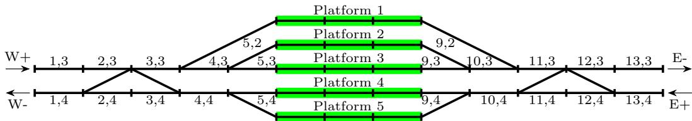  
y station under considFigure 1: Station layout

Figure 2 illustrates four operational stages: entry waiting, arrival and dwell, departure waiting, and departure with resource release. Trains occupy and release sections sequentially along their selected routes. Waiting occurs at the entry or on a platform track. Routes and movement sequences must be coordinated when trains share throat or platform-track resources. Following a disruption, rescheduling adjusts routes, sequences, and timings.

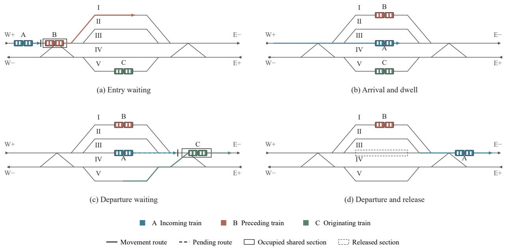  
Figure 2: In-station train operations

Let I denote the set of trains, $P _ { i }$ the set of feasible routes for train i, and R the set of controlled resources. The planned completion time of train i in the reference schedule $P _ { 0 }$ is $C _ { i } ^ { 0 }$ . Table 1 lists the main notation. All time quantities in the model are expressed in seconds.

Table 1: Main notation
<table><tr><td>Symbol</td><td>Definition</td></tr><tr><td> $I , I _ { k } ^ { \mathrm { u } }$ </td><td>Set of all trains; set of trains not yet started at update  $k$ </td></tr><tr><td> $P _ { i } , \ B _ { i p }$ </td><td>Feasible routes for train ¿; ordered sections of route p</td></tr><tr><td> $\mathcal { R } , \ r$ </td><td>Set of controlled resources and resource index</td></tr><tr><td> $t _ { k } , \mathcal { H } _ { k }$ </td><td>Time of update k and information history available at that time</td></tr><tr><td> $R _ { k }$ </td><td>Remaining closure duration at update k</td></tr><tr><td> $\Omega _ { k } , \widehat { p } _ { k \omega }$ </td><td>Conditional scenario set and nominal probability of scenario ω</td></tr><tr><td> $C _ { i } ^ { 0 }$ </td><td>Completion time of train ¿ in the reference schedule  $P _ { 0 }$ </td></tr><tr><td> $\Delta _ { i } ^ { A } , \Delta _ { i } ^ { D }$ </td><td>Exogenous arrival delay and additional required processing time</td></tr><tr><td> $x _ { i p n } , h _ { i n }$ </td><td>Binary variables for starting at node n on route  $p ,$  and for starting at node n</td></tr><tr><td> $s _ { i b \omega } , ~ f _ { i b \omega }$ </td><td>Start and release times of train i on section b in scenario ω</td></tr><tr><td> $d _ { i \omega }$ </td><td>Dwell and waiting duration of train ¿ in scenario ω</td></tr><tr><td> $C _ { i \omega } , ~ D _ { i \omega }$ </td><td>Completion time and completion delay of train i in scenario ω</td></tr><tr><td> $\pi , \ L _ { \omega } ( \pi )$ </td><td>Scheduling policy and its total completion delay in scenario ω</td></tr><tr><td> $\rho , \mathcal { P } _ { k }$ </td><td>Scenario probability deviation radius and probability ambiguity set</td></tr></table>

## 3.2 Distributionally robust train rescheduling model

## 3.2.1 Uncertainty and information structure

Resource closures, arrival delays, and processing-time extensions jointly affect station operations. Dispatchers adjust train holding, routing, and sequencing using the available train states and observations of disruption resolution. Uncertainty in reopening times affects subsequent train completion times and delays through resource occupancy and the connections between operations.

Let $\mathcal { H } _ { k }$ denote the information available at time $t _ { k }$ and $R _ { k }$ the remaining closure duration. Its conditional distribution is:

$$
F _ { k } ( u ) = \operatorname* { P r } ( R _ { k } \leq u \mid \mathcal { H } _ { k } ) .\tag{1}
$$

The conditional scenario set $\Omega _ { k }$ and nominal probabilities $\widehat { p } _ { k \omega }$ are constructed from $F _ { k }$ . Each scenario contains resource reopening times and subsequent observation sequences. Scenarios with identical observation histories share an information node $n \in \mathcal { N } _ { k }$ . Node n corresponds to the interval $[ \ell _ { n } , u _ { n } )$ , and Path(ω) denotes the nodes visited by scenario $\omega .$

Decisions can depend only on the information available at the time. Let $\sigma _ { \omega \omega ^ { \prime } }$ be the first time at which observations distinguish scenarios ω and $\omega ^ { \prime }$ . Set $\sigma _ { \omega \omega ^ { \prime } } = \infty$ if they remain indistinguishable. Let $s _ { i \omega } ^ { \mathrm { s t a r t } }$ be the train start time, $a _ { i p \omega }$ indicate the use of route $p ,$ and $\zeta _ { i p \omega }$ be the departure start time on that route. Nonanticipativity requires:

$$
\begin{array} { r l } & { \operatorname* { m i n } \{ s _ { i \omega } ^ { \mathrm { s t a r t } } , s _ { i \omega ^ { \prime } } ^ { \mathrm { s t a r t } } \} < \sigma _ { \omega \omega ^ { \prime } } \implies \left\{ \begin{array} { l l } { s _ { i \omega } ^ { \mathrm { s t a r t } } = s _ { i \omega ^ { \prime } } ^ { \mathrm { s t a r t } } , } \\ { a _ { i p \omega } = a _ { i p \omega ^ { \prime } } , } \end{array} \right. ~ p \in P _ { i } ; } \\ { a _ { i p \omega } = a _ { i p \omega ^ { \prime } } = 1 , \quad \operatorname* { m i n } \{ \zeta _ { i p \omega } , \zeta _ { i p \omega ^ { \prime } } \} < \sigma _ { \omega \omega ^ { \prime } } \implies \zeta _ { i p \omega } = \zeta _ { i p \omega ^ { \prime } } . } \end{array}\tag{2}
$$

A scheduling policy satisfying these nonanticipativity constraints is denoted by π.

## 3.2.2 Objective and constraints

To account for errors in conditional scenario probabilities, we construct an $L _ { 1 }$ ambiguity set around the nominal probabilities $\widehat { p } _ { k }$ :

$$
\mathcal { P } _ { k } = \left\{ p \geq 0 : \mathbf { 1 } ^ { \top } p = 1 , \quad \| p - \widehat { p } _ { k } \| _ { 1 } \leq \rho \right\} , \qquad 0 \leq \rho \leq 2 .\tag{3}
$$

Train completion delay and scenario loss are defined as:

$$
D _ { i \omega } = ( C _ { i \omega } - C _ { i } ^ { 0 } ) ^ { + } , \qquad L _ { \omega } ( \pi ) = \sum _ { i \in I } D _ { i \omega } , \qquad ( x ) ^ { + } = \operatorname * { m a x } \{ 0 , x \} .\tag{4}
$$

The objective minimizes the worst-case expected total completion delay:

$$
J _ { k } ^ { * } = \operatorname* { m i n } _ { \pi \in \Pi ( \mathcal { H } _ { k } ) } \operatorname* { m a x } _ { p \in \mathcal { P } _ { k } } \sum _ { \omega \in \Omega _ { k } } p _ { \omega } L _ { \omega } ( \pi ) .\tag{5}
$$

The feasible policy set $\Pi ( \mathcal { H } _ { k } )$ is defined by train-operation constraints, resource-use constraints, and the nonanticipativity constraints in Eq. (2).

Route and start-node selection. For each train $i \in I _ { k } ^ { \mathrm { u } }$ that has not yet started, the route and start-node variables $x _ { i p n } , h _ { i n } \in \{ 0 , 1 \}$ satisfy:

$$
\begin{array} { r l r } { \displaystyle \sum _ { n \in \mathrm { P a t h } ( \omega ) } h _ { i n } = 1 , \quad } & { \displaystyle \sum _ { p \in P _ { i } } x _ { i p n } = h _ { i n } , } \\ { \displaystyle a _ { i p \omega } = \sum _ { n \in \mathrm { P a t h } ( \omega ) } x _ { i p n } , } \\ { \displaystyle \sum _ { n \in \mathrm { P a t h } ( \omega ) } \ell _ { n } h _ { i n } \le s _ { i \omega } ^ { \mathrm { s t a r t } } \le \sum _ { n \in \mathrm { P a t h } ( \omega ) } ( u _ { n } - 1 ) h _ { i n } , } & { \omega \in \Omega _ { k } . } \end{array}\tag{6}
$$

Operation timing and section continuity. The original earliest ready time of train i is $e _ { i } ^ { 0 }$ . Its disrupted ready time is $e _ { i } = e _ { i } ^ { 0 } + \Delta _ { i } ^ { A }$ . Let $\underline { d } _ { i p }$ denote the minimum dwell time on route $p$ under normal conditions. The disrupted minimum processing time $w _ { i p }$ satisfies:

$$
\begin{array} { r l r l } & { s _ { i \omega } ^ { \mathrm { s t a r t } } \geq \operatorname* { m a x } \{ t _ { k } , e _ { i } \} , } & & { i \in I _ { k } ^ { \mathrm { u } } , } \\ & { } & & { \begin{array} { l } { \displaystyle i \mathrm { i s ~ a n ~ o r i g i n a t i n g ~ t r a i n } , } \\ { \displaystyle d _ { i p } + \Delta _ { i } ^ { D } , } & { i \mathrm { i s ~ a n o n - o r i g i n a t i n g ~ t r a i n } , } \end{array} } \\ & { d _ { i \omega } \geq \displaystyle \sum _ { p \in P _ { i } } w _ { i p } a _ { i p \omega } , } & & { d _ { i \omega } = 0 \quad \mathrm { i f ~ } i \mathrm { i s ~ a n ~ o r i g i n a t i n g ~ t r a i n } . } \end{array}\tag{7}
$$

For the selected route $p ,$ let $b _ { 1 }$ be its first section and $b ^ { + }$ the successor of section b. Parameters $\tau _ { b }$ and $o _ { b }$ denote the required section time and transition offset, respectively. The indicator $u _ { b }$ identifies the dwell section, and $v _ { i p }$ is the

fixed running time of the route. Section occupancy and train completion times satisfy:

$$
\begin{array} { r l r } & { } & { s _ { i b _ { 1 } \omega } = s _ { i \omega } ^ { \mathrm { s t a r t } } , } \\ & { } & { f _ { i b \omega } = s _ { i b \omega } + \tau _ { b } + u _ { b } d _ { i \omega } , \quad b \in B _ { i p } , } \\ & { } & { s _ { i , b ^ { + } , \omega } = f _ { i b \omega } + o _ { b ^ { + } } , } \\ & { } & { C _ { i \omega } = s _ { i \omega } ^ { \mathrm { s t a r t } } + v _ { i p } + d _ { i \omega } . } \end{array}\tag{8}
$$

The departure start time $\zeta _ { i p \omega }$ is the start time of the first departure section after the dwell section. Time variables take integer-second values. Section times lie within the planning interval $[ t ^ { - } , H ]$ , where t− is the batch start time and H is the planning horizon.

Resource occupancy and closures. Let r(b) denote the resource associated with section b. The reservation endpoints for a section on the selected route are $\widetilde { s } _ { i b \omega }$ and $\widetilde { f } _ { i b \omega }$ . They normally equal $s _ { i b \omega }$ and $f _ { i b \omega }$ . For platform occupancy, the left endpoint is t− for originating trains, and the right endpoint is H for terminating trains. Resource reservations and mutual exclusion satisfy:

$$
\begin{array} { r l r } & { \mathcal { T } _ { i r \omega } = \underset { b \in B _ { i p } } { \bigcup } [ \widetilde s _ { i b \omega } , \widetilde f _ { i b \omega } ) , } & { a _ { i p \omega } = 1 , } \\ & { \qquad r ( b ) = r } & \\ & { \qquad \mathcal { T } _ { i r \omega } \cap \mathcal { T } _ { j r \omega } = \mathcal { O } , \quad } & { i \neq j , \quad r \in \mathcal { R } . } \end{array}\tag{9}
$$

If resource r is closed over $[ a _ { r } , b _ { r \omega } )$ , entry to the resource is restricted by:

$$
s _ { i b \omega } \leq a _ { r } - 1 \quad \mathrm { o r } \quad s _ { i b \omega } \geq b _ { r \omega } , \quad \quad r ( b ) = r .\tag{10}
$$

Closure constraints apply to sections entering closed resources along the selected route. Platform occupancy that has already begun for originating trains is retained. Let $\mathcal { R } _ { i p } ^ { \mathrm { i n } }$ and $\mathcal { R } _ { i p } ^ { \mathrm { o u t } }$ denote the resources entered during the continuous arrival and departure movements, respectively. For a closure with $t _ { k } \in [ a _ { r } , b _ { r \omega } )$ , the corresponding movements that have not yet started satisfy:

$$
\begin{array} { r l } & { a _ { i p \omega } = 1 \implies s _ { i \omega } ^ { \mathrm { s t a r t } } \geq b _ { r \omega } , \quad r \in \mathcal { R } _ { i p } ^ { \mathrm { i n } } , \quad i \in I _ { k } ^ { \mathrm { u } } , } \\ & { a _ { i p \omega } = 1 \implies \zeta _ { i p \omega } \geq b _ { r \omega } , \quad r \in \mathcal { R } _ { i p } ^ { \mathrm { o u t } } . } \end{array}\tag{11}
$$

Consecutive trains $( i , j ) \in \mathcal { E }$ at the same entry retain their prescribed order:

$$
s _ { i \omega } ^ { \mathrm { s t a r t } } \leq s _ { j \omega } ^ { \mathrm { s t a r t } } , \qquad ( i , j ) \in \mathcal { E } , \quad \omega \in \Omega _ { k } .\tag{12}
$$

Executed operations. Let $I _ { k } ^ { \mathrm { s } }$ be the set of trains that have started. Sets $\mathcal { I } _ { k } ^ { \mathrm { e n d } }$ and $\mathcal { T } _ { k } ^ { \mathrm { { o c c } } }$ contain completed and ongoing section operations, respectively. The superscript act denotes actual routes, start times, and section times. Confirmed routes remain unchanged. All scenarios retain:

$$
\begin{array} { r l r l } & { a _ { i , p _ { i } ^ { \mathrm { a c t } } , \omega } = 1 , } & { s _ { i \omega } ^ { \mathrm { s t a r t } } = s _ { i } ^ { \mathrm { a c t } } , } & { i \in I _ { k } ^ { \mathrm { s } } , } \\ & { \quad s _ { i b \omega } = s _ { i b } ^ { \mathrm { a c t } } , } & { f _ { i b \omega } = f _ { i b } ^ { \mathrm { a c t } } , } & { ( i , b ) \in \mathcal { T } _ { k } ^ { \mathrm { e n d } } , } \\ & { \quad s _ { i b \omega } = s _ { i b } ^ { \mathrm { a c t } } , } & { f _ { i b \omega } \geq t _ { k } + 1 , } & { ( i , b ) \in \mathcal { T } _ { k } ^ { \mathrm { o c c } } . } \end{array}\tag{13}
$$

## 3.3 Graph learning-assisted logic-based Benders decomposition

## 3.3.1 Master problem and joint scheduling subproblem

Logic-based Benders decomposition coordinates routing and resource scheduling. Resource lower bounds and conditional cuts strengthen the master problem, while graph learning guides resource ordering. The algorithm is denoted by GNN-LBBD, and its framework is shown in Fig. 3.

Let $b = ( x _ { i p n } ) \in B _ { k }$ . The earliest completion times $\underline { { C } } _ { i p n \omega } .$ , obtained without resource competition, give the initial scenario lower bound:

$$
\underline { { L } } _ { \omega } ^ { 0 } ( b ) = \sum _ { i \in I _ { k } ^ { \mathrm { u } } } \sum _ { n \in \mathrm { P a t h } ( \omega ) } \sum _ { p \in P _ { i } } ( \underline { { C } } _ { i p n \omega } - C _ { i } ^ { 0 } ) ^ { + } x _ { i p n } .\tag{14}
$$

The set $\boldsymbol { B } _ { k }$ retains necessary conditions on route choice, start-time windows, and entry order. The calculation of $\underline { { C } } _ { i p n \omega }$ retains ready times, minimum processing times, and route closure conditions. Choices with no feasible start-time window are removed from $\boldsymbol { B } _ { k }$ . Let $\underline { { s } } _ { i p n \omega }$ be the corresponding earliest start time. A necessary condition for the prescribed order at the same entry is:

$$
\sum _ { \stackrel { n \in \mathrm { P a t h } ( \omega ) } { p \in P _ { i } } } \underline { { s } } _ { i p n \omega } x _ { i p n } \leq \sum _ { \stackrel { n \in \mathrm { P a t h } ( \omega ) } { p \in P _ { j } } } ( u _ { n } - 1 ) x _ { j p n } , \qquad ( i , j ) \in \mathcal { E } .\tag{15}
$$

b Graph-guided resource scoring

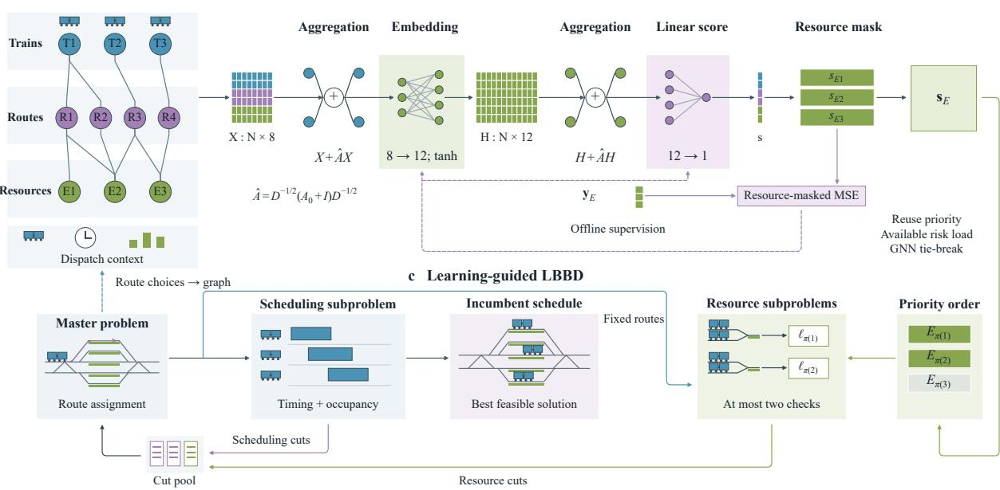  
Figure 3: GNN-LBBD framework

For trains that have started, the corresponding start-time endpoints take their actual values.

Let $\eta _ { \omega }$ and θ be lower-bound variables for scenario loss and the robust objective, respectively. Given a set of probability vectors $\mathcal { V } _ { k } \subseteq \mathcal { P } _ { k }$ and a set of Benders cuts $\mathcal { C } _ { k } .$ , the master problem is:

$$
\begin{array} { r l } { \underset { b , \eta , \theta } { \operatorname* { m i n } } } & { \theta } \\ { \mathrm { s . t . } } & { b \in \mathcal { B } _ { k } , \quad \quad \eta _ { \omega } \geq \underline { { L } } _ { \omega } ^ { 0 } ( b ) , } \\ & { \theta \geq \displaystyle \sum _ { \omega \in \Omega _ { k } } p _ { \omega } \eta _ { \omega } , \quad \quad p \in \mathcal { V } _ { k } , } \\ & { \left( b , \eta , \theta \right) \mathrm { s a t i s f i e s } \mathcal { C } _ { k } , \quad \quad \eta \geq 0 , \quad \theta \geq 0 . } \end{array}\tag{16}
$$

Initially, $\mathcal { V } _ { k } = \{ \widehat { p } _ { k } \}$ . After obtaining a candidate solution, we solve:

$$
p ^ { * } \in \arg \operatorname* { m a x } _ { p \in \mathcal { P } _ { k } } p ^ { \top } \eta .\tag{17}
$$

If $( p ^ { * } ) ^ { \top } \eta > \theta .$ , we add $p ^ { * }$ to $\nu _ { k }$ and resolve the master problem.

Let $\begin{array} { r } { \bar { a } _ { i p \omega } = \sum _ { n \in \mathrm { P a t h } ( \omega ) } \bar { x } _ { i p n } } \end{array}$ denote the candidate routes. The joint subproblem fixes the route in each scenario and optimizes start intervals, resource-use sequences, and operation times:

$$
Q _ { k } ( \bar { a } ) = \operatorname* { m i n } _ { \pi \in \Pi ( \mathcal { H } _ { k } ) } \operatorname* { m a x } _ { p \in \mathcal { P } _ { k } } \sum _ { \omega \in \Omega _ { k } } p _ { \omega } L _ { \omega } ( \pi ) .\tag{18}
$$

The joint subproblem is solved with CP-SAT and iterative separation of worst-case probabilities.

Let $L B _ { k }$ be a valid master lower bound and $U B _ { k }$ the worst-case expected loss of the incumbent feasible policy $\pi ^ { \mathrm { b e s t } }$ Then:

$$
L B _ { k } \le J _ { k } ^ { * } \le U B _ { k } = \operatorname* { m a x } _ { p \in \mathcal { P } _ { k } } \sum _ { \omega } p _ { \omega } L _ { \omega } \big ( \pi ^ { \mathrm { b e s t } } \big ) .\tag{19}
$$

## 3.3.2 Resource lower bounds and conditional cuts

Conditioning on train–resource use extends single-resource scheduling lower bounds to different route combinations.

Let $\bar { p } _ { i \omega }$ be the candidate route. Deviation from the candidate route combination is measured by:

$$
\Delta _ { a } ( b , \bar { a } ) = \sum _ { \omega \in \Omega _ { k } } \sum _ { i \in I _ { k } ^ { \mathrm { u } } } \left[ 1 - a _ { i , \bar { p } _ { i \omega } , \omega } ( b ) \right] .\tag{20}
$$

A valid subproblem lower bound $\underline { { Q } } _ { k } ( \bar { a } )$ or a proof of route-combination infeasibility yields the following cuts, respectively:

$$
\theta \geq \underline { { { Q } } } _ { k } ( \bar { a } ) [ 1 - \Delta _ { a } ( b , \bar { a } ) ] \quad ( \mathrm { o p t i m a l i t y \ c u t } ) ,\tag{21}
$$

$$
\Delta _ { a } ( b , \bar { a } ) \geq 1 \qquad \mathrm { ( f e a s i b i l i t y ~ c u t ) . }
$$

The train-use pattern of resource r in the candidate route combination is:

$$
\begin{array} { r } { S _ { r } ( \bar { a } ) = \{ ( i , \omega ) : i \in I _ { k } ^ { \mathrm { u } } , r \in \mathscr { R } _ { i \bar { p } _ { i \omega } } \} , } \end{array}\tag{22}
$$

Here, $\mathcal { R } _ { i p }$ is the resource set of route $p .$ In the single-resource relaxation, these trains may choose any feasible route using r. All other trains without fixed routes retain their full route sets:

$$
P _ { i r \omega } ^ { \mathrm { r e l } } = \left\{ \begin{array} { l l } { \{ p _ { i } ^ { \mathrm { f i x } } \} , } & { i ^ { \mathrm { : } } \mathrm { s ~ r o u t e ~ i m p l e n } } \\ { \{ p \in P _ { i } : r \in \mathcal { R } _ { i p } \} , } & { ( i , \omega ) \in \mathcal { S } _ { r } ( \bar { a } ) , } \\ { P _ { i } , } & { \mathrm { o t h e r w i s e } . } \end{array} \right.\tag{23}
$$

The relaxation retains ready times and required processing times for all trains. Inter-train mutual exclusion is retained only on resource $r ,$ and each scenario is solved separately. Let $\xi _ { i p \omega }$ denote local route choices and mark other loca variables with ˇ·. The single-resource model is:

$$
\begin{array} { r l } { \mathcal { Q } _ { \mathrm { c o s } } ( S _ { r } ) = \displaystyle \operatorname* { m i n } _ { \xi , s , i \neq \hat { \imath } , i } } & { \displaystyle \sum _ { \ell \neq l } \hat { D } _ { \omega \ell } } \\ { \mathrm { s . t . } \quad } & { \displaystyle \sum _ { \ell \neq l } \sum _ { \ell \neq l \neq 0 } = 1 , \quad \xi _ { i j \omega \in \ell } \left\{ 0 , 1 \right\} , } \\ & { \displaystyle \sum _ { \ell \neq l } \sum _ { \ell \neq l } \operatorname* { m a x } \{ t , e _ { i } \} , \quad \quad \hat { \varepsilon } _ { i } \in I _ { \ell } ^ { n } , } \\ & { \displaystyle \sum _ { \ell \neq l } \sum _ { \ell \neq l } \operatorname* { m a x } \{ t , e _ { i } \} , \quad \quad \hat { \mathcal { J } } _ { i \omega } = 0 \mathrm { ~ i f ~ } i \mathrm { ~ s ~ a n ~ o n i g n i n a t i n g ~ t r a i n } , } \\ & { \displaystyle \sum _ { \ell \neq l } \sum _ { \ell \neq l } \operatorname* { m a x } _ { \ell , j \neq l \neq l } \sum _ { \ell \neq l } \hat { \mathcal { J } } _ { i \omega } \leq \hat { d } _ { \omega \ell } \partial _ { \ell } \hat { \mathcal { J } } _ { i \omega } , } \\ & { \displaystyle \hat { C } _ { i \omega } = \frac { \partial _ { \ell } + \partial _ { \ell } + \partial _ { \ell } } { \partial _ { \ell } } + \sum _ { \ell \neq l \neq l } \eta _ { \ell } \partial _ { \ell } \hat { \mathcal { J } } _ { i \omega \in } \hat { d } _ { i \omega , \ell } } \\ & { \displaystyle \hat { D } _ { \omega \ell } \leq \hat { C } _ { i \omega } - C _ { \phi } , \quad \hat { D } _ { \omega \ell } \geq 0 , } \\ & { \displaystyle \hat { T } _ { i \omega } > \hat { T } _ { i \omega } = \phi , \quad \hat { \mathcal { J } } _ { i \omega } \geq \hat { \mathcal { J } } _ { i \omega } } \\ &  \displaystyle \hat { S } _ { i \omega } \leq \hat { \omega } \end{array}\tag{24}
$$

Local section times and reservation intervals follow Eqs. (8) and (9). Section constraints apply only to selected routes. Actual train start times and section times already realized on resource r are retained as in Eq. (13). Inter-train mutual exclusion on other resources, start-node time windows, and nonanticipativity across scenarios are relaxed.

The resource-use condition is expressed as:

$$
\begin{array} { c } { { \ell _ { i \omega } ^ { r } ( b ) = \displaystyle \sum _ { n \in \mathrm { P a t h } ( \omega ) } \sum _ { p \in P _ { i } : r \in { \mathcal R } _ { i p } } x _ { i p n } , \hfill } } \\ { { \chi _ { r } ( b ; \bar { a } ) = \displaystyle \sum _ { ( i , \omega ) \in { \mathcal S } _ { r } ( \bar { a } ) } \ell _ { i \omega } ^ { r } ( b ) - | { \mathcal S } _ { r } ( \bar { a } ) | + 1 . \hfill } } \end{array}\tag{25}
$$

The route-choice constraints imply $\ell _ { i \omega } ^ { r } \in \{ 0 , 1 \}$ . If all resource-use relations in the candidate combination hold, $\chi _ { r } = 1$ otherwise, $\chi _ { r } \leq 0$ . Let $\underline { { L } } _ { r \omega } \geq 0$ be a valid lower bound obtained from Eq. (24). We add the conditional cuts:

$$
\eta _ { \omega } \geq \underline { { L } } _ { r \omega } \chi _ { r } ( b ; \bar { a } ) , \qquad \omega \in \Omega _ { k } ,
$$

$$
\theta \geq \left[ \operatorname* { m a x } _ { p \in \mathcal { P } _ { k } } \sum _ { \omega \in \Omega _ { k } } p _ { \omega } \underline { { L } } _ { r \omega } \right] \chi _ { r } ( b ; \bar { a } ) .\tag{26}
$$

When $\chi _ { r } = 1$ , any feasible schedule of the full problem satisfies the constraints retained in the single-resource model. Hence:

$$
\begin{array} { r } { \underline { { L } } _ { r \omega } \leq Q _ { r \omega } ( S _ { r } ) \leq L _ { \omega } ( \pi ) , \qquad \omega \in \Omega _ { k } . } \end{array}\tag{27}
$$

Nonnegative probabilities allow maximization over $\mathcal { P } _ { k }$ to yield a robust lower bound. When $\chi _ { r } \leq 0$ , the right-hand sides of the cuts are nonpositive. Their validity then follows from $\eta _ { \omega } , \theta \geq 0$

## 3.3.3 Graph learning-assisted resource ordering

The lower-bound gain and solution time of a resource relaxation vary across resources. We construct a train–route– resource graph and learn the lower-bound gain per unit of solution time. Trains connect to their feasible routes, and routes connect to the resources they use.

Let $X$ be the node feature matrix. It encodes node types, ready and processing times, route choices, resource loads, and closure conditions. Let A be the adjacency matrix with self-loops and $D _ { A }$ its degree matrix. With weights $W _ { 0 } , w _ { 1 }$ and biases $b _ { 0 } , b _ { 1 }$ , the network computes:

$$
\begin{array} { r } { \widetilde { A } = D _ { A } ^ { - 1 / 2 } A D _ { A } ^ { - 1 / 2 } , \qquad } \\ { H _ { G } = \operatorname { t a n h } \Bigl [ ( X + \widetilde { A } X ) W _ { 0 } + \mathbf { 1 } b _ { 0 } ^ { \top } \Bigr ] , } \\ { \widehat { y } = ( H _ { G } + \widetilde { A } H _ { G } ) w _ { 1 } + b _ { 1 } \mathbf { 1 } . \qquad } \end{array}\tag{28}
$$

The output for resource node r is denoted by $\widehat { y _ { r } }$ .

For training sample $\nu ,$ the resource relaxation yields a robust lower bound $\underline { { L } } _ { \nu r }$ and solution time $c _ { \nu r } .$ Let $B _ { \nu }$ be the nominal expected loss obtained from independent earliest train completions, and let $\epsilon _ { c }$ be a lower threshold on solution time. The normalized supervision label is:

$$
g _ { \nu r } = \frac { ( \underline { { L } } _ { \nu r } - B _ { \nu } ) ^ { + } } { \mathrm { m a x } \{ \epsilon _ { c } , c _ { \nu r } \} } , \qquad y _ { \nu r } = \frac { g _ { \nu r } } { \mathrm { m a x } \{ 1 , \mathrm { m a x } _ { v } g _ { \nu v } \} } .\tag{29}
$$

For $N _ { \mathrm { t r } }$ training samples with valid resource label sets $\mathcal { R } _ { \nu } ^ { \mathrm { l a b } }$ , the training objective is:

$$
\mathcal { I } = \frac { 1 } { N _ { \mathrm { t r } } } \sum _ { \nu = 1 } ^ { N _ { \mathrm { t r } } } \frac { 1 } { | \mathcal { R } _ { \nu } ^ { \mathrm { l a b } } | } \sum _ { r \in \mathcal { R } _ { \nu } ^ { \mathrm { l a b } } } ( \widehat { y } _ { \nu r } - y _ { \nu r } ) ^ { 2 } .\tag{30}
$$

During rescheduling, if $\rho > 0$ and the incumbent feasible policy yields worst-case probabilities $p ^ { * }$ , we calculate the resource risk load:

$$
\lambda _ { r } = \sum _ { \omega \in \Omega _ { k } } p _ { \omega } ^ { * } \sum _ { i \in I _ { k } ^ { \mathrm { u } } } \mathbf { 1 } \{ r \in \mathcal { R } _ { i \bar { p } _ { i \omega } } \} .\tag{31}
$$

Resources are ordered by decreasing $\lambda _ { r }$ , with graph-predicted scores breaking ties. In other cases, resources are ordered by their graph-predicted scores.

## Algorithm 1 GNN-LBBD solution algorithm

Step 1: Input the current information $\mathcal { H } _ { k }$ , actual operational state, reference schedule $P _ { 0 } .$ , graph model, and computation budget. Construct conditional scenarios and information nodes. Generate an initial feasible policy using the scheduling heuristic. If the reopening time is known and the initial loss is positive, improve timings and sequences for the current routes. Compute $U B _ { k }$ and set $L B _ { k } = 0$

Step 2: Build the master problem and retain previous cuts that remain valid for the current scenarios and operational state.

Step 3: Solve the master problem and update $L B _ { k } ,$ . Separate worst-case probabilities using Eq. (17). If a probability constraint is violated, add it to the master problem and return to Step 3.

Step 4: Fix the candidate scenario routes and solve the joint scheduling subproblem. Update $U B _ { k }$ using a feasible policy. Generate a route-combination cut from a valid lower bound or proven infeasibility.

Step 5: Solve selected single-resource relaxations in resource-priority order within the remaining budget. Store scenario lower bounds and add resource conditional cuts.

Step 6: Repeat Steps 3–5 until the computation budget is exhausted or $U B _ { k } - L B _ { k } \le \varepsilon$

Step 7: Return the incumbent best feasible policy and $L B _ { k } , U B _ { k }$

## 4 Numerical experiments and results

## 4.1 Experimental design

## 4.1.1 Test instances and settings

The experiments use the public CP2025 in-station train dispatching benchmark of Schutt et al. The dataset contains 141 instances with 1–50 trains each. All instances use the same station with five platform tracks and 45 controlled sections.

The inputs include train types, earliest ready times, feasible routes, section-occupancy sequences, and minimum running and dwell times.

The instances are divided into 85 training, 28 validation, and 28 test instances. The graph model generates labels and is trained using only the training instances. The test set contains one instance for each train count from 1 to 22, and one each for 25, 30, 35, 40, 45, and 50 trains. The reference schedule $P _ { 0 }$ is generated by a first-come, first-served rule. All algorithms start rescheduling from the same pre-disruption operational state.

Tabu search (TS) and variable neighborhood search (VNS) serve as the comparison algorithms. TS constructs neighborhoods through feasible rerouting, resource-order adjustments, and joint changes to small task subsets. It uses tabu memory and an aspiration criterion. VNS combines perturbation, local improvement, and neighborhood changes. Both algorithms use the same initial scheduling heuristic, permitted scheduling actions, and conditional predictions. Candidate solutions are evaluated with Eq. (5).

Table 2 summarizes the experiment groups and comparisons. The representative instances cover fixed routes, alternative routes, and concentrated near-term operations. Each group considers platform-track and throat closures separately. Algorithm comparisons use the same computation budget for rescheduling.

Table 2: Experimental groups and comparison settings
<table><tr><td>Experiment</td><td>Instances</td><td>Comparison</td><td>Event seeds</td></tr><tr><td>Algorithm comparison</td><td>All 28 test instances t005-06, t006-06</td><td>GNN-LBBD, TS, and VNS</td><td>2001-2005</td></tr><tr><td>Disturbance combinations</td><td>t013-06, t019-06 t040-03, t045-03</td><td>Eight presence/absence combinations of closures, arrival delays, and processing-time extensions</td><td>2001-2005</td></tr><tr><td>Value of information</td><td>t005-06, t006-06 t013-06, t019-06 t040-03, t045-03</td><td>With stage observations: scenario-based and conditional-mean predictions; without stage observations: scenario-based prediction</td><td>2001-2005</td></tr><tr><td>Component ablation</td><td>t005-06, t019-06 t040-03, t045-03</td><td>LBBD with resource lower bounds and cut strengthening, followed by GNN-assisted resource ordering</td><td>2001-2005</td></tr><tr><td>Sensitivity analysis</td><td>t005-06, t019-06 t040-03, t045-03</td><td>Closure-duration scale: 0.5, 1, 2; direct-increment scale: 0.5, 1, 1.5</td><td>2001-2005</td></tr><tr><td>Distribution shift</td><td>t005-06, t019-06 t040-03, t045-03</td><td>Actual closure-duration scale: 0.5, 1, 2; predicted scale: 1; ρ = 0, 0.2</td><td>3001-3005</td></tr></table>

Let $C _ { i }$ be the actual completion time of train i. Rescheduling outcomes are evaluated by total completion delay L, maximum train delay $D _ { \mathrm { m a x } } .$ , on-time completion rate $P _ { \mathrm { o n } } .$ final completion extension $E _ { \mathrm { t a i l } }$ , and delayed-train backlog B(t):

$$
L = \frac { 1 } { 6 0 } \sum _ { i \in I } ( C _ { i } - C _ { i } ^ { 0 } ) ^ { + } , \qquad D _ { \operatorname * { m a x } } = \frac { 1 } { 6 0 } \operatorname * { m a x } _ { i \in I } ( C _ { i } - C _ { i } ^ { 0 } ) ^ { + } ,
$$

$$
P _ { \mathrm { o n } } = \frac { | \{ i \in I : C _ { i } \leq C _ { i } ^ { 0 } \} | } { | I | } , \qquad E _ { \mathrm { t a i l } } = \frac { ( \operatorname* { m a x } _ { i } C _ { i } - \operatorname* { m a x } _ { i } C _ { i } ^ { 0 } ) ^ { + } } { 6 0 } ,\tag{32}
$$

$$
B ( t ) = \sum _ { i \in I } { \bf 1 } \{ C _ { i } ^ { 0 } \leq t < C _ { i } \} .
$$

The unit of L is train-min. Both $D _ { \mathrm { m a x } }$ and $E _ { \mathrm { t a i l } }$ are measured in minutes, and $B ( t )$ is measured in trains. A train is on time if it completes no later than in $P _ { 0 }$ . The external entry queue contains trains that are ready to enter but have not entered the station. Scheduling waiting time counts only waiting beyond required processing within the observation window.

Table 3 lists the rescheduling and graph neural network training parameters.

The experiments were run on Windows 11 with an Intel64 Family 6 Model 183 processor (32 logical processors), CPython 3.12.14, and OR-Tools 9.15.6755. Each run used one thread, with at most four runs in parallel. Inference during rescheduling was included in the computation budget.

Table 3: Rescheduling and graph neural network training parameters
<table><tr><td>Parameter</td><td>Value</td><td>Parameter</td><td>Value</td></tr><tr><td>Budget per rescheduling call (s)</td><td>5</td><td>Training scenarios</td><td>510</td></tr><tr><td>Periodic check interval (s)</td><td>120</td><td>Supervision labels</td><td>20880</td></tr><tr><td>Post-disruption observation window (s)</td><td>7200</td><td>Training epochs</td><td>200</td></tr><tr><td>Maximum rescheduling rounds</td><td>160</td><td>Learning rate</td><td>0.001</td></tr><tr><td>Prediction and search budget share (%)</td><td>95</td><td>Algorithm seeds</td><td>101,211</td></tr><tr><td>Conditional stratified scenarios</td><td>6</td><td>Probability radius  $\rho$ </td><td>0.2</td></tr><tr><td>Input feature dimension</td><td>8</td><td>Hidden dimension</td><td>12</td></tr><tr><td>Resources checked per round</td><td>2</td><td>Label time threshold (s)</td><td>0.01</td></tr><tr><td>Single-resource time limit (s)</td><td>1</td><td>Termination tolerance (s)</td><td> $1 0 ^ { - 6 }$ </td></tr></table>

## 4.1.2 Disturbance design

We introduce resource closures R, arrival delays A, and required processing-time extensions D into $P _ { 0 }$ to examine resource restrictions and changes in train operating conditions jointly. Each event closes one platform track or one throat resource. The designed number of affected trains ranges from 20% to 60% of the eligible trains for arrival delays and processing-time extensions. The corresponding per-train increments range from 0 to 300 s and from 0 to 200 s. Nominal closure-duration scales are 300, 600, and 1200 s for low, medium, and high disturbance intensities, respectively.

A Bayesian network links the three disturbances through a common latent intensity $Z \in \{ \mathrm { L } , \mathrm { M } , \mathrm { H } \}$ as the parent node. Let $\mathcal { D } _ { A }$ and $\mathcal { D } _ { D }$ contain the affected train sets and their direct increments, and let $T _ { R }$ be the closure duration. Their joint distribution is:

$$
\operatorname* { P r } ( \mathcal { D } _ { \cal A } , \mathcal { D } _ { \cal D } , T _ { \cal R } ) = \sum _ { z } \pi _ { z } \operatorname* { P r } ( \mathcal { D } _ { \cal A } \mid z ) \operatorname* { P r } ( \mathcal { D } _ { \cal D } \mid z ) \operatorname* { P r } ( T _ { \cal R } \mid z ) ,\tag{33}
$$

Here, $\pi _ { z } = \operatorname* { P r } ( Z = z )$

The event time $t _ { 0 }$ is selected using the number of planned operation starts in the following 600 s. Let $s _ { i } ^ { 0 }$ and $p _ { i } ^ { 0 }$ be the planned start time and route of train i. The eligible sets for arrival delays and processing-time extensions are:

$$
\begin{array} { r l } & { \mathcal { E } _ { A } ( t _ { 0 } ) = \{ i \in I : \ i \mathrm { i s ~ a n ~ e x t e r n a l ~ n o n { \mathrm { - o r i g } } i n a t i n g ~ t r a i n } , \ s _ { i } ^ { 0 } \geq t _ { 0 } \} , } \\ & { \mathcal { E } _ { D } ( t _ { 0 } ) = \{ i \in \mathcal { E } _ { A } ( t _ { 0 } ) : \underline { d } _ { i p _ { i } ^ { 0 } } > 0 \} . } \end{array}\tag{34}
$$

The closed resource is selected using its planned usage in the 600 s after the event. A platform-track closure covers its three platform sections. Conditional on $\bar { Z } = z .$ , the affected sets $\mathcal { U } _ { A }$ and $\boldsymbol { \mathcal { U } } _ { D }$ are sampled uniformly without replacement from $\mathcal { E } _ { A }$ and $\mathcal { E } _ { D }$ , respectively. The designed numbers of affected trains and their increments are:

$$
\begin{array} { r l } & { \quad n _ { X } ( z ) = \lceil \alpha _ { z } \vert \mathcal { E } _ { X } \vert \rceil , \qquad X \in \{ A , D \} , } \\ & { \widetilde { \Delta } _ { i } ^ { A } \mid Z = z \sim \mathrm { T N } _ { [ 0 , 3 0 0 ] } \left( 1 5 0 s _ { z } , ( 6 0 s _ { z } ) ^ { 2 } \right) , \quad i \in \mathcal { U } _ { A } , } \\ & { \widetilde { \Delta } _ { i } ^ { D } \mid Z = z \sim \mathrm { T N } _ { [ 0 , 2 0 0 ] } \left( 1 0 0 s _ { z } , ( 4 0 s _ { z } ) ^ { 2 } \right) , \quad i \in \mathcal { U } _ { D } . } \end{array}\tag{35}
$$

The notation $\mathrm { T N } _ { [ l , u ] } ( \mu , \sigma ^ { 2 } )$ denotes a truncated normal distribution, where $\mu$ and σ are the mean and standard deviation before truncation. Increments are sampled independently across trains and rounded to seconds. Table 4 lists the intensity parameters.

Table 4: Disturbance intensity and distribution parameters
<table><tr><td>Intensity z</td><td>Probability  $\pi _ { z }$ </td><td>Increment factor  $s _ { z }$ </td><td>Closure-duration scale  $m _ { z }$  (s)</td><td>Affected proportion  $\alpha _ { z }$ </td></tr><tr><td>Low</td><td>0.25</td><td>0.5</td><td>300</td><td>0.20</td></tr><tr><td>Medium</td><td>0.50</td><td>1.0</td><td>600</td><td>0.40</td></tr><tr><td>High</td><td>0.25</td><td>2.0</td><td>1200</td><td>0.60</td></tr></table>

Disruption resolution is represented by an absorbing Markov chain. The state $S ( t ) \in \{ 1 , 2 , 3 , 4 \}$ comprises three sequential transient states and an absorbing state for resource reopening. The initial state is 1. With a time step of 1 s

and intensity z, the process satisfies:

$$
\begin{array} { l l } { { P _ { z } = \displaystyle \left( \begin{array} { c c c c } { { 1 - q _ { z } } } & { { q _ { z } } } & { { 0 } } & { { 0 } } \\ { { 0 } } & { { 1 - q _ { z } } } & { { q _ { z } } } & { { 0 } } \\ { { 0 } } & { { 0 } } & { { 1 - q _ { z } } } & { { q _ { z } } } \\ { { 0 } } & { { 0 } } & { { 0 } } & { { 1 } } \end{array} \right) , \quad } } & { { q _ { z } = 1 - \mathrm { e x p } ( - 3 / m _ { z } ) , \nonumber } } \\ { { { \cal T } _ { R } = \displaystyle \sum _ { j = 1 } ^ { 3 } G _ { j z } , \quad } } & { { G _ { j z } \stackrel { \mathrm { i i d } } { \sim } \mathrm { G e o m } ( q _ { z } ) . } } \end{array}\tag{36}
$$

The nominal closure-duration scale $m _ { z }$ is given in Table 4. Since $G _ { j z }$ takes positive integer values, $\mathbb { E } [ T _ { R } \ | \ z ] = 3 / q _ { z }$ Stage observation k is collected at $\tau _ { k }$ and received at a after a delay $L _ { k }$ . Observations are collected every 120 s. The delay follows a discrete uniform distribution over 0–60 s:

$$
\begin{array} { r l } & { \tau _ { k } = t _ { 0 } + 1 2 0 k , \quad a _ { k } = \tau _ { k } + L _ { k } , \quad k \geq 1 , \quad \tau _ { k } < t _ { 0 } + T _ { R } , } \\ & { L _ { k } \sim \mathrm { D U } \{ 0 , \dots , 6 0 \} . } \end{array}\tag{37}
$$

Let $H _ { j v }$ be the probability of observing stage v when the true stage is j. The stage misclassification matrix is:

$$
H = \left( \begin{array} { l l l } { 0 . 8 } & { 0 . 1 } & { 0 . 1 } \\ { 0 . 1 } & { 0 . 8 } & { 0 . 1 } \\ { 0 . 1 } & { 0 . 1 } & { 0 . 8 } \end{array} \right) .\tag{38}
$$

Initial arrival delays and processing-time increments provide evidence about disturbance intensity. Stage observations further update the predicted remaining closure duration. Let $\mathcal { D } _ { 0 }$ be the initial evidence and $\dot { \mathcal { L } } _ { z } ( \mathcal { D } _ { 0 } )$ its likelihood under intensity z.

Let $Y _ { \ell }$ be stage observation ℓ. The observations available by $t _ { k }$ are $\mathcal { O } _ { k } = \{ ( \tau _ { \ell } , Y _ { \ell } ) : a _ { \ell } \leq t _ { k } \}$ . While the resource remains closed, the joint posterior of intensity and current stage is:

$$
\begin{array} { r l } & { \varphi _ { k } ( z , j ) = \pi _ { z } \mathcal { L } _ { z } ( \mathcal { D } _ { 0 } ) \operatorname* { P r } ( S ( t _ { k } ) = j , \mathcal { O } _ { k } \mid Z = z ) , } \\ & { \beta _ { k } ( z , j ) = \frac { \varphi _ { k } ( z , j ) } { \sum _ { z ^ { \prime } } \sum _ { h = 1 } ^ { 3 } \varphi _ { k } ( z ^ { \prime } , h ) } , \qquad j = 1 , 2 , 3 . } \end{array}\tag{39}
$$

Bayesian filtering combines $P _ { z }$ and H to update the state distribution at observation collection times and propagate it to the current decision time. The initial evidence likelihood is computed from the number of affected trains and the rounded increments.

Let $Q _ { z }$ be the transient submatrix of $P _ { z } , \beta _ { k } ( z ) = ( \beta _ { k } ( z , 1 ) , \beta _ { k } ( z , 2 ) , \beta _ { k } ( z , 3 ) )$ , and $I _ { 3 }$ the identity matrix of order three. The conditional distribution and mean of the remaining closure duration satisfy:

$$
\begin{array} { r l } & { \operatorname* { P r } ( R _ { k } > u \mid \mathcal { H } _ { k } ) = \displaystyle \sum _ { z } \beta _ { k } ( z ) Q _ { z } ^ { u } \mathbf { 1 } , \quad u \in \mathbb { Z } _ { \ge 0 } , } \\ & { \qquad \mathbb { E } [ R _ { k } \mid \mathcal { H } _ { k } ] = \displaystyle \sum _ { z } \beta _ { k } ( z ) ( I _ { 3 } - Q _ { z } ) ^ { - 1 } \mathbf { 1 } . } \end{array}\tag{40}
$$

Scenario-based prediction uses stratified sampling over conditional quantile intervals to generate reopening times and subsequent observation sequences. Each scenario has nominal probability $1 / | \Omega _ { k } |$ |. Conditional-mean prediction represents the reopening time using the mean in Eq. (40).

## 4.2 Algorithm comparison and ablation analysis

## 4.2.1 Rescheduling performance and computation time

We compare GNN-LBBD, TS, and VNS under identical reference schedules, disturbances, and computation budgets to assess their ability to reduce train delays within a limited computation time. Table 5 summarizes the aggregate scheduling and computational metrics. Figures 4–6 show total completion delay, on-time completion rates and external entry queues for each instance, and total computation time per event, respectively.

Table 5: Rescheduling performance of the algorithms
<table><tr><td>Metric</td><td>GNN-LBBD</td><td>TS</td><td>VNS</td></tr><tr><td>Total completion delay (train-min)</td><td>61.13</td><td>73.33</td><td>76.47</td></tr><tr><td>Maximum train delay (min)</td><td>10.31</td><td>10.53</td><td>10.70</td></tr><tr><td>Delayed trains (trains)</td><td>7.30</td><td>7.79</td><td>7.86</td></tr><tr><td>On-time completion rate (%)</td><td>50.30</td><td>47.96</td><td>47.46</td></tr><tr><td>Final completion extension (min)</td><td>5.79</td><td>6.42</td><td>6.65</td></tr><tr><td>Total scheduling waiting time (train-min)</td><td>83.47</td><td>95.83</td><td>98.97</td></tr><tr><td>Maximum delayed-train backlog (trains)</td><td>4.25</td><td>4.82</td><td>4.93</td></tr><tr><td>Mean entry delay (min)</td><td>3.63</td><td>4.21</td><td>4.31</td></tr><tr><td>Total rescheduling computation time (s)</td><td>46.15</td><td>46.42</td><td>59.91</td></tr></table>

GNN-LBBD achieved lower total completion delay together with less total scheduling waiting time. In Table 5, its mean total completion delay was 61.13 train-min, 16.63% below TS and 20.06% below VNS. Its total scheduling waiting time was 83.47 train-min, compared with 95.83 and 98.97 train-min for the two comparison methods. Relative to TS, completion delay and scheduling waiting time decreased by 12.20 and 12.36 train-min, respectively. Relative to VNS, the reductions were 15.34 and 15.51 train-min. The similar magnitudes of these reductions suggest that waiting arrangements are an important factor in explaining the total delay differences between the algorithms.

The reduction in total waiting time was accompanied by improvements in on-time completion and the final completion time. GNN-LBBD achieved an on-time completion rate of 50.30%, compared with 47.96% for TS and 47.46% for VNS. Its final completion extension was 5.79 min, compared with 6.42 and 6.65 min for the two comparison methods. The scheduling benefits therefore include both more trains completing as planned and an earlier completion of the final operations. They concern punctuality during the operating period as well as the end time of the full batch.

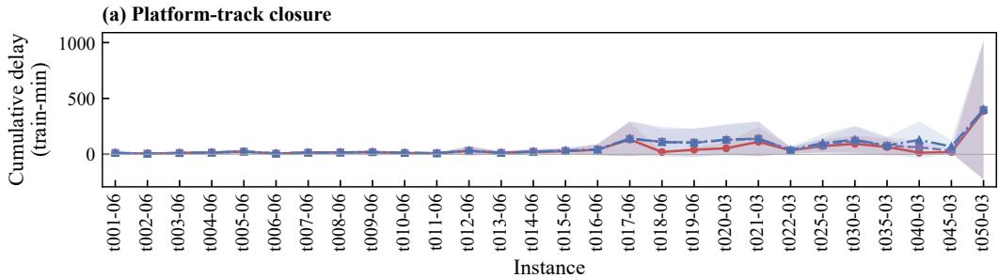

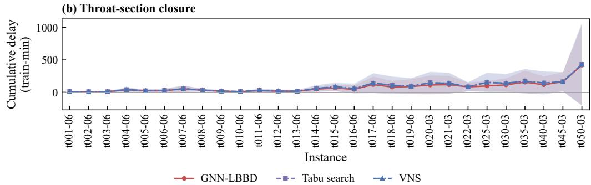  
Figure 4: Total completion delay by algorithm

These scheduling gains required a mean total computation time of 46.15 s, close to the 46.42 s of TS and below the 59.91 s of VNS. Together with the total completion delay comparison, these results indicate better schedules at similar or lower computational cost. In particular, the 16.63% delay reduction relative to TS was achieved with nearly the same actual computation time. The advantage therefore lies in the quality of scheduling solutions obtained within the computation limit.

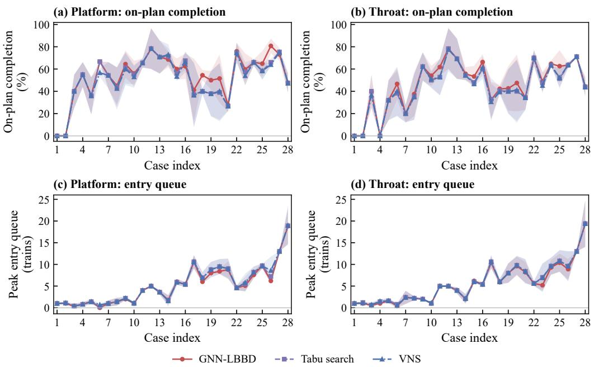  
Figure 5: On-time completion rates and maximum external entry queues

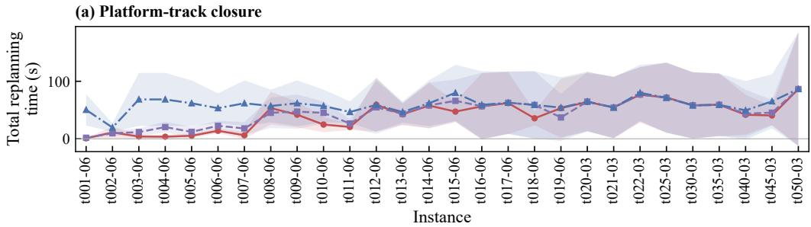

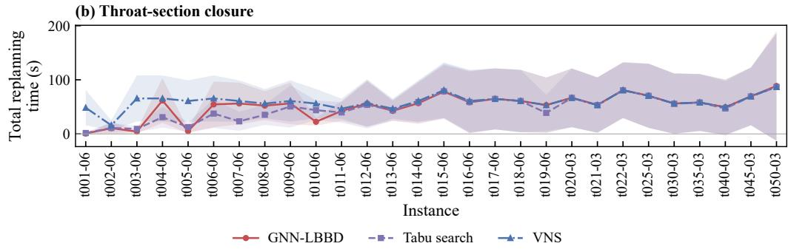  
Figure 6: Total rescheduling computation time by algorithm

## 4.2.2 Component ablation experiments

Ablation experiments on four representative instances assess the contributions of resource lower bounds with cut strengthening and GNN-assisted resource ordering to rescheduling quality. Table 6 summarizes the scheduling metrics for each configuration. Figure 7 shows changes in the on-time completion rate and maximum backlog.

Table 6: LBBD component ablation results
<table><tr><td>Resource lower bounds and cut strengthening</td><td>GNN-assisted resource ordering</td><td>Total completion delay (train-min)</td><td>Maximum train delay (min)</td><td>Maximum backlog (trains)</td></tr><tr><td>Disabled</td><td>Disabled</td><td>98.88</td><td>12.47</td><td>6.58</td></tr><tr><td>Enabled</td><td>Disabled</td><td>85.15</td><td>12.16</td><td>6.24</td></tr><tr><td>Enabled</td><td>Enabled</td><td>60.90</td><td>9.98</td><td>4.83</td></tr></table>

Resource lower bounds with cut strengthening and graph learning-assisted ordering each reduced total completion delay. In Table 6, enabling resource lower bounds and cut strengthening reduced mean total completion delay from 98.88 to 85.15 train-min, a reduction of 13.88%. Adding graph learning-assisted ordering further reduced it to 60.90 train-min, 28.48% below the configuration without graph learning. With both components enabled, the maximum train delay and maximum backlog decreased to 9.98 min and 4.83 trains, respectively.

(a) Platform: on-plan completion  
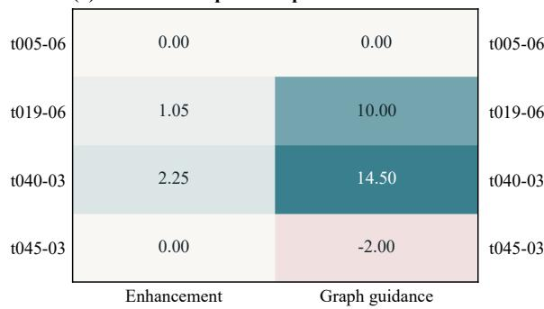

(b) Platform: peak backlog  
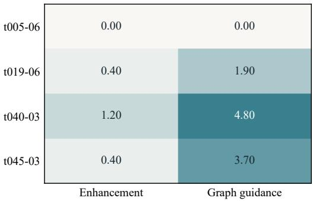

(c) Throat: on-plan completion  
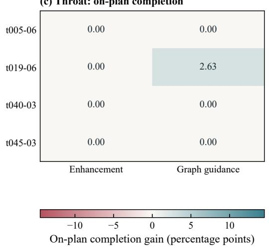

(d) Throat: peak backlog  
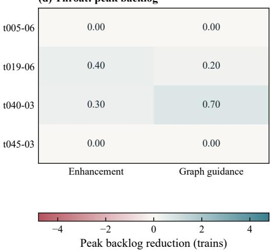  
Figure 7: Effects of algorithm components on on-time completion and maximum backlog

In Fig. 7, adding graph learning-assisted ordering under platform-track closures increased on-time completion rates by 25.00% and 21.89% for the 19- and 40-train instances, respectively. Their maximum backlogs decreased by 1.90 and 4.80 trains. Graph learning-assisted ordering therefore further reduced total completion delay after resource lower bounds and cut strengthening had been enabled. The solution order of resource relaxations is thus an effective component for improving schedule quality within a limited computation budget.

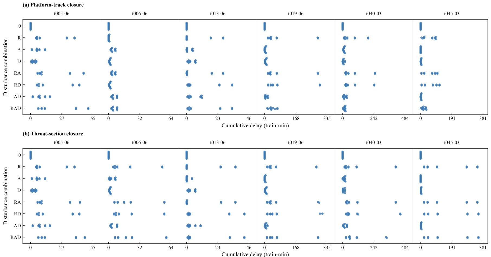  
Figure 8 : Total completion delay distributions under disturbance combinations

## 4.3 Combined disturbances and observations of disruption resolution

## 4.3.1 Effects of disturbance combinations

We compare the eight combinations of the three disturbances to examine how arrival delays and processing-time extensions change operating losses under resource closures. Table 7 summarizes mean total completion delay. Figure 8 shows the delay distributions for each instance under different closure locations.

Table 7: Total completion delay under disturbance combinations
<table><tr><td>Disturbance combination</td><td>Total completion delay (train-min)</td><td>Disturbance combination</td><td>Total completion delay (train-min)</td></tr><tr><td>No disturbance</td><td>0.00</td><td>Closure and arrival delays</td><td>57.64</td></tr><tr><td>Resource closure</td><td>54.46</td><td>Closure and processing-time extensions</td><td>60.20</td></tr><tr><td>Arrival delays</td><td>4.04</td><td>Arrival delays and processing-time extensions</td><td>7.76</td></tr><tr><td>Processing-time extensions</td><td>3.83</td><td>All three disturbances</td><td>45.41</td></tr></table>

Resource closures caused higher total completion delay than arrival delays or processing-time extensions alone. In Table 7, mean total completion delay was 54.46 train-min for closure alone, compared with 4.04 for arrival delays and 3.83 for processing-time extensions. Mean losses exceeded 45 train-min for all combinations containing a closure. Once resource capacity was restricted, the losses associated with changes in train operating conditions differed substantially from those without a closure.

Arrival delays and processing-time extensions exhibited a negative interaction under closures. Adding either disturbance separately increased mean total completion delay from 54.46 to 57.64 and 60.20 train-min, respectively. Adding both reduced it to 45.41 train-min. Figure 8 also shows fewer high-delay outcomes when all three disturbances were combined. Arrival-delay and processing-time increments both inform the inference of closure intensity. Adjustments to holding, routing, and sequencing following revised predictions may partly explain this reversal.

## 4.3.2 Effects of reopening-time prediction on rescheduling

During a closure, dispatchers revise the expected reopening time using field observations to coordinate holding, routing, and sequencing. We compare rescheduling outcomes under different information conditions and prediction representations to assess the effect of these updates on operating losses. Figure 9 shows train backlogs and completion progress. Table 8 summarizes total completion delay.

Table 8: Total completion delay by information condition and prediction representation
<table><tr><td rowspan="2">Instance</td><td colspan="3">Total completion delay (train-min)</td></tr><tr><td>Scenario-based with stage observations</td><td>Conditional mean with stage observations</td><td>Scenario-based without stage observations</td></tr><tr><td>t005-06</td><td>23.56</td><td>23.56</td><td>23.56</td></tr><tr><td>t006-06</td><td>14.66</td><td>14.66</td><td>14.66</td></tr><tr><td>t013-06</td><td>14.22</td><td>14.22</td><td>14.21</td></tr><tr><td>t019-06</td><td>63.93</td><td>64.04</td><td>91.66</td></tr><tr><td>t040-03</td><td>65.41</td><td>66.75</td><td>102.99</td></tr><tr><td>t045-03</td><td>90.71</td><td>89.05</td><td>100.77</td></tr><tr><td>Mean</td><td>45.41</td><td>45.38</td><td>57.97</td></tr></table>

Updating reopening-time predictions with field observations reduced total completion delay and limited backlog growth. In Table 8, using observations with scenario-based prediction reduced mean total completion delay from 57.97 to 45.41 train-min, approximately 21.7%. In Fig. 9, the mean backlog about 10 min after a platform-track closure was close to three trains without observations. It was about 1.5 trains for both methods using observations. Their completion rates were also higher during the same period.

With the same field observations, scenario-based and conditional-mean predictions yielded mean total completion delays of 45.41 and 45.38 train-min, respectively. Backlogs and completion progress were also similar. These comparisons

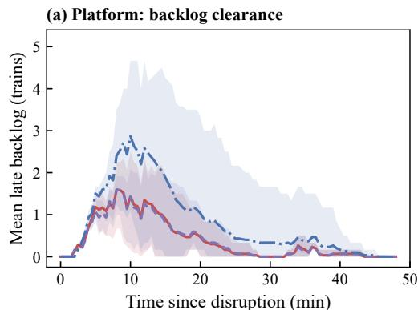  
(c) Throat: backlog clearance

(b) Platform: completion progress  
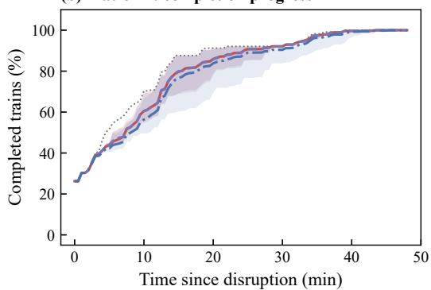

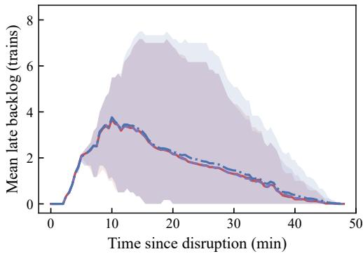

(d) Throat: completion progress  
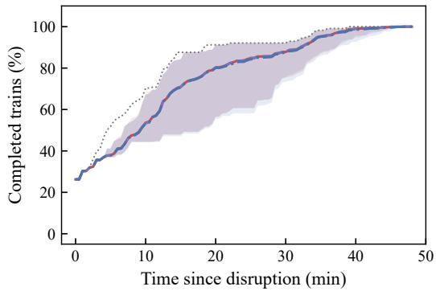  
Figure 9: Effects of stage observations on backlog and completion progress

indicate that the scheduling benefits of reopening-time prediction came mainly from continued use of new observations.   
The choice of prediction representation had a relatively small effect on mean operating losses.

## 4.4 Sensitivity and distribution-shift analyses

## 4.4.1 Sensitivity to disturbance scales

We vary the closure-duration scale and the arrival-delay and processing-time increment scale separately to examine their effects on train delays and backlogs. Table 9 summarizes the rescheduling metrics at each scale. Figure 10 compares total completion delay distributions at half and baseline scales across instances and closure locations.

Table 9: Rescheduling performance under different disturbance scales
<table><tr><td>Setting</td><td>Total completion delay (train-min)</td><td>Maximum train delay (min)</td><td>Maximum backlog (trains)</td></tr><tr><td>Baseline</td><td>60.90</td><td>9.98</td><td>4.83</td></tr><tr><td>Closure-duration scale 0.5</td><td>44.26</td><td>7.02</td><td>4.53</td></tr><tr><td>Closure-duration scale 2</td><td>170.60</td><td>21.43</td><td>8.21</td></tr><tr><td>Arrival-delay and processing-time increments 0.5</td><td>82.60</td><td>11.84</td><td>6.20</td></tr><tr><td>Arrival-delay and processing-time increments 1.5</td><td>83.36</td><td>12.17</td><td>6.04</td></tr></table>

Longer closures produced a more than proportional increase in total completion delay, together with larger backlogs and greater individual train delays. In Table 9, doubling the closure-duration scale increased mean total completion delay from 60.90 to 170.60 train-min, or 2.80 times the baseline. Maximum train delay increased from 9.98 to 21.43 min, and maximum backlog increased from 4.83 to 8.21 trains. Halving the duration scale reduced mean total completion delay to 44.26 train-min. Operations postponed during a closure must still compete for limited resources after reopening.

Larger backlogs may prolong subsequent queues and extend delay effects beyond the closure itself. The amplified losses under longer closures are therefore linked to the continued clearance of delayed operations after reopening.

(a) Platform: Recovery scale

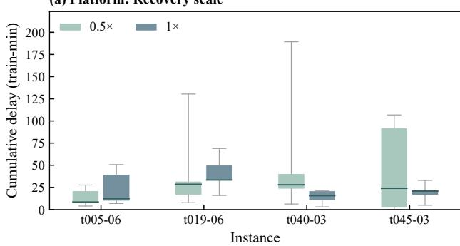  
(c) Throat: Recovery scale

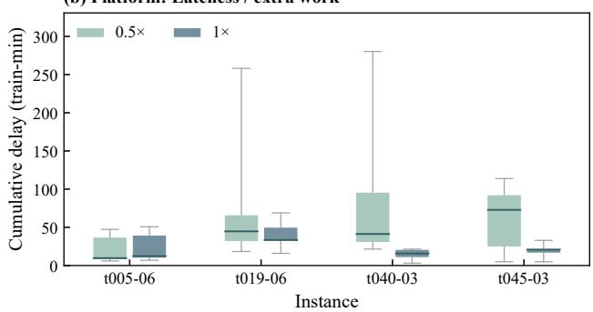  
(d) Throat: Lateness / extra work

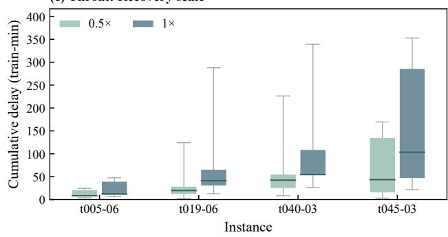

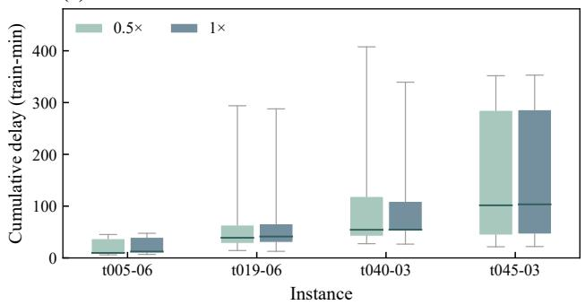  
Figure 10: Total completion delay distributions under different disturbance scales

Smaller arrival-delay and processing-time increments did not produce a corresponding reduction in total delay. Mean total completion delays at increment scales of 0.5 and 1.5 were 82.60 and 83.36 train-min, respectively. Both exceeded the baseline of 60.90 train-min. In Fig. 10, halving the closure duration and halving the direct increments also changed the delay distributions differently. The same loss-scaling relationship therefore cannot be applied to closure duration and direct processing increments. Closure duration changes the resource-unavailability interval, whereas direct increments change train readiness and the timing of resource occupancy. Their effects require separate evaluation within joint scheduling.

## 4.4.2 Closure-duration distribution shifts

To assess the effects of biased closure-duration predictions, we retain the baseline prediction scale and set the actual scale to 0.5, 1, and 2. We compare the expected-loss model $( \rho = 0 )$ with the distributionally robust model $( \rho = 0 . 2 )$ Table 10 summarizes the rescheduling metrics. Figure 11 shows total completion delay distributions for different closure locations and actual duration scales.

Table 10: Model performance under closure-duration distribution shifts
<table><tr><td rowspan="2">Actual scale</td><td rowspan="2">Model</td><td rowspan="2">Total completion delay (train-min)</td><td rowspan="2">Maximum train delay (min)</td><td rowspan="2">Maximum backlog (trains)</td></tr><tr><td></td></tr><tr><td rowspan="2">0.5</td><td>Expected-loss</td><td>97.64</td><td>13.97</td><td>7.56</td></tr><tr><td>Distributionally robust</td><td>100.92</td><td>13.92</td><td>7.41</td></tr><tr><td rowspan="2">1</td><td>Expected-loss</td><td>132.09</td><td>19.69</td><td>6.76</td></tr><tr><td>Distributionally robust</td><td>127.98</td><td>19.28</td><td>6.63</td></tr><tr><td rowspan="2">2</td><td>Expected-loss</td><td>255.42</td><td>36.88</td><td>6.86</td></tr><tr><td>Distributionally robust</td><td>284.37</td><td>36.88</td><td>7.46</td></tr></table>

The ranking of the distributionally robust and expected-loss models by total completion delay changed with the actual closure-duration scale. In Table 10, when the actual and predicted scales matched, the distributionally robust model achieved a mean total completion delay of 127.98 train-min. This was 3.11% below the 132.09 train-min of the expected-loss model. At actual scales of 0.5 and 2, the corresponding values for the distributionally robust and expected-loss models were 100.92 versus 97.64 and 284.37 versus 255.42 train-min. The relative differences were 3.36% and 11.34%, respectively.

(f) Throat: 2.0x  
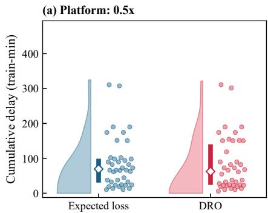

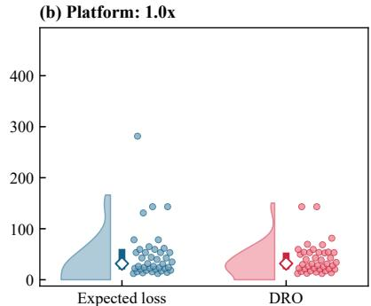

(c) Platform: 2.0x  
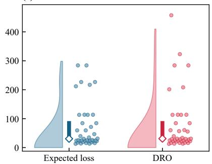

(d) Throat: 0.5x  
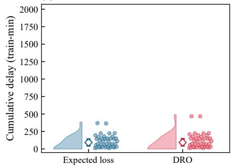

(e) Throat: 1.0x  
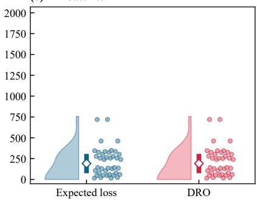

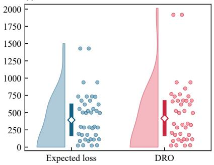  
Figure 11: Total completion delay distributions under closure-duration distribution shifts

The distributionally robust model changes the weights of existing scenarios while retaining their reopening times. When the actual duration scale shifts, the resource availability times assumed in scheduling may differ from their actual values. The scheduling effect of probability adjustments therefore depends on how well the reopening-time scenarios represent actual resource availability. Closure-duration predictions and the range of probability deviations need to be considered jointly.

## 5 Conclusions

This study develops a distributionally robust model for in-station train rescheduling under resource closures, arrival delays, and processing-time extensions. The model updates reopening-time predictions with field observations, and GNN-LBBD coordinates routing and resource scheduling. Resource conditional cuts extend single-resource scheduling lower bounds to different route combinations that satisfy the corresponding resource-use conditions. Graph learning guides the solution order of resource relaxations. On the test instances, mean total completion delay was 16.63% lower than tabu search and 20.06% lower than variable neighborhood search, at a computational cost close to that of tabu search. Ablation experiments further support the incremental contributions of resource lower bounds with cut strengthening and graph learning-assisted resource ordering to schedule quality.

In the information comparisons, using field observations reduced mean total completion delay by approximately 21.7%. Scenario-based and conditional-mean predictions produced similar overall results under the same information conditions. Compared with the difference between the two prediction representations, updating reopening-time estimates with new observations had a more pronounced effect on total delay and backlog evolution. These results support continued use of field observations during closures to adjust holding, routing, and sequencing. They also support selecting prediction representations according to their actual scheduling benefits.

The disturbance-scale and distribution-shift experiments show a nonproportional response of total delay to closure duration. The relative performance of the expected-loss and distributionally robust models also varies with the closureduration distribution. These findings suggest that conditional reopening-time predictions and the range of probability deviations should be considered jointly. Future work could examine joint calibration of conditional scenarios and the probability radius. Its effects on scheduling losses and computational cost could then be assessed across different station layouts and operating loads.

## Code Availability

The source code and README files used in this study are publicly available at:https://github.com/yuncifor/ RESCHEDULING-UNDER-DISRUPTIONS

## References

[1] Richard M. Lusby, Jesper Larsen, Matthias Ehrgott, and David Ryan. Railway track allocation: models and methods. OR Spectrum, 33(4):843–883, 2011. doi: 10.1007/s00291-009-0189-0.

[2] Valentina Cacchiani, Dennis Huisman, Martin Kidd, Leo Kroon, Paolo Toth, Lucas Veelenturf, and Joris Wagenaar. An overview of recovery models and algorithms for real-time railway rescheduling. Transportation Research Part B: Methodological, 63:15–37, 2014. doi: 10.1016/j.trb.2014.01.009.

[3] Malachy Carey and Sinead Carville. Scheduling and platforming trains at busy complex stations. Transportation Research Part A: Policy and Practice, 37(3):195–224, 2003. doi: 10.1016/s0965-8564(02)00012-5.

[4] Paola Pellegrini, Grégory Marlière, and Joaquin Rodriguez. Optimal train routing and scheduling for managing traffic perturbations in complex junctions. Transportation Research Part B: Methodological, 59:58–80, 2014. doi: 10.1016/j.trb.2013.10.013.

[5] Francesco Corman and Pavle Kecman. Stochastic prediction of train delays in real-time using Bayesian networks. Transportation Research Part C: Emerging Technologies, 95:599–615, 2018. doi: 10.1016/j.trc.2018.08.003.

[6] Aharon Ben-Tal, Dick den Hertog, Anja De Waegenaere, Bertrand Melenberg, and Gijs Rennen. Robust solutions of optimization problems affected by uncertain probabilities. Management Science, 59(2):341–357, 2013. doi: 10.1287/mnsc.1120.1641.

[7] Özgün Elçi and John N. Hooker. Stochastic planning and scheduling with logic-based Benders decomposition. INFORMS Journal on Computing, 34(5):2428–2442, 2022. doi: 10.1287/ijoc.2022.1184.

[8] Johannes Varga, Emil Karlsson, Günther R. Raidl, Elina Rönnberg, Fredrik Lindsten, and Tobias Rodemann. Speeding up logic-based Benders decomposition by strengthening cuts with graph neural networks. In Machine Learning, Optimization, and Data Science, pages 24–38. Springer, 2024. doi: 10.1007/978-3-031-53969-5\_3.

[9] Peter J. Zwaneveld, Leo G. Kroon, H. Edwin Romeijn, Marc Salomon, Stéphane Dauzère-Pérès, Stan P. M. Van Hoesel, and Harrie W. Ambergen. Routing trains through railway stations: Model formulation and algorithms. Transportation Science, 30(3):181–194, 1996. doi: 10.1287/trsc.30.3.181.

[10] Alain Billionnet. Using integer programming to solve the train-platforming problem. Transportation Science, 37 (2):213–222, 2003. doi: 10.1287/trsc.37.2.213.15250.

[11] Alberto Caprara, Laura Galli, and Paolo Toth. Solution of the train platforming problem. Transportation Science, 45(2):246–257, 2011. doi: 10.1287/trsc.1100.0366.

[12] G. Caimi, F. Chudak, M. Fuchsberger, M. Laumanns, and R. Zenklusen. A new resource-constrained multicommodity flow model for conflict-free train routing and scheduling. Transportation Science, 45(2):212–227, 2011. doi: 10.1287/trsc.1100.0349.

[13] Joaquín Rodriguez. A constraint programming model for real-time train scheduling at junctions. Transportation Research Part B: Methodological, 41(2):231–245, 2007. doi: 10.1016/j.trb.2006.02.006.

[14] Rajnish Kumar, Goutam Sen, Samarjit Kar, and Manoj Kumar Tiwari. Station dispatching problem for a large terminal: A constraint programming approach. Interfaces, 48(6):510–528, 2018. doi: 10.1287/inte.2018.0950.

[15] Matteo Cardellini, Marco Maratea, Mauro Vallati, Gianluca Boleto, and Luca Oneto. In-station train dispatching: A PDDL+ planning approach. In Proceedings of the International Conference on Automated Planning and Scheduling, volume 31, pages 450–458, 2021. doi: 10.1609/icaps.v31i1.15991.

[16] Andreas Schutt, Matteo Cardellini, Jip J. Dekker, Daniel Harabor, Marco Maratea, and Mauro Vallati. Constraintbased in-station train dispatching. In 31st International Conference on Principles and Practice of Constraint Programming (CP 2025), volume 340 of Leibniz International Proceedings in Informatics, pages 33:1–33:24. Schloss Dagstuhl – Leibniz-Zentrum fuer Informatik, 2025. doi: 10.4230/LIPIcs.CP.2025.33.

[17] Shuguang Zhan, Jiemin Xie, S. C. Wong, Yongqiu Zhu, and Francesco Corman. Handling uncertainty in train timetable rescheduling: A review of the literature and future research directions. Transportation Research Part E: Logistics and Transportation Review, 183:103429, 2024. doi: 10.1016/j.tre.2024.103429.

[18] Yongqiu Zhu and Rob M. P. Goverde. Dynamic and robust timetable rescheduling for uncertain railway disruptions. Journal ofRail Transport Planning & Management, 15:100196, 2020. doi: 10.1016/j.jrtpm.2020.100196.

[19] Haonan Yang, Xuze Ye, Haoyang Huo, Yuhua Yang, Shaoquan Ni, and Dingjun Chen. Robust rescheduling of train timetables and maintenance windows considering uncertain disruption duration: a generalized branchand-Benders-cut approach. Transportation Research Part C: Emerging Technologies, 190:105781, 2026. doi: 10.1016/j.trc.2026.105781.

[20] Francesco Corman, Andrea D’Ariano, Dario Pacciarelli, and Marco Pranzo. A tabu search algorithm for rerouting trains during rail operations. Transportation Research Part B: Methodological, 44(1):175–192, 2010. doi: 10.1016/j.trb.2009.05.004.

[21] Marcella Samà, Andrea D’Ariano, Francesco Corman, and Dario Pacciarelli. A variable neighbourhood search for fast train scheduling and routing during disturbed railway traffic situations. Computers & Operations Research, 78:480–499, 2017. doi: 10.1016/j.cor.2016.02.008.

[22] Paola Pellegrini, Gregory Marliere, Raffaele Pesenti, and Joaquin Rodriguez. RECIFE-MILP: An effective MILP-based heuristic for the real-time railway traffic management problem. IEEE Transactions on Intelligent Transportation Systems, 16(5):2609–2619, 2015. doi: 10.1109/tits.2015.2414294.

[23] John N. Hooker. Planning and scheduling by logic-based Benders decomposition. Operations Research, 55(3): 588–602, 2007. doi: 10.1287/opre.1060.0371.

[24] Leonardo Lamorgese and Carlo Mannino. An exact decomposition approach for the real-time train dispatching problem. Operations Research, 63(1):48–64, 2015. doi: 10.1287/opre.2014.1327.

[25] Peiran Han, Lingyun Meng, Xiaojie Luan, Nikola Bešinovic, Jianrui Miao, Yihui Wang, and Zhengwen Liao.´ Integrated optimization of train makeup problem and resource scheduling in railway marshalling yards: A hybrid MILP-CP approach with logic-based Benders decomposition. Transportation Research Part B: Methodological, 200:103306, 2025. doi: 10.1016/j.trb.2025.103306.

[26] Florin Leutwiler, Guillem Bonet Filella, and Francesco Corman. Accelerating logic-based Benders decomposition for railway rescheduling by exploiting similarities in delays. Computers & Operations Research, 150:106075, 2023. doi: 10.1016/j.cor.2022.106075.

[27] Hongxiang Zhang, Andrea D’Ariano, Yongqiu Zhu, Yaoxin Wu, Liuyang Hu, and Gongyuan Lu. Learning to reschedule platforms: A graph neural network based deep reinforcement learning method for the train platforming and rescheduling problem. Transportation Research Part C: Emerging Technologies, 183:105453, 2026. doi: 10.1016/j.trc.2025.105453.