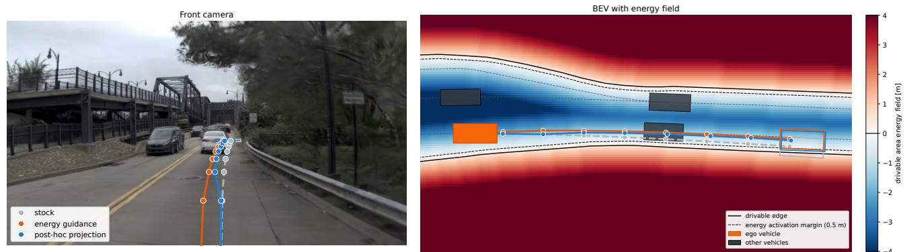
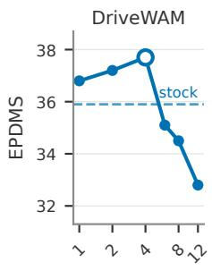
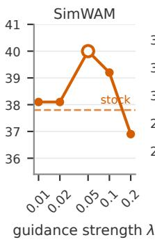
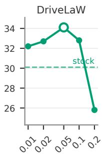
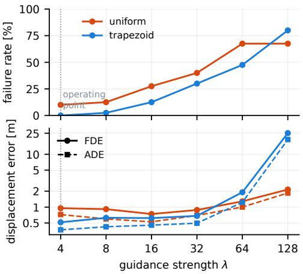

# GuidedWAM: Training-Free Energy Guidance for World Action Models in Autonomous Driving

Xiyan Su1,3\* Finn Rasmus Schafer ¨ 2,3 Hojun Lim1,3 Frank Diermeyer1,3 Johannes Betz2,3 Markus Lienkamp1,3

1Institute of Automotive Technology (FTM), Technical University of Munich, Germany

2Professorship of Autonomous Vehicle Systems (AVS), Technical University of Munich, Germany

3Munich Institute of Robotics and Machine Intelligence (MIRMI), Technical University of Munich, Germany

## Abstract

World action models (WAMs) for autonomous driving couple the driving policy and the visual world model in a single generative network whose objectives are fixed post-training. Conditioning on a new driving objective requires retraining. We study energy guidance as a general mechanism and present GuidedWAM, a model-agnostic framework for injecting driving objectives intofrozen WAMs at sampling time. Ourframework constructs each objective as differentiable energies on the sampler’s intermediate clean-action estimate, which needs onlyforward access to thefrozen model, and is stabilized by sampling-time guidance scheduling, per-energy normalization, and velocity-bounded correction. On the NAVSIM v2 hard-split, guidance improves all three frozen, publicly released WAMs by 1.8 to 3.6 EPDMS, averaged over three sampler seeds, and adds less than 10% to the sampling time per step. These results position energy guidance as a practical post-training control channelfor WAMs.

## 1. Introduction

World action models (WAMs) are an emerging family of end-to-end driving models. The generative model learns the driving policy simultaneously with a visual world model, where the policy inherits the physical and visual knowledge of a large video prior, and the model can imagine the future driving scene [25, 29, 31, 37]. Recent WAMs reach planning scores above 90 PDMS on NAVSIM v1 [8, 29, 37].

Despite these advantages, WAMs come with their own drawbacks. By training as a whole, the driving objectives freeze once the training is finished and cannot be extended at will. In practice, a driving policy has to serve objectives that change with the operating context during deployment:

a wider margin to the road edge on a narrow street, a larger clearance around vulnerable road users, a temporal speed limit, or a passenger’s comfort preference. A WAM learns its driving behavior mainly from driving data. Samplingtime condition is only possible if such driving objectives are available in the data during training. Adding one means collecting supervision for it and retraining a billion-parameter model, which has to be repeated for every new objective. What is missing is a control channel that acts on the frozen model at sampling time.

Therefore, we present GuidedWAM, a training-free energy-guidance framework for world action models for autonomous driving. Each driving objective is constructed as a differentiable energy on the sampler’s one-step clean estimate of the action stream, whose gradient is added to the frozen model’s velocity field during sampling. We investigate whether the driving policy of a frozen WAM can be guided at sampling time toward an objective it was never trained on.

Our contributions are two-fold:

• We derive energy guidance on the one-step clean estimate of the flow-matching sampler that current WAMs share, in a Jacobian-free form that needs only forward passes through the frozen model, and show that it steers three public WAMs on NAVSIM v2.

• We show that the guidance is stabilized by sampling-time guidance scheduling, per-energy normalization, and velocity bounded correction.

## 2. Related Works

World action models as driving planners A video world model learns how an environment evolves under the agent’s actions, so that a policy can be trained or evaluated on imagined rollouts [12, 13]. In autonomous driving, this idea first produced action-conditioned video world models, which render the future camera view from past frames and actions [11, 16, 30]. World action models close the gap by also generating the action stream, so that the driving knowledge learned from a large video prior can transfer to planning. DriveWAM and UNIVERSE train video and ego action tokens in one shared attention sequence under a single flowmatching objective [25, 29], SimWAM co-trains a video expert with a light action expert and drops the video branch at inference for run-time [37], and DriveLaW plans from the latent of its video generator [31]. They reach planning scores above 90 PDMS on NAVSIM v1 [8]. For this paper, the three public models we guide share one property: the plan is produced by a flow-matching sampler conditioned on a fixed set of context channels, past frames, ego status, and a navigation command.

Control channels for flow-matching planners Most current WAMs are built on diffusion or flow-matching backbones [23, 26, 27]. Conditional flow matching trains the velocity field on a context. Classifier guidance adds the gradient of a noise-aware classifier to the score at sampling time [9], and classifier-free guidance replaces the classifier with the model’s own unconditional prediction [15]. Independent of training, energy guidance instead descends an external differentiable objective on the sampler’s clean estimate. Diffusion posterior sampling evaluates the objective on the denoiser’s clean estimate [5], manifold-preserving guided diffusion drops the network Jacobian [14], and Feng et al. [10] carry the construction to flow matching. In the driving domain, CTG and CTG++ guide traffic simulation with signal-temporal-logic and language-derived costs [40, 41]. Diffusion Planner applies classifier guidance to a vectorizedstate planner [39]. GuideFlow corrects constraint violations inside the sampling loop with a constraint vocabulary fixed at training [24]. A second family steers a frozen planner from outside the sampler by search rather than by gradients. Diffusion-ES applies evolutionary search to a trajectory diffusion model [34]. TOAD runs cross-entropy-method search over the proposals of six frozen NAVSIM planners against a learned trajectory scorer [33]. We adopt the Jacobian-free clean-estimate gradient. We apply the analytic energies directly on the diffusion policy instead of searching or scoring sampled trajectories.

Safety filters and constrained flow matching Another way to enforce a driving constraint on a learned planner is a safety filter applied after the plan is produced, a control barrier function certificate that defines a safe set and a minimal correction that keeps the plan inside it [2, 28]. SafeFlow enforces control barrier functions across the sampler [6], SafeFlow-Matcher alternates prediction with barrier-based correction [35], UniConFlow shapes a prescribed-time guidance field for equality and inequality constraints [36], HardFlow solves a receding-horizon optimization on the clean estimate at every step [21]. Safety-guided flow shows that negative guidance must act within a critical time window [18], which is the closest precedent for our noise-level scheduling. These methods target hard satisfaction of known constraint sets on planners. We construct soft and composable energies for frozen models and compare the in-sampling channel with the post-hoc member of this family on the same constraint.

## 3. Method

## 3.1. Preliminaries

Flow matching learns a time-dependent velocity field that transports a simple prior to the data distribution [23, 26]. We consider a frozen WAM whose action stream $\tau \in \mathbb { R } ^ { T \times d }$ , an ego trajectory or an action-token sequence, is generated by such a sampler conditioned on the observation context X. Along the Gaussian flow-matching path, the noisy state is the linear interpolation $\tau _ { t } = \left( 1 - t \right) \tau _ { 0 } + t \varepsilon$ with $\varepsilon \sim \mathcal { N } ( 0 , I )$ the network predicts the velocity $v _ { \theta } ( \tau _ { t } , t , X ) \approx \mathbb { E } [ \varepsilon - \tau _ { 0 } \ |$ $\tau _ { t } , X ]$ , and sampling integrates $\tau  \tau - \Delta t v _ { \theta }$ from t=1 down to $t { = } 0$ . All three public WAMs we guide use this sampler. Guidance mechanisms are statements about the score $s _ { t } = \nabla _ { \tau _ { t } } \log p _ { t } ( \tau _ { t } \mid X )$ . On a Gaussian flow-matching path, score and velocity are interchangeable through an affine identity [38]. A short calculation gives

$$
v ( \tau _ { t } , t ) ~ = ~ - \frac { \tau _ { t } + t s _ { t } ( \tau _ { t } ) } { 1 - t }\tag{1}
$$

so an additive score correction $\Delta s$ enters the velocity scaled by $- t / ( 1 - t )$ . We therefore derive in score space and implement in the velocity space that every sampler exposes.

## 3.2. Energy Guidance on One-Step Clean Estimation of Flow-Matching

One-step clean estimate For every flow-matching sampler, the one-step estimate of the clean sample at each step is the posterior mean under the model, similar to [5],

$$
\hat { \tau } _ { 0 } ( \tau _ { t } ) ~ = ~ \tau _ { t } - t v _ { \theta } ( \tau _ { t } , t , X ) ~ \approx ~ \mathbb { E } [ \tau _ { 0 } \mid \tau _ { t } , X ]\tag{2}
$$

The driving objectives can be evaluated on this one-step clean estimate.

Differentiable energies on the clean estimate A driving objective is a differentiable energy $\mathcal { E } : \mathbb { R } ^ { T \times d }  \mathbb { R }$ on the clean action sequence. In practice the clean estimate is first decoded to ego trajectory with position and heading at each waypoint. The energy is derived analytically on it: a distance to a lane centerline, a signed distance of the vehicle to the drivable boundary, or a clearance to a predicted agent box. Guided score The frozen model draws plans from $p ( \tau _ { 0 } \mid X )$ the posterior over the action stream given the observation context. Every objective that shaped this posterior was fixed when training ended. Guidance changes the target distribution without changing the model. We want plans drawn from

$$
p _ { \gamma } ( \tau _ { 0 } \mid X ) \propto p ( \tau _ { 0 } \mid X ) e ^ { - \gamma { \mathcal E } ( \tau _ { 0 } ) }\tag{3}
$$

the same posterior tilted toward low energy by a strength $\gamma > 0$ . To sample from Eq. (3) with a sampler built for $p ( \tau _ { 0 } \mid X )$ , we write the tilt as conditioning. We denote the driving objective as an auxiliary variable $\mathcal { G }$ with likelihood $p ( \mathcal { G } \mid \tau _ { 0 } ) \mathbf { \bar { \Psi } } \propto e ^ { - \gamma \mathcal { E } ( \tau _ { 0 } ) }$ , denoting the graded preference for low-energy. Since G depends on X only through $\tau _ { 0 } ,$ Bayes’ rule gives $p ( \tau _ { 0 } \mid { \mathcal { G } } , X ) = p _ { \gamma } ( \tau _ { 0 } \mid X )$ , so sampling the tilted posterior is sampling the frozen model conditioned on ${ \mathcal { G } } _ { : }$ and the score of the conditioned marginal follows without any training:

$$
s _ { t } ^ { \gamma } ( \tau _ { t } ) = s _ { t } ( \tau _ { t } ) + \nabla _ { \tau _ { t } } \log \mathbb { E } _ { p ( \tau _ { 0 } | \tau _ { t } , X ) } \bigl [ e ^ { - \gamma \mathcal { E } ( \tau _ { 0 } ) } \bigr ]\tag{4}
$$

However, the expectation over the denoising posterior is intractable.

Energy as a gradient Replacing the average over the ${ \mathrm { d e } } -$ noising posterior by the model’s clean estimate, as in diffusion posterior sampling [5], makes the log-expectation $- \gamma \mathcal { E } ( \hat { \tau } _ { 0 } ( \tau _ { t } ) )$ , whose gradient by the chain rule is

$$
\nabla _ { \tau _ { t } } \mathcal { E } \big ( \hat { \tau } _ { 0 } ( \tau _ { t } ) \big ) ~ = ~ J _ { t } ^ { \top } \nabla _ { \hat { \tau } _ { 0 } } \mathcal { E } ( \hat { \tau } _ { 0 } )\tag{5}
$$

where $J _ { t } = \partial \hat { \tau } _ { 0 } / \partial \tau _ { t } = I - t \partial v _ { \theta } / \partial \tau _ { t }$ is the Jacobian of the clean estimate, which contains the network Jacobian. However, as $J _ { t }$ contains the network Jacobian, evaluating it requires a full backward pass through the frozen denoiser at every sampling step, with the compute and activation memory of a training step. At the scale of a billion-parameter video WAM this is impractical. We replace $J _ { t }$ with the identity and keep only the energy’s own gradient, evaluated at the detached clean estimate, the shortcut of manifold-preserving guided diffusion [14]. Mapping the score correction into velocity space through Eq. (1) yields the update we run:

$$
v ^ { \prime } = v _ { \theta } + \lambda ( t ) \nabla _ { \hat { \tau } _ { 0 } } \mathcal { E } ( \hat { \tau } _ { 0 } ) \qquad \lambda ^ { * } ( t ) = \gamma \frac { t } { 1 - t }\tag{6}
$$

where $\lambda ^ { * }$ is the canonical schedule implied by the exact score-velocity correspondence.

Differentiable without backpropagation Because the clean estimate is detached, the only gradient ever taken is that of the analytic energy with respect to a $T \times d$ tensor. The frozen model is run forward once per step, exactly as in unguided sampling with no activation stored. This is what makes the channel usable on released checkpoints, as it needs forward access to the model and nothing else, and its per-step cost is close to unguided sampling. The difference is that the deleted $J _ { t }$ acted as a preconditioner that projected the push onto locally plausible directions. Dropping it increases the chances of off-manifold corrections, causing the canonical $\lambda ^ { * }$ to diverge as $t  1$ , exactly where the clean estimate is least reliable. Both effects are handled by the stabilization methods in $\ S 3 . 3 .$ . We show the Jacobian-free form in Eq. (6) can be stabilized empirically for steering frozen flowmatching WAMs within a measurable operating range.

## 3.3. Guidance Stabilization

Applying Eq. (6) naively can fail for various reasons. The following methods stabilize the guidance. Let $\mathcal { E } _ { 1 } , \ldots , \mathcal { E } _ { K }$ be the composed energies with weights $w _ { k }$ , and $\Delta v$ be the velocity update in Eq. (6) in the form of $v ^ { \prime } = v _ { \theta } + \lambda ( t ) \Delta v .$ Sampling-time guidance scheduling The canonical guidance $\lambda ^ { * } ( t )$ in Eq. (6) places the largest correction at high noise, $\mathrm { i } . \mathrm { e } . , t  1$ , where the clean estimate is a coarse average of futures and its gradient points nowhere in particular. On the other hand, a constant guidance where $\lambda = c o n s t$ corrects every step equally, where the early corrections can push the noisy state off the manifold of plausible trajectories and continue to schedule high guidance at $t  0$ , where the plan is fixed. We therefore truncate the schedule to a trapezoidal window over the noise level. The window reaches maximal over its middle, and is linearly ramped on both sides. The correction thus acts only once the clean estimate is informative and stops before the last steps, which are left to the frozen model to bring the plan back onto its manifold. Normalization Gradients of different energies differ in scale, so each is normalized per sample before weighting,

$$
\Delta \boldsymbol { v } \ : = \ : \sum _ { k = 1 } ^ { K } \boldsymbol { w } _ { k } \frac { \nabla _ { \hat { \tau } _ { 0 } } \mathcal { E } _ { k } ( \hat { \tau } _ { 0 } ) } { | | \nabla _ { \hat { \tau } _ { 0 } } \mathcal { E } _ { k } ( \hat { \tau } _ { 0 } ) | | _ { 2 } }\tag{7}
$$

so that $\lambda ( t )$ carries the overall scale and the $w _ { k }$ carry only relative importance.

Velocity bounded correction The applied correction is bounded relative to the model’s own velocity. Measuring that bound on the current velocity is unstable: a push off the data manifold inflates the next velocity and with it the bound on the next push, and in early runs the velocity norm grew several-fold while plan endpoints left the road network by more than a kilometer. The reference is therefore recorded once at the first guided step, $\rho = \| v _ { \theta } ( \tau _ { t } ) \| _ { 2 }$ , and held fixed for the rest of the sampler. The correction added to the velocity is

$$
\Delta v \gets \operatorname* { m i n } \Bigl ( 1 , \frac { c \rho } { \lambda ( t ) \| \Delta v \| _ { 2 } } \Bigr ) \Delta v\tag{8}
$$

so that $\lambda ( t ) \| \Delta v \| _ { 2 } \leq c \rho$ at every step, with the ratio $c$ shared across models.

## 4. Experiments

## 4.1. Setups

Dataset and metrics We evaluate the planning policy performance on the NAVSIM v2 hard-split [3], which pairs 450 real scenes with 5,462 synthetic scenes rendered from perturbed initial poses. We report the extended predictive driver model score (EPDMS) in points, together with its real-scene (S1) and synthetic-scene (S2) stage scores as well as the sub-metric scores.

## 4.2. Planning policy performance

Stock vs guidance on three frozen WAMs Table 1 reports the three public WAMs with and without the energy guidance (EG) on NAVSIM v2 hard-split. Due to the restriction of allowed information from the benchmark, we investigate the performance improvement with one camera-based drivable area energy. A combination of energy guidance with addi tional privileged information is investigated in §4.3. The drivable area energy reads a camera-only field, a signed distance to the road edge regressed from the front cameras. Energy guidance improves all three, by 1.8 points on DriveWAM, 1.8 on SimWAM and 3.6 on DriveLaW, since DriveLaW starts with the most synthetic scenes failing the drivablearea (DAC). Guided SimWAM is the strongest world action model on the split and stands above every diffusion planner in the table, while DriveVLA-M0 [32], which is post-trained with reinforcement learning or memory, still remains higher. The drivable area energy reduces the failures where the plan leaves the road. The drivable area score rises in both stages on every model, and the sub-metrics that do not concern the road edge move little. Plans that already stay on the road are left almost unchanged, because the energy only acts when a corner of the vehicle comes within half a meter of the road edge, which happens on about 15% of the scenes the models already pass. The two-frame comfort term (EC) remains at stock on SimWAM and DriveLaW and degrades on DriveWAM. Since there are no n The guidance does not improve collision (NC) and driving direction (DDC) What guidance does not move is the collision gate, which stays within a point of stock on every model: a constant-velocity clearance term as a gradient does not prevent the collisions that occur on this split, and we do not claim otherwise. The calibrated strength differs by two orders of magnitude between the models, λ of 4 on DriveWAM against 0.05 on SimWAM and DriveLaW, which is the per-model calibration the introduction refers to and is analysed in §4.3.

In-sampling guidance vs post-hoc projection A safety filter applied after generation is the classical way to enforce a constraint. Table 2 applies a gradient projection of the finished stock plan onto the same drivable-area constraint. As a fix for drivable-area failures, the projector is stronger on all three models: it clears between five and nine points of failing synthetic scenes where guidance clears between one and three, and it scores one to three EPDMS points higher. However, it pays for this in consistency: two-frame comfort (EC) drops by five to seven points under projection. In comparison, guidance reduces at most two. History comfort degrades further for projection. As guidance moves the plan at every denoising step, the correction is spread along the horizon, and the frozen model keeps shaping the plan after each step, whereas the projector activates on only a third of the scenes and finds no feasible plan on one eighth of them. Its largest corrections are of more than two meters.

On the scenes where both channels recover the drivable-area gate, the guided plans keep a two-frame comfort of 80.7 against 72.5 for the projected ones, with the stock plans at 82.6. Figure 1 shows one such scene. The stock plan drifts toward the right edge of the drivable area and fails the gate. The projector leaves the plan untouched until the footprint violates the constraint and then bends it back at that waypoint. Guidance acts from the first denoising step, so the guided trajectory leaves the ego vehicle on a smoother heading from the first waypoint, even though the barrier only fires once a corner comes within half a meter of the edge. Both plans pass the gate. The scorer registers the abrupt correction only through the comfort metrics, which the LQR tracker in NAVSIM partly smooths and carries less weight, so the projected plan loses little score for an abrupt change of direction the vehicle would feel. From the comparison, we can draw two conclusions: Guidance is a viable solution to steer the plan in frozen WAMs, which incorporate new driving objectives with little cost to other metrics, like comfort. However, a post-hoc projection does reach a higher score at the cost of consistency.

## 4.3. Ablation

Energy composition Energies can be composed as the weighted sum of Eq. (7). As NAVSIM allows limited information for energy construction, §4.2 uses only one legal energy: camera-based drivable area (DA). To further investigate the energy composition, Table 3 uses privileged information to construct two additional energy terms: driving direction (DD) and lane keeping (LK). The DD energy penalizes waypoints that face against the lane direction and enters at a weight of 0.06 relative to the barrier. Alone, it is nearly inert, within one point of stock on every model. On top of the DA energy, it adds 0.4 to 0.8 points on each model. DA + DD reaches the best on all three models. The sub-metrics show where the gain comes from. The DDC of the stage 2 in NAVSIM rises by one to five points, but it costs the extended comfort term, which drops by four to eleven. The LK energy uses the privileged lane information and attracts the trajectory to the center of the lane. With the DA energy, it reaches 39.5 on DriveWAM but falls below the DA energy alone on SimWAM and DriveLaW, because it acts on every scene and costs comfort. Interestingly, composing all energy terms together does not achieve the best performance, as the DA and DD are sparse while LK is dense and continuous, which pulls on every scene, costing comfort on passed scenes.

Guidance strength on planning policy Figure 2 sweeps the guidance strength on the DA energy over 5 values per model. DriveWAM improves on stock between λ of 1 and 4 and falls below it at 6, SimWAM and DriveLaW improve between 0.01 and 0.10 and collapse at 0.20, where DriveLaW loses four points against stock. The strengths differ by two orders of magnitude, and a model-invariant unit says how much of that is real. SimWAM and DriveLaW peak at the same relative correction, about 1.4% of the model velocity, at a strength of 0.05. DriveWAM peaks at 45% at a strength of 4, thirty times more. Its relative correction grows from 13% at a strength of 1 to 91% at 12. As NAVSIM v2 hard-split has no validation split, to investigate the method’s generalization, we conduct a cross-fitted search study by splitting the 450 real frames of stage one into two halves of equal size. The guidance strength λ as well as the energy hyperparameters are searched on one half and the EPDMS is evaluated on the other. We swap the halves and average the two results.1 Table 4 gives the result compared with the full-split optimum. The cross-fitted gains are 1.7, 2.2 and 3.4 points on DriveWAM, SimWAM and DriveLaW with the 95% interval showing uniform improvement over all three models.

<table><tr><td>Method</td><td>Venue</td><td>Stage</td><td>NC↑</td><td>DAC↑</td><td>DDC↑</td><td>TLC↑</td><td>EP↑</td><td>TTC↑</td><td>LK↑</td><td>HC↑</td><td>EC↑</td><td>EPDMS↑</td></tr><tr><td colspan="9">Diffusion and flow planners</td><td></td><td></td><td></td><td></td></tr><tr><td rowspan="2">TransFuser [4]</td><td rowspan="2">TPAMI&#x27;23</td><td>S1 S2</td><td>96.2 79.5 77.7 70.2</td><td>99.1 84.2</td><td></td><td>99.5 98.0</td><td>84.1 85.1</td><td>95.1 75.6</td><td>94.2</td><td>97.5</td><td>79.1</td><td>25.1</td></tr><tr><td>96.8</td><td>86.0</td><td>98.8</td><td></td><td></td><td>84.0</td><td>95.8</td><td>45.4 96.7</td><td>95.7 97.6</td><td>75.9 79.6</td><td></td></tr><tr><td rowspan="2">DiffusionDrive [22]</td><td rowspan="2">CVPR&#x27;25</td><td>S1 S2</td><td></td><td>72.8</td><td>84.4</td><td>99.3 98.4</td><td>85.9</td><td>76.6</td><td>46.4</td><td>96.3</td><td>72.8</td><td>27.5</td></tr><tr><td>80.1 96.6</td><td>80.5</td><td>96.3</td><td></td><td></td><td>82.3</td><td>94.9</td><td>91.5</td><td>97.7</td><td>67.8</td><td></td></tr><tr><td rowspan="2">GuideFlow [24]</td><td rowspan="2">CVPR’26</td><td>S1 S2</td><td>76.7</td><td></td><td>88.8</td><td>99.3 99.2</td><td>84.3</td><td>85.1</td><td>49.7</td><td>93.1</td><td>44.5</td><td rowspan="2">27.1</td></tr><tr><td>87.3</td><td></td><td></td><td></td><td></td><td></td><td></td><td></td><td></td><td></td></tr><tr><td colspan="10">Vision-language-action models</td><td></td><td></td><td></td></tr><tr><td rowspan="2">ReCogDrive [20]</td><td rowspan="2">ICLR&#x27;26</td><td>S1 S2</td><td>78.9</td><td></td><td>98.7</td><td>99.8</td><td>82.6</td><td>95.6</td><td>94.4</td><td>97.6</td><td>74.2</td><td rowspan="2">25.7</td></tr><tr><td>80.2 95.8</td><td></td><td>65.0</td><td>82.4</td><td>98.7</td><td>85.2</td><td>76.9</td><td>43.8</td><td>96.6</td><td>71.8</td></tr><tr><td rowspan="2">SGDrive [19]</td><td rowspan="2">CVPR’26</td><td>S1 S2</td><td>87.6</td><td></td><td>97.8</td><td>99.8</td><td>84.4</td><td>94.7</td><td>92.9</td><td>97.8</td><td>28.9</td><td rowspan="2">25.5</td></tr><tr><td>79.4 97.6</td><td>65.4 90.0</td><td>79.1</td><td>98.9</td><td>88.9</td><td></td><td>75.3</td><td>42.7</td><td>96.4</td><td>29.6</td></tr><tr><td rowspan="2">DriveFine [7]</td><td rowspan="2">ECCV’26</td><td>S1 S2</td><td></td><td></td><td>99.1</td><td>99.3 98.4</td><td>84.9</td><td>96.7</td><td>97.3</td><td>97.6</td><td>72.0</td><td rowspan="2">30.5</td></tr><tr><td>82.1 98.9</td><td>71.3 96.2</td><td>84.8</td><td></td><td>88.1</td><td></td><td>74.3</td><td>47.2</td><td>96.8</td><td>72.8</td></tr><tr><td rowspan="2">DriveVLA-M0 [32]</td><td rowspan="2">MM&#x27;26</td><td>S1 S2</td><td></td><td></td><td>99.7 93.1</td><td>100.0 98.6</td><td>73.8 65.5</td><td>99.1</td><td>94.2</td><td>97.3</td><td>64.4</td><td rowspan="2">47.0</td></tr><tr><td>91.1</td><td>89.5</td><td></td><td></td><td></td><td></td><td>89.2</td><td>52.7</td><td>98.6</td><td>72.1</td></tr><tr><td colspan="10">World action models</td><td></td><td></td><td></td></tr><tr><td rowspan="2">DriveLaW [31]</td><td rowspan="2">CVPR&#x27;26</td><td>S1 S2</td><td>97.1 82.3</td><td>88.4</td><td>99.2</td><td>99.6</td><td>84.4</td><td>97.1</td><td>96.4</td><td>97.8</td><td>66.7</td><td rowspan="2">30.0</td></tr><tr><td></td><td></td><td>67.4</td><td>83.8</td><td>98.1</td><td>84.7</td><td>78.6</td><td>46.4</td><td>96.4</td><td>57.9</td></tr><tr><td rowspan="2">+ EG (ours)</td><td rowspan="2"></td><td>S1 S2</td><td>96.6±0.1</td><td>94.9±0.2 71.5±0.4</td><td>99.1±0.1</td><td>99.6±0.0 98.1±0.0</td><td>84.1±0.1</td><td>95.7±0.1</td><td>95.0±0.5</td><td>97.8±0.0</td><td>61.9±4.1</td><td rowspan="2">33.6±0.4</td></tr><tr><td></td><td>82.7±0.3</td><td>92.7</td><td>83.8±0.1</td><td></td><td>84.5±0.1</td><td>79.7±0.3</td><td>45.0±0.4</td><td>96.6±0.0</td><td>57.8±0.6</td></tr><tr><td rowspan="2">DriveWAM [29]</td><td rowspan="2">arXiv&#x27;26</td><td>S1 S2</td><td>97.2 81.9</td><td>76.4</td><td>99.6 86.1</td><td>99.3 98.2</td><td>84.6 87.0</td><td>95.8 77.4</td><td>98.2</td><td>97.8</td><td>81.3</td><td rowspan="2">35.9</td></tr><tr><td>S1</td><td>97.0±0.2</td><td>95.9±0.1</td><td>99.5±0.1</td><td>99.3±0.0</td><td></td><td></td><td>50.5</td><td>95.0</td><td>73.0 79.9±0.7</td></tr><tr><td rowspan="2">+ EG (ours)</td><td rowspan="2"></td><td></td><td>82.3±0.3</td><td>77.6±0.5</td><td>85.3±0.9</td><td>98.6±0.2</td><td>84.6±0.2 87.4±0.3</td><td>96.6±0.1 77.5±0.4</td><td>97.2±0.1 48.0±0.7</td><td>97.8±0.0 95.2±0.2</td><td>71.4±0.8</td><td rowspan="2">37.8±0.8</td></tr><tr><td>S2 S1</td><td>97.8</td><td>92.4</td><td>99.6</td><td></td><td></td><td></td><td></td><td></td><td>76.0</td></tr><tr><td rowspan="2">SimWAM [37]</td><td rowspan="2">arXiv&#x27;26</td><td>S2</td><td></td><td>78.5</td><td>87.5</td><td>99.6 98.4</td><td>83.8 86.2</td><td>96.2 78.7</td><td>97.8 50.0</td><td>97.8 96.4</td><td>72.8</td><td rowspan="2">37.8</td></tr><tr><td>82.1 S1</td><td></td><td>95.7±0.6</td><td>99.5±0.1</td><td>99.6±0.0</td><td>83.9±0.1</td><td>96.5±0.3</td><td>98.2±0.4</td><td>97.8±0.0</td><td>76.6±1.4</td></tr><tr><td rowspan="2">+ EG (ours)</td><td rowspan="2"></td><td></td><td>97.7±0.1</td><td>79.8±0.3</td><td>87.7±0.1</td><td>98.4±0.0</td><td>86.5±0.1</td><td>78.6±0.1</td><td>50.7±0.1</td><td>96.2±0.2</td><td>70.4±1.3</td><td rowspan="2">39.6±0.5</td></tr><tr><td>S2</td><td>82.1±0.3</td></table>

Table 1. NAVSIM v2 hard-split. Per-metric scores of stage one (S1, real scenes) and stage two (S2, synthetic scenes) and the combined EPDMS, in points. EG: energy guidance with a single camera-based drivable-area energy and no privileged information at inference, mean and standard deviation over three seeds. Stock rows are single runs. Baseline rows are the numbers published in the respective papers, except TransFuser from the NAVSIM v2 leaderboard, DiffusionDrive as reproduced in SimScale, and ReCogDrive and SGDrive as reproduced in the SimWAM paper. GuideFlow is its no-scorer setting. The stock DriveLaW, DriveWAM and SimWAM rows are our own runs of the released checkpoints.

  
Figure 1. Energy guidance against post-hoc projection on one NAVSIM v2 hard-split scene where both recover the DAC. Left: front camera with the three plans projected into the image. Right: bird’s-eye view (BEV) with the drivable energy field. The stock plan (grey) leaves the drivable area. The post-hoc projection (blue) follows it until the plan violates the constraint, causing sudden lateral change. Guidance (orange) corrects along the whole plan and reaches the same score with a smooth trajectory.

<table><tr><td colspan="2">Model</td><td>EPDMS↑</td><td>∆</td><td>Off-road.↓</td><td>EC↑</td></tr><tr><td rowspan="3">DriveLaW</td><td>stock</td><td>30.0</td><td></td><td>26.0</td><td>57.9</td></tr><tr><td>guidance</td><td>34.8</td><td>+4.8</td><td>22.7</td><td>58.0</td></tr><tr><td>projection</td><td>37.7</td><td>+7.7</td><td>16.6</td><td>51.2</td></tr><tr><td rowspan="3">DriveWAM</td><td>stock</td><td>35.9</td><td></td><td>20.9</td><td>73.0</td></tr><tr><td>guidance</td><td>39.2</td><td>+3.3</td><td>18.5</td><td>71.4</td></tr><tr><td>projection</td><td>40.3</td><td>+4.3</td><td>15.2</td><td>66.0</td></tr><tr><td rowspan="3">SimWAM</td><td>stock</td><td>37.8</td><td></td><td>18.7</td><td>72.8</td></tr><tr><td>guidance</td><td>39.2</td><td>+1.5</td><td>18.0</td><td>71.6</td></tr><tr><td>projection</td><td>41.0</td><td>+3.2</td><td>14.0</td><td>65.3</td></tr></table>

Table 2. Guidance vs post-hoc gradient projection with the same constraint. Both use the privileged drivable area with a margin of 0.5 m. Off-road is the fraction of synthetic scenes (stage 2) failing the DAC. EC is the stage-two two-frame comfort.

<table><tr><td></td><td></td><td colspan="3">single energy EPDMS↑</td><td colspan="3">composition EPDMS↑</td></tr><tr><td>Model</td><td>stock</td><td>LK</td><td>DA</td><td>DD</td><td>LK+DA</td><td>DA+DD</td><td>LK+DA+DD</td></tr><tr><td>DriveLaW</td><td>30.0</td><td>31.1</td><td>34.0</td><td>30.6</td><td>33.3</td><td>34.8</td><td>33.0</td></tr><tr><td>DriveWAM</td><td>35.9</td><td>37.5</td><td>39.2</td><td>36.4</td><td>39.5</td><td>40.0</td><td>39.6</td></tr><tr><td>SimWAM</td><td>37.8</td><td>37.9</td><td>39.2</td><td>37.8</td><td>38.2</td><td>39.6</td><td>38.9</td></tr></table>

Table 3. Composition of guidance energies on the privileged information. Lane keeping (LK): centerline attraction; drivable area (DA): drivable-area violation on the vehicle corners; driving direction (DD): vehicle center direction violation. The compositions use the best relative weights.

Figure 2. Guidance strength on single-camera-only drivable-area energy. EPDMS against the strength λ on a log axis. The dashed lines show the stock models. The open marker is the operating point reported in Table 1.
<table><tr><td>Model</td><td>full-split best</td><td>cross-fitted</td><td>95% interval</td></tr><tr><td>DriveLaW</td><td>34.1</td><td>33.5</td><td>[+1.9, +6.3]</td></tr><tr><td>DriveWAM</td><td>38.2</td><td>37.7</td><td>[+0.5, +4.2]</td></tr><tr><td>SimWAM</td><td>40.0</td><td>40.0</td><td>[+0.8, +3.8]</td></tr></table>

Table 4. Cross-fitted selection of strength and margin over two halves of the 450 real frames of stage one, next to the full-split optimum. The last column is the full-split gain of the selected arm with a paired bootstrap interval, 10,000 draws. EPDMS in points.

  
Figure 3. Window shape against guidance strength on 40 Drive-WAM DAC failure scenes under the stock sampler. Top: failure rate, the percentage of scenes whose final plan jitters more than three times the stock sampler. Bottom: ADE/FDE against the stock plan. The operating strength of DriveWAM is λ = 4.

Guidance to noise level Figure 3 measures the influence on 40 DriveWAM failure scenes on drivable area compliance (DAC) [29] under its stock sampler. We measure the offmanifold failure as the final denoised plan jitters more than three times the stock sampler does, which signals a sampler being pushed off its manifold. We measure the average displacement error (ADE) and final displacement error (FDE) of the guided plan compared with the stock plan [1]. With a uniform weight, 10% of the scenes already jitter at strength of 4, and the percentage climbs to 28% at 16 and 40% at 32. With the trapezoid, no scene jitters at 4 and the fraction stays below the uniform schedule up to 64. The ADE/FDE show similar trends. Within the usable range, the trapezoid moves the plan endpoint by about half a meter, whereas the uniform weight moves it by nearly one, so the scheduled correction is both smaller and more stable. At 128, the trapezoid is worse, because its weight in the late window is still large when the plan is settled. On DriveWAM, where the relative correction is large, the uniform window loses 6.5 EPDMS to the trapezoid, from 37.7 to 31.2. The real-scene stage (stage 1) falls from 84 to 71 and the DDC drops five points, which is the off-manifold indicator.

Jacobian-free backpropagation To investigate the influence of eliminating the network Jacobian in Eq. 5, we compare the Jacobian and the Jacobian-free forms for three models and measure the EPDMS, latency, and memory usage in Table 5. On SimWAM, the action expert is small enough for a backward pass through the frozen network at every sampler step. On DriveLaW and DriveWAM, the exact form scores lower than the Jacobian-free form at the strength selected for the latter, by 4.2 and 1.4 EPDMS, since the Jacobian rescales the push by the response of the denoiser and the selected strength does not transfer. The difference shows in the latency: the Jacobian form spends 14 milliseconds per step on guidance against 1.4 for the Jacobian-free form, which equals a full extra backward pass on top of the 16 millisecond forward pass, at the same peak memory. On DriveWAM, the Jacobian-free correction adds 1.9 milliseconds on a 36 millisecond forward pass. The backpropagation costs 72 milliseconds through the five-billion-parameter transformer. Guidance without backpropagation therefore adds under 10% to the sampling time of either model, whereas the Jacobian form adds more than 88% of a forward pass and does not score better.

<table><tr><td>Model</td><td>Form</td><td>EPDM↑</td><td>guidance / step↓</td><td>forward / step↓</td><td>memory↓</td></tr><tr><td>DriveLaW</td><td>Jacobian-free</td><td>34.1</td><td>0.1 ms</td><td>48 ms</td><td>8.2GB</td></tr><tr><td></td><td>Jacobian</td><td>29.9</td><td>50.4 ms</td><td>42.4 ms</td><td>9.8GB</td></tr><tr><td></td><td>DriveWAM Jacobian-free</td><td>37.7</td><td>1.9 ms</td><td>36 ms</td><td>13.7GB</td></tr><tr><td></td><td>Jacobian</td><td>36.3</td><td>72.5 ms</td><td>35.9 ms</td><td>14.3GB</td></tr><tr><td>SimWAM</td><td>Jacobian-free</td><td>40.0</td><td>1.4ms</td><td>16.3ms</td><td>12.7GB</td></tr><tr><td></td><td>Jacobian</td><td>40.0</td><td>14.3 ms</td><td>16.2 ms</td><td>12.7GB</td></tr></table>

Table 5. Jacobian-free guidance against the full Jacobian form of Eq. (5), at the same strength and window. Times are per sampler step on one NVIDIA RTX 4090 GPU. Memory is the peak during sampling.

## 5. Limitations

Our evaluation is open-loop pseudo-simulation on one benchmark, with no closed-loop test. This is due to the sim-to-real gap of existing closed-loop frameworks such as Bench2Drive [17]. Since the guidance is soft, the energy terms can only reduce violations but not guarantee that a driving objective is enforced. Composition of different energy terms is done by a weighted sum, which cannot reconcile two contradicting energy terms. A rule-aware combination such as the signal temporal logic robustness in CTG [41] is the natural solution. All three models are sampled with a deterministic Euler integrator, so the schedule and the operating range are untested under stochastic samplers in case of a stochastic backbone.

## 6. Conclusion

We show that frozen world action models can be guided by energies on their one-step clean estimate at sampling time to follow new driving objectives. In practice, the guidance can be stabilized empirically by a trapezoidal window over the noise level with per-energy normalization and a correction bounded relative to the model’s own velocity. We show performance improvement on three WAMs: DriveLaW, DriveWAM, and SimWAM on NAVSIM v2 hard-split over stock samplers. Compared with a post-hoc projection, the guidance mechanism trades only a few points in EPDMS for better comfort in NAVSIM v2 hard-split. The studies on energy composition, guidance strength, and computation overhead further identify the energy guidance as a practical post-training control channel for WAMs.

## References

[1] Alexandre Alahi, Kratarth Goel, Vignesh Ramanathan, Alexandre Robicquet, Li Fei-Fei, and Silvio Savarese. Social LSTM: Human trajectory prediction in crowded spaces. In Proceedings ofthe IEEE Conference on Computer Vision and Pattern Recognition (CVPR), pages 961–971, 2016.

[2] Aaron D. Ames, Samuel Coogan, Magnus Egerstedt, Gennaro Notomista, Koushil Sreenath, and Paulo Tabuada. Control barrier functions: Theory and applications. In ECC, 2019.

[3] Wei Cao, Marcel Hallgarten, Tianyu Li, Daniel Dauner, Xunjiang Gu, Caojun Wang, Yakov Miron, Marco Aiello, Hongyang Li, Igor Gilitschenski, Boris Ivanovic, Marco Pavone, Andreas Geiger, and Kashyap Chitta. Pseudosimulation for autonomous driving. In CoRL, 2025. arXiv:2506.04218.

[4] Kashyap Chitta, Aditya Prakash, Bernhard Jaeger, Zehao Yu, Katrin Renz, and Andreas Geiger. TransFuser: Imitation with transformer-based sensor fusion for autonomous driving. IEEE TPAMI, 2023.

[5] Hyungjin Chung, Jeongsol Kim, Michael T. McCann, Marc L. Klasky, and Jong Chul Ye. Diffusion posterior sampling for general noisy inverse problems. In ICLR, 2023. arXiv:2209.14687.

[6] Xiaobing Dai, Zewen Yang, Dian Yu, Fangzhou Liu, Hamid Sadeghian, Sami Haddadin, and Sandra Hirche. Safeflow: Safe robot motion planning with flow matching via control barrier functions. arXiv:2504.08661, 2025.

[7] Chenxu Dang, Sining Ang, Yongkang Li, Haochen Tian, Jie Wang, Guang Li, Hangjun Ye, Jie Ma, Long Chen, and Yan Wang. DriveFine: Refining-augmented masked diffusion VLA for precise and robust driving. In ECCV, 2026. arXiv:2602.14577.

[8] Daniel Dauner, Marcel Hallgarten, Tianyu Li, Xinshuo Weng, Zhiyu Huang, Zetong Yang, Hongyang Li, Igor Gilitschenski, Boris Ivanovic, Marco Pavone, Andreas Geiger, and Kashyap Chitta. NAVSIM: Data-driven non-reactive autonomous vehicle simulation and benchmarking. In NeurIPS, 2024. arXiv:2406.15349.

[9] Prafulla Dhariwal and Alexander Nichol. Diffusion models beat GANs on image synthesis. In NeurIPS, 2021.

[10] Ruiqi Feng, Chenglei Yu, Wenhao Deng, Peiyan Hu, and Tailin Wu. On the guidance of flow matching. arXiv:2502.02150, 2025.

[11] Shenyuan Gao, Jiazhi Yang, Li Chen, Kashyap Chitta, Yihang Qiu, Andreas Geiger, Jun Zhang, and Hongyang Li. Vista: A generalizable driving world model with high fidelity and versatile controllability. In NeurIPS, 2024. arXiv:2405.17398.

[12] David Ha and Jurgen Schmidhuber. World models.¨ arXiv:1803.10122, 2018.

[13] Danijar Hafner, Timothy Lillicrap, Jimmy Ba, and Mohammad Norouzi. Dream to control: Learning behaviors by latent imagination. In ICLR, 2020.

[14] Yutong He, Naoki Murata, Chieh-Hsin Lai, Yuhta Takida, Toshimitsu Uesaka, Dongjun Kim, Wei-Hsiang Liao, Yuki Mitsufuji, J. Zico Kolter, Ruslan Salakhutdinov, and Stefano Ermon. Manifold preserving guided diffusion. In ICLR, 2024. arXiv:2311.16424.

[15] Jonathan Ho and Tim Salimans. Classifier-free diffusion guidance. arXiv:2207.12598, 2022.

[16] Anthony Hu, Lloyd Russell, Hudson Yeo, Zak Murez, George Fedoseev, Alex Kendall, Jamie Shotton, and Gianluca Corrado. GAIA-1: A generative world model for autonomous driving. arXiv:2309.17080, 2023.

[17] Xiaosong Jia, Zhenjie Yang, Qifeng Li, Zhiyuan Zhang, and Junchi Yan. Bench2drive: Towards multi-ability benchmarking of closed-loop end-to-end autonomous driving. In NeurIPS 2024 Datasets and Benchmarks Track, 2024.

[18] Mingyu Kim, Young-Heon Kim, and Mijung Park. Safetyguided flow (SGF): A unified framework for negative guidance in safe generation. In ICLR, 2026. arXiv:2603.13300.

[19] Jingyu Li, Junjie Wu, Dongnan Hu, Xiangkai Huang, Bin Sun, Zhihui Hao, Xianpeng Lang, Xiatian Zhu, and Li Zhang. SGDrive: Scene-to-goal hierarchical world cognition for autonomous driving. In CVPR, 2026. arXiv:2601.05640.

[20] Yongkang Li, Kaixin Xiong, Xiangyu Guo, Fang Li, Sixu Yan, Gangwei Xu, Lijun Zhou, Long Chen, Haiyang Sun, Bing Wang, Kun Ma, Guang Chen, Hangjun Ye, Wenyu Liu, and Xinggang Wang. ReCogDrive: A reinforced cognitive framework for end-to-end autonomous driving. In ICLR, 2026. arXiv:2506.08052.

[21] Zeyang Li, Kaveh Alim, and Navid Azizan. HardFlow: Hardconstrained sampling for flow-matching models via trajectory optimization. arXiv:2511.08425, 2025.

[22] Bencheng Liao, Shaoyu Chen, Haoran Yin, Bo Jiang, Cheng Wang, Sixu Yan, Xinbang Zhang, Xiangyu Li, Ying Zhang, Qian Zhang, and Xinggang Wang. DiffusionDrive: Truncated diffusion model for end-to-end autonomous driving. In CVPR, 2025. arXiv:2411.15139.

[23] Yaron Lipman, Ricky T. Q. Chen, Heli Ben-Hamu, Maximilian Nickel, and Matthew Le. Flow matching for generative modeling. In ICLR, 2023.

[24] Lin Liu, Caiyan Jia, Guanyi Yu, Ziying Song, JunQiao Li, Feiyang Jia, Peiliang Wu, Xiaoshuai Hao, and Yadan Luo. GuideFlow: Constraint-guided flow matching for planning in end-to-end autonomous driving. In CVPR, 2026. arXiv:2511.18729.

[25] Mengmeng Liu, Diankun Zhang, Jiuming Liu, Jianfeng Cui, Hongwei Xie, Guang Chen, Hangjun Ye, Francesco Nex, Hao Cheng, and Michael Ying Yang. UNIVERSE: Unified video action models for autonomous driving with flexible maskmodulated modality generation. arXiv:2607.05133, 2026.

[26] Xingchao Liu, Chengyue Gong, and Qiang Liu. Flow straight and fast: Learning to generate and transfer data with rectified flow. In ICLR, 2023.

[27] William Peebles and Saining Xie. Scalable diffusion models with transformers. In ICCV, 2023.

[28] Shai Shalev-Shwartz, Shaked Shammah, and Amnon Shashua. On a formal model of safe and scalable self-driving cars. arXiv:1708.06374, 2017.

[29] Chen Shi, Jinrui Xu, Shaoshuai Shi, Kehua Sheng, Bo Zhang, and Li Jiang. DriveWAM: Video generative priors enable scalable world-action modeling for autonomous driving. arXiv:2605.28544, 2026.

[30] Xiaofeng Wang, Zheng Zhu, Guan Huang, Xinze Chen, Jiagang Zhu, and Jiwen Lu. DriveDreamer: Towards real-worlddriven world models for autonomous driving. In ECCV, 2024. arXiv:2309.09777.

[31] Tianze Xia, Yongkang Li, Lijun Zhou, Jingfeng Yao, Kaixin Xiong, Haiyang Sun, Bing Wang, Kun Ma, Guang Chen, Hangjun Ye, Wenyu Liu, and Xinggang Wang. DriveLaW: Unifying planning and video generation in a latent driving world. In CVPR, 2026. arXiv:2512.23421.

[32] Zebin Xing, Yupeng Zheng, Qiang Chen, Linbo Wang, Yichen Zhang, Pengxuan Yang, Junli Wang, Deheng Qian, Xiaoqing Ye, Junyu Han, Yifeng Pan, Qichao Zhang, and Dongbin Zhao. DriveVLA-M0: Failure-aware memory augmentation for autonomous driving. In ACM MM, 2026. arXiv:2608.10413.

[33] Yihong Xu, Eloi Zablocki, Yuan Yin, Elias Ramzi,´ Ellington Kirby, Alexandre Boulch, and Matthieu Cord. Test-time trajectory optimization for autonomous driving. arXiv:2606.07170, 2026.

[34] Brian Yang, Huangyuan Su, Nikolaos Gkanatsios, Tsung-Wei Ke, Ayush Jain, Jeff Schneider, and Katerina Fragkiadaki. Diffusion-ES: Gradient-free planning with diffusion for autonomous driving and zero-shot instruction following. In CVPR, 2024.

[35] Jeongyong Yang, Seunghwan Jang, and SooJean Han. Safeflowmatcher: Safe and fast planning using flow matching with control barrier functions. arXiv:2509.24243, 2025.

[36] Zewen Yang, Xiaobing Dai, Dian Yu, Zhijun Li, Majid Khadiv, Sandra Hirche, and Sami Haddadin. Uniconflow: A unified constrained flow-matching framework for certified motion planning. arXiv:2506.02955, 2025.

[37] Zongchuang Zhao, Xin Zhou, Tianyang Xu, Zhengyang Sun, Kaixuan Zhou, Yu Wu, Honglin Li, Dingkang Liang, and Xiang Bai. SimWAM: A simple world action model for endto-end autonomous driving. arXiv:2608.07468, 2026.

[38] Qinqing Zheng, Matt Le, Neta Shaul, Yaron Lipman, Aditya Grover, and Ricky T. Q. Chen. Guided flows for generative modeling and decision making. arXiv:2311.13443, 2023.

[39] Yinan Zheng, Ruiming Liang, Kexin Zheng, Jinliang Zheng, Liyuan Mao, Jianxiong Li, Weihao Gu, Rui Ai, Shengbo Eben Li, Xianyuan Zhan, and Jingjing Liu. Diffusion-based planning for autonomous driving with flexible guidance. In ICLR, 2025. arXiv:2501.15564.

[40] Ziyuan Zhong, Davis Rempe, Yuxiao Chen, Boris Ivanovic, Yulong Cao, Danfei Xu, Marco Pavone, and Baishakhi Ray. Language-guided traffic simulation via scene-level diffusion. In CoRL, 2023.

[41] Ziyuan Zhong, Davis Rempe, Danfei Xu, Yuxiao Chen, Sushant Veer, Tong Che, Baishakhi Ray, and Marco Pavone. Guided conditional diffusion for controllable traffic simulation. In ICRA, 2023.