# How Finite Brains Generalize Without Bound: Spatial Memory as a Universal Computer

Yuhang He12345SiWu12345 \*

## Abstract

A child who has learned to add small numbers adds numbers of any length. LSTMs and Transformers trained on short sequences fail on longer ones. We trace the difference to what a learner reads when it decides. A position, a count or a time keeps taking new values as the input grows: it is a coordinate, and a learner that reads one meets in every long input values its experience never covered. Whether two things are the same has the same two answers at every size: it is a coincidence, and a learner that reads only coincidences finds in a long input nothing that short inputs lacked, so finite experience fixes its rule for every size. The memory carries the size of the input and the rule stays finite, and this determines the memory a generalizing brain can have: a memory that grows while what the learner reads of it stays finite has to look the same from every place, so it is made of cycles, and the past is reached by asking what happened when the cycles last stood where they stand now. The cycles are the grid modules, the cells that detect their return the place cells, the records the hippocampal index; a prefrontal controller moves the cycles and never sees them. Reading only coincidences costs no power: what finite experience fixes in such a learner is what Turing machines compute in step with their input, which is why a circuit that evolved to find the way home can learn arithmetic and grammar. In a network of neurons this machine of cycles is the dynamics seen through its symmetry, and symbols are its invariants. Trained

on strings of up to 40 symbols, the machine is at least 99 percent correct, on average over lengths 41 to 500, on nine of fifteen benchmark tasks, five of them tasks that no LSTM or Transformer solves; given new cycles after training it reverses strings of 15,015 symbols without error and fails beyond that on the curve the theory predicts; and its controllers run unchanged on neurons.

## 1. Introduction

Language makes infinite use of finite means (von Humboldt, 1836; Chomsky, 1965). A listener who has heard only short sentences understands long ones, a child who has added small numbers adds numbers of any length, and monkeys and crows trained on short nested sequences carry the nesting to longer ones (Ferrigno et al., 2020; Liao et al., 2022). LSTMs and Transformers do not: trained on strings of up to 40 symbols they fail at lengths 41 to 500 on tasks as plain as duplicating a string (Delétang et al., 2023; Ruoss et al., 2023), and a Transformer that reverses strings of 40 symbols without error is at chance by length 50 (Section 5.1).

Hume asked why the future should resemble the past (Hume, 1748/2000); for a learner of rules the question is sharp, because every finite set of examples fits infinitely many rules. Kripke's quus agrees with plus whenever both numbers are below 57 and answers 5 otherwise (Kripke, 1982); Goodman's grue agrees with green on everything examined before a certain date (Goodman, 1955). A child who has added only numbers below 57 has no evidence against quus, and she goes on with plus. Something in her brain fixes the rule for numbers she has never met. This paper says what it is, derives from it the memory a generalizing brain has to have, and finds that memory in the hippocampal system.

What fixes the rule is what the learner reads when it decides. Two learners that reverse a string show the difference (Figure 1a). The first stores the kth symbol under the label “position k" and, when it answers, looks up the position it needs; every label beyond 40 is new to it, and nothing in its training says what to do there. The second moves a counter one step up for each symbol it hears; for each symbol it says, it asks what it heard the last time the counter showed its present value, and then moves the counter one step down. Its counter grows with the input too, but the learner never looks at the value. We call such a counter a clock and the value it shows its reading. Everything a learner's next action depends on is its situation. The second learner has eight (whether it is listening or answering, the symbol it hears, the symbol it finds), meets them all by length 2, and at length 500 meets no others (Figure 1b). The memory carries the size of the input; the rule stays finite.

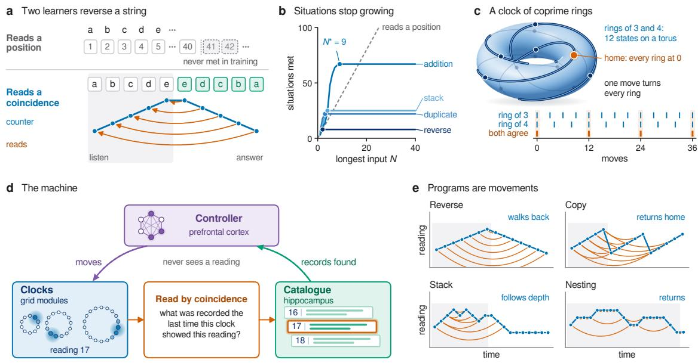  
Figure 1. A learner that reads coincidences. (a) Two learners reverse a string: one files each symbol under its position, and every position beyond its training is new to it; the other moves a counter up while it listens and down while it answers, and reads what it heard when the counter last showed its present value (arcs). (b) Situations met on inputs up to length N: new ones at every length for a learner that reads its position, none beyond a small N\* for a procedure that reads coincidences. (c) A clock of coprime rings: one move turns every ring, rings of 3 and 4 form a cycle of 12 states on a torus, and a cell tuned to one state of both fires where they agree. (d) The machine of Eq. (1) and its parts in the brain. (e) Programs are movements of clocks (dots: readings; arcs: reads): a clock that walks back reverses, a clock sent HOME copies, a clock that follows depth is a stack, and a clock that returns handles nesting.

The first learner reads a coordinate: a quantity, such as a position, a count or a time, that keeps taking new values as the input grows. The second reads a coincidence: whether two things are the same, which has the same two answers at every size. Einstein met the distinction in the hole argument. Laws that keep their form under every change of coordinates seemed unable to fix the gravitational field inside a region, since relabelling the points inside turns one solution into another that agrees with it outside. The two solutions agree on every point coincidence, every meeting of two world lines; measurement records nothing else, so they describe one world (Einstein, 1916; Stachel, 1989; Norton, 1993). A coordinate is a name; a coincidence is an event. A learner that reads a coordinate has a hole of the same kind, the values beyond its experience. Einstein closed the hole by seeing that measurement records only coincidences; a learner closes its own by reading nothing else.

The principle determines the memory. The memory has to grow with the input, and the learner has to meet only finitely many situations in it; a memory that looks the same from every place does both. The learner moves through such a memory, and may read only what its moves leave unchanged near where it stands: whether two places are the same. A finite memory looks the same from every place only by closing on itself, so it is made of cycles, and a few cycles whose periods share no factor cover the most moments with the fewest neurons. These cycles are the modules of the entorhinal grid code (Hafting et al., 2005; Fiete et al. 2008). A place cell fires where the modules that drive it agree, and so detects a coincidence (O'Keefe & Dostrovsky, 1971; Solstad et al., 2006); the hippocampus keeps an index of every moment (Teyler & DiScenna, 1986), filed here under the readings the cycles had; prefrontal cortex, gated by the basal ganglia (O'Reilly & Frank, 2006), moves the cycles without seeing them. A program is a movement of the cycles, and a return from a call is the movement back; replay, in which place cells fire in sequence while the animal rests, is a clock walked over stored readings, a program running without input. Tolman's cognitive map (Tolman, 1948; O'Keefe & Nadel, 1978) is this memory read while the body moves the cycles; the theory derives it from generalization, and finding the way home is one of its uses.

Reading only coincidences costs no power. Turing's machine never reads where its head is: a step depends on the state and the symbol under the head (Turing, 1937), and that is why one finite table serves tapes of every length. A tape is a clock whose cells are records, and what finite experience fixes in the machine of cycles is what multitape Turing machines compute in step with their input (Section 3): the architecture of spatial memory is a universal computer. In attractor networks of neurons the machine is the dynamics seen through its symmetry, and symbols are what the symmetry leaves unchanged (Section 4). In the experiments the memory is built from the theory and only the controller is learned: trained on strings of up to 40 symbols, it holds its rule to length 500 on nine of fifteen benchmark tasks, reverses exactly to length 15,015 when given new cycles after training, and runs unchanged on neurons (Section 5). Kant's form of intuition, given before experience, becomes the group of moves that turns the cycles (Section 6).

## 2. From a Principle to a Machine

## 2.1. What a learner reads

A learner meets its input one step at a time and acts at each step: it emits a symbol, changes its state, writes a record to its memory. Everything its action depends on is its situation, and the learner reads what the situation contains.

Definition 1. A quantity in a learner's situation is a coordinate if longer inputs keep giving it values that shorter ones never gave: a position, a count, a time, a distance, an activity that rises with length. It is a coincidence if it says whether two events agree, as two symbols or two readings of a clock do or do not; a coincidence has the same few values at every size.

Theorem 1 (The hole). (i) A learner that reads a coordinate while it answers has, for every training size N, a twin that acts as it does in every situation the training inputs produce and answers differently on some longer input. (ii) A learner whose situation holds only coincidences, the present symbol a state from a finite set and records from a fnite set is fxed by finite experience: for every task there is a size $N _ { \mathrm { t e a c h } }$ such that every such learner correct on all inputs up to $N _ { \mathrm { t e a c h } }$ is correct on every input its memory can hold.

For (i), change the learner's answers only where the coordinate takes a value never met on inputs of size N or less: no example tells the twins apart, and a large network can be either. This is Goodman's riddle made exact, since grue reads the date, and Kripke's quus needs a state that adding small numbers never visits. Kripke's sceptic held that no finite disposition settles plus against quus beyond the numbers met; a disposition that reads only coincidences does, being a finite table over situations that small numbers visit. For (ii), every situation on a long input is one of finitely many; finitely many situations allow finitely many rules; each wrong rule fails on some input of finite size; and $N _ { \mathrm { t e a c h } }$ is the largest of these sizes (Appendix A.2). One procedure is fixed by far less experience than the whole class of learners needs. By some size $N ^ { * }$ it has met every situation it will ever meet, and a learner that acts as the procedure on every input up to $N ^ { * }$ , moves and writes included, acts as it at every size its memory can hold (Lemma 1, Appendix $\mathbf { A } . 2 )$ . Reversal meets its eight situations on inputs of length 2, so $N ^ { * } = 2 $ binary addition, with its carries, has $N ^ { * } = 9 ( \mathrm { F i g u r e \ 1 b } )$ Ten symbols can fix a rule for a thousand.

## 2.2. Memory that looks the same everywhere: clocks are cycles

A learner's memory has to grow with its input, and the learner has to meet only finitely many situations in it. Both hold if the memory looks the same from every place. If the learner's moves through the memory form a group, so that every move can be undone and two moves combine into a move, and the group carries any place to any other, a learner that reads only what lies within a few moves of where it stands meets no more situations than there are ways to fill those few places (Appendix A.5). The address of a place is a coordinate, and so is the distance between two places, which grows with the memory; whether two places are the same, or a few moves apart, is a coincidence. Klein defined a geometry by a group of transformations and its content by what the group leaves unchanged (Klein, 1893). A learner that generalizes reads what the group of its memory leaves unchanged within a few moves of where it stands.

Two distant moments can be linked by a coincidence only through something that changes between them and can take an earlier value again: a clock. Four things are asked of a clock. It has finitely many states, as every physical memory has. Each move can be undone, so that a past state can be visited again. Moves commute, so that where the clock ends up depends only on how far it has moved; if they did not, the way back would have to undo them in reverse order, and remembering that order is already a memory. And one elementary move, repeated, visits every state.

Proposition 1 (Clocks are cycles). A clock with these properties is a cycle of L states that the elementary move advances by one, and every other move advances by some xed number of states. By the Chinese remainder theorem a cycle whose period L is a product of numbers no two of which share a factor is the same as one cycle of each of those periods, all advanced together: cycles of 3 and 4 driven by one move are a cycle of 12 (Figure 1c). Several clocks, each with its own move, form a torus, a cycle of cycles.

A cycle of period p is held by a ring of neurons carrying one bump of activity, a ring attractor (Zhang, 1996; Seelig & Jayaraman, 2015). Cycles whose periods $p _ { 1 } , \ldots , p _ { M }$ share no factor turn together without carries, and together they tell apart $L = p _ { 1 } \cdots p _ { M }$ moments at a cost of $p _ { 1 } + \cdots + p _ { M }$ units: the periods 2, 3, 5, 7, 11 tell apart 2,310 moments with 28 units. The largest L that a given number of units can reach is Landau's function, which grows faster than any power of that number (Appendix A.6). The entorhinal grid code has this form: a few discrete modules, each a torus (Gardner et al., 2022), which respond independently to a change of environment yet move together (Stensola et al., 2012; Waaga et al., 2022; Fiete et al., 2008). The cycles follow from generalization, and the economy of the grid code from the cycles.

## 2.3. Coincidence, catalogue and machine

A neuron tuned to one reading on several cycles fires only where all of them stand as it requires: it detects a coincidence of readings, which is how place fields arise from grid cells (Solstad et al., 2006).

Let every moment be recorded with the readings its clocks had, and let memory be searched with one question: what was recorded the last time this clock showed this reading? Such a catalogue is a memory written and read by address, as computation requires (Gallistel & King, 2009; Gershman et al., 2025), and it is the index the hippocampus keeps (Teyler & DiScenna, 1986). The machine (Figure 1d) has a controller, clocks $g ^ { 1 } , \ldots , g ^ { C }$ and heads $1 , \ldots , R ,$ each of which looks up the past. Head i compares the present reading of its query clock $q _ { i }$ , plus an offset $\delta _ { i }$ , with the past readings of its key clock $c _ { i } ,$ which may be the same clock:

move: $g _ { t } ^ { c } = g _ { t - 1 } ^ { c } + \Delta _ { t } ^ { c }$ (mod L), $\Delta _ { t } = \mu ( h _ { t - 1 } , x _ { t } )$ find: $s _ { t } ^ { i } = \operatorname* { m a x } \{ s < t : { \ : g _ { s } ^ { c _ { i } } = g _ { t } ^ { q _ { i } } + \delta _ { i } , \ : \gamma _ { i } ( w _ { s } ) = 1 } \}$ 2 act: $\left( h _ { t } , y _ { t } \right) = \Phi ( h _ { t - 1 } , x _ { t } , w _ { s _ { t } ^ { 1 } } , \dots , w _ { s _ { t } ^ { R } } )$

record: $w _ { t } = \omega ( h _ { t } , x _ { t } )$

(1)

From its state $h _ { t - 1 }$ and the present symbol $x _ { t }$ the controller moves every clock by at most two readings, $\Delta _ { t } ^ { c } \in$ $\{ - 2 , \ldots , 2 \}$ , or resets it HOME to zero, $g _ { t } ^ { c } = 0$ Head i then searches the records its gate $\gamma _ { i }$ accepts, a learned bit written with each record, and returns the latest one made when its key clock showed the reading its query clock shows now, plus the offset; if there is none it returns nothing. The controller, with finitely many states, updates its state from the symbol and the records found, emits $y _ { t }$ and records the moment as $w _ { t }$ , one of finitely many records; of its clocks it learns only whether a match exists and what was recorded there. This is attention with exact matching, where the latest match wins; a graded attention (Graves et al., 2014; Weston et al., 2015) would report a distance.

The range. Moments L apart show the same reading, so a head that compares readings L or more apart can find the wrong moment. The span of an input, for a given machine, is the largest distance between a reading a head asks for and the reading of any record its gate accepts, measured on clocks that never wrap: how far back a head ever has to look. The reversal procedure of Figure 1e has span $n - 1$ on n symbols. An input is within range if its span is below $L ,$ the range.

Theorem 2 (The range belongs to the clocks). (i) On every input within range the machine runs exactly as the same controller with unbounded clocks, whatever pairwise coprime cycles make up L. (ii) Beyond the range, the first departure from that run is a lookup that fnds a record a nonzero multiple of L readings away, counted on clocks that never wrap; by then the span so far has reached L.

The controller is learned; the range belongs to the clocks Cycles of another product $L ^ { \prime }$ move the range to $L ^ { \prime }$ and change no run within both ranges, so a learned rule can be given a longer memory as a Turing machine is given a longer tape. The same confusion of moments $L$ apart predicts, with no free parameter, how the reversal procedure of Figure 1e fails beyond its range: the first $L$ answers find their own symbols, each later one finds a symbol a multiple of $L$ places back, right half the time on random bits, so the accuracy at length $n > L$ is $( L + \textstyle { \frac { 1 } { 2 } } ( n - L ) ) / n$ (Appendix A.7). Transformers whose positional code is a set of rotations with periods 5, 7, 11, 13 copy strings up to length 5,005, the product (Guo et al., 2026), where the theorem puts the range of such cycles.

What leaves the rule open. Three things let a learner fit its data without the data fixing its rule. A blurred match is strong between near readings and weak between far ones, so it reports a distance, a coordinate; clocks and controller have to sit in discrete attractor states (Hopfield, 1982). A controller large enough to hold a whole training input fits without reading its past; a small working memory pushes the procedure into the catalogue (Elman, 1993; Newport, 1990). And the readings themselves keep taking new values up to the range, so a controller that sees them has a rule the data leave open (Section 5.3): the machine moves its clocks blind. Adding one common amount to every clock, and to the reading HOME returns to, changes no run, since the controller sees only equalities between readings, which a common shift preserves. This is Leibniz's argument that a world shifted as a whole is the same world (Alexander 1956): to the controller, as space was to Leibniz, the memory is nothing beyond the relations in it.

## 2.4. Programs are movements, recursion is return

A stack is a clock moved forward by each push and back by each pop; a queue is two clocks, one writing and one reading; a copy is a clock sent HOME and run again over the same readings. With one clock and a head at offset 0, Eq. (1) runs in step with its input any deterministic pushdown automaton that reads one symbol per step, and with two clocks and a head at offset +1 any queue automaton (Proposition 2 of Appendix A.8). To call a procedure is to move forward and leave the pending context in the record of that moment; to return is to move back and find it there. Recursion is a return. Procedures compose as movements compose, since every move can be undone, and when moves commute the return depends only on the net displacement, as a desert ant after a winding search heads nearly straight home (Müller & Wehner, 1988). The levels of the Chomsky hierarchy become movements: regular tasks need no clock, nesting needs a clock that returns, copying a clock sent HOME, and crossed dependencies, as in Dutch verb clusters, are copies, which listeners find easier than nesting (Bach et al., 1986) (Figure 1e; Appendix C).

## 3. What a Finite Learner Can Compute

Turing asked what a person computes with pencil and paper and bounded what enters a step: finitely many states of mind and finitely many observed squares, on a tape that looks the same everywhere (Turing, 1937). His conditions came from the limits of a human computer; here they come from generalization, and they are the same conditions: the bound that lets one finite table serve every tape is the bound that lets finite experience fix the table. A tape is a clock, and its cells are records.

Theorem 3 (Clocks are tapes). (i) A Turing machine with C work tapes that reads one input symbol per step is, step for step, a machine of Eq. (1) with C unbounded clocks, each read by one head at offset 0: the reading of a clock is the position of a head, and the record found under it is the symbol last written there. (ii) Conversely, a machine of Eq. (1) with C unbounded clocks, each read by one head at offset 0, whose clocks move by at most one reading, by an amount fixed by the controller's state alone, is a Turing machine with C tapes whose symbols are records. (iii) Every machine of Eq. (1) with unbounded clocks is simulated in real time by a multitape Turing machine.

Given steps without input, one clock runs any Turing machine whose tape fits in its range, and an unbounded clock runs them all: a controller that never reads a coordinate computes everything a computer computes. At one step per input symbol, the machine with unbounded clocks computes what multitape Turing machines compute in real time (Rabin, 1963; Hartmanis & Stearns, 1965). In real time every added tape adds power (Aanderaa, 1974; Paul et al. 1981), so such clocks are a resource no controller replaces. Multiplication bit by bit as the factors arrive is beyond any number of tapes (Cook & Aanderaa, 1969; Paterson et al., 1974); given time to think, the machine multiplies, as a chain of thought extends what a Transformer computes (Merrill & Sabharwal, 2024). With Theorem 1(ii) the same class is what finite experience fixes: a learner of Eq. (1) with a bounded controller and unbounded clocks has a size $N _ { \mathrm { t e a c h } }$ such that a fit up to $N _ { \mathrm { t e a c h } }$ is correct at every length, and the rules it can hold are exactly the procedures that multitape Turing machines run in real time. What a finite mind can learn from finite experience and what it can compute in step with the world are the same procedures.

Networks have been proven universal by keeping the unbounded part of a computation in a precision or an address (Siegelmann & Sontag, 1995; Pérez et al., 2021; Graves et al., 2014), stores that are coordinates; the machine keeps it in the positions of its clocks, which its controller never reads, so it is universal and finite experience fixes its rule. A memory with the form of a space, read by coincidence, is a tape, and a tape carries every computation: the circuit that evolved to find the way home learns arithmetic and grammar because the abilities share a form.

## 4. The Machine in the Brain

## 4.1. One system, two descriptions

The brain's circuit for a cycle is a continuous attractor network: neurons on a ring excite their neighbours and share inhibition, so that a bump of activity rests at any position, moves with velocity inputs, and with firing rate adaptation moves by itself (Amari, 1977; Zhang, 1996; McNaughton et al., 2006; Burak & Fiete, 2009; Chu et al., 2024). For neurons at positions θ on a ring, with synaptic input U, firing rate r, adaptation V and a bias of amplitude ∈ that carves p resting places for the bump, the wells,

$$
\begin{array} { c } { { \tau \partial _ { t } U = - U + \rho J \ast r - V + \epsilon \cos p \theta + I , } } \\ { { \tau _ { v } \partial _ { t } V = - V + m U , \qquad r = [ U ] _ { + } ^ { 2 } \big / \big ( 1 + k \rho \int [ U ] _ { + } ^ { 2 } \big ) , } } \end{array}\tag{2}
$$

with $J * r$ the convolution of the firing rate with a Gaussian kernel, a density $\rho$ of neurons, global inhibition $k ,$ adaptation of strength m and time constant $\tau _ { v } .$ , and an input I that carries the moves, the reset HoME and noise; a move is a pulse that adds a shifted copy of the recurrent input and pushes the bump on by whole wells (Zhang, 1996). A clock is M rings of periods $p _ { 1 } , \ldots , p _ { M }$ , no two sharing a factor driven by the same pulses; a ring has as many wells as its period has steps, so one pulse turns every ring by one well, as one velocity signal turns every grid module. Two maps join network and machine: I takes each ring to the angle at which its bump stands, and Q rounds it to the nearest well, so that $Q \circ \Pi$ sends the network to the wells of its rings, which the Chinese remainder theorem reads as one of the $L = p _ { 1 } \cdots p _ { M }$ readings of the clock (Figure 2c).

Theorem 4 (One system, two descriptions). (i) Turning every ring by whole wells, and with it the well HOME returns to, commutes with Eq. (2): the turns of the clock, which form its group, are a symmetry of the network. (ii) Without noise, under the conditions of Appendix B (a weak bias, suitable

f Count or estimate

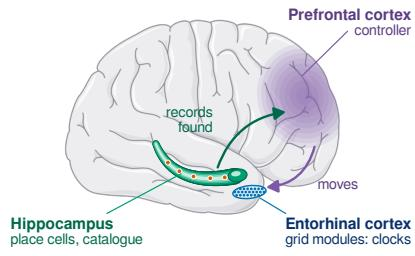

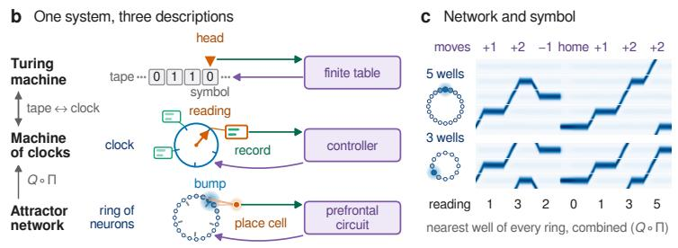

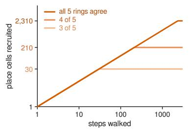

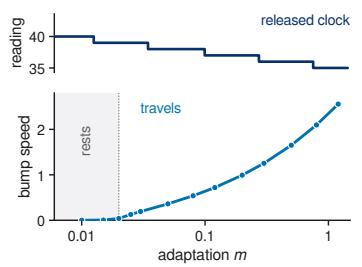

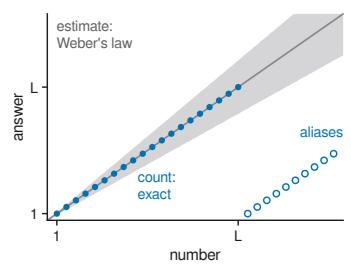  
Figure 2. One system, three descriptions. (a) The parts of the machine in the brain. (b) The same computation described three times: a Turing machine's tape is a clock whose cells are records and its head the reading (Theorem 3); a clock is a ring of neurons whose bump stands in one of p wells, read by II and Q, and a place cell fires where the bump returns (Theorem 4); the finite table, the controller and the prefrontal circuit are one rule. (c) Two rings of Eq. (2), with 5 and 3 wells, under a sequence of moves, and the reading Q o I after each. (d) Place cells recruited as a clock of rings 2, 3, 5, 7, 11 advances: recruitment stops at 2,310 cells when all rings must agree, at 210 or 30 when one or two may differ. (e) A clock released after 40 moves runs back through its last readings by itself (top); above $\tau / \tau _ { v }$ adaptation makes a bump travel (bottom). (f) A count is exact up to its clock's range and then repeats; an estimate reads a graded magnitude. Brain outline adapted from Servier Medical Art, CC BY 3.0.

pulses, adaptation strength m below $\tau / \tau _ { v } )$ , each ring has p stable bumps, one in each well, a pulse of n wells carries every bump n wells on, and on these states the network is the clock: QII $F _ { \Delta } = \Delta \circ Q \circ \Pi _ { \cdot }$ with $F _ { \Delta }$ one step of Eq. (2) under the move $\Delta .$ (iii) A place cell that fires only when every ring stands where it stood when the cell was recruited detects the coincidence of the present reading with the recorded one; a cell that tolerates j disagreeing rings fires again after the product of the M — j smallest periods which is then its range.

The proof reduces the network to the motion of its bumps (Appendix B; Wu et al., 2008; Fung et al., 2010). From the same reduction, noise carries a bump out of its well at a rate exponentially small in the well's depth (Kramers, 1940), and adaptation above $\tau / \tau _ { v } ,$ or above a higher value when there are wells to cross, makes a bump lead a slow input or travel by itself (Mi et al., 2014; Chu et al., 2024). Turning every ring by one well moves every bump and leaves every record, every controller state and every equality between readings as it was. These quantities, which the symmetry leaves unchanged, are the symbols. The symbolic machine is the network's dynamics on its stable states, written in terms of what its symmetry leaves unchanged, and under the conditions of Theorem 4 every run of the machine is a run of the network. With Theorem 3 the chain closes: a Turing machine is a machine of clocks, and a machine of clocks is an attractor network (Figure 2b). Marr held the three levels of description to be only loosely related (Marr, 1982); here they are one system described three times, with the symmetry as the map from the network to the clocks and Theorem 3 as the map from the clocks to the tape.

A record is data, written in one trial and never trained; the rule is the finite table of the controller, learned, and unable to depend on how many records there are, since that number is a coordinate. The fast store of episodes and the slow learner of rules (Marr, 1971; McClelland et al., 1995) are two kinds of change in one machine, kept apart by the principle, and a learner without the catalogue keeps its rules, as a patient without a hippocampus learns a skill and keeps no episode (Corkin, 1968).

## 4.2. The parts in the brain

A grid module is a torus (Gardner et al., 2022) of two rings, one for each of two directions of its lattice. Grid cells track space, time and pitch (Kraus et al., 2015; Aronov et al. 2017), and a grid-like code organizes abstract spaces (Constantinescu et al., 2016). The moves are speed and heading signals (Kropff et al., 2015), counted steps in ants (Wittlinger et al., 2006) and copies of the controller's commands (Crapse & Sommer, 2008); in mental navigation the entorhinal cortex of macaques is periodic while the body is still (Neupane et al., 2024). HOME is the reset of a module at a wall, which corrects the ring perpendicular to it (Hardcastle et al., 2015), at every turn of a hairpin maze, where the grid map starts again (Derdikman et al., 2009), and at the boundary between events (Baldassano et al., 2017). Place cells are the coincidence detectors (O'Keefe & Dostrovsky, 1971; Solstad et al., 2006) of whatever clocks reach them, grid modules the best known; they can fire when some modules disagree (Theorem 4(iii)), precede mature grids in pups (Wills et al., 2010) and outlast the loss of grid periodicity (Brandon et al., 2014). Time cells are the same detectors on a clock turned by time (MacDonald et al., 2011; Eichenbaum, 2014). The catalogue is the hippocampal index (Teyler & DiScenna, 1986), built as in Chandra et al. (2025) from conjunctions of grid states, where a cell is recruited when none answers the present reading: a plateau potential potentiates the inputs active around it (Bittner et al., 2017), so the cell comes to fire where the clocks stand as they stood then, and the record is written in one trial. The controller is the prefrontal circuit that holds the pending items of a procedure, few and discrete (Cowan, 2001), gated by the basal ganglia (Frank et al., 2001; O'Reilly & Frank, 2006); it moves the clocks by commands and reads only what the heads return (Figure 2a).

What the theory explains (Appendix F). The clocks are given. Toroidal structure is present in the entorhinal cortex of rat pups at ten days of age, before their eyes open and before they explore (Guardamagna et al., 2026), as the head direction ring is before the eyes open (Bassett et al., 2018), and grid fields mature last (Langston et al., 2010; Wills et al., 2010): the form precedes its content. Coordinates move, coincidences stay. Between rooms the grid realigns when place cells remap (Fyhn et al., 2007), the relative phases within a module stay fixed (Yoon et al., 2013), and each module shifts by its own amount (Lykken et al., 2025; Monaco & Abbott, 2011): every place gets a new combination of readings, under which the old coincidences are not met, and a new catalogue opens on the same clocks. Large spaces give many fields (Figure 2d). A cell that needs only some of its modules to agree fires wherever that agreement recurs (Theorem 4(iii)); in a 200 m tunnel nearly nine place cells in ten have several fields (Eliav et al., 2021). Replay is a clock in motion (Figure 2e). A clock run over stored readings returns their records in order, backward at the end of a run and forward before it (Foster & Wilson, 2006; Diba & Buzsáki, 2007), hopping from one position to the next (Pfeiffer & Foster, 2015), along paths never travelled (Gupta et al., 2010), and in the learned order of an abstract task (Liu et al., 2019). Section 3 found procedures that need steps without input; rest and sleep supply them, and replay is the machine running while nothing arrives. A head set to ask a few readings ahead reads ahead, as place and grid cells sweep ahead of the animal within each cycle of the theta rhythm (Skaggs et al., 1996; Vollan et al., 2025; Chu et al., 2024). Order is kept by coincidence. Serial recall exchanges items that held the same position in different groups (Henson, 1998), and an event boundary, a reset HOME, breaks the order of items across it (Zheng et al., 2022). Counting and estimating obey different laws (Figure 2f). An estimate reads a graded magnitude, a coordinate, with errors proportional to the number (Nieder & Miller, 2003); a count is a clock read by coincidence, exact until a slip, with errors that grow as the square root of the count (Cordes et al., 2001).

Predictions (Appendix F.1). Exact sequence memory fails where the joint phase of the grid modules in play repeats, and lesions of ventral medial entorhinal cortex, which holds the modules of largest period, shorten it most; place cells made tolerant of j disagreeing modules, by weakening the inhibition that sharpens their fields (Grienberger et al., 2017), cap exact memory at the product of the $M - j$ smallest periods; a replay during which the grid stands still would refute the identification; memory for the order of events rests on the periodic time code of the medial entorhinal cortex (Kraus et al., 2015; Heys & Dombeck, 2018) and memory for how long ago on the drifting code of the lateral (Tsao et al., 2018); and the prefrontal code of the pending items of a procedure is unchanged when a new room shifts every grid module and the place cells remap.

## 5. Experiments

Six experiments test six predictions: a rule fitted on strings of up to 40 symbols holds to length 500, and the clocks of the trained machines move as the programs of Section 2.4 do (Section 5.1); clocks exchanged after training move the range to the product of the new periods, with failure beyond it on the curve of Section 2.3 (Section 5.2); a coordinate, or a blurred coincidence, lets the same machine fit its training data while leaving its rule open (Section 5.3); a machine that acts as the procedure on inputs no longer than 10 is fixed when N\* is at most 10, and each independent count takes a clock (Section 5.4); trained controllers run unchanged on neurons (Section 5.5); and Turing machines compiled onto clocks run as on tapes (Section 5.6).

The machine and the protocol. The controller is a gated recurrent unit of 256 units. It moves three clocks of rings 2, 3, 5, 7, 11 (L = 2,310) and reads the catalogue through 36 gated heads, one for each ordered pair of clocks, the same clock included, and each offset in $\{ - 1 , 0 , 1 , 2 \}$ ; at every step it writes a record of 16 numbers, and it receives the present symbol and the records found, nothing else. The controller of Eq. (1) has finitely many states; this one has a continuous state, pushed toward a few discrete values by Gaussian noise added in training, which favours procedures that keep the past in the records. In training each clock holds a distribution over readings, so that gradients flow, sharpened to a single reading as training proceeds; every test runs the discrete machine (Appendix D). A run is trained on lengths 1 to 40 and tested on 32 random inputs at every length from 41 to 500. It fits if it is at least 99% correct on validation inputs of lengths 31 to 40, with up to six attempts and test lengths never entering selection; it extrapolates if its mean score over the test lengths is at least 99%; and a task is solved if the mean over its three seeds is. LSTMs of 256 units and Transformers of five layers and width 64, with rotary positions or none, are trained on the same data with the same selection; code, results and trained machines accompany the paper (Appendix H).

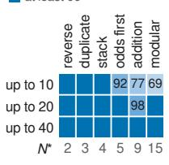

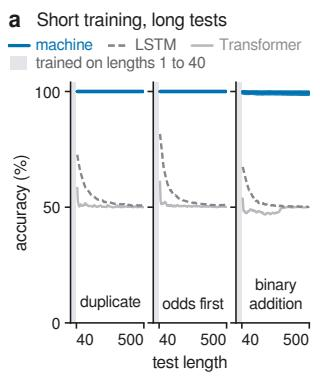

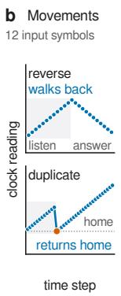

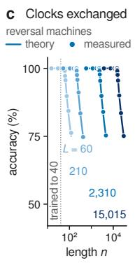

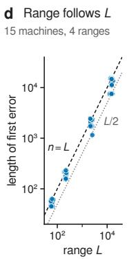  
e What may not be read accuracy at length 500 (%) at least 99

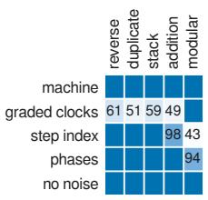

Figure 3. Rules learned on short inputs, tested at every length. (a) Accuracy at every test length after training on lengths 1 to 40: the machine (three seeds), LSTMs and Transformers. (b) Clock readings of trained machines: in reversal a clock walks back, in duplication a clock returns HoME and runs forward. (c) Reversal with clocks exchanged after training: dots are measured, lines the accuracy the theory predicts with no free parameter (Section 2.3). (d) The first error moves with the range L. (e) Accuracy at length 500 with graded clocks, with the step index, with the phases given to the controller, and without noise. (f) Score after training up to length 10, 20 or 40, with the $N ^ { * }$ of each task.  
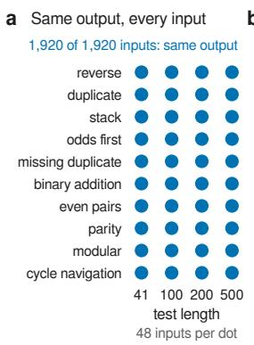

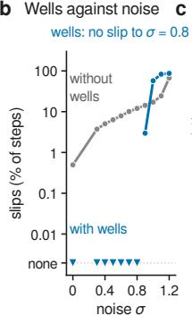

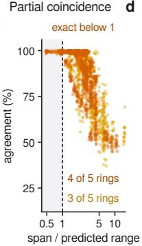

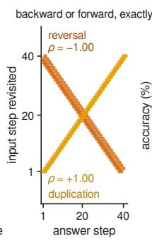

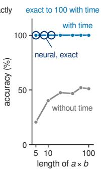

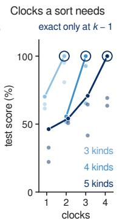  
Figure 4. The machine as neural dynamics and as a computer. (a) Trained controllers run on neurons: agreement with the symbolic output on every test input. (b) Clock slips against noise, with and without wells. (c) Place cells that tolerate one or two disagreeing rings: agreement against the span divided by the predicted range. (d) Replay order in reversal and duplication. (e) A schoolbook multiplier written as a three-tape machine, run on clocks with and without time to think; circles: the same machine on neurons. (f) Sorting k kinds of symbol: no run with fewer than k — 1 clocks fits, and one run of three with k — 1 clocks sorts exactly.

## 5.1. Short training, long tests

The fifteen tasks of Delétang et al. (2023) span the Chomsky hierarchy (Appendix E.1; Table 7 in Appendix E.2). Four need no memory beyond a finite state, among them parity and an expression evaluated modulo five. The others read their past: reverse a string (100111 → 111001), duplicate it, write its second, fourth and sixth symbols and then the rest (000111 → 011001), run pushes and pops on a stack and read it out, add binary numbers lowest bit first (11101+1 → 00011), find the symbol hidden in a string written twice, evaluate bracketed arithmetic and equations, sort, multiply take a square root. Twelve have a procedure that keeps pace with the input in three clocks; multiplication has none bit by bit as the factors arrive (Section 3), none is known for square root, and our procedure for sorting five kinds of symbol uses four clocks (Section 5.4). The experiment asks whether training finds the procedure.

The machine solves nine of the fifteen tasks, all among the twelve with a three-clock procedure (Figure 3a; Table 7). Of the 30 runs that fit, 27 extrapolate, with the same accuracy at 500 as at 41: a rule fitted at length 40 is the rule at length 500.

On the five solved tasks that no LSTM or Transformer solves (reversal, duplication, stack manipulation, odds first and binary addition), all fifteen runs fit and fourteen extrapolate; the best published runs reach 95.1% on reversal, 77.9% on stack manipulation and at most 75.1% on duplication, odds first and addition (Table 7), and a Transformer with rotary positions exact at length 40 is at chance by 50, the hole of Theorem 1 in its plainest form. Two networks of the benchmark extrapolate on these tasks, and both were given a memory: the Stack-RNN, given a stack, solves stack manipulation and reversal, the two that a clock walking back serves; the Tape-RNN, given a tape, solves all five, and a tape is a clock. Six tasks are unsolved (Appendix E.2). On bracketed arithmetic and equations no run fits: their procedures meet all their situations only at lengths 29 and 49, and inputs of up to 40 symbols hold few of the deep nestings that teach the return. On cycle navigation one seed of three tracks its position in a graded state that drifts, as a controller in discrete states cannot. No run fits multiplication or square root, and bucket sort, which the published LSTM and Transformer solve, needs a fourth clock.

The clocks show what was learned. In every reversal machine a clock advances one reading per input symbol and walks back one per answer, so that each answer finds the symbol recorded at the present reading; in every duplication machine a clock goes HoME at the first answer and runs forward over the readings the input was filed under (Figure 3b). These are the stack and the copy of Section 2.4, reverse and forward replay, found from inputs and outputs alone.

## 5.2. The range belongs to the clocks

The controller never sees its clocks, so they can be exchanged after training; by Theorem 2 the range is then the product of the new periods, and beyond it reversal should score $( L + \textstyle { \frac { 1 } { 2 } } ( n - L ) ) / n$ (Section 2.3). We take the trained machines of eight tasks and run them, without retraining, with rings 3, 4, 5 (L = 60), 2, 3, 5, 7 (210), 2, 3, 5, 7, 11 (2,310) and 3, 5, 7, 11, 13 (15,015), on 8 random inputs at each of 15 lengths from $L / 4$ to 2L.

With the rings 3, 5, 7, 11, 13, three of three reversal and two of three duplication machines are correct on every input up to length 15,015, 375 times their longest training input. On all 2,562 inputs within range the output is that of unbounded clocks, and wherever the bounded clocks return a different record than the unbounded ones, the first such misread comes after the span has reached L. Beyond the range, reversal follows the predicted curve to within 0.27 percentage points on average (Figure 3c), and for all 15 machines that err the first error moves out with L, at 0.50 to 1.10 times L (Figure 3d).

## 5.3. What may not be read

A coordinate lets a learner fit its data and leaves its rule open (Theorem 1(i)), and a blurred coincidence is a coordinate, since it reports a distance (Section 2.3). We retrain five tasks with graded clocks, the soft readings of training kept at test, so that a head averages near matches; with the step index $t / 4 0$ given to the controller; with the phases of all its clocks given to the controller, which together are the reading; and without noise (Appendix E.4).

With graded clocks all 15 runs fit, yet at length 500 every task that reads its past falls to between 48 and 71%, and modular arithmetic, which needs no clock, stays above 99% (Figure 3e). Given the step index, 11 of the 12 runs on tasks that reach their past through the clocks stay above 99%, while modular arithmetic, the one task the controller computes by itself, ties its answer to the count and falls to between 28 and 62%. Given the phases, 12 of 15 runs stay above 99%; without noise 14 of 15 runs fit and every run that fits stays above 99%. A coordinate opens the hole; training decides how it is filled, and on tasks whose past lies in the clocks, training fills it through the clocks.

## 5.4. How much experience, how many clocks

$N ^ { * }$ is the length by which a procedure has met every situation it will ever meet, so a learner that acts as the procedure up to $N ^ { * }$ is fixed (Lemma 1, Appendix A.2). Our procedures keep each independent count in a clock of its own: to sort 113311 into 111133 in step with the input, a learner has to know where in the output each kind of symbol past the first begins, $k - 1$ counts for k kinds. We retrain six tasks on lengths 1 to 10 and 1 to 20, and sorting over $k = 3 ,$ 4 and 5 kinds with fewer than $k - 1$ clocks and with $k - 1$

All 36 runs on short inputs fit (Figure 3f). Among the runs whose training reaches $N ^ { * }$ , 11 of 15 extrapolate when trained up to 10 and 15 of 18 when trained up to 20: every run on reversal, duplication and stack manipulation extrapolates from ten symbols, as do two of three on odds first, and modular arithmetic $( N ^ { * } = 1 5 )$ fails when trained up to 10 and succeeds when trained up to 20. Binary addition $( N ^ { * } = 9 )$ needs more, 72.2 to 83.2% when trained up to 10: a machine can fit short sums without acting as the procedure, and then only $N _ { \mathrm { t e a c h } }$ binds it. In sorting, no machine with fewer than $k - 1$ clocks fits its training lengths; with $k - 1$ clocks one run of three fits for each $k ,$ and that run sorts exactly at every tested length, while the other two score 64 to 95% (Figure 4f).

## 5.5. The same machines in neural dynamics

If the network of Eq. (2) is the clock on its stable states (Theorem 4), a controller trained on symbolic clocks runs unchanged on neurons. We replace the clocks and the catalogue of the trained machines by rings of Eq. (2) with 16 neurons per well; place cells, each recruited for one joint reading of the rings; and records stored as synaptic weights strengthened once (Appendix B).

Without noise, the neural machines give the symbolic output on all 1,920 test inputs of ten tasks, and no bump leaves its well (Figure 4a); with noise of strength 0.6 on every neuron the output of all 720 inputs of five tasks is unchanged. With wells the clocks never slip in 32,000 steps at noise up to 0.8; without wells they slip in 12.0% of steps at 0.8 (Figure 4b). Place cells that tolerate one or two disagreeing rings shorten the range to 210 and 30, the products of the rings that must agree (Figure 4c). As they answer, reversal machines revisit the input backward and duplication machines forward (rank correlations —1.00 and 1.00; Figure 4d), and a clock walked through 40 readings and released at adaptation 0.3 runs back through the last of them by itself (Figure 2e). The controller cannot tell the network from the symbolic machine.

## 5.6. Turing machines and time

By Theorem 3, a Turing machine with C tapes that reads one symbol per step is a machine of Eq. (1) with C clocks: tape to clock, head to head, symbol to record, table to controller. By that construction we compile 60 random Turing machines with one to three tapes into controllers and run them on inputs of up to 1,000 symbols, with unbounded and with bounded clocks, comparing every step with a direct simulation; a schoolbook multiplier written as a three-tape machine gets about $n ^ { 2 } / 2$ steps without input to think, or none (Appendix E.9).

The machines on clocks match the simulation in all 1,200 runs with unbounded clocks and in all 2,977 runs with bounded clocks whose heads stay within range. Given time to think, the multiplier is exact up to length 100; without it, it scores at most 52.0%, as the trained machines do (Figure 4e).

## 6. Discussion

Hume's question has an answer for a learner of procedures: if it reads only coincidences, each wrong rule betrays itself at some finite size (Theorem 1), and a learner correct up to that size is correct at every size its memory can hold; the step from short inputs to long ones, an induction for a learner of coordinates, is for it a deduction. Wittgenstein's pupil, who writes 1000, 1004, 1008 and holds that he goes on in the same way (Wittgenstein, 1953), reads the size of his numbers; a learner that reads only coincidences has no state in which to go wrong. The same answer explains why brains learn from so little: a record is written in one trial, because it is data and the catalogue files it, and a rule is fixed by a few short examples, because the situations it has to cover are few. Both follow from one fact: the memory carries the size of the input, and the rule stays finite.

The memory that carries the size has a form, the group of the clocks. Kant held the forms of intuition to be given before experience and conditions of its possibility (Kant, 1998); Poincaré found the origin of geometry in the group of displacements, the changes our own movements can undo (Poincaré, 1905). The group of the clocks is both, present in the entorhinal cortex of a pup before it has explored (Guardamagna et al., 2026) and a group of the animal's own displacements, and the theory says why a learner has to have such a group: of a memory that grows it can read only what the group leaves unchanged. Kant's two forms are one form under two drives: a clock turned by steps is space, and the same clock turned by seconds is time (Kraus et al., 2015). The hippocampus holds space, episodes, sequences and abstract spaces (O'Keefe & Nadel, 1978; Teyler & DiScenna, 1986; Eichenbaum, 2014; Buzsáki & Moser, 2013; Behrens et al., 2018); one organ serves all because a clock does not know what turns it, and the catalogue files any content under its readings.

Fodor and Pylyshyn held that systematic thought needs a classical architecture of combined symbols (Fodor & Pylyshyn, 1988); Smolensky, that symbols describe a network's dynamics only approximately (Smolensky, 1988); van Gelder, that cognition is dynamics and computation a misdescription of it (van Gelder, 1998). In the machine symbols and dynamics describe one system exactly, and the dynamics says which the symbols are. The group of the clocks is the symmetry of the network; the position of a bump is a coordinate, and the records, the controller states and the equalities between readings, which the group leaves unchanged, are the symbols. A network has symbols where its dynamics has a symmetry: a symbolic computation is a dynamical system described by its invariants, dynamicism with the symbols kept. Systematicity (Marcus, 2001; Lake & Baroni, 2018; Hupkes et al., 2020) is the composition of movements, since to run one procedure inside another is to move away and return; productivity is the rule staying finite while the memory grows. Computation that generalizes across scale rests on relations that a group of movements leaves unchanged, and for machine learning this is a design rule (Cohen & Welling, 2016; Bronstein et al., 2021): let the memory carry the size, read only what takes finitely many values, and reach the past by coincidence.

Hegel's image of the bad infinite is an endless line, and of the true infinite a circle that returns into itself (Hegel, 1969). A finite learner meets a stretch of a line and the whole of a circle. Brains build the line from circles.

## Impact Statement

This paper presents work whose goal is to advance theoretical neuroscience and machine learning: a principle for how neural systems generalize learned procedures beyond the sizes they were trained on, tested with simulations and benchmarks of modest size. No human participants or animal experiments were involved. There are many potential societal consequences of our work, none of which we feel must be specifically highlighted here.

## AI Use Statement

## References

Aanderaa, S. O. On k-tape versus (k – 1)-tape real time computation. In Karp, R. M. (ed.), Complexity of Computation, volume 7 of SIAM-AMS Proceedings, pp. 75–96, Providence, RI, 1974. American Mathematical Society.

Abbe, E., Bengio, S., Lotfi, A., and Rizk, K. Generalization on the unseen, logic reasoning and degree curriculum. In Proceedings of the 40th International Conference on Machine Learning, volume 202 of Proceedings of Machine Learning Research, pp. 31–60. PMLR, 2023. URL https://proceedings.mlr.press/v202/a bbe23a.html.

Al Roumi, F., Marti, S., Wang, L., Amalric, M., and Dehaene, S. Mental compression of spatial sequences in human working memory using numerical and geometrical primitives. Neuron, 109(16):2627–2639.e4, 2021. doi: 10.1016/j.neuron.2021.06.009.

Alexander, H. G. (ed.). The Leibniz-Clarke Correspondence. Manchester University Press, Manchester, 1956.

Amalric, M., Wang, L., Pica, P., Figueira, S., Sigman, M., and Dehaene, S. The language of geometry: Fast comprehension of geometrical primitives and rules in human adults and preschoolers. PLoS Computational Biology, 13 (1):e1005273, 2017. doi: 10.1371/journal.pcbi.1005273.

Amari, S.-i. Dynamics of pattern formation in lateralinhibition type neural fields. Biological Cybernetics, 27 (2):77–87, 1977. doi: 10.1007/BF00337259.

Angluin, D. Learning regular sets from queries and counterexamples. Information and Computation, 75(2):87– 106, 1987. doi: 10.1016/0890-5401(87)90052-6.

Anil, C., Pokle, A., Liang, K., Treutlein, J., Wu, Y., Bai, S., Kolter, J. Z., and Grosse, R. Path independent equilibrium models can better exploit test-time computation. In Advances in Neural Information Processing Systems, volume 35, pp. 7796–7809, 2022a.

Anil, C., Wu, Y., Andreassen, A., Lewkowycz, A., Misra, V., Ramasesh, V., Slone, A., Gur-Ari, G., Dyer, E., and Neyshabur, B. Exploring length generalization in large language models. In Advances in Neural Information Processing Systems, volume 35, pp. 38546–38556, 2022b. doi:10.52202/068431-2793.

Aronov, D., Nevers, R., and Tank, D. W. Mapping of a nonspatial dimension by the hippocampal-entorhinal circuit. Nature, 543(7647):719–722, 2017. doi: 10.1038/nature 21692.

Bach, E., Brown, C., and Marslen-Wilson, W. Crossed and nested dependencies in German and Dutch: a psycholinguistic study. Language and Cognitive Processes, 1(4): 249–262, 1986. doi: 10.1080/01690968608404677.

Baldassano, C., Chen, J., Zadbood, A., Pillow, J. W., Hasson, U., and Norman, K. A. Discovering event structure in continuous narrative perception and memory. Neuron, 95 (3):709–721.e5, 2017. doi: 10.1016/j.neuron.2017.06.0 41.

Banino, A., Barry, C., Uria, B., Blundell, C., Lillicrap, T., Mirowski, P., Pritzel, A., Chadwick, M. J., Degris, T., Modayil, J., Wayne, G., Soyer, H., Viola, F., Zhang, B., Goroshin, R., Rabinowitz, N., Pascanu, R., Beattie, C., Petersen, S., Sadik, A., Gaffney, S., King, H., Kavukcuoglu, K., Hassabis, D., Hadsell, R., and Kumaran, D. Vectorbased navigation using grid-like representations in artificial agents. Nature, 557(7705):429–433, 2018. doi: 10.1038/s41586-018-0102-6.

Bansal, A., Schwarzschild, A., Borgnia, E., Emam, Z., Huang, F., Goldblum, M., and Goldstein, T. End-to-end algorithm synthesis with recurrent networks: Extrapolation without overthinking. In Advances in Neural Information Processing Systems, volume 35, pp. 20232–20242, 2022.

Bao, X., Gjorgieva, E., Shanahan, L. K., Howard, J. D., Kahnt, T., and Gottfried, J. A. Grid-like neural representations support olfactory navigation of a two-dimensional odor space. Neuron, 102(5):1066–1075.e5, 2019. doi: 10.1016/j.neuron.2019.03.034.

Barry, C., Hayman, R., Burgess, N., and Jeffery, K. J. Experience-dependent rescaling of entorhinal grids. Nature Neuroscience, 10(6):682–684, 2007. doi: 10.1038/ nn1905.

Bassett, J. P., Wills, T. J., and Cacucci, F. Self-organized attractor dynamics in the developing head direction circuit. Current Biology, 28(4):609–615.e3, 2018. doi: 10.1016/j.cub.2018.01.010.

Beck, M., Pöppel, K., Spanring, M., Auer, A., Prudnikova, O., Kopp, M., Klambauer, G., Brandstetter, J., and Hochreiter, S. xLSTM: Extended long short-term memory. In Advances in Neural Information Processing Systems (NeurIPS), 2024.

Behrens, T. E. J., Muller, T. H., Whittington, J. C. R., Mark, S., Baram, A. B., Stachenfeld, K. L., and Kurth-Nelson, Z. What is a cognitive map? Organizing knowledge for flexible behavior. Neuron, 100(2):490–509, 2018. doi: 10.1016/j.neuron.2018.10.002.

beim Graben, P. and Potthast, R. Universal neural field computation. In Coombes, S., beim Graben, P., Potthast, R., and Wright, J. (eds.), Neural Fields: Theory and Applications, pp. 299–318. Springer, Berlin, Heidelberg, 2014. doi:10.1007/978-3-642-54593-1\_11.

Bellmund, J. L. S., Gärdenfors, P., Moser, E. I., and Doeller, C. F. Navigating cognition: Spatial codes for human thinking. Science, 362(6415):eaat6766, 2018. doi: 10.1 126/science.aat6766.

Ben-Yishai, R., Bar-Or, R. L., and Sompolinsky, H. Theory of orientation tuning in visual cortex. Proceedings of the National Academy of Sciences, 92(9):3844–3848, 1995. doi: 10.1073/pnas.92.9.3844.

Bengio, Y., Léonard, N., and Courville, A. Estimating or propagating gradients through stochastic neurons for conditional computation. arXiv preprint arXiv:1308.3432, 2013.

Betancourt, A., Pérez, O., Gámez, J., Mendoza, G., and Merchant, H. Amodal population clock in the primate medial premotor system for rhythmic tapping. Cell Reports, 42 (10):113234, 2023. doi: 10.1016/j.celrep.2023.113234.

Bittner, K. C., Grienberger, C., Vaidya, S. P., Milstein, A. D., Macklin, J. J., Suh, J., Tonegawa, S., and Magee, J. C. Conjunctive input processing drives feature selectivity in hippocampal CA1 neurons. Nature Neuroscience, 18(8): 1133–1142, 2015. doi: 10.1038/nn.4062.

Bittner, K. C., Milstein, A. D., Grienberger, C., Romani, S., and Magee, J. C. Behavioral time scale synaptic plasticity underlies CA1 place fields. Science, 357(6355): 1033–1036, 2017. doi: 10.1126/science.aan3846.

Blair, H. T. and Sharp, P. E. Anticipatory head direction signals in anterior thalamus: evidence for a thalamocortical circuit that integrates angular head motion to compute head direction. Journal of Neuroscience, 15(9):6260– 6270, 1995. doi: 10.1523/JNEUROSCI.15-09-06260.1 995.

Brandon, M. P., Koenig, J., Leutgeb, J. K., and Leutgeb, S. New and distinct hippocampal place codes are generated in a new environment during septal inactivation. Neuron 82(4):789–796, 2014. doi: 10.1016/j.neuron.2014.04.0 13.

Bronstein, M. M., Bruna, J., Cohen, T., and Veličković, P. Geometric deep learning: Grids, groups, graphs, geodesics, and gauges. arXiv preprint arXiv:2104.13478, 2021.

Brown, G. D. A., Preece, T., and Hulme, C. Oscillator-based memory for serial order. Psychological Review, 107(1): 127–181, 2000. doi: 10.1037/0033-295X.107.1.127.

Burak, Y. and Fiete, I. R. Accurate path integration in continuous attractor network models of grid cells. PLoS Computational Biology, 5(2):e1000291, 2009. doi: 10.1 371/journal.pcbi.1000291.

Burgess, N. and Hitch, G. J. Memory for serial order: A network model of the phonological loop and its timing. Psychological Review, 106(3):551–581, 1999. doi: 10.1 037/0033-295X.106.3.551.

Burgess, N., Barry, C., and O'Keefe, J. An oscillatory interference model of grid cell firing. Hippocampus, 17 (9):801–812, 2007. doi: 10.1002/hipo.20327.

Buzsáki, G. and Moser, E. I. Memory, navigation and theta rhythm in the hippocampal-entorhinal system. Nature Neuroscience, 16(2):130–138, 2013. doi: 10.1038/nn.3 304.

Buzsáki, G. and Tingley, D. Space and time: The hippocampus as a sequence generator. Trends in Cognitive Sciences, 22(10):853–869, 2018. doi: 10.1016/j.tics.2018.07.006.

Carmantini, G. S., beim Graben, P., Desroches, M., and Rodrigues, S. A modular architecture for transparent computation in recurrent neural networks. Neural Networks, 85:85–105, 2017. doi: 10.1016/j.neunet.2016.09.001.

Carpenter, F., Manson, D., Jeffery, K., Burgess, N., and Barry, C. Grid cells form a global representation of connected environments. Current Biology, 25(9):1176–1182, 2015. doi: 10.1016/j.cub.2015.02.037.

Chandra, S., Sharma, S., Chaudhuri, R., and Fiete, I. Episodic and associative memory from spatial scaffolds in the hippocampus. Nature, 638(8051):739–751, 2025. doi: 10.1038/s41586-024-08392-y.

Chaudhuri, R., Gerçek, B., Pandey, B., Peyrache, A., and Fiete, I. The intrinsic attractor manifold and population dynamics of a canonical cognitive circuit across waking and sleep. Nature Neuroscience, 22(9):1512–1520, 2019. doi: 10.1038/s41593-019-0460-x.

Chen, S., Wong, S., Chen, L., and Tian, Y. Extending context window of large language models via positional interpolation, 2023. arXiv:2306.15595.

Cho, H., Cha, J., Awasthi, P., Bhojanapalli, S., Gupta, A., and Yun, C. Position coupling: Improving length generalization of arithmetic transformers using task structure. In Advances in Neural Information Processing Systems (NeurIPS), volume 37, pp. 22233–22315, 2024.

Chomsky, N. Aspects of the Theory of Syntax. MIT Press, Cambridge, MA, 1965.

Chu, T., Ji, Z., Zuo, J., Mi, Y., Zhang, W.-h., Huang, T., Bush, D., Burgess, N., and Wu, S. Firing rate adaptation affords place cell theta sweeps, phase precession, and procession. eLife, 12:RP87055, 2024. doi: 10.7554/eLif e.87055.

Chughtai, B., Chan, L., and Nanda, N. A toy model of universality: Reverse engineering how networks learn group operations. In Proceedings of the 40th International Conference on Machine Learning, volume 202 of Proceedings of Machine Learning Research, pp. 6243– 6267.PMLR, 2023. URL https://proceedings. mlr.press/v202/chughtai23a.html.

Chung, S. and Siegelmann, H. T. Turing completeness of bounded-precision recurrent neural networks. In Advances in Neural Information Processing Systems, volume 34, pp. 28431–28441, 2021. URL ht tps : //proceedings.neurips.cc/paper/2021/ hash/ef452c63f81d0105dd4486f775adec8 1-Abstract.html.

Cohen, T. and Welling, M. Group equivariant convolutional networks. In International Conference on Machine Learning, pp. 2990–2999, 2016.

Cole, A. E. and Nicoll, R. A. Acetylcholine mediates a slow synaptic potential in hippocampal pyramidal cells. Science, 221(4617):1299–1301, 1983. doi: 10.1126/scie nce.6612345.

Cole, A. E. and Nicoll, R. A. Characterization of a slow cholinergic post-synaptic potential recorded in vitro from rat hippocampal pyramidal cells. Journal of Physiology, 352(1):173–188, 1984. doi: 10.1113/jphysiol.1984.sp01 5285.

Constantinescu, A. O., O'Reilly, J. X., and Behrens, T. E. J. Organizing conceptual knowledge in humans with a gridlike code. Science, 352(6292):1464–1468, 2016. doi: 10.1126/science.aaf0941.

Cook, S. A. and Aanderaa, S. O. On the minimum computation time of functions. Transactions of the American Mathematical Society, 142:291–314, 1969.

Cordes, S., Gelman, R., Gallistel, C. R., and Whalen, J. Variability signatures distinguish verbal from nonverbal counting for both large and small numbers. Psychonomic Bulletin & Review, 8(4):698–707, 2001. doi: 10.3758/BF 03196206.

Corkin, S. Acquisition of motor skill after bilateral medial temporal-lobe excision. Neuropsychologia, 6(3):255–265, 1968. doi: 10.1016/0028-3932(68)90024-9.

Cotteret, M., Greatorex, H., Ziegler, M., and Chicca, E. Vector symbolic finite state machines in attractor neural networks. Neural Computation, 36(4):549–595, 2024. doi: 10.1162/neco\_a\_01638.

Couey, J. J., Witoelar, A., Zhang, S.-J., Zheng, K., Ye, J. Dunn, B., Czajkowski, R., Moser, M.-B., Moser, E. I., Roudi, Y., and Witter, M. P. Recurrent inhibitory circuitry as a mechanism for grid formation. Nature Neuroscience, 16(3):318–324, 2013. doi: 10.1038/nn.3310.

Cowan, N. The magical number 4 in short-term memory: A reconsideration of mental storage capacity. Behavioral and Brain Sciences, 24(1):87–114, 2001. doi: 10.1017/ S0140525X01003922.

Crapse, T. B. and Sommer, M. A. Corollary discharge across the animal kingdom. Nature Reviews Neuroscience, 9(8): 587–600, 2008. doi: 10.1038/nrn2457.

Cueva, C. J. and Wei, X.-X. Emergence of grid-like representations by training recurrent neural networks to perform spatial localization. In International Conference on Learning Representations, 2018. URL https : //openreview.net/forum?id=B17JTOe0-.

de Almeida, L., Idiart, M., and Lisman, J. E. The inputoutput transformation of the hippocampal granule cells: From grid cells to place fields. Journal of Neuroscience, 29(23):7504–7512, 2009. doi: 10.1523/JNEUROSCI.60 48-08.2009.

Dehaene, S., Meyniel, F., Wacongne, C., Wang, L., and Pallier, C. The neural representation of sequences: From transition probabilities to algebraic patterns and linguistic trees. Neuron, 88(1):2–19, 2015. doi: 10.1016/j.neuron.2 015.09.019.

Dehaene, S., Al Roumi, F., Lakretz, Y., Planton, S., and Sablé-Meyer, M. Symbols and mental programs: A hypothesis about human singularity. Trends in Cognitive Sciences, 26(9):751–766, 2022.

Dehghani, M., Gouws, S., Vinyals, O., Uszkoreit, J., and Kaiser, Ł. Universal Transformers. In International Conference on Learning Representations, 2019. URL https://openreview.net/forum?id=Hyzd RiR9Y7.

Delétang, G., Ruoss, A., Grau-Moya, J., Genewein, T., Wenliang, L. K., Catt, E., Cundy, C., Hutter, M., Legg, S., Veness, J., and Ortega, P. A. Neural networks and the Chomsky hierarchy. In International Conference on Learning Representations (ICLR), 2023.

Derdikman, D., Whitlock, J. R., Tsao, A., Fyhn, M., Hafting, T., Moser, M.-B., and Moser, E. I. Fragmentation of grid cell maps in a multicompartment environment. Nature Neuroscience, 12(10):1325–1332, 2009. doi: 10.1038/nn .2396.

Diba, K. and Buzsáki, G. Forward and reverse hippocampal place-cell sequences during ripples. Nature Neuroscience, 10(10):1241–1242, 2007. doi: 10.1038/nn1961.

Ding, N., Melloni, L., Zhang, H., Tian, X., and Poeppel, D. Cortical tracking of hierarchical linguistic structures in connected speech. Nature Neuroscience, 19(1):158–164, 2016. doi: 10.1038/nn.4186.

Doeller, C. F., Barry, C., and Burgess, N. Evidence for grid cells in a human memory network. Nature, 463(7281): 657–661, 2010. doi: 10.1038/nature08704.

Dong, X., Chu, T., Huang, T., Ji, Z., and Wu, S. Noisy adaptation generates Lévy flights in attractor neural networks. In Advances in Neural Information Processing Systems, volume 34, pp. 16791–16804. Curran Associates, Inc., 2021.

Dorrell, W., Latham, P. E., Behrens, T. E. J., and Whittington, J. C. R. Actionable neural representations: Grid cells from minimal constraints. In International Conference on Learning Representations, 2023.

Earman, J. and Norton, J. D. What price spacetime substantivalism? The hole story. The British Journal for the Philosophy of Science, 38(4):515–525, 1987. doi: 10.1093/bjps/38.4.515.

Eichenbaum, H. Time cells in the hippocampus: a new dimension for mapping memories. Nature Reviews Neuroscience, 15(11):732–744, 2014. doi: 10.1038/nrn3827.

Einstein, A. Die Grundlage der allgemeinen Relativitätstheorie. Annalen der Physik, 49(7):769–822, 1916. doi: 10.1002/andp.19163540702.

El-Gaby, M., Harris, A. L., Whittington, J. C. R., Dorrell W., Bhomick, A., Walton, M. E., Akam, T., and Behrens, T. E. J. A cellular basis for mapping behavioural structure. Nature, 636(8043):671–680, 2024. doi: 10.1038/s41586 -024-08145-x.

Eliasmith, C., Stewart, T. C., Choo, X., Bekolay, T., DeWolf, T., Tang, Y., and Rasmussen, D. A large-scale model of the functioning brain. Science, 338(6111):1202–1205, 2012. doi: 10.1126/science.1225266.

Eliav, T., Maimon, S. R., Aljadeff, J., Tsodyks, M., Ginosar G., Las, L., and Ulanovsky, N. Multiscale representation of very large environments in the hippocampus of flying bats. Science, 372(6545):eabg4020, 2021. doi: 10.1126/ science.abg4020.

Eliav, T., Maimon, S. R., Sarel, A., Palgi, S., Las, L., and Ulanovsky, N. Fragmented replay of very large environments in the hippocampus of bats. Cell, 188(15): 4091–4105.e16, 2025. doi: 10.1016/j.cel1.2025.05.024.

Elman, J. L. Learning and development in neural networks: The importance of starting small. Cognition, 48(1):71–99, 1993.

Engels, J., Michaud, E. J., Liao, I., Gurnee, W., and Tegmark, M. Not all language model features are onedimensionally linear. In International Conference on Learning Representations (ICLR), 2025.

Fan, Y., Du, Y., Ramchandran, K., and Lee, K. Looped transformers for length generalization. In International Conference on Learning Representations (ICLR), 2025.

Feigenson, L., Dehaene, S., and Spelke, E. Core systems of number. Trends in Cognitive Sciences, 8(7):307–314, 2004. doi: 10.1016/j.tics.2004.05.002.

Feng, G., Zhang, B., Gu, Y., Ye, H., He, D., and Wang, L. Towards revealing the mystery behind chain of thought: A theoretical perspective. In Advances in Neural Information Processing Systems, volume 36, pp. 70757–70798, 2023. doi: 10.52202/075280-3100.

Fenton, A. A., Kao, H.-Y., Neymotin, S. A., Olypher, A., Vayntrub, Y., Lytton, W. W., and Ludvig, N. Unmasking the CA1 ensemble place code by exposures to small and large environments: More place cells and multiple, irregularly arranged, and expanded place fields in the larger space. Journal of Neuroscience, 28(44):11250–11262, 2008. doi: 10.1523/JNEUROSCI.2862-08.2008.

Ferrigno, S., Cheyette, S. J., Piantadosi, S. T., and Cantlon, J. F. Recursive sequence generation in monkeys, children, U.S. adults, and native Amazonians. Science Advances, 6(26):eaaz1002, 2020. doi: 10.1126/sciadv.aaz1002.

Fiete, I. R., Burak, Y., and Brookings, T. What grid cells convey about rat location. The Journal of Neuroscience, 28(27):6858–6871, 2008. doi: 10.1523/JNEUROSCI.56 84-07.2008.

Fischer, M. J. and Rosenberg, A. L. Limited random access Turing machines. In 9th Annual Symposium on Switching and Automata Theory (SWAT 1968), pp. 356–367. IEEE, 1968. doi: 10.1109/SWAT.1968.15.

Fischer, P. C., Meyer, A. R., and Rosenberg, A. L. Real-time simulation of multihead tape units. Journal of the ACM, 19(4):590–607, 1972. doi: 10.1145/321724.321726.

Fitch, W. T. and Hauser, M. D. Computational constraints on syntactic processing in a nonhuman primate. Science, 303 (5656):377–380, 2004. doi: 10.1126/science.1089401.

Fodor, J. A. and Pylyshyn, Z. W. Connectionism and cognitive architecture: A critical analysis. Cognition, 28(1–2): 3–71, 1988. doi: 10.1016/0010-0277(88)90031-5.

Fortin, N. J., Agster, K. L., and Eichenbaum, H. B. Critical role of the hippocampus in memory for sequences of events. Nature Neuroscience, 5(5):458–462, 2002. doi: 10.1038/nn834.

Foster, D. J. and Wilson, M. A. Reverse replay of behavioural sequences in hippocampal place cells during the awake state. Nature, 440(7084):680–683, 2006. doi: 10.1038/nature04587.

Foster, D. J. and Wilson, M. A. Hippocampal theta sequences. Hippocampus, 17(11):1093–1099, 2007. doi: 10.1002/hipo.20345.

Frank, M. C., Everett, D. L., Fedorenko, E., and Gibson, E. Number as a cognitive technology: Evidence from Pirahã language and cognition. Cognition, 108(3):819– 824, 2008. doi: 10.1016/j.cognition.2008.04.007.

Frank, M. J., Loughry, B., and O'Reilly, R. C. Interactions between frontal cortex and basal ganglia in working memory: A computational model. Cognitive, Affective, & Behavioral Neuroscience, 1(2):137–160, 2001. doi: 10.3758/CABN.1.2.137.

Freivalds, K. and Liepins, R. Improving the neural GPU architecture for algorithm learning, 2017. arXiv:1702.08727.

Fung, C. C. A., Wong, K. Y. M., and Wu, S. A moving bump in a continuous manifold: A comprehensive study of the tracking dynamics of continuous attractor neural networks. Neural Computation, 22(3):752–792, 2010. doi: 10.1162/neco.2009.07-08-824.

Fyhn, M., Hafting, T., Treves, A., Moser, M.-B., and Moser, E. I. Hippocampal remapping and grid realignment in entorhinal cortex. Nature, 446(7132):190–194, 2007. doi: 10.1038/nature05601.

Gallistel, C. R. and Gelman, R. Non-verbal numerical cognition: From reals to integers. Trends in Cognitive Sciences, 4(2):59–65, 2000. doi: 10.1016/S1364-661 3(99)01424-2.

Gallistel, C. R. and King, A. P. Memory and the Computational Brain: Why Cognitive Science Will Transform Neuroscience. Wiley-Blackwell, 2009. doi: 10.1002/97 81444310498.

Gao, R., Xie, J., Wei, X.-X., Zhu, S.-C., and Wu, Y. N. On path integration of grid cells: Group representation and isotropic scaling. In Advances in Neural Information Processing Systems, volume 34, 2021.

Gardner, R. J., Hermansen, E., Pachitariu, M., Burak, Y., Baas, N. A., Dunn, B. A., Moser, M.-B., and Moser, E. I. Toroidal topology of population activity in grid cells. Nature, 602(7895):123–128, 2022. doi: 10.1038/s41586 -021-04268-7.

George, D., Rikhye, R. V., Gothoskar, N., Guntupalli, J. S., Dedieu, A., and Lázaro-Gredilla, M. Clone-structured graph representations enable flexible learning and vicarious evaluation of cognitive maps. Nature Communications, 12:2392, 2021.

Gershman, S. J., Fiete, I., and Irie, K. Key-value memory in the brain. Neuron, 113(11):1694–1707.e1, 2025. doi: 10.1016/j.neuron.2025.02.029.

Giannou, A., Rajput, S., Sohn, J.-y., Lee, K., Lee, J. D., and Papailiopoulos, D. Looped Transformers as programmable computers. In Proceedings of the 40th International Conference on Machine Learning, volume 202 of Proceedings of Machine Learning Research, pp. 11398–11442. PMLR, 2023. URL https://procee dings.mlr.press/v202/giannou23a.html.

Gibbon, J. Scalar expectancy theory and Weber's law in animal timing. Psychological Review, 84(3):279–325, 1977. doi:10.1037/0033-295X.84.3.279.

Gold, E. M. Language identification in the limit. Information and Control, 10(5):447–474, 1967. doi: 10.1016/S0019-9958(67)91165-5.

Goldman-Rakic, P. S. Cellular basis of working memory. Neuron, 14(3):477–485, 1995. doi: 10.1016/0896-627 3(95)90304-6.

Golowich, N., Jelassi, S., Brandfonbrener, D., Kakade, S. M., and Malach, E. The role of sparsity for length generalization in LLMs. In Proceedings of the 42nd International Conference on Machine Learning, volume 267 of Proceedings of Machine Learning Research, pp. 19809–19840. PMLR, 2025. URL https://procee dings.mlr.press/v267/golowich25a.html.

Gonzalo Cogno, S., Obenhaus, H. A., Lautrup, A., Jacobsen, R. I., Clopath, C., Andersson, S. O., Donato, F., Moser, M.-B., and Moser, E. I. Minute-scale oscillatory sequences in medial entorhinal cortex. Nature, 625(7994): 338–344, 2024. doi: 10.1038/s41586-023-06864-1.

Goode, T. D., Tanaka, K. Z., Sahay, A., and McHugh, T. J. An integrated index: Engrams, place cells, and hippocampal memory. Neuron, 107(5):805–820, 2020. doi: 10.1016/j.neuron.2020.07.011.

Goodman, N. Fact, Fiction, and Forecast. Harvard University Press, 1955.

Gordon, P. Numerical cognition without words: Evidence from Amazonia. Science, 306(5695):496–499, 2004. doi: 10.1126/science.1094492.

Gould, P. Hurdles in acquiring the number word sequence. In White, B., Chinnappan, M., and Trenholm, S. (eds.), Opening Up Mathematics Education Research: Proceedings of the 39th Annual Conference of the Mathematics Education Research Group of Australasia, pp. 271–278, Adelaide, 2016. MERGA.

Gould, P. Mapping the acquisition of the number word sequence in the first year of school. Mathematics Education Research Journal, 29(1):93–112, 2017. doi: 10.1007/s13394-017-0192-8.

Gould, R., Ong, E., Ogden, G., and Conmy, A. Successor heads: Recurring, interpretable attention heads in the wild. In International Conference on Learning Representations, 2024. URL https://openreview.net/forum ?id=kvcbV8KQsi.

Graves, A. Adaptive computation time for recurrent neural networks, 2016. arXiv:1603.08983.

Graves, A., Wayne, G., and Danihelka, I. Neural Turing machines, 2014. arXiv:1410.5401.

Graves, A., Wayne, G., Reynolds, M., Harley, T., Danihelka, I., Grabska-Barwińska, A., Colmenarejo, S. G., Grefenstette, E., Ramalho, T., Agapiou, J., Badia, A. P., Hermann, K. M., Zwols, Y., Ostrovski, G., Cain, A., King, H., Summerfield, C., Blunsom, P., Kavukcuoglu, K., and Hassabis, D. Hybrid computing using a neural network with dynamic external memory. Nature, 538 (7626):471–476, 2016. doi: 10.1038/nature20101.

Grazzi, R., Siems, J., Zela, A., Franke, J. K. H., Hutter, F., and Pontil, M. Unlocking state-tracking in linear RNNs through negative eigenvalues. In International Conference on Learning Representations (ICLR), 2025.

Grefenstette, E., Hermann, K. M., Suleyman, M., and Blunsom, P. Learning to transduce with unbounded memory. In Advances in Neural Information Processing Systems, volume 28, pp. 1828–1836, 2015.

Grienberger, C., Milstein, A. D., Bittner, K. C., Romani, S., and Magee, J. C. Inhibitory suppression of heterogeneously tuned excitation enhances spatial coding in CA1

place cells. Nature Neuroscience, 20(3):417–426, 2017. doi: 10.1038/nn.4486.

Guardamagna, M., Hermansen, E., Carpenter, J., Lykken, C. M., Dunn, B. A., Moser, E. I., and Moser, M.- B. Toroidal topology of grid-cell activity precedes spatial navigation during development. bioRxiv preprint, doi:10.64898/2026.03.10.710908, 2026.

Guo, A., Huang, T., Yang, C., and Li, Z. Copying under repetition: From prefix matching to position hashing, 2026. arXiv:2610.26722.

Gupta, A. S., van der Meer, M. A. A., Touretzky, D. S., and Redish, A. D. Hippocampal replay is not a simple function of experience. Neuron, 65(5):695–705, 2010. doi: 10.1016/j.neuron.2010.01.034.

Gurnee, W., Ameisen, E., Kauvar, I., Tarng, J., Pearce, A., Olah, C., and Batson, J. When models manipulate manifolds: The geometry of a counting task. Transformer Circuits Thread; arXiv:2601.04480, 2025.

Hafting, T., Fyhn, M., Molden, S., Moser, M.-B., and Moser, E. I. Microstructure of a spatial map in the entorhinal cortex. Nature, 436(7052):801–806, 2005. doi: 10.1038/ nature03721.

Hahn, M. Theoretical limitations of self-attention in neural sequence models. Transactions of the Association for Computational Linguistics, 8:156–171, 2020.

Hardcastle, K., Ganguli, S., and Giocomo, L. M. Environmental boundaries as an error correction mechanism for grid cells. Neuron, 86(3):827–839, 2015. doi: 10.1016/j.neuron.2015.03.039.

Harland, B., Grieves, R. M., Bett, D., Stentiford, R., Wood, E. R., and Dudchenko, P. A. Lesions of the head direction cell system increase hippocampal place field repetition. Current Biology, 27(17):2706–2712.e2, 2017. doi: 10.1 016/j.cub.2017.07.071.

Hartmanis, J. and Stearns, R. E. On the computational complexity of algorithms. Transactions of the American Mathematical Society, 117:285–306, 1965. doi: 10.1090/ S0002-9947-1965-0170805-7.

Hasselmo, M. E. Neuromodulation: acetylcholine and memory consolidation. Trends in Cognitive Sciences, 3(9): 351–359, 1999. doi: 10.1016/S1364-6613(99)01365-0.

Hasselmo, M. E. The role of acetylcholine in learning and memory. Current Opinion in Neurobiology, 16(6):710– 715, 2006. doi: 10.1016/j.conb.2006.09.002.

Hasselmo, M. E., Bodelón, C., and Wyble, B. P. A proposed function for hippocampal theta rhythm: Separate

phases of encoding and retrieval enhance reversal of prior learning. Neural Computation, 14(4):793–817, 2002. doi: 10.1162/089976602317318965.

Hauser, M. D., Chomsky, N., and Fitch, W. T. The faculty of language: What is it, who has it, and how did it evolve? Science, 298(5598):1569–1579, 2002.

Hegel, G. W. F. Hegel's Science of Logic. Allen & Unwin, London, 1969. Translated by A. V. Miller; original work published 1812–1816.

Henderson, M., Casanueva, I., Mrkšić, N., Su, P.-H., Wen, T.-H., and Vulić, I. ConveRT: Efficient and accurate conversational representations from Transformers. In Findings of the Association for Computational Linguistics: EMNLP 2020, pp. 2161–2174. Association for Computational Linguistics, 2020. doi: 10.18653/v1/2020.finding s-emnlp.196.

Henson, R. N. A. Short-term memory for serial order: The Start-End Model. Cognitive Psychology, 36(2):73–137, 1998. doi: 10.1006/cogp.1998.0685.

Heys, J. G. and Dombeck, D. A. Evidence for a subcircuit in medial entorhinal cortex representing elapsed time during immobility. Nature Neuroscience, 21(11):1574–1582, 2018. doi: 10.1038/s41593-018-0252-8.

Hopfield, J. J. Neural networks and physical systems with emergent collective computational abilities. Proceedings of the National Academy of Sciences, 79(8):2554–2558, 1982. doi: 10.1073/pnas.79.8.2554.

Hou, K., Brandfonbrener, D., Kakade, S. M., Jelassi, S., and Malach, E. Universal length generalization with Turing programs. In Proceedings of the 42nd International Conference on Machine Learning, volume 267 of PMLR, pp. 23873–23893, 2025.

Howard, M. W. and Kahana, M. J. A distributed representation of temporal context. Journal of Mathematical Psychology, 46(3):269–299, 2002. doi: 10.1006/jmps.2 001.1388.

Huang, X., Yang, A., Bhattamishra, S., Sarrof, Y., Krebs, A., Zhou, H., Nakkiran, P., and Hahn, M. A formal framework for understanding length generalization in transformers. In International Conference on Learning Representations (ICLR), 2025.

Hume, D. An Enquiry concerning Human Understanding: A Critical Edition. The Clarendon Edition of the Works of David Hume. Clarendon Press, Oxford, 1748/2000. doi: 10.1093/actrade/9780199266340.book.1. Edited by Tom L. Beauchamp. First published 1748.

Hupkes, D., Dankers, V., Mul, M., and Bruni, E. Compositionality decomposed: How do neural networks generalise? Journal of Artificial Intelligence Research, 67: 757–795, 2020. doi: 10.1613/jair.1.11674.

Ibarz, B., Kurin, V., Papamakarios, G., Nikiforou, K., Bennani, M., Csordás, R., Dudzik, A. J., Bošnjak, M., Vitvitskyi, A., Rubanova, Y., Deac, A., Bevilacqua, B., Ganin, Y., Blundell, C., and Veličković, P. A generalist neural algorithmic learner. In Proceedings of the First Learning on Graphs Conference, volume 198 of Proceedings of Machine Learning Research, pp. 2:1–2:23. PMLR, 2022. URL https://proceedings.mlr.press/v1 98/ibarz22a.html.

Inagaki, H. K., Fontolan, L., Romani, S., and Svoboda, K. Discrete attractor dynamics underlies persistent activity in the frontal cortex. Nature, 566(7743):212–217, 2019. doi: 10.1038/s41586-019-0919-7.

Jacobs, J., Weidemann, C. T., Miller, J. F., Solway, A., Burke, J. F., Wei, X.-X., Suthana, N., Sperling, M. R., Sharan, A. D., Fried, I., and Kahana, M. J. Direct recordings of grid-like neuronal activity in human spatial navigation. Nature Neuroscience, 16(9):1188–1190, 2013. doi: 10.1038/nn.3466.

Jelassi, S., d’Ascoli, S., Domingo-Enrich, C., Wu, Y., Li, Y., and Charton, F. Length generalization in arithmetic Transformers, 2023. arXiv:2306.15400.

Jelassi, S., Brandfonbrener, D., Kakade, S. M., and Malach, E. Repeat after me: Transformers are better than state space models at copying. In Proceedings of the 41st International Conference on Machine Learning, volume 235 of Proceedings of Machine Learning Research, pp. 21502–21521. PMLR, 2024. URL https://procee dings.mlr.press/v235/jelassi24a.html.

Ji, Z., Chu, T., Wu, S., and Burgess, N. A systems model of alternating theta sweeps via firing rate adaptation. Current Biology, 35(4):709–722.e5, 2025. doi: 10.1016/j.cub.20 24.08.059.

Ji, Z., Chu, T., Dong, X., Yu, C., Bush, D., Burgess, N., and Wu, S. Dynamical modulation of hippocampal replay through firing rate adaptation. Nature Communications, 17:1282, 2026. doi:10.1038/s41467-025-68042-3.

Jiang, X., Long, T., Cao, W., Li, J., Dehaene, S., and Wang, L. Production of supra-regular spatial sequences by macaque monkeys. Current Biology, 28(12):1851– 1859.e4, 2018. doi: 10.1016/j.cub.2018.04.047.

Joulin, A. and Mikolov, T. Inferring algorithmic patterns with stack-augmented recurrent nets. In Advances in Neural Information Processing Systems (NeurIPS), 2015.

Kaiser, Ł. and Sutskever, I. Neural GPUs learn algorithms. In International Conference on Learning Representations (ICLR), 2016.

Kant, I. Critique of Pure Reason. The Cambridge Edition of the Works of Immanuel Kant. Cambridge University Press, Cambridge, 1998. doi: 10.1017/CBO978051180 4649. Translated and edited by Paul Guyer and Allen W. Wood. Originally published 1781 (A) and 1787 (B).

Kantamneni, S. and Tegmark, M. Language models use trigonometry to do addition. arXiv:2502.00873, 2025.

Kanter, B. R., Lykken, C. M., Avesar, D., Weible, A., Dickinson, J., Dunn, B., Borgesius, N. Z., Roudi, Y., and Kentros, C. G. A novel mechanism for the grid-to-place cell transformation revealed by transgenic depolarization of medial entorhinal cortex layer II. Neuron, 93(6):1480– 1492.e6, 2017. doi: 10.1016/j.neuron.2017.03.001.

Karlsson, F. Constraints on multiple center-embedding of clauses. Journal of Linguistics, 43(2):365–392, 2007. doi: 10.1017/S0022226707004616.

Kay, K., Chung, J. E., Sosa, M., Schor, J. S., Karlsson, M. P., Larkin, M. C., Liu, D. F., and Frank, L. M. Constant sub-second cycling between representations of possible futures in the hippocampus. Cell, 180(3):552–567.e25, 2020. doi: 10.1016/j.cel1.2020.01.014.

Kazemnejad, A., Padhi, I., Natesan Ramamurthy, K., Das, P., and Reddy, S. The impact of positional encoding on length generalization in Transformers. In Advances in Neural Information Processing Systems, volume 36, pp. 24892–24928, 2023. doi:10.52202/075280-1082.

Keysers, D., Schärli, N., Scales, N., Buisman, H., Furrer, D., Kashubin, S., Momchev, N., Sinopalnikov, D., Stafiniak, L., Tihon, T., Tsarkov, D., Wang, X., van Zee, M., and Bousquet, O. Measuring compositional generalization: A comprehensive method on realistic data. In International Conference on Learning Representations, 2020. URL https://openreview.net/forum?id=Sygc CnNKwr.

Khona, M. and Fiete, I. R. Attractor and integrator networks in the brain. Nature Reviews Neuroscience, 23(12):744 766, 2022. doi:10.1038/s41583-022-00642-0.

Kim, S. S., Rouault, H., Druckmann, S., and Jayaraman, V. Ring attractor dynamics in the Drosophila central brain. Science, 356(6340):849–853, 2017. doi: 10.1126/scienc e.aal4835.

Klein, F. A comparative review of recent researches in geometry. Bulletin of the New York Mathematical Society, 2(10):215–249, 1893. doi: 10.1090/S0002-9904-1893-0 0147-X. Translated by M. W. Haskell. English version of

Vergleichende Betrachtungen über neuere geometrische Forschungen (Erlangen: A. Deichert, 1872).

Knierim, J. J., Neunuebel, J. P., and Deshmukh, S. S. Functional correlates of the lateral and medial entorhinal cortex: objects, path integration and local-global reference frames. Philosophical Transactions of the Royal Society B, 369(1635):20130369, 2014. doi: 10.1098/rstb.2013. 0369.

Kornysheva, K., Bush, D., Meyer, S. S., Sadnicka, A., Barnes, G., and Burgess, N. Neural competitive queuing of ordinal structure underlies skilled sequential action. Neuron, 101(6):1166–1180.e3, 2019. doi: 10.1016/j.neur on.2019.01.018.

Kosaraju, S. R. Real-time simulation of concatenable double-ended queues by double-ended queues (preliminary version). In Proceedings of the Eleventh Annual ACM Symposium on Theory of Computing (STOC ’79), pp. 346–351. ACM, 1979. doi: 10.1145/800135.804427.

Kramers, H. A. Brownian motion in a field of force and the diffusion model of chemical reactions. Physica, 7(4): 284–304, 1940. doi: 10.1016/S0031-8914(40)90098-2.

Kraus, B. J., Brandon, M. P., Robinson, R. J., Connerney, M. A., Hasselmo, M. E., and Eichenbaum, H. During running in place, grid cells integrate elapsed time and distance run. Neuron, 88(3):578–589, 2015. doi: 10.101 6/j.neuron.2015.09.031.

Kripke, S. A. Wittgenstein on Rules and Private Language. Harvard University Press, Cambridge, MA, 1982.

Kropff, E., Carmichael, J. E., Moser, M.-B., and Moser, E. I. Speed cells in the medial entorhinal cortex. Nature, 523 (7561):419–424, 2015. doi: 10.1038/nature14622.

Kuo, H.-Y., Chayti, E. M., Reizinger, P., Brendel, W., and Jaggi, M. Stabilizing extrapolation in looped Transformers via learned stochastic stopping, 2026. arXiv:2606.29983; to appear in Advances in Neural Information Processing Systems 2026.

Kutter, E. F., Dehnen, G., Borger, V., Surges, R., Mormann, F., and Nieder, A. Distinct neuronal representation of small and large numbers in the human medial temporal lobe. Nature Human Behaviour, 7(11):1998–2007, 2023. doi:10.1038/s41562-023-01709-3.

Kymn, C. J., Kleyko, D., Frady, E. P., Bybee, C., Kanerva, P., Sommer, F. T., and Olshausen, B. A. Computing with residue numbers in high-dimensional representation. Neural Computation, 37(1):1–37, 2024a. doi: 10.1162/ neco\_a\_01723.

Kymn, C. J., Mazelet, S., Thomas, A., Kleyko, D., Frady, E. P., Sommer, F. T., and Olshausen, B. A. Binding in hippocampal-entorhinal circuits enables compositionality in cognitive maps. In Advances in Neural Information Processing Systems, volume 37, pp. 39128–39157, 2024b. doi:10.52202/079017-1235.

Lake, B. M. and Baroni, M. Generalization without systematicity: On the compositional skills of sequence-tosequence recurrent networks. In Proceedings of the 35th International Conference on Machine Learning, volume 80 of Proceedings of Machine Learning Research, pp. 2873–2882. PMLR, 2018. URL https : //proc eedings.mlr.press/v80/lake18a.html.

Lake, B. M. and Baroni, M. Human-like systematic generalization through a meta-learning neural network. Nature, 623(7985):115–121, 2023. doi: 10.1038/s41586-023-0 6668-3.

Langston, R. F., Ainge, J. A., Couey, J. J., Canto, C. B., Bjerknes, T. L., Witter, M. P., Moser, E. I., and Moser, M.-B. Development of the spatial representation system in the rat. Science, 328(5985):1576–1580, 2010. doi: 10.1126/science.1188210.

Lashley, K. S. The problem of serial order in behavior. In Jeffress, L. A. (ed.), Cerebral Mechanisms in Behavior: The Hixon Symposium, pp. 112–146. Wiley, New York, 1951.

Lee, N., Sreenivasan, K., Lee, J. D., Lee, K., and Papailiopoulos, D. Teaching arithmetic to small Transformers. In International Conference on Learning Representations, 2024. URL https://openreview.net/forum ?id=dsUB4bst9S.

Li, J., White, J. C., Sachan, M., and Cotterell, R. A transformer with stack attention. In Findings of the Association for Computational Linguistics: NAACL 2024, pp. 4318–4335, 2024a.

Li, Y., Chu, T., and Wu, S. Dynamics of continuous attractor neural networks with spike frequency adaptation. Neural Computation, 37(6):1057–1101, 2025. doi: 10.1162/ne co\_a\_01757.

Li, Z., Liu, H., Zhou, D., and Ma, T. Chain of thought empowers Transformers to solve inherently serial problems. In International Conference on Learning Representations 2024b. URL https://openreview.net/forum ?id=3EWTEy9MTM.

Liao, D. A., Brecht, K. F., Johnston, M., and Nieder, A. Recursive sequence generation in crows. Science Advances, 8(44):eabq3356, 2022. doi: 10.1126/sciadv.abq3356.

Liu, B., Ash, J. T., Goel, S., Krishnamurthy, A., and Zhang, C. Transformers learn shortcuts to automata. In International Conference on Learning Representations (ICLR), 2023.

Liu, X., Yan, H., An, C., Qiu, X., and Lin, D. Scaling laws of RoPE-based extrapolation. In International Conference on Learning Representations, 2024. URL ht tps : / / op enreview.net/forum?id=JO7k0SJ5V6.

Liu, Y., Dolan, R. J., Kurth-Nelson, Z., and Behrens, T. E. J. Human replay spontaneously reorganizes experience. Cell, 178(3):640–652.e14, 2019. doi: 10.1016/j.cell.201 9.06.012.

Lu, J., Behbahani, A. H., Hamburg, L., Westeinde, E. A., Dawson, P. M., Lyu, C., Maimon, G., Dickinson, M. H., Druckmann, S., and Wilson, R. I. Transforming representations of movement from body- to world-centric space. Nature, 601(7891):98–104, 2022. doi: 10.1038/s41586-0 21-04191-x.

Lykken, C. M., Kanter, B. R., Nagelhus, A., Carpenter, J., Guardamagna, M., Moser, E. I., and Moser, M.-B. Functional independence of entorhinal grid cell modules enables remapping in hippocampal place cells. bioRxiv preprint, doi:10.1101/2025.09.24.677985, 2025.

Lyu, C., Abbott, L. F., and Maimon, G. Building an allocentric travelling direction signal via vector computation. Nature, 601(7891):92–97, 2022. doi: 10.1038/s41586-0 21-04067-0.

Ma, W. J., Husain, M., and Bays, P. M. Changing concepts of working memory. Nature Neuroscience, 17(3):347– 356, 2014. doi: 10.1038/nn.3655.

MacDonald, C. J., Lepage, K. Q., Eden, U. T., and Eichenbaum, H. Hippocampal “time cells" bridge the gap in memory for discontiguous events. Neuron, 71(4):737– 749, 2011. doi: 10.1016/j.neuron.2011.07.012.

Madison, D. V. and Nicoll, R. A. Actions of noradrenaline recorded intracellularly in rat hippocampal CA1 pyramidal neurones, in vitro. Journal of Physiology, 372(1): 221–244, 1986. doi: 10.1113/jphysiol.1986.sp016006.

Mai, G., Janowicz, K., Yan, B., Zhu, R., Cai, L., and Lao, N. Multi-scale representation learning for spatial feature distributions using grid cells. In International Conference on Learning Representations, 2020. URL ht tps : / / op enreview.net/forum?id=rJljdh4KDH.

Marcus, G. F. The Algebraic Mind: Integrating Connectionism and Cognitive Science. MIT Press, Cambridge, MA, 2001. doi: 10.7551/mitpress/1187.001.0001.

Marr, D. Simple memory: a theory for archicortex. Philosophical Transactions of the Royal Society of London. B, Biological Sciences, 262(841):23–81, 1971. doi: 10.1098/rstb.1971.0078.

Marr, D. Vision: A Computational Investigation into the Human Representation and Processing of Visual Information. W. H. Freeman, San Francisco, 1982.

Mathis, A., Herz, A. V. M., and Stemmler, M. Optimal population codes for space: Grid cells outperform place cells. Neural Computation, 24(9):2280–2317, 2012. doi: 10.1162/NECO\_a\_00319.

McClelland, J. L., McNaughton, B. L., and O'Reilly, R. C. Why there are complementary learning systems in the hippocampus and neocortex: Insights from the successes and failures of connectionist models of learning and memory. Psychological Review, 102(3):419–457, 1995. doi: 10.1037/0033-295X.102.3.419.

McCracken, G., Moisescu-Pareja, G., Letourneau, V., Precup, D., and Love, J. Uncovering a universal abstract algorithm for modular addition in neural networks. In Advances in Neural Information Processing Systems (NeurIPS), 2025.

McElree, B. and Dosher, B. A. Serial retrieval processes in the recovery of order information. Journal of Experimental Psychology: General, 122(3):291–315, 1993. doi: 10.1037/0096-3445.122.3.291.

McLeish, S., Bansal, A., Stein, A., Jain, N., Kirchenbauer, J., Bartoldson, B. R., Kailkhura, B., Bhatele, A., Geiping J., Schwarzschild, A., and Goldstein, T. Transformers can do arithmetic with the right embeddings. In Advances in Neural Information Processing Systems (NeurIPS), volume 37, pp. 108012–108041, 2024.

McNab, F. and Klingberg, T. Prefrontal cortex and basal ganglia control access to working memory. Nature Neuroscience, 11(1):103–107, 2008. doi: 10.1038/nn2024.

McNaughton, B. L., Battaglia, F. P., Jensen, O., Moser, E. I., and Moser, M.-B. Path integration and the neural basis of the cognitive map'. Nature Reviews Neuroscience, 7 (8):663–678, 2006. doi: 10.1038/nrn1932.

Merrill, W. and Sabharwal, A. The parallelism tradeoff: Limitations of log-precision transformers. Transactions of the Association for Computational Linguistics, 11:531– 545, 2023.

Merrill, W. and Sabharwal, A. The expressive power of Transformers with chain of thought. In International Conference on Learning Representations, 2024.

Merrill, W., Petty, J., and Sabharwal, A. The illusion of state in state-space models. In Proceedings of the 41st International Conference on Machine Learning, volume 235 of PMLR, pp. 35492–35506, 2024.

Mi, Y., Fung, C. C. A., Wong, K. Y. M., and Wu, S. Spike frequency adaptation implements anticipative tracking in continuous attractor neural networks. In Advances in Neural Information Processing Systems, volume 27, pp. 505–513. Curran Associates, Inc., 2014.

Miller, E. K. and Cohen, J. D. An integrative theory of prefrontal cortex function. Annual Review of Neuroscience, 24(1):167–202, 2001. doi: 10.1146/annurev.neuro.24.1.1 67.

Milstein, A. D., Li, Y., Bittner, K. C., Grienberger, C., Soltesz, I., Magee, J. C., and Romani, S. Bidirectional synaptic plasticity rapidly modifies hippocampal representations. eLife, 10:e73046, 2021. doi: 10.7554/eLife. 73046.

Monaco, J. D. and Abbott, L. F. Modular realignment of entorhinal grid cell activity as a basis for hippocampal remapping. Journal of Neuroscience, 31(25):9414–9425, 2011. doi: 10.1523/JNEUROSCI.1433-11.2011.

Müller, M. and Wehner, R. Path integration in desert ants, Cataglyphis fortis. Proceedings of the National Academy of Sciences of the USA, 85(14):5287–5290, 1988. doi: 10.1073/pnas.85.14.5287.

Nádasdy, Z., Hirase, H., Czurkó, A., Csicsvari, J., and Buzsáki, G. Replay and time compression of recurring spike sequences in the hippocampus. Journal of Neuroscience, 19(21):9497–9507, 1999. doi: 10.1523/JNEU ROSCI.19-21-09497.1999.

Nanda, N., Chan, L., Lieberum, T., Smith, J., and Steinhardt, J. Progress measures for grokking via mechanistic interpretability. In International Conference on Learning Representations (ICLR), 2023.

Neftci, E., Binas, J., Rutishauser, U., Chicca, E., Indiveri, G., and Douglas, R. J. Synthesizing cognition in neuromorphic electronic systems. Proceedings of the National Academy of Sciences, 110(37):E3468–E3476, 2013. doi: 10.1073/pnas.1212083110.

Nelson, M. J., El Karoui, I., Giber, K., Yang, X., Cohen, L., Koopman, H., Cash, S. S., Naccache, L., Hale, J. T., Pallier, C., and Dehaene, S. Neurophysiological dynamics of phrase-structure building during sentence processing. Proceedings of the National Academy of Sciences USA, 114(18):E3669–E3678, 2017. doi: 10.1073/pnas.17015 90114.

Neupane, S., Fiete, I., and Jazayeri, M. Mental navigation in the primate entorhinal cortex. Nature, 630(8017):704– 711, 2024. doi: 10.1038/s41586-024-07557-z.

Newman, B., Hewitt, J., Liang, P., and Manning, C. D. The EOS decision and length extrapolation. In Proceedings of the Third BlackboxNLP Workshop on Analyzing and Interpreting Neural Networks for NLP, pp. 276–291. Association for Computational Linguistics, 2020. doi: 10.18653/v1/2020.blackboxnlp-1.26.

Newport, E. L. Maturational constraints on language learning. Cognitive Science, 14(1):11–28, 1990.

Nieder, A. The neuronal code for number. Nature Reviews Neuroscience, 17(6):366–382, 2016. doi: 10.1038/nrn.20 16.40.

Nieder, A. and Miller, E. K. Coding of cognitive magnitude: Compressed scaling of numerical information in the primate prefrontal cortex. Neuron, 37(1):149–157, 2003. doi: 10.1016/S0896-6273(02)01144-3.

Norton, J. D. General covariance and the foundations of general relativity: Eight decades of dispute. Reports on Progress in Physics, 56(7):791–858, 1993. doi: 10.1088/ 0034-4885/56/7/001.

O'Keefe, J. and Dostrovsky, J. The hippocampus as a spatial map. Preliminary evidence from unit activity in the freelymoving rat. Brain Research, 34(1):171–175, 1971. doi: 10.1016/0006-8993(71)90358-1.

O'Keefe, J. and Nadel, L. The Hippocampus as a Cognitive Map. Clarendon Press, Oxford, 1978.

O'Keefe, J. and Recce, M. L. Phase relationship between hippocampal place units and the EEG theta rhythm. Hippocampus, 3(3):317–330, 1993. doi: 10.1002/hipo.450 030307.

Ólafsdóttir, H. F., Barry, C., Saleem, A. B., Hassabis, D., and Spiers, H. J. Hippocampal place cells construct reward related sequences through unexplored space. eLife, 4: e06063, 2015. doi: 10.7554/eLife.06063.

Ólafsdóttir, H. F., Carpenter, F., and Barry, C. Coordinated grid and place cell replay during rest. Nature Neuroscience, 19(6):792–794, 2016. doi: 10.1038/nn.4291.

Ólafsdóttir, H. F., Bush, D., and Barry, C. The role of hippocampal replay in memory and planning. Current Biology, 28(1):R37–R50, 2018. doi: 10.1016/j.cub.2017 .10.073.

Oncina, J., García, P., and Vidal, E. Learning subsequential transducers for pattern recognition interpretation tasks. IEEE Transactions on Pattern Analysis

and Machine Intelligence, 15(5):448–458, 1993. doi: 10.1109/34.211465.

O'Neill, J., Boccara, C. N., Stella, F., Schoenenberger, P., and Csicsvari, J. Superficial layers of the medial entorhinal cortex replay independently of the hippocampus. Science, 355(6321):184–188, 2017. doi: 10.1126/science.aag2787.

O'Reilly, R. C. and Frank, M. J. Making working memory work: A computational model of learning in the prefrontal cortex and basal ganglia. Neural Computation, 18(2):283– 328, 2006. doi: 10.1162/089976606775093909.

Park, E., Dvorak, D., and Fenton, A. A. Ensemble place codes in hippocampus: CA1, CA3, and dentate gyrus place cells have multiple place fields in large environments. PLoS ONE, 6(7):e22349, 2011. doi: 10.1371/journal.pone.0022349.

Pastalkova, E., Itskov, V., Amarasingham, A., and Buzsáki, G. Internally generated cell assembly sequences in the rat hippocampus. Science, 321(5894):1322–1327, 2008. doi: 10.1126/science.1159775.

Paterson, M. S., Fischer, M. J., and Meyer, A. R. An improved overlap argument for on-line multiplication. In Karp, R. M. (ed.), Complexity of Computation, volume 7 of SIAM-AMS Proceedings, pp. 97–111, Providence, RI, 1974. American Mathematical Society.

Paturi, R., Seiferas, J. I., Simon, J., and Newman-Wolfe, R. E. Milking the Aanderaa argument. Information and Computation, 88(1):88–104, 1990. doi: 10.1016/0890-5 401(90)90005-3.

Paul, W. J. On-line simulation of k + 1 tapes by k tapes requires nonlinear time. Information and Control, 53 (1–2):1–8, 1982. doi: 10.1016/S0019-9958(82)91055-5.

Paul, W. J., Seiferas, J. I., and Simon, J. An informationtheoretic approach to time bounds for on-line computation. Journal of Computer and System Sciences, 23(2): 108–126, 1981. doi: 10.1016/0022-0000(81)90009-X.

Peng, B., Quesnelle, J., Fan, H., and Shippole, E. YaRN: Efficient context window extension of large language models. In International Conference on Learning Representations, 2024. URL https://openreview.net /forum?id=wHBfxhZu1u.

Pérez, J., Barceló, P., and Marinkovic, J. Attention is Turingcomplete. Journal of Machine Learning Research, 22 (75):1–35, 2021.

Perruchet, P. and Rey, A. Does the mastery of centerembedded linguistic structures distinguish humans from nonhuman primates? Psychonomic Bulletin & Review, 12(2):307–313, 2005. doi: 10.3758/BF03196377.

Pfeiffer, B. E. and Foster, D. J. Hippocampal place-cell sequences depict future paths to remembered goals. Nature, 497(7447):74–79, 2013. doi:10.1038/nature12112.

Pfeiffer, B. E. and Foster, D. J. Autoassociative dynamics in the generation of sequences of hippocampal place cells. Science, 349(6244):180–183, 2015. doi: 10.1126/scienc e.aaa9633.

Pica, P., Lemer, C., Izard, V., and Dehaene, S. Exact and approximate arithmetic in an Amazonian indigene group. Science, 306(5695):499–503, 2004. doi: 10.1126/scienc e.1102085.

Poincaré, H. Science and Hypothesis. Walter Scott Publishing Co., London, 1905. URL https: //archive.or g/details/scienceandhypoth00poinuoft. Translated by W. J. Greenstreet, with a preface by J. Larmor.

Power, A., Burda, Y., Edwards, H., Babuschkin, I., and Misra, V. Grokking: Generalization beyond overfitting on small algorithmic datasets. arXiv preprint arXiv:2201.02177, 2022. An earlier version appeared at the ICLR 2021 Workshop on the Role of Mathematical Reasoning in General Artificial Intelligence (MATH-AI).

Press, O., Smith, N. A., and Lewis, M. Train short, test long: Attention with linear biases enables input length extrapolation. In International Conference on Learning Representations, 2022. URL https: //openreview .net/forum?id=R8sQPpGCv0.

Price, E., Zaremba, W., and Sutskever, I. Extensions and limitations of the neural GPU, 2016. arXiv:1611.00736.

Rabin, M. O. Real time computation. Israel Journal of Mathematics, 1(4):203–211, 1963. doi: 10.1007/BF0275 9719.

Rich, P. D., Liaw, H.-P., and Lee, A. K. Large environments reveal the statistical structure governing hippocampal representations. Science, 345(6198):814–817, 2014. doi: 10.1126/science.1255635.

Rigotti, M., Ben Dayan Rubin, D., Wang, X.-J., and Fusi, S. Internal representation of task rules by recurrent dynamics: the importance of the diversity of neural responses. Frontiers in Computational Neuroscience, 4:24, 2010. doi: 10.3389/fncom.2010.00024.

Rosenberg, A. L. Real-time definable languages. Journal of the ACM, 14(4):645–662, 1967. doi: 10.1145/321420 .321423.

Ruoss, A., Delétang, G., Genewein, T., Grau-Moya, J., Csordás, R., Bennani, M., Legg, S., and Veness, J. Randomized positional encodings boost length generalization of transformers. In Proceedings of the 61st Annual

Meeting of the Association for Computational Linguistics (Volume 2: Short Papers), pp. 1889–1903, 2023.

Rutishauser, U. and Douglas, R. J. State-dependent computation using coupled recurrent networks. Neural Computation, 21(2):478–509, 2009. doi: 10.1162/neco.2008.03 -08-734.

Sarnecka, B. W. and Carey, S. How counting represents number: What children must learn and when they learn it. Cognition, 108(3):662–674, 2008. doi: 10.1016/j.cognit ion.2008.05.007.

Sarrof, Y., Veitsman, Y., and Hahn, M. The expressive capacity of state space models: A formal language perspective. In Advances in Neural Information Processing Systems, volume 37, pp. 41202–41241, 2024. doi: 10.52202/079017-1304.

Savitch, W. J. and Vitányi, P. M. B. On the power of realtime two-way multihead finite automata with jumps. Information Processing Letters, 19(1):31–35, 1984. doi: 10.1016/0020-0190(84)90125-X.

Schwarzschild, A., Borgnia, E., Gupta, A., Huang, F., Vishkin, U., Goldblum, M., and Goldstein, T. Can you learn an algorithm? Generalizing from easy to hard problems with recurrent networks. In Advances in Neural Information Processing Systems, volume 34, pp. 6695– 6706,2021. URL https://proceedings.neur ips.cc/paper/2021/hash/3501672ebc68a 5524629080e3ef60aef-Abstract.html.

Seelig, J. D. and Jayaraman, V. Neural dynamics for landmark orientation and angular path integration. Nature, 521(7551):186–191, 2015. doi: 10.1038/nature14446.

Sharma, S., Chandra, S., and Fiete, I. Content addressable memory without catastrophic forgetting by heteroassociation with a fixed scaffold. In Proceedings of the 39th International Conference on Machine Learning, volume 162 of Proceedings of Machine Learning Research, pp. 19658–19682. PMLR, 2022.

Shen, R., Bubeck, S., Eldan, R., Lee, Y. T., Li, Y., and Zhang, Y. Positional description matters for Transformers arithmetic, 2023. arXiv:2311.14737.

Shepard, R. N. and Metzler, J. Mental rotation of threedimensional objects. Science, 171(3972):701–703, 1971. doi: 10.1126/science.171.3972.701.

Shpektor, A., Bakermans, J. J. W., Baram, A. B., Sarnthein, J., Ledergerber, D., Imbach, L., Kiseleva, A., Müller-Seydlitz, E., Barron, H. C., and Behrens, T. E. J. A hierarchical coordinate system for sequence memory in human entorhinal cortex. bioRxiv preprint, doi:10.1101/2024.10.30.620612, 2024.

Siegelmann, H. T. and Sontag, E. D. On the computational power of neural nets. Journal of Computer and System Sciences, 50(1):132–150, 1995. doi: 10.1006/jcss.1995. 1013.

Siegler, R. S. and Robinson, M. The development of numerical understandings. In Reese, H. W. and Lipsitt, L. P. (eds.), Advances in Child Development and Behavior, volume 16, pp. 241–312. Academic Press, New York, 1982. doi: 10.1016/S0065-2407(08)60072-5.

Skaggs, W. E. and McNaughton, B. L. Spatial firing properties of hippocampal CA1 populations in an environment containing two visually identical regions. Journal of Neuroscience, 18(20):8455–8466, 1998. doi: 10.1523/JNEUROSCI.18-20-08455.1998.

Skaggs, W. E., McNaughton, B. L., Wilson, M. A., and Barnes, C. A. Theta phase precession in hippocampal neuronal populations and the compression of temporal sequences. Hippocampus, 6(2):149–172, 1996. doi: 10.1 002/(SICI)1098-1063(1996)6:2(149::AID-HIPO6)3.0 .CO;2-K.

Smolensky, P. On the proper treatment of connectionism. Behavioral and Brain Sciences, 11(1):1–23, 1988. doi: 10.1017/S0140525X00052432.

Smolensky, P. Tensor product variable binding and the representation of symbolic structures in connectionist systems. Artificial Intelligence, 46(1–2):159–216, 1990. doi: 10.1016/0004-3702(90)90007-M.

Solstad, T., Moser, E. I., and Einevoll, G. T. From grid cells to place cells: A mathematical model. Hippocampus, 16 (12):1026–1031, 2006. doi: 10.1002/hipo.20244.

Sorscher, B., Mel, G. C., Ocko, S. A., Giocomo, L. M., and Ganguli, S. A unified theory for the computational and mechanistic origins of grid cells. Neuron, 111(1): 121–137.e13, 2023. doi: 10.1016/j.neuron.2022.10.003.

Spiers, H. J., Hayman, R. M. A., Jovalekic, A., Marozzi, E., and Jeffery, K. J. Place field repetition and purely local remapping in a multicompartment environment. Cerebral Cortex, 25(1):10–25, 2015. doi: 10.1093/cercor/bht198.

Sreenivasan, S. and Fiete, I. Grid cells generate an analog error-correcting code for singularly precise neural computation. Nature Neuroscience, 14(10):1330–1337, 2011. doi: 10.1038/nn.2901.

Stachel, J. Einstein's search for general covariance, 1912– 1915. In Howard, D. and Stachel, J. (eds.), Einstein and the History of General Relativity, volume 1 of Einstein Studies, pp. 63–100. Birkhäuser, Boston, 1989.

Stachenfeld, K. L., Botvinick, M. M., and Gershman, S. J. The hippocampus as a predictive map. Nature Neuroscience, 20(11):1643–1653, 2017. doi: 10.1038/nn.4650.

Stensola, H., Stensola, T., Solstad, T., Frøland, K., Moser M.-B., and Moser, E. I. The entorhinal grid map is discretized. Nature, 492(7427):72–78, 2012. doi: 10.1038/nature11649.

Su, J., Ahmed, M., Lu, Y., Pan, S., Bo, W., and Liu, Y. RoFormer: Enhanced transformer with rotary position embedding. Neurocomputing, 568:127063, 2024. doi: 10.1016/j.neucom.2023.127063.

Sun, C., Yang, W., Martin, J., and Tonegawa, S. Hippocampal neurons represent events as transferable units of experience. Nature Neuroscience, 23(5):651–663, 2020. doi: 10.1038/s41593-020-0614-x.

Taube, J. S. and Muller, R. U. Comparisons of head direction cell activity in the postsubiculum and anterior thalamus of freely moving rats. Hippocampus, 8(2):87–108, 1998. doi: 10.1002/(SICI)1098-1063(1998)8:2(87::AID-HIP 01)3.0.CO;2-4.

Teyler, T. J. and DiScenna, P. The hippocampal memory indexing theory. Behavioral Neuroscience, 100(2):147– 154, 1986. doi: 10.1037/0735-7044.100.2.147.

Teyler, T. J. and Rudy, J. W. The hippocampal indexing theory and episodic memory: Updating the index. Hippocampus, 17(12):1158–1169, 2007. doi: 10.1002/hipo.20350.

Thomas, J. G., Milner, H. R., and Haberlandt, K. F. Forward and backward recall: Different response time patterns, same retrieval order. Psychological Science, 14(2):169– 174, 2003. doi: 10.1111/1467-9280.01437.

Tian, Z., Chen, J., Zhang, C., Min, B., Xu, B., and Wang, L. Mental programming of spatial sequences in working memory in the macaque frontal cortex. Science, 385 (6716):eadp6091, 2024. doi: 10.1126/science.adp6091.

Tolman, E. C. Cognitive maps in rats and men. Psychological Review, 55(4):189–208, 1948. doi: 10.1037/h00616 26.

Trick, L. M. and Pylyshyn, Z. W. Why are small and large numbers enumerated differently? A limited-capacity preattentive stage in vision. Psychological Review, 101 (1):80–102, 1994. doi: 10.1037/0033-295X.101.1.80.

Tsao, A., Sugar, J., Lu, L., Wang, C., Knierim, J. J., Moser, M.-B., and Moser, E. I. Integrating time from experience in the lateral entorhinal cortex. Nature, 561(7721):57–62 2018. doi: 10.1038/s41586-018-0459-6.

Turing, A. M. On computable numbers, with an application to the Entscheidungsproblem. Proceedings of the London Mathematical Society, s2-42(1):230–265, 1937. doi: 10.1 112/plms/s2-42.1.230.

van der Meer, M. A. A., Knierim, J. J., Yoganarasimha, D., Wood, E. R., and van Rossum, M. C. W. Anticipation in the rodent head direction system can be explained by an interaction of head movements and vestibular firing properties. Journal of Neurophysiology, 98(4):1883–1897, 2007. doi: 10.1152/jn.00233.2007.

van Gelder, T. The dynamical hypothesis in cognitive science. Behavioral and Brain Sciences, 21(5):615–628, 1998. doi:10.1017/S0140525X98001733.

Vandecasteele, M., Varga, V., Berényi, A., Papp, E., Barthó, P., Venance, L., Freund, T. F., and Buzsáki, G. Optogenetic activation of septal cholinergic neurons suppresses sharp wave ripples and enhances theta oscillations in the hippocampus. Proceedings of the National Academy of Sciences, 111(37):13535–13540, 2014. doi: 10.1073/pnas.1411233111.

Vaswani, A., Shazeer, N., Parmar, N., Uszkoreit, J., Jones, L., Gomez, A. N., Kaiser, Ł., and Polosukhin, I. Attention is all you need. In Advances in Neural Information Processing Systems, volume 30, pp. 5998–6008, 2017.

Veličković, P. and Blundell, C. Neural algorithmic reasoning. Patterns, 2(7):100273, 2021. doi: 10.1016/j.patter.2021. 100273.

Veličković, P., Badia, A. P., Budden, D., Pascanu, R., Banino, A., Dashevskiy, M., Hadsell, R., and Blundell, C. The CLRS algorithmic reasoning benchmark. In Proceedings of the 39th International Conference on Machine Learning, volume 162 of Proceedings of Machine Learning Research, pp. 22084–22102. PMLR, 2022. URL https://proceedings.mlr.press/v162/v elickovic22a.html.

Vollan, A. Z., Gardner, R. J., Moser, M.-B., and Moser, E. I. Left-right-alternating theta sweeps in entorhinalhippocampal maps of space. Nature, 639(8056):995– 1005, 2025. doi: 10.1038/s41586-024-08527-1.

von Humboldt, W. Über die Verschiedenheit des menschlichen Sprachbaues und ihren Einfluss auf die geistige Entwickelung des Menschengeschlechts. Königliche Akademie der Wissenschaften, Berlin, 1836.

Waaga, T., Agmon, H., Normand, V. A., Nagelhus, A., Gardner, R. J., Moser, M.-B., Moser, E. I., and Burak, Y. Grid-cell modules remain coordinated when neural activity is dissociated from external sensory cues. Neuron, 110(11):1843–1856.e6, 2022. doi: 10.1016/j.neuron.202 2.03.011.

Wang, S., Kobyzev, I., Lu, P., Rezagholizadeh, M., and Liu, B. Resonance RoPE: Improving context length generalization of large language models. In Findings of the Association for Computational Linguistics: ACL 2024, pp. 586–598, 2024.

Wei, X.-X., Prentice, J., and Balasubramanian, V. A principle of economy predicts the functional architecture of grid cells. eLife, 4:e08362, 2015. doi: 10.7554/eLife.08362.

Wei, Z. On the spatiotemporal dynamics of generalization in neural networks, 2026. arXiv:2602.01651.

Weiss, G., Goldberg, Y., and Yahav, E. On the practical computational power of finite precision RNNs for language recognition. In Proceedings of the 56th Annual Meeting of the Association for Computational Linguistics (Volume 2: Short Papers), pp. 740–745. Association for Computational Linguistics, 2018. doi: 10.18653/v1/P18-2117.

Weiss, G., Goldberg, Y., and Yahav, E. Thinking like Transformers. In Proceedings of the 38th International Conference on Machine Learning, volume 139 of Proceedings of Machine Learning Research, pp. 11080–11090. PMLR, 2021. URL https://proceedings.mlr.pres s/v139/weiss21a.html.

Weston, J., Chopra, S., and Bordes, A. Memory networks. In International Conference on Learning Representations, 2015. URL https://arxiv.org/abs/1410.3 916.

Whittington, J. C. R., Muller, T. H., Mark, S., Chen, G., Barry, C., Burgess, N., and Behrens, T. E. J. The Tolman-Eichenbaum machine: Unifying space and relational memory through generalization in the hippocampal formation. Cell, 183(5):1249–1263.e23, 2020. doi: 10.1016/j.cell.2020.10.024.

Whittington, J. C. R., Warren, J., and Behrens, T. E. J. Relating transformers to models and neural representations of the hippocampal formation. In International Conference on Learning Representations, 2022.

Whittington, J. C. R., Dorrell, W., Behrens, T. E. J., Ganguli, S., and El-Gaby, M. A tale of two algorithms: Structured slots explain prefrontal sequence memory and are unified with hippocampal cognitive maps. Neuron, 113(2):321– 333.e6, 2025. doi: 10.1016/j.neuron.2024.10.017.

Wills, T. J., Cacucci, F., Burgess, N., and O'Keefe, J. Development of the hippocampal cognitive map in preweanling rats. Science, 328(5985):1573–1576, 2010. doi: 10.1126/science.1188224.

Wittgenstein, L. Philosophical Investigations. Basil Blackwell, Oxford, 1953. Translated by G. E. M. Anscombe; edited by G. E. M. Anscombe and R. Rhees.

Wittlinger, M., Wehner, R., and Wolf, H. The ant odometer: Stepping on stilts and stumps. Science, 312(5782):1965– 1967, 2006. doi: 10.1126/science.1126912.

Wu, S., Hamaguchi, K., and Amari, S.-i. Dynamics and computation of continuous attractors. Neural Computation, 20 (4):994–1025, 2008. doi: 10.1162/neco.2008.10-06-378.

Wu, S., Wong, K. Y. M., Fung, C. C. A., Mi, Y., and Zhang, W. Continuous attractor neural networks: Candidate of a canonical model for neural information representation. F1000Research, 5:156, 2016. doi: 10.12688/f1000resear ch.7387.1.

Xie, Y., Hu, P., Li, J., Chen, J., Song, W., Wang, X.-J., Yang, T., Dehaene, S., Tang, S., Min, B., and Wang, L. Geometry of sequence working memory in macaque prefrontal cortex. Science, 375(6581):632–639, 2022. doi: 10.1126/science.abm0204.

Xu, K., Zhang, M., Li, J., Du, S. S., Kawarabayashi, K.-i., and Jegelka, S. How neural networks extrapolate: From feedforward to graph neural networks. In International Conference on Learning Representations, 2021. URL https://openreview.net/forum?id=UH-c mocLJC.

Yadav, H., Frank, S., Futrell, R., and Husain, S. Revisiting processing complexity of nested and cross-serial dependencies. Glossa Psycholinguistics, 4(1), 2025. doi: 10.5070/G601120916.

Yamada, H. Real-time computation and recursive functions not real-time computable. IRE Transactions on Electronic Computers, EC-11(6):753–760, 1962. doi: 10.1109/TEC. 1962.5219459.

Yoon, K., Buice, M. A., Barry, C., Hayman, R., Burgess, N., and Fiete, I. R. Specific evidence of low-dimensional continuous attractor dynamics in grid cells. Nature Neuroscience, 16(8):1077–1084, 2013. doi: 10.1038/nn.3450.

Yoon, K., Lewallen, S., Kinkhabwala, A. A., Tank, D. W., and Fiete, I. R. Grid cell responses in 1D environments assessed as slices through a 2D lattice. Neuron, 89(5): 1086–1099, 2016. doi: 10.1016/j.neuron.2016.01.039.

Zhang, K. Representation of spatial orientation by the intrinsic dynamics of the head-direction cell ensemble: a theory. Journal of Neuroscience, 16(6):2112–2126, 1996. doi: 10.1523/JNEUROSCI.16-06-02112.1996.

Zhang, Y., Cao, L., Varga, V., Jing, M., Karadas, M., Li, Y., and Buzsáki, G. Cholinergic suppression of hippocampal sharp-wave ripples impairs working memory. Proceedings of the National Academy of Sciences, 118(15): e2016432118,2021. doi: 10.1073/pnas.2016432118.

Zheng, C., Gao, Y., Shi, H., Huang, M., Li, J., Xiong, J., Ren, X., Ng, M., Jiang, X., Li, Z., and Li, Y. DAPE: Data-adaptive positional encoding for length extrapolation. In Advances in Neural Information Processing Systems, volume 37, pp. 26659–26700, 2024. doi: 10.52202/079017-0838.

Zheng, J., Schjetnan, A. G. P., Yebra, M., Gomes, B. A., Mosher, C. P., Kalia, S. K., Valiante, T. A., Mamelak, A. N., Kreiman, G., and Rutishauser, U. Neurons detect cognitive boundaries to structure episodic memories in humans. Nature Neuroscience, 25(3):358–368, 2022. doi: 10.1038/s41593-022-01020-w.

Zhong, Z., Liu, Z., Tegmark, M., and Andreas, J. The clock and the pizza: Two stories in mechanistic explanation of neural networks. In Advances in Neural Information Processing Systems (NeurIPS), volume 36, pp. 27223– 27250, 2023.

Zhou, H., Bradley, A., Littwin, E., Razin, N., Saremi, O., Susskind, J., Bengio, S., and Nakkiran, P. What algorithms can Transformers learn? A study in length generalization. In International Conference on Learning Representations, 2024a. arXiv:2310.16028.

Zhou, T., Fu, D., Sharan, V., and Jia, R. Pre-trained large language models use Fourier features to compute addition. In Advances in Neural Information Processing Systems (NeurIPS), volume 37, pp. 25120–25151, 2024b.

Zhou, Y., Alon, U., Chen, X., Wang, X., Agarwal, R., and Zhou, D. Transformers can achieve length generalization but not robustly, 2024c. arXiv:2402.09371.

Zylberberg, A., Dehaene, S., Roelfsema, P. R., and Sigman, M. The human Turing machine: a neural framework for mental programs. Trends in Cognitive Sciences, 15(7): 293–300, 2011.

## Appendix

Appendices A to C give the details of the theory: the statements and proofs, the machine in neural dynamics, and the reference controllers. Appendix D describes the trained machine and its training, and Appendix E gives one subsection to each experiment of Section 5, with why it was run, its design, its results and what they mean. Appendices F to H give the neural evidence, the related work and the code.

## Theory

A Theory: Statements and Proofs 27   
A.1 Setting . 27   
A.2 The hole (Theorem 1) and the size at which experience closes 27   
A.3 Clocks are cycles (Proposition 1) 28   
A.4 The representation: characters and coincidence 28   
A.5 Homogeneity and finitely many situations 28   
A.6 The cost of coprime cycles 29   
A.7 The range (Theorem 2) and the aliasing of reversal 29   
A.8 Programs (Proposition 2) and the number of clocks 29   
A.9 Clocks are tapes (Theorem 3) and what the machine computes 30   
B The Machine in Neural Dynamics 31   
B.1 The network 32   
B.2 The maps between the two descriptions 32   
B.3 Proof of Theorem 4 32   
B.4 Place cells and records 33   
B.5 The neural executor 34   
C Reference Controllers 34   
Experiments   
D The Trained Machine and Its Training 35   
D.1 Architecture 35   
D.2 The discrete machine at test 36   
D.3 The relaxation used in training 36   
D.4 Schedule, data and selection 36   
D.5 Training without calibration and without the discrete phase 37   
D.6 Baselines . 37   
D.7 Compute 38   
E The Experiments in Detail 38   
E.1 The tasks . 38   
E.2 Learning from short inputs 39   
E.3 The range belongs to the clocks 40   
E.4 What may not be read . 42   
E.5 How much experience fixes a rule 43   
E.6 How many clocks a procedure needs 43   
E.7 What the trained machines do . 44   
E.8 The machines in neural dynamics 44   
E.9 Turing machines and time 48   
Evidence and context   
F Neural Evidence 49   
F.1 Predictions 53   
G Related Work 54   
H Code and Data 57

## A. Theory: Statements and Proofs

This appendix proves the statements of Sections 2 and 3: Theorems 1 to 3 and Proposition 1, which the main text states, and Lemma 1 and Proposition 2, which the main text uses and which are stated here. Appendix B treats the neural dynamics of Section 4. Table 1 lists each statement, what it says in a few words, and where its proof is.

Table 1. The formal results and where they are proved.
<table><tr><td>Statement</td><td>What it says</td><td>Proof</td></tr><tr><td>Theorem 1, the hole</td><td>a coordinate leaves the rule open; coincidences fix it</td><td>Appendix A.2</td></tr><tr><td>Lemma 1</td><td>acting as the procedure up to  ${ \mathrm { \hat { N } } } ^ { * }$  fixes it within range</td><td>Appendix A.2</td></tr><tr><td>Proposition 1, clocks are cycles</td><td>a finite, reversible, commuting clock is a cycle or a torus</td><td>Appendix A.3</td></tr><tr><td>Characters and coincidence</td><td>commuting linear moves give independent periodic components</td><td>Appendix A.4</td></tr><tr><td>Homogeneity</td><td>a memory that looks the same everywhere gives finitely many situations</td><td>Appendix A.5</td></tr><tr><td>Cost of coprime cycles</td><td>the range grows faster than any power of the number of units</td><td>Appendix A.6</td></tr><tr><td>Theorem 2, the range</td><td>the range belongs to the clocks; aliasing of reversal</td><td>Appendix A.7</td></tr><tr><td>Proposition 2, programs</td><td>stacks and queues as movements of clocks</td><td>Appendix A.8</td></tr><tr><td>Theorem 3, clocks are tapes</td><td>the machine and multitape Turing machines in real time</td><td>Appendix A.9</td></tr><tr><td>Theorem 4, two descriptions</td><td>the attractor network is the machine on its stable states</td><td>Appendix B.3</td></tr></table>

## A.1. Setting

An input is a string $x \in \Sigma ^ { n }$ followed by one placeholder for every output symbol; n is its size, and the steps at which the placeholders arrive are the answering steps. A learner runs step by step. At step t it meets a situation $\varsigma _ { t } \in \cal S$ , which contains the present input symbol, and takes an action $a _ { t } = \lambda ( \varsigma _ { t } ) \in \mathcal { A }$ , which includes the symbol it emits and every change it makes to its own state and memory; the situation at step $t + 1$ is a function of the input and of the actions taken so far. A class is a set of decision tables $\lambda : { \mathcal { S } }  { \mathcal { A } } .$ It is rich if, with any table, it contains every table that differs from it only in the symbol emitted in some set of situations met at answering steps. A learner is correct on x if the symbols it emits at the answering steps are the target.

## A.2. The hole (Theorem 1) and the size at which experience closes

Proof of Theorem 1. (i) Let κ be a coordinate of the situations that a learner λ meets at answering steps, and let λ be correct on all inputs of size at most N. Since N is below the range of $\kappa ,$ there is an input x of size $n > N$ on which some answering step of λ meets a value $\kappa ^ { * }$ that no answering step of any input of size at most N meets. Define $\lambda ^ { \prime }$ equal to λ except that in every situation met at an answering step with $\kappa = \kappa ^ { * }$ it emits a different symbol. On inputs of size at most N the two tables never meet such a situation, so their runs coincide step by step and $\lambda ^ { \prime }$ is correct on all of them. On x the runs coincide up to the first answering step with $\kappa = \kappa ^ { * }$ , where they emit different symbols. So $\lambda ^ { \prime }$ differs from λ only in situations that inputs of size at most N never produce, is correct on all of them and answers differently on x: it is the twin of Theorem 1(i). A rich class contains $\lambda ^ { \prime } ,$ so no training size below the range fixes the behaviour of a rich class beyond it.

(ii) If S and A are finite, the class contains at most $| { \mathcal { A } } | ^ { | s | }$ tables. Let every table λ come with a set $D _ { \lambda }$ of admissible inputs, the inputs within its range. For each table that is incorrect on some input in $D _ { \lambda }$ , let $N ( \lambda )$ be the smallest size of such an input, and let $N _ { \mathrm { t e a c h } }$ be the largest of these finitely many sizes. A table that is correct on all inputs up to $N _ { \mathrm { t e a c h } }$ is none of them, so it is correct on all of $D _ { \lambda }$ . For the machine of Eq. (1), a situation consists of the controller state, the input symbol and, for each head, a record or nothing; a record $\omega ( h , x )$ is a function of a controller state and a symbol, so with finitely many controller states the situations form a finite set, and $D _ { \lambda }$ is the set of inputs whose span is below L (Theorem 2).

The bound $N _ { \mathrm { t e a c h } }$ is uniform over the class and can be large. For one correct table λ a smaller size matters. Let $S _ { \lambda } ( N )$ be the set of situations that λ meets on inputs of size at most N in $D _ { \lambda }$ , and let the closure size $N ^ { * } ( \lambda )$ be the smallest N with $\begin{array} { r } { S _ { \lambda } ( N ^ { \prime } ) = S _ { \lambda } ( N ) } \end{array}$ for every $N ^ { \prime } \geq N$

Lemma 1. If λ is correct on every input in $D _ { \lambda }$ and λ' agrees with λ on $S _ { \lambda } ( N ^ { * } )$ , then $\lambda ^ { \prime }$ runs as λ on every input in $D _ { \lambda }$ and in particular is correct.

Proof. On any such input the runs of λ and $\lambda ^ { \prime }$ coincide by induction over steps: if they coincide up to step $t - 1$ , they meet the same situation at step $t ;$ it lies in $S _ { \lambda } ( N ^ { * } )$ , where the two tables agree, so they take the same action. The run of $\lambda ^ { \prime }$ is the run of $\lambda ,$ moves, writes and answers included, and the answers are correct.

The lemma separates two ways of being taught. A learner that acts as the procedure λ on every input up to $N ^ { * }$ , in its moves and writes as well as in its answers, has met every situation of that procedure, and these inputs fix its behaviour within range. A learner that fits the same inputs by another route, for instance by holding short inputs in its controller instead of reading them back through the clocks, meets other situations, and the lemma says nothing about it; only the uniform bound $N _ { \mathrm { t e a c h } }$ applies. This is the pattern of the experiment of Section 5.4: machines trained on short inputs extrapolate wherever they find the procedure, and the shortest training lengths leave room for other routes. For the reference controllers $N ^ { * }$ is measured by running each on 200 random inputs at every length up to 60 and recording where the count of distinct situations stops growing (Appendix C; Figure 1b)

## A.3. Clocks are cycles (Proposition 1)

Proof of Proposition 1. Let Γ be the finite set of clock states and G the group of permutations of Γ generated by the moves; since each move can be undone, the moves are permutations, and since they commute, $G$ is abelian. Since repeating the elementary move ¿ visits every state, ¿ has a single orbit, so $\left. \iota \right.$ , and hence $G ,$ acts transitively. In a transitive action of an abelian group all points have the same stabilizer H (stabilizers of points in one orbit are conjugate, and conjugation is trivial), and H fixes every point, so it acts trivially; $G / H$ acts simply transitively and $\Gamma$ is a copy of $G / H$ . Since t generates a transitive cyclic subgroup, $G / H = \langle \iota H \rangle \cong \mathbb { Z } _ { L }$ with $L = | \Gamma |$ . The Chinese remainder theorem gives $\mathbb { Z } _ { L } \cong \prod _ { i } \mathbb { Z } _ { p _ { i } ^ { a } }$ i for $\begin{array} { r } { L = \prod _ { i } p _ { i } ^ { a _ { i } } } \end{array}$ , with $\iota \mapsto ( 1 , \ldots , 1 )$ : one move advances every factor by one, and two states are equal exactly when all their components are. If d elementary moves act on factors of their own, each visiting every state of its factor, and commute, the same argument applied to each factor gives a product of d cycles on which the moves act simply transitively, a torus.

A finite set on which one move acts transitively and invertibly is a single orbit of a permutation, that is a cycle: a finite memory can be homogeneous under one kind of step only by closing on itself. Dropping commutativity leaves the group of moves free to be nonabelian, and then returning to an earlier state requires undoing the moves in reverse order; the record of that order is a stack, so a clock whose moves do not commute presupposes the memory it was meant to provide. The move HOME of Eq. (1), which resets a clock, is neither invertible nor commuting and lies outside the group; it is a return to a fixed state.

## A.4. The representation: characters and coincidence

Section 2.3 says that a neuron tuned to one reading on several cycles detects a coincidence of readings; this section shows that a population which the moves shift linearly splits into independent cycles, and that a unit pooling them detects equality. Let the clock be held by a population whose activity is a vector, and let each move act by a fixed invertible linear map. Commuting linear maps of finite order are simultaneously diagonalizable over $\mathbb { C } ,$ and the joint eigenvectors carry the characters $\bar { \chi } _ { k } ( g ) = e ^ { \bar { 2 } \pi i k g / L } , k \in \mathbb { Z } _ { L } \colon$ a move multiplies each component by a phase, and no component depends on another. Under the Chinese remainder isomorphism every character of $\mathbb { Z } _ { L }$ is a product of characters of the factors, so the components group into independent cycles, one per maximal prime power. The orthogonality of characters,

$$
\sum _ { k \in \mathbb { Z } _ { L } } \chi _ { k } ( g - g ^ { \prime } ) = L [ g = g ^ { \prime } ] , \qquad \prod _ { m } \sum _ { k \in \mathbb { Z } _ { p _ { m } } } \chi _ { k } ( g - g ^ { \prime } ) = \prod _ { m } p _ { m } [ g \equiv g ^ { \prime } ( \bmod p _ { m } ) ] ,
$$

says that equality of two states is the agreement of every cycle, and that a unit pooling the cycles and firing only when all agree detects it. A unit tuned to one phase of a cycle of period $p$ fires at every pth step along the clock, as a grid cell fires at the vertices of its lattice; a unit pooling several cycles fires where they all agree, as a place cell fed by several grid modules does (Solstad et al., 2006). When the pooled cycles do not cover the whole clock, their agreement recurs at the least common multiple of their periods, and the unit has several fields, as place cells in large spaces have (Section 4.2; Appendix F).

## A.5. Homogeneity and finitely many situations

Let a memory be a set of locations on which a group $G$ with a finite generating set acts transitively, with contents from a finite alphabet A. Let a learner read, at each step, the contents at the locations $g \cdot f$ for a fixed finite set $F \subset G$ of offsets $f$ from its current location $^ { g , }$ together with its state, from a finite set $Q .$ , and the input symbol, from $\Sigma .$ Its situations take at most $| Q | | \Sigma | ( | A | + 1 ) ^ { | F | }$ values, whatever the size of the memory or of the input, and translating the whole memory by an element of G leaves them unchanged. A read that tells locations apart, such as the label of the current location, takes as many values as there are locations visited, grows with the input, and is a coordinate, to which Theorem 1(i) applies.

## A.6. The cost of coprime cycles

A cycle of p states is held by a ring of p units carrying one bump. A product of cycles with pairwise coprime periods needs as many units as the sum of the periods, instead of the L units of one ring of the same range. The largest range for a given number of units is Landau's function, attained by periods that are powers of distinct primes; with the first k primes the range grows as $e ^ { ( 1 + o ( 1 ) ) k \log k }$ while the number S of units grows as $( \textstyle { \frac { 1 } { 2 } } + o ( 1 ) ) k ^ { 2 }$ log $k ,$ so the range is $e ^ { ( 1 + o ( 1 ) ) { \sqrt { S \log S } } }$ , faster than any power of S. The training clocks, with periods 2, 3, 5, 7, 11, address 2,310 states with 28 units; the clocks with periods 3, 5, 7, 11, 13 address 15,015 states with 39 units.

## A.7. The range (Theorem 2) and the aliasing of reversal

For a run of the machine and a head i, the compared readings at step t are the query reading $g _ { t } ^ { q _ { i } } + \delta _ { i }$ and the readings $g _ { s } ^ { c _ { i } }$ of all earlier records that the gate of the head accepts; the span of an input is the largest difference between the query reading and such a key reading, over heads and steps, computed on the run with unbounded integer clocks.

Shift invariance (Section 2.3). The controller receives readings only through the equalities $g _ { s } ^ { c _ { i } } = g _ { t } ^ { q _ { i } } + \delta _ { i }$ that select records. Adding one element $c \in \mathbb { Z } _ { L }$ to every clock, and taking c as the state that HomE sets, commutes with every move and preserves every such equality, also between different clocks, and hence preserves the run. Shifting one clock alone does not, when a head compares two clocks.

Proof of Theorem 2. (i) Let ā be the run of the same controller with clocks in $\mathbb { Z } ,$ and $g = \bar { g }$ mod L. Suppose the two runs agree up to step $t - 1 2$ then their moves at step t, which depend on $h _ { t - 1 }$ and $x _ { t } ,$ agree, and $g _ { t } = { \bar { g } } _ { t }$ mod L. A head compares $d = \bar { g } _ { s } ^ { c _ { i } } - \bar { g } _ { t } ^ { q _ { i } } - \delta _ { i }$ with zero for every earlier record its gate accepts. If the span is below $L _ { i }$ , every such d lies strictly between $- L$ and $L , \thinspace \mathrm { s o } \ d \equiv 0$ (mod L) exactly when $d = 0 ;$ both machines select the same record, meet the same situation and take the same action. By induction the runs agree throughout; the argument uses only the product $L ,$ whatever pairwise coprime cycles make it up. (ii) At the first step at which the runs differ, some head finds, in the modular run, a record with d a nonzero multiple of L that is more recent than the record the integer run selects, or the integer run selects none. Then $| d | \geq L$ , so the span has reached L. The departure changes what the controller receives, and it causes an error only if the record found carries a different symbol. □

Other cycles (Section 2.3). The controller is the same function whatever the modulus. By (i), with cycles of product L and with cycles of product $L ^ { \prime }$ the machine runs as the unbounded one on every input whose span is below both, and the inputs within range of the new machine are those whose span is below $L ^ { \prime } .$

Reversal. The procedure of Figure 1e writes input $j$ at reading j, its gate accepts input records only, and output k looks up reading $n - k + 1$ . For $n \leq L$ every target is the only input record with its residue. For $n > L$ the most recent input with residue $n - k + 1$ is $n - k + 1 + L \lfloor ( k - 1 ) / L \rfloor$ , which is the target exactly when $k \leq L$ Outputs $k \leq L$ are correct, and each of the other $n - L$ outputs copies a symbol that is independent of its target, correct with probability  when the input bits are independent and uniform. The expected accuracy at length $n > L$ is therefore $( L + \frac { 1 } { 2 } ( n - L ) ) \ 7 n$ , with no free parameter; at $n = L$ every output is correct. A trained machine that walks its clock back at one reading per step obeys the same formula (Figure 3c).

## A.8. Programs (Proposition 2) and the number of clocks

Proposition 2 (Programs). With one clock and a head at offset 0, Eq. (1) simulates in step with its input any deterministic pushdown automaton that reads one symbol per step and pushes or pops at most one symbol per step; with two clocks and a head at offset +1 whose key is the writing clock, any queue automaton that reads one symbol per step and enqueues or dequeues at most one symbol per step.

Proof. Pushdown. Let the automaton read one symbol per step and push one symbol, pop one, replace the top or leave its stack. The controller holds the automaton's state and the current top symbol, every record carries the top symbol at its moment, and the first moment carries a bottom marker at reading 0. A push moves the depth clock by +1, and the new top is known. A replacement leaves the clock where it is and changes the top that the next record carries. A pop moves the clock by —1, and the head at offset 0 returns the last record made at the new reading. That record was made after the last push to this level, and the clock has stayed above it since, so the levels below are untouched and the record carries the new top; a bottom marker tells the controller that the stack is empty. Queue. A write clock advances with every enqueue and a read clock with every dequeue; the gate of the head accepts the records of enqueues, and the head whose query is the read clock at offset +1 and whose key is the write clock returns the symbol behind the front, which the controller holds as the next front before it decides on the next dequeue. The range is set by the number of enqueues. Tapes are treated in Appendix $\mathrm { A } . 9$ The reference controllers of Appendix C instantiate these procedures for the benchmark tasks. □

The number of clocks. Sorting k kinds of symbol in step with the input means that the $k - 1$ boundaries between kinds, the numbers $S _ { c }$ of symbols at most $c ,$ are at hand when the output begins. Each $S _ { c }$ grows with the input, and the $k - 1$ counts vary independently. The procedure of Appendix C keeps each in a clock of its own, which advances on every symbol at most c and reads $S _ { c }$ at the end of the input. A machine that places $C < k - 1$ boundaries exactly and guesses the others loses about a kth of the output for every boundary it misses, and scores about $( C + 1 ) / k$ on uniformly random strings Section 5.4 tests whether training finds a machine with fewer clocks that keeps pace.

What cannot keep pace. Under the protocol of Delétang et al. (2023) the whole input arrives before the first output, and each output step allows a bounded number of lookups. The kth bit of a product of two n-bit numbers depends on all pairs $( a _ { i } , b _ { k - i } )$ and on a carry that grows with the input. No procedure that computes it with a bounded number of lookups per step is known, and multiplication that must emit each bit before the next input bit arrives is beyond every machine of Eq. (1) (Appendix A.9). Square roots are similar.

## A.9. Clocks are tapes (Theorem 3) and what the machine computes

A multitape Turing machine runs in real time if it reads one input symbol at every step and emits the output of that step at once (Yamada, 1962; Rabin, 1963; Rosenberg, 1967). With $C$ work tapes it applies at every step a finite table

$$
( z ^ { \prime } , b ^ { 1 } , \ldots , b ^ { C } , d ^ { 1 } , \ldots , d ^ { C } , y ) = \Psi ( z , x , a ^ { 1 } , \ldots , a ^ { C } ) , \qquad d ^ { c } \in \{ - 1 , 0 , 1 \} ,
$$

where $a ^ { c }$ is the symbol under head $c ,$ which the machine replaces by $b ^ { c }$ before it moves the head by $d ^ { c }$ . In this section the clocks of Eq. (1) are unbounded, $g _ { t } ^ { c } \in \mathbb { Z } .$

Proof of Theorem 3. (i) Given the Turing machine, let the controller hold $h _ { t } = ( z _ { t } , d _ { t } , b _ { t } )$ , the machine's state, the moves $d _ { t } = ( d _ { t } ^ { 1 } , \ldots , d _ { t } ^ { C } )$ it decided and the symbols $b _ { t } = ( b _ { t } ^ { 1 } , \ldots , b _ { t } ^ { C } )$ it wrote at step t, with $d _ { 0 } = 0 ;$ let the record of step t be the tuple of symbols written, $w _ { t } = b _ { t }$ , which is a function $\omega ( h _ { t } , x _ { t } )$ of the controller state as Eq. (1) requires; let clock c carry one head with key and query clock $c ,$ offset 0 and a gate that accepts every record; and let the clocks move by $\Delta _ { t } = d _ { t - 1 }$ , which the state $h _ { t - 1 }$ fixes. Write $\mathbf { \nabla } p _ { t } ^ { c }$ for the position of head c after step t. Then $g _ { t } ^ { c } = p _ { t - 1 } ^ { c } \colon$ both are 0 at $t = 1$ and $g _ { t + 1 } ^ { c } = g _ { t } ^ { c } + d _ { t } ^ { c } = p _ { t - 1 } ^ { c } + d _ { t } ^ { c } = p _ { t } ^ { c }$ . At the start of step t the cell $p _ { t - 1 } ^ { c }$ holds the symbol written at the last step $s < t$ with $p _ { s - 1 } ^ { c } = p _ { t - 1 } ^ { c }$ , that is with $g _ { s } ^ { c } = g _ { t } ^ { c }$ , or the blank if there is none; this is component c of the record that head c returns. The controller applies Ψ to its state, the symbol and these components, and so it emits what the machine emits, writes what it writes and moves as it moves, step for step. The clock is the machine's head one step late: the machine reads, writes and then moves, and the clock moves at the start of the next step.

(ii) Given a machine of Eq. (1) with unbounded clocks, each moved by at most one reading per step by moves $\mu ( h _ { t - 1 } )$ that the controller's state fixes, and each read by one head with key and query clock $c ,$ offset 0 and gate $\gamma _ { c } ,$ let tape c hold in cell $p$ the last record accepted by $\gamma _ { c }$ that was made when clock c showed $p ,$ or the blank. A Turing machine with state h simulates it: at step t head c stands at $g _ { t } ^ { c }$ , where the move of the previous step put it, and reads the cell, which is what head c of Eq. (1) returns; the machine computes $h _ { t } , y _ { t }$ and $w _ { t }$ as Φ and $\omega$ do, writes $w _ { t }$ on every tape whose gate accepts it and rewrites the cell it read on the others, and moves head c by $\mu ^ { c } ( h _ { t } )$ . Its tape symbols are records.

(iii) Let the machine have clocks $1 , \ldots , C$ and heads $1 , \ldots , R$ . For every clock c take a tape $T _ { c }$ with one track for each head i whose key clock $c _ { i }$ is $c ;$ square y of that track is to hold the last record accepted by $\gamma _ { i }$ that was made when clock c showed y. On $T _ { c }$ place five writing heads at $g _ { t - 1 } ^ { c } + e , e \in \{ - 2 , \ldots , 2 \}$ ; for every head i with $c _ { i } = c _ {  i }$ , five reading heads at $g _ { t - 1 } ^ { q _ { i } } + \delta _ { i } + e ;$ and parked heads that never move, at the squares $\delta + e$ for every offset δ in use and for $\delta = 0$ . At step t the control reads the input symbol and computes the moves $\Delta _ { t } = \mu ( h _ { t - 1 } , x _ { t } )$ . For every head ¿ it takes the cell under the reading head with $e = \Delta _ { t } ^ { q _ { i } }$ , or, if clock $q _ { i }$ returns HOME, under the parked head at $\delta _ { i }$ . These cells hold every record made before step t, so they are what head i returns in Eq. (1). The control computes $h _ { t } , y _ { t } , w _ { t }$ and the gates, writes $w _ { t }$ into the track of every head whose gate accepts it, with the writing head of clock $c _ { i }$ at $e = \Delta _ { t } ^ { c _ { i } }$ (the parked head at 0 after HOME), and finally moves every head of clock c by $\Delta _ { t } ^ { c }$ , or, after HOME, lets it jump to the parked head at $\delta + e .$ One head writes on each tape per step. The result is a machine with C' tapes, each carrying a fixed number of heads that move at most two squares per step and may jump to the square of another head; storing two cells per square turns moves of two squares into moves of one, and heads that start a bounded distance from the origin are placed during the first steps by the usual means. A tape with several heads and jumps between them is simulated in real time by multitape Turing machines (Kosaraju, 1979), and without jumps already by Fischer et al. (1972); the power of machines in real time is unchanged by placing all heads on one tape with jumps between them (Savitch & Vitányi, 1984). □

The dictionary of (i) and (ii) is implemented in code/orrery/tm . py, and Appendix E.9 checks it on random machines.   
Its consequences follow.

Universality given time. Let the input be followed by blank symbols, during which the controller keeps moving. One clock then runs any Turing machine with one tape on which its input is written: while the input arrives the controller records each symbol, a record $\omega ( h _ { t } , x _ { t } )$ that copies $x _ { t }$ , and advances the clock; then it returns the clock HOME and runs the machine of (i), one step per blank symbol, holding the state, the move and the symbol written in $h _ { t }$ as in (i). With an unbounded clock this is every Turing machine; with a clock of range L it is every Turing machine whose head stays within L squares (Theorem 2).

The class computed in real time. By (i) and (iii), the functions that machines of Eq. (1) with unbounded clocks compute one step per input symbol are exactly those that multitape Turing machines compute in real time; for languages this is the class of Rosenberg (1967). With clocks of range L a machine computes the same function on every input within range (Theorem 2).

Every tape counts. For every k some language is recognized in real time by a Turing machine with $k + 1$ tapes and by none with k (Aanderaa, 1974); the proof was reduced to its essentials with Kolmogorov complexity (Paul et al., 1981), and simulating $k + 1$ tapes online with k takes more than linear time (Paul, 1982; Paturi et al., 1990). Through (i) and (ii) the hierarchy holds for clocks moved one reading at a time and read at offset 0: clocks are a resource that no controller replaces. Whether sorting k kinds of symbol in step with the input is an instance is open; no trained machine with fewer than $k - 1$ clocks fits it (Section 5.4).

Online multiplication. A machine multiplies online if it emits the kth bit of the product, lowest first, before it reads the $( k + 1 ) \mathrm { t h }$ bits of the factors. Every multitape Turing machine that does so takes time at least of order N log N on factors of N bits (Cook & Aanderaa, 1969; Paterson et al., 1974), more than real time. By (iii), no machine of Eq. (1) multiplies online one step per input symbol, whatever its number of clocks. Given steps to think, the compiled schoolbook multiplier computes every product it was tested on exactly, up to length 100 (Appendix E.9).

What bounded experience fixes. Fix bounds on the number of controller states and of distinct records. By Theorem 1(ii) there is a size $N _ { \mathrm { t e a c h } }$ such that every machine of Eq. (1) within these bounds, with unbounded clocks, that is correct on all inputs up to $N _ { \mathrm { t e a c h } }$ is correct on all inputs. By (i) every multitape machine that runs in real time is such a machine for suitable bounds, so bounded experience fixes in a learner of this kind every procedure computed in real time, and by (iii) such a learner computes nothing else.

Precision and symmetry. The universal recurrent network of Siegelmann & Sontag (1995) keeps a stack in one rational activation, $\textstyle q = \sum _ { i } a _ { i } 4 ^ { - i }$ with $a _ { i } \in \{ 1 , 3 \}$ , and pushes and pops by affine maps; each stored symbol costs about two bits of precision. The universal Transformer of Pérez et al. (2021) uses positional encodings that contain $n , 1 / n$ and $1 / n ^ { 2 }$ at arbitrary precision; with fixed precision neither construction is universal. Constructions with bounded precision keep the unbounded part in a memory addressed by position, as the neural Turing machine does with its graded addresses (Graves et al., 2014) and a looped Transformer with binary addresses of fixed width (Giannou et al., 2023). In every case the unbounded part of the computation is a quantity that takes more values on longer inputs, a precision or an address, that is a coordinate, and Theorem 1(i) applies to any learner that reads it. In Eq. (1) the unbounded part is the position of a clock along the orbit of its group, which the controller never reads.

## B. The Machine in Neural Dynamics

This appendix supports Section 4.1 and the experiment of Section 5.5. It states the network of Eq. (2) in full, gives the maps that join it to the machine, proves Theorem 4, and describes how place cells store records and how a trained controller runs

on the network (code/orrery/neural.py).

## B.1. The network

A cycle of period p is a ring of $N = K p$ rate neurons, $i \in \mathbb { Z } _ { N }$ , with K neurons for each state of the cycle, at positions $\theta _ { i } = 2 \pi i / N$ . Its dynamics is $\operatorname { E q . } \left( 2 \right)$ , the continuous attractor network with firing rate adaptation of Mi et al. (2014) and Chu et al. (2024), with divisive normalization as in Wu et al. (2008), written for discrete neurons $( u _ { i } = U ( \theta _ { i } ) , v _ { i } = V ( \theta _ { i } )$ the density absorbed into J) and with the external input made explicit:

$$
\begin{array} { r l } & { \tau \dot { u } _ { i } = - u _ { i } + \sum _ { j } J ( i - j ) r _ { j } + \nu ( t ) \sum _ { j } J ^ { \prime } ( i - j ) r _ { j } - v _ { i } + \epsilon \cos \frac { 2 \pi i } { K } + A ( t ) \eta _ { i } + \sigma \xi _ { i } ( t ) , } \\ & { \tau _ { v } \dot { v } _ { i } = - v _ { i } + m u _ { i } , \qquad r _ { i } = \cfrac { [ u _ { i } ] _ { + } ^ { 2 } } { 1 + k \sum _ { j } [ u _ { j } ] _ { + } ^ { 2 } } , } \end{array}\tag{3}
$$

with the translation invariant kernel $\begin{array} { r } { J ( d ) = \frac { J _ { 0 } } { \sqrt { 2 \pi } a } e ^ { - d ^ { 2 } / 2 a ^ { 2 } } } \end{array}$ and its asymmetric companion $\begin{array} { r } { J ^ { \prime } ( d ) = \frac { d } { a ^ { 2 } } J ( d ) } \end{array}$ , both cut at $| d | \leq 8 ,$ and independent white noise ξ¿. Since $\begin{array} { r } { \sum _ { j } J ^ { \prime } ( i - j ) r _ { j } \approx - J _ { 0 } \partial _ { i } r } \end{array}$ , a positive gain ν adds to the recurrent input a copy of the activity shifted forward, and the bump moves forward at a speed proportional to ν (Zhang, 1996). A move of n wells is a pulse $\nu ( t ) = \nu _ { 0 }$ sign(n) for $0 \leq t < | n | T _ { 1 }$ , after which the network settles until the step ends at $2 T _ { 1 } + T _ { s }$ The reset HOME is the input $A ( t ) = A _ { \mathrm { h o m e } }$ for $t < T _ { \mathrm { h o m e } }$ , with profile $\eta _ { i } = e ^ { - d ( i , 0 ) ^ { 2 } / 2 a ^ { 2 } }$ centred on well 0, where d is the distance on the ring. The bias $\epsilon \cos ( 2 \pi i / K )$ has period $K ,$ so a ring has p wells, at the neurons $i = K b , b \in \mathbb { Z } _ { p } . \mathrm { ~ A ~ }$ clock is M rings of periods $p _ { 1 } , \ldots , p _ { M }$ that receive the same pulses and resets. At the start every ring holds a bump at well 0 and $v = 0$ . The equations are integrated by the Euler method with step 0.1τ, so that one step of the machine is 140 steps of integration. Table 2 lists the parameters.

Table 2. Parameters of the network. The inhibition $k _ { c } = J _ { 0 } ^ { 2 } / ( 8 \sqrt { 2 \pi } a )$ is the largest that sustains a bump without bias (Wu et al., 2008). A pulse moves every bump to the intended well for every gain ν0 from about 4.2 to 4.8; the value used lies inside this range.
<table><tr><td>Symbol</td><td>Meaning</td><td>Value</td><td>Code</td></tr><tr><td>K</td><td>neurons per well</td><td>16</td><td>K</td></tr><tr><td>a</td><td>width of the recurrent kernel (neurons)</td><td>2</td><td>width</td></tr><tr><td> $J _ { 0 }$ </td><td>recurrent strength</td><td>1</td><td>J0</td></tr><tr><td> $k$ </td><td>global inhibition</td><td> $0 . 5 k _ { c }$ </td><td>k_frac</td></tr><tr><td>€</td><td>depth of the bias that makes the wells</td><td>1</td><td>eps</td></tr><tr><td> $\nu _ { 0 } , T _ { 1 }$ </td><td>gain of a move pulse, duration per well</td><td> $4 . 6 , 4 \tau$ </td><td>speed, T1</td></tr><tr><td> $T _ { s }$ </td><td>settling time after the longest pulse</td><td>6T</td><td>Ts</td></tr><tr><td> $A _ { \mathrm { h o m e } } , T _ { \mathrm { h o m e } }$ </td><td>strength and duration of the reset</td><td> $3 0 , 4 \tau$ </td><td>A_home, T_home</td></tr><tr><td> $\tau _ { v } , m$ </td><td>time constant and strength of adaptation</td><td> $5 0 \tau , 0$ </td><td>tau_v,m</td></tr><tr><td>σ</td><td>noise on every neuron (per  $\sqrt { \tau } )$ </td><td>0</td><td>sigma</td></tr></table>

## B.2. The maps between the two descriptions

Two maps and the Chinese remainder theorem send a state of the network to a state of the machine. The phase of ring m is the angle of its population vector, in units of wells,

$$
\Pi _ { m } ( u ) = \frac { p _ { m } } { 2 \pi } \arg \sum _ { i \in \mathbb { Z } _ { N _ { m } } } r _ { i } e ^ { 2 \pi \mathrm { i } i / N _ { m } } \in [ 0 , p _ { m } ) ,
$$

Q rounds it to the nearest well. $\begin{array} { r } { Q ( \phi ) = \left\lfloor \phi + \frac { 1 } { 2 } \right\rfloor } \end{array}$ mod pm, and the Chinese remainder theorem sends the wells $p _ { m } .$ $( b _ { 1 } , \ldots , b _ { M } )$ of a clock to the reading $g \in \mathbb { Z } _ { L }$ with $g \equiv b _ { m }$ (mod $p _ { m } )$ for every m. Place cells read a fourth map, the activity pooled over each well, $\begin{array} { r } { P _ { m } ( u ) _ { b } = \sum _ { | i - K b | < K / 2 } r _ { i } } \end{array}$ , normalized on each ring and concatenated over the rings into a vector $\hat { P } ( u )$ of dimension $p _ { 1 } + \cdots + p _ { M }$ . The group acts on these vectors by rotating every ring: $( R _ { d } \hat { P } ) _ { m , b } = \hat { P } _ { m , b - d } .$

## B.3. Proof of Theorem 4

The proof uses the standard reduction of a continuous attractor network to the motion of its bump along the direction in which the network is neutral (Amari, 1977; Wu et al., 2008; Fung et al., 2010); part (ii) and the two further properties stated after the proof (noise and wells; adaptation and travelling bumps) rest on the analyses cited there, and the experiments of Appendix E.8 check every part in the network used.

Proof of Theorem 4 (sketch). (i) Let R rotate a ring by K neurons, $( R u ) _ { i } = u _ { i - K }$ . The kernels $J$ and $J ^ { \prime }$ depend only on $i - j ;$ the normalization depends on $\textstyle \sum _ { j } [ u _ { j } ] _ { + } ^ { 2 }$ , which R preserves; the bias depends on i modulo $K ;$ adaptation is local; and the noise has the same law after rotation. So the vector field of Eq. (3) commutes with R for every gain $\nu ( t )$ . Rotating ring m by $g$ wells modulo $p _ { m } .$ , for every $m ,$ is the action of $g \in \mathbb { Z } _ { L } \cong \mathbb { Z } _ { p _ { 1 } } \times \cdot \cdot \cdot \times \mathbb { Z } _ { p _ { M } }$ , and it commutes with the driven network because the pulses reach every ring alike. The maps are equivariant: $\Pi _ { m } ( \mathbf { \bar { \boldsymbol { R } } } \boldsymbol { u } ) = \Pi _ { m } ( \boldsymbol { u } ) + 1$ modulo $p _ { m }$ , and ${ \hat { P } } ( R u ) = R _ { 1 } { \hat { P } } ( u )$ . The reset is centred on well 0; rotating its profile $\eta$ with the rings, so that HOME sets well $g$ instead of well 0, keeps every term equivariant, as the shift invariance of Section 2.3 (Appendix $\mathrm { A } . 7 )$ shifts the state that HOME sets with the clocks. With the reset held at well 0, HOME is a return to a fixed state and lies outside the group (Appendix $\mathbf { A . } 3 )$

(ii) Without bias and with $0 \ < \ k \ < \ k _ { c } ,$ a ring has a continuous family of stable bumps, one at every position, and translation is its only neutral direction (Amari, 1977; Wu et al., 2008); adaptation below $\tau / \tau _ { v }$ keeps the resting bump stable (Mi et al., 2014; Li et al., 2025). A weak bias acts on a bump at position z through $\sum _ { i } \epsilon \cos ( 2 \pi i / K ) r _ { i } ( z )$ , which by translation is proportional to cos $\left( 2 \pi z / K \right)$ . Along the neutral direction the bump therefore moves in a periodic potential $U ( z ) = - c \epsilon \cos ( 2 \pi z / K ) + O ( \epsilon ^ { 2 } )$ , where $c > 0$ is the Fourier coefficient of the bump at the period of the bias. Its minima are the p wells, and the basin of each well is the interval of width K around it. A pulse of gain $\nu _ { 0 }$ and duration $| n | T _ { 1 }$ carries the bump by about $n K$ neurons; any landing point inside the basin of the well n places away relaxes to that well during the settling time, so the move is exact over an interval of gains (Table 2). The strong reset input carries every bump into well 0. On its stable states the network is therefore conjugate to the clock: after a step $F _ { \Delta }$ with move $\Delta$ , the reading of the network is $\Delta$ applied to the reading before, Q  II o $F _ { \Delta } = \Delta \circ Q \circ \Pi$ , with the wells of all rings read as one element of $\mathbb { Z } _ { L }$ through the Chinese remainder theorem.

(iii) A place cell l recruited at moment s stores $\hat { P } _ { \ell } = \hat { P } ( s )$ and receives $\begin{array} { r } { o _ { \ell } ( t ) = \langle \hat { P } ( t ) , \hat { P } _ { \ell } \rangle = \sum _ { m } \langle \hat { P } _ { m } ( t ) , \hat { P } _ { m } ( s ) \rangle } \end{array}$ . A settled bump of width $a = 2$ lies within the $K = 1 6$ neurons of its well, so $\hat { P } _ { m }$ is close to the indicator of that well, and each term is close to 1 when ring $m$ stands in the same well at t and at s and close to 0 otherwise. The cell fires when $\begin{array} { r } { o _ { \ell } > M - j - \frac { 1 } { 2 } } \end{array}$ , that is when at least $M - j$ rings agree. Rotations are orthogonal, so $\langle R _ { g } \hat { P } ( t ) , R _ { g } \hat { P } _ { \ell } \rangle = o _ { \ell } ( t )$ the response depends only on the difference between the present and the recorded reading, and a head at offset $d ,$ which presents $R _ { d } \hat { P }$ of its query clock, finds the cell recruited where the key clock stood d wells ahead. With $j = 0$ two readings activate the same cell exactly when all rings agree, that is when they are equal in $\mathbb { Z } _ { L }$ . With $j > 0$ , readings t and $t ^ { \prime }$ activate the same cell when they agree on some set $S$ of $M - j$ rings, that is when $t \equiv t ^ { \prime }$ modulo $\prod _ { m \in S } p _ { m }$ . On a clock that advances one well per step the first such coincidence comes after the product of the $M - j$ smallest periods, which is then the number of cells recruited and the range.

Two further properties (Section 4.1). Noise and wells. With noise of strength σ on every neuron, the projection on the neutral direction gives the bump position an overdamped Langevin motion in U with a diffusion constant proportional to $\sigma ^ { 2 }$ , the other directions being stable (Fung et al., 2010). The rate of escape over a barrier $\Delta U$ is of order $e ^ { - \Delta U / D }$ with $D \propto \sigma ^ { 2 }$ (Kramers, 1940), and an escape is a slip of one well. Without bias $U$ is flat and every position is a resting state. The position then diffuses, $\langle ( z _ { t } - z _ { 0 } ) ^ { 2 } \rangle = 2 D t$ , and the reading becomes wrong once $| z _ { t } - z _ { 0 } |$ exceeds $K / 2$ , after a time of order $K ^ { 2 } / D \propto \sigma ^ { - 2 } ;$ a move whose displacement differs from K by a small amount leaves an error that nothing corrects and the next moves add to, so a clock without wells errs even without noise.

Adaptation and travelling bumps. Without input and without bias, the resting bump loses stability at $m = \tau / \tau _ { v }$ and a travelling bump appears, with speed $\begin{array} { r } { v _ { \mathrm { i n t } } = { \frac { 2 a } { \tau _ { v } } } \Big ( { \frac { m \tau _ { v } } { \tau } } - \sqrt { \frac { m \tau _ { v } } { \tau } } \Big ) ^ { 1 / 2 } } \end{array}$ , which rises from zero as the square root of $m - \tau / \tau _ { \iota }$ (Mi et al., 2014, Eq. 10). A bump that follows an input moving slowly at speed $v _ { \mathrm { e x t } }$ is displaced from it by approximately $A _ { u } \tau _ { v } v _ { \mathrm { e x t } } ( m - \tau / \tau _ { v } ) / \alpha$ , where $A _ { u }$ is the bump's amplitude and α the input's strength (Mi et al., 2014, Sec. 4.1): a lag below $\tau / \tau _ { v }$ that adaptation shortens, and above it a lead whose time is nearly independent of the input's speed, as in the anticipatory head direction cells of the anterior thalamus (Blair & Sharp, 1995). With a bias, a travelling bump crosses the barriers of $U$ only if the drive that adaptation exerts exceeds their slope, so travel needs adaptation above a value that grows with the depth of the wells.

## B.4. Place cells and records

The catalogue has a pool of place cells shared by the clocks and, for every head $i ,$ a Hebbian memory $A _ { i }$ from place cells to records with an occupancy trace $O _ { i }$ . When a moment is to be recorded, every clock whose pattern $\hat { P }$ no cell answers recruits one cell, whose afferent weights become that pattern; this is plasticity in one trial, on the time scale of behaviour (Bittner

et al., 2017; Milstein et al., 2021). Let $\alpha ( x )$ be the place code of a pattern x: the indicator of the cells that fire, divided by the square root of their number. The record $w _ { t }$ is written for every head whose gate accepts it, under the present pattern $\hat { P } _ { t } ^ { c _ { i } }$ of the head's key clock, by the delta rule

$$
A _ { i } \gets A _ { i } + \alpha ( w _ { t } - \alpha ^ { \top } A _ { i } ) ^ { \top } , \qquad O _ { i } \gets O _ { i } + \alpha ( 1 - \alpha ^ { \top } O _ { i } ) , \qquad \alpha = \alpha ( \hat { P } _ { t } ^ { c _ { i } } ) .
$$

A read by head i presents $R _ { \delta _ { i } } \hat { P } _ { t } ^ { q _ { i } }$ and returns $\alpha ^ { \top } A _ { i } .$ and whether $\alpha ^ { \top } O _ { i } > \frac { 1 } { 2 }$ . With exact coincidence one cell fires, a write replaces what that cell held, and a read returns the last record made at the matching reading: the catalogue of Eq. (1). Records of the trained machines are vectors of 16 numbers; records of the reference controllers are stored as random unit vectors of dimension 32 and decoded as the nearest such vector.

## B.5. The neural executor

A trained controller runs on the network in the order of the symbolic machine. At step t it chooses the moves of every clock from its state and the present symbol; the clocks are driven for one step; for $t > 0$ every head reads the catalogue; the controller updates its state from the symbol, the records and the found signals, emits its output, and computes a record and the gates; cells are recruited for the present patterns; and the record is written. The controller receives no reading, phase or activity of the clocks, only records and whether one was found. Symbolic clocks driven by the same moves are kept alongside, and a step at which CRT o Q o II differs from them counts as a slip. A step of a clock of rings 2, 3, 5, 7, 11 costs 140 steps of integration of 448 neurons.

## C. Reference Controllers

This appendix gives the controllers we wrote by hand for Eq. (1), one for every benchmark task whose procedure keeps pace with the input (code/orrery/ reference. py); they are the programs of Section 2.4 written out, and Section 5.1 compares the trained machines with them. These controllers show that each procedure exists inside the machine (Proposition 2), they give the number of clocks our procedure uses for each task (Table 7) and the closure size $N ^ { * }$ (Lemma 1), and their runs are drawn in Figure 1b and e. Each is exact: on 50 random inputs at each of the lengths 1, 2, 3, 5, 8, 13, 20, 40, 41. 100, 300 and on 8 inputs of length 1,000 every output symbol is correct (code/experiment s $. / { \tt e 0 }$ reference.py). The controllers use moves in $\{ - 2 , \ldots , 2$ HOME} and heads at offsets in $\{ - 1 , 0 , 1 , 2 \}$ ; a head's gate selects records by their kind (an input symbol, an output step, a pushed symbol, a boundary). A controller holds a few discrete variables and never receives a reading. Table 3 lists the clocks, the heads, the number of distinct situations each controller meets, and the size at which that number stops growing.

Table 3. Reference controllers. C: clocks; R: heads; situations: distinct combinations of controller state, input symbol and records found, met on 200 random inputs at every length up to 60; $N ^ { * }$ : the length after which no new situation appears.
<table><tr><td>Task</td><td>C</td><td>R</td><td>situations</td><td> $N ^ { * }$ </td><td>procedure</td></tr><tr><td>Even pairs</td><td>0</td><td>0</td><td>14</td><td>3</td><td>compare the first and the last symbol</td></tr><tr><td>Modular arithmetic</td><td>0</td><td>0</td><td>505</td><td>15</td><td>running value, product and sign</td></tr><tr><td>Parity</td><td>0</td><td>0</td><td>6</td><td>2</td><td>running parity</td></tr><tr><td>Cycle navigation</td><td>0</td><td>0</td><td>20</td><td>3</td><td>running position on a cycle of five</td></tr><tr><td>Stack manipulation</td><td>1</td><td>1</td><td>25</td><td>4</td><td>a clock follows the depth; walk down to answer</td></tr><tr><td>Reverse string</td><td>1</td><td>1</td><td>8</td><td>2</td><td>forward while listening, back while answering</td></tr><tr><td>Bracketed arithmetic</td><td>1</td><td>1</td><td>378</td><td>29</td><td>a clock follows the depth; a return finds the context</td></tr><tr><td>Solve equation</td><td>1</td><td>1</td><td>1003</td><td>49</td><td>as brackets, with values linear in x</td></tr><tr><td>Duplicate string</td><td>1</td><td>2</td><td>22</td><td>3</td><td>HOME and replay, twice</td></tr><tr><td>Missing duplicate</td><td>3</td><td>2</td><td>42</td><td>6</td><td>two clocks meet the partner of the gap</td></tr><tr><td>Odds first</td><td>2</td><td>2</td><td>22</td><td>5</td><td>strides of two over odd, then even positions</td></tr><tr><td>Binary addition</td><td>3</td><td>3</td><td>67</td><td>9</td><td>aligned digit clocks; a clock of ones finds the end</td></tr><tr><td>Bucket sort</td><td>4</td><td>4</td><td>221</td><td>6</td><td>one counting clock per boundary between symbols</td></tr></table>

No clock. Parity, even pairs, cycle navigation and modular arithmetic are regular: the controller keeps a running value (a parity bit, the first symbol, a position on a cycle of five, or the value, pending product and sign of an expression modulo 5) and needs no memory of the past. Modular arithmetic has the largest controller of these and the largest $N ^ { * }$ , 15, because the combinations of value, product, sign and operator are met only on inputs of some length.

Reversal. One clock advances on every input symbol and walks back on every output step. The head with offset +1 returns, at output k, the input recorded at reading $n - k + 1$ . The controller holds whether the input has ended; its whole repertoire is met by inputs of length 2.

Duplication. One clock advances on every input symbol and goes HOME at the first output step, then advances again, so that output k reads the input recorded at reading k. A second head looks two readings ahead; when it finds nothing, the copy has reached the end of the input, and the clock goes HoME again for the second copy.

Stack manipulation. The input is an initial stack followed by PUSH and POP actions, and the answer is the final stack read from the top. A clock follows the depth: every pushed symbol moves it forward, and a POP moves it back unless the stack is empty, which the controller learns from the head at offset 0 finding no pushed symbol at the present reading. To answer, the clock walks down and reads the symbol last pushed at each depth; an empty read ends the answer.

Bracketed arithmetic and equations. A clock follows the nesting depth: an opening bracket moves it forward, a closing bracket back. The controller holds the value of the innermost open expression with its pending operator and sign, and records it at every step. At a closing bracket the clock returns to the enclosing depth, and the head at offset 0 returns the last record made there, the moment just before the matching opening bracket, which holds the state of the enclosing expression; the controller combines it with the value just completed. This is a call and its return (Section 2.4). For equations the values are linear forms $a x + b$ modulo 5, and the controller solves for x at the end. Many combinations of value, operator and depth make $N ^ { * }$ large, 29 and 49.

Odds first. One clock counts the input. At the first output step both clocks go HOME; one advances by two per step and reads the symbols at odd positions, and when it finds nothing the other advances by two from the first position and reads the symbols at even positions.

Missing duplicate. The input is a string ww with one symbol replaced by a gap at position $m ,$ and the answer is the missing symbol. Over a binary alphabet the missing symbol is the parity of the visible ones, and a running parity solves the task without a clock, which is why the LSTM and the Transformer solve it (Table 7). The controller of Table 3 reads the partner of the gap, which works over any alphabet. Clock 0 counts the input. Clock 1 moves by $z _ { t } - \eta _ { t }$ and clock $2 \mathsf { b y } z _ { t } + \eta _ { t }$ where $z _ { t } = 1$ up to and including the gap and $\eta _ { t } = 1$ on every second symbol. At the end of an input of length 2h clock 1 reads $m - h$ and clock 2 reads $m + h$ , the positions of the partner of the gap in either half, and exactly one of the two heads keyed by clock 0 finds a symbol there. The controller holds whether the gap has been seen and one parity bit. The readings it compares span about $3 n / 2$ , so its range ends near length $2 L / 3$

Binary addition. The input is $a { + } b ,$ each number written lowest bit first, and the answer is $a + b$ followed by an end mark. Clock A counts the digits of $^ { a , }$ clock B those of b, and clock W the ones in both. At the first output step A and $B \ { \mathrm { g o } }$ HOME and the moment is recorded as the boundary, keyed by the final reading of $W$ . From then on A counts output positions and reads $a _ { k }$ and $b _ { k }$ through heads keyed by A and by B, while B counts the ones consumed so far; the head with query B and key W finds the boundary once all the ones have been consumed. The sum ends at the first position where all the ones have been consumed and nothing is carried. The controller holds the carry, the number of ones read at the last step and one flag

Bucket sort. The input is a string over $k = 5$ symbols and the answer is the same string sorted. Clock $c < k - 1$ advances on every symbol at most $c ,$ so that at the end of the input it reads the prefix count $S _ { c } ,$ the first output position of a symbol larger than c. At the first output step the clocks stay and the moment is recorded as the boundary; then clock 0 goes HOME and counts output positions, and head c finds the boundary when the count meets $S _ { c }$ . The symbol emitted is the number of boundaries passed. The $k - 1$ boundaries are independent functions of the counts, and each is carried by one clock (Appendix A.8).

## D. The Trained Machine and Its Training

This appendix describes the machine that Section 5 trains: its clocks, heads, records and controller, the discrete machine run at test, the relaxation that gives training its gradients, the schedule, the data and the restart ladder, the baselines and the compute. Every experiment of Appendix E uses this machine and this protocol unless its design says otherwise.

## D.1. Architecture

Clocks. Each of the $C = 3$ clocks is a set of rings of periods 2, 3, 5, 7, 11, each ring carrying one bump: 28 units per clock and $L = 2 { , } 3 1 0$ states. A move is one of $\{ - 2 , - 1 , 0 , + 1 , + 2 , \mathrm { H O M E } \}$ ; it rolls every ring of the clock by the same step, or sets every ring to phase 0.

Heads, gates and records. There is one head for every ordered pair of a query clock and a key clock and every offset in $\{ - 1 , 0 , 1 , 2 \}$ , 36 heads in all. At every step the controller writes a record of 16 numbers, a linear function of its new state and the embedding of the present symbol, keyed by the readings of all clocks after the move of that step. Each head has a gate, a linear function of the same quantities with one output per head, which decides whether the record may be returned by that head. Head i returns the most recent earlier record whose key reading on clock $c _ { i }$ equals the reading of clock $q _ { i }$ shifted by $\delta _ { i } .$ and which its gate accepts; it also returns one bit saying whether such a record exists.

Controller. The controller is a gated recurrent cell with 256 units. At step t it (1) chooses the moves of all clocks, through a linear map of its state $h _ { t - 1 }$ and the embedding of the symbol $x _ { t } ,$ with an initial bias of 2 toward the move +1, so that untrained clocks count time; (2) the clocks move; (3) the heads read; (4) the cell updates its state from the symbol embedding and the 36 records and found bits, which enter scaled by $1 / \sqrt { 3 6 }$ so that together they weigh as much as one input; (5) the output, read from the new state at every output step, and the record of the moment are emitted. The input is the string followed by one placeholder symbol for every output position, as in Delétang et al. (2023). Nothing in the controller's input encodes the position or the length

## D.2. The discrete machine at test

At test every clock is in one state, moves are the most probable ones, a coincidence is exact on every ring, a gate accepts when its logit is positive, and the most recent accepted coincidence wins. The executor code/orrery/ fast . py runs this machine with integer clocks modulo L and, for every head, a dictionary from key readings to the most recent accepted record. It reproduces the test pass of the network exactly and costs time linear in the length, so that inputs of 15,000 symbols are cheap. Exchanging the clocks changes the modulus and nothing else; unbounded clocks are integers without a modulus.

## D.3. The relaxation used in training

Discrete moves and exact matches have no gradients. Training uses a relaxation at temperature $T$ whose limit $T  0$ is the discrete machine, and ends with the discrete machine itself.

Moves. Each clock is a distribution over its states, held as one bump per ring, and is moved by the mixture $\sum _ { a } p _ { a } P _ { a }$ of the six moves a, with probabilities $p = \operatorname { s o f t m a x } ( \ell / T )$ of the move logits l.

Reads. With q the query bump shifted by the head's offset, $k _ { s }$ the key bump of moment $s , G _ { s }$ the head's gate logit for that record, and $M = 5$ rings, the head returns a weighted average of the records $w _ { s }$ of the past moments $s < t ,$ with weights

$$
\begin{array} { r } { \zeta _ { s } = \mathrm { s o f t m a x } _ { s } \bigg ( \big [ \beta \left( \sum _ { m } \langle q _ { m } , k _ { s , m } \rangle - M \right) + \rho \left( s - t \right) \big ] / T + 4 \log \sigma \left( G _ { s } / T \right) \bigg ) , \qquad \beta = 8 , \rho = 0 . 0 5 . } \end{array}
$$

The first term counts the rings on which the two bumps agree, the second favours recent moments, and the third is the gate. As $T \to 0$ the bumps become single states, agreement becomes all or nothing, the gate becomes a threshold, and the most recent accepted coincidence takes all the weight. The found bit is the largest weight before normalization, without the recency term.

Calibration. When no record coincides exactly, the weighted average still returns the nearest misses at full strength, whereas the discrete read returns nothing. The calibrated read multiplies the average by $\pi ,$ the probability that some accepted record coincides exactly, $\begin{array} { r } { \pi = 1 - \prod _ { s } ( 1 - \pi _ { s } g _ { s } ) } \end{array}$ with $\begin{array} { r } { \pi _ { s } = \prod _ { m } \langle q _ { m } , k _ { s , m } \rangle } \end{array}$ and $g _ { s } = \sigma ( G _ { s } / T ) ;$ π is then also the found bit. Training uses annealed calibration, with factor $\pi ^ { 1 - T }$ and the found bit interpolated in the same way: the read is plain at $T = 1$ , where it is easiest to learn, and near misses fade as the temperature falls.

Discrete phase. In the last twelfth of training every move is the most probable one, applied exactly, with the gradient of the relaxed choice passed straight through (Bengio et al., 2013), and every read is calibrated. The machine trained is then the machine tested, up to the gates, which remain soft.

## D.4. Schedule, data and selection

A run has 12,000 steps. The temperature is $T = 1$ up to step 8,000, falls linearly to 0.05 at step 10,750, and the discrete phase runs from step 11,000 to 12,000. The optimizer is Adam with step size $1 0 ^ { - 3 } T$ , falling with the temperature, and $5 \cdot 1 0 ^ { - 5 }$ in the discrete phase; the batch has 32 inputs of one length drawn uniformly from 1 to $4 0 ;$ gradients are clipped to norm 1; the loss is the cross entropy summed over output symbols. Every 500 steps the discrete machine is run on 64 validation inputs of each of the lengths 31, 34, 37 and 40; the checkpoint kept is the one with the best accuracy there, the

later one on ties.

Noise on the controller. Gaussian noise is added to the controller's state at every step of training, after the outputs and the record of the step are computed. The controller can fail in two opposite ways. Without noise it can learn procedures with many states, but it can also fit short inputs by holding them in its state, which does not extend to long ones. With noise it cannot hold fine graded information, so it keeps its past in the records, which the noise does not touch, and it learns procedures with many states slowly. The standard schedule therefore starts without noise, so that the controller can find the procedure, and raises the standard deviation linearly from 0 at step 7,000 to 0.5 at step 8,000, before the temperature falls, so that only distinctions that survive noise remain.

Restarts. A run whose best validation accuracy is below 99% is repeated with a new initialization and data order, up to six attempts, along a fixed ladder that is the same for every task (Table 4); the first attempt that reaches 99% is kept, and otherwise the one with the best validation accuracy. Of the 45 benchmark runs, 23 fit at the first attempt, 7 after restarts, and 15 never; these are the 15 runs on the five tasks on which no run fits (Table 7). The attempt kept was noisy throughout in 6 runs and used the long schedule in 8. All retrained machines of Section 5 use the same ladder

Table 4. The restart ladder. The long schedule has 20,000 steps: T = 1 up to step 13,500, falling to 0.05 at step 18,500, and the discrete phase from step 19,000.
<table><tr><td>Attempt</td><td>Schedule</td><td>Noise on the controller</td></tr><tr><td>1,3</td><td>standard, 12,000 steps</td><td>none up to step 7,000, rising to 0.5 at step 8,000</td></tr><tr><td>2,4</td><td>standard, 12,000 steps</td><td>0.5 throughout</td></tr><tr><td>5</td><td>long, 20,000 steps</td><td>none up to step 8,000, rising slowly to 0.5 at step 13,500</td></tr><tr><td>6</td><td>long, 20,000 steps</td><td>0.5 throughout</td></tr></table>

## D.5. Training without calibration and without the discrete phase

The relaxation of Appendix D.3 hardens into the discrete machine by two means, the calibrated read and the discrete phase Without them, with the plain read throughout, a constant step size, no discrete phase and three attempts, the relaxed machine and the discrete machine can come apart: in 17 of 97 training attempts the relaxed machine is correct on at least 99% of the symbols at length 40 while the discrete machine is not. The discrete machines that fit still extrapolate (19 of 20; the exception is modular arithmetic, seed 1, 98.5%), and the machine trained this way solves five tasks (Table 5).

Table 5. Plain relaxation (plain read, constant step size, no discrete phase, three attempts): test score (%) / best validation accuracy at training lengths (%).
<table><tr><td>Task</td><td>seed 0</td><td>seed 1</td><td>seed 2</td></tr><tr><td>even pairs</td><td>89.9 / 89.5</td><td>100.0 / 100.0</td><td>100.0 / 100.0</td></tr><tr><td>modular arithmetic</td><td>99.7 / 100.0</td><td>98.5 / 99.6</td><td>99.9 / 100.0</td></tr><tr><td>parity</td><td>100.0 / 100.0</td><td>100.0 / 100.0</td><td>100.0 / 100.0</td></tr><tr><td>cycle navigation</td><td>75.8 / 98.8</td><td>50.1 / 98.0</td><td>100.0 / 100.0</td></tr><tr><td>stack manipulation</td><td>100.0 / 100.0</td><td>76.1 / 77.2</td><td>100.0 / 100.0</td></tr><tr><td>reversal</td><td>100.0 / 100.0</td><td>100.0 / 100.0</td><td>100.0 / 100.0</td></tr><tr><td>bracketed arithmetic</td><td>20.3 / 42.2</td><td>26.1 / 86.7</td><td>25.3 / 81.6</td></tr><tr><td>equation solving</td><td>20.3 / 27.3</td><td>19.7 / 26.6</td><td>19.9 / 28.5</td></tr><tr><td>duplication</td><td>100.0 / 100.0</td><td>100.0 / 100.0</td><td>100.0 / 100.0</td></tr><tr><td>missing duplicate</td><td>51.5 / 69.1</td><td>56.4 / 79.7</td><td>74.6 / 82.0</td></tr><tr><td>odds first</td><td>100.0 / 100.0</td><td>100.0 / 100.0</td><td>100.0 / 100.0</td></tr><tr><td>binary addition</td><td>61.8 / 61.4</td><td>80.5 / 79.1</td><td>79.7 / 78.7</td></tr><tr><td>binary multiplication</td><td>45.7 / 58.0</td><td>51.8 / 59.5</td><td>51.8 / 62.7</td></tr><tr><td>square root</td><td>52.5 / 64.2</td><td>51.6 / 59.0</td><td>54.1 / 71.8</td></tr><tr><td>bucket sort</td><td>34.3 / 44.3</td><td>51.0 / 58.7</td><td>47.3 / 50.5</td></tr></table>

## D.6. Baselines

Table 7 quotes the published results of Delétang et al. (2023) for the LSTM, Stack-RNN and Tape-RNN (best of 10 seeds and three learning rates) and the best Transformer of Ruoss et al. (2023) over the eleven positional encodings they compare; their randomized encodings draw training positions from 1 to 2,048, so that every test position has been seen in training. To compare training under one protocol, we also trained an LSTM with 256 units (step size 10-3) and Transformer encoders with five layers, width 64 and eight heads, with rotary positions or none (step size $3 \cdot 1 0 ^ { - 4 } )$ , on the same data, with the same number of steps, batch, loss and selection on validation lengths 31 to 40, and with up to three attempts under the same validation rule (Table 9). These runs give the comparison of Section 5.1: of the runs that fit their training lengths, 12 of 19 LSTM runs and none of 19 Transformer runs extrapolate.

## D.7. Compute

The machines were trained on two NVIDIA A100 GPUs with up to 40 jobs at a time, one CPU thread each; the exact executor and the analyses run on CPUs. A benchmark run of the machine, with its restarts, took a median of 1.7 hours, and the 45 benchmark runs 100 hours in total; the 135 baseline runs took 18 hours. The 309 jobs of the machine experiments (benchmark, the experiments on range, readings, experience and clocks, and the analysis of dynamics) ran in 13 hours of wall time and 264 job hours. The 148 jobs of the experiments in neural dynamics ran on 24 CPU threads in 0.5 hours, and the 12 training runs on the number of clocks on the two GPUs in 10.2 hours.

## E. The Experiments in Detail

This appendix first describes the tasks and the measures. Each later subsection describes one experiment of Section 5 in four paragraphs: why it was run, its design, its results, and what they mean for the theory. Appendices E.2 and E.7 expand Section 5.1, Appendix E.3 Section 5.2, Appendix E.4 Section 5.3, Appendices E.5 and E.6 Section 5.4, Appendix E.8 Section 5.5 and Appendix E.9 Section 5.6. The machine and its training are described in Appendix D.

## E.1. The tasks

The fifteen tasks of Delétang et al. (2023) are listed in Table 6 with one example each, generated by code/orrery/tasks.py. An input is a string of symbols followed by one placeholder for every output symbol; the learner answers one symbol per placeholder. Tasks whose answer is a single symbol have one output step, and tasks whose answer has variable length end it with an end mark (.). The score of an output is the fraction of its symbols that are correct, counted over the positions the task marks as part of the answer.

Table 6. The fifteen tasks, grouped by the level of the Chomsky hierarchy at which Delétang et al. (2023) place them, with one input and its answer. Numbers are written lowest bit first, except in the square root task. Positions in odds first are counted from zero.
<table><tr><td>Level</td><td>Task</td><td>Asked for</td><td>Input</td><td>Answer</td></tr><tr><td rowspan="4">Regular</td><td>Even pairs Modular arithmetic</td><td>whether the first and last symbols differ</td><td>100001</td><td>0</td></tr><tr><td></td><td>the value of an expression modulo 5</td><td>4+2-0-0</td><td>1</td></tr><tr><td>Parity</td><td>whether the number of ones is odd</td><td>000110</td><td>0</td></tr><tr><td>Cycle navigation</td><td>the end position on a cycle of five</td><td>-10 0 +1 0 0</td><td>0</td></tr><tr><td rowspan="5">Context free</td><td>Stack manipulation Reverse string</td><td>the final stack, read from the top</td><td>110 PUSH1 PUSH1</td><td>111011.</td></tr><tr><td></td><td>the string reversed</td><td>100111</td><td>111001</td></tr><tr><td>Bracketed arithmetic</td><td>the value of a nested expression modulo 5</td><td>((4+(0))−4)</td><td>0</td></tr><tr><td>Solve equation</td><td>the x that solves a nested equation modulo 5</td><td>(x+(1))=1</td><td>0</td></tr><tr><td>Duplicate string</td><td></td><td></td><td></td></tr><tr><td rowspan="8">Context sensitive</td><td></td><td>the string written twice</td><td>110001</td><td>110001110001</td></tr><tr><td>Missing duplicate</td><td>the symbol hidden in a string written twice</td><td>0001_001</td><td>0</td></tr><tr><td>Odds first</td><td>odd positions first, then even ones</td><td>000111</td><td>011001</td></tr><tr><td>Binary addition</td><td>the sum of two numbers</td><td>11101+1</td><td>00011.</td></tr><tr><td>Binary multiplication</td><td>the product of two numbers</td><td>11*0011</td><td>001001.</td></tr><tr><td>Square root</td><td>the integer part of the square root</td><td>010100</td><td>100</td></tr><tr><td>Bucket sort</td><td></td><td>113311</td><td>111133</td></tr><tr><td></td><td>the string sorted</td><td></td><td></td></tr></table>

Measures. A run is trained on lengths 1 to 40 (or 1 to N in Section 5.4) and selected on validation inputs of lengths 31 to 40 (or N — 3 to N). It fits if the discrete machine is correct on at least 99% of the output symbols of these validation inputs. The test score is the mean, over the lengths 41 to 500, of the accuracy on 32 random inputs at each length. A run extrapolates if its test score is at least 99%, and a task is solved if the mean over its three seeds is at least 99%.

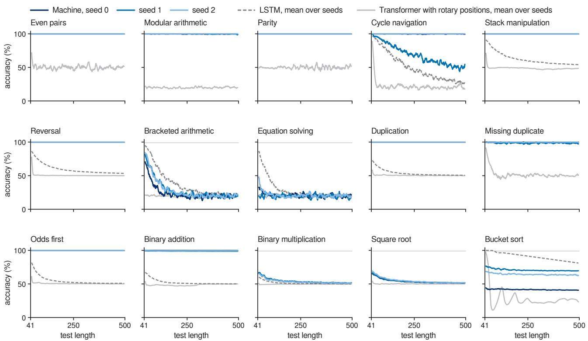  
Figure 5. Accuracy at every test length (mean over the 32 inputs of each length, smoothed over ten consecutive lengths). Blue: the three seeds of the machine; dashed gray: LSTM; light gray: Transformer with rotary positions; thin line: 99%.

## E.2. Learning from short inputs

Why. By Theorem 1(ii), bounded experience fixes the rule of a learner whose decisions read only coincidences, the present symbol and a finite state. The size $N _ { \mathrm { t e a c h } }$ this needs can be large, but by Lemma 1 a run that fits by acting as the procedure on inputs up to its closure size $N ^ { * }$ extrapolates at every length within the range of its clocks, 2,310; the experiment asks how often training on lengths 1 to 40 finds the procedure (Section 5.1). By Theorem 1(i), a network that reads a coordinate, such as a position or a recurrent state that drifts with length, can fit the same inputs and fail beyond them.

Design. The fifteen tasks of Delétang et al. (2023) span the Chomsky hierarchy (Appendix E.1). On each task the machine of Appendix D, with three clocks of rings 2, 3, 5, 7, 11, is trained with three seeds on lengths 1 to 40, with up to six attempts along the restart ladder (Table 4). Each run is tested on 32 random inputs at every length from 41 to 500 and scored with the measures above. LSTMs and Transformers are trained on the same data and selected on the same validation lengths, with up to three attempts (Appendix D.6). Table 7 also quotes the best published results of other networks.

Results. Table 7 gives the scores with the published results of other networks, Table 8 lists every benchmark run of the machine, and Figure 5 shows the accuracy at every test length. The machine solves nine of the twelve tasks whose procedures fit in three clocks. Among them are duplication, odds first and binary addition, on which LSTMs and Transformers reach at most 75.1%, 69.3% and 64.5% (Figure 3a; Table 7). Of the 30 runs that fit, 27 extrapolate, and none of these falls below 96.9% at any length. The machines that fit and extrapolate are accurate uniformly in length: their accuracy at length 500 is that at length 41. Of the three runs that fit and do not extrapolate, two stay just below the threshold, missing duplicate (seed 1) at 98.6% and binary addition (seed 1) at 98.9%. The third, on cycle navigation with seed 1, loses accuracy steadily with length (Figure 5), from 95.6% at lengths 41 to 90 to 50.1% at lengths 441 to 490. Cycle navigation needs no clock, and a controller that tracks the position on the cycle in a graded state accumulates error with every move, which is why Section 2.3 requires the controller, like the clocks, to sit in discrete attractor states. On bracketed arithmetic and equation solving no run fits its training lengths within six attempts. Their reference procedures meet all their situations only at lengths 29 and 49 (Table 3), the largest values of $N ^ { * }$ in the benchmark, and the training inputs, of lengths up to 40, contain few of the deeply nested cases that teach the return. For multiplication and square root no procedure that keeps pace with the input is known, and multiplication that emits each bit online, one step per input symbol, is beyond every machine of Eq. (1) (Appendix A.9);

Table 7. Fifteen tasks, trained on lengths 1 to 40 and tested on 41 to 500 (% of correct output symbols), grouped as regular, context free and context sensitive. LSTM, Stack-RNN and Tape-RNN: best of 30 runs of Delétang et al. (2023); the Tape-RNN's head can also jump by the input length. Transformer: best of eleven positional encodings of Ruoss et al. (2023), whose randomized encodings draw training positions from 1 to 2,048, so that every test position is seen. This work: mean ± s.d. and maximum over three seeds; bold: solved. Clocks: the number our procedure of Appendix C uses; ×: no procedure in step with the input is known. Over a binary alphabet a running parity finds the missing duplicate without a clock, which is why the LSTM and the Transformer solve it.
<table><tr><td></td><td>Task</td><td>LSTM</td><td>Stack-RNN</td><td>Tape-RNN</td><td>Transformer</td><td>This work</td><td>max</td><td>Clocks</td></tr><tr><td rowspan="4">Regular</td><td>Even pairs</td><td>100.0</td><td>100.0</td><td>100.0</td><td>100.0</td><td>100.0±0.0</td><td>100.0</td><td>0</td></tr><tr><td>Modular arithmetic</td><td>100.0</td><td>100.0</td><td>100.0</td><td>28.1</td><td> ${ \bf 9 9 . 9 2 0 . 1 }$ </td><td>100.0</td><td>0</td></tr><tr><td>Parity</td><td>100.0</td><td>100.0</td><td>100.0</td><td>52.6</td><td> $\mathbf { 1 0 0 . 0 { \dot { \pm } } 0 . 0 }$ </td><td>100.0</td><td>0</td></tr><tr><td>Cycle navigation</td><td>100.0</td><td>100.0</td><td>100.0</td><td>73.6</td><td>89.5±18.1</td><td>100.0</td><td>0</td></tr><tr><td rowspan="4">Context free</td><td>Stack manipulation</td><td>59.1</td><td>100.0</td><td>100.0</td><td>77.9</td><td>100.0±0.0</td><td>100.0</td><td>1</td></tr><tr><td>Reverse string</td><td>60.9</td><td>100.0</td><td>100.0</td><td>95.1</td><td>100.0±0.0</td><td>100.0</td><td>1</td></tr><tr><td>Bracketed arithmetic</td><td>59.2</td><td>96.1</td><td>95.4</td><td>34.9</td><td>27.0±2.5</td><td>28.6</td><td>1</td></tr><tr><td>Solve equation</td><td>67.8</td><td>56.2</td><td>64.4</td><td>28.1</td><td>20.7±0.8</td><td>21.3</td><td>1</td></tr><tr><td rowspan="7">Context sensitive</td><td>Duplicate string</td><td>57.6</td><td>52.8</td><td>100.0</td><td>75.1</td><td>100.0±0.0</td><td>100.0</td><td>1</td></tr><tr><td>Missing duplicate</td><td>54.3</td><td>55.2</td><td>100.0</td><td>100.0</td><td>99.5±0.8</td><td>100.0</td><td>3</td></tr><tr><td>Odds first</td><td>55.6</td><td>51.9</td><td>100.0</td><td>69.3</td><td>100.0±0.0</td><td>100.0</td><td>2</td></tr><tr><td>Binary addition</td><td>55.5</td><td>52.7</td><td>100.0</td><td>64.5</td><td>99.4±0.5</td><td>99.8</td><td>3</td></tr><tr><td>Binary multiplication</td><td>53.1</td><td>52.7</td><td>58.5</td><td>52.2</td><td>53.9±0.4</td><td>54.3</td><td>X</td></tr><tr><td>Square root</td><td>57.5</td><td>56.5</td><td>57.8</td><td>53.3</td><td>54.4±0.5</td><td>55.0</td><td>X</td></tr><tr><td>Bucket sort</td><td>99.3</td><td>78.1</td><td>70.7</td><td>100.0</td><td>58.9±15.4</td><td>70.8</td><td>4</td></tr></table>

our procedure for bucket sort over five symbols keeps four counts, one more than the machine has clocks, and no machine with three clocks fits (Appendix E.6). Under the same protocol (Table 9), 12 of the 19 LSTM runs that fit their training lengths extrapolate, against none of the 19 Transformer runs that fit. The LSTM fits the four regular tasks, missing duplicate and bucket sort with every seed and bracketed arithmetic with one, and it extrapolates on all of them except cycle navigation, bucket sort and bracketed arithmetic. The Transformers fit their training lengths on even pairs, cycle navigation, reversal, missing duplicate, odds first and bucket sort, and extrapolate on none. A Transformer that reverses strings of length 40 without error falls to chance within ten symbols, by length 50 (Figure 5), the hole of Theorem 1 in its plainest form.

Reading. A rule that the machine fits on inputs of up to 40 symbols holds up to length 500 in all but three runs: training finds the procedure in most runs that fit, and by Lemma 1 the procedure then holds at every length within range. On the five tasks on which no run fits, no procedure that keeps pace with the input is known, our procedure keeps more counts than the machine has clocks, or the procedure meets some of its situations only on inputs nested more deeply than most inputs of length 40. Networks that read positions or a state that drifts with length fit the same inputs and fail beyond them, which is the hole of Theorem 1(i).

## E.3. The range belongs to the clocks

Why. Theorem 2 says that the range belongs to the clocks (Section 2.3). On every input whose span is below L the machine runs exactly as the same controller with unbounded clocks. The first departure from that run comes only after the span has reached $L ,$ and new cycles with product L' move the range to L' while the controller stays the same. For reversal the aliasing rule of Appendix A.7, derived after the theorem from the reversal procedure on random bits, predicts the accuracy beyond the range, $( L + \textstyle { \frac { 1 } { 2 } } ( n - L ) ) / n$ at length $n > L$ , with no free parameter.

Design. Each trained machine of eight tasks (reversal, duplication, stack manipulation, odds first, missing duplicate, binary addition, bracketed arithmetic and bucket sort) is run without retraining. Its clocks are made of the cycles $\{ 3 , 4 , 5 \}$ $\{ 2 , 3 , 5 , 7 \} , \{ 2 , 3 , 5 , 7 , 1 1 \}$ and {3, 5, 7, 11, 13}, with ranges $L = 6 0 , 2 1 0 , 2 , 3 1 0$ and 15,015, or they are unbounded integer clocks. The lengths are L times $0 . 2 5 , 0 . 5 , 0 . 7 5 , 0 . 9 , 0 . 9 5 , 0 . 9 8 , 0 . 9 9 , 1 , 1 . 0 1 , 1 . 0 2 , 1 . 0 5 , 1 . 1 , 1 . 2 5 , 1 . 5$ and 2, rounded, with 8 random inputs at each. On every input we record the output with modular and with unbounded clocks, and the span of the readings each head compares. These are the query readings shifted by the head's offset together with the key readings of the records its gate accepts, over the whole run of the unbounded machine. We also record the step at which this span first reaches L, and the first step at which some head returns a different record with modular clocks than with unbounded ones (the first misread). Each machine is also run with each of its five cycles removed in turn, which shortens the range to the product of the other four, at lengths 0.5, 0.95, 1.05 and 1.5 times the shortened range, with 8 inputs at each.

Table 8. Benchmark runs of the machine: test score (%, lengths 41–500) / best validation accuracy at training lengths (%, lengths 31–40) / attempt kept.
<table><tr><td>Task</td><td>seed 0</td><td>seed 1</td><td>seed 2</td></tr><tr><td>even pairs</td><td>100.0 / 100.0 / 1</td><td>100.0 / 100.0 / 1</td><td>100.0 / 100.0 / 1</td></tr><tr><td>modular arithmetic</td><td>99.8 / 100.0 / 1</td><td>99.8 / 100.0 / 1</td><td>100.0 / 100.0 / 1</td></tr><tr><td>parity</td><td>100.0 / 100.0 / 1</td><td>100.0 / 100.0 / 1</td><td>100.0 / 100.0 / 1</td></tr><tr><td>cycle navigation</td><td>99.9 / 100.0 / 1</td><td>68.6 / 100.0 / 1</td><td>100.0 / 100.0 / 2</td></tr><tr><td>stack manipulation</td><td>100.0 / 100.0 / 1</td><td>100.0 / 100.0 / 1</td><td>100.0 / 100.0 / 2</td></tr><tr><td>reversal</td><td>100.0 / 100.0 / 1</td><td>100.0 / 100.0 / 1</td><td>100.0 / 100.0 / 1</td></tr><tr><td>bracketed arithmetic</td><td>24.1 / 84.0 / 5</td><td>28.6 / 91.8 / 1</td><td>28.4 / 93.0 / 3</td></tr><tr><td>equation solving</td><td>20.9 / 56.2 / 5</td><td>19.8 / 28.5 / 1</td><td>21.3 / 64.8 / 5</td></tr><tr><td>duplication</td><td>100.0 / 100.0 / 1</td><td>100.0 / 100.0 / 1</td><td>100.0 / 100.0 / 1</td></tr><tr><td>missing duplicate</td><td>100.0 / 100.0 / 1</td><td>98.6 / 99.6 / 4</td><td>99.9 / 100.0 / 2</td></tr><tr><td>odds first</td><td>100.0 / 100.0 / 1</td><td>100.0 / 100.0 / 1</td><td>100.0 / 100.0 / 1</td></tr><tr><td>binary addition</td><td>99.8 / 100.0 / 5</td><td>98.9 / 99.2 / 2</td><td>99.5 / 99.9 / 3</td></tr><tr><td>binary multiplication</td><td>53.7 / 70.6 / 1</td><td>54.3 / 72.5 / 5</td><td>53.6 / 69.8 / 1</td></tr><tr><td>square root</td><td>54.0 / 71.3 / 5</td><td>54.1 / 72.9 / 5</td><td>55.0 / 75.9 / 1</td></tr><tr><td>bucket sort</td><td>41.6 / 44.8 / 5</td><td>70.8 / 77.4 / 2</td><td>64.4 / 68.3 / 3</td></tr></table>

Table 9. Networks trained under one protocol: test score (%, lengths 41–500, mean over three seeds) and, in parentheses, the number of runs that fit their training lengths.
<table><tr><td>Task</td><td>LSTM</td><td>Transformer, rotary</td><td>Transformer, no positions</td><td>This work</td></tr><tr><td>even pairs</td><td>100.0 (3)</td><td>50.4 (3)</td><td>50.2 (0)</td><td>100.0 (3)</td></tr><tr><td>modular arithmetic</td><td>99.7 (3)</td><td>20.0 (0)</td><td>20.2 (0)</td><td>99.9 (3)</td></tr><tr><td>parity</td><td>100.0 (3)</td><td>49.9 (0)</td><td>49.7 (0)</td><td>100.0 (3)</td></tr><tr><td>cycle navigation</td><td>50.2 (3)</td><td>22.7 (3)</td><td>24.1 (2)</td><td>89.5 (3)</td></tr><tr><td>stack manipulation</td><td>62.5 (0)</td><td>49.0 (0)</td><td>50.1 (0)</td><td>100.0 (3)</td></tr><tr><td>reversal</td><td>59.8 (0)</td><td>50.8 (3)</td><td>52.8 (0)</td><td>100.0 (3)</td></tr><tr><td>bracketed arithmetic</td><td>37.3 (1)</td><td>19.9 (0)</td><td>19.9 (0)</td><td>27.0 (0)</td></tr><tr><td>equation solving</td><td>28.4 (0)</td><td>20.4 (0)</td><td>20.4 (0)</td><td>20.7 (0)</td></tr><tr><td>duplication</td><td>54.0 (0)</td><td>50.5 (0)</td><td>52.8 (0)</td><td>100.0 (3)</td></tr><tr><td>missing duplicate</td><td>100.0 (3)</td><td>52.2 (3)</td><td>50.7 (0)</td><td>99.5 (3)</td></tr><tr><td>odds first</td><td>54.6 (0)</td><td>50.7 (2)</td><td>52.8 (0)</td><td>100.0 (3)</td></tr><tr><td>binary addition</td><td>52.4 (0)</td><td>48.9 (0)</td><td>45.3 (0)</td><td>99.4 (3)</td></tr><tr><td>binary multiplication</td><td>51.4 (0)</td><td>49.8 (0)</td><td>49.7 (0)</td><td>53.9 (0)</td></tr><tr><td>square root</td><td>54.4 (0)</td><td>50.2 (0)</td><td>50.2 (0)</td><td>54.4 (0)</td></tr><tr><td>bucket sort</td><td>90.6 (3)</td><td>28.1 (3)</td><td>23.7 (0)</td><td>58.9 (0)</td></tr></table>

Results. Every input agrees with Theorem 2. In all 2,562 inputs whose span is below L the outputs agree with the unbounded clocks, and in all 8,521 inputs with a misread the first misread comes after the span has reached L. With the cycles 3, 5, 7, 11, 13, three of three reversal machines and two of three duplication machines, trained on at most 40 symbols. are correct on every sampled input up to length 15,015, 375 times their longest training input. Table 10 gives, for every machine that fits and extrapolates, the shortest sampled length with an output that differs from the unbounded clocks. For the 15 machines that err at some sampled length this onset moves out with every enlargement of $L ,$ at ratios $n / L$ between 0.50 and 1.10 (Figure 3d). The onset comes where the span first reaches $L \colon$ at length L for a clock that advances one reading per input symbol, and earlier for a machine whose readings run ahead of the input, for example a clock that advances two readings per answer step. One machine, on missing duplicate, seed 2, never errs. The readings its heads compare span at most 32 values even at length 30,030, so it never reaches far into its past. The task allows this, since over a binary alphabet the missing symbol is the parity of the visible ones. For reversal, the accuracy beyond the range follows $( L + \textstyle { \frac { 1 } { 2 } } ( n - L ) ) / n$ to within 0.27 percentage points on average over 81 combinations of machine, L and length (Figure 3c). With one cycle removed, the outputs agree with the unbounded clocks in all 810 inputs whose compared readings span fewer than the shortened range.

Reading. The controller is learned, and the range belongs to the clocks. What the controller learned at the readings of short inputs holds at every reading of the circle, so its range can be extended or shortened after learning, as a longer tape extends a Turing machine, and beyond the range the failure of reversal follows the aliasing rule of Appendix A.7, a curve with no free parameter. Removing a grid module should shorten the range of exact memory in the same way (P1, Appendix F.1).

Table 10. Clock exchange: the smallest sampled length with an output that differs from the unbounded clocks, for every benchmark machine that fits and extrapolates, with the cycles of L = 60, 210, 2,310 and 15,015 (-: no difference up to 2L).
<table><tr><td>Task</td><td>seed</td><td> $L = 6 0$ </td><td> $L = 2 1 0$ </td><td> $L = 2 { , } 3 1 0$ </td><td> $L = 1 5 , 0 1 5$ </td></tr><tr><td>stack manipulation</td><td>0</td><td>57</td><td>206</td><td>2,287</td><td>13,514</td></tr><tr><td>stack manipulation</td><td>1</td><td>63</td><td>231</td><td>2,426</td><td>14,715</td></tr><tr><td>stack manipulation</td><td>2</td><td>45</td><td>158</td><td>1,732</td><td>11,261</td></tr><tr><td>reversal</td><td>0</td><td>61</td><td>212</td><td>2,333</td><td>15,165</td></tr><tr><td>reversal</td><td>1</td><td>61</td><td>212</td><td>2,333</td><td>15,165</td></tr><tr><td>reversal</td><td>2</td><td>61</td><td>212</td><td>2,333</td><td>15,165</td></tr><tr><td>duplication</td><td>0</td><td>61</td><td>212</td><td>2,333</td><td>15,165</td></tr><tr><td>duplication</td><td>1</td><td>45</td><td>158</td><td>1,732</td><td>7,508</td></tr><tr><td>duplication</td><td>2</td><td>45</td><td>158</td><td>1,732</td><td>15,165</td></tr><tr><td>missing duplicate</td><td>0</td><td>59</td><td>189</td><td>1,732</td><td>7,508</td></tr><tr><td>missing duplicate</td><td>2</td><td>一</td><td></td><td></td><td></td></tr><tr><td>odds first</td><td>0</td><td>57</td><td>158</td><td>1,732</td><td>7,508</td></tr><tr><td>odds first</td><td>1</td><td>61</td><td>189</td><td>2,079</td><td>11,261</td></tr><tr><td>odds first</td><td>2</td><td>54</td><td>158</td><td>1,732</td><td>7,508</td></tr><tr><td>binary addition</td><td>0</td><td>45</td><td>158</td><td>1,732</td><td>11,261</td></tr><tr><td>binary addition</td><td>2</td><td>54</td><td>158</td><td>1,155</td><td>7,508</td></tr></table>

## E.4. What may not be read

Why. Section 2.3 names three things that let a learner fit its data without the data fixing its rule: a blurred match, which reports a distance; a controller large enough to hold a whole training input; and the readings themselves, which keep taking new values up to the range. By Theorem 1(i), a coordinate, or a coincidence blurred into a distance, leaves the rule open beyond the training lengths. The variants of this experiment give the machine each of these in turn, and a coordinate of another kind, the step index (Section 5.3).

Design. Four variants of the machine are retrained on reversal, duplication, stack manipulation, binary addition and modular arithmetic, three seeds each, with the full protocol and restart ladder. They are tested on 32 inputs at each of the lengths 31. 40, 100, 200 and 500, and Table 11 gives the accuracy at length 500. Graded clocks: the moves stay mixtures at temperature 1 throughout training and at test, so that a clock is a blend of states and a read is a weighted average over near matches. Step index: the controller also receives t/40, a coordinate whose values beyond the training lengths are new. Phases: the controller also receives the bumps of all clocks, the phase of every cycle; each phase takes finitely many values, and together they are the reading, a coordinate within the range. No noise: the controller's state is never perturbed.

Results. With graded clocks all 15 runs fit, yet at length 500 they fail on every task that reads its past, falling to 48 to 71%; modular arithmetic, which needs no clock, is unaffected (Figure 3e). With the step index all 15 runs fit. Of the 12 runs on tasks that read their past through the clocks, 11 stay above 99%. Every run on modular arithmetic, the one task the controller computes by itself, falls below, to 28 to 62%. Given the phases, 12 of 15 runs stay above 99%, and the exceptions are on modular arithmetic and binary addition. Without noise, 14 of 15 runs fit, and every run that fits stays above 99%.

Reading. A blurred coincidence reads a distance, so graded clocks fit the training lengths and leave the rule open beyond them. A coordinate leaves the hole of Theorem 1(i) open, and training decides how it is filled: on the tasks that need the clocks the machines go on reading their past through them, and they fail on the one task that the controller computes by itself. Given the phases, or trained without noise, most machines still find procedures that read the past through the clocks.

Table 11. Forbidden readings: accuracy (%) at length 500, seeds 0 / 1 / 2 (in parentheses: runs that do not fit their training lengths).
<table><tr><td>Task</td><td>graded clocks</td><td>step index</td><td>phases</td><td>no noise</td></tr><tr><td>modular arithmetic</td><td>100.0 / 100.0 / 100.0</td><td>37.5 / 62.5 / 28.1</td><td>84.4 / 96.9 / 100.0</td><td>100.0 / 100.0 / 100.0</td></tr><tr><td>stack manipulation</td><td>59.1 / 61.6 / 57.3</td><td>100.0 / 100.0 / 100.0</td><td>100.0 / 100.0 / 100.0</td><td>100.0 / 100.0 / 100.0</td></tr><tr><td>reversal</td><td>61.0 / 51.2 / 70.5</td><td>100.0 / 100.0 / 100.0</td><td>100.0 / 100.0 / 100.0</td><td>100.0 / 100.0 / 100.0</td></tr><tr><td>duplication</td><td>50.0 / 52.8 / 50.5</td><td>100.0 / 100.0 / 100.0</td><td>100.0 / 99.8 / 100.0</td><td>100.0 / 100.0 / 100.0</td></tr><tr><td>binary addition</td><td>49.7 / 50.0 / 47.9</td><td>95.0 / 99.7 / 99.5</td><td>100.0 / 99.8 / 98.1</td><td>99.5 / (48.8) / 99.6</td></tr></table>

## E.5. How much experience fixes a rule

Why. By Lemma 1, a learner that acts as a procedure on every input up to the closure size $N ^ { * }$ , beyond which the procedure meets no new situation, acts as it on every input within range (Section 2.1). For the six tasks of this experiment $N ^ { * }$ is 2 for reversal, 3 for duplication, 4 for stack manipulation, 5 for odds first, 9 for binary addition and 15 for modular arithmetic (Table 3). A learner that fits short inputs by another route, such as holding them in its controller, is bound only by the larger size $N _ { \mathrm { t e a c h } }$ of Theorem 1(ii) (Appendix A.2).

Design. Machines are retrained on reversal, duplication, stack manipulation, odds first, binary addition and modular arithmetic with inputs of lengths 1 to N, N = 10 or 20, three seeds each, with the restart ladder of the benchmark. They are selected on validation inputs of lengths N — 3 to N and tested on lengths 41 to 500 like the benchmark (Table 12).

Results. All 36 runs fit. Among the runs whose training reaches $N ^ { * }$ , 11 of 15 extrapolate for $N = 1 0$ and 15 of 18 for N = 20 (Figure 3f). Trained up to length 10, every run on reversal, duplication and stack manipulation extrapolates, as do two of the three runs on odds first. On modular arithmetic, whose $N ^ { * }$ is 15, every run trained up to 10 fails and every run trained up to 20 extrapolates. On binary addition the trained machines need inputs of length 20 and more, although its reference procedure meets all its situations by length 9. Trained up to 10, they score 72.2 to 83.2%.

Reading. Experience fixes a procedure once it contains the situations of that procedure: inputs of up to 10 symbols fix reversal, duplication and stack manipulation, and modular arithmetic needs inputs longer than its $N ^ { * }$ . Binary addition needs more than its $N ^ { * }$ , because a machine trained on short inputs can fit them another way, for instance by holding them in its controller, and then only the larger bound $N _ { \mathrm { t e a c h } }$ applies.

Table 12. Training on short inputs: test score (%, lengths 41–500) of machines trained on lengths 1–N, seeds $0 / 1 / 2 . N ^ { * }$ : size by which the reference procedure meets all its situations. $N = 4 0$ is the benchmark.
<table><tr><td>Task</td><td> $N ^ { * }$ </td><td> $N = 1 0$ </td><td> $N = 2 0$ </td><td> $N = 4 0$ </td></tr><tr><td>reversal</td><td>2</td><td>100.0 / 100.0 / 100.0</td><td>100.0 / 100.0 / 100.0</td><td>100.0 / 100.0 / 100.0</td></tr><tr><td>duplication</td><td>3</td><td>100.0 / 100.0 / 100.0</td><td>100.0 / 100.0 / 98.6</td><td>100.0 / 100.0 / 100.0</td></tr><tr><td>stack manipulation</td><td>4</td><td>100.0 / 100.0 / 99.3</td><td>100.0 / 100.0 / 100.0</td><td>100.0 / 100.0 / 100.0</td></tr><tr><td>odds first</td><td>5</td><td>75.5 / 100.0 / 100.0</td><td>100.0 / 100.0 / 100.0</td><td>100.0 / 100.0 / 100.0</td></tr><tr><td>binary addition</td><td>9</td><td>83.2 / 72.2 / 76.5</td><td>99.1 / 97.5 / 98.6</td><td>99.8 / 98.9 / 99.5</td></tr><tr><td>modular arithmetic</td><td>15</td><td>67.4 / 71.5 / 67.3</td><td>100.0 / 99.8 / 100.0</td><td>99.8 / 99.8 / 100.0</td></tr></table>

## E.6. How many clocks a procedure needs

Why. Our procedures keep one clock for each independent count (Section 5.4). To sort k kinds of symbol in step with the input, a learner needs the $k - 1$ boundaries between kinds when the output begins. These counts vary independently, and the procedure of Appendix A.8 keeps each in a clock of its own. The experiment asks whether training finds a machine with fewer clocks that keeps pace. For Turing machines the corresponding statement is a theorem: for every C some language is recognized in real time with $C + 1$ tapes and not with C (Aanderaa, 1974). Through Theorem 3 the same holds for clocks moved one reading per step and read at offset 0 (Section 3, Appendix A.9).

Design. Our procedure for bucket sort over five symbols keeps four counts in four clocks (Appendix A.8). Machines with one, two and four clocks are trained on it with the full protocol, three seeds each, and tested at every fourth length from 41 to 497 (Table 13); the benchmark machines have three clocks. Bucket sort over $k = 3$ and 4 kinds of symbol is trained with the full protocol with k — 2 and $k - 1$ clocks, three seeds each, and tested at every fourth length from 41 to 497 (Table 14)

Results. With five kinds of symbol no machine with fewer than four clocks fits, and the best validation accuracies are 58%, 59% and 77% with one, two and three clocks. The mean test scores are 33.7%, 52.6%, 58.9% and 77.6% with one to four clocks, rising with the number of boundaries the clocks can place (Table 13). With four clocks one of the three runs fits, and it sorts exactly at every tested length. Over $k = 3 ,$ 4 and 5 kinds of symbol, none of the fifteen machines with fewer than k — 1 clocks fits its training lengths (best validation accuracy 77%). With k — 1 clocks one run of three for each k sorts exactly at every tested length, and the others reach test scores between 64% and 95% (Table 14). Figure 4f collects all three values of k.

Reading. In these runs each independent count takes a clock of its own: with fewer clocks a controller of 256 units does not fit even the training lengths, and with k — 1 clocks training can find the exact procedure. Clocks are a resource that no controller replaces, as the hierarchy of tapes says for Turing machines.

Table 13. Bucket sort with C clocks: test score (%, lengths 41–497 for $C \neq 3 , 4 1 - 5 0 0$ for $C = 3 ) /$ best validation accuracy at training lengths (%), seeds 0, 1, 2.
<table><tr><td>C</td><td>seed 0</td><td>seed 1</td><td>seed 2</td></tr><tr><td>1</td><td>22.2 / 52.9</td><td>32.7 / 44.7</td><td>46.3 / 57.8</td></tr><tr><td>2</td><td>52.8 / 54.0</td><td>50.7 / 59.0</td><td>54.1 / 54.7</td></tr><tr><td>3</td><td>41.6 / 44.8</td><td>70.8 / 77.4</td><td>64.4 / 68.3</td></tr><tr><td>4</td><td>63.5 / 78.4</td><td>100.0 / 100.0</td><td>69.2 / 65.4</td></tr></table>

Table 14. Bucket sort over k kinds of symbol with C clocks: test score (%, lengths 41–500) / best validation accuracy (%), seeds 0 / 1 / 2.
<table><tr><td>k</td><td>C</td><td>seed 0</td><td>seed 1</td><td>seed 2</td></tr><tr><td>3</td><td>1</td><td>64.6 / 67.7</td><td>70.2 / 71.1</td><td>61.5 / 69.5</td></tr><tr><td>3</td><td>2</td><td>80.8 / 87.3</td><td>95.1 / 87.1</td><td>100.0 / 100.0</td></tr><tr><td>4</td><td>2</td><td>55.6 / 77.4</td><td>51.5 / 48.9</td><td>53.8 / 57.1</td></tr><tr><td>4</td><td>3</td><td>65.3 / 73.7</td><td>100.0 / 100.0</td><td>92.7 / 89.5</td></tr></table>

## E.7. What the trained machines do

Why. The theory fixes what the controller may read and leaves free how it moves its clocks, so the movements show which procedure a trained machine has found. Proposition 2 and Section 2.4 describe the movements that carry procedures: a stack is a clock moved forward by each push and back by each pop, and a copy is a clock sent HoME and run again over the same readings. In the brain these movements are the forms of hippocampal replay (Section 4.2).

Design. For every benchmark machine we record, on 16 random inputs of length 100, the move of every clock at every step and every record a head returns, with the offset of that head. On two example inputs of lengths 12 and 24 we record the complete run (code/experiments/e3\_dynami cs . py). Figure 6 shows the clock readings and reads of five machines on one input each. Table 15 summarizes how the clocks of all machines on six tasks move while the input arrives, at the first answer step of the example inputs, and while the answer is given.

Results. The movements are the procedures of Appendix C, found by training in different arrangements (Table 15; Figure 3b). Each reversal machine has a clock that advances while the input arrives and walks back while the answer is given (Figure 6a). Each duplication machine sends one clock HOME at the first answer step and runs it forward again (Figure 6b). Each stack machine walks a clock down while answering (Figure 6c). Each odds first machine moves its clocks by two readings per answer step, forward in two seeds and backward in one, so that every answer reads every second input (Figure 6d). Over all machines, heads at positive offsets, which read ahead of the query clock, return 46.6% of the records found (Figure 6f).

Reading. Trained on inputs and outputs alone, the machines find the programs of Section 2.4: reversal walks a clock back as a stack does, and duplication sends a clock HoME and runs it again as a copy does. These movements have the forms of hippocampal replay, reverse replay in reversal and forward replay in duplication.

## E.8. The machines in neural dynamics

Why. By Theorem 4, the attractor network of Eq. (2) is the machine on its stable states (Section 4.1). On those states reading the network after a move gives the move applied to the reading (part ii), so a controller trained on symbolic clocks should run unchanged on neurons (Section 5.5). A place cell that fires when all but j rings agree shrinks the range to the product of the $M - j$ smallest periods (part iii). Wells protect the reading against noise, and without them the position of a bump is graded and its errors accumulate; adaptation shortens the lag of a bump behind a moving input, above $\tau / \tau _ { v }$ the bump leads a slow input, and without input it travels by itself once it overcomes the wells (the two further properties of Appendix B.3) Replay, the firing of place cells in sequence, is on the theory a clock moved over stored readings (Section 4.2); the controller can drive it while it answers, and adaptation can drive it when input is absent.

Design. Trained machines. The benchmark controllers of ten tasks, three seeds each, run on neural clocks and place cells (Appendix B.5) on 16 random inputs at lengths 41, 100, 200 and 500. Their outputs are compared symbol by symbol with the symbolic machine on the same inputs (Table 16). Five tasks are also run in variants: noise σ = 0.6 and 0.8; place cells that fire when all but one or two rings agree, at lengths around the predicted ranges 210 and 30; no wells, with $\sigma = 0 . 3 ;$ and a recurrent kernel twice as wide (Table 17). Clocks alone. Sixteen clocks of rings 2, 3, 5, 7, 11 are driven for 2,000 steps by moves drawn uniformly from $\{ - 2 , \ldots , 2 \}$ , with a reset at a step with probability 0.02, with wells $( \epsilon = 1 )$ and without $( \epsilon = 0 )$ , at noise σ from 0 to 1.2. A slip is a step after which the nearest well of some ring differs from the symbolic clock driven by the same moves. After a slip the symbolic clock takes the neural reading, so that slips are counted one by one (Table 18). Replay. Each reversal and duplication machine answers one input of length 40. For every pair of clocks, each answer step at which the first clock shows a reading that the second showed during the input is matched with the last input step at that reading, as a head that compares the two clocks does. The pair that revisits the most input moments carries the replay. The rank correlation between answer steps and matched input steps is negative for reverse replay and positive for forward replay. A clock walked through 40 readings is then released without input, with wells of depth 0.5 and adaptation from 0 to 1.2. Adaptation. In one ring of 11 wells a bump is released with a trail of adaptation behind it, for m from 0 to 1.2 and $\epsilon \in \{ 0 , 0 . 5 , 1 \}$ , and its speed is measured over the second half of 600τ. A bump without wells follows an input of strength 0.3 or 1 that moves at 0.05 or 0.1 neurons per τ, and its lead is measured (Table 19). The code is code/experiments/e4\_neural.py.

Table 15. How the clocks of trained machines move: for each clock (in order), the moves that make up at least 20% of its moves while the input arrives, at the first answer step, and while the answer is given, most frequent first.
<table><tr><td>Task</td><td>seed</td><td>input</td><td>first answer step</td><td>answer</td></tr><tr><td>stack manipulation</td><td>0</td><td> $+ 1 , 0 / \mathrm { H O M E } , + 1 / - 1$ </td><td> $- 1 , - 2 , - 1$ </td><td> $- 1 , - 2 , - 1$ </td></tr><tr><td></td><td>1</td><td> $0 / + 1 , - 1 / + 1 , - 1 / - 2$ </td><td> $_ { 0 , + 1 , \mathrm { H O M E } }$ </td><td> $- 1 / 0 , + 1 , \mathrm { H O M E }$ </td></tr><tr><td></td><td>2</td><td> $+ 1 / - 1 , + 1 / - 1 , \mathrm { H O M E } / 0 / + 1$ </td><td> $+ 1 , - 1 , + 1$ </td><td> $+ 1 , - 1 , + 1$ </td></tr><tr><td>reversal</td><td>0</td><td> $+ 1 , + 1 , + 1$ </td><td> $+ 1 , + 1 , - 1$ </td><td> $+ 1 , - 1 , - 1$ </td></tr><tr><td></td><td>1</td><td> $+ 1 , + 1 , + 1$ </td><td> $- 1 , - 1 , + 1$ </td><td> $- 1 , - 1 , - 2 / + 1$ </td></tr><tr><td></td><td>2</td><td> $0 / { - 2 } , + 1 , + 1$ </td><td> $- 2 , { \mathrm { H O M E } } , - 2$ </td><td> $- 1 , { \mathrm { H O M E } } , - 1$ </td></tr><tr><td>duplication</td><td>0</td><td> $+ 1 , + 1 , + 1$ </td><td> $\mathrm { H O M E } , + 1 , + 1$ </td><td> $+ 1 , + 1 , + 1$ </td></tr><tr><td></td><td>1</td><td> $\mathrm { H O M E } , + \mathrm { 1 } , \mathrm { H O M E } / 0$ </td><td> $+ 1 , \mathrm { H O M E } , + 1$ </td><td> $+ 1 , \mathrm { H O M E } / + 1 , + 1$ </td></tr><tr><td></td><td>2</td><td> $- 1 / - 2 , + 2 , 0$ </td><td> $+ 1 , + 2 , { \mathrm { H O M E } }$ </td><td> $+ 1 , + 2 , + 2$ </td></tr><tr><td>missing duplicate</td><td>0</td><td> $0 / + 2 , - 1 , - 2 / + 1$ </td><td> $0 , + 1 , + 1$ </td><td> $0 / + 1 , + 1 , + 1$ </td></tr><tr><td></td><td>1</td><td> $\mathrm { H O M E / - 1 / + 2 , H O M E / + 1 / - 2 , + 1 / + 2 / - 1 / - 2 }$ </td><td> $- 1 , + 2 , - 2 / 0$ </td><td> $- 1 , + 2 , - 2$ </td></tr><tr><td></td><td>2</td><td> $0 / + 1 / { - 1 } , \mathrm { H O M E } / - 1 , - \mathrm { 1 / H O M E }$ </td><td> $- 1 , \mathrm { H O M E } , \mathrm { H O M E }$ </td><td>-1, HOME, HOME</td></tr><tr><td>odds first</td><td>0</td><td> $+ 1 / \mathrm { H O M E } , + 1 , - 1$ </td><td> $\mathrm { H O M E } , + 1 , \mathrm { H O M E }$ </td><td> $- 2 , - 2 , - 2$ </td></tr><tr><td></td><td>1</td><td> $+ 1 , + 1 , \mathrm { H O M E } / 0$ </td><td> $+ 2 , \mathrm { H O M E } , + 1$ </td><td> $+ 2 , + 2 , + 2$ </td></tr><tr><td></td><td>2</td><td> $\mathrm { H O M E } , + 1 , + 1$ </td><td> $+ 2 , + 1 , { \mathrm { H O M E } }$ </td><td> $+ 2 , + 2 , + 2$ </td></tr><tr><td>binary addition</td><td>0</td><td> $_ { 0 / + 2 , \mathrm { H O M E } , + 1 }$ </td><td> $\mathrm { H O M E } , + 1 , + 1$ </td><td> $+ 1 , + 1 , + 1$ </td></tr><tr><td></td><td>1</td><td> $+ 1 , + 1 , 0$ </td><td> $+ 2 , + 1 / 0 , + 1$ </td><td> $+ 2 , - 2 / + 2 , + 1$ </td></tr><tr><td></td><td>2</td><td> $+ 1 , + 1 , \mathrm { H O M E } / + 1$ </td><td> $+ 1 , + 1 , + 1$ </td><td> $+ 1 , + 2 / + 1 , + 1$ </td></tr></table>

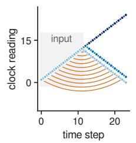

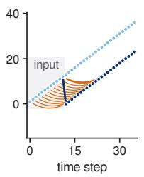

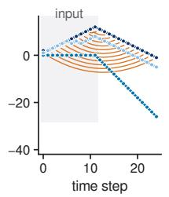

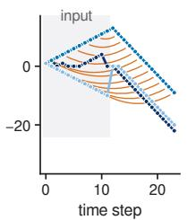

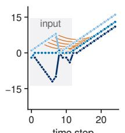

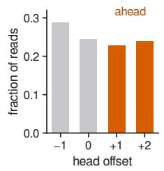  
Figure 6. Clock movements of trained machines (seed 0, one input each; shaded: input). Lines: clock readings; arcs: reads during the answer, from the present step to the record found. (a) Reversal: a clock walks back. (b) Duplication: a clock returns HoME and runs forward again. (c) Stack manipulation: clocks follow the depth and walk down to answer. (d) Odds first: clocks move two readings per step. (e) Binary addition: a clock returns HOME and advances with the digits of the answer. (f) Fraction of the records found that are returned by heads at each offset, over all tasks and seeds.

Results. Trained machines. Without noise the neural machines give the symbolic output on all 1,920 test inputs of ten tasks, and no clock leaves its well in any step of any run (Table 16; Figure 4a). Noise of strength 0.6 on every neuron leaves the output of all 720 inputs unchanged; at 0.8 a neural reading differs from the symbolic one at 380 steps and 99.9% of output symbols agree. Here a slip counts at every later step until a reset brings the two clocks together again, whereas the clocks alone below count each slip once. Place cells that tolerate one or two disagreeing rings stop being recruited at 210 and 30 cells (Figure 2d). With these place cells the machines agree with the symbolic machine on all 131 and all 16 inputs whose span is below 210 and 30 (Figure 4c). Without wells, at noise 0.3, the clocks slip at most steps and agreement falls with length, from 86% at length 41 to 73% at 200. A recurrent kernel twice as wide leaves the output of all 720 inputs unchanged (Table 17). Clocks alone. With wells the clocks never slip in 32,000 steps at any noise up to $\sigma = 0 . 8 . \ \mathrm { A t } \ \sigma = 0 . 9$ slips appear, in 3.0% of steps, on the ring of 11 wells, the largest. Without wells the clocks slip at every noise level, in 12.0% of steps at $\sigma = 0 . 8$ and in 0.5% even without noise (Table 18; Figure 4b). The position of a free bump is graded, and the small error of every move accumulates, which is why Section 2.3 requires clocks to sit in discrete attractor states. Replay. The answers of reversal machines revisit the input in reverse order and those of duplication machines in the same order, with rank correlations —1.00 and 1.00 on average (Figure 4d). Two of the three duplication machines replay across clocks: a clock that rested during the input runs forward during the answer over the readings that another clock recorded. In one of them a third clock revisits its own readings in reverse order at the same time. A clock walked through 40 readings and released without input, with wells of depth 0.5, rests for adaptation below 0.3. At 0.3 it runs back through the stored readings by itself, $^ { 4 0 , 3 9 , 3 8 , . . . , 3 5 }$ , resting about 91τ at each. Adaptation. Without wells a released bump travels from $m = 0 . 0 2 5$ just above $\tau / \tau _ { v } = 0 . 0 2$ , and faster as m grows (Figure 2e). With wells of depth 0.5 travel starts between $m = 0 . 2$ and 0.3, and with depth 1 adaptation strong enough to cross the wells extinguishes the bump. A bump that follows a moving input lags it less as adaptation grows. It leads an input moving at 0.05 neurons per τ from $m = 0 . 0 5$ , and at $m = 0 . 0 8$ , the largest value tested, it still trails an input twice as fast (Table 19).

Table 16. Trained controllers on neural clocks and place cells (no noise): agreement of the output symbols with the symbolic machine (%) / accuracy of the neural machine (%), mean over the runs that fit, by length.
<table><tr><td>Task</td><td> $n = 4 1$ </td><td> $n = 1 0 0$ </td><td> $n = 2 0 0$ </td><td> $n = 5 0 0$ </td></tr><tr><td>even pairs</td><td>100.0 / 100.0</td><td>100.0 / 100.0</td><td> $1 0 0 . 0 / 1 0 0 . 0$ </td><td>100.0 / 100.0</td></tr><tr><td>modular arithmetic</td><td>100.0 / 100.0</td><td>100.0 / 100.0</td><td>100.0 / 100.0</td><td>100.0 / 100.0</td></tr><tr><td>parity</td><td>100.0 / 100.0</td><td>100.0 / 100.0</td><td>100.0 / 100.0</td><td>100.0 / 100.0</td></tr><tr><td>cycle navigation</td><td>100.0 / 100.0</td><td>100.0 / 97.9</td><td>100.0/91.7</td><td>100.0 / 87.5</td></tr><tr><td>stack manipulation</td><td>100.0 / 100.0</td><td>100.0 / 99.9</td><td>100.0 / 100.0</td><td>100.0 / 100.0</td></tr><tr><td>reversal</td><td>100.0 / 100.0</td><td>100.0 / 100.0</td><td>100.0 / 100.0</td><td>100.0 / 100.0</td></tr><tr><td>duplication</td><td>100.0 / 100.0</td><td>100.0 / 100.0</td><td>100.0 / 100.0</td><td>100.0 / 100.0</td></tr><tr><td>missing duplicate</td><td>100.0 / 100.0</td><td>100.0 / 100.0</td><td>100.0 / 100.0</td><td>100.0 / 100.0</td></tr><tr><td>odds first</td><td>100.0 / 100.0</td><td>100.0 / 100.0</td><td>100.0 / 100.0</td><td>100.0 / 100.0</td></tr><tr><td>binary addition</td><td>100.0 / 99.8</td><td>100.0 / 99.5</td><td>100.0 / 99.4</td><td>100.0 / 99.4</td></tr></table>

Reading. The controller cannot tell the network from the symbolic machine: on its stable states the network is the machine as Theorem 4 says. Wells keep the network on those states, and place cells that require every ring to agree keep the full range; without wells the errors of the reading accumulate, and tolerant place cells shorten the range to the product of the periods that must agree. Replay takes the two forms the theory gives it: the controller drives it while it answers, in reverse order in reversal and in the same order in duplication, and adaptation drives it when input is absent.

Table 17. Variants of the neural machine: accuracy (%) by length, mean over three seeds. noise: noise of strength σ on every neuron; partialj: place cells that fire when all but j rings agree; nowells: no wells, $\sigma = 0 . 3 ;$ broad: recurrent kernel twice as wide.
<table><tr><td>Variant</td><td>Task</td><td>accuracy at each length</td></tr><tr><td>broad</td><td>stack manipulation</td><td>41: 100.0, 100: 99.9, 200: 100.0</td></tr><tr><td>broad</td><td>reversal</td><td>41: 100.0, 100: 100.0, 200: 100.0</td></tr><tr><td>broad</td><td>duplication</td><td>41: 100.0, 100: 100.0, 200: 100.0</td></tr><tr><td>broad</td><td>odds first</td><td>41: 100.0, 100: 100.0, 200: 100.0</td></tr><tr><td>broad</td><td>binary addition</td><td>41: 99.8, 100: 99.5, 200: 99.4</td></tr><tr><td>noise0.6</td><td>stack manipulation</td><td>41: 100.0, 100: 99.9, 200: 100.0</td></tr><tr><td>noise0.6</td><td>reversal</td><td>41: 100.0, 100: 100.0, 200: 100.0</td></tr><tr><td>noise0.6</td><td>duplication</td><td>41: 100.0, 100: 100.0, 200: 100.0</td></tr><tr><td>noise0.6</td><td>odds first</td><td>41: 100.0, 100: 100.0, 200: 100.0</td></tr><tr><td>noise0.6</td><td>binary addition</td><td>41: 99.8, 100: 99.5, 200: 99.4</td></tr><tr><td>noise0.8</td><td>stack manipulation</td><td>41: 100.0, 100: 99.9, 200: 100.0</td></tr><tr><td>noise0.8</td><td>reversal</td><td>41: 100.0, 100: 100.0, 200: 100.0</td></tr><tr><td>noise0.8</td><td>duplication</td><td>41: 99.3, 100: 100.0, 200: 100.0</td></tr><tr><td>noise0.8</td><td>odds first</td><td>41: 99.7, 100: 100.0, 200: 100.0</td></tr><tr><td>noise0.8</td><td>binary addition</td><td>41: 99.8, 100: 99.5, 200: 99.4</td></tr><tr><td>nowells</td><td>stack manipulation</td><td>41: 94.7, 100: 84.3, 200: 72.5</td></tr><tr><td>nowells</td><td>reversal</td><td>41: 93.9, 100: 84.9, 200: 80.2</td></tr><tr><td>nowells</td><td>duplication</td><td>41: 85.3, 100: 78.1, 200: 70.9</td></tr><tr><td>nowells</td><td>odds first</td><td>41: 61.6, 100: 55.2, 200: 52.6</td></tr><tr><td>nowells</td><td>binary addition</td><td>41: 92.8, 100: 84.9, 200: 77.1</td></tr><tr><td>partial1</td><td>stack manipulation</td><td>100: 100.0, 180: 99.7, 200: 99.6, 240: 98.8, 300: 94.3</td></tr><tr><td>partial1</td><td>reversal</td><td>100: 100.0, 180: 100.0, 200: 100.0, 240: 93.9, 300: 85.3</td></tr><tr><td>partial1</td><td>duplication</td><td>100: 93.2, 180: 74.6, 200: 71.1, 240: 58.9, 300: 57.4</td></tr><tr><td>partial1</td><td>odds first</td><td>100: 100.0, 180: 91.0, 200: 89.1, 240: 79.5, 300: 67.9</td></tr><tr><td>partial1</td><td>binary addition</td><td>100: 99.6, 180: 99.4, 200: 99.1, 240: 93.3, 300: 80.9</td></tr><tr><td>partial2</td><td>stack manipulation</td><td>20: 99.7, 28: 98.0, 36: 95.6, 60: 80.4</td></tr><tr><td>partial2</td><td>reversal</td><td>20: 100.0, 28: 99.0, 36: 91.2, 60: 70.6</td></tr><tr><td>partial2</td><td>duplication</td><td>20: 81.1, 28: 73.5, 36: 63.9, 60: 58.3</td></tr><tr><td>partial2</td><td>odds first</td><td>20: 95.1, 28: 90.0, 36: 72.4, 60: 57.5</td></tr><tr><td>partial2</td><td>binary addition</td><td>20: 99.5, 28: 98.8, 36: 88.7, 60: 61.6</td></tr></table>

Table 18. Neural clocks alone: slips per step under random moves, by noise strength σ (16 clocks of rings 2, 3, 5, 7, 11, 2,000 steps each).
<table><tr><td>Clocks</td><td>0</td><td>0.3</td><td>0.4</td><td>0.5</td><td>0.6</td><td>0.7</td><td>0.8</td><td>0.9</td><td>1</td><td>1.1</td><td></td></tr><tr><td>wells</td><td>0</td><td>0</td><td>0</td><td>0</td><td>0</td><td>0</td><td>0</td><td> $3 . 0 \mathrm { e } { - } 0 2$ </td><td> $5 . 7 \mathrm { e } \mathrm { - } 0 1$ </td><td> $8 . 3 \mathrm { e } { - } 0 1$ </td><td> $8 . 7 \mathrm { e } \mathrm { - } 0 1$ </td></tr><tr><td>no wells</td><td> $5 . 0 \mathrm { e } { - } 0 3 $ </td><td> $3 . 7 \mathrm { e } { - } 0 2$ </td><td> $5 . 0 \mathrm { e } { - } 0 2$ </td><td> $6 . 3 \mathrm { e } { - } 0 2$ </td><td> $7 . 9 \mathrm { e } { - } 0 2$ </td><td> $1 . 0 \mathrm { e } { - } 0 1$ </td><td> $1 . 2 \mathrm { e } { - } 0 1$ </td><td> $1 . 4 \mathrm { e } { - } 0 1$ </td><td> $1 . 7 \mathrm { e } { - } 0 1$ </td><td> $2 . 4 \mathrm { e } { - } 0 1$ </td><td> $6 . 7 \mathrm { e } { - } 0 1$ </td></tr></table>

Table 19. Adaptation in one ring of 11 wells $( \tau / \tau _ { v } = 0 . 0 2 )$ . Left: speed (wells per τ; the sign gives the direction) of a bump released with a trail of adaptation, by adaptation m and well depth ε (†: the bump dies). Right: lead (wells; negative: lag) of a bump without wells that follows an input of strength A moving at v neurons per τ, for A, v as in the header.
<table><tr><td>m</td><td> $\epsilon = 0$ </td><td> $\epsilon = 0 . 5$ </td><td> $\epsilon = 1$ </td><td>0.3,0.05</td><td>0.3,0.1</td><td>1,0.05</td><td>1,0.1</td></tr><tr><td>0</td><td>0.0000</td><td>0.0000</td><td>0.0000</td><td>-0.118</td><td>-2.280</td><td>-0.034</td><td>-0.070</td></tr><tr><td>0.01</td><td>0.0000</td><td>0.0000</td><td>0.0000</td><td>-0.084</td><td>-1.923</td><td>-0.026</td><td>-0.061</td></tr><tr><td>0.015</td><td>0.0001</td><td>0.0000</td><td>0.0000</td><td></td><td></td><td></td><td></td></tr><tr><td>0.02</td><td>0.0004</td><td>0.0000</td><td>0.0000</td><td>-0.056</td><td>-1.076</td><td>-0.017</td><td>-0.053</td></tr><tr><td>0.025</td><td>0.0013</td><td>0.0000</td><td>0.0000</td><td></td><td></td><td></td><td></td></tr><tr><td>0.03</td><td>0.0019</td><td>0.0000</td><td>0.0000</td><td>-0.030</td><td>-0.197</td><td>-0.009</td><td>-0.046</td></tr><tr><td>0.05</td><td>0.0036</td><td>0.0000</td><td>0.0000</td><td>+0.018</td><td>-0.105</td><td>+0.007</td><td>-0.030</td></tr><tr><td>0.08</td><td>0.0054</td><td>0.0000</td><td>0.0000</td><td>+0.096</td><td>-0.031</td><td>+0.030</td><td>-0.009</td></tr><tr><td>0.12</td><td>0.0072</td><td>0.0000</td><td>0.0000</td><td></td><td></td><td></td><td></td></tr><tr><td>0.2</td><td>0.0099</td><td>0.0001</td><td>0.0000</td><td></td><td></td><td></td><td>一</td></tr><tr><td>0.3</td><td>0.0125</td><td>-0.0088</td><td>0.0001</td><td>一</td><td>一</td><td>一</td><td>一</td></tr><tr><td>0.5</td><td>0.0165</td><td>0.0151</td><td>0.0168†</td><td></td><td>一</td><td>一</td><td>一</td></tr><tr><td>0.8</td><td>0.0210</td><td>0.0205</td><td>-0.0001†</td><td>一</td><td>一</td><td>一</td><td>一</td></tr><tr><td>1.2</td><td>0.0256</td><td>0.0252</td><td>0.0000†</td><td>一</td><td>一</td><td>一</td><td>一</td></tr></table>

## E.9. Turing machines and time

Why. By Theorem 3, a Turing machine with C work tapes that reads one input symbol per step is, step for step, a machine of Eq. (1) with $C$ unbounded clocks. By Theorem 2, clocks of range L run it in the same way as long as its head range stays below L. No machine of Eq. (1) multiplies online one step per input symbol. Given steps without input, one clock runs any Turing machine whose tape fits in its range, so a machine given time to think should multiply (Section 3, Appendix A.9).

Design. Compiled machines (code/experiments/e5\_computation. py). A transducer with C tapes that runs in real time is compiled into a controller as in the proof of Theorem 3(i) (code/orrery/tm . py). Random machines have $C \in \{ 1 , 2 , 3 \}$ tapes, 8 states, binary input and output, and tape symbols blank, 1 and 2. Every entry of the table is drawn once, uniformly, with each head moving left, right or not at all with probabilities 0.25, 0.25 and 0.5. Twenty machines for each C run on four random inputs at each of the lengths 10, 30, 100, 300 and 1,000, with unbounded clocks and with clocks of the cycles 3, 4, 5, 2, 3, 5, 7 and 2, 3, 5, 7, 11. The output of every step is compared with a direct simulation of the machine. The head range of a run is the largest extent of the squares visited by one head (Table 20). Multiplication with time to think. A machine with three tapes copies the factors a and b, lowest bit first, onto tapes 0 and 1 as they arrive. During the steps without input it adds a, shifted, onto an accumulator on tape 2 for every bit of b that is one, propagating carries. It then rewinds, marks the highest one of the product and waits for the answer cues, and at the cues it emits the product, lowest bit first, and an end mark. On the benchmark inputs of length n it is given $( n - 1 ) ^ { 2 } / 2 + 8 n + 1 6$ steps to think, which suffice at every length, and it is compared with the same machine given none (Table 21). On neural dynamics, five compiled random machines with one and with two tapes run on four inputs of length 100, and the multiplier on two inputs at each of the lengths 5, 8 and 12, with neural clocks and place cells.

Results. The compiled machines agree with direct simulation in all 1,200 runs with unbounded clocks, and with bounded clocks in all 2,977 runs whose head range is below $L ;$ beyond the range they agree in 4 of 623, as Theorem 2 allows (Table 20; Figure 7). Given time, the multiplier is exact on every input at every tested length up to 100, with up to 5,716 steps to think. Without time it scores at most 52.0% (Table 21; Figure 4e). On neural dynamics the compiled random machines agree with direct simulation in all 40 runs, and the multiplier is exact up to length 12.

Reading. A tape is a clock and its cells are records: a compiled Turing machine runs exactly on clocks, symbolic or neural, while its heads stay within the range. The trained machines, given no steps without input, fail at multiplication; given such steps, a compiled machine of the same kind multiplies exactly at every tested length.

Table 20. Compiled random Turing machines (20 machines per number of tapes, 8 states, 3 symbols; inputs of lengths 10 to 1,000): runs that agree with direct simulation, with unbounded clocks and, with bounded clocks, among the inputs whose head range is below or at least L.

<table><tr><td>Tapes</td><td>unbounded</td><td>L=60, in</td><td>beyond</td><td>L=210, in</td><td>beyond</td><td>L=2310, in</td><td>beyond</td></tr><tr><td>1</td><td>400/400</td><td>284/284</td><td>2/116</td><td>358/358</td><td>1/42</td><td>400/400</td><td></td></tr><tr><td>2</td><td>400/400</td><td>243/243</td><td>0/157</td><td>330/330</td><td>0/70</td><td>400/400</td><td></td></tr><tr><td>3</td><td>400/400</td><td>241/241</td><td>0/159</td><td>321/321</td><td>1/79</td><td>400/400</td><td></td></tr></table>

Table 21. Schoolbook multiplication compiled from a three-tape Turing machine: accuracy (%) on the benchmark inputs of length n with $( n - 1 ) ^ { 2 } / 2 + 8 n + 1 6$ steps to think and with none.
<table><tr><td>n</td><td>steps to think</td><td>with time</td><td>without</td></tr><tr><td>5</td><td>64</td><td>100.0</td><td>20.6</td></tr><tr><td>10</td><td>136</td><td>100.0</td><td>40.2</td></tr><tr><td>20</td><td>356</td><td>100.0</td><td>47.5</td></tr><tr><td>40</td><td>1,096</td><td>100.0</td><td>46.7</td></tr><tr><td>64</td><td>2,512</td><td>100.0</td><td>52.0</td></tr><tr><td>100</td><td>5,716</td><td>100.0</td><td>51.1</td></tr></table>

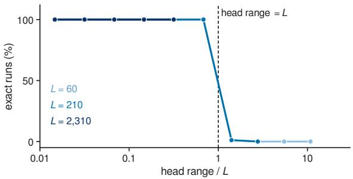  
Figure 7. Compiled Turing machines with bounded clocks. Fraction of runs of compiled random Turing machines that agree with direct simulation, against the head range divided by $L ,$ for $L = 6 0$ , 210 and 2,310 (the three lines coincide); every run whose head range stays below L is exact.

## F. Neural Evidence

This appendix collects the findings behind Section 4.2, part by part of the machine, and supports the paragraph What the theory explains of that section. Each paragraph ends with what the theory makes of the findings, and Appendix F.1 states the predictions of Section 4.2 in full, P1 to P8.

The clocks are grid modules. Grid cells fire at the vertices of a triangular lattice that tiles the environment (Hafting et al.. 2005). They cluster into a few discrete modules that differ in scale, orientation and theta modulation and can respond independently to changes in the geometry of the environment; the scales of adjacent modules stand in a ratio of about 1.4 to 1.7 (Stensola et al., 2012; Barry et al., 2007). The joint activity of each module lies on a torus, and each cell keeps its position on the torus across environments and into sleep (Gardner et al., 2022). Modules stay coordinated when their activity is dissociated from sensory cues (Waaga et al., 2022), as one move that turns every cycle requires. The stellate cells of layer II, where many grid cells lie, are coupled almost only through inhibitory interneurons, and this recurrent inhibition is enough for an attractor network to form grids (Couey et al., 2013). As a residue code the modules have a range set by the least common multiple of their periods, exponential in their number, while the update of position is addition within each module (Fiete et al., 2008; Sreenivasan & Fiete, 2011). Economy arguments for a nested code, whose range is the largest period, predict a geometric series of scales with the observed ratio (Mathis et al., 2012; Wei et al., 2015). Proposition 1 reaches cycles from a different requirement, that a learned procedure reach its past through coincidences only, and the coprime periods of Section 2.2 from the economy of the range.

The form is given before the map. Toroidal structure appears in the entorhinal cortex of rat pups at postnatal day 10, before eye opening and before the pups explore, in up to three modules from the start (Guardamagna et al., 2026). Head direction cells keep the couplings of an adult network before eye opening (Bassett et al., 2018). Spatially periodic fields come later: when pups first leave the nest, head direction cells are adult in form while grid cells mature last (Langston et al., 2010; Wills et al., 2010). On the theory the group of the clocks is given, and experience aligns it with the world.

The moves are signals of movement and copies of commands. Speed cells in the medial entorhinal cortex fire at rates that rise linearly with running speed, whatever the context (Kropff et al., 2015). Continuous attractor networks driven by velocity and heading integrate path accurately over distances of metres (Burak & Fiete, 2009), and the entorhinal cortex has been proposed to integrate the animal's movements through such a periodic network (McNaughton et al., 2006). Desert ants on lengthened legs overestimate the distance home and ants on shortened legs underestimate it (Wittlinger et al., 2006): their moves are steps. Copies of motor commands routed to sensory structures, corollary discharge, are found from nematodes to primates (Crapse & Sommer, 2008); in the machine every move is such a copy.

HoME is a reset at a boundary. The error of grid cells grows with the distance travelled since the last encounter with a boundary, and an encounter with a wall corrects the error in the direction perpendicular to the wall and leaves the error along it (Hardcastle et al., 2015). In a hairpin maze the grid map breaks into fragments that repeat from arm to arm, and the map starts again at every turn (Derdikman et al., 2009). In people watching a film, the hippocampus responds at the boundaries between events, the size of its response predicts how well the event just ended is later reinstated, and the boundaries found in cortical activity match the events people report (Baldassano et al., 2017); boundary cells of the human medial temporal lobe mark the same moments (Zheng et al., 2022). In the machine HoME returns a clock to a fixed reading: a wall resets the ring perpendicular to it, a turn of the maze resets the module, and an event boundary resets the clock under which the episode is filed.

Coincidence detectors. In models a place field arises from a sum of grid cells with similar phases, and a greater spread of phases gives several irregular fields (Solstad et al., 2006); random grid inputs followed by competition through inhibition give place fields of realistic size and number without learning (de Almeida et al., 2009; Monaco & Abbott, 2011). Place maps also form when grid periodicity is abolished (Brandon et al., 2014), and place cells appear in development before stable grid fields (Langston et al., 2010; Wills et al., 2010). On the theory a place cell detects a coincidence of whatever clocks reach it, of which the grid modules are the best known.

Large spaces give many fields (Figure 2d). On a 48 m track each CA1 cell has its own propensity to form fields, and the number of fields per cell is broadly distributed (Rich et al., 2014). In bats flying through a 200 m tunnel only 12% of place cells have a single field, and a cell has on average 4.9 fields per direction (Eliav et al., 2021). The fields of a cell are spaced without period: the gaps between them are distributed exponentially, and the authors found the data inconsistent with a strong periodic grid input. The fields also differ in size, from 0.6 to 32 m across cells and twentyfold within one cell. In enclosures a few times larger than usual, CA1, CA3 and dentate cells have several irregularly arranged fields (Fenton et al., 2008; Park et al., 2011). On the theory a place cell that tolerates j disagreeing modules (Theorem 4(iii)) fires wherever any M — j of its modules return to the readings recorded when it was recruited; different subsets return at different places, and with the incommensurate periods of real modules these places are spread irregularly along the tunnel, so the fields fall without period, as observed, while a cell that needs every module to agree fires once within the range. The variation of field sizes within one cell is left unexplained by the theory

Identical compartments repeat. In two nearly identical boxes joined by a corridor many place cells have similar fields in both (Skaggs & McNaughton, 1998), and in four parallel compartments fields repeat and keep repeating with experience (Spiers et al., 2015), as the grid map of a hairpin maze repeats from arm to arm (Derdikman et al., 2009). Fields repeat only in compartments that face the same way, and in any arrangement after lesions of the head direction system (Harland et al., 2017). Grids that first repeat between two compartments merge into one pattern with prolonged experience (Carpenter et al., 2015). On the theory a doorway resets the clocks HomE, heading is one more ring, and a reset that stops once the layout is learned joins the two compartments on one clock.

Remapping is a change of relative phase. Global remapping of place cells comes with a realignment of the grid, a shift and rotation of the whole grid map (Fyhn et al., 2007), while the phase relations among the cells of one module stay fixed (Yoon et al., 2013). In the model of Monaco & Abbott (2011) a small number of modules, each shifted by its own amount, is enough to produce global remapping. In a preprint, Lykken et al. (2025) report that in rats moving between familiar rooms each module shifted its phase by a different amount while the place cells remapped, and that smaller differences between the shifts of the modules gave partial remapping. Remapping also follows changes in the firing rates of grid fields that keep their positions (Kanter et al., 2017). A relative shift of the cycles changes every coincidence and so opens a new catalogue on the same clocks; a change of rates changes the patterns that place cells store.

The catalogue. Indexing theory holds that the hippocampus stores an index of the cortical activity of each episode and that a partial cue reactivating the index reinstates the episode (Teyler & DiScenna, 1986; Teyler & Rudy, 2007); hippocampal engrams act as such indices (Goode et al., 2020). Vector-HaSH builds such an index on a scaffold of grid modules, with hippocampal cells as conjunctions of grid states and sensory content bound to them (Chandra et al., 2025); Section 4.2 builds the catalogue in the same way, and Appendix G says where the two accounts part. In the theory the cue is the present pattern of the clocks, and among the records it reactivates the most recent is returned. This is a memory of keys and values whose keys are clock readings (Gershman et al., 2025), and a memory written and read by address as computation requires (Gallistel & King, 2009), here built from attractors and synapses, an implementation Gallistel and King considered unlikely.

Replay and reading ahead are clocks in motion (Figure 2e). Sequences of place cells replay in reverse at the end of a run (Foster & Wilson, 2006) and forward before it (Diba & Buzsáki, 2007), and before a goal directed run they lead from the present location to a remembered goal (Pfeiffer & Foster, 2013). During sleep they replay compressed in time (Nádasdy et al., 1999). Replay also runs along paths never travelled (Gupta et al., 2010) and toward unvisited but cued places (Olafsdóttir et al., 2015; 2018), and in humans it follows the learned abstract order of a task and reverses after reward, with a code for position in the sequence leading the code for the item by 50 ms (Liu et al., 2019). Replay moves in discrete hops: the reactivated position sharpens at one place for several milliseconds and then jumps to the next, locked to slow gamma (Pfeiffer & Foster, 2015). Grid cells replay together with place cells during rest, in register with them (Ólafsdóttir et al., 2016), and the superficial layers of the medial entorhinal cortex also replay on their own, independently of hippocampal replay (O'Neill et al., 2017). In a 200 m tunnel replay is fragmented, each event covering a small part of the space (Eliav et al., 2025). Within each theta cycle place cells fire at progressively earlier phases (O'Keefe & Recce, 1993), and ensembles sweep through the path ahead in compressed form (Skaggs et al., 1996; Foster & Wilson, 2007), alternating between possible futures (Kay et al., 2020). Grid and place ensembles sweep outward from the animal, alternating left and right, and the length of a sweep is about a fifth of the grid spacing in every module (Vollan et al., 2025). In the machine a replay is a clock moved over stored readings, hopping from well to well, and a sweep is a head at a positive offset; the position code that leads the item code is a reading that retrieves its record; a clock that runs on its own, with nothing read, is entorhinal replay without the hippocampus.

Adaptation, anticipation and acetylcholine. Head direction cells of the anterior thalamus anticipate the future direction of the head by about 23 ms, while those of the postsubiculum encode its present direction (Blair & Sharp, 1995; Taube & Muller, 1998); attractor models with adaptation reproduce a lead time independent of turning speed (Mi et al., 2014), and adaptation in the vestibular afferents also accounts for much of its variability (van der Meer et al., 2007). In attractor models of place and grid cells, adaptation produces theta sweeps, phase precession and procession (Chu et al., 2024), and sweeps whose length scales with grid spacing and running speed (Ji et al., 2025), as observed (Vollan et al., 2025); the strength of adaptation sets the statistics of replay (Ji et al., 2026). Acetylcholine blocks the slow afterhyperpolarization and the accommodation of hippocampal pyramidal cells through muscarinic receptors (Cole & Nicoll, 1983; 1984), and noradrenaline does so through β receptors (Madison & Nicoll, 1986). Hippocampal acetylcholine is high during walking and REM sleep and minimal during sharp wave ripples (Zhang et al., 2021), and optogenetic activation of septal cholinergic neurons suppresses ripples (Vandecasteele et al., 2014). High cholinergic tone favours encoding and low tone consolidation, in part by suppressing recurrent excitation (Hasselmo, 1999; 2006); P5 separates this route from adaptation, because only adaptation sets how fast the released sequences run. Within each theta cycle, phases that favour encoding and retrieval alternate (Hasselmo et al., 2002), as writes keyed by one clock and reads queried by another alternate in the machine.

Recruitment in one trial. A plateau potential in a CA1 cell creates a place field in one trial, potentiating inputs active seconds before and after it (Bittner et al., 2015; 2017), and the same plasticity shifts existing fields (Milstein et al., 2021). In the machine a place cell is recruited when no cell answers the present pattern.

Records and rules. The hippocampus stores an episode in one exposure and the cortex learns regularities over many, the two speeds that complementary learning systems were proposed to explain (Marr, 1971; McClelland et al., 1995). Patient H.M., without a hippocampus, learned a motor skill over days of practice and kept no memory of the sessions in which he learned it (Corkin, 1968). In the machine a record is data, written once and never trained, and the rule is the finite table of the controller, learned slowly and unable to depend on how many records there are; a learner without the catalogue keeps its rules.

Clocks beyond space. Hippocampal time cells fire at successive moments of a delay (Pastalkova et al., 2008; MacDonald et al., 2011; Eichenbaum, 2014). On repeated laps of one track many CA1 cells fire at the same place on every lap with a rate that marks the lap, and the lap code carries over to a track of another shape: cells that count laps (Sun et al., 2020). Grid cells integrate elapsed time and distance on a treadmill (Kraus et al., 2015), a subcircuit of the medial entorhinal cortex represents elapsed time while the animal stands still (Heys & Dombeck, 2018), and the lateral entorhinal cortex carries a code of time that drifts over seconds to hours and is read as how long ago an experience was (Tsao et al., 2018); the medial cortex carries path integration and global reference frames, the lateral objects and local frames (Knierim et al., 2014). Entorhinal neurons also map sound frequency (Aronov et al., 2017). Signals with the sixfold symmetry of grids appear in virtual navigation (Doeller et al., 2010) and in human single neurons (Jacobs et al., 2013), and also in conceptual and odour spaces (Constantinescu et al., 2016; Bao et al., 2019; Bellmund et al., 2018; Behrens et al., 2018). On a linear track the fields of grid cells of one module are parallel slices through one lattice (Yoon et al., 2016), as moves along a line walk a clock of two rings along a straight path on its torus. During mental navigation between landmarks many neurons of the macaque entorhinal cortex are periodic, with signatures of a continuous attractor, and the variability of the monkeys' timing grows more slowly than the distance, as resets at remembered landmarks predict (Neupane et al., 2024). Medial entorhinal activity forms ultraslow periodic sequences lasting minutes (Gonzalo Cogno et al., 2024), and medial premotor populations trace a loop that restarts with every produced interval (Betancourt et al., 2023). In mice that learn looping sequences of goals, most medial frontal neurons tile progress to the next goal, and position in the sequence is held by cells that fire at fixed lags from an anchor; these ring buffers persist in sleep and support inference on new sequences (El-Gaby et al., 2024; Whittington et al., 2025). The left entorhinal cortex of humans represents position in nested sequences from coarse to fine along its long axis (Shpektor et al., 2024), and ordinal position within a chunk oscillates at the chunk rate (Al Roumi et al., 2021). In macaque prefrontal cortex the items of a sequence occupy subspaces specific to their rank, each holding a ring that mirrors the circular layout of the items (Xie et al., 2022), and they are moved between subspaces for backward recall (Tian et al., 2024). Mental rotation takes time proportional to the angle (Shepard & Metzler, 1971), as a clock moved by bounded steps does. In each of these cases an order is held by a periodic code, as it is by the clocks of the machine, and the drifting code of the lateral entorhinal cortex is a coordinate, which P7 separates from the periodic code of the medial.

Phase arithmetic in neurons. In Drosophila heading is a bump on a ring attractor (Seelig & Jayaraman, 2015; Kim et al. 2017), and travelling direction is computed by adding sinusoidal activity patterns whose phases and amplitudes are those of vectors (Lyu et al., 2022; Lu et al., 2022): neurons add on cycles. Head direction states of mice lie on one ring, the same in waking and in REM sleep (Chaudhuri et al., 2019), and the case for continuous attractors in the brain is now strong (Khona & Fiete, 2022).

Serial order. Lashley argued that the serial order of skilled behaviour cannot come from chaining, in which each element triggers the next, and requires a plan prepared before execution (Lashley, 1951). Models of serial recall code position relative to the start and end of a list (Henson, 1998), bind items to a timing signal (Burgess & Hitch, 1999) or to oscillators of different frequencies that are reset and replayed at recall (Brown et al., 2000), or let a gradually drifting context retrieve items in order (Howard & Kahana, 2002). Recall errors exchange items that held the same position in different groups, and intrusions from an earlier list keep their position (Henson, 1998): a record made at the same reading is found, as P2 expects of a periodic clock. Judgements of order need a slow serial search whose speed depends on recency, while items are recognized in one step (McElree & Dosher, 1993); lesions of the hippocampus impair memory for the order of a series of odours and spare memory for which odours occurred (Fortin et al., 2002). Event boundaries improve later recognition and impair memory for the order of events across them, and boundary and event cells of the human medial temporal lobe mark these moments (Zheng et al., 2022), as a reset HoME at a boundary leaves no reading that orders the two sides. Backward recall has also been read as repeated forward search (Thomas et al., 2003); P3 distinguishes this account from a clock walked back. Skilled sequences in humans are prepared as a queue organized by an ordinal template that generalizes across actions (Kornysheva et al., 2019).

Working memory and control. Prefrontal neurons hold information across delays (Goldman-Rakic, 1995); prefrontal activity patterns represent goals and bias the pathways from input to output (Miller & Cohen, 2001), and the basal ganglia gate when prefrontal working memory is updated (Frank et al., 2001; O'Reilly & Frank, 2006), as human imaging shows in the filtering of distractors (McNab & Klingberg, 2008). Working memory holds about four chunks (Cowan, 2001), or a continuous resource shared among items (Ma et al., 2014), and preparatory activity in motor cortex settles into discrete attractors (Inagaki et al., 2019). A grid-like signal appears in the medial prefrontal cortex as well as in the entorhinal cortex when people move through a conceptual space (Constantinescu et al., 2016). These are the properties the theory asks of a controller: few states, discrete and gated; a grid-like signal in prefrontal cortex is, on the theory, a clock the controller moves and does not read (P8).

Recursion and its limits. Monkeys, children and adults generate sequences with centre embedding from new items monkeys after extra exposure (Ferrigno et al., 2020); crows do so on many transfer trials (Liao et al., 2022); macaques extend mirror sequences to greater lengths (Jiang et al., 2018). Tamarins learn the regular pattern $( A B ) ^ { n }$ and not the nested $A ^ { n } B ^ { n }$ which humans learn (Fitch & Hauser, 2004), though humans can learn it without using its nested structure (Perruchet & Rey, 2005). In written language centre embedding stops at depth three, and in speech multiple centre embedding is practically absent (Karlsson, 2007). Dutch crossed dependencies are rated easier than German nested ones (Bach et al., 1986), as copying with a clock sent HOME is easier than walking a clock back over a nest; a recent replication finds the difference in ratings and not in comprehension (Yadav et al., 2025). Intracranial activity rises with each word and falls when words merge into a phrase (Nelson et al., 2017), and cortical activity tracks phrases and sentences at their own rates (Ding et al., 2016).

Counting and estimating (Figure 2f). When adults press a key a target number of times, two laws of error appear in one experiment (Cordes et al., 2001). Adults who estimate the number without counting, their speech occupied by a repeated word, show a coefficient of variation that stays constant as the number grows, the scalar variability of a magnitude; adults who count aloud show a coefficient of variation that falls as the inverse square root of the number, as independent errors of single steps give. Neurons of the monkey prefrontal cortex tuned to numerosity have tuning curves that are logarithmically compressed, and the neural responses obey Weber's law as the behaviour does (Nieder & Miller, 2003; Nieder, 2016); nonverbal number is a magnitude with scalar variability, like duration (Gibbon, 1977; Gallistel & Gelman, 2000; Feigenson et al., 2004). Small sets of up to about four items are apprehended at once, and larger sets are counted at a few hundred milliseconds per item (Trick & Pylyshyn, 1994); neurons of the human medial temporal lobe show a coding boundary near four (Kutter et al., 2023). The Munduruku have number words up to five; they compare and add large approximate numbers as well as speakers of languages with a full count list, and their exact arithmetic fails beyond their number words (Pica et al., 2004). The Pirahã, with words for one, two and many, fail at exact tasks beyond three (Gordon, 2004), yet they match large sets exactly while the sets stay in view and fail when memory is required (Frank et al., 2008), so number words serve as records. Children learn the meanings of number words one at a time before the counting principle extends to the whole count list (Sarnecka & Carey, 2008), and their counts most often end at a number ending in nine (Siegler & Robinson, 1982); among about 800 kindergarteners after one school term the most frequent stopping points were 39 and 29 (Gould, 2016; 2017). On the theory, estimating reads a graded magnitude, a coordinate whose errors grow with size, while counting moves a clock and reads coincidences with a learned list, exact up to the range of the clock.

## F.1. Predictions

The predictions of Section 4.2, stated in full. Each names the measurement that would test it and, where the main text gives one, the result that would refute the theory.

P1. Aliasing at the least common multiple. Exact sequence memory that relies on the grid modules fails where the joint phase of the modules in play repeats, the least common multiple of their periods; silencing one module moves the failure to the least common multiple of the rest, and restoring it moves the failure back. The feasible form uses the anatomy: grid scale grows from the dorsal to the ventral end of the medial entorhinal cortex (Hafting et al., 2005; Stensola et al., 2012), so the ventral part holds the modules of largest period and the dorsal part the most grid cells. Lesions of ventral medial entorhinal cortex should shorten exact sequence memory most, since they remove the largest factor of the range, and dorsal lesions, which remove the most grid cells, least. An account in which capacity is set by the number of cells or synapses predicts the reverse order.

P2. Periodic codes of serial position. In long sequences the neural similarity of positions i and i + p is raised for every engaged period p, above the similarity of positions at other distances. A code that represents position by a monotone magnitude predicts a similarity that falls with distance and nothing else.

P3. Backward recall is reverse replay. Serial position decoded from neural activity during backward recall sweeps down through the positions written during encoding, one position per recalled item, as the clock walks back; in forward recall it sweeps up. Backward recall by repeated forward search (Thomas et al., 2003) predicts a sweep up before each recalled item,

P4. Partial coincidence shortens the range. Weakening the inhibition that sharpens place fields (Grienberger et al., 2017) lets a place cell fire when j of the modules that drive it disagree, and caps exact memory at the product of the M — j smallest periods (Theorem 4(iii); Figure 2d). The experiment of Section 5.5 runs this manipulation on the model, where place cells that tolerate one or two disagreeing rings shorten the range from 2,310 to 210 and 30.

P5. Adaptation releases replay. Acetylcholine suppresses the slow afterhyperpolarization that produces adaptation (Cole & Nicoll, 1983) and suppresses replay (Vandecasteele et al., 2014); low cholinergic tone, which Hasselmo (1999) tied to consolidation, releases sequences that run without input. The new part of the prediction is the speed: released sequences run faster as adaptation grows, as the travelling bump of Appendix B.3 does, and a route through recurrent excitation alone leaves the speed unchanged.

P6. Discrete resting phases and grid-place register during replay. During a hippocampal replay the decoded phase of each grid module moves in discrete steps, resting in one well and jumping to the next as the decoded place cell position hops (Pfeiffer & Foster, 2015), and it stays in register with the place cells: the phases decoded at each hop are the phases under which the place cells firing there were recruited, as the coordinated grid and place cell replay of Olafsdóttir et al. (2016) shows for rest. Entorhinal replay without the hippocampus (O'Neill et al., 2017) is a clock run with nothing read, which the theory allows. A hippocampal replay during which the grid stands still would refute the identification of the grid modules with the clocks.

P7. Order versus elapsed time. Memory for the order of events rests on the periodic time code of the medial entorhinal cortex (Kraus et al., 2015; Heys & Dombeck, 2018), and memory for how long ago an event happened on the drifting code of the lateral (Tsao et al., 2018), in line with the division of labour between the two (Knierim et al., 2014). Silencing the medial cortex should impair judgements of order and spare judgements of elapsed time, and silencing the lateral the reverse, because order is read as a coincidence on a clock and elapsed time as a coordinate.

P8. Shift invariance of the prefrontal controller. The prefrontal code of the pending items of a procedure is unchanged when a new room shifts every grid module and the place cells remap, because the controller receives what the heads find and never the readings themselves. A grid-like signal in prefrontal cortex (Constantinescu et al., 2016) is a clock the controller moves and does not read: it should shift with the entorhinal modules while the code of the pending items stays. Retrieved records are decodable from the prefrontal neurons that hold working memory, and the phase of the grid code is not.

## G. Related Work

This appendix places the theory among earlier work: length generalization in networks, the cycles that networks find when they generalize, neural theories of structure, computation and expressivity, learnability, automata in neural dynamics, continuous attractor networks, symmetry in learning, and recursion, rules and symbols. It supports Sections 3, 4 and 6, and Table 22 lists what common architectures read.

Length generalization in networks. Memory-augmented networks gave a controller a tape, a stack or a matrix of slots (Graves et al., 2014; 2016; Weston et al., 2015; Joulin & Mikolov, 2015; Grefenstette et al., 2015). In the benchmark of Delétang et al. (2023) networks order roughly by the Chomsky hierarchy, no architecture solves binary multiplication or square root, and the networks given a stack or a tape are the ones that extrapolate on the five tasks of Section 5.1 that reach their past through a clock: the Stack-RNN extrapolates on stack manipulation and reversal, and the Tape-RNN is the one network that extrapolates on duplication, odds first and binary addition. The Tape-RNN's best scores use a head that can also jump by the input length, a move supplied by hand. These networks read their memory through graded attention, and their structure, like ours, is built by hand; the theory says which structure a learner needs, why a stack and a tape are such structures, and that the read has to be a coincidence. Length generalization in Transformers has been pursued through positional encodings (Press et al., 2022; Su et al., 2024; Kazemnejad et al., 2023; Peng et al., 2024): randomized encodings (Ruoss et al., 2023) and encodings adapted to the data (Zheng et al., 2024) improve Transformers on parts of the benchmark. as do stack attention and recurrent variants (Li et al., 2024a; Beck et al., 2024; Grazzi et al., 2025), and the best of them reach 75.1, 69.3 and 64.5% on duplication, odds first and binary addition. Decoders trained on short inputs generalize best with no positional encoding at all (Kazemnejad et al., 2023), and a network trained to decide when to stop learns to read its position (Newman et al., 2020). Small Transformers trained on additions of up to seven digits fail at eight, and trained on one and three digits fail at two (Lee et al., 2024). Systematic generalization can be learned by meta learning, yet the same models fail on longer outputs (Lake & Baroni, 2023), and longer inputs are the hardest test of compositionality (Lake & Baroni, 2018; Hupkes et al., 2020; Keysers et al., 2020); processors of graphs trained on small graphs reach about three quarters of their accuracy on larger ones (Veličković & Blundell, 2021; Veličković et al., 2022; Ibarz et al., 2022).

Many networks do extrapolate. Recurrent and convolutional networks extend from small to large instances of addition. multiplication, mazes and prefix sums when trained with curricula, noise and many restarts (Kaiser & Sutskever, 2016; Price et al., 2016; Freivalds & Liepins, 2017; Schwarzschild et al., 2021; Bansal et al., 2022), especially when their fixed points do not depend on the path taken (Anil et al., 2022a). A Transformer copies strings twenty times longer than its training strings by finding the previous occurrence of the present n-gram (Jelassi et al., 2024). Transformers generalize in length on arithmetic with index hints, coupled positions or embeddings that number the digits (Zhou et al., 2024a; Cho et al., 2024; McLeish et al., 2024; Jelassi et al., 2023; Shen et al., 2023), with tasks chosen among the programs a Transformer can express (Zhou et al., 2024c; Weiss et al., 2021), with looping and adaptive depth (Dehghani et al., 2019; Graves, 2016; Fan et al., 2025; Giannou et al., 2023), or with chain of thought formatted as the tape of a Turing machine (Hou et al., 2025); language models tuned on short instances do not extrapolate, while scratchpad prompting helps (Anil et al., 2022b). Each of these methods either bounds the coordinate so that training shows all its values (random positions up to a chosen maximum, offsets of digit significance up to 100, coupled positions up to a largest identifier, a hundred index hints), and a hyperparameter then sets the range, or it replaces a read of position by a match of content. The loop count of looped models is itself a coordinate, and breaking its correlation with the length of the input reduces their failures (Kuo et al., 2026). In language models, the dimensions of rotary codes whose wavelength exceeds the training context never complete a rotation and carry absolute position (Peng et al., 2024; Liu et al., 2024), and extending the context rescales positions back into the trained range (Chen et al., 2023): a cycle longer than experience is a coordinate. One property, whether what a decision reads takes finitely many values, sorts all of these results, and the machine of Eq. (1) has the property by construction Table 22 lists what common architectures read.

Networks that generalize find cycles. Transformers that learn modular addition after long training (Power et al., 2022) embed numbers on a few Fourier frequencies and compute with trigonometric identities (Nanda et al., 2023; Zhong et al., 2023); networks learn composition in finite groups through representations of the group (Chughtai et al., 2023), and networks of several kinds implement an approximate Chinese remainder computation with few features (McCracken et al., 2025).

Table 22. What architectures read. Coordinate: a quantity in the situation whose values grow with the input. Discrete: states that sit in wells. Range: how the reach of addressing is set.
<table><tr><td>Architecture</td><td>Coordinate read</td><td>Discrete</td><td>Range</td></tr><tr><td>RNN, LSTM, state space model</td><td>a graded state that drifts with length</td><td>no</td><td>none</td></tr><tr><td>Transformer</td><td>positions, or distances by a graded similarity</td><td>no</td><td>the trained lengths</td></tr><tr><td>Stack-RNN, Tape-RNN</td><td>a blended head; jumps by the input length</td><td>no</td><td>the memory size</td></tr><tr><td>This work</td><td>none</td><td>yes</td><td>product of coprime periods</td></tr></table>

Pretrained language models represent numbers with Fourier components of periods 2, 5 and 10 (Zhou et al., 2024b) and add them on a helix with periods 2, 5, 10 and 100 and one linear direction for magnitude (Kantamneni & Tegmark, 2025): days and months lie on circles (Engels et al., 2025); heads that give the successor of a number, day or month use features of the residue modulo 10 (Gould et al., 2024); a deployed language model tracks a character count on a rippled helix tiled by features that resemble place cells (Gurnee et al., 2025). Without a cycle there is no exact count: linear recurrent networks and state space models whose transitions have nonnegative or positive eigenvalues read a graded state that drifts with length and cannot count modulo any number (Merrill et al., 2024; Sarrof et al., 2024; Grazzi et al., 2025). Sinusoidal and rotary position codes are sets of cycles (Vaswani et al., 2017; Su et al., 2024), and rounding every rotary wavelength to an integer improves extrapolation (Wang et al., 2024). Coprime periods have served as positional codes: a conversational encoder indexes positions by their residues modulo 47 and 11 to reach 517 positions (Henderson et al., 2020), and Transformers given rotations of periods 5, 7, 11 and 13 copy strings up to length 5,005, the product of the periods (Guo et al., 2026), the range Theorem 2 assigns to such clocks. The principle that generalization needs locality, symmetry and discrete attractors has also been argued with a neural cellular automaton that adds numbers far longer than its training numbers (Wei, 2026) Here the cycles are derived from what a decision may read, the controller that uses them is learned, and the same machine is the dynamics of an attractor network.

Neural theories of structure. Grid cells have been modelled as continuous attractors (Burak & Fiete, 2009; McNaughton et al., 2006; Khona & Fiete, 2022), as the interference of velocity-controlled oscillators whose phase difference reads position (Burgess et al., 2007), as a modular code of high capacity (Fiete et al., 2008; Sreenivasan & Fiete, 2011), as the economical (Mathis et al., 2012; Wei et al., 2015) or predictive (Stachenfeld et al., 2017) code of space, as the product of networks trained to integrate paths (Banino et al., 2018; Cueva & Wei, 2018), hexagonal under simple biological constraints (Sorscher et al., 2023), and as representations of the group of the animal's movements (Gao et al., 2021; Dorrell et al., 2023); here the group is derived from generalization, and the controller never reads it. Grid codes have been analysed as residue number systems and codes that correct errors (Fiete et al., 2008; Sreenivasan & Fiete, 2011; Mathis et al., 2012; Wei et al., 2015), as residues bound into one vector by modular attractor networks (Kymn et al., 2024b), and as residue numbers that support computation in vector-symbolic representations of high dimension, which bind content to structure by algebra (Kymn et al., 2024a); multiscale codes inspired by grid cells encode locations for machine learning (Mai et al., 2020). The Tolman-Eichenbaum machine separates a structural code, learned by path integration, from sensory content bound in the hippocampus, and generalizes structure across environments (Whittington et al., 2020); it is close to a Transformer with recurrent position codes (Whittington et al., 2022), and structured slots in prefrontal cortex extend it to sequence memory (Whittington et al., 2025). Graphs that clone each observation into several hidden states learn higher order structure from aliased observations (George et al., 2021), and key-value accounts of the hippocampus treat the entorhinal code as the key (Gershman et al., 2025). Vector-HaSH stores content on a scaffold of grid modules, with hippocampal cells as their conjunctions, and recalls a sequence by a velocity read from the hippocampal state (Chandra et al., 2025); that velocity is a function of the grid state, a coordinate, so the rule it learns is tied to the states met in training (Theorem 1(i)). The hippocampus has been described as a generator of sequences independent of space and time (Buzsáki & Tingley, 2018), and models of serial recall bind items to oscillators or drifting context (Brown et al., 2000; Burgess & Hitch, 1999; Howard & Kahana, 2002). Here the controller moves the clocks and reads only records, and the cycles, the coincidence detectors, the catalogue and the blind controller follow from one requirement, that finite experience fix the rule, a requirement that owes nothing to navigation or capacity. The same requirement gives the hippocampal index (Teyler & DiScenna, 1986), the two learning speeds (McClelland et al., 1995), replay, time cells (Eichenbaum, 2014) and the cognitive map (Tolman, 1948; O'Keefe & Nadel, 1978), and it adds a condition these models leave open: the controller reads coincidences and never the code.

Computation and expressivity. Computation in real time on multitape machines (Yamada, 1962; Rabin, 1963; Hartmanis & Stearns, 1965; Rosenberg, 1967) has a strict hierarchy in the number of tapes (Aanderaa, 1974; Paul et al., 1981; Paul, 1982;

Paturi et al., 1990), and tapes with several heads, with or without jumps between heads, add no power in real time (Fischer & Rosenberg, 1968; Fischer et al., 1972; Kosaraju, 1979; Savitch & Vitányi, 1984); Theorem 3 places the machine of Eq. (1) in this landscape. Universality results for recurrent networks and Transformers keep the unbounded part of a computation in a precision: recurrent networks are universal with unbounded precision (Siegelmann & Sontag, 1995), and with bounded precision when they grow stacks of neurons read only at the top (Chung & Siegelmann, 2021), and Transformers are universal with positional encodings of unbounded precision (Pérez et al., 2021). Constructions with bounded precision keep the unbounded part in a memory addressed by position, as the neural Turing machine does (Graves et al., 2014) and as a looped Transformer does that emulates a computer with binary addresses of fixed width (Giannou et al., 2023). Chain of thought and looped computation buy time to think, and extend what Transformers compute with the number of steps (Merrill & Sabharwal, 2024; Feng et al., 2023; Li et al., 2024b; Giannou et al., 2023; Fan et al., 2025). Section 3 keeps the unbounded part in clocks the controller never reads, and the multiplier of Section 5.6 thinks in the same sense. Recurrent networks recognize counter languages with saturated activations, a count held in a state that is a coordinate (Weiss et al., 2018); self attention of bounded size cannot track parity or nesting at every length (Hahn, 2020) and lies in small circuit classes (Merrill & Sabharwal, 2023); Transformers that simulate automata learn shortcuts that fail at new lengths (Liu et al.. 2023); and state space models share these limits (Merrill et al., 2024).

Learnability beyond the training support. Identification in the limit fails for every superfinite class of languages from positive examples (Gold, 1967); regular languages are learned from queries and counterexamples (Angluin, 1987), and deterministic finite state transducers are identified from input and output pairs once the sample contains a characteristic set (Oncina et al., 1993), the classical relative of Theorem 1(ii). For Transformers whose positional information is periodic or local, queries and keys fall into a finite partition independent of the length, and length generalization follows in the limit; copying and addition cannot be written this way (Huang et al., 2025). The machine of Eq. (1) writes them because a head may test two clock readings for equality, a relation invariant under translation and not local, valid within the range of the clocks. Length generalization also holds when each output depends on a bounded number of earlier tokens (Golowich et al., 2025). On inputs outside the support, networks trained by gradient descent follow the bias of their architecture: networks of rectified linear units become linear along every direction (Xu et al., 2021), and several models learn the interpolator of least degree (Abbe et al., 2023). Theorem 1 asks which rules a finite set of inputs fixes on all longer inputs, and answers it by what the learner reads.

Automata in neural dynamics. Coupled recurrent networks with soft competition implement finite state machines (Rutishauser & Douglas, 2009; Neftci et al., 2013), attractor networks with mixed selectivity hold the states of tasks governed by rules (Rigotti et al., 2010), and constructions with symbolic vectors place finite state machines in Hopfield networks (Cotteret et al., 2024; Hopfield, 1982). Turing machines have been compiled into neural fields and piecewise linear recurrent networks through Gödel encodings (beim Graben & Potthast, 2014; Carmantini et al., 2017), where the tape is again stored in the precision of a state; large models build symbol processing from vector binding (Smolensky, 1990; Eliasmith et al., 2012). Accounts of hippocampal memory by keys and values or by content (Sharma et al., 2022; Gershman et al., 2025; Chandra et al., 2025) treat the entorhinal cortex and hippocampus as a system of memory addresses, and the differentiable neural computer reads an external memory by content and by the order of writing (Graves et al., 2016). In the present machine the tape is the orbit of a bump on rings of a continuous attractor network, and the head is the bump.

Continuous attractor networks. Bumps of activity in networks with translation invariant connections (Amari, 1977; Ben-Yishai et al., 1995; Zhang, 1996) form a continuous family whose position integrates velocity (Zhang, 1996; Burak & Fiete, 2009); their dynamics reduce to the motion of the bump along the neutral direction (Wu et al., 2008; Fung et al., 2010; Wu et al., 2016). Firing rate adaptation lets the bump travel above $m = \tau / \tau _ { v }$ and shortens its lag behind a moving input which above that value becomes a lead for slow inputs (Mi et al., 2014; Li et al., 2025); noisy adaptation gives Lévy flights (Dong et al., 2021), oscillatory tracking gives theta sweeps and phase precession (Chu et al., 2024; Ji et al., 2025), and the strength of adaptation sets whether replay is stationary, diffusive or superdiffusive (Ji et al., 2026). Theorem 4 uses these results with the symmetry of the network reduced to the group of the clock by weak wells.

Symmetry in learning. Geometric deep learning builds the symmetries of the input into a network (Bronstein et al., 2021; Cohen & Welling, 2016). Here the symmetry belongs to the learner's own memory, and its invariants are what the learner may read.

Recursion, rules and symbols. Accounts of recursion as a dedicated operation or a stack (Hauser et al., 2002), as serial programs run by a global workspace (Zylberberg et al., 2011), as one of several mechanisms of sequence coding (Dehaene et al., 2015), or as compression in languages of thought (Dehaene et al., 2022; Amalric et al., 2017) describe what recursive procedures do; here recursion is a way of moving through a group. Fodor and Pylyshyn argued that systematicity and productivity require a classical architecture at the cognitive level (Fodor & Pylyshyn, 1988); Smolensky answered that symbols describe a network's dynamics only approximately (Smolensky, 1988), and van Gelder that cognition is dynamics and computation a misdescription of it (van Gelder, 1998). Multilayer perceptrons trained by backpropagation do not extend the identity function and similar mappings beyond their training space (Marcus, 2001), and recurrent networks fail when generalization requires systematic composition (Lake & Baroni, 2018). Section 6 gives the case in which symbols and dynamics describe one system exactly: the symbols are the invariants of a symmetry of the dynamics. Wittgenstein's and Kripke's problem of following a rule (Wittgenstein, 1953; Kripke, 1982) and Goodman's new riddle of induction (Goodman, 1955) ask what fixes a rule; the hole argument and the point coincidence argument of general relativity (Einstein, 1916; Earman & Norton, 1987; Stachel, 1989; Norton, 1993) supply the form of the answer.

## H. Code and Data

This appendix lists the code, results and trained machines that accompany the paper and that Section 5 refers to, one line per module, with the section or appendix each serves. Every number in the text and in the tables is written by code/make\_numbers.py from code/results/, and every figure by a script in code/figures/, which also writes the numbers drawn in each panel to paper/figs/source\_data/. Every figure and table can be redrawn from the results without running an experiment.

<table><tr><td>orrery/model.py</td><td>the machine of Eq. (1) and its relaxation</td></tr><tr><td>orrery/fast.py</td><td>the discrete machine at test; exchanged, shortened and unbounded clocks</td></tr><tr><td>orrery/train.py</td><td>the training protocol and the restart ladder</td></tr><tr><td>orrery/reference.py</td><td>the reference controllers of Appendix C</td></tr><tr><td>orrery/tasks.py,evaluate.py</td><td>the fifteen tasks and the benchmark score</td></tr><tr><td>orrery/baselines.py</td><td>LSTM and Transformer baselines</td></tr><tr><td>orrery/neural.py</td><td>the network of Eq. (2), the maps II, Q and the Chinese remainder theorem, place cells and the neural executor (Appendix B)</td></tr><tr><td>orrery/tm.py</td><td>Turing machines compiled into controllers (Theorem 3); random machines and the schoolbook multiplier</td></tr><tr><td>experiments/e0_reference.py</td><td>reference controllers: exactness, situations and N*</td></tr><tr><td>experiments/e1_benchmark.py</td><td>the benchmark, for the machine and the baselines (Section 5.1)</td></tr><tr><td>experiments/e2_theory.py</td><td>clock exchange, cycle removal, forbidden readings, short experience and number</td></tr><tr><td>experiments/e3_dynamics.py</td><td>of clocks (Sections 5.2 to 5.4) clock movements and reads of trained machines (Section 5.1)</td></tr><tr><td>experiments/e4_neural.py</td><td>the machines in neural dynamics: clocks, adaptation, trained controllers, replay (Section 5.5)</td></tr><tr><td>experiments/e5_computation.py</td><td>compiled Turing machines, time to think, and the number of clocks (Sections 5.4 and 5.6)</td></tr><tr><td>make_numbers.py</td><td>results to paper/numbers.tex and paper/results_tables.tex</td></tr><tr><td>figures/</td><td>one script per figure, with the source data of its panels</td></tr><tr><td>tests/</td><td>exactness of the executor and a run of the whole pipeline at small size</td></tr></table>

The constants of training are set in orrery/train . py and are the same for every task (Appendix D). A single job runs with python experiments/e2\_theory.py --job K, and experiments/parallel.py runs all jobs of a script on several devices. A benchmark run of the machine took a median of 1.7 hours with its restarts (Appendix D.7); the exact executor runs on a CPU.