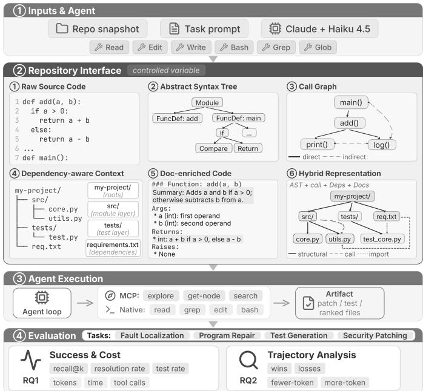
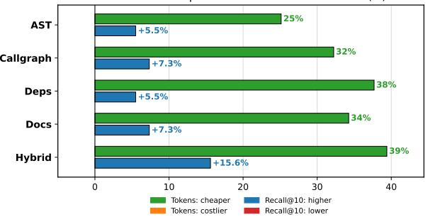
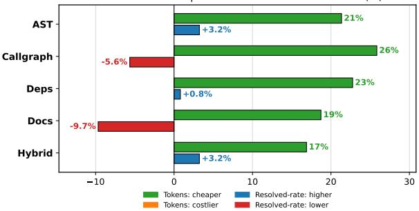
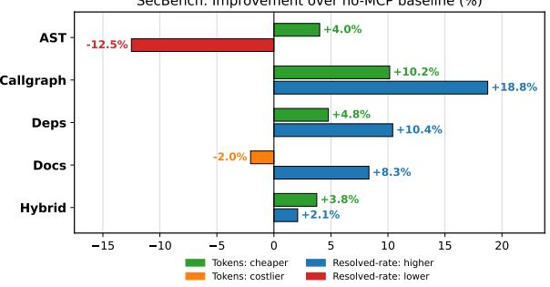
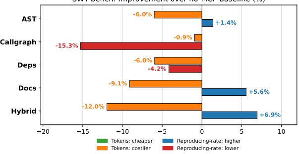
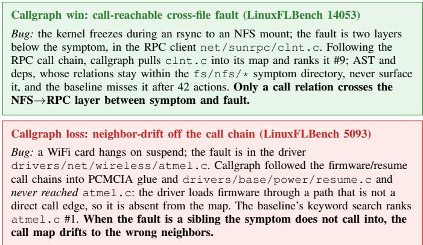
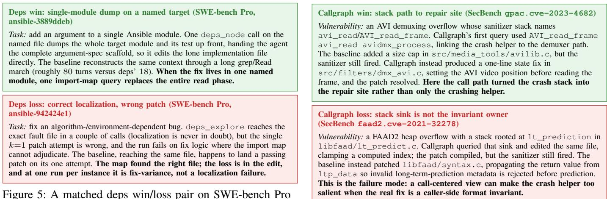
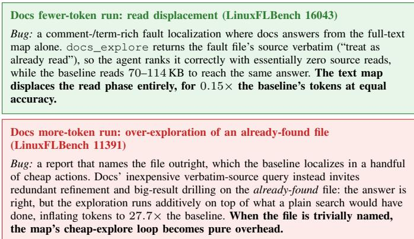

# How Should Agents See Code? Rethinking Code Representations for Agentic Software Engineering

Melika Sepidband York University Toronto, Canada melikasp@yorku.ca

Jiho Shin York University Toronto, Canada shinjiho@yorku.ca

Song Wang   
York University   
Toronto, Canada   
wangsong@yorku.ca

Hadi Hemmati York University Toronto, Canada hemmati@yorku.ca

Abstract—LLM agents are increasingly used for repositorylevel software engineering tasks. These tasks require agents to retrieve the right code context before reasoning or editing. However, most agents still access repositories through raw files, lexical search, and shell commands, treating code primarily as text. This paper investigates map-based code-representation workflows as a design variable in agentic software engineering, examining how different repository views change agents’ retrieval behavior, task success, token use, and latency.

In this paper, we study five code-representation workflows: abstract syntax trees, call graphs, module dependencies, documentation-enriched search, and a hybrid workflow that combines them. Each workflow exposes an on-demand repository map that the agent can query during a task. We evaluate Claude Code with Haiku 4.5 against a raw-tool baseline on four repository-level tasks: fault localization with LinuxFLBench, repository-level code generation and repair with SWE-bench Pro, test generation with SWT-bench, and security patching with SecBench. We measure task success together with representationtool use, native tool use, token consumption, and wall-clock time.

The results show that representation workflows are most useful as token-saving tools when localization is the bottleneck, while their success gains narrow when the decisive step is patch or test authoring. On LinuxFLBench, all five workflows improve recall@10 over the baseline (0.757–0.829 vs. 0.717) and reduce token usage by 25–39%, but they also increase wall time. On SWE-bench Pro, resolution remains close to the baseline (44.3– 50.6% vs. 49.0%) while token usage drops by 17–26%. On SecBench, Callgraph has the highest patch-resolution rate in this sample (34.3% vs. 28.9%) and uses fewer tokens, but all workflows increase latency. On SWT-bench, Hybrid and Docs have the highest reproducing-test rates in this sample (47.8% and 47.2% vs. 44.7%), but all workflows use more tokens and take longer. Overall, map-based workflows change both what the agent inspects and how much it spends, but their benefits are task-dependent rather than universal.

Index Terms—Agentic software engineering, Claude Code, Empirical study, Code representations

## I. INTRODUCTION

LLM agents are increasingly used for repository-level software engineering (SE) tasks, such as fault localization, issue resolution, test generation, and security patching [1]–[3]. In these tasks, generating code is only one part of the process. The agent first needs to identify where the relevant behavior is implemented, which files and functions are related, and what evidence should be inspected before making a prediction or edit. If this localization step is weak, the agent may spend most of its budget reading irrelevant files or editing code that is only lexically related to the task.

Current coding agents, including Claude Code [4], SWEagent [5], Agentless [6] and OpenHands [7], typically interact with repositories through lexical file search and shell-based exploration commands. This interface is flexible, but it gives the agent little structured information about the repository. For example, the agents may need to repeatedly search and read files to determine where a symbol is defined, which functions call it, which modules depend on it, or which documentation explains its intended behavior. These operations primarily serve to reconstruct the context required for the SE task.

Code representations naturally expose this context. Beyond source text, a repository can be viewed through abstract syntax trees, call graphs, dependency graphs, documentation linked to program symbols, or combinations of these views. Each view emphasizes different relations: abstract syntax trees expose definitions and containment; call graphs expose interprocedural relationships; dependency graphs expose modulelevel coupling; and documentation connects natural-language descriptions to code intent. These views are commonly used in program analysis and code intelligence [8]–[12], but their role in LLM agent workflows remains poorly understood.

Prior work on SE agents has shown that repository navigation and context selection affect performance [5], [13]–[17]. However, representation is often bundled with the agent scaffold, retrieval method, or repair loop. This makes it difficult to determine whether an improvement comes from the model, the prompt, the agent policy, or the code view provided to the agent. As a result, we lack a systematic comparison of which representations help agents, for which tasks, and at what cost.

To bridge the gap, in this paper, we investigate how agents should access code representations during repository-level software engineering tasks. Figure 1 shows an overview of our study. We study four repository-level software engineering tasks that differ in the repository understanding they require: fault localization (finding the files or symbols responsible for a bug from its report), program repair (editing code across a repository to fix a reported problem), security patching (locating and repairing the code responsible for a vulnerability), and test generation (understanding the behavior to exercise and writing a test that captures it). We instantiate these tasks with established repository-level benchmarks: LinuxFLBench [18],

  
Fig. 1: Overview of the proposed study.

SWE-bench Pro [19], SecBench [20], and SWT-bench [21]. These tasks stress different bottlenecks: locating relevant code without editing, editing and validating a functional fix, repairing vulnerability-triggering behavior, and writing tests that expose a bug. We examine four representation families: abstract syntax trees (AST), call graphs (CG), dependency graphs (Deps), and documentation-enriched search (Docs). We also study a hybrid workflow that that combines these four views in a single repository map. For our evaluation, we measure task success, tool-call behavior, token usage, wallclock time, and per-instance trajectories.

Our central finding is that map-based representation workflows are most useful when the task bottleneck is finding relevant code. On fault localization, where the task is code search, they improve recall while cutting token usage, although they add latency. On program repair, the bottleneck is partly past localization, so they preserve resolution while reducing tokens by replacing repository browsing. On security patching, the strongest signal in this sample comes from Callgraph, which matches stack-centered prompts and exposes caller/- callee context at lower token cost but higher latency. On test generation, where the decisive step is authoring a discriminating assertion, success changes are small, and several workflows add token overhead. Thus, the results support a task-dependent workflow claim rather than a universal claim that any fixed representation is better.

## This work makes the following contributions:

• To our knowledge, we provide the first controlled comparison of five code data representations for agentic software engineering, evaluating AST, call graph, dependency, documentation-enriched, and hybrid views under the same agent stack across four repository-level tasks.

• We compare AST, call graph, dependency, documentationenriched, and hybrid repository views under a fixed agent stack, reporting task success together with token usage, wallclock time, and tool-call behavior.

• We show that representation workflows provide their strongest and most consistent benefit when repository localization is the primary bottleneck, mainly by reducing tokenheavy browsing.

• We provide trajectory-level evidence explaining when different repository views help, add overhead, or fail to affect the final patch or test-generation step.

Data Availability: We provide the representation servers, index and map builders, agent conditions, experiment harness, and metrics scripts online to facilitate replication and future work at: https://github.com/MelikaSepidband/ How-Should-Agents-See-Code

## II. RELATED WORK

## A. Repository-Level Agentic Software Engineering

Repository-level SE agents often search, edit, execute, and validate code across an entire project. SWE-bench [22] established this setting with real GitHub issues that require crossfile reasoning, while SWE-agent [5] showed that the repository interface shapes how agents read files, edit code, and run commands. AutoCodeRover [13] emphasizes localization before repair through structure-aware code-entity search. Together, these studies show that repository navigation is part of the task, not merely a pre-processing step.

Recent systems improve agentic software engineering by modifying the agent workflow. Agentless [6] decomposes issue resolution into localization, repair, and validation, showing that simple scaffolds can be effective when context is carefully selected. OrcaLoca [14] improves issue localization through action scheduling, decomposition, and context pruning, while ARISE [23] exposes repository graphs and slicing tools for localization and repair. These works motivate our study, but they mainly evaluate complete systems or specific representation designs; in contrast, we keep the agent harness fixed and compare representations as the experimental variable.

## B. Code Representations for Structure and Intent

Code intelligence research has long represented programs with views beyond local tokens. TBCNN [8] modeled syntactic structure with ASTs, Allamanis et al. [9] represented programs as graphs with semantic relations, and GraphCodeBERT [10] incorporated data-flow into pre-training. Documentation provides a complementary natural-language view of intent and API usage: DocPrompting [11] retrieves documentation for code generation, and RepoRepair [24] uses hierarchical documentation for repository-level repair. Together, these studies show that syntax, program relations, and documentation each expose context that raw source tokens may not make explicit.

We study these representations in a different setting. Rather than embedding them inside a model, retriever, or repair system, we expose AST, call-graph, dependency, documentation, and hybrid views as MCP tools during an agent trajectory. This lets us compare which view helps which repository-level task under a shared interface and fixed agent harness.

TABLE I: MCP tools exposed for each code-representation.
<table><tr><td>Server</td><td>#tools</td><td>Tools exposed</td></tr><tr><td>AST (structural)</td><td>8</td><td>ast_explore, ast_node, ast_search, ast_files, ast_status, file_skeleton,</td></tr><tr><td>Callgraph (CG) (inter-procedural flow)</td><td>9</td><td>ts_query, parse_file callgraph_explore, callgraph_node, callgraph_search, callgraph_files, callgraph_status, callers_of,</td></tr><tr><td>Deps (module dependency graph)</td><td>8</td><td>callees_of, call_path, function_info deps_explore, deps_node, deps_files, deps_status, module_deps, dependency_path, layer_summary, cycles</td></tr><tr><td>Docs (documentation-enriched)</td><td>6</td><td>docs_explore, docs_node, docs_files, docs_status, module_overview, repo_map</td></tr><tr><td>Hybrid (composite)</td><td>6</td><td>hybrid_explore, hybrid_node, hybrid_files, hybrid_status, impact_of, repo_map</td></tr></table>

## C. Repository-Level Context Retrieval

Repository-level coding requires selecting context before generation. RepoBench [25] and CrossCodeEval [26] evaluate completion when context spans files, while RepoCoder [27] uses iterative retrieval and generation. Repoformer [15] shows that more context is not always better, and RepoQA [28] shows long-context models still need to connect natural-language queries with distributed code evidence.

Graph-based retrieval offers another way to organize repository context. GraphCoder [16], RepoGraph [17], LocAgent [29], and CodeGraph [30] expose repository graphs or graphguided search tools for code navigation and localization. These systems show the value of interactive graph-based context, but each commits to one graph design and retrieval policy; our study instead holds the agent fixed and treats the code view as the controlled variable, comparing AST, call graph, dependency, documentation, and hybrid maps under one interface.

## III. METHODOLOGY

## A. Code Representations

We examine five different code representations, each capturing a distinct view of repository structure and intent. The details of each representation are described below.

a) AST: The abstract syntax tree captures the structural organization of the code: which definitions (functions, methods, classes, structs, variables) exist and which are nested inside which, independent of runtime behavior. The AST server’s map has these definitions as nodes and syntactic containment as edges (file → top-level definition → nested definition), so the repository becomes a forest of containment trees rooted at files. This tells the agent where the code lives and how it is grouped. Its explore/node pair ranks definitions by structural relevance and returns a definition’s source with its enclosing scope and nested members; additional tools (Table I) expose file skeletons and precise tree-sitter queries. In effect, AST makes the code’s structural skeleton directly addressable without the agent re-parsing the source.

b) Callgraph (CG): The call graph captures behavioral structure: not where code is defined, but how control flows between definitions, so functions in different files are adjacent when one calls the other. The CG map has functions and methods as nodes and resolved calls (caller → callee) as edges, forming a directed who-calls-whom graph. Its explore/node pair ranks functions by call-connectivity and returns a function’s source with its callers and callees; further tools (Table I) return immediate callers/callees and concrete call paths. This view suits tasks where a symptom in one function must be traced to its cause in another along call edges.

c) Deps: The dependency graph captures structure at a coarser grain: not how definitions nest or call one another, but how whole files and modules rely on each other, so two files are adjacent when one imports the other. The deps server’s map has files as nodes (with their definitions attached, so exploration surfaces real code rather than bare file names) and imports (file → imported file) as edges. Its explore/node pair ranks code by import-distance to the query and returns a file’s relevant code with the files it imports and is imported by; further tools (Table I) report a file’s inbound/outbound dependencies, the import chain between two modules, its architectural layer, and import cycles. This lets the agent read repository organization straight from the import graph rather than reconstructing it through many searches.

d) Docs: The documentation view captures what the other three cannot: the intent behind the code and the vocabulary of its problem domain, drawn from the docstrings, comments, and signatures attached to each symbol. This makes it the natural view for queries phrased in human terms rather than symbol names. Because documentation has no inherent graph structure, the docs server has no edges to walk: rather than expand a neighborhood and rank it by centrality, it ranks documented-symbol nodes directly by fulltext relevance over their parsed doc comments and signatures. Its explore/node pair returns the symbols whose documentation best matches a natural-language query; further tools (Table I) give module- and repository-level documented overviews. The docs view thus lets a query in plain words find the code that implements it even when the agent does not know the exact symbol names.

e) Hybrid: The hybrid view is not a new structure but a fusion of the others, combining them into a single map so the agent can reason over several relations at once. It merges the call and dependency graphs into one graph whose nodes are both functions and files and whose edges include calls, imports, and contains (file → definition); the contains edges carry the AST skeleton, so a single map holds containment, calls, and module dependencies together. Its explore/node pair ranks code by call and import connectivity jointly and returns a symbol’s combined neighborhood; further tools (Table I) estimate a change’s transitive blast radius and give a documented repository overview.

## B. Implementation of Code Representations

We study how different code representations affect agent behavior by exposing each representation as a dedicated Model Context Protocol (MCP) [31] tool server. An agent run is parameterized by a tuple:

⟨agent, model, representation, benchmark task⟩.

Here, agent denotes the coding-agent framework and model denotes the LLM snapshot used by that framework. The representation determines which MCP server, if any, is mounted, and the benchmark task supplies the input prompt and scoring signal. When comparing representations, we keep the agent framework, model, and benchmark task fixed.

We implement five representation servers: AST, call graph, dependency graph, documentation, and Hybrid, which combines the other four. Before each agent run, the selected server indexes the target repository and stores the extracted information as a searchable repository map. All servers parse source files with tree-sitter1 using the appropriate grammar for each language. For Python, call relations are resolved with jedi2, import dependencies are extracted from import and from statements, and docstrings are loaded with griffe3. For C/C++ repositories, where jedi and griffe do not apply, calls are resolved by matching call names to repositorylevel definitions, dependencies are extracted from #include directives, and documentation is taken from comment blocks immediately preceding each definition.

All five controlled servers expose the same core navigation pair, <rep>\_explore and <rep>\_node, plus representation-specific utilities. This gives the agent a comparable entry point across workflows, while still allowing each representation to expose relation-specific operations. A map is a graph whose nodes denote code units, such as functions, files, or documented symbols, and whose edges encode the relation used by that representation, such as file-to-definition containment, calls, or imports.

All servers use the same basic query process. First, the server finds relevant seed nodes using full-text search over an SQLite FTS5 index ranked with BM25 [32]. Matches in symbol names are weighted more heavily than matches in signatures, documentation, or code bodies. For the structural servers, these seed nodes are then expanded through the server’s graph relations: containment for AST, call edges for call graph, import edges for dependencies, and all merged edge types for Hybrid. The expanded graph neighborhood is ranked with random-walk-with-restart centrality [33], starting from the seed nodes, and the highest-ranked source snippets are returned grouped by file. The documentation server is different because it has no structural edges: it skips graph expansion and directly returns documented symbols ranked by BM25. This keeps the retrieval entry point comparable across servers while varying the main information each map provides. Table I summarizes the tools, and Figure 2 shows how the same code fragment appears under each representation.

Source excerpt returned in the trajectory   
technical\_404\_response (django/views/debug.py:459)   
def technical\_404\_response(request, exception):   
"""Create a technical 404 error response. ‘exception‘ is   
the Http404."""   
try:   
resolver\_match = resolve(request.path)   
except Resolver404:   
pass   
(b) Representation excerpts around the same source   
# [AST] ast\_explore:   
contains: debug.py -> debug   
contains: debug -> technical\_404\_response   
# [CG] callgraph\_explore:   
calls: response\_for\_exception -> technical\_404\_response   
# [Deps] deps\_explore:   
imports: test\_debug.py -> debug.py   
imports: debug.py -> urls.py   
# [Docs] docs\_explore:   
doc: /\*\* Create a technical 404 error response. ‘   
exception‘ is the Http404. /   
# [Hybrid] hybrid\_explore:   
calls: get\_object -> to\_python   
source: // converters.py (django/urls/converters.py:1)   
source: // technical\_404\_response (django/views/debug.py   
:459)  
Fig. 2: Abridged source and representation excerpts from django\_\_django-11620.

## IV. EXPERIMENTAL SETUP

## A. Research Questions

• RQ1 (Effectiveness and cost of representation workflows). How do map-based code-representation workflows affect task success, token usage, wall time, and native tool use compared with a no-MCP baseline?

• RQ2 (Trajectory-level strengths and limitations). When do representations help or hurt, and what trajectory patterns explain differences across task families?

RQ1 measures the aggregate behavior of each representation workflow relative to the baseline. RQ2 examines trajectories where the representation and baseline differ to identify when a representation is beneficial, adds overhead, or fails to affect the decisive patch or test-generation step.

## B. Experimental Grid

We evaluate a controlled grid of workflow × benchmark, using the same sampled task IDs across workflows. The controlled workflows are the no-MCP baseline and five representation workflows: AST, callgraph, deps, docs, and hybrid. Thus, the controlled grid contains:

(1 (baseline) + 5 (representation workflows)) ×4 benchmarks.   
6 controlled workflows per benchmark

The baseline does not use any MCP-based representation tool. The agent only has access to its default repository interaction tools, including file reading and writing, glob search, grep search, and shell execution. As a result, it must infer repository structure, such as symbol definitions, call relationships, and file dependencies, through ordinary source-code exploration.

TABLE II: Benchmarks and task-success metrics used in our evaluation.
<table><tr><td>Benchmark</td><td>Task</td><td>Agent output</td><td>Task-success metric</td><td>Sample</td></tr><tr><td>LinuxFLBench [18]</td><td>Fault localization from a Linux kernel bug report.</td><td>Ranked list of up to ten likely buggy files.</td><td>File-level recall@k, for k ∈ {1, 10}; success means the ground- truth file appears in the top-k predictions.</td><td>152</td></tr><tr><td>SWE-bench Pro [19]</td><td>Program repair from a real GitHub issue.</td><td>A code patch in unified- diff format.</td><td>Resolution rate; a task is resolved if the patch passes all hidden fail- to-pass tests and preserves all pass-to-pass tests.</td><td>253</td></tr><tr><td>SWT-bench [21]</td><td>Test generation from a GitHub issue.</td><td>A unit test that repro- duces the issue.</td><td>Reproducing-test rate; the test must fail on the buggy version and pass after the known fix.</td><td>161</td></tr><tr><td>SecBench [20]</td><td>Automatic security patch- ing for vulnerabilities</td><td>A security patch.</td><td>Patch-resolution rate; a task is resolved if the generated patch is accepted by the benchmark harness.</td><td>166</td></tr></table>

## C. Agent Stacks

We run experiments with Claude Code [34] using claude-haiku-4-5 at effort=low; the provider resolves this alias to claude-haiku-4-5-20251001. We access the model through the Anthropic API and Claude Code CLI’s MCP integration. We pin built-in tools to Read, Edit, Write, Bash, Grep, and Glob via --tools. Representation workflows attach the relevant stdio MCP server through --mcp-config, making its tools available alongside builtins, whereas the baseline attaches none.

The MCP-server design has two properties that matter for the study. Agent-agnostic: the same representation server can be evaluated on Claude Code, Codex [35], or any future MCP-compatible host without modification. Agent-executed retrieval: we do not pre-compute and paste a fixed representation into the prompt; the agent issues representation queries itself and integrates the returned views into its trajectory. The baseline keeps the same model, effort setting, and benchmark prompt, but the non-baseline treatment also includes the representation-use steer described below.

## D. Benchmarks and Metrics

We evaluate four benchmarks covering fault localization, program repair, test generation, and security patching. Table II summarizes the task, expected agent output, success metric, and sample size for each benchmark.

a) Sampling: We sampled each benchmark’s task pool at the 95% confidence level with a 5% margin of error from a population proportion estimated by a pre-study pilot, following standard sample-size estimation practice [36]. The resulting sample sizes preserve representativeness while keeping the experimental budget tractable across all workflows. Samples are deterministic given a random seed; the same task IDs are used for every workflow.

b) Behavior and Cost Metrics.: We report per-task averages for token usage, wall-clock time, MCP calls, and native tool calls. We use total token usage as our cost measure. The result tables report avg\_wall\_s as end-to-end wall-clock time in seconds, avg\_MCP as calls to MCP representation tools, and avg\_builtin as calls to the agent’s native tools.

We further break native tool use into avg\_read, avg\_grep, avg\_glob, and avg\_bash; avg\_builtin also includes native edit/write calls when the task uses them.

## V. RESULTS

We organize the results to answer the two research questions we asked in Section IV-A.

## A. RQ1: Effectiveness and Cost of Representation Workflows

RQ1 examines how representation workflows affect task success and efficiency compared with the no-MCP baseline. We report the results per benchmark because the effect depends strongly on where the task bottleneck lies: localization, patch synthesis, security reasoning, or test authoring.

a) Fault Localization (LinuxFLBench): Table III reports file-localization recall and the behavior/cost metrics, and Figure 3(a) shows each representation’s change relative to the baseline on performance and token cost axes. On LinuxFLBench, the code representations provide the clearest benefit. All five improve recall@10 over the baseline (0.717). Hybrid is highest at 0.829, Docs and Callgraph reach 0.770, and AST and Deps reach 0.757. At the same time, every representation cuts average token usage by 25–39%, with Hybrid the cheapest (−39%). The recall@1 differences are smaller and mixed, which suggests that the main benefit is improving the top-10 candidate set rather than reliably producing the first-ranked file. The mechanism behind the token savings is visible in the tool-usage columns: the baseline assembles its answer through 8 reads, 6 greps, and 10 shell calls per task, whereas the representation agents replace almost all of that browsing with 9–13 map calls and drop native Read to at most 1.1 and Grep/Glob to essentially zero.

b) Program repair (SWE-bench Pro): Table IV reports the resolution rate and behavior/cost metrics, and Figure 3(b) shows the change relative to the baseline. On SWE-bench Pro, the efficiency win persists, but the accuracy effect largely vanishes. Every representation reduces token usage by 17–26% relative to the baseline (3.12M tokens), with Callgraph the cheapest (2.31M, −26%) and the hybrid the least aggressive (2.59M, −17%); cost and native tool usage move in the same direction, with Read falling from 12.7 to 7.6–8.7 per task. The resolution rate, however, stays close to the baseline (49.0%): AST and Hybrid reach 50.6% and Deps 49.4% (gains within noise), while Callgraph (46.2%) and Docs (44.3%) fall slightly below it. Wall-clock time decreases (269s for the baseline versus 194–209s for the representations), because the agent spends fewer turns browsing.

LinuxFLBench: Improvement over no-MCP baseline (%)  
  
(a) LinuxFLBench (fault localization)

SWE-bench Pro: Improvement over no-MCP baseline (%)  
  
(b) SWE-bench Pro (program repair)

SecBench: Improvement over no-MCP baseline (%)  
  
(c) SecBench (security patching)

SWT-bench: Improvement over no-MCP baseline (%)  
  
(d) SWT-bench (test generation)  
Fig. 3: Each representation’s percent change vs. the no-MCP baseline on both axes (accuracy and tokens), across the fou tasks. Green/blue mark improvements (cheaper/more accurate); orange/red mark regressions.

TABLE III: LinuxFLBench: file-localization recall and behavior/cost metrics per workflow
<table><tr><td>Workflow</td><td>fR@1</td><td>fR@10</td><td>avg_tokens</td><td>avg_wall_s</td><td>avg_MCP</td><td>avg_builtin</td><td>avg_read</td><td>avg_grep</td><td>avg_glob</td><td>avg_bash</td></tr><tr><td>Baseline</td><td>0.572</td><td>0.717</td><td>1,008,163</td><td>66.7</td><td>0.0</td><td>25.4</td><td>8.4</td><td>6.0</td><td>1.4</td><td>9.5</td></tr><tr><td>AST</td><td>0.526</td><td>0.757</td><td>754,768</td><td>104.6</td><td>13.1</td><td>0.9</td><td>0.5</td><td>0.0</td><td>0.0</td><td>0.3</td></tr><tr><td>Callgraph</td><td>0.572</td><td>0.770</td><td>683,227</td><td>105.1</td><td>11.0</td><td>2.2</td><td>1.1</td><td>0.0</td><td>0.0</td><td>1.1</td></tr><tr><td>Deps</td><td>0.572</td><td>0.757</td><td>628,244</td><td>87.6</td><td>8.5</td><td>0.7</td><td>0.4</td><td>0.0</td><td>0.0</td><td>0.3</td></tr><tr><td>Docs</td><td>0.586</td><td>0.770</td><td>662,834</td><td>105.6</td><td>11.1</td><td>2.4</td><td>0.6</td><td>0.0</td><td>0.0</td><td>1.7</td></tr><tr><td>Hybrid</td><td>0.526</td><td>0.829</td><td>610,910</td><td>82.2</td><td>9.5</td><td>0.5</td><td>0.3</td><td>0.0</td><td>0.0</td><td>0.3</td></tr></table>

c) Test Generation (SWT-bench): Table V reports the reproducing-test rate and behavior/cost metrics, and Figure 3(d) shows the change relative to the baseline. On SWTbench, the success differences are small. Hybrid and Docs have the highest reproducing-test rates in this sample (47.8% and 47.2%), improving over the 44.7% baseline by +3.1 and +2.5 percentage points. AST is nearly tied with the baseline (45.3%, +0.6 points), while Deps falls slightly below it (42.9%, -1.9 points) and Callgraph is substantially worse (37.9%, -6.8 points). At the same time, all representation workflows use more tokens than the baseline. We interpret SWT-bench as a case where representation tools can slightly change outcomes, but the decisive step is often writing the right assertion rather than finding the right code. The behavior profile is different from LinuxFLBench and SWE-bench Pro: every representation reduces native shell/file-tool usage, but the added map context raises token use and wall time for all workflows. Wall time increases from 161s for the baseline to 170–201s for the representation workflows. Native/MCP toolcall averages are 27.3/5.7 for AST, 31.9/3.5 for Callgraph, 30.2/2.6 for Deps, 30.8/4.2 for Docs, and 28.6/3.8 for Hybrid, compared with 33.4/0.0 for the baseline.

d) Security Patch Evaluation (SecBench): Table VI reports the security-patch resolution rate and behavior/cost metrics, and Figure 3(c) shows the change relative to the baseline. On SecBench, Callgraph has the highest controlled patchresolution rate in this sample (34.3%, +5.4 points over the 28.9% baseline). Deps (31.9%, +3.0 points) and Docs (31.3%, +2.4 points) also improve resolution; Hybrid is nearly tied (29.5%, +0.6 points), and AST drops below the baseline (25.3%, -3.6 points). The efficiency picture is mixed. In token use, AST (656K), Callgraph (614K), Deps (651K), and Hybrid (658K) are below the 684K baseline, while Docs is slightly above it (698K). Wall time increases for every representation workflow, from 136s for Hybrid to 290s for Docs, compared with 66s for the baseline. They also sharply reduce native file/shell browsing: the baseline uses 12.9 native tool calls per task, while the representation workflows use 6.5–8.0 native calls plus 3.1–5.5 MCP calls. By workflow, the native/MCP tool-call averages are 6.5/5.5 for AST, 7.4/3.1 for Callgraph, 7.6/3.1 for Deps, 7.4/4.4 for Docs, and 8.0/5.0 for Hybrid, compared with 12.9/0.0 for the baseline. SecBench therefore suggests that execution-path information can improve patch resolution while shifting work from native browsing to map queries and increasing latency.

TABLE IV: SWE-bench Pro: patch-resolution rate and behavior/cost metrics per workflow.
<table><tr><td>Workflow</td><td>Resolved</td><td>avg_tokens</td><td> $\mathrm { a v g } _ { \mathbf { \lambda } }$  wall_s</td><td>avg_MCP</td><td> ${ \mathrm { a v g } } _ { \mathrm { - } }$  builtin</td><td> $\mathrm { a v g } _ { - }$  read</td><td> $\mathrm { a v g } _ { \mathbf { \lambda } }$  _grep</td><td> $\mathrm { a v g } _ { \mathbf { \lambda } }$  glob</td><td>avg_bash</td></tr><tr><td>Baseline</td><td>49.0%</td><td>3,116,193</td><td>268.8</td><td>0.0</td><td>44.5</td><td>12.7</td><td>0.0</td><td>0.0</td><td>25.2</td></tr><tr><td>AST</td><td>50.6%</td><td>2,450,752</td><td>209.1</td><td>5.2</td><td>37.7</td><td>8.4</td><td>0.2</td><td>0.0</td><td>23.4</td></tr><tr><td>Callgraph</td><td>46.2%</td><td>2,310,653</td><td>193.7</td><td>4.2</td><td>38.1</td><td>8.7</td><td>0.2</td><td>0.1</td><td>23.6</td></tr><tr><td>Deps</td><td>49.4%</td><td>2,406,690</td><td>205.3</td><td>3.4</td><td>39.1</td><td>8.6</td><td>0.2</td><td>0.0</td><td>24.7</td></tr><tr><td>Docs</td><td>44.3%</td><td>2,532,738</td><td>205.8</td><td>4.9</td><td>39.0</td><td>7.6</td><td>0.1</td><td>0.1</td><td>25.8</td></tr><tr><td>Hybrid</td><td>50.6%</td><td>2,590,046</td><td>204.3</td><td>4.3</td><td>39.2</td><td>8.6</td><td>0.2</td><td>0.0</td><td>24.5</td></tr></table>

TABLE V: SWT-bench: reproducing-test rate and behavior/cost metrics per workflow.
<table><tr><td>Workflow</td><td>Reprod.</td><td>avg_tokens</td><td>avg_wall_s</td><td>avg_MCP</td><td>avg_builtin</td><td>avg_read</td><td>avg_grep</td><td>avg_glob</td><td>avg_bash</td></tr><tr><td>Baseline</td><td>44.7%</td><td>1,671,772</td><td>161.4</td><td>0.0</td><td>33.4</td><td>12.7</td><td>0.0</td><td>0.0</td><td>16.9</td></tr><tr><td>AST</td><td>45.3%</td><td>1,772,180</td><td>170.1</td><td>5.7</td><td>27.3</td><td>9.7</td><td>0.0</td><td>0.0</td><td>13.6</td></tr><tr><td>Callgraph</td><td>37.9%</td><td>1,687,094</td><td>201.1</td><td>3.5</td><td>31.9</td><td>12.1</td><td>0.0</td><td>0.0</td><td>15.8</td></tr><tr><td>Deps</td><td>42.9%</td><td>1,771,300</td><td>184.2</td><td>2.6</td><td>30.2</td><td>10.4</td><td>0.0</td><td>0.0</td><td>15.7</td></tr><tr><td>Docs</td><td>47.2%</td><td>1,823,938</td><td>185.1</td><td>4.2</td><td>30.8</td><td>10.9</td><td>0.0</td><td>0.0</td><td>16.1</td></tr><tr><td>Hybrid</td><td>47.8%</td><td>1,871,848</td><td>192.5</td><td>3.8</td><td>28.6</td><td>10.5</td><td>0.0</td><td>0.0</td><td>14.2</td></tr></table>

RQ1 takeaway. Code representations are primarily an efficiency tool, and their payoff is set by where the task’s bottleneck lies: they help most when the hard problem is finding code and fade when it is writing the fix or test. On LinuxFLBench, they improve recall@10 and reduce token use, and on SWE-bench Pro they mainly reduce token cost. On SecBench, they provide some success gains, especially with the call graph, but efficiency remains close to the baseline with only small token reductions. On SWT-bench, success gains are smaller and come with higher token use.

## B. RQ2: Qualitative Trajectory Analysis

In this RQ, we analyze the agent trajectories for the instances where a representation diverges from the baseline. We compare each representation to the baseline on two axes. On the performance axis, we count, per benchmark, how many instances the representation wins (solves where the baseline fails) and how many it loses (fails where the baseline solves). On the token axis, we count how many instances the representation runs on fewer tokens than the baseline and how many on more. These counts, summarized in Table VII, reveal the main strengths and weaknesses of each representation and how they depend on the task family; we then read the underlying trajectories to explain why each divergence occurs.

1) The landscape of divergences: Table VII summarizes where each representation diverges from the baseline in either task success or token use, and the main pattern follows the task bottleneck. On LinuxFLBench, where the task is pure localization, representations win on both axes: every representation wins more often than it loses (Hybrid never loses, net +17), and roughly three quarters of the instances use fewer tokens than the baseline. On SWE-bench Pro, performance is roughly balanced (nets between −12 and +4), but the token advantage remains strong, with about three quarters of instances using fewer tokens, suggesting that maps mostly replace repository browsing rather than directly improving patch quality. On SecBench, the call graph gives the clearest success gain (net +9), but the token axis flips: for every representation, more instances use more tokens than fewer. On SWT-bench, success gains are weaker and the token axis more costly (only the call graph uses fewer tokens on a majority of instances).

2) Trajectory coding protocol: The counts in Table VII say how often a representation helps or hurts; to explain why, we read the underlying trajectories. For every divergent instance (a win, a loss, or a run that uses fewer or more tokens than the baseline), two authors read the paired baseline and representation trajectories end to end, including the query issued, the map content returned, the files read or edited, and the final artifact, and write a short free-text reason for the divergence. We then group these reasons into recurring categories, iterating over the set until the categories are stable, and assign every divergent instance to one category. We code the performance axis and the token axis separately. Because the task bottleneck shifts across benchmarks, the recurring reasons genuinely differ per benchmark, so we derive a separate set of categories for each benchmark rather than forcing one shared vocabulary. The categories describe common trajectory patterns, not causal proof. Below we report each category as n/N, where n is the number of instances assigned to that category and N is the representation’s total number of instances for that outcome (win, loss, fewer-token, or more-token) on that benchmark.

3) Root Causes for Performance Benefit: Applying the protocol above to the performance axis yields the following categories, which we report per benchmark:

TABLE VI: SecBench: security-patch resolution rate and behavior/cost metrics per workflow.
<table><tr><td>Workflow</td><td>Resolved</td><td>avg_tokens</td><td> $\mathrm { a v g } _ { \mathbf { \lambda } }$  wall_s</td><td>avg_MCP</td><td> ${ \mathrm { a v g } } _ { \mathrm { - } }$  builtin</td><td> $\mathrm { a v g } _ { - }$  read</td><td> $\mathrm { a v g } _ { \mathbf { \lambda } }$  grep</td><td> $\mathrm { a v g } _ { \mathbf { \lambda } }$  glob</td><td>avg_bash</td></tr><tr><td>Baseline</td><td>28.9%</td><td>683,774</td><td>66.4</td><td>0.0</td><td>12.9</td><td>7.2</td><td>0.0</td><td>0.0</td><td>4.1</td></tr><tr><td>AST</td><td>25.3%</td><td>656,332</td><td>166.6</td><td>5.5</td><td>6.5</td><td>3.6</td><td>0.0</td><td>0.0</td><td>1.3</td></tr><tr><td>Callgraph</td><td>34.3%</td><td>614,360</td><td>184.2</td><td>3.1</td><td>7.4</td><td>4.1</td><td>0.0</td><td>0.0</td><td>1.6</td></tr><tr><td>Deps</td><td>31.9%</td><td>651,116</td><td>144.4</td><td>3.1</td><td>7.6</td><td>4.4</td><td>0.0</td><td>0.0</td><td>1.5</td></tr><tr><td>Docs</td><td>31.3%</td><td>697,763</td><td>290.4</td><td>4.4</td><td>7.4</td><td>4.3</td><td>0.0</td><td>0.0</td><td>1.5</td></tr><tr><td>Hybrid</td><td>29.5%</td><td>658,069</td><td>136.4</td><td>5.0</td><td>8.0</td><td>4.7</td><td>0.0</td><td>0.0</td><td>1.1</td></tr></table>

TABLE VII: RQ2 divergence landscape. Performance counts, per benchmark, how many instances the representation wins (solves where the baseline fails) versus loses (the reverse), with their net. Tokens counts how many instances the representation runs on fewer tokens than the baseline versus more. Bold marks the best value within each benchmark block.
<table><tr><td rowspan="2">Benchmark</td><td rowspan="2">Rep</td><td colspan="3">Performance</td><td colspan="2">Tokens</td></tr><tr><td>Win</td><td>Loss</td><td>Net</td><td>Fewer</td><td>More</td></tr><tr><td rowspan="5">Fault Loc. (LinuxFLBench)</td><td>AST</td><td>17</td><td>11</td><td>+6</td><td>111</td><td>41</td></tr><tr><td>Callgraph</td><td>17</td><td>9</td><td>+8</td><td>109</td><td>43</td></tr><tr><td>Deps</td><td>17</td><td>11</td><td>+6</td><td>115</td><td>37</td></tr><tr><td>Docs</td><td>17</td><td>9</td><td>+8</td><td>115</td><td>37</td></tr><tr><td>Hybrid</td><td>17</td><td>0</td><td>+17</td><td>117</td><td>35</td></tr><tr><td rowspan="5">Program Repair (SWE-bench Pro)</td><td>AST</td><td>28</td><td>24</td><td>+4</td><td>190</td><td>63</td></tr><tr><td>Callgraph</td><td>20</td><td>27</td><td>-7</td><td>197</td><td>56</td></tr><tr><td>Deps</td><td>21</td><td>20</td><td>+1</td><td>190</td><td>63</td></tr><tr><td>Docs</td><td>21</td><td>33</td><td>-12</td><td>181</td><td>72</td></tr><tr><td>Hybrid</td><td>24</td><td>20</td><td>+4</td><td>181</td><td>72</td></tr><tr><td rowspan="5">Security Patch. (SecBench)</td><td>AST</td><td>9</td><td>15</td><td>-6</td><td>75</td><td>91</td></tr><tr><td>Callgraph</td><td>18</td><td>9</td><td>+9</td><td>79</td><td>87</td></tr><tr><td>Deps</td><td>14</td><td>9</td><td>+5</td><td>78</td><td>88</td></tr><tr><td>Docs</td><td>13</td><td>9</td><td>+4</td><td>77</td><td>89</td></tr><tr><td>Hybrid</td><td>13</td><td>12</td><td>+1</td><td>74</td><td>92</td></tr><tr><td rowspan="5">Test Gen. (SWT-bench)</td><td>AST</td><td>27</td><td>26</td><td>+1</td><td>73</td><td>88</td></tr><tr><td>Callgraph</td><td>18</td><td>29</td><td>-11</td><td>85</td><td>76</td></tr><tr><td>Deps</td><td>25</td><td>28</td><td>-3</td><td>72</td><td>89</td></tr><tr><td>Docs</td><td>25</td><td>21</td><td>+4</td><td>59</td><td>102</td></tr><tr><td>Hybrid</td><td>28</td><td>23</td><td>+5</td><td>67</td><td>94</td></tr></table>

a) Performance on fault localization: The first block of Table VIII shows that fault-localization gains depend on whether a representation exposes the relation needed by the bug. For AST, all wins are report-named $i n \mathrm { - } \hbar l e$ faults: the report names, or implies, the faulty function and the AST containment edge maps that symbol to its file (17/17). Its main loss category is symptom ̸= root-cause file: the report names a symptom, but the real fault is in a structurally distant sibling file that containment cannot reach (7/11). For callgraph, all wins are call-reachable cross-file faults: the fix is in a caller or callee of the reported symbol, often in another file. Its losses are neighbor-drift, where call edges stay near the wrong symptom file, and ranking dilution, where the fault appears in the graph but is buried below highly connected helpers. For deps, most wins are report-names-API faults, where the report names a function or call site and the dependency map retrieves the relevant file (13/17); its main loss is arch files outside the import cluster, where architecture- or protocolspecific files are not import-reachable from the generic cluster (9/11). For docs, all wins are terms-match-in-comments: report terms match comments or identifiers in the fault file. Its main loss is symptom-only crash, no term, where the report gives only a panic/crash symptom and text search drifts to lexically similar wrong files $( 7 / 9 )$ . Finally, hybrid is the safe default: it wins both report-named single-file faults (11/17) and crosssubsystem symptom-to-fault cases (6/17), and it has zero losses because it combines all relation types. Overall, singlerelation maps each help a distinct bug shape and fail when that relation is missing, while Hybrid covers the widest range by combining all clues. Figure 4 illustrates this match with a verified win/loss pair from the same representation, callgraph, contrasting it with the baseline on the same instance.

  
Figure 4: A matched callgraph win/loss pair on LinuxFLBench

b) Performance on program repair: On SWE-bench Pro (second block of Table VIII), every representation still wins on real issues that the baseline fails (20–28 instances), and the win categories reflect each map’s localization strength. For AST, the main win is a report-named in-file fault (18/28): the issue names the faulty symbol, and the containment edge surfaces its implementation directly. For callgraph, it is a callreachable cross-file fault (11/20): the needed fix is in a caller or callee of the reported symbol, so the call edge exposes the coupled function that flat search can miss. For deps, it is a single-module dump (17/21): one dependency-map call returns the target module and its test, giving the agent the relevant scaffold before editing. For docs, it is a cross-file sharedsymbol bug (20/21): a shared symbol, flag, or API contract links the affected files, and full-text search returns the related source together. For hybrid, the dominant win is lands the single target file (14/24): the merged map resolves the report terms to the offending file, while the baseline gives up or lands elsewhere. The losses are more uniform. For every representation, the dominant failure is correct localization, wrong patch (16–23 losses): the map finds the gold-patch files and the agent edits them, but the produced fix is logically wrong. Thus,

TABLE VIII: RQ2 behavioral categories. Each cell reports the top category and its share (n/N).

<table><tr><td rowspan="2">Rep</td><td rowspan="2"></td><td colspan="2">Performance axis</td><td colspan="2">Token axis</td></tr><tr><td>Dominant win</td><td>Dominant loss</td><td>Dominant fewer-token category</td><td>Dominant more-token category</td></tr><tr><td>Fault Localization</td><td>AST</td><td>Report-named in-file fault (17/17)</td><td>Symptom ≠ root-cause file (7/11)</td><td>Read displacement (79/111)</td><td>Map overhead (30/41)</td></tr><tr><td>(LinuxFLBench)</td><td>Callgraph</td><td>Call-reachable cross-file fault (17/17)</td><td>Neighbor-drift (5/9)</td><td>Read displacement (109/109)</td><td>Map overhead (34/43)</td></tr><tr><td></td><td>Deps</td><td>Report names function/API (13/17)</td><td>Arch file outside import cluster (9/11)</td><td>Read displacement (72/115)</td><td>Map overhead (32/37)</td></tr><tr><td></td><td>Docs</td><td>Terms match in-file comments (17/17)</td><td>Symptom-only crash, no term (7/9)</td><td>Read displacement (93/115)</td><td>Over-exploration (27/37)</td></tr><tr><td></td><td>Hybrid</td><td>Lands the single target file (11/17)</td><td>(zero losses)</td><td>Read displacement (85/117)</td><td>Verbatim-source explosion (27/35)</td></tr><tr><td>Program Repair</td><td>AST</td><td>Report-named in-file fault (18/28)</td><td>Correct localization, wrong patch (16/24)</td><td>Read displacement (184/190)</td><td>Map overhead (58/63)</td></tr><tr><td>(SWE-bench Pro)</td><td>Callgraph</td><td>Call-reachable cross-file fault (11/20)</td><td>Correct localization, wrong patch (22/27)</td><td>Read displacement (188/197)</td><td>Map overhead (35/56)</td></tr><tr><td></td><td>Deps</td><td>Single-module dump (17/21)</td><td>Correct localization, wrong patch (19/20)</td><td>Read displacement (186/190)</td><td>Generic/popular symbol name (51/63)</td></tr><tr><td></td><td>Docs</td><td>Cross-file shared-symbol bug (20/21)</td><td>Correct localization, wrong patch (23/33)</td><td>Read displacement (115/181)</td><td>Over-exploration (53/72)</td></tr><tr><td></td><td>Hybrid</td><td>Lands the single target file (14/24)</td><td>Correct localization, wrong patch (20/20)</td><td>Read displacement (174/181)</td><td>Verbatim-source explosion (44/72)</td></tr><tr><td>Security Patching</td><td>AST</td><td>Boundary guard (5/9)</td><td>Wrong/over-local sink (5/15) / Unmodeled invariant (5/15)</td><td>Abstention-cheapness (54/75)</td><td>Map overhead (55/91)</td></tr><tr><td>(SecBench)</td><td>Callgraph</td><td>Flow localization (9/18)</td><td>Wrong/over-local sink (4/9)</td><td>Abstention-cheapness (51/79)</td><td>Map overhead (44/87)</td></tr><tr><td></td><td>Deps</td><td>Contract/API (6/14)</td><td>Wrong/over-local sink (4/9)</td><td>Abstention-cheapness (60/78)</td><td>Map overhead (44/88)</td></tr><tr><td></td><td>Docs</td><td>Contract/API (7/13)</td><td>Wrong/over-local sink (3/9) / Context dilution (3/9)</td><td>Abstention-cheapness (57/77)</td><td>Double-spend (47/89)</td></tr><tr><td></td><td>Hybrid</td><td>Flow localization (5/13)</td><td>Wrong/over-local sink (5/12)</td><td>Abstention-cheapness (51/74)</td><td>Map overhead (58/92)</td></tr><tr><td>Test Generation</td><td>AST</td><td>Test-variance win (25/27)</td><td>Correct localization, wrong patch/test (24/26)</td><td>Read displacement (73/73)</td><td></td></tr><tr><td>(SWT-bench)</td><td>Callgraph</td><td>Test-variance win (15/18)</td><td>Correct localization, wrong patch/test (27/29)</td><td>Read displacement (85/85)</td><td>Map overhead (88/88)</td></tr><tr><td></td><td>Deps</td><td>Test-variance win (22/25)</td><td>Correct localization, wrong patch/test (27/28)</td><td>Read displacement (72/72)</td><td>Map overhead (76/76)</td></tr><tr><td></td><td>Docs</td><td>Test-variance win (23/25)</td><td>Correct localization, wrong patch/test (19/21)</td><td>Read displacement (59/59)</td><td>Map overhead (50/89)</td></tr><tr><td></td><td>Hybrid</td><td>Test-variance win (24/28)</td><td>Correct localization, wrong patch/test (22/23)</td><td>Read displacement (67/67)</td><td>Over-exploration (102/102) Verbatim-source explosion (94/94)</td></tr></table>

unlike LinuxFLBench, SWE-bench Pro failures are often not navigation failures. Resolution remains close to the baseline (44.3–50.6% vs. 49.0% in Table IV), suggesting that many wins and losses reflect one-shot patch variance rather than a stable representation effect. The remaining representationindependent failures are task shapes that no source-symbol map captures well: tree-wide find-and-replace, where the index gives a definition but not all reference sites; new-file creation, where there is no existing file to retrieve; and non-Python fix sites, such as YAML or docker-compose. These cases defeat all maps and are therefore limitations of the task setting rather than of one representation. Figure 5 gives a verified win/loss pair from the deps representation, both contrasted with the baseline.

  
Figure 6: A matched callgraph win/loss pair on SecBench

c) Performance on security patching: SecBench should not be treated as an editing-bound task because its input signal is stack-centered: prompts often expose crash stack frames, and success depends on following them to the edit location and execution context. This explains why Callgraph performs best. Its main win category is flow localization (9/18): the callgraph query or selected node overlaps a crash-stack function or final edited file, helping the agent move from the crashing frame to caller/callee context that owns the vulnerable invariant, most often in parser, demuxer, decompression, and runtime paths. The comparison with Hybrid, which also contains call edges, shows that the advantage is not just more information but a more salient execution relation: among the 18 instances that Callgraph resolved but Hybrid did not, Hybrid edited the same file as Callgraph in 14 cases but failed to produce a successful patch. This suggests that reaching the relevant file was insufficient and the additional context in Hybrid may have made the execution-flow information less prominent. AST is often too local to the crash function, while Deps and Docs help only when names or comments expose the vulnerable path. SecBench favors Callgraph because many fixes require following caller/callee context from stack frames, but this does not make Callgraph universally best. Figure 6 gives a verified win/loss pair from the callgraph representation.

d) Performance on test generation: SWT-bench is different. Its dominant win and loss category is the same for every representation: the run writes tests in the same or neighboring test target as the baseline, and the k=1 generated test happens to reproduce, or not reproduce, the bug. Thus SWT-bench has small, mixed accuracy nets (−11 to +5) because the decisive step is authoring a discriminating assertion, not finding the repository neighborhood. The general lesson is therefore narrower than “editing-bound tasks are noise”:

representations help only when their relation matches the task’s current bottleneck, and once the bottleneck becomes the patch invariant or the test assertion, map context can change trajectories but often becomes overhead.

4) Root Causes for Token Benefit: Applying the same protocol to the token axis, the fewer-token runs are dominated by one mechanism. On these instances, representations mostly help through read displacement: the map returns relevant code bodies inline, so the agent treats them as already read and avoids many source-file reads. On LinuxFLBench, read displacement accounts for the majority of each representation’s fewer-token runs (AST 79/111, callgraph 109/109, deps 72/115, docs 93/115, hybrid 85/117). On SWE-bench Pro, it is again the largest single reason (read displacement explains 115–188 of each representation’s 181–197 fewer-token runs). On SecBench and SWT-bench, the balance tips the other way: for every representation except the call graph on SWTbench, more instances use more tokens than fewer (Table VII), because after the crash frame or test target is found, the agent must still read and edit, so map context is added on top of native browsing.

When representations use more tokens than the baseline, the overspend comes from a few recurring modes. Map overhead is the main cost in the easy fault-localization cases: the baseline already solves the task cheaply, and the representation adds extra map calls for the same answer (e.g. AST 30/41 of the LinuxFLBench more-token runs). The remaining moretoken runs are mixed, combining redundant re-exploration after the relevant file is found (most common for docs), large verbatim-source payloads from a single merged-map query (common for hybrid), and noisy imports pulled in by generic symbol names (common for deps). Thus, costs arise either from unavoidable map overhead on easy cases or from too many, too large, or too noisy map calls. Figure 7 shows a verified Docs fewer-token/more-token pair.

  
Figure 7: Docs token contrast on LinuxFLBench

RQ2 takeaway. Overall, representations help when their relation matches the task bottleneck. They separate most under localization bottlenecks: AST helps named in-file faults, callgraph call-reachable fixes, deps import/API clusters, docs term-rich faults, and hybrid combined cues; the baseline remains stronger for out-of-map work such as occurrence enumeration, new-file creation, and config edits. Once the bottleneck moves past finding code, in repair, security patching, and test generation, only the relation exposing the needed edit or test still helps, and many remaining differences are one-shot patch/test variance. Token cost follows the same pattern: maps save tokens when they displace localization reads, and add cost when the agent must still read and edit.

## VI. THREATS TO VALIDITY

Several threats qualify our findings. Internally, agent runs are not fully deterministic, so the same model and prompt may take different paths or patches. We mitigate this by fixing the agent stack, model, effort setting, prompt, and task IDs across workflows and by separating infrastructure failures from representation-content effects. However, representation workflows also add usage steering and, on repair, a pre-tooluse hook that forces one map query before native reads; the measured treatment therefore combines representation content, availability, and a map-first workflow, so behavior changes such as reduced native reads are not effects of the data structure alone. Externally, we use one main agent stack and four repository-level benchmarks, so results may differ for other models, agents, languages, or repositories, and our claims concern these task families rather than all software engineering. For construct validity, our metrics approximate the concepts of interest: benchmark success does not fully capture patch quality or developer usefulness, token and tool counts omit human and one-time infrastructure costs (map construction, local compute, clone/Docker setup, grading), and qualitative attribution requires judgment, so we assign representation effects only with direct trajectory evidence. Statistically, we sample at a 95% confidence level with a 5% margin of error using the same task IDs across workflows, but each instance is run once per workflow (k=1), not under a multi-sample protocol such as pass@k [37]. Small success differences, especially on SWT-bench and SecBench, may reflect one-shot patch- or test-generation variance; we therefore emphasize large, consistent effects and trajectory evidence over small rank changes and treat close resolution rates as descriptive.

## VII. CONCLUSION

We study how code representations affect agentic software engineering tasks. We expose AST, call graph, dependency, documentation, and hybrid repository views as MCP tools, and compare them with unstructured repository access across fault localization, program repair, test generation, and security patching.

Our results show that the benefits are task-dependent. Code representations help most when localization is the bottleneck: they improve fault localization, reduce token usage, and lower browsing effort in program repair without materially changing resolution rates. When tasks require more than localization, the trade-offs vary. Callgraph improves security patching and reduces token usage, but all representation workflows increase time cost. For test generation, gains are modest, while token and time costs increase.

Overall, software engineering agents should select code representations based on task bottlenecks rather than use a fixed representation strategy. Raw search remains useful for exact strings and non-code artifacts, while structural views are most useful when code relations guide localization.

## REFERENCES

[1] A. Fan, B. Gokkaya, M. Harman, M. Lyubarskiy, S. Sengupta, S. Yoo, and J. M. Zhang, “Large language models for software engineering: Survey and open problems,” in 2023 IEEE/ACM International Conference on Software Engineering: Future of Software Engineering (ICSE-FoSE). IEEE, 2023, pp. 31–53.

[2] X. Hou, Y. Zhao, Y. Liu, Z. Yang, K. Wang, L. Li, X. Luo, D. Lo, J. Grundy, and H. Wang, “Large language models for software engineering: A systematic literature review,” ACM Transactions on Software Engineering and Methodology, vol. 33, no. 8, pp. 1–79, 2024.

[3] Y. Wang, W. Zhong, Y. Huang, E. Shi, M. Yang, J. Chen, H. Li, Y. Ma, Q. Wang, and Z. Zheng, “Agents in software engineering: Survey, landscape, and vision,” Automated Software Engineering, vol. 32, no. 2, p. 70, 2025.

[4] Anthropic, “Claude Code overview,” https://docs.anthropic.com/en/docs/ claude-code/overview, 2026, accessed 2026-03-30.

[5] J. Yang, C. Jimenez, A. Wettig, K. Lieret, S. Yao, K. Narasimhan, and O. Press, “Swe-agent: Agent-computer interfaces enable automated software engineering,” Advances in Neural Information Processing Systems, vol. 37, pp. 50 528–50 652, 2024.

[6] C. S. Xia, Y. Deng, S. Dunn, and L. Zhang, “Demystifying llm-based software engineering agents,” Proceedings of the ACM on Software Engineering, vol. 2, no. FSE, pp. 801–824, 2025.

[7] X. Wang, B. Li, Y. Song, F. F. Xu, X. Tang, M. Zhuge, J. Pan, Y. Song, B. Li, J. Singh et al., “Openhands: An open platform for ai software developers as generalist agents,” in International Conference on Learning Representations, vol. 2025, 2025, pp. 65 882–65 919.

[8] L. Mou, G. Li, L. Zhang, T. Wang, and Z. Jin, “Convolutional neural networks over tree structures for programming language processing,” in Proceedings of the AAAI conference on artificial intelligence, vol. 30, no. 1, 2016.

[9] M. Allamanis, M. Brockschmidt, and M. Khademi, “Learning to represent programs with graphs,” in International Conference on Learning Representations, 2018.

[10] D. Guo, S. Ren, S. Lu, Z. Feng, D. Tang, S. LIU, L. Zhou, N. Duan, A. Svyatkovskiy, S. Fu, M. Tufano, S. K. Deng, C. Clement, D. Drain, N. Sundaresan, J. Yin, D. Jiang, and M. Zhou, “Graphcode{bert}: Pre-training code representations with data flow,” in International Conference on Learning Representations, 2021. [Online]. Available: https://openreview.net/forum?id=jLoC4ez43PZ

[11] S. Zhou, U. Alon, F. F. Xu, Z. Jiang, and G. Neubig, “Docprompting: Generating code by retrieving the docs,” in The Eleventh International Conference on Learning Representations, 2023. [Online]. Available: https://openreview.net/forum?id=ZTCxT2t2Ru

[12] U. Alon, M. Zilberstein, O. Levy, and E. Yahav, “code2vec: Learning distributed representations of code,” Proceedings of the ACM on Programming Languages, vol. 3, no. POPL, pp. 1–29, 2019.

[13] Y. Zhang, H. Ruan, Z. Fan, and A. Roychoudhury, “Autocoderover: Autonomous program improvement,” in Proceedings of the 33rd ACM SIGSOFT International Symposium on Software Testing and Analysis, 2024, pp. 1592–1604.

[14] Z. Yu, H. Zhang, Y. Zhao, H. Huang, M. Yao, K. Ding, and J. Zhao, “OrcaLoca: An LLM agent framework for software issue localization,” in Proceedings of the 42nd International Conference on Machine Learning, ser. Proceedings of Machine Learning Research, A. Singh, M. Fazel, D. Hsu, S. Lacoste-Julien, F. Berkenkamp, T. Maharaj, K. Wagstaff, and J. Zhu, Eds., vol. 267. PMLR, 13–19 Jul 2025, pp. 73 416–73 436. [Online]. Available: https: //proceedings.mlr.press/v267/yu25x.html

[15] D. Wu, W. U. Ahmad, D. Zhang, M. K. Ramanathan, and X. Ma, “Repoformer: selective retrieval for repository-level code completion,” in Proceedings of the 41st International Conference on Machine Learning, 2024, pp. 53 270–53 290.

[16] W. Liu, A. Yu, D. Zan, B. Shen, W. Zhang, H. Zhao, Z. Jin, and Q. Wang, “Graphcoder: Enhancing repository-level code completion via code context graph-based retrieval and language model,” arXiv preprint arXiv:2406.07003, 2024.

[17] S. Ouyang, W. Yu, K. Ma, Z. Xiao, Z. Zhang, M. Jia, J. Han, H. Zhang, and D. Yu, “Repograph: Enhancing ai software engineering with repository-level code graph,” in International Conference on Learning Representations, vol. 2025, 2025, pp. 30 098–30 121.

[18] Z. Zhou, Z. Huang, Y. He, C. Wang, J. Wang, Y. Wu, X. Peng, and Y. Lou, “Taming system complexity: Demystifying software engineering agents in diagnosing linux kernel faults,” in Proceedings of the 64th Annual Meeting of the Association for Computational Linguistics (Volume 1: Long Papers), M. Liakata, V. P. Moreira, J. Zhang, and D. Jurgens, Eds. San Diego, California, United States: Association for Computational Linguistics, Jul. 2026, pp. 18 899–18 916. [Online]. Available: https://aclanthology.org/2026.acl-long.862/

[19] X. Deng, J. Da, E. Pan, Y. Y. He, C. Ide, K. Garg, N. Lauffer, A. Park, N. Pasari, C. Rane et al., “Swe-bench pro: Can ai agents solve longhorizon software engineering tasks?” arXiv preprint arXiv:2509.16941, 2025.

[20] H. Lee, Z. Zhang, H. Lu, and L. Zhang, “Sec-bench: Automated benchmarking of llm agents on real-world software security tasks,” Advances in Neural Information Processing Systems, vol. 38, pp. 116 342–116 378, 2026.

[21] N. Mundler, M. N. M ¨ uller, J. He, and M. Vechev, “Swt-bench: Testing¨ and validating real-world bug-fixes with code agents,” Advances in Neural Information Processing Systems, vol. 37, pp. 81 857–81 887, 2024.

[22] C. E. Jimenez, J. Yang, A. Wettig, S. Yao, K. Pei, O. Press, and K. Narasimhan, “Swe-bench: Can language models resolve real-world github issues?” in International Conference on Learning Representations, vol. 2024, 2024, pp. 54 107–54 157.

[23] S. Seddik and F. Fard, “Arise: A repository-level graph representation and toolset for agentic fault localization and program repair,” arXiv preprint arXiv:2605.03117, 2026.

[24] Z. Pan, C. Li, W. Zhong, Y. Feng, B. Luo, and V. Ng, “Reporepair: Leveraging code documentation for repository-level automated program repair,” arXiv preprint arXiv:2603.01048, 2026.

[25] T. Liu, C. Xu, and J. McAuley, “Repobench: Benchmarking repositorylevel code auto-completion systems,” in International Conference on Learning Representations, vol. 2024, 2024, pp. 47 832–47 850.

[26] Y. Ding, Z. Wang, W. Ahmad, H. Ding, M. Tan, N. Jain, M. K. Ramanathan, R. Nallapati, P. Bhatia, D. Roth et al., “Crosscodeeval: A diverse and multilingual benchmark for cross-file code completion,” Advances in Neural Information Processing Systems, vol. 36, pp. 46 701– 46 723, 2023.

[27] F. Zhang, B. Chen, Y. Zhang, J. Keung, J. Liu, D. Zan, Y. Mao, J.- G. Lou, and W. Chen, “Repocoder: Repository-level code completion through iterative retrieval and generation,” in Proceedings of the 2023 Conference on Empirical Methods in Natural Language Processing, 2023, pp. 2471–2484.

[28] J. Liu, J. L. Tian, V. Daita, Y. Wei, Y. Ding, Y. K. Wang, J. Yang, and L. Zhang, “Repoqa: Evaluating long context code understanding,” arXiv preprint arXiv:2406.06025, 2024.

[29] Z. Chen, X. Tang, G. Deng, F. Wu, J. Wu, Z. Jiang, V. Prasanna, A. Cohan, and X. Wang, “Locagent: Graph-guided llm agents for code localization,” in Proceedings of the 63rd Annual Meeting of the Association for Computational Linguistics (ACL), 2025.

[30] Colbymchenry, “Understand any codebase as a graph,” https://colbymchenry.github.io/codegraph/, 2026, accessed: 2026-06- 24. [Online]. Available: https://colbymchenry.github.io/codegraph/

[31] Anthropic, “Introducing the Model Context Protocol,” https://www. anthropic.com/news/model-context-protocol, 2024, accessed: 2026-06- 30.

[32] S. Robertson and H. Zaragoza, The probabilistic relevance framework: BM25 and beyond. Now Publishers Inc, 2009, vol. 4.

[33] H. Tong, C. Faloutsos, and J.-Y. Pan, “Fast random walk with restart and its applications,” in Sixth international conference on data mining (ICDM’06). IEEE, 2006, pp. 613–622.

[34] “Claude code,” https://www.claude.com/product/claude-code, 2025, accessed: 2025-12-12.

[35] “Codex cli,” https://chatgpt.com/features/codex, 2025, accessed: 2025- 12-12.

[36] W. G. Cochran, Sampling Techniques, 3rd ed. New York: John Wiley & Sons, 1977.

[37] M. Chen, J. Tworek, H. Jun, Q. Yuan, H. P. D. O. Pinto, J. Kaplan, H. Edwards, Y. Burda, N. Joseph, G. Brockman et al., “Evaluating large

language models trained on code,” arXiv preprint arXiv:2107.03374, 2021.