# Hybrid Machine Learning for Imbalanced Landing-Phase Safety Event Prediction from Flight Data

Taha Asghar1, Bilal Mufti1, Syed Qasim Zaheer1, and Luqman Ahmed1

1College of Aeronautical Engineering, National University of Sciences and Technology (NUST), Risalpur, Pakistan

Corresponding author: Bilal Mufti, bmufti@cae.nust.edu.pk

## Abstract

Landing-phase safety-event prediction requires the detection of rare abnormal approaches within strongly imbalanced multivariate flight data. Capturing coupled temporal behavior while distinguishing event-specific signatures across airport operating contexts remains a central modeling challenge. This study proposes an interpretable hybrid feature-fusion framework for multiclass landing-phase safety-event prediction. A long short-term memory (LSTM) autoencoder trained on nominal flight windows characterizes deviations from routine approach behavior. Its continuous reconstruction-error descriptor is fused with parameterspecific statistical flight-history features and supplied to a class-weighted XGBoost classifier to distinguish Normal, Speed High, Path High, and Flaps Late windows. The framework is evaluated using 53,750 NASA DASHlink approach windows from three arrival airports. Pooled and airport-specific learning strategies are compared alongside component-level benchmarks, repeated pipeline retraining, and feature-attribution analysis. The results demonstrate strong class-balanced detection, with mean macro recall above 0.90 across all airports under repeated partitioning and retraining. Component comparisons establish the importance of class weighting and show that continuous feature fusion outperforms reconstructionerror-only and hard-gate alternatives. Airport-level comparisons reveal benefits from local specialization at the two airports with larger datasets and from pooled training at the airport with the smallest dataset. Feature attributions associate predictions with operationally relevant vertical-path, configuration, speed, and approach-context variables. The framework provides an interpretable approach to rare-event detection and practical guidance for adapting flight-data monitoring models to airport-level data availability.

## 1 Introduction

Commercial aviation has achieved a high level of safety over the past several decades, despite long-term growth in air transport activity [1, 2]. This improvement has been supported by advances in aircraft technology, regulatory oversight, operator safety-management practices, crew training, and the systematic use of operational data. Boeing’s statistical summary of commercial jet airplane accidents reports substantial reductions in total and fatal accident rates between the two most recent decades covered by the report, alongside an increase in departures [1]. Continued vigilance remains necessary as trafic volume and operational complexity increase. Data-driven analysis can support this efort by identifying operational patterns relevant to risk assessment [3].

Approach and landing remain particularly safety-sensitive parts of flight. During these phases, airspeed control, vertical-path tracking, heading alignment, and aircraft configuration must be coordinated within limited recovery margins near touchdown. Boeing’s commercial jet accident statistics indicate that landing accounts for only a small fraction of total flight time, but contributes a disproportionately large share of fatal accidents [1]. Safety studies and reports associate unstable approaches and deviations in flight state with adverse outcomes, including hard landings, runway excursions, and tail strikes [4, 5]. These deviations can develop over short time intervals and may involve coupled changes across multiple flight parameters. Routine recording of flight-state and control parameters [6] provides multivariate histories for examining such behavior.

Flight Operational Quality Assurance (FOQA), closely related to flight-data monitoring and flight-data analysis, uses routinely recorded aircraft data to support safety management. In a FOQA program, flight-recorded parameters are reviewed to identify exceedances, monitor operational trends, and support non-punitive safety improvement activities [7–9]. For approach-and-landing analysis, these programs allow deviations in airspeed, vertical path, aircraft configuration, and control response to be examined together. Traditional workflows commonly use predefined exceedance thresholds and post-flight review [7, 10]. These workflows can be complemented by data-driven models that learn recurring patterns associated with safety-relevant operational states from multivariate flight histories.

Learning these patterns presents three coupled challenges. First, the data are strongly imbalanced because nominal operations occur far more frequently than safety-relevant events; this imbalance can cause models to achieve high overall accuracy while failing to detect rare but operationally important classes [11, 12]. Second, the relevant information is distributed across time and across multiple flight parameters. During approach, speed management, glide-path tracking, configuration timing, wind efects, and control-surface response are coupled, so event signatures may appear as multivariate temporal patterns rather than isolated exceedances in a single variable [12]. Third, diferences in weather exposure, runway characteristics, and local operating procedures across airports motivate evaluating whether pooled and airport-specific models behave diferently [13]. These factors motivate a prediction framework that combines temporal pattern learning, compact statistical representation, imbalance-aware classification, and explicit evaluation of airport-specific behavior.

This study addresses these challenges by developing a hybrid feature-fusion framework for landing-phase flight safety event prediction. A long short-term memory (LSTM) autoencoder is first used to learn nominal temporal patterns and generate a reconstruction-error descriptor for each flight window. This descriptor is combined with statistical features that summarize the level, variability, shape, and trends of the recorded flight-parameter histories. The resulting fixed-length representation is provided to a class-weighted XGBoost classifier for multiclass event prediction, reducing the tendency of the model to favor the dominant nominal class. The study evaluates the framework under both pooled and airport-specific training strategies, showing strong event-detection performance while identifying diferences in the relative performance of the two strategies across airports. The study contributes a framework for imbalanced landing-phase safety-event prediction and provides empirical evidence on how temporal-deviation information, class weighting, and airport-specific learning afect the detection of underrepresented safety events.

## 2 Background and Related Work

Data-driven modeling has become an important complement to physics-based analysis in aerospace applications, particularly when repeated first-principles analysis of high-dimensional problems is expensive or impractical [14–17]. In aviation safety, flight-data monitoring and related safetydata programs have established the use of routinely recorded operational data for proactive risk identification, safety assurance, and trend monitoring [7, 18, 19]. Reviews and application studies across reliability engineering, transportation safety, and aircraft hazard prediction highlight the use of machine learning to extract safety-relevant patterns from complex operational data [20–22]. Within this context, Puranik et al. [23] developed an ofline–online supervised-learning framework for predicting safety-critical landing metrics, including touchdown true airspeed and ground speed, from approach-phase data extracted between operational decision gates. Their study demonstrated the value of supervised learning for approach-and-landing monitoring, but the prediction target was a continuous landing-performance metric rather than a discrete safety-event class. Wang and Mou [24] addressed approach-and-landing risk prediction from a flight-state perspective by selecting indicators from longitudinal and lateral motion analysis and training a LightGBM-based risk model. Bleu Laine et al. [12] examined multiclass adverse-event prediction and precursor identification using multivariate flight histories. These studies establish the relevance of supervised learning for approach-and-landing safety analysis, while also showing that the literature spans distinct problem formulations: landing-metric regression, flight-state risk prediction, and multiclass adverse-event classification.

A central dificulty in flight-data-based safety prediction is that approach-and-landing events are embedded in multivariate time histories rather than isolated parameter values. Flight-state deviations during approach and landing are associated with coupled changes in speed, altitude, attitude, path tracking, configuration, and control response [23–25]. Sequence-learning models provide one way to represent such coupled temporal behavior. Long short-term memory networks, for example, were developed to capture long-range dependencies in sequential data [26–28]. Autoencoders can learn a compact representation of nominal behavior, with sequence-based variants capturing its temporal structure; reconstruction error then provides a measure of deviation from the learned pattern [29–32]. In aviation safety, Bleu Laine et al. [12] used a multihead CNN–RNN architecture in which individual sensor histories were first processed separately and then combined to learn temporal interactions for adverse-event prediction and precursor identification. Li et al. [25] formulated flight exceedance prediction as a multiscale timeseries classification problem and used temporal-convolutional modules to capture local temporal features and long efective histories from quick access recorder data. For UAV anomaly detection, Li et al. [33] developed a time-sense autoencoder that models multiscale periodic patterns in flight histories. For cruise-phase monitoring, Turgut [34] combined perceptual hashing and Shannon entropy to characterize profile deviations and signal instabilities in multivariate quick access recorder data. A complementary strategy is to summarize each flight window into a fixed-length representation and use a supervised classifier to learn event boundaries in this representation. XGBoost, a regularized gradient-boosted decision-tree method, is well suited to these fixedlength feature spaces because it can capture nonlinear feature interactions and has shown strong performance in tabular prediction problems [35, 36]. Applications of boosted-tree models to runway-condition assessment and approach-and-landing risk prediction also demonstrate their relevance to modeling engineered operational features [13, 24]. Mao et al. [37] combined ensemble learning with resampling, adaptive dimensionality reduction, and hyperparameter optimization for flight-technique assessment, using SHAP to examine the contributions of individual flight parameters.

A second major challenge is the imbalance between nominal operations and safety-relevant events. In their DASHlink-based adverse-event prediction study, Bleu Laine et al. [12] selected severity-level-3 events and included a subset of nominal flights matched to the combined number of adverse-event cases. The severity restriction limits overlap between nominal and abnormal operations, while nominal-flight subsampling reduces class imbalance. The resulting evaluation setting difers from the strongly imbalanced distributions considered here. In aircraft sensoranomaly detection, Gao et al. [11] showed that class imbalance can impair detection and investigated resampling and loss modification to improve minority-class performance. For rare flight-diversion prediction, Aly et al. [38] developed a generative augmentation framework for imbalanced tabular aviation records, jointly considering synthetic-data quality and predictive utility. More generally, imbalanced-learning studies have shown that sampling strategies, costsensitive learning, and class-weighted losses can improve detection when minority classes carry greater practical importance than their sample frequency suggests [39–41]. For landing-phase safety-event prediction, this means that overall accuracy is not suficient: a model can perform well on the dominant Normal class while still missing rare but operationally important events. Class-sensitive metrics such as macro recall and macro F1 are therefore more informative for evaluating multiclass safety-event prediction under imbalance.

Local operating context introduces an additional modeling and interpretation challenge. Approach-and-landing behavior depends on aircraft state as well as runway configuration, approach procedures, trafic constraints, weather exposure, surface condition, and other airportspecific factors. Puranik et al. [23] trained a global landing-performance model using data from multiple airframes and more than seventy airports, demonstrating the applicability of pooled learning across a broad operational dataset. Their formulation focused on continuous touchdown-speed prediction and did not compare pooled and airport-specific models for multiclass safety-event prediction. Midtfjord et al. [13] noted that airports difer in weather conditions, maintenance procedures, runway lengths, and trafic, and therefore restricted their analysis to a single airport to avoid confounding efects from airport-to-airport variation. These studies suggest that pooled and airport-specific models may ofer diferent advantages: pooled models benefit from larger and more diverse training data, whereas airport-specific models may better represent local operating signatures. Comparing these models also raises an interpretability question: whether the variables driving predictions remain operationally meaningful across airports and event classes. Interpretable flight-safety models such as IMTCN identify key flight parameters and time instants associated with exceedance predictions [25]. For tree-based models, SHAP and Tree SHAP provide feature-attribution values for ensemble decision-tree predictions [13, 42, 43]. These explanations let us examine the variables associated with model predictions in relation to their operational meaning, while recognizing that the attributions describe the trained model’s decision behavior rather than the underlying physical mechanism.

These challenges occur together in multiclass landing-phase safety-event prediction: event signatures are distributed across multivariate time histories, rare event classes can be masked by dominant nominal operations, and local operating context can change the observed patterns associated with the same event label. This motivates examining how temporal-deviation information complements statistical flight-history descriptors under class imbalance, and how pooled and airport-specific learning afect minority-event detection. The present study examines these questions using an LSTM-autoencoder reconstruction-error descriptor, engineered statistical features, and a class-weighted XGBoost classifier. The evaluation compares pooled and airport-specific performance, examines class-wise errors and component-level contributions, and uses SHAP to interpret airport- and event-specific feature drivers.

## 3 Methodology

This section presents the formulation and implementation of the proposed methodology. The complete hybrid feature-fusion framework is first described, followed by the LSTM-autoencoder reconstruction-error descriptor, statistical flight-history feature extraction, and class-weighted XGBoost event classification.

## 3.1 Proposed Hybrid Feature-Fusion Framework

The proposed framework represents each preprocessed flight window using two complementary feature-extraction branches, as illustrated in Fig. 1. Let the ith multivariate flight window be denoted by

$$
{ \bf X } _ { i } = \left[ { \bf x } _ { i } ^ { ( 1 ) } \mathrm {  ~ \scriptstyle { \bf ~ x } } _ { i } ^ { ( 2 ) } \mathrm {  ~ \scriptstyle { \bf ~ \cdot } ~ } \cdot \mathrm {  ~ \scriptstyle { \bf ~ x } } _ { i } ^ { ( p ) } \right] \in \mathbb { R } ^ { T \times p } ,\tag{1}
$$

where $T$ denotes the number of temporal samples, $p$ is the number of recorded flight parameters, and $\mathbf { x } _ { i } ^ { ( j ) }$ represents the time history of the jth parameter. The same flight window is supplied to

a statistical feature-extraction branch and an LSTM-autoencoder branch to represent parameterspecific flight-history characteristics alongside deviations from learned nominal temporal behavior.

In the statistical branch, an extraction operator $\boldsymbol { \mathcal { S } } ( \cdot )$ transforms the multivariate flight window into a fixed-length descriptor vector,

$$
\mathbf { s } _ { i } = \pmb { \mathcal { S } } ( \mathbf { X } _ { i } ) \in \mathbb { R } ^ { d _ { s } } ,\tag{2}
$$

where $d _ { s }$ denotes the dimension of the resulting statistical representation. These descriptors summarize characteristics of the individual parameter histories while preserving the association between each descriptor and its parent flight parameter.

In parallel, the LSTM autoencoder reconstructs the input sequence as

$$
\widehat { \bf X } _ { i } = { \mathcal A } _ { \phi } ( { \bf X } _ { i } ) ,\tag{3}
$$

where $\mathcal { A } _ { \phi } ( \cdot )$ denotes the trained autoencoder with parameters $\phi$ . A reconstruction-error operator $\mathcal { E } ( \cdot )$ is then used to obtain a scalar descriptor,

$$
e _ { i } = \mathscr { E } \left( \mathbf { X } _ { i } , \widehat { \mathbf { X } } _ { i } \right) ,\tag{4}
$$

which quantifies the overall deviation of the observed multivariate sequence from the nominal temporal behavior learned by the autoencoder. The reconstruction error is retained as a continuous feature rather than thresholded to assign a window to the Normal class or a safety-event class.

The two representations are concatenated to form the hybrid feature vector

$$
\mathbf { z } _ { i } = \left[ \mathbf { s } _ { i } ^ { \mathsf { T } } \quad e _ { i } \right] ^ { \mathsf { T } } \in \mathbb { R } ^ { d _ { s } + 1 } .\tag{5}
$$

The fused representation is supplied to a class-weighted XGBoost classifier,

$$
\widehat { y } _ { i } = \mathcal { F } _ { \pmb \theta } ( \mathbf { z } _ { i } ) , \qquad \widehat { y } _ { i } \in \{ 1 , \ldots , C \} ,\tag{6}
$$

where $\mathcal { F } _ { \pmb { \theta } } ( \cdot )$ denotes the trained classifier, $\pmb \theta$ represents its learned parameters, and $C$ is the number of prediction classes. Class weighting is incorporated during training to reduce the tendency to favor classes with greater sample support.

The model-development and training procedure is summarized in Algorithm 1. The preprocessing transformations are first determined from the training data, after which the autoencoder is trained using the nominal flights training subset. Statistical descriptors and reconstruction errors are then generated for the labelled training and validation windows and concatenated to form the classifier inputs. The training features are used to fit the class-weighted classifier, while the validation features support model selection. For an unseen preprocessed flight window, the statistical feature extractor and trained autoencoder generate the corresponding descriptors, which are concatenated and supplied to the trained XGBoost classifier for multiclass prediction.

## 3.2 LSTM-Autoencoder Reconstruction-Error Descriptor

The temporal branch of the proposed framework uses an LSTM autoencoder to characterize deviations from the temporal behavior observed in the Normal class. The autoencoder is trained to reconstruct its input without using the safety-event labels as prediction targets. Restricting its training data to Normal-class flight windows encourages the model to learn a compact representation of routine multivariate approach behavior.

Let

$$
\mathbf { X } _ { i } = [ \mathbf { x } _ { i , 1 } , \mathbf { x } _ { i , 2 } , \ldots , \mathbf { x } _ { i , T } ] ^ { \mathsf { T } } \in \mathbb { R } ^ { T \times p }\tag{7}
$$

denote the ith multivariate flight window, where $\mathbf { x } _ { i , t } \in \mathbb { R } ^ { p }$ contains the recorded flight parameters at time index t. The encoder processes the sequence and maps it to a latent representation,

$$
\begin{array} { r } { \mathbf { h } _ { i } = \mathcal { E } _ { \phi _ { e } } ( \mathbf { X } _ { i } ) , } \end{array}\tag{8}
$$

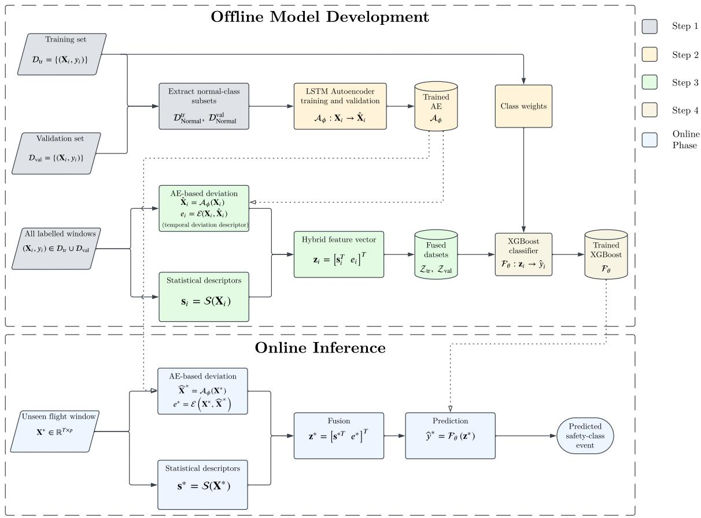  
Figure 1: Proposed hybrid feature-fusion framework for landing-phase safety-event prediction. Statistical flight-history descriptors and an LSTM-autoencoder reconstruction-error descriptor are extracted from the same multivariate flight window, concatenated, and supplied to a classweighted XGBoost classifier for multiclass prediction.

where $\mathcal { E } _ { \phi _ { e } } ( \cdot )$ denotes the LSTM-based encoder. The decoder then expands this representation to reconstruct the complete input sequence,

$$
\begin{array} { r } { \widehat { \mathbf { X } } _ { i } = \mathcal { D } _ { \phi _ { d } } ( \mathbf { h } _ { i } ) , } \end{array}\tag{9}
$$

where $\mathcal { D } _ { \phi _ { d } } ( \cdot )$ denotes the LSTM-based decoder. The complete autoencoder is therefore written as

$$
\widehat { \mathbf { X } } _ { i } = \mathcal { A } _ { \phi } ( \mathbf { X } _ { i } ) = \mathcal { D } _ { \phi _ { d } } \left( \mathcal { E } _ { \phi _ { e } } ( \mathbf { X } _ { i } ) \right) , \qquad \phi = \{ \phi _ { e } , \phi _ { d } \} .\tag{10}
$$

The autoencoder parameters are learned by minimizing reconstruction loss over the Normalclass training subset $\mathcal { D } _ { \mathrm { N o r m a l } } ^ { \mathrm { t r } } \mathrm { : }$

$$
\boldsymbol \phi ^ { * } = \arg \operatorname* { m i n } _ { \boldsymbol \phi } \frac { 1 } { \left| \mathcal { D } _ { \mathrm { N o r m a l } } ^ { \mathrm { t r } } \right| } \sum _ { \mathbf X _ { i } \in \mathcal { D } _ { \mathrm { N o r m a l } } ^ { \mathrm { t r } } } \mathcal L _ { \mathrm { r e c } } \left( \mathbf X _ { i } , \mathcal { A } _ { \boldsymbol \phi } ( \mathbf X _ { i } ) \right) .\tag{11}
$$

The reconstruction loss is the mean squared error across all temporal samples and flight parameters:

$$
\mathcal { L } _ { \mathrm { r e c } } \left( \mathbf { X } _ { i } , \widehat { \mathbf { X } } _ { i } \right) = \frac { 1 } { T p } \sum _ { t = 1 } ^ { T } \sum _ { j = 1 } ^ { p } \left( X _ { i , t j } - \widehat { X } _ { i , t j } \right) ^ { 2 } .\tag{12}
$$

After training, the autoencoder parameters are fixed and the model is applied to every labelled flight window, including both Normal and safety-event classes. For each window, the scalar

Algorithm 1 Development and training of the proposed hybrid feature-fusion framework   
Require: Labelled, preprocessed training and validation sets $\overline { { \mathcal { D } _ { \mathrm { t r } } } }$ and $\mathcal { D } _ { \mathrm { v a l } }$ , each containing the   
Normal class and the safety-event classes   
Ensure: Trained hybrid prediction framework ${ \mathcal { H } } = \{ S , { \mathcal { A } } _ { \phi } , { \mathcal { F } } _ { \theta } \}$   
Stage 1: Learn nominal temporal behavior   
1: Extract the Normal-class subsets $\mathcal { D } _ { \mathrm { N o r m a l } } ^ { \mathrm { t r } } \subset \mathcal { D } _ { \mathrm { t r } }$ and $\mathcal { D } _ { \mathrm { N o r m a l } } ^ { \mathrm { v a l } } \subset \mathcal { D } _ { \mathrm { v a l } }$   
2: Train the LSTM autoencoder $\mathcal { A } _ { \phi }$ using $\mathcal { D } _ { \mathrm { N } } ^ { \mathrm { t r } }$ ormal   
3: Select the autoencoder configuration using reconstruction performance on $\mathcal { D } _ { \mathrm { N o r m a l } } ^ { \mathrm { v a l } }$   
4: Freeze the trained autoencoder parameters $\phi$   
Stage 2: Construct the fused feature representation   
5: for all $q \in \{ \mathrm { t r } , \mathrm { v a l } \}$ do   
6: Initialize the fused dataset $\mathcal { Z } _ { q } \gets \emptyset$   
7: for all $( \mathbf { X } _ { i } , y _ { i } ) \in \mathcal { D } _ { q }$ do   
8: Extract the statistical flight-history descriptors: $\mathbf { s } _ { i }  S ( \mathbf { X } _ { i } )$   
9: Reconstruct the multivariate flight window: $\widehat { \mathbf { X } } _ { i } \gets \mathcal { A } _ { \phi } ( \dot { \mathbf { X } } _ { i } )$   
10: Calculate the reconstruction-error descriptor: $e _ { i } \gets \mathcal { E } ( \mathbf { X } _ { i } , \widehat { \mathbf { X } } _ { i } )$   
11: Concatenate the two representations: $\mathbf { z } _ { i } \gets [ \mathbf { s } _ { i } ^ { \mathsf { T } } , e _ { i } ] ^ { \mathsf { T } }$   
12: Add the fused vector and its original class label: $\mathcal { Z } _ { q }  \mathcal { Z } _ { q } \cup \{ ( \mathbf { z } _ { i } , y _ { i } ) \}$   
13: end for   
14: end for   
Stage 3: Train the imbalance-aware classifier   
15: Determine class weights from the class frequencies in ${ \mathcal { D } } _ { \mathrm { t r } }$   
16: Train candidate XGBoost classifiers on ${ \mathcal { Z } } _ { \mathrm { t r } }$ using the class weights   
17: Select the final classifier $\mathcal { F } _ { \theta }$ using performance on $\mathcal { Z } _ { \mathrm { v a l } }$   
18: Combine the statistical feature extractor, trained autoencoder, and selected classifier into   
the complete hybrid framework   
return ${ \mathcal { H } } = \{ S , { \mathcal { A } } _ { \phi } , { \mathcal { F } } _ { \theta } \}$

reconstruction-error descriptor is computed as

$$
e _ { i } = \frac { 1 } { T p } \left. \mathbf { X } _ { i } - \widehat { \mathbf { X } } _ { i } \right. _ { F } ^ { 2 } ,\tag{13}
$$

where $\| \cdot \| _ { F }$ denotes the Frobenius norm. A larger value of $e _ { i }$ indicates a greater reconstruction discrepancy relative to the nominal temporal behavior learned from Normal-class windows.

In the proposed framework, $e _ { i }$ is concatenated with the statistical flight-history features as a continuous temporal-deviation descriptor, without applying a hard anomaly threshold. The downstream classifier interprets reconstruction error jointly with parameter-specific statistical information when distinguishing among the safety-event classes.

## 3.3 Statistical Flight-History Feature Extraction

The second branch of the proposed framework converts each multivariate flight window into a fixed-length statistical representation. This representation complements the autoencoder-based deviation descriptor by retaining parameter-specific information about the magnitude, dispersion, distributional shape, and temporal trends of the recorded flight histories.

For the ith flight window, let $\mathbf { x } _ { i } ^ { ( j ) } = [ x _ { i , 1 } ^ { ( j ) } , \ldots , x _ { i , T } ^ { ( j ) } ] ^ { \mathsf { T } }$ denote the time history of the jth flight

Table 1: Statistical descriptors extracted from each flight-parameter history.
<table><tr><td>Descriptor</td><td>Purpose</td></tr><tr><td>Mean</td><td>Average parameter level</td></tr><tr><td>Standard deviation</td><td>Overall variability</td></tr><tr><td>Maximum</td><td>Upper extreme</td></tr><tr><td>Minimum</td><td>Lower extreme</td></tr><tr><td>Range</td><td>Peak-to-peak variation</td></tr><tr><td>Linear slope</td><td>Direction and rate of temporal change</td></tr><tr><td>Correlation coefficient</td><td>t Strength of the linear temporal trend</td></tr><tr><td>Median</td><td>Robust central tendency</td></tr><tr><td>Interquartile range</td><td>Robust measure of dispersion</td></tr><tr><td>Skewness</td><td>Distributional asymmetry</td></tr><tr><td>Kurtosis</td><td>Distributional shape and tail weight</td></tr></table>

parameter. A set of K statistical descriptors is calculated independently for each parameter:

$$
\mathbf { g } _ { i } ^ { ( j ) } = \left[ g _ { 1 } \left( \mathbf { x } _ { i } ^ { ( j ) } \right) \quad \cdots \quad g _ { K } \left( \mathbf { x } _ { i } ^ { ( j ) } \right) \right] ^ { \mathsf { T } } ,\tag{14}
$$

where $g _ { k } ( \cdot )$ denotes the kth descriptor. The descriptor set used in the present framework is summarized in Table 1.

The temporal-trend descriptors are obtained from a least-squares linear fit of each parameter history against the sample index,

$$
\begin{array} { r } { x _ { i , t } ^ { ( j ) } = a _ { i } ^ { ( j ) } + b _ { i } ^ { ( j ) } t + \epsilon _ { i , t } ^ { ( j ) } , } \end{array}\tag{15}
$$

where $b _ { i } ^ { ( j ) }$ is retained as the slope descriptor. The correlation coeficient between the parameter history and the sample index is also included to indicate the strength of the linear trend. Together, these descriptors distinguish histories with similar slopes but diferent degrees of linear temporal association.

The descriptor vectors from all p flight parameters are concatenated to form the statistical feature representation,

$$
\begin{array} { r } { \mathbf { s } _ { i } = \left[ \mathbf { g } _ { i } ^ { ( 1 ) \mathsf { T } } \quad \mathbf { g } _ { i } ^ { ( 2 ) \mathsf { T } } \quad \hdots \quad \mathbf { g } _ { i } ^ { ( p ) \mathsf { T } } \right] ^ { \mathsf { T } } \in \mathbb { R } ^ { p K } . } \end{array}\tag{16}
$$

For the implementation considered in this study, $K = 1 1$ descriptors are calculated for each of the $p = 2 0$ flight parameters, producing

$$
d _ { s } = p K = 2 0 \times 1 1 = 2 2 0\tag{17}
$$

statistical features for each flight window.

This fixed-length representation provides the tree-based classifier with parameter-specific summaries of flight-state levels, variability, extrema, distributional shape, and temporal trends, without treating every recorded time sample as a separate input feature. It reduces the dimensionality of the classifier input while preserving the association between each descriptor and its parent flight parameter, which also supports subsequent model interpretation. These summaries do not retain the detailed temporal ordering of the original histories; the autoencoder branch complements them by measuring reconstruction discrepancy across the multivariate sequence. The statistical vector ${ \bf s } _ { i }$ is concatenated with the scalar autoencoder reconstruction-error descriptor to construct the final hybrid feature vector.

## 3.4 Class-Weighted XGBoost Event Classification

The final stage of the proposed framework performs supervised multiclass classification using the fused statistical and temporal-deviation representation. For the ith flight window, the statistical feature vector ${ \bf s } _ { i }$ is concatenated with the scalar autoencoder reconstruction-error descriptor $e _ { i }$ to form

$$
\mathbf { z } _ { i } = \left[ \mathbf { s } _ { i } ^ { \mathsf { T } } \quad e _ { i } \right] ^ { \mathsf { T } } \in \mathbb { R } ^ { d _ { s } + 1 } .\tag{18}
$$

For the present implementation, $d _ { s } = 2 2 0$ , giving a 221-dimensional hybrid feature vector. This representation combines parameter-specific statistical information with a compact measure of deviation from the nominal temporal behavior learned by the LSTM autoencoder.

XGBoost represents the multiclass decision function as an additive ensemble of regression trees. At boosting iteration $m ,$ the class-score vector is updated according to

$$
\mathbf { f } ^ { ( m ) } ( \mathbf { z } _ { i } ) = \mathbf { f } ^ { ( m - 1 ) } ( \mathbf { z } _ { i } ) + \eta \mathbf { h } _ { m } ( \mathbf { z } _ { i } ) ,\tag{19}
$$

where $\mathbf { h } _ { m } ( \cdot )$ denotes the vector of contributions from the class-specific trees added at iteration $m$ , and $\eta$ is the learning rate. The resulting class scores are converted to class probabilities using the softmax function,

$$
P ( y _ { i } = c \mid \mathbf { z } _ { i } ) = { \frac { \exp ( f _ { c } ( \mathbf { z } _ { i } ) ) } { \displaystyle \sum _ { r = 1 } ^ { C } \exp ( f _ { r } ( \mathbf { z } _ { i } ) ) } } , \qquad c = 1 , \ldots , C ,\tag{20}
$$

and the predicted class is obtained as

$$
\widehat { y } _ { i } = \arg \operatorname* { m a x } _ { c \in \{ 1 , . . . , C \} } P ( y _ { i } = c \mid \mathbf { z } _ { i } ) .\tag{21}
$$

Because the training data are strongly imbalanced, assigning equal importance to every training sample can cause the objective to be dominated by the majority class. A class weight is therefore calculated from the training-set class frequencies as

$$
w _ { c } = \frac { N _ { \mathrm { t r } } } { C n _ { c } } ,\tag{22}
$$

where $N _ { \mathrm { t r } }$ is the total number of training samples, C is the number of classes, and $n _ { c }$ is the number of training samples belonging to class c. Each sample inherits the weight of its class:

$$
\omega _ { i } = { w _ { y } } _ { i } .\tag{23}
$$

The weighted training objective is expressed as

$$
\mathcal { T } = \sum _ { i = 1 } ^ { N _ { \mathrm { t r } } } \omega _ { i } \ell \left( y _ { i } , \mathbf { f } \left( \mathbf { z } _ { i } \right) \right) + \sum _ { m = 1 } ^ { M } \Omega ( \mathbf { h } _ { m } ) ,\tag{24}
$$

where $\ell ( \cdot )$ is the multiclass classification loss, $\Omega ( \mathbf { h } _ { m } )$ denotes the total complexity penalty for the trees added at iteration $m$ , and M is the number of boosting iterations. The weighting term increases the contribution of underrepresented classes without resampling the training data.

The classifier is trained using the fused representations and original class labels from the training partition, while the validation partition is used for model selection. During inference, the statistical feature extractor and trained autoencoder generate the hybrid representation for an unseen preprocessed flight window. The fixed XGBoost model then uses this representation to obtain the final multiclass prediction.

## 4 Experimental Setup

The experimental setup was designed to evaluate the proposed framework under severe class imbalance and across arrival-airport contexts, with a comparison of pooled and airport-specific learning strategies. This section first describes the flight dataset, landing-phase windows, event labels, and retained input variables. It then presents the preprocessing and feature-construction procedure, benchmark and training protocols, model-selection strategy, and evaluation criteria.

## 4.1 Dataset and Safety-Event Definition

## 4.1.1 Dataset Source

The experiments used the Curated 4 Class Anomaly Detection Data Set distributed through the NASA DASHlink Flight Data project [44]. The underlying records consist of de-identified flight data collected onboard a single type of regional jet operating in commercial service over a three-year period. The publicly released records contain aircraft-state, system-performance, and operational variables, but do not identify the airline or aircraft manufacturer. NASA specifies that these records are not part of an airline Flight Operational Quality Assurance program; they are provided as a public resource for developing and evaluating aviation-safety data-mining methods [45].

The curated dataset contains approximately 99,000 final-approach windows. Each observation consists of a 160-s multivariate sequence aligned with the aircraft crossing approximately 1,000 ft before touchdown and is assigned to one nominal class or one of three safety-event classes [44]. In the processed dataset used in this study, the flight windows are represented as

$$
\mathbf { X } = ( \mathbf { X } _ { i } ) _ { i = 1 } ^ { N } , \qquad \mathbf { X } _ { i } \in \mathbb { R } ^ { T \times p } ,\tag{25}
$$

where $N = 9 9 , 8 3 7$ is the total number of available flight windows, $T = 1 6 0$ is the number of temporal samples per window, and $p = 2 0$ is the number of retained flight parameters. The complete input array therefore has dimensions

$$
\mathbf { X } \in \mathbb { R } ^ { 9 9 , 8 3 7 \times 1 6 0 \times 2 0 } .\tag{26}
$$

Each flight window is associated with a metadata record containing the corresponding safetyevent label and operational information, including the departure and arrival airports. Because the analyzed sequence represents the final approach to landing, the present study defines the operational context using the arrival airport. The approach trajectory, runway environment, local procedures, and surrounding operational conditions relate to the destination at which the landing sequence occurs.

The 160-s window provides a common temporal reference for all flights and allows both branches of the proposed framework to operate on the same multivariate sequence. The LSTM autoencoder uses the ordered histories directly to characterize temporal deviations from Normal operation, while the statistical branch summarizes each parameter history over the same window.

## 4.1.2 Airport Selection, Safety-Event Labels, and Class Distribution

The present analysis was restricted to flights arriving at Minneapolis–Saint Paul International Airport (KMSP), Detroit Metropolitan Wayne County Airport (KDTW), and Memphis International Airport (KMEM). These airports were selected because they contained comparatively large numbers of landing-phase windows while retaining suficient observations from the minority safety-event classes for airport-specific model development and evaluation.

For airport $a \in$ {KMSP, KDTW, KMEM}, the corresponding subset is defined as

$$
\mathcal { D } _ { a } = \left\{ ( \mathbf { X } _ { i } , y _ { i } ) \ | \ \mathrm { a r r i v a l } _ { i } = a \right\} ,\tag{27}
$$

Table 2: Arrival-airport-only dataset composition used in the pooled and airport-specific experiments.
<table><tr><td>Airport</td><td>Normal</td><td>Speed High</td><td>Path High</td><td>Flaps Late</td><td>Total</td></tr><tr><td>KMSP</td><td>23,758</td><td>1,267</td><td>272</td><td>99</td><td>25,396</td></tr><tr><td>KDTW</td><td>17,037</td><td>1,454</td><td>157</td><td>149</td><td>18,797</td></tr><tr><td>KMEM</td><td>8,374</td><td>968</td><td>61</td><td>154</td><td>9,557</td></tr><tr><td>Pooled</td><td>49,169</td><td>3,689</td><td>490</td><td>402</td><td>53,750</td></tr></table>

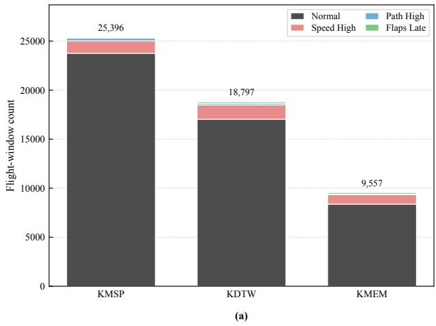

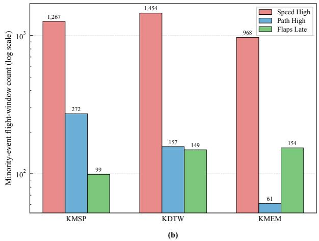  
Figure 2: Arrival-airport-only dataset composition for KMSP, KDTW, and KMEM: (a) total class composition at each airport and (b) minority-event support shown using a logarithmic vertical scale.

where $\mathbf { X } _ { i } \in \mathbb { R } ^ { T \times p }$ denotes the multivariate landing-phase window and $y _ { i }$ denotes its associated class label.

The dataset contains four mutually exclusive labels: Normal, Speed High, Path High, and Flaps Late. The label set is written as

$$
\mathcal { V } = \{ \mathrm { N o r m a l } , \mathrm { S p e e d ~ H i g h } , \mathrm { P a t h ~ H i g h } , \mathrm { F l a p s ~ L a t e } \} .\tag{28}
$$

Normal denotes landing windows without any of the three designated events. Speed High corresponds to an elevated-speed condition during approach, Path High represents an approach above the intended vertical path, and Flaps Late indicates delayed establishment of the landingflap configuration. These descriptions give the operational interpretation of the supplied labels; no event-labeling thresholds were introduced in the present study.

Table 2 summarizes the selected arrival-airport subsets. KMSP contains the largest number of windows, followed by KDTW and KMEM. Across all three airports, the Normal class dominates the data, while Path High and Flaps Late contain substantially fewer observations. Minority-class support also varies across airports. For example, KMSP contains only 99 Flaps Late windows, whereas KMEM contains 154 despite having a much smaller total dataset. Conversely, the Path High class contains 272 windows at KMSP but only 61 at KMEM.

Figure 2(a) shows the overall class composition at each airport, while Fig. 2(b) isolates the three minority-event classes using a logarithmic vertical scale. This separate view makes diferences in event support visible despite the predominance of the Normal class.

The pooled dataset contains 53,750 windows across the three airports, of which 49,169 belong to the Normal class. Thus, approximately 91.5% of the selected observations are Normal, while each individual event class accounts for only a small fraction of the pooled data. This imbalance motivates class-weighted XGBoost training and class-balanced evaluation measures. The unequal event support across airports also motivates comparison between a pooled model, which benefits from a larger combined training set, and airport-specific models, which may better capture local approach patterns.

Table 3: Flight parameters retained in each landing-phase window.
<table><tr><td>No.</td><td>Recorded parameter</td><td>Unit/type</td><td>No.</td><td>Recorded parameter</td><td>Unit/type</td></tr><tr><td>1</td><td>Left aileron position</td><td>deg</td><td>11</td><td>Selected heading</td><td>deg</td></tr><tr><td>2</td><td>Right aileron position</td><td>deg</td><td>12</td><td>Localizer deviation</td><td>%</td></tr><tr><td>3</td><td>Corrected angle of attack</td><td>deg</td><td>13</td><td>Average core speed</td><td>%</td></tr><tr><td>4</td><td>Baro-corrected altitude</td><td>ft</td><td>14</td><td>Total pressure</td><td>mbar</td></tr><tr><td>5</td><td>Computed airspeed</td><td>kt</td><td>15</td><td>Pitch angle</td><td>deg</td></tr><tr><td>6</td><td>Selected course</td><td>deg</td><td>16</td><td>Roll angle</td><td>deg</td></tr><tr><td>7</td><td>Drift angle</td><td>deg</td><td>17</td><td>Rudder position</td><td>deg</td></tr><tr><td>8</td><td>Left elevator position</td><td>deg</td><td>18</td><td>True heading</td><td>deg</td></tr><tr><td>9</td><td>Trailing-edge flap position</td><td>deg/discrete</td><td>19</td><td>Vertical acceleration</td><td>g</td></tr><tr><td>10</td><td>Glideslope deviation</td><td>%</td><td>20</td><td>Wind speed</td><td>kt</td></tr></table>

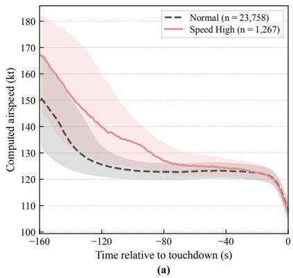

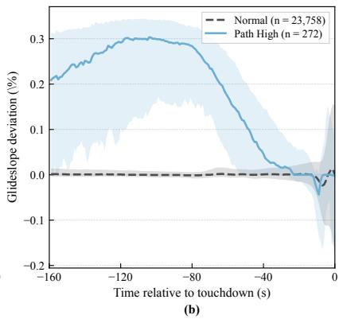

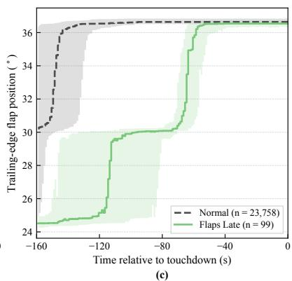  
Figure 3: Class-specific landing-phase signatures at KMSP: (a) computed airspeed for Normal and Speed High windows, (b) glideslope deviation for Normal and Path High windows, and (c) trailing-edge flap position for Normal and Flaps Late windows. Curves show the class-wise median and shaded regions indicate the interquartile range. Time is measured relative to touchdown.

## 4.1.3 Input Flight Parameters

Each landing-phase window contains the 20 recorded parameters listed in Table 3. These variables collectively describe aircraft motion, guidance-path tracking, control-surface response, propulsion state, landing configuration, and atmospheric conditions, providing a multivariate description of the approach.

The selected variables contain both event-specific and contextual information. Computed airspeed is directly relevant to the Speed High class, while glideslope deviation characterizes vertical-path tracking. Trailing-edge flap position captures the timing and sequence of landingconfiguration deployment. These histories are considered alongside altitude, angle of attack, pitch attitude, control-surface positions, propulsion state, and atmospheric conditions.

Figure 3 illustrates how the three safety-event classes difer from Normal operation in their most directly associated parameters at KMSP. Each panel compares an event class with the Normal reference using the class-wise median and interquartile range, showing both the typical approach history and the variability within each class.

In Fig. 3(a), Speed High windows show greater computed airspeed through much of the approach, with the largest median diference occurring earlier in the window. The profiles converge close to touchdown, indicating that the distinguishing speed-management behavior occurs over the preceding approach history. Figure 3(b) shows a pronounced positive glideslope deviation for Path High windows during the earlier portion of the approach, whereas the Normal median remains close to the reference path. The Path High median subsequently approaches the Normal profile as the vertical-path deviation diminishes. In Fig. 3(c), Normal flights typically establish the final flap setting relatively early, while Flaps Late windows retain intermediate settings for substantially longer. Here, the distinguishing feature is the timing of configuration deployment, even though both median profiles eventually reach the same final setting.

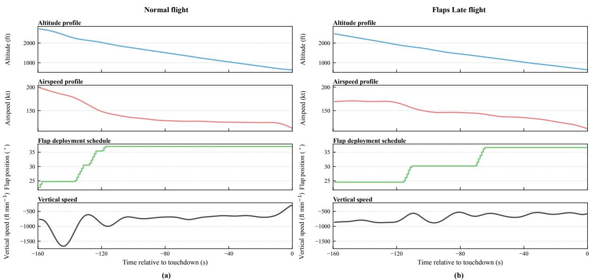  
Figure 4: Illustrative multivariate landing-phase histories for sampled KDTW windows: (a) Normal flight and (b) Flaps Late flight. The four rows show altitude, computed airspeed, trailingedge flap position, and vertical speed over the 160-s interval preceding touchdown. Vertical speed is obtained by numerically diferentiating the altitude history with respect to time and is shown for illustration only; it is not a model input.

These aggregate profiles show the characteristic diferences associated with each event class. To examine how configuration timing appears alongside other flight parameters within an individual approach, Fig. 4 compares one sampled Normal flight with one Flaps Late flight from KDTW. The altitude, airspeed, flap-position, and vertical-speed histories provide a common temporal view of each approach.

Both examples show broadly comparable descending altitude profiles, but their configuration and dynamic histories difer. In the Normal example, flap deployment progresses to the final landing setting during the earlier portion of the window, alongside a substantial reduction in airspeed. The Flaps Late example remains at intermediate flap settings until much later in the approach, even as the aircraft continues to descend and reduce speed. The vertical-speed histories also reveal diferences in the descent-rate variation that are less apparent from the altitude profiles alone. These examples illustrate why configuration timing is considered within the evolving multivariate approach history: similar overall descent profiles can contain diferent sequences of speed reduction, flap deployment, and descent-rate adjustment.

## 4.2 Data Preprocessing and Model Configuration

Following arrival-airport filtering, each flight window was represented by a fixed-length multivariate sequence $\mathbf { X } _ { i } \in \mathbb { R } ^ { 1 6 0 \times 2 0 }$ . The recorded parameter histories were preprocessed to reduce high-frequency fluctuations and account for diferences in measurement scales. A third-order

Table 4: Hyperparameter configurations of the LSTM autoencoder and class-weighted XGBoost classifier used in the proposed framework.
<table><tr><td colspan="2">LSTM Autoencoder</td><td colspan="2">XGBoost Classifier</td></tr><tr><td>Hyperparameter</td><td>Value</td><td>Hyperparameter</td><td>Value</td></tr><tr><td>Encoder LSTM units</td><td>64</td><td>Objective</td><td>multi:softprob</td></tr><tr><td>Latent dimension</td><td>32</td><td>Boosting iterations</td><td>1,000</td></tr><tr><td>Dropout rate</td><td>0.2</td><td>Maximum depth</td><td>6</td></tr><tr><td> $L _ { 2 }$  regularization</td><td>0.001</td><td>Learning rate</td><td>0.1</td></tr><tr><td>Optimizer</td><td>Adam</td><td>Row subsampling</td><td>0.8</td></tr><tr><td>Learning rate</td><td>0.001</td><td>Column subsampling</td><td>0.8</td></tr><tr><td>Maximum epochs</td><td>210</td><td>Class weighting</td><td>Balanced</td></tr><tr><td>Batch size</td><td>32</td><td>Sample weights</td><td> $\omega _ { i } = w _ { y _ { i } }$ </td></tr><tr><td>Early-stopping patience</td><td>15</td><td>Number of classes</td><td>4</td></tr><tr><td>Reconstruction loss</td><td>MSE</td><td></td><td></td></tr></table>

Butterworth low-pass filter with a normalized cutof frequency of 0.1 was applied using forward– backward filtering to suppress high-frequency variations without introducing temporal phase shifts. The filtered sequences were then standardized for each flight parameter using the mean and standard deviation estimated from the corresponding training partition. The same training-derived standardization was applied to validation and test observations.

Feature construction followed the dual-branch formulation described in Section 3. Eleven statistical descriptors were extracted from each of the 20 parameter histories, producing a 220-dimensional representation. In parallel, the LSTM autoencoder was trained exclusively on Normal-class training windows and subsequently applied to observations from all four classes. Its mean-squared reconstruction error was retained as a continuous scalar descriptor and concatenated with the statistical features to form the final 221-dimensional hybrid representation.

The autoencoder used a stacked LSTM encoder–decoder architecture with 64 units in the initial encoder layer and a 32-dimensional latent representation. The latent state was repeated across the temporal dimension and decoded to reconstruct the complete input sequence. The model used a dropout rate of 0.2, $L _ { 2 }$ regularization of $1 0 ^ { - 3 }$ , and Adam optimization with an initial learning rate of $1 0 ^ { - 3 }$ . Training was performed with a batch size of 32 for a maximum of 210 epochs, using early stopping with a patience of 15 epochs based on reconstruction loss on the Normal-class validation subset.

The supervised classification stage used XGBoost with the multi:softprob objective and class-dependent sample weights defined by Eqs. 22 and 23. The classifier configuration comprised 1,000 boosting iterations, a maximum tree depth of six, a learning rate of 0.1, and row and column subsampling ratios of 0.8. The model hyperparameters are summarized in Table 4. The classifier was trained using the fused training features, with validation data used to monitor model performance. The autoencoder parameters remained fixed during classifier training and subsequent inference.

## 4.3 Experimental Design and Evaluation Metrics

Two complementary training strategies were investigated to evaluate the influence of arrivalairport context on safety-event prediction. In the pooled strategy, a single global model was trained using the combined KMSP, KDTW, and KMEM observations. In the airport-specific strategy, independent specialist models were trained using data from each airport separately. Both strategies were evaluated on identical airport-specific test observations, enabling direct comparison under consistent evaluation conditions.

The available observations were divided into approximately 70% training, 10% validation, and 20% testing partitions. Table 5 summarizes the class-wise distributions for each airport and the pooled dataset. The pooled partitions were constructed by combining the corresponding airport-specific partitions. Training data were used for model fitting, validation data for model selection, and test data exclusively for reporting predictive performance.

Table 5: Training, validation, and test partitions for the three arrival airports and the combined pooled dataset. Class-wise counts document the support available for each safety-event class.
<table><tr><td>Dataset</td><td>Split</td><td>Total</td><td>Normal</td><td>Speed High</td><td>Path High</td><td>Flaps Late</td></tr><tr><td rowspan="4">KMSP</td><td>Total</td><td>25396</td><td>23758</td><td>1267</td><td>272</td><td>99</td></tr><tr><td>Train</td><td>17776</td><td>16630</td><td>886</td><td>191</td><td>69</td></tr><tr><td>Validation</td><td>2540</td><td>2376</td><td>127</td><td>27</td><td>10</td></tr><tr><td>Test</td><td>5080</td><td>4752</td><td>254</td><td>54</td><td>20</td></tr><tr><td rowspan="4">KDTW</td><td>Total</td><td>18797</td><td>17037</td><td>1454</td><td>157</td><td>149</td></tr><tr><td>Train</td><td>13157</td><td>11925</td><td>1018</td><td>110</td><td>104</td></tr><tr><td>Validation</td><td>1880</td><td>1704</td><td>145</td><td>16</td><td>15</td></tr><tr><td>Test</td><td>3760</td><td>3408</td><td>291</td><td>31</td><td>30</td></tr><tr><td rowspan="4">KMEM</td><td>Total</td><td>9557</td><td>8374</td><td>968</td><td>61</td><td>154</td></tr><tr><td>Train</td><td>6689</td><td>5861</td><td>677</td><td>43</td><td>108</td></tr><tr><td>Validation</td><td>956</td><td>838</td><td>97</td><td>6</td><td>15</td></tr><tr><td>Test</td><td>1912</td><td>1675</td><td>194</td><td>12</td><td>31</td></tr><tr><td rowspan="4">Pooled</td><td>Total</td><td>53750</td><td>49169</td><td>3689</td><td>490</td><td>402</td></tr><tr><td>Train</td><td>37622</td><td>34416</td><td>2581</td><td>344</td><td>281</td></tr><tr><td>Validation</td><td>5376</td><td>4918</td><td>369</td><td>49</td><td>40</td></tr><tr><td>Test</td><td>10752</td><td>9835</td><td>739</td><td>97</td><td>81</td></tr></table>

Table 6: Benchmark and ablation configurations used to assess the contributions of class weighting, autoencoder-based temporal deviation, and hybrid feature fusion.
<table><tr><td>Model</td><td>Feature input / decision logic</td><td>Purpose</td></tr><tr><td>M1</td><td>Statistical features + unweighted XGBoost</td><td>Baseline classifier</td></tr><tr><td>M2</td><td>Statistical features + weighted XGBoost</td><td>Effect of class weighting</td></tr><tr><td>M3</td><td>AE reconstruction error + weighted XGBoost</td><td>AE-error-only baseline</td></tr><tr><td>M4</td><td>Statistical features + AE reconstruction error + weighted</td><td>Proposed hybrid fusion</td></tr><tr><td>M5</td><td>XGBoost Hard AE gate + statistical-feature event classifier</td><td>Hard-threshold baseline</td></tr></table>

To assess the contributions of the major framework components, five benchmark configurations were considered, as summarized in Table 6. These comparisons examine the efects of class weighting, the discriminative value of the autoencoder reconstruction error, and the distinction between continuous feature fusion and hard-threshold anomaly gating. The component-level experiments were performed under the airport-specific specialist setting using the same training, validation, and test partitions. For M5, the anomaly threshold was set to the 95th percentile of Normal-class training reconstruction errors. Windows at or below this threshold were assigned to Normal; threshold-exceeding windows were classified using an event-only, class-weighted XGBoost model trained on the 220 statistical features.

To assess robustness to data partitioning and retraining, the airport-specific hybrid models were additionally evaluated using five random seeds. For each run, the training, validation, and test partitions were regenerated and the complete learning pipeline was retrained, including the LSTM autoencoder, reconstruction-error generation, and class-weighted XGBoost classifier. Performance was summarized using the mean and standard deviation across the five runs.

Classification performance was evaluated using overall accuracy, class-wise precision and recall, macro recall, and macro F1. For class c, precision and recall are defined as

$$
P _ { c } = { \frac { \mathrm { T P } _ { c } } { \mathrm { T P } _ { c } + \mathrm { F P } _ { c } } } , \qquad R _ { c } = { \frac { \mathrm { T P } _ { c } } { \mathrm { T P } _ { c } + \mathrm { F N } _ { c } } } ,\tag{29}
$$

where $\mathrm { T P } _ { c } , \mathrm { F P } _ { c } ,$ and $\mathrm { F N } _ { c }$ denote the true-positive, false-positive, and false-negative counts for class $c ,$ respectively. Macro recall and macro F1 assign equal weight to all four classes:

$$
\mathrm { M R } = \frac { 1 } { C } \sum _ { c = 1 } ^ { C } R _ { c } , \qquad \mathrm { M F } 1 = \frac { 1 } { C } \sum _ { c = 1 } ^ { C } \frac { 2 P _ { c } R _ { c } } { P _ { c } + R _ { c } } .\tag{30}
$$

The complement 1 − MR was also reported as the macro-averaged false-negative rate across all four classes, including Normal. Row-normalized confusion matrices were used to examine class-specific error patterns. Macro recall was adopted as the principal evaluation metric because it assigns equal importance to all classes regardless of their sample frequencies.

Model interpretation was performed using Tree SHAP [42, 43]. SHAP values were computed for the 221-dimensional fused representation and examined separately for each class output. The absolute SHAP values associated with the 11 statistical descriptors of each flight parameter were aggregated to obtain parameter-level importance scores, while the autoencoder reconstructionerror descriptor was retained separately. For visualization, these scores were normalized by the maximum importance within each airport–class combination. The normalized scores show the relative ranking of feature drivers within each combination without implying direct comparability of absolute SHAP magnitudes across models or classes.

## 5 Results and Discussion

This section evaluates the proposed framework through comparisons of pooled and airport-specific performance, class-wise error analysis, and component-level benchmarking. Repeated training runs assess variability across data partitions and retraining, while SHAP-based interpretation examines the flight parameters associated with predictions across airports and event classes.

## 5.1 Pooled versus Airport-Specific Model Performance

A central question in landing-phase safety-event prediction is whether pooled learning across airports ofers advantages over airport-specific models. Pooled models benefit from larger and more diverse training datasets, while specialist models may better capture local operational characteristics. The two training strategies and their corresponding data partitions are described in Section 4.3.

Table 7 compares the pooled global model with the airport-specific specialist models on identical arrival-airport test sets. In addition to accuracy, macro recall is reported to give equal weight to all four classes despite their unequal sample frequencies. The percentage shown in parentheses beside each global macro-recall value represents its relative change with respect to the corresponding specialist model:

$$
\Delta _ { \mathrm { M R } } = \frac { \mathrm { M R } _ { \mathrm { g l o b a l } } - \mathrm { M R } _ { \mathrm { s p e c i a l i s t } } } { \mathrm { M R } _ { \mathrm { s p e c i a l i s t } } } \times 1 0 0 .\tag{31}
$$

A positive value indicates an advantage for the pooled model, whereas a negative value indicates an advantage for the airport-specific model.

Both modeling strategies achieve high overall accuracy across the three arrival airports, but macro recall reveals diferences in their performance across classes. The specialist models achieve higher macro recall at KMSP and KDTW, where the global model is lower by 1.02% and 0.72%, respectively, relative to the corresponding specialist. At KMEM, the global model performs better, with macro recall 2.55% higher than that of the specialist.

Table 7: Comparison of pooled global and airport-specific specialist models under arrival-airportonly evaluation. Parenthetical percentages indicate the relative change in global macro recall compared with the specialist model.
<table><tr><td>Airport</td><td>Test</td><td> $\mathbf { A c c . _ { s p e c } }$ </td><td> $\mathbf { A c c . _ { g l o b a l } }$ </td><td> $\mathbf { M R } _ { \mathrm { s p e c } }$ </td><td> $\mathbf { M R } _ { \mathrm { g l o b a l } }$ </td><td> $\mathbf { 1 } - \mathbf { M } \mathbf { R } _ { \mathrm { s p e c / g l o b a l } }$ </td></tr><tr><td>KMSP</td><td>5080</td><td>0.9856</td><td>0.9852</td><td>0.9572</td><td> $0 . 9 4 7 4 \ ( - 1 . 0 2 \% )$ </td><td>0.0428 0.0526</td></tr><tr><td>KDTW</td><td>3760</td><td>0.9779</td><td>0.9771</td><td>0.8950</td><td>0.8886 (-0.72%)</td><td>0.1050 0.1114</td></tr><tr><td>KMEM</td><td>1912</td><td>0.9702</td><td>0.9754</td><td>0.8599</td><td>0.8818  $( + 2 . 5 5 \% )$ </td><td>0.1401 0.1182</td></tr></table>

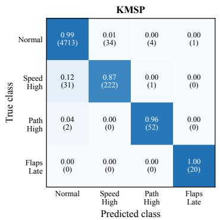  
(a)

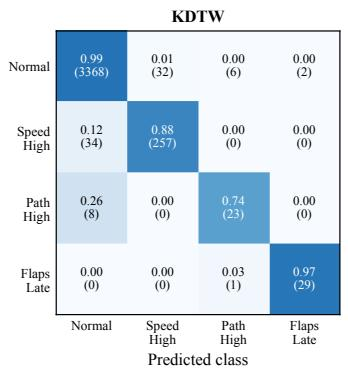  
(b)

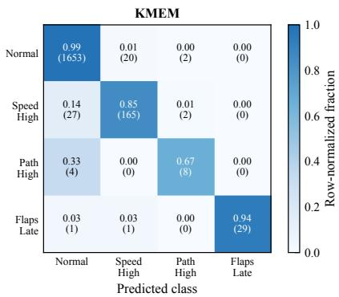  
(c)  
Figure 5: Row-normalized confusion matrices for the airport-specific specialist models under arrival-airport-only evaluation. Each cell reports the fraction of samples in the true class assigned to the predicted class, with the corresponding raw count shown in parentheses.

The airport-dependent advantage is consistent with the tradeof between local specialization and training-data availability. KMSP and KDTW have larger local datasets, which may provide stronger support for learning airport-specific approach patterns. At KMEM, the local subset is smaller and the Path High class is particularly underrepresented, with only 43 training samples and 12 test samples (Table 5). The pooled model’s higher macro recall at this airport suggests that access to additional training observations can be more beneficial than local specialization when event support is limited. These results support evaluating the choice of training strategy for each airport rather than assuming a uniform benefit from airport-specific modeling.

The following subsection examines class-wise recall and confusion patterns for both strategies to identify which event classes contribute to these airport-level diferences.

## 5.2 Class-Wise Error Behavior Across Airports

The aggregate metrics in Table 7 summarize overall performance, but do not reveal how errors are distributed across event classes. In imbalanced flight-safety prediction, high overall accuracy can coexist with missed detections in rare safety-relevant classes. Figures 5 and 6 therefore show row-normalized confusion matrices for the airport-specific specialist models and the pooled global model, respectively. Each cell reports the fraction of samples in the true class assigned to a predicted class, with the corresponding number of flight windows shown in parentheses.

For the airport-specific models, the Normal class is identified consistently across all three airports, with recall values close to 0.99. The specialist models also show strong detection of the Flaps Late class despite its smaller support. The KMSP specialist correctly identifies all 20 Flaps Late cases, while the KDTW and KMEM specialists correctly identify 29 of 30 and 29 of 31 cases, respectively. This high recall is consistent with a distinctive configuration-timing signature in the selected feature representation.

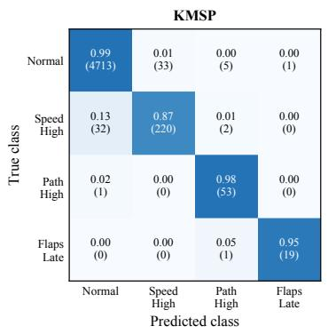  
(a)

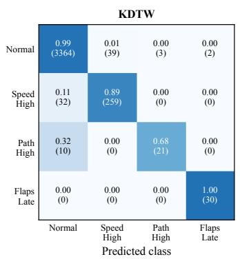  
(b)

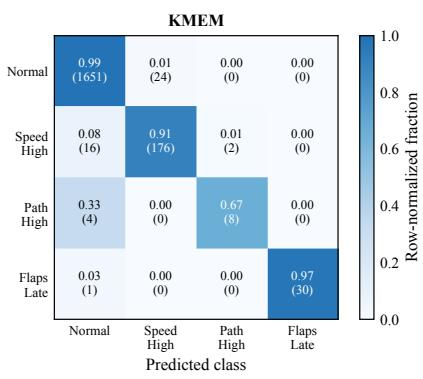  
(c)  
Figure 6: Row-normalized confusion matrices for the pooled global model evaluated on the same airport-specific arrival-only test sets. Each cell reports the fraction of samples in the true class assigned to the predicted class, with the corresponding raw count shown in parentheses.

Path High has the lowest recall at KDTW and KMEM. The KMSP specialist correctly identifies 52 of 54 Path High cases, giving a recall of 0.963. In contrast, the KDTW specialist identifies 23 of 31 cases, while the KMEM specialist identifies 8 of 12. These lower values reduce macro recall because each class contributes equally to the macro average. All missed Path High cases are assigned to Normal rather than to another event class, showing that the principal dificulty for this class is separating vertical-path deviations from nominal approaches.

Comparison with the pooled global model explains the airport-level diferences in Table 7. At KMSP, the global model produces a similar error pattern. It identifies 53 of 54 Path High cases, compared with 52 of 54 for the specialist, but detects one fewer Flaps Late case and slightly fewer Speed High cases. These losses outweigh the improvement in Path High recall. At KDTW, the global model slightly improves detection of Speed High and Flaps Late, but correctly identifies only 21 of 31 Path High cases, compared with 23 of 31 for the specialist. The lower Path High recall accounts for the specialist model’s small macro-recall advantage at this airport.

At KMEM, the pooled model’s macro-recall advantage is not due to better Path High detection: both models identify 8 of 12 cases. The improvement instead comes from Speed High and Flaps Late. The global model correctly identifies 176 of 194 Speed High cases, compared with 165 of 194 for the specialist, and 30 of 31 Flaps Late cases, compared with 29 of 31. Thus, the benefit of pooling at KMEM is class-dependent and does not resolve the weakest Path High performance.

Across both strategies, event-to-Normal confusion remains an important source of missed detections, with particularly low Path High recall at KDTW and KMEM. The small Path High test sets, especially the 12 cases at KMEM, also limit the precision of these class-wise estimates. These patterns explain why the pooled-versus-specialist comparison requires class-sensitive metrics and inspection of individual event classes alongside overall accuracy.

## 5.3 Robustness Analysis

For brevity, this and the subsequent analyses focus on the airport-specific specialist models. Both strategies achieved comparable overall accuracy, with modest specialist macro-recall advantages at KMSP and KDTW, the two airports with larger local datasets, and a pooled-model advantage at KMEM.

The robustness of the proposed hybrid-fusion framework was assessed using the repeatedsplit and retraining protocol described in Section 4.3. This analysis examines how specialist performance varies when the training, validation, and test observations are reassigned and the complete pipeline is retrained, particularly when safety-event classes have limited support. Table 8 reports the mean and standard deviation of macro recall and macro F1 across the five runs, while

Table 8: Performance of the proposed airport-specific hybrid-fusion models across five random data splits and retraining runs. Values are reported as mean ± standard deviation.
<table><tr><td></td><td>Airport Macro Recall</td><td>Macro F1</td></tr><tr><td>KMSP</td><td> $0 . 9 3 1 3 \pm 0 . 0 1 4 2$ </td><td> $0 . 9 3 4 7 \pm 0 . 0 0 6 2$ </td></tr><tr><td>KDTW</td><td> $0 . 9 3 0 3 \pm 0 . 0 1 9 0$ </td><td> $0 . 9 2 2 9 \pm 0 . 0 1 2 9$ </td></tr><tr><td>KMEM</td><td> $0 . 9 0 2 2 \pm 0 . 0 2 1 2$ </td><td> $0 . 9 0 1 0 \pm 0 . 0 2 4 2$ </td></tr></table>

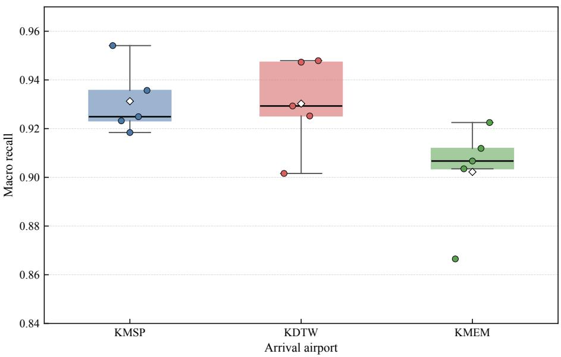  
Figure 7: Macro-recall variability of the proposed airport-specific hybrid-fusion models across five random data splits and retraining runs. Individual points represent the five runs for each arrival airport, and diamonds denote their means.

Fig. 7 illustrates the corresponding variation in macro recall.

The framework maintains a mean macro recall above 0.90 for all three airports. KMSP and KDTW exhibit comparable mean performance, with KMSP showing the lowest standard deviation. KMEM has a slightly lower mean macro recall and the greatest standard deviation across the five runs. This pattern is consistent with its smaller local dataset and limited minorityclass support, although the analysis does not isolate the contribution of individual event classes to run-to-run variability.

These findings support the consistency of class-balanced performance across the evaluated partitions and retraining runs. The greater variability at KMEM nevertheless shows that the reported performance remains sensitive to sample allocation and retraining when event support is limited. Airport-level results should therefore be interpreted alongside both the mean performance and its variation across runs.

## 5.4 Component-Level Benchmarking of the Proposed Framework

The component-level benchmarking results assess the contribution of the major design choices in the proposed framework. The five model configurations (M1–M5), defined in Table 6, were evaluated under the airport-specific specialist setting for KMSP, KDTW, and KMEM, following the protocol described in Section 4.3. The comparison examines the efects of class weighting, the discriminative value of the autoencoder reconstruction error, and the distinction between continuous feature fusion and hard-threshold anomaly gating.

Table 9 and Fig. 8 show that the proposed M4 model achieves the highest macro recall at KMSP and KDTW and exceeds the unweighted, AE-error-only, and hard-gate baselines on this metric at all three airports. The component comparisons also establish the importance of class weighting. At KMSP, macro recall increases from 0.8939 in M1 to 0.9529 in M2. The same trend is observed at KDTW and KMEM, where macro recall increases from 0.8808 to 0.8934 and from 0.8486 to 0.9008, respectively. These gains demonstrate the contribution of imbalance-aware training, which is less apparent from the consistently high overall accuracy of the statistical-feature models.

Table 9: Benchmarking comparison of model variants under the arrival-airport-only specialist setting. The event-class recall average assigns equal weight to Speed High, Path High, and Flaps Late, excluding Normal.
<table><tr><td>Airport</td><td>Model</td><td>Accuracy</td><td>Macro Recall</td><td>Macro F1</td><td>1 − MR</td><td>Event-Class Recall Avg.</td></tr><tr><td rowspan="5">KMSP</td><td>M1</td><td>0.9852</td><td>0.8939</td><td>0.9249</td><td>0.1061</td><td>0.8601</td></tr><tr><td>M2</td><td>0.9837</td><td>0.9529</td><td>0.9389</td><td>0.0471</td><td>0.9404</td></tr><tr><td>M3</td><td>0.6364</td><td>0.4815</td><td>0.2883</td><td>0.5185</td><td>0.4264</td></tr><tr><td>M4</td><td>0.9848</td><td>0.9542</td><td>0.9400</td><td>0.0458</td><td>0.9417</td></tr><tr><td>M5</td><td>0.9000</td><td>0.6186</td><td>0.6517</td><td>0.3814</td><td>0.5103</td></tr><tr><td rowspan="5">KDTW</td><td>M1</td><td>0.9766</td><td>0.8808</td><td>0.9121</td><td>0.1192</td><td>0.8437</td></tr><tr><td>M2</td><td>0.9777</td><td>0.8934</td><td>0.8969</td><td>0.1066</td><td>0.8616</td></tr><tr><td>M3</td><td>0.5944</td><td>0.3939</td><td>0.2565</td><td>0.6061</td><td>0.3179</td></tr><tr><td>M4</td><td>0.9782</td><td>0.9046</td><td>0.8997</td><td>0.0954</td><td>0.8770</td></tr><tr><td>M5</td><td>0.8763</td><td>0.5384</td><td>0.5820</td><td>0.4616</td><td>0.4033</td></tr><tr><td rowspan="5">KMEM</td><td>M1</td><td>0.9665</td><td>0.8486</td><td>0.8657</td><td>0.1514</td><td>0.8021</td></tr><tr><td>M2</td><td>0.9686</td><td>0.9008</td><td>0.8753</td><td>0.0992</td><td>0.8731</td></tr><tr><td>M3</td><td>0.6156</td><td>0.4401</td><td>0.2900</td><td>0.5599</td><td>0.3704</td></tr><tr><td>M4</td><td>0.9686</td><td>0.8662</td><td>0.8664</td><td>0.1338</td><td>0.8266</td></tr><tr><td>M5</td><td>0.8515</td><td>0.5035</td><td>0.5455</td><td>0.4965</td><td>0.3566</td></tr></table>

The AE-error-only model, M3, performs poorly across all three airports. Its macro recall is 0.4815 for KMSP, 0.3939 for KDTW, and 0.4401 for KMEM. A scalar reconstruction error summarizes the degree of deviation from learned nominal temporal behavior, but provides insuficient information on its own to reliably distinguish among Speed High, Path High, and Flaps Late. This result supports its role as a complementary feature interpreted jointly with parameter-specific flight-history descriptors.

The hard-gate baseline, M5, is also substantially weaker than the feature-fusion formulation. In M5, samples below the AE threshold are directly assigned to Normal, while only thresholdexceeding samples are passed to the event classifier. Any event assigned to Normal at the gate therefore cannot be recovered by the downstream classifier. Macro recall falls to 0.6186 for KMSP, 0.5384 for KDTW, and 0.5035 for KMEM, accompanied by markedly lower event-class recall averages. The advantage of M4 over this baseline supports retaining reconstruction error as a continuous classifier input, allowing its relevance to be learned jointly with the statistical descriptors.

Comparison with M2 isolates the additional contribution of the temporal-deviation descriptor within the weighted statistical-feature classifier. M4 improves both macro recall and macro F1 at KMSP and KDTW, while matching or improving M2’s overall accuracy at all three airports. At KMSP, macro recall increases from 0.9529 to 0.9542; at KDTW, it increases from 0.8934 to 0.9046. The event-class recall average also improves at both airports, showing that the gains extend to the safety-event classes rather than arising solely from Normal classification. M2 retains higher macro recall at KMEM. Figure 9 examines the class-wise diferences underlying this exception.

The class-wise comparison shows that M4 broadly maintains or improves the detection performance of M2, with the main reduction concentrated in Path High at KMEM. At KMSP, the class-wise recalls are closely matched, while at KDTW, M4 improves Speed High and Path High detection with little change in the remaining classes. At KMEM, M4 achieves higher Normal and Flaps Late recall and comparable Speed High recall, but its Path High recall decreases from 0.8333 to 0.6667. With only 12 Path High test windows, this diference corresponds to 10 correctly classified cases for M2 and 8 for M4. The lower KMEM macro recall therefore reflects a specific weakness in this low-support class, rather than a broad deterioration across event types. It is also consistent with the earlier class-wise analysis, which identified Path High detection at KMEM as a remaining dificulty.

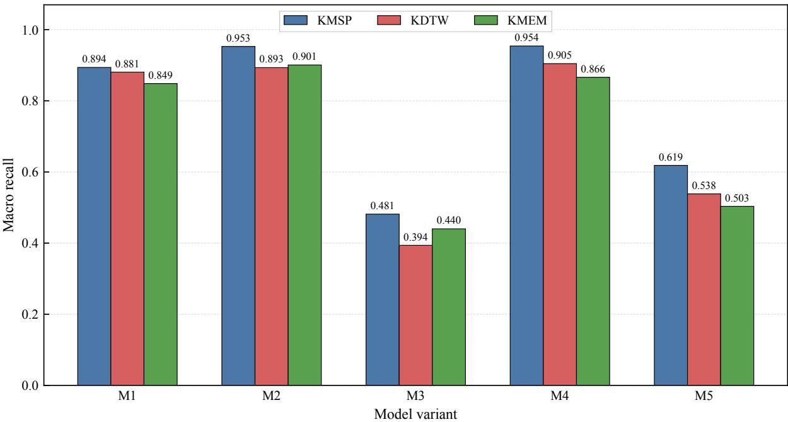

Figure 8: Macro-recall comparison of the benchmark model variants across the three arrival airports. Model definitions are given in Table 6.  
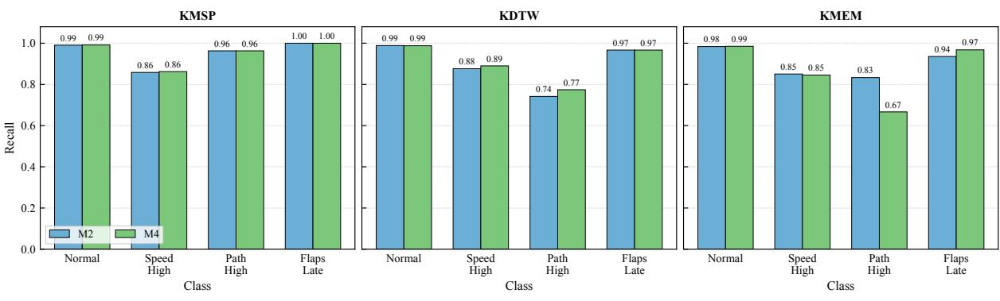  
(a)  
(b)  
(c)  
Figure 9: Class-wise recall comparison between the weighted statistical-feature model (M2) and the proposed hybrid-fusion model (M4).

Taken together, the benchmarks support the proposed combination of parameter-specific statistical descriptors, imbalance-aware training, and continuous temporal-deviation information. M4 achieves the best macro recall at two airports and improves on the unweighted, AE-error-only, and hard-gate alternatives at all three. Its favorable class-wise comparison with M2 demonstrates the complementary value of the reconstruction-error descriptor, while the KMEM Path High result identifies a localized limitation requiring stronger event support and further evaluation.

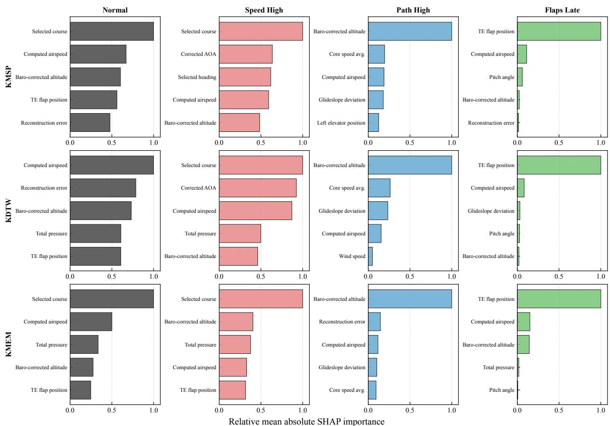  
Figure 10: Top five parameter-level SHAP drivers for each class and arrival airport, with reconstruction error retained as a separate feature. Values are normalized within each airport– class panel by the largest aggregated mean absolute SHAP value in that panel, emphasizing relative importance within each panel.

## 5.5 Model Explainability and Safety-Relevant Feature Drivers

To examine whether the final classifier relied on operationally meaningful variables, Tree SHAP analysis was applied to the trained airport-specific hybrid-fusion XGBoost models. SHAP values were computed for the 221-dimensional fused representation, and the statistical-descriptor attributions associated with each flight parameter were aggregated to obtain parameter-level importance scores. The LSTM-autoencoder reconstruction error was retained separately. These attributions explain the contribution of the inputs to each trained model’s class-specific output.

Figure 10 shows the top five parameter-level drivers for each class and airport, including reconstruction error where applicable. Values are normalized within each airport–class panel by the largest aggregated mean absolute SHAP value in that panel. The figure therefore emphasizes relative importance within each prediction context, without implying direct comparability of absolute SHAP magnitudes across airports or class outputs.

The clearest alignment between feature importance and the operational meaning of the labels occurs for Path High and Flaps Late. For Path High, baro-corrected altitude is the dominant driver across all three airports, while glideslope deviation consistently appears among the top-ranked variables. This agrees with the interpretation of Path High as a vertical-path deviation class. Secondary drivers include computed airspeed, average core speed, wind speed, and elevator position, showing that the class output also uses information about speed, propulsion, atmospheric conditions, and control response alongside the vertical-path variables.

For Flaps Late, trailing-edge flap position dominates the attributions at all three airports by a large margin. This ranking aligns directly with the configuration-timing meaning of the event label. Secondary drivers include computed airspeed, pitch angle, altitude, glideslope deviation, and total pressure. Their presence is operationally plausible because flap deployment during approach accompanies changes in speed, attitude, and flight path. The strong reliance on flap-position information is also consistent with the high Flaps Late recall observed in the class-wise results despite the class’s relatively small sample support.

For Speed High, selected course is the dominant driver across all three airport-specific models. Computed airspeed, corrected angle of attack, total pressure, and baro-corrected altitude also appear among the important variables, linking the class output to speed- and energy-related flight histories. Selected course may additionally encode diferences in approach direction and local operating context. Its prominence is consistent with the classifier using contextual associations alongside the flight-state variables, although the specific runway or procedural relationships underlying this association are not established by the feature rankings.

For Normal, the leading drivers include selected course, computed airspeed, baro-corrected altitude, flap position, total pressure, and reconstruction error. The class output therefore draws on several aspects of the approach history, rather than a single event-specific parameter. Reconstruction error ranks among the top five drivers for Normal at KMSP and KDTW, and is also the second-ranked driver for Path High at KMEM. These attributions show that the temporal-deviation descriptor is used alongside the parameter-specific statistical features. Its role is complementary, consistent with the benchmarking results showing that reconstruction error alone is insuficient for reliable multiclass prediction.

Across airports, the dominant drivers for vertical-path and configuration events align with the corresponding operational variables, while Speed High predictions also rely strongly on approach-context information. Airport-dependent diferences in the secondary drivers show how the trained models use diferent combinations of flight-history information for the same class output. This class-specific interpretation complements the performance comparisons by identifying the variables associated with the models’ predictions.

## 6 Conclusion

This study developed and demonstrated a hybrid feature-fusion framework for landing-phase safety-event prediction under severe class imbalance. The framework combines learned deviations from nominal temporal behavior with parameter-specific flight-history descriptors, enabling a class-weighted XGBoost classifier to distinguish safety-event signatures across diferent airport contexts. Its contribution includes the predictive framework, empirical assessment of the value of temporal feature fusion, and evidence of how airport-specific learning afects event detection. Class-wise evaluation and SHAP analysis connect these performance findings to identifiable operational variables, providing an interpretable basis for examining the resulting predictions.

The component benchmarks demonstrate the efectiveness of the proposed design. The hybrid model achieved the highest macro recall at KMSP and KDTW, reaching 0.9542 and 0.9046, respectively, and outperformed the unweighted, AE-error-only, and hard-gate baselines on this metric at all three airports. Adding the temporal-deviation descriptor to the weighted statisticalfeature classifier improved both macro recall and macro F1 at two airports, demonstrating its complementary predictive value. Continuous feature fusion also substantially outperformed hard anomaly gating, supporting the use of reconstruction error as information for multiclass discrimination. Mean macro recall remained above 0.90 at every airport across five data partitions and retraining runs. The pooled-versus-specialist comparison identified benefits from local specialization at KMSP and KDTW and from pooled training at KMEM, providing evidence for selecting the training strategy according to airport context and available event data. SHAP rankings further showed clear alignment between the dominant predictive variables and the operational meaning of vertical-path and configuration events.

The evaluation was limited to a curated dataset from a single regional-jet type and three arrival airports. Generalization across aircraft types and broader operating environments therefore remains to be established. Minority-event support was also limited, particularly for Path High at KMEM, making its estimated recall sensitive to individual test cases. The repeated-split analysis characterized variability within the available dataset, but did not evaluate transfer to unseen airports or changes in operating conditions over time.

Future work will extend the evaluation to multiple aircraft types and additional airports to assess the robustness of the learned representations across fleets and operating contexts. Greater coverage of rare events will support more reliable class-wise comparisons and help determine when pooled training, local specialization, or adaptation between operating contexts is most efective. Evaluation on temporally separated data will further assess whether the observed performance is maintained as operational conditions change.

## Funding

This research received no external funding.

## Data availability

The flight data used in this study are publicly available from the NASA DASHlink Curated 4 Class Anomaly Detection Data Set [44] at https://c3.ndc.nasa.gov/dashlink/resources/1018/. The code used to develop and evaluate the proposed framework is available from the corresponding author upon reasonable request.

## Declaration of generative AI use

During the preparation of this work, the authors used Codex for language editing and to assist in generating Python scripts for plotting. The authors carefully reviewed and checked all manuscript content and generated scripts, made revisions as necessary, and take full responsibility for the accuracy and integrity of the published article.

## References

[1] Boeing Commercial Airplanes. Statistical summary of commercial jet airplane accidents: Worldwide operations 1959–2023. Technical report, Boeing Commercial Airplanes, Aviation Safety, Seattle, WA, USA, August 2024. URL https://indonesia-icao.org/statsum23s. pdf.

[2] Federal Aviation Administration. FAA aerospace forecast: Fiscal years 2016–2036. Technical report, Federal Aviation Administration, 2016. URL https://www.faa.gov/sites/faa.gov/files/data\_research/aviation/aerospace\_ forecasts/FY2016-36\_FAA\_Aerospace\_Forecast.pdf.

[3] Jeevith Hegde and Børge Rokseth. Applications of machine learning methods for engineering risk assessment–a review. Safety Science, 122:104492, 2020. doi:10.1016/j.ssci.2019.09.015.

[4] Xirui Li, Fairuz Izzuddin Romli, Syaril Azrad, and Md Amzari Md Zhahir. An overview of civil aviation accidents and risk analysis. Proceedings of Aerospace Society Malaysia, 1 (1):53–62, 2023. URL https://www.aerosmalaysia.my/aeros\_proceedings/index.php/ journal/article/view/24.

[5] International Air Transport Association. IATA annual safety report 2023: Recommendations for accident prevention. Technical report, International Air Transport Association, Montreal, Quebec, Canada, 2024. URL https://www.iata.org/contentassets/95e933e1ad794068812f073cf883cb08/ recommendations-for-accident-prevention---2023.pdf.

[6] Federal Aviation Administration. 14 CFR section 121.344: Digital flight data recorders for transport category airplanes, 2011. URL https://www.govinfo.gov/content/pkg/ CFR-2011-title14-vol3/pdf/CFR-2011-title14-vol3-sec121-344.pdf. 2011 edition of the Code of Federal Regulations.

[7] Federal Aviation Administration. Flight operational quality assurance. Advisory Circular AC 120-82, U.S. Department of Transportation, Federal Aviation Administration, Washington, DC, 2004. URL https://www.faa.gov/documentLibrary/media/Advisory\_Circular/AC\_ 120-82.pdf.

[8] International Civil Aviation Organization. Manual on Flight Data Analysis Programmes. International Civil Aviation Organization, Montreal, Canada, 2 edition, 2021. URL https:// store.icao.int/en/manual-on-flight-data-analysis-programmes-doc-10000. ICAO Doc 10000.

[9] Civil Aviation Authority. Flight Data Monitoring: A Guide to Good Practice. UK Civil Aviation Authority, London, United Kingdom, 1 edition, 2003. URL https://vast.aero/ Safety\_Toolbox/FDM/HFDM-F\_CAP739.pdf. CAP 739.

[10] David Haas, Joel Walker, and Lawrence Kough. Using flight data to improve operational readiness in naval aviation. In AHS 64th Annual Forum, pages 1–15. American Helicopter Society International, 2008. doi:10.4050/vfs-f64-000088.

[11] Junyu Gao, Hao Yang, Da Zhang, Yuan Yuan, and Xuelong Li. Imbalanced aircraft data anomaly detection. IEEE Transactions on Aerospace and Electronic Systems, 61(2): 1422–1432, 2025. doi:10.1109/taes.2024.3456748.

[12] Marc-Henri Bleu Laine, Tejas G. Puranik, Dimitri N. Mavris, and Bryan Matthews. Multiclass multiple-instance learning for predicting precursors to aviation safety events. Journal of Aerospace Information Systems, 19(1):22–36, 2022. doi:10.2514/1.i010971.

[13] Alise Danielle Midtfjord, Riccardo De Bin, and Arne Bang Huseby. A decision support system for safer airplane landings: Predicting runway conditions using XG-Boost and explainable AI. Cold Regions Science and Technology, 199:103556, 2022. doi:10.1016/j.coldregions.2022.103556.

[14] Jichao Li, Xiaosong Du, and Joaquim R. R. A. Martins. Machine learning in aerodynamic shape optimization. Progress in Aerospace Sciences, 134:100849, 2022. doi:10.1016/j.paerosci.2022.100849.

[15] Steven L Brunton, Bernd R Noack, and Petros Koumoutsakos. Machine learning for fluid mechanics. Annual Review of Fluid Mechanics, 52(1):477–508, 2020. doi:10.1146/annurevfluid-010719-060214.

[16] Bilal Mufti, Anindya Bhaduri, Sayan Ghosh, Liping Wang, and Dimitri N Mavris. Shock wave prediction in transonic flow fields using domain-informed probabilistic deep learning. Physics of Fluids, 36(1):016121, 2024. doi:10.1063/5.0185370.

[17] Bilal Mufti, Christian Perron, and Dimitri N Mavris. Nonlinear reduced-order modeling of compressible flow fields using deep learning and manifold learning. Physics of Fluids, 37(3): 036130, 2025. doi:10.1063/5.0253365.

[18] Julian Oehling and David J Barry. Using machine learning methods in airline flight data monitoring to generate new operational safety knowledge from existing data. Safety Science, 114:89–104, 2019. doi:10.1016/j.ssci.2018.12.018.

[19] Mickael Rey, Daniel Aloise, François Soumis, and Romanic Pieugueu. A data-driven model for safety risk identification from flight data analysis. Transportation Engineering, 5:100087, 2021. doi:10.1016/j.treng.2021.100087.

[20] Zhaoyi Xu and Joseph H. Saleh. Machine learning for reliability engineering and safety applications: Review of current status and future opportunities. Reliability Engineering & System Safety, 211:107530, 2021. doi:10.1016/j.ress.2021.107530.

[21] Philippe Barbosa Silva, Michelle Andrade, and Sara Ferreira. Machine learning applied to road safety modeling: A systematic literature review. Journal of Trafic and Transportation Engineering (English Edition), 7(6):775–790, 2020. doi:10.1016/j.jtte.2020.07.004.

[22] Di Zhou, Xiao Zhuang, Hongfu Zuo, Han Wang, and Hongsheng Yan. Deep learningbased approach for civil aircraft hazard identification and prediction. IEEE Access, 8: 103665–103683, 2020. doi:10.1109/access.2020.2997371.

[23] Tejas G. Puranik, Nicolas Rodriguez, and Dimitri N. Mavris. Towards online prediction of safety-critical landing metrics in aviation using supervised machine learning. Transportation Research Part C: Emerging Technologies, 120:102819, 2020. doi:10.1016/j.trc.2020.102819.

[24] Xiangzhang Wang and Ruifang Mou. Flight safety risk prediction for civil aircraft approach and landing. Journal of Aerospace Information Systems, 22(3):220–230, 2025. doi:10.2514/1.i011487.

[25] Xu Li, Jiaxing Shang, Linjiang Zheng, Qixing Wang, Dajiang Liu, Xiaodong Liu, Fan Li, Weiwei Cao, and Hong Sun. IMTCN: An interpretable flight safety analysis and prediction model based on multi-scale temporal convolutional networks. IEEE Transactions on Intelligent Transportation Systems, 25(1):289–302, 2024. doi:10.1109/tits.2023.3308988.

[26] Sepp Hochreiter and Jürgen Schmidhuber. Long short-term memory. Neural Computation, 9(8):1735–1780, 1997. doi:10.1162/neco.1997.9.8.1735.

[27] Felix A. Gers, Jürgen Schmidhuber, and Fred Cummins. Learning to forget: Continual prediction with LSTM. Neural Computation, 12(10):2451–2471, 2000. doi:10.1162/089976600300015015.

[28] Klaus Gref, Rupesh K. Srivastava, Jan Koutník, Bas R. Steunebrink, and Jürgen Schmidhuber. LSTM: A search space odyssey. IEEE Transactions on Neural Networks and Learning Systems, 28(10):2222–2232, 2017. doi:10.1109/tnnls.2016.2582924.

[29] Mayu Sakurada and Takehisa Yairi. Anomaly detection using autoencoders with nonlinear dimensionality reduction. In Proceedings of the MLSDA 2014 2nd Workshop on Machine Learning for Sensory Data Analysis, pages 4–11. ACM, 2014. doi:10.1145/2689746.2689747.

[30] Pankaj Malhotra, Anusha Ramakrishnan, Gaurangi Anand, Lovekesh Vig, Puneet Agarwal, and Gautam Shrof. LSTM-based encoder-decoder for multi-sensor anomaly detection, 2016. URL https://arxiv.org/abs/1607.00148. arXiv preprint.

[31] Guansong Pang, Chunhua Shen, Longbing Cao, and Anton van den Hengel. Deep learning for anomaly detection: A review. ACM Computing Surveys, 54(2):1–38, 2022. doi:10.1145/3439950.

[32] Raghavendra Chalapathy and Sanjay Chawla. Deep learning for anomaly detection: A survey, 2019. URL https://arxiv.org/abs/1901.03407. arXiv preprint.

[33] Jia Li, Yuqian Zhou, and Zheng Dong. TSAE-UAV: A time-sense autoencoder for unsupervised anomaly detection of UAV based on flight data. Aerospace Science and Technology, 169:111431, 2026. doi:10.1016/j.ast.2025.111431.

[34] Enis T. Turgut. Detecting subtle deviations in QAR (quick access recorder) data: An integrated methodology of perceptual hashing and shannon entropy (PHASE). Aerospace Science and Technology, 178:112370, 2026. doi:10.1016/j.ast.2026.112370.

[35] Jerome H. Friedman. Greedy function approximation: A gradient boosting machine. The Annals of Statistics, 29(5):1189–1232, 2001. doi:10.1214/aos/1013203451.

[36] Tianqi Chen and Carlos Guestrin. XGBoost: A scalable tree boosting system. In Proceedings of the 22nd ACM SIGKDD International Conference on Knowledge Discovery and Data Mining, pages 785–794, San Francisco, CA, USA, aug 2016. ACM. doi:10.1145/2939672.2939785.

[37] Jinyi Mao, Jian Chen, and Yaoji Deng. Optimization strategy for ensemble learning models based on fusing resampling, adaptive dimensionality reduction, and optuna in intelligent flight technology evaluation. Aerospace Science and Technology, 162:110251, 2025. doi:10.1016/j.ast.2025.110251.

[38] Karim Aly, Alexei Sharpanskykh, and Jacco Hoekstra. Generative augmentation of imbalanced flight records for flight diversion prediction: A multi-objective optimisation framework. Aerospace Science and Technology, 178:113224, 2026. doi:10.1016/j.ast.2026.113224.

[39] Haibo He and Edwardo A. Garcia. Learning from imbalanced data. IEEE Transactions on Knowledge and Data Engineering, 21(9):1263–1284, 2009. doi:10.1109/tkde.2008.239.

[40] Nitesh V. Chawla, Kevin W. Bowyer, Lawrence O. Hall, and W. Philip Kegelmeyer. SMOTE: Synthetic minority over-sampling technique. Journal of Artificial Intelligence Research, 16: 321–357, 2002. doi:10.1613/jair.953.

[41] Alberto Fernández, Salvador García, Mikel Galar, Ronaldo C. Prati, Bartosz Krawczyk, and Francisco Herrera. Learning from Imbalanced Data Sets. Springer, Cham, Switzerland, 2018. ISBN 978-3-319-98074-4. doi:10.1007/978-3-319-98074-4.

[42] Scott M. Lundberg and Su-In Lee. A unified approach to interpreting model predictions. In I. Guyon, U. Von Luxburg, S. Bengio, H. Wallach, R. Fergus, S. Vishwanathan, and R. Garnett, editors, Advances in Neural Information Processing Systems, volume 30. Curran Associates, Inc., 2017. URL https://proceedings.neurips.cc/paper\_files/paper/ 2017/file/8a20a8621978632d76c43dfd28b67767-Paper.pdf.

[43] Scott M. Lundberg, Gabriel Erion, Hugh Chen, Alex DeGrave, Jordan M. Prutkin, Bala Nair, Ronit Katz, Jonathan Himmelfarb, Nisha Bansal, and Su-In Lee. From local explanations to global understanding with explainable AI for trees. Nature Machine Intelligence, 2(1): 56–67, 2020. doi:10.1038/s42256-019-0138-9.

[44] Bryan Matthews. Curated 4 class anomaly detection data set. NASA DASHlink, Sample Flight Data Project, 2022. URL https://c3.ndc.nasa.gov/dashlink/resources/1018/. Updated December 22, 2022.

[45] NASA DASHlink. Sample flight data project. NASA DASHlink, n.d. URL https://c3. ndc.nasa.gov/dashlink/projects/85/.