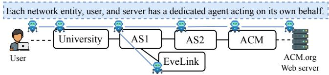
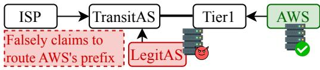
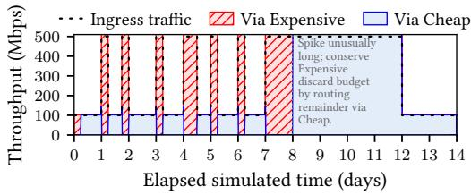

# Instantiating the Knowledge Plane

Francisco Pereira   
INESC-ID, Instituto Superior   
Técnico, University of Lisbon Lisbon, Portugal

Justine Sherry Carnegie Mellon University Pittsburgh, USA

Pratiksha Thaker Databricks New York, USA

## Abstract

In 2003, Clark et al. proposed the “Knowledge Plane”, a layer of intelligent agents that share rich information about network state in order to collaboratively manage the Internet across administrative boundaries. The technology of the day lacked the two capabilities it demanded most: reasoning and unstructured communication. Thus, automated network management has remained largely confined to single domains, while interdomain problems are still resolved by human operators on the phone. We argue that agentic large language models can finally unlock the potential of the Knowledge Plane, but that doing so will require solving new research problems that arise particularly in this decentralized, multi-agent, coopetitive setting that have received limited attention in the literature thus far.

## CCS Concepts

•Networks→Networkmanagement;•Computingmethodologies → Multi-agent systems.

## Keywords

Knowledge Plane, Multi-Agent Systems, Interdomain Routing

## ACM Reference Format:

Francisco Pereira, Justine Sherry, and Pratiksha Thaker. 2026. Instantiating the Knowledge Plane. In The 25th ACM Workshop on Hot Topics in Networks (HotNets ’26), November 16–17, 2026, Salt Lake City, UT, USA. ACM, New York, NY, USA, 11 pages. https: //doi.org/10.1145/3847290.3859939

## 1 Introduction

The Internet is designed to be general, composable, and decen tralized – properties that enable it to scale globally. However, managing components of the Internet can be a formidable task precisely because of its decentralized nature and complexity – so much so that entire subfields have been devoted to network configuration, routing, troubleshooting, defense, load balancing, and more [8, 10, 31, 44, 54]. These challenges currently require a great deal ofhuman coordination on top of the sophisticated algorithms, software, and hardware built to solve these problems.

In the face of so much complexity and manual intervention, one would naturally ask: what can we hope to automate away? Over decades of efort, researchers have proposed numerous solutions to automate the configuration and verification of pieces of network management [9, 26, 27, 29, 41, 65, 75]. Yet protocols for rich interdomain communication are limited, and dificult to upgrade and adapt for unforeseen applications – so automated network debugging and decision-making tends to be limited to single-domain solutions.

Presciently, in 2003, Clark et al. proposed a solution: a “Knowledge Plane” run by intelligent agents that share rich information about network state with the goal of collaborative network management, including troubleshooting, routing, configuration, intrusion detection and more [20]. The paper envisioned a user bringing a question like, “Why can’t I load this webpage?” to an agent which might in turn collect data about routes and DNS from its local network, and ask agents from remote networks about the location of their firewalls or their provisioned server capacities. In the pre-LLM era, however, it was not clear how one would implement a Knowledge Plane. Although several lines of subsequent work have attempted to instantiate a Knowledge Plane [3, 16, 28, 52, 60, 83], the state of the art technology at the time lacked suficient unstructured communication and reasoning capability to autonomously and collaboratively diagnose and solve interdomain network problems. It is only now that we have models – agentic large language models – powerful enough to truly instantiate a Knowledge Plane.

The natural instinct ofthe skeptical systems researcher may be to push back against the idea of unleashing unpredictable agents on the Internet, or perhaps to question the technical value of an agentic layer over the Internet. We acknowledge these concerns, yet hope to argue that LLM agents can fill a real technical need that current Internet protocols and automated troubleshooting solutions do not adequately solve, while also outlining concrete challenges – particularly in safety and security – that must be met in order for deployment to be possible. In short, we ask the reader to temporarily ignore the question of whether we should manage the Internet with agents, and join us for the thought experiment of what benefits and challenges we might uncover if we were to do so.

Promise: Decentralized, online, adaptive decision making. Many real problems require communication across network domains to troubleshoot. To name a few examples, diagnosing protocol failures due to unforeseen middlebox behavior [49, 64], diagnosing path inflation [71], identifying and root-causing interdomain congestion [25], and identifying unreachable “black holes” [40] are all examples of distributed network failures that cannot be easily diagnosed nor resolved with the information available in a single autonomous system.

Cooperating LLM agents hosted by every network, following the Knowledge Plane’s blueprint, bring two main benefits: decentralized collaboration and adaptive communication.

First, LLMs can collaborate to solve complex troubleshooting tasks or make decisions involving multiple stakeholders. Today, such problems would require multiple human operators to coordinate, requiring potentially several communication rounds and hours ofhuman efort to debug. Importantly, even though some automated tools can be used to inspect logs or perform data analysis and speed up this process to a degree, interdomain network management is dificult because no individual operator has access to all of the data, infrastructure, and configurations that a route or packet is going to touch as it crosses the Internet.

Second, LLMs can adapt their communication as needed by the application at hand: natural language functions as a flexible and completely forward- and backward-compatible protocol. Fixed protocols to exchange telemetry between ASes (e.g. netflow data, routing configuration) between operators might be helpful, but they ultimately constrain the data that is shared: new protocols or systems might not be able to be encoded in the inter-AS telemetry format as one AS adopts a new technology and another lags behind. An agentic model brings the ability of a sender to explain what new data represents, even as new technologies are adopted. Furthermore, operators may have privacy concerns and hence not want to share arbitrary telemetry data unless the data is explicitly necessary to solve a problem at hand. Deciding which data to share requires reasoning, something that LLMs might resolve but a static protocol with traditional ACLs cannot.

In §3, we present a series of simulated case studies where agents at diferent organizational domains collaborate to debug availability failures, defend against security risks, and optimize financial goals. This illustrates the capacity of today’s agents to communicate, collaborate, and resolve the kinds of interdomain issues that today force human network operators to be available on the phone around-the-clock.

Challenge: Collaboration without trust. In §4, we explore why an agentic Knowledge Plane is not (yet?) a good idea. Some open challenges are shared with many other systems that hope to adopt LLM technology for better management, especially challenges in scalability [18, 37, 45, 46, 62, 70, 74] and LLM correctness and robustness to attacks [6, 11, 32, 34, 39, 47, 66, 72, 87].

At the same time, we think an agentic Internet brings challenges that are uncommon to the broader research world, as we expect agents to collaborate towards a shared goal (global routing) despite a lack of trust between collaborating agents as well as potentially conflicting local goals from diverse edge applications. This plays out in two open questions we see: data privacy (operators do not generally share all of their routing preferences, and yet agents may need to share some of this information to diagnose issues) and strategic behavior (untrusted networks may selectively withold information or even lie). As we will discuss further in §4, these kinds of challenges are less well-explored in either the ML literature or the literature of applying ML to computer systems. Hence, an agentic Internet brings new research perspectives into AI safety and multiagent coordination.

## 2 Background and Related Work

In this section, we present the original vision ofthe Knowledge Plane (KP) as envisioned by Clark et al. [20], review significant literature that has made strides towards realizing that vision since 2003, highlight the remaining gaps to realizing that full vision, and outline concrete requirements that our agentic architecture should satisfy in order to realize the interdomain vision ofthe Knowledge Plane.

## 2.1 The Knowledge Plane Vision

The goal of the Knowledge Plane was to create “a fundamentally diferent sort of network that can assemble itself given high level instructions, reassemble itself as requirements change, automatically discover when something goes wrong, and automatically fix a detected problem or explain why it cannot do so” [20]. In the paper, the authors argue that a “cognitive system” is necessary to bring reasoning into the management of Internet infrastructure (despite the limitations of AI reasoning systems at the time). At the heart of the paper is an example – which we replicate in §3 – in which a user asks a broad and high level question (“Why can’t I access acm.org?”) and a distributed collection ofagents from the user’s AS, the ACM’s AS, and even agents at individual servers exchange information about routes, DNS availability, firewalls, server capacity, etc.

Today, debugging an outage with this level of data availability would require phone calls between operators. However, the phone-call approach is only feasible for major CDNs, networks, and datacenter operators to use in only the worst-case of outages – and hence most individual problems of this nature are never resolved at all. Hence, the KP approach represented then, and still represents today, a major advance in the ability to diagnose and potentially repair interdomain challenges.

## 2.2 Then and Now

Some have attempted to explicitly instantiate a Knowledge Plane [3, 16, 28, 52, 60, 83], but prior to LLMs, the required capabilities for reasoning and unstructured communication were not available and hence these approaches lacked the “cognitive” depth envisioned by Clark et al.

Other lines of work in the intra-domain setting have pushed the reasoning aspects of a Knowledge Plane approach further. For example, work on self-driving networks [2, 28, 33, 43, 68, 69, 73, 77] and related work on machine learning for network management applications, particularly reinforcement learning [55–57], are particularly rich. The seminal paper on selfdriving networks [28] outlined a number of goals ofnetwork automation, covering data collection, in-network analytics and decision making, security, scalability, learning, and dynamic decision making. We see many of these contributions as supportive of the proposal of an agentic Knowledge Plane: these works illustrate a division of labor in which agents can reason and communicate, but the job ofdata collection and analytics are still best left to the programmable data plane and traditional statistics, which agents can access as tools.

Significant progress has been made towards leveraging LLMs in the context of network management. One line of work proposes intent-based networking [4, 21, 35, 36, 59, 65, 75, 81, 81] in which network operators should be able to express goals and outcomes (in some interface such as, but not limited to, natural language) and the network should translate and accomplish that intent – but the goal is typically to translate user intent into network behavior; network devices cannot necessarily send unstructured expressions to each other. Agentic techniques have already begun to be incorporated into network and software system troubleshooting [5, 14, 67, 76, 78–82, 86, 88].

Altogether, the Knowledge Plane vision is far more feasible today than it was in 2003, in part due to advances in LLM technology, but also due to advances in the network management literature as described above.

## 2.3 Requirements for a Knowledge Plane

We now consider the core properties that a Knowledge Plane requires and what remains unsolved for the interdomain Knowledge Plane vision to be realized. From Clark et al. [20], we derive the following list of requirements:

R1 Abstract high-level goals from low-level actions.   
R2 Learn from past actions.

R3 Operate efectively in the face of generality.

R4 Extend its perspective to the entire global network by merging perspectives and activities between diferent networks.

R5 Function in the presence of incomplete, inconsistent, misleading, or malicious information.

R6 Perform appropriately in the presence of conflicting or inconsistent higher-level goals among the Internet’s diferent stakeholders.

Among these requirements, we observe that R1-R3 largely test single-agent capabilities that can be explored within a single domain. The existing literature on AI-based network management largely solves all of them! Taking one recent and prominent work as an example, Meta’s recent paper [81] demonstrates a production tool that moves between low level data formats and higher level human abstractions (R1), learns and models anomalies (R2), and adapts as new tools and technologies are deployed (R3).

On the other hand, the remaining R4-R6 test multi-agent interactions, which is required for multi-domain settings. These capabilities have not yet been demonstrated in the literature.

To explore this possibility, in the following section, we select three case studies chosen to illustrate that today’s LLMs are capable of at least some of the reasoning and communication requirements detailed in R4-R6, pointing the way towards the possibility of an interdomain Knowledge Plane.

## 3 Case Studies

In this section, we walk through a series ofcase studies to better understand whether agents would meet the three criteria we chose to study in §2. We first (§3.2) simulate an example from the KP paper [20], testing the agents’ ability to reason about a global perspective (R4). We then (§3.3) illustrate a scenario in which the LLMs demonstrate capabilities to consider conflicting and even malicious information (R5 and R6). Finally, we consider a more dynamic setting in which agents can perform unconstrained load balancing (§3.4).

## 3.1 Experimental Setup

We use Mininet [50] to build a virtualized network of hosts, each equipped with an agent acting as a system administrator. Agents treat the emulated network as a real one, issuing real commands on their respective hosts in the Mininet environment. Experiments run in simulated time, so scenarios spanning days of network activity complete in minutes.

Each agent has full administrative control over its own host, and is informed ofits immediate neighbors, but has no global view of the network. Each agent receives a prompt that briefly describes its organization’s objectives and policies. We keep these prompts minimal: enough to act on the organization’s behalf, but without details of the experimental scenario. In particular, agents are never told which fault was injected, or that one was injected in the first place. Agents communicate outside the data plane, over a separate dedicated message channel (the Knowledge Plane), which they use to send messages to their immediate neighbors.

  
Figure 1: Simulated network for fault diagnosis wherein a student tries to access www.acm.org.

Each agent is provided with the same set oftools: exec to run a shell command on their host, send\_message to communicate in natural language with other neighboring agents via the Knowledge Plane, and idle to wait until a message arrives. Every tool usage carries a mandatory free-text justification, which is the source of the reasoning quoted throughout this section. An experiment ends once every agent signals it has nothing left to do, or when a fixed budget of iterations is exhausted.

We ran all experiments with four models: Claude Opus 4.7, GPT 5.5, and smaller open-weight models Qwen 2.5 72B (AWQ) (with vLLM [48] and two NVIDIA RTX PRO 6000 Blackwell Max-Q) and GLM 5.2 FP4 (via Together AI 1).

All our code and experimental results, including prompts, logs, and reports, are openly available .

## 3.2 Fault Diagnosis

Consider an example proposed by Clark et al. [20], wherein a university student cannot reach www.acm.org (fig. 1). The cause may lie anywhere along the path: a firewall block at the university, a routing failure upstream, a breakdown in name resolution, or even a server overload at ACM. Diagnosing it requires cooperation across networks with diferent vantage points but under separate administrative control.

We investigate our Knowledge Plane’s ability to recognize and recover from an outage of www.acm.org under three different causes. We initialize each agent with the basic rules and responsibilities of its organization. For instance, for AS1:

Prompt: AS1

You belong to the Knowledge Plane, and represent autonomous system AS1. University and EveLink are your customers, and pay you for Internet transit. AS2 is your peer, and neither one of you pays the other (you exchange trafic as equals). Your goal is to maximize revenue, and provide reliable Internet transit to your customers.

The student always takes the first step by asking their local agent for help. The agent then collaborates with the rest of the Knowledge Plane to finally return a diagnosis.

Cause #1: University firewall. The university administration team mistakenly introduced a firewall rule that inadvertently blocked requests to www.acm.org. For all models, the user agent first replicated the reported issue, ran local diagnostics, and escalated the problem automatically to the university. The university agent then found the smoking gun, which was later relayed back to the user:

## Quote: University

GLM 5.2 FP4

Firewall policy on the University gateway (Uni) is blocking all trafic to 198.82.0.0/24, which includes 198.82.0.1 (acm.org). [...] Per policy, changes to firewall rules require administrator approval — I cannot override them autonomously. Administrators have been notified of this finding and the proposed fix.

Cause #2: AS1’s stale DNS entry. Now, the user’s requests pass freely through the university’s firewall, but AS1 is configured with an out-of-date DNS entry resolving www.acm.org to an old ACM IP address. As the user’s machine relies on AS1 to resolve www.acm.org, every subsequent HTTP request to that website is forwarded to the wrong location.

Opus, GPT, and GLM quickly escalated the problem up to AS1, which correctly identified the DNS misconfiguration. However, it deemed the required change sensitive enough to require administration approval, notifying the administrators and warning University of the findings, which ultimately relayed to the user:

Quote: User

Claude Opus 4.7

acm.org failed to load because our upstream DNS provider is handing out a wrong addressfor the site [...]. The issue has already been flagged to that provider’s administrators, so no action is needed from you on that front.

Qwen, on the other hand, gathered the same evidence but read it as a routing issue rather than a DNS one. It was ultimately unable to provide an accurate report to the user.

Cause #3: Overloaded ACM server. In this scenario, neither the university’s firewall nor AS1 are the source of the outage. We instead exhaust the ACM web server’s capacity by having EveLink issue benign requests to a blocking HTTP endpoint

Figure 2: Topology of the Celer Bridge experiment. Arrows denote provider/client relationship, and solid lines peer/peer. of the ACM webserver. The server remains reachable, but rejects new connections.

Both Opus and GPT escalated to Web and correctly identified overload as the root cause. Web then shared its findings with ACM, including client information and implementation details. ACM relayed the diagnosis back to the user but, as instructed, withheld the private implementation details and the fact that EveLink was the reason behind this outage.

Quote: ACM

Claude Opus 4.7

Iam NOTdisclosing the abusive source IP, the /slow endpoint, worker-pool details, or any other internal specifics to external parties — only that the service is degraded, cause is identified as external abuse, and mitigation is pending admin approval.

Qwen struggled to correctly diagnose the problem, not escalating to ACM and thus never collecting enough information to reach a verdict and inform the user. GLM instead read EveLink’s behavior as malicious (“slow-loris-like attack”). But because ACM’s directives forbade patching its firewall directly, GLM exposed EveLink’s actions publicly and asked AS1 for help, overriding its privacy directives to do so. AS1 relayed this to EveLink, which stopped, but EveLink was still blamed for the incident in the user’s report.

Key takeaway. In all three experiments, the agents cooperated across organizational boundaries, reasoning together and merging partial views of the network into a single diagnosis, providing evidence that they can fulfill R4.

## 3.3 Reasoning amidst conflicting information

We now turn from Clark et al.’s examples to an adversarial scenario, testing how agents handle conflicting information and high-level goals (R5, R6) by simulating the 2022 Celer Bridge BGP hijack [22, 53]. Figure 2 shows the topology of our simulation, analogous to the Celer Bridge incident.

In this incident, the attackers served a legitimate-looking but malicious front-end to users of Celer Bridge, a service for moving cryptocurrency assets between blockchains. The attack hinged on a BGP hijack: a small hosting provider (LegitAS) announced it could reach a block of AWS addresses hosting the legitimate front-end, drawing trafic to attacker controlled servers. The announcement was crafted to pass the routing system’s origin checks (IRR 3 and RPKI 4), so no protection flagged it.

Qwen failed to stop the attack, accepting RPKI-validity as enough evidence to install the malicious announcement. All of the other models rejected LegitAS’s announcement on three pieces of evidence: first, the fact that some IRR entries were not verified; second, the implausible implication that a small AS such as LegitAS has a direct connection with AWS and is authorized to transit trafic to them; third, AWS’s agent denied authorizing the IRR entry LegitAS relied on, exposing it as fabricated rather than merely unverified.

## Quote: TransitAS

GPT 5.5

Iam not installing or exporting this more-specific at this time. The prefix is within AWS space already reachable via a validated 44.192.0.0/16 route, and the supporting IRR objects/as-set are AltDB-only; RPKIvalidates only the origin/max-length, not that AS-LEGITAS is authorized to provide transit for AS-AWS. [...] I am keeping 44.192.0.0/16 via Tier1 and requesting stronger AWS authorization before considering acceptance.

Key takeaway. Skepticism in the face of incorrect advertisements provides evidence that agents can reason about misleading information (R5) and conflicting information and goals (R6).

## 3.4 Agentic policy-based routing

We now move beyond fault analysis, and ask whether agents can also make dynamic decisions in a load-balancing setting.

In particular, instead of relying on BGP, we allow agents to autonomously make routing decisions. Crucially, each agent is provided with the routing contracts signed of by its organization. Unlike BGP configurations, which strive for mimicking details of contractual relationships (expressed in natural language by providers) in a programmatic language, the agents now have full access to the nuances of each contract.

We analyze the routing decisions made by an ISP connected to two providers: Cheap and Expensive. While Cheap charges \$1/Mbps, Expensive provides guaranteed low-latency transit at \$5/Mbps, billed at the 90th percentile over a 30-day billing period. ISP is instructed to minimize cost.

Figure 3 shows 14 days of trafic flowing through ISP when running with either Opus or GPT. Although during common 100Mbps windows trafic is routed through Cheap, the few hours-long daily spikes of trafic are routed through Expensive. The agent’s reasoning is founded on the fact that the busiest 10% ofsamples are discarded from Expensive’s billing, allowing it to exploit Expensive’s superior service quality to absorb these temporary spikes without paying the additional cost. After day 7, the trafic diverges from the pattern, perpetuating the high volume for several days. Within a day or two, the agent reverts to Cheap, as sustaining the elevated trafic through Expensive would exhaust its limited discard budget.

  
Figure 3: ISP routing decisions between Cheap and Expensive when running with Opus or GPT. The agent reasons about the 90th percentile billing on the Expensive option, rerouting trafic spikes to it without getting billed.

## Quote: ISP

Claude Opus 4.7

This is the 5th consecutive spike sample. Very long spike. Ineed to think again about whether my budget management is on track. [...] Let me switch now to Cheap for the remainder of this spike to conserve Expensive budget.

Qwen showed no evidence ofreasoning about percentile billing, arbitrarily swapping between Cheap and Expensive. GLM reasoned about the percentile billing at the start, rerouting only trafic spikes through Expensive. However, once the Cheap top-percentile budget was depleted it wrongly decided to permanently route through Cheap, as “routing through Expensive would only increase the bill”.

Key takeaway. The reasoning power of the models allows them to take actions that directly reflect the contracts they are provided with. This not only strongly aligns with the Knowledge Plane vision, wherein agents make low-level decisions well aligned with the high-level goals, but lets us peek into a future where agents actively make decisions in the network, beyond providing diagnostic support.

## 4 Discussion and Challenges

We presented a proof of concept that demonstrates that a Knowledge Plane is both feasible using modern LLMs and useful in the sense that an autonomous, language-based reasoning layer can adapt and react to unforeseen circumstances in a way that fixed protocols cannot, and can do so without expensive protocol updates that require wide consensus to deploy.

However, given that LLMs are still a relatively nascent and unpredictable technology, such a design raises many obvious concerns. Some ofthese are general concerns that are actively being investigated by several research communities and apply to many downstream applications of LLM agents. Other concerns are more specific to the Internet Knowledge Plane use-case. In general, we see these as rich areas for debate as well as further research.

## 4.1 Challenges Shared by Other Agentic Systems

Resource cost. Our prototype assumed that each entity in the network had access to a large frontier-capability model hosted remotely and accessed via an API – an architecture that would be prohibitively expensive (in cost, compute, and latency) at Internet scale.

Solving this problem would likely involve a combination of approaches. We can deploy agents at a coarser granularity (e.g., one per AS) to manage a collection of devices. We can also vary the power and cost of the model using model cascades, which dynamically select the required model size based on properties of the queries at hand and cost constraints [18, 37, 45, 46, 62, 70]. Open models (such as GLM) give significantly more control over model serving, latency, and data sharing compared to closed models, and can perform comparably to closed models [30]. An additional, promising direction is that of custom silicon for ultra-fast serving of open-weight models [74]. This custom hardware can enable low-latency, low-cost, and local serving of models on-device.

In a decentralized network, organizations would be able to choose which models to deploy on their devices. This leverages one of the main strengths of agentic communication: while agents may run on diferent hardware or be trained diferently, their “protocol” (i.e., natural language) will be compatible. Nevertheless, heterogeneous agents would likely have to provide suficient detail about their reasoning process to convince neighboring agents that their decision making is trustworthy.

Constraining agent behavior. Two significant challenges in deploying any agent are (1) ensuring the predictability and safety of the agent’s actions and (2) preventing attacks aimed at modifying an agent’s behavior in malicious ways. These problems are far from solved, but they are shared concerns with almost all applications of LLM agents, and are under active study and research in the machine learning community.

A common mitigation is to introduce an agentic monitor [6, 11, 12, 15, 32, 42, 47, 63, 72] (a watchdog agent to evaluate behavior), and increasing work examines scalable oversight, in which a smaller model judges a larger model, making monitoring practical [15, 17, 38, 42]. Other common solutions include guardrails that filter harmful output [34, 39, 66, 87] and, increasingly, enforcing access control via safety policies [61]. A number of other works look at protecting agents from adversarial attacks including prompt injection [23, 24, 85] and jailbreaking [11, 47].

While the above safeguards naturally carry over to network management, the networking setting also introduces new challenges – e.g., sandboxing or limiting the impact of a decision in a distributed system, limiting private data sharing in a situation that naturally requires information sharing, pre venting attacks that are unique risks in a distributed Internet domain (particularly prompt injection-style attacks). On the other hand, this domain also has unique opportunities to restrict behavior that may not be available in other domains – an agent running in a router does not need the full capability of, for example, a coding agent developing networked software.

## 4.2 Challenges Distinctive to the Interdomain Setting

Adaptive and selective information sharing. Interdomain management fundamentally involves sharing data and information. How should independently operated agents decide what information to share, with whom, and under what circumstances?

Answering this question requires both reasoning about the problem at hand and what information is minimally required to solve a problem, and also reasoning about the privacy risks of sharing user data among diferent domains. A benefit of structured protocols is that all parties can agree on a schema for data and information to be shared in advance – but the downside is that these protocols can be limiting and can ossify quickly. Unstructured agentic communication can overcome these limitations, but agents must then reason about sophisticated trust relationships and privacy considerations, not all of which may be made explicit by end-users. Some progress has been made on mitigations for this problem in the context of agents within an organization that have access to many users’ data [61, 84], but tracking data provenance and managing access at an Internet scale is a new challenge.

Cooperation amongmutually distrusting agents. Anumber of existing works in the agentic LLM literature look at using ensembles of agents that cooperate to solve parts of a single overarching task [1, 13, 19, 81]. The Internet setting is diferent: decentralized agents that do not have full trust in each other attempt to cooperate, but to achieve individual objectives, which may not be known to each other, and may not even be consistent. Even in other scenarios composed of decentralized entities with their own agents, such as robot swarms, typically these work together for a collective goal rather than potentially conflicting goals.

As a result, the Internet domain truly presents a new problem statement that is largely unexplored in the machine learning literature: decentralized negotiation among agents. Progress on this problem would likely be of interest not only to the networking community but also result in general improvements in agent capabilities applicable to other domains (such as coordination of autonomous vehicles or economic modeling). Notably, moving forward on this problem would first require identifying suitable metrics to measure success and developing benchmarks to evaluate progress and structure and unify research.

Moreover, efective agents in this domain will need to be able to reason about complex problems potentially involving a multitude of devices and domains. A single agent may or may not be able to efectively reason about problems at an Internet scale. Solutions to this problem may take many forms: more capable individual agents, escalation to morepowerful compute backends when necessary, or even eficient information-sharing systems. The good news is that the Internet was built on an ethos of decentralized reasoning, so researchers and practitioners have decades of intuition on how to efectively make use of limited and decentralized communication, carrying these lessons over into an agentic knowledge plane.

## 5 Conclusion

As early as 2003, Clark et al. predicted that a cross-domain reasoning and communication layer would be key to lifting the heavy burden ofnetwork management from human operators. LLMs represent a step-change in the reasoning and communication capabilities of our computing devices, and make this vision possible. While significant and important challenges remain in achieving this vision in practice, those challenges are worthy agendas and solving them would advance both networking and machine learning research.

## Acknowledgments

We are grateful to our shepherd, Gábor Rétvári, and the anonymous HotNets’26 reviewers. We thank Hugo Sadok and Matei Zaharia for comments on earlier drafts of the paper. Justine Sherry holds concurrent appointments as an Associate Professor at CMU and as an Amazon Scholar. This work was conducted at CMU and is not afiliated with Amazon. This work was supported by a Sloan Research Fellowship (FG-2024-21263) and by the ONR under grant #N00014-24-1-2059. Francisco Pereira was supported by the FCT scholarship PRT/ BD/152195/2021.

## References

[1] Saaket Agashe, Yue Fan, Anthony Reyna, and Xin Eric Wang. 2025. Llm-coordination: evaluating and analyzing multi-agent coordination

abilities in large language models. In Findings of the Association for Computational Linguistics: NAACL 2025. 8038–8057.

[2] Aristide Tanyi-Jong Akem, Michele Gucciardo, and Marco Fiore. 2023. Flowrest: Practical flow-level inference in programmable switches with random forests. In IEEE INFOCOM 2023-IEEE Conference on Computer Communications. IEEE, 1–10.

[3] Sepehr Ashtari, Ian Zhou, Mehran Abolhasan, Negin Shariati, Justin Lip man, and Wei Ni. 2022. Knowledge-defined networking: Applications, challenges and future work. Array 14 (2022), 100136.

[4] Vasilis Avgerinos, Kostas Ramantas, Luis Alonso, and Christos Verikoukis. 2025. ARM: Autonomous Remediation & Management with LLM Agents for Intent-Driven Control. IEEE Internet of Things Journal (2025). doi:10.1109/JIOT.2025.3648858

[5] Kaan Aykurt, Andreas Blenk, and Wolfgang Kellerer. 2024. Netllmbench: A benchmark framework for large language models in network configuration tasks. In 2024 IEEE Conference on Network Function Virtualization and Software Defined Networks (NFV-SDN). IEEE, 1–6. doi:10.1109/NFV-SDN61811.2024.10807499

[6] Bowen Baker, Joost Huizinga, Leo Gao, Zehao Dou, Melody Y. Guan, Aleksander Madry, Wojciech Zaremba,Jakub Pachocki, and David Farhi. 2025. Monitoring reasoning models for misbehavior and the risks of promoting obfuscation. arXiv preprint arXiv:2503.11926 (2025).

[7] T. Bates, E. Gerich, L. Joncheray, J-M. Jouanigot, D. Karrenberg, M. Terpstra, and J. Yu. 1995. Representation ofIP Routing Policies in a Routing Registry (ripe-81++). Request for Comments RFC 1786. Internet Engineering Task Force. doi:10.17487/RFC1786

[8] Ryan Beckett, Aarti Gupta, Ratul Mahajan, and David Walker. 2017. A general approach to network configuration verification. In Proceedings of the Conference of the ACM Special Interest Group on Data Communication. 155–168.

[9] Ryan Beckett, Ratul Mahajan, Todd Millstein, Jitendra Padhye, and David Walker. 2017. Network configuration synthesis with abstract topologies. In Proceedings of the 38th ACM SIGPLAN conference on programming language design and implementation. 437–451.

[10] Theophilus Benson, Aditya Akella, and David A Maltz. 2009. Unraveling the complexity of network management.. In NSDI. 335–348.

[11] Joe Benton, Misha Wagner, Eric Christiansen, Cem Anil, Ethan Perez, Jai Srivastav, Esin Durmus, Deep Ganguli, Shauna Kravec, Buck Shlegeris, Jared Kaplan, Holden Karnofsky, Evan Hubinger, Roger Grosse, Samuel R. Bowman, and David Duvenaud. 2024. Sabotage Evaluations for Frontier Models. arXiv preprint arXiv:2410.21514 (2024). http://arxiv.org/abs/2410.21514

[12] Aryan Bhatt, Cody Rushing, Adam Kaufman, Tyler Tracy, Vasil Georgiev, David Matolcsi, Akbir Khan, and Buck Shlegeris. 2025. Ctrl-Z: Controlling AI agents via resampling. arXiv preprint arXiv:2504.10374 (2025).

[13] Aanisha Bhattacharyya, Abhilekh Borah, Yaman Kumar Singla, Ra jiv Ratn Shah, Changyou Chen, and Balaji Krishnamurthy. 2026. Social agents: Collective intelligence improves llm predictions. In The Fourteenth International Conference on Learning Representations.

[14] Rahul Bothra, Venkat Arun, Brighten Godfrey, Akshay Narayan, and Ahmed Saeed. 2024. Lightweight Automated Reasoning for Network Architectures. In Proceedings ofthe 23rd ACM Workshop on Hot Topics in Networks. 237–245.

[15] Samuel R. Bowman, Jeeyoon Hyun, Ethan Perez, Edwin Chen, Craig Pettit, Scott Heiner, Kamile Lukoši˙ ut¯ e, Amanda Askell, Andy Jones,˙ Anna Chen, Anna Goldie, Azalia Mirhoseini, Cameron McKinnon, Christopher Olah, Daniela Amodei, Dario Amodei, Dawn Drain, Dustin Li, Eli Tran-Johnson, Jack Clark, Jackson Kernion, Jamie Kerr, Jared Mueller, Jefrey Ladish, Joshua Landau, Kamal Ndousse, Liane Lovitt, Nelson Elhage, Nicholas Schiefer, Nicholas Joseph, Noemí Mercado, Nova DasSarma, Robin Larson, Sam McCandlish, Sandipan Kundu,

Scott Johnston, Shauna Kravec, Sheer El Showk, Stanislav Fort, Timothy Telleen-Lawton, Tom Brown, Tom Henighan, Tristan Hume, Yuntao Bai, Zac Hatfield-Dodds, Ben Mann, and Jared Kaplan. 2022. Measuring progress on scalable oversight for large language models. arXiv preprint arXiv:2211.03540 (2022).

[16] Thomas Bullot, Rida Khatoun, Louis Hugues, Dominique Gaïti, and Leila Merghem-Boulahia. 2008. A situatedness-based Knowledge Plane for autonomic networking. International Journal ofNetwork Management 18, 2 (2008), 171–193.

[17] Alan Chan, Kevin Wei, Sihao Huang, Nitarshan Rajkumar, Elija Perrier, Seth Lazar, Gillian K. Hadfield, and Markus Anderljung. 2025. Infrastructure for AI agents. arXiv preprint arXiv:2501.10114 (2025).

[18] Lingjiao Chen, Matei Zaharia, and James Zou. 2023. FrugalGPT: How to Use Large Language Models While Reducing Cost and Improving Performance. arXiv preprint arXiv:2305.05176 (2023). https://arxiv.org/ abs/2305.05176 Later published in Transactions on Machine Learning Research (TMLR), 2024.

[19] Zhijun Chen, Xiaodong Lu, Jingzheng Li, Pengpeng Chen, Zhuoran Li, Kai Sun, Yuankai Luo, Qianren Mao, Ming Li, Likang Xiao, Dingqi Yang, Xiao Huang, Yikun Ban, Hailong Sun, and Philip S. Yu. 2025. Harnessing multiple large language models: A survey on llm ensemble. arXiv preprint arXiv:2502.18036 (2025).

[20] David D Clark, Craig Partridge, J Christopher Ramming, and John T Wroclawski. 2003. A knowledge plane for the internet. In Proceedings ofthe 2003 conference on Applications, technologies, architectures, and protocolsfor computer communications. 3–10.

[21] Alexander Clemm, Laurent Ciavaglia, Lisandro Zambenedetti Granville, and Jef Tantsura. 2022. Intent-Based Networking – Concepts and Definitions. Request for Comments RFC 9315. Internet Engineering Task Force. doi:10.17487/RFC9315

[22] Coinbase Threat Intelligence. 2022. Celer Bridge Incident Analysis. The Coinbase Blog. Retrieved July 9, 2026 from https://www.coinbase.com/ blog/celer-bridge-incident-analysis

[23] Edoardo Debenedetti, Ilia Shumailov, Tianqi Fan,Jamie Hayes, Nicholas Carlini, Daniel Fabian, Christoph Kern, Chongyang Shi, Andreas Terzis, and Florian Tramèr. 2025. Defeating Prompt Injections by Design. arXivpreprintarXiv:2503.18813 (2025). https://arxiv.org/abs/2503.18813 Google DeepMind; capability-based custom interpreter separating control/data flow.

[24] Edoardo Debenedetti,Jie Zhang, Mislav Balunovic, Luca Beurer-Kellner, Marc Fischer, and Florian Tramèr. 2024. Agentdojo: A dynamic environment to evaluate prompt injection attacks and defenses for llm agents. Advances in Neural Information Processing Systems 37 (2024), 82895–82920.

[25] Amogh Dhamdhere, David D. Clark, Alexander Gamero-Garrido, Matthew Luckie, Ricky K. P. Mok, Gautam Akiwate, Kabir Gogia, Vaibhav Bajpai, Alex C. Snoeren, and kc clafy. 2018. Inferring Persistent Interdomain Congestion. In Proceedings ofthe 2018 Conference ofthe ACM Special Interest Group on Data Communication (SIGCOMM ’18). ACM, Budapest, Hungary, 1–15. doi:10.1145/3230543.3230549

[26] Ahmed El-Hassany, Petar Tsankov, Laurent Vanbever, and Martin Vechev. 2018. {NetComplete}: Practical {Network-Wide} configuration synthesis with autocompletion. In 15th USENIXSymposium on Networked Systems Design and Implementation (NSDI18). 579–594.

[27] Nick Feamster and Hari Balakrishnan. 2005. Detecting BGP configuration faults with static analysis. In Proceedings of the 2nd conference on Symposium on Networked Systems Design & Implementation-Volume 2. 43–56.

[28] Nick Feamster and Jennifer Rexford. 2018. Why (and How) Networks Should Run Themselves. In Proceedings of the 2018 Applied Networking Research Workshop (Montreal, QC, Canada) (ANRW ’18). Association for Computing Machinery, New York, NY, USA, 20. doi:10.1145/3232755.

3234555

[29] Ari Fogel, Stanley Fung, Luis Pedrosa, Meg Walraed-Sullivan, Ramesh Govindan, Ratul Mahajan, and Todd Millstein. 2015. A general approach to network configuration analysis. In 12th USENIX Symposium on Networked Systems Design and Implementation (NSDI 15). 469–483.

[30] Vinay Gaba, Ankit Mathur, Rishabh Singh, Patrick Wendell, and Matei Zaharia. 2026. Benchmarking Coding Agents on Databricks’ Multi-Million Line Codebase. Databricks Blog. https://www.databricks.com/blog/benchmarking-coding-agentsdatabricks-multi-million-line-codebase Accessed: 2026-07-16.

[31] Lixin Gao and Jennifer Rexford. 2001. Stable Internet routing without global coordination. IEEE/ACM Transactions on networking 9, 6 (2001), 681–692.

[32] Ryan Greenblatt, Buck Shlegeris, Kshitij Sachan, and Fabien Roger. 2024. AI Control: Improving Safety Despite Intentional Subversion. arXiv preprint arXiv:2312.06942 (2024). http://arxiv.org/abs/2312.06942

[33] Arpit Gupta, Rob Harrison, Marco Canini, Nick Feamster, Jennifer Rexford, and Walter Willinger. 2018. Sonata: Query-driven streaming network telemetry. In Proceedings ofthe 2018 conference ofthe ACM special interest group on data communication. 357–371.

[34] Hakan Inan, Kartikeya Upasani, Jianfeng Chi, Rashi Rungta, Krithika Iyer, Yuning Mao, Michael Tontchev, Qing Hu, Brian Fuller, Davide Testuggine, and Madian Khabsa. 2023. Llama Guard: LLM-based input-output safeguard for human-AI conversations. arXiv preprint arXiv:2312.06674 (2023).

[35] Arthur Selle Jacobs, Ricardo José Pfitscher, Ronaldo Alves Ferreira, and Lisandro Zambenedetti Granville. 2018. Refining network intents for self-driving networks. In Proceedings ofthe Afternoon Workshop on Self-Driving Networks. 15–21.

[36] Arthur S Jacobs, Ricardo J Pfitscher, Rafael H Ribeiro, Ronaldo A Ferreira, Lisandro Z Granville, Walter Willinger, and Sanjay G Rao. 2021. Hey, lumi! using natural language for {intent-based} network management. In 2021 usenix annual technical conference (usenix atc 21). 625–639.

[37] Wittawat Jitkrittum, Neha Gupta, Aditya Krishna Menon, Harikrishna Narasimhan, Ankit Singh Rawat, and Sanjiv Kumar. 2023. When Does Confidence-Based Cascade Deferral Sufice?. In Advances in Neural Information Processing Systems, Vol. 36. 9891–9906.

[38] Neil Kale, Chen Bo Calvin Zhang, Kevin Zhu, Ankit Aich, Paula Ro driguez, Scale Red Team, Christina Q Knight, and Zifan Wang. 2025. Reliable Weak-to-Strong Monitoring of LLM Agents. arXiv preprint arXiv:2508.19461 (2025).

[39] Mintong Kang and Bo Li. 2024. r2-guard: Robust reasoning enabled LLM guardrail via knowledge-enhanced logical reasoning. arXiv preprint arXiv:2407.05557 (2024).

[40] Ethan Katz-Bassett, Harsha V. Madhyastha, John P. John, Arvind Krishnamurthy, David Wetherall, and Thomas Anderson. 2008. Studying Black Holes in the Internet with Hubble. In 5th USENIX Symposium on Networked Systems Design and Implementation (NSDI08). USENIX Association, San Francisco, CA.

[41] Peyman Kazemian, George Varghese, and Nick McKeown. 2012. Header space analysis: Static checking for networks. In 9th USENIX Symposium on Networked Systems Design and Implementation (NSDI12). 113–126.

[42] Zachary Kenton, Noah Y. Siegel, János Kramár, Jonah Brown-Cohen, Samuel Albanie, Jannis Bulian, Rishabh Agarwal, David Lindner, Yunhao Tang, Noah D. Goodman, and Rohin Shah. 2024. On scalable over sight with weak LLMs judging strong LLMs. Advances in Neural Information Processing Systems 37 (2024), 75229–75276.

[43] Elie F Kfoury, Jorge Crichigno, and Elias Bou-Harb. 2021. An exhaustive survey on p4 programmable data plane switches: Taxonomy, applications, challenges, and future trends. IEEE access 9 (2021), 87094–87155.

[44] Hyojoon Kim and Nick Feamster. 2013. Improving network management with software defined networking. IEEE Communications magazine 51, 2 (2013), 114–119.

[45] Steven Kolawole, Don Dennis, Ameet Talwalkar, and Virginia Smith. 2024. Agreement-Based Cascading for Eficient Inference. Transactions on Machine Learning Research (2024). https://arxiv.org/abs/2407.02348 arXiv:2407.02348.

[46] Ferdi Kossmann, Ziniu Wu, Alex Turk, Nesime Tatbul, Lei Cao, and Samuel Madden. 2024. CascadeServe: Unlocking Model Cascades for Inference Serving. arXiv preprint arXiv:2406.14424 (2024). https://arxiv. org/abs/2406.14424

[47] Jonathan Kutasov, Yuqi Sun, Paul Colognese, Teun van der Weij, Linda Petrini, Chen Bo Calvin Zhang, John Hughes, Xiang Deng, Henry Sleight, Tyler Tracy, Buck Shlegeris, and Joe Benton. 2025. SHADE-Arena: Evaluating Sabotage and Monitoring in LLM Agents. arXiv:2506.15740 [cs.AI] https://arxiv.org/abs/2506.15740

[48] Woosuk Kwon, Zhuohan Li, Siyuan Zhuang, Ying Sheng, Lianmin Zheng, Cody Hao Yu,Joseph Gonzalez, Hao Zhang, and Ion Stoica. 2023. Eficient Memory Management for Large Language Model Serving with PagedAttention. In Proceedings ofthe 29th Symposium on Operating Systems Principles (SOSP ’23). Association for Computing Machinery, New York, NY, USA, 611–626. doi:10.1145/3600006.3613165

[49] Adam Langley, Alistair Riddoch, Alyssa Wilk, Antonio Vicente, Charles Krasic, Dan Zhang, Fan Yang, Fedor Kouranov, Ian Swett, Janardhan Iyengar, Jef Bailey, Jeremy Dorfman, Jim Roskind, Joanna Kulik, Patrik Westin, Raman Tenneti, Robbie Shade, Ryan Hamilton, Victor Vasiliev, Wan-Teh Chang, and Zhongyi Shi. 2017. The QUIC Transport Protocol: Design and Internet-Scale Deployment. In Proceedings ofthe Conference ofthe ACM Special Interest Group on Data Communication (SIGCOMM ’17). ACM, Los Angeles, CA, 183–196. doi:10.1145/3098822.3098842

[50] Bob Lantz, Brandon Heller, and Nick McKeown. 2010. A network in a laptop: rapid prototyping for software-defined networks. In Proceedings of the 9th ACM SIGCOMM Workshop on Hot Topics in Networks. 1–6.

[51] Matt Lepinski and Stephen Kent. 2012. An Infrastructure to Support Secure Internet Routing. Request for Comments RFC 6480. Internet Engineering Task Force. doi:10.17487/RFC6480

[52] Daniel F. Macedo, Aldri L. dos Santos, José Marcos S. Nogueira, and Guy Pujolle. 2008. A Knowledge Plane for Autonomic Context-Aware Wireless Mobile Ad Hoc Networks. In IFIP/IEEE InternationalConference on ManagementofMultimedia andMobileNetworksandServices(MMNS). Springer, 1–13.

[53] Doug Madory. 2022. What can be learned from BGP hijacks targeting cryptocurrency services? APNIC Blog. Retrieved July 9, 2026 from https://blog.apnic.net/2022/11/07/what-can-be-learnedfrom-bgp-hijacks-targeting-cryptocurrency-services/

[54] Ratul Mahajan, David Wetherall, and Tom Anderson. 2002. Understanding BGP misconfiguration. ACM SIGCOMM Computer Communication Review 32, 4 (2002), 3–16.

[55] Hongzi Mao, Mohammad Alizadeh, Ishai Menache, and Srikanth Kandula. 2016. Resource management with deep reinforcement learning. In Proceedings of the 15th ACM workshop on hot topics in networks. 50–56.

[56] Hongzi Mao, Ravi Netravali, and Mohammad Alizadeh. 2017. Neural adaptive video streaming with pensieve. In Proceedings ofthe conference ofthe ACM special interest group on data communication. 197–210.

[57] Hongzi Mao, Malte Schwarzkopf, Shaileshh Bojja Venkatakrishnan, Zili Meng, and Mohammad Alizadeh. 2019. Learning scheduling algorithms for data processing clusters. In Proceedings of the ACM special interest group on data communication. 270–288.

[58] Danny R. McPherson, Shane Amante, Eric Osterweil, Larry Blunk, and Dave Mitchell. 2015. Considerations for Internet Routing Registries (IRRs) and Routing Policy Configuration. Request for Comments RFC 7682. Internet Engineering Task Force. doi:10.17487/RFC7682

[59] Adlen Mekrache, Adlen Ksentini, and Christos Verikoukis. 2024. Intent Based Management of Next-Generation Networks: An LLM-Centric Approach. IEEE Network 38, 5 (2024).

[60] Albert Mestres, Alberto Rodriguez-Natal, Josep Carner, Pere Barlet-Ros, Eduard Alarcón, Marc Solé, Victor Muntés-Mulero, David Meyer, Sharon Barkai, Mike J Hibbett, Giovani Estrada, Khaldun Ma’ruf, Florin Coras, Vina Ermagan, Hugo Latapie, Chris Cassar, John Evans, Fabio Maino, Jean Walrand, and Albert Cabellos. 2017. Knowledge-defined networking. ACMSIGCOMMComputerCommunication Review 47, 3 (2017), 2–10.

[61] Omnigent. 2026. Contextual Policies. Omnigent Documentation. https: //omnigent.ai/docs/policies/overview Accessed: 2026-07-16.

[62] Isaac Ong, Amjad Almahairi, Vincent Wu, Wei-Lin Chiang, Tianhao Wu, Joseph E. Gonzalez, M. Waleed Kadous, and Ion Stoica. 2024. RouteLLM: Learning to Route LLMs with Preference Data. arXivpreprint arXiv:2406.18665 (2024). https://arxiv.org/abs/2406.18665

[63] Lorenzo Pacchiardi, Alex J. Chan, Sören Mindermann, Ilan Moscovitz, Alexa Y. Pan, Yarin Gal, Owain Evans, and Jan Brauner. 2023. How to Catch an AI Liar: Lie Detection in Black-Box LLMs by Asking Unrelated Questions. arXiv preprint arXiv:2309.15840 (2023). http://arxiv.org/abs/ 2309.15840

[64] Costin Raiciu, Christoph Paasch, Sebastien Barre, Alan Ford, Michio Honda, Fabien Duchene, Olivier Bonaventure, and Mark Handley. 2012. How Hard Can It Be? Designing and Implementing a Deployable Multi path TCP. In 9th USENIXSymposium on Networked Systems Design and Implementation (NSDI12). USENIX Association, San Jose, CA, 399–412.

[65] Sivaramakrishnan Ramanathan, Ying Zhang, Mohab Gawish, Yogesh Mundada, Zhaodong Wang, Sangki Yun, Eric Lippert, Walid Taha, Min lan Yu, and Jelena Mirkovic. 2023. Practical intent-driven routing con figuration synthesis. In 20th USENIX Symposium on Networked Systems Design and Implementation (NSDI23). 629–644.

[66] Traian Rebedea, Razvan Dinu, Makesh Narsimhan Sreedhar, Christopher Parisien, and Jonathan Cohen. 2023. Nemo guardrails: A toolkit for controllable and safe llm applications with programmable rails. In Proceedings of the 2023 conference on empirical methods in natural language processing: system demonstrations. 431–445.

[67] Devjeet Roy, Xuchao Zhang, Rashi Bhave, Chetan Bansal, Pedro Las-Casas, Rodrigo Fonseca, and Saravan Rajmohan. 2024. Exploring LLM-Based Agents for Root Cause Analysis. In Companion Proceedings of the 32nd ACM International Conference on the Foundations ofSoftware Engineering (FSE). 208–219.

[68] Ahmed Saeed, Yimeng Zhao, Nandita Dukkipati, Ellen Zegura, Mostafa Ammar, Khaled Harras, and Amin Vahdat. 2019. Eifel: Eficient and flexible software packet scheduling. In 16th USENIX Symposium on Networked Systems Design and Implementation (NSDI19). 17–32.

[69] Anirudh Sivaraman, Suvinay Subramanian, Mohammad Alizadeh, Sharad Chole, Shang-Tse Chuang, Anurag Agrawal, Hari Balakrishnan, Tom Edsall, Sachin Katti, and Nick McKeown. 2016. Programmable packet scheduling at line rate. In Proceedings ofthe 2016 ACMSIGCOMM Conference. 44–57.

[70] Duncan Soifer, Steven Kolawole, and Virginia Smith. 2025. Semantic Agreement Enables Eficient Open-Ended LLM Cascades. In Proceedings of the 2025 Conference on Empirical Methods in Natural Language Processing: Industry Track. 2499–2537.

[71] Neil Spring, Ratul Mahajan, and Thomas Anderson. 2003. Quantifying the Causes of Path Inflation. In Proceedings ofthe 2003 Conference on Applications, Technologies, Architectures, and Protocols for Computer Communications (SIGCOMM ’03). ACM, Karlsruhe, Germany, 113–124. doi:10.1145/863955.863970

[72] Leon Staufer, Kevin Feng, Kevin Wei, Luke Bailey, Yawen Duan, Mick Yang, A Pinar Ozisik, Stephen Casper, and Noam Kolt. 2026. The 2025 ai agent index: Documenting technical and safety features of deployed

agentic ai systems. In The 2026 ACM Conference on Fairness, Accountability, and Transparency. 1536–1576.

[73] Tushar Swamy, Alexander Rucker, Muhammad Shahbaz, Ishan Gaur, and Kunle Olukotun. 2022. Taurus: a data plane architecture for perpacket ML. In Proceedings of the 27th ACM International Conference on Architectural Support for Programming Languages and Operating Systems. 1099–1114.

[74] Taalas. 2026. Taalas. https://taalas.com/ Accessed: 2026-06-13.

[75] Bingchuan Tian, Xinyi Zhang, Ennan Zhai, Hongqiang Harry Liu, Qiaobo Ye, Chunsheng Wang, Xin Wu, Zhiming Ji, Yihong Sang, Ming Zhang, Da Yu, Chen Tian, Haitao Zheng, and Ben Y. Zhao. 2019. Safely and automatically updating in-network ACL configurations with intent language. In Proceedings ofthe ACM Special Interest Group on Data Communication. 214–226.

[76] Kuan-Hao Tseng, Niruth Bogahawatta, Yasod Ginige, Kosta Dekic, Arunan Sivanathan, and Suranga Seneviratne. 2026. SADE: Symptom-Aware Diagnostic Escalation for LLM-Based Network Troubleshooting. arXiv preprint arXiv:2605.04530 (2026).

[77] Muhammad Usama, Junaid Qadir, Aunn Raza, Hunain Arif, Kok-Lim Alvin Yau, Yehia Elkhatib, Amir Hussain, and Ala Al-Fuqaha. 2019. Unsupervised machine learning for networking: Techniques, applications and research challenges. IEEE access 7 (2019), 65579–65615.

[78] Chenxu Wang, Xumiao Zhang, Runwei Lu, Xianshang Lin, Xuan Zeng, Xinlei Zhang, Zhe An, Gongwei Wu, Jiaqi Gao, Chen Tian, Guihai Chen, Guyue Liu, Yuhong Liao, Tao Lin, Dennis Cai, and Ennan Zhai. 2025. Towards LLM-Based Failure Localization in Production-Scale Networks. In Proceedings of the ACM SIGCOMM 2025 Conference. 496– 511. doi:10.1145/3718958.3750505

[79] Haopei Wang, Anubhavnidhi Abhashkumar, Changyu Lin, Tianrong Zhang, Xiaoming Gu, Ning Ma, Chang Wu, Songlin Liu, Wei Zhou, Yongbin Dong, Weirong Jiang, and Yi Wang. 2024. NetAssistant: Dialogue Based Network Diagnosis in Data Center Networks. In 21st USENIX Symposium on Networked Systems Design and Implementation (NSDI 24). 2011–2024.

[80] Zhihao Wang, Alessandro Cornacchia, Alessio Sacco, Franco Galante, Marco Canini, and Dingde Jiang. 2025. A Network Arena for Benchmarking AI Agents on Network Troubleshooting. arXiv preprint arXiv:2512.16381 (2025).

[81] Zhaodong Wang, Samuel Lin, Guanqing Yan, Soudeh Ghorbani, Minlan Yu,Jiawei Zhou, Nathan Hu, Lopa Baruah, Sam Peters, Srikanth Kamath, Jerry Yang, and Ying Zhang. 2025. Intent-Driven Network Management with Multi-Agent LLMs: The Confucius Framework. In Proceedingsofthe ACMSIGCOMM2025Conference. 347–362. doi:10.1145/3718958.3750537

[82] Zefan Wang, Zichuan Liu, Yingying Zhang, Aoxiao Zhong, Jihong Wang, Fengbin Yin, Lunting Fan, Lingfei Wu, and Qingsong Wen. 2024. RCAgent: Cloud Root Cause Analysis by Autonomous Agents with Tool-Augmented Large Language Models. In Proceedings ofthe 33rd ACM International Conference on Information and Knowledge Management (CIKM ’24). 4966–4974.

[83] Patikiri Arachchige Don Shehan Nilmantha Wijesekara and Subodha Gunawardena. 2023. A comprehensive survey on knowledge-defined networking. In Telecom, Vol. 4. MDPI, 477–596.

[84] Rayne Wiselman. 2026. Manage AI Memory Safety in Agentic Systems. Microsoft Learn. https://learn.microsoft.com/en-us/security/zerotrust/sfi/manage-agentic-memory-safety Accessed: 2026-07-16.

[85] Fangzhou Wu, Ethan Cecchetti, and Chaowei Xiao. 2024. System-level defense against indirect prompt injection attacks: An information flow control perspective. arXiv preprint arXiv:2409.19091 (2024). https: //arxiv.org/abs/2409.19091

[86] Keyu Wu, Qianjin Yu, Manlin Mei, Ruiting Liu, Jun Wang, Kailai Zhang, Yelun Bao, Wenbo Wan, Rui Ye, Bin He, Junfeng Liao, Yongsheng Du, Zhiguo Yang, Kunlin Liu, Lingjun Huang, Zhiwei Song, YanQin Gao,

Fang Tan, Jin Yang, and Ninglun Gu. 2025. TN-AutoRCA: Benchmark Construction and Agentic Framework for Self-Improving Alarm-Based Root Cause Analysis in Telecommunication Networks. arXiv preprint arXiv:2507.18190 (2025).

[87] Zhen Xiang, Linzhi Zheng, Yanjie Li, Junyuan Hong, Qinbin Li, Han Xie, Jiawei Zhang, Zidi Xiong, Chulin Xie, Carl Yang, Dawn Song, and Bo Li. 2024. GuardAgent: Safeguard LLM agents by a guard agent via

[88] Jinyang Xu, Qiuai Zhang, Ziyi Zhong, Shilin He, Chaoyun Zhang, Qingwei Lin, Dan Pei, Pinjia He, Dongmei Zhang, and Qi Zhang. 2025. Open-RCA: Can Large Language Models Locate the Root Cause ofSoftware Failures?. In International Conference on Learning Representations (ICLR 2025). Poster.

knowledge-enabled reasoning. arXiv preprint arXiv:2406.09187 (2024).