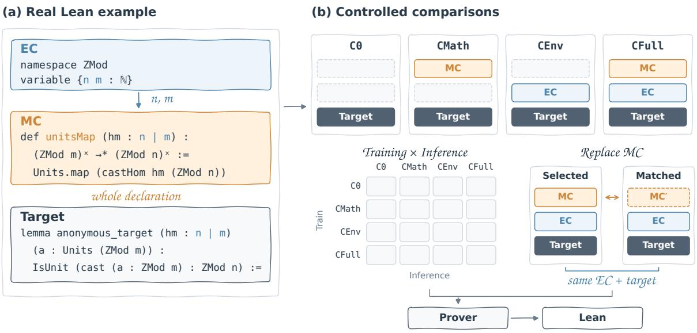
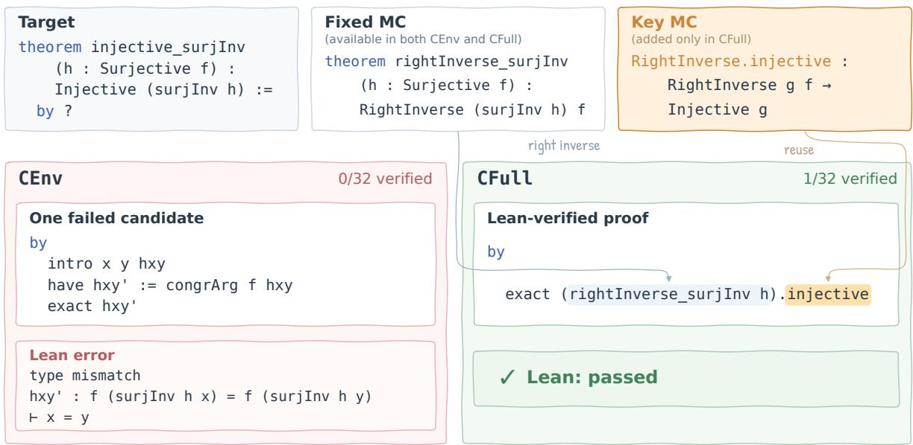
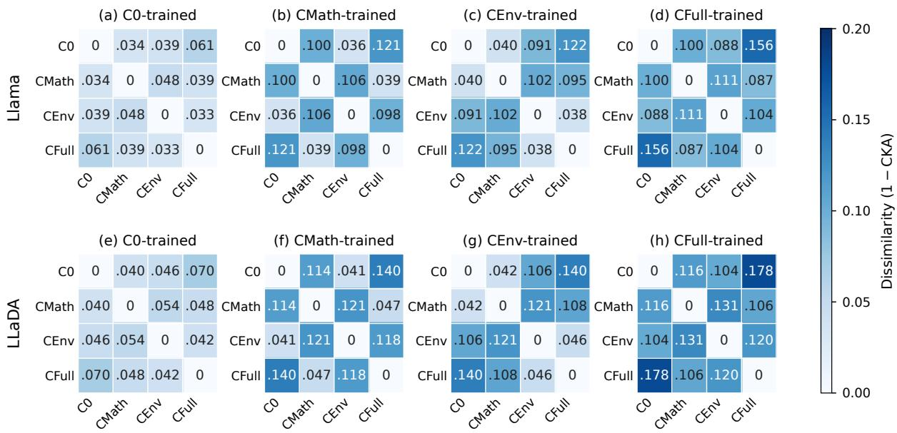
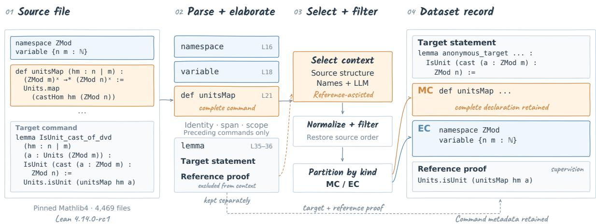
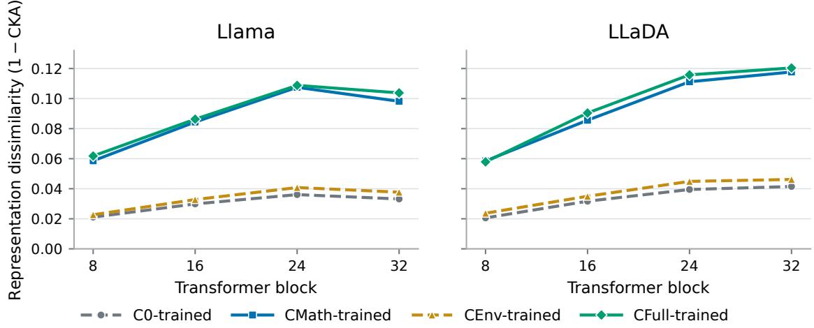

# LeanContext: Disentangling Mathematical Resources from Local Formal Context in Lean Whole-Proof Generation

Hang Zhang<sup>1</sup>\*, Qihao Ye<sup>2</sup>\*, Litong Liu<sup>3</sup>\*, Yunbei Zhang<sup>4</sup>, Yugyung Lee<sup>1</sup>, Yue Zhou<sup>5</sup>, Bowen Liu<sup>1</sup>, Emily First<sup>6</sup>, Cheng Han<sup>1†</sup>, Qiao Zhuang<sup>1†</sup>

<sup>1</sup>University of Missouri-Kansas City, <sup>2</sup>Columbia University, <sup>3</sup>Monash University Malaysia, <sup>4</sup>Tulane University, <sup>5</sup>LLM Core and Agentic AI, Capital One, <sup>6</sup>Rutgers University

## Abstract

Neural theorem proving increasingly uses retrieved premises and project context to support proof generation. Evaluating these resources requires measuring the advantage of target-selected declarations over comparable alternatives and how this advantage depends on training. We introduce LEANCONTEXT, a benchmark of 129,826 Lean whole-proof generation problems, to investigate these questions. We group selected complete preceding mathematical declarations as Mathematical Context (MC) and the remaining selected local source commands as Environment Context (EC). Four aligned input views support crossed training and inference evaluations with shared targets and original Lean verification environments. For both diffusion- and autoregressive-based models, selected declarations outperform comparable alternatives by a larger margin when training includes MC. Final-input audits identify omitted declarations referenced by the target. Prioritizing these dependencies improves Pass@32 by 1.40% and 1.70% for LLaDA and Llama, respectively, on 2,000 targets. The selection experiment operates without access to target reference proofs and holds checkpoints, EC, and inference budgets constant. The code and dataset are available at https: //github.com/haaaardcvZ/LeanContext.

## 1 Introduction

Neural theorem proving increasingly uses retrieved premises and project source context to generate proofs (Yang et al., 2023; Hu et al., 2025). This development reflects the cumulative nature of formal mathematics, where definitions introduce objects and subsequent lemmas establish properties that later proofs reuse (The mathlib Community, 2020). A proof about a newly defined object may combine its definition, an earlier lemma, and an instance required to apply that lemma. Supporting such proof construction requires models to use the mathematical declarations supplied by the current project.

Existing work has examined several forms of information that support this process. LeanDojo studies retrieval-augmented proving with accessible premises (Yang et al., 2023). Passport examines identifier representations, while Rango retrieves relevant premises and proof examples (Sanchez-Stern et al., 2023; Thompson et al., 2025). miniCTX extends evaluation to project source context and analyzes the contributions of environment information, definitions, lemma statements, proofs, and comments (Hu et al., 2025). These studies establish that different information components can help proof generation. We examine the advantage of target-selected declarations over comparable replacements and how training with declarations changes this advantage when accompanying source commands are held fixed.

Answering this question calls for a common unit of comparison across mathematical resources. Definitions, lemmas, structures, classes, and instances serve different functions, but subsequent proofs can reuse them as declarations. Treating a complete declaration as the resource unit allows its identity to be tracked through selection, replacement, and dependency analysis. The comparison must also preserve other visible source commands, such as variable, namespace, and notation, when the declaration set changes. This motivates organizing declaration resources separately from the commands that accompany them. Declarations matched for kind, scope, and length can differ in their usefulness for proving a given target. Comparing these alternatives with the accompanying source commands held fixed makes the advantage of the selected content measurable. Verified proof success provides a common criterion for evaluating this advantage across different valid proof strategies.

We introduce LEANCONTEXT, a benchmark of 129,826 Lean whole-proof generation problems from a fixed Mathlib4 snapshot. Mathematical Context (MC) comprises selected complete preceding mathematical declarations, while Environment Context (EC) comprises the remaining selected local source commands. The MC/EC partition supports comparisons of selected mathematical declarations with matched alternatives and enables us to examine how their advantage changes across training conditions. Four aligned input views supply neither category, MC alone, EC alone, or both (Full). They support crossed training and inference evaluations, as well as declaration replacements with EC held constant. Generated proofs are verified at the original target location in the complete Lean environment. Figure 1 illustrates the context partition and these comparisons.

  
Figure 1: Overview of LEANCONTEXT. (Left) A complete mathematical declaration (MC) and accompanying source commands (EC) precede a proof target. (Right) Four aligned views support crossed training, inference evaluations, and matched replacement. Input comparisons retain the target and original Lean verification environment. Matched replacement also keeps EC unchanged.

To examine training-dependent declaration benefits under both diffusion and autoregressive generation, we evaluate LLaDA (Nie et al., 2025) and Llama (Llama Team, AI @ Meta, 2024), respectively. With checkpoints trained on both context categories, adding MC to EC improves Pass@32 by 7.1% and 8.5%, respectively. On the same 11,064 test targets, the corresponding gains are 0.4% and 0.8% after EC-only training. Comparisons with alternatives matched for kind, scope, and length further show a larger advantage for selected declarations when training includes MC. Dependency audits then identify declarations omitted from final inputs. Prioritizing these dependencies without accessing target reference proofs improves verified success under fixed checkpoints, EC, and budgets, while revealing resource tradeoffs.

Our main contributions are as follows:

• A benchmark for controlled context comparisons. We provide four aligned input views for 129,826 Lean proof problems, supporting comparisons of declaration visibility under fixed targets and verification environments.

• Evidence on training-dependent declaration benefits. Crossed evaluations and matched replacements show larger declaration gains and selected-content advantages after training with MC than after EC-only training in both evaluated backbones.

• Dependency diagnostics that guide selection. We audit declaration visibility in final inputs and use these diagnostics to test a dependencypriority policy that improves verified proof success.

## 2 Related Work

Premises and Project Context. Premise retrieval supplies mathematical resources beyond the current proof state (Alemi et al., 2016; Mikuła et al., 2024). LeanDojo provides accessible-premise annotations and supports retrieval-augmented proving in Lean (Yang et al., 2023). Research has also examined how contextual information is represented and presented. Passport studies identifier categories and representations (Sanchez-Stern et al., 2023), while Rango retrieves lemma statements and proof examples (Thompson et al., 2025). miniCTX extends evaluation to preceding project context and analyzes environment information, definitions, lemma statements, lemma proofs, and comments (Hu et al., 2025). These studies broaden context beyond retrieved premises and examine the contributions of different information components.

Training with Context. The use of supplied resources also depends on training. miniCTX investigates file-tuning on preceding source context, and Rango evaluates training variants with different retrieval components (Hu et al., 2025; Thompson et al., 2025). AutoReal combines reasoningannotated proof training with context augmentation and compares base and fine-tuned models with and without context (Zhang et al., 2026). These comparisons examine both the information supplied to a prover and the training that prepares it to use that information.

Evaluating Supplied Resources. Recent evaluations examine the value of supplied content more directly. FormalML compares absent premises, ground-truth premises, and candidate sets containing relevant premises and distractors (Yang et al., 2026). VeriSoftBench compares curated proof dependencies with broader repository context while retaining those dependencies during budget handling (Xin et al., 2026). LeanSearch v2 evaluates retrieval through downstream proof success under a shared prover and reflection workflow (Gao et al., 2026).

Our proposed LEANCONTEXT focuses on whether declarations selected for a target outperform comparable replacements and how this advantage depends on training. It uses complete declarations as the resource unit and holds accompanying source commands fixed in matched comparisons. Crossed training and inference views assess training dependence, while final-input dependency audits guide a tested selection change. Additional related work is discussed in Appendix F.

## 3 LeanContext: A Context-disentangled Lean Benchmark

Figure 1 illustrates the declaration-level context partition, aligned input views, and controlled comparisons used in LEANCONTEXT.

## 3.1 Task and Context Partition

We evaluate whole-proof generation (First et al., 2023): a model receives a target statement and visible preceding source commands and generates a complete proof without intermediate Lean feedback. Each candidate is checked at the original target location with Lean (de Moura and Ullrich, 2021) in the complete original environment. The input views therefore vary model visibility while preserving verification conditions.

We organize context by complete source commands. MC groups mathematical declarations, including definitions, lemmas, structures, classes, and instances. Their statements and bodies are retained when present, including preceding lemma proofs. EC groups the remaining selected commands, such as variable, namespace, open, and notation. The partition follows source command kinds, whose mathematical and scope-related roles can overlap. Matched comparisons vary declaration resources with EC held constant. The complete command-kind partition is provided in Appendix A.3.

## 3.2 Dataset and Aligned Views

Our benchmark contains 129,826 theorem, lemma, and example targets from 4,469 files in a fixed Mathlib4 snapshot (The mathlib Community, 2020). Records retain reference proofs and selected preceding commands from the same file, with source identities and spans. The original selection can inspect target reference proofs, which are excluded from evaluation inputs. Source files and normalized target statements are disjoint across splits (Table 1). Extraction, filtering, and complete dataset statistics are detailed in Appendix A.

<table><tr><td>Split</td><td>Targets</td><td>Both</td></tr><tr><td>Train</td><td>90,879</td><td>51,628</td></tr><tr><td>Valid.</td><td>19,473</td><td>11,063</td></tr><tr><td>Test</td><td>19,474</td><td>11,064</td></tr><tr><td>Total</td><td>129,826</td><td>73,755</td></tr></table>

Table 1: Dataset statistics. Both counts targets with nonempty selected MC and EC before model-specific budget handling.

Each target has four views: C0 supplies neither category, CMath supplies MC, CEnv supplies EC, and CFull supplies both (Figure 1). We first fit complete commands into CFull under the model’s 1,024-token input limit, including the target and special tokens. Other views hide categories without refilling the freed space. Paired inputs thus retain identical targets, special tokens, and commands for the category held fixed. The primary evaluation uses the 11,064 test targets with both categories available before budget handling. Dataset records are illustrated in Appendix A.4, and serialization and budget handling are detailed in Appendix B.1.

## 3.3 Controlled Declaration Comparisons

For each backbone, four training runs differ only in input view, sharing targets, reference-proof supervision, initialization, and optimization settings. Each checkpoint is evaluated on all four inference views. Let $S _ { \theta } ( v )$ denote Pass@32 on a fixed target set. Conditional category gains are

$$
\Delta _ { M | E } ( \theta ) = S _ { \theta } ( \mathrm { C F u l l } ) - S _ { \theta } ( \mathrm { C E n v } ) ,\tag{1}
$$

$$
\Delta _ { E | M } ( \theta ) = S _ { \theta } ( \mathrm { C F u l l } ) - S _ { \theta } ( \mathrm { C M a t h } ) .\tag{2}
$$

Each contrast uses a single checkpoint. Comparing gains across training views examines their dependence on training exposure.

Matched replacement tests the value of selected content on 2,000 matching-eligible targets, without selecting by generation outcomes. Alternatives match declaration kind, compatible scope, and token length within ±10% under both tokenizers. They exclude identified target-type and reference-proof dependencies, making this comparison reference-assisted. With target, EC, checkpoint, verifier, and budgets fixed, the selectedcontent advantage is

$$
R _ { \theta } = S _ { \theta } ( E + M _ { \mathrm { s e l } } ) - S _ { \theta } ( E + M _ { \mathrm { r e p } } ) ,\tag{3}
$$

where $M _ { \mathrm { s e l } }$ and $M _ { \mathrm { r e p } }$ are selected and replacement MC, and E is the shared EC. We repeat this comparison under CMath, CEnv, and CFull training. Subset construction and matching rules are detailed in Appendix C.1.

We also trace selected-MC reuse in verified proofs and classify failed candidates using a fixed precedence over extraction status and Lean diagnostics. Reuse criteria and candidate-classification rules are detailed in Appendices C.2 and C.3. We further examine representation responses across views. Centered linear CKA (Kornblith et al., 2019) compares token-averaged hidden states from the central proof region (25% to 75%) on 4,000 shared test targets under fixed reference-proof conditioning. We observe blocks 8, 16, 24, and 32 and report 1 − CKA. Model-specific readouts and pooling are detailed in Appendix E.

## 3.4 Dependency Diagnostics and Selection

To audit actual declaration visibility, we map constants in each target’s elaborated type to eligible preceding local MC commands, deduplicating command identities to form $D _ { i } ^ { T }$ . This set is independent of selected MC and the candidate pool. Let $V _ { i } ^ { M }$ contain complete MC commands visible in the final serialized input. For nonempty $D _ { i } ^ { T }$ with resolved mapping and visibility,

$$
\mathrm { C o v e r a g e } _ { T } ( i ) = | D _ { i } ^ { T } \cap V _ { i } ^ { M } | / | D _ { i } ^ { T } | .\tag{4}
$$

We distinguish zero, partial, and complete coverage. Targets with no eligible dependencies or unresolved evidence are reported separately.

Target-type dependencies identify declarations referenced by the proposition to prove. We separately audit additional dependencies found in the reference proof. Selection priority uses only targettype dependencies. Additional reference-proof dependencies are audited afterward to inspect resource tradeoffs. These resources compete for the same input budget.

Selection controls use a fixed 2,000-target subset distinct from the matched subset. Rebuilding context without target reference proofs or proofderived features can change both MC and EC. A separate dependency-priority comparison uses the same targets with a common candidate pool built independently of the original selector, without reference proofs or proof-derived features.

The baseline ranks declarations by lexical overlap with the target. Dependency priority places eligible target dependencies first and preserves baseline order within each group. Both policies freeze the same EC and retain identical checkpoints, verification conditions, and inference budgets. Rules are fixed on validation data, and all 2,000 targets remain in the success denominator. Additional reference-proof dependencies are audited only after selection and generation outcomes are fixed, to examine resource tradeoffs. Full matching, mapping, and selection procedures are provided in Appendix D.

## 4 Experiments and Analysis

We examine training-dependent declaration benefits, then connect selected-content advantages to verified proof behavior and representation responses. Dependency diagnostics then test whether the benchmark can guide a useful selection change.

<table><tr><td colspan="2">Checkpoint</td><td colspan="3">Inference view / Pass@32 (%)</td><td colspan="2"></td><td colspan="2">Conditional gain (%)</td></tr><tr><td>Model</td><td>Training</td><td>C0</td><td>CMath</td><td>CEnv</td><td>CFull</td><td></td><td> $\Delta _ { M | E }$ </td><td>∆E|M</td></tr><tr><td rowspan="4">LLaDA NeurIPS&#x27;25</td><td>C0</td><td>38.6</td><td>39.1</td><td>37.8</td><td>38.3</td><td></td><td>+0.5</td><td>-0.8</td></tr><tr><td>CMath</td><td>34.1</td><td>43.9</td><td>35.8</td><td>44.3</td><td>+8.5</td><td></td><td>+0.4</td></tr><tr><td>CEnv</td><td>34.7</td><td>35.3</td><td>44.8</td><td>45.2</td><td></td><td>+0.4</td><td>+9.9</td></tr><tr><td>CFull</td><td>31.2</td><td>40.1</td><td>41.6</td><td></td><td>48.7</td><td>+7.1</td><td>+8.6</td></tr><tr><td rowspan="4">Llama arXiv&#x27;24</td><td>C0</td><td>39.8</td><td>40.6</td><td></td><td>39.2</td><td>40.3</td><td>+1.1</td><td>-0.3</td></tr><tr><td>CMath</td><td>34.8</td><td>44.3</td><td>37.6</td><td>44.9</td><td></td><td>+7.3</td><td>+0.6</td></tr><tr><td>CEnv</td><td>34.5</td><td>37.3</td><td>44.9</td><td></td><td>45.7</td><td>+0.8</td><td>+8.4</td></tr><tr><td>CFull</td><td>32.8</td><td>41.8</td><td>41.1</td><td></td><td>49.6</td><td>+8.5</td><td>+7.8</td></tr></table>

Table 2: Crossed training and inference views on 11,064 targets. Inference columns report Pass@32. Each row corresponds to one checkpoint. Conditional gains follow Eqs. (1) and (2). Bold highlights the MC-gain comparison between CEnv and CFull training.

## 4.1 Experimental Setup

Our primary backbones cover diffusion and autoregressive generation: LLaDA-8B-Base (Nie et al., 2025) and Llama-3.1-8B (Llama Team, AI @ Meta, 2024), respectively. Each is adapted through fullparameter SFT under the four training views in Section 3.3. Checkpoints are selected by validation loss. The main crossing uses 11,064 test targets with both categories available before budget handling. Matched replacement and selection use distinct 2,000-target subsets, and coverage is evaluated separately on 11,064 targets.

Inputs and per-attempt outputs are each set to 1,024 tokens. We generate 32 candidates per target at temperature 0.6 without intermediate feedback and verify each at its original Lean location, with a 60-second limit. Sampled Pass@k is estimated from these outcomes (Chen et al., 2021). All targets remain in the success denominator, including those without submitted inputs. Scores and absolute score differences are reported in %. Full configurations and expanded results are provided in Appendix B.

## 4.2 Training-Dependent Declaration Benefits

Checkpoints trained with MC obtain larger gains when MC is supplied at inference (Table 2). With EC held fixed, adding MC improves Pass@32 by 7.1% and 8.5% for CFull-trained LLaDA and Llama, compared with 0.4% and 0.8% after CEnv training. The CMath-trained checkpoints show the same pattern.

The crossing also compares training conditions under a common inference view (Table 2). Under CFull, CFull-trained checkpoints outperform CEnv-trained checkpoints by 3.5% for LLaDA and 3.9% for Llama. Under CEnv, the same CFull-trained checkpoints score 3.2% and 3.8% below their CEnv-trained counterparts, respectively.

These contrasts show that the observed advantage of combined-context training depends on the resources visible at inference.

EC gains show a complementary pattern. Adding EC to CMath yields 8.6% and 7.8% after CFull training, versus 0.4% and 0.6% after CMath training. Both categories provide additional value after combined-context training. The crossing also captures adaptation to the input configuration: under C0, CFull-trained checkpoints score 7.4% and 7.0% below their C0-trained counterparts.

The MC benefit persists across sampling budgets (Table 3), increasing from 1.0%/1.3% at Pass@1 to 7.1%/8.5% at Pass@32. Additional adaptation and temperature results, together with evaluations using the same view for training and inference, are reported in Appendix B.

<table><tr><td>Model</td><td>View @1</td><td>@8 @16 @32</td></tr><tr><td>LLaDA NeurIPS&#x27;25</td><td>CEnv 5.9</td><td>23.2 32.3</td><td>41.6</td></tr><tr><td>Llama arXiv&#x27;24</td><td>CFull CEnv</td><td>6.9 27.1 37.8 5.9 23.1 32.0</td><td>48.7 41.1</td></tr><tr><td></td><td>CFull</td><td></td><td></td></tr><tr><td></td><td></td><td>7.2 27.9</td><td>38.6 49.6</td></tr></table>

Table 3: Pass@k on the main 11,064 targets for CFull-trained checkpoints, estimated from the same 32 candidate outcomes. Bold marks the higher score within each model and sampling budget.

We then comprehensively evaluate released Lean provers without further LEANCONTEXT training: DeepSeek-Prover-V1.5-SFT and -RL (Xin et al., 2025), DeepSeek-Prover-V2-7B (Ren et al., 2025), Goedel-Prover-SFT (Lin et al., 2025b), and TheoremLlama (Wang et al., 2024b). Table 4 keeps each checkpoint fixed across the four views. Conditional MC gains range from 1.6% to 5.1%, and conditional EC gains range from 2.3% to 4.5%. These results extend the context comparisons to existing Lean provers. The preceding training and inference crossing tests how context gains depend on training.

<table><tr><td>Model</td><td>C0 CMath CEnv CFul1</td></tr><tr><td>DeepSeek-Prover-V1.5-SFT ICLR&#x27;25 20.7</td><td>26.4 25.8</td></tr><tr><td>DeepSeek-Prover-V1.5-RL ICLR&#x27;25</td><td>22.9 28.1 27.7</td></tr><tr><td>DeepSeek-Prover-V2-7BarXiv&#x27;25</td><td>29.4 35.6 34.8</td></tr><tr><td>Goedel-Prover-SFT COLM&#x27;25</td><td>23.6 29.1 27.4</td></tr><tr><td>TheoremLlama EMNLP&#x27;24</td><td>11.7 14.2 14.9</td></tr></table>

Table 4: Released Lean provers on the same 11,064 targets. Scores are Pass@32. Each checkpoint is fixed across views, without additional LEANCONTEXT training. DeepSeek-Prover-V2-7B uses non-CoT generation. Bold marks the highest score within each checkpoint.

## 4.3 Selected Content and Proof Behavior

We then test whether the training differences in Section 4.2 can extend to the advantage of the particular declarations selected for each target. Matched replacement compares selected MC with alternatives of the same kind, compatible scope, and similar length, retaining the same EC and checkpoint (Section 3.3). On the common 2,000-target subset, selected-content advantages are 6.0% and 7.2% after CFull training, versus 0.7% and 0.9% after CEnv training (Table 5). The CMath-trained checkpoints show the same pattern. Replacement MC also improves over EC alone by 1.1% and 1.2% after CFull training. These results support assessing declaration selection together with prover training.

Figure 2 shows how this use appears in a concrete proof. For Function.injective\_surjInv, CEnv yields no verified proof in 32 attempts, while CFull yields one. The failed candidate applies congrArg f but leaves the required equality unresolved. The successful candidate uses RightInverse.injective to convert the rightinverse property of surjInv into injectivity. This illustrates how a supplied declaration supports proof construction under the same verification environment.

<table><tr><td>Model</td><td>Train</td><td>CEnv Selected Replaced Rθ</td><td></td></tr><tr><td rowspan="3">LLaDA NeurIPS&#x27;25 CMath 35.6</td><td></td><td>44.1</td><td>37.8 +6.3</td></tr><tr><td>CEnv 44.5</td><td>45.0</td><td> $4 4 . 3 \ + 0 . 7$ </td></tr><tr><td>CFull 41.3</td><td>48.4</td><td> $4 2 . 4 \ + 6 . 0$ </td></tr><tr><td rowspan="3">Llama arXiv&#x27;24</td><td>CMath 37.4</td><td>44.8</td><td> $\overline { { 3 9 . 2 + 5 . 6 } }$ </td></tr><tr><td>CEnv 44.8</td><td>45.6</td><td> $4 4 . 7 \ + 0 . 9$ </td></tr><tr><td>CFull 40.9</td><td>49.3</td><td> $4 2 . 1 + 7 . 2$ </td></tr></table>

Table 5: Matched replacement on 2,000 targets, reporting Pass@32. Selected and Replaced combine their respective MC with identical EC. $R _ { \theta }$ is the selectedcontent advantage (Eq. (3)). Controls exclude identified target-type and reference-proof dependencies. Bold contrasts CEnv and CFull training.

We then inspect resource use in verified generations from the main crossing. At fixed CFulltrained checkpoints, 1,300 LLaDA targets and 1,450 Llama targets have no successful candidate under CEnv and at least one under CFull. Among them, 855 (65.77%) and 1,005 (69.31%) have a verified proof with recorded selected-MC reuse. These outcomes connect aggregate gains to recorded declaration use. Complete paired counts are given in

  
Figure 2: A paired proof-generation case with 32 attempts per view. Both views use the same checkpoint, EC, and verification conditions. A failed CEnv candidate leaves a type mismatch. A verified CFull candidate uses the supplied RightInverse.injective declaration. The right-inverse fact is available in the original Lean environment. These candidates are independently generated under the two input views.

  
Figure 3: Block-32 representation dissimilarity on 4,000 shared test targets under reference-proof conditioning. Rows identify backbones, and columns identify training views. Both axes within each panel are inference views. Cells report 1 − CKA with a shared color scale. Larger values indicate lower representation similarity.

Table 21. Both views retain the complete Lean environment, so recorded reuse does not establish that displaying a declaration was necessary.

We also inspect how EC changes candidate outcomes when MC is already visible. At fixed CFulltrained checkpoints, the CMath–CFull comparison reduces the combined share of name/scope, instance-synthesis, and other-elaboration failures from 40.9% to 39.7% for LLaDA and from 39.6% to 38.4% for Llama. Each view contains 354,048 attempts on the same 11,064 targets. These shifts characterize the observed benefit of supplying EC alongside MC. The comparison uses independently generated candidates under each view; complete outcome counts are reported in Appendix C.3, Table 22. Input-length and category-boundary sensitivity results are reported in Appendix C.4.

MC gains are positive across all four inputlength quartiles for CFull-trained checkpoints. The quartiles group the 11,064 targets by preclipping CFull input length and are shared by both backbones. Gains range from 6.15% to 7.95% for LLaDA and from 7.23% to 9.47% for Llama. Among the 9,440 targets without recorded mixedrole commands, MC gains are 6.90% and 8.31%, respectively (Appendix C.4). The benefits therefore extend across length groups and beyond recorded category-boundary cases. These groups are observational and can differ in target difficulty and dependency composition.

## 4.4 Representation Responses to Context

We complement these proof-level observations with the reference-conditioned representation probe defined in Section 3.3. Figure 3 reports block-32 dissimilarities across the four inference views. Adding MC to CEnv produces larger dissimilarity after CFull training than after CEnv training: 0.1038 versus 0.0377 for Llama and 0.1204 versus 0.0462 for LLaDA. Adding EC to CMath also produces larger representation responses after training that includes EC.

With each target’s reference proof held fixed, checkpoints trained with a context category show larger representation changes when that category is supplied. The probe measures sensitivity under reference-proof conditioning. Verified-success and matched-replacement comparisons assess declaration benefits and selected-content advantages. Complete layer-wise results and model-specific readouts appear in Appendix E.

## 4.5 Dependency Diagnostics and Selection

The independent 11,064-target coverage evaluation examines which target dependencies reach final inputs (Table 6). Among targets with computable coverage, 58.26% for LLaDA and 57.76% for Llama lack complete coverage. Complete-coverage groups obtain larger conditional MC gains than zero-coverage groups. These observational groups can differ in difficulty and dependency composition; the omissions nevertheless identify a concrete opportunity to adjust selection. Complete coverage groups and input statistics are reported in Appendix D.3, Table 25. Dependency retention before tokenizer-specific clipping is reported separately in Appendix D.2.

<table><tr><td rowspan="2">Coverage</td><td colspan="2">LLaDA NeurIPS&#x27;25</td><td>Llama arXiv&#x27;24</td></tr><tr><td>Targets</td><td>∆M|E</td><td>Targets ∆M|E</td></tr><tr><td>Zero</td><td>2,500</td><td>+4.00</td><td>2,460 +4.88</td></tr><tr><td>Partial</td><td>2,650</td><td>+6.79</td><td>2,640 +8.33</td></tr><tr><td>Complete</td><td>3,690</td><td>+7.72</td><td>3,730 +9.12</td></tr></table>

Table 6: Independent final-input coverage evaluation on 11,064 targets. Coverage is computable for 8,840 LLaDA and 8,830 Llama targets. Gains are Pass@32 differences in %, computed before rounding.

Context benefits also persist when selection excludes target reference proofs: a separate reselection control retains MC gains of 5.4% and 6.4% (Appendix D.4). Because rebuilding context can change both MC and EC, the dependencypriority experiment uses a separate common baseline, shared candidate pool, and frozen EC to test the priority change under fixed prover conditions.

Prioritizing target dependencies raises coverage and improves Pass@32 by 1.40% for LLaDA and 1.70% for Llama, with mean inputs increasing by 4.4 and 4.9 tokens (Table 7).
<table><tr><td>Model</td><td>Policy @1 @32</td><td>Cov. Tokens</td></tr><tr><td rowspan="2"></td><td>LLaDA NeurIPS&#x27;25 Baseline 5.94 43.90 47.70</td><td>696.8</td></tr><tr><td>Priority 6.17 45.30 72.26</td><td>701.2</td></tr><tr><td rowspan="2">Llama arXiv&#x27;24</td><td>Baseline 6.25 44.55 48.88</td><td>714.2</td></tr><tr><td>Priority 6.53 46.25 73.48</td><td>719.1</td></tr></table>

Table 7: Dependency-priority selection with a shared candidate pool and frozen EC. Pass@1 and Pass@32 retain all 2,000 targets. Cov. is macro target coverage (%) over 1,568 eligible LLaDA targets and 1,565 eligible Llama targets. Tokens is mean submitted-input length. Bold marks improvements over Baseline.

Coverage rises by 24.56% and 24.60% for LLaDA and Llama, respectively, with mean input growth below five tokens. These gains demonstrate the value of declaration selection within a fixed context budget.

Both policies operate without target reference proofs and retain identical checkpoints and inference budgets. The change gains 76 solved targets and loses 48 for LLaDA, and 88 and 54 for Llama (Table 28). Additional reference-proof dependency coverage falls by 2.23% and 1.70% in the postselection audit (Table 29).

The candidate-pool audit identifies a further limit on this selection change. Among 1,600 targets with complete, nonempty target-dependency mappings, the shared pool contains all dependencies for 1,410 targets, some for 80, and none for 110. Reranking cannot recover declarations absent from the pool. This audit distinguishes candidate-pool omissions from losses during selection and budget handling. These 1,600 targets form a separate audit population from the tokenizer-specific final-coverage groups. Further selection diagnostics are provided in Appendix D.5.

The selection change reallocates limited input space between target dependencies and other proof resources. For the evaluated checkpoints and 2,000- target subset, dependency priority improves overall proof success while changing which targets are solved. These results show how LEANCONTEXT can guide and test changes to declaration supply under fixed prover conditions.

The matched replacement results show that the advantage of selected declarations depends on prover training (Table 5). Moving from CEnv to CFull training increases this advantage by 5.3% for LLaDA and 6.3% for Llama. This supports evaluating declaration selection together with the intended prover and its training condition.

Target-type coverage and verified success describe different aspects of context quality. The zero-coverage groups still obtain conditional MC gains of 4.00% and 4.88% for LLaDA and Llama, respectively (Table 6). The priority policy’s gains and losses on individual targets further support reporting paired outcomes alongside aggregate success.

## 5 Conclusion

We introduced LEANCONTEXT, a benchmark of 129,826 Lean whole-proof generation problems that organizes complete mathematical declarations as MC and accompanying source commands as EC. Across representative diffusion-based and autoregressive-based methods, checkpoints trained with MC show larger conditional proof-generation gains from supplied declarations and larger advantages for selected declarations over matched replacements. Verified proofs also record reuse of selected MC on newly solved targets. Final-input dependency audits guide a selection change that improves Pass@32 by 1.40% and 1.70% for LLaDA and Llama on the evaluated 2,000-target subset, without access to target reference proofs. The policy gains and loses solved targets and reduces coverage of additional reference-proof dependencies, showing the tradeoffs in allocating limited context. These findings support evaluating declaration selection together with prover training and testing improvements to context selection.

## Limitations

Our evaluations use a fixed Mathlib4 snapshot and 1,024-token input and output budgets. Extending these comparisons to other formal projects, longer contexts, and additional prover families would help characterize their broader applicability.

LEANCONTEXT compares complete source commands. Future work could identify compact target- and prover-specific MC and EC subsets or compressed representations that retain useful declaration content and local setting cues while preserving verified proof performance.

Adaptive selection policies could allocate the available budget between target dependencies, additional proof resources, and EC. Jointly adapting selection and prover training may help models use compact context more effectively. Analyses of generation trajectories could explain how declaration benefits and representation responses develop during proof construction.

## Ethics Statement

This work develops a benchmark for formal theorem proving from publicly available Mathlib source code and evaluates language models under controlled conditions. It does not involve humansubject experiments or the collection of new personal data. Proof candidates are checked by Lean in the original verification environment, and reported success requires passing this verification. The benchmark is intended to support reproducible research on the use of mathematical declarations in proof generation.

## References

Jesse Alama, Tom Heskes, Daniel Kühlwein, Evgeni Tsivtsivadze, and Josef Urban. 2014. Premise selection for mathematics by corpus analysis and kernel methods. Journal ofAutomated Reasoning, 52:191– 213.

Alexander A. Alemi, François Chollet, Niklas Een, Geoffrey Irving, Christian Szegedy, and Josef Urban. 2016. DeepMath – deep sequence models for premise selection. In NIPS, volume 29.

Zhangir Azerbayev, Bartosz Piotrowski, Hailey Schoelkopf, Edward W. Ayers, Dragomir Radev, and Jeremy Avigad. 2023. ProofNet: Autoformalizing and formally proving undergraduate-level mathematics. arXiv preprint arXiv:2302.12433.

Zhangir Azerbayev, Hailey Schoelkopf, Keiran Paster, Marco Dos Santos, Stephen McAleer, Qiaochu Jiang, Jia Deng, Stella R. Biderman, and Sean Welleck. 2024. Llemma: An open language model for mathematics. In ICLR, pages 40622–40649.

Kshitij Bansal, Sarah Loos, Markus Rabe, Christian Szegedy, and Stewart Wilcox. 2019. HOList: An environment for machine learning of higher order logic theorem proving. In ICML, volume 97 of Proceedings ofMachine Learning Research, pages 454–463.

Lasse Blaauwbroek, Mirek Olšák, Jason Rute, Fidel Ivan Schaposnik Massolo, Jelle Piepenbrock, and Vasily Pestun. 2024. Graph2Tac: Online representation learning of formal math concepts. In ICML, volume 235 of Proceedings of Machine Learning Research, pages 4046–4076.

Mark Chen, Jerry Tworek, Heewoo Jun, Qiming Yuan, Henrique Ponde de Oliveira Pinto, Jared Kaplan, Harri Edwards, Yuri Burda, Nicholas Joseph, Greg Brockman, Alex Ray, Raul Puri, Gretchen Krueger, Michael Petrov, Heidy Khlaaf, Girish Sastry, Pamela Mishkin, Brooke Chan, Scott Gray, and 39 others. 2021. Evaluating large language models trained on code. arXiv preprint arXiv:2107.03374.

Leonardo de Moura and Sebastian Ullrich. 2021. The Lean 4 theorem prover and programming language. In Automated Deduction—CADE 28, volume 12699 of Lecture Notes in Computer Science, pages 625– 635. Springer.

Kefan Dong and Tengyu Ma. 2025. STP: Self-play LLM theorem provers with iterative conjecturing and proving. In ICML, volume 267 of Proceedings of Machine Learning Research, pages 14114–14136. PMLR.

Emily First, Markus N. Rabe, Talia Ringer, and Yuriy Brun. 2023. Baldur: Whole-proof generation and repair with large language models. In ESEC/FSE, pages 1229–1241.

Guoxiong Gao, Zeming Sun, Jiedong Jiang, Yutong Wang, Jingda Xu, Peihao Wu, Bryan Dai, and Bin Dong. 2026. LeanSearch v2: Global premise retrieval for Lean 4 theorem proving. In NeurIPS. To appear.

Thibault Gauthier, Cezary Kaliszyk, Josef Urban, Ramana Kumar, and Michael Norrish. 2021. TacticToe: Learning to prove with tactics. Journal ofAutomated Reasoning, 65(2):257–286.

Arthur Gretton, Olivier Bousquet, Alex Smola, and Bernhard Schölkopf. 2005. Measuring statistical dependence with Hilbert-Schmidt norms. In Proceedings ofthe International Conference on Algorithmic

Learning Theory, volume 3734 of Lecture Notes in Computer Science, pages 63–77.

Jesse Michael Han, Jason Rute, Yuhuai Wu, Edward W. Ayers, and Stanislas Polu. 2022. Proof artifact cotraining for theorem proving with language models. In ICLR.

Edward J. Hu, Yelong Shen, Phillip Wallis, Zeyuan Allen-Zhu, Yuanzhi Li, Shean Wang, Lu Wang, and Weizhu Chen. 2022. LoRA: Low-rank adaptation of large language models. In ICLR.

Jiewen Hu, Thomas Zhu, and Sean Welleck. 2025. miniCTX: Neural theorem proving with (long-)contexts. In ICLR.

Binyuan Hui, Jian Yang, Zeyu Cui, Jiaxi Yang, Dayiheng Liu, Lei Zhang, Tianyu Liu, Jiajun Zhang, Bowen Yu, Keming Lu, Kai Dang, Yang Fan, Yichang Zhang, An Yang, Rui Men, Fei Huang, Bo Zheng, Yibo Miao, Shanghaoran Quan, and 5 others. 2024. Qwen2.5-Coder technical report. arXiv preprint arXiv:2409.12186.

Albert Qiaochu Jiang, Wenda Li, Szymon Tworkowski, Konrad Czechowski, Tomasz Odrzygó´zd´z, Piotr Miłos, Yuhuai Wu, and Mateja Jamnik. 2022.´ Thor: Wielding hammers to integrate language models and automated theorem provers. In NeurIPS, volume 35, pages 8360–8373.

Albert Qiaochu Jiang, Sean Welleck, Jin Peng Zhou, Wenda Li, Jiacheng Liu, Mateja Jamnik, Timothée Lacroix, Yuhuai Wu, and Guillaume Lample. 2023. Draft, sketch, and prove: Guiding formal theorem provers with informal proofs. In ICLR.

Cezary Kaliszyk, François Chollet, and Christian Szegedy. 2017. HolStep: A machine learning dataset for higher-order logic theorem proving. In ICLR.

Cezary Kaliszyk and Josef Urban. 2015. Learningassisted theorem proving with millions of lemmas. Journal ofSymbolic Computation, 69:109–128.

Simon Kornblith, Mohammad Norouzi, Honglak Lee, and Geoffrey Hinton. 2019. Similarity of neural network representations revisited. In ICML, volume 97 of Proceedings of Machine Learning Research, pages 3519–3529.

Adarsh Kumarappan, Mohit Tiwari, Peiyang Song, Robert Joseph George, Chaowei Xiao, and Anima Anandkumar. 2025. LeanAgent: Lifelong learning for formal theorem proving. In ICLR.

Guillaume Lample, Marie-Anne Lachaux, Thibaut Lavril, Xavier Martinet, Amaury Hayat, Gabriel Ebner, Aurélien Rodriguez, and Timothée Lacroix. 2022. HyperTree proof search for neural theorem proving. In NeurIPS, volume 35, pages 26337– 26349.

Haohan Lin, Zhiqing Sun, Sean Welleck, and Yiming Yang. 2025a. Lean-STaR: Learning to interleave thinking and proving. In ICLR.

Yong Lin, Shange Tang, Bohan Lyu, Jiayun Wu, Hongzhou Lin, Kaiyu Yang, Jia Li, Mengzhou Xia, Danqi Chen, Sanjeev Arora, and Chi Jin. 2025b. Goedel-Prover: A frontier model for open-source automated theorem proving. In Conference on Language Modeling.

Chengwu Liu, Jianhao Shen, Huajian Xin, Zhengying Liu, Ye Yuan, Haiming Wang, Wei Ju, Chuanyang Zheng, Yichun Yin, Lin Li, Ming Zhang, and Qun Liu. 2023. FIMO: A challenge formal dataset for automated theorem proving. arXiv preprint arXiv:2309.04295.

Junqi Liu, Xiaohan Lin, Jonas Bayer, Yael Dillies, Weijie Jiang, Xiaodan Liang, Roman Soletskyi, Haiming Wang, Yunzhou Xie, Beibei Xiong, Zhengfeng Yang, Jujian Zhang, Lihong Zhi, Jia Li, and Zhengying Liu. 2025. CombiBench: Benchmarking LLM capability for combinatorial mathematics. arXiv preprint arXiv:2505.03171.

Llama Team, AI @ Meta. 2024. The Llama 3 herd of models. arXiv preprint arXiv:2407.21783.

Maciej Mikuła, Szymon Tworkowski, Szymon Antoniak, Bartosz Piotrowski, Qiaochu Jiang, Jin Zhou, Christian Szegedy, Łukasz Kucinski, Piotr Miło´ s, and´ Yuhuai Wu. 2024. Magnushammer: A transformerbased approach to premise selection. In ICLR.

Ari Morcos, Maithra Raghu, and Samy Bengio. 2018. Insights on representational similarity in neural networks with canonical correlation. In NeurIPS, volume 31.

Shen Nie, Fengqi Zhu, Zebin You, Xiaolu Zhang, Jingyang Ou, Jun Hu, Jun Zhou, Yankai Lin, Ji-Rong Wen, and Chongxuan Li. 2025. Large language diffusion models. In NeurIPS, volume 38.

Stanislas Polu and Ilya Sutskever. 2020. Generative language modeling for automated theorem proving. arXiv preprint arXiv:2009.03393.

Qwen Team. 2024. Qwen2.5 technical report. arXiv preprint arXiv:2412.15115.

Qwen Team. 2025. Qwen3 technical report. arXiv preprint arXiv:2505.09388.

Maithra Raghu, Justin Gilmer, Jason Yosinski, and Jascha Sohl-Dickstein. 2017. SVCCA: Singular vector canonical correlation analysis for deep learning dynamics and interpretability. In NeurIPS, volume 30.

Z. Z. Ren, Zhihong Shao, Junxiao Song, Huajian Xin, Haocheng Wang, Wanjia Zhao, Liyue Zhang, Zhe Fu, Qihao Zhu, Dejian Yang, Z. F. Wu, Zhibin Gou, Shirong Ma, Hongxuan Tang, Yuxuan Liu, Wenjun Gao, Daya Guo, and Chong Ruan. 2025. DeepSeek-Prover-V2: Advancing formal mathematical reasoning via reinforcement learning for subgoal decomposition. arXiv preprint arXiv:2504.21801.

Alex Sanchez-Stern, Emily First, Timothy Zhou, Zhanna Kaufman, Yuriy Brun, and Talia Ringer. 2023. Passport: Improving automated formal verification using identifiers. ACM Transactions on Programming Languages and Systems, 45(2):12:1–12:30.

Peiyang Song, Kaiyu Yang, and Anima Anandkumar. 2025. Lean Copilot: Large language models as copilots for theorem proving in Lean. In Proceedings of the International Conference on Neuro-symbolic Systems, volume 288 of Proceedings ofMachine Learning Research, pages 144–169. PMLR.

The mathlib Community. 2020. The Lean mathematical library. In Proceedings of the 9th ACM SIGPLAN International Conference on Certified Programs and Proofs, pages 367–381. ACM.

Kyle Thompson, Nuno Saavedra, Pedro Carrott, Kevin Fisher, Alex Sanchez-Stern, Yuriy Brun, João F. Ferreira, Sorin Lerner, and Emily First. 2025. Rango: Adaptive retrieval-augmented proving for automated software verification. In ICSE, pages 347–359.

George Tsoukalas, Jasper Lee, John Jennings, Jimmy Xin, Michelle Ding, Michael Jennings, Amitayush Thakur, and Swarat Chaudhuri. 2024. PutnamBench: Evaluating neural theorem-provers on the putnam mathematical competition. In NeurIPS.

Haiming Wang, Huajian Xin, Chuanyang Zheng, Zhengying Liu, Qingxing Cao, Yinya Huang, Jing Xiong, Han Shi, Enze Xie, Jian Yin, Zhenguo Li, and Xiaodan Liang. 2024a. LEGO-Prover: Neural theorem proving with growing libraries. In ICLR.

Ruida Wang, Jipeng Zhang, Yizhen Jia, Rui Pan, Shizhe Diao, Renjie Pi, and Tong Zhang. 2024b. Theorem-Llama: Transforming general-purpose LLMs into Lean4 experts. In EMNLP, pages 11953–11974. Association for Computational Linguistics.

Yuhuai Wu, Albert Qiaochu Jiang, Wenda Li, Markus Rabe, Charles Staats, Mateja Jamnik, and Christian Szegedy. 2022. Autoformalization with large language models. In NeurIPS, volume 35.

Zijian Wu, Jiayu Wang, Dahua Lin, and Kai Chen. 2024. LEAN-GitHub: Compiling GitHub LEAN repositories for a versatile LEAN prover. arXiv preprint arXiv:2407.17227.

Huajian Xin, Daya Guo, Zhihong Shao, Zhizhou Ren, Qihao Zhu, Bo Liu, Chong Ruan, Wenda Li, and Xiaodan Liang. 2024. DeepSeek-Prover: Advancing theorem proving in LLMs through large-scale synthetic data. arXiv preprint arXiv:2405.14333.

Huajian Xin, Z. Z. Ren, Junxiao Song, Zhihong Shao, Wanjia Zhao, Haocheng Wang, Bo Liu, Liyue Zhang, Xuan Lu, Qiushi Du, Wenjun Gao, Haowei Zhang, Qihao Zhu, Dejian Yang, Zhibin Gou, Z. F. Wu, Fuli Luo, and Chong Ruan. 2025. DeepSeek-Prover-V1.5: Harnessing proof assistant feedback for reinforcement learning and monte-carlo tree search. In ICLR.

Yutong Xin, Jocelyn Qiaochu Chen, Greg Durrett, and I¸sil Dillig. 2026. VeriSoftBench: Repository-scale formal verification benchmarks for Lean. In Conference on Language Modeling.

An Yang, Beichen Zhang, Binyuan Hui, Bofei Gao, Bowen Yu, Chengpeng Li, Dayiheng Liu, Jianhong Tu, Jingren Zhou, Junyang Lin, Keming Lu, Mingfeng Xue, Runji Lin, Tianyu Liu, Xingzhang Ren, and Zhenru Zhang. 2024. Qwen2.5-Math technical report: Toward mathematical expert model via self-improvement. arXiv preprint arXiv:2409.12122.

Kaiyu Yang and Jia Deng. 2019. Learning to prove theorems via interacting with proof assistants. In ICML, volume 97 of Proceedings ofMachine Learning Research, pages 6984–6994.

Kaiyu Yang, Aidan Swope, Alex Gu, Rahul Chalamala, Peiyang Song, Shixing Yu, Saad Godil, Ryan J Prenger, and Animashree Anandkumar. 2023. LeanDojo: Theorem proving with retrieval-augmented language models. In NeurIPS, volume 36, pages 21573–21612.

Xiao-Wen Yang, Zihao Zhang, Jianuo Cao, Zhi Zhou, Zenan Li, Lan-Zhe Guo, Yuan Yao, Taolue Chen, Yu-Feng Li, and Xiaoxing Ma. 2026. FormalML: A benchmark for evaluating formal subgoal completion in machine learning theory. In ICLR.

Jiacheng Ye, Zhihui Xie, Lin Zheng, Jiahui Gao, Zirui Wu, Xin Jiang, Zhenguo Li, and Lingpeng Kong. 2025. Dream 7B: Diffusion large language models. arXiv preprint arXiv:2508.15487.

Zhouliang Yu, Ruotian Peng, Keyi Ding, Yizhe Li, Zhongyuan Peng, Minghao Liu, Yifan Zhang, Zheng Yuan, Huajian Xin, Wenhao Huang, Yandong Wen, Ge Zhang, and Weiyang Liu. 2025. Formal-MATH: Benchmarking formal mathematical reasoning of large language models. arXiv preprint arXiv:2505.02735.

Jianyu Zhang, Fuyuan Zhang, Jiayi Lu, Jilin Hu, Xiaoyi Yin, Long Zhang, Feng Yang, and Yongwang Zhao. 2026. Towards real-world industrial-scale verification: LLM-driven theorem proving on seL4. arXiv preprint arXiv:2602.08384.

Kunhao Zheng, Jesse Michael Han, and Stanislas Polu. 2022. miniF2F: A cross-system benchmark for formal olympiad-level mathematics. In ICLR.

Fengqi Zhu, Rongzhen Wang, Shen Nie, Xiaolu Zhang, Chunwei Wu, Jun Zhou, Yankai Lin, Ji-Rong Wen, and Chongxuan Li. 2026. LLaDA 1.5: Variancereduced preference optimization for large language diffusion models. In ACL, pages 11425–11460. Association for Computational Linguistics.

## A Dataset Construction and Statistics

This appendix documents source extraction, context selection, command classification, and the serialization of the four aligned views. It provides a verified selection example, an actual dataset-record excerpt, and the current selection prompt. Availability and command-count statistics describe the stored context before model-specific budget handling; experimental settings are specified in Appendix B.

## A.1 Source Snapshot and Target Extraction

LEANCONTEXT contains 129,826 whole-proof generation problems from 4,469 Mathlib4 (The mathlib Community, 2020) source files. The construction protocol records Lean 4.14.0-rc1 and Mathlib4 commit a7fc949f1b05c2a01e01 c027fd9f480496a1253e. Each problem corresponds to a theorem, lemma, or example command and retains its original source file, command identity, and source span.

The extractor records complete source commands together with their kinds, declaration names, source spans, and source order. It separates each target statement from its reference proof and draws context candidates from preceding commands in the same file. The target command and all subsequent commands are excluded. The public statement anonymizes the target name, while original\_name and the source metadata preserve its identity. Figure 4 summarizes the pipeline.

## A.2 Context Selection and Lean Verification

Original context construction uses source structure, name-dependency evidence, and a language-model selection stage. The parser supplies candidate commands, and the selector returns identifiers from this pool. The current template prioritizes commands needed or strongly useful for parsing, name resolution, local variables, typeclasses, notation, attributes, or direct and indirect local dependencies. It excludes the target command and prohibits retaining commands solely because they appear earlier in the file.

Figure 5 shows the selection record for fst\_list\_prod in Mathlib/Algebra/ TrivSqZeroExt.lean. The record lists 11 candidates and six kept identifiers, with model identifier deepseek-v4-flash and method parser\_ candidates\_plus\_llm\_minimized. The example passed Lean verification, as recorded by verified\_by\_lean: true. The prompt uses minimal as a selection objective.

Candidate construction and original selection can inspect the target reference proof. In the reconstructed request, target.text contains both the statement and proof, and the stored selection reason mentions fst\_one and fst\_mul, which the proof uses. We therefore label this construction regime original\_reference\_assisted. The selection controls that exclude reference-proof access are specified in Appendix D.

Selection output is followed by filtering and restoration of source order. The recorded postselection rule retains directly parsed theorem and lemma commands only when their declaration names occur lexically in the target statement. The six identifiers in the selection record and the four commands in the final dataset record describe different stages. The final record retains fst and three EC commands; fst\_one and fst\_mul are absent from its stored context.

## A.3 Command Classification

Retained commands are assigned to MC or EC by effective command kind, as summarized in Table 8. For supported wrapper forms, the extractor recognizes the enclosed declaration kind; otherwise, it retains the parser kind. MC preserves complete mathematical declarations, including their signatures and existing bodies. EC contains the remaining retained source commands. An instance declaration belongs to MC, including a local instance, whereas a variable command containing typeclass binders remains EC.

The final fst\_list\_prod record contains one MC declaration, fst (cmd\_000012), and three EC commands: universe (cmd\_000002), local notation (cmd\_000004), and namespace (cmd\_000006). The mathematical\_context and environment\_context arrays store these groups separately, while full\_context preserves their combined source order.

## A.4 Dataset Records and Aligned Views

Figure 6 presents an excerpt of test sample cc1c0999b59e1d4f78e277ee. The statement field stores the anonymized target statement ending in :=, and target stores the reference proof. The record also contains split, proof\_family, target identity, source metadata, and verification\_ location. Here, proof\_family is Strict Term. The source\_revision object records the Mathlib release, Lean toolchain, recorded commit, the basis of that commit record, and the source-file SHA-256 hash.

Each context item retains its text, command\_id, command\_uid, source\_span, parser\_kind, and effective\_kind. The UID combines the sourcefile path with the command identifier. The position field is an ordinal in the combined retained context, whereas source\_order records the original command order. For example, fst retains position: 3 and source\_order: 11, even when it is the only command in CMath. Source spans retain the original byte offsets and line and column coordinates.

The views object contains C0, CMath, CEnv, and CFull. Each view shares the sample identity, statement, and reference proof and records its own prompt, context\_items, context\_ids, and context\_uids. Context items additionally record their role as MC or EC. Table 9 gives the actual command sequences for this example.

The stored prompt concatenates visible command texts in source order, separates them with blank lines, and appends the shared statement. Thus, C0 contains only the statement, CMath adds the fst definition, CEnv adds the three EC commands, and CFull includes all four. These raw prompt strings do not contain MC/EC section headings. Model-specific input formatting and budget handling are described in Appendix B.

For training, prompt supplies the input and target supplies the reference-proof answer. At evaluation, the reference proof is retained for annotation and analysis and is excluded from the generation input. Generated proofs are checked at the recorded original location with the complete Lean environment, regardless of which view is shown to the model.

## A.5 Selection Prompt and Reconstructed Request

Figure 7 presents the current system prompt and a reconstructed user request. The request contains task, source\_file, source\_module, target, and candidate\_commands. Each candidate records its identifier, kind, name, line range, and complete text. The name may be null, as in an unnamed instance or notation command. Here, target.text is the complete source command used for selection; it differs from the referenceproof target field in the final dataset record.

The prompt requests keep\_command\_ids, drop\_command\_ids, and reason, whereas the stored selection metadata uses kept\_command\_ids and selection\_reason. The user request is reconstructed from the current template, the stored original candidate identifiers, and the original parser command text. It documents the request format and is not an archived historical API request.

## A.6 Dataset Splits

The fixed split uses seed 20260811. Before splitting, target names are anonymized and consecutive whitespace in public target statements is collapsed. Source files connected by a repeated normalized statement are grouped and assigned to the same partition, preserving both source-file and normalizedstatement disjointness.

Normalization handles target names and whitespace; it does not equate arbitrary binder renamings or mathematically equivalent statements. All experiments retain the original target identifiers and split assignments. The matched-replacement and selection-control subsets are specified in Appendices C and D, respectively, within these fixed partitions.

## A.7 Dataset Statistics and Source Audit

Table 10 reports context availability before modelspecific budget handling. A category is nonempty when it contains at least one selected command. The Both category therefore describes the saved context before clipping, rather than complete retention in the final model input. The main context comparisons use its 11,064 test targets.

Table 11 gives selected-command counts for Both records. Each occurrence is a target– command pair, so a source command selected for different targets contributes once per target. Means describe the number of selected commands per target.

Command counts and token lengths are measured separately. Under the LLaDA tokenizer on the 11,064 Both test targets, selected MC text has a pre-clipping mean and median of 450 and 200 tokens; selected EC text has a mean and median of 140 and 90 tokens. These lengths describe context text only. Submitted inputs also include the target statement and model-specific special tokens and are checked against the 1,024-token input limit with the actual model tokenizer.

The lineage audit covers all 129,826 targets across 4,469 source files. All 766,839 selectedcommand occurrences precede their targets, exclude the target command, and match their parser text. A separate comparison against the pinned Mathlib source checks 238,839 source commands and all 73,755 reference-proof bodies in the Both population against their original source spans.

These counts use different units: 766,839 counts selected-command occurrences across the full dataset; 238,839 counts source commands checked in the separate source comparison; and 73,755 counts reference-proof records in the Both population. The source audit establishes source identity and ordering, while Lean verification reports the validity of the checked construction.

  
Figure 4: Dataset construction from Lean source commands. The pipeline extracts target and preceding-command records, selects and filters context, and organizes retained commands into MC and EC while preserving source identities and spans.

SELECTION RECORD   
{   
"theorem\_name": "fst\_list\_prod",   
"lean\_file\_name": "Mathlib/Algebra/TrivSqZeroExt.lean",   
"mathlib4\_version": "4.14.0-rc1",   
"target\_command\_id": "cmd\_000145",   
"target\_kind": "theorem",   
"candidate\_count": 11,   
"candidate\_command\_ids": ["cmd\_000002", "cmd\_000004", "cmd\_000005", "cmd\_000006",   
"cmd\_000007", "cmd\_000012", "cmd\_000098", "cmd\_000099", "cmd\_000102", "cmd\_000104",   
"cmd\_000137"],   
"kept\_command\_ids": ["cmd\_000002", "cmd\_000004", "cmd\_000006", "cmd\_000012", "cmd\_000102",   
"cmd\_000104"],   
"selection\_model": "deepseek-v4-flash",   
"selection\_method": "parser\_candidates\_plus\_llm\_minimized",   
"selection\_reason": "The target theorem uses the tsze notation, fst, fst\_one, fst\_mul, and   
universe variables. Other commands like open scopes, section, variable, and instance Pow   
are not directly needed for its statement or proof.",   
"verified\_by\_lean": true,   
"hybrid\_threshold": 30   
}  
Figure 5: Context-selection metadata for fst\_list\_prod, with verified\_by\_lean: true. Kept identifiers describe the selection output; the final stored context is shown in Figure 6.

```jsonl
DATASET RECORD (excerpt)
{
"sample_id": "cc1c0999b59e1d4f78e277ee",
"split": "test",
"proof_family": "Strict Term",
"statement": "theorem anonymous_target [Monoid R] [AddMonoid M] [DistribMulAction R M]
[DistribMulAction Rᵐᵒᵖ M]\n [SMulCommClass R Rᵐᵒᵖ M] (l : List (tsze R M)) : l.prod.fst
= (l.map fst).prod :=",
"target": "map_list_prod ({ toFun := fst, map_one' := fst_one, map_mul' := fst_mul } : tsze R
M →* R) _",
"mathematical_context": [
{
"position": 3,
"kind": "def",
"text": "def fst (x : tsze R M) : R :=\n x.1",
"command_id": "cmd_000012",
"command_uid": "Mathlib/Algebra/TrivSqZeroExt.lean::cmd_000012",
"source_order": 11,
"source_span": {"start_byte": 3043, "end_byte": 3137, "start_line": 86, "start_col": 0,
"end_line": 88, "end_col": 5},
"parser_kind": "def",
"effective_kind": "def"
}
],
"environment_context": [
{"position": 0, "kind": "universe", "text": "universe u v w", "command_id": "cmd_000002",
"source_order": 1},
{"position": 1, "kind": "local_notation", "text": "local notation \"tsze\" =>
TrivSqZeroExt", "command_id": "cmd_000004", "source_order": 3},
{"position": 2, "kind": "namespace", "text": "namespace TrivSqZeroExt", "command_id":
"cmd_000006", "source_order": 5}
],
"target_id": "cc1c0999b59e1d4f78e277ee",
"target_command_id": "cmd_000145",
"source_file": "Mathlib/Algebra/TrivSqZeroExt.lean",
"target_kind": "theorem",
"original_name": "fst_list_prod",
"target_source_span": {"start_byte": 22136, "end_byte": 22426, "start_line": 647,
"start_col": 0, "end_line": 649, "end_col": 94},
"context_selection_regime": "original_reference_assisted",
"views": {
"C0": {"view": "C0", "context_ids": []},
"CMath": {"view": "CMath", "context_ids": ["cmd_000012"]},
"CEnv": {"view": "CEnv", "context_ids": ["cmd_000002", "cmd_000004", "cmd_000006"]},
"CFull": {"view": "CFull", "context_ids": ["cmd_000002", "cmd_000004", "cmd_000006",
"cmd_000012"]}
}
}
```  
Figure 6: An excerpt of the actual dataset record for fst\_list\_prod. The shared statement and reference proof are shown once. The excerpt preserves the MC command metadata, the three EC commands, and the context identifiers of all four views; repeated metadata and full prompt strings are omitted for readability.

Category Effective kinds or representative commands   
MC theorem, lemma   
def, abbrev, opaque   
axiom, constant   
structure, class, inductive   
instance, local\_instance, alias   
All remaining retained commands, including   
variable, universe, namespace, section,   
EC open, notation, attributes, options, and export.  
Table 8: Command classification. EC examples are illustrative. Supported wrappers follow the recognized declaration kind.

<table><tr><td>View</td><td>Context</td><td>Command identifiers</td></tr><tr><td>C0</td><td>None</td><td>[]</td></tr><tr><td>CMath</td><td>MC</td><td>cmd_000012</td></tr><tr><td>CEnv</td><td>EC</td><td>cmd_000002, cmd_000004, cmd_000006</td></tr><tr><td></td><td></td><td>cmd_000002, cmd_000004,</td></tr><tr><td></td><td>CFul1 MC and EC</td><td>cmd_000006,cmd_000012</td></tr></table>

Table 9: Actual context sequences in the four stored views of fst\_list\_prod. All views share the same target statement and reference proof.

SYSTEM   
You are selecting minimal Lean 4 context from parser-extracted commands. Return only a JSON   
object. Choose command\_ids only from candidate\_commands. Keep a command only if it is needed   
or strongly useful for parsing, name resolution, local variables/typeclasses, notation,   
attributes, or direct/indirect local dependencies of the target theorem/lemma/example. Do not   
keep commands merely because they appear earlier. Do not include the target command\_id.   
Output schema: {"keep\_command\_ids":["cmd\_000001"],"drop\_command\_ids":["cmd\_000002"],"reason":"   
short"}

USER (reconstructed)   
{   
"task": "Select the minimal Lean context commands needed for the target   
theorem/lemma/example.",   
"source\_file": "Mathlib/Algebra/TrivSqZeroExt.lean",   
"source\_module": "Mathlib.Algebra.TrivSqZeroExt",   
"target": {"command\_id": "cmd\_000145", "kind": "theorem", "name": "fst\_list\_prod",   
"start\_line": 647, "end\_line": 649,   
"text": "theorem fst\_list\_prod [Monoid R] [AddMonoid M] [DistribMulAction R M]   
[DistribMulAction Rᵐᵒᵖ M]\n [SMulCommClass R Rᵐᵒᵖ M] (l : List (tsze R M)) :   
l.prod.fst = (l.map fst).prod :=\n map\_list\_prod ({ toFun := fst, map\_one' := fst\_one,   
map\_mul' := fst\_mul } : tsze R M →\* R) \_\n"},   
"candidate\_commands": [   
{"command\_id": "cmd\_000002", "kind": "universe", "name": "u", "start\_line": 53, "end\_line":   
53, "text": "universe u v w\n"},   
{"command\_id": "cmd\_000004", "kind": "local\_notation", "name": null, "start\_line": 66,   
"end\_line": 66, "text": "local notation \"tsze\" => TrivSqZeroExt\n"},   
{"command\_id": "cmd\_000005", "kind": "open\_scoped", "name": "RightActions", "start\_line":   
68, "end\_line": 68, "text": "open scoped RightActions\n"},   
{"command\_id": "cmd\_000006", "kind": "namespace", "name": "TrivSqZeroExt", "start\_line":   
70, "end\_line": 70, "text": "namespace TrivSqZeroExt\n"},   
{"command\_id": "cmd\_000007", "kind": "open", "name": "MulOpposite", "start\_line": 72,   
"end\_line": 72, "text": "open MulOpposite\n"},   
{"command\_id": "cmd\_000012", "kind": "def", "name": "fst", "start\_line": 86, "end\_line":   
88, "text": "def fst (x : tsze R M) : R :=\n x.1\n"},   
{"command\_id": "cmd\_000098", "kind": "section", "name": "Mul", "start\_line": 394,   
"end\_line": 394, "text": "section Mul\n"},   
{"command\_id": "cmd\_000099", "kind": "variable", "name": null, "start\_line": 396,   
"end\_line": 396, "text": "variable {R : Type u} {M : Type v}\n"},   
{"command\_id": "cmd\_000102", "kind": "theorem", "name": "fst\_one", "start\_line": 404,   
"end line": 406. "text": "@[simpl\ntheorem fst one [0ne R1 [Zero M] : (1 : tsze R M).fst   
= 1 :=\n rfl\n"},   
{"command\_id": "cmd\_000104", "kind": "theorem", "name": "fst\_mul", "start\_line": 412,   
"end\_line": 415, "text": "@[simp]\ntheorem fst\_mul [Mul R] [Add M] [SMul R M] [SMul Rᵐᵒᵖ   
M] (x₁ x₂ : tsze R M) :\n (x₁ \* x₂).fst = x₁.fst \* x₂.fst :=\n rfl\n"},   
{"command\_id": "cmd\_000137", "kind": "instance", "name": null, "start\_line": 563,   
"end\_line": 575, "text": "instance [Monoid R] [AddMonoid M] [DistribMulAction R M]   
[DistribMulAction Rᵐᵒᵖ M] :\n Pow (tsze R M) ℕ :=\n ⟨fun x n =>\n ⟨x.fst ^ n,   
((List.range n).map fun i => x.fst ^ (n.pred - i) •> x.snd <• x.fst ^ i).sum⟩⟩\n"}   
]   
}

Figure 7: The current selection system prompt and the complete reconstructed user request for fst\_list\_prod. The request uses the original candidate identifiers and parser command text.
<table><tr><td>Split</td><td>Targets</td><td>MC only</td><td>EC only</td><td>Neither</td><td>Both</td></tr><tr><td>Train</td><td>90,879</td><td>401</td><td>38,248</td><td>602</td><td>51,628</td></tr><tr><td>Valid.</td><td>19,473</td><td>86</td><td>8,195</td><td>129</td><td>11,063</td></tr><tr><td>Test</td><td>19,474</td><td>85</td><td>8,196</td><td>129</td><td>11,064</td></tr><tr><td>Total</td><td>129,826</td><td>572</td><td>54,639</td><td>860</td><td>73,755</td></tr></table>

Table 10: Dataset splits and selected-context availability before input clipping.

<table><tr><td>Split</td><td>Both</td><td>MC total</td><td>MC mean</td><td>EC total</td><td>EC mean</td></tr><tr><td>Train</td><td>51,628</td><td>109,886</td><td>2.13</td><td>255,876</td><td>4.96</td></tr><tr><td>Valid.</td><td>11,063</td><td>23,057</td><td>2.08</td><td>55,407</td><td>5.01</td></tr><tr><td>Test</td><td>11,064</td><td>23,422</td><td>2.12</td><td>57,594</td><td>5.21</td></tr><tr><td>Total</td><td>73,755</td><td>156,365</td><td>2.12</td><td>368,877</td><td>5.00</td></tr></table>

Table 11: Selected-command occurrences on Both records before input clipping. Totals count occurrences across records; means are per target.

## B Experimental Settings and Additional Results

This appendix documents input construction and candidate handling for the controlled LLaDA and Llama runs, then reports additional evaluations across model variants, sampling budgets, temperatures, and test populations.

## B.1 Input Construction and Proof Generation

The input and per-attempt output budgets are each 1,024 tokens. Target statements and reference proofs are retained without truncation. For retained samples, when a serialized input exceeds the input budget, we remove complete context commands from the end of the source-ordered context until the input fits. Commands are removed as whole units, preserving the complete statement and the text of every retained command. The four views use the same budget-handling rules and a common sample filter to preserve target alignment across views.

We arrange selected context commands in their original source order, concatenate them with the target statement, and retain a final newline. The prompt contains no additional instructions, chat templates, or section headings. Tokenization uses fixed versions of the LLaDA and Llama-3.1 tokenizers. Llama inputs begin with exactly one BOS token. For supervised training, the reference proof follows the prompt and ends with exactly one EOS token. In proof-generation evaluations, the model receives the context–statement prompt.

Autoregressive generation stops when EOS is produced or the output-token limit is reached. For LLaDA, extraction takes place after denoising completes and retains the content before the first EOS. The inference and verification implementation includes functions for code-block cleanup, proofbody extraction, and locating and replacing the original Lean declaration. These functions prepare the generated proof body for verification at the original target location.

## B.2 Success Metrics

For N evaluation targets and $c _ { i }$ verified candidates among 32 attempts for target i, we estimate sampled Pass@k as (Chen et al., 2021)

$$
{ \widehat { \mathrm { P a s s @ } } } k = { \frac { 1 } { N } } \sum _ { i = 1 } ^ { N } \left( 1 - { \frac { \binom { 3 2 - c _ { i } } { k } } { \binom { 3 2 } { k } } } \right) ,\tag{5}
$$

for $k \in \{ 1 , 8 , 1 6 , 3 2 \}$ . The numerator is zero when $3 2 - c _ { i } < k$ . Targets without submitted inputs have $c _ { i } = 0$ and remain in the denominator. Sampled Pass@1 averages verified candidate fractions, whereas Pass@32 measures the fraction of targets with at least one verified candidate. Greedy accuracy, denoted G, uses a separate deterministic attempt. Scores and absolute score differences are reported in %. All reported scores are percentages.

## B.3 Model Variants and Adaptation Settings

Tables 12 and 13 retain the complete fixedcheckpoint results for all four inference views. In these fixed-checkpoint tables, SFT and LoRA (Hu et al., 2022) rows use CFull training. The additional C0 SFT rows use checkpoints trained without local context. Each checkpoint remains fixed across its four inference conditions.

The adapted families include LLaDA and Llama (Nie et al., 2025; Llama Team, AI @ Meta, 2024), LLaDA-1.5 (Zhu et al., 2026), Dream (Ye et al., 2025), and Qwen variants (Qwen Team, 2025, 2024; Yang et al., 2024; Hui et al., 2024). Released Lean provers include DeepSeek-Prover (Xin et al., 2025; Ren et al., 2025), Goedel-Prover (Lin et al., 2025b), and TheoremLlama (Wang et al., 2024b). Released general-purpose models and GPT-4o/GPT-4.1 API results provide additional reference conditions.

For the Base models adapted with LoRA, adding MC to EC increases Pass@32 by 5.4% for LLaDA and 5.6% for Llama. The corresponding gains are 7.1% and 8.5% after SFT. All five released Lean provers also obtain positive conditional MC gains, ranging from 1.6% to 5.1%. These evaluations extend the observed context benefits across the recorded settings; differences in training histories prevent interpreting absolute model rankings as isolated architecture or adaptation effects.

## B.4 Sampling-Budget Effects

The complete tables report Pass@1, Pass@8, Pass@16, and Pass@32 from the same 32 candidate outcomes, allowing comparisons across attempt budgets without resampling. For the CFulltrained primary checkpoints, conditional MC gains remain positive at every reported budget. They increase from 1.0% to 7.1% for LLaDA and from 1.3% to 8.5% for Llama between Pass@1 and Pass@32.

Relative rankings also depend on the budget. Under CFull inference, DeepSeek-Prover-V2-7B obtains Pass@8 of 33.0%, compared with 27.1% and 27.9% for the primary LLaDA and Llama checkpoints. At Pass@16, the primary checkpoints obtain 37.8% and 38.6%, compared with 36.4% for DeepSeek-Prover-V2-7B. These comparisons describe the evaluated checkpoints under matched attempt counts.

## B.5 Temperature Sensitivity

Tables 14 and 15 report the completed temperature experiments on the same 11,064 targets. The primary LLaDA and Llama checkpoints use SFT with CFull training; DeepSeek-Prover-V1.5-RL and Goedel-Prover-SFT are released checkpoints. Temperatures 0.2, 0.6, and 1.0 each use 32 attempts. Temperature 0 reports a separate greedy attempt.

CFull obtains the highest Pass@32 across inference views in every tested sampling configuration, and the highest greedy score. The partial-view ordering varies: for Llama, CMath and CEnv tie at temperature 0.2, CMath leads at 0.6, and CEnv leads at 1.0. The combined-context benefit therefore persists across the tested temperatures, while category comparisons remain specific to the decoding condition.

## B.6 Matched Training and Evaluation

Tables 16–19 reproduce the complete matched training and evaluation results. Each input view is evaluated using a checkpoint trained with that view. Comparisons between the tables therefore change both training and inference context; they are not fixed-checkpoint ablations. Results on the complete test split and the both-category subset are reported as separate column groups. Each table retains greedy accuracy and Pass@1, Pass@8, Pass@16, and Pass@32.

On the full test split, matched CFull training and evaluation obtain Pass@32 of 50.8% for LLaDA and 52.0% for Llama under SFT. Across the 16 adaptation configurations, the CFull scores exceed matched C0 scores by 6.2%–9.2%. These scores describe training and evaluation with the same view, separately from the fixed-checkpoint comparisons.

<table><tr><td rowspan="2">Model</td><td rowspan="2">Condition</td><td colspan="5">C0</td><td colspan="5">CMath</td></tr><tr><td>G</td><td>@1</td><td>@8</td><td>@16</td><td>@32</td><td>G</td><td>@1</td><td>@8</td><td>@16</td><td>@32</td></tr><tr><td>LLaDA-8B-Base</td><td>SFT</td><td>5.6</td><td>4.4</td><td>17.4</td><td>24.2</td><td>31.2</td><td>7.2</td><td>5.7</td><td>22.3</td><td>31.1</td><td>40.1</td></tr><tr><td>Llama-3.1-8B</td><td>SFT</td><td>6.1</td><td>4.7</td><td>18.4</td><td>25.5</td><td>32.8</td><td>7.8</td><td>6.0</td><td>23.5</td><td>32.6</td><td>41.8</td></tr><tr><td>LLaDA-8B-Base</td><td>LoRA</td><td>5.0</td><td>3.9</td><td>15.9</td><td>22.6</td><td>29.8</td><td>5.9</td><td>4.7</td><td>19.5</td><td>27.6</td><td>36.4</td></tr><tr><td>Llama-3.1-8B</td><td>LoRA</td><td>5.4</td><td>4.2</td><td>17.2</td><td>24.4</td><td>31.7</td><td>6.6</td><td>5.1</td><td>20.8</td><td>29.4</td><td>38.2</td></tr><tr><td>LLaDA-8B-Instruct</td><td>SFT</td><td>6.5</td><td>5.1</td><td>19.8</td><td>27.2</td><td>34.6</td><td>8.1</td><td>6.4</td><td>24.9</td><td>34.2</td><td>43.5</td></tr><tr><td>Llama-3.1-8B-Instruct</td><td>SFT</td><td>7.0</td><td>5.4</td><td>21.1</td><td>28.6</td><td>36.3</td><td>8.8</td><td>6.8</td><td>26.4</td><td>35.7</td><td>45.4</td></tr><tr><td>LLaDA-8B-Instruct</td><td>LoRA</td><td>5.6</td><td>4.4</td><td>17.7</td><td>24.8</td><td>32.2</td><td>6.7</td><td>5.3</td><td>21.4</td><td>30.0</td><td>38.9</td></tr><tr><td>Llama-3.1-8B-Instruct</td><td>LoRA</td><td>6.1</td><td>4.7</td><td>19.1</td><td>26.5</td><td>34.0</td><td>7.4</td><td>5.7</td><td>22.9</td><td>31.8</td><td>40.8</td></tr><tr><td>LLaDA-1.5</td><td>LoRA</td><td>8.4</td><td>6.6</td><td>25.2</td><td>33.4</td><td>42.1</td><td>9.7</td><td>7.7</td><td>29.6</td><td>39.1</td><td>49.3</td></tr><tr><td>Dream-v0-Base-7B</td><td>LoRA</td><td>5.1</td><td>4.0</td><td>16.6</td><td>23.4</td><td>30.8</td><td>6.1</td><td>4.8</td><td>19.8</td><td>27.9</td><td>36.7</td></tr><tr><td>Dream-v0-Instruct-7B</td><td>LoRA</td><td>6.0</td><td>4.7</td><td>18.5</td><td>25.8</td><td>33.4</td><td>7.1</td><td>5.6</td><td>22.3</td><td>31.1</td><td>40.2</td></tr><tr><td>Qwen3-8B-Base</td><td>LoRA</td><td>7.0</td><td>5.4</td><td>21.2</td><td>29.0</td><td>37.1</td><td>8.2</td><td>6.3</td><td>25.0</td><td>34.1</td><td>43.6</td></tr><tr><td>Qwen3-8B</td><td>LoRA</td><td>8.6</td><td>6.7</td><td>25.5</td><td>34.0</td><td>42.9</td><td>10.0</td><td>7.7</td><td>29.4</td><td>39.2</td><td>49.4</td></tr><tr><td>Qwen2.5-7B</td><td>LoRA</td><td>6.6</td><td>5.1</td><td>20.0</td><td>27.3</td><td>34.9</td><td>7.8</td><td>6.0</td><td>23.6</td><td>32.2</td><td>41.2</td></tr><tr><td>Qwen2.5-Math-7B</td><td>LoRA</td><td>7.1</td><td>5.5</td><td>21.5</td><td>29.4</td><td>37.6</td><td>8.6</td><td>6.6</td><td>26.2</td><td>35.8</td><td>45.8</td></tr><tr><td>Qwen2.5-Coder-7B</td><td>LoRA</td><td>7.1</td><td>5.5</td><td>21.7</td><td>29.7</td><td>37.9</td><td>7.8</td><td>6.0</td><td>23.7</td><td>32.4</td><td>41.4</td></tr><tr><td>LLaDA-8B-Base</td><td>C0 SFT</td><td>6.1</td><td>4.8</td><td>20.4</td><td>29.4</td><td>38.6</td><td>6.2</td><td>4.9</td><td>20.7</td><td>29.8</td><td>39.1</td></tr><tr><td>Llama-3.1-8B</td><td>C0 SFT</td><td>6.7</td><td>5.2</td><td>21.4</td><td>30.5</td><td>39.8</td><td>6.9</td><td>5.3</td><td>21.8</td><td>31.1</td><td>40.6</td></tr><tr><td>DeepSeek-Prover-V1.5-SFT</td><td>Released</td><td>10.6</td><td>11.5</td><td>17.6</td><td>19.4</td><td>20.7</td><td>13.6</td><td>14.7</td><td>22.4</td><td>24.7</td><td>26.4</td></tr><tr><td>DeepSeek-Prover-V1.5-RL</td><td>Released</td><td>11.8</td><td>12.8</td><td>19.4</td><td>21.5</td><td>22.9</td><td>14.5</td><td>15.7</td><td>23.9</td><td>26.3</td><td>28.1</td></tr><tr><td>DeepSeek-Prover-V2-7B</td><td>Released</td><td>15.2</td><td>16.4</td><td>25.0</td><td>27.5</td><td>29.4</td><td>18.3</td><td>19.8</td><td>30.2</td><td>33.4</td><td>35.6</td></tr><tr><td>Goedel-Prover-SFT</td><td>Released</td><td>12.2</td><td>13.1</td><td>20.0</td><td>22.1</td><td>23.6</td><td>15.0</td><td>16.2</td><td>24.7</td><td>27.3</td><td>29.1</td></tr><tr><td>TheoremLlama</td><td>Released</td><td>6.0</td><td>6.5</td><td>9.9</td><td>11.0</td><td>11.7</td><td>7.3</td><td>7.9</td><td>12.1</td><td>13.3</td><td>14.2</td></tr><tr><td>Llama-3.1-8B-Instruct</td><td>Released</td><td>3.3</td><td>3.3</td><td>6.2</td><td>7.0</td><td>7.6</td><td>3.5</td><td>3.5</td><td>6.6</td><td>7.4</td><td>8.1</td></tr><tr><td>Qwen2.5-Math-7B-Instruct</td><td>Released</td><td>5.5</td><td>5.5</td><td>10.4</td><td>11.7</td><td>12.8</td><td>7.6</td><td>7.6</td><td>14.3</td><td>16.1</td><td>17.6</td></tr><tr><td>Qwen2.5-Coder-7B-Instruct</td><td>Released</td><td>6.5</td><td>6.5</td><td>12.1</td><td>13.6</td><td>14.9</td><td>7.2</td><td>7.2</td><td>13.6</td><td>15.3</td><td>16.7</td></tr><tr><td>GPT-40</td><td>API</td><td>8.0</td><td>8.0</td><td>16.0</td><td>18.3</td><td>19.8</td><td>10.5</td><td>10.5</td><td>21.1</td><td>24.1</td><td>26.1</td></tr><tr><td>GPT-4.1</td><td>API</td><td>8.7</td><td>8.7</td><td>17.4</td><td>19.9</td><td>21.6</td><td>11.4</td><td>11.4</td><td>22.9</td><td>26.1</td><td>28.3</td></tr><tr><td></td><td></td><td colspan="5">CEnv</td><td colspan="5">CFu11</td></tr><tr><td>Model</td><td>Condition</td><td>G</td><td>@1</td><td>@8</td><td>@16</td><td>@32</td><td>G</td><td>@1</td><td>@8</td><td>@16</td><td>@32</td></tr><tr><td>LLaDA-8B-Base</td><td>SFT</td><td>7.7</td><td>5.9</td><td>23.2</td><td>32.3</td><td>41.6</td><td>9.0</td><td>6.9</td><td>27.1</td><td>37.8</td><td>48.7</td></tr><tr><td>Llama-3.1-8B</td><td>SFT</td><td>7.9</td><td>5.9</td><td>23.1</td><td>32.0</td><td>41.1</td><td>9.5</td><td>7.2</td><td>27.9</td><td>38.6</td><td>49.6</td></tr><tr><td>LLaDA-8B-Base</td><td>LoRA</td><td>6.5</td><td>5.0</td><td>20.6</td><td>29.2</td><td>38.5</td><td>7.4</td><td>5.7</td><td>23.5</td><td>33.3</td><td>43.9</td></tr><tr><td>Llama-3.1-8B</td><td>LoRA</td><td>7.1</td><td>5.3</td><td>21.6</td><td>30.6</td><td>39.8</td><td>8.0</td><td>6.1</td><td>24.7</td><td>35.0</td><td>45.4</td></tr><tr><td>LLaDA-8B-Instruct</td><td>SFT</td><td>8.6</td><td>6.6</td><td>25.7</td><td>35.2</td><td>44.8</td><td>9.9</td><td>7.6</td><td>29.3</td><td>40.2</td><td>51.2</td></tr><tr><td>Llama-3.1-8B-Instruct</td><td>SFT</td><td>9.0</td><td>6.8</td><td>26.3</td><td>35.5</td><td>45.1</td><td>10.4</td><td>7.9</td><td>30.6</td><td>41.3</td><td>52.5</td></tr><tr><td>LLaDA-8B-Instruct</td><td>LoRA</td><td>7.3</td><td>5.6</td><td>22.9</td><td>32.0</td><td>41.5</td><td>8.3</td><td>6.4</td><td>26.0</td><td>36.4</td><td>47.2</td></tr><tr><td>Llama-3.1-8B-Instruct</td><td>LoRA</td><td>7.9</td><td>5.9</td><td>23.9</td><td>33.3</td><td>42.7</td><td>8.9</td><td>6.8</td><td>27.3</td><td>37.9</td><td>48.6</td></tr><tr><td>LLaDA-1.5</td><td>LoRA</td><td>10.6</td><td>8.1</td><td>30.8</td><td>40.8</td><td>51.4</td><td>11.6</td><td>8.9</td><td>34.0</td><td>45.0</td><td>56.7</td></tr><tr><td>Dream-v0-Base-7B</td><td>LoRA</td><td>6.7</td><td>5.1</td><td>21.1</td><td>29.7</td><td>39.1</td><td>7.6</td><td>5.8</td><td>23.9</td><td>33.7</td><td>44.3</td></tr><tr><td>Dream-v0-Instruct-7B</td><td>LoRA</td><td>7.7</td><td>5.9</td><td>23.3</td><td>32.5</td><td>42.1</td><td>8.7</td><td>6.7</td><td>26.5</td><td>37.0</td><td>47.9</td></tr><tr><td>Qwen3-8B-Base</td><td>LoRA</td><td>8.9</td><td>6.7</td><td>26.3</td><td>35.9</td><td>45.9</td><td>9.7</td><td>7.4</td><td>29.4</td><td>40.1</td><td>51.3</td></tr><tr><td>Qwen3-8B</td><td>LoRA</td><td>10.5</td><td>7.9</td><td>30.4</td><td>40.5</td><td>51.1</td><td>11.6</td><td>8.8</td><td>33.6</td><td>44.8</td><td>56.4</td></tr><tr><td>Qwen2.5-7B</td><td>LoRA</td><td>8.4</td><td>6.3</td><td>25.0</td><td>34.2</td><td>43.7</td><td>9.3</td><td>7.1</td><td>28.0</td><td>38.3</td><td>48.9</td></tr><tr><td>Qwen2.5-Math-7B</td><td>LoRA</td><td>8.0</td><td>6.0</td><td>23.6</td><td>32.3</td><td>41.3</td><td>9.2</td><td>7.0</td><td>27.8</td><td>38.0</td><td>48.5</td></tr><tr><td>Qwen2.5-Coder-7B</td><td>LoRA</td><td>8.9</td><td>6.7</td><td>26.4</td><td>36.2</td><td>46.2</td><td>9.5</td><td>7.2</td><td>28.4</td><td>38.8</td><td>49.6</td></tr><tr><td>LLaDA-8B-Base</td><td>C0 SFT</td><td>6.1</td><td>4.7</td><td>20.0</td><td>28.8</td><td>37.8</td><td>6.3</td><td>4.8</td><td>20.3</td><td>29.1</td><td>38.3</td></tr><tr><td>Llama-3.1-8B</td><td>C0 SFT</td><td>6.8</td><td>5.1</td><td>21.1</td><td>30.1</td><td>39.2</td><td>6.8</td><td>5.2</td><td>21.7</td><td>30.9</td><td>40.3</td></tr><tr><td>DeepSeek-Prover-V1.5-SFT</td><td>Released</td><td>13.8</td><td>14.4</td><td>21.9</td><td>24.2</td><td>25.8</td><td>15.8</td><td>17.2</td><td>26.2</td><td>28.9</td><td>30.9</td></tr><tr><td>DeepSeek-Prover-V1.5-RL</td><td>Released</td><td>14.8</td><td>15.4</td><td>23.5</td><td>26.0</td><td>27.7</td><td>16.7</td><td>18.2</td><td>27.7</td><td>30.5</td><td>32.6</td></tr><tr><td>DeepSeek-Prover-V2-7B</td><td>Released</td><td>18.6</td><td>19.4</td><td>29.5</td><td>32.6</td><td>34.8</td><td>19.9</td><td>21.7</td><td>33.0</td><td>36.4</td><td>38.9</td></tr><tr><td>Goedel-Prover-SFT</td><td>Released</td><td>14.7</td><td>15.3</td><td>23.3</td><td>25.7</td><td>27.4</td><td>16.4</td><td>17.9</td><td>27.3</td><td>30.2</td><td>32.2</td></tr><tr><td>TheoremLlama</td><td>Released</td><td>8.0</td><td>8.3</td><td>12.6</td><td>14.0</td><td>14.9</td><td>8.4</td><td>9.2</td><td>14.0</td><td>15.5</td><td>16.5</td></tr><tr><td>Llama-3.1-8B-Instruct</td><td>Released</td><td>4.1</td><td>4.1</td><td>7.6</td><td>8.6</td><td>9.4</td><td>4.5</td><td>4.5</td><td>8.4</td><td>9.4</td><td>10.3</td></tr><tr><td>Qwen2.5-Math-7B-Instruct</td><td>Released</td><td>6.2</td><td>6.2</td><td>11.6</td><td>13.1</td><td>14.3</td><td>7.9</td><td>7.9</td><td>14.8</td><td>16.7</td><td>18.2</td></tr><tr><td>Qwen2.5-Coder-7B-Instruct</td><td>Released</td><td>8.6</td><td>8.6</td><td>16.1</td><td>18.1</td><td>19.8</td><td>8.9</td><td>8.9</td><td>16.8</td><td>18.9</td><td>20.6</td></tr><tr><td>GPT-40</td><td>API</td><td>11.0</td><td>11.0</td><td>22.1</td><td>25.3</td><td>27.4</td><td>13.2</td><td>13.2</td><td>26.4</td><td>30.1</td><td>32.7</td></tr><tr><td>GPT-4.1</td><td>API</td><td>11.7</td><td>11.7</td><td>23.5</td><td>26.8</td><td>29.1</td><td>13.8</td><td>13.8</td><td>27.6</td><td>31.5</td><td>34.2</td></tr></table>

Table 12: Complete fixed-checkpoint results under C0 and CMath on 11,064 targets. G is a separate greedy attempt; @1, @8, @16, and @32 are sampled Pass@k. SFT and LoRA conditions use CFull training; C0 SFT uses C0 training. Released and API conditions receive no additional LEANCONTEXT training. DeepSeek-Prover-V2-7B uses non-CoT generation.

Table 13: Complete fixed-checkpoint results under CEnv and CFull on 11,064 targets. G is a separate greedy attempt; @1, @8, @16, and @32 are sampled Pass@k. SFT and LoRA conditions use CFull training; C0 SFT uses C0 training. Released and API conditions receive no additional LEANCONTEXT training. DeepSeek-Prover-V2-7B uses non-CoT generation.

<table><tr><td></td><td></td><td colspan="5">C0</td><td colspan="5">CMath</td></tr><tr><td>Model</td><td>T</td><td>G</td><td>@1</td><td>@8</td><td>@16</td><td>@32</td><td>G</td><td>@1</td><td>@8</td><td>@16</td><td>@32</td></tr><tr><td>LLaDA-8B-Base</td><td>0</td><td>5.6</td><td>一</td><td></td><td>一</td><td></td><td>7.2</td><td></td><td></td><td></td><td></td></tr><tr><td></td><td>0.2</td><td>一</td><td>5.2</td><td>17.9</td><td>23.7</td><td>29.5</td><td>一</td><td>6.7</td><td>23.1</td><td>30.5</td><td>38.0</td></tr><tr><td></td><td>0.6</td><td>一</td><td>4.4</td><td>17.4</td><td>24.2</td><td>31.2</td><td>一</td><td>5.7</td><td>22.3</td><td>31.1</td><td>40.1</td></tr><tr><td></td><td>1.0</td><td>一</td><td>3.8</td><td>16.7</td><td>23.9</td><td>32.0</td><td>一</td><td>4.8</td><td>20.7</td><td>29.7</td><td>39.7</td></tr><tr><td>Llama-3.1-8B</td><td>0</td><td>6.1</td><td>一</td><td></td><td>一</td><td></td><td>7.8</td><td>一</td><td>一</td><td></td><td>一</td></tr><tr><td></td><td>0.2</td><td>一</td><td>5.6</td><td>19.1</td><td>25.1</td><td>31.1</td><td>一</td><td>7.2</td><td>24.3</td><td>32.0</td><td>39.7</td></tr><tr><td></td><td>0.6</td><td></td><td>4.7</td><td>18.4</td><td>25.5</td><td>32.8</td><td>一</td><td>6.0</td><td>23.5</td><td>32.6</td><td>41.8</td></tr><tr><td></td><td>1.0</td><td></td><td>4.1</td><td>17.7</td><td>25.2</td><td>33.6</td><td>一</td><td>5.1</td><td>21.8</td><td>31.1</td><td>41.4</td></tr><tr><td>DeepSeek-Prover-V1.5-RL</td><td>0</td><td>11.8</td><td></td><td></td><td></td><td></td><td>14.5</td><td></td><td></td><td></td><td></td></tr><tr><td></td><td>0.2</td><td></td><td>12.1</td><td>18.4</td><td>19.8</td><td>21.2</td><td>一</td><td>14.9</td><td>22.6</td><td>24.2</td><td>26.0</td></tr><tr><td></td><td>0.6</td><td>一</td><td>12.8</td><td>19.4</td><td>21.5</td><td>22.9</td><td>一</td><td>15.7</td><td>23.9</td><td>26.3</td><td>28.1</td></tr><tr><td></td><td>1.0</td><td></td><td>13.1</td><td>19.4</td><td>22.0</td><td>23.7</td><td>一</td><td>15.3</td><td>22.7</td><td>25.7</td><td>27.7</td></tr><tr><td>Goedel-Prover-SFT</td><td>0</td><td>12.2</td><td>一</td><td></td><td>一</td><td></td><td>15.0</td><td>一</td><td>一</td><td>一</td><td>一</td></tr><tr><td></td><td>0.2</td><td>一</td><td>12.5</td><td>19.0</td><td>20.4</td><td>21.9</td><td>一</td><td>15.4</td><td>23.5</td><td>25.2</td><td>27.0</td></tr><tr><td></td><td>0.6</td><td>一</td><td>13.1</td><td>20.0</td><td>22.1</td><td>23.6</td><td>一</td><td>16.2</td><td>24.7</td><td>27.3</td><td>29.1</td></tr><tr><td></td><td>1.0</td><td>一</td><td>13.4</td><td>20.0</td><td>22.6</td><td>24.4</td><td>一</td><td>15.8</td><td>23.5</td><td>26.6</td><td>28.7</td></tr><tr><td></td><td></td><td colspan="5">CEnv</td><td colspan="5">CFul1</td></tr><tr><td>Model</td><td>T</td><td>G</td><td>@1</td><td>@8</td><td>@16</td><td>@32</td><td>G</td><td>@1</td><td>@8</td><td>@16</td><td>@32</td></tr><tr><td rowspan="4">LLaDA-8B-Base</td><td>0</td><td>7.7</td><td></td><td></td><td></td><td></td><td>9.0</td><td></td><td></td><td></td><td></td></tr><tr><td>0.2</td><td>一</td><td>7.1</td><td>24.4</td><td>32.2</td><td>40.2</td><td>一</td><td>8.3</td><td>28.6</td><td>37.8</td><td>46.1</td></tr><tr><td>0.6</td><td>一</td><td>5.9</td><td>23.2</td><td>32.3</td><td>41.6</td><td>一</td><td>6.9</td><td>27.1</td><td>37.8</td><td>48.7</td></tr><tr><td>1.0</td><td>一</td><td>5.1</td><td>22.0</td><td>31.5</td><td>42.1</td><td>一</td><td>5.9</td><td>25.8</td><td>37.0</td><td>49.6</td></tr><tr><td rowspan="4">Llama-3.1-8B</td><td>0</td><td>7.9</td><td>一</td><td>一</td><td>一</td><td>一</td><td>9.5</td><td>一</td><td>一</td><td>一</td><td>一</td></tr><tr><td>0.2</td><td>一</td><td>7.2</td><td>24.3</td><td>32.0</td><td>39.7</td><td>一</td><td>8.7</td><td>29.4</td><td>38.8</td><td>47.0</td></tr><tr><td>0.6</td><td>一</td><td>5.9</td><td>23.1</td><td>32.0</td><td>41.1</td><td>一</td><td>7.2</td><td>27.9</td><td>38.6</td><td>49.6</td></tr><tr><td>1.0</td><td>一</td><td>5.1</td><td>21.9</td><td>31.2</td><td>41.6</td><td>一</td><td>6.2</td><td>26.5</td><td>37.8</td><td>50.5</td></tr><tr><td rowspan="4">DeepSeek-Prover-V1.5-RL</td><td>0</td><td>14.8</td><td>一</td><td></td><td></td><td></td><td>16.7</td><td>一</td><td></td><td></td><td></td></tr><tr><td>0.2</td><td>一</td><td>15.0</td><td>22.8</td><td>24.5</td><td>26.3</td><td>一</td><td>17.2</td><td>26.1</td><td>28.0</td><td>30.0</td></tr><tr><td>0.6</td><td>一</td><td>15.4</td><td>23.5</td><td>26.0</td><td>27.7</td><td>一</td><td>18.2</td><td>27.7</td><td>30.5</td><td>32.6</td></tr><tr><td>1.0</td><td>一</td><td>15.5</td><td>23.1</td><td>26.2</td><td>28.2</td><td>一</td><td>18.5</td><td>27.4</td><td>31.1</td><td>33.5</td></tr><tr><td rowspan="4">Goedel-Prover-SFT</td><td>0</td><td>14.7</td><td>一</td><td>一</td><td>一</td><td></td><td>16.4</td><td></td><td>一 一</td><td>一</td><td>一</td></tr><tr><td>0.2</td><td>一</td><td>14.9</td><td>22.6</td><td>24.2</td><td>26.0</td><td>一</td><td>16.9</td><td>25.7</td><td>27.6</td><td>29.6</td></tr><tr><td>0.6</td><td>一</td><td>15.3</td><td>23.3</td><td>25.7</td><td>27.4</td><td>一</td><td>17.9</td><td>27.3</td><td>30.2</td><td>32.2</td></tr><tr><td>1.0</td><td>一</td><td>15.4</td><td>22.9</td><td>25.9</td><td>27.9</td><td>一</td><td>18.2</td><td>27.1</td><td>30.7</td><td>33.1</td></tr></table>

Table 14: Temperature results under C0 and CMath on the same 11,064 targets. T = 0 reports one greedy attempt only. Other temperatures use 32 candidates and report sampled Pass@k. LLaDA and Llama use fixed SFT checkpoints trained with CFull; the two released Lean provers receive no further adaptation.

Table 15: Temperature results under CEnv and CFull on the same 11,064 targets. T = 0 reports one greedy attempt only. Other temperatures use 32 candidates and report sampled Pass@k. LLaDA and Llama use fixed SFT checkpoints trained with CFull; the two released Lean provers receive no further adaptation.

<table><tr><td></td><td></td><td colspan="5">All (19,474)</td><td colspan="5">Both (11,064)</td></tr><tr><td>Model</td><td>Adaptation</td><td>G</td><td>@1</td><td>@8</td><td>@16</td><td>@32</td><td>G</td><td>@1</td><td>@8</td><td>@16</td><td>@32</td></tr><tr><td>LLaDA-8B-Base</td><td>SFT</td><td>6.9</td><td>5.4</td><td>22.8</td><td>32.8</td><td>43.1</td><td>6.1</td><td>4.8</td><td>20.4</td><td>29.4</td><td>38.6</td></tr><tr><td>Llama-3.1-8B</td><td>SFT</td><td>7.5</td><td>5.8</td><td>24.0</td><td>34.2</td><td>44.6</td><td>6.7</td><td>5.2</td><td>21.4</td><td>30.5</td><td>39.8</td></tr><tr><td>LLaDA-8B-Base</td><td>LoRA</td><td>5.6</td><td>4.4</td><td>19.2</td><td>28.1</td><td>37.8</td><td>5.0</td><td>3.9</td><td>17.0</td><td>24.8</td><td>33.4</td></tr><tr><td>Llama-3.1-8B</td><td>LoRA</td><td>6.2</td><td>4.8</td><td>20.5</td><td>29.6</td><td>39.2</td><td>5.5</td><td>4.3</td><td>18.3</td><td>26.4</td><td>34.9</td></tr><tr><td>LLaDA-8B-Instruct</td><td>SFT</td><td>7.6</td><td>6.0</td><td>24.8</td><td>35.2</td><td>45.5</td><td>6.9</td><td>5.4</td><td>22.2</td><td>31.5</td><td>40.7</td></tr><tr><td>Llama-3.1-8B-Instruct</td><td>SFT</td><td>8.2</td><td>6.4</td><td>26.1</td><td>36.7</td><td>47.0</td><td>7.3</td><td>5.7</td><td>23.4</td><td>32.9</td><td>42.1</td></tr><tr><td>LLaDA-8B-Instruct</td><td>LoRA</td><td>6.5</td><td>5.1</td><td>21.7</td><td>31.2</td><td>40.8</td><td>5.7</td><td>4.5</td><td>19.4</td><td>27.8</td><td>36.4</td></tr><tr><td>Llama-3.1-8B-Instruct</td><td>LoRA</td><td>7.1</td><td>5.5</td><td>23.0</td><td>32.8</td><td>42.3</td><td>6.3</td><td>4.9</td><td>20.6</td><td>29.4</td><td>37.9</td></tr><tr><td>LLaDA-1.5</td><td>LoRA</td><td>9.5</td><td>7.5</td><td>29.8</td><td>40.8</td><td>52.2</td><td>8.7</td><td>6.8</td><td>26.9</td><td>36.8</td><td>47.1</td></tr><tr><td>Dream-v0-Base-7B</td><td>LoRA</td><td>5.7</td><td>4.5</td><td>19.5</td><td>28.6</td><td>38.5</td><td>5.1</td><td>4.0</td><td>17.3</td><td>25.4</td><td>34.2</td></tr><tr><td>Dream-v0-Instruct-7B</td><td>LoRA</td><td>6.6</td><td>5.2</td><td>22.0</td><td>31.5</td><td>41.0</td><td>6.0</td><td>4.7</td><td>19.7</td><td>28.3</td><td>36.8</td></tr><tr><td>Qwen3-8B-Base</td><td>LoRA</td><td>7.7</td><td>6.0</td><td>25.0</td><td>35.6</td><td>46.0</td><td>7.0</td><td>5.4</td><td>22.5</td><td>32.0</td><td>41.4</td></tr><tr><td>Qwen3-8B</td><td>LoRA</td><td>9.3</td><td>7.2</td><td>28.8</td><td>39.9</td><td>51.0</td><td>8.4</td><td>6.5</td><td>26.1</td><td>36.1</td><td>46.2</td></tr><tr><td>Qwen2.5-7B</td><td>LoRA</td><td>7.2</td><td>5.6</td><td>23.5</td><td>33.4</td><td>43.2</td><td>6.4</td><td>5.0</td><td>21.0</td><td>30.0</td><td>38.7</td></tr><tr><td>Qwen2.5-Math-7B</td><td>LoRA</td><td>7.5</td><td>5.8</td><td>24.3</td><td>34.6</td><td>44.7</td><td>6.8</td><td>5.3</td><td>21.9</td><td>31.2</td><td>40.3</td></tr><tr><td>Qwen2.5-Coder-7B</td><td>LoRA</td><td>7.6</td><td>5.9</td><td>24.5</td><td>34.9</td><td>45.1</td><td>6.8</td><td>5.3</td><td>22.2</td><td>31.6</td><td>40.8</td></tr><tr><td>LLaDA-8B-Base</td><td>SFT</td><td>7.8</td><td>6.2</td><td>25.2</td><td>35.6</td><td>46.4</td><td>7.3</td><td>5.8</td><td>23.8</td><td>33.7</td><td>43.9</td></tr><tr><td>Llama-3.1-8B</td><td>SFT</td><td>8.5</td><td>6.5</td><td>26.2</td><td>36.9</td><td>47.8</td><td>7.9</td><td>6.1</td><td>24.3</td><td>34.2</td><td>44.3</td></tr><tr><td>LLaDA-8B-Base</td><td>LoRA</td><td>6.1</td><td>4.8</td><td>20.9</td><td>30.2</td><td>40.2</td><td>5.7</td><td>4.5</td><td>19.7</td><td>28.4</td><td>37.8</td></tr><tr><td>Llama-3.1-8B</td><td>LoRA</td><td>6.8</td><td>5.2</td><td>22.0</td><td>31.7</td><td>41.7</td><td>6.4</td><td>4.9</td><td>20.7</td><td>29.8</td><td>39.2</td></tr><tr><td>LLaDA-8B-Instruct</td><td>SFT</td><td>8.6</td><td>6.8</td><td>27.3</td><td>38.1</td><td>48.9</td><td>8.1</td><td>6.4</td><td>25.5</td><td>35.6</td><td>45.6</td></tr><tr><td>Llama-3.1-8B-Instruct</td><td>SFT</td><td>9.4</td><td>7.2</td><td>28.5</td><td>39.4</td><td>50.2</td><td>8.7</td><td>6.7</td><td>26.8</td><td>37.0</td><td>47.2</td></tr><tr><td>LLaDA-8B-Instruct</td><td>LoRA</td><td>6.9</td><td>5.5</td><td>23.2</td><td>33.1</td><td>43.0</td><td>6.4</td><td>5.1</td><td>21.6</td><td>30.9</td><td>40.1</td></tr><tr><td>Llama-3.1-8B-Instruct</td><td>LoRA</td><td>7.7</td><td>5.9</td><td>24.6</td><td>34.8</td><td>44.7</td><td>7.2</td><td>5.5</td><td>23.0</td><td>32.5</td><td>41.8</td></tr><tr><td>LLaDA-1.5</td><td>LoRA</td><td>10.1</td><td>8.0</td><td>31.9</td><td>43.1</td><td>54.9</td><td>9.5</td><td>7.5</td><td>30.1</td><td>40.7</td><td>51.8</td></tr><tr><td>Dream-v0-Base-7B</td><td>LoRA</td><td>6.2</td><td>4.9</td><td>21.1</td><td>30.5</td><td>40.8</td><td>5.8</td><td>4.6</td><td>19.7</td><td>28.5</td><td>38.1</td></tr><tr><td>Dream-v0-Instruct-7B</td><td>LoRA</td><td>7.1</td><td>5.6</td><td>23.7</td><td>33.5</td><td>43.4</td><td>6.7</td><td>5.3</td><td>22.4</td><td>31.6</td><td>41.0</td></tr><tr><td>Qwen3-8B-Base</td><td>LoRA</td><td>8.5</td><td>6.5</td><td>26.8</td><td>37.8</td><td>48.5</td><td>7.9</td><td>6.1</td><td>25.2</td><td>35.5</td><td>45.6</td></tr><tr><td>Qwen3-8B</td><td>LoRA</td><td>10.0</td><td>7.7</td><td>30.8</td><td>42.0</td><td>53.5</td><td>9.5</td><td>7.3</td><td>29.2</td><td>39.8</td><td>50.7</td></tr><tr><td>Qwen2.5-7B</td><td>LoRA</td><td>8.1</td><td>6.2</td><td>25.5</td><td>35.9</td><td>46.1</td><td>7.4</td><td>5.7</td><td>23.7</td><td>33.4</td><td>42.9</td></tr><tr><td>Qwen2.5-Math-7B</td><td>LoRA</td><td>8.6</td><td>6.6</td><td>27.4</td><td>38.7</td><td>49.6</td><td>8.3</td><td>6.4</td><td>26.3</td><td>37.1</td><td>47.6</td></tr><tr><td>Qwen2.5-Coder-7B</td><td>LoRA</td><td>8.2</td><td>6.3</td><td>25.9</td><td>36.5</td><td>46.8</td><td>7.5</td><td>5.8</td><td>24.0</td><td>33.8</td><td>43.4</td></tr></table>

Table 16: Matched training and evaluation with C0. Each row uses a checkpoint trained with C0 and evaluated with that same input view. All and Both retain the original 19,474-target and 11,064-target populations. G reports a separate greedy attempt; Pass@k uses 32 sampled candidates.

Table 17: Matched training and evaluation with CMath. Each row uses a checkpoint trained with CMath and evaluated with that same input view. All and Both retain the original 19,474-target and 11,064-target populations. G reports a separate greedy attempt; Pass@k uses 32 sampled candidates.

<table><tr><td></td><td></td><td colspan="5">All (19,474)</td><td colspan="5">Both (11,064)</td></tr><tr><td>Model</td><td>Adaptation</td><td>G</td><td>@1</td><td>@8</td><td>@16</td><td>@32</td><td>G</td><td>@1</td><td>@8</td><td>@16</td><td>@32</td></tr><tr><td>LLaDA-8B-Base</td><td>SFT</td><td>8.6</td><td>6.6</td><td>26.4</td><td>37.2</td><td>48.2</td><td>8.0</td><td>6.1</td><td>24.6</td><td>34.5</td><td>44.8</td></tr><tr><td>Llama-3.1-8B</td><td>SFT</td><td>9.2</td><td>6.9</td><td>27.4</td><td>38.4</td><td>49.5</td><td>8.4</td><td>6.3</td><td>24.9</td><td>34.8</td><td>44.9</td></tr><tr><td>LLaDA-8B-Base</td><td>LoRA</td><td>6.9</td><td>5.3</td><td>22.5</td><td>32.3</td><td>43.0</td><td>6.4</td><td>4.9</td><td>20.8</td><td>29.8</td><td>39.7</td></tr><tr><td>Llama-3.1-8B</td><td>LoRA</td><td>7.6</td><td>5.7</td><td>23.7</td><td>33.8</td><td>44.4</td><td>7.1</td><td>5.3</td><td>21.9</td><td>31.3</td><td>41.1</td></tr><tr><td>LLaDA-8B-Instruct</td><td>SFT</td><td>9.5</td><td>7.3</td><td>28.6</td><td>39.6</td><td>50.6</td><td>8.7</td><td>6.7</td><td>26.5</td><td>36.6</td><td>46.8</td></tr><tr><td>Llama-3.1-8B-Instruct</td><td>SFT</td><td>10.1</td><td>7.6</td><td>29.8</td><td>40.8</td><td>51.9</td><td>9.3</td><td>7.0</td><td>27.4</td><td>37.5</td><td>47.7</td></tr><tr><td>LLaDA-8B-Instruct</td><td>LoRA</td><td>7.8</td><td>6.0</td><td>25.0</td><td>35.2</td><td>45.8</td><td>7.3</td><td>5.6</td><td>23.2</td><td>32.7</td><td>42.5</td></tr><tr><td>Llama-3.1-8B-Instruct</td><td>LoRA</td><td>8.5</td><td>6.4</td><td>26.4</td><td>36.9</td><td>47.5</td><td>7.9</td><td>5.9</td><td>24.5</td><td>34.3</td><td>44.1</td></tr><tr><td>LLaDA-1.5</td><td>LoRA</td><td>11.1</td><td>8.5</td><td>33.3</td><td>44.8</td><td>56.9</td><td>10.3</td><td>7.9</td><td>31.1</td><td>41.9</td><td>53.2</td></tr><tr><td>Dream-v0-Base-7B</td><td>LoRA</td><td>7.0</td><td>5.4</td><td>22.9</td><td>32.7</td><td>43.5</td><td>6.5</td><td>5.0</td><td>21.3</td><td>30.4</td><td>40.4</td></tr><tr><td>Dream-v0-Instruct-7B</td><td>LoRA</td><td>8.1</td><td>6.2</td><td>25.5</td><td>35.7</td><td>46.3</td><td>7.6</td><td>5.8</td><td>23.8</td><td>33.4</td><td>43.3</td></tr><tr><td>Qwen3-8B-Base</td><td>LoRA</td><td>9.3</td><td>7.0</td><td>28.6</td><td>39.8</td><td>51.2</td><td>8.6</td><td>6.5</td><td>26.7</td><td>37.2</td><td>47.8</td></tr><tr><td>Qwen3-8B</td><td>LoRA</td><td>11.0</td><td>8.3</td><td>32.7</td><td>44.1</td><td>56.1</td><td>10.4</td><td>7.8</td><td>30.8</td><td>41.5</td><td>52.8</td></tr><tr><td>Qwen2.5-7B</td><td>LoRA</td><td>8.8</td><td>6.6</td><td>27.0</td><td>37.6</td><td>48.4</td><td>8.2</td><td>6.2</td><td>25.2</td><td>35.1</td><td>45.1</td></tr><tr><td>Qwen2.5-Math-7B</td><td>LoRA</td><td>8.8</td><td>6.6</td><td>27.0</td><td>37.5</td><td>48.3</td><td>8.0</td><td>6.0</td><td>24.5</td><td>34.1</td><td>43.9</td></tr><tr><td>Qwen2.5-Coder-7B</td><td>LoRA</td><td>9.2</td><td>6.9</td><td>28.0</td><td>39.0</td><td>50.2</td><td>8.6</td><td>6.5</td><td>26.8</td><td>37.2</td><td>47.9</td></tr><tr><td>LLaDA-8B-Base</td><td>SFT</td><td>9.4</td><td>7.2</td><td>28.3</td><td>39.4</td><td>50.8</td><td>9.0</td><td>6.9</td><td>27.1</td><td>37.8</td><td>48.7</td></tr><tr><td>Llama-3.1-8B</td><td>SFT</td><td>9.8</td><td>7.5</td><td>29.2</td><td>40.5</td><td>52.0</td><td>9.5</td><td>7.2</td><td>27.9</td><td>38.6</td><td>49.6</td></tr><tr><td>LLaDA-8B-Base</td><td>LoRA</td><td>7.8</td><td>6.0</td><td>24.8</td><td>35.2</td><td>46.4</td><td>7.4</td><td>5.7</td><td>23.5</td><td>33.3</td><td>43.9</td></tr><tr><td>Llama-3.1-8B</td><td>LoRA</td><td>8.4</td><td>6.4</td><td>26.0</td><td>36.8</td><td>47.8</td><td>8.0</td><td>6.1</td><td>24.7</td><td>35.0</td><td>45.4</td></tr><tr><td>LLaDA-8B-Instruct</td><td>SFT</td><td>10.2</td><td>7.8</td><td>30.2</td><td>41.4</td><td>52.7</td><td>9.9</td><td>7.6</td><td>29.3</td><td>40.2</td><td>51.2</td></tr><tr><td>Llama-3.1-8B-Instruct</td><td>SFT</td><td>10.6</td><td>8.1</td><td>31.5</td><td>42.6</td><td>54.1</td><td>10.4</td><td>7.9</td><td>30.6</td><td>41.3</td><td>52.5</td></tr><tr><td>LLaDA-8B-Instruct</td><td>LoRA</td><td>8.7</td><td>6.7</td><td>27.2</td><td>38.1</td><td>49.4</td><td>8.3</td><td>6.4</td><td>26.0</td><td>36.4</td><td>47.2</td></tr><tr><td>Llama-3.1-8B-Instruct</td><td>LoRA</td><td>9.3</td><td>7.1</td><td>28.6</td><td>39.8</td><td>51.0</td><td>8.9</td><td>6.8</td><td>27.3</td><td>37.9</td><td>48.6</td></tr><tr><td>LLaDA-1.5</td><td>LoRA</td><td>12.1</td><td>9.3</td><td>35.5</td><td>47.0</td><td>59.2</td><td>11.6</td><td>8.9</td><td>34.0</td><td>45.0</td><td>56.7</td></tr><tr><td>Dream-v0-Base-7B</td><td>LoRA</td><td>8.0</td><td>6.1</td><td>25.2</td><td>35.6</td><td>46.8</td><td>7.6</td><td>5.8</td><td>23.9</td><td>33.7</td><td>44.3</td></tr><tr><td>Dream-v0-Instruct-7B</td><td>LoRA</td><td>9.1</td><td>7.0</td><td>27.8</td><td>38.8</td><td>50.2</td><td>8.7</td><td>6.7</td><td>26.5</td><td>37.0</td><td>47.9</td></tr><tr><td>Qwen3-8B-Base</td><td>LoRA</td><td>10.2</td><td>7.8</td><td>30.8</td><td>42.1</td><td>53.8</td><td>9.7</td><td>7.4</td><td>29.4</td><td>40.1</td><td>51.3</td></tr><tr><td>Qwen3-8B</td><td>LoRA</td><td>11.9</td><td>9.1</td><td>34.9</td><td>46.5</td><td>58.6</td><td>11.6</td><td>8.8</td><td>33.6</td><td>44.8</td><td>56.4</td></tr><tr><td>Qwen2.5-7B</td><td>LoRA</td><td>9.8</td><td>7.5</td><td>29.4</td><td>40.2</td><td>51.4</td><td>9.3</td><td>7.1</td><td>28.0</td><td>38.3</td><td>48.9</td></tr><tr><td>Qwen2.5-Math-7B</td><td>LoRA</td><td>9.7</td><td>7.4</td><td>29.1</td><td>39.8</td><td>50.9</td><td>9.2</td><td>7.0</td><td>27.8</td><td>38.0</td><td>48.5</td></tr><tr><td>Qwen2.5-Coder-7B</td><td>LoRA</td><td>9.8</td><td>7.5</td><td>29.6</td><td>40.5</td><td>51.7</td><td>9.5</td><td>7.2</td><td>28.4</td><td>38.8</td><td>49.6</td></tr></table>

Table 18: Matched training and evaluation with CEnv. Each row uses a checkpoint trained with CEnv and evaluated with that same input view. All and Both retain the original 19,474-target and 11,064-target populations. G reports a separate greedy attempt; Pass@k uses 32 sampled candidates.

Table 19: Matched training and evaluation with CFull. Each row uses a checkpoint trained with CFull and evaluated with that same input view. All and Both retain the original 19,474-target and 11,064-target populations. G reports a separate greedy attempt; Pass@k uses 32 sampled candidates.

## C Matched Controls and Verified Proofs

## C.1 Matched Replacement Protocol

Matched replacement compares the declarations selected for a target with alternatives under the same visible EC. Using seed 2026, we sample 2,500 targets from the primary population of 11,064 test targets with both context categories available. The common 2,000 targets with successful matching under both tokenizers form the evaluation subset. Subset membership depends on matching feasibility, not proof-generation outcomes. This subset is distinct from the selection-control subset in Appendix D.

Replacement MC is drawn from eligible preceding local declarations and matched by declaration kind, compatible scope, and tokenizer-specific token length within ±10%. Identified target-type and reference-proof dependencies are excluded from the controls, making this a reference-assisted content diagnostic. For each target, we compare CEnv, EC with selected MC, and EC with replacement MC while fixing the target, EC, checkpoint, verification environment, attempt count, and inference budgets. The comparison is repeated for CMath-, CEnv-, and CFull-trained checkpoints.

Table 20 reports matching outcomes for the initial sample. The 500 targets without a common successful match do not enter the matchedreplacement denominator. Mean absolute relative input-length deviations are 4.1% for LLaDA and 4.5% for Llama. Matching therefore constrains length differences without making the inputs ex-

actly equal in length.

The verified-success results appear in Table 5. Their contrast concerns supplied declaration sets: a replacement may support another valid proof, and the comparison does not isolate the contribution of each individual declaration. Matching feasibility also limits the population to which this diagnostic directly applies.

## C.2 Verified Declaration Reuse

We inspect paired CEnv and CFull outcomes from the main evaluation at fixed CFull-trained checkpoints. A newly solved target has no verified candidate among 32 CEnv attempts and at least one among 32 CFull attempts; a lost target satisfies the reverse condition. Recorded reuse is assessed only in verified proofs, using declaration references and proof-term or elaboration evidence mapped to the target’s selected MC commands. A reference appearing solely in the target type does not count as proof reuse.

Explicit reuse requires a declaration reference in the generated proof source supported by recorded proof-term or elaboration evidence. Elaborationonly reuse records use without an explicit source reference. Each newly solved target is counted once, with explicit reuse taking precedence if any verified proof satisfies that category. Table 21 reports the complete paired outcomes. The absence of recorded reuse does not establish the absence of an effect from MC.

The case in Figure 2 illustrates this use for Function.injective\_surjInv. No CEnv candidate passes verification in 32 attempts, while one

CFull candidate does. The failed candidate applies congrArg f but leaves the required equality unresolved. The verified candidate uses the supplied RightInverse.injective declaration through the following proof body:

## exact (rightInverse\_surjInv h).injective

The right-inverse fact remains available in the original Lean environment. Both views retain the same checkpoint, target, EC, attempt count, and verification conditions. The candidates are generated independently; the failed candidate’s error is not supplied to the successful generation.

Because verification retains the complete original environment, proofs generated under CEnv can also use declarations absent from the visible input. Recorded reuse connects success to observable declaration use, but does not establish that displaying a declaration was necessary for that proof.

## C.3 Candidate Verification Outcomes

To examine EC when MC is already visible, we compare CMath and CFull at fixed CFull-trained checkpoints. Each model/view contains 11,064 × $3 2  { \mathrm { ~ = ~ } } 3 5 4 , 0 4 8$ attempts. Verified candidates are separated by recorded MC reuse. Failed candidates receive a primary category in the following order: parsing/extraction, timeout, name/scope, instance synthesis, other elaboration, incomplete goals, and other failure.

Table 22 gives counts and shares over all attempts in each model/view. These labels describe verification outcomes and do not redefine command categories; in particular, an instance-synthesis failure does not place instance declarations in EC.

Supplying EC reduces the combined share of name/scope, instance-synthesis, and otherelaboration failures from 40.9% to 39.7% for

<table><tr><td>Matching outcome</td><td>Targets</td><td>Share (%)</td></tr><tr><td>Common successful match</td><td>2,000</td><td>80.0</td></tr><tr><td>No declaration-kind match</td><td>160</td><td>6.4</td></tr><tr><td>Length constraint failed</td><td>180</td><td>7.2</td></tr><tr><td>Incompatible scope</td><td>110</td><td>4.4</td></tr><tr><td>Other matching failure</td><td>50</td><td>2.0</td></tr><tr><td>Total</td><td>2,500</td><td>100.0</td></tr></table>

Table 20: Matched-replacement eligibility before proof generation. The common 2,000-target subset is used by both backbones.

LLaDA and from 39.6% to 38.4% for Llama. Verified-candidate shares increase from 5.7% to 6.9% and from 6.0% to 7.2%, respectively. These distribution changes characterize candidate outcomes under the two views; they do not identify repairs of individual failed candidates.

## C.4 Length and Category-Boundary Sensitivity

For length sensitivity, we sort the 11,064 targets by their pre-clipping CFull input length under the LLaDA tokenizer and form four groups of 2,766 targets. Both backbones use the same group membership and retain the main evaluation’s checkpoints and input handling. Table 23A reports $\Delta _ { M | E } \ = \ S _ { \theta } ( \mathsf { C F u l l } ) \ - \ S _ { \theta } ( \mathsf { C E n v } )$ and $\Delta _ { E | M } =$ $S _ { \theta } ( \mathsf { C F u l 1 } ) - S _ { \theta } ( \mathsf { C M a t h } )$ at fixed CFull-trained checkpoints.

Both gains remain positive in every length group, so the aggregate benefits are not confined to the longest inputs. Gains do not increase monotonically in every comparison. The groups can also differ in difficulty and dependency composition; matched replacement constrains length differences more directly when comparing declaration content.

For category-boundary sensitivity, we use the recorded mixed-role command annotations to separate targets whose context contains at least one such command from those with none. The original command partition and target membership remain unchanged. Table 23B shows positive gains in both groups, including targets without recorded mixedrole commands. Boundary cases therefore do not account for the complete effect. The larger gains in the mixed-role group are descriptive and do not imply that MC and EC are semantically independent.

<table><tr><td>Target-level outcome</td><td>LLaDA</td><td>Llama</td></tr><tr><td>Solved under CEnv</td><td>4,603</td><td>4,547</td></tr><tr><td>Solved under CFul1</td><td>5,388</td><td>5,488</td></tr><tr><td>Newly solved Lost</td><td>1,300 515</td><td>1,450</td></tr><tr><td>Net gain</td><td>785</td><td>509</td></tr><tr><td>Newly solved: explicit reuse</td><td></td><td>941</td></tr><tr><td>Newly solved: elaboration-only reuse</td><td>780</td><td>920</td></tr><tr><td>Newly solved: any recorded reuse</td><td>75</td><td>85</td></tr><tr><td></td><td>855</td><td>1,005</td></tr><tr><td>Newly solved: no recorded reuse</td><td>445</td><td>445</td></tr><tr><td>Recorded reuse share (%)</td><td>65.77</td><td>69.31</td></tr><tr><td>Candidate outcome</td><td>CMath</td><td>CFu11</td></tr><tr><td>LLaDA</td><td></td><td></td></tr><tr><td>Verified, recorded reuse</td><td>10,975 (3.1)</td><td>15,224 (4.3)</td></tr><tr><td>Verified, no recorded reuse</td><td>9,205 (2.6)</td><td>9,205 (2.6)</td></tr><tr><td>Name/scope failure</td><td>41,778 (11.8)</td><td>39,299 (11.1)</td></tr><tr><td>Instance-synthesis failure Other elaboration failure</td><td>29,740 (8.4)</td><td>28,678 (8.1) 72,580 (20.5)</td></tr><tr><td></td><td>73,288 (20.7)</td><td></td></tr><tr><td>Parsing/extraction failure</td><td>24,783 (7.0)</td><td>24,429 (6.9)</td></tr><tr><td>Incomplete goals</td><td>106,922 (30.2)</td><td>107,631 (30.4)</td></tr><tr><td>Timeout</td><td>16,994 (4.8)</td><td>17,348 (4.9)</td></tr><tr><td>Other failure</td><td>40,363 (11.4)</td><td>39,654 (11.2)</td></tr><tr><td>Total</td><td>354,048</td><td>354,048</td></tr><tr><td>Llama Verified, recorded reuse</td><td></td><td>16,286 (4.6)</td></tr><tr><td></td><td>12,038 (3.4)</td><td></td></tr><tr><td>Verified, no recorded reuse</td><td>9,205 (2.6)</td><td>9,205 (2.6)</td></tr><tr><td>Name/scope failure</td><td>38,591 (10.9)</td><td>37,175 (10.5)</td></tr><tr><td>Instance-synthesis failure</td><td>32,218 (9.1)</td><td>30,448 (8.6)</td></tr><tr><td>Other elaboration failure</td><td>69,393 (19.6)</td><td>68,331 (19.3)</td></tr><tr><td>Parsing/extraction failure</td><td>24,075 (6.8)</td><td>23,721 (6.7)</td></tr><tr><td>Incomplete goals</td><td>107,277 (30.3)</td><td>107,985 (30.5)</td></tr><tr><td>Timeout</td><td>17,702 (5.0)</td><td>18,056 (5.1)</td></tr><tr><td>Other failure</td><td></td><td></td></tr><tr><td></td><td>43,549 (12.3)</td><td>42,841 (12.1)</td></tr><tr><td>Total</td><td>354,048</td><td>354,048</td></tr></table>

Table 21: Paired outcomes on 11,064 targets at fixed CFull-trained checkpoints. Reuse categories partition newly solved targets, with explicit reuse taking precedence. The reuse share uses newly solved targets as its denominator.

Table 22: Candidate-level verification outcomes at fixed CFull-trained checkpoints. Parentheses contain shares (%) of all attempts in the corresponding model/view. Candidates are generated independently under each view.

## D Dependency Audits and Context Selection

## D.1 Dependency Definitions and Mapping

Target dependencies are constants directly referenced by the target’s elaborated type. Compiler metadata maps them to owning source commands, including declarations generated by structure and class commands. We retain eligible preceding local MC commands from the same file and deduplicate command identifiers to form $D _ { i } ^ { T }$ . The target’s own command, later commands, and imported-module declarations are excluded. This set is independent of selected MC and the selector candidate pool.

Final-input coverage uses $V _ { i } ^ { M }$ , the complete MC commands visible in the actual serialized CFull input, and Eq. (4). A declaration name appearing elsewhere does not establish command visibility. Coverage is computed only for nonempty $D _ { i } ^ { T }$ with complete mapping and known final visibility. Empty dependency sets are reported as no local dependencies; incomplete mappings and unknown final visibility are grouped as unresolved. Macro coverage averages target-level coverage with equal weight per eligible target. Zero, partial, and complete groups are defined from this final CFull input and are shared by the paired CEnv–CFull comparison.

<table><tr><td>Group</td><td></td><td> $\underline { { \Delta _ { M \vert E } } }$ </td><td></td><td> $\Delta _ { E \mid M }$ </td></tr><tr><td>A. Pre-clipping input-length quartiles</td><td>Targets LLaDA Llama</td><td></td><td></td><td>LLaDA Llama</td></tr><tr><td>Q1 (shortest)</td><td>2,766</td><td>+6.15</td><td>+7.23</td><td>+6.51 +6.00</td></tr><tr><td>Q2</td><td>2,766</td><td>+7.05</td><td>+8.32</td><td>+8.32</td></tr><tr><td>Q3</td><td>2,766</td><td>+7.95</td><td>+9.47 +10.01</td><td> $+ 7 . 4 1$  +8.60</td></tr><tr><td>Q4 (longest)</td><td>2,766</td><td>+7.23</td><td>+9.00</td><td></td></tr><tr><td></td><td></td><td></td><td>+9.54</td><td>+9.18</td></tr><tr><td colspan="5">B. Recorded mixed-role commands</td></tr><tr><td>None</td><td>9,440</td><td>+6.90</td><td>+8.31</td><td>+8.31</td></tr><tr><td>At least one</td><td>1,624</td><td>+8.25</td><td>+9.67</td><td>+7.50 +10.28  $+ 9 . 5 4$ </td></tr></table>

Table 23: Context sensitivity on the primary 11,064 targets. Gains are absolute Pass@32 differences in % at fixed CFull-trained checkpoints. Both backbones share group membership. The recorded command partition is unchanged.

Additional proof dependencies describe reference-proof resources beyond the target type. Let $P _ { i }$ and $T _ { i }$ be the constant sets of the reference proof and target type. We define

$$
D _ { i } ^ { P } = \operatorname { c m d } ( P _ { i } \setminus T _ { i } ) ,\tag{6}
$$

where cmd maps constants to eligible preceding local MC commands and deduplicates command identifiers. Subtraction precedes mapping, preserving proof references to constructors or projections even when their owning structure appears in the target type. Only auxiliary values with certified ownership of the target command are expanded; preceding named declarations are not recursively unfolded. These dependencies describe the observed reference proof and may differ from those of another valid proof.

## D.2 Dependency Retention During Construction

The construction audit traces declarations through the eligible source prefix, candidate pool, selection, and released selected MC. Table 24 reports counts before model-specific input clipping. MC commands are deduplicated within each target and then aggregated across the primary population. Additional proof dependencies are audited on 9,006 targets with complete mappings; target-type dependencies are audited on the corresponding 8,959 targets with complete type mappings.

The released MC retains 11,531 of 16,739 targettype dependency occurrences, yielding 68.9% retention. This occurrence-weighted statistic is not the proportion of targets with complete coverage. Additional proof-dependency retention falls from 65.0% to 20.0% after post-selection filtering, showing that the construction stages retain the two resource sets differently. The next audit examines actual model inputs using a separately reported population and target-level coverage.

## D.3 Final-Input Target Coverage

The independent coverage evaluation uses 11,064 targets and fixed CFull-trained checkpoints. Targets are grouped by their final CFull coverage as zero, partial, or complete; targets without local dependencies and unresolved cases are reported separately. Unresolved cases include incomplete mappings and unknown final visibility. Coverage is computable for 8,840 LLaDA targets and 8,830 Llama targets.

Table 25 extends the groups reported in Table 6 with input lengths and both view scores. Mean lengths use submitted inputs, whereas Pass@32 retains every target in each group, including targets without submitted inputs. Gains are calculated before rounding.

Among targets with computable coverage, 58.26% for LLaDA and 57.76% for Llama lack complete coverage. Complete-coverage groups obtain MC gains of 7.72% and 9.12%, compared with 4.00% and 4.88% in zero-coverage groups. These associations can reflect differences in difficulty and dependency composition and do not establish a causal effect of coverage. The overall gains of 5.87% and 7.14% belong to this independent evaluation, rather than the main crossing that yields 7.1% and 8.5%.

## D.4 Selection Without Target Reference Proofs

This control rebuilds context on a separately sampled, fixed set of 2,000 both-category test targets. The original test split is retained, and targets are not selected by proof-generation outcomes. These identifiers are also used in the dependency-priority comparison below, but differ from the matchedreplacement subset. All evaluations reuse existing CFull-trained checkpoints without additional SFT or RL.

Original selection can access the target reference proof. The alternative uses the target statement and eligible preceding source, excluding the target reference proof and proof-derived features from candidate construction, ranking, and EC construction. EC follows binding and scope evidence for the target and reselected declarations, so both MC and EC can change. All 2,000 targets remain in the success-rate denominator.

Table 26 shows that removing target-referenceproof access lowers CFull Pass@32 by 2.8% for LLaDA and 3.1% for Llama, while preserving positive MC gains of 5.4% and 6.4% and EC gains of 7.5% and 6.5%. After reconstruction, 1,830 targets have both categories, 100 have EC only, 50 have MC only, and 20 have neither. The comparison assesses the overall reconstruction procedure rather than an isolated change to MC ranking.

## D.5 Dependency-Priority Selection

Dependency priority reuses the preceding control’s 2,000 target identifiers but constructs a shared candidate pool independently of the original referenceassisted pool. Eligible candidates are preceding local MC commands with recoverable source and resolvable names and scopes. Both policies apply the same eligibility rules, including the statementname filter for directly parsed theorem and lemma commands. Neither policy accesses the target reference proof or proof-derived features. Their common baseline is distinct from the reconstruction baseline in Table 26.

The baseline ranks candidates by lexical overlap between the target statement and each candidate’s declaration name and signature. Let $Q _ { i }$ contain target terms and $K _ { c }$ contain candidate terms. Identifiers are split by namespace, underscore, and camel case; Lean keywords and the anonymous target name are removed. Jaccard similarity is

$$
J ( Q _ { i } , K _ { c } ) = \frac { | Q _ { i } \cap K _ { c } | } { | Q _ { i } \cup K _ { c } | } ,\tag{7}
$$

with score zero for an empty union. Candidates follow decreasing similarity, then increasing sourcecommand distance, with command identifier breaking remaining ties. Dependency priority places candidates in $D _ { i } ^ { T }$ first and preserves baseline order within both groups. Empty or incomplete dependency mappings use the baseline order.

EC is constructed once from binding and scope evidence for the target and shared pool. Target bindings are prioritized, followed by source distance and command identifier. Complete EC commands are fitted and frozen for both policies. After reserving space for the complete statement, special tokens, and fixed EC, each policy tries complete MC commands in ranking order. Commands exceeding the budget are skipped, and later candidates are considered. Selected identifiers are deduplicated, commands are restored to source order, and the complete prompt is measured with the actual tokenizer against the 1,024-token limit. Inputs use the serialization in Appendix B.1. Rules are fixed on validation data before test evaluation.

Both policies retain the same checkpoints, verification environment, 32 attempts, and per-attempt output limit of 1,024 tokens. Table 7 reports success, macro coverage, and mean input length. Table 27 gives the final coverage distribution; coverage is computable for 1,568 LLaDA targets and 1,565 Llama targets, whereas success rates retain all 2,000 targets.

Priority increases complete-coverage targets from 458 to 958 for LLaDA and from 480 to 980 for Llama. The paired outcomes in Table 28 show net gains of 28 and 34 solved targets, respectively, alongside losses on individual targets.

<table><tr><td colspan="4">MC Stage commands Retained</td></tr><tr><td colspan="4">Additional proof dependencies</td></tr><tr><td colspan="4">Eligible source prefix</td></tr><tr><td>Candidate pool</td><td>688,899 63,663</td><td>11,273 7,500</td><td>100.0 66.5</td></tr><tr><td>Selected before filtering</td><td>37,657</td><td>7,326</td><td>65.0</td></tr><tr><td></td><td>23,422</td><td>2,255</td><td>20.0</td></tr><tr><td colspan="4">Released selected MC</td></tr><tr><td colspan="4">Target-type dependencies</td></tr><tr><td>Eligible source prefix</td><td>688,899</td><td>16,739</td><td>100.0</td></tr><tr><td>Candidate pool</td><td>63,663</td><td>11,747</td><td>70.2</td></tr><tr><td>Selected before filtering Released selected MC</td><td>37,657 23,422</td><td>11,538 11,531</td><td>68.9 68.9</td></tr></table>

Table 24: Construction-stage retention before tokenizer-specific clipping. Counts aggregate command occurrences across targets after within-target deduplication. Dependency retention uses 11,273 additional proof dependencies and 16,739 target-type dependencies as the respective denominators.

After selection and generation outcomes are fixed, reference proofs are used only to audit additional proof dependencies. On 1,120 auditable targets, their macro coverage decreases under priority (Table 29). This records competition for input space without attributing a particular failed proof to a specific omission.

The pool audit identifies omissions that reranking cannot resolve. Among 1,600 targets with complete, nonempty target-dependency mappings, the shared pool contains all dependencies for 1,410 targets, some for 80, and none for 110. Each backbone also has 15 targets whose final target coverage decreases under priority, showing that priority does not guarantee nondecreasing coverage for every target.

Together, the audits locate omissions, guide a selection change, and test its effect on verified success under fixed prover conditions. The positive aggregate result coexists with individual losses and reduced coverage of other proof resources, documenting the tradeoffs of this selection policy under a limited context budget.

<table><tr><td colspan="6">Mean input tokens Pass@32 (%)</td></tr><tr><td>Coverage group</td><td>Targets</td><td>CEnv CFul1</td><td>CEnv</td><td>CFull</td><td>∆M|E (%)</td></tr><tr><td>LLaDA</td><td></td><td></td><td></td><td></td><td></td></tr><tr><td>Zero</td><td>2,500</td><td>281</td><td>612 39.20</td><td>43.20</td><td>+4.00</td></tr><tr><td>Partial</td><td>2,650</td><td>329</td><td>878 38.11</td><td>44.91</td><td>+6.79</td></tr><tr><td>Complete</td><td>3,690</td><td>303</td><td>751 40.92</td><td>48.64</td><td>+7.72</td></tr><tr><td>No local dependencies</td><td>1,364</td><td>231</td><td>366 47.80</td><td>51.10</td><td>+3.30</td></tr><tr><td>Unresolved</td><td>860</td><td>372</td><td>902 38.14</td><td>42.79</td><td>+4.65</td></tr><tr><td>Overall</td><td>11,064</td><td>299.7</td><td>711.8 40.49</td><td>46.37</td><td>+5.87</td></tr><tr><td>Llama</td><td></td><td></td><td></td><td></td><td></td></tr><tr><td>Zero</td><td>2,460</td><td>290</td><td>624 39.02</td><td>43.90</td><td>+4.88</td></tr><tr><td>Partial</td><td>2,640</td><td>341</td><td>891 37.88</td><td>46.21</td><td>+8.33</td></tr><tr><td>Complete</td><td>3,730</td><td>315</td><td>76341.29</td><td>50.40</td><td>+9.12</td></tr><tr><td>No local</td><td></td><td></td><td></td><td></td><td></td></tr><tr><td>dependencies</td><td>1,364</td><td>240</td><td>37746.85</td><td>51.25</td><td>+4.40</td></tr><tr><td>Unresolved</td><td>870</td><td>386</td><td>915 35.63</td><td>41.38</td><td>+5.75</td></tr><tr><td>Overall</td><td>11,064310.8</td><td></td><td>724.340.21</td><td>47.35</td><td>+7.14</td></tr></table>

Table 25: Complete final-input coverage groups in the independent 11,064-target evaluation. Gains are absolute score differences (%) computed from unrounded scores. Group membership is determined by final CFull visibility. This evaluation is distinct from the main training–inference crossing.

<table><tr><td colspan="3">Without target</td></tr><tr><td>View / conditional gain</td><td></td><td>Original reference proof</td></tr><tr><td>LLaDA</td><td></td><td></td></tr><tr><td>C0</td><td>31.0</td><td>31.0</td></tr><tr><td>CMath</td><td>39.9</td><td>38.2</td></tr><tr><td>CEnv</td><td>41.4</td><td>40.3</td></tr><tr><td>CFull</td><td>48.5</td><td>45.7</td></tr><tr><td> $\Delta _ { M | E }$ </td><td>+7.1</td><td>+5.4</td></tr><tr><td> $\underline { { \Delta _ { E | M } } }$ </td><td>+8.6</td><td>+7.5</td></tr><tr><td>Llama</td><td></td><td></td></tr><tr><td>C0</td><td>32.5</td><td>32.5</td></tr><tr><td>CMath</td><td>41.6</td><td>39.8</td></tr><tr><td>CEnv</td><td>40.9</td><td>39.9</td></tr><tr><td>CFull</td><td>49.4</td><td>46.3</td></tr><tr><td> $\Delta _ { M | E }$ </td><td>+8.5</td><td>+6.4</td></tr><tr><td> $\underline { { \Delta _ { E | M } } }$ </td><td>+7.8</td><td>+6.5</td></tr></table>

Table 26: Context reconstruction on a fixed 2,000- target subset at CFull-trained checkpoints. View scores are Pass@32 (%); conditional gains are absolute score differences (%). Reconstruction can change both MC and EC.

<table><tr><td>Model</td><td>Base.</td><td>Priority</td><td>Gained</td><td>Lost</td><td>Net</td></tr><tr><td>LLaDA</td><td>878</td><td>906</td><td>76</td><td>48</td><td>+28</td></tr><tr><td>Llama</td><td>891</td><td>925</td><td>88</td><td>54</td><td> $+ 3 4$ </td></tr></table>

Table 28: Paired solved-target counts under the shared-pool policies. A target is solved when at least one of its 32 attempts passes Lean verification.

## E Representation Analysis Details

This appendix details the reference-conditioned probe used to compare representation responses across context views and reports the complete layerwise results.

## E.1 Shared Targets and Conditions

We randomly sample 4,000 test targets with seed 42 and use the same target identities for Llama and LLaDA. For each backbone, we evaluate the four training checkpoints, C0, CMath, CEnv, and CFull, under all four inference views. For each target, the statement and reference proof remain fixed across these conditions, and input construction follows the benchmark’s view-specific formatting and budget handling. This gives 16 forward conditions per backbone. Models run in evaluation mode with gradients disabled and parameters fixed.

Reference-proof conditioning aligns the proof content across views while allowing the supplied context to vary. We extract hidden states after Transformer blocks 8, 16, 24, and 32. These indices identify Transformer blocks rather than the embedding output. Token positions are defined relative to each tokenized proof, so differences in context length do not shift the proof region used for pooling.

<table><tr><td rowspan="3">Coverage group</td><td>LLaDA</td><td>Llama</td></tr><tr><td>Base. Priority</td><td>Base. Priority</td></tr><tr><td>530</td><td>515</td></tr><tr><td>Zero Partial</td><td>260 580 350</td><td>245</td></tr><tr><td>Complete</td><td>458 958</td><td>570 340 480 980</td></tr><tr><td>No local dependencies</td><td>280 280</td><td>280 280</td></tr><tr><td>Unresolved</td><td>152 152</td><td>155 155</td></tr></table>

Table 27: Final target-coverage distributions on the fixed 2,000 selection-control targets. Base. denotes the shared-pool baseline.

<table><tr><td colspan="5">Coverage (%)</td></tr><tr><td>Model</td><td>Targets</td><td>Base.</td><td>Priority</td><td>Decreased</td></tr><tr><td>LLaDA</td><td>1,120</td><td>24.64</td><td>22.41</td><td>170</td></tr><tr><td>Llama</td><td>1,120</td><td>25.54</td><td>23.84</td><td>175</td></tr></table>

Table 29: Post-selection audit of additional referenceproof dependencies. Coverage is a macro average over auditable targets; Decreased counts targets whose coverage falls. Reference proofs do not guide either policy.

## E.2 Model-Specific Readouts and Token Pooling

For target i, let $L _ { i }$ be the reference-proof length under the backbone’s tokenizer. We use the central proof window

$$
S _ { i } = \{ t : \lceil 0 . 2 5 L _ { i } \rceil \leq t \leq \lfloor 0 . 7 5 L _ { i } \rfloor \} .\tag{8}
$$

The readout within this window follows each backbone’s prediction setup.

For Llama, we append the reference proof to the view-specific input and perform a teacher-forced causal forward pass. To represent prediction of proof token $y _ { t } .$ , we read the hidden state at its preceding causal position, denoted $h _ { i , v } ^ { ( \ell ) } ( t - 1 )$ , where v is the inference view and ℓ is the observed block. The target-level representation is

$$
z _ { i , v } ^ { ( \ell ) } = \frac { 1 } { | S _ { i } | } \sum _ { t \in S _ { i } } h _ { i , v } ^ { ( \ell ) } ( t - 1 ) .\tag{9}
$$

Causal attention restricts each prediction state to the input and preceding proof tokens.

For LLaDA, we corrupt the reference proof at a fixed masking rate of 50% and perform one forward pass on the resulting input. Within LLaDA, a target’s mask pattern is reused across all four training checkpoints and four inference views. Let $U _ { i }$ contain the masked positions within $S _ { i }$ . We average their Transformer hidden states:

$$
z _ { i , v } ^ { ( \ell ) } = \frac { 1 } { | U _ { i } | } \sum _ { t \in U _ { i } } h _ { i , v } ^ { ( \ell ) } ( t ) .\tag{10}
$$

This readout characterizes a fixed corrupted-proof state. Mask positions are defined using LLaDA’s tokenizer, while target identities and reference-proof text are shared across backbones.

Pooling uses the specified proof positions and excludes context, target, padding, and special-token positions. Each target contributes one vector per condition and block. We apply no additional perexample normalization, dimensionality reduction, or whitening.

## E.3 Centered Linear CKA

CKA normalizes a kernel dependence measure based on HSIC (Gretton et al., 2005; Kornblith et al., 2019). For a fixed checkpoint and block, we stack the pooled vectors into one matrix per inference view, $X _ { v } ^ { ( \ell ) } \in \mathbb { R } ^ { 4 0 0 0 \times d } ,$ , with identical target ordering across matrices. We center each feature across the $n = 4 0 0 0$ target rows:

$$
\begin{array} { l } { { X _ { c } = X - \mathbf { 1 } \mu _ { X } ^ { \top } , } } \\ { { \displaystyle \mu _ { X } = \frac { 1 } { n } X ^ { \top } \mathbf { 1 } , } } \end{array}\tag{11}
$$

where $\mathbf { 1 } \in \mathbb { R } ^ { n }$ is the all-ones vector; $Y$ is centered in the same way. For the centered matrices, linear

CKA is (Kornblith et al., 2019)

$$
\operatorname { C K A } ( X , Y ) = \frac { \| X _ { c } ^ { \top } Y _ { c } \| _ { F } ^ { 2 } } { \| X _ { c } ^ { \top } X _ { c } \| _ { F } \| Y _ { c } ^ { \top } Y _ { c } \| _ { F } } .\tag{12}
$$

We report dissimilarity as $D ( X , Y ) = 1 -$ $\operatorname { C K A } ( X , Y )$ ; larger values indicate lower representation similarity. After collecting all forwardpass batches, we align the target rows and compute CKA from the complete matrices. We retain one result per backbone, training checkpoint, observed block, and inference-view pair, recording the sample count, sampling seed, CKA, and 1 − CKA.

The four inference views yield six unordered pairs within each checkpoint. Four checkpoints and four observed blocks therefore produce 96 comparisons per backbone and 192 overall. Each CKA value compares inference views within a single checkpoint; training dependence is examined by comparing these within-checkpoint contrasts across training conditions.

## E.4 Complete Layer-Wise Results

Figure 8 compares the CEnv–CFull inference views across blocks for all four training checkpoints. Table 30 provides the complete results for all six inference-view pairs.

The depth patterns differ between backbones. For the CFull-trained Llama checkpoint, CEnv– CFull dissimilarity increases from 0.0618 at block 8 to 0.1088 at block 24, then decreases to 0.1038 at block 32. For LLaDA, it increases from 0.0579 at block 8 to 0.1204 at block 32. These results extend the main-text block-32 observations to earlier blocks.

Inference comparison: CEnv vs. CFull  
  
Figure 8: Layer-wise representation response to supplying MC alongside EC. Each panel compares the CEnv and CFull inference views within each of four training checkpoints on the same 4,000 test targets. Points report 1 − CKA at blocks 8, 16, 24, and 32; lines connect the observed blocks.

<table><tr><td>Training view</td><td>Block</td><td>C0- CMath</td><td>C0- CEnv</td><td>C0- CFull</td><td>CMath- CEnv</td><td>CMath- CFul1</td><td>CEnv- CFull</td></tr><tr><td>Llama</td><td></td><td></td><td></td><td></td><td></td><td></td><td></td></tr><tr><td>C0</td><td>8</td><td>0.0188</td><td>0.0234</td><td>0.0333</td><td>0.0252</td><td>0.0247</td><td>0.0211</td></tr><tr><td></td><td>16</td><td>0.0251</td><td>0.0298</td><td>0.0485</td><td>0.0376</td><td>0.0347</td><td>0.0299</td></tr><tr><td></td><td>24</td><td>0.0329</td><td>0.0402</td><td>0.0658</td><td>0.0497</td><td>0.0432</td><td>0.0361</td></tr><tr><td></td><td>32</td><td>0.0344</td><td>0.0390</td><td>0.0609</td><td>0.0475</td><td>0.0388</td><td>0.0332</td></tr><tr><td>CMath</td><td>8</td><td>0.0588</td><td>0.0189</td><td>0.0721</td><td>0.0630</td><td>0.0238</td><td>0.0586</td></tr><tr><td></td><td>16</td><td>0.0809</td><td>0.0273</td><td>0.1019</td><td>0.0878</td><td>0.0303</td><td>0.0844</td></tr><tr><td></td><td>24</td><td>0.1046</td><td>0.0390</td><td>0.1299</td><td>0.1167</td><td>0.0377</td><td>0.1075</td></tr><tr><td>CEnv</td><td>32</td><td>0.0998</td><td>0.0363</td><td>0.1207</td><td>0.1060</td><td>0.0388</td><td>0.0982</td></tr><tr><td></td><td></td><td>80.0213</td><td>0.0551</td><td>0.0725</td><td>0.0600</td><td>0.0579</td><td>0.0227</td></tr><tr><td></td><td>16</td><td>0.0323</td><td>0.0779</td><td>0.0999</td><td>0.0853</td><td>0.0775</td><td>0.0328</td></tr><tr><td></td><td>24</td><td>0.0376</td><td>0.1018</td><td>0.1324</td><td>0.1102</td><td>0.1019</td><td>0.0408</td></tr><tr><td></td><td>32</td><td>0.0395</td><td>0.0913</td><td>0.1225</td><td>0.1018</td><td>0.0953</td><td>0.0377</td></tr><tr><td>CFull</td><td>8</td><td>0.0589</td><td>0.0503</td><td>0.0885</td><td>0.0636</td><td>0.0551</td><td>0.0618</td></tr><tr><td></td><td>16</td><td>0.0832</td><td>0.0761</td><td>0.1287</td><td>0.0957</td><td>0.0755</td><td>0.0863</td></tr><tr><td></td><td>24</td><td>0.1034</td><td>0.0958</td><td>0.1655</td><td>0.1216</td><td>0.0961</td><td>0.1088</td></tr><tr><td></td><td>32</td><td>0.0996</td><td>0.0881</td><td>0.1558</td><td>0.1108</td><td>0.0873</td><td>0.1038</td></tr><tr><td>LLaDA</td><td></td><td></td><td></td><td></td><td></td><td></td><td></td></tr><tr><td>C0</td><td>8</td><td>0.0204</td><td>0.0240</td><td>0.0369</td><td>0.0289</td><td>0.0251</td><td>0.0206</td></tr><tr><td></td><td>16</td><td>0.0312</td><td>0.0358</td><td>0.0560</td><td>0.0421</td><td>0.0370</td><td>0.0317</td></tr><tr><td></td><td>24</td><td>0.0357</td><td>0.0445</td><td>0.0693</td><td>0.0543</td><td>0.0430</td><td>0.0395</td></tr><tr><td></td><td>32</td><td>0.0398</td><td>0.0462</td><td>0.0701</td><td>0.0545</td><td>0.0483</td><td>0.0415</td></tr><tr><td>CMath</td><td>8</td><td>0.0540</td><td>0.0215</td><td>0.0693</td><td>0.0588</td><td>0.0206</td><td>0.0585</td></tr><tr><td></td><td>16</td><td>0.0832</td><td>0.0315</td><td>0.1042</td><td>0.0918</td><td>0.0331</td><td>0.0856</td></tr><tr><td></td><td>24</td><td>0.1074</td><td>0.0393</td><td>0.1352</td><td>0.1148</td><td>0.0428</td><td>0.1112</td></tr><tr><td></td><td>32</td><td>0.1144</td><td>0.0412</td><td>0.1403</td><td>0.1212</td><td>0.0474</td><td>0.1177</td></tr><tr><td>CEnv</td><td>8</td><td>0.0239</td><td>0.0556</td><td>0.0681</td><td>0.0609</td><td>0.0574</td><td>0.0237</td></tr><tr><td></td><td>16</td><td>0.0313</td><td>0.0806</td><td>0.1066</td><td>0.0879</td><td>0.0830</td><td>0.0350</td></tr><tr><td></td><td>24</td><td>0.0408</td><td>0.1018</td><td>0.1311</td><td>0.1157</td><td>0.1033</td><td>0.0449</td></tr><tr><td></td><td>32</td><td>0.0418</td><td>0.1061</td><td>0.1397</td><td>0.1211</td><td>0.1082</td><td>0.0462</td></tr><tr><td>CFull</td><td>8</td><td>0.0566</td><td>0.0520</td><td>0.0890</td><td>0.0657</td><td>0.0513</td><td>0.0579</td></tr><tr><td></td><td>16</td><td>0.0871</td><td>0.0771</td><td>0.1351</td><td>0.0963</td><td>0.0787</td><td>0.0904</td></tr><tr><td></td><td>24</td><td>0.1065</td><td>0.0978</td><td>0.1698</td><td>0.1216</td><td>0.0995</td><td>0.1158</td></tr><tr><td></td><td>32</td><td>0.1158</td><td>0.1039</td><td>0.1783</td><td>0.1312</td><td>0.1065</td><td>0.1204</td></tr></table>

Table 30: Complete layer-wise representation dissimilarities (1 − CKA) on 4,000 shared test targets. Training view identifies the checkpoint; each pair column compares two inference views within that checkpoint. Llama uses central-window causal prediction states, and LLaDA uses masked-position states from a reference proof corrupted at a fixed 50% masking rate. All comparisons use the same target ordering.

## F Additional Related Work

Premise Selection in Large Libraries. Selecting useful facts from a formal library has long been a central problem in automated theorem proving. Corpus-based methods use proof dependencies to learn which premises may support a new conjecture (Alama et al., 2014). Mining intermediate lemmas can further expand the resources available for subsequent proofs (Kaliszyk and Urban, 2015). DeepMath learns premise relevance with neural sequence models, while Magnushammer uses transformer-based retrieval and reranking (Alemi et al., 2016; Mikuła et al., 2024). These approaches connect the resources made available to a prover with their usefulness in proof construction.

Proof Corpora and Interactive Environments. Formal proof corpora support learning at several levels of granularity. HOLStep supplies intermediate HOL Light statements for learning whether a statement is useful for a conjecture (Kaliszyk et al., 2017). HOList provides a HOL Light environment for interacting with goals and constructing proofs (Bansal et al., 2019). CoqGym collects proofs from diverse Coq projects and supports tactic generation from intermediate proof states (Yang and Deng, 2019). These resources enable evaluation of fact selection, proof-step prediction, and interactive proof construction.

Formal Mathematical Benchmarks. Benchmarks have also expanded the mathematical problems used to evaluate provers. miniF2F aligns competition problems across proof assistants, while

ProofNet pairs undergraduate-level formal statements with informal statements and proofs (Zheng et al., 2022; Azerbayev et al., 2023). FIMO and PutnamBench extend evaluation to challenging Olympiad and undergraduate competition mathematics (Liu et al., 2023; Tsoukalas et al., 2024). FormalMATH broadens the scale and domain coverage of Lean evaluations, and CombiBench focuses on combinatorial mathematics with both proof and fill-in-the-blank tasks (Yu et al., 2025; Liu et al., 2025). This development makes mathematical domain, difficulty, and task format important dimensions of benchmark coverage.

Neural Proof Search and Automation. Neural provers differ in how they construct and check a proof. GPT-f generates proof steps in Metamath, and TacticToe learns tactics from HOL4 proofs to guide search (Polu and Sutskever, 2020; Gauthier et al., 2021). HyperTree Proof Search combines proof search with online training from search experience (Lample et al., 2022). Thor integrates language models with hammer-based automation, while Lean Copilot provides tactic suggestions, premise selection, and proof search within Lean (Jiang et al., 2022; Song et al., 2025). Baldur instead generates complete proofs and can use checker feedback for repair (First et al., 2023). These workflows offer different opportunities to obtain additional information during proof construction.

Proof Data and Prover Training. Several approaches improve proving by changing the supervision or pretraining data. PACT derives auxiliary training tasks from kernel-level proof artifacts (Han et al., 2022). Llemma continues pretraining on mathematical text and code, supporting formal proving without task-specific fine-tuning (Azerbayev et al., 2024). LEAN-GitHub extracts proofs and tactic states from repositories beyond Mathlib, while the original DeepSeek-Prover builds synthetic Lean statements and proofs for training (Wu et al., 2024; Xin et al., 2024). STP jointly trains a conjecturer and a prover through iterative conjecturing and verified proof generation (Dong and Ma, 2025). These methods show that prover training can draw on human-written proofs, proof artifacts, and generated mathematical problems.

Informal Reasoning and Formal Proof Guidance. Informal mathematical information provides another source of guidance. Autoformalization translates natural-language mathematical statements into formal specifications (Wu et al., 2022). Draft, Sketch, and Prove converts informal proofs into formal sketches and uses automated proving to complete the resulting subproblems (Jiang et al., 2023). Lean-STaR trains models to generate informal thoughts before formal proof steps, using synthetic thoughts paired with tactics and subsequent expert iteration (Lin et al., 2025a). Here, the added guidance takes the form of translated specifications, proof sketches, or reasoning annotations.

Reusable Declarations and Evolving Libraries. The mathematical resources available to a prover can change as a project develops. LEGO-Prover retrieves verified lemmas from a growing library and adds reusable lemmas produced during proof construction (Wang et al., 2024a). Graph2Tac builds representations for newly encountered definitions, allowing a prover to use concepts beyond its original training setting (Blaauwbroek et al., 2024). LeanAgent combines a dynamic database with progressive training across Lean repositories (Kumarappan et al., 2025). These approaches connect access to reusable mathematical resources with the model’s ability to work in an evolving formal library.

Representation Comparison. Representation similarity offers a complementary way to study model responses. SVCCA combines dimensionality reduction with canonical correlation analysis, and projection-weighted CCA weights the resulting correlations when comparing representations (Raghu et al., 2017; Morcos et al., 2018). CKA normalizes a kernel dependence measure related to HSIC and supports comparison of neural representations (Gretton et al., 2005; Kornblith et al., 2019). In LEANCONTEXT, linear CKA compares input views under fixed reference-proof conditioning. The resulting responses complement the verified-success and matched-content comparisons, which assess the observable benefits of supplied declarations.