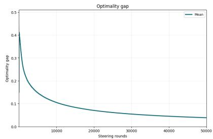
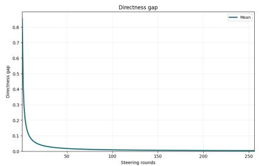
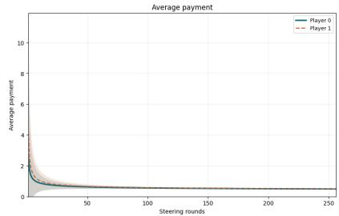
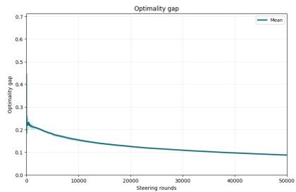
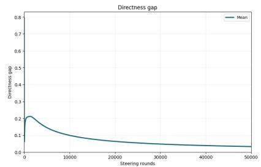
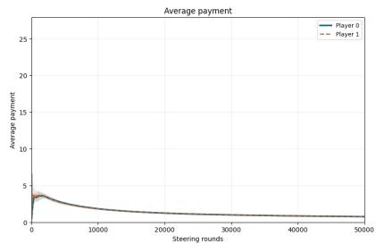
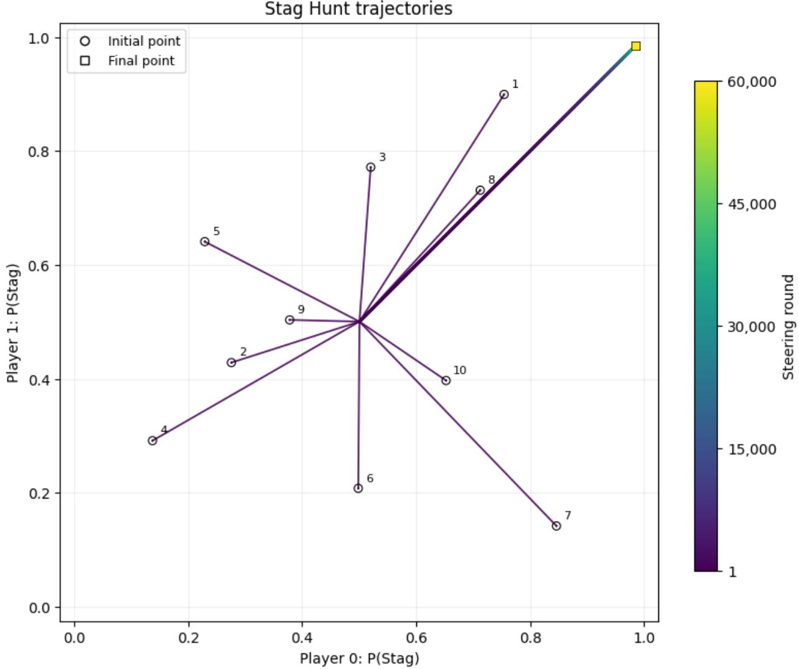
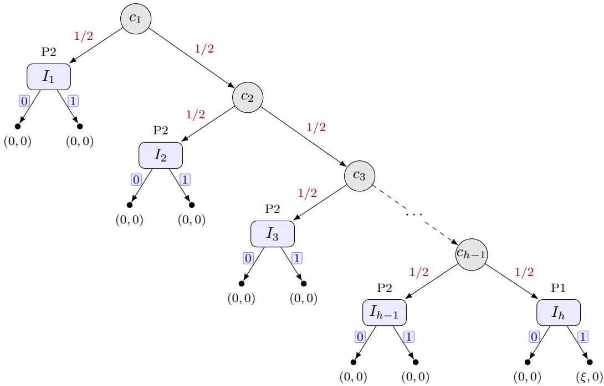

# Learning and Steering in Incomplete-Information Games

Asrın Efe Yorulmaz ∗ Tamer Ba¸sar<sup>†</sup>

## Abstract

In many modern multi-agent systems, a mediator seeks to influence strategic decision dynamics using only outcome-level feedback and without knowing agents’ utilities. In this work, we study how a mediator can learn an unknown game and steer adaptive agents toward out comes that maximize her utility using only trajectory feedback. The mediator knows the game form and her own objective, but not the agents’ utilities. Moreover, she commits to nonnegative payments and provides recommendations and contexts, but receives only a single realized terminal outcome rather than full-information feedback. We develop halving-type algorithms that learn utility diferences in normal-form games and conditional continuation-value diferences in extensive-form games, achieving a sample complexity of Oe(ε<sup>−2</sup>) that matches worst-case lower bounds up to logarithmic factors. We then combine these learning procedures with a Lagrangian formulation in an online Learn–Compute–Steer algorithm that interleaves learning, equilibrium computation, and steering toward mediator-optimal extensive-form correlated equilibria (EFCE). With high probability, the Learn–Compute–Steer algorithm achieves a directness gap and an optimality gap of Oe(T<sup>−1/4</sup>), while time-average payments are of Oe(T<sup>−1/8</sup>).

## 1 Introduction

Classical game theory is primarily concerned with a forward problem: given agents’ preferences and the rules of interaction, how will strategic agents behave? This perspective underlies equilibrium analysis and its many refinements, which characterize stable patterns of play assuming agents optimize against one another. In many modern applications, however, a designer, platform, or principal does not know agents’ utilities a priori. Although much of the literature on the inverse problem of learning the game itself from observations assumes that observed behavior corresponds to an equilibrium outcome (Kuleshov and Schrijvers, 2015), this assumption is often untenable in practice. First, equilibrium play may be computationally expensive to obtain in large games, as computing Nash equilibria is PPAD-hard in general (Daskalakis et al., 2006). Second, even when equilibria are well-defined, real-world agents typically adapt online under limited information and changing conditions, so their behavior need not settle at, or even approximate, any fixed equilibrium profile within the time horizon of interest. This raises a complementary inverse and control-oriented question: given only observed behavior from adaptive agents, how can a principal both learn about the strategic environment and shape long-run outcomes toward objectives of its own?

A natural behavioral model in such settings is one where agents employ no-regret learning algorithms rather than explicitly computing equilibria, as no-regret dynamics provide a principled foundation for predicting long-run behavior in multi-agent interactions (Nekipelov et al., 2015). Moreover, when each player runs a no-regret algorithm, the induced time-averaged play approaches equilibria notions such as correlated equilibrium (CE) and coarse correlated equilibrium (CCE)

in general-sum normal-form games (NFGs) (Hart and Mas-Colell, 2000; Cesa-Bianchi and Lugosi, 2006). Furthermore, regret-minimization methods and their equilibria convergence guarantees extend to extensive-form games (EFGs) (Zinkevich et al., 2007; Lanctot et al., 2009; Tammelin, 2014).

In many socio-technical settings, however, there is also a principal or mediator with an objective function distinct from those of the agents. Such a mediator can intervene by providing information, recommendations, or incentives that influence agents’ learning trajectories. In extensive-form games, a natural solution concept for this mediated interaction is extensive-form correlated equilibrium (EFCE), which unifies information design and incentive constraints into a single implementability object (von Stengel and Forges, 2008).

A central obstacle in multi-stage settings is the mediator’s limited observability. We distinguish between two feedback regimes. In the first setting, full-information feedback, the mediator observes suficient information to evaluate or estimate utilities for deviations beyond the realized play, e.g., full-information payof vectors in normal-form games or counterfactual value information in EFGs. In the second setting, trajectory feedback, in each iteration the mediator observes a single realized terminal outcome together with the information sets visited by each player along their trajectories, and can base payments only on the realized outcome. In this work, we focus on designing mediator algorithms that work in the trajectory-feedback regime. Formally, we ask the question:

Without knowing the players’ utilities and observing only realized trajectories, can a mediator steer no-regret learners to optimal EFCE, while her payments vanish on average?

We answer this question in the afirmative by making the following contributions.

• In Section 3, we develop algorithms that learn utility diferences in normal-form games (Algorithm 2) and conditional continuation-value diferences in extensive-form games (Algorithm 4), both with sample complexity $\widetilde { O } ( \varepsilon ^ { - 2 } )$ . This dependence matches the normal-form lower bounds of Zhang et al. (2025a) and extensive-form lower bounds in Proposition 3.16 up to logarithmic factors. Moreover, we show that learning conditional continuation-value diferences sufices to evaluate the EFCE incentive constraints, which, as we later establish, enables the mediator to steer players toward a desired EFCE.

• In Section 4, we present online Learn–Compute–Steer algorithm (Algorithm 6) that combines learning, equilibrium computation, and trajectory-feedback steering. We show that, the directness gap and the optimality gap relative to the mediator’s optimal EFCE value diminish with the rate of $\widetilde { O } ( T ^ { - 1 / 4 } )$ , while time-average payments vanish with the rate of ${ \widetilde O } ( T ^ { - 1 / 8 } )$ , with high probability. Finally, in Section 5, we complement the analysis with experiments in a normal-form Stag Hunt game and extensive-form Kuhn Poker instances.

## 1.1 Related Work

A broad literature studies inverse problems in games—inferring agents’ preferences from observed behavior—under names such as learning from revealed preferences and inverse game theory. Classical revealed-preference models focus on identifying utility parameters from choices under rationality assumptions (Beigman and Vohra, 2006; Zadimoghaddam and Roth, 2012), while inverse game-theoretic work develops identification and estimation methods for multi-agent utilities, often positing that the observed play corresponds to an equilibrium or a noised observation of it (Kuleshov and Schrijvers, 2015; Wu et al., 2022; Goktas et al., 2024). Our setting departs from these equilibrium-based formulations as we assume that the principal observes the agents’ strategies over repeated play, potentially far from equilibrium, and seeks to learn and intervene the process.

Our perspective is closely aligned with recent work that studies how a mediator can simultaneously learn an unknown game and influence agents’ behavior under learning-based behavioral assumptions. Most closely related to our learning procedure (Section 3), (Zhang et al., 2025a) show that a principal can learn an unknown game with sample complexity $\tilde { O } ( \varepsilon ^ { - 2 } )$ and establish a matching information-theoretic lower bound of $\tilde { \Omega } ( \varepsilon ^ { - 2 } )$ . A key limitation, however, is that their guarantees are developed for normal-form settings and do not extend to EFGs; moreover, their upper bounds do not match the lower bound with respect to dependence on the players’ action-space sizes, which can be prohibitively large in practice. We address these issues in the present work, and provide a comparison of our results in Table 1. Importantly, similar to (Zhang et al., 2025a), (Yorulmaz et al., 2025), in this work we assume that the players are no-regret within each mediator-provided context. Related themes also appear in the literature on principal–agent interaction with learning agents and on contract design under uncertainty, where the principal must reason about an agent that adapts over time (Lin and Chen, 2025; Guruganesh et al., 2024; D¨utting et al., 2021; Freeman et al., 2020).

Building on this viewpoint, we pursue a diferent downstream objective. Rather than merely estimating utilities, we integrate learning the underlying game, which constitutes the Learn component of our framework, with equilibrium-oriented steering, which constitutes the Compute–Steer component, in multi-stage games under trajectory feedback. A complementary line of work studies how to steer adaptive agents by shaping rewards under partial knowledge of agents’ dynamics, often using control-theoretic viewpoints (Huang et al., 2025; Canyakmaz et al., 2025; Gong et al., 2022). These approaches typically model specific learning dynamics, whereas, for the steering problem, we assume only regret guarantees within each mediator-provided context, as in the Learn component of our framework, and focus on steering agents toward a mediator-optimal EFCE.

Most directly related to our Learn-Compute-Steer algorithm, Algorithm 6, (Zhang et al., 2024) introduce a trajectory-feedback steering framework that drives no-regret agents toward a desired equilibrium while maintaining vanishing average payments. They also ask whether there exists a fully online trajectory-feedback algorithm that attains the mediator-optimal equilibrium, and we answer this question in the afirmative in the present work assuming that players have no regret within each mediator-provided context for EFCE. Our result in this work, compared to earlier ones can be found in Table 2, where ofline steering refers to steering toward a known equilibrium, whereas online steering refers to simultaneously computing an equilibrium and steering the players toward it. All results hold for EFGs. Earlier work on implementation via payments is also conceptually aligned with our use of nonnegative, outcome-dependent transfers to enforce obedience (Monderer and Tennenholtz, 2003).

On the other hand, our mediated interaction model is closely related to the Bayesian persuasion framework and information design problems, where a sender commits to an information structure to shape receivers’ behavior (Kamenica and Gentzkow, 2011; Bergemann and Morris, 2019). Moreover, BCE provides a unifying implementability object that captures both Bayes plausibility and incentive constraints, while it subsumes classical correlation/communication concepts in games with information (Bergemann and Morris, 2016; Forges, 1986; Myerson, 1986). In extensive-form settings, related implementability notions include extensive-form correlated equilibrium (EFCE) and its computational treatments (von Stengel and Forges, 2008). Related to our mediated steering model, (Yorulmaz et al., 2025) provide results characterizing what can be achieved under information-design constraints when the objective is to steer agents’ behavior.

Table 1: Comparison of Sample Complexity Rates for ε-Learning the Games
<table><tr><td>Problem Type</td><td>Zhang et al. (2025a)</td><td>Our Results</td><td>Worst-case Lower Bounds</td></tr><tr><td>Single-Agent NFGs</td><td> $\begin{array} { r } { \mathcal { O } \big ( \frac { M ^ { 3 } } { \varepsilon ^ { 2 } } \big ) } \end{array}$ </td><td> $\textstyle { \mathcal { O } } ( { \frac { M } { \varepsilon ^ { 2 } } } )$  Thm. 3.5</td><td> $\begin{array} { r } { \Omega \big ( \operatorname* { m a x } \left\{ \frac { n M \log ( 1 / \varepsilon ) } { \log M } , \frac { C ^ { 2 } } { \varepsilon ^ { 2 } } \right\} \big ) } \end{array}$  Zhang et al. (2025a)</td></tr><tr><td>Multi-Agent NFGs</td><td> $\begin{array} { r } { \mathcal { O } \big ( \frac { n m ^ { 3 } M ^ { 5 } + m ^ { 2 } M ^ { 4 } n ^ { 4 } } { \varepsilon ^ { 2 } } \big ) \mathcal { O } \big ( \frac { M n ^ { 3 } } { \varepsilon ^ { 2 } } \big ) } \end{array}$ </td><td>Thm. 3.10</td><td> $\begin{array} { r } { \Omega \big ( \operatorname* { m a x } \left\{ \frac { n M \log ( 1 / \varepsilon ) } { \log M } , \frac { C ^ { 2 } } { \varepsilon ^ { 2 } } \right\} \big ) } \end{array}$  Zhang et al. (2025a)</td></tr><tr><td>EFGs</td><td>X</td><td> $\begin{array} { r } { \tilde { \mathcal { O } } \big ( \frac { \mathcal { I } n ^ { 2 } } { \rho _ { m i n } ^ { 2 } \varepsilon ^ { 2 } } \big ) } \end{array}$  Thm. 3.15</td><td> $\begin{array} { r } { \Omega \big ( \operatorname* { m a x } \big \{ \frac { \mathcal { I } \log ( 1 / \varepsilon ) } { \log \mathcal { I } } , \frac { C ^ { 2 } } { \varepsilon ^ { 2 } } , \frac { \log ( 1 / ( 2 \delta ) ) } { \rho _ { \operatorname* { m i n } } } \big \} \big ) } \end{array}$  Prop. 3.16</td></tr></table>

Here $m = { \mathrm { m a x } } _ { i } m _ { i }$ , and $\begin{array} { r } { M = \prod _ { i } m _ { i } } \end{array}$ is the normal-form joint-action count, and $C = \operatorname* { m a x } _ { i } C _ { i } \geq 1$ . For EFGs, $\mathcal { T } \leq M _ { \mathrm { E F } } n I _ { \mathrm { m a x } } a _ { \mathrm { m a x } }$ , where $\begin{array} { r } { M _ { \mathrm { E F } } = \prod _ { i } \prod _ { I \in \mathcal { T } _ { i } } \vert A _ { I } \vert , I _ { \mathrm { m a x } } = \operatorname* { m a x } _ { i } \vert \mathcal { T } _ { i } \vert _ { \mathrm { : } } } \end{array}$ , and $a _ { \mathrm { m a x } } = \operatorname* { m a x } _ { i , I } \left| A _ { I } \right|$

Table 2: Comparison of directness-gap bounds in EFGs under regret of order $\mathcal { O } ( \sqrt { T } ) .$
<table><tr><td>Reference</td><td>Feedback</td><td>Equilibrium</td><td>Offline steering</td><td>Online steering</td></tr><tr><td>Zhang et al. (2024)</td><td>Full feedback</td><td>BCE</td><td> $\mathcal { O } ( T ^ { - 1 / 4 } )$ </td><td> $\mathcal { O } ( T ^ { - 1 / 6 } )$ </td></tr><tr><td>Zhang et al. (2024)</td><td>Trajectory feedback</td><td>BCE</td><td> $\mathcal { O } ( T ^ { - 1 / 4 } )$ </td><td></td></tr><tr><td>Theorem 4.5</td><td>Trajectory feedback</td><td>EFCE</td><td></td><td> $\widetilde { \mathcal { O } } ( T ^ { - 1 / 4 } )$ </td></tr></table>

Finally, our setting is related to work on strategizing against or exploiting agents, as well as to Stackelberg and commitment perspectives. Literature shows that a principal can extract value against no-regret learners, motivating equilibrium-free analyses in repeated interaction (Deng et al., 2019; Mansour et al., 2022; Braverman et al., 2018; Kolumbus and Nisan, 2022). In Stackelberg settings, there are works on learning optimal commitments and dynamic Stackelberg equilibria under various models of follower response (Conitzer and Sandholm, 2006; Letchford et al., 2009; Haghtalab et al., 2022; Laufer et al., 2024). In a related direction, (Zhang et al., 2025b) provide impossibility results and identifies what information must be known in order to steer a learning follower through the leader’s actions. Comparably, we focus on a mediator who chooses contexts, recommendations, and payments to induce mediator-optimal outcomes.

## 2 Preliminaries

For an integer $n \geq 1$ , we write $[ n ] : = \{ 1 , 2 , . . . , n \}$ . For a statement $p ,$ let ${ \bf 1 } \{ p \} \in \{ 0 , 1 \}$ denote its indicator. For a vector $v \in \mathbb { R } ^ { m }$ , v[i] denotes its i-th coordinate, and $\langle u , v \rangle$ denotes the Euclidean inner product. We use ${ \widetilde { O } } ( \cdot )$ and $\widetilde { \Omega } ( \cdot )$ to hide factors logarithmic in their argument(s). Unless stated otherwise, all utilities take values in [0, 1].

## 2.1 Normal-Form Games

A normal-form game is a tuple $\Gamma = ( n , \{ A _ { i } \} _ { i = 1 } ^ { n } , \{ u _ { i } \} _ { i = 1 } ^ { n } )$ , where n is the number of players; each player i has a finite action set $A _ { i }$ with $\left| { \cal A } _ { i } \right| = m _ { i } \ge 2 ;$ and each player i has a utility function $u _ { i } \ : \ A _ { 1 } \times \ \cdots \times A _ { n } \  \ [ 0 , 1 ]$ . Let $A : = A _ { 1 } \times \cdots \times A _ { n }$ denote the set of action profiles. As standard, we write −i to refer to all players except i. Define $\begin{array} { r } { m : = \operatorname* { m a x } _ { i } m _ { i } , \ M : = \ \prod _ { i = 1 } ^ { n } m _ { i } } \end{array}$ and $\begin{array} { r } { M _ { - i } \ : = \ \prod _ { j \in [ n ] \backslash \{ i \} } m _ { j \cdot } \ \mathrm { ~ A ~ } } \end{array}$ (mixed) strategy of player i is a distribution $x _ { i } \in X _ { i } : = \Delta ( A _ { i } )$ For a mixed profile ${ \ddot { x } } = ( x _ { 1 } , \ldots , x _ { n } )$ , we write $a \sim x$ to mean $a _ { i } \sim x _ { i }$ independently, and define $u _ { i } ( x ) : = \mathbb { E } _ { a \sim x } \big [ u _ { i } [ a ] \big ]$

## 2.2 Extensive-form games

We use the standard finite extensive-form game as follows.

Definition 2.1. An extensive-form game Γ with n players has:

1. a player set K, in which we refer to a specific player with i and to remaining players with $- i ;$

2. a finite directed tree H of histories, nodes, with root $\varnothing .$ . The edges are labeled by actions; for $h \in H , A _ { h }$ denotes the set of legal actions at h. The leaves are terminal histories with terminal set $Z \subset H$ ;

3. a partition of non-terminal histories, given as $H \setminus Z \ = \ H _ { C } \sqcup H _ { 1 } \sqcup \cdot \cdot \cdot \sqcup H _ { n }$ , where $H _ { i }$ is the set of nodes at which player i acts, and $H _ { C }$ is the set of chance nodes;

4. for each player $i ,$ a partition $\mathcal { T } _ { i }$ of $H _ { i }$ into information sets; all nodes $I \in \mathcal { T } _ { i }$ share the same action set $A _ { I } ;$

5. bounded utilities $u _ { i } : Z \to [ 0 , 1 ]$ for each player $i ;$

6. for each chance node $h \in H _ { C }$ , a fixed distribution $c ( \cdot \mid h )$ over $A _ { h }$

For a history $h \in H$ , let $\sigma _ { i } ( h )$ denote the sequence of player i’s information-set–action pairs along the path from the root to h, excluding any action at h itself. Player i has perfect recall if $\sigma _ { i } ( h ) = \sigma _ { i } ( h ^ { \prime } )$ whenever h and $h ^ { \prime }$ belong to the same information set $I \in \mathcal { T } _ { i }$ . We assume perfect recall throughout and denote the common sequence at I by $\sigma _ { i } ( I )$ . Writing $\sigma _ { i } ( I ) a$ for the sequence obtained by appending action $a \in A _ { I }$ at $I ,$ we define $\Sigma _ { i } : = \{ \emptyset \} \cup \{ \sigma _ { i } ( I ) a : I \in \mathcal { T } _ { i } , \ a \in A _ { I } \}$ Furthermore, we write $I \preceq Z$ whenever information set $I \in I _ { i }$ precedes $Z \in I _ { i }$ under such ordering.

A pure strategy of player i specifies an action at every information set $I \in \mathcal { T } _ { i }$ , while a behavioral strategy $\beta _ { i }$ assigns a distribution $\beta _ { i } ( \cdot \mid I ) \in \Delta ( A _ { I } )$ at each such set. The realization plan $x _ { i } \in \mathbb { R } _ { + } ^ { \Sigma _ { i } }$ records the probabilities of player i’s action sequences, by $x _ { i } [ \sigma _ { i } ( I ) a ] = x _ { i } [ \sigma _ { i } ( I ) ] \beta _ { i } ( a \ |$ $I ) , x _ { i } [ \emptyset ] = 1$ . Consequently, the set of feasible realization plans is the sequence-form polytope $\begin{array} { r } { X _ { i } : = \left\{ x _ { i } \in \mathbb { R } _ { + } ^ { \Sigma _ { i } } : x _ { i } [ \emptyset ] = 1 , \sum _ { a \in A _ { I } } x _ { i } [ \sigma _ { i } ( I ) a ] = x _ { i } [ \sigma _ { i } ( I ) ] , \forall I \in \mathbb { Z } _ { i } \right\} } \end{array}$

We let $X : = X _ { 1 } \times \cdots \times X _ { n }$ . For a strategy profile $x = ( x _ { 1 } , \ldots , x _ { n } ) \in X$ and a terminal history $z \in Z$ , write $x _ { i } [ z ] : = x _ { i } [ \sigma _ { i } ( z ) ]$ . For any subset $N \subseteq [ n ]$ , define the terminal reach vector $\hat { x } _ { N } \in \mathbb { R } ^ { Z }$ by $\begin{array} { r } { \hat { x } _ { N } [ z ] : = \prod _ { j \in N } x _ { j } [ z ] } \end{array}$ , and write $\hat { x } : = \hat { x } _ { [ n ] }$ . Thus, $\hat { x } [ z ]$ represents the joint contribution of the players’ strategies to reaching z, excluding chance. Let $\pi _ { C } ( z ) \in [ 0 , 1 ]$ denote the product of chance probabilities along the path to z. The probability of reaching z is then $\pi _ { C } ( z ) \hat { x } [ z ]$ , and player i’s expected utility is $\begin{array} { r } { u _ { i } ( x ) = \mathbb { E } _ { z \sim x } [ u _ { i } ( z ) ] = \sum _ { z \in Z } u _ { i } ( z ) \pi _ { C } ( z ) \hat { x } [ z ] } \end{array}$ . In particular, holding $x _ { - i }$ fixed, the map $x _ { i } \mapsto u _ { i } ( x _ { i } , x _ { - i } )$ is linear in $x _ { i }$

## 2.3 Mediator-Augmented Games and Contexts

In the considered mediator-augmented games, we simply add a mediator, denoted by player 0, to the original game Γ and denote the augmented game with Γ. We assume that the mediator <sup>ˆ</sup> knows the game form and her utility $u _ { 0 } : Z \to [ 0 , 1 ]$ , but does not know the players’ utilities. In a normal-form game, terminal outcomes are simply identified with joint action profiles.

Moreover, for each player i, we let $\mathcal { C } _ { i }$ be a context space. Before play in round t, the mediator chooses $\kappa ^ { ( t ) } \in \Pi _ { i } \mathcal { C } _ { i }$ , and player i observes $\kappa _ { i } ^ { ( t ) }$ . Contexts identify the learning environments used by the players. Crucially, we assume that each player maintains a separate learning state for each context and updates it only on rounds carrying that context. Returning to a context resumes its existing state; using a new context initializes a previously unused state. Context selection may depend on the preceding interaction, but is made before the current round’s play randomization and Nature’s moves. All contexts concern the same underlying game; the mediator’s payments and recommendation protocol determine the round-wise augmented interaction.

Within a context, the mediator may also provide action recommendations. We distinguish the original strategy space $X _ { i }$ from the response-strategy space $Y _ { i }$ in the recommendation-augmented game $\widehat { \Gamma } .$ . A strategy in $Y _ { i }$ specifies actions using the player’s original information and recommendations received so far. We use space $Y _ { i }$ for all commitments under the fixed recommendation protocol, and write $Y : = \prod _ { i } Y _ { i }$

A commitment $\mu \in X _ { 0 }$ specifies a recommendation law; fixing it induces a game $\Gamma _ { \mu }$ among the players. For $x \in Y$ , let $\pi ( \cdot \mid \mu , x )$ be the induced law on original terminal outcomes, and we define $u _ { j } ( \mu , x ) : = \mathbb { E } _ { z \sim \pi ( \cdot | \mu , x ) } [ u _ { j } ( z ) ]$ , for $j \in \{ 0 , 1 , \ldots , n \}$ . When no recommendations are sent, players use strategies in $X _ { i } ,$ and we write $\pi ( \cdot \mid x )$ and $u _ { j } ( x )$ . An original-game strategy can also be viewed as a response strategy that ignores recommendations.

As mentioned, the mediator also has the ability of providing nonnegative payments. In the normalform learning procedures these are vectors $p _ { i } ^ { ( t ) } \in [ 0 , P _ { \operatorname* { m a x } } ] ^ { A _ { i } }$ , depending on each player’s chosen action. In extensive-form games they are terminal payment rules $q _ { i } ^ { ( t ) } : Z \to [ 0 , P _ { \operatorname* { m a x } } ]$ . We refer to the total utility experienced by players, including payments by the mediator, as augmented payof or augmented utility of a player. We denote the realized augmented payofs as

$$
r _ { i } ^ { ( t ) } : = \left\{ \begin{array} { l l } { u _ { i } ( { a } ^ { ( t ) } ) + p _ { i } ^ { ( t ) } [ { a } _ { i } ^ { ( t ) } ] , } & { \mathrm { i n ~ N F G s , } } \\ { u _ { i } ( { z } ^ { ( t ) } ) + q _ { i } ^ { ( t ) } ( { z } ^ { ( t ) } ) , } & { \mathrm { i n ~ E F G s . } } \end{array} \right.
$$

Furthermore, for a selected strategy profile, we denote its expected augmented utility as $v _ { i } ^ { ( t ) } ( \mu , x ) : =$ $\mathbb { E } \big [ r _ { i } ^ { ( t ) } \mid \mu , x \big ]$ , where we condition on the past strategies and the selected payment rules and recommendations. Importantly, the expectation is taken before current recommendations, action samples, and Nature’s moves are generated. When no recommendations are sent, the argument $\mu$ is omitted. Holding the actual opponents’ selected strategies and the mediator’s choices fixed, we write $v _ { i } ^ { ( t ) } ( x _ { i } ^ { \star } )$ for the expected augmented payof using only player i’s strategy by $x _ { i } ^ { \star }$

## 2.4 Online Optimization and No-Regret Algorithms

We measure regret separately within each mediator-provided context. For player $i ,$ context $c \in { \mathcal { C } } _ { i } .$ and horizon T, we define $\mathcal { T } _ { i } ( T , c ) : = \{ t \leq T : \kappa _ { i } ^ { ( t ) } = c \} , N _ { i } ( T , c ) : = | \mathcal { T } _ { i } ( T , c ) |$ . For brewity in this section, let $t _ { i , c } ( 1 ) < t _ { i , c } ( 2 ) < \cdot \cdot \cdot < t _ { i , c } ( m )$ be the rounds carrying context c. We let $\mathcal { F } _ { i , c }$ contain the history and parameters fixed before this context’s first use.

Normal-form games. On a learning round t, player i selects $\boldsymbol { v } _ { i } ^ { ( t ) } \in \Delta ( A _ { i } )$ and samples $a _ { i } ^ { ( t ) } \sim x _ { i } ^ { ( t ) }$ The payment vector $p _ { i } ^ { ( t ) }$ is chosen before the current action samples, and the augmented utility is $u _ { i } ^ { ( t ) } ( a ) : = u _ { i } ( a ) + p _ { i } ^ { ( t ) } [ a _ { i } ]$ . For $x _ { i } \in \Delta ( A _ { i } )$ and $a _ { - i } \in A _ { - i }$ , write $\begin{array} { r } { \boldsymbol { u } _ { i } ^ { ( t ) } ( \boldsymbol { x } _ { i } , a _ { - i } ) : = \sum _ { b \in A _ { i } } \boldsymbol { x } _ { i } [ b ] \big ( \boldsymbol { u } _ { i } ( b , a _ { - i } ) + } \end{array}$ $p _ { i } ^ { ( t ) } [ b ] )$ . The regret against the opponents’ realized actions is $\begin{array} { r } { R _ { i , c } ^ { \mathrm { N F } } ( m ) : = \operatorname* { m a x } _ { b \in A _ { i } } \sum _ { \ell = 1 } ^ { m } \big [ u _ { i } ^ { ( t _ { \ell } ) } ( b , a _ { - i } ^ { ( t _ { \ell } ) } ) - } \end{array}$ $u _ { i } ^ { ( t _ { \ell } ) } ( x _ { i } ^ { ( t _ { \ell } ) } , a _ { - i } ^ { ( t _ { \ell } ) } ) ]$ . Following Yorulmaz et al. (2025); Zhang et al. (2025a), we distinguish the mixed strategies selected by an online algorithm from their sampled actions. The corresponding realizedaction regret is $\begin{array} { r } { \widehat { R } _ { i , c } ^ { \mathrm { N F } } ( m ) : = \operatorname* { m a x } _ { b \in A _ { i } } \sum _ { \ell = 1 } ^ { m } \big [ u _ { i } ^ { ( t _ { \ell } ) } ( b , a _ { - i } ^ { ( t _ { \ell } ) } ) - u _ { i } ^ { ( t _ { \ell } ) } ( a ^ { ( t _ { \ell } ) } ) \big ] } \end{array}$ , where $u _ { i } ^ { ( t ) } ( a ^ { ( t ) } ) = r _ { i } ^ { ( t ) }$ . Then, we have the following result.

Proposition 2.2. Fix a context c and a context horizon m. Suppose that an online algorithm A satisfies $R _ { i , c } ^ { \mathrm { N F } } ( m ) ~ \leq ~ B _ { i , c } ( m )$ almost surely. Assume that the action samples are conditionally independent given the history and strategies, and augmented utilities lie in $[ 0 , L ]$ . Then, $\mathbb { P } \big \{ \widehat { R } _ { i , c } ^ { \mathrm { N F } } ( m ) \leq B _ { i , c } ( m ) + L \sqrt { 2 m \log ( 1 / \beta ) } | \mathcal { F } _ { i , c } \big \} \geq 1 - \beta .$ , for every $\beta \in ( 0 , 1 )$

Proof. See Appendix A.

Extensive-form games. On a learning round t, player i selects a realization plan $x _ { i } ^ { ( t ) } \in X _ { i }$ A terminal history records only the actions along the realized path. The observed terminal node does not specify the opponents’ behavior at information sets that a diferent strategy of player i might reach. We therefore evaluate strategies against the fixed strategies in expectation. The expected regret is $\begin{array} { r } { R _ { i , c } ^ { \mathrm { E F } } ( m ) : = \operatorname* { m a x } _ { x _ { i } ^ { \star } \in X _ { i } } \sum _ { \ell = 1 } ^ { m } \big [ v _ { i } ^ { ( t _ { \ell } ) } ( x _ { i } ^ { \star } , x _ { - i } ^ { ( t _ { \ell } ) } ) - v _ { i } ^ { ( t _ { \ell } ) } ( x ^ { ( t _ { \ell } ) } ) \big ] } \end{array}$ . Executing the selected plans produces a terminal history $z ^ { ( t ) }$ and realized augmented payof $r _ { i } ^ { ( t ) } = u _ { i } ( z ^ { ( t ) } ) + q _ { i } ^ { ( t ) } ( z ^ { ( t ) } )$ The realized-payof regret is $\begin{array} { r } { \widehat { R } _ { i , c } ^ { \mathrm { E F } } ( m ) : = \operatorname* { m a x } _ { x _ { i } ^ { \star } \in X _ { i } } \sum _ { \ell = 1 } ^ { m } \big [ v _ { i } ^ { ( t _ { \ell } ) } ( x _ { i } ^ { \star } , x _ { - i } ^ { ( t _ { \ell } ) } ) - r _ { i } ^ { ( t _ { \ell } ) } \big ] } \end{array}$ . Importantly, the same definitions apply during steering in the recommendation-augmented game. We replace $X _ { i }$ by $Y _ { i }$ and include the current commitment $\mu ^ { ( t \ell ) }$ as the first argument of $v _ { i } ^ { ( t _ { \ell } ) }$ . The strategy chosen in the maximization is fixed across the context’s rounds, while its actions may depend on the recommendations received. Then, we have the following result.

Proposition 2.3. Fix a context c and a context horizon m. Suppose that each episode is sampled from the distribution induced by the strategies and mediator choices. If augmented payofs lie in $[ 0 , L ]$ , then, $\mathbb { P } \big \{ \big | \widehat { R } _ { i , c } ^ { \mathrm { E F } } ( m ) - R _ { i , c } ^ { \mathrm { E F } } ( m ) \big | \leq L \sqrt { 2 m \log ( 2 / \beta ) } | \mathcal { F } _ { i , c } \big \} \geq 1 - \beta$ , for every $\beta \in ( 0 , 1 )$ .

Proof. See Appendix A.

Regret guarantees. When the game and interaction protocol are clear, we suppress the superscripts NF and EF and write $R _ { i , c } ( m )$ and $\widehat { R } _ { i , c } ( m )$ . We say a learner is context-wise no-regret if lim $\begin{array} { r } { \operatorname* { s u p } _ { m  \infty } \frac { R _ { i , c } ( m ) } { m } \leq 0 } \end{array}$ for every context c that occurs infinitely often. We assume that each player is context-wise no-regret. If $P _ { c }$ bounds its payments, we use realized-payof bounds of the form

$$
\mathbb { P } \Big \{ \widehat { R } _ { i , c } ( m ) > ( 1 + P _ { c } ) \mathcal { R } _ { i , c } ( m , \beta ) \Big | \mathcal { F } _ { i , c } \Big \} \leq \beta ,\tag{1}
$$

where $\mathcal { R } _ { i , c } ( m , \beta ) = o ( m )$ for fixed $\beta$ due to Propositions 2.2 and 2.3. For context-wise square-root regret guarantees, we take $\mathcal { R } _ { i , c } ( m , \beta ) = C _ { i , c } ( \beta ) \sqrt { m }$ , with $C _ { i , c } ( \beta )$ independent of $m .$

Remark 2.4 (Regret bounds and sampling). The learning and steering analyses below use deterministic regret inequalities. For randomized learners, these inequalities may instead be understood on a high-probability event. In particular, Propositions 2.2 and 2.3 convert selected-strategy regret bounds into realized-payof regret bounds with an additional square-root concentration term.

For a fixed horizon $T ,$ allocating failure probability $\delta / ( 3 n T )$ to each player and learning epoch ensures that all realized-payof regret inequalities used by the learning procedure hold simultaneously with probability at least $1 - \delta / 3$ . The resulting regret coeficients increase by at most a logarithmic factor. The subsequent proofs use these inequalities and account separately for the concentration events associated with counterfactual trajectories, reachability, and realized outcomes.

## 2.5 Extensive-Form Correlated Equilibrium

We recall the extensive-form correlated equilibrium (EFCE) of von Stengel and Forges (2008), using the trigger-deviation characterization of Celli et al. (2020). For each player i, let $S _ { i } : = $ $\begin{array} { r } { \prod _ { I \in \mathbb { Z } _ { i } } A _ { I } , S : = \prod _ { i = 1 } ^ { n } S _ { i } } \end{array}$ denote the sets of pure contingency plans and joint pure profiles. Each $s _ { i } \in S _ { i }$ specifies an action at every information set of player i, including those not reached during play. Its sequence-form realization plan is denoted by $\mathrm { S e q } _ { i } ( s _ { i } ) \in \mathrm { e x t } ( X _ { i } )$ . For a pure profile $s \in { \mathcal { S } }$ define $\begin{array} { r } { U _ { i } ( s ) : = \sum _ { z \in Z } u _ { i } ( z ) \pi ( z \mid \operatorname { S e q } ( s ) ) } \end{array}$ .

In the ex-ante EFCE recommendation device, the mediator samples a joint pure profile $\begin{array} { r } { \bar { s } \sim \mu , } \end{array}$ where $\mu \in \Delta ( \mathcal S )$ , independently of Nature’s moves. Whenever player i reaches an information set I, the mediator privately recommends $\bar { s } _ { i } ( I )$ . A player receives no further recommendations after disobeying, while recommendations to the other players continue. The mediator’s distribution may correlate recommendations across players and information sets.

Trigger deviations. For player i, information set $I \in \mathcal { T } _ { i }$ , and recommended action $a \in A _ { I }$ , we write $\sigma = ( I , a )$ for the corresponding sequence $\sigma _ { i } ( I ) a \in \Sigma _ { i }$ . Let $S _ { i } ( I ) \subseteq S _ { i }$ consist of the pure plans whose preceding actions are consistent with reaching I, and define $S _ { i } ( I , a ) : = \{ s _ { i } \in S _ { i } ( I )$ $s _ { i } ( I ) = a \}$ . An (I, a)-trigger deviation follows all recommendations until player i reaches I and receives recommendation a. If this occurs, the player stops following recommendations and instead uses a continuation plan sampled from a fixed distribution $\hat { \mu } _ { i } \in \Delta ( S _ { i } ( I ) )$ .

To express the resulting incentive constraints, let $Z ( I ) \subseteq Z$ denote the terminal histories passing through I, and let $Z ( I , a ) \subseteq Z ( I )$ denote those taking action a at I. For $z \in Z$ , let $S _ { i } ( z )$ be the set of pure plans whose actions agree with player i’s actions along z, and write $\begin{array} { r } { S ( z ) : = \prod _ { i = 1 } ^ { n } S _ { j } ( z ) , S _ { - i } ( z ) : = \prod _ { i \neq i } S _ { j } ( z ) } \end{array}$ . The probability of terminal history z under obedience is $q _ { \mu } ( z ) : = \bar { \pi _ { C } } ( z ) \sum _ { \bar { s } \in S ( z ) } \mu ( \bar { s } )$ $\mathrm { F o r ~ } \overset { \cdot } { z } \in Z ( I )$ , the probability mass associated with triggering at $( I , a )$ and subsequently reaching z is

$$
p _ { \mu , \hat { \mu } _ { i } } ^ { ( I , a ) } ( z ) : = \pi _ { C } ( z ) \left( \sum _ { \scriptstyle s _ { i } \in S _ { i } ( I , a ) \atop { \scriptstyle s _ { - i } \in S _ { - i } ( z ) } } \mu ( s _ { i } , s _ { - i } ) \right) \cdot \left( \sum _ { \scriptstyle \hat { s } _ { i } \in S _ { i } ( z ) \atop { \scriptstyle \hat { s } _ { i } \in S _ { i } ( z ) } } \hat { \mu } _ { i } ( \hat { s } _ { i } ) \right) .\tag{2}
$$

Here $\hat { \mu } _ { i }$ is supported on $S _ { i } ( I )$ . The first factor accounts for the sampled recommendations and the opponents’ obedient play; the second accounts for the continuation chosen after triggering.

Definition 2.5 (Extensive-form correlated equilibrium). A distribution $\mu \in \Delta ( \mathcal { S } )$ is an extensiveform correlated equilibrium if, for every player i, information set $I \ \in \ { \mathcal { I } } _ { i }$ , recommended action $a \in A _ { I }$ , and continuation distribution $\hat { \mu } _ { i } \in \Delta ( S _ { i } ( I ) )$ ,

$$
\sum _ { z \in Z ( I , a ) } q _ { \mu } ( z ) u _ { i } ( z ) \geq \sum _ { z \in Z ( I ) } p _ { \mu , \hat { \mu } _ { i } } ^ { ( I , a ) } ( z ) u _ { i } ( z ) .\tag{3}
$$

Equivalently, we define the maximum trigger-deviation gain

$$
\delta ( \mu ) : = \operatorname* { m a x } _ { i \in [ n ] } \operatorname* { m a x } _ { \ a \in A _ { I } } \operatorname* { m a x } _ { \hat { \mu } _ { i } \in \Delta ( S _ { i } ( I ) ) } \Bigg \{ \sum _ { z \in Z ( I ) } p _ { \mu , \hat { \mu } _ { i } } ^ { ( I , a ) } ( z ) u _ { i } ( z ) - \sum _ { z \in Z ( I , a ) } q _ { \mu } ( z ) u _ { i } ( z ) \Bigg \} .\tag{4}
$$

Then $\mu$ is an EFCE if $\delta ( \mu ) \leq 0$ , and an ε-EFCE if $\delta ( \mu ) \leq \varepsilon$

Since the objective in (4) is linear in $\hat { \mu } _ { i } .$ its maximum is attained by a pure continuation plan $\hat { s } _ { i } \in S _ { i } ( I )$ . Thus, checking every player, every pair $( I , a )$ , and every pure continuation plan sufices to characterize the set of EFCEs.

## 3 Learning Games with No-Regret Players

In this section, the mediator learns the players’ unknown utility diferences through contexts and nonnegative payments. Importantly, we proceed with our learning task in epochs, which lets us to learn the utility diferences separately for each $( a _ { i } , a _ { - i } )$ pair. No action recommendations are sent during a learning round. Instead, each epoch receives a new context for every player. The interaction on a learning round proceeds as follows:

1. The mediator provides the players with the current epoch’s contexts and fixes its payment rules: $p _ { i } ^ { ( t ) }$ in a normal-form game and $q _ { i } ^ { ( t ) }$ in an extensive-form game.

2. Each player i uses its provided context to select and execute $x _ { i } ^ { ( t ) } \in X _ { i }$

3. Player i receives its realized augmented payof $r _ { i } ^ { ( t ) }$ . The mediator observes the joint action profile in an NFG or the terminal history in an EFG.

4. Each player updates its strategy using current context’s learning state. The mediator updates the testing counts within the latest epoch.

In Sections 3.1 and 3.2, we use the following context-wise no-regret property for all players and any horizon $T 3$

$$
\widehat { R } _ { i , c } ^ { \mathrm { N F } } ( N _ { i } ( T , c ) ) = \operatorname* { m a x } _ { b \in A _ { i } } \sum _ { \substack { t \in { \cal T } _ { i } ( T , c ) } } \left[ u _ { i } ( b , a _ { - i } ^ { ( t ) } ) + p _ { i } ^ { ( t ) } [ b ] - r _ { i } ^ { ( t ) } \right] \leq C _ { i } \sqrt { N _ { i } ( T , c ) } .\tag{5}
$$

As stated, we aim to learn the players’ utility diferences by choosing contexts and payments. Stated naively, this goal is impossible to achieve due to an inherent identifiability issue. In specific noregret algorithms such as FTRL (Abernethy et al., 2008) and OMD (Nemirovski and Yudin, 1983), an agent’s incentives depend only on utility diferences between actions. Consequently, for any collection of functions $W _ { i } : A _ { - i } \to \mathbb { R }$ that do not depend on ${ { a } _ { i } } ,$ the shifted utilities $u _ { i } ^ { \prime } ( a _ { i } , a _ { - i } ) : =$ $u _ { i } ( a _ { i } , a _ { - i } ) + W _ { i } ( a _ { - i } )$ induce the same comparisons for agent i at every $( a _ { i } , a _ { - i } )$ . Hence, based on partial feedback alone, one cannot distinguish Γ from the game $\Gamma ^ { \prime }$ obtained by applying such shifts. Therefore, utilities are only learnable up to additive terms $W _ { i } ( a _ { - i } )$ . Formally, given a game Γ and precision $\varepsilon > 0$ , we say that the principal ε-learns Γ if it outputs estimates ${ \hat { u } } _ { i } : A $ R for each agent i such that there exist functions $W _ { i } : A _ { - i } \to \mathbb { R }$ satisfying $\begin{array} { r l } { \left| u _ { i } ( a _ { i } , a _ { - i } ) - \hat { u } _ { i } ( a _ { i } , a _ { - i } ) - W _ { i } ( a _ { - i } ) \right| } & { { } \leq } \end{array}$ $\varepsilon , \forall i \in [ n ] , \forall ( a _ { i } , a _ { - i } ) \in A$

## 3.1 Learning Utilities in Single-Agent Normal-Form Games

To illustrate the underlying idea of our algorithm, we first provide our approach in a single-agent normal-form game with action set $A = \{ 1 , \dots , m \}$ and utility vector $u \in [ 0 , 1 ] ^ { m }$ . The mediator observes the agent’s realized actions but not its utilities, and can ofer a payment $p ^ { ( t ) } \in [ 0 , 2 ] ^ { m }$ each round. We use the realized-action regret bound within each learning context, (5), with $n = 1$ and $C _ { 1 } = C \ge 1$ . Since adding an action-independent constant to u does not change the agent’s

$$
\begin{array} { r } { \overbrace { L _ { k } \mathrm { ~ \overbrace { ~ \begin{array} { ~ \left. ~ \frac { ~ \partial ~ \psi ~ } { ~ \partial ~ { ~ \psi ~ } ~ } ~ \frac { ~ \partial ~ { ~ \psi } ~ } { ~ \partial ~ { ~ \psi ~ } ~ } ~ \right|} \\ { ~ \Delta _ { k } ^ { - } ~ \frac { ~ \partial ~ \psi ~ } { ~ \partial ~ { ~ \psi } ~ } ~ \frac { ~ \partial ~ \psi ~ } { ~ \partial ~ { ~ \psi } ~ } ~ \frac { ~ \partial ~ \psi ~ } { ~ \partial ~ { ~ \psi } ~ } ~ } & { ~ U _ { k } } \end{array} ~ }  _ { \bf { \Sigma } } ^ { + } } } ^ { \left| \Delta _ { k } ^ { - } - \theta _ { a } \right| ~ \theta _ { a } ~ } } \end{array}
$$

Figure 1: The two payment payment levels $\Delta _ { k } ^ { \pm } = m _ { k } \pm \gamma _ { k }$ around the current bracket midpoint. At least one payment level is separated from the unknown threshold $\theta _ { a }$ by at least $\gamma _ { k }$

incentives, we seek to recover u only up to such a constant. To do so, for each $a \in A$ , we define a suitable transformation, referred to as the gap to the best action:

$$
\theta _ { a } : = \operatorname* { m a x } _ { b \in A } \left( u [ b ] - u [ a ] \right) = u _ { \operatorname* { m a x } } - u [ a ] \in [ 0 , 1 ] , \qquad u _ { \operatorname* { m a x } } : = \operatorname* { m a x } _ { b \in A } u [ b ] .\tag{6}
$$

Trivially, learning all $\theta _ { a }$ sufices to recover u up to such a constant. First, we state the following property regarding the design of the payment structure used to learn gap to the best action.

Lemma 3.1. For $a \in A$ and $\Delta \in [ 0 , 2 ]$ , let $p ^ { ( \Delta , a ) } [ a ] = \Delta$ and $p ^ { ( \Delta , a ) } [ b ] = 0$ for $b \neq a$ . Then, for every $b \neq a , \ \left( u + p ^ { ( \Delta , a ) } \right) \left[ a \right] - \left( u + p ^ { ( \Delta , a ) } \right) \left[ b \right] = u \left[ a \right] - u \left[ b \right] + \Delta$

Proof. The payment $\boldsymbol { p } ^ { ( \Delta , a ) }$ is nonnegative and bounded by 2. For every $b \neq a , \ ( u + p ^ { ( \Delta , a ) } ) [ a ] -$ $\left( u + p ^ { ( \Delta , a ) } \right) \left[ b \right] = u [ a ] + \Delta - u [ b ]$ , which is the desired identity. □

Thus, paying $\Delta > \theta _ { a }$ makes a strictly optimal, whereas $\Delta < \theta _ { a }$ leaves some alternative strictly better. We exploit this threshold behavior using two payment tests per step. For a fixed target action a, we maintain a bracket $[ L _ { k } , U _ { k } ]$ containing $\theta _ { a }$ at k-th epoch. We define its width, midpoint, and payment level margin by $\begin{array} { r } { \dot { w _ { k } } : = \dot { U _ { k } } - L _ { k } , m _ { k } : = \frac { L _ { k } + U _ { k } } { 2 } , \gamma _ { k } : = \frac { w _ { k } } { 4 } } \end{array}$ , and two payment levels as $\Delta _ { k } ^ { - } : = m _ { k } - \gamma _ { k } , \Delta _ { k } ^ { + } : = m _ { k } + \gamma _ { k }$ . Each payment level uses the corresponding fixed payment $p ^ { ( \Delta _ { k } ^ { \pm } , a ) }$ for

$$
N _ { k } : = \left\lceil \frac { 1 6 C ^ { 2 } } { \gamma _ { k } ^ { 2 } } \right\rceil\tag{7}
$$

rounds under its own context $\kappa _ { a , k } ^ { \pm } .$ . The two payment levels use diferent contexts. Let $X ( \Delta )$ be the number of times a is played in the $N _ { k } .$ -round epoch at payment level $\Delta$ . We label the corresponding epoch as

$$
\begin{array} { r } { B E S T \quad \mathrm { i f ~ } X ( \Delta ) \geq \frac { 3 } { 4 } N _ { k } , \qquad N O T B E S T \quad \mathrm { i f ~ } X ( \Delta ) \leq \frac { 1 } { 4 } N _ { k } , \qquad I N C O N C L \quad \mathrm { o t h e r w i s e } . } \end{array}
$$

We say that a test is certified if its label is not INCONCL. In the next two lemmas, we establish two key properties of our two-level payment test. Specifically, Lemma 3.2 shows that if either payment test is certified, we can partially locate $\theta _ { a }$ . Furthermore, Lemma 3.3 guarantees that at least one of the two tests is certified.

Lemma 3.2. Set $\beta _ { k } : = 4 C / ( 3 \sqrt { N _ { k } } )$ . For an epoch at level $\Delta$

1. If its label is BEST, then $\theta _ { a } \le \Delta + \beta _ { k }$

2. If its label is NOTBEST, then $\theta _ { a } \geq \Delta - \beta _ { k }$

3. If its label is INCONCL, then $| \Delta - \theta _ { a } | < \gamma _ { k }$

Proof. See Appendix B.

By $( 7 ) , \beta _ { k } \le \gamma _ { k } / 3$ . Moreover, as depicted in Figure 1 the payment levels lie on opposite sides of the midpoint, and thus at least one is separated from $\theta _ { a }$ by $\gamma _ { k }$

Lemma 3.3. For $\Delta _ { k } ^ { \pm } = m _ { k } \pm \gamma _ { k }$ , max $\left\{ | \Delta _ { k } ^ { - } - \theta _ { a } | , | \Delta _ { k } ^ { + } - \theta _ { a } | \right\} \geq \gamma _ { k }$ . Consequently, at least one of the two payment levels is certified.

Proof. See Appendix B.

Let $\ell _ { k } ^ { \sigma } \in \{ B E S T ,$ NOTBEST, INCONCL} be the label at $\Delta _ { k } ^ { \sigma }$ for $\sigma \in \{ - , + \}$ . Then, we update the bracket for the $\theta _ { a }$ by intersecting it with the one-sided bounds supplied by all certified payment levels:

$$
\begin{array} { r l } & { L _ { k + 1 } : = \operatorname* { m a x } ( \{ L _ { k } \} \cup \{ \Delta _ { k } ^ { \sigma } - \beta _ { k } : \ell _ { k } ^ { \sigma } = N O T B E S T \} ) , } \\ & { U _ { k + 1 } : = \operatorname* { m i n } ( \{ U _ { k } \} \cup \{ \Delta _ { k } ^ { \sigma } + \beta _ { k } : \ell _ { k } ^ { \sigma } = B E S T \} ) . } \end{array}\tag{8}
$$

Then, we provide the following lemma regarding the contraction of our updates given by (8).

Lemma 3.4. The update (8) preserves $\theta _ { a } \in [ L _ { k + 1 } , U _ { k + 1 } ]$ and satisfies $\begin{array} { r } { U _ { k + 1 } - L _ { k + 1 } \leq \frac { 5 } { 6 } ( U _ { k } - L _ { k } ) } \end{array}$

Proof. See Appendix B.

Algorithm 1 applies this procedure independently to each target action and stops testing an action as soon as its bracket has width at most ε. We provide our sample complexity result for Algorithm 1 in Theorem 3.5.

Algorithm 1 BinarySearch-SA   
Require: $\varepsilon \in ( 0 , 1 )$   
1: for $a \in A$ do   
2: Set $k  0$ and $[ L _ { 0 } ^ { ( a ) } , U _ { 0 } ^ { ( a ) } ]  [ 0 , 1 ] .$   
3: while $U _ { k } ^ { ( a ) } - L _ { k } ^ { ( a ) } > \varepsilon$ do   
4: m $\mathfrak { e }  ( L _ { k } ^ { ( a ) } + U _ { k } ^ { ( a ) } ) / 2 , \gamma _ { k }  ( U _ { k } ^ { ( a ) } - L _ { k } ^ { ( a ) } ) / 4 , N _ { k }  \lceil 1 6 C ^ { 2 } / \gamma _ { k } ^ { 2 } \rceil , \Delta _ { k } ^ { \pm }  m _ { k } \pm \gamma _ { k }$   
5: for $\sigma \in \{ - , + \}$ do   
6: Provide context $\kappa _ { a , k } ^ { \sigma } .$   
7: Run $N _ { k }$ rounds with $p ^ { ( \Delta _ { k } ^ { \sigma } , a ) }$ , retaining this context throughout the epoch.   
8: Record $X ( \Delta _ { k } ^ { \sigma } )$ and its label $\ell _ { k } ^ { \sigma }$   
9: end for   
10: Compute $[ L _ { k + 1 } ^ { ( a ) } , { U } _ { k + 1 } ^ { ( a ) } ]$ using (8); set $k \gets k + 1$   
11: end while   
12: $\widehat { \theta } _ { a } \gets ( L _ { k } ^ { ( a ) } + U _ { k } ^ { ( a ) } ) / 2 .$   
13: end for   
14: Set $c  m ^ { - 1 } \sum _ { b \in A } { \widehat { \theta } } _ { b }$ and return ${ \widehat { u } } [ a ] \gets - { \widehat { \theta } } _ { a } + c$ for all $a \in A .$   
Theorem 3.5. For any $\varepsilon \in ( 0 , 1 )$ , Algorithm 1 outputs ub such that, with $W : = c - u _ { \mathrm { m a x } } , \| u + W \mathbf { 1 } -$   
$\widehat { u } \| _ { \infty } \leq \varepsilon$ . The total number of rounds is $T = O ( m C ^ { 2 } / \varepsilon ^ { 2 } )$ , and the algorithm uses $O ( m \log ( 1 / \varepsilon ) )$   
distinct contexts.   
Proof. See Appendix B.

## 3.2 Learning Utilities in Multi-Agent Normal-Form Games

We now extend the single-agent procedure to normal-form games with n players. The additional dificulty is that, while learning player i’s utility at a fixed opponents’ action profile $y \in A _ { - i } .$ the opponents continue to learn and need not play y in every round. We therefore combine the two-level payment search of Section 3.1 with pinning payments that keep the opponents close to y. The mediator observes the realized joint action $a ^ { ( t ) }$ and uses the realized-action regret bound (5) within each testing context. Without loss of generality, we treat $C _ { j } \geq 1$ . Fix $i \in [ n ] , y \in A _ { - i }$ , and a target action $a \in A _ { i }$ . As in the single-agent case, we define the gap to the best action

$$
\theta _ { i , y } ( a ) : = \operatorname* { m a x } _ { b \in A _ { i } } \left( u _ { i } ( b , y ) - u _ { i } ( a , y ) \right) = u _ { i } ^ { \operatorname* { m a x } } ( y ) - u _ { i } ( a , y ) \in [ 0 , 1 ] , \quad \quad u _ { i } ^ { \operatorname* { m a x } } ( y ) : = \operatorname* { m a x } _ { b \in A _ { i } } u _ { i } ( b , y ) .\tag{9}
$$

Estimating all such gaps recovers each utility $u _ { i } ( \cdot , y )$ up to an additive constant depending on y. Now, we first state the following property regarding the design of the payments made to the learn chosen player’s gap to the best action.

Lemma 3.6. For $a \in A _ { i }$ and $\Delta \in [ 0 , 2 ]$ , let $p _ { i } ^ { ( \Delta , a ) } [ a ] = \Delta$ and $p _ { i } ^ { ( \Delta , a ) } [ b ] = 0$ for $b \neq a$ . Then, for every $b \neq a$ and $y \in A _ { - i } , \left( u _ { i } ( a , y ) + p _ { i } ^ { ( \Delta , a ) } [ a ] \right) - \left( u _ { i } ( b , y ) + p _ { i } ^ { ( \Delta , a ) } [ b ] \right) = u _ { i } ( a , y ) - u _ { i } ( b , y ) + \Delta$

Proof. For any $b \neq a ,$ , the payment diference is $p _ { i } ^ { ( \Delta , a ) } [ a ] - p _ { i } ^ { ( \Delta , a ) } [ b ] = \Delta$ . Adding this to the $u _ { i } ( a , y ) - u _ { i } ( b , y )$ proves the identity. The payment belongs to $[ 0 , 2 ] ^ { A _ { i } }$ □

To hold the opponents near a chosen profile y, we pay each $j \neq i$ according to $p _ { j } ^ { \mathrm { p i n } } : = p _ { j } ^ { ( 2 , y _ { j } ) }$ . Since utility diferences are at most 1, playing $y _ { j }$ has augmented-payof advantage at least 1 over every other action, regardless of the other players’ actions. Consequently, the regret guarantee for the active context bounds the number of rounds when $j$ does not play $y _ { j }$ . Summing over the opponents, an N-round epoch with a new context for every relevant player satisfies

$$
L : = \# \{ t \in [ N ] : a _ { - i } ^ { ( t ) } \neq y \} \leq C _ { - i } ^ { \mathrm { p i n } } \sqrt { N } , \qquad C _ { - i } ^ { \mathrm { p i n } } : = \sum _ { j \neq i } C _ { j } .\tag{10}
$$

We call these L rounds leakage rounds. This is the only additional source of error relative to the single-agent problem: on the other N−L rounds, the target player faces the fixed opponents’ action profile y. For each target $( i , y , a )$ , we again maintain a bracket $[ L _ { k } , U _ { k } ]$ containing $\theta _ { i , y } ( a )$ , initially $[ 0 , 1 ]$ . Setting $\begin{array} { r } { w _ { k } : = U _ { k } - L _ { k } , m _ { k } : = \frac { L _ { k } + U _ { k } } { 2 } , \gamma _ { k } : = \frac { w _ { k } } { 4 } , \Delta _ { k } ^ { \pm } : = m _ { k } \pm \gamma _ { k } } \end{array}$ , similarly each payment level $\Delta _ { k } ^ { \pm }$ is tested in a separate epochs with the length of

$$
N _ { k } : = \left\lceil \left( \frac { 8 ( C _ { i } + 2 C _ { - i } ^ { \mathrm { p i n } } ) } { \gamma _ { k } } \right) ^ { 2 } \right\rceil\tag{11}
$$

rounds. In respective epochs, player i receives $p _ { i } ^ { ( \Delta _ { k } ^ { \pm } , a ) }$ and every opponent $j \neq i$ receives $p _ { j } ^ { \mathrm { p i n } }$ . Let $X _ { i , y , a } ( \Delta )$ denote the number of rounds in which the joint action $( a , y )$ is observed within an epoch at level ∆. We then label the epoch as follows:

$$
\begin{array} { r } { B E S T \colon \ X _ { i , y , a } ( \Delta ) \geq \frac { 3 } { 4 } N _ { k } , \qquad N O T B E S T \colon \ X _ { i , y , a } ( \Delta ) \leq \frac { 1 } { 4 } N _ { k } , \qquad I N C O N C L \colon \mathrm { o t h e r w i s e } . } \end{array}
$$

Analogous to Section 3.1, in the next two lemmas we establish two key properties of our two-level payment test. Specifically, Lemma 3.7 shows that if either payment test is certified, we can partially locate $\theta _ { a }$ . Furthermore, Lemma 3.8 guarantees that at least one of the two tests is certified.

Lemma 3.7 (Information from a label). Define $\begin{array} { r } { \beta _ { k } ^ { \mathrm { M A } } : = \frac { 8 } { 5 } \frac { C _ { i } + 2 C _ { - i } ^ { \mathrm { p i n } } } { \sqrt { N _ { k } } } } \end{array}$ . For an epoch at payment level $\Delta { : }$

1. If its label is BEST, then $\theta _ { i , y } ( a ) \leq \Delta + \beta _ { k } ^ { \mathrm { M A } }$

2. If its label is NOTBEST, then $\theta _ { i , y } ( a ) \geq \Delta - \beta _ { k } ^ { \mathrm { M A } }$

3. If its label is INCONCL, then $| \Delta - \theta _ { i , y } ( a ) | < \gamma _ { k }$

Proof. See Appendix C.

Lemma 3.8. For $\Delta _ { k } ^ { \pm } = m _ { k } \pm \gamma _ { k }$ , at least one epoch is certified.

Proof. See Appendix C.

By (11), we have $\beta _ { k } ^ { \mathrm { M A } } \leq \gamma _ { k } / 5$ . Thus we may use the bracket update (8), with $\beta _ { k }$ replaced by $\beta _ { k } ^ { \mathrm { M A } }$ which yields the following contraction condition on the maintained brackets.

Proposition 3.9. The update (8) preserves $\theta _ { i , y } ( a ) \in [ L _ { k + 1 } , U _ { k + 1 } ]$ and satisfies $U _ { k + 1 } - L _ { k + 1 } \leq$ $\frac { 9 } { 1 0 } \big ( U _ { k } - L _ { k } \big )$

Proof. See Appendix C.

Finally, Algorithm 2 applies the procedure separately to every player i, opponents’ action profile $y \in A _ { - i } .$ , and target $a \in A _ { i }$ . As in the single-agent case, each search stops when its bracket has width at most ε. We provide our sample complexity result for Algorithm 2 in Theorem 3.10.

Algorithm 2 BinarySearch-MA   
Require: $ { \varepsilon } \in ( 0 , 1 )$   
1: for $i \in [ n ]$ do   
2: for $y \in A _ { - i }$ do   
3: for $a \in A _ { i }$ do   
4: $k  0 , [ L _ { 0 } ^ { ( i , y , a ) } , U _ { 0 } ^ { ( i , y , a ) } ]  [ 0 , 1 ] .$   
5: while $U _ { k } ^ { ( i , y , a ) } - L _ { k } ^ { ( i , y , a ) } > \varepsilon$ do   
6: $m _ { k } \gets ( L _ { k } ^ { ( i , y , a ) } + U _ { k } ^ { ( i , y , a ) } ) / 2 , _ { \cdot } \gamma _ { k } \gets ( U _ { k } ^ { ( i , y , a ) } - L _ { k _ { - } } ^ { ( i , y , a ) } ) / 4 .$   
7: $\Delta _ { k } ^ { \pm } \gets m _ { k } \pm \gamma _ { k }$ and $N _ { k } \gets \left\lceil [ 8 ( C _ { i } + 2 C _ { - i } ^ { \mathrm { p i n } } ) / \gamma _ { k } ] ^ { 2 } \right\rceil$   
8: for $\sigma \in \{ - , + \}$ do   
9: Provide a new context $\kappa _ { i , a , k } ^ { \sigma }$ for player i and $\kappa _ { i , a , j , y , k } ^ { \sigma }$ for player $j ,$ where $j \neq i$   
10: For $N _ { k }$ rounds, pay $p _ { i } ^ { ( \Delta _ { k } ^ { \sigma } , \dot { a } ) }$ to i and $p _ { j } ^ { ( 2 , y _ { j } ) }$ to $j \neq i ,$ retaining same contexts.   
11: Observe $X _ { i , y , a } ( \Delta _ { k } ^ { \sigma } )$ and label the epoch $\ell _ { k } ^ { \sigma }$   
12: end for   
13: Update $[ L _ { k + 1 } ^ { ( i , y , a ) } , U _ { k + 1 } ^ { ( i , y , a ) } ]$ by (8), with $\beta _ { k } ^ { \mathrm { M A } }$ ; set $k \gets k + 1$   
14: end while   
15: $\widehat { \theta } _ { i , y } ( a )  ( L _ { k } ^ { ( i , y , a ) } + U _ { k } ^ { ( i , y , a ) } ) / 2 .$   
16: end for   
17: $\begin{array} { r } { c _ { i , y } \gets m _ { i } ^ { - 1 } \sum _ { b \in A _ { i } } \widehat { \theta } _ { i , y } ( b ) . } \end{array}$   
18: $\widetilde { u } _ { i } ( a , y ) \gets - \widehat { \theta } _ { i , y } ( a ) + c _ { i , y }$ for all $a \in A _ { i } .$   
19: end for   
20: end for   
21: return $\{ \widetilde { u } _ { i } \} _ { i = 1 } ^ { n }$

Theorem 3.10. For every $i \in [ n ]$ and $y \in A _ { - i } ,$ Algorithm 2 outputs estimates $\widetilde { u } _ { i } ( \cdot , y )$ such that, with $\begin{array} { r } { W _ { i } ( y ) : = u _ { i } ^ { \operatorname* { m a x } } ( y ) - c _ { i , y } , \operatorname* { m a x } _ { a \in A _ { i } } \left| u _ { i } ( a , y ) - \widetilde { u } _ { i } ( a , y ) - W _ { i } ( y ) \right| \leq \varepsilon . } \end{array}$ . The total number of rounds satisfies $\begin{array} { r } { T = O \big ( \frac { M } { \varepsilon ^ { 2 } } \sum _ { i = 1 } ^ { n } ( C _ { i } + 2 C _ { - i } ^ { \mathrm { p i n } } ) ^ { 2 } \big ) } \end{array}$ . In particular, $T = { \cal O } ( M n ^ { 3 } C ^ { 2 } / \varepsilon ^ { 2 } )$ . The number of private context identifiers used across all players is $O ( n ^ { 2 } M \log ( 1 / \varepsilon ) )$ .

Proof. See Appendix C.

## 3.3 Learning Utilities in Extensive-Form Games

We now extend our learning procedure to finite perfect-recall extensive-form games under trajectory feedback. Unlike in normal-form games, an observed terminal history in an extensive-form game reveals only the actions taken along the realized path, leaving behavior at unreached information sets unobserved. Since regret is evaluated against opponents’ actual realization plans, their behavior in unobserved branches of the game may difer from the principal’s prescribed strategies, even when they comply along the realized path. Thus, a unilateral deviation leading to unreached branches, may cause counterfactual payofs that cannot be inferred from the observed trajectories. This creates an additional dificulty when learning conditional continuation values. Furthermore, the information set whose continuation values we seek to learn may be reached only on a subset of rounds. To address these dificulties, we extend the two-level payment procedure developed for normal-form games by incentivizing prescribed behavior outside the queried information set and introducing terminal-dependent payments that protect the queried player’s strategies against opponents’ deviations, without requiring observation of the players’ strategies.

We use the realized-payof regret $\widehat { R } _ { i , c } ^ { \mathrm { E F } }$ defined in Section 2.4, with space $X _ { i }$ . For the standalone EFG learning results, the epoch arguments use

$$
\widehat { R } _ { i , c } ^ { \mathrm { E F } } ( N _ { i } ( T , c ) ) = \operatorname* { m a x } _ { x _ { i } ^ { \star } \in X _ { i } } \sum _ { t \in \mathcal { T } _ { i } ( T , c ) } \big [ v _ { i } ^ { ( t ) } ( x _ { i } ^ { \star } ) - r _ { i } ^ { ( t ) } \big ] \leq C _ { i } \sqrt { N _ { i } ( T , c ) } .\tag{12}
$$

For EFGs, our learning objective is determined by the incentive constraints of the extensive-form correlated equilibrium (EFCE) that we seek to steer players towards. To understand our learning object, we consider the standard ex-ante recommendation device defined in Section 2.5. Under this protocol, evaluating a unilateral deviation amounts to comparing the expected terminal utilities of two complete contingent strategies of the deviating player, with the other players’ prescribed contingent strategies fixed. We therefore learn the expected utility diferences that determine these comparisons, rather than attempting to recover the terminal utilities $u _ { i } ( z )$

Fixing a pure profile $\bar { s } \in \mathcal { S } : = \textstyle \prod _ { i } S _ { i }$ , let $\bar { x } : = \mathrm { S e q } ( \bar { s } )$ . For player i and information set $I \in \mathcal { T } _ { i }$ , we define the probability of reaching I by $\rho _ { i , I } ( \bar { s } ) : = \operatorname* { P r } _ { Z \sim \pi ( \cdot | \bar { x } ) } ( I \preceq Z )$ . For $a \in A _ { I }$ , let $\bar { s } _ { i } ^ { ( I  a ) }$ agree with $\bar { s } _ { i }$ at every information set other than I, where it selects a, and let $\bar { x } _ { i } ^ { ( I  a ) } : = \mathrm { S e q } _ { i } ( \bar { s } _ { i } ^ { ( I  a ) } )$ . Then, for $\rho _ { i , I } ( \bar { s } ) > 0$ , the conditional continuation value of action a is defined as

$$
v _ { i , \bar { s } } ^ { ( I ) } ( a ) : = \mathbb { E } _ { Z \sim \pi ( \cdot | \bar { x } _ { i } ^ { ( I  a ) } , \bar { x } _ { - i } ) } \big [ u _ { i } ( Z ) \mid I \preceq Z \big ] .\tag{13}
$$

Here, expectation is with respect to the terminal-history distribution induced by the stated strategies and chance nodes’ probabilities, conditional on reaching $I ;$ in particular, it includes uncertainty about the node reached within I and subsequent chance outcomes. As in the normal-form sections, we define the $g a p$ to the best action

$$
\theta _ { i , I } ^ { \bar { s } } ( a ) : = \operatorname* { m a x } _ { b \in A _ { I } } \bigl ( v _ { i , \bar { s } } ^ { ( I ) } ( b ) - v _ { i , \bar { s } } ^ { ( I ) } ( a ) \bigr ) \in [ 0 , 1 ] .\tag{14}
$$

Since $\begin{array} { r } { v _ { i , \bar { s } } ^ { ( I ) } ( a ) = \operatorname* { m a x } _ { b \in A _ { I } } v _ { i , \bar { s } } ^ { ( I ) } ( b ) - \theta _ { i , I } ^ { \bar { s } } ( a ) } \end{array}$ , learning these gaps determines the conditional continuation values up to an action-independent additive constant. To relate these values to the players incentives, we use $\begin{array} { r } { U _ { i } ( s ) = \sum _ { z \in Z } u _ { i } ( z ) \pi ( z \mid \mathrm { S e q } ( s ) ) } \end{array}$ to denote player i’s unconditional expected utility under a pure-strategy profile $s \in { \mathcal { S } }$ Changing only the action at I does not afect the probability of reaching I or the terminal distribution on histories avoiding I. Consequently,

$$
U _ { i } ( \bar { s } _ { i } ^ { ( I  a ) } , \bar { s } _ { - i } ) - U _ { i } ( \bar { s } ) = \rho _ { i , I } ( \bar { s } ) \Big [ v _ { i , \bar { s } } ^ { ( I ) } ( a ) - v _ { i , \bar { s } } ^ { ( I ) } ( \bar { s } _ { i } ( I ) ) \Big ] ,\tag{15}
$$

where the right-hand side is defined to be zero if $\rho _ { i , I } ( \bar { s } ) = 0$ . By (15), the learned continuationvalue diferences determine the payof change from modifying a pure strategy at one information set. Applying this identity successively allows us to recover payof diferences between arbitrary pure contingency plans. We now show that these diferences are suficient to evaluate all the EFCE incentive constraints of Definition 2.5.

Proposition 3.11. Consider the ex-ante EFCE recommendation device of Section 2.5. For player i, a trigger $( I , a )$ , and a pure continuation plan $\hat { s } _ { i } \in S _ { i } ( I )$ , let $F _ { i } ^ { I , \hat { s } _ { i } } ( \bar { s } _ { i } ) \in \bar { S } _ { i }$ agree with $\bar { s } _ { i }$ before I and with $\hat { s } _ { i }$ at I and all subsequent information sets. The corresponding trigger-deviation gain is

$$
G _ { i } ( \mu ; I , a , \hat { s } _ { i } ) = \sum _ { \bar { s } \in S \atop \bar { s } _ { i } \in S _ { i } ( I , a ) } \mu ( \bar { s } ) \Big [ U _ { i } ( F _ { i } ^ { I , \hat { s } _ { i } } ( \bar { s } _ { i } ) , \bar { s } _ { - i } ) - U _ { i } ( \bar { s } ) \Big ] .\tag{16}
$$

These gains determine $\delta ( \mu )$ in (4) by maximizing over all players, trigger pairs, and pure continuation plans. Suppose that, for every positive-reach $( \bar { s } , i , I )$ , the estimates $\widetilde { v } _ { i , \bar { s } } ^ { ( I ) }$ satisfy

$$
\operatorname* { m a x } _ { b \in A _ { I } } \left| \widetilde v _ { i , \bar { s } } ^ { ( I ) } ( b ) - v _ { i , \bar { s } } ^ { ( I ) } ( b ) - c _ { i , \bar { s } , I } \right| \le \varepsilon
$$

for some action-independent constant $c _ { i , \bar { s } , I }$ . Then, these estimates, determine estimates $\widehat { D } _ { i } ( t _ { i } , s _ { i } ; s _ { - i } )$ such that

$$
\left| \widehat { D } _ { i } ( t _ { i } , s _ { i } ; s _ { - i } ) - \big [ U _ { i } ( t _ { i } , s _ { - i } ) - U _ { i } ( s _ { i } , s _ { - i } ) \big ] \right| \leq 2 | \mathcal { T } _ { i } | \varepsilon\tag{17}
$$

for every $s _ { i } , t _ { i } \in S _ { i }$ and $s _ { - i } \in S _ { - i }$ . In particular, they determine estimates $\widehat { G } _ { i } ( \mu ; I , a , \widehat { s } _ { i } )$ satisfying $\begin{array} { r } { \left| \widehat { G } _ { i } ( \mu ; I , a , \widehat { s } _ { i } ) - G _ { i } ( \mu ; I , a , \widehat { s } _ { i } ) \right| \leq 2 | { \mathcal { T } } _ { i } | \varepsilon } \end{array}$ uniformly over $\mu , \ ( I , a )$ , and $\hat { s } _ { i }$ , including mixed continuation plans. In particular, defining $\widehat { \delta } ( \mu )$ by maximizing the estimated trigger-deviation gains as in (4), we have

$$
\Big | \widehat { \delta } ( \mu ) - \delta ( \mu ) \Big | \le 2 \varepsilon \operatorname* { m a x } _ { i \in [ n ] } | { \mathcal { T } } _ { i } | , \qquad \forall \mu \in \Delta ( { \mathcal { S } } ) .\tag{18}
$$

Consequently, $i f \widehat { \delta } ( \mu ) \leq \eta$ , then $\mu$ is an $\begin{array} { r } { \left( \eta + 2 \varepsilon \operatorname* { m a x } _ { i } \left| \mathcal { T } _ { i } \right| \right) - E F C E . } \end{array}$

Proof. See Appendix D.

As in the multi-agent normal-form case, we use payments to induce the opponents to follow their prescribed strategies. Thus, we first describe our indicator function designs to construct payments to learn conditioned continuation values. For a terminal history z, let $a _ { J , i } ( z )$ denote the action taken at an information set J visited along the path to z by player i. To measure whether the players follow the pure profile ¯s, we define the following indicators

$$
\bar { d } _ { j } ( z ) : = \mathbf { 1 } \{ a _ { J , j } ( z ) = \bar { s } _ { j } ( J ) \mathrm { ~ f o r ~ e v e r y ~ v i s i t e d ~ } J \in \mathcal { T } _ { j } \} ,
$$

$$
\bar { d } _ { i , I } ^ { \mathrm { o u t } } ( \boldsymbol { z } ) : = \mathbf { 1 } \{ a _ { J , i } ( \boldsymbol { z } ) = \bar { s } _ { i } ( J ) \mathrm { ~ f o r ~ e v e r y ~ v i s i t e d ~ } J \in \mathcal { Z } _ { i } \setminus \{ I \} \} ,\tag{19}
$$

$$
\bar { d } _ { - i } ( z ) : = \prod _ { j \neq i } \bar { d } _ { j } ( z ) , \qquad \bar { d } _ { i , I } ( z ) : = \bar { d } _ { - i } ( z ) \bar { d } _ { i , I } ^ { \mathrm { o u t } } ( z ) .
$$

In particular, $\bar { d } _ { i , I } ( z ) = 1$ means that all opponents follow their prescribed actions and player i follows $\bar { s } _ { i }$ outside I, while its action at I remains unrestricted. Now, fix a learning query $( \bar { s } , i , I , a )$ and a payment level $\Delta \in [ 0 , 1 )$ . For $B \geq 2$ , each opponent $j \neq i$ receives

$$
q _ { j } ( z ) : = B \bar { d } _ { j } ( z ) .\tag{20}
$$

Since utilities belong to $[ 0 , 1 ]$ , this payment provides an incentive of at least $B - 1$ for following $\bar { s } _ { j }$ along the realized trajectory. For the queried player i, we additionally need to account for opponents’ actions at information sets that may be reached under an alternative strategy but not during actual play. We therefore define

$$
q _ { i } ^ { ( I , a , \Delta ) } ( z ) : = \bar { d } _ { i , I } ^ { \mathrm { o u t } } ( z ) \left[ ( B - \Delta ) + \Delta \bar { d } _ { - i } ( z ) \mathbf { 1 } \{ I \preceq z , \ a _ { I } ( z ) = a \} + ( 1 + \Delta ) ( 1 - \bar { d } _ { - i } ( z ) ) \right] .\tag{21}
$$

Breaking down the design of our payment, it can be seen that if player i follows $\bar { s } _ { i }$ outside I and all opponents comply, it receives the baseline payment $B - \Delta$ and an additional $\Delta$ when I is reached and action a is selected. Moreover, if an opponent deviates, player i instead receives $B + 1$ provided that it remains compliant outside I. Otherwise, its payment is zero. Thus, all payments are nonnegative, with $0 \leq q _ { j } \leq B$ for $j \neq i$ and $0 \leq q _ { i } \leq B + 1$

Here, we remark that the additional case of $B + 1$ payment is essential for applying the regret guarantees as the first two cases are rather intuitive to guarantee the compliance of the players. When evaluating an alternative strategy of player i, the opponents may take actions diferent from ${ \bar { s } } _ { - i }$ at information sets that were not visited during actual play, therefore not accounted for. Since utilities are bounded by one, this payment ensures that such deviations cannot reduce the alternative strategy’s augmented payof below its value when the opponents follow $\bar { s } _ { - i }$

We now describe how the principal learns the relevant continuation values for each $( \bar { s } , i , I , a )$ with reach probability $r : = \rho _ { i , I } ( \bar { s } ) > 0$ , through testing epochs. First, let $0 < \rho \le r$ be a known lower bound. Such a bound is used to ensure that the information set I is visited suficiently often during the corresponding testing epoch. Since the mediator knows the game tree and the chance probabilities, it can compute the reach probability under the prescribed pure-strategy profile ${ \bar { s } } ,$ and hence obtain a suitable positive lower bound whenever I is reachable. For an epoch of N rounds with fixed payment $\Delta ,$ , define the following indicators to count

$$
V : = \sum _ { t = 1 } ^ { N } \mathbf { 1 } \{ \bar { d } _ { i , I } ( z ^ { ( t ) } ) = 1 , I \preceq z ^ { ( t ) } \} , \quad X : = \sum _ { t = 1 } ^ { N } \mathbf { 1 } \{ \bar { d } _ { i , I } ( z ^ { ( t ) } ) = 1 , I \preceq z ^ { ( t ) } , \ a _ { I } ( z ^ { ( t ) } ) = a \} .\tag{22}
$$

Here, V counts the rounds in which I is reached and all players follow their prescribed strategies outside I, while X counts those rounds in which player i also chooses a at I. Unlike in normal-form games, we consider the frequency $X / V$ only among these rounds, rather than among all N rounds. For $V > 0$ , label the epoch BEST if $X \geq 3 V / 4$ , NOTBEST if $X \le V / 4$ , and INCONCL otherwise. If $V \ = \ 0 ,$ , declare INCONCL. To account for the deviations outside I and the randomness of terminal outcomes, for an epoch failure probability $\alpha \in ( 0 , 1 )$ define

$$
\lambda _ { \alpha } : = \sqrt { 2 \log ( 4 n / \alpha ) } , \quad Q _ { i } ( \alpha ) : = \frac { \sum _ { j \neq i } C _ { j } + ( n - 1 ) ( B + 1 ) \lambda _ { \alpha } } { B - 1 } , \quad H _ { i } ( \alpha ) : = C _ { i } + 4 Q _ { i } ( \alpha ) + 4 \lambda _ { \alpha } .\tag{23}
$$

Here, the term $Q _ { i } ( \alpha )$ bounds the contribution of opponents’ deviations using their regret guarantees, while $H _ { i } ( \alpha )$ combines this contribution with player $i \mathrm { \ ' } _ { \mathrm { S } }$ regret and the concentration terms. These quantities determine the number of rounds required for a reliable payment test.

We now apply the two-level payment search idea from Sections 3.1– 3.2. For $\theta : = \theta _ { i , I } ^ { \bar { s } } ( a )$ , we maintain a bracket $[ L _ { k } , U _ { k } ] \subseteq [ 0 , 1 ]$ , initially [0, 1], and set

$$
\begin{array} { r l } { \tau _ { k } : = U _ { k } - L _ { k } , \quad } & { m _ { k } : = \frac { L _ { k } + U _ { k } } { 2 } , \quad \quad \gamma _ { k } : = \frac { \tau _ { k } } { 4 } , } \\ { \Delta _ { k } ^ { - } : = m _ { k } - \gamma _ { k } , \quad } & { \Delta _ { k } ^ { + } : = m _ { k } + \gamma _ { k } . } \end{array}\tag{24}
$$

Each level $\Delta _ { k } ^ { \sigma } , \sigma \in \{ - , + \}$ , is tested in a separate epoch of length

$$
N _ { k } : = \left\lceil \left( \frac { 1 6 H _ { i } ( \alpha ) } { \rho \gamma _ { k } } \right) ^ { 2 } \right\rceil , \qquad 0 < \rho \leq \rho _ { i , I } ( \bar { s } ) .\tag{25}
$$

Here, the dependence on ρ accounts for the fact that I is reached only on a subset of rounds, while $H _ { i } ( \alpha )$ accounts for regret, opponents’ deviations, and sampling uncertainty. As in the normal-form sections, a suficiently separated payment level yields a certified label, which provides a one-sided bound on θ. The Lemma 3.12 establishes these properties for extensive-form games.

Lemma 3.12. Fix a positive-reach query $( \bar { s } , i , I , a )$ , a bracket of width $\tau _ { k } > 0$ containing $\theta ,$ , and either payment level $\Delta \in \{ \Delta _ { k } ^ { - } , \Delta _ { k } ^ { + } \}$ . Use the payments (20)–(21) for $N _ { k } \ ( 2 5 )$ , rounds. Then, with probability of at least $1 - \alpha$ , the observed counts satisfy $V \geq 1 5 \rho N _ { k } / 1 6 > 0$ . Moreover:

1. $I f \Delta \geq \theta + \gamma _ { k } .$ , the label is BEST.

2. $I f \Delta \leq \theta - \gamma _ { k }$ , the label is NOTBEST.

3. Define $\begin{array} { r } { \beta _ { k } ^ { \mathrm { E F } } : = \frac { 2 H _ { i } ( \alpha ) } { \rho \sqrt { N _ { k } } } \leq \frac { \gamma _ { k } } { 8 } } \end{array}$ . Then, a BEST label implies $\theta \leq \Delta + \beta _ { k } ^ { \mathrm { E F } }$ , while a NOTBEST label implies $\theta \geq \Delta - \beta _ { k } ^ { \mathrm { E F } }$ . An INCONCL label implies $| \Delta - \theta | < \gamma _ { k }$

Proof. See Appendix D.2.

As in the normal-form setting (Lemmas 3.3 and 3.8), the two payment levels straddle the unknown threshold in the sense that max $\{ | \Delta _ { k } ^ { - } - \theta | , | \Delta _ { k } ^ { + } - \theta | \} \ge \gamma _ { k }$ . Thus, with probability of at least $1 - 2 \alpha$ at least one of the two epochs is certified. Let $\ell _ { k } ^ { \sigma }$ be the label at $\Delta _ { k } ^ { \sigma }$ and update the bracket by intersecting it with all certified one-sided bounds:

$$
\begin{array} { r l } & { { { \tilde { L } } _ { k + 1 } } : = \operatorname* { m a x } ( \{ { { L } _ { k } } \} \cup \{ { \Delta _ { k } ^ { \sigma } } - \beta _ { k } ^ { \mathrm { { E F } } } : \ell _ { k } ^ { \sigma } = N O T B E S T \} ) , } \\ &  { { { \tilde { U } } _ { k + 1 } } : = \operatorname* { m i n } ( \{ { { U } _ { k } } \} \cup \{ { \Delta _ { k } ^ { \sigma } } + \beta _ { k } ^ { \mathrm { { E F } } } : \ell _ { k } ^ { \sigma } = B E S T \} ) , } \\ &  { { { [ { { L } _ { k + 1 } } , { { U } _ { k + 1 } } ] } } : = \{ \begin{array} { l l } { [ { { { \tilde { L } } _ { k + 1 } } , { { { \tilde { U } } _ { k + 1 } } } } , & { { { { \tilde { L } } _ { k + 1 } } } \leq { { { \tilde { U } } _ { k + 1 } } } \mathrm { ~ a n d ~ a t ~ l e a s t ~ o n e ~ t e s t ~ i s ~ l a b e l l e d } , } \\ { [ { { m _ { k } } - { \gamma _ { k } } , { m _ { k } } + { \gamma _ { k } } } ] , } & { \mathrm { o t h e r w i s e } . } \end{array}  } } \end{array}\tag{26}
$$

Proposition 3.13. On the event that both tests satisfy Lemma 3.12, the update (26) preserves $\theta \in [ L _ { k + 1 } , U _ { k + 1 } ]$ and obeys $\begin{array} { r } { U _ { k + 1 } - L _ { k + 1 } \le \frac { 2 5 } { 3 2 } ( U _ { k } - L _ { k } ) } \end{array}$

Proof. See Appendix D.2.

We now use the preceding results to construct our learning algorithm for extensive-form games given in Algorithm 3. As in the normal-form sections, we apply the two-payment search separately to each target action. For a fixed query $( \bar { s } , i , I , a )$ , the mediator tests the two payment levels ${ \Delta } _ { k } ^ { - }$ and $\Delta _ { k } ^ { + }$ in separate epochs, assigns their labels using the observed counts $( V , X )$ , and updates the bracket according to (26). By Proposition 3.13, each successful iteration preserves the unknown threshold and reduces the bracket width. Algorithm 3 terminates when the bracket width is at most 2ε and returns its midpoint as the estimate of $\theta _ { i , I } ^ { \bar { s } } ( a )$ . The following theorem establishes the accuracy and sample complexity of Algorithm 3, when all such tests satisfy the high-probability statements.

Algorithm 3 BinarySearch-Traj   
Require: Pure profile ¯s, target $( i , I , a ) , \varepsilon \in ( 0 , 1 ) , \delta _ { \mathrm { l o c } } \in ( 0 , 1 ) , B \geq 2 ,$ and $0 < \rho \leq \rho _ { i , I } ( \bar { s } )$   
1: Set $K \gets \lceil \log _ { 3 2 / 2 5 } ( 1 / ( 2 \varepsilon ) ) \rceil , \alpha \gets \delta _ { \mathrm { l o c } } / ( 2 K )$   
2: Initialize $k  0 ^ { \prime }$ and $[ L _ { 0 } , U _ { 0 } ]  [ 0 , 1 ]$   
3: while $U _ { k } - L _ { k } > 2 \varepsilon$ do   
4: Compute $m _ { k } , \gamma _ { k } , \Delta _ { k } ^ { \pm }$ using (24), $N _ { k }$ using (25), and $\beta _ { k } ^ { \mathrm { E F } }$   
5: for $\sigma \in \{ - , + \}$ do   
6: Provide a new context $\kappa _ { i , a , I , k } ^ { \sigma }$ for player i and $\kappa _ { i , a , j , \bar { s } , I , k } ^ { \sigma }$ for player j, where $j \neq i .$   
7: Retain these contexts throughout its $N _ { k }$ episodes.   
8: Run $N _ { k }$ rounds with payments $\left( 2 0 \right) - \left( 2 1 \right)$ at $\Delta = \Delta _ { k } ^ { \sigma } .$   
9: Compute $( V _ { k } ^ { \sigma } , X _ { k } ^ { \sigma } )$ using (22) and determine the label $\ell _ { k } ^ { \sigma } .$   
10: end for   
11: Update $[ L _ { k + 1 } , U _ { k + 1 } ]$ using (26).   
12: Set $k \gets k + 1 .$   
13: end while   
14: $\widehat { \theta _ { i , I } ^ { s } } ( a ) \gets ( L _ { k } + U _ { k } ) / 2 .$   
15: return ${ \widehat { \theta } } _ { i , I } ^ { \bar { s } } ( a )$

Theorem 3.14. Fix a positive-reach query $( \bar { s } , i , I , a )$ and a known lower bound $0 < \rho \leq \rho _ { i , I } ( \bar { s } )$ Algorithm 3 returns ${ \widehat { \theta } } _ { i , I } ^ { \bar { s } } ( a )$ such that $\begin{array} { r } { \mathbb { P } \big ( \big | \widehat { \theta } _ { i , I } ^ { \tilde { s } } ( a ) - \theta _ { i , I } ^ { \tilde { s } } ( a ) \big | \leq \varepsilon \big ) \geq 1 - \delta _ { \mathrm { l o c } } . \ L e t K : = \Big \lceil \log _ { 3 2 / 2 5 } \frac { 1 } { 2 \varepsilon } \Big \rceil , \alpha : = } \end{array}$ $\frac { \delta _ { \mathrm { l o c } } } { 2 K }$ . The total number of rounds satisfies $\begin{array} { r } { T _ { \bar { s } , i , I , a } \leq 2 K + \frac { 2 0 9 7 1 5 2 } { 3 9 9 } \frac { H _ { i } ( \alpha ) ^ { 2 } } { \rho ^ { 2 } \varepsilon ^ { 2 } } } \end{array}$

## Proof. See Appendix D.

We next extend the procedure to learn the conditional continuation values for all players, prescribed pure profiles, and information sets with positive reach probability. Since the game form and chance probabilities are known, the mediator can determine which information sets are reachable under each pure profile and compute their reach probabilities. We therefore consider the collection of queries

$$
\mathcal { I } : = \# \{ ( \bar { s } , i , I , a ) : \bar { s } \in \mathcal { S } , ~ I \in \mathbb { Z } _ { i } , a \in A _ { I } , ~ \rho _ { i , I } ( \bar { s } ) > 0 \} \leq | \mathcal { S } | \sum _ { i = 1 } ^ { n } \sum _ { I \in \mathbb { Z } _ { i } } | A _ { I } | .\tag{27}
$$

For each positive-reach query, Algorithm 3 estimates the corresponding gap $\theta _ { i , I } ^ { \bar { s } } ( a )$ using the singlequery guarantee, with failure probability $\delta / \mathcal { I }$ allocated to each query. By a union bound, all estimates are simultaneously accurate with probability of at least $1 - \delta .$ . Once all actions at a given $( \bar { s } , i , I )$ have been tested, the mediator reconstructs the continuation-value vector by setting $\widetilde { v } _ { i , \bar { s } } ^ { ( I ) } ( a ) : = - \widehat { \theta } _ { i , I } ^ { \bar { s } } ( a ) + c _ { i , \bar { s } , I }$ , where $\begin{array} { r } { c _ { i , \bar { s } , I } : = \frac { 1 } { | A _ { I } | } \sum _ { b \in A _ { I } } \widehat { \theta _ { i , I } ^ { s } } ( b ) } \end{array}$ . This normalization centers the estimated continuation values at zero while preserving all pairwise utility diferences needed to evaluate unilateral deviations. The full procedure is presented in Algorithm 4, and its overall learning guarantee is summarized below.

```latex
Algorithm 4 BinarySearch-EFG: all positive-reach queries
Require: $\begin{array} { r } { \varepsilon \in ( 0 , 1 ) , \delta \in ( 0 , 1 ) , B \geq 2 , } \end{array}$ , and reach lower bounds $\rho _ { \bar { s } , i , I } \ \forall \bar { s } \in \mathcal { S } , i \in [ n ] , I \in \mathcal { T } _ { i }$
1: Enumerate $\textstyle S = \prod _ { i } S _ { i }$ and compute J from (27).
2: for all ${ \bar { s } } \in S$ do
3: for all $i \in [ n ]$ and $I \in \mathcal { T } _ { i }$ do
4: if $\rho _ { i , I } ( \bar { s } ) > 0$ then
5: Choose $0 < \rho _ { \bar { s } , i , I } \leq \rho _ { i , I } ( \bar { s } )$
6: for all $a \in A _ { I }$ do
7: $\widehat { \theta _ { i , I } ^ { s } } ( a ) \gets \mathrm { B I N A R Y S E A R C H - T R A J } ( \bar { s } , i , I , a , \varepsilon , \delta / \mathcal { I } , B , \rho _ { \bar { s } , i , I } )$
8: end for
9: $c _ { i , \bar { s } , I } \gets | A _ { I } | ^ { - 1 } \sum _ { b \in A _ { I } } \widehat { \theta } _ { i , I } ^ { \bar { s } } ( b )$
10: for all $a \in A _ { I }$ do
11: $\begin{array} { r } { \widetilde { v } _ { i , \bar { s } } ^ { ( I ) } ( a )  \widehat { \theta } _ { i , I } ^ { \bar { s } } ( a ) + c _ { i , \bar { s } , I } , } \end{array}$
12: end for
13: end if
14: end for
15: end for
16: return $\{ \widetilde { v } _ { i , \bar { s } } ^ { ( I ) } ( a ) : \rho _ { i , I } ( \bar { s } ) > 0 \}$
```

Theorem 3.15. Suppose $\mathcal { I } \geq 1$ , and let $\rho _ { \bar { s } , i , I } > 0$ be the reach lower bounds for all $( \bar { s } , i , I , a )$ , with $\begin{array} { r } { \rho _ { \mathrm { m i n } } : = \operatorname* { m i n } _ { \rho _ { i , I } ( \bar { s } ) > 0 } \rho _ { \bar { s } , i , I } > 0 } \end{array}$ . Define $\begin{array} { r } { K : = \left\lceil \log _ { 3 2 / 2 5 } \frac { 1 } { 2 \varepsilon } \right\rceil , \alpha : = \frac { \delta } { 2 \mathcal { T } K } , H _ { \mathrm { m a x } } ( \alpha ) : = \operatorname* { m a x } _ { i } H _ { i } ( \alpha ) } \end{array}$ . Then, with probability of at least $1 - \delta ,$ , for every $( \bar { s } , i , I )$ , there exists an action-independent constant $c _ { i , \bar { s } , I } ^ { \star }$ such that $\begin{array} { r } { \operatorname* { m a x } _ { a \in A _ { I } } \left| \widetilde v _ { i , \bar { s } } ^ { ( I ) } ( a ) - v _ { i , \bar { s } } ^ { ( I ) } ( a ) - c _ { i , \bar { s } , I } ^ { \star } \right| \leq \varepsilon } \end{array}$ . The total number of trajectories satisfies $\begin{array} { r } { T _ { \mathrm { t o t } } \leq 2 \mathcal { I } K + \frac { 2 0 9 7 1 5 2 } { 3 9 9 } \frac { \mathcal { I } H _ { \operatorname* { m a x } } ( \alpha ) ^ { 2 } } { \rho _ { \operatorname* { m i n } } ^ { 2 } \varepsilon ^ { 2 } } } \end{array}$ , and at most 2nJK distinct contexts are used across the players.

Proof. See Appendix D.

We next establish lower bounds for learning the complete table of conditional continuation values. The first two constructions adapt arguments of Zhang et al. (2025a, Theorems 4.3 and 5.5) to our continuation-value learning target. The third construction captures an additional dificulty specific to trajectory feedback in extensive-form games: reaching an information set may itself be unlikely.

Proposition 3.16. Fix $\delta \in ( 0 , 1 / 2 )$ and $\varepsilon > 0$ . Under trajectory feedback, learning all positivereach conditional continuation values to accuracy ε, up to an action-independent constant at each reference information-set triple, takes at least $\begin{array} { r } { T = \Omega \big ( \operatorname* { m a x } \big \{ \frac { \mathcal { I } \log ( 1 / \varepsilon ) } { \log { \mathcal { I } } } , \frac { C ^ { 2 } } { \varepsilon ^ { 2 } } , \frac { \log ( 1 / ( 2 \delta ) ) } { \rho _ { \operatorname* { m i n } } } \big \} \big ) } \end{array}$ rounds.

Proof. See Appendix D.

## 4 Online trajectory-feedback steering to an optimal EFCE

We now use the continuation values learned in Section 3.3 to steer the players toward an EFCE that maximizes the mediator’s utility through recommendations and payments in an online manner. As assumed before, we assume the mediator knows the game form, the chance probabilities, and her objective $u _ { 0 } : Z \to [ 0 , 1 ]$ , but does not know the players’ terminal utilities. Similarly, she observes the realized terminal history in each round.

## 4.1 The steering problem

In this section we introduce the steering problem. We let Γ denote the original game and $\widehat { \Gamma }$ the mediator-augmented game introduced in Section 2.3. In the EFCE protocol, we define the mediator’s commitment space as $X _ { 0 } : = \Delta ( S )$ . Moreover, the mediator samples a complete pure strategy profile $\bar { s } \sim \mu$ independently of Nature and reveals each recommendation only when the corresponding information set is reached. We say, fixing $\mu \in X _ { 0 }$ gives the induced game $\Gamma _ { \mu }$ among the players, before payments are added.

We use the spaces $X _ { i }$ and $Y _ { i }$ introduced in Section 2.3. Learning rounds use original-game realization plans in $X _ { i } ,$ and the steering rounds use recommendation-dependent responses in $Y _ { i }$ as players can condition their strategies on the mediator provided recommendations. The space $Y _ { i }$ and the steering context are fixed while the recommendation law changes.

Let $d _ { i } \in Y _ { i }$ be the pure strategy that always follows the mediator’s recommendations, completed arbitrarily at histories following its own disobedience, and put $d : = ( d _ { 1 } , \ldots , d _ { n } )$ . This is one fixed rule, independent of $\mu .$ For $x \in Y$ , let $\pi ( \cdot \mid \mu , x )$ be the induced distribution on the original terminal histories $Z ,$ and write, for $j \in \{ 0 , 1 , \ldots , n \} , u _ { j } ( \mu , x ) : = \mathbb { E } _ { z \sim \pi ( \cdot | \mu , x ) } [ u _ { j } ( z ) ]$

The revelation principle concerns the equilibrium outcomes we seek to implement; see also Zhang et al. (2024, Section 6.2), and Zhang et al. (2023). In particular, the revelation principle tells us that, for our recommendation protocol, if x is a Nash equilibrium of $\Gamma _ { \mu } ,$ there exists $\mu ^ { \prime } \in \Delta ( \mathcal { S } )$ such that $\pi ( \cdot \mid \mu ^ { \prime } , d ) = \pi ( \cdot \mid \mu , x )$ , d is a Nash equilibrium of $\Gamma _ { \mu ^ { \prime } }$ . Therefore, it sufices to optimize over recommendation laws under which d is a Nash equilibrium of $\Gamma _ { \mu ^ { \prime } }$ without loss of generality. Then, we define the notion of equilibrium gap $\Delta _ { \mathrm { { e q } } } ( \mu )$ as follows.

Definition 4.1. For $\mu \in \Delta ( \mathcal { S } )$ , define $\begin{array} { r } { \Delta _ { \mathrm { e q } , i } ( \mu ) : = \operatorname* { m a x } _ { x _ { i } \in Y _ { i } } \left[ u _ { i } ( \mu , x _ { i } , d _ { - i } ) - u _ { i } ( \mu , d ) \right] } \end{array}$ , and $\Delta _ { \mathrm { e q } } ( \mu ) : =$ $\mathrm { m a x } _ { i \in [ n ] } \Delta _ { \mathrm { e q } , i } ( \mu )$ . The mediator’s optimal EFCE value is $\begin{array} { r } { u _ { 0 } ^ { \star } : = \operatorname* { m a x } _ { \mu \in \Delta ( S ) , \Delta _ { \mathrm { e q } } ( \mu ) = 0 } u _ { 0 } ( \mu , d ) } \end{array}$

Thus $\Delta _ { \mathrm { e q } , i } ( \mu )$ is the largest expected gain that player i can obtain by departing from obedience. In particular, we have the relation

$$
\Delta _ { \mathrm { e q } } ( \mu ) = 0 \quad \Longleftrightarrow \quad d \mathrm { ~ i s ~ a ~ N a s h ~ e q u i l i b r i u m ~ o f ~ } \Gamma _ { \mu } \quad \Longleftrightarrow \quad \mu \mathrm { ~ i s ~ a n ~ E F C E ~ o f ~ } \Gamma .
$$

The mediator uses learning contexts and one persistent steering context for each player to diferentiate between the environments. Let $\mathcal { L } _ { T }$ be the learning rounds through T and $\mathcal { C } _ { T } : = [ T ] \setminus \mathcal { L } _ { T }$ the steering rounds. On a learning round, the active test has a reference profile $\bar { s } ^ { ( t ) }$ , sends no recommendations, and uses the payments of Section 3.3. Players select strategies as $x ^ { ( t ) } \in X$

All steering rounds use the same context $\kappa _ { i } ^ { \mathrm { s t } }$ for player $i ,$ so the player’s can diferentiate the steering rounds from learning rounds. On a steering round, the mediator chooses $\mu _ { \mathrm { p l a y } } ^ { ( t ) } \in \Delta ( S )$ 2 samples $\bar { s } ^ { ( t ) } \sim \mu _ { \mathrm { p l a y } } ^ { ( t ) }$ independently of the current Nature randomization, and sends sequential EFCE recommendations. Players select response strategies $x ^ { ( t ) } \in Y$ before these recommendations are sampled. The payment rule $q _ { i } ^ { ( t ) } ( \bar { s } , z )$ may use the mediator’s own sampled profile and the observed terminal history.

On steering rounds, we let $d _ { i } [ \bar { s } , z ] \in \{ 0 , 1 \}$ indicate whether player i follows every recommendation received along z, and put $\begin{array} { r } { \hat { d } [ \bar { s } , z ] : = \prod _ { i } d _ { i } [ \bar { s } , z ] } \end{array}$ . The strategy $d _ { i } \in Y _ { i }$ follows recommendations; the indicator $d _ { i } [ \bar { s } , z ]$ records agreement on a realized trajectory. These indicators require no observation at unreached information sets. We define the expected augmented steering utility as $v _ { i } ^ { ( t ) } ( \mu , x ) : =$ $\mathbb { E } _ { \bar { s } \sim \mu , z | \bar { s } , x } \big [ u _ { i } ( z ) + q _ { i } ^ { ( t ) } ( \bar { s } , z ) \big ]$ . Moreover, we define the actual and reference terminal laws by

$$
\pi _ { \mathrm { a c t } } ^ { ( t ) } : = \left\{ \begin{array} { l l } { \pi ( \cdot  { | } \ x ^ { ( t ) } ) , } & { t \in \mathcal { L } _ { T } , } \\ { \pi ( \cdot  { | } \ \mu _ { \mathrm { p l a y } } ^ { ( t ) } , x ^ { ( t ) } ) , } & { t \in \mathcal { C } _ { T } , } \end{array} \right.
$$

$$
\pi _ { \mathrm { r e f } } ^ { ( t ) } : = \left\{ \begin{array} { l l } { \pi ( \cdot  { | \mathrm { ~ S e q } ( \bar { s } ^ { ( t ) } ) ) , } } & { t \in \mathcal { L } _ { T } , } \\ { \pi ( \cdot  { | \mathrm { ~ } \mu _ { \mathrm { p l a y } } ^ { ( t ) } , d ) , } } & { t \in \mathcal { C } _ { T } . } \end{array} \right.
$$

Thus a learning round is compared with its reference play, while a steering round is compared with obedience under its recommendation law.

Definition 4.2 (Directness $\mathrm { g a p } .$ , optimality gap, and average payments). For a horizon $T ,$ define

$$
D G ( T ) : = \left. \frac { 1 } { T } \sum _ { t = 1 } ^ { T } ( \pi _ { \mathrm { a c t } } ^ { ( t ) } - \pi _ { \mathrm { r e f } } ^ { ( t ) } ) \right. _ { 1 } ,\tag{28}
$$

$$
O G ( T ) : = u _ { 0 } ^ { \star } - \frac { 1 } { T } \sum _ { t = 1 } ^ { T } u _ { 0 } ( z ^ { ( t ) } ) ,\tag{29}
$$

$$
\operatorname { P a y } _ { i } ( T ) : = \frac { 1 } { T } \sum _ { t = 1 } ^ { T } q _ { i } ^ { ( t ) } ( \bar { s } ^ { ( t ) } , z ^ { ( t ) } ) .\tag{30}
$$

Then, we define the steering problem as choosing contexts, recommendation laws on steering rounds, and payment rules using the mediator’s available observations so that

$$
D G ( T ) \longrightarrow 0 , \qquad [ O G ( T ) ] _ { + } \longrightarrow 0 , \qquad \mathrm { P a y } _ { i } ( T ) \longrightarrow 0 \quad \mathrm { f o r ~ e v e r y ~ } i \in [ n ] .
$$

Here it is important to note that the optimality benchmark is the original game’s optimal EFCE value without payments. Its positive shortfall is used because intermediate play can give the mediator more than $u _ { 0 } ^ { \star }$ . Moreover, vanishing average payments permits a growing total expenditure provided that it is sublinear in $T .$

On the other hand, if the players’ utilities were known, one could first compute an optimal EFCE by linear programming and then steer toward that fixed recommendation law. Here, the incentive constraints are initially unknown, and the explicit optimization problem can be large, making it generally more expensive to solve than performing a single step of a regret minimizer (Zhang et al., 2024). In particular, a distribution over $\boldsymbol { s }$ has one coordinate for each complete pure strategy profile, and |S| can be exponential in the size of Γ. Therefore, our approach instead updates the recommendation law through regret minimization steps through a Lagrangian formulation, using increasingly accurate continuation estimates while steering proceeds.

We distinguish the regret guarantees used in the learning and steering rounds. Each epoch within the learning steps uses a new context for every player. For a learning epoch of prescribed length $m _ { \ i }$ , with play times $t _ { 1 } , \ldots , t _ { m }$ , and unique context for each player, we use the realized-payof regret bound from Section 3.3:

$$
\operatorname* { m a x } _ { x _ { i } ^ { \star } \in X _ { i } } \sum _ { \ell = 1 } ^ { m } \bigl [ v _ { i } ^ { ( t _ { \ell } ) } ( x _ { i } ^ { \star } ) - r _ { i } ^ { ( t _ { \ell } ) } \bigr ] \leq C _ { i } \sqrt { m } .\tag{31}
$$

Index the steering rounds by $k = 1 , \ldots , N$ , excluding learning rounds, and let P bound the payments. Then, for steering expected-payof regret in the recommendation-augmented game is,

$$
R _ { i , \kappa _ { i } ^ { \mathrm { s t } } } ( N ) = \operatorname* { m a x } _ { x _ { i } ^ { \star } \in Y _ { i } } \sum _ { k = 1 } ^ { N } [ v _ { i } ^ { ( k ) } ( \mu ^ { ( k ) } , x _ { i } ^ { \star } , x _ { - i } ^ { ( k ) } ) - v _ { i } ^ { ( k ) } ( \mu ^ { ( k ) } , x ^ { ( k ) } ) ] \leq ( P + 1 ) R _ { i } ( N ) .\tag{32}
$$

Importantly, for square-root regret guarantees, we write $R _ { i } ( N ) : = C _ { i } ^ { \mathrm { s t } } \sqrt { N }$

## 4.2 The Lagrangian formulation

We now use the learned continuation values to compute a recommendation law that maximizes the mediator’s utility subject to the EFCE incentive constraints. Following Zhang et al. (2023), we express these constraints through deviation gains and optimize a Lagrangian formulation using regret minimization.

For each player i, let $\mathcal { D } _ { i }$ be the finite set of pure strategies in $Y _ { i } ,$ and write $\mathcal { D } : = \{ 0 \} \cup \{ ( i , \tau _ { i } )$ : $i \in [ n ] , \ \tau _ { i } \in \mathcal { D } _ { i } \}$ . For a sampled recommendation profile ¯s, let $A _ { \bar { s } , ( i , \tau _ { i } ) }$ be player i’s expected gain from using $\tau _ { i }$ when the other players follow their recommendations. We call these matrices, $A _ { i }$ , as continuation tables. Thus, for every recommendation law $\mu ,$

$$
u _ { i } ( \mu , \tau _ { i } , d _ { - i } ) - u _ { i } ( \mu , d ) = \sum _ { \bar { s } \in S } \mu ( \bar { s } ) A _ { \bar { s } , ( i , \tau _ { i } ) } , \qquad A _ { \bar { s } , 0 } : = 0 .\tag{33}
$$

Since a pure strategy attains the maximum deviation gain, we can write $\Delta _ { \mathrm { e q } } ( \mu ) = \mathrm { m a x } _ { y \in \Delta ( \mathcal { D } ) } \mu ^ { \top } A y$ Here y forms a weighted average of the deviation gains. Its maximum is attained by putting all weight on a deviation with the largest gain. The incentive constraints can first be written as

$$
\operatorname* { m a x } _ { x _ { i } \in Y _ { i } } u _ { i } ( \mu , x _ { i } , d _ { - i } ) \leq u _ { i } ( \mu , d ) , \qquad i \in [ n ] .
$$

They hold for every strategy if, and only if, they hold for every pure strategy, which is precisely $A ^ { \top } \mu \leq 0$ . Writing $c [ \bar { s } ] : = U _ { 0 } ( \bar { s } )$ , the mediator’s optimization problem becomes

$$
u _ { 0 } ^ { \star } = \operatorname* { m a x } _ { \mu \in \Delta ( S ) } \big \{ c ^ { \top } \mu : A ^ { \top } \mu \leq 0 \big \} .\tag{34}
$$

The vector c is known because the mediator’s objective and the chance probabilities are known. We apply the Lagrangian approach of Zhang et al. (2023) to the finite constraints $A ^ { \top } \mu \leq 0$ . Lemma E.2 gives

$$
u _ { 0 } ^ { \star } = \operatorname* { m a x } _ { \mu \in \Delta ( \mathcal { S } ) } \operatorname* { i n f } _ { \stackrel { \ell \geq 0 } { y \in \overline { { \Delta } } ( \mathcal { D } ) } } \left[ c ^ { \top } \mu - \ell \mu ^ { \top } A y \right] .
$$

Here ℓ is an optimization variable. For computation, we replace the unrestricted multiplier by a bounded one, $0 \leq \ell \leq \lambda$ , where $\lambda \geq 1$ is chosen before the run. This restriction changes the optimization problem. Proposition 4.3 bounds the resulting objective and equilibrium errors. For every $\mu ,$ we write the new problem as,

$$
\operatorname* { m i n } _ { \stackrel { 0 \leq \ell \leq \lambda } { y \in \Delta ( \mathcal D ) } } \left[ c ^ { \top } \mu - \ell \mu ^ { \top } A y \right] = c ^ { \top } \mu - \lambda \Delta _ { \mathrm { e q } } ( \mu ) ,
$$

because $\Delta _ { \mathrm { e q } } ( \mu ) \geq 0$ . Dividing by λ yields

$$
\operatorname* { m a x } _ { \mu \in \Delta ( S ) } \operatorname* { m i n } _ { y \in \Delta ( \mathcal D ) } L _ { \lambda } ( \mu , y ) , \qquad L _ { \lambda } ( \mu , y ) : = \frac { c ^ { \top } \mu } { \lambda } - \mu ^ { \top } A y .\tag{35}
$$

Thus

$$
\operatorname* { m i n } _ { y \in \Delta ( \mathcal D ) } L _ { \lambda } ( \mu , y ) = \frac { u _ { 0 } ( \mu , d ) } { \lambda } - \Delta _ { \mathrm { e q } } ( \mu ) .
$$

Now, one problem about this game is that the mediator initially does not know the A. Therefore, the payof diferences defining A are determined by the continuation values learned in Section 3.3. By Proposition 3.11, as shown in Appendix E, a continuation table with accuracy ε yields an estimate $\widehat { A }$ satisfying

$$
\| \widehat { A } - A \| _ { \infty } \leq 2 \varepsilon \operatorname* { m a x } _ { i } | \mathcal { T } _ { i } | ,\tag{36}
$$

where $I _ { \operatorname* { m a x } } : = \operatorname* { m a x } _ { i } | \mathbb { Z } _ { i } |$ and $\| M \| _ { \infty }$ denotes the maximum absolute entry of $M$ . Letting $\widehat { A } ^ { ( t ) }$ be the estimate available before round t, the mediator updates two regret-minimization algorithms using

$$
\widehat { L } _ { t } ( \mu , y ) : = \frac { c ^ { \top } \mu } { \lambda } - \mu ^ { \top } \widehat { A } ^ { ( t ) } y .
$$

One algorithm maximizes over recommendation laws $\mu \in \Delta ( \mathcal { S } )$ , and the other one minimizes over $y \in \Delta ( \mathcal { D } )$ . As learning proceeds, the same algorithms continue with the updated estimates of $\widehat { A } .$ The following result bounds the objective and equilibrium errors of the mediator in terms of their regrets and the error in the learned gains. Ultimately, it demonstrates that choosing a suitably growing λ is essential.

Proposition 4.3. Fix $\lambda \geq 1$ , and let $\mu ^ { ( t ) } , y ^ { ( t ) }$ be the iterates of the mediator’s two algorithms. Suppose that their cumulative regrets for the estimated payof sequence have nonnegative bounds $R _ { 0 } ( t )$ and $R _ { \mathrm { m i n } } ( t )$ , respectively. Suppose also that $\| \widehat { A } ^ { ( r ) } - A \| _ { \infty } \leq e _ { r }$ for every $r \ \leq \ t$ . Define $\begin{array} { r } { \bar { \mu } ^ { ( t ) } : = \frac { 1 } { t } \sum _ { r = 1 } ^ { t } \mu ^ { ( r ) } , a _ { t } : = \frac { R _ { 0 } ( t ) + R _ { \mathrm { m i n } } ( t ) } { t } + \frac { 2 } { t } \sum _ { r = 1 } ^ { t } e _ { r } } \end{array}$ . Then,

$$
u _ { 0 } ( \bar { \mu } ^ { ( t ) } , d ) \geq u _ { 0 } ^ { \star } - \lambda a _ { t } ,\tag{37}
$$

$$
\begin{array} { r } { \Delta _ { \mathrm { e q } } ( \bar { \mu } ^ { ( t ) } ) \leq \lambda ^ { - 1 } + a _ { t } . } \end{array}\tag{38}
$$

Proof. See Appendix E.

## 4.3 The Learn-Compute-Steer algorithm

We now present our Learn-Compute-Steer algorithm, Algorithm 6, which combines learning continuation values, computing an optimal EFCE for the mediator, and steering players towards it. The rounds are split between learning and steering. For $q \in ( 0 , 1 )$ , round t is a learning round when $\lfloor t ^ { q } \rfloor > \lfloor ( t - 1 ) ^ { q } \rfloor$ . Thus, when $\mathcal { I } > 0 ,$ , the first t rounds contain exactly ⌊t<sup>q</sup>⌋ learning trajectories. On a learning round, the players receive the payments in (20)–(21); on a steering round, they receive the payments in (41). The mediator’s two regret-minimization algorithms are updated on every round, using the matrix $\widehat { A } ^ { ( t ) }$ obtained from the most recently completed continuation table.

For the learning part of the Algorithm $6 ,$ we learn the continuation table, A, repeatedly, starting with a requested accuracy $\varepsilon \in ( 0 , 1 / 2 )$ . Each run of Algorithm 4 keeps this accuracy fixed until it finishes. Once the table is complete, we construct the corresponding matrix ${ \widehat { A } } ,$ halve ε, and begin the next run. While the next table is being learned, the mediator continues using the previous matrix. Before the first table is complete, we use $\widehat { A } = 0$ . A table completed at the end of round t is first used in round $t + 1$

For $\mathcal { I } > 0$ , a run requesting accuracy ε uses the confidence allocation

$$
K ( \varepsilon ) : = \left\lceil \log _ { 3 2 / 2 5 } \frac { 1 } { 2 \varepsilon } \right\rceil , \quad M ( \varepsilon ) : = 2 \mathcal { I } K ( \varepsilon ) , \quad \delta _ { \mathrm { c a l l } } ( \varepsilon ) : = \frac { \delta \varepsilon } { 3 } , \quad \zeta ( \varepsilon ) : = \frac { \delta _ { \mathrm { c a l l } } ( \varepsilon ) } { M ( \varepsilon ) } .\tag{39}
$$

Algorithm 5 Learning continuation values during steering   
Require: $\begin{array} { r } { \overline { { \varepsilon \in ( 0 , 1 / 2 ) , \delta , B \geq 2 } } , } \end{array}$ reach lower bounds $\rho _ { \bar { s } , i , I } \ \forall \bar { s } \in \mathcal { S } , i \in [ n ] , I \in \mathcal { T } _ { i }$ , and $C _ { i }$ in (31).   
1: Compute $\mathcal { I }$ from (27); set $\widehat { A }  0 .$   
2: procedure Start learning   
3: Compute the confidence levels in (39) at the current accuracy $\varepsilon .$   
4: Start Algorithm 4 with accuracy ε, sampling input $\delta _ { \mathrm { c a l l } } ( \varepsilon )$ , and regret constants $C _ { i } .$   
5: end procedure   
6: if $\mathcal { I } > 0$ then   
7: Start learning.   
8: end if   
9: procedure One learning round   
10: Continue the current epoch for one trajectory, using its prescribed contexts and payments.   
11: Update its counts from the observed terminal history.   
12: if the continuation table is complete then   
13: Construct $\widehat { A }$ using (73), for use from the next round.   
14: Set $\varepsilon  \varepsilon / 2 .$   
15: Start learning.   
16: end if   
17: end procedure

There are at most $M ( \varepsilon )$ testing epochs, each with sampling-failure probability at most $\zeta ( \varepsilon )$ . Their lengths use the regret constants $C _ { i }$ and $H ( \varepsilon ) : = \operatorname* { m a x } _ { i } H _ { i } { \bigl ( } \zeta ( \varepsilon ) { \bigr ) }$ , with $H _ { i }$ defined in (23). Since the requested accuracy is halved after each completed run, the sum of $\delta _ { \mathrm { c a l l } } ( \varepsilon )$ over all runs is at most $\delta / 3$

The learning algorithm advances only on learning rounds. If a testing epoch is interrupted by steering rounds, it keeps its reference profile, contexts, payment rule, prescribed length, and accumulated counts. The next learning round continues the same epoch. Algorithm 5 describes these updates. If $\mathcal { I } = 0$ , then $A = 0$ and every round is a steering round.

We next describe the computing part of the Algorithm 6. At round t, the two regret-minimization algorithms select $\mu ^ { ( t ) }$ and $y ^ { ( t ) }$ and are updated with the reward vectors

$$
g _ { 0 } ^ { ( t ) } : = \frac { c } { \lambda } - \widehat { A } ^ { ( t ) } y ^ { ( t ) } , \qquad g _ { \mathrm { m i n } } ^ { ( t ) } : = ( \widehat { A } ^ { ( t ) } ) ^ { \top } \mu ^ { ( t ) } .\tag{40}
$$

The first algorithm maximizes its reward over $\Delta ( S )$ . The second one also maximizes its reward, over $\Delta ( \mathcal { D } )$ ; because the term involving y in $\widehat { L } _ { t }$ has a negative sign, this minimizes $\widehat { L } _ { t }$ . These updates require only c and $\widehat { A } ^ { ( t ) }$ , and thus the players do not need to report their strategies. Therefore, a noregret algorithm like multiplicative weights (MWU) gives square-root regret for both algorithms, with constants that do not depend on λ (Yoav Freund, 1995). Lemma E.4 states the resulting bounds.

Finally, for the steering part of Algorithm 6, on a round t, the mediator uses the running average $\bar { \mu } ^ { ( t ) }$ as the recommendation law, as required by Proposition 4.3. She samples $\overline { { s } } ^ { ( t ) } \sim \bar { \mu } ^ { ( t ) }$ and reveals recommendations as play proceeds, stopping recommendations to a player after that player first disobeys. After observing the terminal history, she makes the payments of TrajectorySteer (Zhang et al., 2024):

$$
q _ { i } ( \bar { s } , z ) : = \alpha \hat { d } [ \bar { s } , z ] + P d _ { i } [ \bar { s } , z ] \big ( 1 - \hat { d } [ \bar { s } , z ] \big ) .\tag{41}
$$

Algorithm 6 Learn-Compute-Steer   
Require: Horizon $T ,$ confidence $\delta ,$ initial accuracy $\varepsilon \in ( 0 , 1 / 2 )$ , and the inputs to Algorithm 5.   
1: Set $q \gets 3 / 4 , \lambda \gets T ^ { 1 / 8 } , \alpha \gets T ^ { - 1 / 8 }$ , and $P  8 n T ^ { 1 / 8 }$   
2: Initialize Algorithm 5 and regret minimizers on $\Delta ( S )$ and $\Delta ( \mathcal { D } )$   
3: for $t = 1 , \dots , T$ do   
4: Read the latest matrix $\widehat { A } ^ { ( t ) }$   
5: Obtain $\mu ^ { ( t ) }$ and $y ^ { ( t ) }$ from the two regret minimizers.   
6: Compute $\textstyle { \bar { \mu } } ^ { ( t ) } \gets { \bar { t } } ^ { - 1 } \sum _ { r = 1 } ^ { t } \mu ^ { ( r ) }$   
7: Update both regret minimizers using (40).   
8: if $\mathcal { I } > 0$ and $\lfloor t ^ { q } \rfloor > \lfloor ( t - 1 ) ^ { q } \rfloor$ then   
9: Execute one learning round of Algorithm $5 .$   
10: else   
11: Provide context $\kappa _ { i } ^ { \mathrm { s t } }$ to each player $i .$   
12: Sample $\overline { { s } } ^ { ( t ) } \sim \bar { \mu } ^ { ( t ) }$ , and reveal recommendations as play proceeds.   
13: Observe $z ^ { ( t ) }$ and pay each player $q _ { i } ( \bar { s } ^ { ( t ) } , z ^ { ( t ) } )$ from (41).   
14: end if   
15: end for

We now analyze the payments and outcomes of Algorithm 6. As mentioned, on each steering round t, the algorithm uses $\bar { \mu } ^ { ( t ) }$ , whose equilibrium gap is bounded by Proposition 4.3. The following Lemma 4.4 relates the average of these gaps and the players’ regret to their probability of disobeying and their expected payments.

Lemma 4.4. Consider N steering rounds with recommendation laws $\mu ^ { ( k ) }$ and fixed payment parameters $0 < \alpha \leq 1$ and $P \geq 2$ , satisfying $\nu P \ge 8 n$ . Define

$$
\bar { \eta } _ { N } : = \frac { 1 } { N } \sum _ { k = 1 } ^ { N } \Delta _ { \mathrm { e q } } ( \mu ^ { ( k ) } ) , \qquad D ^ { ( k ) } : = \sum _ { i } \mathbb { P } \big \{ d _ { i } \big [ \bar { s } ^ { ( k ) } , z ^ { ( k ) } \big ] = 0 \big \} .
$$

Each probability is conditional on the history and the strategies selected before the recommendations and terminal history of round k are sampled. If (32) holds, then

$$
\frac { 1 } { N } \sum _ { k = 1 } ^ { N } D ^ { ( k ) } \leq \frac { 2 } { \alpha } \left[ \left( 1 + \frac { 4 n } { P } \right) \frac { ( P + 1 ) \sum _ { i } R _ { i } ( N ) } { N } + n \bar { \eta } _ { N } \right] .\tag{42}
$$

Each player’s average expected payment over these rounds is at most $\begin{array} { r } { \alpha + \frac { P } { N } \sum _ { k = 1 } ^ { N } D ^ { ( k ) } } \end{array}$

Proof. See Appendix E.

Finally, the following theorem combines the low-deviation guarantees for recommendations and payments established in Lemma 4.4 with the learning schedules of Section 3.3 to show that the optimality gap, directness gap, and time-averaged payments all vanish under Algorithm 6.

Theorem 4.5. Fix an initial accuracy $\varepsilon \in ( 0 , 1 / 2 )$ independently ofT and δ. Assume that the regret inequalities (31) and (32), with $R _ { i } ( N ) = C _ { i } ^ { \mathrm { s t } } \sqrt { N }$ . Let $T \geq 6 4$ and $\delta \in ( 0 , 1 )$ . Run Algorithm 6 with the confidence allocation (39) and the internal regret minimizers of Lemma E.4. Define $\begin{array} { r } { a : = \frac { 1 } { 2 } } \end{array}$ $\begin{array} { r } { \Lambda _ { T } : = 1 + \log \left( \frac { n \operatorname* { m a x } \{ 1 , \mathcal { I } \} ( T + 1 ) ^ { 2 } } { \delta } \right) } \end{array}$ . There is a constant C for all $i ,$ independent of T and $\delta ,$ such that, with probability at least $1 - \delta$ 2

$$
\mathrm { P a y } _ { i } ( T ) \leq C \Lambda _ { T } ^ { a } T ^ { - 1 / 8 } , \qquad D G ( T ) \leq C \Lambda _ { T } ^ { a } T ^ { - 1 / 4 } , \qquad [ O G ( T ) ] _ { + } \leq C \Lambda _ { T } ^ { a } T ^ { - 1 / 4 } .\tag{43}
$$

  
(a) Optimality gap.

  
(b) Directness gap.

  
(c) Average realized payments.  
Figure 2: Stag Hunt. Means over 20 independent runs, with shading denoting one sample standard deviation. Panel (a) displays the first 50,000 steering rounds; panels (b)-(c) display the first 256.

Proof. See Appendix E.

## 5 Experiments

We evaluate the online learn–compute–steer procedure, Algorithm 6 on a normal-form Stag Hunt game and an extensive-form, two-player Kuhn poker game (Kuhn, 1950). In the experiments, the mediator updates its recommendation distribution by MWU (Yoav Freund, 1995) and its internal deviation policies by CFR+ (Tammelin, 2014). During steering, players also use $\mathrm { C F R + }$ in the recommendation-augmented game.

At steering round k, let $Z _ { k }$ be its sampled terminal history. With principal terminal reward $c ( z )$ and optimal equilibrium value $v ^ { \star }$ , the plotted quantities are $\begin{array} { r } { \widehat { \mathrm { O G } } _ { N } = \left[ v ^ { \star } - \frac { 1 } { N } \sum _ { k = 1 } ^ { N } c ( Z _ { k } ) \right] _ { + } , \widehat { \mathrm { P a y } } _ { i , N } = } \end{array}$ $\begin{array} { r } { \frac { 1 } { N } \sum _ { k = 1 } ^ { N } q _ { i , t _ { k } } , \mathrm { D G } _ { N } = \left. \frac { 1 } { N } \sum _ { k = 1 } ^ { N } \left( \pi _ { k } ^ { \mathrm { a c t } } - \pi _ { k } ^ { \mathrm { r e f } } \right) \right. _ { 1 } } \end{array}$ . We use 20 simulation seeds for Stag Hunt and 10 for Kuhn poker, with fixed initialization within each seed comparison.

## 5.1 Normal-form Stag Hunt

For normal-form game experiments, we consider a Stag Hunt game, where Table 3 gives the players’ utilities. The principal maximizes normalized social welfare, $( u _ { 1 } + u _ { 2 } ) / 2$ , so that $v ^ { \star } = 1$ , attained at $( S , S )$ . This outcome is also a strict Nash equilibrium of the original game. Thus the principal optimum is already equilibrium-feasible, making this a useful steering example with little conflict between objective improvement and feasibility.

<table><tr><td></td><td>Stag (S)</td><td>Hare (H)</td></tr><tr><td>Stag (S) Hare (H)</td><td>(1.0, 1.0) (0.7, 0.0)</td><td>(0.0, 0.7) (0.6, 0.6)</td></tr></table>

Table 3: Payof matrix of the Stag Hunt game. Each entry shows $( u _ { 0 } , u _ { 1 } )$

Figure 2 illustrates the diferent time scales of obedience and recommendation improvement. Players follow the mediator’s recommendations after the first updates. Once both players obey, the deviation-compensation payment is no longer incurred, and each player receives only the compliance bonus $\alpha _ { t }$ . The payment curves thus reflect both the dilution of early compensation payments and the subsequent decay of $\alpha _ { t }$ . Optimality improves more gradually because the mediator must continue improving her recommendation distribution.

  
(a) Optimality gap.

  
(b) Directness gap.

  
(c) Average realized payments.  
Figure 3: Two-player Kuhn poker. Cumulative steering-round metrics over the first 50,000 rounds. Curves show means over ten simulation seeds, with one sample standard deviation shaded.

Figure 4 complements these metrics with trajectories from ten stratified initial points in $[ 0 . 1 , 0 . 9 ] ^ { 2 }$ The initial movement toward (0.5, 0.5) reflects players learning to follow the initially near-uniform recommendations. Once obedience is established, the trajectories track the recommendation marginals. Their subsequent diagonal movement toward (1, 1) reflects the symmetry of the game and the mediator’s computation progressively concentrating recommendations on the optimal outcome (S, S). Thus, the trajectories distinguish the rapid establishment of obedience from the slower improvement of the recommendations being followed.

## 5.2 Extensive-form game: two-player Kuhn poker

For extensive-form game experiments, we consider the standard two-player Kuhn poker (Kuhn, 1950). We use 10 diferent runs for our experiments. Figure 3 displays the first 50,000 steering rounds. Following an initial transient, the three metrics decrease, supporting our findings in Theorem 4.5.

## 6 Conclusion

In this paper, we have developed online learning and steering algorithms for general-sum EFGs under trajectory feedback. For game learning, our algorithm achieves a sample complexity of $\mathcal { O } ( \epsilon ^ { - 2 } )$ , matching the information-theoretic lower bound of (Zhang et al., 2025a). For steering, we have provided an online algorithm that steers players with no regret within each mediator-provided context toward the mediator’s optimal equilibrium set at a rate of $\mathcal { O } ( T ^ { - 1 / 4 } )$ . We further have illustrated the performance of our algorithms through numerical experiments on representative EFGs and normal-form games.

Several directions remain open, including improving convergence rates of the defined gap functions, developing trajectory-implementable incentive mechanisms with lesser payments, and extending the framework to Markov games and partially observable Markov games (POMGs). Another important direction would be relaxation of the assumption of no regret within each mediator-provided context in favor of more standard learning guarantees. Finally, alternative optimization reductions and trajectory-feedback implementations of existing full-information incentive schemes may ofer pathways to stronger theoretical and practical guarantees.

  
Figure 4: Stag Hunt trajectories. Ten initial points, displayed through round 60,000. Displayed coordinates are current marginal action probabilities and color indicates the steering round.

## 7 Acknowledgments

The authors acknowledge that LLM tools, such as ChatGPT Pro, were used in this work to assist with proofs, experiments, and proofreading. Research of the authors was supported in part by the US Army Research Ofice (ARO) Grant W911NF-24-1-0085.

## References

Jacob Abernethy, Elad Hazan, and Alexander Rakhlin. Competing in the dark: An eficient algorithm for bandit linear optimization. In Proceedings of the 21st Annual Conference on Learning Theory (COLT), 2008.

Eyal Beigman and Rakesh Vohra. Learning from revealed preference. In Proceedings of the 7th ACM Conference on Electronic Commerce (EC), 2006.

Dirk Bergemann and Stephen Morris. Bayes correlated equilibrium and the comparison of information structures in games. Theoretical Economics, 11(2):487–522, 2016.

Dirk Bergemann and Stephen Morris. Information design: A unified perspective. Journal of Economic Literature, 57(1):44–95, 2019.

Mark Braverman, Jieming Mao, Jon Schneider, and S. Matthew Weinberg. Selling to a no-regret buyer. In Proceedings of the 2018 ACM Conference on Economics and Computation (EC), 2018.

Ilayda Canyakmaz, Iosif Sakos, Wayne Lin, Antonios Varvitsiotis, and Georgios Piliouras. Learning and steering game dynamics towards desirable outcomes. Proceedings of the 7th Annual Learning for Dynamics & Control Conference, 283:1512–1524, 2025.

Andrea Celli, Alberto Marchesi, Gabriele Farina, and Nicola Gatti. No-regret learning dynamics for extensive-form correlated equilibrium. In Proceedings of the 34th Conference on Advances in Neural Information Processing Systems (NeurIPS), 2020.

Nicolo Cesa-Bianchi and Gabor Lugosi. Prediction, Learning, and Games. Cambridge University Press, USA, 2006. ISBN 0521841089.

Vincent Conitzer and Tuomas Sandholm. Computing the optimal strategy to commit to. In Proceedings of the 7th ACM Conference on Electronic Commerce (EC), 2006.

Constantinos Daskalakis, Paul Goldberg, and Christos Papadimitriou. The complexity of computing a Nash equilibrium. In Symposium on Theory of Computing (STOC), 2006.

Yuan Deng, Jon Schneider, and Balasubramanian Sivan. Strategizing against no-regret learners. Proceedings of the 33th Conference on Advances in Neural Information Processing Systems (NeurIPS), 2019.

Paul D¨utting, Tim Roughgarden, and Inbal Talgam-Cohen. The complexity of contracts. SIAM Journal on Computing, 50(1):211–254, 2021.

Fran¸coise Forges. An approach to communication equilibria. Econometrica, 54(6):1375–1385, 1986.

Rupert Freeman, David M. Pennock, Chara Podimata, and Jennifer Wortman Vaughan. No-regret and incentive-compatible online learning. Proceedings of the 37th International Conference on Machine Learning (ICML), 2020.

Denizalp Goktas, Amy Greenwald, Sadie Zhao, Alec Koppel, and Sumitra Ganesh. Eficient inverse multiagent learning. International Conference on Learning Representations (ICLR), 2024.

Lulu Gong, Weijia Yao, Jian Gao, and Ming Cao. Limit cycles analysis and control of evolutionary game dynamics with environmental feedback. arXiv preprint arXiv:2205.10734, 2022.

Guru Guruganesh, Yoav Kolumbus, Jon Schneider, Inbal Talgam-Cohen, Emmanouil-Vasileios Vlatakis-Gkaragkounis, Joshua R. Wang, and S. Matthew Weinberg. Contracting with a learning agent. Proceedings of the 38th Conference on Advances in Neural Information Processing Systems (NeurIPS), 2024.

Nika Haghtalab, Thodoris Lykouris, Sloan Nietert, and Alexander Wei. Learning in Stackelberg games with non-myopic agents. arXiv preprint, arXiv:2208.09407, 2022.

Sergiu Hart and Andreu Mas-Colell. A simple adaptive procedure leading to correlated equilibrium. Econometrica, 68(5):1127–1150, 2000.

Jiawei Huang, Vinzenz Thoma, Zebang Shen, Heinrich Nax, and Niao He. Learning to steer Markovian agents under model uncertainty. International Conference on Learning Representations (ICLR), 2025.

Emir Kamenica and Matthew Gentzkow. Bayesian persuasion. American Economic Review, 101 (6):2590–2615, 2011.

Yoav Kolumbus and Noam Nisan. Auctions between regret-minimizing agents. In In Proceedings of the ACM Web Conference 2022 (WWW), 2022.

Harold W. Kuhn. A simplified two-person poker. In Harold W. Kuhn and Albert W. Tucker, editors, Contributions to the Theory of Games, volume 1, pages 97–103. Princeton University Press, 1950.

Volodymyr Kuleshov and Okke Schrijvers. Inverse game theory: Learning utilities in succinct games. Web and Internet Economics (WINE), 2015.

Marc Lanctot, Keving Waugh, Martin Zinkevich, and Michael Bowling. Monte Carlo sampling for regret minimization in extensive games. Proceedings of the 23rd Conference on Advances in Neural Information Processing Systems (NeurIPS), 2009.

Niklas Laufer, Mahsa Ghasemi, Abolfazl Hashemi, Yagiz Savas, and Ufuk Topcu. No-regret learning in dynamic Stackelberg games. IEEE Transactions on Automatic Control, 69(3):1418–1431, 2024.

Joshua Letchford, Vincent Conitzer, and Kamesh Munagala. Learning and approximating the optimal strategy to commit to. Proceedings of the 2nd International Symposium on Algorithmic Game Theory (SAGT), 2009.

Tao Lin and Yiling Chen. Generalized principal-agent problem with a learning agent. International Conference on Learning Representations (ICLR), 2025.

Yishay Mansour, Mehryar Mohri, Jon Schneider, and Balasubramanian Sivan. Strategizing against learners in Bayesian games. Proceedings of the 35th Conference on Learning Theory (COLT), 178:5221–5252, 2022.

Dov Monderer and Moshe Tennenholtz. k-implementation. Proceedings of the 4th ACM Conference on Electronic Commerce (EC), 2003.

Roger B. Myerson. Multistage games with communication. Econometrica, 54(2):323–358, 1986.

Denis Nekipelov, Vasilis Syrgkanis, and Eva Tardos. Econometrics for learning agents. Proceedings of the Sixteenth ACM Conference on Economics and Computation (EC), 2015.

A.S. Nemirovski and D.B. Yudin. Problem Complexity and Method Eficiency in Optimization. A Wiley-Interscience publication. Wiley, 1983. ISBN 9780471103455.

Oskari Tammelin. Solving large imperfect information games using CFR+. arXiv preprint arXiv:1407.5042, 2014.

Bernhard von Stengel and Fran¸coise Forges. Extensive-form correlated equilibrium: definition and computational complexity. Mathematics of Operations Research, 2008.

Jibang Wu, Weiran Shen, Fei Fang, and Haifeng Xu. Inverse game theory for Stackelberg games: the blessing of bounded rationality. Proceedings of the 36th Conference on Advances in Neural Information Processing Systems, 2022.

Robert E Schapire Yoav Freund. A decision-theoretic generalization of on-line learning and an application to boosting. In Computational Learning Theory - 2nd European Conference, EuroCOLT 1995, Proceedings, Lecture Notes in Computer Science, pages 23–37. Springer Verlag, 1995.

Asrın Efe Yorulmaz, Raj Kiriti Velicheti, Melih Bastopcu, and Tamer Ba¸sar. A soft inducement framework for incentive-aided steering of no-regret players. Proceedings of the IEEE Conference on Decision and Control 2025 (CDC), pp. 4396 -4401., 2025.

Morteza Zadimoghaddam and Aaron Roth. Eficiently learning from revealed preference. Proceedings of the 8th International Conference on Internet and Network Economics (WINE), 2012.

Brian Hu Zhang, Gabriel Farina, Ioannis Anagnostides, Federico Cacciamani, Stephen McAleer, Andreas Haupt, Andrea Celli, Nicola Gatti, Vincent Conitzer, and Tuomas Sandholm. Computing optimal equilibria and mechanisms via learning in zero-sum extensive-form games. Proceedings of the 37th Conference on Advances in Neural Information Processing Systems (NeurIPS), 2023.

Brian Hu Zhang, Gabriel Farina, Ioannis Anagnostides, Federico Cacciamani, Stephen McAleer, Andreas Haupt, Andrea Celli, Nicola Gatti, Vincent Conitzer, and Tuomas Sandholm. Steering no-regret learners to a desired equilibrium. The Twenty-Fifth ACM Conference on Economics and Computation (EC), 2024.

Brian Hu Zhang, Tao Lin, Yiling Chen, and Tuomas Sandholm. Learning a game by paying the agents. arXiv preprint arXiv:2503.01976, 2025a.

Yizhou Zhang, Yi-An Ma, and Eric Mazumdar. Learning to steer learners in games. Proceedings of the 42th International Conference on Machine Learning (ICML), 2025b.

Martin Zinkevich, Michael Johanson, Michael Bowling, and Carmelo Piccione. Regret minimization in games with incomplete information. Proceedings of the 21st Conference on Neural Information Processing Systems (NeurIPS), 2007.

## A Proofs for Section 2.4

Proof of Proposition 2.2. Fix player $i ,$ context $c ,$ and its prescribed local horizon $m .$ , and write $t _ { \ell } : = t _ { i , c } ( \ell )$ . Let $\mathcal { G } _ { \ell }$ contain the full history before play at $t _ { \ell } ,$ the selected contexts, mixed strategies, and payment rules, excluding the current action samples. Define $D _ { \ell } : = u _ { i } ^ { ( t _ { \ell } ) } ( x _ { i } ^ { ( t _ { \ell } ) } , a _ { - i } ^ { ( t _ { \ell } ) } ) - u _ { i } ^ { ( t _ { \ell } ) } ( a ^ { ( t _ { \ell } ) } )$ Conditional independence of the current action samples gives

$$
\begin{array} { r } { \mathbb { E } \Big [ u _ { i } ^ { ( t _ { \ell } ) } ( a ^ { ( t _ { \ell } ) } ) \Big | \mathcal { G } _ { \ell } , a _ { - i } ^ { ( t _ { \ell } ) } \Big ] = u _ { i } ^ { ( t _ { \ell } ) } ( x _ { i } ^ { ( t _ { \ell } ) } , a _ { - i } ^ { ( t _ { \ell } ) } ) . } \end{array}
$$

Hence $\mathbb { E } [ D _ { \ell } \mid { \mathcal { G } } _ { \ell } ] = 0$ and $| D _ { \ell } | \le L$ . The post-play history at $t _ { \ell }$ is contained in the pre-play history at $t _ { \ell + 1 }$ , including any intervening rounds. Since context selection precedes the current action samples, these increments form a martingale diference sequence on the context’s occurrences. So, we have $\begin{array} { r } { \widehat { R } _ { i , c } ^ { \mathrm { N F } } ( m ) - R _ { i , c } ^ { \mathrm { N F } } ( m ) = \sum _ { \ell = 1 } ^ { m } D _ { \ell } } \end{array}$ . Finally, conditional Azuma–Hoefding gives

$$
\mathbb { P } \left\{ \sum _ { \ell = 1 } ^ { m } D _ { \ell } > L \sqrt { 2 m \log ( 1 / \beta ) } \bigg | \mathcal { F } _ { i , c } \right\} \leq \beta .
$$

Combining this with the almost-sure bound $R _ { i , c } ^ { \mathrm { N F } } ( m ) \leq B _ { i , c } ( m )$ proves the claim.

Proof of Proposition 2.3. Fix player $i ,$ context $c ,$ and its prescribed local horizon $m ,$ , and write $t _ { \ell } : = t _ { i , c } ( \ell )$ . Let $\mathcal { G } _ { \ell }$ contain the full pre-play history, selected contexts, strategies, and payment rules. During steering, it also contains the chosen commitment, but excludes its sampled recommendations and the current play randomization. Put $D _ { \ell } : = v _ { i } ^ { ( t _ { \ell } ) } ( x ^ { ( t _ { \ell } ) } ) - r _ { i } ^ { ( t _ { \ell } ) }$ , retaining the first argument $\mu ^ { ( t _ { \ell } ) }$ in $v _ { i } ^ { ( t _ { \ell } ) }$ during steering. The sampling assumption gives $\mathbb { E } [ D _ { \ell } \ | \ { \mathcal { G } } _ { \ell } ] = 0$ and $| D _ { \ell } | \le L$ . As in the normal-form proof, the predictable selection of contexts preserves this martingale diference property on their own occurrences. Subtracting the regret definitions gives $\begin{array} { r } { \hat { R } _ { i , c } ^ { \mathrm { E F } } ( m ) - R _ { i , c } ^ { \mathrm { E F } } ( m ) = \hat { \sum } _ { \ell = 1 } ^ { m ^ { \prime } } D _ { \ell } } \end{array}$ Finally, conditional two-sided Azuma–Hoefding yields

$$
\mathbb { P } \Bigg \{ \Bigg | \sum _ { \ell = 1 } ^ { m } D _ { \ell } \Bigg | > L \sqrt { 2 m \log ( 2 / \beta ) } \Bigg | \mathcal { F } _ { i , c } \Bigg \} \leq \beta .
$$

This completes the proof of the result.

## B Proofs for Section 3.1

Lemma B.1. For an epoch at payment level ∆, $i f \Delta \ge \theta _ { a } + \gamma _ { k }$ , then $X ( \Delta ) \ge 3 N _ { k } / 4 ; i f \Delta \le \theta _ { a } - \gamma _ { k }$ then $X ( \Delta ) \leq N _ { k } / 4$

Proof of Lemma B.1. Fix an $N _ { k }$ -round testing epoch and write $w _ { \Delta } ( b ) : = u [ b ] + p ^ { ( \Delta , a ) } [ b ]$ . Since the context is used only for this epoch, the regret assumption for the active context gives, for any fixed $b \in A$

$$
\sum _ { t = 1 } ^ { N _ { k } } ( w _ { \Delta } ( b ) - w _ { \Delta } ( a _ { t } ) ) \leq C \sqrt { N _ { k } } .\tag{44}
$$

Suppose first that $\Delta \ge \theta _ { a } + \gamma _ { k }$ . For any $b \neq a , w _ { \Delta } ( a ) - w _ { \Delta } ( b ) = u [ a ] + \Delta - u [ b ] \geq \Delta - \theta _ { a } \geq \gamma _ { k }$ Thus, with $N _ { k } - X ( \Delta )$ rounds on which $\textstyle { a _ { t } \neq a }$

$$
\gamma _ { k } \bigl ( N _ { k } - X ( \Delta ) \bigr ) \leq \sum _ { t = 1 } ^ { N _ { k } } \bigl ( w _ { \Delta } ( a ) - w _ { \Delta } ( a _ { t } ) \bigr ) \leq C \sqrt { N _ { k } } .
$$

Since $N _ { k } \geq 1 6 C ^ { 2 } / \gamma _ { k } ^ { 2 }$ , this implies $N _ { k } - X ( \Delta ) \leq N _ { k } / 4$ and hence $X ( \Delta ) \geq 3 N _ { k } / 4$

Now suppose $\Delta \le \theta _ { a } - \gamma _ { k }$ . Let $b ^ { \star } \in$ arg max<sub>b</sub> u[b]. Then $w _ { \Delta } ( b ^ { \star } ) - w _ { \Delta } ( a ) = \theta _ { a } - \Delta \geq \gamma _ { k } ;$ moreover, $b ^ { \star }$ maximizes $w _ { \Delta }$ because $\theta _ { a } > \Delta$ . Consequently, every occurrence of $a _ { t } = a$ incurs regret at least $\gamma _ { k }$ relative to $b ^ { \star }$ , while all other rounds have nonnegative regret. Applying (44) with $b = b ^ { \star }$ yields $\gamma _ { k } X ( \Delta ) \leq C \sqrt { N _ { k } }$ , or $X ( \Delta ) \leq N _ { k } / 4$ □

Proof of Lemma 3.2. Let $w _ { \Delta } ( b ) : = u [ b ] + p ^ { ( \Delta , a ) } [ b ]$ and choose $b ^ { \star } \in \arg \operatorname* { m a x } _ { b } w _ { \Delta } ( b )$ . By (44),

$$
\sum _ { t = 1 } ^ { N _ { k } } \bigl ( w _ { \Delta } ( b ^ { \star } ) - w _ { \Delta } ( a _ { t } ) \bigr ) \leq C \sqrt { N _ { k } } .\tag{45}
$$

If the epoch is labeled BEST, then $X ( \Delta ) \geq 3 N _ { k } / 4$ . For every round with $a _ { t } = a$

$$
w _ { \Delta } ( b ^ { \star } ) - w _ { \Delta } ( a _ { t } ) = \operatorname* { m a x } \{ 0 , \theta _ { a } - \Delta \} .
$$

All the other terms in (45) are nonnegative. Hence, $\begin{array} { r } { \frac { 3 } { 4 } N _ { k } \operatorname* { m a x } \{ 0 , \theta _ { a } - \Delta \} \leq C \sqrt { N _ { k } } } \end{array}$ , which implies $\theta _ { a } \le \Delta + \beta _ { k }$

If the epoch is labeled NOTBEST, then $X ( \Delta ) \ \leq \ N _ { k } / 4$ . If $\theta _ { a } \ge \Delta$ , the claimed inequality is immediate. Otherwise a is an optimal action under $w _ { \Delta }$ , and each round with $\boldsymbol a _ { t } \neq \boldsymbol a$ incurs regret at least $\Delta - \theta _ { a }$ . Thus

$$
\frac { 3 } { 4 } N _ { k } ( \Delta - \theta _ { a } ) \leq \sum _ { t = 1 } ^ { N _ { k } } \bigl ( w _ { \Delta } ( a ) - w _ { \Delta } ( a _ { t } ) \bigr ) \leq C \sqrt { N _ { k } } ,
$$

and thus $\theta _ { a } \geq \Delta - \beta _ { k }$ . Finally, if the epoch is $I N C O N C L$ , it is neither $B E S T$ nor NOTBEST. The contrapositive of Lemma B.1 implies $| \Delta - \theta _ { a } | < \gamma _ { k }$ □

Proof of Lemma 3.3. Put $x : = \theta _ { a } - m _ { k }$ . The two distances are $| \gamma _ { k } - x |$ and $| \gamma _ { k } + x |$ , and therefore

$$
\begin{array} { r } { \operatorname* { m a x } \{ | \Delta _ { k } ^ { + } - \theta _ { a } | , | \Delta _ { k } ^ { - } - \theta _ { a } | \} = \gamma _ { k } + | x | \geq \gamma _ { k } . } \end{array}
$$

Lemma B.1 then ensures that the corresponding epoch is certified.

Proof of Lemma $\ 3 . 4 \cdot$ By Lemma 3.2, every one-sided bound used in (8) contains $\theta _ { a } ;$ hence the updated bracket also contains it. Moreover, (7) gives

$$
\beta _ { k } = \frac { 4 C } { 3 \sqrt { N _ { k } } } \leq \frac { \gamma _ { k } } { 3 } .
$$

By Lemma 3.3, at least one payment level is certified. Write $\tau _ { k } = U _ { k } - L _ { k } = 4 \gamma _ { k }$ . If the lower-level test ${ \Delta } _ { k } ^ { - }$ is labeled BEST, then

$$
U _ { k + 1 } - L _ { k + 1 } \leq \left( \Delta _ { k } ^ { - } + \beta _ { k } \right) - L _ { k } = \gamma _ { k } + \beta _ { k } \leq \frac { 1 } { 3 } \tau _ { k } .
$$

If the upper-level test $\Delta _ { k } ^ { + }$ is labeled NOTBEST, the symmetric estimate gives $U _ { k + 1 } - L _ { k + 1 } \leq \tau _ { k } / 3$ In the remaining possible certified cases, a NOTBEST label at ${ \Delta } _ { k } ^ { - }$ gives

$$
U _ { k + 1 } - L _ { k + 1 } \leq U _ { k } - ( \Delta _ { k } ^ { - } - \beta _ { k } ) = 3 \gamma _ { k } + \beta _ { k } \leq \frac { 5 } { 6 } \tau _ { k } ,
$$

while a BEST label at $\Delta _ { k } ^ { + }$ gives the symmetric bound. Since at least one of these cases holds, $U _ { k + 1 } - L _ { k + 1 } \leq 5 \tau _ { k } / 6$ □

Proof of Theorem 3.5. Fix $a \in A$ and let $\tau _ { k } ^ { ( a ) }$ be its bracket width before the kth iteration, i.e. $[ L _ { k } , U _ { k } ]$ . Lemma 3.4 gives

$$
\theta _ { a } \in [ L _ { k } ^ { ( a ) } , U _ { k } ^ { ( a ) } ] , \qquad \tau _ { k } ^ { ( a ) } \leq \left( \frac { 5 } { 6 } \right) ^ { k } .
$$

Hence the stopping rule is reached after at most $K : = \lceil \log _ { 6 / 5 } ( 1 / \varepsilon ) \rceil$ updates. For the final bracket midpoint, $| \widehat { \theta } _ { a } - \theta _ { a } | \leq \varepsilon$ . Since $u [ a ] = u _ { \mathrm { m a x } } - \theta _ { a }$ and ${ \widehat { u } } [ a ] = - { \widehat { \theta } } _ { a } + c ,$ choosing $W = c - u _ { \mathrm { m a x } } \mathrm { g i v e s }$

$$
u [ a ] + W - \widehat { u } [ a ] = \widehat { \theta } _ { a } - \theta _ { a } .
$$

Thus $\| u + W \mathbf { 1 } - { \widehat { u } } \| _ { \infty } \leq \varepsilon .$ . It remains to count the rounds. Let $k _ { a }$ be the index of the final executed iteration for action a. The algorithm executes iteration $k _ { a }$ only if $\tau _ { k _ { a } } ^ { ( a ) } > \varepsilon$ . Since every update satisfies $\tau _ { j + 1 } ^ { ( a ) } \leq ( 5 / 6 ) \tau _ { j } ^ { ( a ) }$ , for $0 \leq j \leq k _ { a }$ 2

$$
\tau _ { j } ^ { ( a ) } \geq \left( \frac { 6 } { 5 } \right) ^ { k _ { a } - j } \tau _ { k _ { a } } ^ { ( a ) } > \varepsilon \left( \frac { 6 } { 5 } \right) ^ { k _ { a } - j } .
$$

As $\gamma _ { j } = \tau _ { j } ^ { ( a ) } / 4$ and $N _ { j } = \lceil 1 6 C ^ { 2 } / \gamma _ { j } ^ { 2 } \rceil$

$$
\begin{array} { r l r } {  { \sum _ { j = 0 } ^ { k _ { a } } 2 N _ { j } \le 5 1 2 C ^ { 2 } \sum _ { j = 0 } ^ { k _ { a } } \frac { 1 } { ( \tau _ { j } ^ { ( a ) } ) ^ { 2 } } + 2 ( k _ { a } + 1 ) } } \\ & { } & { \le \frac { 5 1 2 C ^ { 2 } } { \varepsilon ^ { 2 } } \sum _ { r = 0 } ^ { k _ { a } } ( \frac { 5 } { 6 } ) ^ { 2 r } + 2 ( K + 1 ) } \\ & { } & { \le \frac { 5 1 2 } { 1 - ( 5 / 6 ) ^ { 2 } } \frac { C ^ { 2 } } { \varepsilon ^ { 2 } } + 2 ( K + 1 ) = O ( \frac { C ^ { 2 } } { \varepsilon ^ { 2 } } ) , } \end{array}
$$

where the final bound uses $C \geq 1$ and $\varepsilon \in ( 0 , 1 )$ . Summing over the m actions establishes the stated round complexity. Each iteration uses two distinct contexts, and there are at most K iterations per action, giving $O ( m \log ( 1 / \varepsilon ) )$ contexts in total. □

## C Proofs for Section 3.2

Throughout this appendix, we fix a player i, a fixed opponents’ action profile $y \in A _ { - i }$ , and a target action $a \in A _ { i }$ . We first establish the opponent-pinning and leakage bounds used throughout the analysis. We define $w _ { t } ( b ) : = u _ { i } ( b , a _ { - i } ^ { ( t ) } ) + p _ { i } ^ { ( \Delta , a ) } [ b ] , w _ { y } ( b ) : = u _ { i } ( b , y ) + p _ { i } ^ { ( \Delta , a ) } [ b ]$ , and let $\mathcal { L } : = \{ t \in$ $[ N ] : a _ { - i } ^ { ( t ) } \neq y \} , \mathcal { C } : = [ N ] \backslash \mathcal { L }$ , to describe leakage and compliant rounds. In particular, the following lemma controls player i’s regret on rounds in which the opponents play the prescribed action profile y.

Lemma C.1. Consider an epoch of N rounds in which every opponent $j \neq i$ receives the pinning payment $p _ { j } ^ { ( 2 , y _ { j } ) }$ and player i receives the fixed payment level payment $p _ { i } ^ { ( \bar { \Delta } , \dot { a } ) }$ , with $\Delta \in [ 0 , 1 ]$ . Let, $L : = | \mathcal { L } |$ and $\begin{array} { r } { C _ { - i } ^ { \mathrm { p i n } } : = \sum _ { j \neq i } C _ { j } } \end{array}$ . Then, $L \leq C _ { - i } ^ { \mathrm { p i n } } \sqrt { N }$ , and for every $b \in \arg \operatorname* { m a x } _ { c \in A _ { i } } w _ { y } ( c )$

$$
0 \le \sum _ { t \in \mathcal { C } } \bigl ( w _ { y } ( b ) - w _ { y } ( a _ { i } ^ { ( t ) } ) \bigr ) \le ( C _ { i } + 2 C _ { - i } ^ { \mathrm { p i n } } ) \sqrt { N } .\tag{46}
$$

Proof. For each $j \neq i ,$ the pinning payment $p _ { j } ^ { ( 2 , y _ { j } ) }$ ensures that, for every realized $a _ { - j } ^ { ( t ) }$ and every $b \neq y _ { j } , \left( u _ { j } ( y _ { j } , a _ { - j } ^ { ( t ) } ) + 2 \right) - \left( u _ { j } ( b , a _ { - j } ^ { ( t ) } ) + 0 \right) \geq 1$ . Applying (5) therefore gives

$$
\sum _ { t = 1 } ^ { N } \mathbf { 1 } \{ a _ { j } ^ { ( t ) } \neq y _ { j } \} \leq C _ { j } \sqrt { N } .
$$

Since an opponent-profile deviation requires at least one opponent to deviate, summing these indicator bounds over $j \neq i$ yields

$$
L \leq \sum _ { j \neq i } \sum _ { t = 1 } ^ { N } \mathbf { 1 } \{ a _ { j } ^ { ( t ) } \neq y _ { j } \} \leq C _ { - i } ^ { \mathrm { p i n } } \sqrt { N } .
$$

Next, since $u _ { i } \in [ 0 , 1 ]$ and the payments are fixed throughout the epoch, for all $b , b ^ { \prime } \in A _ { i }$

$$
\left| [ w _ { t } ( b ) - w _ { t } ( b ^ { \prime } ) ] - [ w _ { y } ( b ) - w _ { y } ( b ^ { \prime } ) ] \right| \leq 2 \mathbf { 1 } \{ t \in \mathcal { L } \} .\tag{47}
$$

Then, (5) gives, for any fixed $b \in A _ { i }$

$$
\sum _ { t = 1 } ^ { N } \bigl ( w _ { t } ( b ) - w _ { t } ( a _ { i } ^ { ( t ) } ) \bigr ) \leq C _ { i } \sqrt { N } .\tag{48}
$$

Now take $b \in \arg \operatorname* { m a x } _ { c \in A _ { i } } w _ { y } ( c )$ . Every term $w _ { y } ( b ) - w _ { y } ( a _ { i } ^ { ( t ) } )$ is nonnegative. Consequently, by (47) and (48),

$$
\begin{array} { r l } {  { 0 \leq \sum _ { t \in \mathcal { C } } \big ( w _ { y } ( b ) - w _ { y } ( a _ { i } ^ { ( t ) } ) \big ) } } \\ & { \le \displaystyle \sum _ { t = 1 } ^ { N } \big ( w _ { y } ( b ) - w _ { y } ( a _ { i } ^ { ( t ) } ) \big ) } \\ & { \le \displaystyle \sum _ { t = 1 } ^ { N } \big ( w _ { t } ( b ) - w _ { t } ( a _ { i } ^ { ( t ) } ) \big ) + 2 L } \\ & { \le C _ { i } \sqrt { N } + 2 L } \\ & { \le ( C _ { i } + 2 C _ { i - i } ^ { \mathrm { p h } } ) \sqrt { N } . } \end{array}
$$

This proves (46).

Lemma C.2. For an epoch at payment level $\Delta$ $i f \Delta \ge \theta _ { i , y } ( a ) + \gamma _ { k } ,$ , then $X _ { i , y , a } ( \Delta ) \geq 3 N _ { k } / 4 ,$ if $\Delta \le \theta _ { i , y } ( a ) - \gamma _ { k }$ , then $X _ { i , y , a } ( \Delta ) \le N _ { k } / 4$

Proof of Lemma C.2. Write $\theta = \theta _ { i , y } ( a )$ and $N = N _ { k }$ . By the choice (11) and Lemma C.1,

$$
\frac { ( C _ { i } + 2 C _ { - i } ^ { \mathrm { p i n } } ) \sqrt { N } } { \gamma _ { k } } \leq \frac { N } { 8 } , \qquad L \leq C _ { - i } ^ { \mathrm { p i n } } \sqrt { N } \leq \frac { N } { 8 } .\tag{49}
$$

If $\Delta \ge \theta + \gamma _ { k }$ , then $w _ { y } ( a ) - w _ { y } ( b ) \geq \gamma _ { k }$ for every $b \neq a$ , so a maximizes $w _ { y }$ . Let $\begin{array} { r } { M : = \sum _ { t \in \mathcal { C } } \mathbf { 1 } \{ a _ { i } ^ { ( t ) } \neq } \end{array}$ $^  a \}$ . Every such round contributes at least $\gamma _ { k }$ to the left-hand side of (46), and thus $M \leq N / 8$ Therefore the number of joint plays of $( a , y )$ is

$$
X _ { i , y , a } ( \Delta ) = | \mathcal { C } | - M = N - L - M \geq \frac { 3 } { 4 } N .
$$

If $\Delta \le \theta - \gamma _ { k }$ , let $b ^ { \star } \in \arg \operatorname* { m a x } _ { b \in A _ { i } } u _ { i } ( b , y )$ . Then, $b ^ { \star } \neq a$ and $b ^ { \star }$ maximizes $w _ { y }$ . Every compliant round with $a _ { i } ^ { ( t ) } = a$ contributes

$$
w _ { y } ( b ^ { \star } ) - w _ { y } ( a ) = \theta - \Delta \ge \gamma _ { k }
$$

to the left-hand side of (46). Thus the compliant number of occurrences of $a ,$ , which equals $X _ { i , y , a } ( \Delta )$ is at most $N / 8 \le N / 4$ . This proves both claims. □

Proof of Lemma 3.7. Write $\theta = \theta _ { i , y } ( a ) , N = N _ { k }$ , and $D _ { i } : = C _ { i } + 2 C _ { - i } ^ { \mathrm { p i n } }$ . By Lemma C.1, $L \ \leq$ $C _ { - i } ^ { \mathrm { p i n } } \sqrt { N } ; \mathrm { b y } ( 4 9 ) , L \le N / 8$

Suppose first that the epoch is labeled BEST, so $X _ { i , y , a } ( \Delta ) \geq 3 N / 4$ . If $\theta \leq \Delta$ , there is nothing to prove. Otherwise take $b ^ { \star } \in$ arg max<sub>b</sub> $u _ { i } ( b , y )$ . Since $\theta > \Delta , \ b ^ { \star }$ maximizes $w _ { y }$ , and for every compliant occurrence of a its advantage equals $\theta - \Delta$ . Because $X _ { i , y , a } ( \Delta )$ counts joint plays of $( a , y )$ , it already counts only compliant occurrences of a. There are therefore at least $3 N / 4 \geq 5 N / 8$ such rounds. Hence, by (46),

$$
\frac 5 8 N ( \theta - \Delta ) \leq C _ { i } \sqrt { N } + 2 L \leq D _ { i } \sqrt { N } .
$$

Thus

$$
\theta \leq \Delta + \frac { 8 D _ { i } } { 5 \sqrt { N } } = \Delta + \beta _ { k } ^ { \mathrm { M A } } .
$$

Next suppose that the epoch is labeled NOTBEST, so $X _ { i , y , a } ( \Delta ) \le N / 4 . \mathrm { ~ I f ~ } \theta \ge \Delta$ , the conclusion is immediate. Otherwise a maximizes $w _ { y } .$ , with advantage at least $\Delta - \theta$ over every other action. The number of compliant rounds not playing a is

$$
M _ { \mathcal { C } } : = \sum _ { t \in \mathcal { C } } \mathbf { 1 } \{ a _ { i } ^ { ( t ) } \neq a \} = N - L - X _ { i , y , a } ( \Delta ) \geq \frac { 5 } { 8 } N .
$$

Using (46) with comparator a yields

$$
\frac 5 8 N ( \Delta - \theta ) \leq C _ { i } \sqrt { N } + 2 L \leq D _ { i } \sqrt { N } ,
$$

and thus $\theta \geq \Delta - \beta _ { k } ^ { \mathrm { M A } }$ . Finally, if the label is INCONCL, the contrapositive of Lemma C.2 gives $| \Delta - \theta | < \gamma _ { k }$ □

Proof of Lemma 3.8. Put $x : = \theta _ { i , y } ( a ) - m _ { k }$ . Then,

$$
\begin{array} { r } { \operatorname* { m a x } \{ | \Delta _ { k } ^ { - } - \theta _ { i , y } ( a ) | , | \Delta _ { k } ^ { + } - \theta _ { i , y } ( a ) | \} = \gamma _ { k } + | x | \geq \gamma _ { k } . } \end{array}
$$

Lemma C.2 certifies at least one test.

Proof of Proposition 3.9. Write $\tau _ { k } = U _ { k } - L _ { k } = 4 \gamma _ { k }$ . Then, Lemma 3.7 ensures that every certified label yields a one-sided bound containing $\theta _ { i , y } ( a )$ . Their intersection with the old bracket, $\tau _ { k }$ therefore preserves containment. The epoch length yields

$$
\beta _ { k } ^ { \mathrm { M A } } = \frac { 8 } { 5 } \frac { C _ { i } + 2 C _ { - i } ^ { \mathrm { p i n } } } { \sqrt { N _ { k } } } \leq \frac { \gamma _ { k } } { 5 } .
$$

By Lemma 3.8, a certified payment level always exists. If ${ \Delta } _ { k } ^ { - }$ is labeled BEST or $\Delta _ { k } ^ { + }$ is labeled $N O T B E S T ,$ the updated width is at most $\gamma _ { k } + \beta _ { k } ^ { \mathrm { M A } }$ . In the other certified cases, it is at most $3 \gamma _ { k } + \beta _ { k } ^ { \mathrm { M A } }$ . Since $\tau _ { k } = 4 \gamma _ { k }$ , in all cases $\begin{array} { r } { \tau _ { k + 1 } \leq 3 \gamma _ { k } + \beta _ { k } ^ { \mathrm { M A } } \leq \frac { 9 } { 1 0 } \tau _ { k } } \end{array}$ □

Theorem C.3 (Sample complexity for a fixed opponents’ profile). Fix a player i and an opponent profile $y \in A _ { - i }$ . Algorithm 2 estimates $\theta _ { i , y } ( a )$ to accuracy $\varepsilon \_ f o r$ every $a \ \in \ A _ { i }$ , using at most $\begin{array} { r } { T _ { i , y } = O \big ( \frac { m _ { i } ( C _ { i } + 2 C _ { - i } ^ { \mathrm { p i n } } ) ^ { 2 } } { \varepsilon ^ { 2 } } \big ) } \end{array}$ rounds devoted to this fixed profile.

Proof of Theorem C.3. Fix a target action a and write $D _ { i } = C _ { i } + 2 C _ { - i } ^ { \mathrm { p i n } }$ . Let $J _ { a }$ be the number of completed updates for that target. Proposition 3.9 gives $\tau _ { k + 1 } \le ( 9 / 1 0 ) \tau _ { k }$ and, because the algorithm stops at width at most $\varepsilon , J _ { a } \leq K : = \left\lceil \log _ { 1 0 / 9 } ( 1 / \varepsilon ) \right\rceil$ . If $J _ { a } \geq 1$ , the last executed update has $\tau _ { J _ { a } - 1 } > \varepsilon$ . Thus, for every $0 \leq k \leq J _ { a } - 1$

$$
\tau _ { k } \geq \left( \frac { 1 0 } { 9 } \right) ^ { J _ { a } - 1 - k } \tau _ { J _ { a } - 1 } > \varepsilon \left( \frac { 1 0 } { 9 } \right) ^ { J _ { a } - 1 - k } .
$$

Since $\gamma _ { k } = \tau _ { k } / 4$ and $N _ { k } \leq 6 4 D _ { i } ^ { 2 } / \gamma _ { k } ^ { 2 } + 1$ , the number of rounds for action a satisfies

$$
\begin{array} { c } { { \displaystyle \sum _ { k = 0 } ^ { J _ { a } - 1 } 2 N _ { k } \le 1 2 8 D _ { i } ^ { 2 } \sum _ { k = 0 } ^ { J _ { a } - 1 } \frac 1 { \gamma _ { k } ^ { 2 } } + 2 J _ { a } } } \\ { { \displaystyle \qquad \le \frac { 2 0 4 8 D _ { i } ^ { 2 } \sum _ { k = 1 } ^ { J _ { a } - 1 } \left( \frac 9 { 1 0 } \right) ^ { 2 r } + 2 K } { \varepsilon ^ { 2 } } } } \\ { { \displaystyle \qquad \le \frac { 2 0 4 8 } { 1 - ( 9 / 1 0 ) ^ { 2 } } \frac { D _ { i } ^ { 2 } } { \varepsilon ^ { 2 } } + 2 K } } \\ { { \displaystyle \qquad = O ( D _ { i } ^ { 2 } / \varepsilon ^ { 2 } ) . } } \end{array}
$$

As each bracket update contains the searched solution $\theta _ { i , y } ( a )$ the final midpoint has $| \widehat { \theta } _ { i , y } ( a ) -$ $\theta _ { i , y } ( a ) | \le \varepsilon$ . Summing the cost over $m _ { i }$ actions proves the theorem. □

Proof of Theorem 3.10. By Theorem C.3, every pair $( i , y )$ requires $O ( m _ { i } D _ { i } ^ { 2 } / \varepsilon ^ { 2 } )$ rounds, with $D _ { i } =$ $C _ { i } + 2 C _ { - i } ^ { \mathrm { p i n } }$ . Since there are $M _ { - i }$ opponents’ action profiles for player i and $m _ { i } M _ { - i } = M$ , summing gives

$$
T = { \cal O } \left( \frac { 1 } { \varepsilon ^ { 2 } } \sum _ { i = 1 } ^ { n } M _ { - i } m _ { i } D _ { i } ^ { 2 } \right) = { \cal O } \left( \frac { M } { \varepsilon ^ { 2 } } \sum _ { i = 1 } ^ { n } D _ { i } ^ { 2 } \right) .
$$

If $C _ { i } \leq C$ for every player, then $D _ { i } \leq ( 2 n - 1 ) C .$ giving $T = { \cal O } ( M n ^ { 3 } C ^ { 2 } / \varepsilon ^ { 2 } )$ For accuracy, let $e _ { i , y } ( a ) : = \widehat { \theta } _ { i , y } ( a ) - \theta _ { i , y } ( a )$ . Theorem C.3 gives $| e _ { i , y } ( a ) | \le \varepsilon$ for all $( i , y , a )$ . Using $\begin{array} { r } { u _ { i } ( a , y ) = u _ { i } ^ { \operatorname* { m a x } } ( y ) - \theta _ { i , y } ( a ) , \widetilde { u } _ { i } ( a , y ) = - \widehat { \theta } _ { i , y } ( a ) + c _ { i , y } , } \end{array}$ and $W _ { i } ( y ) = u _ { i } ^ { \mathrm { m a x } } ( y ) - c _ { i , y } .$ , we have

$$
u _ { i } ( a , y ) - \widetilde { u } _ { i } ( a , y ) - W _ { i } ( y ) = \widehat { \theta } _ { i , y } ( a ) - \theta _ { i , y } ( a ) = e _ { i , y } ( a ) .
$$

This proves the claimed uniform reconstruction error. Moreover, there are nM target triples $( i , y , a )$ each using at most 2K epochs. With a new context for each of n players in every epoch, the total number of private context identifiers is $O ( n ^ { 2 } M \log ( 1 / \varepsilon ) )$ . □

## D Proofs for Section 3.3

We prove the learning guarantees for the payments given in $( 2 0 ) - ( 2 1 )$ . Throughout this appendix, fix one epoch of N rounds for a query $( \bar { s } , i , I , a )$ with $r : = \rho _ { i , I } ( \bar { s } ) > 0$ , fixed payment $\Delta \in [ 0 , 1 )$ , and one new learning context for every player. On the events where the epoch inequalities (12)

hold, the proofs below are apart from the explicitly stated martingale concentration events. Those events are proved under the original filtration and intersected with regret success afterward. For brevity, let

$$
d ^ { \mathrm { o u t } } ( z ) : = \bar { d } _ { i , I } ^ { \mathrm { o u t } } ( z ) , \quad d _ { - i } ( z ) : = \bar { d } _ { - i } ( z ) , \quad D _ { t } ^ { \mathrm { o u t } } : = 1 - d ^ { \mathrm { o u t } } ( z ^ { ( t ) } ) , \quad D _ { - i , t } : = 1 - d _ { - i } ( z ^ { ( t ) } ) .
$$

## D.1 Opponent pinning and upper-bounding number of deviations

Lemma D.1. Fix an opponent $j \neq i$ and a round t with payment $q _ { j } ( z ) = B \bar { d } _ { j } ( z )$ , where $B \geq 2$ . Let $Z _ { t }$ be the realized terminal history. To define a counterfactual play, keep the same chance outcomes and the same contingent actions of all players other than $j ,$ , but require player j to follow the pure reference strategy $\bar { s } _ { j }$ at every information set. Denote the resulting terminal history by $Z _ { t } ^ { ( j ) }$ . Then

$$
u _ { j } ( Z _ { t } ^ { ( j ) } ) + B - \left( u _ { j } ( Z _ { t } ) + B \bar { d } _ { j } ( Z _ { t } ) \right) \geq ( B - 1 ) ( 1 - \bar { d } _ { j } ( Z _ { t } ) ) .
$$

Proof. If $\bar { d } _ { j } ( Z _ { t } ) = 1$ , replacing player $j ^ { \prime } \mathrm { s }$ strategy by $\bar { s } _ { j }$ does not change any action along the realized path. Since chance outcomes and the other players’ contingent actions are also unchanged, the counterfactual play follows the same path and reaches the same terminal: $Z _ { t } ^ { ( j ) } = Z _ { t }$ . Both plays therefore give player $j$ the same payof and payment $B ,$ so the displayed diference is zero.

If $\bar { d } _ { j } ( Z _ { t } ) = 0$ , player $j$ deviates from $\bar { s } _ { j }$ at some information set on the realized path. Thus, its actual payment is zero, whereas following $\bar { s } _ { j }$ guarantees payment $B .$ Since utilities belong to [0, 1], $u _ { j } ( Z _ { t } ^ { ( j ) } ) - u _ { j } ( Z _ { t } ) \geq - 1$ . Consequently, $u _ { j } ( Z _ { t } ^ { ( j ) } ) + B - u _ { j } ( Z _ { t } ) \geq B - 1$ . Combining the two cases proves the claim. □

Lemma D.2 (Number of observed opponent deviations). Fix an opponent $j \neq i$ and an N-round testing epoch in which player $j$ receives the payment $q _ { j } ( z ) = B \bar { d } _ { j } ( z )$ , with $B \geq 2$ . Then, for any $\zeta \in ( 0 , 1 )$ , with probability at least $1 - \zeta$ 2

$$
\sum _ { t = 1 } ^ { N } ( 1 - \bar { d } _ { j } ( Z _ { t } ) ) \leq \frac { C _ { j } + ( B + 1 ) \sqrt { 2 \log ( 1 / \zeta ) } } { B - 1 } \sqrt { N } .\tag{50}
$$

Proof. Consider the counterfactual terminal history $Z _ { t } ^ { ( j ) }$ defined in Lemma D.1: player $j$ follows $\bar { s } _ { j }$ , while chance and all other players use the same random outcomes as in the actual play. Define the counterfactual augmented payof $Y _ { t } : = u _ { j } ( Z _ { t } ^ { ( j ) } ) + B$ . Since following $\bar { s } _ { j }$ guarantees payment $B ,$ Lemma D.1 gives, on every realized round,

$$
Y _ { t } - r _ { j } ^ { ( t ) } \ge ( B - 1 ) ( 1 - \bar { d } _ { j } ( Z _ { t } ) ) ,\tag{51}
$$

where $r _ { j } ^ { ( t ) } = u _ { j } ( Z _ { t } ) + B \bar { d } _ { j } ( Z _ { t } )$ is player $j ^ { \prime } \mathrm { s }$ actual augmented payof. Summing (51) over the epoch, we obtain

$$
( B - 1 ) \sum _ { t = 1 } ^ { N } ( 1 - \bar { d } _ { j } ( Z _ { t } ) ) \leq \sum _ { t = 1 } ^ { N } ( Y _ { t } - r _ { j } ^ { ( t ) } ) .\tag{52}
$$

The remaining step is to control the right-hand side using player $j ^ { \prime } { : }$ s regret guarantee. The dificulty is that regret compares the actual payof with the expected payof of $\bar { s } _ { j }$ , rather than its sampled counterfactual payof $Y _ { t }$

Let $\mathcal { G } _ { t }$ contain the history preceding round $t ,$ together with the strategies and payment rules selected for that round, but not the current action or chance realizations. Recall that $Z _ { t } ^ { ( j ) }$ is obtained by replacing only player $j ^ { \prime } \mathrm { s }$ strategy with $\bar { s } _ { j }$ , while preserving the underlying randomness of Nature and the other players. Conditional on $\mathcal { G } _ { t }$ , this counterfactual terminal history has the distribution induced by the strategy profile $( \bar { x } _ { j } , x _ { - j } ^ { ( t ) } )$ , where $\bar { x } _ { j } = \mathrm { S e q } _ { j } ( \bar { s } _ { j } )$ . Therefore, we have $\begin{array} { r } { \mathbb { E } [ Y _ { t } \mid \mathcal { G } _ { t } ] = \sum _ { z \in Z } \pi ( z \mid \bar { x } _ { j } , x _ { - j } ^ { ( t ) } ) \big ( u _ { j } ( z ) + B \big ) = v _ { j } ^ { ( t ) } ( \bar { x } _ { j } ) } \end{array}$ . Consequently, sample error $\xi _ { t } : = Y _ { t } - v _ { j } ^ { ( t ) } ( \bar { x } _ { j } )$ has conditional mean zero and satisfies $| \xi _ { t } | \le B + 1$ . Then, $( \xi _ { t } ) _ { t = 1 } ^ { N }$ is a martingale diference sequence. Moreover, since $u _ { j } \in [ 0 , 1 ]$ , both $Y _ { t }$ and its conditional expectation lie in $[ B , B + 1 ]$ , so $| \xi _ { t } | \le B + 1$ . We can now decompose

$$
\sum _ { t = 1 } ^ { N } ( Y _ { t } - r _ { j } ^ { ( t ) } ) = \sum _ { t = 1 } ^ { N } \bigl [ v _ { j } ^ { ( t ) } ( \bar { x } _ { j } ) - r _ { j } ^ { ( t ) } \bigr ] + \sum _ { t = 1 } ^ { N } \xi _ { t } \leq C _ { j } \sqrt { N } + \sum _ { t = 1 } ^ { N } \xi _ { t } ,
$$

where the inequality follows from the regret guarantee for the active context (12) applied to the fixed $\bar { x } _ { j }$ . Finally, Azuma–Hoefding gives, with probability at least $1 - \zeta , \sum _ { t = 1 } ^ { N } \xi _ { t } \overset { . } { \leq } ( B + 1 ) \sqrt { 2 N \log ( 1 / \zeta ) }$ Combining this inequality with (52) yields

$$
( B - 1 ) \sum _ { t = 1 } ^ { N } ( 1 - \bar { d } _ { j } ( Z _ { t } ) ) \leq \left[ C _ { j } + ( B + 1 ) \sqrt { 2 \log ( 1 / \zeta ) } \right] \sqrt { N } ,
$$

which proves the claim.

Lemma D.2 shows that opponent deviations along the observed trajectories occur on relatively few rounds. However, this alone is not suficient to control the queried player’s regret: an alternative strategy may lead to information sets that were never visited during actual play, where the opponents’ behavior need not agree with ${ \bar { s } } _ { - i }$ . The following lemma addresses this dificulty by providing an upper bound on the number of mistakes made by player i at the queried information set and deviations made by player i outside that information set, in terms of the deviations of other players and regret and concentration terms.

Lemma D.3 (Mistakes and deviations outside I). Fix a query $( \bar { s } , i , I , a )$ and an N-round testing epoch with payment level $\Delta \in [ 0 , 1 )$ . Write $\theta : = \theta _ { i , I } ^ { \bar { s } } ( a )$ . For $\gamma > 0$ , suppose that either $\Delta \ge \theta + \gamma$ or $\Delta \le \theta - \gamma$ , and define

$$
\begin{array} { r } { M : = \left\{ \begin{array} { l l } { \displaystyle \sum _ { t = 1 } ^ { N } \mathbf { 1 } \{ \bar { d } _ { i , I } ( z ^ { ( t ) } ) = 1 , I \preceq z ^ { ( t ) } , a _ { I } ( z ^ { ( t ) } ) \neq a \} , } & { \Delta \geq \theta + \gamma , } \\ { \displaystyle \sum _ { t = 1 } ^ { N } \mathbf { 1 } \{ \bar { d } _ { i , I } ( z ^ { ( t ) } ) = 1 , I \preceq z ^ { ( t ) } , a _ { I } ( z ^ { ( t ) } ) = a \} , } & { \Delta \leq \theta - \gamma . } \end{array} \right. } \end{array}
$$

For $\gamma = 0$ , allow any $\Delta \in [ 0 , 1 )$ and set $M = 0$ . Then, for any $\zeta \in ( 0 , 1 )$ , with probability at least $1 - \zeta$

$$
\gamma M + ( B - 1 - \Delta ) \sum _ { t = 1 } ^ { N } D _ { t } ^ { \mathrm { o u t } } \leq C _ { i } \sqrt { N } + ( 2 + \Delta ) \sum _ { t = 1 } ^ { N } D _ { - i , t } + ( 1 + \Delta + \gamma ) \sqrt { 2 N \log ( 1 / \zeta ) } .\tag{53}
$$

Proof. Fix the pure profile ¯s specified by the learning query. In round t, the players instead select realization plans $x ^ { ( t ) }$ , which need not equal $\operatorname { S e q } ( { \bar { s } } )$ . For the analysis, sample a complete pure contingency plan for each player according to a behavioral strategy implementing $x ^ { ( t ) }$ , together with Nature’s actions at every chance node.

Now, let $b _ { t }$ be player i’s sampled action at $I ,$ whether or not I is reached, according to behavioral strategy implementing $x ^ { ( t ) }$ . Using the sampled chance outcomes, define $\widetilde { Z } _ { t }$ as the terminal generated by the pure-strategy profile $( \bar { s } _ { i } ^ { ( I  b _ { t } ) } , \bar { s } _ { - i } )$ . Thus every opponent $j \neq i$ chooses $\bar { s } _ { j } ( J )$ at each information set $J ,$ while player i chooses $\bar { s } _ { i } ( J )$ at every $J \neq I$ and chooses $b _ { t }$ at I. Define

$$
\widetilde { R } _ { t } : = u _ { i } ( \widetilde { Z } _ { t } ) + B - \Delta + \Delta \mathbf { 1 } \{ I \preceq \widetilde { Z } _ { t } , \ b _ { t } = a \} .\tag{54}
$$

Since $u _ { i } ~ \in ~ [ 0 , 1 ]$ , we have $\widetilde { R } _ { t } \ \in \ [ B - \Delta , B + 1 ]$ . Write $w ( b ) : = v _ { i , \bar { s } } ^ { ( I ) } ( b ) + \Delta { \bf 1 } \{ b = a \} , b ^ { \star } \in$ arg $\mathrm { m a x } _ { b \in A _ { I } } w ( b )$ , and fix the realization plan $\bar { x } _ { i } ^ { \star } : = \mathrm { S e q } _ { i } ( \bar { s } _ { i } ^ { ( I  b ^ { \star } ) } )$ . We first compare the expected augmented payof of $\bar { x } _ { i } ^ { \star }$ against the opponents’ actual strategies with its payof when the opponents use ¯s<sub>−i</sub>.

Consider a play in which player i uses $\bar { s } _ { i } ^ { ( I  b ^ { \star } ) }$ and the opponents use their sampled round-t contingency plans. If every opponent chooses its prescribed action $\bar { s } _ { j } ( J )$ along this play, replacing all opponents by $\bar { s } _ { - i }$ leaves the terminal unchanged. Otherwise, some opponent deviates along the resulting terminal history $Z ,$ so $\bar { d } _ { - i } ( Z ) = 0$ . Since player i follows $\bar { s } _ { i }$ outside $I , \bar { d } _ { i , I } ^ { \mathrm { o u t } } ( Z ) = 1$ , and (21) gives $q _ { i } ^ { ( I , a , \Delta ) } ( Z ) = ( B - \Delta ) + ( 1 + \Delta ) = B + 1$ . Its payment is therefore at least $B + 1$ . In contrast, the payment obtained when all opponents use $\bar { s } _ { - i }$ is at most B. Using the same chance outcomes in these two plays and taking expectations yield

$$
v _ { i } ^ { ( t ) } ( \bar { x } _ { i } ^ { \star } ) \geq \mathbb { E } _ { Z \sim \pi ( \cdot | \bar { x } _ { i } ^ { \star } , \bar { x } _ { - i } ) } \big [ u _ { i } ( Z ) + q _ { i } ^ { ( I , a , \Delta ) } ( Z ) \big ] ,\tag{55}
$$

where ¯x $\underline { { \mathbf { \Pi } } } _ { - i } : = \operatorname { S e q } _ { - i } ( \bar { s } _ { - i } )$ . Let $\mathcal { F } _ { t ^ { - } }$ contain the selected round-t strategies and the preceding history, but not the current action or chance realizations. Write $r : = \rho _ { i , I } ( \bar { s } ) , \pi _ { t } ( b ) : = \mathrm { P r } ( b _ { t } = b \mid \mathcal { F } _ { t ^ { - } } )$ . Since changing the action at I does not afect its reach probability or the terminal outcomes on paths avoiding I, we have

$$
\mathbb { E } _ { Z \sim \pi ( \cdot \vert \bar { x } _ { i } ^ { \star } , \bar { x } _ { - i } ) } [ u _ { i } ( Z ) + q _ { i } ^ { ( I , a , \Delta ) } ( Z ) ] - \mathbb { E } [ \widetilde { R } _ { t } \mid \mathcal { F } _ { t ^ { - } } ] = r \sum _ { b \in A _ { I } } \pi _ { t } ( b ) \big [ w ( b ^ { \star } ) - w ( b ) \big ] .
$$

Combining this identity with (55) gives

$$
v _ { i } ^ { ( t ) } ( \bar { x } _ { i } ^ { \star } ) - \mathbb { E } [ \widetilde { R } _ { t } \mid \mathcal { F } _ { t ^ { - } } ] \ge r \sum _ { b \in A _ { I } } \pi _ { t } ( b ) \big [ w ( b ^ { \star } ) - w ( b ) \big ] \ge 0 ,\tag{56}
$$

where the last inequality follows from $b ^ { \star } \in \arg \operatorname* { m a x } _ { b \in A _ { I } } w ( b )$ . Now suppose that $\Delta \ge \theta + \gamma$ . By the definition of $\theta ,$

$$
w ( a ) - w ( b ) = v _ { i , \bar { s } } ^ { ( I ) } ( a ) + \Delta - v _ { i , \bar { s } } ^ { ( I ) } ( b ) \geq \Delta - \theta \geq \gamma
$$

for every $b \neq a$ . Thus $b ^ { \star } = a$ . Alternatively, if $\Delta \le \theta - \gamma$ , choose $b ^ { \star } \in$ arg max<sub>b</sub> $v _ { i , \bar { s } } ^ { ( I ) } ( b )$ . Then, $b ^ { \star } \neq a$ and

$$
w ( b ^ { \star } ) - w ( a ) = \theta - \Delta \geq \gamma .
$$

Therefore, in either case, choosing an action counted as a mistake loses at least $\gamma$ in the payof w. Now, let $\xi _ { t }$ indicate that $\widetilde { Z } _ { t }$ reaches I and $b _ { t }$ is such a mistake. Since $b _ { t }$ is sampled independently of the reference play’s preceding chance outcomes, (56) implies

$$
v _ { i } ^ { ( t ) } ( \bar { x } _ { i } ^ { \star } ) \geq \mathbb { E } [ \widetilde { R } _ { t } + \gamma \xi _ { t } \mid \mathcal { F } _ { t ^ { - } } ] .\tag{57}
$$

We next relate this inequality to the actual payof $R _ { t } : = u _ { i } ( Z _ { t } ) + q _ { i } ^ { ( I , a , \Delta ) } ( Z _ { t } )$ . By the payment rule, we have

$$
R _ { t } \le \widetilde { R } _ { t } - ( B - 1 - \Delta ) D _ { t } ^ { \mathrm { o u t } } + ( 2 + \Delta ) D _ { - i , t } .\tag{58}
$$

Indeed, if both deviation indicators vanish, the actual and hypothetical plays coincide, and thus $R _ { t } = \widetilde { R } _ { t }$ . If $D _ { t } ^ { \mathrm { o u t } } = 1$ , player i receives no payment and $R _ { t } \leq 1$ , whereas

$$
\begin{array} { r } { \widetilde { R } _ { t } - ( B - 1 - \Delta ) \geq 1 . } \end{array}
$$

If $D _ { t } ^ { \mathrm { o u t } } = 0$ and $D _ { - i , t } = 1$ , the insured payment gives $R _ { t } \leq B + 2$ , while

$$
\widetilde { R } _ { t } + ( 2 + \Delta ) \geq B + 2 .
$$

Hence (58) holds in all cases. Furthermore, whenever an observed round is counted by M, all players have followed ¯s along that trajectory outside I. The actual and hypothetical plays therefore agree up to and including I, and $\xi _ { t } = 1$ . It follows that $\begin{array} { r } { M \leq \sum _ { t = 1 } ^ { N } \xi _ { t } } \end{array}$ . Combining this with (58) gives

$$
\gamma M + ( B - 1 - \Delta ) \sum _ { t = 1 } ^ { N } D _ { t } ^ { \mathrm { o u t } } \le \sum _ { t = 1 } ^ { N } ( \widetilde { R } _ { t } + \gamma \xi _ { t } - R _ { t } ) + ( 2 + \Delta ) \sum _ { t = 1 } ^ { N } D _ { - i , t } .
$$

By (57),

$$
\widetilde { R } _ { t } + \gamma \xi _ { t } - R _ { t } \leq v _ { i } ^ { ( t ) } ( \bar { x } _ { i } ^ { \star } ) - R _ { t } + \widetilde { R } _ { t } + \gamma \xi _ { t } - \mathbb { E } [ \widetilde { R } _ { t } + \gamma \xi _ { t } \mid { \mathcal F } _ { t ^ { - } } ] .
$$

Summing over t and applying the regret bound for the active context (12) to the fixed plan $\bar { x } _ { i } ^ { \star }$ yields

$$
\gamma M + ( B - 1 - \Delta ) \sum _ { t = 1 } ^ { N } D _ { t } ^ { \mathrm { o u t } } \leq C _ { i } \sqrt { N } + ( 2 + \Delta ) \sum _ { t = 1 } ^ { N } D _ { - i , t } + \sum _ { t = 1 } ^ { N } \Bigl [ \widetilde { R } _ { t } + \gamma \xi _ { t } - \mathbb { E } [ \widetilde { R } _ { t } + \gamma \xi _ { t } \mid \mathcal { F } _ { t - 1 } ] \Bigr ] .
$$

The final sum is a martingale sum, because each summand has conditional mean zero. Moreover, $B - \Delta \leq \widetilde { R } _ { t } + \gamma \xi _ { t } \leq B + 1 + \gamma$ , so its increments have absolute value at most $1 + \Delta + \gamma$ . Therefore, Azuma–Hoefding bounds the sum by $( 1 + \Delta + \gamma ) \sqrt { 2 N \log ( 1 / \zeta ) }$ with probability at least $1 - \zeta ,$ proving (53). □

## D.2 Reachability, epoch labeling and bracket shrinking

Lemma D.4 (Reachability under observed compliance). Let $R _ { t } ^ { \mathrm { r e f } }$ indicate whether the pure profile s¯ reaches I under the chance outcomes sampled in round $t ,$ and define $\begin{array} { r } { V ^ { \mathrm { r e f } } : = \sum _ { t = 1 } ^ { N } R _ { t } ^ { \mathrm { r e f } } } \end{array}$ . Then,

$$
V \geq V ^ { \mathrm { r e f } } - \sum _ { t = 1 } ^ { N } D _ { t } ^ { \mathrm { o u t } } - \sum _ { t = 1 } ^ { N } D _ { - i , t } .\tag{59}
$$

Moreover, for every $\zeta \in ( 0 , 1 )$ ,

$$
\begin{array} { r } { \mathbb { P } \left( V ^ { \mathrm { r e f } } \geq \rho _ { i , I } ( \bar { s } ) N - \sqrt { 2 N \log ( 1 / \zeta ) } \right) \geq 1 - \zeta . } \end{array}\tag{60}
$$

Proof. Fix a round t and use the same sampled chance outcomes to execute the actual strategy profile and the pure profile ¯s. If $D _ { t } ^ { \mathrm { o u t } } = D _ { - i , t } = 0$ , every action taken along the actual trajectory before reaching I agrees with ¯s. Hence, if the trajectory under ¯s reaches I, the actual trajectory must also reach I. Since no player has deviated outside I, this round is counted by V. Thus, for every round,

$$
\mathbf { 1 } \{ \bar { d } _ { i , I } ( Z _ { t } ) = 1 , I \preceq Z _ { t } \} \geq R _ { t } ^ { \mathrm { r e f } } - D _ { t } ^ { \mathrm { o u t } } - D _ { - i , t } .
$$

Summing over t proves (59). Finally, under the fixed pure profile ¯s, reaching I depends only on Nature’s random choices. Therefore, conditional on the history before round $t , \mathbb { E } [ R _ { t } ^ { \mathrm { r e f } } \mid \mathcal { F } _ { t ^ { - } } ] = \rho _ { i , I } ( \bar { s } )$ Since $R _ { t } ^ { \mathrm { r e f } } \in \{ 0 , 1 \}$ , the variables $R _ { t } ^ { \mathrm { r e f } } - \rho _ { i , I } ( \bar { s } )$ are martingale diferences bounded in absolute value by 1. The Azuma–Hoefding inequality then gives $\begin{array} { r } { \mathbb { P } \big ( \sum _ { t = 1 } ^ { N } ( R _ { t } ^ { \mathrm { r e f } } - \rho _ { i , I } ( \bar { s } ) ) < - \sqrt { 2 N \log ( 1 / \zeta ) } \big ) \leq \zeta , } \end{array}$ which is equivalent to (60). □

Proof of Lemma 3.12. Fix a query $( \bar { s } , i , I , a )$ and one of the two payment levels ∆ at stage k. Write $\gamma : = \gamma _ { k } , \lambda : = \lambda _ { \alpha } , Q : = Q _ { i } ( \alpha ) , A : = C _ { i } + 3 Q + 3 \lambda$ , so that $H _ { i } ( \alpha ) = A + Q + \lambda .$ . Since $\Delta _ { k } ^ { - } = L _ { k } + \gamma$ and $\Delta _ { k } ^ { + } = U _ { k } - \gamma _ { : }$ , both payment levels satisfy

$$
0 \le \Delta \le 1 - \gamma , \qquad \kappa : = B - 1 - \Delta \ge \gamma .\tag{61}
$$

Apply Lemma D.2 to each opponent, Lemma D.4 to the number of visits to I, and Lemma D.3 with $\gamma = 0$ to player i’s deviations outside I. When $\Delta \neq \theta$ , also apply the Lemma D.3 with the margin $g : = | \Delta - \theta | > 0$ . Assign failure probability $\alpha / ( 4 n )$ to each condition. Since there are at most $( n - 1 ) + 3 \leq 4 n$ events, all the resulting bounds hold simultaneously with probability at least $1 - \alpha$ . We work on this event throughout.

First, due to Lemma D.2, summing the opponent-deviation bounds gives

$$
D _ { - i } : = \sum _ { t = 1 } ^ { N } D _ { - i , t } \leq Q \sqrt { N } .\tag{62}
$$

Let $\begin{array} { r } { D ^ { \mathrm { o u t } } : = \sum _ { t = 1 } ^ { N } D _ { t } ^ { \mathrm { o u t } } } \end{array}$ . Since $\Delta \leq 1$ and $g \le 1$ , applying (62) and Lemma D.3 with margins 0 and $^ { g , }$ respectively, yields

$$
\kappa D ^ { \mathrm { o u t } } \leq A \sqrt { N } , \qquad g M _ { g } \leq A \sqrt { N } \quad ( g > 0 ) ,\tag{63}
$$

where $M _ { g }$ counts visits to I on which all players are obedient and the action is suboptimal in the direction determined by $\Delta - \theta$ . In particular, (61) implies

$$
D ^ { \mathrm { o u t } } \leq \frac { A } { \gamma } \sqrt { N } .
$$

Combining these bounds with Lemma D.4 and $r : = \rho _ { i , I } ( \bar { s } ) \geq \rho$ gives

$$
\begin{array} { r l } & { V \geq V ^ { \mathrm { r e f } } - D ^ { \mathrm { o u t } } - D _ { - i } } \\ & { \quad \geq \rho N - \left( \lambda + Q + \displaystyle \frac { A } { \gamma } \right) \sqrt { N } } \\ & { \quad \geq \rho N - \displaystyle \frac { H _ { i } ( \alpha ) } { \gamma } \sqrt { N } , } \end{array}\tag{64}
$$

where the last inequality uses $\gamma \leq 1$ . By the choice of epoch length, $\begin{array} { r } { \sqrt { N } \ge \frac { 1 6 H _ { i } ( \alpha ) } { \rho \gamma } } \end{array}$ , and therefore

$$
V \geq \frac { 1 5 } { 1 6 } \rho N > 0 .\tag{65}
$$

Suppose first that $\Delta \ge \theta + \gamma$ . Then $g = \Delta - \theta \geq \gamma$ , and $M _ { g }$ counts visits to I on which player i chooses an action diferent from a. By (63),

$$
V - X = M _ { g } \leq \frac { A } { g } \sqrt { N } \leq \frac { A } { \gamma } \sqrt { N } \leq \frac { \rho N } { 1 6 } .
$$

Together with $V \geq 1 5 \rho N / 1 6$ , this gives

$$
\frac { V - X } { V } \leq \frac { 1 } { 1 5 } < \frac { 1 } { 4 } ,
$$

so $X \geq 3 V / 4$ and the epoch is labeled BEST. Similarly, if $\Delta \le \theta - \gamma$ , then $g = \theta - \Delta \ge \gamma$ and $M _ { g } = X$ . Hence

$$
X \leq \frac { \rho N } { 1 6 } \leq \frac { V } { 1 5 } < \frac { V } { 4 } ,
$$

so the epoch is labeled NOTBEST. We next establish the one-sided bounds. Suppose that the observed label is BEST. If $\theta \leq \Delta$ , then $\theta \leq \Delta + \beta _ { k } ^ { \mathrm { E F } }$ holds immediately. Otherwise, $g : = \theta - \Delta > 0$ and $M _ { g } = X$ . By (63), $\begin{array} { r } { { \frac { \rho N } { 1 6 } } \leq { \frac { V } { 1 5 } } } \end{array}$ and $X \geq 3 V / 4$ 2

$$
\begin{array} { r l } { \displaystyle \theta - \Delta \leq \frac { A \sqrt { N } } { X } } & { } \\ { \displaystyle \leq \frac { A \sqrt { N } } { 3 V / 4 } } \\ { \displaystyle \leq \frac { 6 4 A } { 4 5 \rho \sqrt { N } } \leq \frac { 2 H _ { i } ( \alpha ) } { \rho \sqrt { N } } = : \beta _ { k } ^ { \mathrm { E F } } . } \end{array}
$$

Thus, $\theta \leq \Delta + \beta _ { k } ^ { \mathrm { E F } }$ . If the label is NOTBEST, the bound is immediate when $\theta \ge \Delta$ . Otherwise, $g : = \Delta - \theta > 0$ and $M _ { g } = V - X \ge 3 V / 4$ . The same calculation yields $\Delta - \theta \leq \beta _ { k } ^ { \mathrm { E F } }$ , or $\theta \geq \Delta - \beta _ { k } ^ { \mathrm { E F } }$ Furthermore, the epoch length gives

$$
\beta _ { k } ^ { \mathrm { E F } } = \frac { 2 H _ { i } ( \alpha ) } { \rho \sqrt { N } } \leq \frac { \gamma } { 8 } .
$$

Finally, the two separated cases proved above show that $| \Delta - \theta | \geq \gamma$ always produces a certified label. Consequently, an INCONCL label implies $| \Delta - \theta | < \gamma$ . All conclusions hold on the same event of probability at least $1 - \alpha$ , completing the proof. □

Proof of Proposition 3.13. Fix an iteration on which both test-epoch guarantees hold. The onesided bounds in Lemma 3.12 show that every bound added in (26) contains the unknown threshold $\theta .$ Thus the intersection remains nonempty and contains $\theta .$ The payment design yields $\Delta _ { k } ^ { - } = L _ { k } + \tau _ { k } / 4$ and $\Delta _ { k } ^ { + } = L _ { k } + 3 \tau _ { k } / 4$ . On the conditioned event, at least one of the payments has distance at least $\gamma _ { k }$ from $\theta ,$ so the corresponding epoch is certified. A BEST label at $\Delta _ { k } ^ { \sigma }$ gives $U _ { k + 1 } \leq \Delta _ { k } ^ { \sigma } + \beta _ { k } ^ { \mathrm { E F } }$ ; a NOTBEST label gives $L _ { k + 1 } \geq \Delta _ { k } ^ { \sigma } - \beta _ { k } ^ { \mathrm { E F } }$ . The least restrictive such update is either BEST at $\Delta _ { k } ^ { + }$ or NOTBEST at ${ \Delta } _ { k } ^ { - }$ ; both leave width of at most $3 \tau _ { k } / 4 + \beta _ { k } ^ { \mathrm { E F } }$ . Since $\beta _ { k } ^ { \mathrm { E F } } \le \gamma _ { k } / 8 = \tau _ { k } / 3 2$

$$
U _ { k + 1 } - L _ { k + 1 } \leq \left( { \frac { 3 } { 4 } } + { \frac { 1 } { 3 2 } } \right) \tau _ { k } = { \frac { 2 5 } { 3 2 } } \tau _ { k } .
$$

Any additional certified bound only reduces the width. If the candidate intersection is empty or neither epoch is certified, the fallback interval has width $\tau _ { k } / 2$ . In every case the width therefore contracts by at least a factor of 25/32, while on the successful event no fallback occurs and the threshold remains inside the updated bracket. □

## D.3 Termination and complexity of the two-payment level search

Proof of Theorem $\ 3 . 1 4 .$ . For $\varepsilon \ge 1 / 2$ , the initial midpoint $1 / 2$ is already ε-accurate, so no testing rounds are needed. Hence, suppose that $0 < \varepsilon < 1 / 2$ and let $\textstyle q : = { \frac { 2 5 } { 3 2 } } , K : = \left\lceil \log _ { 1 / q } { \frac { 1 } { 2 \varepsilon } } \right\rceil , \alpha : = { \frac { \delta _ { \mathrm { l o c } } } { 2 K } }$

By Proposition 3.13, whenever both tests in iteration k satisfy Lemma 3.12, the updated bracket contains $\theta _ { i , I } ^ { \bar { s } } ( a )$ and its width decreases by at least a factor of $q .$ The update rule also guarantees this contraction on unsuccessful tests through its fallback. Thus, starting from a bracket of width 1, the algorithm executes at most K iterations and hence at most 2K tests.

Each test satisfies Lemma 3.12 with conditional probability of at least $1 - \alpha$ , given the history preceding that test. A union bound over at most 2K tests therefore shows that all executed tests satisfy the Lemma 3.12 simultaneously with probability at least $1 - 2 K \alpha = 1 - \delta _ { \mathrm { l o c } }$

On this event, the bracket contains $\theta _ { i , I } ^ { \bar { s } } ( a )$ throughout the algorithm. At termination, its width is at most 2ε, i.e. $q ^ { K } \leq 2 \varepsilon$ , so the returned midpoint satisfies $\vert \widehat { \theta _ { i , I } ^ { s } } ( a ) - \theta _ { i , I } ^ { \bar { s } } ( a ) \vert \leq \varepsilon$

We now bound the number of trajectories. Let $J \le K$ be the number of executed iterations, and let $\tau _ { k }$ denote the bracket width before iteration k. Since the algorithm executes iteration $J - 1$ , we have $\tau _ { J - 1 } > 2 \varepsilon$ . Moreover, $\tau _ { k + 1 } \leq q \tau _ { k }$ implies

$$
\tau _ { k } \geq q ^ { - ( J - 1 - k ) } \tau _ { J - 1 } , \qquad 0 \leq k < J .
$$

Consequently,

$$
\sum _ { k = 0 } ^ { J - 1 } \frac { 1 } { \tau _ { k } ^ { 2 } } \leq \frac { 1 } { \tau _ { J - 1 } ^ { 2 } } \sum _ { \ell = 0 } ^ { J - 1 } q ^ { 2 \ell } \leq \frac { 1 } { 4 \varepsilon ^ { 2 } ( 1 - q ^ { 2 } ) } .
$$

Since $\gamma _ { k } = \tau _ { k } / 4$ , the epoch length (25) satisfies

$$
N _ { k } = \left\lceil \frac { 4 0 9 6 H _ { i } ( \alpha ) ^ { 2 } } { \rho ^ { 2 } \tau _ { k } ^ { 2 } } \right\rceil \leq 1 + \frac { 4 0 9 6 H _ { i } ( \alpha ) ^ { 2 } } { \rho ^ { 2 } \tau _ { k } ^ { 2 } } .
$$

Each iteration uses two epochs. Therefore,

$$
\begin{array} { r l r } {  { T _ { \bar { s } , i , I , a } = 2 \sum _ { k = 0 } ^ { J - 1 } N _ { k } \le 2 K + \frac { 8 1 9 2 H _ { i } ( \alpha ) ^ { 2 } } { \rho ^ { 2 } } \sum _ { k = 0 } ^ { J - 1 } \frac { 1 } { \tau _ { k } ^ { 2 } } } } \\ & { } & { \le 2 K + \frac { 2 0 4 8 } { 1 - q ^ { 2 } } \frac { H _ { i } ( \alpha ) ^ { 2 } } { \rho ^ { 2 } \varepsilon ^ { 2 } } = 2 K + \frac { 2 0 9 7 1 5 2 } { 3 9 9 } \frac { H _ { i } ( \alpha ) ^ { 2 } } { \rho ^ { 2 } \varepsilon ^ { 2 } } , } \end{array}
$$

where the last equality uses $1 - q ^ { 2 } = 3 9 9 / 1 0 2 4$ . This proves the theorem.

Proof of Theorem 3.15. If ${ \mathcal { T } } = 0 { \mathrm { ~ o r ~ } } \varepsilon \geq 1 / 2$ , no testing rounds are required. Otherwise, apply Theorem 3.14 to each of the J positive-reach queries with failure probability $\delta / \mathcal { I }$ . By a union bound, with probability of at least $1 - \delta , \vert \widehat { \theta } _ { i , I } ^ { \bar { s } } ( a ) - \theta _ { i , I } ^ { \bar { s } } ( a ) \vert \le \varepsilon$ simultaneously for every queried $( \bar { s } , i , I , a )$ . Now, fix $( \bar { s } , i , I )$ with positive reach and let $v _ { \mathrm { m a x } } : = \mathrm { m a x } _ { b \in A _ { I } } v _ { i , \bar { s } } ^ { ( I ) } ( b )$ . By definition, $v _ { i , \bar { s } } ^ { ( I ) } ( a ) = v _ { \mathrm { m a x } } - \theta _ { i , I } ^ { \bar { s } } ( a )$ . Since the algorithm outputs $\widetilde { v } _ { i , \bar { s } } ^ { ( I ) } ( a ) = - \widehat { \theta } _ { i , I } ^ { \bar { s } } ( a ) + c _ { i , \bar { s } , I }$ , choosing the actionindependent constant $c _ { i , \bar { s } , I } ^ { \star } : = c _ { i , \bar { s } , I } - v _ { \operatorname* { m a x } }$ gives

$$
\widetilde { v } _ { i , \bar { s } } ^ { ( I ) } ( a ) - v _ { i , \bar { s } } ^ { ( I ) } ( a ) - c _ { i , \bar { s } , I } ^ { \star } = \theta _ { i , I } ^ { \bar { s } } ( a ) - \widetilde { \theta } _ { i , I } ^ { \bar { s } } ( a ) .
$$

Consequently,

$$
\operatorname* { m a x } _ { a \in A _ { I } } \left| \widetilde v _ { i , \overline { { s } } } ^ { ( I ) } ( a ) - v _ { i , \overline { { s } } } ^ { ( I ) } ( a ) - c _ { i , \overline { { s } } , I } ^ { \star } \right| \leq \varepsilon .
$$

The constant $c _ { i , \bar { s } , I } ^ { \star }$ is used only to establish accuracy; the algorithm does not need to know $v _ { \mathrm { m a x } } .$ For the trajectory bound, each query uses at most

$$
2 K + \frac { 2 0 9 7 1 5 2 } { 3 9 9 } \frac { H _ { i } ( \alpha ) ^ { 2 } } { \rho _ { \bar { s } , i , I } ^ { 2 } \varepsilon ^ { 2 } }
$$

rounds by Theorem 3.14, where $\alpha = \delta / ( 2 \mathcal { I } K )$ . Since $H _ { i } ( \alpha ) \leq H _ { \operatorname* { m a x } } ( \alpha )$ and $\rho _ { \bar { s } , i , I } \geq \rho _ { \mathrm { m i n } }$ , summing over the $\mathcal { I }$ queries yields

$$
T _ { \mathrm { t o t } } \leq 2 \mathcal { I } K + \frac { 2 0 9 7 1 5 2 } { 3 9 9 } \frac { \mathcal { I } H _ { \operatorname* { m a x } } ( \alpha ) ^ { 2 } } { \rho _ { \mathrm { m i n } } ^ { 2 } \varepsilon ^ { 2 } } .
$$

Finally, each query uses at most 2K testing epochs, with one new context per player per epoch. Hence at most $2 n \mathcal { I K }$ context identifiers are required. The payment rules (20) and (21) also give $0 \leq q _ { j } ( z ) \leq B + 1$ for every player and terminal history. This completes the proof. □

## D.4 Suficiency of the learned continuation values

Proof of Proposition 3.11. We first fix player i, information set $I \in \mathcal { T } _ { i }$ , recommended action $a \in A _ { I }$ and a pure continuation plan $\hat { s } _ { i } \in S _ { i } ( I )$ . Under the EFCE protocol, player i follows the sampled recommendations until reaching I and receiving recommendation a. Conditional on a sampled profile ${ \bar { s } } ,$ this trigger can occur only if $\bar { s } _ { i } \in S _ { i } ( I , a )$

When the trigger occurs, player i switches to $\hat { s } _ { i }$ at I and subsequently, while the opponents continue playing $\bar { s } _ { - i }$ . The resulting behavior is represented by $F _ { i } ^ { I , \hat { s } _ { i } } ( \bar { s } _ { i } )$ . This plan agrees with $\bar { s } _ { i }$ before I and uses $\hat { s } _ { i }$ at I and at all following information sets.

For any ${ \bar { s } } _ { i } \in S _ { i } ( I , a )$ , obedience and the trigger response induce the same terminal distribution on histories that do not pass through I. Under obedience, terminal histories passing through I must belong to $Z ( I , a )$ . After triggering, the continuation may instead reach any terminal history in $Z ( I )$ . Since $\bar { s } \sim \mu$ is sampled independently of Nature, expanding the corresponding expected payofs over terminal histories gives

$$
\sum _ { \tilde { s } _ { i } \in S _ { i } ( I , a ) } \mu ( \bar { s } ) \Big [ U _ { i } \big ( F _ { i } ^ { I , \hat { s } _ { i } } ( \bar { s } _ { i } ) , \bar { s } _ { - i } ) - U _ { i } ( \bar { s } ) \Big ] = \sum _ { z \in Z ( I ) } p _ { \mu , \delta _ { \hat { s } _ { i } } } ^ { ( I , a ) } ( z ) u _ { i } ( z ) - \sum _ { z \in Z ( I , a ) } q _ { \mu } ( z ) u _ { i } ( z ) ,\tag{66}
$$

where $\delta _ { \hat { s } _ { i } }$ denotes the distribution concentrated on $\hat { s } _ { i }$ . This is precisely the trigger-deviation gain in Definition 2.5. By linearity, the maximum over mixed continuation plans equals the maximum over pure continuation plans, which shows that $G _ { i } ( \mu ; I , a , \hat { s } _ { i } )$ can determine $\delta ( \mu )$

Now, fix $s _ { - i }$ and two pure strategies $s _ { i } , t _ { i } \in S _ { i }$ . Enumerate $\mathcal { T } _ { i } = \{ I _ { 1 } , \ldots , I _ { m } \}$ , where $m = | \mathcal { T } _ { i } |$ , and construct $s _ { i } ^ { 0 } , \ldots , s _ { i } ^ { m }$ by setting $s _ { i } ^ { 0 } = s _ { i }$ and

$$
s _ { i } ^ { k } ( I _ { k } ) = t _ { i } ( I _ { k } ) , \qquad s _ { i } ^ { k } ( J ) = s _ { i } ^ { k - 1 } ( J ) \quad ( J \neq I _ { k } ) .
$$

Thus $s _ { i } ^ { m } = t _ { i }$ . Write $s ^ { k - 1 } : = ( s _ { i } ^ { k - 1 } , s _ { - i } )$ . By telescoping and applying (15) at each information set, we obtain

$$
U _ { i } ( t _ { i } , s _ { - i } ) - U _ { i } ( s _ { i } , s _ { - i } ) = \sum _ { k = 1 } ^ { m } \rho _ { i , I _ { k } } ( s ^ { k - 1 } ) \Big [ v _ { i , s ^ { k - 1 } } ^ { ( I _ { k } ) } ( t _ { i } ( I _ { k } ) ) - v _ { i , s ^ { k - 1 } } ^ { ( I _ { k } ) } ( s _ { i } ^ { k - 1 } ( I _ { k } ) ) \Big ] .\tag{67}
$$

Now, let $\widehat { D } _ { i } ( t _ { i } , s _ { i } ; s _ { - i } )$ denote the right-hand side of (67), replacing v by $\widetilde { v }$ at every positive-reach term. By assumption, for each such term there exists an action-independent constant $c _ { i , s ^ { k - 1 } , I _ { k } }$ such that

$$
\left| \left[ \widetilde { v } _ { i , s ^ { k - 1 } } ^ { ( I _ { k } ) } ( b ) - \widetilde { v } _ { i , s ^ { k - 1 } } ^ { ( I _ { k } ) } ( a ) \right] - \left[ v _ { i , s ^ { k - 1 } } ^ { ( I _ { k } ) } ( b ) - v _ { i , s ^ { k - 1 } } ^ { ( I _ { k } ) } ( a ) \right] \right| \leq 2 \varepsilon
$$

for all $a , b \in A _ { I _ { k } }$ . The additive constant cancels because both actions are evaluated at the same information set under the same reference profile. Since $\rho _ { i , I _ { k } } ( s ^ { k - 1 } ) \leq 1$ ，

$$
\left| \widehat { D } _ { i } ( t _ { i } , s _ { i } ; s _ { - i } ) - \big [ U _ { i } ( t _ { i } , s _ { - i } ) - U _ { i } ( s _ { i } , s _ { - i } ) \big ] \right| \leq 2 \varepsilon \sum _ { k = 1 } ^ { m } \rho _ { i , I _ { k } } ( s ^ { k - 1 } ) \leq 2 m \varepsilon .\tag{68}
$$

The bound holds for every pair of pure strategies and every fixed opponents’ pure profile, proving (17).

Now, we proceed with the estimation of trigger-deviations. For a fixed trigger $( I , a )$ and pure continuation plan $\hat { s } _ { i } \in S _ { i } ( I )$ , define

$$
\widehat { G } _ { i } ( \mu ; I , a , \widehat { s } _ { i } ) : = \sum _ { \bar { s } \in S , \bar { s } _ { i } \in S _ { i } ( I , a ) } \mu ( \bar { s } ) \widehat { D } _ { i } \big ( F _ { i } ^ { I , \widehat { s } _ { i } } ( \bar { s } _ { i } ) , \bar { s } _ { i } ; \bar { s } _ { - i } \big ) .
$$

Combining (16) with (68) gives

$$
\left| \widehat { G } _ { i } ( \mu ; I , a , \widehat { s } _ { i } ) - G _ { i } ( \mu ; I , a , \widehat { s } _ { i } ) \right| \leq \sum _ { \bar { s } \in S , \bar { s } _ { i } \in S _ { i } ( I , a ) } \mu ( \bar { s } ) 2 m \varepsilon \leq 2 | \mathcal { T } _ { i } | \varepsilon .
$$

By Definition 2.5 and (66), the maximum trigger-deviation gain equals

$$
\delta ( \mu ) = \operatorname* { m a x } _ { i \in [ n ] } \operatorname* { m a x } _ { I \in \mathcal { I } _ { i } } \operatorname* { m a x } _ { \hat { s } _ { i } \in S _ { i } ( I ) } G _ { i } ( \mu ; I , a , \hat { s } _ { i } ) .
$$

Similarly, define

$$
\widehat { \delta } ( \mu ) = \operatorname* { m a x } _ { i \in [ n ] } \operatorname* { m a x } _ { I \in \mathbb { Z } _ { i } } \operatorname* { m a x } _ { \hat { s } _ { i } \in S _ { i } ( I ) \atop a \in A _ { I } } \widehat { G } _ { i } ( \mu ; I , a , \hat { s } _ { i } ) .
$$

For two families of real numbers indexed by the same set, the diference between their maxima is at most the largest absolute diference between corresponding terms. Therefore,

$$
| \widehat { \delta } ( \mu ) - \delta ( \mu ) | \leq \operatorname* { m a x } _ { i , I , a , \widehat { s } _ { i } } \Big | \widehat { G } _ { i } ( \mu ; I , a , \widehat { s } _ { i } ) - G _ { i } ( \mu ; I , a , \widehat { s } _ { i } ) \Big | \leq 2 \varepsilon \operatorname* { m a x } _ { i \in [ n ] } | \mathcal { Z } _ { i } | .
$$

Finally, if $\widehat { \delta } ( \mu ) \leq \eta _ { : }$ , then $\begin{array} { r } { \delta ( \mu ) \leq \widehat { \delta } ( \mu ) + 2 \varepsilon \operatorname* { m a x } _ { i } | \mathbb { Z } _ { i } | \leq \eta + 2 \varepsilon \operatorname* { m a x } _ { i } | \mathbb { Z } _ { i } | } \end{array}$ . By Definition 2.5, this means that $\mu$ is an ${ { \left( { \eta + 2 \varepsilon \operatorname* { m a x } _ { i } \left| { \mathcal { T } _ { i } } \right| } \right) - } \mathrm { { E F C E } } }$ □

## D.5 Proof of Lower Bounds for Learning Continuation Values in EFGs

Proof of Proposition 3.16. We establish the three lower bounds separately. The first one comes from the amount of information needed to identify the continuation-value table, the second one from the behavior permitted by the no-regret assumption, and the third one from information sets that are rarely reached.

We first show that $T = \Omega _ { \delta } \big ( \frac { \mathcal { T } \log ( 1 / \varepsilon ) } { \log \mathcal { T } } \big )$ by embedding a family of normal-form games into extensiveform games. Consider an n-player game in which each player has two actions, $A _ { i } = \{ 0 , 1 \}$ . Represent the game in extensive form by letting players act sequentially, without observing any preceding actions. Thus each player has a single information set $I _ { i } ,$ reached with probability one.

There are $2 ^ { n }$ pure strategy profiles, and the number of continuation-value entries is $\mathcal { I } = 2 n 2 ^ { n }$ Moreover, for every pure profile $\bar { s } , v _ { i , \bar { s } } ^ { ( I _ { i } ) } ( a ) = u _ { i } ( a , \bar { s } _ { - i } )$ . Thus, the continuation values coincide with the corresponding normal-form payofs. Fix $0 < \varepsilon \le 1 /$ 16 and define the grid

$$
\mathcal { G } _ { \varepsilon } = \left\{ 8 \varepsilon k : 0 \leq k \leq \left\lfloor \frac { 1 } { 8 \varepsilon } \right\rfloor \right\} , \qquad M _ { \varepsilon } : = | \mathcal { G } _ { \varepsilon } | .
$$

For every player i and opponents’ action profile $a _ { - i } ,$ , set $u _ { i } ( 0 , a _ { - i } ) = 0$ and let $u _ { i } ( 1 , a _ { - i } )$ be an unknown element of $\mathcal { G } _ { \varepsilon }$ . There are $\textstyle D = n 2 ^ { n - 1 } = { \frac { \mathcal { I } } { 4 } }$ such unknown entries. Hence the family contains $| \mathcal { U } _ { \varepsilon } | = M _ { \varepsilon } ^ { D }$ distinct utility vectors. We first observe that an ε-accurate continuation-value table identifies the unknown utility vector exactly. Indeed, for each $( i , a _ { - i } )$ , consider the estimated diference

$$
\widetilde { \Delta } _ { i } ( a _ { - i } ) : = \widetilde { v } _ { i , ( 0 , a _ { - i } ) } ^ { ( I _ { i } ) } ( 1 ) - \widetilde { v } _ { i , ( 0 , a _ { - i } ) } ^ { ( I _ { i } ) } ( 0 ) .
$$

Since the estimation error is at most ε per action, up to a common additive constant,

$$
\left| \widetilde { \Delta } _ { i } ( a _ { - i } ) - u _ { i } ( 1 , a _ { - i } ) \right| \leq 2 \varepsilon .
$$

Distinct grid points are separated by $8 \varepsilon .$ Therefore, rounding $\widetilde { \Delta } _ { i } ( a _ { - i } )$ to its nearest grid point recovers $u _ { i } ( 1 , a _ { - i } )$ exactly. Applying this to every $( i , a _ { - i } )$ recovers the entire vector $U$

It remains to count how many utility vectors can be distinguished from T observations. Each terminal history is a binary action profile in $\{ 0 , 1 \} ^ { n }$ . Consequently, the complete observation sequence $\boldsymbol { Y } = ( Z _ { 1 } , \ldots , Z _ { T } )$ has at most $2 ^ { n T }$ possible realizations. To account for randomization, let R denote the mediator’s private random seed, independent of U. Conditional on $R = r$ , the decoder $\widehat { U } = f ( Y , r )$ is deterministic. For a uniformly selected $U \in \mathcal { U } _ { \varepsilon }$ , we have

$$
\operatorname* { P r } ( \widehat { U } = U \mid R = r ) = \frac { 1 } { M _ { \varepsilon } ^ { D } } \sum _ { u \in \mathcal { U } _ { \varepsilon } } \sum _ { y } \operatorname* { P r } ( Y = y \mid U = u , R = r ) \mathbf { 1 } \{ f ( y , r ) = u \} \leq \frac { 2 ^ { n T } } { M _ { \varepsilon } ^ { D } } .
$$

The inequality holds because each observation sequence $y$ is decoded into only one utility vector. It remains valid for randomized agents and adaptive mediator decisions. Averaging over R gives $\operatorname* { P r } ( \widehat { U } = U ) \leq 2 ^ { n T } / M _ { \varepsilon } ^ { D }$ . Therefore, a learning algorithm that succeeds with probability at least $1 - \delta$ for every game in this family must satisfy $\bar { 1 } - \delta \leq 2 ^ { n T } / M _ { \varepsilon } ^ { D }$ . Taking logarithms and rearranging yields

$$
T \geq \frac { D \log M _ { \varepsilon } + \log ( 1 - \delta ) } { n \log 2 } .
$$

Since $D = \mathcal { I } / 4$ and $M _ { \varepsilon } = \Theta ( 1 / \varepsilon )$ , for fixed $\delta < 1$ and suficiently small $\begin{array} { r } { \varepsilon , T = \Omega _ { \delta } \big ( \frac { \mathcal { I } \log ( 1 / \varepsilon ) } { n } \big ) } \end{array}$ Finally, log $\mathcal { I } = n \log 2 + \log ( 2 n ) = \Theta ( n )$ , and hence

$$
T = \Omega _ { \delta } \big ( \frac { \mathcal { I } \log ( 1 / \varepsilon ) } { \log \mathcal { I } } \big ) .\tag{69}
$$

Second, we show that no-regret behavior alone can prevent the mediator from distinguishing two diferent utility functions for $\Omega ( C ^ { 2 } / \varepsilon ^ { 2 } )$ rounds. Consider a single-agent game with one information set and actions {0, 1}. The two possible utility vectors are $u ^ { 0 } = ( 0 , 0 ) , u ^ { 1 } = ( 0 , 8 \varepsilon )$ . Set $\begin{array} { r } { T _ { 0 } : = \left\lfloor \frac { C ^ { 2 } } { 6 4 \varepsilon ^ { 2 } } \right\rfloor } \end{array}$

We describe two admissible response rules. Under $u ^ { 1 }$ , the agent plays a best response to the announced payment rule $q _ { t }$ in every round, using fixed tie-breaking. Under $u ^ { 0 }$ , the agent mimics exactly this same best response for the first $T _ { 0 }$ rounds and then plays a best response to ${ \boldsymbol { u } } ^ { 0 } + { \boldsymbol { q } } _ { t }$ thereafter. Since payments are announced before the action is chosen, these rules produce the same actions, and hence the same mediator observations, in the first $T _ { 0 }$ rounds under any adaptive payment and context policy.

We verify that both rules satisfy the regret bound on every prefix of each context. Under $u ^ { 1 }$ , every chosen action maximizes the current augmented payof, so the realized regret on every context subsequence is non-positive. Under $u ^ { 0 }$ , let $a _ { t }$ be the action played during a mimicking round. For any comparator $b ,$ the best-response property under $u ^ { 1 }$ implies

$$
u ^ { 1 } ( b ) + q _ { t } ( b ) \leq u ^ { 1 } ( a _ { t } ) + q _ { t } ( a _ { t } ) ,
$$

and therefore

$$
( u ^ { 0 } ( b ) + q _ { t } ( b ) ) - ( u ^ { 0 } ( a _ { t } ) + q _ { t } ( a _ { t } ) ) = q _ { t } ( b ) - q _ { t } ( a _ { t } ) \leq 8 \varepsilon .
$$

After round $T _ { 0 }$ , each comparator’s per-round regret contribution under $u ^ { 0 }$ is nonpositive. Thus, writing $N _ { c } ( t )$ for the number of occurrences of context c through time $t ,$ we have

$$
\widehat { R } _ { 1 , c } ( N _ { c } ( t ) ) \leq 8 \varepsilon \operatorname* { m i n } \{ N _ { c } ( t ) , T _ { 0 } \} \leq 8 \varepsilon \sqrt { T _ { 0 } N _ { c } ( t ) } \leq C \sqrt { N _ { c } ( t ) } .
$$

  
Figure 5: EFG used in the reachability lower bound. Red labels indicate chance probabilities, and blue boxed labels indicate player actions. All terminal payofs are $( 0 , 0 )$ except after action 1 at $I _ { h } .$ where the payof is (ξ, 0). The two utility environments correspond to $\xi = 0$ and $\xi = 1$

Both environments therefore satisfy the stipulated no-regret condition, yet their first $T _ { 0 }$ rounds are observationally indistinguishable to the mediator.

Nevertheless, their continuation-value diferences are 0 and $8 \varepsilon$ , respectively. An ε-accurate table, up to a common additive constant, estimates either diference with error at most $2 \varepsilon$ . The corresponding intervals $[ - 2 \varepsilon , 2 \varepsilon ]$ and [6ε, 10ε] are disjoint. Since the mediator’s output has the same distribution in both environments, it cannot be accurate with probability greater than $1 / 2$ in both. As $\delta < 1 / 2$ uniform success probability $1 - \delta$ is impossible by time $T _ { 0 }$ . Hence

$$
T = \Omega \left( { \frac { C ^ { 2 } } { \varepsilon ^ { 2 } } } \right) .\tag{70}
$$

The final construction captures a dificulty specific to trajectory feedback: the mediator cannot identify a continuation value without observing the part of the game tree on which it depends. Fix $h \geq 2$ and consider the two-player extensive-form game illustrated in Figure 5. The game consists of $h - 1$ fair binary chance nodes $c _ { 1 } , \ldots , c _ { h - 1 }$ arranged in a chain. At each chance node $c _ { j }$ , one outcome leads to player $2 \mathrm { { ^ { \circ } s } }$ information set $I _ { j } { \mathrm { . } }$ , while the other one continues to the next chance node. If Nature takes the continuation branch at every chance node, play reaches the final information set $I _ { h }$ of player 1. At each information set, the acting player chooses between actions 0 and 1, after which the game terminates. Since every information set has two available actions, the game has $2 ^ { h }$ pure strategy profiles and $| S | = 2 ^ { h } , \mathcal { I } = 2 h 2 ^ { h }$ . Moreover, as in Figure 5, reaching $I _ { h }$ requires Nature to select the continuation branch at all nodes. Therefore, $\rho _ { \mathrm { m i n } } = \operatorname* { P r } ( I _ { h }$ is reached) $\begin{array} { r l } { \mathbf { \Psi } } & { { } = \left( { \frac { 1 } { 2 } } \right) ^ { h - 1 } } \end{array}$ . The game tree has only $O ( h )$ histories, and every information set has positive reach under every pure strategy profile. Importantly, these reach probabilities depend only on Nature’s moves and cannot be influenced by the mediator’s contexts or payments.

We now define two utility environments on the same game tree. In both environments, all terminal payofs are zero, except possibly player 1’s payof after choosing action 1 at the rare information set $I _ { h }$ . This payof is 0 in the first environment and 1 in the second. Thus, the two environments difer only at the rightmost terminal branch in Figure 5. For any reference pure profile ¯s, the conditiona continuation-value diference at $I _ { h }$ satisfies

$$
v _ { 1 , \bar { s } } ^ { ( I _ { h } ) } ( 1 ) - v _ { 1 , \bar { s } } ^ { ( I _ { h } ) } ( 0 ) = \left\{ \begin{array} { l l } { { 0 , } } & { { \mathrm { i n ~ t h e ~ f i r s t ~ e n v i r o n m e n t } , } } \\ { { 1 , } } & { { \mathrm { i n ~ t h e ~ s e c o n d ~ e n v i r o n m e n t } . } } \end{array} \right.
$$

Let E denote the event that none of the first T trajectories reaches $I _ { h }$ . Since Nature’s chance draws are independent across rounds, $\operatorname* { P r } ( E ) = ( 1 - \rho _ { \operatorname* { m i n } } ) ^ { T }$ . The key observation is that, conditional on $E$ , the two utility environments are indistinguishable to the mediator. Indeed, they difer only in player 1’s payof at $I _ { h }$ , which is never visited on this event. Moreover, player 1 makes no decisions before $I _ { h }$ , and we may take player 2 to follow the same admissible learning rule in both environments, as its utilities are identical. Consequently, the observed terminal histories have the same conditional distribution in both environments. Since the mediator chooses its contexts, payments, and final estimates based only on these observations and its own randomization, its output also has the same conditional distribution in both environments.

However, the true continuation-value diference at $I _ { h }$ is 0 in the first environment and 1 in the second. An ε-accurate continuation-value table estimates this diference with error at most 2ε. Since $\varepsilon < 1 / 4$ , no estimate can be accurate in both environments. Thus, conditional on $E ,$ , the sum of the two failure probabilities is at least one. Since E has the same probability in both environments, the unconditional failure probabilities satisfy

$$
{ \underset { 0 } { \operatorname* { P r } } } ( { \mathrm { f a i l u r e } } ) + { \underset { 1 } { \operatorname* { P r } } } ( { \mathrm { f a i l u r e } } ) = 2 \delta \geq \operatorname* { P r } ( E ) = ( 1 - \rho _ { \operatorname* { m i n } } ) ^ { T } .
$$

Taking logarithms and rearranging gives

$$
T \geq \frac { \log ( 1 / ( 2 \delta ) ) } { - \log ( 1 - \rho _ { \operatorname* { m i n } } ) } .
$$

Finally, since $h \geq 2$ implies $\rho _ { \mathrm { m i n } } \leq 1 / 2$ , we use $- \log ( 1 - x ) \leq 2 x$ for $x \in ( 0 , 1 / 2 ]$ to obtain

$$
T \geq \frac { \log ( 1 / ( 2 \delta ) ) } { 2 \rho _ { \operatorname* { m i n } } } = \Omega \left( \frac { \log ( 1 / ( 2 \delta ) ) } { \rho _ { \operatorname* { m i n } } } \right) .\tag{71}
$$

This establishes the reachability lower bound. Finally, taking the maximum of (69), (70), (71) gives the stated worst-case summary. □

## E Proofs for Section 4

## E.1 Deviation strategies and the learned gains

Lemma E.1. Fix player i and a pure strategy $\tau _ { i } \in \mathcal { D } _ { i }$ . For each $\bar { s } _ { i } ~ \in ~ S _ { i }$ , there is a complete original-game plan $F _ { i } ^ { \tau _ { i } } ( \bar { s } _ { i } ) \in S _ { i }$ . These plans satisfy, for every $\mu \in \Delta ( \mathcal { S } )$

$$
u _ { i } ( \mu , \tau _ { i } , d _ { - i } ) - u _ { i } ( \mu , d ) = \sum _ { \bar { s } \in \mathcal { S } } \mu ( \bar { s } ) \big [ U _ { i } ( F _ { i } ^ { \tau _ { i } } ( \bar { s } _ { i } ) , \bar { s } _ { - i } ) - U _ { i } ( \bar { s } ) \big ] .\tag{72}
$$

Proof. Condition on the sampled profile ¯s. At an original-game information set $I ,$ perfect recall fixes the player’s previous information sets and actions. Together with $\bar { s } _ { i } ,$ these determine the previous recommendations and whether advice has already stopped. If advice has not stopped, the current recommendation is $\bar { s } _ { i } ( I )$ . Thus the pure strategy $\tau _ { i }$ prescribes a definite action at every I compatible with its induced own history. These actions define an original-game plan; complete incompatible information sets arbitrarily. This construction depends on $\bar { s } _ { i }$ and $\tau _ { i } ,$ but not on Nature’s unobserved realization or $\bar { s } _ { - i }$ . With direct opponents, the terminal distribution is therefore the distribution under $( F _ { i } ^ { \tau _ { i } } ( \bar { s } _ { i } ) , \bar { s } _ { - i } )$ . Averaging over ¯s proves (72). □

Constructing the estimated gains. Applying Proposition 3.11 with $s _ { i } = \bar { s } _ { i } , t _ { i } = F _ { i } ^ { \tau _ { i } } ( \bar { s } _ { i } )$ , and $s _ { - i } = \bar { s } _ { - i }$ , lets Lemma E.1 identify the corresponding true gain with $A _ { \bar { s } , ( i , \tau _ { i } ) }$ . Define

$$
\widehat { A } _ { \bar { s } , ( i , \tau _ { i } ) } : = \mathrm { c l i p } _ { [ - 1 , 1 ] } \widehat { D } _ { i } \bigl ( F _ { i } ^ { \tau _ { i } } ( \bar { s } _ { i } ) , \bar { s } _ { i } ; \bar { s } _ { - i } \bigr ) , \qquad \widehat { A } _ { \bar { s } , 0 } : = 0 .\tag{73}
$$

The bound (17) gives (36). Clipping preserves it because every true entry is in $[ - 1 , 1 ]$

## E.2 Properties of the Lagrangian

Lemma E.2. The program (34) satisfies

$$
u _ { 0 } ^ { \star } = \operatorname* { m a x } _ { \mu \in \Delta ( \mathcal { S } ) } \operatorname* { i n f } _ { \stackrel { \ell \geq 0 } { y \in \overline { { \Delta } } ( \mathcal { D } ) } } \left[ c ^ { \top } \mu - \ell \mu ^ { \top } A y \right] .
$$

For every fixed $\lambda \geq 1$ and every $\mu ,$

$$
\operatorname* { m i n } _ { \gamma \in \mathbb { R } _ { + } ^ { D } } \left[ c ^ { \top } \mu - \mu ^ { \top } A \gamma \right] = \lambda \operatorname* { m i n } _ { y \in \Delta ( \mathcal { D } ) } L _ { \lambda } ( \mu , y ) .
$$

The game with objective $\begin{array} { r } { L _ { \lambda } ( \mu , y ) = \frac { c ^ { \top } \mu } { \lambda } - \mu ^ { \top } } \end{array}$ Ay has a saddle point. There is a finite $\lambda ^ { \star }$ such that, for $\lambda > \lambda ^ { \star }$ , its maximizing $\mu \in \Delta ( \mathcal { S } )$ are precisely the optimal EFCEs, and its value is $u _ { 0 } ^ { \star } / \lambda$

Proof. For every fixed $\mu \in \Delta ( \mathcal { S } )$ and $\ell \geq 0$

$$
\operatorname* { m i n } _ { y \in \Delta ( D ) } \big [ c ^ { \top } \mu - \ell \mu ^ { \top } A y \big ] = c ^ { \top } \mu - \ell \Delta _ { \mathrm { e q } } ( \mu ) .
$$

Since $\Delta _ { \mathrm { e q } } ( \mu ) \geq 0$ , with equality exactly when $A ^ { \top } \mu \leq 0$ , taking the infimum over $\ell \geq 0$ gives

$$
\operatorname* { i n f } _ { \ell \geq 0 \atop y \in \bar { \Delta } ( \mathcal { D } ) } \left[ c ^ { \top } \mu - \ell \mu ^ { \top } A y \right] = \left\{ c ^ { \top } \mu , \quad A ^ { \top } \mu \leq 0 , \right.
$$

Maximizing over $\mu \in \Delta ( \mathcal { S } )$ therefore recovers (34), which proves the first claim.

For the second claim, fix $\lambda \geq 1$ . Every nonnegative vector $\gamma$ with $\mathbf { 1 } ^ { \top } \gamma \leq \lambda$ can be written as $\gamma = \ell y$ , where $\ell = \mathbf { 1 } ^ { \top } \boldsymbol { \gamma } \in [ 0 , \lambda ]$ and $y \in \Delta ( \mathcal { D } )$ . For $\ell > 0$ , take $y = \gamma / \ell ;$ for $\ell = 0$ , any $y \in \Delta ( \mathcal { D } )$ sufices. Conversely, every such pair $( \ell , y )$ gives an admissible $\gamma$ . Thus

$$
\begin{array} { r l } { \underset { \gamma \geq 0 } { \operatorname* { m i n } } \left[ c ^ { \top } \boldsymbol { \mu } - \boldsymbol { \mu } ^ { \top } \boldsymbol { A } \gamma \right] = \underset { 0 \leq \ell \leq \lambda } { \operatorname* { m i n } } \big [ c ^ { \top } \boldsymbol { \mu } - \ell \Delta _ { \mathrm { e q } } ( \boldsymbol { \mu } ) \big ] } & { } \\ { \mathbf { 1 } ^ { \top } \boldsymbol { \gamma } \leq \lambda } & { } \\ & { } \\ & { = c ^ { \top } \boldsymbol { \mu } - \lambda \Delta _ { \mathrm { e q } } ( \boldsymbol { \mu } ) } \\ & { = \lambda \underset { \boldsymbol { y } \in \Delta ( \mathcal { D } ) } { \operatorname* { m i n } } L _ { \lambda } ( \boldsymbol { \mu } , \boldsymbol { y } ) . } \end{array}
$$

The minimum over ℓ is attained at $\ell = \lambda$ ℓ because $\Delta _ { \mathrm { { e q } } } ( \mu ) \geq 0$ . Furthermore, since $L _ { \lambda }$ is bilinear and both domains are finite-dimensional simplices, the finite minimax theorem gives

$$
\operatorname* { m a x } _ { \mu \in \Delta ( S ) } \operatorname* { m i n } _ { y \in \Delta ( \mathcal { D } ) } L _ { \lambda } ( \mu , y ) = \operatorname* { m i n } _ { y \in \Delta ( \mathcal { D } ) } \operatorname* { m a x } _ { \mu \in \Delta ( S ) } L _ { \lambda } ( \mu , y ) ,
$$

with both extrema attained. Hence the game has a saddle point. It remains to show that suficiently large λ recovers exactly the optimal EFCEs. The linear-programming dual of (34) is

$$
\operatorname* { m i n } _ { b \in \mathbb { R } } \left\{ b : b \mathbf { 1 } + A \gamma \geq c \right\} .
$$

The primal is feasible and bounded, so linear-programming strong duality gives an optimal dual solution $( u _ { 0 } ^ { \star } , \gamma ^ { \star } )$ . In particular,

$$
c \leq u _ { 0 } ^ { \star } \mathbf { 1 } + A \gamma ^ { \star } .
$$

For every $\mu \in \Delta ( \mathcal { S } )$ , multiplying this inequality by $\mu$ gives

$$
\begin{array} { r l } & { c ^ { \top } \mu \leq u _ { 0 } ^ { \star } + ( \gamma ^ { \star } ) ^ { \top } A ^ { \top } \mu } \\ & { \qquad \leq u _ { 0 } ^ { \star } + \| \gamma ^ { \star } \| _ { 1 } \Delta _ { \mathrm { e q } } ( \mu ) , } \end{array}\tag{74}
$$

where the second inequality follows from $\gamma ^ { \star } \geq 0$ and $( A ^ { \top } \mu ) _ { j } \ \leq \ \Delta _ { \mathrm { e q } } ( \mu )$ for every $j \in \mathcal { D }$ . Set $\lambda ^ { \star } : = \| \gamma ^ { \star } \| _ { 1 }$ . For $\lambda > \lambda ^ { \star }$

$$
c ^ { \top } \mu - \lambda \Delta _ { \mathrm { e q } } ( \mu ) \leq u _ { 0 } ^ { \star } - ( \lambda - \lambda ^ { \star } ) \Delta _ { \mathrm { e q } } ( \mu ) .
$$

Every infeasible law has $\Delta _ { \mathrm { e q } } ( \mu ) > 0$ and therefore attains a value strictly below $u _ { 0 } ^ { \star }$ . For a feasible law, $\Delta _ { \mathrm { e q } } ( \mu ) = 0$ , so its value is $c ^ { \top } \mu ,$ which equals $u _ { 0 } ^ { \star }$ exactly when it is an optimal EFCE. Thus

$$
\operatorname* { a r g m a x } _ { \mu \in \Delta ( S ) } \operatorname* { m i n } _ { y \in \Delta ( D ) } L _ { \lambda } ( \mu , y ) = \left\{ \mu \in \Delta ( S ) : A ^ { \top } \mu \leq 0 , \ c ^ { \top } \mu = u _ { 0 } ^ { \star } \right\} ,
$$

and the game value is $u _ { 0 } ^ { \star } / \lambda$

## E.3 Regret in the estimated Lagrangian

Proof of Proposition 4.3. The two regret bounds mean

$$
\sum _ { r = 1 } ^ { t } \bigl [ \widehat { L } _ { r } ( \mu , y ^ { ( r ) } ) - \widehat { L } _ { r } ( \mu ^ { ( r ) } , y ^ { ( r ) } ) \bigr ] \leq R _ { 0 } ( t )
$$

$$
\mathrm { f o r ~ e v e r y ~ } \mu ,\tag{75}
$$

$$
\sum _ { r = 1 } ^ { t } \bigl [ \widehat { L } _ { r } ( \mu ^ { ( r ) } , y ^ { ( r ) } ) - \widehat { L } _ { r } ( \mu ^ { ( r ) } , y ) \bigr ] \leq R _ { \mathrm { m i n } } ( t )
$$

$$
\operatorname { f o r } \operatorname { e v e r y } y .\tag{76}
$$

Let $\mu ^ { \star }$ be an optimal EFCE. Add these inequalities with $\mu = \mu ^ { \star }$ . The played payof terms cancel out, giving

$$
\sum _ { r = 1 } ^ { t } \widehat { L } _ { r } ( \mu ^ { ( r ) } , y ) \geq \sum _ { r = 1 } ^ { t } \widehat { L } _ { r } ( \mu ^ { \star } , y ^ { ( r ) } ) - R _ { 0 } ( t ) - R _ { \operatorname* { m i n } } ( t ) .
$$

For any probability vectors $\mu , y .$

$$
\lvert \widehat { L } _ { r } ( \mu , y ) - L _ { \lambda } ( \mu , y ) \rvert \leq \lvert \lvert \widehat { A } ^ { ( r ) } - A \rvert \rvert _ { \infty } \leq e _ { r } .
$$

Moreover, $A ^ { \top } \mu ^ { \star } \leq 0$ , so $L _ { \lambda } ( \mu ^ { \star } , y ^ { ( r ) } ) \ge u _ { 0 } ^ { \star } / \lambda$ . Consequently, for every fixed $y ,$

$$
\sum _ { r = 1 } ^ { t } L _ { \lambda } ( \mu ^ { ( r ) } , y ) \geq \frac { t u _ { 0 } ^ { \star } } { \lambda } - R _ { 0 } ( t ) - R _ { \operatorname* { m i n } } ( t ) - 2 \sum _ { r = 1 } ^ { t } e _ { r } .
$$

Minimize the left side over y and divide by t. Linearity in $\mu$ yields

$$
\frac { u _ { 0 } ( \bar { \mu } ^ { ( t ) } , d ) } { \lambda } - \Delta _ { \mathrm { e q } } ( \bar { \mu } ^ { ( t ) } ) \geq \frac { u _ { 0 } ^ { \star } } { \lambda } - a _ { t } .\tag{77}
$$

The equilibrium gap is nonnegative by definition, which proves (37). Using $u _ { 0 } ( \bar { \mu } ^ { ( t ) } , d ) \leq 1$ and $u _ { 0 } ^ { \star } \geq 0$ proves (38). □

Now, we fix the value $\lambda \geq 1$ chosen at initialization. It is unchanged on all rounds, including every prefix considered below. Clipping gives $\widehat { A } ^ { ( r ) } \in [ - 1 , 1 ] ^ { S \times \mathcal { D } }$ , and $c \in [ 0 , 1 ] ^ { s }$ . Hence, on every round $r ,$

$$
\begin{array} { l } { { \displaystyle \frac { c } { \lambda } - \widehat { A } ^ { ( r ) } y ^ { ( r ) } \in [ - 1 , 1 + \lambda ^ { - 1 } ] ^ { S } \subseteq [ - 1 , 2 ] ^ { S } , } } \\ { { \displaystyle ( \widehat { A } ^ { ( r ) } ) ^ { \top } \mu ^ { ( r ) } \in [ - 1 , 1 ] ^ { \mathcal { D } } . } } \end{array}
$$

These ranges are independent of $\lambda$

Lemma E.3. Let ${ { \lambda } ^ { \star } } \ge 0$ be an optimal dual multiplier for (34), whose existence has been established in Lemma E.2. Under the assumptions of Proposition $\it { 4 . 3 , ~ i f \lambda } \lambda > \lambda ^ { \star }$ , then

$$
\Delta _ { \mathrm { e q } } ( \bar { \mu } ^ { ( t ) } ) \leq \frac { a _ { t } } { 1 - \lambda ^ { \star } / \lambda } .\tag{78}
$$

In particular, if $\ ' \lambda \ge 2 \lambda ^ { \star }$ and $\lambda > \lambda ^ { \star }$ , then $\Delta _ { \mathrm { e q } } \big ( \bar { \mu } ^ { ( t ) } \big ) \leq 2 a _ { t }$

Proof of Lemma E.3. By (77),

$$
\frac { u _ { 0 } ( \bar { \mu } ^ { ( t ) } , d ) } { \lambda } - \Delta _ { \mathrm { e q } } ( \bar { \mu } ^ { ( t ) } ) \geq \frac { u _ { 0 } ^ { \star } } { \lambda } - a _ { t } .
$$

On the other hand, the optimal dual multiplier $\lambda ^ { \star }$ from Lemma E.2 satisfies (74). Hence

$$
\frac { u _ { 0 } ( \bar { \mu } ^ { ( t ) } , d ) } { \lambda } - \Delta _ { \mathrm { e q } } ( \bar { \mu } ^ { ( t ) } ) \leq \frac { u _ { 0 } ^ { \star } } { \lambda } - \left( 1 - \frac { \lambda ^ { \star } } { \lambda } \right) \Delta _ { \mathrm { e q } } ( \bar { \mu } ^ { ( t ) } ) .
$$

Combining these two inequalities gives

$$
\left( 1 - \frac { \lambda ^ { \star } } { \lambda } \right) \Delta _ { \mathrm { e q } } ( \bar { \mu } ^ { ( t ) } ) \leq a _ { t } .
$$

The coeficient is positive when $\lambda > \lambda ^ { \star }$ . If also $\lambda \geq 2 \lambda ^ { \star }$ , it is at least $1 / 2$

Lemma E.4. The mediator can choose the two regret minimizers so that $R _ { 0 } ( t ) + R _ { \mathrm { m i n } } ( t ) \leq C _ { \mathrm { r e g } } \sqrt { t }$ for every $t \geq 1$ , independently of λ.

Proof. By (40), the reward vectors of the two regret minimizers belong to $[ - 1 , 2 ] ^ { s }$ and $[ - 1 , 1 ] ^ { \mathcal { D } }$ respectively. Applying the standard anytime exponential-weights (Cesa-Bianchi and Lugosi, 2006) regret bound, after rescaling the rewards to [0, 1], gives $R _ { 0 } ( t ) + R _ { \mathrm { m i n } } ( t ) \leq C _ { \mathrm { r e g } } \sqrt { t } ,$ . Since the reward ranges are bounded independently of λ, so is $C _ { \mathrm { r e g } }$ □

## E.4 Steering with changing recommendations

For this subsection, index the steering rounds by k. Fix one such round and suppress $k$ where convenient. Let $\begin{array} { r } { D _ { i } : = \mathbb { P } \{ d _ { i } [ \bar { s } , z ] = 0 \} , D : = \sum _ { i } D _ { i } } \end{array}$ . Moreover, let $g _ { i }$ denote the expected augmentedpayof improvement from switching only player i to $d _ { i } , g _ { i } : = v _ { i } ( \mu , d _ { i } , x _ { - i } ) - v _ { i } ( \mu , x )$ . The probabilities include the mediator’s sampled profile, the selected strategies’ randomization, and Nature.

Lemma E.5. Fix one round and condition on the pre-play history. Assume $0 \leq u _ { i } \leq 1 , 0 < \alpha \leq 1$ and $P \geq 2$ . With payments (41), there is an event $E ,$ of probability $h ,$ such that

$$
P h \leq \sum _ { i } g _ { i } + D ,\tag{79}
$$

$$
\alpha D _ { i } \leq g _ { i } + \Delta _ { \mathrm { e q } , i } ( \mu ) + 4 h \qquad f o r \ e v e r y \ i .\tag{80}
$$

Proof. Draw ¯s, a complete contingency plan, and pure response rules implementing x. Use the same draws in the following plays:

<table><tr><td>terminal history</td><td>strategy profile</td></tr><tr><td>Z</td><td>x</td></tr><tr><td>Z(j)</td><td> $( d _ { j } , x _ { - j } )$ </td></tr><tr><td>Zuni</td><td></td></tr><tr><td></td><td>(xi, d−i)</td></tr><tr><td>Zd</td><td>d</td></tr></table>

Each play has its prescribed marginal law, and coupled plays agree until a replaced player chooses a diferent action. Set $W _ { i } ( z ) : = u _ { i } ( z ) + q _ { i } ( \bar { s } , z )$ . Define the event $E$ as

$$
E _ { j } : = \{ d _ { j } [ \bar { s } , Z ] = 0 \} \cap \bigcup _ { \ell \neq j } \{ d _ { \ell } [ \bar { s } , Z ^ { ( j ) } ] = 0 \} , \qquad E : = \bigcup _ { j } E _ { j } , \quad h : = \operatorname* { P r } ( E ) .
$$

If $j$ obeys in actual play, $Z ^ { ( j ) } = Z$ . Otherwise its actual payment is zero; on $E _ { j }$ , its switched payment is $P .$ . Thus,

$$
W _ { j } ( Z ^ { ( j ) } ) - W _ { j } ( Z ) \geq P \mathbf { 1 } _ { E _ { j } } - \mathbf { 1 } _ { \left\{ d _ { j } [ \bar { s } , Z ] = 0 \right\} } .
$$

Taking expectations gives $P \operatorname* { P r } ( E _ { j } ) \leq g _ { j } + D _ { j }$ . The union bound now gives

$$
P h = P \operatorname* { P r } \Bigl ( \bigcup _ { j } E _ { j } \Bigr ) \leq P \sum _ { j } \operatorname* { P r } ( E _ { j } ) \leq \sum _ { j } g _ { j } + D ,
$$

which is (79). Now, we analyze what happens outside the event $E$ . There is at most one actual deviator: if there were two, switching the later first-deviator to obedience would preserve the earlier disobedience, so its event $E _ { j }$ would occur. For fixed i, the coupled identities on $E ^ { c }$ are

$$
\begin{array} { r l } { \frac { \mathrm { a c t u a l ~ d e v i a t o r s ~ } | \mathrm { ~ i d e n t i t i e s } } { \mathrm { n o n e } } } & { { } Z = Z ^ { ( i ) } = Z _ { i } ^ { \mathrm { u n i } } = Z ^ { d } } \\ { \mathrm { o n l y ~ } i } & { { } \left[ Z = Z _ { i } ^ { \mathrm { u n i } } , \quad Z ^ { ( i ) } = Z ^ { d } \right. } \\ { \left. \mathrm { o n l y ~ } j \neq i } & { { } \right] Z = Z ^ { ( i ) } , \quad Z _ { i } ^ { \mathrm { u n i } } = Z ^ { d } } \end{array}
$$

For the last row, $E _ { j } ^ { c }$ means that switching j produces all-direct play. Hence $x _ { i }$ obeys on the direct path, so $( x _ { i } , d _ { - i } )$ produces that same path. Consequently, the indicators of i’s disobedience in $Z$ and $Z _ { i } ^ { \mathrm { u n i } }$ agree on $E ^ { c }$ . With $D _ { i } ^ { \mathrm { u n i } } : = \mathrm { P r } \{ d _ { i } [ \bar { s } , Z _ { i } ^ { \mathrm { u n i } } ] = 0 \}$ ，

$$
\vert D _ { i } - D _ { i } ^ { \mathrm { u n i } } \vert \leq \mathbb { E } \left| \mathbf { 1 } _ { \{ d _ { i } [ \bar { s } , Z ] = 0 \} } - \mathbf { 1 } _ { \{ d _ { i } [ \bar { s } , Z _ { i } ^ { \mathrm { u n i } } ] = 0 \} } \right| \leq h .\tag{81}
$$

Now, to compare payofs let $H _ { i } : = W _ { i } ( Z ^ { ( i ) } ) - W _ { i } ( Z ) - W _ { i } ( Z ^ { d } ) + W _ { i } ( Z _ { i } ^ { \mathrm { u n i } } )$ . The table gives $H _ { i } = 0$ on $E ^ { c }$ . On $E { : }$

• If i obeys in actual play, $Z ^ { ( i ) } = Z .$ so $H _ { i } \geq - ( 1 + \alpha ) \geq - 2$

• Otherwise, $q _ { i } ( \bar { s } , Z ) = 0 , q _ { i } ( \bar { s } , Z ^ { d } ) = \alpha$ , and $q _ { i } ( \bar { s } , Z ^ { ( i ) } ) \geq \alpha$ . The payment contribution to $H _ { i }$ is nonnegative; its utility contribution is at least −2.

Thus $H _ { i } \geq - 2 \mathbf { 1 } _ { E }$ . Taking expectations yields

$$
g _ { i } \geq v _ { i } ( \mu , d ) - v _ { i } ( \mu , x _ { i } , d _ { - i } ) - 2 h .\tag{82}
$$

Against direct opponents, i earns α exactly when it obeys. Therefore,

$$
v _ { i } ( \mu , d ) - v _ { i } ( \mu , x _ { i } , d _ { - i } ) \geq \alpha D _ { i } ^ { \mathrm { u n i } } - \Delta _ { \mathrm { e q } , i } ( \mu ) .
$$

Combining this with (81) gives

$$
\alpha D _ { i } \leq g _ { i } + \Delta _ { \mathrm { e q } , i } ( \mu ) + ( 2 + \alpha ) h \leq g _ { i } + \Delta _ { \mathrm { e q } , i } ( \mu ) + 4 h .
$$

Proof of Lemma $4 { \cdot } 4 .$ Apply Lemma E.5 in each steering round k. Summing over players gives

$$
\alpha D ^ { ( k ) } \leq \sum _ { i } g _ { i } ^ { ( k ) } + \sum _ { i } \Delta _ { \mathrm { e q } , i } ( \mu ^ { ( k ) } ) + 4 n h _ { k } \leq \left( 1 + \frac { 4 n } { P } \right) \sum _ { i } g _ { i } ^ { ( k ) } + \sum _ { i } \Delta _ { \mathrm { e q } , i } ( \mu ^ { ( k ) } ) + \frac { 4 n } { P } D ^ { ( k ) } .
$$

Rearrange and sum over k:

$$
\left( \alpha - \frac { 4 n } { P } \right) \sum _ { k = 1 } ^ { N } D ^ { ( k ) } \le \left( 1 + \frac { 4 n } { P } \right) \sum _ { i } \sum _ { k = 1 } ^ { N } g _ { i } ^ { ( k ) } + \sum _ { k = 1 } ^ { N } \sum _ { i } \Delta _ { \mathrm { e q } , i } ( \mu ^ { ( k ) } ) .
$$

The same fixed response rule $d _ { i }$ is used in every round, so (32) gives

$$
\sum _ { k = 1 } ^ { N } g _ { i } ^ { ( k ) } \leq ( P + 1 ) R _ { i } ( N ) .
$$

Also,

$$
\sum _ { k = 1 } ^ { N } \sum _ { i } \Delta _ { \mathrm { e q } , i } ( \mu ^ { ( k ) } ) \leq n \sum _ { k = 1 } ^ { N } \Delta _ { \mathrm { e q } } ( \mu ^ { ( k ) } ) = n N \bar { \eta } _ { N } .
$$

Since $\alpha P \ge 8 n , \alpha - 4 n / P \ge \alpha / 2$ . Division by $\alpha N / 2$ proves (42). For payments, set $A _ { k } : =$ ${ \cup _ { i } } \{ d _ { i } [ \bar { s } ^ { ( k ) } , Z ] = 0 \}$ . Then, $\operatorname* { P r } ( A _ { k } ) \le D ^ { ( k ) }$ by the union bound, and

$$
\mathbb { E } [ q _ { i } ^ { ( k ) } ] \leq \alpha + P \mathrm { P r } ( A _ { k } ) \leq \alpha + P D ^ { ( k ) } .
$$

Average over k to obtain result.

## E.5 The accuracy available during interaction

Lemma E.6. Let $\mathcal { E } _ { L } ( T )$ be the event that every table completed by time T satisfies the conclusion of Theorem 3.15 at its own requested accuracy. Under (39) and the inequalities (31), $\mathbb { P } ( \mathcal { E } _ { L } ( T ) ) \geq$ $1 - \delta / 3$ . On this event, with parameters $\begin{array} { r } { m _ { t } : = \lfloor ( t - 1 ) ^ { q } \rfloor , \Lambda ( m ) : = 1 + \log \left( \frac { n \mathcal { I } ( m + 1 ) ^ { 2 } } { \delta } \right) , a : = 1 / 2 } \end{array}$ the estimate available before round t satisfies

$$
e _ { t } : = \| \widehat { A } ^ { ( t ) } - A \| _ { \infty } \leq C _ { A } \frac { \Lambda ( m _ { t } ) ^ { a } } { \sqrt { m _ { t } + 1 } } .\tag{83}
$$

Proof. The regret bounds hold. For each testing epoch of a call requesting accuracy $\varepsilon ,$ the concentration events in Lemma 3.12 fail with probability at most $\zeta ( \varepsilon )$ . A union bound over at most $M ( \varepsilon )$ epochs gives call-failure probability of at most $M ( \varepsilon ) \zeta ( \varepsilon ) = \delta _ { \mathrm { c a l l } } ( \varepsilon )$ . The requested accuracies are successively halved, so their sum is less than one. Consequently,

$$
\mathbb { P } ( \mathcal { E } _ { L } ( T ) ^ { c } ) \leq \sum _ { \mathrm { c a l l s } } \delta _ { \mathrm { c a l l } } ( \varepsilon ) = \frac { \delta } { 3 } \sum _ { \mathrm { c a l l s } } \varepsilon \leq \frac { \delta } { 3 } ,
$$

as initial call is with $\varepsilon < \frac { 1 } { 2 }$

Now, we upper bound the iterations made for a single accuracy level. A call has at most $K ( \varepsilon )$ iterations even on failure paths, and Theorem 3.15 gives the trajectory bound $\begin{array} { r } { B ( \varepsilon ) : = 2 \mathcal { I } K ( \varepsilon ) + } \end{array}$ 2097152<sub>399</sub> $\frac { \mathcal { T } H ( \varepsilon ) ^ { 2 } } { \rho _ { \mathrm { m i n } } ^ { 2 } \varepsilon ^ { 2 } }$ . For $\begin{array} { r } { L ( \varepsilon ) : = 1 + \log \left( \frac { n \mathcal { I } K ( \varepsilon ) } { \delta \varepsilon } \right) } \end{array}$ , the fixed constants $C _ { i }$ and (23) imply $H ( \varepsilon ) \leq C L ( \varepsilon ) ^ { 1 / 2 }$ Also $K ( \varepsilon ) \leq C L ( \varepsilon )$ . Consequently

$$
B ( \varepsilon ) \leq { \frac { C } { \varepsilon ^ { 2 } } } L ( \varepsilon ) ^ { 2 a } .\tag{84}
$$

Suppose m $\geq 1$ learning trajectories have been completed and the current call, requesting accuracy $\varepsilon ,$ is unfinished. First, suppose that at least one preceding call has been completed. Its requested accuracy was $2 \varepsilon$ , so by (36), the available matrix satisfies $e _ { t } ~ \le ~ { 4 I _ { \mathrm { m a x } } \varepsilon }$ . Since all earlier calls requested accuracies $2 ^ { k } \varepsilon .$ , and $L ( 2 ^ { k } \varepsilon ) \leq L ( \varepsilon )$ , the total number of learning trajectories, including those in the current unfinished call, satisfies

$$
m \leq \sum _ { \mathrm { \ c a l l s ~ t h r o u g h ~ c u r r e n t ~ c a l l ~ } } \mathcal { B } ( \mathrm { r e q u e s t e d ~ a c c u r a c y } ) \leq \frac { C L ( \varepsilon ) ^ { 2 a } } { \varepsilon ^ { 2 } } \sum _ { k \geq 0 } 4 ^ { - k } = \frac { 4 C } { 3 \varepsilon ^ { 2 } } L ( \varepsilon ) ^ { 2 a } .\tag{85}
$$

$\mathrm { I f } \ \varepsilon \leq 1 / ( m + 1 )$ , then

$$
e _ { t } \le \frac { 4 I _ { \operatorname* { m a x } } } { m + 1 } \le 4 I _ { \operatorname* { m a x } } \frac { \Lambda ( m ) ^ { a } } { \sqrt { m + 1 } } .
$$

Otherwise, $1 / \varepsilon < m + 1$ , so $K ( \varepsilon ) \leq C [ 1 + \log ( m + 1 ) ]$ and $L ( \varepsilon ) \leq C \Lambda ( m )$ . Therefore (85) gives

$$
e _ { t } \leq 4 I _ { \operatorname* { m a x } } \varepsilon \leq C \frac { L ( \varepsilon ) ^ { a } } { \sqrt { m } } \leq C \frac { \Lambda ( m ) ^ { a } } { \sqrt { m + 1 } } ,
$$

where the last inequality uses $m \geq 1$ . It remains to consider the period before the first continuation table is completed. Let $\varepsilon _ { 0 } \in ( 0 , 1 / 2 )$ be the fixed initial requested accuracy. During this period, $\widehat { A } ^ { ( t ) } = 0$ , so $e _ { t } \leq 1$ , and the number of completed learning trajectories satisfies

$$
m \leq B ( \varepsilon _ { 0 } ) \leq \frac { C } { \varepsilon _ { 0 } ^ { 2 } } L ( \varepsilon _ { 0 } ) ^ { 2 a } .
$$

Since $\varepsilon _ { 0 }$ is fixed independently of $T$ and $\delta ,$ the definition of L implies $L ( \varepsilon _ { 0 } ) \leq C _ { \varepsilon _ { 0 } } \Lambda ( m )$ for a constant $C _ { \varepsilon _ { 0 } }$ independent of m and $\delta .$ Hence m $+ 1 \leq C _ { \varepsilon _ { 0 } } ^ { \prime } \Lambda ( m ) ^ { 2 a }$ , which gives

$$
e _ { t } \leq 1 \leq C _ { A } \frac { \Lambda ( m ) ^ { a } } { \sqrt { m + 1 } }
$$

after enlarging $C _ { A }$ . Finally, before round $t ,$ exactly $m _ { t } = \lfloor ( t - 1 ) ^ { q } \rfloor$ learning trajectories have been completed. Substituting $m = m _ { t }$ establishes (83). □

## E.6 Gap and payment convergence guarantees

For the proof of Theorem 4.5, let $\mathcal { F } _ { t ^ { - } }$ contain the full history before play in round t, as well as the current mediator choices, payment rules, and players’ selected strategies, but not the current recommendations, action samples, or Nature’s moves. Write

$$
O G _ { \mathrm { c o n d } } ( T ) : = u _ { 0 } ^ { \star } - \frac { 1 } { T } \sum _ { t = 1 } ^ { T } \sum _ { z \in Z } u _ { 0 } ( z ) \pi _ { \mathrm { a c t } } ^ { ( t ) } [ z ] , \quad \mathrm { P a y } _ { i , \mathrm { c o n d } } ( T ) : = \frac { 1 } { T } \sum _ { t = 1 } ^ { T } \mathbb { E } \left[ q _ { i } ^ { ( t ) } ( \bar { s } ^ { ( t ) } , z ^ { ( t ) } ) \bigg | \mathcal { F } _ { t ^ { - } } \right] .
$$

These are the quantities directly controlled by the steering lemma; concentration will relate them to the realized quantities of Definition 4.2.

Proof of Theorem 4.5. Let $\mathcal { E } _ { L } ( T )$ be the event of Lemma E.6. It has probability of at least $1 - \delta / 3$ We first work on $\mathcal { E } _ { L } ( T )$ . As $q = 3 / 4$ , for $m _ { t } = \lfloor ( t - 1 ) ^ { q } \rfloor$

$$
m _ { t } + 1 \geq 2 ^ { - 3 / 4 } t ^ { 3 / 4 } , \qquad t \geq 1 .
$$

Lemma E.6, together with $\Lambda ( m _ { t } ) \leq \Lambda _ { T }$ , gives

$$
\begin{array} { r } { e _ { t } : = \| \widehat { A } ^ { ( t ) } - A \| _ { \infty } \leq E _ { T } t ^ { - 3 / 8 } , \qquad E _ { T } : = 2 ^ { 3 / 8 } C _ { A } \Lambda _ { T } ^ { 1 / 2 } . } \end{array}
$$

For $\mathcal { I } = 0$ , take $C _ { A } = E _ { T } = 0$ . Using Lemma E.4 and $\textstyle \sum _ { r = 1 } ^ { t } r ^ { - b } \leq t ^ { 1 - b } / ( 1 - b )$ for $0 < b < 1$ , we obtain

$$
\begin{array} { r l } & { a _ { t } \leq C _ { \mathrm { r e g } } t ^ { - 1 / 2 } + \displaystyle \frac { 2 E _ { T } } { t } \sum _ { r = 1 } ^ { t } r ^ { - 3 / 8 } } \\ & { \qquad \leq C _ { \mathrm { r e g } } t ^ { - 1 / 2 } + \displaystyle \frac { 1 6 } { 5 } E _ { T } t ^ { - 3 / 8 } . } \end{array}
$$

Thus

$$
\frac { 1 } { T } \sum _ { t = 1 } ^ { T } a _ { t } \le A _ { T } : = 2 C _ { \mathrm { r e g } } T ^ { - 1 / 2 } + \frac { 1 2 8 } { 2 5 } E _ { T } T ^ { - 3 / 8 } \le C \Lambda _ { T } ^ { 1 / 2 } T ^ { - 3 / 8 } .\tag{86}
$$

Proposition 4.3 gives, for each t,

$$
[ u _ { 0 } ^ { \star } - u _ { 0 } ( \bar { \mu } ^ { ( t ) } , d ) ] _ { + } \leq \lambda a _ { t } .\tag{87}
$$

Now, let $\lambda ^ { \star } < \infty$ be as defined in Lemma E.3. Define $T _ { 0 } : = \operatorname* { m a x } \left\{ 6 4 , \left\lceil ( 2 \lambda ^ { \star } + 1 ) ^ { 8 } \right\rceil \right\}$ . For $T \geq T _ { 0 }$ the choice $\lambda = T ^ { 1 / 8 }$ satisfies $\lambda \ge 2 \lambda ^ { \star } + 1 > \lambda ^ { \star }$ . Lemma E.3 therefore implies, simultaneously for every $t \leq T$

$$
\begin{array} { r } { \Delta _ { \mathrm { e q } } ( \bar { \mu } ^ { ( t ) } ) \leq 2 a _ { t } . } \end{array}\tag{88}
$$

Now to denote learning rounds, let $L _ { T } : = | \mathcal { L } _ { T } |$ and $N : = T - L _ { T }$ . If $\mathcal { I } > 0$ , then $L _ { T } = \lfloor T ^ { 3 / 4 } \rfloor$ ; otherwise $L _ { T } = 0$ . For $T \geq 6 4 , N \geq T / 2$ . By (88) and (86),

$$
\bar { \eta } _ { N } : = \frac { 1 } { N } \sum _ { t \in \mathcal { C } _ { T } } \Delta _ { \mathrm { e q } } ( \bar { \mu } ^ { ( t ) } ) \leq \frac { 2 T } { N } A _ { T } .\tag{89}
$$

Now, we apply Lemma 4.4 with (89) and $R _ { i } ( N ) = C _ { i } ^ { \mathrm { s t } } \sqrt { N }$

$$
\bar { D } _ { N } : = \frac { 1 } { N } \sum _ { k = 1 } ^ { N } D ^ { ( k ) } \leq \frac { 2 } { \alpha } \left[ \left( 1 + \frac { 4 n } { P } \right) \frac { ( P + 1 ) \sum _ { i } C _ { i } ^ { \mathrm { s t } } } { \sqrt { N } } + \frac { 2 n T } { N } A _ { T } \right] .
$$

With $\alpha = T ^ { - 1 / 8 }$ and $P = 8 n T ^ { 1 / 8 }$ , the required conditions $0 < \alpha \leq 1 , P \geq 2$ , and $\alpha P = 8 n$ hold. Since $N \ge T / 2$ , the two terms have orders $\textstyle { \frac { P + 1 } { \alpha { \sqrt { N } } } } = O ( T ^ { - 1 / 4 } ) , { \frac { A _ { T } } { \alpha } } = O ( \Lambda _ { T } ^ { 1 / 2 } T ^ { - 1 / 4 } )$ . Consequently,

$$
\hat { D } _ { N } \le C \Lambda _ { T } ^ { 1 / 2 } T ^ { - 1 / 4 } .\tag{90}
$$

The payment on a learning round is at most $B + 1$ . By Lemma 4.4,

$$
\mathrm { P a y } _ { i , \mathrm { c o n d } } ( T ) \leq \frac { N } { T } ( \alpha + P \bar { D } _ { N } ) + ( B + 1 ) \frac { L _ { T } } { T } \leq C \Lambda _ { T } ^ { 1 / 2 } T ^ { - 1 / 8 } ,
$$

where $L _ { T } / T \le T ^ { - 1 / 4 }$ . Couple actual and obedient plays on every steering round using the same recommendation profiles. The union bound and $u _ { 0 } \in [ 0 , 1 ]$ give

$$
\begin{array} { r } { \| \pi ( \cdot \vert \bar { \mu } ^ { ( t ) } , x ^ { ( t ) } ) - \pi ( \cdot \vert \bar { \mu } ^ { ( t ) } , d ) \| _ { 1 } \le 2 D ^ { ( k ) } , \quad \vert u _ { 0 } ( \bar { \mu } ^ { ( t ) } , x ^ { ( t ) } ) - u _ { 0 } ( \bar { \mu } ^ { ( t ) } , d ) \vert \le D ^ { ( k ) } . } \end{array}\tag{91}
$$

Consequently,

$$
D G ( T ) \le 2 \frac { N } { T } \bar { D } _ { N } + 2 \frac { L _ { T } } { T } \le C \Lambda _ { T } ^ { 1 / 2 } T ^ { - 1 / 4 } .
$$

Also (87) gives

$$
[ O G _ { \mathrm { c o n d } } ( T ) ] _ { + } \leq \frac { \lambda } { T } \sum _ { t \in \mathcal { C } _ { T } } a _ { t } + \frac { N } { T } \bar { D } _ { N } + \frac { L _ { T } } { T } \leq \lambda A _ { T } + \bar { D } _ { N } + T ^ { - 1 / 4 } \leq C \Lambda _ { T } ^ { 1 / 2 } T ^ { - 1 / 4 } ,
$$

because $\lambda = T ^ { 1 / 8 }$ and $A _ { T } = O ( \Lambda _ { T } ^ { 1 / 2 } T ^ { - 3 / 8 } )$ . Now, we control the conditional average payment and optimality gap bounds; the directness bound already concerns the distributions of Definition 4.2. Finally, by Lemma E.7, on an event $\mathcal { E } _ { R } ( T )$ with probability of at least $1 - \delta / 3$ , putting $Q _ { T } : =$ max $\{ B + 1 , P \}$ and $\begin{array} { r } { \xi _ { T } : = \sqrt { \frac { 2 \log ( 6 ( n + 1 ) / \delta ) } { T } } } \end{array}$ , we have, simultaneously for every player,

$$
\mathrm { P a y } _ { i } ( T ) \leq \mathrm { P a y } _ { i , \mathrm { c o n d } } ( T ) + Q _ { T } \xi _ { T } , \quad [ O G ( T ) ] _ { + } \leq [ O G _ { \mathrm { c o n d } } ( T ) ] _ { + } + \xi _ { T } .
$$

For the parameters, $Q _ { T } = O ( T ^ { 1 / 8 } )$ and $Q _ { T } \xi _ { T } = { \cal O } ( \Lambda _ { T } ^ { 1 / 2 } T ^ { - 3 / 8 } ) , \xi _ { T } = { \cal O } ( \Lambda _ { T } ^ { 1 / 2 } T ^ { - 1 / 2 } )$ . Both errors are smaller than the respective of $\mathrm { P a y } _ { i , \mathrm { c o n d } }$ and $[ O G _ { \mathrm { c o n d } } ( T ) ] _ { + }$ . Thus, for $T \geq T _ { 0 }$ , all three claims hold on $\mathcal { E } _ { L } ( T ) \cap \mathcal { E } _ { R } ( T )$ . Finally, $\begin{array} { r } { \mathbb { P } ( \mathcal { E } _ { L } ( T ) \cap \mathcal { E } _ { R } ( T ) ) \geq 1 - \frac { 2 \delta } { 3 } } \end{array}$ , minding the high probability event regarding the no-regret algorithms mentioned in Remark 2.4, provides the result with probability at least $1 - \delta$ □

Lemma E.7. Let $Q _ { T } : = \operatorname* { m a x } \{ B + 1 , P \}$ . With probability at least $1 - \delta / 3$ , simultaneously for all players,

$$
| \mathrm { P a y } _ { i } ( T ) - \mathrm { P a y } _ { i , \mathrm { c o n d } } ( T ) | \leq Q _ { T } \sqrt { \frac { 2 \log ( 6 ( n + 1 ) / \delta ) } { T } } , \qquad | O G ( T ) - O G _ { \mathrm { c o n d } } ( T ) | \leq \sqrt { \frac { 2 \log ( 6 ( n + 1 ) / \delta ) } { T } } .
$$

Proof. For each player i, set

$$
X _ { i , t } : = q _ { i } ^ { ( t ) } ( \bar { s } ^ { ( t ) } , z ^ { ( t ) } ) - \mathbb { E } \left[ q _ { i } ^ { ( t ) } ( \bar { s } ^ { ( t ) } , z ^ { ( t ) } ) \Big | \mathcal { F } _ { t ^ { - } } \right] ,
$$

and for the mediator, set

$$
X _ { 0 , t } : = u _ { 0 } ( z ^ { ( t ) } ) - \sum _ { z \in Z } u _ { 0 } ( z ) \pi _ { \mathrm { a c t } } ^ { ( t ) } [ z ] .
$$

Conditionally on $\mathcal { F } _ { t ^ { - } }$ , the current trajectory is sampled according to the selected strategies and mediator choices. Hence, both sequences are martingale diferences, with $| X _ { i , t } | \le Q _ { T }$ and $| X _ { 0 , t } | \leq 1$ By two-sided Azuma–Hoefding, each of the $n + 1$ normalized sums deviates by more than its stated bound with probability at most $\delta / ( 3 ( n + 1 ) )$ ). A union bound proves the simultaneous inequalities. □