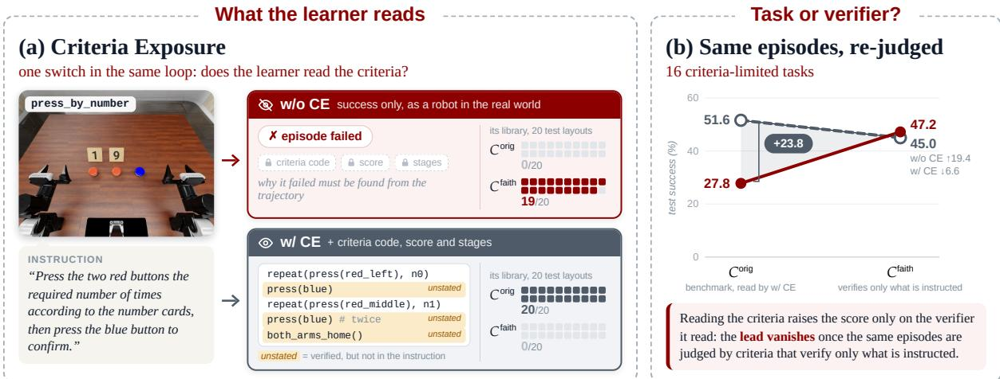
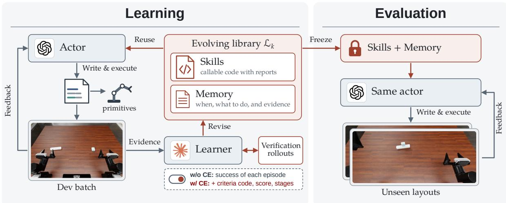
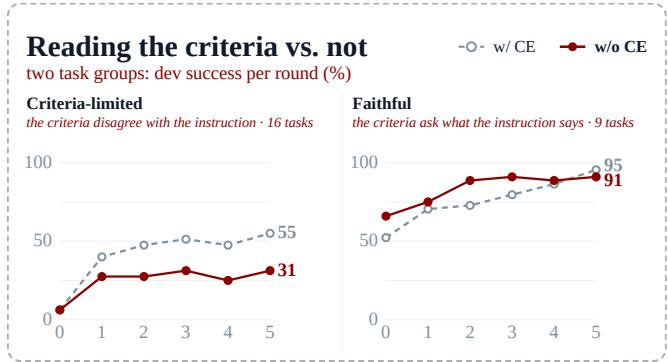
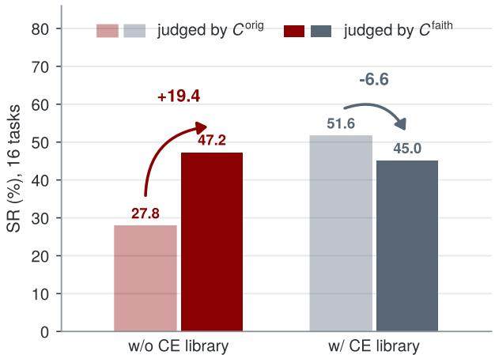
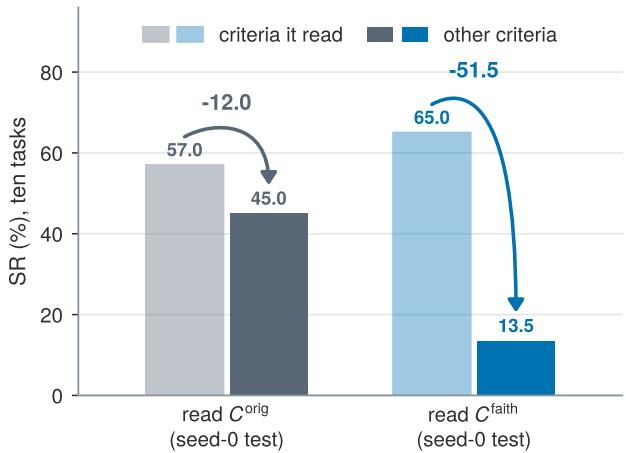
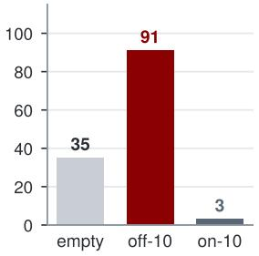
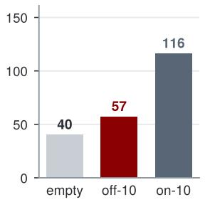
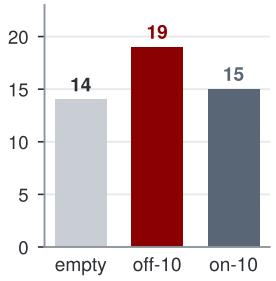
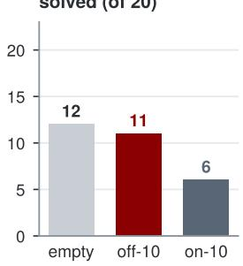
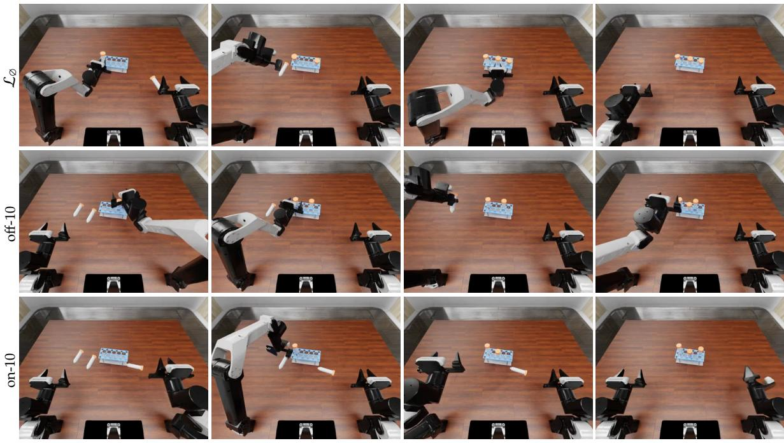

# Learning the Task or Learning the Verifier? Rethinking Criteria Exposure in Embodied Self-Improvement

Wenbo Huang1 Jianxin Bi1,2 Shunyu Yang1 Ruiyang Si1 Rui Ni1 Qiang Wang1 Shulong Jiang1 Yintianrun Zhang1 Feixiang Ruan1 Kewei Zhang1 Ye Huang1 Shukai Gong1 Daquan Zhou1,∗

1Peking University, 2National University of Singapore

Corresponding author

## Abstract

Self-improving embodied agents are increasingly being developed and compared on robot simulation benchmarks. Several recent works expose the benchmark’s success criteria to the learning agent, a practice we call Criteria Exposure (CE). These criteria, originally written to verify policies trained by imitation learning, often demand more than the corresponding language instructions, so a score from such a verifier may not faithfully reflect whether the instructed task was completed, especially for robot-control programs written by an agent. As embodied coding agents report ever higher benchmark scores, a natural question arises: when a coding agent is exposed to the benchmark’s criteria, does it generate code that better performs the instructed task, or code that simply overfits to the verification criteria? We conduct controlled experiments with a self-improving agent with and without CE, and find that with CE the agent quickly produces code with a higher success rate under the given criteria, but this advantage disappears when the criteria are changed slightly without departing from the original instructions. More importantly, the skills the agent develops under CE transfer poorly across tasks. We further propose instruction-faithful criteria and show that they better reflect the performance of agent-generated programs.

Keywords: embodied agent, self-improvement, robot policy evaluation

Project Page: https://dagroup-pku.github.io/PyRUA-Lean/RSIJudge

Corresponding Author: Daquan Zhou

## 1 Introduction

Agents that write code to control robots with multimodal language models complete many manipulation tasks zero-shot [12, 15, 19, 29], but preserve nothing from one episode to the next, which makes selfimprovement across episodes a natural next step [28, 31, 36]. Such agents are developed and compared on embodied simulation benchmarks [9, 20, 22] originally built to evaluate end-to-end policies trained by imitating demonstrations, such as vision-language-action (VLA) models [4, 6, 17, 25] and world action models (WAMs) [26]. The actual success criteria of these benchmarks often ask for more than the instruction; in the press\_by\_number task of RoboDojo, for instance, the criteria require the blue button to be pressed exactly twice, between two groups of red presses, which the instruction never states (figure 1a). For policies trained by imitation, this gap is harmless, since their demonstrations already contain every detail the criteria verify: order, counts, end states, and the return of both arms. An agent that receives only the instruction, however, lacks this information. Existing self-improving methods therefore expose the criteria to the agent to diferent degrees, from rule descriptions [10] and published scoring tables [13, 18] to numeric thresholds [14], formal goal predicates [32], and the source code of the verifier [3]. A robot in the real world, by contrast, receives only its instruction and, at most, a success judged by a human or a VLM. Our research question is: when a self-improving embodied agent is exposed to the success criteria, does the code it iteratively produces better perform the instructed task, or simply overfit to the verification criteria?

  
Figure 1 Learning the task or the verifier? (a): in press\_by\_number, the criteria �orig verify a button protocol that the instruction does not state (highlighted). Without Criteria Exposure (w/o CE) the learner sees only whether each episode succeeded; with it (w/ CE) it also reads the criteria code, score and stages. Right of each setting: the test successes of its library on 20 layouts, judged by �orig and by the instruction-faithful criteria �faith. (b): libraries learned under �orig on the 16 criteria-limited tasks, 320 test episodes each, with every episode judged by both criteria (section 4.2.1). The lead of w/ CE under �orig, 51.6% against 27.8%, is gone under �faith (45.0% against 47.2%).

Studies of benchmark validity and of specification gaming show that criteria can demand more than the instruction states and that agents exploit a verifier they can inspect [16, 37, 40], but we are not aware of work that measures how much of a reported gain in embodied self-improvement comes from reading the criteria, or whether it survives when the criteria change. We therefore compare two settings of one fixed self-improvement loop, in which a frozen coding agent acts and a learner agent turns its episodes into a library of skills and memory: with Criteria Exposure (w/ CE), the learner reads the criteria; without it (w/o CE), the learner sees only whether each episode succeeded. We ask three questions: on which tasks exposure raises the score; whether its lead survives a change of criteria, both of the criteria that judge the episodes and of the criteria the learner reads; and whether what it adds carries over to new tasks and to two further benchmarks, LIBERO-PRO and RoboCasa365. To change the criteria, we rewrite them for the RoboDojo tasks whose criteria ask for more than the instruction, so that they verify only what the instruction asks. On these tasks every episode is judged by both versions, and in a separate run the learner reads the rewritten criteria instead of the original ones.

Our experiments reveal three findings. First, under the original criteria, exposure helps only on tasks whose criteria ask for more than the instruction; when criteria and instruction agree, learning from success alone does just as well. Second, the score of exposure follows the criteria it read: when the same episodes are judged by instruction-faithful criteria, its advantage disappears, as the exposed libraries lose successes while the success-only libraries gain them (figure 1b); conversely, a library learned from the rewritten criteria scores far lower when judged by the original ones. Third, the lead of exposure does not reappear on new RoboDojo tasks, and across benchmarks neither the exposed nor the success-only library gives a clear gain over the empty library; only experience gathered within the target benchmark does.

Taken together, these results suggest a practical principle for evaluating embodied self-improvement: the learner should receive only the feedback a robot would receive in the real world, and the benchmark’s criteria should verify what the instruction says. A gain that holds when the criteria are changed but still agree with the instruction reflects what the agent has learned about the task. Seen this way, whether the learner reads the criteria is not an implementation detail of a self-improving agent but a choice about measurement, and it determines what a reported gain means.

## 2 Related Work

Code-writing embodied agents and their benchmarks. Language models plan and act for robots by selecting skills [1], writing policy code [19], or composing value maps [15]; recent agents close the loop with code replanning and thin tool layers [12, 13, 29], and frontier models now control robots zero-shot. These agents are evaluated on benchmarks built for vision-language-action policies trained on demonstrations [4, 6, 17, 25]: RoboDojo [9], LIBERO and LIBERO-PRO [20, 38], RoboCasa365 [22], and RoboTwin 2.0 [8]. These works score agents with criteria written for demonstration-trained policies; whether the criteria verify only what the instruction asks is rarely examined on its own, and we measure how this gap enters the score of a self-improving agent.

Self-improving agents and the feedback their learners see. In digital domains, programs are evolved against automatic evaluators [23, 34], agents reflect on textual feedback [28, 36], skills are verified in a game world [31], and code is revised against tests [33]. Embodied systems difer in how much of the success criteria their learners or agents see. Some give only success or keep the grader isolated [21, 27]; others add rule descriptions with coarse feedback [10], published scoring tables and partial numeric thresholds [13, 14, 18], formal goal predicates [32], or the source code of the verifier [3]. In RATs, the verifier reads goal predicates and ground truth while the policy writer’s side is filtered [35]. In these systems the amount of criteria information is mostly fixed by design rather than varied as an experimental factor. The closest comparison is an ablation of EmbodiedEvo between task descriptions alone and descriptions with the wiki, but both arms are judged by the original criteria [18]. We treat exposure as the variable and test what it gains under a second set of criteria.

Specification gaming and benchmark validity. Optimizing a proxy diverges from the intended objective [2, 30], with measurable efects of reward misspecification [24]. Language agents exploit tests and evaluators they can inspect [5, 37], and agentic benchmarks need checks of their own validity $[ 1 6 , 4 0 ]$ . Where rulebased criteria are missing, success is judged by VLMs [11] or by autonomous real-world evaluation [39]. Building on these studies, we further show that on embodied benchmarks the act of reading the criteria turns the gap between criteria and instruction into score, and we measure this share with counterfactual criteria that score the same instructions.

## 3 Preliminaries and Study Design

This section describes the controlled study we use to analyze what a self-improving embodied agent learns from the success criteria. The study compares two settings of one loop, w/ CE and $\mathrm { w } / \mathrm { o } \mathrm { C E } ,$ and answers three questions: where exposure raises the score under the original criteria, whether the advantage holds when the criteria change, and whether the library carries over to new tasks and benchmarks. We describe in turn the loop and its two settings, criteria-limited tasks, instruction-faithful criteria, and the evaluation protocol.

## 3.1 Self-Improvement Loop and Criteria Exposure

A task $\tau = \left( I _ { \tau } , D _ { \tau } , C _ { \tau } \right)$ has an instruction $I _ { \tau } ,$ a distribution of layouts $D _ { \tau }$ and success criteria $C _ { \tau }$ that judge each trajectory; some benchmarks also report a score and stages. The success the instruction asks for, $S _ { \tau } ,$ is defined by $I _ { \tau }$ and cannot be computed directly. A frozen actor $\pi ,$ GPT-6 Astra with high reasoning efort, acts through the primitives of PyRUA-Lean [29]. In each round a learner �, Claude Code with Opus 5.5 and high reasoning efort, makes one revision of the library ${ \mathcal { L } } ,$ a set of callable skills and memory entries, from the evidence $E _ { v } ( B )$ of the last batch, and the revision is rolled back if the batch clearly regresses. Each task has its own library, learned over five rounds on five development layouts. Algorithm 1 and figure 2 summarize the loop for one task.

The loop runs in two settings. Without Criteria Exposure $( \mathrm { w } / \mathrm { o } \mathrm { C E } )$ , the learner sees only whether each episode succeeded; the criteria code, the score and the stages are withheld. A robot in the real world has no criteria code and receives success from a human or a VLM, so this is the setting in simulation closest to the real world. With Criteria Exposure $\mathrm { ( w / C E ) }$ , the learner also reads the criteria code of the task and the score and stages of each episode, as systems that give the learner the source of the verifier do; the actor never reads them. The actor, the primitives, perception and benchmark scoring are frozen and only the library changes; the two settings share the loop and difer in what the learner reads, so diferences between them reflect exposure rather than the loop itself.

  
Figure 2 Overview of the self-improvement loop. Left, learning: the actor (GPT-6 Astra, high reasoning efort) writes and executes Python cells that call the robot’s primitives on five development layouts, and sees the result of each cell. Between batches the learner (Claude Code with Opus 5.5, high reasoning efort) turns the evidence into one revision of the library $\mathcal { L } _ { k }$ , whose skills are callable code that reports what it did and whose memory entries say when to apply what, with the evidence for it; a revision is usually tried first in verification rollouts, and the loop rolls back to the best revision so far when a batch falls clearly below it. Whether the learner also sees the success criteria is the one switch between the two settings, w/ CE and w/o CE (the switch under the learner). Right, evaluation: the final library $\mathcal { L } _ { K }$ is frozen and read-only, and the same actor runs alone on layouts the loop never saw.

Algorithm 1 Self-improvement loop   
Require: actor �; dev layouts $D _ { \mathrm { d e v } } ;$ rounds $K ;$ setting � ∈ {w/ CE w/o CE}; margin � = 2   
1: $\mathcal { L } _ { 0 }  ( S _ { 0 } , M _ { 0 } ) = ( \emptyset , \emptyset )$ ⊲ skills and memory   
2: $\mathcal { L } ^ { \star } \gets \mathcal { L } _ { 0 } ; ~ H \gets [ ] ; ~ B _ { 0 } \gets \mathrm { R u N } ( \pi , \mathcal { L } _ { 0 } , D _ { \mathrm { d e v } } )$ ⊲ zero-shot batch   
3: for $k = 1 , \ldots , K$ do   
4: $E \gets 1$ Evidence $\scriptstyle : ( B _ { k - 1 } , v )$ ⊲ trajectories; criteria, score and stages only under w/ CE   
5: $( \Delta _ { S } , \Delta _ { M } , h ) \gets$ Improve $: ( E , H , \mathcal { L } _ { k - 1 } )$ ⊲ edit skills, memory or both; verify by rollouts   
6: $\mathcal { L } _ { k } \gets \mathrm { F R E E Z E } ( S _ { k - 1 } \oplus \Delta _ { S } , M _ { k - 1 } \oplus \Delta _ { M } )$ ⊲ structural checks only, not success   
7: $B _ { k } \gets \mathrm { R u N } ( \pi , \mathcal { L } _ { k } , D _ { \mathrm { d e v } } )$   
8: if $B _ { k }$ has $\geq \theta$ fewer successes than the batch of $\mathcal { L } ^ { \star }$ then   
9: $\mathcal { L } _ { k } \gets \mathcal { L } ^ { \star }$ ⊲ rollback   
10: else if $B _ { k }$ is the best batch so far then   
11: $\mathcal { L } ^ { \star }  \mathcal { L } _ { k }$   
12: append $( \Delta _ { S } , \Delta _ { M } , B _ { k } , h )$ to � ⊲ change, result, hypothesis   
13: return $\mathcal { L } _ { K }$ ⊲ the active library after round �

## 3.2 Criteria-limited Tasks

We call a task criteria-limited if $C _ { \tau }$ disagrees with $S _ { \tau }$ on some trajectories, either by rejecting a trajectory $S _ { \tau }$ accepts or by accepting one $S _ { \tau }$ rejects (criteria looser than the instruction); all other tasks arefaithful. Such tasks appear in every benchmark we examined, RoboDojo, LIBERO [20] (whose instructions and goals LIBERO-PRO keeps), RoboCasa365 and RoboTwin 2.0 [8], and their disagreements fall into a few kinds. The criteria may ask for more than the instruction states, such as an order, a count or an end state: in RoboDojo, press\_by\_number requires a button protocol its instruction never gives. They may be stricter than the instruction needs, such as an unstated tolerance for an object resting on another in LIBERO. They may contradict the instruction, as in a LIBERO task that asks to stack a bowl on the front bowl while its criteria require the back one. Or they may verify less than the instruction asks: in RoboTwin 2.0, shake\_bottle\_horizontally succeeds once the bottle is lifted.

We rewrite criteria and re-judge episodes on RoboDojo only. Its criteria report a score and stages besides success, so an exposed learner reads the most complete information there, and we compared the criteria of all of its tasks with their instructions; rewriting the criteria of other benchmarks and repeating these experiments on them is left to future work. We distinguish seven types: hidden rules, hard thresholds, timing and irreversible events, criteria defects, extra end states, loose criteria, and contradictions. In RoboDojo, after a manual review of every task, the 20 criteria-limited tasks have 26 variants, and hidden rules and hard thresholds are the most common types. Criteria-limited is defined with respect to the instruction the agent receives at reset; the RoboDojo website publishes part of these rules in its task descriptions and scoring tables.

## 3.3 Instruction-faithful Criteria

For each criteria-limited task we rewrite only the criteria code, never the instruction, and leave the original repository untouched: hidden rules are removed or relaxed, defects fixed, hard thresholds relaxed to what still clearly satisfies the instruction, loose criteria tightened where the simulator state can detect the diference, and the return of both arms kept. The two criteria judged the same episodes independently, and every episode whose verdict flipped was checked by hand without finding a misjudgment by the new criteria. Each evaluation episode is then judged by both criteria, giving SRorig and SRfaith. Since both criteria score the same instruction on the same episode, any diference between the two success rates comes from what the criteria verify, not from behavior. �faith is ours and serves as a proxy for $S _ { \tau } ;$ we discuss this in section 5.

## 3.4 Experiment Settings and Evaluation Protocol

To isolate the efect of exposure, the two settings of each comparison use the same actor, primitives, round budget and development layouts. The 25 learned tasks comprise 16 criteria-limited and 9 faithful tasks, grouped in advance by whether their criteria were rewritten; Appendix A.4 lists the tasks. Development uses layouts 0–4 of seed 1 and testing layouts 0–19 of seed 0. We report the success rate (SR) and compare settings layout by layout. All experiments use the same actor and learner. To reuse libraries, we distill the libraries of ten source tasks into one shared library and apply it to disjoint target tasks, in RoboDojo and on two further benchmarks with aligned primitives.

We use three simulated benchmarks with diferent roles. RoboDojo is the main benchmark: its rule-based criteria report a score and stages, and all three questions are answered on it. LIBERO-PRO is a single-arm tabletop benchmark where zero-shot success is already near the ceiling; it tests whether transfer still has room at high scores. RoboCasa365 has household kitchen scenes and the lowest zero-shot scores; it tests cross-benchmark experience and also hosts in-benchmark learning.

## 4 Experiments and Analysis

We test three hypotheses:

• H1. Exposure raises the score only on tasks whose criteria ask for more than the instruction (section 4.1).

• H2. If exposure teaches the verifier rather than the task, its lead shrinks or reverses when the same episodes are judged by instruction-faithful criteria (section 4.2.1), and each exposed library scores best under whichever criteria its learner read (section 4.2.2).

• H3. What exposure adds does not carry over to new tasks or benchmarks (section 4.3).

## 4.1 Exposure under the Original Criteria

We first judge the benchmark’s way, by the original criteria, which are also the criteria the exposed learner reads.

## 4.1.1 Success-only versus Exposed Self-Improvement

Setup. We learn one library per task and setting on the 25 learned tasks (16 criteria-limited, 9 faithful), over five rounds on five development layouts, and test each library on layouts 0–19 of seed 0 against the empty library. The two groups were fixed before any result was seen.

  
Figure 3 Development success by round, on the 16 criteria-limited and the 9 faithful tasks. Dashed: w/ CE; solid: w/o CE; round 0 is the empty library. On criteria-limited tasks both settings start at 6% and part in round 1 (40% against 28%); after that the success-only learner barely moves and ends at 31%, against 55% with exposure. On faithful tasks the success-only learner is ahead through round 4 and both end above 90% (91% and 95%); its lead, at most 16 points, is close to the 14-point gap of round 0 (66% against 52%), where both run the same empty library.

Results. Table 1 and figure 3 show three patterns. First, learning from success alone doubles success, from 24.6% to 47.8%, and reading the criteria adds another 14.2 points (62.0%). Second, this extra gain comes from the criteria-limited tasks: on faithful tasks the two settings are level (83.3% and 80.6%), while on criteria-limited tasks exposure leads, 51.6% against 27.8%. Third, among criteria-limited tasks the lead depends on whether an unstated rule shows in failed episodes: in build\_tower the leftover blocks reveal it and both settings reach 20/20, whereas the button protocol of press\_by\_number, blue pressed twice and between the two red groups, never shows, and the success-only learner never finds it.

## 4.1.2 Synthesis

• Exposure pays off only where the criteria ask for more than the instruction. Richer feedback is often assumed to make self-improvement better. Our results show a condition: when the criteria verify what the instruction says, success alone tells the learner what the task requires, and what remains, a reliable procedure, is learned equally well in both settings. Exposure helps only with rules that the instruction omits and that failures do not reveal.

• The advantage of exposure measures the benchmark as much as the agent. Because it comes from what the instruction leaves out, the gain of exposure grows with the gap between a benchmark’s instructions and its criteria. Some of what the criteria reveal is legitimate task knowledge, but it belongs in the instruction: benchmarks that state in the instruction what their criteria verify (counts, order, end states, the reset of the arms) and release versioned criteria with a comparison against the instructions would let self-improvement be compared on the task alone.

## 4.2 Changing the Criteria: Task or Verifier?

Section 4.1 judged with the criteria the exposed learner read. Changing them separates two explanations. If exposure teaches the task, its lead should survive under $C ^ { \mathrm { f a i t h } }$ ; if it teaches the verifier, the lead should shrink or reverse, and each library should score best under whichever criteria its learner read. We change the criteria used for judging and the criteria that are read.

## 4.2.1 Re-judging with Instruction-faithful Criteria

Setup. We run the libraries of section 4.1.1 on the 16 learned criteria-limited tasks, all of which have rewritten criteria, 20 layouts each, and judge every episode by both criteria.

Table 1 Test success under the original criteria (SR, %, layouts 0–19 of seed 0). Parentheses: diference from the empty library in points. The criteria-limited tasks count the episodes of section 4.2.1, judged by �orig.
<table><tr><td>Tasks</td><td>Empty library  $\mathcal { L } _ { \emptyset }$ </td><td> $\mathrm { w / o } \mathrm { C E }$ </td><td> $\mathbf { w } / \mathbf { \Sigma } \mathbf { C E }$ </td></tr><tr><td>All (25)</td><td>24.6</td><td>47.8 (+23.2)</td><td>62.0 (+37.4)</td></tr><tr><td>Criteria-limited (16)</td><td>8.4</td><td>27.8 (+19.4)</td><td>51.6 (+43.2)</td></tr><tr><td>Faithful (9)</td><td>53.3</td><td>83.3 (+30.0)</td><td>80.6 (+27.3)</td></tr></table>

  
Figure 4 The same episodes judged by the original and the instruction-faithful criteria. Libraries learned under $C ^ { \mathrm { { o r i g } } }$ on the 16 criteria-limited tasks, 320 episodes per library. Light bars: judged by $C ^ { \mathrm { o r i g . } }$ solid bars: the same episodes judged by $C ^ { \bar { \mathrm { f a i t h } } }$ ; arrows give the change in points.  
Figure 5 Each exposed library judged by the criteria it read and by the other. Both on the ten tasks of $\mathcal { L } _ { \mathrm { C E } } ^ { \mathrm { f a i t h } }$ seed-0 test, 200 episodes per library. $\mathcal { L } _ { \mathrm { C E } } ^ { \mathrm { o r i g } }$ : their episodes in figure 4. $\mathcal { L } _ { \mathrm { C E } } ^ { \mathrm { f a i t h . } }$ its final library on the same layouts. Light bars: $\mathrm { j u d g e }$ d by the criteria the learner read; solid bars: the same episodes judged by the other criteria; arrows give the change in points.

Results. Figure 4 shows the lead of exposure disappear. Under $C ^ { \mathrm { { o r i g } } }$ the exposed library leads, 51.6% against 27.8%: paired by task and layout, it alone succeeds on 93 layouts and the success-only library alone on 17. Judged by $\mathrm { \dot { C } } ^ { \mathrm { f a i t h } }$ , the same episodes give 45.0% for the exposed library and 47.2% for the success-only one, a diference within noise (47 against 54 layouts); the gap shrinks by $2 5 . 9$ points (95% bootstrap interval over tasks $4 . 7 \substack { - 5 4 . 4 } )$ . The success-only library loses almost nothing: $C ^ { \mathrm { f a i t h } }$ accepts all but 2 of its 89 successes under $C ^ { \mathrm { { o r i g } } }$ , and it gains where the original criteria demand an unstated protocol, as in press\_by\_number, swap\_blocks and make\_kong. The exposed library loses where it had learned that protocol, and on tasks whose criteria changes mostly fix defects or relax thresholds the two criteria give nearly the same scores.

## 4.2.2 Swapping the Criteria that Are Read

Setup. We then let the learner read $C ^ { \mathrm { f a i t h } }$ instead (ten tasks, five rounds) and compare the resulting library $\mathcal { L } _ { \mathrm { C E } } ^ { \mathrm { f a i t h } }$ with $\mathcal { L } _ { \mathrm { C E } } ^ { \mathrm { o r i g } }$ on the same ten tasks, each judged by the criteria its learner read and by the other.

Results. Figure 5 shows that each exposed library does well only under the criteria it read: $\mathcal { L } _ { \mathrm { C E } } ^ { \mathrm { o r i g } }$ falls from 57.0% to 45.0% under $C ^ { \mathrm { f a i t h } }$ , and $\mathcal { L } _ { \mathrm { C E } } ^ { \mathrm { f a i t h } }$ from 65.0% to 13.5% under $C ^ { \mathrm { o r i g } }$ . The fall is steeper for $\mathcal { L } _ { \mathrm { C E } } ^ { \mathrm { f a i t h } }$ because the two directions difer: $C ^ { \mathrm { f a i t h } }$ mostly removes or relaxes the hidden rules and thresholds of $C ^ { \mathrm { o r i g } } ,$ , so moving $\mathcal { L } _ { \mathrm { C E } } ^ { \mathrm { o r i g } }$ to $C ^ { \mathrm { f a i t h } }$ loosens the verification, whereas moving $\mathcal { L } _ { \mathrm { C E } } ^ { \mathrm { f a i t h } }$ to $C ^ { \mathrm { o r i g } }$ adds back every rule the library never saw. The score follows the criteria that were read even where they are looser: having read $C ^ { \mathrm { f a i t h } }$ , the library no longer sets the bottle upright in pour\_by\_language, which $\dot { C } ^ { \mathrm { o r i g } }$ requires, and solves 19 of its 20 test layouts under $C ^ { \mathrm { f a i t h } }$ but none under $C ^ { \mathrm { { o r i g } } }$ . This does not tell which criteria are right, which section 4.2.1 addresses, but it shows that the score of exposure does not carry between two criteria that score the same instruction.

## 4.2.3 Synthesis and Implications

• Exposure makes self-improvement fit the criteria rather than learn the instructed task. A higher score from reading the criteria is commonly taken as faster learning of the task. A learner that reads the criteria, however, revises the library until it passes the verifier it reads, so the library learns the task only as far as the criteria agree with the instruction. Under instruction-faithful criteria the exposed library loses successes that the success-only library gains, and each exposed library scores best only under the criteria it read: on press\_by\_number it solves all 20 layouts under $C ^ { \mathrm { { o r i g } } }$ and none under $C ^ { \mathrm { f a i t h } } .$ and the library that read $C ^ { \mathrm { f a i t h } }$ solves 65.0% of its test episodes under $C ^ { \mathrm { f a i t h } }$ but 13.5% under $C ^ { \mathrm { { o r i g } } }$

Self-improvement should therefore be measured without exposure by default, with the success rate under instruction-faithful criteria reported alongside: a robot in the real world has no criteria code, so the part of a gain that survives a change of criteria is the part to expect there.

• Exposure changes what the learner writes down. A learner that reads the criteria can explain a failure by the condition it violated, so its experience is phrased in the terms of one verifier; a learner that sees only success has to find a physical cause, and its rules are closer to regularities of the robot. About a third of the exposed memory entries cite the criteria code, and none of the success-only ones do.

## 4.3 Reusing the Library: What Carries Over

Finally, we carry the libraries to new tasks in RoboDojo and to two further benchmarks.

## 4.3.1 Across Tasks within RoboDojo

Setup. We distill the libraries of ten learned tasks into one library per setting and apply it to ten target tasks that none of the source tasks covers, paired with the empty library on the same layouts.

Table 2 Reusing libraries on new tasks and benchmarks (successes, each benchmark’s own criteria). The RoboDojo libraries are distilled from ten learned tasks and carried over to LIBERO-PRO and RoboCasa365; the last row uses libraries distilled from other RoboCasa365 tasks. Every row is paired with the empty library on the same layouts; parentheses give the change in successes against it.
<table><tr><td>Target</td><td>Library source</td><td> $\mathcal { L } _ { \emptyset }$ </td><td>w/o CE</td><td>w/CE</td></tr><tr><td>RoboDojo, 10 target tasks × 20 layouts</td><td>RoboDojo</td><td>65/200</td><td>80/200 (+15)</td><td>71/200 (+6)</td></tr><tr><td>LIBERO-PRO, 6 tasks × 10 seeds</td><td>RoboDojo</td><td>45/60</td><td>48/60 (+3)</td><td>46/60 (+1)</td></tr><tr><td>RoboCasa365, 10 target tasks × 10 seeds</td><td>RoboDojo</td><td>22/100</td><td>24/100 (+2)</td><td>24/100 (+2)</td></tr><tr><td>RoboCasa365, 10 target tasks × 10 seeds</td><td>RoboCasa365</td><td>22/100</td><td>33/100 (+11)</td><td>29/100 (+7)</td></tr></table>

Results. Both settings help on the target tasks (first row of table 2): the empty library solves 65 of 200 episodes, the success-only library 80 and the exposed one 71. The 14.2-point lead of exposure on its own tasks does not reappear.

## 4.3.2 Across Benchmarks

Setup. We apply the same libraries, translated to each target’s prompt and primitives, on LIBERO-PRO and RoboCasa365, whose primitives we aligned with RoboDojo’s. On LIBERO-PRO the empty library already solves 34 of the 40 tasks on all five seeds, so we use the 6 others, with ten seeds each. On RoboCasa365 we also distill one library per setting from other RoboCasa365 tasks, as an in-benchmark reference.

Results. The libraries from RoboDojo add little on either benchmark (table 2): 48 and 46 of 60 episodes against 45 on LIBERO-PRO, and 24 and 24 of 100 against 22 on RoboCasa365. The libraries distilled within RoboCasa365 do better, 33 (w/o CE) and 29 (w/ CE) of 100.

## 4.3.3 Synthesis and Implications

• What exposure adds is specific to the task it was learned on. One might expect the setting that scores higher on its own tasks to transfer better. It does not: the lead of exposure disappears on target tasks. Exposed experience carries the conditions and precision needed to pass one task’s criteria, which become noise or overhead elsewhere, whereas rules about the gripper hold across tasks.

• Experience transfers where the bottleneck is shared. Within a benchmark the robot, the scenes and perception stay the same, and learned rules carry over. Across benchmarks the general part of the experience is already covered by the target’s prompt, while what the target lacks has no counterpart in the source, so the transferred skills go unused; experience gathered on the target benchmark, even on other tasks, addresses its own bottleneck and helps.

## 5 Limitations and Future Work

The instruction-faithful criteria are ours, and the feedback is simulated. �faith serves as our proxy for the success the instruction asks for, ��. Neither setting’s libraries saw the rewritten criteria when they were written; rules and types were fixed in advance; a second seed was judged independently and every flipped episode checked. Still, only RoboDojo’s criteria were rewritten, and success-only feedback in simulation is cleaner than the success a human or a VLM reports for a robot in the real world, which has no criteria code. Next steps are an independent review, released criteria code, rewritten criteria for a second benchmark, and VLM success detection in place of the simulator’s success [11].

Exposure is studied at two levels, as current systems implement it. Most existing systems sit at intermediate levels (rule descriptions, published scoring tables, partial thresholds), which we did not study separately. A next step is to expose these levels one at a time and measure how the gain under �orig, and its loss under �faith, grow with what the learner reads.

Samples are small and the mechanisms are inferred. Each task has 20 test layouts, so quantitative claims use pooled results and single tasks are described only qualitatively; and distillation variance was not estimated. The accounts of what exposure writes into the library, of what carries over and of how the actor uses transferred libraries rest on entry text, skill calls and action statistics, not on ablations. Next steps are repeated distillations and ablations that remove or swap individual entries, such as the re-measuring entries of the distilled w/ CE library or the memory entries of a translated library.

## 6 Conclusion

In this paper, we studied what a self-improving embodied agent learns when it reads the success criteria, by comparing one self-improvement loop with and without Criteria Exposure, under the benchmark’s own and instruction-faithful criteria, and on new tasks and benchmarks. Our results show that selfimprovement from success alone is real and survives a change of criteria, whereas the score that Criteria Exposure adds comes mainly from satisfying the criteria that were read: it appears only where the criteria and the instruction disagree, disappears under instruction-faithful criteria, and across benchmarks neither the exposed nor the success-only library gives a clear gain, while only in-benchmark experience helps. These findings provide a more careful reading of reported self-improvement gains on embodied benchmarks and practical guidance for measuring them: use the feedback a robot receives in the real world, and judge by criteria that verify what the instruction says. A robot in the real world never sees its verifier; the agent we measure should not either.

## References

[1] Michael Ahn, Anthony Brohan, Noah Brown, Yevgen Chebotar, Omar Cortes, Byron David, Chelsea Finn, Chuyuan Fu, et al. Do as I can, not as I say: Grounding language in robotic afordances. In Conference on Robot Learning (CoRL), 2022.

[2] Dario Amodei, Chris Olah, Jacob Steinhardt, Paul Christiano, John Schulman, and Dan Mané. Concrete problems in AI safety. arXiv preprint arXiv:1606.06565, 2016.

[3] Jingwen Bai, Guochao Bai, Canbo Zhang, Shuangqi Li, Minchao Hu, Weichun Huang, and Shuang Liu. Compile Once, Run Cheap: Frozen, Portable Skills for Embodied Agents, and What Recursive Self-Improvement Adds. arXiv preprint arXiv:2610.25114, 2026.

[4] Kevin Black, Noah Brown, Danny Driess, Adnan Esmail, Michael Equi, Chelsea Finn, Niccolo Fusai, Lachy Groom, et al. � : A vision-language-action flow model for general robot control. In Robotics: Science and Systems (RSS), 2025.

[5] Alexander Bondarenko, Denis Volk, Dmitrii Volkov, and Jefrey Ladish. Demonstrating specification gaming in reasoning models. arXiv preprint arXiv:2502.13295, 2025.

[6] Anthony Brohan, Noah Brown, Justice Carbajal, Yevgen Chebotar, Xi Chen, Krzysztof Choromanski, Tianli Ding, Danny Driess, et al. RT-2: Vision-language-action models transfer web knowledge to robotic control. In Conference on Robot Learning (CoRL), 2023.

[7] Nicolas Carion, Laura Gustafson, Yuan-Ting Hu, Shoubhik Debnath, Ronghang Hu, Didac Suris, Chaitanya Ryali, Kalyan Vasudev Alwala, et al. SAM 3: Segment anything with concepts. arXiv preprint arXiv:2511.16719, 2025.

[8] Tianxing Chen, Zanxin Chen, Baijun Chen, Zijian Cai, Yibin Liu, Zixuan Li, Qiwei Liang, Xianliang Lin, et al. RoboTwin 2.0: A scalable data generator and benchmark with strong domain randomization for robust bimanual robotic manipulation. arXiv preprint arXiv:2506.18088, 2025.

[9] Tianxing Chen, Yue Chen, Zixuan Li, Junyuan Tang, Kailun Su, Haoran Lu, Weijie Wan, Baijun Chen, Songling Liu, Haowen Yan, et al. Robodojo: A unified sim-and-real benchmark for comprehensive evaluation of generalist robot manipulation policies. arXiv preprint arXiv:2607.04434, 2026.

[10] Yitong Chen, Zezheng Huai, Sixian Li, Yubang Wang, Haozhe Zhang, Yifei Zhang, Hechang Chen, Jingjing Gong, Yu-Gang Jiang, and Xipeng Qiu. ETA: A New Agentic Paradigm for Embodied Tasks. arXiv preprint arXiv:2608.03924

[11] Yuqing Du, Ksenia Konyushkova, Misha Denil, Akhil Raju, Jessica Landon, Felix Hill, Nando de Freitas, and Serkan Cabi. Vision-Language Models as Success Detectors. arXiv preprint arXiv:2303.07280, 2023.

[12] Letian Fu, Justin Yu, Karim El-Refai, Ethan Kou, Haoru Xue, Huang Huang, Wenli Xiao, et al. CaP-X: A framework for benchmarking and improving coding agents for robot manipulation. In International Conference on Machine Learning (ICML), 2026.

[13] Hongcheng Gao, Alex Zhou, Jay Zhu, Zelin Zheng, Shijia Ge, Xiping Li, Di Wu, Yazhe Wang, Jianshu Zeng, Xuan Shangguan, Yongli Wang, Yexing Wan, Lingyu He, Zhiqi Jia, Sihang Wu, and Xiao He. HexaShell: A Thin Harness for Exploring the Limits of VLM Agents as Robot Coding Agents. arXiv preprint arXiv:2610.23479, 2026.

[14] Runhan Huang, Xiangcheng Zhang, Haoyu Chen, Yitong Li, Yen-Jen Wang, Bohan Lyu, Haotian Ye, Chuye Hong, Yixuan Wang, Chloe Su, Haoyu Xiong, Yangzhen Wu, Enze Xie, Travis Manderson, Stefano Ermon, Pieter Abbeel, Antonio Torralba, Dawn Song, Weirui Ye, and Yilun Du. Scaling online exploration for robot agents. arXiv preprint arXiv:2610.22496, 2026. URL https://arxiv.org/abs/2610.22496.

[15] Wenlong Huang, Chen Wang, Ruohan Zhang, Yunzhu Li, Jiajun Wu, and Li Fei-Fei. VoxPoser: Composable 3D value maps for robotic manipulation with language models. In Conference on Robot Learning (CoRL), 2023.

[16] Sayash Kapoor, Benedikt Stroebl, Zachary S. Siegel, Nitya Nadgir, and Arvind Narayanan. AI agents that matter. arXiv preprint arXiv:2407.01502, 2024.

[17] Moo Jin Kim, Karl Pertsch, Siddharth Karamcheti, Ted Xiao, Ashwin Balakrishna, Suraj Nair, Rafael Rafailov, Ethan Foster, et al. OpenVLA: An open-source vision-language-action model. In Conference on Robot Learning (CoRL), 2024.

[18] Wenyi Li, Yizhe Chi, Youjie Zheng, Chunyu Liu, Xiaoqiu Wang, Mingju Gao, Zheng Jiang, Deyao Hong, Calvin Xiao, Kaisen Yang, and Qinhuai Na. EmbodiedEvo: Self-evolving coding agent for physical intelligence. arXiv preprint arXiv:2610.18867, 2026. URL https://arxiv.org/abs/2610.18867.

[19] Jacky Liang, Wenlong Huang, Fei Xia, Peng Xu, Karol Hausman, Brian Ichter, Pete Florence, and Andy Zeng. Code as policies: Language model programs for embodied control. In IEEE International Conference on Robotics and Automation (ICRA), 2023.

[20] Bo Liu, Yifeng Zhu, Chongkai Gao, Yihao Feng, Qiang Liu, Yuke Zhu, and Peter Stone. LIBERO: Benchmarking knowledge transfer for lifelong robot learning. In Advances in Neural Information Processing Systems (NeurIPS), Datasets and Benchmarks Track, 2023

[21] Runyu Lu, Yubo Wu, Ethan Kou, Letian Fu, Wenli Xiao, Ajay Mandlekar, Yinzhen Xu, Guanya Shi, et al. ASPIRE: Agentic /skills discovery for robotics. arXiv preprint arXiv:2607.00272, 2026.

[22] Soroush Nasiriany, Sepehr Nasiriany, Abhiram Maddukuri, and Yuke Zhu. RoboCasa365: A large-scale simulation framework for training and benchmarking generalist robots. In International Conference on Learning Representations (ICLR), 2026.

[23] Alexander Novikov, Ngân Vu, Marvin Eisenberger, Emilien Dupont, Po-Sen Huang, Adam Zsolt Wagner,˜ Sergey Shirobokov, Borislav Kozlovskii, Francisco J. R. Ruiz, Abbas Mehrabian, M. Pawan Kumar, Abigail See, Swarat Chaudhuri, George Holland, Alex Davies, Sebastian Nowozin, Pushmeet Kohli, and Matej Balog. AlphaEvolve: A coding agent for scientific and algorithmic discovery. arXiv preprint arXiv:2506.13131, 2025. URL https://arxiv.org/abs/2506.13131.

[24] Alexander Pan, Kush Bhatia, and Jacob Steinhardt. The Efects of Reward Misspecification: Mapping and Mitigating Misaligned Models. arXiv preprint arXiv:2201.03544, 2022.

[25] Physical Intelligence, Kevin Black, Noah Brown, James Darpinian, Karan Dhabalia, Danny Driess, Adnan Esmail, Michael Equi, et al. � : a vision-language-action model with open-world generalization. arXiv preprint arXiv:2504.16054, 2025.

[26] Qiuhong Shen, Shihua Zhang, Yue Liao, Qi Li, Zhenxiong Tan, Shizun Wang, Shuicheng Yan, and Xinchao Wang. World Action Models: A Survey. arXiv preprint arXiv:2606.20781, 2026.

[27] Zeyu Shen, Haoxiang You, Yilang Liu, Zhicheng Zheng, Lihan Zha, Kashu Yamazaki, Mingtong Zhang, Suning Huang, Jiankai Sun, Qianzhong Chen, Lucy He, Kaiyuan Liu, Haoran Chang, Katerina Fragkiadaki, Dhruv Shah, Mac Schwager, Peter Henderson, Ian Abraham, and Canwen Xu. EmbodiedSWE: Coding Agents for Long Horizon Dexterous Robotics. arXiv preprint arXiv:2609.27308, 2026.

[28] Noah Shinn, Federico Cassano, Edward Berman, Ashwin Gopinath, Karthik Narasimhan, and Shunyu Yao. Reflexion: Language agents with verbal reinforcement learning. arXiv preprint arXiv:2303.11366, 2023.

[29] Ruiyang Si, Jianxin Bi, Shunyu Yang, Rui Ni, Wenbo Huang, Qiang Wang, Shulong Jiang, Yintianrun Zhang, Feixiang Ruan, Kewei Zhang, Duomin Wang, Xiuyu Li, Haiwen Feng, Zhen Dong, and Daquan Zhou. Fewer tokens, better action: GPT-6 Astra robot agents with 14% higher success rate but 65% fewer tokens. arXiv preprint arXiv:2610.01939, 2026.

[30] Joar Skalse, Nikolaus H. R. Howe, Dmitrii Krasheninnikov, and David Krueger. Defining and characterizing reward hacking. arXiv preprint arXiv:2209.13085, 2022.

[31] Guanzhi Wang, Yuqi Xie, Yunfan Jiang, Ajay Mandlekar, Chaowei Xiao, Yuke Zhu, Linxi Fan, and Anima Anandkumar. Voyager: An open-ended embodied agent with large language models. arXiv preprint arXiv:2305.16291, 2023.

[32] Xin Wang, Wenhao Wu, Menghao Zhang, Zhi Wang, Kun Shao, Jian Luan, Yang Li, Qing Li, Shangding Gu, Huichi Zhou, Shuqing Shi, Fei Ni, Shuo Lu, Weicheng Meng, Kang Li, Jin Wu, Kang Zhao, Shangmin Guo, Gen Li, Yongqiang Tang, Zhizhong Zhang, Yuan Xie, and Heng Qu. HarnessPAI: An Evolving Harness for Physical AI. arXiv preprint arXiv:2609.29166, 2026.

[33] John Yang, Carlos E. Jimenez, Alexander Wettig, Kilian Lieret, Shunyu Yao, Karthik Narasimhan, and Ofir Press. SWE-agent: Agent-computer interfaces enable automated software engineering. In Advances in Neural Information Processing Systems (NeurIPS), 2024.

[34] Jenny Zhang, Shengran Hu, Cong Lu, Robert Lange, and Jef Clune. Darwin Gödel machine: Open-ended evolution of self-improving agents. arXiv preprint arXiv:2505.22954, 2025.

[35] Junyi Zhang, Jiaxin Ge, Hanjun Yoo, Letian Fu, Zihan Yang, Yaowei Liu, Raj Saravanan, Shaofeng Yin, Justin Yu, Dantong Niu, Zirui Wang, Roei Herzig, Ken Goldberg, Yutong Bai, David M. Chan, Ion Stoica, Angjoo Kanazawa, Jiahui Lei, Haiwen Feng, and Trevor Darrell. Playful Agentic Robot Learning. arXiv preprint arXiv:2606.19419, 2026.

[36] Andrew Zhao, Daniel Huang, Quentin Xu, Matthieu Lin, Yong-Jin Liu, and Gao Huang. ExpeL: LLM agents are experiential learners. In AAAI Conference on Artificial Intelligence (AAAI), 2024.

[37] Ziqian Zhong, Aditi Raghunathan, and Nicholas Carlini. ImpossibleBench: Measuring LLMs’ Propensity of Exploiting Test Cases. arXiv preprint arXiv:2510.20270, 2025.

[38] Xueyang Zhou, Yangming Xu, Guiyao Tie, Yongchao Chen, Guowen Zhang, Duanfeng Chu, Pan Zhou, and Lichao Sun. LIBERO-PRO: Towards robust and fair evaluation of vision-language-action models beyond memorization. arXiv preprint arXiv:2510.03827, 2025.

[39] Zhiyuan Zhou, Pranav Atreya, You Liang Tan, Karl Pertsch, and Sergey Levine. AutoEval: Autonomous Evaluation of Generalist Robot Manipulation Policies in the Real World. arXiv preprint arXiv:2503.24278, 2025.

[40] Yuxuan Zhu, Tengjun Jin, Yada Pruksachatkun, Andy Zhang, Shu Liu, Sasha Cui, Sayash Kapoor, Shayne Longpre, Kevin Meng, Rebecca Weiss, Fazl Barez, Rahul Gupta, Jwala Dhamala, Jacob Merizian, Mario Giulianelli, Harry Coppock, Cozmin Ududec, Jasjeet Sekhon, Jacob Steinhardt, Antony Kellermann, Sarah Schwettmann, Matei Zaharia, Ion Stoica, Percy Liang, and Daniel Kang. Establishing Best Practices for Building Rigorous Agentic Benchmarks. arXiv preprint arXiv:2507.02825, 2025.

# Learning the Task or Learning the Verifier? Rethinking Criteria Exposure in Embodied Self-Improvement

# Appendix

## A Implementation Details

## A.1 Experimental protocol

Benchmark. RoboDojo’s simulation track uses a dual-arm ARX-X5 with RGB observations only; its 42 tasks span five capability dimensions. The 20 tasks on which the zero-shot actor solves fewer than half of the episodes of the oficial evaluation seed, with five stronger ones, make the 25 compared tasks (table 4). Every run uses one version of RoboDojo (Table 3); task source, criteria, leaderboard script and evaluation layouts are identical file by file across the checkouts we compare.

Conditions. The actor’s model, primitives and prompt are the same in every condition. The learner with Criteria Exposure reads the criteria code, each episode’s score and its passed stages; the one without sees full trajectories and success only. All conditions are compared over five rounds of improvement (rounds 0–5). The groups (Appendix B) rest on reading the code, the learners’ diagnoses and the failed rollouts.

Layouts. Development reruns layouts 0–4 of oficial evaluation seed 1 every round; the test layouts are layouts 0–19 of seed 0 (500 episodes per condition), which no learner sees.

Statistics. Development batches are noisy: rerunning one library on one layout changes the verdict in 4% of cases, and the two round-0 batches of the same empty library difer in at least 13% of episodes. We therefore draw conclusions from the test layouts and pooled curves, and read single-task development curves only qualitatively.

## A.2 Implementation and settings

Actor. GPT-6 Astra writes one code cell per MLLM call against PyRUA-Lean’s frozen robo API [29]: RGB perception (SAM 3 [7] and multi-view measurement) and motion primitives, with no VLA policy, depth or simulator state. The library is installed as a package library/: cells import its skills, and its live memory entries are appended to the prompt.

Library. A skill is a function of robo that imports only standard modules, numpy and other library modules, does no I/O and returns {"ok": ..., "why": ..., ...}. A memory entry is ## {task}-<stage>-<nnn> followed by stage, symptom, applies, do, status and evidence. A task’s library holds at most 40,000 characters, all of which the actor reads.

Learner. Claude Code reads the session, the task’s dev runs, the API source and, with Criteria Exposure, the task’s criteria; it writes only the candidate library, its verification rollouts and its notes. Without Criteria Exposure, criteria, scores and stages are removed from the evidence.

Acceptance and rollback. A candidate may change only the task’s own directory, must keep every memory entry identifier, must cite a judged rollout or dev batch for each entry newly marked dev\_verified, and must pass the static skill rules and the size limit; none of this looks at success, and no candidate was refused. The active revision rolls back to the best earlier complete batch when a complete batch has two or more fewer successes; ties go to the batch that passed more stages, and a batch with an episode lost to infrastructure neither triggers a rollback nor becomes the best.

## A.3 Evaluation details

The 25 learned tasks are grouped by whether their criteria were rewritten. Layouts that the benchmark marks unstable are replaced by the next layout in the oficial order. Under dual judging an episode ends early only when both criteria have reached a verdict, so neither verdict is truncated.

## A.4 Tasks

Table 3 Settings (the same in every run).
<table><tr><td>Benchmark Code</td><td></td></tr><tr><td>Assets Simulator</td><td>RoboDojo commit cb2a37d58dbb (2026-10-08), XPolicyLab 53c5da5a01bc HF dataset RoboDojo-Benchmark/RoboDojo, revision 35efbc7dedfd (2026-09-28) Isaac Sim 5.1.0, Isaac Lab 0.54.3; suite ARX-X5, RGB only</td></tr><tr><td>Actor Model Interface Per episode</td><td>GPT-6 Astra, reasoning effort high, at most 8,192 output tokens per request PyRUA-Lean cells, RGB perception, no VLA, ARX-X5 suite at most 100 cells, 200 MLLM requests, 20 nudges, 90 minutes of policy time; the task&#x27;s</td></tr><tr><td>Learner</td><td>own native-action limit</td></tr><tr><td>Agent Per session</td><td>Claude Code, Claude Opus 5.5, effort high</td></tr><tr><td>Library</td><td>up to 2 attempts of 120 minutes; at most 8 rollouts, 3 per dev layout</td></tr><tr><td></td><td>task-local skills and memory, at most 40,000 characters per task</td></tr><tr><td></td><td></td></tr><tr><td>Campaign</td><td></td></tr><tr><td>Splits</td><td>dev: seed 1, layouts 0–4; test: seed 0, layouts 0–19</td></tr><tr><td>Rounds</td><td>6 including round 0 (five rounds of improvement)</td></tr><tr><td>Rollback</td><td></td></tr><tr><td></td><td>to the best complete earlier batch, if a complete batch has ≥ 2 fewer successes</td></tr></table>

Table 4 Tasks.
<table><tr><td>RoboDojo (25)</td><td>align_blocks, build_tower, deposit_coin, fill_egg_holder, fill_pen_holder, hang_mugs_random insert_key,insert_tubes,make_kong, make_toast_random,match_and_pick_from_conveyor,organize_table, pack_objects_into_box, pick_from_conveyor_by_image, play_Xylophone, play_stacking_toy, plug_in_charger, pour_by_language, pour_liquid_into_cup, press_by_number, stack_bowls_random,</td></tr><tr><td></td><td>store_laptop_and_headphones,store_tools_in_toolbox, swap_blocks, sweep_blocks_random</td></tr><tr><td>LIBERO-PRO (6) RoboCasa365 (10)</td><td>libero_10_swap tasks 5, 6, 9; libero_goal_swap tasks 1, 5, 9 OpenCabinet, PickPlaceDrawerToCounter, TurnOffStove, HeatKebabSandwich, LoadDishwasher,</td></tr><tr><td>RoboCasa365 sources (10)</td><td>MakeIceLemonade, SeparateFreezerRack, SteamInMicrowave, StirVegetables, WaffleReheat CloseBlenderLid, CloseToasterOvenDoor, CoffeeSetupMug, OpenStandMixerHead, TurnOnSinkFaucet,</td></tr></table>

## B Comparing Criteria with Instructions in RoboDojo

Criteria mechanism. RoboDojo criteria are sequences of stages: check stages in order, final\_check at termination, and trigger\_check, evaluated only at the step its condition becomes true; query requires exact counts and fails the episode for good once a count is exceeded; conditions nest with alternating AND and OR. Of the 42 tasks, 33 require both arms to return within 15 cm and 20° of home, while only 5 instructions ask for a reset.

Method. For each task we compare gen\_instruction, run\_reward, get\_score and the configuration, grade the severity as high, medium or low, and confirm by hand; the review is mainly a static reading of the code.

## Types. The type names are ours.

• Hidden rule: the criteria verify conditions the instruction does not state (order, counts, relative position), e.g. the button protocol of press\_by\_number or the tile to draw in make\_kong.

• Hard threshold: the tolerance is stricter than clearly satisfying the instruction requires, e.g. 97% of the liquid in pour\_liquid\_into\_cup.

• Timing, event triggers and irreversibility: verification at one step only, or permanent failure once an event happens, e.g. pouring judged only when the bottle returns upright; a third press in press\_by\_number.

• Criteria defect: the criteria code or an asset annotation is wrong, e.g. mug 14 in hang\_mugs\_random, the bug in solve\_equation.

• Extra end state: an end state the instruction does not mention, e.g. in make\_toast the two remaining slices must stay on the bread shelf.

• Loose criteria: trajectories that skip the action the instruction asks for are accepted, e.g. sweep\_blocks accepts blocks picked up without the broom.

• Contradiction: the criteria require the opposite of the instruction, e.g. in classify\_objects\_by\_language the categories are named after asset folders, so a chocolate bunny counts as a wooden toy.

Counts. 23 tasks are consistent and 19 inconsistent (hidden rule 9, hidden rule and hard threshold 5, hard threshold 3, contradiction 1, defect 1); with solve\_equation, whose criteria have a bug, 20 tasks and 26 variants are criteria-limited. By type, at medium or high severity: hidden rule 13, hard threshold 13, timing and events 10, defect 9, extra end state 5, loose criteria 4, contradiction 3. Other typical cases are make\_kong (a tile must be drawn) and build\_tower (only one configuration is accepted).

Published rules. The task descriptions and scoring tables on the RoboDojo website publish part of these rules, for example the button order of press\_by\_number; the recipes of EmbodiedEvo and HexaShell come from there [13, 18]. Table 5 gives the tasks by type. A task is criteria-limited only if the manual review confirms that its criteria and its instruction disagree; the table also lists the findings for tasks that the review kept as faithful.

Table 5 Tasks by type. ●: high severity; ❍: medium; blank: low or none. The last column marks the 33 tasks whose criteria require both arms to return home (not counted as a type). Total: tasks at medium or high severity (high in parentheses). �: reviewed together with its \_random variant.
<table><tr><td>Task</td><td>Hidden rule</td><td>Hard threshold</td><td>Timing/ irrev.</td><td>Criteria defect</td><td>Extra end state</td><td>Loose criteria</td><td>Contra- diction</td><td>Arms home</td></tr><tr><td>align_blocks</td><td></td><td>O</td><td>O</td><td></td><td></td><td></td><td></td><td>√</td></tr><tr><td>arrange_largest_number</td><td></td><td></td><td></td><td></td><td></td><td></td><td></td><td>√</td></tr><tr><td>build_tower</td><td></td><td>O</td><td></td><td>O</td><td></td><td></td><td></td><td>√</td></tr><tr><td>classify_objects</td><td></td><td></td><td></td><td></td><td></td><td></td><td></td><td>√</td></tr><tr><td>classify_objects_by_language</td><td></td><td></td><td></td><td></td><td>O</td><td></td><td>O</td><td></td></tr><tr><td>cover_blocks deposit_coin</td><td></td><td>O</td><td>O</td><td></td><td></td><td></td><td></td><td></td></tr><tr><td>fasten_screws</td><td></td><td>O</td><td></td><td></td><td></td><td>O</td><td></td><td></td></tr><tr><td>fill_egg_holder</td><td></td><td></td><td></td><td></td><td></td><td></td><td>O</td><td></td></tr><tr><td>fill_pen_holder</td><td>O</td><td></td><td></td><td></td><td></td><td></td><td></td><td></td></tr><tr><td>fold_clothes&#x27;</td><td>O</td><td></td><td>O</td><td></td><td></td><td></td><td></td><td></td></tr><tr><td>general_pickup</td><td></td><td></td><td></td><td></td><td></td><td></td><td></td><td></td></tr><tr><td>hang_mugsr</td><td></td><td></td><td></td><td></td><td></td><td></td><td></td><td></td></tr><tr><td>imitate_sorting_sequence insert_key</td><td>O</td><td></td><td>O</td><td></td><td></td><td></td><td></td><td>&gt;√</td></tr><tr><td>insert_tubes</td><td></td><td></td><td></td><td></td><td></td><td></td><td></td><td>√</td></tr><tr><td>make_kong</td><td></td><td></td><td>O</td><td>O</td><td>O O</td><td></td><td></td><td></td></tr><tr><td>make_toastr match_and_pick_from_conveyor</td><td></td><td></td><td></td><td></td><td></td><td>O</td><td></td><td>」</td></tr><tr><td>organize_table</td><td>O</td><td>O</td><td></td><td></td><td></td><td></td><td></td><td>√</td></tr><tr><td>pack_objects_into_box</td><td>O</td><td>O</td><td></td><td></td><td></td><td></td><td></td><td>√</td></tr><tr><td>pick_from_conveyor_by_image</td><td></td><td></td><td></td><td></td><td></td><td></td><td></td><td></td></tr><tr><td>play_stacking_toy</td><td>O</td><td>O</td><td></td><td></td><td></td><td></td><td></td><td>√</td></tr><tr><td>play_tic_tac_toe</td><td>O</td><td></td><td>O</td><td>O</td><td></td><td></td><td></td><td></td></tr><tr><td>play_Xylophone</td><td></td><td></td><td></td><td></td><td></td><td>O</td><td></td><td></td></tr><tr><td>plug_in_charger</td><td></td><td></td><td></td><td></td><td></td><td></td><td></td><td>√</td></tr><tr><td>pour_balls_into_vase</td><td></td><td></td><td></td><td>O</td><td>O</td><td></td><td></td><td>√</td></tr><tr><td>pour_by_language</td><td></td><td>O</td><td>O</td><td>O</td><td></td><td></td><td></td><td></td></tr><tr><td>pour_liquid_into_cupr press_by_number</td><td>O O</td><td>O</td><td>O</td><td></td><td></td><td></td><td></td><td></td></tr><tr><td>push_Tr</td><td></td><td>O</td><td></td><td></td><td></td><td></td><td></td><td>√</td></tr><tr><td>put_bottles_into_dustbin</td><td></td><td></td><td></td><td></td><td></td><td></td><td></td><td>√√</td></tr><tr><td>solve_equation sort_nesting_dolls_by_size</td><td></td><td></td><td></td><td>O</td><td></td><td></td><td></td><td></td></tr><tr><td>stack_blocks™</td><td></td><td>O</td><td></td><td></td><td></td><td></td><td></td><td></td></tr><tr><td>stack_blocks_by_language</td><td></td><td></td><td></td><td></td><td></td><td></td><td></td><td></td></tr><tr><td>stack_bowlsr store_laptop_and_headphones</td><td></td><td></td><td></td><td></td><td></td><td></td><td></td><td></td></tr><tr><td>store_tools_in_toolbox</td><td>O</td><td></td><td></td><td></td><td></td><td></td><td></td><td></td></tr><tr><td>swap_blocks</td><td></td><td>O</td><td></td><td></td><td></td><td></td><td></td><td></td></tr><tr><td>swap_T</td><td>O</td><td></td><td>O</td><td></td><td></td><td></td><td></td><td></td></tr><tr><td></td><td></td><td></td><td></td><td></td><td></td><td></td><td></td><td></td></tr><tr><td>sweep_blocksr</td><td></td><td></td><td></td><td></td><td>O</td><td>O</td><td></td><td>√</td></tr><tr><td></td><td></td><td></td><td></td><td></td><td></td><td></td><td></td><td></td></tr><tr><td>Total</td><td>13 (2)</td><td>13 (1)</td><td>10 (1)</td><td>9 (3)</td><td>5 (0)</td><td>4 (0)</td><td>3 (1)</td><td>33</td></tr></table>

## C Instruction-faithful Criteria

Rules. (1) Change only run\_reward and get\_score, never the instruction. (2) Keep the return of both arms. (3) Remove or relax hidden rules. (4) Fix defects. (5) Tighten loose criteria where the simulator state detects the diference reliably. (6) Relax hard thresholds to what still clearly satisfies the instruction, listing old and new values. (7) Correct asset annotations in memory only. (8) Leave the original repository untouched. New criteria primitives check distance and orientation on the same feature, containment in an elliptic cylinder, and connected towers.

Validation. Ofline unit tests; shadow judging and reruns on seed 0; on seed 2 both criteria judge the same episodes independently (an episode ends only when both have a verdict), and every flipped episode was checked by hand.

Decisions of our own. “Tighten” in fasten\_screws means a nut sinking at least 35 mm. We also decided what counts as a tower in build\_tower and which edges of the laptop may face down in store\_laptop\_and\_ headphones. Table 6 lists every change.

Table 6 Changes from �orig to �faith. Type: D, defect fixed; H, hidden rule removed; R, hard threshold relaxed; T, loose criterion tightened. A \_random variant receives the same change unless marked. Conditions not listed, including the return of both arms, are unchanged. Asset annotations are corrected in memory only. Liquid thresholds are shares of the poured liquid in the target and left in the bottle.
<table><tr><td>Task</td><td>Type</td><td>Corig</td><td>Cfaith</td></tr><tr><td>build_tower</td><td>H</td><td>one accepted 6-level configuration: given boards on given pillar pairs, pillars grouped {1, 5}/{2, 6}, all 8 parts tilted &lt; 5°, top two levels centred within 2.3 cm, 20° between boards</td><td>one connected stack of all 8 parts, each on the table or on another part, longest support chain ≥ 4 levels, all parts at rest (&lt; 2 mm per step)</td></tr><tr><td></td><td>D</td><td>"A on B" compares heights only</td><td>bottom within 1.5 cm of the top below and overlapping in xy</td></tr><tr><td></td><td></td><td>score tiers of the fixed configuration</td><td>≥ 3 parts in 2 levels: 10; ≥ 5 in 3 levels: 30; full: 100</td></tr><tr><td>fasten_screws</td><td>T</td><td>nut sunk ≥ 9 mm on its bolt ("tighten")</td><td>≥ 35 mm (seated ≈ 38 mm)</td></tr><tr><td></td><td>R</td><td>nut coaxial with bolt within 1 mm</td><td>within 4 mm</td></tr><tr><td>fill_egg_holder</td><td>D</td><td>"in holder" by the oriented box, which reaches 5.5 cm behind the body</td><td>also within 5.5 cm of the holder centre in its own frame</td></tr><tr><td>fill_pen_holder</td><td>H</td><td>every pen tip down (4 checks); xy of the pen's check end within 3.5 cm of the axis</td><td>no tip direction; pen centre within 3.5 cm of the axis (depth 3.5 cm kept)</td></tr><tr><td></td><td>T</td><td>holder never verified ("hold .. . then put it back down")</td><td>holder lifted &gt; 2 cm at some step and back within 1.5 cm of its start height at the end</td></tr><tr><td>hang_mugs</td><td>D</td><td>orientation compared with hook 0 only, distance with any hook (hooks 2 and 3 never pass)</td><td>distance &lt; 4.5 cm, z axis &lt; 60° and x axis ±60° on the same hook (values kept)</td></tr><tr><td></td><td>D</td><td>mug/00014 handle frame 0 annotated as identity rotation</td><td>orientation of the other mugs' handles</td></tr><tr><td>insert_key</td><td>H T</td><td>key turned clockwise by 30–90° handover not verified</td><td>turned &gt; 30° in either direction both hands have held the key &gt; 2 cm off the table</td></tr><tr><td></td><td></td><td></td><td>(gripper reading 0.01–0.6) before insertion; new score tier</td></tr><tr><td>make_kong</td><td>H</td><td>draw the replacement tile, stand it at (0.319, -0.15) within 1.5 cm and 7°, grippers open; tile untouched before the kong</td><td>removed</td></tr><tr><td></td><td>R</td><td>other hand tiles standing within 7°</td><td>within 20°</td></tr><tr><td></td><td>T</td><td>standing pair mahjong4_0/4_1 not verified</td><td>must stay standing (upstream fix 21b8d23)</td></tr><tr><td>make_toast</td><td>D</td><td>each slot accepts any slice (one slice can fill both) random: slot corners of toaster/00004 mixed up, one</td><td>two different slices, one per slot corrected from the USD geometry (3 mm margin)</td></tr><tr><td></td><td>D</td><td>corner of toaster/00002 slot 2 wrong</td><td></td></tr><tr><td></td><td>H</td><td>exactly 2 slices left on the rack; all 4 slices upright within 30°</td><td>removed</td></tr><tr><td></td><td>T</td><td>order of bread and lever not verified</td><td>stage 1: both slices in, lever &lt; 85%; stage 2: lever &gt; 85%, arms back</td></tr><tr><td>organize_table</td><td>R</td><td>figurine on stand: stand centre within {4.5, 2.5, 4.5, 2.0, 3.2} cm of the base (models 5, 6, 7, 8,</td><td>within the base's contact radius, {7.15, 4.27, 6.78, 2.41, 4.83} cm</td></tr><tr><td></td><td></td><td>11) mouse local y within 45° of world +x (signed)</td><td>mouse upright within 15°, heading free</td></tr><tr><td></td><td>H H</td><td>keyboard local +y within 45° of world +y</td><td>+y or −y</td></tr><tr><td></td><td>T</td><td>alarm clock: height only</td><td>also over the drawer footprint</td></tr><tr><td></td><td>D</td><td>at-rest checks in get_score void (state shared with run_reward)</td><td>dropped from get_score</td></tr><tr><td>pack_objects_into_box</td><td>H</td><td>object long axis within 45° of the box's long side; box</td><td>removed (front within 60° of -x, box upright 15° kept)</td></tr><tr><td>play_tic_tac_toe</td><td>D</td><td>heading within 40° piece within 1.5 cm of the cell centre, while the</td><td>1.8 cm (run_reward and get_score)</td></tr><tr><td>pour_balls_into_vase</td><td>D</td><td>opponent's moves count at 1.8 cm "in vase": xy hull of the oriented box and above the</td><td>inside the elliptic cylinder inscribed in the body,</td></tr><tr><td>Task</td><td>Type</td><td> $C ^ { \mathrm { { o r i g } } }$ </td><td> $C ^ { \mathrm { f a i t h } }$ </td></tr><tr><td></td><td>H</td><td>cup upright within 15° after pouring</td><td>removed</td></tr><tr><td>pour_by_language</td><td>D</td><td>order verified only when either arm reaches its origin</td><td>verified at every step</td></tr><tr><td></td><td>H</td><td>each bowl judged only at the step its bottle is back within 30° of upright</td><td>judged at every step, bottle may stay tilted</td></tr><tr><td></td><td>R</td><td>bowl ≥ 95%, bottle ≤ 10%</td><td>bowl ≥ 90%, bottle ≤ 15%</td></tr><tr><td></td><td>T</td><td>reset of the arms ("Then reset the robot arm") not verified</td><td>all three bowls poured with both arms at the origin</td></tr><tr><td>pour_liquid_into_cup</td><td>H</td><td>judged only at the step the bottle is back within 30° of</td><td>judged at every step</td></tr><tr><td></td><td>R</td><td>upright cup ≥ 97% (bottle ≤ 15%)</td><td>cup ≥ 90% (bottle ≤ 15%)</td></tr><tr><td>press_by_number</td><td>D</td><td>press counted when the cap goes from &gt; 0.95 to &lt; 0.5 of its travel, released at &gt; 0.9 (a released cap rests near</td><td>from &gt; 0.65 to &lt; 0.5, released at &gt; 0.65</td></tr><tr><td></td><td>H</td><td>0.75) left red ×n0, blue, middle red ×n1, blue; blue exactly twice (contradicts "then press the blue button to confirm")</td><td>each red button exactly its card's number, in any order then blue once; any extra press or an early blue fails</td></tr><tr><td>solve_equation</td><td>D</td><td>position, x and y orientation each satisfied by any candidate piece</td><td>all three by the same piece (as upstream 29910f3; 1.8 cm and 45° kept)</td></tr><tr><td>store_laptop_and_ headphones</td><td>H</td><td>headset: whole orientation within 30° of the annotation</td><td>headset z axis up within 30°, heading free (headband within 5 cm kept)</td></tr><tr><td></td><td>H</td><td>laptop vertical: hinge up within 10°</td><td>any edge down (±x or ±y up within 10°)</td></tr><tr><td></td><td>H</td><td>in the stand: the front-edge midpoint of the base</td><td>any of the four edge midpoints</td></tr><tr><td></td><td>R</td><td>tool orientation within 10° of its slot</td><td>within 15°; also in get_score</td></tr><tr><td>swap_blocks</td><td>D H</td><td>button counting as in press_by_number (0.95/0.9)</td><td>0.65</td></tr><tr><td></td><td>T</td><td>block lifted 3 cm before each move (3 stages) blocks may leave the swapped positions after the last</td><td>removed still swapped at the end</td></tr><tr><td></td><td></td><td>press</td><td></td></tr><tr><td>sweep_blocks</td><td>T</td><td>broom never verified ("Pick up the broom")</td><td>lifted 5 cm above its start at some step</td></tr><tr><td></td><td>R</td><td>dustpan left of the broom by &gt; 0.1 m</td><td>by &gt; 0</td></tr><tr><td></td><td>R</td><td>dustpan tilted &lt; 5°</td><td>&lt; 20°</td></tr><tr><td></td><td>H</td><td>dustpan not lifted &gt; 1 cm</td><td>removed</td></tr><tr><td></td><td>T</td><td>blocks over the pan in xy (a block under the pan passes)</td><td>each block inside the pan in the dustpan's frame</td></tr></table>

## D Online Dual-judged Results

Table 7 gives the per-task counts of section 4.2.1.

Table 7 The same episodes judged by both criteria, per task (seed 0, 20 layouts per task and library). �11: success under �orig and $C ^ { \mathrm { f a i t h . } } ; n _ { 1 0 } { : }$ only under �orig; �01: only under $C ^ { \mathrm { f a i t h . } } ;$ � : under neither. Libraries of section 4.1.1.
<table><tr><td></td><td colspan="4">w/CE</td><td colspan="4">w/o CE</td></tr><tr><td>Task</td><td>n11</td><td>n10</td><td>n01</td><td>n00</td><td>n11</td><td>n10</td><td>n01</td><td>n00</td></tr><tr><td>build_tower</td><td>20</td><td>0</td><td>0</td><td>0</td><td>20</td><td>0</td><td>0</td><td>0</td></tr><tr><td>fill_egg_holder</td><td>4</td><td>0</td><td>0</td><td>16</td><td>5</td><td>0</td><td>0</td><td>15</td></tr><tr><td>fill_pen_holder</td><td>11</td><td>0</td><td>0</td><td>9</td><td>2</td><td>1</td><td>1</td><td>16</td></tr><tr><td>hang_mugs_random</td><td>7</td><td>0</td><td>1</td><td>12</td><td>1</td><td>0</td><td>2</td><td>17</td></tr><tr><td>insert_key</td><td>0</td><td>0</td><td>0</td><td>20</td><td>0</td><td>0</td><td>0</td><td>20</td></tr><tr><td>make_kong</td><td>20</td><td>0</td><td>0</td><td>0</td><td>0</td><td>0</td><td>20</td><td>0</td></tr><tr><td>make_toast_random</td><td>7</td><td>2</td><td>0</td><td>11</td><td>1</td><td>1</td><td>0</td><td>18</td></tr><tr><td>organize_table</td><td>8</td><td>0</td><td>2</td><td>10</td><td>12</td><td>0</td><td>2</td><td>6</td></tr><tr><td>pack_objects_into_box</td><td>15</td><td>0</td><td>0</td><td>5</td><td>10</td><td>0</td><td>2</td><td>8</td></tr><tr><td>pour_by_language</td><td>19</td><td>0</td><td>0</td><td>1</td><td>19</td><td>0</td><td>0</td><td>1</td></tr><tr><td>pour_liquid_into_cup</td><td>15</td><td>0</td><td>3</td><td>2</td><td>10</td><td>0</td><td>2</td><td>8</td></tr><tr><td>press_by_number</td><td>0</td><td>20</td><td>0</td><td>0</td><td>0</td><td>0</td><td>19</td><td>1</td></tr><tr><td>store_laptop_and_headphones</td><td>0</td><td>0</td><td>0</td><td>20</td><td>0</td><td>0</td><td>2</td><td>18</td></tr><tr><td>store_tools_in_toolbox</td><td>0</td><td>0</td><td>0</td><td>20</td><td>0</td><td>0</td><td>0</td><td>20</td></tr><tr><td>swap_blocks</td><td>0</td><td>0</td><td>0</td><td>20</td><td>0</td><td>0</td><td>14</td><td>6</td></tr><tr><td>sweep_blocks_random</td><td>12</td><td>5</td><td>0</td><td>3</td><td>7</td><td>0</td><td>0</td><td>13</td></tr><tr><td>Total (320 each)</td><td>138</td><td>27</td><td>6</td><td>149</td><td>87</td><td>2</td><td>64</td><td>167</td></tr><tr><td>Successes, Corig / Cfaith</td><td></td><td>165 / 144</td><td></td><td></td><td></td><td></td><td>89 / 151</td><td></td></tr></table>

## E Reading the Instruction-faithful Criteria

Configuration. Ten of the 16 rewritten criteria-limited tasks, two per RoboDojo dimension, learned with Criteria Exposure to $C ^ { \mathrm { f a i t h } }$ for five rounds: round 0 runs the empty library, and rounds 1–5 make one revision each. Each round runs the five development layouts 0–4 of seed 1, 300 episodes in all; a revision with at least two fewer successes than the best earlier round is rolled back, and no test runs during learning. Each episode is judged by �faith, which drives the loop, and by $C ^ { \mathrm { o r i g } }$ alongside, which is only logged. The actor is GPT-6 Astra with high reasoning efort; the learner is Claude Code with Claude Opus 5.5 and high reasoning efort, with 120 minutes and at most eight replays per session. The learner could read the development episodes of the parent revision (code cells, model turns, primitive calls, frames, prompt, verdicts and scores), the findings of earlier rounds, the PyRUA-Lean API sources, and the �faith criteria code of its own task. It was not given the $C ^ { \mathrm { { o r i g } } }$ criteria code, other tasks’ criteria or runs, the assets, or the sources and notes of the rewrite. The seed-0 test takes the library active after round 5 (for fill\_pen\_holder that of round 1, since rounds 2–5 were rolled back) and runs layouts 0–19 of seed 0 with the same actor, each episode judged by $C ^ { \mathrm { f a i t h } }$ and by �orig.

Table 8 The library learned by reading �faith, judged by both criteria. Seed-0 test of the final library on 20 layouts per task, the same episodes judged by �faith, which the learner read, and by �orig. Dim.: RoboDojo dimension (Generalization, Precision, Long-horizon, Memory, Open).
<table><tr><td>Task</td><td>Dim.</td><td> $C ^ { \mathrm { f a i t h } }$ </td><td> $C ^ { \mathrm { { o r i g } } }$ </td></tr><tr><td>sweep_blocks_random</td><td>Gen.</td><td>20/20</td><td>20/20</td></tr><tr><td>hang_mugs_random</td><td>Gen.</td><td>4/20</td><td>2/20</td></tr><tr><td>insert_key</td><td>Prec.</td><td>0/20</td><td>0/20</td></tr><tr><td>build_tower</td><td>Prec.</td><td>20/20</td><td>0/20</td></tr><tr><td>make_kong</td><td>Long</td><td>20/20</td><td>0/20</td></tr><tr><td>fill_pen_holder</td><td>Long</td><td>7/20</td><td>5/20</td></tr><tr><td>swap_blocks</td><td>Mem.</td><td>20/20</td><td>0/20</td></tr><tr><td>press_by_number</td><td>Mem.</td><td>20/20</td><td>0/20</td></tr><tr><td>store_tools_in_toolbox</td><td>Open</td><td>0/20</td><td>0/20</td></tr><tr><td>pour_by_language</td><td>Open</td><td>19/20</td><td>0/20</td></tr><tr><td>Total</td><td></td><td>130/200</td><td>27/200</td></tr></table>

## F What Exposure Writes into the Library

Setup. We classify the memory entries of the ten source libraries of the RoboDojo transfer (section G), for both settings, by whether they cite the criteria code, and compare entries that the two settings wrote from the same source failures.

Results. Two patterns emerge. First, an exposed library writes its experience in the language of the criteria: 19 of the 55 exposed entries cite the criteria code (47% of the characters), and none of the 53 success-only entries does. Figure 6 shows three exposed entries: the grip-and-pull of the button cap in swap\_blocks and the ban on sweeping in sweep\_blocks\_random, which cite the criteria code, and the hidden protocol of press\_by\_number, which restates the order of the checks in words.

Such entries fail under �faith and have to be removed for transfer: distilling on-10 dropped 9 entries on “what the benchmark checks”. Second, a learner that cannot see the criteria has to find a physical cause. From the same source failures, in which the gripper closes on nothing, the success-only learner traced the cause to a half-open gripper whose fingers KEEP moves close again, and wrote “pass OPEN on every move of an empty gripper”; the exposed learner recorded the symptom and kept a formula that in efect half-opens the gripper (figure 7). Not all exposed entries concern the verifier, though: some carry information the instruction should state, such as the pen orientation in fill\_pen\_holder.

press\_by\_number, press\_by\_number-manipulate-001 (learner w/ CE) press\_by\_number, press\_by\_number-manipulate-001 (learner w/CE)

do: Press in exactly this order: LEFT red xN\_left (left arm) -> BLUE once (right arm) ->   
MIDDLE red xN\_middle (right arm) -> BLUE once more -> ... Blue is pressed exactly TWICE, never more. ...   
evidence: task checks in order: repeat(button0 below 0.5 / above 0.9) x num0; button2 below 0.5; ...   
swap\_blocks, swap\_blocks-verify-001 (learner w/ CE)   
do: the benchmark judges after every action, in order: lift block 1 -> block 1 on the empty mat ->   
cap pressed below 50% of its travel -> cap seen back ABOVE 90% -> ... a push alone ... does not   
bring the cap back above 90%: the fingers must grip the cap and pull it up.   
sweep\_blocks\_random, sweep\_blocks\_random-manipulate-001 (learner w/ CE)   
do: do NOT pick up, hand over or sweep with the broom. The benchmark only checks, in one action:   
every object’s centre inside the dustpan’s bin, dustpan not lifted and upright, broom’s x >   
dustpan’s x + 0.10 m, both arms home. Carry the objects in by hand: ...

Figure 6 Exposed entries are written in the language of the criteria. Excerpts of three memory entries of the exposed source libraries, verbatim (“. . . ” marks elisions). The first fixes an order of presses that the instruction does not state, with the verification order of the criteria as evidence; the second turns a verified condition (“above 90%”) into a grip-and-pull of the button cap; the third tells the actor not to use the broom the instruction names (“pick up the broom, hand it over to the right hand”), because the verifier never looks at it. All three are marked dev\_verified; the on-10 distillation dropped all three.

## G Library Transfer

To reuse libraries across tasks, we distill the libraries of ten source tasks into one shared library and apply it to disjoint target tasks; entries of exposed libraries that are tied to the criteria are removed during distillation. Across benchmarks, the libraries are applied on LIBERO-PRO and RoboCasa365 with primitives aligned to those of RoboDojo (Appendix J); within RoboCasa365 we also run both settings of the loop and distill one library from each, as a reference for in-benchmark experience. In RoboDojo, the success-only and exposed libraries of-10 and on-10 take ten learned tasks as sources and are applied to ten target tasks that no source covers (table 2); of-rc10 and on-rc10 are distilled within RoboCasa365 from both settings of the loop. The case study is in Appendix H.

Brief. The distiller receives, for each source task, the library as the actor read it in the last evaluated revision (retired entries removed), the learner’s last diagnosis and the development successes per round, and the robot API source; it does not see the target tasks and is told not to look for them. It writes memory entries of at most 12,000 characters in the source format (stage, symptom, applies, do, evidence) and at most two skill modules of 15,000 characters. Every entry must state a general rule, name no task, object, dimension or goal configuration in do, and cite evidence from at least two source tasks, or from one task where it decided between failing and succeeding rounds, flagged as a single-task rule; a separate notes file, not given to the actor, records the source of every entry and what was left out. The two briefs difer in one passage on the learners: “they never saw the benchmark’s judging code” (w/o CE) against “A rule that only describes how one task is judged (its thresholds, its check order) does not transfer; keep what is about perception and manipulation” (w/ CE).

Process. Each library is distilled in one session by Claude Code with Claude Opus 5.5 (efort high). Before evaluation, every library is checked for the character limits, the entry fields, source task names, and that each library function it names exists and parses; skills are exercised against a stub robot with the real API signatures, not in simulation.

Results. Table 9 gives the ten target tasks. Of-10 leads on-10 by 9 episodes, and most of the diference sits in insert\_tubes and solve\_equation (Appendix H).

## H Case Study: What Carries Over within RoboDojo

Setup. We follow the ten-source distillation of section 4.3.1, whose success-only and exposed libraries we call of-10 and on-10, on the ten target tasks. For each episode we count the gripper arguments passed to primitives, the moves made to re-measure with a wrist camera, and the use of the action budget.

insert\_tubes: actions per episode on re-measuring

## Empty-gripper moves that pass OPEN (%)

## Source, w/o CE: make\_toast\_random, diagnosis

\*\*Right fingers arrive shut at the hand-off.\*\* The host’s KEEP sends "close" whenever the measured opening reads below the last command ... 18 right closes began at opening 0.0, and \*\*none held\*\*.

## Distilled, off-10: general-grasp-004

do: the fingers must really be open: pass   
gripper=robo.OPEN on every move of an empty gripper (KEEP re-closes fingers that read below the last command) and check   
state().arm(arm).gripper >= 0.9 before   
descending. ...

## Source, w/ CE: make\_toast\_random, grasp-002

symptom: grasps from straight above missed or tipped neighbours; closes 3-6 cm short held nothing and left rack slices leaning. ...

## Distilled, on-10: grasp-004

do: Open fully unless you must fit between close neighbours (set\_gripper(arm, robo.OPEN, opening=w): 0.002+0.109\*w m, a bit over the object; ...). Descent stopped > \~1.2 cm above target or blocked: do NOT close; rise, re-plan ...

solve\_equation solved (of 20)  

  
Figure 7 Two library entries with the same number, from the same source failures. Top: the source entry each learner wrote on make\_toast\_random, where closes held nothing, and the grasp entry distilled from it. The success-only learner traces the empty closes to KEEP moves and of-10 generalises the cause; the exposed learner records the symptom and on-10 keeps a formula that opens the gripper only part way. Verbatim; “. . . ” marks elisions. Bottom: what the actor does with them on the ten target tasks, for the empty library, of-10 and on-10. Closes after a half-open gripper and KEEP moves grasp nothing in 28% of cases, closes after OPEN moves in 3%.

Results. General rules carry over and single-task precision does not. Both libraries hold a grasp entry with the same number, drawn from the same source failures (figure 7). The success-only learner traced the failures to their cause, fingers that KEEP moves close again, and wrote a general rule; the exposed learner kept a formula that half-opens the gripper. The actor follows each grasp entry, passing OPEN on 35%, 91% and 3% of empty-gripper moves with the empty library, of-10 and on-10, and on solve\_equation, which needs a thin disc picked up, of-10 solves 19/20 layouts against 14 and 15. On-10 instead asks to re-measure to 1 mm before most actions; on insert\_tubes it spends 116 of 500 actions per episode on re-measuring (40 empty, 57 of-10) and solves 6/20 against 12 and 11.

Table 9 The ten target tasks with the empty library, off-10 and on-10. Successes under �orig on layouts 0–19 of seed 0. OPEN: share of move\_pose calls of an empty gripper that pass gripper=OPEN among those passing OPEN or KEEP. Re-measure: actions per episode spent on moves that are directly followed by a wrist-camera perception call. OPEN and re-measure use only the first run of each layout; episodes run again are excluded, so of-10 and on-10 have the number in the last column and the empty library 20 per task. Values marked † rest on fewer than ten episodes.
<table><tr><td></td><td></td><td colspan="3">Successes</td><td colspan="3">OPEN (%)</td><td colspan="3">Re-measure actions</td><td rowspan="2">Episodes off/on</td></tr><tr><td>Task</td><td>Budget</td><td> $\mathcal { L } _ { \emptyset }$ </td><td>off-10</td><td>on-10</td><td> $\mathcal { L } _ { \emptyset }$ </td><td>off-10</td><td>on-10</td><td> $\mathcal { L } _ { \emptyset }$ </td><td>off-10</td><td>on-10</td></tr><tr><td>fasten_screws</td><td>1900</td><td>11</td><td>12</td><td>12</td><td>38</td><td>89†</td><td>0†</td><td>173</td><td>230†</td><td>227†</td><td>9/5</td></tr><tr><td>fold_clothes_random</td><td>500</td><td>6</td><td>10</td><td>9</td><td>55</td><td>99</td><td>3</td><td>5</td><td>5</td><td>19</td><td>20/20</td></tr><tr><td>hang_mugs_random</td><td>800</td><td>2</td><td>1</td><td>0</td><td>39</td><td>100+</td><td>6+</td><td>114</td><td>148†</td><td>147†</td><td>2/4</td></tr><tr><td>insert_key</td><td>300</td><td>0</td><td>0</td><td>0</td><td>28</td><td>97</td><td>3</td><td>33</td><td>57</td><td>76</td><td>20/20</td></tr><tr><td>insert_tubes</td><td>500</td><td>12</td><td>11</td><td>6</td><td>38</td><td>95</td><td>5</td><td>40</td><td>57</td><td>116</td><td>20/19</td></tr><tr><td>play_tic_tac_toe</td><td>1100</td><td>12</td><td>16</td><td>16</td><td>38</td><td>90</td><td>0</td><td>19</td><td>50</td><td>97</td><td>20/20</td></tr><tr><td>pour_balls_into_vase</td><td>600</td><td>8</td><td>11</td><td>12</td><td>39</td><td>75</td><td>1</td><td>44</td><td>56</td><td>74</td><td>18/18</td></tr><tr><td>solve_equation</td><td>300</td><td>14</td><td>19</td><td>15</td><td>27</td><td>97</td><td>2</td><td>33</td><td>35</td><td>56</td><td>20/20</td></tr><tr><td>store_laptop_and_headphones</td><td>800</td><td>0</td><td>0</td><td>1</td><td>22</td><td>82+</td><td>1†</td><td>63</td><td>68+</td><td>145†</td><td>9/5</td></tr><tr><td>store_tools_in_toolbox</td><td>900</td><td>0</td><td>0</td><td>0</td><td>29</td><td>95+</td><td> $6 3 ^ { \dagger }$ </td><td>140</td><td>152†</td><td>141†</td><td>9/1</td></tr><tr><td>Total</td><td></td><td>65/200</td><td>80/200</td><td>71/200</td><td>35</td><td>91</td><td>3</td><td>一</td><td>一</td><td>一</td><td>147/132</td></tr></table>

On every task, on-10 makes the most re-measure moves of the three libraries; in actions it spends the most on seven of the ten tasks, and of-10 slightly more on fasten\_screws, hang\_mugs\_random and store\_tools\_in\_toolbox, where of-10 and on-10 have few such episodes. Of the 14 failed on-10 episodes of insert\_tubes, 9 used at least 95% of the budget, and its successful episodes needed 442 actions on average against 397 (empty) and 392 (of-10).

Two layouts show the diference step by step. On layout 4 of solve\_equation, a thin disc has to be placed on a pad within 300 actions: of-10 passes OPEN on every move of an empty gripper and holds the disc at its first close (success after 125 actions), while on-10 descends half open with KEEP, all five of its closes grasp nothing, and it ends after 292 actions with the pad empty. Layout 19 of insert\_tubes is in figure 8.

action 120  
action 250  
action 330  
last action  
  
Library Result Record

of-10 success, 388 One re-measure move (25 actions); releases at actions 115, 249 and 373, 3 blocked descents; judged a success as the arm withdraws.

on-10 fail, 499 9 re-measure moves (126 actions) and wrist triangulation (triangulate, as asked by place-008). The first tube falls out after its release at action 100; the other two are seated at actions 215 and 307; the fallen tube is grasped again at action 370 and seated at action 478. The budget runs out at action 499, before the arms are home.

Figure 8 insert\_tubes, layout 19: re-measuring uses up the budget. Three tubes go into separate holes of the rack within 500 actions. Head camera after the given action, rows the empty library, of-10 and on-10; the last column is each episode’s last action (352, 388, 499). At action 330 the empty library inserts its third tube while on-10’s first tube lies on the table; at its last action on-10 has all three tubes in the rack but has not withdrawn the arm.

## I Why Cross-benchmark Libraries Help Little

Setup. The libraries of-10 and on-10 of Appendix H are translated to the prompt and primitives of LIBERO-PRO and RoboCasa365; of-rc10 and on-rc10 are distilled from RoboCasa365 tasks disjoint from its ten target tasks. At the start of an episode the library is placed in the actor’s working directory: a skill runs only if the actor’s code imports it, while the memory entries are appended to the prompt. We count the episodes whose code imports or calls a skill.

Results. Three reasons explain why neither setting’s library gives a clear gain across benchmarks.

First, the translated skills are almost never called. Even within RoboDojo only 5% (of-10) and 20.5% (on-10) of the episodes call a skill. None of the 200 RoboCasa365 episodes with of-10 or on-10 calls one, and on LIBERO-PRO only 5 and 12 of 60 episodes do. The libraries distilled within RoboCasa365 are called in 158 of 200 episodes, mostly their perception functions for two-view localization and joint margins. Across benchmarks, the memory entries appended to the prompt are the only part of a translated library the actor uses.

Second, what the translated libraries hold is not what the targets need. They cover grasping from above, placing and withdrawing at a table; translation removed the content about two arms, hand-overs and the table geometry, and found no source experience for moving the base. Most of the ten RoboCasa365 target tasks open doors, turn knobs, pull drawers or reach into racks, and need the base to move. The libraries distilled within RoboCasa365 cover exactly these: moving the base in front of a door, swinging a hinged part about its axis, approaching under an overhang, and recovering when the arm is near its joint limits. The perception experience does not carry either: the millimetre-level precision learned in RoboDojo does not hold on RoboCasa365, where the measured height of an object top is of by 2–8 cm.

Third, LIBERO-PRO leaves little room. With the aligned primitives, the empty library already solves 188 of 200 episodes on the four swap suites, and only six of the 40 tasks are not solved on every seed. On four of these six every library solves 8–10 of 10 seeds; the diferences come from two tasks, putting a book into the back compartment of a caddy (empty, of-10, on-10: 6 / 8 / 5 of 10) and putting a mug into the microwave and closing it (2 / 3 / 3). The same library solves diferent numbers on the two halves of the seeds (empty 21 / 24, of-10 22 / 26, on-10 25 / 21, of 30 each), a spread larger than the gain of any library.

Interpretation. Transfer helps where source and target share the bottleneck. Within RoboDojo the robot, the table and perception stay the same, and of-10 gains on target tasks. Across benchmarks, the general part of the experience (grasping, placing, finishing) is what the target’s prompt and the actor already handle, and what the target lacks, moving the base and operating articulated parts, has no counterpart in the source. A library distilled on the target benchmark, even from other tasks, covers that bottleneck, is called in most episodes, and helps. Two caveats apply: a skill that is never called does not mean the library has no efect, since its memory entries are always in the prompt; and we evaluated one way of translating a library, not variants such as skills without memory.

## J Cross-benchmark Primitive Alignment

With the aligned primitives, the empty library solves 41, 47, 50 and 50 of 50 episodes on the four LIBERO-PRO swap suites (10, goal, object, spatial), against 36, 45, 44 and 39 for the published PyRUA-Lean [29]; on RoboCasa365 it solves 55/90 atomic and 54/160 composite episodes, against 59/90 and 32/160 published. Table 10 summarises the comparison.

Table 10 Primitive alignment. Successes of the empty library with the primitives aligned to RoboDojo, against the published no-VLA PyRUA-Lean code agent on the same tasks and seeds [29].
<table><tr><td>Benchmark</td><td>Suite</td><td>Aligned</td><td>Published</td></tr><tr><td rowspan="4">LIBERO-PRO</td><td>libero_10_swap</td><td>41/50</td><td>36/50</td></tr><tr><td>libero_goal_swap</td><td>47/50</td><td>45/50</td></tr><tr><td>libero_object_swap</td><td>50/50</td><td>44/50</td></tr><tr><td>libero_spatial_swap</td><td>50/50</td><td>39/50</td></tr><tr><td rowspan="2">RoboCasa365</td><td>atomic</td><td>55/90</td><td>59/90</td></tr><tr><td>composite</td><td>54/160</td><td>32/160</td></tr></table>

On LIBERO-PRO, 34 of the 40 tasks are solved on all five seeds with the empty library; the other six are the tasks of section 4.3.2.