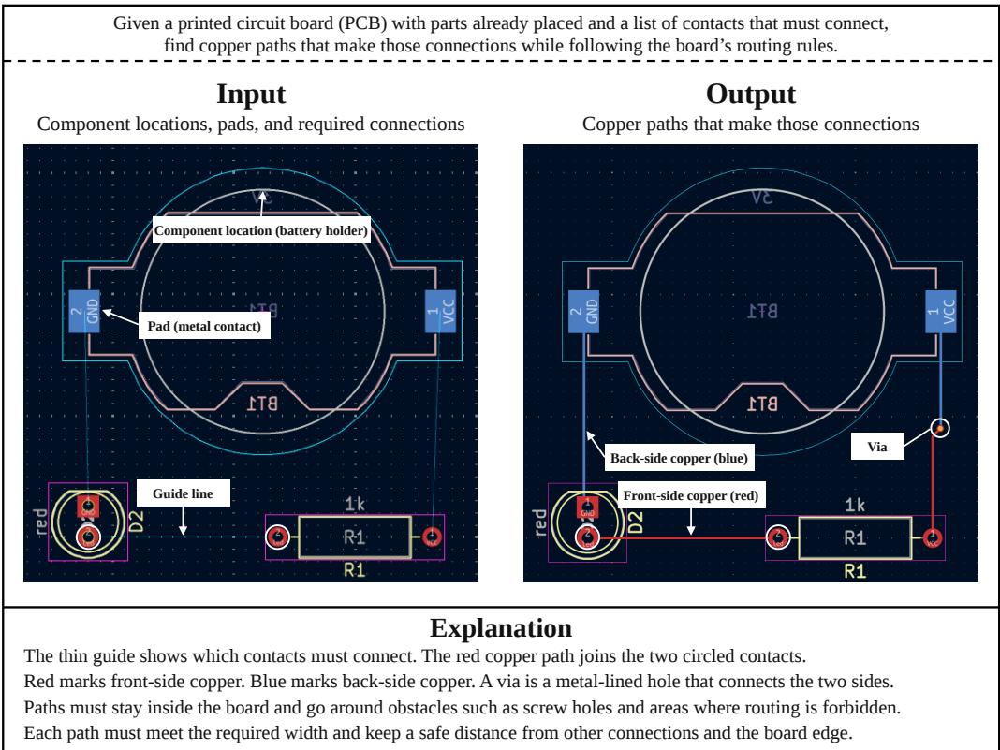
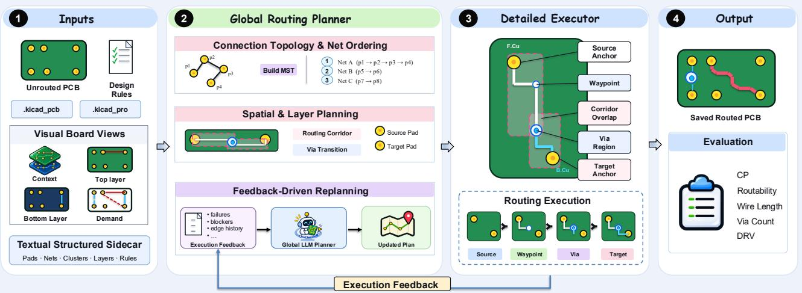

# PCBRouteAgent: How Close Are LLM Agents to Becoming PCB Routing Engineers?

Yue Zhang∗1, Jilei Sun∗1, Liqiang Jing∗,†1, Yijie Wei2 and Ruohan Yang3

1The University of Texas at Dallas, 2Texas Instruments Inc., 3Iowa State University

Equal contribution. † Corresponding author: Liqiang Jing (jingliqiang6@gmail.com).

Abstract: Automating printed circuit board (PCB) routing requires coordinating board-level connectivity decisions with geometric execution under strict design rules. Although recent agents can interact with native routing tools, reliable routing on complex boards remains challenging. We present PCBRouteAgent, a multimodal PCB routing agent inspired by how human engineers coordinate global strategy with local execution. A Global Routing Planner combines board images and structured electrical and geometric information to specify connection topology, routing order, corridors, and layer transitions. A Detailed Routing Executor realizes these guides through KiCad’s native routing engine and performs bounded local recovery. Unresolved failures are returned as structured feedback, enabling targeted guide revisions while preserving accepted routes. We evaluate PCBRouteAgent on 247 synthetic and real-world boards from four PCBWorld-Bench test splits. It achieves clean-pass rates of 100%, 94.9%, 100%, and 40% on D2, D3-A, D3-B, and D3-C, respectively. On the three real-world subsets, PCBRouteAgent outperforms the best evaluated baseline in clean-pass rate by 13.9, 36, and 10 percentage points, respectively. The project page and code are available at https://chip-ai-agent.github.io/research/pcbrouteagent and https://github. com/chip-ai-agent/PCBRouteAgent, respectively.

## 1. Introduction

Printed circuit boards (PCBs) provide mechanical support and electrical interconnections for electronic components. Before a circuit design can be fabricated as a PCB, its schematic connectivity must be translated into a physical board layout. This process includes component placement, which determines the positions and orientations of component footprints, followed by routing, which realizes the required electrical connections. As illustrated in Figure 1, routing connects the pads belonging to each electrical net\* through copper traces and, when necessary, vias that enable transitions between copper layers. A net may contain two or more pads, all of which must form a connected network while remaining electrically isolated from other nets. The resulting routing must satisfy design rules governing clearance, trace width, vias, and board boundaries, as well as signal-specific constraints such as differential-pair requirements [1, 2]. Beyond establishing valid connections, routing also seeks to limit wirelength and unnecessary layer transitions while preserving space for other nets. These requirements make PCB routing a coupled physical design problem in which each routing decision affects the connections that remain to be completed.

Routing complex PCBs remains labor-intensive, motivating automatic routers that reduce the need for manual trace construction. Classical rule-based methods use heuristic search [3], net ordering, and congestion-aware costs [1] to construct routes under geometric constraints. Although these methods automate much of the process, complex boards can still require careful tuning and manual intervention [2]. To reduce this reliance on handcrafted decisions, learning-based approaches have been explored for routing tasks, including global routing [4], net ordering [5], and PCB fanout [6]. Their effectiveness, however, depends on how routing decisions are represented and connected to physical execution. As discussed in PCBWorld [2], grid-based formulations face rapidly growing decision spaces as routing resolution increases, while approaches that guide an existing autorouter leave much of the physical routing process to that router. These limitations motivate studying agents that interact directly with a design engine and adapt their decisions using execution feedback. PCB-World [2] provides such an environment by exposing KiCad’s native routing operations and designrule feedback to reinforcement-learning policies and tool-using LLM agents. This interaction allows agents to observe the consequences of routing decisions and revise subsequent actions as the board evolves.

  
Figure 1: PCB routing connects required pads with copper traces and vias while satisfying design rules.

Despite this progress, reliable agent-based PCB routing remains challenging. The LLM agents evaluated in PCBWorld [2] still lag behind rule-based routers in completing connections while satisfying design rules, particularly on complex real-world boards. Providing access to native routing operations and execution feedback does not, by itself, ensure effective board-level coordination. An agent must decide which connections to prioritize, allocate limited routing space across competing nets, and determine when a layer transition is necessary. These decisions are coupled: a locally feasible route may block subsequent connections, while a connection that repeatedly fails may require a change in its topology or layer assignment rather than another local attempt. Moreover, as routing proceeds, the agent must distinguish difficulties that can be resolved locally from those requiring a broader strategy revision. These challenges highlight the need for an explicit mechanism that coordinates board-level planning with geometric execution and uses routing failures to revise the plan.

To address these limitations, we propose PCBRouteAgent, a multimodal PCB routing agent inspired by how human routing engineers coordinate global strategy with local execution. Engineers consider connection priorities, routing regions, and layer usage while constructing individual traces, and revisit these decisions when local obstacles prevent further progress. Following this principle, PCBRouteAgent integrates a Global Routing Planner and a Detailed Routing Executor through a feedback-driven planning–execution loop. The planner combines board images with structured electrical and geometric information to organize connectivity demands into routing guides specifying connection topology, routing order, corridors, and layer transitions. The executor translates these guides into physical traces and vias through KiCad’s native routing engine, using bounded local recovery to handle geometric difficulties. When recovery is insufficient, it returns structured execution evidence to the planner, which generates targeted guide revisions while preserving accepted routes. This design enables board-level guidance to adapt to the physical constraints revealed during execution.

We evaluate PCBRouteAgent on PCBWorld-Bench [2], comprising 128 synthetic boards and 119 realworld boards across four test splits. PCBRouteAgent achieves a 100% clean-pass rate on D2. On the real-world D3-A, D3-B, and D3-C subsets, PCBRouteAgent outperforms all evaluated routing baselines in clean-pass rate, achieving of 94.9%, 100%, and 40%, respectively, compared with 75%, 64%, and 30% for the strongest evaluated rule-based baseline, Freerouting [7], corresponding to improvements of 19.9, 36, and 10 percentage points. It also outperforms the published PCBWorld GPT-5.4 agent [2, 8], whose clean-pass rates are 42% on D3-A and 0% on D3-B. On D3-C, PCBRouteAgent reaches 94.9% mean routability and reduces the average design-rule violation count from Freerouting’s 32.0 to 6.3 per board.

## 2. Related Work

## 2.1. PCB Routing

PCB routing connects the pads specified by a netlist while respecting the geometry of components, existing copper, board boundaries, and electrical design rules. Classical approaches search for feasible paths and then refine them according to costs such as wirelength, congestion, and the number of vias. In IC routing, TritonRoute [9] illustrates the global–detailed decomposition: global routing determines coarse topology and layer guidance, while detailed routing realizes traces and vias under geometric design rules. Lee’s maze-routing algorithm [3] established a systematic way to find connections in a discretized search space; subsequent PCB routers have incorporated constraints that simple shortest-path search cannot capture. For example, Lin et al. [1] address complicated board constraints and differential pairs within a unified routing algorithm. These methods demonstrate the value of explicit geometric search and rule-aware optimization, but they also make clear that routing quality depends on decisions made across multiple scales: the order in which nets are attempted, the space reserved for future connections, and the local shape of each trace. Learning-based work has targeted different parts of this decision process. Liao et al. [4] investigate deep reinforcement learning for global routing, while FanoutNet [6] learns decisions for the specialized PCB fanout problem. GPCB [10] uses a generative pretrained Transformer to predict routing-related network-flow patterns and then constructs physical routes from those predictions. More recently, world-model reinforcement learning [5] has been integrated with Freerouting so that learned guidance can be combined with an existing autorouter. These systems differ in what they predict and in how much of the routing procedure is handled by a separate search or routing engine. PCBWorld [2] provides another setting: it exposes KiCad’s native routing operations to reinforcement-learning policies and tool-using LLM agents, and evaluates the resulting board with engine-based design-rule checks. This interactive setting makes it possible to observe how a routing decision changes the board before choosing the next action. Our work uses that setting to study the agent’s ability to coordinate routing decisions over an evolving board, rather than treating each connection as an isolated path-finding problem.

## 2.2. LLM Agents for EDA

LLM agents have begun to use EDA tools as part of longer design workflows, where a model plans tool calls and uses their feedback to guide later steps. ReAct [11] interleaves reasoning with environment actions, while Reflexion [12] uses feedback and reflective memory to improve subsequent attempts without updating model weights. Such workflows require the agent to track design state, choose suitable tools, and recover when a tool reports an error. ChatEDA [13] connects languagemodel planning to EDA tool invocation in an RTL-to-GDSII flow, and EDAid [14] investigates collaboration among multiple agents for electronic design automation. VerilogCoder [15] focuses on HDL development, using planning and feedback from code-oriented tools, including waveform tracing, to revise generated Verilog. Although these systems address different stages of hardware design, they share a useful pattern: the agent proposes an action, receives evidence from a domain tool, and uses that evidence to decide what to do next. PCB layout presents a different physical interface to this pattern. PCBAgent [16] combines an RL-based placement agent with an LLM agent for interactive component-placement optimization; placement choices affect routability, but placement alone does not test whether an agent can complete the required copper connections. Recent PCB benchmarks have made such distinctions more visible. PCB-Bench [17] evaluates LLMs on PCB placement and routing tasks, including the interpretation of board information. OmniRouting [18] assesses routing reasoning under geometric, design-rule, and electrical constraints, and includes a tool-augmented task. These evaluations help characterize what a model understands or proposes, while an interactive routing environment additionally reveals whether a sequence of actions yields a valid board as the geometry changes. PCBWorld [2] supplies this engine-grounded interface and evaluates completed boards with native design-rule feedback. PCBRouteAgent therefore studies an LLM agent in the closed loop between planning, tool execution, board-state observation, and validation. The emphasis is on the agent’s ability to maintain global routing objectives while adapting its next decision to the board produced by earlier actions.

## 3. Methods

From the perspective of a PCB routing engineer, routing requires decisions at two spatial scales: coordinating connection priorities, routing regions, and layer usage across the board, and realizing individual traces around pads and obstacles. A locally feasible connection may consume space needed by another net, while a promising board-level strategy may prove geometrically infeasible during execution. This motivates separating global planning from detailed routing and revising the plan when local difficulties arise. A similar separation is used in IC routing flows such as OpenROAD [19], where global routing produces guides for detailed routing.

  
Figure 2: Overview of PCBRouteAgent.

We adopt this principle for PCB routing. As illustrated in Figure 2, PCBRouteAgent is a multimodal agentic framework for PCB routing that integrates two tightly coupled components: a Global Routing Planner and a Detailed Routing Executor. The Global Routing Planner takes on the board-level planning responsibilities of a human PCB routing engineer, developing and maintaining a high-level routing strategy that covers key decisions such as connectivity planning, routing priorities, and spatial and layer planning. Guided by this strategy, the Detailed Routing Executor establishes physical connections through KiCad’s native push-and-shove (PNS) router [20, 2] while handling local obstacles and geometric constraints, generating structured execution feedback when routing attempts fail. The Global Routing Planner then leverages this feedback and multimodal board context to revise its strategy and guide subsequent execution, enabling the agent to iteratively adapt its routing decisions. The overall procedure is summarized in Algorithm 1 in Appendix A.

## 3.1. Task Formulation

Given an initial PCB $B _ { 0 } ,$ a target net set ${ \mathcal { N } } ,$ and design rules ${ \mathcal { R } } ,$ the routing task is to produce a routed board $B _ { r } = \mathcal { F } ( B _ { 0 } , \mathcal { N } , \mathcal { R } )$ , where $\mathcal { F }$ denotes the routing agent that maps the input board, target nets, and design rules to the resulting board. Here, $B _ { 0 }$ specifies fixed component placements, pad geometries, copper layers, obstacles, and existing routing; $\mathcal { N }$ specifies the required electrical connections; and R defines track widths, clearances, and via constraints. The agent accesses these inputs through board images and structured board information. The output $B _ { r }$ contains physical traces and vias saved in a KiCad PCB file. The objective is to connect all pads belonging to each target net while satisfying the design rules and keeping wirelength and via count low.

## 3.2. Global Routing Planner

Routing multiple nets on a shared PCB requires coordinating limited routing space while maintaining electrical connectivity. To address this challenge, the Global Routing Planner first organizes disconnected components within each net into a connection topology and then assigns spatial routing guides to support their physical realization. The resulting routing guide provides the Detailed Routing Executor with a structured plan for establishing these connections.

## 3.2.1. PCB BoardRepresentation

Effective global routing requires understanding both the outstanding connectivity demands and the physical constraints under which these connections must be established. Given the initial PCB $B _ { 0 } ,$ target net set $\mathcal { N } _ { \star }$ , and design rules ${ \mathcal { R } } ,$ we construct a multimodal board representation comprising board images I and structured text S. Through PCBWorld’s KiCad-based engine [2, 20], we extract pad geometries, copper layers, obstacles, and existing routing from $B _ { 0 } ,$ , target-net connectivity from $\bar { \mathcal { N } } _ { \ell }$ , and routing constraints from R. This information is represented in two complementary forms. The visual modality $\mathcal { T } = \{ I _ { \mathrm { l a y o u t } } , I _ { \mathrm { f r o n t } } , I _ { \mathrm { b a c k } } , I _ { \mathrm { d e m a n d } } \}$ depicts the overall board layout, front- and back-copper states, and outstanding connectivity demands. The textual modality S serializes pad coordinates and geometries, layer information, net assignments, connectivity clusters, and design rules. For each target net $n \in \mathcal N$ , electrically connected pads form clusters $\mathcal { C } _ { n } = \{ C _ { n , 1 } , \ldots , C _ { n , K _ { n } } \}$ whose remaining connections define the routing demands. Together, the images provide spatial context, while the structured text supplies precise identifiers and numerical constraints for global planning.

## 3.2.2. Connection Topology and Routing Order

Although the board representation identifies the remaining connectivity demands, it does not specify how disconnected clusters should be connected. For a net containing multiple clusters, numerous connection topologies can satisfy the same electrical requirements, while independently connecting every pair would introduce unnecessary routing. To avoid exhaustively searching this combinatorial space, we formulate connectivity planning as a minimum spanning tree (MST) [21] problem over the disconnected clusters, yielding a compact initial topology. For each target net n, we construct a weighted graph $G _ { n } = \left( \mathcal { C } _ { n } , \mathcal { E } _ { n } , w _ { n } \right)$ , where vertices represent connectivity clusters and edges represent candidate inter-cluster connections. Each candidate edge $e \in { \mathcal { E } } _ { n }$ is assigned a weight $w _ { n } ( e )$ based on the minimum Euclidean distance between pads in the corresponding clusters, with an additional penalty for incompatible pad layers. The resulting MST $T _ { n } = \left( \mathcal { C } _ { n } , \mathcal { E } _ { n } ^ { * } \right)$ specifies $K _ { n } - 1$ connection tasks spanning the $K _ { n }$ clusters. It minimizes the estimated total cost under this heuristic, while leaving the physical realization of these connections to subsequent routing stages.

Beyond determining the connection topology within each net, the planner must also coordinate routing across multiple nets that share limited board space. We therefore initialize the routing order using the total estimated connection length of each net’s spanning tree, prioritizing shorter nets first. This provides a lightweight starting strategy for organizing routing tasks, without requiring an exhaustive search over possible execution orders. Both the connection topology and routing priorities remain adjustable as subsequent execution reveals routing constraints not captured by the initial estimates.

## 3.2.3. Spatial and Layer Planning

While the connection topology specifies which clusters should be connected, it does not determine how these connections should traverse the physical board. Directly prescribing exact trace geometries at the global planning stage would require resolving fine-grained obstacles and design-rule constraints before routing execution. Instead, we separate high-level spatial guidance from lowlevel geometric realization, allowing the Global Routing Planner to guide routing decisions while preserving flexibility for local obstacle avoidance. Specifically, for each connection edge $e ,$ we use the endpoint pads selected during topology construction to initialize ordered corridor guidance $\mathcal { Q } _ { e } = \left( \mathcal { Q } _ { e , 1 } , \ldots , \mathcal { Q } _ { e , m _ { e } } \right)$ , where $m _ { e }$ is the number of corridor stages for connection e. When the endpoints share a copper layer, we construct a single corridor $\mathcal { Q } _ { e , 1 }$ from their axis-aligned bounding box, expanded by a margin δ in each direction. The resulting rectangle provides spatial guidance while leaving the exact trace geometry to the Detailed Routing Executor.

Beyond spatial guidance, routing may also require transitions between copper layers when the endpoints cannot be connected on a common layer. We split the connection at its midpoint and construct two layer-specific corridors, $\mathcal { Q } _ { e , 1 }$ from the source pad to the midpoint and $\mathcal { Q } _ { e , 2 }$ from the midpoint to the target pad, using the same bounding-box expansion. A via-transition region $\nu _ { e }$ is initialized by expanding the midpoint by δ in each direction. Rather than fixing an exact via location, the planner specifies a candidate region in which the Detailed Routing Executor can search for a feasible transition using KiCad’s native routing engine. The resulting connection topology, routing order, and spatial and layer guidance are consolidated into an initial routing guide, which is validated and translated into routing tasks for the Detailed Routing Executor.

## 3.2.4. Feedback-Driven Replanning

Although heuristic initialization provides an efficient starting point, its simplified cost estimates and spatial guidance cannot fully anticipate the geometric constraints encountered during physical routing. Connections that appear feasible at the planning stage may fail due to obstacles, restricted routing space, or layer constraints. To address this gap, the Global Routing Planner revises its routing strategy using evidence obtained from detailed execution.

When a connection remains unresolved after the Detailed Routing Executor’s local recovery attempts (Section 3.3.2), the executor produces structured feedback $\mathcal { F } _ { e }$ for each unresolved connection $e ,$ describing the failed attempts, last reached positions, potential obstacles, and deviations from the original guide. These feedback packets are aggregated and provided to the multimodal LLM used by the Global Routing Planner, together with the initial board images $\mathcal { T } ,$ structured board information S, the current routing guide, and updated connectivity summaries. The initial images remain fixed across replanning rounds; execution feedback and connectivity summaries provide observations of the evolving board. By jointly considering spatial context and execution evidence, the planner can revise high-level decisions that local routing alone cannot resolve.

At replanning round $t ,$ let $\mathcal { G } _ { t }$ denote the current routing guide, $\mathcal { D } _ { t }$ the batch of feedback packets $\mathcal { F } _ { e }$ for unresolved connections, and $\textstyle { \mathcal { K } } _ { t }$ the updated connectivity summaries. The multimodal LLM $\mathcal { M } _ { \theta }$ generates a guide patch, a structured set of local updates to the current routing guide, as

$$
\Delta \mathcal { G } _ { t } = \mathcal { M } _ { \theta } \left( \mathcal { T } , S , \mathcal { G } _ { t } , \mathcal { D } _ { t } , \mathcal { K } _ { t } ; P _ { \mathrm { s y s } } , P _ { \mathrm { r e p l a n } } \right) ,\tag{1}
$$

where θ denotes the model parameters, $\Delta \mathcal { G } _ { t }$ is the structured output patch, and $P _ { \mathrm { s y s } }$ and $P _ { \mathrm { r e p l a n } }$ are the system instructions and replanning prompt template, respectively. Their templates are listed in Appendices B.1.1 and B.1.2.

The planner outputs a structured guide patch specifying targeted changes to connection endpoints, routing corridors, via-transition regions, or routing order. The patch updates the affected portions of the current guide while preserving previously accepted routes outside that scope. Before execution resumes, the patch is checked for consistency with the current snapshot and guide revision, as well as valid references to clusters, corridors, and copper layers. If validation fails, the same planner may be asked to correct its response using the previous output and validation errors; the correction prompt template is listed in Appendix B.2. The validated patch is merged into the guide, and affected connection tasks are recompiled for the Detailed Routing Executor. This planning–execution loop continues until the target connections are completed, no further tasks can be scheduled, or the execution or replanning budget is exhausted.

## 3.3. Detailed Routing Executor

While the Global Routing Planner determines which connections to establish and where they should be routed, realizing these decisions requires resolving precise geometric constraints that cannot be fully captured by high-level guidance. The Detailed Routing Executor translates the routing guide into physical traces and vias through KiCad’s native PNS router, attempts bounded local recovery when routing fails, and returns unresolved failures to the Global Routing Planner for guide revision.

## 3.3.1. Guided Routing Execution

The Detailed Routing Executor takes the routing guide produced by the Global Routing Planner and compiles its planned connection edges into executable tasks. For each connection edge e, a task specifies the source and target connectivity clusters, candidate pad anchors, ordered layer-specific corridors $\mathcal { Q } _ { e } ,$ and optional via-transition regions $\nu _ { e }$ . The executor uses this guidance together with the design rules R to select routing targets and invoke native routing operations. These tasks are scheduled according to the routing priorities established by the Global Routing Planner, with connections within each net following their predefined task order. For each task, the executor selects a source anchor from the designated cluster that lies within the initial routing corridor and supports its assigned copper layer, prioritizing candidates closer to the next routing target. A compatible target anchor is identified from the destination cluster based on the final routing stage.

Instead of prescribing a fixed trace path, the executor progressively advances through the planned routing stages by selecting intermediate waypoints. For consecutive corridors $\mathcal { Q } _ { e , j }$ and $\mathcal { Q } _ { e , j + 1 }$ on the same layer, it identifies their overlapping region and generates candidate waypoints at the region center and surrounding positions, accounting for trace width and clearance requirements. These candidates are attempted sequentially through PNS, which constructs the physical trace between the current routing position and the selected target while handling local geometric constraints. Upon a successful attempt, the executor updates its routing position and proceeds to the next stage.

When a connection requires a layer transition, the executor instead generates candidate via locations within the designated transition region $\nu _ { e } ,$ accounting for via dimensions and clearance requirements. It then attempts to establish the transition before continuing on the next copper layer. After traversing the planned routing stages, the executor attempts to reach the target cluster and verifies whether the source and target clusters have become electrically connected. This connectivitybased verification ensures that task completion reflects an established physical connection rather than merely a successful intermediate routing operation.

## 3.3.2. Local Recovery and Execution Feedback

Although PNS can handle many local geometric constraints, routing attempts may still fail when obstacles block the selected path, restrict access to intermediate waypoints, or prevent a layer transition. Immediately triggering global replanning for every failure would introduce unnecessary overhead, particularly when alternative local paths remain available. We therefore employ a bounded recovery strategy that progressively explores alternative routing options before escalating unresolved failures to the Global Routing Planner.

When a routing attempt fails, the executor first explores local geometric alternatives through PNS, using walkaround to navigate obstacles and shove to adjust obstructing traces when necessary. If the current target remains unreachable, it attempts alternative waypoints within the designated routing region. For more challenging same-layer obstacles, a grid-based $\mathrm { A } ^ { * }$ search [22] identifies potential detours, which are subsequently executed through PNS. The executor can further backtrack to earlier routing stages or switch to alternative source anchors within the same connectivity cluster. These operations expand the local search space while preserving the connection topology and layer-transition regions established by the Global Routing Planner. To avoid excessive exploration, recovery attempts are bounded by retry and execution budgets.

When local recovery is exhausted or a planned layer transition cannot be completed, the executor generates a structured feedback packet $\mathcal { F } _ { e }$ for the current connection e, describing the attempted routing operations, last reached position, potential blocking obstacles, affected routing regions, and deviations from the original guidance. Failed tasks are rolled back to a consistent checkpoint, while previously accepted connections outside the affected scope are preserved. Rather than reporting failure as a binary outcome, the executor provides actionable evidence that helps the Global Routing Planner identify which higher-level decisions may require revision. This separation allows local geometric difficulties to be addressed through efficient recovery operations, while reserving global replanning for failures that cannot be resolved within the existing routing strategy. The resulting feedback is passed to the Global Routing Planner for the feedback-driven replanning described in Section 3.2.4.

Termination and output. The execution controller terminates the routing loop when all target connections are established, no further tasks or permitted recovery attempts remain, or the execution budget is exhausted. Connections that exhaust their replanning allowance are recorded as unresolved while other tasks may continue. A checkpoint or rollback failure also triggers early termination. On termination, the system saves the last consistent board state and reports completed and unresolved connections. Routing success is determined by the official evaluator applied to the saved board.

## 4. Experimental Setup

Benchmarks. We follow the agent-comparison setting of PCBWorld-Bench [2]. Each instance is a board in KiCad’s [20] native .kicad pcb format, with reference routes removed; component placement, netlist, and design rules remain fixed. The task is to complete the connections on that board, and the final board is evaluated by KiCad rather than by the agent’s own estimate of success. We use the same three test sets as the PCBWorld main comparison: 128 synthetic, two-layer gridless boards from D2-test; 99 small open-source boards from D3-A; and 10 medium open-source boards from D3-B. We additionally include the 10 large open-source boards in PCBWorld’s [2] fixed D3-C evaluation subset. PCBWorld excludes one of the 100 D3-A boards because its engine interface cannot load it. The D3-B and D3-C test subsets contain two-layer boards selected across each split’s pad-count range; D3-C contains boards with more than 100 pads. D2 tests routing on boards drawn from the synthetic distribution, while all three D3 splits test transfer to real designs with their original design-rule settings. The Reference rows in Tables 2–4 evaluate the original routed designs retained in PCBWorld’s open-source board corpus [2]. Each routing input is obtained by removing the target routing while preserving component placement, the netlist, and design rules; the Reference is the retained design before this removal, scored using the same official engine-based evaluator. D3-A and D3-B Reference values are taken from PCBWorld’s published Table 22, while the D3-C Reference values are evaluated locally. These rows provide an existing-design reference for comparison with automatically produced routes. We use PCBWorld’s published board identifiers and split definitions to keep the comparison board-for-board.

Protocol and metrics. We use PCBWorld’s KiCad-based board evaluator [2] for the reported routing quality. Published D2, D3-A, and D3-B baseline values in Tables 1–3 use PCBWorld’s single-rollout (@1) means from Table 22. PCBRouteAgent contributes one scored board per instance; any retries of unscored model-response failures are reported separately from this evaluation convention. Clean Pass (CP) is the primary success measure: a board passes only if all required connections are complete and KiCad reports zero error-level design-rule violations. We also report Potential Gain (Pot.), the change in the benchmark’s board-potential score from the unrouted state to the final board; Routability (Rout.), the fraction of required connections completed; and design-rule violation count (DRV), wirelength (WL), and via count. The main tables report routing quality. We additionally compare runtime, model calls, token usage, and API cost for our local PCBWorld and PCBRouteAgent runs under the same evaluation conditions with Claude Haiku 5.5. Both methods use the same timing scope; detailed efficiency results are provided in Appendix C. Potential incorporates connectivity, design-rule, wirelength, and via costs. These complementary metrics distinguish a complete and rule-clean board from partial connectivity or a route that is physically expensive.

Comparisons. We place PCBRouteAgent alongside the methods in PCBWorld’s [2] main result table: the reference routes and the rule-based Freerouting [7], OrthoRoute [23], and KiCadRouting-Tools [24] routers. Interactive PCBWorld agents use GPT-5.4 [8], GPT-5.4-mini and GPT-5.4-nano [25], and Qwen3.5-397B [26]. RL baselines use policies trained with PPO [27] or GRPO [28].

We evaluate PCBRouteAgent with Claude Opus 5.5 [29] and Claude Haiku 5.5 [30] on all four splits. We also locally evaluate the PCBWorld interactive agent with Haiku 5.5. The prompt template for the locally evaluated PCBWorld interactive baseline is listed in Appendix B.3.

Table 1: D2 routing quality (128 synthetic boards).
<table><tr><td>Method</td><td>CP↑</td><td>Pot. ↑</td><td>Rout. ↑</td><td>DRV↓</td><td>WL (mm) ↓</td><td>Via ↓</td></tr><tr><td>Freerouting</td><td>1.000</td><td>14.42</td><td>1.000</td><td>0.00</td><td>409.8</td><td>2.48</td></tr><tr><td>OrthoRoute</td><td>0.010</td><td>0.38</td><td>0.340</td><td>8.54</td><td>323.4</td><td>11.30</td></tr><tr><td>KiCadRoutingTools</td><td>1.000</td><td>15.52</td><td>1.000</td><td>0.00</td><td>373.9</td><td>8.09</td></tr><tr><td>PCBWorld (Haiku 5.5)</td><td>0.633</td><td>13.47</td><td>0.897</td><td>1.12</td><td>338.8</td><td>2.44</td></tr><tr><td>PCBWorld (GPT-5.4)</td><td>0.880</td><td>15.24</td><td>0.980</td><td>0.27</td><td>411.8</td><td>2.00</td></tr><tr><td>PCBWorld (GPT-5.4-mini)</td><td>0.200</td><td>6.46</td><td>0.490</td><td>4.62</td><td>208.6</td><td>0.96</td></tr><tr><td>PCBWorld (GPT-5.4-nano)</td><td>0.240</td><td>6.97</td><td>0.540</td><td>4.21</td><td>233.3</td><td>1.25</td></tr><tr><td>PCBWorld (Qwen3.5-397B)</td><td>0.140</td><td>5.81</td><td>0.480</td><td>4.64</td><td>229.6</td><td>1.02</td></tr><tr><td>PCBWorld (PPO)</td><td>0.980</td><td>15.84</td><td>0.990</td><td>0.06</td><td>458.4</td><td>2.22</td></tr><tr><td>PCBWorld (GRPO)</td><td>0.950</td><td>11.43</td><td>0.980</td><td>0.19</td><td>744.3</td><td>9.84</td></tr><tr><td>PCBWorld (PPO terminal)</td><td>0.610</td><td>12.06</td><td>0.800</td><td>1.60</td><td>380.2</td><td>1.62</td></tr><tr><td>PCBWorld (PPO w/o finish)</td><td>1.000</td><td>15.81</td><td>1.000</td><td>0.01</td><td>497.1</td><td>1.93</td></tr><tr><td>PCBRouteAgent (Claude Haiku 5.5)</td><td>1.000</td><td>16.27</td><td>1.000</td><td>0.00</td><td>392.4</td><td>1.99</td></tr><tr><td>PCBRouteAgent (Claude Opus 5.5)</td><td>1.000</td><td>16.27</td><td>1.000</td><td>0.00</td><td>392.5</td><td>1.99</td></tr></table>

Tables 1–3 combine the published PCBWorld Table 22 (@1) baselines with our local evaluations. The PCBWorld–Haiku rows are local reproductions. PCBWorld defines D3-C but publishes no scores for it, so Table 4 contains our local evaluations. The D3-B PCBRouteAgent result includes retries of unscored model-response failures and angle repair, so it is not a strict first-attempt @1 estimate.

Implementation details. We initialize routing corridors with an expansion margin of δ = 1.5 mm. The controller uses a per-board replanning budget of 12, with at most four replans per connection and five batch-replanning rounds. Local recovery allows two stage backtracks, one same-layer A\* detour, and two alternative-anchor attempts per connection, with at most one rip-up per obstructing net. For Claude Opus 5.5, D2 and D3-A use a maximum output length of 32,000 tokens with medium reasoning effort; D3-B uses a 32,000-token output limit, and D3-C uses 64,000 tokens with low effort. Reported Opus outputs undergo up to five guarded angle-repair passes, accepting changes only when connectivity, design-rule checks, and wirelength do not worsen. We score all saved boards with PCBWorld’s official evaluation settings. The potential penalizes incomplete connections, error-level design-rule violations, wirelength, and vias; warning-level issues do not affect the score. Prompt templates are provided in Appendix B.

## 5. Results and Analysis

Tables 1–3 combine the published PCBWorld [2] Table 22 (@1) baselines with our local evaluations. PCBWorld–Haiku is locally reproduced on each split, and PCBRouteAgent contributes one scored board per instance. Table 4 reports local evaluations on the fixed D3-C subset. Bold and italic values indicate the best and second-best distinct reported values, respectively, including Reference; ties share the same formatting.

Table 2: D3-A routing quality (99 real-world boards).
<table><tr><td>Method</td><td>CP↑</td><td>Pot. ↑</td><td>Rout. ↑</td><td>DRV↓</td><td>WL (mm) ↓</td><td>Via ↓</td></tr><tr><td>Reference</td><td>1.000</td><td>23.16</td><td>1.000</td><td>0.00</td><td>170.2</td><td>1.18</td></tr><tr><td>Freerouting</td><td>0.750</td><td>22.04</td><td>0.900</td><td>1.08</td><td>156.6</td><td>0.86</td></tr><tr><td>OrthoRoute</td><td>0.020</td><td>-6.16</td><td>0.530</td><td>99.70</td><td>129.8</td><td>26.97</td></tr><tr><td>KiCadRoutingTools</td><td>0.740</td><td>20.00</td><td>0.940</td><td>2.38</td><td>142.8</td><td>3.69</td></tr><tr><td>PCBWorld (Haiku 5.5)</td><td>0.343</td><td>14.77</td><td>0.721</td><td>4.06</td><td>111.5</td><td>0.96</td></tr><tr><td>PCBWorld (GPT-5.4)</td><td>0.420</td><td>16.15</td><td>0.810</td><td>2.71</td><td>148.1</td><td>2.36</td></tr><tr><td>PCBWorld (GPT-5.4-mini)</td><td>0.130</td><td>8.97</td><td>0.490</td><td>7.16</td><td>81.9</td><td>0.21</td></tr><tr><td>PCBWorld (GPT-5.4-nano)</td><td>0.150</td><td>8.35</td><td>0.470</td><td>7.46</td><td>83.0</td><td>0.31</td></tr><tr><td>PCBWorld (Qwen3.5-397B)</td><td>0.190</td><td>10.98</td><td>0.590</td><td>5.75</td><td>102.7</td><td>0.47</td></tr><tr><td>PCBWorld (PPO)</td><td>0.680</td><td>19.22</td><td>0.870</td><td>1.91</td><td>164.9</td><td>1.09</td></tr><tr><td>PCBWorld (GRPO)</td><td>0.640</td><td>15.07</td><td>0.900</td><td>1.67</td><td>337.1</td><td>14.13</td></tr><tr><td>PCBWorld (PPO terminal)</td><td>0.650</td><td>18.23</td><td>0.860</td><td>1.95</td><td>171.0</td><td>3.50</td></tr><tr><td>PCBWorld (PPO w/o finish)</td><td>0.810</td><td>19.55</td><td>0.940</td><td>0.95</td><td>262.7</td><td>3.87</td></tr><tr><td>PCBRouteAgent (Claude Haiku 5.5)</td><td>0.929</td><td>22.86</td><td>0.990</td><td>0.14</td><td>164.0</td><td>0.78</td></tr><tr><td>PCBRouteAgent (Claude Opus 5.5)</td><td>0.949</td><td>23.02</td><td>0.994</td><td>0.09</td><td>165.5</td><td>0.79</td></tr></table>

Routing quality on synthetic boards. On D2 (Table 1), both PCBRouteAgent variants achieve a clean-pass rate of 1.00 and routability of 1.000, matching the complete routing achieved by Freerouting and KiCadRoutingTools. The Opus variant obtains a potential gain of 16.27, compared with 15.84 for PCBWorld PPO and 14.42 for Freerouting. Among these fully connected solutions, it reduces wirelength and via count relative to Freerouting by 4.2% and 19.7%, respectively. Thus, on the synthetic test set, PCBRouteAgent achieves complete, rule-clean routing with competitive physical routing costs.

Routing completion on small real-world boards. On D3-A (Table 2), the Opus variant achieves a clean-pass rate of 0.949, exceeding the strongest evaluated baseline, PCBWorld PPO w/o finish, by 13.9 percentage points. Its routability reaches 0.994, with an average DRV count of 0.09.

Routing completion on medium real-world boards. On D3-B (Table 3), the Opus variant completes all ten boards without error-level violations, compared with a clean-pass rate of 0.64 for Freerouting.

Large-board routing remains challenging. On D3-C (Table 4), the Opus variant achieves a cleanpass rate of 0.40, compared with 0.30 for Freerouting and 0.00 for the evaluated RL baselines and PCBWorld–Haiku agent. It reaches 0.949 mean routability and reduces the average DRV count from Freerouting’s 32.0 to 6.3, an 80.3% reduction. Nevertheless, six of the ten boards remain incomplete. The gap between high average routability and lower clean-pass rate shows that connecting most targets does not ensure successful completion of an entire board.

Table 3: D3-B routing quality (10 real-world boards). Results include response-failure retries and angle repair.
<table><tr><td>Method</td><td>CP↑</td><td>Pot. ↑</td><td>Rout. ↑</td><td>DRV↓</td><td>WL (mm) ↓</td><td>Via↓</td></tr><tr><td>Reference</td><td>1.000</td><td>63.96</td><td>1.000</td><td>0.00</td><td>570.3</td><td>6.70</td></tr><tr><td>Freerouting</td><td>0.640</td><td>58.86</td><td>0.990</td><td>11.94</td><td>533.5</td><td>3.88</td></tr><tr><td>OrthoRoute</td><td>0.000</td><td>-10.25</td><td>0.440</td><td>188.20</td><td>370.0</td><td>39.80</td></tr><tr><td>KiCadRoutingTools</td><td>0.200</td><td>40.94</td><td>0.860</td><td>44.70</td><td>472.3</td><td>11.80</td></tr><tr><td>PCBWorld (Haiku 5.5)</td><td>0.000</td><td>25.32</td><td>0.442</td><td>25.40</td><td>245.7</td><td>1.90</td></tr><tr><td>PCBWorld (GPT-5.4)</td><td>0.000</td><td>25.65</td><td>0.440</td><td>24.88</td><td>240.3</td><td>2.06</td></tr><tr><td>PCBWorld (GPT-5.4-mini)</td><td>0.000</td><td>23.96</td><td>0.490</td><td>23.00</td><td>408.6</td><td>0.94</td></tr><tr><td>PCBWorld (GPT-5.4-nano)</td><td>0.000</td><td>23.62</td><td>0.470</td><td>24.00</td><td>363.9</td><td>0.36</td></tr><tr><td>PCBWorld (Qwen3.5-397B)</td><td>0.000</td><td>19.02</td><td>0.410</td><td>26.84</td><td>249.6</td><td>6.24</td></tr><tr><td>PCBWorld (PPO)</td><td>0.210</td><td>37.60</td><td>0.650</td><td>17.33</td><td>518.8</td><td>5.06</td></tr><tr><td>PCBWorld (GRPO)</td><td>0.070</td><td>21.76</td><td>0.550</td><td>22.28</td><td>1054.5</td><td>27.26</td></tr><tr><td>PCBWorld (PPO terminal)</td><td>0.150</td><td>33.47</td><td>0.640</td><td>17.54</td><td>550.0</td><td>10.64</td></tr><tr><td>PCBWorld (PPO w/o finish)</td><td>0.220</td><td>35.99</td><td>0.720</td><td>15.32</td><td>1008.6</td><td>14.57</td></tr><tr><td>PCBRouteAgent (Claude Haiku 5.5)</td><td>0.800</td><td>63.20</td><td>0.997</td><td>0.20</td><td>580.0</td><td>4.90</td></tr><tr><td>PCBRouteAgent (Claude Opus 5.5)</td><td>1.000</td><td>64.47</td><td>1.000</td><td>0.00</td><td>591.6</td><td>4.00</td></tr></table>

Table 4: D3-C routing quality (10 real-world boards); all method results are local evaluations.
<table><tr><td>Method</td><td>CP↑</td><td>Pot. ↑</td><td>Rout. ↑</td><td>DRV↓</td><td>WL (mm) ↓</td><td>Via ↓</td></tr><tr><td>Reference</td><td>0.900</td><td>147.80</td><td>0.938</td><td>8.80</td><td>1391.0</td><td>44.00</td></tr><tr><td>Freerouting</td><td>0.300</td><td>132.80</td><td>0.918</td><td>32.00</td><td>1304.0</td><td>21.40</td></tr><tr><td>OrthoRoute</td><td>0.000</td><td>0.60</td><td>0.063</td><td>139.90</td><td>80.0</td><td>17.80</td></tr><tr><td>KiCadRoutingTools</td><td>0.000</td><td>115.60</td><td>0.778</td><td>30.50</td><td>1086.0</td><td>57.40</td></tr><tr><td>PCBWorld (Haiku 5.5)</td><td>0.000</td><td>31.00</td><td>0.199</td><td>94.60</td><td>330.9</td><td>4.30</td></tr><tr><td>PCBWorld (PPO)</td><td>0.000</td><td>52.20</td><td>0.403</td><td>72.70</td><td>1075.0</td><td>5.00</td></tr><tr><td>PCBWorld (GRPO)</td><td>0.000</td><td>44.80</td><td>0.353</td><td>79.00</td><td>886.0</td><td>8.30</td></tr><tr><td>PCBWorld (PPO terminal)</td><td>0.000</td><td>56.20</td><td>0.412</td><td>69.50</td><td>1072.0</td><td>1.50</td></tr><tr><td>PCBRouteAgent (Claude Haiku 5.5)</td><td>0.100</td><td>135.99</td><td>0.915</td><td>9.80</td><td>1352.4</td><td>17.30</td></tr><tr><td>PCBRouteAgent (Claude Opus 5.5)</td><td>0.400</td><td>141.80</td><td>0.949</td><td>6.30</td><td>1410.5</td><td>21.30</td></tr></table>

Framework effectiveness with the same model. We do not conduct a full evaluation of PCBWorld’s interactive agent with Claude Opus 5.5 because we verified that its per-step model invocation incurs substantially higher API costs than PCBRouteAgent. Instead, we compare the two frameworks using the same Claude Haiku 5.5 backbone (Tables 1–4). PCBRouteAgent achieves clean-pass rates of 1.00, 0.929, 0.80, and 0.10 on D2, D3-A, D3-B, and D3-C, respectively, compared with 0.633, 0.343, 0.00, and 0.00 for PCBWorld–Haiku. These correspond to improvements of 36.7, 58.6, 80, and 10 percentage points. Mean routability also increases from 0.897 to 1.000 on D2, from 0.721 to 0.990 on D3-A, from 0.442 to 0.997 on D3-B, and from 0.199 to 0.915 on D3-C. The same language model therefore achieves higher connectivity and board completion within PCBRouteAgent, providing evidence for the effectiveness of the overall planning–execution framework.

Computational efficiency under the same conditions. The local Haiku comparison also shows that PCBRouteAgent requires fewer computational resources (Appendix C). Across all 247 boards, model calls decrease from 22,529 to 172, combined input and output tokens from 105.7M to 12.0M, and API cost from \$20.72 to \$4.77. With the same timing scope, cumulative per-board runtime decreases from 36.4 to 2.6 hours. These correspond to approximately 131× fewer model calls, 8.8× lower token usage, 4.3× lower API cost, and 14× lower cumulative runtime. Together with the higher clean-pass rates on all four splits, these results show that the planning–execution framework improves both routing completion and computational efficiency.

Completion and physical routing cost. Improved completion need not produce shorter routing. On D3-B, the Opus variant uses 10.9% more wirelength than Freerouting while improving clean-pass rate by 36 percentage points. On D3-C, its wirelength is 8.2% higher, with a comparable via count of 21.3 versus 21.4. These results indicate a remaining opportunity to improve routing compactness while maintaining connectivity. Wirelength and via count must also be interpreted alongside completion: methods that leave many connections unrouted can obtain low physical costs simply by constructing less copper.

## 6. Conclusion

We presented PCBRouteAgent, a multimodal PCB routing agent that coordinates global planning and native geometric execution through structured feedback. Inspired by the interaction between board-level strategy and local routing decisions in engineering workflows, the framework combines routing guides, bounded local recovery, and targeted guide revisions. Evaluation on 247 synthetic and real-world boards shows that PCBRouteAgent achieves complete, rule-clean routing on D2 and D3-B and improves clean-pass rate over the best evaluated baseline on all three real-world subsets. Large-board completion and routing compactness remain important challenges. Future work will investigate more effective spatial and layer planning, adaptive recovery budgets, and routing refinement that reduces physical cost while preserving completed connections.

## References

[1] Ting-Chou Lin, Devon Merrill, Yen-Yi Wu, Chester Holtz, and Chung-Kuan Cheng. A unified printed circuit board routing algorithm with complicated constraints and differential pairs. In Proceedings ofthe 26th Asia and South Pacific Design Automation Conference, pages 170–175, 2021.

[2] Hyungseok Song, Junseok Park, Won-Seok Choi, Seohui Bae, Han-Seul Jeong, Youngjoon Park, and Soonyoung Lee. PCBWorld: A benchmark environment for engine-grounded PCB design automation. In KDD 2026 Workshop on Evaluation and Trustworthiness of Agentic AI, 2026. arXiv:2607.05915.

[3] C. Y. Lee. An algorithm for path connections and its applications. IRE Transactions on Electronic Computers, EC-10(3):346–365, 1961.

[4] Haiguang Liao, Wentai Zhang, Xuliang Dong, Barnabas P´ oczos, Kenji Shimada, and Levent Bu-´ rak Kara. A deep reinforcement learning approach for global routing. Journal of Mechanical Design, 142(6):061701, 2020.

[5] Yin-Chi Liao, Sheng-Xin Pan, and Po-Jui Chiang. Automation of PCB autorouting via worldmodel reinforcement learning and freerouting integration. Expert Systems with Applications, 311:131424, 2026.

[6] Haiyun Li, Jixin Zhang, Ning Xu, and Mingyu Liu. FanoutNet: A neuralized PCB fanout automation method using deep reinforcement learning. In Proceedings of the AAAI Conference on Artificial Intelligence, volume 37, pages 8554–8561, 2023.

[7] Freerouting Project. Freerouting: Open-source PCB autorouter. Software repository, 2026.

[8] OpenAI. Introducing GPT-5.4, 2026.

[9] Andrew B. Kahng, Lutong Wang, and Bangqi Xu. TritonRoute: The open-source detailed router. IEEE Transactions on Computer-Aided Design of Integrated Circuits and Systems, 40(3):547–559, 2021.

[10] Jienan Chen, Jun Tu, Hao Wang, Jie Zheng, Hao Liu, Shenglong Bai, Xiantuo He, and Weikang Qian. GPCB routing: Generative pretrained transformers-based printed circuit board routing method. IEEE Transactions on Computer-Aided Design ofIntegrated Circuits and Systems, 44(4):1420– 1433, 2025.

[11] Shunyu Yao, Jeffrey Zhao, Dian Yu, Nan Du, Izhak Shafran, Karthik Narasimhan, and Yuan Cao. ReAct: Synergizing reasoning and acting in language models. In International Conference on Learning Representations, 2023.

[12] Noah Shinn, Federico Cassano, Ashwin Gopinath, Karthik Narasimhan, and Shunyu Yao. Reflexion: Language agents with verbal reinforcement learning. In Advances in Neural Information Processing Systems, volume 36, 2023.

[13] Haoyuan Wu, Zhuolun He, Xinyun Zhang, Xufeng Yao, Su Zheng, Haisheng Zheng, and Bei Yu. ChatEDA: A large language model powered autonomous agent for EDA. IEEE Transactions on Computer-Aided Design ofIntegrated Circuits and Systems, 43(10):3184–3197, 2024.

[14] Haoyuan Wu, Haisheng Zheng, Zhuolun He, and Bei Yu. Divergent thoughts toward one goal: LLM-based multi-agent collaboration system for electronic design automation, 2025. arXiv:2502.10857.

[15] Chia-Tung Ho, Haoxing Ren, and Brucek Khailany. VerilogCoder: Autonomous verilog coding agents with graph-based planning and abstract syntax tree (AST)-based waveform tracing tool. In Proceedings ofthe AAAI Conference on Artificial Intelligence, volume 39, pages 300–307, 2025.

[16] Lin Chen, Ran Chen, Shoubo Hu, Xufeng Yao, Zhentao Tang, Shixiong Kai, Siyuan Xu, Mingxuan Yuan, Jianye Hao, Bei Yu, and Jiang Xu. PCBAgent: An agent-based framework for highdensity printed circuit board placement. In Proceedings of the 30th Asia and South Pacific Design Automation Conference, pages 781–787, 2025.

[17] Jindong Li, Lianrong Chen, Bin Yang, Jiadong Zhu, Ying Wang, Yuzhe Ma, and Menglin Yang. PCB-Bench: Benchmarking LLMs for printed circuit board placement and routing. In International Conference on Learning Representations, 2026.

[18] Taiting Lu, Kaiyuan Lin, Ziwei Dong, Sisong Bei, Haolin Ye, Yuxin Tian, Runze Liu, Mingjia Wang, Jingying Zeng, Hongxing Pan, Kai Zhang, Haoyu Wang, Guoliang Shi, Ling Ma, Yifan Yang, Jiaying Lu, Qi He, Yi-Chao Chen, Sung-Liang Chen, Yincheng Jin, and Mahanth Gowda. OmniRouting: A semantic-coupled multimodal benchmark for constraint-aware spatial reasoning in PCB routing, 2026. arXiv:2608.04434.

[19] The OpenROAD Project. OpenROAD: Global and detailed routing. https://github.com/ The-OpenROAD-Project/OpenROAD, 2026. Documentation for the FastRoute global router and TritonRoute detailed router.

[20] KiCad Development Team. KiCad 9.0 PCB editor documentation. Project documentation, 2026.

[21] Robert C. Prim. Shortest connection networks and some generalizations. The Bell System Technical Journal, 36(6):1389–1401, 1957.

[22] Peter E. Hart, Nils J. Nilsson, and Bertram Raphael. A formal basis for the heuristic determination of minimum cost paths. IEEE Transactions on Systems Science and Cybernetics, 4(2):100–107, 1968.

[23] Brian Benchoff. OrthoRoute: A GPU-accelerated PCB autorouter for KiCad. Software repository, 2025.

[24] Andy Haas. KiCad Routing Tools. Software repository, 2026.

[25] OpenAI. Introducing GPT-5.4 mini and nano, 2026.

[26] Qwen Team. Qwen3.5-397B-A17B model card, 2026.

[27] John Schulman, Filip Wolski, Prafulla Dhariwal, Alec Radford, and Oleg Klimov. Proximal policy optimization algorithms, 2017.

[28] Zhihong Shao, Peiyi Wang, Qihao Zhu, Runxin Xu, Junxiao Song, Xiao Bi, Haowei Zhang, Mingchuan Zhang, Y. K. Li, Y. Wu, and Daya Guo. DeepSeekMath: Pushing the limits of mathematical reasoning in open language models, 2024.

[29] Anthropic. Introducing Claude Opus 5.5, 2026.

[30] Anthropic. Introducing Claude Haiku 5.5, 2026.

## A. Overall Routing Algorithm

Algorithm 1 summarizes PCBRouteAgent. Initialization follows Sections 3.2–3.2.4; local recovery follows Section 3.3.2. The LLM call uses Equation 1 and the prompt templates in Appendix B.

Algorithm 1 PCBRouteAgent   
Input: Initial PCB B , target nets ${ \mathcal { N } } ,$ design rules R, LLM M , execution budget, maximum replanning rounds $r _ { \mathrm { m a x } }$   
Output: Saved PCB B and execution report   
1: (I, S) ← EXTRACTREPRESENTATION $\left( B _ { 0 } , \mathcal { N } , \mathcal { R } \right)$   
2: G ← INITIALIZEGUIDE(B , N, R) ▷ MST, order, corridors, via regions   
3: $B \gets B _ { 0 } ; t \gets 0$   
4: while execution budget remains do   
5: T ← COMPILEPENDINGTASKS(G , B)   
6: if $\cdot \tau = \emptyset$ then   
7: break   
8: end if   
9: $\mathcal { D } _ { t }  \mathcal { D }$   
10: for each connection task e in T, in planned order do   
11: C ← CHECKPOINT(B)   
12: if checkpoint creation fails then   
13: go to finalization   
14: end if   
15: $\left( B ^ { \prime } , \mathcal { F } _ { e } \right)$ ← EXECUTEANDRECOVER(e, B, R)   
16: if connectivity and board-state checks pass then   
17: $B  B ^ { \prime }$ ▷ Accept the connection   
18: else   
19: B ← RESTORE(C); Dt ← Dt ∪ {Fe}   
20: end if   
21: if execution budget is exhausted or rollback fails then   
22: go to finalization   
23: end if   
24: end for   
25: if all target connections are established or $\mathcal { D } _ { t } = \mathcal { D }$ or $t \geq r _ { \operatorname* { m a x } }$ then   
26: break   
27: end if   
28: K ← CONNECTIVITYSUMMARIES(B, N)   
29: $\Delta \mathcal { G } _ { t } \gets \mathcal { M } _ { \theta } ( \mathbb { Z } , S , \mathcal { G } _ { t } , \mathcal { D } _ { t } , \mathcal { K } _ { t } ; P _ { \mathrm { s y s } } , P _ { \mathrm { r e p l a n } } )$   
30: Validate ∆G ; request a bounded correction if needed   
31: $\mathcal { G } _ { t + 1 }  \mathcal { G } _ { t }$   
32: if ∆G is valid then   
33: Gt+1 ← APPLYPATCH $\left( \mathcal { G } _ { t } , \Delta \mathcal { G } _ { t } \right)$ ▷ Preserve accepted routes   
34: end if   
35: t ← t + 1   
36: end while   
37: Finalization: B ← FINALIZEANDSAVE(B) ▷ Last consistent board state   
38: Evaluate $B _ { r }$ using the official evaluator   
39: return B and execution report

## B. Prompt Templates

The following templates reproduce the fixed prompt wording used by the implementation. Brace-delimited placeholders denote runtime-expanded board data, view metadata, feedback, routing guides, JSON schemas, or examples. The Global planner templates are extracted from route\_agent/prompts/bundle.py; the correction fields follow route\_agent/cli/pipeline.py. The locally evaluated PCBWorld baseline uses the v5 templates in   
methods/llm\_agent/wrappers/prompts/v5.py with S-expression board observations. Input images are attached separately to the Global planner requests.

## B.1. Global Routing Planner Prompts

## B.1.1. System Prompt

## System Prompt for the Global Routing Planner

Prompt:

You are the Global routing planner for a printed circuit board.   
You receive (1) board-context, per-layer copper-state and connectivity-demand images of the current committed board in one physical mm frame and (2) a   
structured sidecar with exact ids and rules. You output a RouteGuidePlan as JSON only.

What a plan is:

\- corridors: axis-aligned regions per layer (bbox [x1,y1,x2,y2] in mm). They are SOFT: the Detailed router works inside them when it can and reports deviations. A region may cover obstacles; the Detailed router finds a legal path inside it.

\- An edge lists its ordered stages (corridor ids). Consecutive same-layer stages must overlap. A layer change needs the two stages to overlap AND a via region covering that overlap, listed in via regions in order.

\- Layer changes are YOUR decision only: the Detailed router never places a via and never leaves the layer of the stage it is in. A pad fenced in on its own layer (a dense SMD row, a pad walled by neighbouring pads or earlier tracks) cannot be left on that layer: start the edge on the other layer when the pad is thru-hole, otherwise put a small via region (about 1 mm) right next to the pad between a short first stage on the pad’s layer and the next stage on the other layer. Without that the edge is certain to fail.

Plan only the work-set nets. Prefer short, wide corridors; use layer changes where a pad or a channel needs one and nowhere else; keep corridors inside the board bbox; use the images to avoid dense pad fields and existing copper. Do not draw copper. Output JSON matching the schema, nothing else.

## B.1.2. Feedback-Driven Replanning Prompt

## Prompt for Feedback-Driven Replanning

Images: Board-context, layer-specific copper-state, and connectivity-demand views.   
Prompt:   
# Task   
Produce a RouteGuidePlan for the work-set nets of this board.   
# Images   
One frame, mm coordinates; pixel to mm affine per view is in the sidecar.views list.   
- {view id}: layers {view layers}, bbox mm {view bbox mm}, size {view image size}   
# Structured sidecar (JSON)   
{structured board json}   
# Previous plan (revise only the affected items; keep the rest)   
{current routing guide json}   
# Detailed feedback (the failure you must fix)   
{feedback batch and live state json}   
Return a GlobalGuidePatch JSON object: {patch id, based on: {snapshot id, rules hash, plan revision: {plan revision}}, replace corridors, replace via regions, replace edges, preserve, net order?,   
budget revision?}. Replace only what the feedback requires (a replaced edge or corridor is given in full); list every unaffected edge id in preserve. The cluster ids and snapshot id stay those of the sidecar (the board was rolled back to that stable state plus the edges already done, see feedback.live state). A full RouteGuidePlan is accepted instead of a patch but must then validate on its own.   
# GlobalGuidePatch JSON schema   
{patch json schema}   
# Example patch (shape only; use the real ids, layers and mm coordinates of this board)   
{patch example json}   
If the feedback carries ‘packets‘ (several edges, an end-of-pass batch), every edge in it failed in this pass and the board now holds everything else that was routed: return ONE patch that fixes as many of them as you can, those whose evidence makes the fix clear first (via sites, head is thru, alt starts), and list every edge you leave unchanged in preserve.   
The Detailed never places a via on its own: a layer change exists only where the plan has a via region. When failure evidence.via sites is non-empty the head is fenced in on its layer; each entry is a clearance-checked [x, y] in mm right next to the stuck head where a via fits on both layers. To route the edge on the other layer, add a via region (a box about 1 mm wide around one of those points), a short first-stage corridor on the head’s layer that contains the head and overlaps that box, and the next stage on the other layer overlapping it too. blocker candidates lists the foreign pads / tracks fencing the head in (with positions and layers); head is thru true means the pad itself spans both layers, so a corridor starting on the other layer needs no via; alt starts are other points of the net’s copper near the first stage the edge could start from instead.   
When a packet carries ‘history‘, the edge has been re-planned before: each entry is the shape the Detailed executed in an earlier round (stages with layer and bbox, via regions) and where it died (died at, head, reason). Those shapes have already failed: do not return one of them or a near copy. Change what failed: enter the target from its other side or on the other layer, move the via region away from died at, or start the edge from one of alt starts.   
Rules the validator enforces: every corridor has id, layer and bbox; every via region has id, layers (the two layers it joins) and bbox; consecutive same-layer stages overlap; a layer change needs a via region

## B.2. Guide-Patch Correction Prompt

The correction request reuses the system prompt and replanning user template above. Its feedback object additionally contains the following fields, including the exact correction instruction. The previous response and validation-error list are populated at runtime.

Additional Feedback Fields for Guide-Patch Correction   
Prompt:   
”previous response”: {previous response json},   
”validation errors”: {validation errors json},   
”instruction”: ”Your previous patch failed the checks listed in validation errors. Return a corrected   
GlobalGuidePatch for the same edge(s); keep everything else unchanged.”   
Output Format: A corrected JSON GlobalGuidePatch.

## B.3. PCBWorld Interactive Baseline Prompt

The system message contains the static board context; the user message supplies the current observation, action history, rejected-attempt information, and valid actions at each step.

System Prompt for the PCBWorld Interactive Baseline   
Prompt:   
You are a PCB routing agent for KiCad. Connect unconnected pins (points in routing geometry) within   
each net. Never connect pins from different nets.   
# Priority   
1. Complete all connections (reduce unconnected points to zero).   
2. Avoid DRC violations (no crossing other nets, respect clearance).   
3. Minimize total wirelength.   
# Routing Guidelines   
- Targets are the (point ...) entries in routing geometry; the final segment must land on the target pad’s   
(x, y) while the cursor is on that pad’s layer (points carry no layer — look up the pad in board static or   
the nearby tracks).   
- Use exact coordinates from the observation (pad positions, point targets, track endpoints). Only invent   
coordinates for detour waypoints.   
- Avoid static obstacles, board edges, and existing tracks on the same layer (any net, including the   
current one).   
- When a path is blocked, detour: switch layers with ‘make via‘ (offset ≥1mm from any pad — never   
place a via on a pad), route around on the opposite layer, then switch back.   
- When the cursor is already near the remaining target with a clear path, prefer ‘finish ¡mode¿‘ over a   
manual ‘make line‘.

## Layer-change detour pattern   
Route from (0, 0) on layer 1 to (10, 10) on layer 1, bypassing an obstacle via layer 2:   
1. start route 0.0 0.0 1   
2. make via 0.0 0.5 w # offset off the source pad, then cross to layer 2   
3. start route 0.0 0.5 2 # re-enter routing on the new layer   
4. make via 10.0 9.5 w # STOP before the target’s (x, y) and cross back   
5. start route 10.0 9.5 1 # re-enter routing on the target pad’s layer   
6. make line 10.0 10.0 w # final segment lands on the pad, on its own layer   
## Do NOT draw or end on a pad from the wrong layer   
Never let ‘make line‘ or ‘make via‘ reach the target pad’s exact (x, y) while the cursor is on a different   
layer than that pad. If you do, you are trapped:   
- placing a via at the pad violates the ”no via on pad” rule, and   
- the pad is unreachable from the wrong layer, so ‘finish‘ will fail repeatedly.   
Always make the layer-return ‘make via‘ at an offset waypoint (≥1mm away from the target pad)   
\*before\* the track arrives at the target’s (x, y).   
# Response Format   
Output exactly one ¡think¿...¡/think¿ followed by one ¡action¿...¡/action¿. Never repeat think-action   
pairs.   
”[no effect]” in history = action made no progress; ”Last rejected attempt” below = action was refused.   
Do not repeat either.   
# Board State   
The board state is provided in S-expression format. All floating-point values are rounded to 3 decimal   
places. Each element is enclosed in parentheses: (tag value ...) or (tag (child ...) ...).   
## board static — static board context (unchanged during episode)   
(bbox x y w h) — board bounding box origin and size in mm   
(scale N) — max(w, h), for normalization reference   
(net count N) — total number of nets   
(copper layers N) — number of copper layers   
(boardlines (edge ID (p1 PID x y) (p2 PID x y)) ...) — board outline edges; an arc outline entry appears as   
(arc ID (p1 ...) (mid PID x y) (p2 ...)) with mid on the arc between p1 and p2 (full circle: p1 == p2, mid =   
opposite point)   
(nets (net CODE ”NAME” (pads (pad ID x y layer) ...)) ...) — nets with pad center positions; layer is a   
copper layer number (1=Top, N=Bottom) or ‘th‘ for a through-hole pad (plated through every copper   
layer — start route / make via may land on any layer)   
(obstacles (obs ID x y (size w h) (layer N)) ...) — static obstacles   
## routing geometry — dynamic per-net routing state (updated every step)   
(net CODE   
(tracks (track ID (p1 PID x y) (p2 PID x y) (layer N)) ...) — placed track segments   
(vias (via ID (center PID x y) (layers start end)) ...) — placed vias   
(points (point ID x y) ...)) — unconnected ratsnest targets; layer info not provided (infer from the target   
pad or nearby tracks)   
## router head — current router cursor state   
(xy x y) — cursor position in mm   
(layer N) — active copper layer (1=Top)   
(net N) — currently selected net code (0=none)   
(phase N) — 0=NET SELECT, 1=START ROUTE, 2=ROUTING   
(is routing true—false)   
(routing mode M) — m=MarkObstacles, p=PushAndShove, w=Walkaround   
(step N ratio) — current step number and step/max steps ratio

## {board static}

## User Prompt for the PCBWorld Interactive Baseline

<table><tr><td>Prompt:</td></tr><tr><td>## Step {current_step}</td></tr><tr><td>{dynamic_observation}</td></tr><tr><td># History (step {current_step}, {valid_step_count} valid actions taken)</td></tr><tr><td>{action_history}{rejected_attempts}</td></tr><tr><td># Valid Actions</td></tr><tr><td>Choose exactly one from:</td></tr><tr><td>{valid_actions}</td></tr><tr><td>Output Format: One &lt;think&gt;. . .&lt;/think&gt; block followed by one &lt;action&gt;. . .&lt;/action&gt; block, as specified in the system prompt.</td></tr></table>

## C. Computational Cost and Efficiency

We compare PCBWorld’s interactive agent and PCBRouteAgent using Claude Haiku 5.5 under the same local evaluation conditions. Table 5 reports per-board means for each test split. Time uses the same measurement scope for both methods. Model calls count requests to the language model, while input and output tokens and API charges are taken from the recorded usage. Clean-pass rates match the corresponding Haiku rows in the main routing-quality tables. All displayed values are rounded.

Table 5: Per-board routing success and computational cost with Claude Haiku 5.5 under the same evaluation conditions. Input and output tokens are in thousands (k). Within each split, bold and italic indicate the better and second-best values, respectively.
<table><tr><td>Set</td><td>Method</td><td>CP↑</td><td>Time (s) ↓</td><td>Calls↓</td><td>In. (k) ↓</td><td>Out. (k) ↓</td><td>Cost ($) ↓</td></tr><tr><td>D2</td><td>PCBWorld</td><td>0.633</td><td>188.0</td><td>43.20</td><td>45.8</td><td>38.9</td><td>0.0240</td></tr><tr><td>(128)</td><td>PCBRouteAgent</td><td>1.000</td><td>0.8</td><td>0.05</td><td>1.6</td><td>0.1</td><td>0.0002</td></tr><tr><td>D3-A</td><td>PCBWorld</td><td>0.343</td><td>436.0</td><td>76.60</td><td>112.6</td><td>88.1</td><td>0.0553</td></tr><tr><td>(99)</td><td>PCBRouteAgent</td><td>0.929</td><td>27.0</td><td>0.87</td><td>19.9</td><td>5.8</td><td>0.0048</td></tr><tr><td>D3-B</td><td>PCBWorld</td><td>0.000</td><td>1817.0</td><td>263.90</td><td>900.0</td><td>352.0</td><td>0.2660</td></tr><tr><td>(10)</td><td>PCBRouteAgent</td><td>0.800</td><td>146.0</td><td>2.90</td><td>163.0</td><td>30.0</td><td>0.0330</td></tr><tr><td>D3-C</td><td>PCBWorld</td><td>0.000</td><td>4566.0</td><td>676.60</td><td>5430.0</td><td>816.0</td><td>0.9510</td></tr><tr><td>(10)</td><td>PCBRouteAgent</td><td>0.100</td><td>516.0</td><td>5.10</td><td>666.0</td><td>62.0</td><td>0.3930</td></tr></table>

Efficiency relative to completed work. Table 6 relates resource use to completed connections and clean-pass boards. Tokens per connected edge divide the total input and output tokens by the number of connected target edges across the split. Cost per clean-pass board divides the total API cost of all evaluated boards, including failed boards, by the number of boards that pass. It is undefined when no board passes, denoted by a dash. This is an aggregate evaluation cost per success, not a measurement of repeated attempts on an individual board.

Table 6: Resource use normalized by completed work with Claude Haiku 5.5. Connected edges are reported as completed/required totals for each split. Lower token and API costs are better.
<table><tr><td>Set</td><td>Method</td><td>Connected edges</td><td>Tokens/edge ↓</td><td>$/clean-pass board↓</td></tr><tr><td rowspan="2">D2</td><td>PCBWorld</td><td>953/1096</td><td>11,374</td><td>0.0380</td></tr><tr><td>PCBRouteAgent</td><td>1096/1096</td><td>202</td><td>0.0002</td></tr><tr><td rowspan="2">D3-A</td><td>PCBWorld</td><td>900/1301</td><td>22,079</td><td>0.1610</td></tr><tr><td>PCBRouteAgent</td><td>1287/1301</td><td>1,972</td><td>0.0050</td></tr><tr><td rowspan="2">D3-B</td><td>PCBWorld</td><td>191/445</td><td>65,545</td><td></td></tr><tr><td>PCBRouteAgent</td><td>443/445</td><td>4,355</td><td>0.0410</td></tr><tr><td rowspan="2">D3-C</td><td>PCBWorld</td><td>232/1178</td><td>269,324</td><td></td></tr><tr><td>PCBRouteAgent</td><td>1080/1178</td><td>6,744</td><td>3.9300</td></tr></table>

Aggregate resource use. Table 7 summarizes usage across all 247 boards. The cumulative time is the sum of per-board elapsed times, not the elapsed duration of a parallel batch. PCBRouteAgent reduces model calls by approximately 131×, combined input and output tokens by 8.8×, API cost by 4.3×, and cumulative time by 14×. It also requires fewer tokens per connected edge on every split (Table 6). Large-board routing remains costly relative to successful completion: on D3-C, only one of ten PCBRouteAgent boards passes, resulting in an aggregate API cost of \$3.93 per clean-pass board.

Table 7: Total computational cost across all 247 boards with Claude Haiku 5.5. Token counts are in millions (M); cumulative time sums the elapsed time of individual boards. Lower is better in every column.
<table><tr><td>Method</td><td>Calls</td><td>In. tokens (M)</td><td>Out. tokens (M)</td><td>API cost ($)</td><td>Time (h)</td></tr><tr><td>PCBWorld</td><td>22,529</td><td>80.3</td><td>25.4</td><td>20.72</td><td>36.4</td></tr><tr><td>PCBRouteAgent</td><td>172</td><td>10.5</td><td>1.5</td><td>4.77</td><td>2.6</td></tr></table>