# Permanent and Transient Representations for Continual Reinforcement Learning

Nishanth Anand School of Computer Science McGill University and Mila nishanth.anand@mail.mcgill.ca

Doina Precup School of Computer Science McGill University, Mila, and Google DeepMind dprecup@cs.mcgill.ca

## Abstract

Continual Reinforcement Learning (CRL) agents struggle to adapt to new situations while retaining prior knowledge, leading to a stability-plasticity trade-off. One approach to solving this problem is by using complementary learning systems: one for slow, long-term learning and another for quick, transient adaptation. Anand & Precup (2023) instantiated this idea using permanent and transient value functions, but used the same features in both systems. Intuitively, long-term learning should rely more on parametric representations for broad generalization, while transient learning would be best served by non-parametric representations for situation-specific adaptation. In this paper, we explore this idea both theoretically and empirically. By introducing a novel non-parametric approximation for estimating the transient value function in complex tasks, we demonstrate that our method enables online learning and outperforms competitive baselines on imagebased tasks and Craftax-Classic, underscoring the effectiveness of our system-level decomposition.

## 1 Introduction

Continual reinforcement learning (CRL) is a key ingredient underlying general intelligence [57, 53] An important challenge in CRL is the tension between retaining knowledge already acquired and adapting to new information — called the stability-plasticity trade-off [13]. In contrast, humans and other biological agents adapt to environmental changes throughout their lifetimes. Kumaran et al. [32] posited that this natural ability is due to the existence of two complementary learning systems (CLS): one that adapts rapidly and another that slowly consolidates information across experiences. Anand and Precup [6] instantiated this architecture in the context of reinforcement learning (RL) agents by decomposing the value function into a permanent component that provides a stable baseline estimate for any situation the agent may face and a transient component that adapts these estimates to the current context. Both components update using temporal-difference-style corrections, working in tandem. However, in their work, both value functions share the same sets of features. Intuitively, using separate feature spaces for these approximators would better align with the idea of keeping them complementary: one system should compensate for the other's weaknesses, making the framework both more effective for CRL and more biologically plausible. Permanent features should encode stationary or slowly changing components of the environment, such as the map of a city, while transient features can capture situation-specific aspects, such as a road being blocked on a given day. Thus, permanent representations should aid in generalization across various situations, while transient representations should intuitively facilitate local adjustments needed for rapid adaptation. These transient updates must also support temporary adaptation by correcting the permanent behaviour based on the context, and seamlessly reverting to it when the situation changes (e.g., a temporary closure and subsequent reopening of a regular office route). This intuition suggests that the permanent function approximator should be parametric, while the transient one may need to complement it.

In this paper, we develop and validate this intuition, both theoretically and empirically. An important goal of our work is to scale this type of CRL agent to large environments. For this purpose, we introduce a novel non-parametric approximator that operates directly on raw observations and enables rapid, precise corrections, facilitating online learning and controlled generalization.

Our main contributions are as follows:

• We extend the permanent-transient value function framework to allow separate feature representations in the two approximators, and provide convergence guarantees under linear function approximation, using a two-timescale convergence technique;

• We introduce a novel non-parametric method for estimating the transient value function, which can be used to complement neural network-based permanent features, mirroring the Dentate Gyrus's functionality to encode specific information without catastrophic interference rapidly [8, 52];

• We evaluate our approach on small illustrative examples, image-based tasks, and the 18M and 250M Craftax tasks [41], showing favourable comparisons against other baselines, including those that perform stability-plasticity at the parameter level.

## 2 Background

Continual RL. CRL agents must exhibit endless adaptation (also called plasticity [4]), instead of converging to a fixed solution [3, 56]. The need for CRL arises when aspects of the environment, such as rewards or transition dynamics, change over time [27, 46], or when the agent's resources are limited relative to the complexity of its environment, thereby forcing the agent to keep updating its knowledge [31, 24, 34]. In such scenarios, the agent must balance retaining useful information from the past to adapt more quickly when similar situations reappear—stability—while allocating resources to learn from new experiences—plasticity.

Mechanistic approaches. Because neural networks have become the main approach to approximating value functions and policies [43], most CRL research has focused on understanding the stability-plasticity trade-off in neural networks [37, 44, 1, 38, 39] and on developing new regularization techniques [35, 33, 15] and optimizers [28, 7, 17, 25, 19, 51, 16, 23] to improve it. A detailed overview on this topic can be found in [29]

System-level approaches. Building on earlier ideas of decomposing value functions in model-based RL [54], Anand and Precup [6] proposed decomposing both the value function and the action-value function into two components to trade-off stability and plasticity: permanent components, $V ^ { ( P ) }$ and $Q ^ { ( P ) }$ , which learn general estimates from the entire agent experience (similar to [2] in transfer learning), and transient components, $V ^ { ( T ) }$ and ${ \cal Q } ^ { ( T ) }$ , which adapt these estimates to the current situation by computing residuals. The overall value functions, $V ^ { ( P ^ { \bf { \bar { T } } } ) }$ and ${ { Q } ^ { ( P T ) } }$ , are then expressed as sums of these two components:

$$
V ^ { ( P T ) } ( s ) = V _ { \bf w } ^ { ( T ) } ( s ) + V _ { \boldsymbol \theta } ^ { ( P ) } ( s ) ,\tag{1}
$$

$$
Q ^ { ( P T ) } ( s , a ) = Q _ { \bf w } ^ { ( T ) } ( s , a ) + Q _ { \theta } ^ { ( P ) } ( s , a ) ,\tag{2}
$$

where $\theta$ and w are the parameters of the permanent and transient function approximators, respectively. The permanent value function is updated more slowly, either every k timesteps or at task boundaries (when available), by using experience samples from that phase:

$$
\begin{array} { r l } { \theta _ { k + 1 }  \theta _ { k } + } & { { } \overline { { \alpha } } _ { k } ( V ^ { ( P T ) } ( S _ { k } ) - V _ { \theta } ^ { ( P ) } ( S _ { k } ) ) \nabla _ { \theta } V _ { \theta } ^ { ( P ) } ( S _ { k } ) , } \end{array}\tag{3}
$$

$$
\theta _ { k + 1 }  \theta _ { k } + \overline { { \alpha } } _ { k } ( Q ^ { ( P T ) } ( S _ { k } , A _ { k } ) - Q _ { \theta } ^ { ( P ) } ( S _ { k } , A _ { k } ) ) \nabla _ { \theta } Q _ { \theta } ^ { ( P ) } ( S _ { k } , A _ { k } ) ,\tag{4}
$$

where $\overline { \alpha }$ is the learning rate for permanent updates. In contrast, the transient value function updates rapidly to capture aspects of the value that are not yet reflected in the permanent estimates:

$$
\mathbf { w } _ { t + 1 }  \mathbf { w } _ { t } + \alpha _ { t } \delta _ { t } ^ { V } \nabla _ { \mathbf { w } } V _ { \mathbf { w } } ^ { ( T ) } ( S _ { t } ) ,\tag{5}
$$

$$
\mathbf { w } _ { t + 1 }  \mathbf { w } _ { t } + \alpha _ { t } \delta _ { t } ^ { Q } \nabla _ { \mathbf { w } } Q _ { \mathbf { w } } ^ { ( T ) } ( S _ { t } , A _ { t } ) ,\tag{6}
$$

where α is the learning rate for transient updates, $\delta _ { t } ^ { V } = R _ { t + 1 } + \gamma V ^ { ( P T ) } ( S _ { t + 1 } ) - V ^ { ( P T ) } ( S _ { t } )$ and $\begin{array} { r } { \delta _ { t } ^ { Q } = R _ { t + 1 } + \gamma \operatorname* { m a x } _ { a ^ { \prime } } Q ^ { ( P T ) } ( S _ { t + 1 } , a ^ { \prime } ) - Q ^ { ( P T ) } ( S _ { t } , A _ { t } ) } \end{array}$ are TD errors. To maintain plasticity, transient parameters are decayed or reset after each permanent update.

Along similar lines, neural episodic control (NEC) approaches decompose overall learning into slow representation learning via a neural network and rapid value learning via a differentiable dictionary [47, 22]. However, their applicability to continual RL, including other fast and slow approaches [11], is limited by the complexities of tuning and constantly changing representations.

## 3 Permanent and Transient Representations

Since the permanent and transient value functions should complement each other, it is reasonable to assume they use distinct representations with different requirements. In CLS [32], the equivalent of the transient representation is considered to be the hippocampus, which stores specific, individual episodes or snapshots of latent embeddings of recent experience. These are later replayed during sleep, resulting in consolidation and slow learning of a permanent representation, thought to be located mainly in the prefrontal cortex. This representation provides good generalization to new situations and supports long-term planning

In the rest of the paper, we consider architectural choices which implement this intuition for CRL. Specifically, the permanent representation should be expressive enough to learn baseline predictions for any situation the agent might encounter. Learning these representations can be slow, but the information acquired should persist and be useful for a long time (i.e., high stability). Therefore, the permanent representation should support the broad generalization of predictions between similar situations. Many neural network architectures, such as feedforward, convolutional, or recurrent, meet these desiderata, making them good candidates for the permanent value function.

The transient representation should support rapid online learning (i.e., high plasticity) to adapt quickly to new situations. In certain cases, e.g. high-speed corners in an F1 circuit, they should facilitate learning precise estimates with minimal or carefully controlled generalization around the current experience. Moreover, the transient representations should enable fast, accurate information retrieval. As in CLS, knowledge stored in the transient representation should support long-term learning of the permanent representation.

## 4 Illustrations

In this section, we illustrate this intuition on simple prediction and control problems, using linear function approximation. In these experiments, we assume that the agent's experience can be divided into tasks and that the task boundaries are known to the agent (semi-CRL). We make this assumption to separately analyze the permanent component's ability for long-term retention and the transient component's ability to adapt to non-stationarity, but we relax it in the large-scale experiments. In these tasks, the transition dynamics remain fixed, while the reward function changes. These experiments show that using separate features to approximate permanent and transient value functions yields faster adaptation and better retention of past values in CRL. The pseudocode is provided in Appendices 1 and 2, and the details of the hyperparameter sweeps are in Appendix A.2.

## 4.1 Prediction

We consider 1D chain and 2D grid navigation environments for the prediction experiment.

1D chain task. In the 1D chain task, the agent starts in $S _ { 0 }$ and deterministically transitions to the next successive state at each timestep $( S _ { i } \to S _ { i + 1 } )$ until termination. Rewards are constructed such that the true value of a state in task $\tau , V _ { \tau } ( s )$ , is exactly $\phi _ { 1 } ( s ) + \mathbf { w } _ { \tau } \phi _ { 2 } ( s )$ , where $\phi _ { 1 } ( s )$ and $\phi _ { 2 } ( s )$ are the first- and third-order Fourier features [30] for state s. The variable ${ \bf w } _ { \tau }$ is an autoregressive weight that induces non-stationarity across tasks, which is updated according to $\mathbf { w } _ { \tau _ { k + 1 } } = 0 . 2 5 * \mathbf { w } _ { \tau _ { k } } + X$ where $X \sim \mathcal { N } ( 0 , 2 . 0 )$ . We run 750 episodes in total, sampling a new task every 75 episodes. We set $\gamma = 0 . 9$ , set the number of states to $2 0 ,$ and report root mean squared value error (RMSVE) on online and other tasks, computed across 30 seeds with 90% confidence intervals using $z ^ { * } = 1 . 6 4 5$

We compare three variants of TD learning and two variants of PT-TD learning based on the features they use to approximate the value function. In the TD learning variants, we use either first-order, third-order, or both orders of features. For PT-TD learning, we use both feature orders to estimate the permanent and transient components in the first variant, and only first-order features to estimate the permanent component in the second variant (the transient component uses both feature orders).

Results: The results are presented in Figure 1. Because the true value function comprises both feature components, approximating it with only one component limits representational capacity and causes large prediction errors [59], as shown in Figure 1a. Therefore, both features are necessary to estimate the value function accurately

In PT-TD, the permanent estimates of the separate variant converge quickly, yielding near-zero RMSVE on the other tasks (dotted line), as shown in Figure 1b. In contrast, the full variant continues to oscillate. Because the permanent weights take a step towards the latest estimate of the value function at the end of each task, the full variant has the representational capacity to capture specifics of the recently ended task. Therefore, it suffers from high variance. The separate variant prevents the permanent component from learning task-specific variations, so it remains highly stable and provides a good baseline estimate for future tasks, resulting in lower initial RMSVE on the online task, validating the need for separate features.

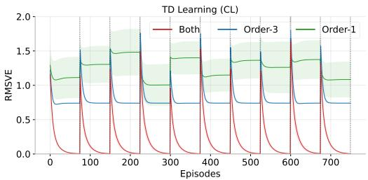  
(a) TD Learning.

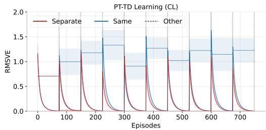  
(b) PT-TD Learning.  
Figure 1: Results in 1D chain environment. (a) TD learning using both features results in the lowest RMSVE. (b) The separate variant of PT-TD learning has a lower initial RMSVE following task changes, and its permanent component converges to the correct value after just one task.

2D navigation task. For the 2D navigation task, we use the 5 × 5 grid shown in Fig. 2a. The agent starts in the center state and can choose from four navigation actions, one for each cardinal direction, Each action typically moves the agent to an adjacent state, but with 10% probability the intended action is replaced by one of the two perpendicular actions. The agent receives a reward when it transitions into one of the goal states at the green corners; otherwise, it receives no reward. Rewards are changed across tasks to introduce non-stationarity, as described in Table 1 in the Appendix.

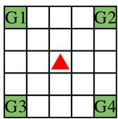  
(a) Grid Task.

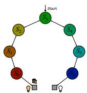  
(b) Chain Task.

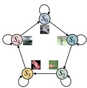  
(c) Image Task.

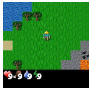  
(d) Craftax Task.  
Figure 2: Environments used in the experiments.

We use a Fourier basis up to second order to approximate the value function. In our variant of PT-TD learning, second-order features approximate the transient value function, while first-order features approximate the permanent value function. The PT-TD learning variant that uses all features to approximate both the permanent and transient value functions is denoted as “full". In both variants, the transient weights are reset to zero at the beginning of each task to induce plasticity, while previously learned values are retained through the permanent weights.

For comparison, we include two TD-learning baselines on which PT-TD learning is built. In the reset variant, weights are reset to zero at the start of each new task (full plasticity). In the continual variant, the agent continually updates its estimates on top of previously learned approximations. All algorithms are hyperparameter-tuned thoroughly as outlined in Appendix A.2.

To evaluate performance, we use a uniformly random policy with a discount factor of 0.9. Each experiment runs for 1000 episodes, with the task changing every 100 episodes. The agent must therefore continually update its estimates to adapt to the current task. We use root-mean-square value error (RMSVE) as a performance metric (the lower, the better). We report the mean and 90% confidence intervals over 30 random seeds, computed with $z ^ { * } = 1 . 6 4 5$

Results: The results are shown in Fig. 3a. In our variant, higher-order terms are used only to estimate the transient value function, enabling quick, low-variance, and precise adjustments to the permanent value function and resulting in the lowest overall RMSVE. First-order features provide sufficient expressivity while remaining low variance, making them well-suited for approximating the permanent value function (see Figure 8). The PT variant that uses all features has a slightly higher RMSVE due to the increased variance introduced by using all features to approximate both value functions. Both PT-TD learning variants retain prior knowledge via the permanent value function, leading to lower error at the onset of recurring tasks. In contrast, the TD-learning baselines perform poorly, as they fail to preserve previous predictions while simultaneously adapting to new tasks, corroborating prior findings [6].

## 4.2 Control

For the control problem, we use the simple chain environment with seven states shown in Fig. 2b. The agent starts in the central state and can choose either the left or right action to move to the neighbouring state in the corresponding direction, with a 10% probability of a reversed effect. Goal states with positive rewards are located at both ends of the chain. Non-stationarity is introduced by varying the reward magnitude across tasks, as described in Table 2 in the Appendix.

Each state is represented by four features: the first three correspond to the red, green, and blue (RGB) components of the state, while the fourth encodes the light intensity, determined by the reward location in the first task for the entire experiment. In our variant of PTQ-learning, the first three features approximate the permanent value function, and the last feature approximates the transient value function. In contrast, all other algorithms we compare against, including the full variant of PTQ-learning and the reset and non-reset variants of Q-learning, use all features to approximate the value function. For the reset variant of Q-learning, the weights are reset at the beginning of each task.

We use a discount factor of 0.99 and compute episodic returns to compare various algorithms. We run the experiment for 300 episodes, with the task changing every 50 episodes. We report the mean and 90% confidence intervals over 30 random seeds, computed with $z ^ { * } = 1 . 6 4 5$

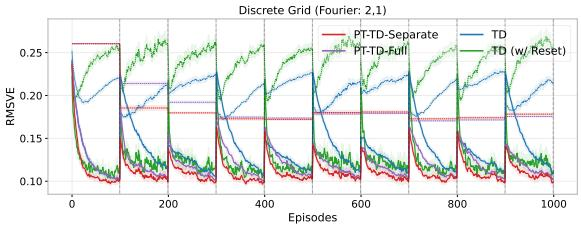  
(a) 2D grid prediction results.

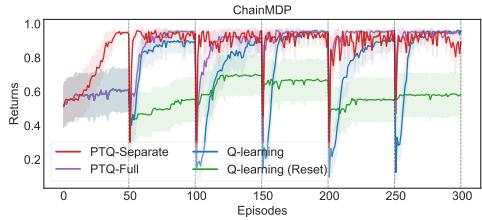  
(b) Control results.  
Figure 3: (a) 2D grid prediction results. PT-TD-Separate variant has the lowest RMSVE in both online and other tasks (shown in solid and dotted lines, respectively). (b) Control results. The PTQ-Separate variant adapts faster when the tasks change.

Results: The results are shown in Fig. 3b. Because our approach uses a single reward-correlated feature to adjust transient value estimates, adaptation is rapid. It is the only method that learns a meaningful behaviour within the first 50 episodes and re-adjusts it within five episodes whenever tasks change. PTQ-learning with all features fails to learn a meaningful policy during the initial 50 episodes and adapts marginally more slowly when tasks subsequently change. The reset variant of Q-learning performs the worst, as no prior knowledge is retained at the start of each task. The continual variant of Q-learning takes longer to overcome bias in its action-value estimates and therefore adapts more slowly.

## 5 Theoretical results

In this section, we establish that both the permanent and the transient estimates converge to a unique fixed point when using linear function approximation, under standard assumptions. These results are significantly stronger than previously available tabular results [6] and, importantly, provide theoretical guarantees when using distinct feature spaces for the function approximators. That is, they demonstrate that using two distinct sets of features to estimate permanent and transient components does not lead to divergence, as is common in many linear RL scenarios.

We leverage the two-timescale proof technique introduced by Borkar (see Appendix A.1) [10], along with the conditions proposed in Bertsekas and Tsitsiklis [9] and Tsitsiklis and Van Roy [59] in our proof. We consider updating the permanent value function at each timestep.

We make the following assumptions2:

Assumption 5.1. The step-sizes α and α satisfy $\begin{array} { r } { \sum _ { t } \overline { { \alpha } } _ { t } = \infty , \sum _ { t } \overline { { \alpha } } _ { t } ^ { 2 } < \infty , \sum _ { t } \alpha _ { t } = \infty , \sum _ { t } \alpha _ { t } ^ { 2 } < } \end{array}$ $\begin{array} { r } { \infty , \operatorname* { l i m } _ { t  \infty } \frac { \overline { { \alpha } } _ { t } } { \alpha _ { t } }  0 . } \end{array}$

Assumption 5.2. The permanent and transient feature matrices, $\Phi \in \mathbb { R } ^ { | \boldsymbol { S } | \times d }$ and $Z \in \mathbb { R } ^ { | S | \times l }$ , are full column rank, i.e. the column vectors are linearly independent. Also, their norms are bounded, $\lVert \Phi \rVert \leq M _ { 1 } , \lVert Z \rVert \leq M _ { 2 }$ where $M _ { 1 }$ and $M _ { 2 }$ are constants.

Assumption 5.3. There are N tasks and task τ is i.i.d. sampled according to $p _ { \tau }$ . Each task is an MDP, $\hat { \mathcal { M } } _ { \tau } = ( S , A , \mathcal { R } _ { \tau } , \mathcal { P } _ { \tau } , \gamma )$ , let E denote the expectation with respect to the task distribution. The rewards for each task $\mathcal { R } _ { \tau }$ are bounded. The task boundaries are observable.

Assumption 5.4. Every task, τ, induces an irreducible, aperiodic Markov chain under the fixed evaluation policy π and the chain is rapidly mixing

$$
| \mathcal { P } _ { \pi , \tau } ( S _ { t } = s | S _ { 0 } ) - d _ { \pi } ( s ) | \leq C \sigma ^ { t } , \forall S _ { 0 } \in \mathcal { S } , \sigma < 1 ,
$$

where C is a constant.

Theorem 5.5 (Main result). Under Assumptions 5.1–5.4, the sequence of expected updates computed by permanent and transient updates converges to a unique fixed point:

$$
\begin{array} { r l } & { \boldsymbol { \theta } ^ { * } = \mathbb { E } _ { \tau } [ \Phi ^ { T } D _ { \tau } \Pi _ { Z , \tau } \Phi ] ^ { - 1 } \mathbb { E } _ { \tau } [ \Phi ^ { T } D _ { \tau } Z \mathbf { w } _ { Z , \tau } ^ { ( T D ) } ] , } \\ & { \mathbf { w } _ { \tau } ^ { * } = \mathbf { w } _ { Z , \tau } ^ { ( T D ) } - \left( Z ^ { T } D _ { \tau } ( I - \gamma \mathcal { P } _ { \pi , \tau } ) Z \right) ^ { - 1 } Z ^ { T } D _ { \tau } ( I - \gamma \mathcal { P } _ { \pi , \tau } ) \Phi \boldsymbol { \theta } ^ { * } , \quad w h e r e } \\ & { \Pi _ { Z , \tau } = Z \left( Z ^ { T } D _ { \tau } ( I - \gamma \mathcal { P } _ { \pi , \tau } ) Z \right) ^ { - 1 } Z ^ { T } D _ { \tau } ( I - \gamma \mathcal { P } _ { \pi , \tau } ) , } \\ & { \mathbf { w } _ { Z , \tau } ^ { ( T D ) } = Z \left( Z ^ { T } D _ { \tau } ( I - \gamma \mathcal { P } _ { \pi , \tau } ) Z \right) ^ { - 1 } Z ^ { T } D _ { \tau } \mathcal { R } _ { \pi , \tau } . } \end{array}
$$

Proof. We outline the proof here, and provide full details in Appendix (Section A.1).

Because of the disparity in learning rates between permanent and transient updates, the permanent estimates appear stationary while the transient values are being updated. And the transient values appear to converge when updating permanent estimates.

So, we first establish the convergence of the transient updates, treating the permanent values as fixed, by verifying the conditions outlined in Theorem A.2 [59] (see Lemma A.3 in Appendix). By substituting the fixed point of the transient parameters into the permanent updates, we then show that the required conditions are satisfied for them as well, and therefore convergence follows from Theorem A.1 [10] (see Lemma A.4 in Appendix). □

Corollary 5.6. $I f Z = \Phi$ then

$$
\begin{array} { r } { \theta ^ { * } = \mathbb { E } _ { \tau } \left[ \Phi ^ { T } D _ { \tau } \Phi \right] ^ { - 1 } \mathbb { E } _ { \tau } \left[ \Phi ^ { T } D _ { \tau } \Phi \mathbf { w } _ { \Phi , \tau } ^ { ( T D ) } \right] , } \end{array}
$$

$$
\mathbf { w } _ { \tau } ^ { * } = \mathbf { w } _ { \Phi , \tau } ^ { ( T D ) } - \boldsymbol { \theta } ^ { * } .
$$

Moreover, in the single-task setting, $\mathbf { \theta } \theta ^ { * } = \mathbf { w } _ { \Phi , \tau } ^ { ( T D ) }$ and $\mathbf { w } _ { \tau } ^ { * } = 0 .$

Proof. The proof is included in Appendix A.5.

The above corollary implies that in the single-task setting, if both the permanent and transient value functions are approximated using the same feature representation, then the permanent value function alone suffices to capture the predictions, while the transient component converges to zero.

## 6 Non-parametric Transient Approximations

In this section, we introduce a new non-parametric architecture that meets the desiderata of transient representations (as described in Sec. 3). Our architecture is inspired by tile coding [55], CMACs [42], and related sparse distributed memory architectures that were used as standalone function approximators in the 1990s and early 2000s [26, 49, 50]. While those early approximators suffered from the curse of dimensionality, we bypass this limitation by using hashing and pairing it with deep neural networks, rather than treating it as a stand-alone approximator.

We assume that each observation consists of several channels, each indicating the presence or absence of a specific item type at a particular location in the agent's view. Many commonly used RL environments, such as Minigrid [14], Craftax [41], and MinAtar [61], are structured in this way. This assumption will allow us to produce hash signatures of observations using MinHash [12].

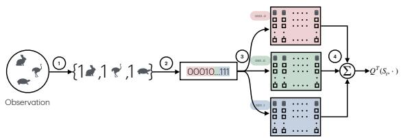

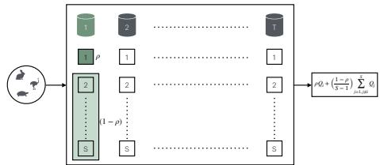  
(a) An end-to-end overview of the transient approximator.  
(b) Transient table.  
Figure 4: (a)Transient Approximator. The observation is mapped to value function in four steps: (1) tokenization; (2) hashing; (3) binning; (4) value estimation. (b) Individual Table. Within each table, the value of the query observation is weighted by $\rho ,$ and the remaining mass $( 1 - \rho )$ is distributed among its neighbours to form the estimate.

The overall process is illustrated in Fig. 4. It transforms an observation into a sparse, hashed representation that supports non-parametric value estimation with controlled generalization. The pipeline has four main stages:

1. Tokenization. Each observation is converted into a set of discrete tokens, where each token encodes the type of object present at a particular $( x , y )$ position in the agent's view. This converts the raw grid-like observation into a symbolic set representation. In image-based tasks, grayscale observations (derived from the RGB counterpart) can be quantized into N levels and treated as symbolic observations. Although image tokenization is still undergoing a lot of work, and any new method could be incorporated into our approach.

2. Hashing. The tokenized set is mapped to a compact hash signature and an auxiliary tag using several independent MinHash functions. MinHash is used because it preserves the Jaccard similarity: the probability that two sets produce the same MinHash value is exactly their Jaccard score.3 As a result, observations that share many elements produce similar signatures (i.e. overlap in many bits), which form the basis for local generalization, preventing undesirable hash collisions.

3. Binning. The signature is partitioned into multiple subsequences, each of which indexes into a bin in a transient table. Conceptually, each table corresponds to one tiling in tile coding [55]. Within a bin, there are S slots. When a new observation maps into a bin, it occupies an empty slot if one is available; otherwise, the least-recently used (LRU) slot is evicted. The slot's initial value is set to the average of values already stored in that bin, so new entries inherit some local context. The auxiliary tag computed in the previous step is also stored in the slot, making it unique to that observation (see Alg. 3).

4. Value estimation. To induce generalization akin to CMACs [42], the value of a query observation is not taken from a single slot alone. Instead, its estimate is a convex combination of the focal slot and the other occupied slots in the matched bin (see Fig. 4b): $Q _ { t + 1 } ^ { ( T ) } ( x , a ; k ) ~ =$ $\begin{array} { r } { \rho Q _ { t + 1 } ^ { ( T ) } ( x , a ; k ) + \left( \frac { 1 - \rho } { S - 1 } \right) \sum _ { j \neq i } Q _ { t + 1 } ^ { ( T ) } ( o _ { j } , a ; k ) } \end{array}$ , where $\rho$ controls the relative weight of the focal slot versus its neighbours, x is the query observation, $o _ { j }$ is the observation stored in slot $j$ of the matched bin, $S$ is the total number of slots per bin, and $Q _ { t + 1 } ^ { ( T ) } ( x , a ; k )$ is the transient value of the $( x , a )$ pair estimated by the k-th table. This encourages smooth interpolation between similar observations while still preserving distinct slot identities. The final transient value is obtained by summing the estimates from all transient tables. For more details, see 4 and 3 in the Appendix.

Since several tables and their corresponding bins contribute to the overall estimate of the transient value function, the TD-error is distributed among them in proportion to their contributions (see 5 in Appendix). Specifically, the TD-error is first split evenly across all $T$ tables, and within each table it is further divided among the slots in the matched $b i n$ The focal slot receives weight $\rho ,$ while its neighbouring slots share the remaining weight $\frac { 1 - \rho } { S - 1 }$ . The updates are analogous to those in tile coding: $\begin{array} { r } { Q _ { t + 1 } ^ { ( T ) } ( O _ { t } , A _ { t } ; k , i )  Q _ { t } ^ { ( T ) } ( O _ { t } , A _ { t } ; k , i ) + \frac { \alpha } { T } \eta _ { k , i } \delta _ { t } } \end{array}$ , where α is the learning rate of the transient updates, T is the total number of tables, and $\delta _ { t }$ is the TD-error at time t. The weighting factor $\eta _ { k , i }$ reflects the contribution of slot i in table k: where $\eta _ { k , i } = \rho$ if slot i stores the query observation in the matched bin, $\begin{array} { r } { \eta _ { k , i } = \frac { 1 - \rho } { S - 1 } } \end{array}$ if slot i is a neighbour in the same bin, and 0 otherwise.

Although the transient table has a fixed size and older observations within a bin are evicted using an LRU strategy, it can still retain observations from a long time ago if temporally adjacent states are similar and therefore continue to map to the same bin, while observations encountered much later differ from those earlier states and are hashed into different bins, leaving the older ones untouched.

## 7 Large-Scale Experiments

We conducted experiments on CIFAR image tasks, an MDP variant of the commonly studied task in the plasticity literature (e.g., Lyle et al. [38]) and on Craftax-Classic to demonstrate the effectiveness of our approach, which trades off stability and plasticity at the system level. Our implementation builds on the PQN library and is publicly available at https: $: / / \mathrm { g } \dot { \bf 1 }$ thub.com/NishanthVAnand/ pt\_representations\_crl.

Image Task. The task is an image-based MDP consisting of five states and five actions. Observations for each state are sampled from specific categories of the CIFAR-10 dataset. We evaluate three “full CRL”" variations of this task, where the task boundaries are hidden from the agent, by restricting the sub-sampled data size to 250, 500, and 1000 images per category. In this task, transitions are stochastic: selecting the rewarding action (+1) leads to the next state with probability 0.8 (otherwise, remaining in the current state with probability 0.2), while suboptimal actions yield a small negative penalty and result in remaining in the current state with probability 0.8. Rewards are perturbed with Gaussian noise $( \mu = 0 , \sigma = 0 . 0 1 )$ . To induce non-stationarity, the optimal action is switched (from a set of three) every 100k timesteps over a 600k-timestep period. We use $\gamma = 0 . 9$ . We report mean rewards over 600 timesteps (90% C.I. over 30 seeds). Hyperparameter details are provided in Appendix A.4.1.

Baselines: We compare our approach against PQN, the state-of-the-art value-based algorithm on Craftax [21]; three variants of PT: PT-IHT, which utilizes Index Hash Tables (IHTs) rather than slot-based table (MinHash-IHT-based tile coding), T-Only, which relies solely on the non-parametric transient approximator (Sec. 6), and PT-NN [6], a fully neural network-based baseline that is trained end-to-end; EWC that augments PQN with elastic weight consolidation (EWC) to preserve stability [28]; CB that pairs PQN with continual backprop (CB) to preserve plasticity [16]; and Neural Episodic Control (NEC) which has has a parametric, non-parametric split [47].

We also used another variant with 250 images to test the adaptation speed. In this experiment, we train various agents on a single task for 250k timesteps and evaluate the speed of adaptation to a new task over the next 50k timesteps. We conduct this experiment to compare against popular methods that leverage task boundary information, while keeping it hidden in our approach. In particular, we compared against CompoNet that uses attention to combine previously learned policies with the latest one [40], Reset(Final) that resets the final layer when the task changes [44], Reset(Full) that fully reinitializes the network for full plasticity.

To enable MinHash hashing on image inputs, we first converted the RGB image to grayscale, then quantized it to 64 levels, treating the resulting processed image as a set of pixel-level symbols.

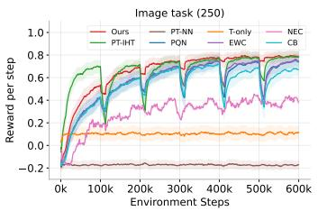  
(a) Image Task 250.

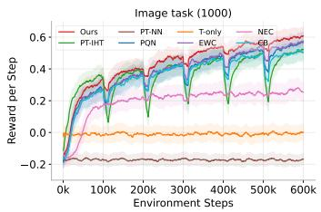  
(b) Image Task 1000.

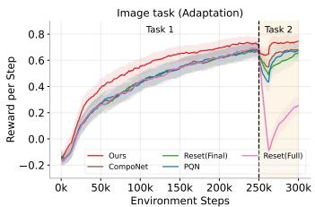  
(c) Image Task Adapt.  
Figure 5: Image Task Results. Our algorithm adapts rapidly when the task changes, whether task boundaries are available or hidden, while other methods are slow.

Results: The results are presented in Figures 5 and 9. Our approach demonstrated superior performance compared to the baselines. Using a non-parametric approximation with controlled generalization ensured precise transient updates and rapid adaptation to task changes—a crucial advantage over the NN-based baselines. In contrast, PT-NN and T-only failed to learn meaningful policies due to instability in updates and insufficient capacity, respectively. PQN achieves stability through batch updates but suffers from slow initial learning and slow recovery after task changes. Augmenting it with EWC or CB didn't affect its performance, highlighting that mechanistic interventions don't necessarily result in rapid adaptation. Similarly, PT-IHT is hampered by the size of the observation space, where increased hash collisions lead to detrimental over-generalization and degraded value estimates, emphasizing the importance of our slot-based design. Because NEC's estimates depend on the features learnt by a NN, it is sensitive to training, and its overall performance is poor.

In the adaptation experiment, our approach adapted faster than methods that leverage task-boundary information (and more parameters), demonstrating the benefits of the system-level decomposition with complementary representations.

Craftax-Classic. The environment is open-ended, containing 22 achievements of varying difficulty. At each step t, the agent receives a 7 × 9 grid observation containing the object types in its view (Fig. 2d), along with its inventory (e.g., wood, stone, or crafted tools) and intrinsic variables (e.g., health, hunger, or thirst). The agent can take one of 17 available actions. Within each episode, it receives a reward the first time it completes an achievement, such as collecting coal or crafting an iron pickaxe. Simpler achievements yield smaller rewards, while more advanced ones yield larger rewards. An episode ends when its length reaches 1000 steps, when the agent completes all 22 achievements, when it is killed by a zombie or a skeleton, or when its intrinsic variables are depleted. More details can be found in [41]. We conducted two experiments: two-stream tasks and benchmarking with 250M using 1024 parallel environments to demonstrate the competitiveness of our approach on complex tasks. We provide the full hyperparameter and architecture details in the Appendix (see A.4.2).

Results: We used 3 seeds for the two-stream experiment and 10 seeds for the 250M benchmarking. We include the main results here and present the parameter ablation and per-achievement results in the Appendix 11. As shown in Fig. 6a, Fig. 6b, and Fig. 13, our approach successfully learns in the two-stream setting and outperforms all baselines in the extensive 250M benchmark. It surpasses a return of 10 in under 50M steps (twice as fast as PQN(32)) and reaches a return of 15 within 150M steps (PQN(32) requires over 200M steps). This success stems from the transient table's ability to compute precise, local updates while explicitly controlling generalization between states. This, in turn, accelerates the permanent component's ability to estimate baseline predictions and generalize broadly. In contrast, the baselines lacking this slot-based or system-level decomposition design struggle. PT-IHT degrades over time due to unfavourable collisions, while T-only inherently lacks long-term capacity. The fully neural network approaches like PT-NN and PQN fail or learn without large batches or environment parallelization [43, 20], and their reliance on minibatching to stabilize updates risks introducing primacy bias [44, 17]. The performance indifference between the EWC and CB baselines indicates that the mechanistic approaches maintain the neural network's stability and plasticity, but they don't enable the rapid adaptation needed for CRL.

## 8 Discussion and Conclusion

In this work, we extended and enhanced the PT framework by incorporating slowly evolving or static features, either hand-crafted (e.g., Fourier bases) or learned using neural networks, for the permanent component, alongside reward-predictive, fast-evolving, or non-parametric features for the transient component to improve performance in CRL. The backbone of our approach to scale is a novel MinHash-based non-parametric approximator that enables rapid online learning like tabular RL, local generalization like CMACs and tile coding (but controlled via a hyperparameter, ρ), and efficient storage and retrieval of observations and values, all while remaining modest in size relative to the complexity of the environment.

Our theoretical results in the linear case are a significant improvement over the previous tabular results. These results demonstrate that using two distinct feature sets does not lead to divergence, as is common in many linear RL scenarios. We expect our proofs to play a foundational role in developing stronger theoretical results in the future, such as improved adaptation speed, reduced interference during permanent updates, or stabilityplasticity analysis for CRL.

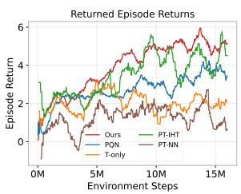  
(a) 2-parallel envs.

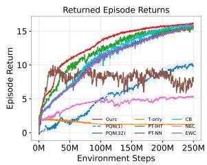  
(b) 1024-parallel envs.  
Figure 6: Craftax-Classic Results. Our algorithm outperforms other continual learning algorithms, including ablations, in both two-parallel and 1024-parallel environments.

The new non-parametric approximator introduces several hyperparame-

ters. The table size, number of tables, and number of hashes determine the approximator's capacity; in general, the more, the better, analogous to the number of layers and hidden units in NNs. Although the remaining HPs can be tuned either coordinate-wise (Craftax; a scalable, practical approach) or over all combinations (Image Task), in the future, we expect meta-learning to automate parameter tuning [60], or newer, simpler architectures for transient approximations. We also expect our non-parametric approximator to extend to other cases, such as associative memory and retrieval.

While tokenization is natural for symbolic observations, we quantized grayscale images derived from their RGB counterparts for the image tasks. To further improve this, advanced tokenization strategies from prior work on foundation models can be leveraged [18, 48, 36]. Extending our approach to policy gradient algorithms, developing mechanisms for selective consolidation (determining when and what to transfer to the permanent), combining mechanistic approaches with ours to improve the permanent, and leveraging our framework in streaming RL are the immediate next steps.

Ultimately, an RL agent's ability to continually learn from new experiences is crucial for advancing our scientific understanding of intelligence. Our framework takes a step towards this goal by demonstrating that maintaining separate representations is critical for balancing stability with plasticity and enabling rapid adaptation. By grounding our architecture in the CLS theory, we help bridge the gap between biological and artificial learning paradigms, providing yet another example of the fruitful exchange of ideas between neuroscience and RL.

## Acknowledgments and Disclosure of Funding

We are grateful to NSERC and CIFAR grants for funding this research. We thank Aditya Mahajan, David Abel, Ivan Anokhin, and colleagues at Mila for helpful discussions, and the anonymous reviewers for constructive feedback. We also thank the Mila compute team for their technical support and assistance with computational infrastructure. This research was enabled in part by computing resources provided by Mila (mila.quebec), Calcul Quebec (calculquebec.ca), and the Digital Research Alliance of Canada (alliancecan.ca).

## References

[1] Z. Abbas, R. Zhao, J. Modayil, A. White, and M. C. Machado. Loss of plasticity in continual deep reinforcement learning. In Conference on lifelong learning agents, pages 620–636. PMLR, 2023.

[2] D. Abel, Y. Jinnai, S. Y. Guo, G. Konidaris, and M. Littman. Policy and value transfer in lifelong reinforcement learning. In International Conference on Machine Learning, pages 20–29. PMLR, 2018.

[3] D. Abel, A. Barreto, B. Van Roy, D. Precup, H. P. van Hasselt, and S. Singh. A definition of continual reinforcement learning. Advances in Neural Information Processing Systems, 36: 50377–50407, 2023.

[4] D. Abel, M. Bowling, A. Barreto, W. Dabney, S. Dong, S. Hansen, A. Harutyunyan, K. Khetarpal, C. Lyle, R. Pascanu, et al. Plasticity as the mirror of empowerment. arXiv preprint arXiv:2505.10361, 2025.

[5] N. Anand and D. Precup. Preferential temporal difference learning. In International Conference on Machine Learning, pages 286–296. PMLR, 2021.

[6] N. Anand and D. Precup. Prediction and control in continual reinforcement learning. Advances in Neural Information Processing Systems, 36:63779–63817, 2023.

[7] J. Ash and R. P. Adams. On warm-starting neural network training. Advances in neural information processing systems, 33:3884–3894, 2020.

[8] D. Berron, H. Schütze, A. Maass, A. Cardenas-Blanco, H. J. Kuijf, D. Kumaran, and E. Düzel. Strong evidence for pattern separation in human dentate gyrus. The Journal of Neuroscience, 36(29):7569–7579, 2016.

[9] D. P. Bertsekas and J. N. Tsitsiklis. Neuro-dynamic programming. Athena Scientific, 1996.

[10] V. S. Borkar. Stochastic approximation with two time scales. Systems & Control Letters, 29(5): 291–294, 1997.

[11] M. Botvinick, S. Ritter, J. X. Wang, Z. Kurth-Nelson, C. Blundell, and D. Hassabis. Reinforcement learning, fast and slow. Trends in cognitive sciences, 23(5):408–422, 2019.

[12] A. Z. Broder. On the resemblance and containment of documents. In Proceedings. Compression and Complexity of Sequences 1997 (Cat. No. 97TB100171), pages 21–29. IEEE, 1997.

[13] G. A. Carpenter and S. Grossberg. A massively parallel architecture for a self-organizing neural pattern recognition machine. Computer vision, graphics, and image processing, 37(1):54–115, 1987.

[14] M. Chevalier-Boisvert, B. Dai, M. Towers, R. de Lazcano, L. Willems, S. Lahlou, S. Pal, P. S. Castro, and J. Terry. Minigrid & miniworld: Modular & customizable reinforcement learning environments for goal-oriented tasks. CoRR, abs/2306.13831, 2023.

[15] W. Chung, L. Cherif, D. Meger, and D. Precup. Parseval regularization for continual reinforcement learning. Advances in Neural Information Processing Systems, 37:127937–127967, 2024.

[16] S. Dohare, J. F. Hernandez-Garcia, Q. Lan, P. Rahman, A. R. Mahmood, and R. S. Sutton. Loss of plasticity in deep continual learning. Nature, 632(8026):768–774, 2024.

[17] P. D'Oro, M. Schwarzer, E. Nikishin, P.-L. Bacon, M. G. Bellemare, and A. Courville. Sampleefficient reinforcement learning by breaking the replay ratio barrier. In Deep Reinforcement Learning Workshop NeurIPS 2022, 2022.

[18] A. Dosovitskiy. An image is worth 16x16 words: Transformers for image recognition at scale. arXiv preprint arXiv:2010.11929, 2020.

[19] M. Elsayed and A. R. Mahmood. Utility-based perturbed gradient descent: An optimizer for continual learning. arXiv preprint arXiv:2302.03281, 2023.

[20] M. Elsayed, G. Vasan, and A. R. Mahmood. Streaming deep reinforcement learning finally works. arXiv preprint arXiv:2410.14606, 2024.

[21] M. Gallici, M. Fellows, B. Ellis, B. Pou, I. Masmitja, J. N. Foerster, and M. Martin. Simplifying deep temporal difference learning. The International Conference on Learning Representations (ICLR), 2025. URL https://arxiv.org/abs/2407.04811.

[22] S. J. Gershman and N. D. Daw. Reinforcement learning and episodic memory in humans and animals: an integrative framework. Annual review of psychology, 68:101–128, 2017.

[23] I. Han, S. Park, S. Oh, D. Kim, H. Lee, and K.-J. Kim. Fire: Frobenius-isometry reinitialization for balancing the stability-plasticity tradeoff. arXiv preprint arXiv:2602.08040, 2026.

[24] K. Javed and R. S. Sutton. The big world hypothesis and its ramifications for artificial intelligence. In Finding the Frame: An RLC Workshop for Examining Conceptual Frameworks, 2024.

[25] M. Jones, T. R. Scott, M. Ren, G. F. Elsayed, K. Hermann, D. Mayo, and M. C. Mozer. Learning in temporally structured environments. In The Eleventh International Conference on Learning Representations, 2022.

[26] P. Kanerva. Sparse distributed memory and related models. Technical report, 1992.

[27] K. Khetarpal, M. Riemer, I. Rish, and D. Precup. Towards continual reinforcement learning: A review and perspectives. Journal of Artificial Intelligence Research, 75:1401–1476, 2022.

[28] J. Kirkpatrick, R. Pascanu, N. Rabinowitz, J. Veness, G. Desjardins, A. A. Rusu, K. Milan, J. Quan, T. Ramalho, A. Grabska-Barwinska, et al. Overcoming catastrophic forgetting in neural networks. Proceedings of the national academy of sciences, 114(13):3521–3526, 2017.

[29] T. Klein, L. Miklautz, K. Sidak, C. Plant, and S. Tschiatschek. Plasticity loss in deep reinforcement learning: A survey. arXiv preprint arXiv:2411.04832, 2024.

[30] G. Konidaris, S. Osentoski, and P. Thomas. Value function approximation in reinforcement learning using the fourier basis. In Proceedings of the AAAI conference on artificial intelligence, volume 25, pages 380–385, 2011.

[31] S. Kumar, H. Marklund, A. Rao, Y. Zhu, H. J. Jeon, Y. Liu, B. Van Roy, et al. Continual learning as computationally constrained reinforcement learning. Foundations and Trends® in Machine Learning, 18(5):913–1053, 2025.

[32] D. Kumaran, D. Hassabis, and J. L. McClelland. What learning systems do intelligent agents need? complementary learning systems theory updated. Trends in cognitive sciences, 20(7): 512–534, 2016.

[33] A. Lewandowski, M. Bortkiewicz, S. Kumar, A. György, D. Schuurmans, M. Ostaszewski, and M. C. Machado. Learning continually by spectral regularization. arXiv preprint arXiv:2406.06811,2024.

[34] A. Lewandowski, A. A. Ramesh, E. Meyer, D. Schuurmans, and M. C. Machado. The world is bigger: A computationally-embedded perspective on the big world hypothesis. In Workshop on Reinforcement Learning Beyond Rewards@ Reinforcement Learning Conference 2025, 2025.

[35] K. Lu, I. Mordatch, and P. Abbeel. Adaptive online planning for continual lifelong learning. arXiv preprint arXiv:1912.01188, 2019.

[36] X. Luo, H. Wang, D. Wu, C. Chen, M. Deng, J. Huang, and X.-S. Hua. A survey on deep hashing methods. ACM Transactions on Knowledge Discovery from Data, 17(1):1–50, 2023.

[37] C. Lyle, M. Rowland, and W. Dabney. Understanding and preventing capacity loss in reinforcement learning. arXiv preprint arXiv:2204.09560, 2022.

[38] C. Lyle, Z. Zheng, E. Nikishin, B. A. Pires, R. Pascanu, and W. Dabney. Understanding plasticity in neural networks. In International Conference on Machine Learning, pages 23190–23211. PMLR, 2023.

[39] C. Lyle, Z. Zheng, K. Khetarpal, H. van Hasselt, R. Pascanu, J. Martens, and W. Dabney. Disentangling the causes of plasticity loss in neural networks. arXiv preprint arXiv:2402.18762, 2024.

[40] M. Malagon, J. Ceberio, and J. A. Lozano. Self-composing policies for scalable continual reinforcement learning. arXiv preprint arXiv:2506.14811, 2025.

[41] M. Matthews, M. Beukman, B. Ellis, M. Samvelyan, M. Jackson, S. Coward, and J. Foerster. Craftax: A lightning-fast benchmark for open-ended reinforcement learning. arXiv preprint arXiv:2402.16801, 2024.

[42] W. T. Miller, F. H. Glanz, and L. G. Kraft. Cmac: An associative neural network alternative to backpropagation. Proceedings of the IEEE, 78(10):1561–1567, 1990.

[43] V. Mnih, K. Kavukcuoglu, D. Silver, A. Graves, I. Antonoglou, D. Wierstra, and M. Riedmiller. Playing atari with deep reinforcement learning. arXiv preprint arXiv:1312.5602, 2013.

[44] E. Nikishin, M. Schwarzer, P. D'Oro, P.-L. Bacon, and A. Courville. The primacy bias in deep reinforcement learning. In International conference on machine learning, pages 16828–16847. PMLR, 2022.

[45] B. D. Ondov, T. J. Treangen, P. Melsted, A. B. Mallonee, N. H. Bergman, S. Koren, and A. M. Phillippy. Mash: fast genome and metagenome distance estimation using minhash. Genome biology, 17(1):132, 2016.

[46] C. Pan, X. Yang, Y. Li, W. Wei, T. Li, B. An, and J. Liang. A survey of continual reinforcement learning. arXiv preprint arXiv:2506.21872, 2025.

[47] A. Pritzel, B. Uria, S. Srinivasan, A. P. Badia, O. Vinyals, D. Hassabis, D. Wierstra, and C. Blundell. Neural episodic control. In International conference on machine learning, pages 2827–2836. PMLR, 2017.

[48] A. Radford, J. W. Kim, C. Hallacy, A. Ramesh, G. Goh, S. Agarwal, G. Sastry, A. Askell, P. Mishkin, J. Clark, et al. Learning transferable visual models from natural language supervision. In International conference on machine learning, pages 8748–8763. PmLR, 2021.

[49] B. Ratitch and D. Precup. Sparse distributed memories for on-line value-based reinforcement learning. In European Conference on Machine Learning, pages 347–358. Springer, 2004.

[50] B. Ratitch, S. Mahadevan, and D. Precup. Sparse distributed memories in reinforcement learning: Case studies. In Proc. of the Workshop on Learning and Planning in Markov Processes-Advances and Challenges, pages 85–90, 2004.

[51] M. Schwarzer, J. S. O. Ceron, A. Courville, M. G. Bellemare, R. Agarwal, and P. S. Castro. Bigger, better, faster: Human-level atari with human-level efficiency. In International Conference on Machine Learning, pages 30365–30380. PMLR, 2023.

[52] W. Severa, O. Parekh, C. D. James, and J. B. Aimone. A combinatorial model for dentate gyrus sparse coding. Neural computation, 29(1):94–117, 2017.

[53] D. Silver and R. S. Sutton. Welcome to the era of experience. Google AI, 1, 2025.

[54] D. Silver, R. S. Sutton, and M. Müller. Sample-based learning and search with permanent and transient memories. In Proceedings of the 25th international conference on Machine learning, pages 968–975, 2008.

[55] R. S. Sutton. Generalization in reinforcement learning: Successful examples using sparse coarse coding. Advances in neural information processing systems, 8, 1995.

[56] R. S. Sutton, A. Koop, and D. Silver. On the role of tracking in stationary environments. In Proceedings of the 24th international conference on Machine learning, pages 871–878, 2007.

[57] R. S. Sutton, M. Bowling, and P. M. Pilarski. The alberta plan for ai research. arXiv preprint arXiv:2208.11173, 2022.

[58] P.-N. Tan, M. Steinbach, and V. Kumar. Introduction to data mining. Pearson Education India, 2016.

[59] J. Tsitsiklis and B. Van Roy. Analysis of temporal-diffference learning with function approximation. Advances in neural information processing systems, 9, 1996.

[60] Z. Xu, H. P. van Hasselt, and D. Silver. Meta-gradient reinforcement learning. Advances in neural information processing systems, 31, 2018.

[61] K. Young and T. Tian. Minatar: An atari-inspired testbed for thorough and reproducible reinforcement learning experiments. arXiv preprint arXiv:1903.03176, 2019.

## A Appendix.

## A.1 Theoretical Results

In this section, we study the convergence of permanent and transient value function updates when these are based on different representations, by leveraging the two-timescale proof technique introduced by Borkar (see Appendix A.1) [10]. While the approach is general and broadly applicable for various stochastic approximation algorithms, the conditions can be simplified for RL as shown by [9, 59] for a single iteration. In particular, the Lipschitz assumption is satisfied by showing that the expected update in matrix form (i.e. the key matrix) is well-defined and positive definite. Also, the final assumption is satisfied by first showing that the noise terms form martingale difference sequence with zero mean and bounded variance.

Theorem A.1 (Borkar, 1997). Consider two d and l dimensional coupled iterates of the form:

$$
\theta _ { t + 1 }  \theta _ { t } + \overline { { \alpha } } \big ( A ( \theta _ { t } , \mathbf { w } _ { t } ) + \mathcal { M } _ { t + 1 } \big ) ,\tag{7}
$$

$$
\mathbf { w } _ { t + 1 }  \mathbf { w } _ { t } + \alpha \big ( \mathcal { C } ( \boldsymbol { \theta } _ { t } , \mathbf { w } _ { t } ) + \mathcal { N } _ { t + 1 } \big ) ,\tag{8}
$$

for t ≥ 0. If,

1. $\mathcal { A } : \mathbb { R } ^ { d + l }  \mathbb { R } ^ { d } , \mathcal { C } : \mathbb { R } ^ { d + l }  \mathbb { R } ^ { l }$ are Lipschitz,

$$
\begin{array} { r } { 2 . \sum _ { t } \overline { { \alpha } } _ { t } = \sum _ { t } \alpha _ { t } = \infty , \sum _ { t } \overline { { \alpha } } _ { t } ^ { 2 } = \sum _ { t } \alpha _ { t } ^ { 2 } < \infty , \operatorname* { l i m } _ { t  \infty } \frac { \overline { { \alpha } } _ { t } } { \alpha _ { t } }  0 , } \end{array}
$$

3. for $\mathcal { F } _ { t } \triangleq \sigma ( \theta _ { k } , \mathbf { w } _ { k } , \mathcal { M } _ { k } , \mathcal { N } _ { k } , k \leq t ) , t \geq 0 , ( \mathcal { M } _ { t } , \mathcal { F } _ { t } ) , ( \mathcal { N } _ { t } , \mathcal { F } _ { t } )$ are sequences of random variables satisfying: $\begin{array} { r } { \sum _ { t } \overline { { \alpha } } _ { t } \mathcal { M } _ { t } , \sum _ { t } \alpha _ { t } \mathcal { N } _ { t } \leq \infty } \end{array}$ almost surely,

then the iterates converge converge almost surely to the asymptotically stable equilibria of the associated limiting ODEs.

Theorem A.2 (Tsitsiklis & Van Roy (1996)). Consider an iterative algorithm of the form $\mathbf { w } _ { t + 1 } = \mathbf { w } _ { t } + \alpha _ { t } ( A ( X _ { t } ) \mathbf { w } _ { t } + b ( X _ { t } ) { \big ) }$ where,

1. the step-size sequence $\alpha _ { t }$ satisfies $\begin{array} { r } { \sum _ { t } \alpha _ { t } = \infty , \sum _ { t } \alpha _ { t } ^ { 2 } < \infty , } \end{array}$

2. $X _ { t }$ is a Markov process with a unique invariant distribution,

3. $\boldsymbol { \mathcal { A } } ( \cdot )$ and $b ( \cdot )$ are matrix and vector valued functions respectively, for which ${ \bf A } =$ $\mathbb { E } _ { d _ { \pi } } [ \mathcal { A } ( X _ { t } ) ]$ and $\mathbf { b } = \mathbb { E } _ { d _ { \pi } } [ b ( X _ { t } ) ]$ are well defined and fnite,

4. the matrix A is positive definite,

5. there exists constants K and q such that for all X

• $\begin{array} { r } { \sum _ { t = 0 } ^ { \infty } \| \mathbb { E } _ { \pi } [ \boldsymbol { A } ( X _ { t } ) | \boldsymbol { X } _ { 0 } = \boldsymbol { X } ] - \mathbf { A } \| \leq K ( 1 + h ^ { q } ( \boldsymbol { X } ) ) , } \end{array}$ and

$$
\begin{array} { r } { \bullet \sum _ { t = 0 } ^ { \infty } \| \mathbb { E } _ { \pi } [ b ( X _ { t } ) | X _ { 0 } = X ] - \mathbf { b } \| \leq K ( 1 + h ^ { q } ( X ) ) , } \end{array}
$$

6. for any $q > 1$ there exists a constant $\mu _ { q }$ such that for all X, t

$$
\bullet \mathbb { E } _ { \pi } [ h ^ { q } ( X _ { t } ) | X _ { 0 } = X ] \leq \mu _ { q } ( 1 + h ^ { q } ( X ) ) .
$$

Then, $\mathbf { w } _ { t }$ converges to $\mathbf { w } _ { \pi } ,$ with probability one, where ${ \bf w } _ { \pi }$ is the unique vector that satisfies $\mathbf { A } \mathbf { w } _ { \pi } + \mathbf { b } = 0 .$

## Lemma A.3. For any fixed choice of θ, for any task τ in the task distribution, the sequence of expected transient updates converges to a unique fixed point.

Proof. We use the proof technique outlined in [5, 59] to establish convergence.

Transient update as linear stochastic approximation. Dropping the $( \tau , \pi )$ subscript for clarity, the transient update can be written as

where

$$
\begin{array} { r l } & { \mathbf { w } _ { t + 1 } = \mathbf { w } _ { t } + \alpha _ { t } \Big ( R _ { t + 1 } + \gamma ( \theta ^ { T } \phi _ { t + 1 } + \mathbf { w } _ { t } ^ { T } z _ { t + 1 } ) - ( \theta ^ { T } \phi _ { t } + \mathbf { w } _ { t } ^ { T } z _ { t } ) \Big ) z _ { t } } \\ & { \qquad = \mathbf { w } _ { t } + \alpha _ { t } \big ( b ( X _ { t } ) + A ( X _ { t } ) \mathbf { w } _ { t } \big ) , } \\ & { \qquad = \qquad z _ { t } ( R _ { t + 1 } + \gamma \theta ^ { T } \phi _ { t + 1 } - \theta ^ { T } \phi _ { t } ) , \quad A ( X _ { t } ) = z _ { t } ( z _ { t } - \gamma z _ { t + 1 } ) ^ { T } , } \end{array}
$$

and $X _ { t } = ( S _ { t } , S _ { t + 1 } , \phi _ { t } , z _ { t } )$

Limiting expectations. Define

$$
\mathbf { A } = \operatorname* { l i m } _ { t \to \infty } \mathbb { E } [ A ( X _ { t } ) ] , \qquad \mathbf { b } = \operatorname* { l i m } _ { t \to \infty } \mathbb { E } [ b ( X _ { t } ) ] .
$$

Explicitly,

$$
\begin{array} { r l } & { { \bf A } = \displaystyle \sum _ { s } d ( s ) z ( s ) \Big ( z ( s ) - \gamma \displaystyle \sum _ { s ^ { \prime } } [ \mathcal { P } ] _ { s s ^ { \prime } } z ( s ^ { \prime } ) \Big ) ^ { T } = \Big [ \displaystyle Z ^ { T } D ( I - \gamma \mathcal { P } ) Z \Big ] , } \\ & { { \bf b } = \displaystyle \sum _ { s } d ( s ) z ( s ) \Big ( \mathcal { R } ( s ) + \gamma \theta ^ { T } \displaystyle \sum _ { s ^ { \prime } } [ \mathcal { P } ] _ { s s ^ { \prime } } \phi ( s ^ { \prime } ) - \theta ^ { T } \phi ( s ) \Big ) } \\ & { = \Big [ \displaystyle Z ^ { T } D \mathcal { R } + \displaystyle Z ^ { T } D ( \gamma \mathcal { P } - I ) \Phi \theta \Big ] . } \end{array}
$$

A is positive definite because $D ( I - \gamma \mathcal { P } )$ has positive row sums (since $\gamma \mathcal { P }$ is a sub-stochastic matrix) and column sums (since $\mathbf { 1 } ^ { T } D ( \ b { I } - \gamma \dot { \mathcal { P } } ) = d ^ { T } - \gamma d ^ { T } = ( 1 - \gamma ) d ^ { T } > 0 )$

Bounded noise. Using the mixing of the Markov chain,

$$
\begin{array} { r l } { \| \mathbb { E } [ A ( X _ { t } ) | X _ { 0 } ] - \mathbf { A } \| = \left\| Z ^ { T } D _ { t } ( I - \gamma \mathcal { P } ) Z - Z ^ { T } D ( I - \gamma \mathcal { P } ) Z \right\| } & { } \\ { = \left\| Z ^ { T } ( D _ { t } - D ) ( I - \gamma \mathcal { P } ) Z \right\| } & { } \\ { \leq \left\| Z ^ { T } \right\| \left\| D _ { t } - D \right\| \left\| I - \gamma \mathcal { P } \right\| \left\| Z \right\| } & { } \\ { \leq B _ { 1 } \cdot C \sigma ^ { t } \cdot B _ { 2 } \cdot B _ { 1 } } & { } \\ { \overset { \left[ \leq { K } _ { 1 } \sigma ^ { t } \right] } { = \left\| { Z ^ { T } ( D _ { t } - D ) \mathcal { R } + Z ^ { T } ( D _ { t } - D ) ( \gamma \mathcal { P } - I ) \Phi \theta } \right\| } } & { } \\ { \leq \left\| Z ^ { T } \right\| \left\| D _ { t } - D \right\| \left\| { \mathcal { R } } \right\| + \left\| Z ^ { T } \right\| \left\| D _ { t } - D \right\| \left\| ( \gamma \mathcal { P } - I ) \right\| \left\| { \bar { \Phi } } \theta \right\| } & { } \\ { \leq { K } _ { 2 } \sigma ^ { t } \Big \} . } \end{array}
$$

Therefore,

$$
\begin{array} { r } { \displaystyle \sum _ { t = 0 } ^ { \infty } \| \mathbb { E } [ A ( X _ { t } ) | X _ { 0 } ] - \mathbf { A } \| \leq \sum _ { t = 0 } ^ { \infty } K _ { 1 } \sigma ^ { t } = \boxed { \frac { K _ { 1 } } { 1 - \sigma } = \bar { K } _ { 1 } } , } \\ { \displaystyle \sum _ { t = 0 } ^ { \infty } \| \mathbb { E } [ b ( X _ { t } ) | X _ { 0 } ] - \mathbf { b } \| \leq \sum _ { t = 0 } ^ { \infty } K _ { 2 } \sigma ^ { t } = \boxed { \frac { K _ { 2 } } { 1 - \sigma } = \bar { K } _ { 2 } } . } \end{array}
$$

Fixed point. Thus, the expected iterates converge to the unique fixed point

$$
\begin{array} { r l } & { \mathbf { w } _ { \tau } ^ { * } = \mathbf { A } ^ { - 1 } \mathbf { b } } \\ & { \quad = Z ^ { T } D ( I - \gamma \mathcal { P } ) Z \Big ) ^ { - 1 } ( Z ^ { T } D \mathcal { R } + Z ^ { T } D ( \gamma \mathcal { P } - I ) \Phi \theta ) } \\ & { \quad = Z ^ { T } D ( I - \gamma \mathcal { P } ) Z ) ^ { - 1 } Z ^ { T } D \mathcal { R } + Z ^ { T } D ( I - \gamma \mathcal { P } ) Z ) ^ { - 1 } ( Z ^ { T } D ( \gamma \mathcal { P } - I ) V _ { \theta } ^ { ( P ) } ) } \\ & { \quad = \left[ \mathbf { w } _ { Z , \tau } ^ { ( T D ) } - \left( Z ^ { T } D _ { \tau } ( I - \gamma \mathcal { P } _ { \pi , \tau } ) Z \right) ^ { - 1 } Z ^ { T } D _ { \tau } ( I - \gamma \mathcal { P } _ { \pi , \tau } ) \Phi \theta ^ { * } \right] } \end{array}
$$

Proof. Permanent update with transient fixed point. Since permanent updates evolve on a slower timescale, we may treat the transient parameters as converged. The update is

$$
\theta _ { t + 1 } = \theta _ { t } + \overline { { \alpha } } _ { t } C ( X _ { t } ) , \quad \mathrm { w h e r e } C ( X _ { t } ) = \mathbf { w } _ { t } ^ { T } z _ { t } \phi _ { t } .
$$

Define

$$
\begin{array} { c } { { { \displaystyle { \bf C } = \sum _ { \tau } p ( \tau ) \sum _ { s } d _ { \tau } ( s ) { \bf w } _ { \tau } ^ { T } z ( s ) \phi ( s ) } } } \\ { { { \displaystyle ~ = \left[ \sum _ { \tau } p ( \tau ) \Phi ^ { T } D _ { \tau } Z { \bf w } _ { \tau } ^ { \ast } \right] } } } \end{array}
$$

Boundedness and Lipschitz condition. For each task $\tau ,$

$$
\mathbf { C } _ { \tau } = \Phi ^ { T } D _ { \tau } Z \mathbf { w } _ { \tau } ^ { * } ,
$$

and using $\mathbf { w } _ { \tau } ^ { * } = \mathbf { A } _ { \tau } ^ { - 1 } \big ( Z ^ { T } D _ { \tau } \mathcal { R } _ { \tau } + Z ^ { T } D _ { \tau } ( \gamma \mathcal { P } _ { \tau } - I ) \Phi \theta \big )$ , we obtain

$$
\begin{array} { r l } & { \left\| { \mathbf C _ { \tau } } \right\| = \left\| { \widehat { \mathbf P } ^ { T } D _ { \tau } Z { \mathbf w } _ { \tau } ^ { * } } \right\| } \\ & { \qquad = \left\| { \widehat { \mathbf P } ^ { T } D _ { \tau } Z { \mathbf A } _ { \tau } ^ { - 1 } } ( Z ^ { T } D _ { \tau } { \mathcal R } _ { \tau } + Z ^ { T } D _ { \tau } ( \gamma { \mathcal P } _ { \tau } - I ) { \widehat { \mathbf P } } \theta ) \right\| } \\ & { \qquad \leq \left\| { \widehat { \mathbf P } ^ { T } D _ { \tau } Z { \mathbf A } _ { \tau } ^ { - 1 } } Z ^ { T } D _ { \tau } \right\| + \left\| ( { \mathcal R } _ { \tau } + ( \gamma { \mathcal P } _ { \tau } - I ) \Phi \theta ) \right\| } \\ & { \qquad \leq K _ { 3 } , } \\ & { \left\| { \mathbf C } \right\| = \left\| \displaystyle \sum _ { \tau } p ( \tau ) \Phi ^ { T } D _ { \tau } Z { \mathbf w } _ { \tau } \right\| } \\ & { \qquad \leq \displaystyle \sum _ { \tau } \left\| { \widehat { \mathbf P } ^ { T } D _ { \tau } Z { \mathbf w } _ { \tau } } \right\| } \\ & { \qquad \leq \displaystyle \sum _ { \tau } \left\| { \widehat { \mathbf P } ^ { T } D _ { \tau } Z { \mathbf w } _ { \tau } } \right\| } \\ & { \qquad \leq K _ { 3 } . } \end{array}
$$

Thus, the mapping is bounded and Lipschitz.

Noise boundedness. Because tasks are sampled i.i.d. and each task's Markov chain is rapidly mixing, the noise terms have finite variance.

Fixed point. Therefore, the expected permanent updates converge to the unique fixed point:

$$
\begin{array} { l } { { \displaystyle { \bf C } = \sum _ { \tau } p ( \tau ) \Phi ^ { T } D _ { \tau } Z { \bf w } _ { \tau } ^ { * } } } \\ { { \displaystyle \quad \quad 0 = \sum _ { \tau } p ( \tau ) \left( \Phi ^ { T } D _ { \tau } Z { \boldsymbol v } _ { Z , \tau } ^ { ( T D ) } - \Phi ^ { T } D _ { \tau } Z \left( Z ^ { T } D _ { \tau } ( I - \gamma { \mathcal P } _ { \pi , \tau } ) Z \right) ^ { - 1 } Z ^ { T } D _ { \tau } ( I - \gamma { \mathcal P } _ { \pi , \tau } ) \Phi { \boldsymbol \theta } ^ { * } \right) } } \\ { { \displaystyle \quad \quad 0 = \mathbb { E } _ { \tau } [ \Phi ^ { T } D _ { \tau } Z { \boldsymbol v } _ { Z , \tau } ^ { ( T D ) } ] - \mathbb { E } _ { \tau } [ \Phi ^ { T } D _ { \tau } \Pi _ { Z , \tau } \Phi { \boldsymbol \theta } ^ { * } ] } } \\ { { \mathbb { E } _ { \tau } [ \Phi ^ { T } D _ { \tau } \Pi _ { Z , \tau } \Phi ] { \boldsymbol \theta } ^ { * } = \mathbb { E } _ { \tau } [ \Phi ^ { T } D _ { \tau } Z { \boldsymbol v } _ { Z , \tau } ^ { ( T D ) } ] } } \\ { { \displaystyle \quad \quad \quad \left[ \theta ^ { * } = \mathbb { E } _ { \tau } [ \Phi ^ { T } D _ { \tau } \Pi _ { Z , \tau } \Phi ] ^ { - 1 } \mathbb { E } _ { \tau } [ \Phi ^ { T } D _ { \tau } Z { \boldsymbol v } _ { Z , \tau } ^ { ( T D ) } ] \right] } } \end{array}
$$

□

Corollary A.5. $I f Z = \Phi ,$ then

$$
\begin{array} { r l } & { \theta ^ { * } = \mathbb { E } _ { \tau } \left[ \Phi ^ { T } D _ { \tau } \Phi \right] ^ { - 1 } \mathbb { E } _ { \tau } \left[ \Phi ^ { T } D _ { \tau } \Phi \mathbf { w } _ { \Phi , \tau } ^ { ( T D ) } \right] , } \\ & { \mathbf { w } _ { \tau } ^ { * } = \mathbf { w } _ { \Phi , \tau } ^ { ( T D ) } - \theta ^ { * } . } \end{array}
$$

Moreover, in the single-task setting, $\boldsymbol { \theta ^ { * } } = \mathbf { w } _ { \Phi , \tau } ^ { ( T D ) }$ and $\mathbf { w } _ { \tau } ^ { * } = 0 .$

Proof. When $\Phi = Z ,$

$$
\begin{array} { r } { \Pi _ { Z , \tau } = \Pi _ { \Phi , \tau } = \Phi \left( \Phi ^ { T } D _ { \tau } ( I - \gamma \mathcal { P } _ { \pi , \tau } ) \Phi \right) ^ { - 1 } \Phi ^ { T } D _ { \tau } ( I - \gamma \mathcal { P } _ { \pi , \tau } ) , } \\ { \Pi _ { \Phi , \tau } \Phi = \Phi \left( \Phi ^ { T } D _ { \tau } ( I - \gamma \mathcal { P } _ { \pi , \tau } ) \Phi \right) ^ { - 1 } \left( \Phi ^ { T } D _ { \tau } ( I - \gamma \mathcal { P } _ { \pi , \tau } ) \Phi \right) = \Phi . } \end{array}
$$

Therefore,

$$
\begin{array} { r l } & { \theta ^ { * } = \mathbb { E } _ { \tau } [ \Phi ^ { T } D _ { \tau } \Phi ] ^ { - 1 } \mathbb { E } _ { \tau } [ \Phi ^ { T } D _ { \tau } \Phi \mathbf { w } _ { \Phi } ^ { ( T D ) } ] } \\ & { \mathbf { w } _ { \tau } ^ { * } = \mathbf { w } _ { \Phi , \tau } ^ { ( T D ) } - \left( \Phi ^ { T } D _ { \tau } ( I - \gamma \mathcal { P } _ { \pi , \tau } ) \Phi \right) ^ { - 1 } \Phi ^ { T } D _ { \tau } ( I - \gamma \mathcal { P } _ { \pi , \tau } ) \Phi \theta ^ { * } , } \\ & { \qquad = \mathbf { w } _ { \Phi , \tau } ^ { ( T D ) } - \theta ^ { * } . } \end{array}
$$

In the single task setting,

$$
\begin{array} { r l } & { \theta ^ { * } = \mathbb { E } _ { \tau } [ \Phi ^ { T } D _ { \tau } \Phi ] ^ { - 1 } \mathbb { E } _ { \tau } [ \Phi ^ { T } D _ { \tau } \Phi \mathbf { w } _ { \Phi } ^ { ( T D ) } ] , } \\ & { \quad \quad = \left( \Phi ^ { T } D _ { \tau } \Phi \right) ^ { - 1 } \left( \Phi ^ { T } D _ { \tau } \Phi \right) \mathbf { w } _ { \Phi , \tau } ^ { ( T D ) } = \mathbf { w } _ { \Phi , \tau } ^ { ( T D ) } , } \\ & { \mathbf { w } _ { \tau } ^ { * } = \mathbf { w } _ { \Phi , \tau } ^ { ( T D ) } - \theta ^ { * } = \mathbf { w } _ { \Phi , \tau } ^ { ( T D ) } - \mathbf { w } _ { \Phi , \tau } ^ { ( T D ) } = 0 . } \end{array}
$$

## A.2 Small-Scale Experiments

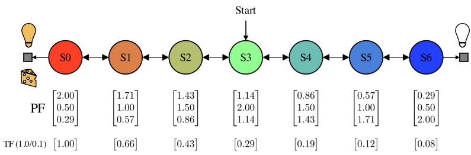  
Figure 7: Chain MDP with the two feature sets

## A.2.1 Pseudocode for Prediction and Control.

Algorithm 1 Prediction with Linear Approximations   
1: Initialize: buffer $B ,$ parameters θ, w   
2: for $t = 0 \to \infty$ do   
3: Take action $A _ { t }$   
4: Store state $S _ { t }$ in B   
5: Observe reward $R _ { t + 1 }$ and next state $S _ { t + 1 }$   
6: # Update transient parameters   
7: $\mathbf { w } _ { t + 1 }  \mathbf { w } _ { t } + \alpha \big ( \bar { R } _ { t + 1 } + \gamma V ^ { ( P T ) } ( S _ { t + 1 } ) - V ^ { ( P T ) } ( S _ { t } ) \big ) z ( S _ { t } )$   
8: if Task ends then   
9: for Every $S _ { k }$ in $\boldsymbol { B }$ do   
10: # Update permanent parameters   
11: $\theta _ { k + 1 }  \bar { \theta _ { k } } + \overline { { \alpha } } ( V ^ { ( \bar { P } T ) } ( S _ { k } ) - V ^ { ( P ) } ( S _ { k } ) ) \phi ( S _ { k } )$   
12: end for   
13: # Reset transient parameters   
14: $\mathbf { w } _ { t + 1 }  0$   
15: # Clear buffer   
16: Reset B   
17: end if   
18: end for

Algorithm 2 Control with Linear Approximations   
1: Initialize: buffer B, parameters θ, w   
2: for t = 0 → ∞ do   
3: Take action At   
4: Store state $S _ { t } , A _ { t }$ in B   
5: Observe reward $R _ { t + 1 }$ and next state $S _ { t + 1 }$   
6: # Update transient parameters   
7: $\begin{array} { r } { \mathbf { w } _ { t + 1 }  \mathbf { w } _ { t } + \alpha ( \dot { R } _ { t + 1 } + \gamma \operatorname* { m a x } _ { a ^ { \prime } } Q ^ { ( P T ) } ( S _ { t + 1 } , a ^ { \prime } ) - Q ^ { ( P T ) } ( S _ { t } , A _ { t } ) ) z ( S _ { t } , A _ { t } ) } \end{array}$   
8: if Task ends then   
9: for Every $( S _ { k } , A _ { k } )$ in B do   
10: # Update permanent parameters   
11: $\theta _ { k + 1 }  \bar { \theta _ { k } } + \overline { { \alpha } } ( Q ^ { ( \bar { P } T ) } ( S _ { k } , A _ { k } ) - Q ^ { ( P ) } ( S _ { k } , A _ { k } ) ) \phi ( S _ { k } , A _ { k } )$   
12: end for   
13: # Reset transient parameters   
14: $\mathbf { w } _ { t + 1 }  0$   
15: # Clear buffer   
16: Reset B   
17: end if   
18: end for

## A.2.2 Hyperparameters and Tasks

Tasks Used in Experiments

<table><tr><td rowspan=1 colspan=1>Task</td><td rowspan=1 colspan=1>G1</td><td rowspan=1 colspan=1>G2</td><td rowspan=1 colspan=1>G3</td><td rowspan=1 colspan=1>G4</td></tr><tr><td rowspan=1 colspan=1>1</td><td rowspan=1 colspan=1>0</td><td rowspan=1 colspan=1>1</td><td rowspan=1 colspan=1>0</td><td rowspan=1 colspan=1>1</td></tr><tr><td rowspan=1 colspan=1>2</td><td rowspan=1 colspan=1>1</td><td rowspan=1 colspan=1>0</td><td rowspan=1 colspan=1>1</td><td rowspan=1 colspan=1>0</td></tr><tr><td rowspan=1 colspan=1>3</td><td rowspan=1 colspan=1>0</td><td rowspan=1 colspan=1>0</td><td rowspan=1 colspan=1>1</td><td rowspan=1 colspan=1>1</td></tr><tr><td rowspan=1 colspan=1>4</td><td rowspan=1 colspan=1>1</td><td rowspan=1 colspan=1>1</td><td rowspan=1 colspan=1>0</td><td rowspan=1 colspan=1>0</td></tr></table>

<table><tr><td rowspan=1 colspan=1>Task</td><td rowspan=1 colspan=1></td><td rowspan=1 colspan=1>●</td></tr><tr><td rowspan=1 colspan=1>1</td><td rowspan=1 colspan=1>1</td><td rowspan=1 colspan=1>0.1</td></tr><tr><td rowspan=1 colspan=1>2</td><td rowspan=1 colspan=1>0.1</td><td rowspan=1 colspan=1>1</td></tr></table>

Table 1: Linear prediction tasks.  
Table 2: Linear control tasks.

## Hyperparameter Sweeps for Linear Prediction

```python
TD-learning:
LR = [3e-2, 1e-2, 3e-3, 1e-3, 3e-4, 1e-4]
TD-learning (Reset):
LR = [3e-2, 1e-2, 3e-3, 1e-3, 3e-4]
PT-TD (Full):
LR-P = [1e-2, 3e-3, 1e-3, 3e-4, 1e-4, 3e-5]
LR-T = [1e-1, 3e-2, 1e-2, 3e-3, 1e-3, 3e-4]
PT-TD (Separate):
LR-P = [1e-2, 3e-3, 1e-3, 3e-4, 1e-4, 3e-5]
LR-T = [1e-1, 3e-2, 1e-2, 3e-3, 1e-3, 3e-4]
```

## Hyperparameter Sweeps for Linear Control

Q-learning:   
LR = [0.5, 0.3, 0.1, 0.03, 0.01, 0.003, 0.001]   
Q-learning (Reset):   
LR = [0.5, 0.3, 0.1, 0.03, 0.01, 0.003, 0.001]

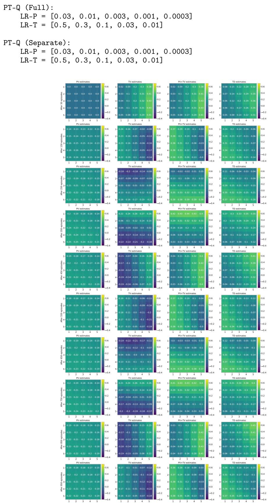  
Figure 8: Value function heatmap for the prediction task

## A.3 Non-parameteric Transient Approximations

Here, we provide additional details on the non-parametric transient approximator, including pseudocode for several methods and a discussion of the roles of hyperparameters.

## A.3.1 Pseudocode

The non-parametric transient approximator is implemented through three core methods: Put, which stores incoming observations (see Algorithm 3); Get, which retrieves stored value estimates (see Algorithm 4); and UpdateTDError, which updates the estimates in proportion to their contribution (see Algorithm 5).

Algorithm 3 PUT Method   
1: function PUT((M, x))   
Require: M: transient memory; x: observation   
Ensure: Updated memory M   
2: (sig, tag) ← MINHASH(x)   
3: bins ← GETBUCKETS(sig)   
4: # Insert observation in all tables   
5: for t ← 0 to T − 1 do   
6: if (CONTAINSTAG(M[t, bins[t]], tag) == false) then   
7: # empty-first else LRU   
8: slot ← SELECTSLOT(M, t, bins[t])   
9: M[t, bins[t], slot].tag ← tag   
10: # mean over other valid slots   
11: M[t, bins[t], slot].values ← INITIALIZE(t, bins[t])   
12: else   
13: slot ← FINDSLOTBYTAG(M[t, bins[t]], tag)   
14: end if   
15: M[t, bins[t], slot].age ← TouCH(M.clock)   
16: end for   
17: M.clock ← M.clock + 1   
18: return M   
19: end function

Algorithm 4 GET Method   
1: function GET((M, x, ρ))   
Require: M: transient memory; x: observation; ρ: mixing weight   
Ensure: values   
2: (sig, tag) ← MINHASH(x)   
3: bins ← GETBUCKETS(sig)   
4: values ←0   
5: # Collect values from every table   
6: for t ← 0 to T − 1 do   
7: slot ← FINDSLOTBYTAG(M[t, bins[t]], tag)   
8: # Weigh the update for matching slot by ρ   
9: values ← values +ρ · M[t, bins[t], slot].values   
10: OSlots ← FINDOTHERVALIDSLOTS(M[t, bins[t]], tag)   
11: n ← LEN(OSlots)   
12: # Divide weight (1 — ρ) equally among other valid slots   
13: for s ← 0 to n − 1 do   
14: values ← values + (1−e) · M[t, bins[t], OSlots[s].values   
n   
15: end for   
16: end for   
17: return values   
18: end function

Algorithm 5 UpdateTDError Method   
1: function UPDATETDERROR((M, x, a, ρ, δ, α))   
Require: M: transient memory; x: observation; a: action; ρ: mixing weight; δ: TD-error; α:   
learning rate   
Ensure: Updated memory M   
2: (sig, tag) ← MINHASH(x)   
3: bins ← GETBUCKETS(sig)   
4: for t ← 0 to T − 1 do   
5: slot ← FINDSLOTBYTAG(M[t, bins[t]], tag)   
6: # Weight the matching slot by ρ   
7: M[t, bins[t], slot].values[a] ← M[t, bins[t], slot].values[a] + ¯ρδ   
8: OSIots ← FINDOTHERVALIDSLOTS(M[t, bins[t]], tag)   
9: n ← LEN(OSlots)   
10: # Divide TD-error equally among other valid slots by weighting by (1 – ρ)   
11: for s ← 0 to n − 1 do   
12: M[t, bins[t], OSlots[s]].values[a] ← M[t, bins[t], OSlots[s]].values[a] + α (1 − ρ)δ   
nT   
13: end for   
14: end for   
15: return M   
16: end function

## A.3.2 Hyperparameters

1. Number of Tables (T) & Generalization: Similar to tiles in Tile Coding. More tables spread information, increasing generalization. Fewer tables concentrate information, reducing generalization.

2. Table Size (B) & Capacity: Determines the capacity of the approximator. The larger the table, the more observations it can store.

3. Slots (S) & Eviction: Determines capacity across bins. Too few slots lead to high eviction rates; too many slots approach tabular.

4. Generalization (ρ): Explicitly controls the mixing of values between slots. $\rho = 1$ forces isolation (no generalization); $\rho < 1$ enables local smoothing.

5. Number of Hashes (K): Determines the precision of the MinHash signature. A higher K better preserves the Jaccard similarity property (improving retrieval accuracy), though with diminishing returns beyond a certain point.

Practical guide for choosing HPs: Generally speaking, the larger the table, the better, as it can store many observations. When the number of slots is large, generalization is higher because many observations contribute to the values. So, the generalization parameter $\rho$ needs to be tuned carefully. For any environment, we recommend choosing the table size (B), number of slots (S), number of tables (T), and number of hashes (K). Then tune the remaining HPs (generalization parameter $\rho ,$ decay parameter λ, and transient learning rate α) using either coordinate or grid search.

Our use of MinHash introduces an inductive bias that yields desirable hash collisions. Its success is attributed to its property that preserves the Jaccard score in the hash signature, which is favourable for symbolic observations. In contrast, random hashing results in undesirable hash collisions, leading to incorrect transient corrections that, in turn, affect permanent learning.

## A.4 Large-Scale Experiments

In this section, we provide baseline, HP tuning, and architecture details for the large-scale experiment including the pseudocode.

## A.4.1 Image Task

PQN. PQN is a synchronous, JAX-based implementation of deep Q-learning designed for vectorized transitions across multiple parallel environments and periodically updating the network to minimize the 1-step Temporal Difference (TD) error using standard Q-learning error. We parameterize the Qfunction by a neural network implemented in Flax. The input consists of flattened image observations (e.g., 32 × 32 × 3). The network comprises two wide hidden layers of 1024 units. Each hidden layer is followed sequentially by Layer Normalization and a ReLU activation function. The final dense linear layer outputs the Q-values for each discrete action in the environment. The HPs used in the final experiments are provided in Table 3.

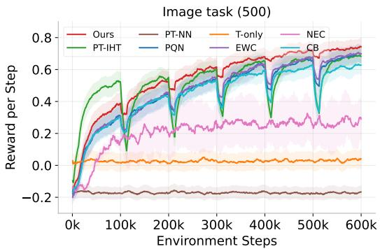  
Figure 9: Image Task (500) Results.

The network is optimized using the Adam optimizer. Gradients are clipped by global norm with a maximum threshold of 1.0. Following hyperparameter tuning, the learning rate was set to 0.001, and the data collected during environment steps was shuffled and divided into 4 minibatches for the update step. The network undergoes 1 epoch of training per update phase.

<table><tr><td colspan="2">Parameter Value</td></tr><tr><td colspan="2">Hyperparameters</td></tr><tr><td>ALG_NAME NUM_MINIBATCHES</td><td>PQN</td></tr><tr><td>NUM_EPOCHS</td><td>4 1</td></tr><tr><td>NORM_INPUT</td><td>True</td></tr><tr><td>NORM_TYPE</td><td>layer_norm</td></tr><tr><td>LR</td><td>0.001</td></tr><tr><td>MAX_GRAD_NORM</td><td>1.0</td></tr></table>

Table 3: Hyperparameters for PQN for Image task.

PT-Ours. PT-Ours represents our primary contribution, enhancing the Permanent-Transient value decomposition framework by replacing the neural network with novel, advanced, slot-based MinHash Locality Sensitive Hashing (LSH) non-parameteric approximations. By structuring the table into distinct slots, our approach successfully mitigates hash collisions and undesirable generalization that limit standard IHTs, enabling stable, high-fidelity transient value estimation.

The HPs used in the final experiments are provided in Table 4.

PT-NN. PT-NN adapts the Permanent-Transient value decomposition framework but uses a neural network for estimating the transient value function. While the permanent network learns slowly over batches of data to ensure stability and generalization, the transient network is updated online at each transition to rapidly adapt to recent observations and minimize the immediate TD error. The permanent neural network retains HPs from PQN.

The HPs used in the final experiments are provided in Table 5.

PT-IHT. PT-IHT builds upon PQN architecture. For the slow-learning permanent, we use a neural network similar to PQN, and for the fast-learning transient non-parametric approximations, we use an Index Hash Table (IHT) with MinHash-based Locality Sensitive Hashing. While this allows rapid initial learning, the basic IHT implementation lacks advanced design choices, making the algorithm susceptible to hash collisions and to undesirable generalization across states

<table><tr><td>Parameter</td><td>Value</td></tr><tr><td>TRANSIENT_TABLE_SIZE</td><td>128</td></tr><tr><td>NUM_TABLES</td><td>2</td></tr><tr><td>NUM_HASHES</td><td>128</td></tr><tr><td>NUM_SLOTS</td><td>4</td></tr><tr><td>TRANSIENT_LR</td><td>0.3</td></tr><tr><td>DECAY</td><td>0.95</td></tr><tr><td>ρ</td><td>1.0</td></tr></table>

Table 4: PT-Ours HPs.

<table><tr><td>Parameter</td><td>Value</td></tr><tr><td>TRANSIENT_LR</td><td>0.003</td></tr><tr><td>DECAY</td><td>1.0</td></tr></table>

Table 5: PT-NN HPs.

The permanent neural network retains PQN's optimal HPs, and we tune only the table-based HPs. The final HPs used in the main results are presented in Table 6

<table><tr><td>Parameter</td><td>Value</td></tr><tr><td>TRANSIENT_TABLE_SIZE</td><td>512</td></tr><tr><td>NUM_TABLES</td><td>2</td></tr><tr><td>NUM_HASHES</td><td>128</td></tr><tr><td>TRANSIENT_LR</td><td>0.5</td></tr><tr><td>DECAY</td><td>1.0</td></tr></table>

Table 6: PT-IHT HPs.

T-Only. T-Only serves as an ablation and a standalone baseline that entirely removes the permanent neural network. Instead, it uses our advanced slot-based approximator to estimate action-values. This algorithm updates purely online.

The HPs used in the final experiments are provided in Table 7.

EWC. EWC is an extension of the base PQN algorithm that incorporates Elastic Weight Consolidation (EWC) to improve the stability of the neural network parameters during training. By explicitly regularizing the network weights against drastic shifts, EWC helps mitigate catastrophic interference between consecutive gradient updates, allowing the network to continuously adapt without destabilizing previously acquired value estimates.

The total loss is: $\begin{array} { r } { \mathcal { L } _ { t o t a l } = \mathcal { L } _ { T D } + \frac { \lambda } { 2 } \sum _ { i } F _ { i } ( \theta _ { i } - \theta _ { i , o l d } ) ^ { 2 } } \end{array}$ . The coefficient λ controls the regularization strength and is set to 1.0. The penalty restrains the current parameters (θ¿) from deviating too far from a set of anchor parameters $( \theta _ { i , o l d } )$ , with the constraint weighted by the diagonal elements of the empirical Fisher Information matrix $( F _ { i } )$

This algorithm smoothly updates the regularization constraints online (every 32 steps). After each update, both the Fisher Information matrix and the anchor parameters are updated using an Exponential Moving Average (EMA). The smoothing factors are configured to $\alpha _ { f i s h e r } = 0 . 9 9$ and $\alpha _ { a n c h o r } = 0 . 9 9$ , respectively.

CB. CB integrates Continual Backprop into the standard PQN architecture to address the “loss of plasticity" commonly observed in neural networks. We stochastically re-initialize a small fraction of the network's hidden units, along with their associated optimizer statistics, every 32 steps. This approach prevents the network from becoming overly rigid, enabling it to continuously adapt to non-stationary environments.

<table><tr><td>Parameter</td><td>Value</td></tr><tr><td>TRANSIENT_TABLE_SIZE</td><td>128</td></tr><tr><td>NUM_TABLES</td><td>2</td></tr><tr><td>NUM_HASHES</td><td>128</td></tr><tr><td>NUM_SLOTS</td><td>4</td></tr><tr><td>TRANSIENT_LR</td><td>0.3</td></tr><tr><td>DECAY</td><td>0.95</td></tr><tr><td>ρ</td><td>1.0</td></tr></table>

Table 7: T-Only HPs.

At the end of every 32 steps, a subset of hidden units is randomly reset based on a Bernoulli distribution with a fixed, low probability (p = 0.0001).

Algorithm 6 Deep PTQ for Image Task and Craftax-Classic   
Require: M: transient memory; θ: permanent parameters; env: environment; Ts: total timesteps;   
B: buffer; α: permanent LR; α: transient LR; ρ: mixing weight; €: exploration rate; γ: discount;   
k: PM update period; λ: TM decay   
Ensure: Updated θ, M   
1: s ← env.reset()   
2: M ← PUT(M, s)   
3: for t ← 1 to $T _ { s }$ do   
4: # permanent values   
5: ${ \bar { Q ^ { ( P ) } } } ( s ) \gets$ GETPERMANENT(s, θ)   
6: # transient values   
7: $Q ^ { ( T ) } ( s ) \gets \mathbf { G } \mathbf { E } \mathbf { T } ( \mathcal { M } , s , \rho )$   
8: # Compute Q for current state   
9: ${ Q ^ { ( P T ) } \tilde { ( s ) }  Q ^ { ( P ) } ( s ) + Q ^ { ( T ) } ( s ) }$   
10: # Select action (epsilon-greedy over Q)   
11: a ← EPSILONGREEDY $\bar { ( Q ^ { ( P \bar { T } ) } } ( s ) , \epsilon )$   
12: # Step environment   
13: (s′, r) ← env. step(a)   
14: $\mathcal { M } \gets \operatorname* { P U T } ( \mathcal { M } , s ^ { \prime } )$   
15: $\boldsymbol { B }  B \cup \{ ( s , a , Q ^ { ( P ) } ( s ) ) \}$   
16: # Evaluate Q for next state   
17: Q(P)(s') ← GETPERMANENT $( s ^ { \prime } , \theta )$   
18: $Q ^ { ( T ) } ( s ^ { \prime } ) \gets \mathbf { G } \mathbf { E } \mathbf { T } ( \mathcal { M } , s ^ { \prime } , \rho )$   
19: ${ Q } ^ { ( P T ) } ( \hat { s } ^ { \prime } )  { Q } ^ { ( \dot { P } ) } ( s ^ { \prime } ) + { Q } ^ { ( T ) } ( s ^ { \prime } )$   
20: # TD error and transient update   
21: $\begin{array} { r } { \delta  r + \gamma \operatorname* { m a x } _ { a ^ { \prime } } Q ^ { ( P T ) } \mathring ( s ^ { \prime } , a ^ { \prime } ) - Q ^ { ( P T ) } \big ( s , a \big ) } \end{array}$   
22: M ← UPDATETDERROR $( \mathcal { M } , s , a , \rho , \delta , \alpha )$   
23: # Periodic permanent update and TM decay   
24: if mod $( t , \dot { k } ) = 0$ then   
25: θ ← UPDATEPM(M, B, α)   
26: B ←{}   
27: M ←DECAYVALUES(M, λ)   
28: end if   
29: s ← s′   
30: end for   
31: return θ, M

NEC. This is a JAX-compatible adaptation of Neural Episodic Control (NEC). It leverages a Differentiable Neural Dictionary (DND) to rapidly associate latent representations with action values Because dynamic array structures and KD-trees are discouraged in compiled JAX code, the dynamically growing memory of the original NEC is replaced with a fixed-capacity table with a Least Recently Used (LRU) replacement policy.

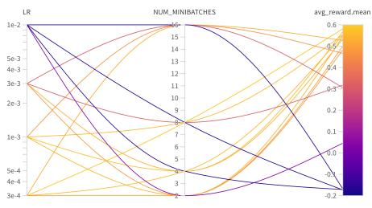  
(a) PQN

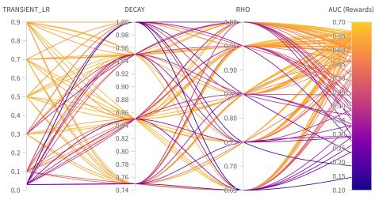  
(b) Ours

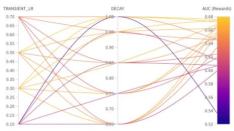  
(c) PT-IHT

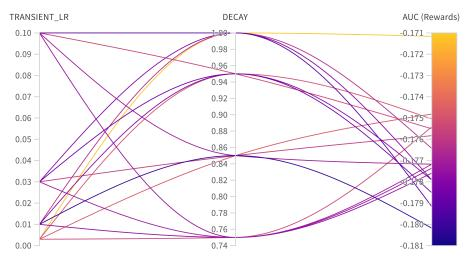  
(d) PT-NN

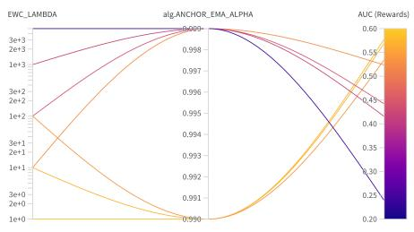  
(e) EWC

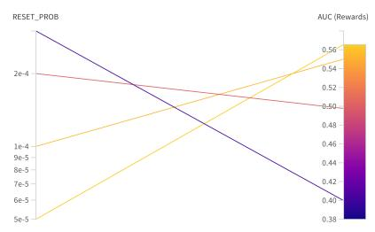  
(f) CB

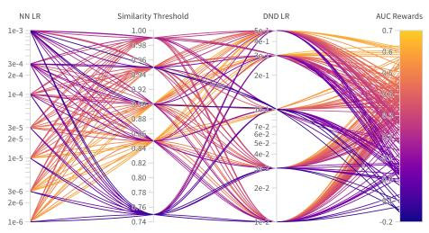  
(g) NEC

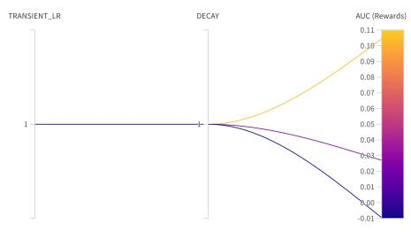  
(h) T-Only  
Figure 10: Hyperparameter tuning results.

The neural network architecture follows the PQN baseline (two 1024-unit hidden layers, Layer Normalization, ReLU) but is modified to output both the feature embeddings (the activations of the second hidden layer) and Q-values.

DND is a static table with a fixed capacity of 1024 slots (same capacity as ours). Each slot stores a 1024-dimensional latent embedding, a vector of corresponding Q-values, and an age/clock integer used for tracking the oldest entries. Q-values are estimated by querying the DND. The DND retrieves the top k = 16 nearest neighbours based on cosine similarity between the current latent features and stored keys. The final Q-value is a weighted sum of these neighbours.

The DND is updated online after each environment step (similar to the transient estimates). If the cosine similarity between the current state's features and the closest existing key exceeds a threshold (0.85), the stored Q-value is updated toward the 1-step TD error using a fast learning rate of 0.3. If the state is sufficiently novel (similarity ≤ 0.85), a new key-value pair is written into the dictionary, overwriting the oldest entry based on age.

For the main results presented in the paper, we used the same hyperparameters for the base neural network to maintain a consistent standard for comparison. We conducted an expanded hyperparameter search to tune the base neural network's learning rate and observed an improved performance. However, this was still substantially lower than our approach.

CompoNet. CompoNet is a recent compositional architecture designed for CRL. It addresses catastrophic forgetting by freezing the recently learnt policy and combining it with a newer module using an attention mechanism as new tasks are encountered. While effective, this approach requires explicit knowledge of task boundaries. Also, it is memory-intensive, as the network structure is continuously expanded with new heads whenever a new task is presented. This also limited its use case for continuously changing environments.

Reset (Final). Reset (Final) re-initializes only the final layer of the Q-network when the task changes. This variant, inspired by the primacy bias paper, aims to unlearn outdated action-value estimates while preserving representations learned in lower layers. This approach allows the network to rapidly adapt without discarding useful latent features.

Reset (Full). Reset (Full) completely discards the past learnings at each task boundary, forcing the network to learn entirely from scratch for every new task. This baseline emphasizes high neural network plasticity.

## A.4.2 Craftax Task

For the baselines and the permanent network in all variants of PTQ-learning, we used hyperparameters from the PQN repository, which are consistent with the results published in the PQN paper. We only tuned minibatches for the PQN baseline because it determined the number of steps the permanent network would take. All the baselines also reuse the PQN base parameters.

Transient parameters were determined by searching over a range of values. Given the large hyperparameter space, we used coordinate-wise search: we fixed all hyperparameters except one to a reasonable baseline and performed a grid search over that single hyperparameter. This process was then repeated iteratively for each hyperparameter, fixing the newly tuned value before moving to the next. For each configuration, we ran 150M steps across 1024 environments in parallel, using AUC as the selection metric. The final results were reported for 250M steps. We used the same HPs for the online craftax experiment (the minibatch was reduced to 8 to match the smaller batch size). A similar procedure was carried out for all the baselines we used.

Wall-clock time. For the 2-stream experiment, the wall-clock time of our approach is very similar to PQN (14-15h for PQN, 16-18h for our approach). In the 1024-stream experiment, our approach is twice as slow as PQN, since the transient component loops over samples to store them (retrieval is parallelized, therefore cheap). We expect the newer, simplified transient architecture to yield faster runtime.

<table><tr><td>Parameter</td><td>Value</td></tr><tr><td>NUM_TABLES</td><td>2</td></tr><tr><td>TRANSIENT_TABLE_SIZE</td><td>2048</td></tr><tr><td>NUM_SLOTS</td><td>32</td></tr><tr><td>NUM_HASHES</td><td>128</td></tr><tr><td>CROP_SIZE</td><td>7</td></tr><tr><td>ρ</td><td>0.85</td></tr><tr><td>TRANSIENT_LR</td><td>1.3</td></tr><tr><td>DECAY</td><td>0.95</td></tr><tr><td>NUM_TABLES</td><td>16</td></tr><tr><td>TRANSIENT_TABLE_SIZE</td><td>65536</td></tr><tr><td>NUM_SLOTS</td><td>32</td></tr><tr><td>NUM HASHES</td><td>128</td></tr><tr><td>CROP_SIZE</td><td>7</td></tr><tr><td>TRANSIENT_LR</td><td>0.8</td></tr><tr><td>DECAY</td><td>0.85</td></tr></table>

Table 8: PT-Ours HPs for Craftax.

Table 9: PT-IHT HPs for Craftax.

<table><tr><td>Parameter</td><td>Value</td></tr><tr><td>ALG_NAME</td><td>PQN</td></tr><tr><td>TOTAL_TIMESTEPS</td><td>5 × 108</td></tr><tr><td>TOTAL_TIMESTEPS_DECAY</td><td>5 × 108</td></tr><tr><td>NUM_ENVS</td><td>1024</td></tr><tr><td>NUM_STEPS</td><td>32</td></tr><tr><td>EPS_START</td><td>0.1</td></tr><tr><td>EPS_FINISH</td><td>0.005</td></tr><tr><td>EPS_DECAY</td><td>0.2</td></tr><tr><td>NUM MINIBATCHES</td><td>1 for PQN(1), 32 for PQN(32)</td></tr><tr><td>NUM_EPOCHS</td><td>1</td></tr><tr><td>NORM_INPUT</td><td>True</td></tr><tr><td>NORM_TYPE</td><td>layer_norm</td></tr><tr><td>HIDDEN_SIZE</td><td>1024</td></tr><tr><td>NUM_LAYERS</td><td>4</td></tr><tr><td>LR</td><td>0.0001</td></tr><tr><td>MAX_GRAD_NORM</td><td>1.0</td></tr><tr><td>LR_LINEAR_DECAY</td><td>True</td></tr><tr><td>REW_SCALE</td><td>1.0</td></tr><tr><td>GAMMA</td><td>0.99</td></tr><tr><td>Q_LAMBDA</td><td>False</td></tr><tr><td>LAMBDA</td><td>0</td></tr><tr><td colspan="2">Environment</td></tr><tr><td>ENV_NAME</td><td>Craftax-Classic-Symbolic-v1</td></tr><tr><td>USE_OPTIMISTIC_RESETS</td><td>True</td></tr><tr><td>OPTIMISTIC_RESET_RATIO</td><td>16</td></tr><tr><td></td><td></td></tr><tr><td>LOG_ACHIEVEMENTS</td><td>True</td></tr></table>

Table 10: PQN HPs for Craftax

For Neural Episodic Control (NEC), we evaluated seven configurations and determined the optimal settings to be a Differentiable Neural Dictionary (DND) learning rate of 0.1, a cosine similarity threshold of 0.9, and a base neural network learning rate of 1e-4. For Elastic Weight Consolidation (EWC), a search over four different values identified an optimal penalty coefficient (λ) of 3.0. Similarly, the Continual Backprop (CB) baseline was tuned across four distinct values, achieving peak performance with a reset probability of 2e-4. For the Transient-Only (T-Only) ablation, we maintained consistency by reusing the optimal table hyperparameters from our approach. Finally, the PT-NN baseline was configured with a transient network learning rate of 0.0001 and a decay factor of 0.99.

We now present per-achievement performance curves for all algorithms, including parameter-ablation curves for our approach.

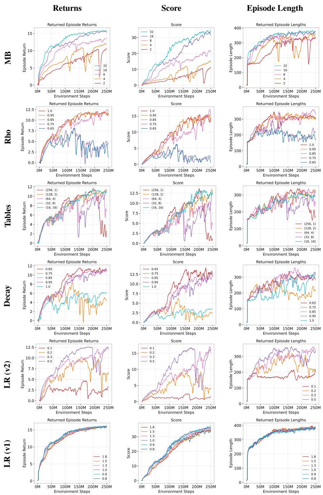  
Figure 11: Parameter Ablation Studies. Rows represent different parameters tested: Minibatch updates (MB), $\rho ,$ table configuration, decay parameter, and transient learning rates (v1 and v2). Columns represent standard metrics: Episode Returns, Score, and Episode Lengths.

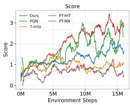  
(a) Score.

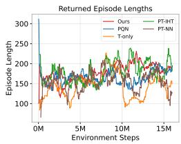  
(b) Episode Lengths.

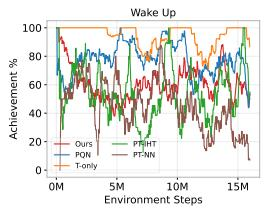  
(c) Wake Up.

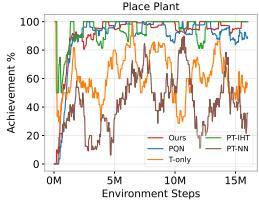

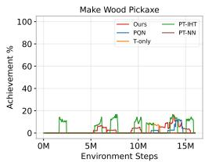

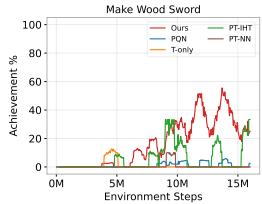  
(d) Place Table.

(e) Place Plant.  
(f) Make Wood Pickaxe.  
(g) Make Wood Sword.  
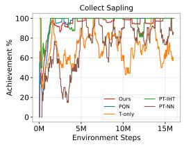

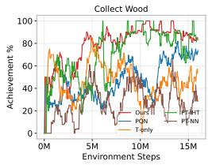

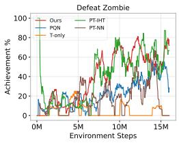

(j) Collect Wood.  
(i) Defeat Zombie.  
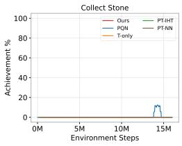

(k) Collect Sapling.  
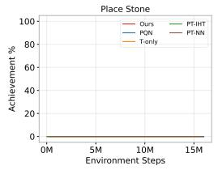

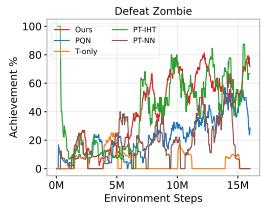  
(h) Eat Cow.  
(o) Defeat Zombie.

(n) Place Stone.  
(m) Collect Stone.  
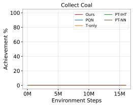

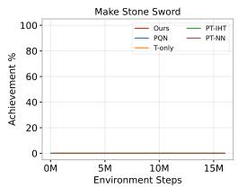

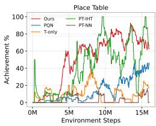

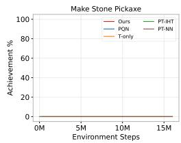  
(s) Make Stone Sword.  
(r) Make Stone Pickaxe.  
(q) Collect Coal.

(1) Collect Drink.  
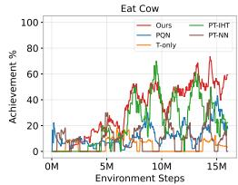

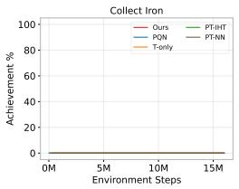  
(v) Make Iron Pickaxe.

(w) Make Iron Sword.  
(p) Place Furnace.  
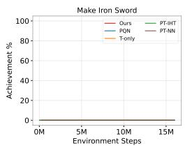

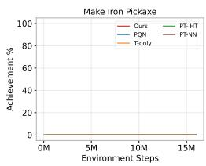  
(u) Collect Iron.

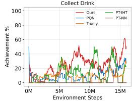

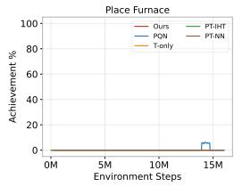

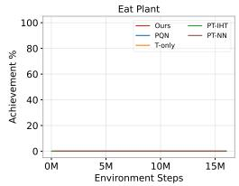

(t) Eat Plant.  
  
Figure 12: All achievements in the craftax online experiment.  
(x) Collect Diamond.

  
(a) Score.

  
(b) Episode Lengths.

  
(c) Wake Up.

  
(e) Place Plant.

  
(f) Make Wood Pickaxe.

  
(g) Make Wood Sword.


(i) Defeat Zombie.  
(j) Collect Wood.  


(k) Collect Sapling.  
  
(m) Collect Stone.  
(n) Place Stone.

  
(0) Defeat Zombie.

  
(q) Collect Coal.

  
(r) Make Stone Pickaxe.

  
(s) Make Stone Sword.

  
(u) Collect Iron.

  
(v) Make Iron Pickaxe.

  
(w) Make Iron Sword.


(d) Place Table.  
(h) Eat Cow.  


(p) Place Furnace.  
(1) Collect Drink.  


(t) Eat Plant.  
Figure 13: All achievements in the craftax 250M experiment.  
  
(x) Collect Diamond.

## NeurIPS Paper Checklist

## 1. Claims

Question: Do the main claims made in the abstract and introduction accurately reflect the paper's contributions and scope?

Answer: [Yes]

Justification: Our claims are supported by illustrations in Sec. 4, theoretical results in Sec. 5, details of the non-parametric approximation in Sec. 6, and experiments on image tasks and Craftax in Sec. 7.

Guidelines:

• The answer [N/A] means that the abstract and introduction do not include the claims made in the paper.

• The abstract and/or introduction should clearly state the claims made, including the contributions made in the paper and important assumptions and limitations. A [No] or [N/A] answer to this question will not be perceived well by the reviewers.

• The claims made should match theoretical and experimental results, and reflect how much the results can be expected to generalize to other settings.

• It is fine to include aspirational goals as motivation as long as it is clear that these goals are not attained by the paper.

## 2. Limitations

Question: Does the paper discuss the limitations of the work performed by the authors?

Answer: [Yes]

Justification: The limitations of our newly introduced non-parametric approximator are discussed in Sec. 8. Specifically, we address the use of a basic tokenization strategy in our image experiments and the large number of hyperparameters, both of which we highlight as avenues for future research.

Guidelines:

• The answer [N/A] means that the paper has no limitation while the answer [No] means that the paper has limitations, but those are not discussed in the paper.

• The authors are encouraged to create a separate “Limitations" section in their paper.

• The paper should point out any strong assumptions and how robust the results are to violations of these assumptions (e.g., independence assumptions, noiseless settings, model well-specification, asymptotic approximations only holding locally). The authors should reflect on how these assumptions might be violated in practice and what the implications would be.

• The authors should reflect on the scope of the claims made, e.g., if the approach was only tested on a few datasets or with a few runs. In general, empirical results often depend on implicit assumptions, which should be articulated.

• The authors should reflect on the factors that influence the performance of the approach. For example, a facial recognition algorithm may perform poorly when image resolution is low or images are taken in low lighting. Or a speech-to-text system might not be used reliably to provide closed captions for online lectures because it fails to handle technical jargon.

• The authors should discuss the computational efficiency of the proposed algorithms and how they scale with dataset size.

• If applicable, the authors should discuss possible limitations of their approach to address problems of privacy and fairness.

• While the authors might fear that complete honesty about limitations might be used by reviewers as grounds for rejection, a worse outcome might be that reviewers discover limitations that aren't acknowledged in the paper. The authors should use their best judgment and recognize that individual actions in favor of transparency play an important role in developing norms that preserve the integrity of the community. Reviewers will be specifically instructed to not penalize honesty concerning limitations.

## 3. Theory assumptions and proofs

Question: For each theoretical result, does the paper provide the full set of assumptions and a complete (and correct) proof?

Answer: [Yes]

Justification: The standard theoretical assumptions are detailed in Sec. 5, and the complete proofs are provided in Appendix A.1.

## Guidelines:

• The answer [N/A] means that the paper does not include theoretical results.

• All the theorems, formulas, and proofs in the paper should be numbered and crossreferenced.

• All assumptions should be clearly stated or referenced in the statement of any theorems.

• The proofs can either appear in the main paper or the supplemental material, but if they appear in the supplemental material, the authors are encouraged to provide a short proof sketch to provide intuition.

• Inversely, any informal proof provided in the core of the paper should be complemented by formal proofs provided in appendix or supplemental material.

• Theorems and Lemmas that the proof relies upon should be properly referenced.

## 4. Experimental result reproducibility

Question: Does the paper fully disclose all the information needed to reproduce the main experimental results of the paper to the extent that it affects the main claims and/or conclusions of the paper (regardless of whether the code and data are provided or not)?

Answer: [Yes]

Justification: Pseudocode for our algorithms is provided in Algorithms 1, 2, 3, 4, 5, and 6. Complete experimental details, including baselines, hyperparameter tuning, and final values, are detailed in Appendices A.2.2, A.3.2, and A.4. Additionally, Appendix A.3.2 includes a practical guide for setting these hyperparameters.

## Guidelines:

• The answer [N/A] means that the paper does not include experiments.

• If the paper includes experiments, a [No] answer to this question will not be perceived well by the reviewers: Making the paper reproducible is important, regardless of whether the code and data are provided or not.

• If the contribution is a dataset and/or model, the authors should describe the steps taken to make their results reproducible or verifiable.

• Depending on the contribution, reproducibility can be accomplished in various ways. For example, if the contribution is a novel architecture, describing the architecture fully might suffice, or if the contribution is a specific model and empirical evaluation, it may be necessary to either make it possible for others to replicate the model with the same dataset, or provide access to the model. In general. releasing code and data is often one good way to accomplish this, but reproducibility can also be provided via detailed instructions for how to replicate the results, access to a hosted model (e.g., in the case of a large language model), releasing of a model checkpoint, or other means that are appropriate to the research performed.

• While NeurIPS does not require releasing code, the conference does require all submissions to provide some reasonable avenue for reproducibility, which may depend on the nature of the contribution. For example

(a) If the contribution is primarily a new algorithm, the paper should make it clear how to reproduce that algorithm.

(b) If the contribution is primarily a new model architecture, the paper should describe the architecture clearly and fully.

(c) If the contribution is a new model (e.g., a large language model), then there should either be a way to access this model for reproducing the results or a way to reproduce the model (e.g., with an open-source dataset or instructions for how to construct the dataset).

(d) We recognize that reproducibility may be tricky in some cases, in which case authors are welcome to describe the particular way they provide for reproducibility. In the case of closed-source models, it may be that access to the model is limited in some way (e.g., to registered users), but it should be possible for other researchers to have some path to reproducing or verifying the results.

## 5. Open access to data and code

Question: Does the paper provide open access to the data and code, with sufficient instructions to faithfully reproduce the main experimental results, as described in supplemental material?

Answer: [Yes]

Justification: To ensure reproducibility, the complete codebase is open-sourced and is available at https://github.com/NishanthVAnand/pt\_representations\_crl.

Guidelines:

• The answer [N/A] means that paper does not include experiments requiring code.

• Please see the NeurIPS code and data submission guidelines (https : //neurips . cc/ public/guides/CodeSubmissionPolicy) for more details.

• While we encourage the release of code and data, we understand that this might not be possible, so [No] is an acceptable answer. Papers cannot be rejected simply for not including code, unless this is central to the contribution (e.g., for a new open-source benchmark).

• The instructions should contain the exact command and environment needed to run to reproduce the results. See the NeurIPS code and data submission guidelines (https : //neurips.cc/public/guides/CodeSubmissionPolicy) for more details.

• The authors should provide instructions on data access and preparation, including how to access the raw data, preprocessed data, intermediate data, and generated data, etc.

• The authors should provide scripts to reproduce all experimental results for the new proposed method and baselines. If only a subset of experiments are reproducible, they should state which ones are omitted from the script and why.

• At submission time, to preserve anonymity, the authors should release anonymized versions (if applicable).

• Providing as much information as possible in supplemental material (appended to the paper) is recommended, but including URLs to data and code is permitted.

## 6. Experimental setting/details

Question: Does the paper specify all the training and test details (e.g., data splits, hyperparameters, how they were chosen, type of optimizer) necessary to understand the results?

Answer: [Yes]

Justification: Complete experimental details, including baselines, hyperparameter tuning, and final values, are detailed in Appendices A.2.2, A.3.2, and A.4. Additionally, Appendix A.3.2 includes a practical guide for setting these hyperparameters.

Guidelines:

• The answer [N/A] means that the paper does not include experiments.

• The experimental setting should be presented in the core of the paper to a level of detail that is necessary to appreciate the results and make sense of them.

• The full details can be provided either with the code, in appendix, or as supplemental material.

## 7. Experiment statistical significance

Question: Does the paper report error bars suitably and correctly defined or other appropriate information about the statistical significance of the experiments?

Answer: [Yes]

Justification: All experiments are evaluated across multiple seeds, with confidence intervals reported directly in the corresponding plots. Full details are provided in Sec. 4 and 7.

Guidelines:

• The answer [N/A] means that the paper does not include experiments.

• The authors should answer [Yes] if the results are accompanied by error bars, confidence intervals, or statistical significance tests, at least for the experiments that support the main claims of the paper.

• The factors of variability that the error bars are capturing should be clearly stated (for example, train/test split, initialization, random drawing of some parameter, or overall run with given experimental conditions).

• The method for calculating the error bars should be explained (closed form formula call to a library function, bootstrap, etc.)

• The assumptions made should be given (e.g., Normally distributed errors).

• It should be clear whether the error bar is the standard deviation or the standard error of the mean.

• It is OK to report 1-sigma error bars, but one should state it. The authors should preferably report a 2-sigma error bar than state that they have a 96% CI, if the hypothesis of Normality of errors is not verified.

• For asymmetric distributions, the authors should be careful not to show in tables or figures symmetric error bars that would yield results that are out of range (e.g., negative error rates).

• If error bars are reported in tables or plots, the authors should explain in the text how they were calculated and reference the corresponding figures or tables in the text.

## 8. Experiments compute resources

Question: For each experiment, does the paper provide sufficient information on the computer resources (type of compute workers, memory, time of execution) needed to reproduce the experiments?

Answer: [Yes]

Justification: While specific GPU and CPU configurations varied across cluster allocations, we provide an estimate of the wall-clock time for the large-scale Craftax experiments in Appendix A.4.2.

Guidelines:

• The answer [N/A] means that the paper does not include experiments.

• The paper should indicate the type of compute workers CPU or GPU, internal cluster, or cloud provider, including relevant memory and storage.

• The paper should provide the amount of compute required for each of the individual experimental runs as well as estimate the total compute.

• The paper should disclose whether the full research project required more compute than the experiments reported in the paper (e.g., preliminary or failed experiments that didn't make it into the paper).

## 9. Code of ethics

Question: Does the research conducted in the paper conform, in every respect, with the NeurIPS Code of Ethics https://neurips.cc/public/EthicsGuidelines?

Answer: [Yes]

Justification: This work focuses on foundational algorithmic improvements and theoretical analysis. It does not involve human subjects, sensitive data, or applications that violate the NeurIPS Code of Ethics.

Guidelines:

• The answer [N/A] means that the authors have not reviewed the NeurIPS Code of Ethics.

• If the authors answer [No], they should explain the special circumstances that require a deviation from the Code of Ethics.

• The authors should make sure to preserve anonymity (e.g., if there is a special consideration due to laws or regulations in their jurisdiction).

## 10. Broader impacts

Question: Does the paper discuss both potential positive societal impacts and negative societal impacts of the work performed?

Answer: [N/A]

Justification: The scope of this paper is limited to foundational theoretical results and methodological evaluations in purely synthetic, simulated environments (e.g., Craftax); a discussion on societal impact was omitted.

Guidelines:

• The answer [N/A] means that there is no societal impact of the work performed.

• If the authors answer [N/A] or [No], they should explain why their work has no societal impact or why the paper does not address societal impact.

• Examples of negative societal impacts include potential malicious or unintended uses (e.g., disinformation, generating fake profiles, surveillance), fairness considerations (e.g., deployment of technologies that could make decisions that unfairly impact specific groups), privacy considerations, and security considerations.

• The conference expects that many papers will be foundational research and not tied to particular applications, let alone deployments. However, if there is a direct path to any negative applications, the authors should point it out. For example, it is legitimate to point out that an improvement in the quality of generative models could be used to generate Deepfakes for disinformation. On the other hand, it is not needed to point out that a generic algorithm for optimizing neural networks could enable people to train models that generate Deepfakes faster.

• The authors should consider possible harms that could arise when the technology is being used as intended and functioning correctly, harms that could arise when the technology is being used as intended but gives incorrect results, and harms following from (intentional or unintentional) misuse of the technology.

• If there are negative societal impacts, the authors could also discuss possible mitigation strategies (e.g., gated release of models, providing defenses in addition to attacks, mechanisms for monitoring misuse, mechanisms to monitor how a system learns from feedback over time, improving the efficiency and accessibility of ML).

## 11. Safeguards

Question: Does the paper describe safeguards that have been put in place for responsible release of data or models that have a high risk for misuse (e.g., pre-trained language models, image generators, or scraped datasets)?

Answer: [N/A]

Justification: This paper focuses on foundational algorithmic theory and evaluations in simulated environments. It does not introduce, utilize, or release high-risk datasets or models that require safeguards against misuse.

Guidelines:

• The answer [N/A] means that the paper poses no such risks.

• Released models that have a high risk for misuse or dual-use should be released with necessary safeguards to allow for controlled use of the model, for example by requiring that users adhere to usage guidelines or restrictions to access the model or implementing safety filters.

• Datasets that have been scraped from the Internet could pose safety risks. The authors should describe how they avoided releasing unsafe images.

• We recognize that providing effective safeguards is challenging, and many papers do not require this, but we encourage authors to take this into account and make a best faith effort.

## 12. Licenses for existing assets

Question: Are the creators or original owners of assets (e.g., code, data, models), used in the paper, properly credited and are the license and terms of use explicitly mentioned and properly respected?

Answer: [Yes]

Justification: Our implementation builds upon the publicly available PureJaxQL library (https://github. com/mttga/purejaxq1), which is released under the Apache-2.0 license. And, we use an environment from the Craftax library (https://github.com/ michaeltmatthews/craftax?tab=MIT-1-ov-file), which is released under the MIT license. We explicitly acknowledge its creators and fully adhere to its terms of use.

Guidelines:

• The answer [N/A] means that the paper does not use existing assets.

• The authors should cite the original paper that produced the code package or dataset.

• The authors should state which version of the asset is used and, if possible, include a URL.

• The name of the license (e.g., CC-BY 4.0) should be included for each asset.

• For scraped data from a particular source (e.g., website), the copyright and terms of service of that source should be provided.

• If assets are released, the license, copyright information, and terms of use in the package should be provided. For popular datasets, paperswithcode. com/datasets has curated licenses for some datasets. Their licensing guide can help determine the license of a dataset.

• For existing datasets that are re-packaged, both the original license and the license of the derived asset (if it has changed) should be provided.

• If this information is not available online, the authors are encouraged to reach out to the asset's creators.

## 13. New assets

Question: Are new assets introduced in the paper well documented and is the documentation provided alongside the assets?

Answer: [N/A]

Justification: We do not introduce any new assets, such as datasets or environments, in this work. All experiments leverage existing, publicly available code and environments.

Guidelines:

• The answer [N/A] means that the paper does not release new assets.

• Researchers should communicate the details of the dataset/code/model as part of their submissions via structured templates. This includes details about training, license, limitations, etc.

• The paper should discuss whether and how consent was obtained from people whose asset is used.

• At submission time, remember to anonymize your assets (if applicable). You can either create an anonymized URL or include an anonymized zip file.

## 14. Crowdsourcing and research with human subjects

Question: For crowdsourcing experiments and research with human subjects, does the paper include the full text of instructions given to participants and screenshots, if applicable, as well as details about compensation (if any)?

Answer: [N/A]

Justification: We do not conduct any crowdsourcing experiments or research with human subjects in this work.

Guidelines:

• The answer [N/A] means that the paper does not involve crowdsourcing nor research with human subjects.

• Including this information in the supplemental material is fine, but if the main contribution of the paper involves human subjects, then as much detail as possible should be included in the main paper.

• According to the NeurIPS Code of Ethics, workers involved in data collection, curation, or other labor should be paid at least the minimum wage in the country of the data collector.

## 15. Institutional review board (IRB) approvals or equivalent for research with human subjects

Question: Does the paper describe potential risks incurred by study participants, whether such risks were disclosed to the subjects, and whether Institutional Review Board (IRB) approvals (or an equivalent approval/review based on the requirements of your country or institution) were obtained?

Answer: [N/A]

Justification: Our work does not involve human subjects.

Guidelines:

• The answer [N/A] means that the paper does not involve crowdsourcing nor research with human subjects.

• Depending on the country in which research is conducted, IRB approval (or equivalent) may be required for any human subjects research. If you obtained IRB approval, you should clearly state this in the paper.

• We recognize that the procedures for this may vary significantly between institutions and locations, and we expect authors to adhere to the NeurIPS Code of Ethics and the guidelines for their institution.

• For initial submissions, do not include any information that would break anonymity (if applicable), such as the institution conducting the review.

## 16. Declaration of LLM usage

Question: Does the paper describe the usage of LLMs if it is an important, original, or non-standard component of the core methods in this research? Note that if the LLM is used only for writing, editing, or formatting purposes and does not impact the core methodology, scientific rigor, or originality of the research, declaration is not required.

Answer: [N/A]

Justification: LLMs were not used as an important, original, or non-standard component of our core methodology. Their use was limited to standard assistance (e.g., code completion, grammar correction, and polishing), which does not require declaration in the paper.

Guidelines:

• The answer [N/A] means that the core method development in this research does not involve LLMs as any important, original, or non-standard components.

• Please refer to our LLM policy in the NeurIPS handbook for what should or should not be described.