# AGENTIC-OPD: RECOVERING FORGOTTEN AGENT CAPABILITIES VIA ON-POLICY DISTILLATION FOR AGENTIC TASKS

Tingcheng Bian<sup>1,∗</sup> Kangye Gong<sup>1,∗</sup> Jinchang Luo<sup>1</sup>

MingQuan Cheng<sup>1</sup> Feiran Liu<sup>2</sup> Ni Li<sup>1</sup>

Xiaoling Xia<sup>1</sup> Haiwei Wang<sup>1</sup> Hui Li<sup>1,†</sup>

<sup>1</sup>Baidu, Inc. <sup>2</sup>Beijing Jiaotong University

<sup>∗</sup>Equal contribution. <sup>†</sup>Corresponding author: lihui24@baidu.com.

biantingcheng@baidu.com, gongkangye@baidu.com, luojinchang@baidu.com 26110178@bjtu.edu.cn, lini03@baidu.com, xiaxiaoling@baidu.com

## ABSTRACT

Reinforcement learning is now the mainstream paradigm for training LLMs on agentic tasks, yet standard practice keeps only the best-validation checkpoint and discards the rest. We show that this is lossy: in GRPO training of LLM agents, the best-validation checkpoint fails on problems that earlier checkpoints from the same run had already solved, and the union of problems solved across checkpoints far exceeds any single one. The discarded checkpoints thus form a teacher pool obtained at no additional training cost, which on-policy distillation (OPD) can mine to recover the lost coverage. Mining this pool raises two challenges: i) which checkpoint to distill from, as no checkpoint dominates the others and complementarity to the student is problem-specific; ii) where to trust it, as even a well-chosen teacher is only locally superior, so indiscriminate distillation overwrites behavior the student has already mastered. We propose Agentic-OPD, which treats the bestvalidation checkpoint as the student and all saved checkpoints as frozen teacher candidates, using the student’s evolving capability gaps to guide both teacher selection and supervision filtering: the HCN policy (Highest Coverage Next) dynamically selects teachers by weighted coverage of the student’s unsolved problems, while the LAD module (Locality-Aware Distillation) confines transfer to failed student rollouts on problems where the teacher performs better. Across five agentic task domains and 24 benchmarks and task subsets, Agentic-OPD improves over its initialization checkpoint by up to 7.4 points, with a 4B student surpassing the latest frontier models GPT-5.6 and DeepSeek-V4.1 on deep search. Agentic-OPD recasts a finished RL run as a reusable pool of policies and establishes post-RL capability recovery as a stage orthogonal to improvements in the RL algorithm itself.

## 1 INTRODUCTION

Reinforcement learning with verifiable outcome rewards has emerged as a prominent approach for turning language models into agents that can reason, call tools, and act over multiple turns (Xu et al., 2025; Li, 2025; Shao et al., 2024). Such runs produce dozens of checkpoints. Reporting only the best validation checkpoint leaves the capabilities of other checkpoints unmeasured. In agentic RL, an update can introduce a new behavior while erasing an earlier one. Across five agentic domains, we find that checkpoints from a single run collectively solve far more problems than any one checkpoint, revealing complementary capabilities along the training trajectory (Section 2).

Parameter-space merging produces one policy but can erase checkpoint-specific strengths, while separate inference increases deployment cost (Li et al., 2026b). Multi-teacher on-policy distillation (OPD) offers an alternative by consolidating these complementary capabilities into a single student policy (Agarwal et al., 2024; Gu et al., 2024). Prior work studies OPD with multiple teachers (Ma et al., 2026; Wang et al., 2026; Li et al., 2026a). Here, the teachers are temporal checkpoints from a single run, each of which may outperform the student on selected problems despite lower overall performance. This raises two challenges: teacher selection, choosing checkpoints that complement the student, and weak-to-strong distillation, transferring locally useful behaviors from globally weaker checkpoints to the student.

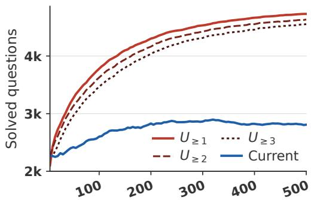  
(a) DeepSearch (HotpotQA)

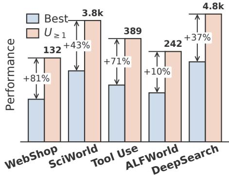  
(b) Best checkpoint vs. $U _ { \geq 1 }$  
Figure 1: The temporal capability gap. (a) DeepSearch on HotpotQA: the current checkpoint against $\bar { U _ { \geq k } } ( i )$ , the tasks solved by at least k of the checkpoints through index i, for $k = 1 , \bar { 2 , 3 } .$ . (b) Best single checkpoint against the historical union $U _ { \geq 1 }$ in five domains, with the relative gap annotated.

We propose Agentic-OPD, which organizes distillation around the student’s evolving capability gaps: whom to learn from and where to accept supervision. With all teacher checkpoints frozen, HCN (Highest Coverage Next) dynamically activates the candidate covering most of the student’s current failures, while LAD (Locality-Aware Distillation) confines supervision to student-generated tokens in failed rollouts on problems where that teacher performs better. Across five agentic domains and 24 benchmarks and task subsets, Agentic-OPD delivers consistent gains over the converged GRPO initialization, achieving up to 7.4 points on DeepSearch across three backbones; with a 4B backbone it surpasses GPT-5.6 and DeepSeek-V4.1 in our DeepSearch evaluation.

Our contributions are:

• We quantify capability forgetting across five agentic domains, showing that checkpoints from a single RL run collectively solve far more problems than its best checkpoint.

• We formulate temporal checkpoint consolidation as weak-to-strong OPD: HCN dynamically routes teachers according to the student’s capability gaps, while LAD transfers supervision only where a globally weaker teacher is locally stronger.

• We show that Agentic-OPD further improves performance after GRPO training has plateaued. We validate these gains across five agentic domains and on three backbones for DeepSearch.

## 2 PRELIMINARY STUDY

An agent is a policy π that interacts with an external environment over multiple turns, interleaving reasoning, tool calls, and answer generation. We score only the outcome: for a task x with reference answer $y ^ { * } ( x )$ , let ${ \hat { y } } _ { \pi } ( x )$ be its final answer and

$$
C _ { \pi } ( x ) = \mathbf { 1 } [ \hat { y } _ { \pi } ( x ) = y ^ { * } ( x ) ] ,\tag{1}
$$

substituting the environment’s own success predicate where the outcome is not an answer string.

Li et al. (2026b) report that CoT-style mathematical reasoning forgets intermediate abilities under both SFT and RL, with Temporal Forgetting Scores of 6.4% to 56.1%. We ask whether similar forgetting occurs in agentic reasoning, which involves multi-turn interaction with external environments.

We measure forgetting on the five domains of Section 4.1, training each from Qwen2.5-3B-Instruct with GRPO under result-based rewards and retaining every checkpoint of that run. Within each domain, all checkpoints share the same base model, data mixture, and tool environment. DeepSearch is the detailed case: we train on HotpotQA for 500 steps and save and evaluate a checkpoint every 5 steps, yielding $n = 1 0 0$ checkpoints. The held-out validation set $\mathcal { D } _ { \mathrm { v a l } }$ consists of a random 10% split of the training queries. We use greedy decoding for all checkpoint evaluations. The other four domains follow the protocols of Section 4.1. Let $\mathcal { D } _ { \mathrm { v a l } } ^ { ( d ) }$ denote the validation set for domain d. Writing $T _ { i }$ for the i-th saved checkpoint, the solved set, the tasks solved by at least k of the first i checkpoints, and the gap on domain d are

$$
Q _ { i } ^ { ( d ) } = \left\{ x \in \mathcal { D } _ { \mathrm { v a l } } ^ { ( d ) } : C _ { T _ { i } } ( x ) = 1 \right\} ,\tag{2}
$$

$$
U _ { \geq k } ^ { ( d ) } ( i ) = \Big \{ x \in \mathcal { D } _ { \mathrm { v a l } } ^ { ( d ) } : \sum _ { j = 1 } ^ { i } \mathbf { 1 } \Big [ x \in Q _ { j } ^ { ( d ) } \Big ] \geq k \Big \} , \qquad G _ { i } ^ { ( d ) } = \Big | U _ { \geq 1 } ^ { ( d ) } ( i ) \setminus Q _ { i } ^ { ( d ) } \Big | ,\tag{3}
$$

and we write $U _ { \geq k } ^ { ( d ) } = U _ { \geq k } ^ { ( d ) } ( n )$ for the whole run. So $\begin{array} { r } { U _ { \ge 1 } ^ { ( d ) } ( i ) = \bigcup _ { j \le i } Q _ { j } ^ { ( d ) } } \end{array}$ is the historical union through checkpoint i, and $G _ { i } ^ { ( d ) }$ counts the tasks some checkpoint up to that point solves and $T _ { i }$ does not. Raising k drops the tasks only a single checkpoint ever solved, so $U _ { > 2 } ^ { ( d ) }$ and $U _ { > 3 } ^ { ( d ) }$ separate repeatedly solvable behavior from isolated successes.

The temporal capability gap persists across the evaluated checkpoints (Figure 1). On DeepSearch it widens along training, and in every domain the best checkpoint trails $U _ { > 1 } ^ { ( \bar { d } ) }$ by the margin annotated in Figure 1(b); per-domain curves are in Appendix A.2. At step 500, the final checkpoint solves 2,808 tasks, while 4,553 tasks are solved by at least three checkpoints, a difference of 62%.

Historical checkpoints solve complementary subsets of tasks. This motivates selecting teachers by their coverage of the student’s current failures.

## 3 AGENTIC-OPD

The checkpoint-level complementarity observed in Section 2 motivates Agentic-OPD. The student is initialized from the best-validation RL checkpoint and trained with OPD. Figure 2 illustrates the full pipeline: How to Build the Teacher Pool (a, Section 3.1), teacher scheduling via HCN (b, Section 3.2), supervision filtering via LAD (c, Section 3.3), and the consolidation loop that assembles the three (Section 3.4).

## 3.1 BUILD TEACHER POOL

Let $\{ T _ { i } \} _ { i = 1 } ^ { n }$ be the checkpoints of one RL run in training-step order, instantiated with GRPO, in which every rollout is scored by the verifiable outcome indicator of Eq. 1. We write $r ( x , \hat { y } ) \in \{ 0 , 1 \}$ for that indicator applied to an individual rollout answer yˆ rather than to a policy’s decoded answer, so that $\boldsymbol { C } _ { \pi } ( \boldsymbol { x } ) = \boldsymbol { r } ( \boldsymbol { x } , \hat { y } _ { \pi } ( \boldsymbol { x } ) )$ ).

Unless otherwise specified, we save checkpoints every 10 RL steps and freeze all saved checkpoints from the complete run into the teacher pool. The student is initialized from the best-validation RL checkpoint. HCN uses $\mathcal { D } _ { \mathrm { v a l } }$ to select teachers according to the problems they solve that the current student misses (Eq. 9).

## 3.2 HCN: WHICH TEACHER TO DISTILL FROM

With multiple frozen candidates in the pool, the order in which they teach the student matters. We propose Highest Coverage Next (HCN), a scheduling policy for activating them.

Gain matrix. Evaluating a policy on $\mathcal { D } _ { \mathrm { v a l } }$ splits it into the problems that policy solves and those it does not; a problem that a candidate solves and the student does not is a gain of that candidate. Consolidation proceeds in scheduling steps t, one every K training steps. Let $\pi _ { \boldsymbol { S } , t }$ denote the student policy at scheduling stage t. We record each candidate’s solved set once and refresh the student’s at each of them,

$$
Q _ { i } = \{ x \in \mathcal { D } _ { \mathrm { v a l } } : C _ { T _ { i } } ( x ) = 1 \} , \qquad i \in [ n ] ,\tag{4}
$$

$$
P _ { t } = \left\{ x \in { \mathcal { D } } _ { \mathrm { v a l } } : C _ { \pi _ { S , t } } ( x ) = 1 \right\} ,\tag{5}
$$

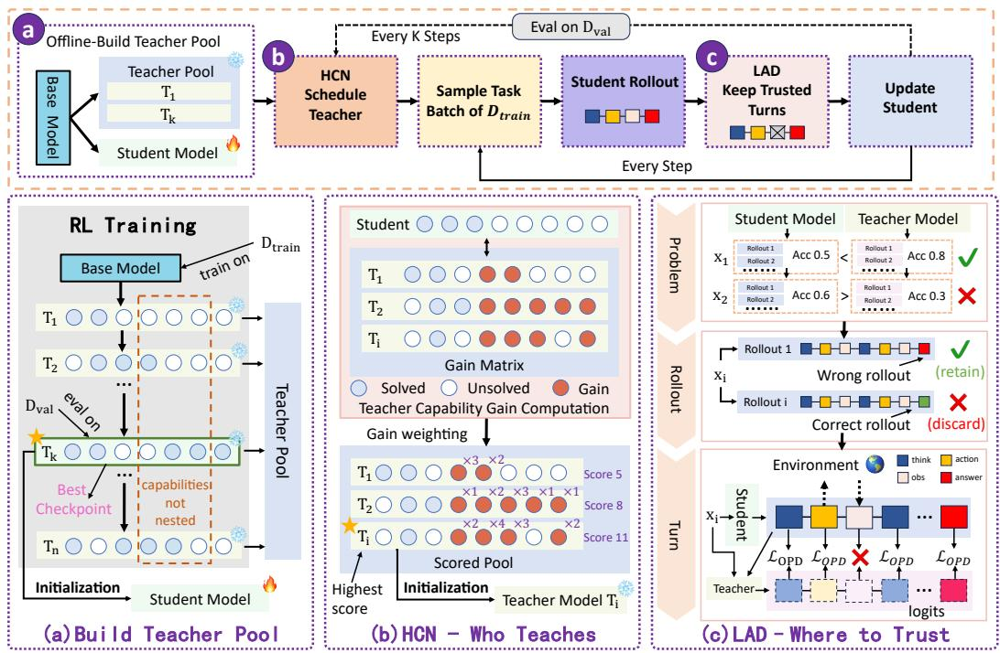  
Figure 2: Overview of Agentic-OPD. Top: the consolidation loop. (a) Frozen checkpoints from one RL run form the teacher pool. (b) HCN selects teachers based on coverage of the student’s unsolved tasks. (c) LAD filters supervision at the problem, rollout, and turn levels.

where HCN uses these sets to compute teacher scheduling scores. The gains of candidate i at scheduling step t are then

$$
\Delta _ { i , t } = Q _ { i } \backslash P _ { t } ,\tag{6}
$$

and stacking $\Delta _ { 1 , t } , \ldots , \Delta _ { n , t }$ as rows gives the gain matrix of Figure 2(b).

Scored pool. Each problem x carries a priority weight $w _ { t } ( x )$ , initialized to $w _ { 0 } ( x ) = 1$ . The weighted coverage of candidate i is

$$
g _ { i , t } = \sum _ { x \in \Delta _ { i , t } } w _ { t } ( x ) .\tag{7}
$$

After each scheduling step the weights are updated by

$$
w _ { t + 1 } ( x ) = \left\{ \begin{array} { l l } { 0 , } & { x \in P _ { t + 1 } , } \\ { 1 , } & { x \in Q _ { i _ { t } ^ { * } } \setminus P _ { t + 1 } , } \\ { \operatorname* { m i n } \{ w _ { t } ( x ) + \eta , w _ { \operatorname* { m a x } } \} , } & { \mathrm { o t h e r w i s e } , } \end{array} \right.\tag{8}
$$

with increment $\eta > 0$ and cap $w _ { \mathrm { m a x } }$ . Problems solved by the updated student receive zero weight. Unsolved problems covered by the current teacher return to base priority. The update increases the priority of problems that remain unsolved and are not covered by the current teacher, up to $w _ { \mathrm { m a x } }$

Scheduling teacher. HCN activates the candidate with the highest weighted coverage among those that still cover something the student misses,

$$
T _ { t } ^ { * } = T _ { i _ { t } ^ { * } } , \qquad i _ { t } ^ { * } = \arg \operatorname* { m a x } _ { i \in \mathcal { C } _ { t } } g _ { i , t } , \qquad \mathcal { C } _ { t } = \{ i \in [ n ] : g _ { i , t } > 0 \} ,\tag{9}
$$

with ties broken toward the earlier checkpoint. The activated teacher serves as the supervisor for the next K training steps, after which the student is re-evaluated on $\mathcal { D } _ { \mathrm { v a l } } , P _ { t + 1 }$ is refreshed, and the process repeats. Consolidation stops when $\mathcal { C } _ { t } = \emptyset$

## 3.3 LAD: WHERE TO TRUST THE ACTIVATED TEACHER

A teacher selected by HCN covers problems the student currently misses, but its advantage may vary across training problems. We propose Locality-Aware Distillation (LAD), which selects supervision through filters at three levels shown top to bottom in Figure 2(c).

Problem level. For a problem $x \in \mathcal { D } _ { \mathrm { t r a i n } }$ the student and the activated teacher each draw G rollouts, both scored by the outcome reward r that the RL run already computes:

$$
s ( x ) = \frac { 1 } { G } \sum _ { j = 1 } ^ { G } r \Big ( x , \hat { y } _ { S } ^ { ( j ) } \Big ) , \qquad q _ { t } ( x ) = \frac { 1 } { G } \sum _ { j = 1 } ^ { G } r \Big ( x , \hat { y } _ { T _ { t } ^ { * } } ^ { ( j ) } \Big ) .\tag{10}
$$

We retain problems for which the teacher has a higher empirical success rate than the student,

$$
\mathcal { X } _ { t } = \{ x : q _ { t } ( x ) > s ( x ) \} ,\tag{11}
$$

which excludes problems where the teacher’s empirical success rate does not exceed the student’s, including those for which both rates are zero. In the top block of Figure $2 ( \mathrm { c } ) , x _ { 1 }$ is admitted and $x _ { 2 }$ is rejected because the student has a higher empirical success rate on it.

Rollout level. Inside an admitted problem only the rollouts the student failed carry a gap to close,

$$
\mathcal F ( x ) = \left\{ j \in [ G ] : r \Big ( x , \hat { y } _ { S } ^ { ( j ) } \Big ) = 0 \right\} , \qquad x \in \mathcal { X } _ { t } .\tag{12}
$$

The teacher’s G rollouts estimate $q _ { t } ( x ) ;$ ; distillation uses the student’s failed trajectories. The middle block of Figure 2(c) retains the student’s wrong rollout and discards the correct one.

Turn level. The frozen teacher runs a single forward pass over each trajectory τ retained by Eqs. 11 and 12. Because an agentic trajectory interleaves student turns with environment returns, the loss is computed over the student-generated positions $\mathcal { G } ( \tau )$ , comprising the think, action, and answer turns in the bottom block of Figure 2(c). Prompt tokens, observations, tool returns, and padding are excluded. At such a position ℓ we truncate to the student’s top-k tokens ${ A } _ { \ell } ^ { ( k ) }$ and renormalize both policies on that support, $\begin{array} { r } { p _ { \pi } ^ { ( k ) } ( v \mid \tau _ { < \ell } ) = \pi ( v \mid \tau _ { < \ell } ) \big / \sum _ { u \in A _ { \ell } ^ { ( k ) } } \pi ( u \mid \tau _ { < \ell } ) } \end{array}$ , and minimize $D _ { \mathrm { K L } } ( p _ { S } ^ { ( k ) } \Vert p _ { T } ^ { ( k ) } )$

$$
\mathcal { L } _ { \mathrm { O P D } } = \frac { 1 } { \sum _ { \tau } \mathopen | \mathcal { G } ( \tau ) \mathclose | } \sum _ { \tau } \sum _ { \ell \in \mathcal { G } ( \tau ) } D _ { \mathrm { K L } } \mathopen { } \mathclose \bgroup ( p _ { S , t } ^ { ( k ) } \mathclose | \cdot \mathopen { } \mathclose \bgroup | \tau _ { < \ell } \aftergroup \egroup ) \mathclose | \mathclose | p _ { T _ { t } ^ { * } } ^ { ( k ) } \mathclose ( \cdot \mathopen { } \mathclose \bgroup | \tau _ { < \ell } ) \aftergroup \egroup ) .\tag{13}
$$

## 3.4 THE CONSOLIDATION LOOP: HOW MUCH TO DRAW PER UPDATE

The three components compose into the loop at the top of Figure 2: HCN activates a teacher, the student rolls out problems drawn from $\mathcal { D } _ { \mathrm { t r a i n } } , \mathrm { L A D }$ selects the samples worth learning from, and the student is updated on them. Since LAD discards most of what is generated, we follow the oversampling of DAPO (Yu et al., 2026) and keep drawing batches of B problems until the sequences retained by Eqs. 11 and 12 fill one batch, discarding the surplus, with a draw capped at L batches. We use a fixed number of retained sequences per update and retain the optimizer hyperparameters of the unfiltered setting. Additional sampling and teacher evaluation incur inference cost (Appendix A.3).

## 4 EXPERIMENTS

To verify the stability and effectiveness of Agentic-OPD, we conduct extensive experiments across a wide range of scenarios and environments.

## 4.1 EXPERIMENTAL SETUP

Tasks and Metrics. We evaluate Agentic-OPD on DeepSearch, Tool-use, WebShop, SciWorld, and ALFWorld. DeepSearch uses a Wikipedia retriever and is scored by exact match on seven question answering benchmarks. Tool-use provides a Python interpreter and is evaluated by pass@1 on AIME 2024, AIME 2025, MATH-500, AMC23, and OlympiadBench. We report task score and success rate for WebShop, Overall score for SciWorld, and success rate for ALFWorld. Appendix A.1 lists the benchmarks, interaction limits, and evaluation settings.

Table 1: DeepSearch exact match accuracy (%) on the test sets $\left( \mathcal { D } _ { \mathrm { t e s t } } \right)$ of seven benchmarks. Bold marks the best score within each backbone block.
<table><tr><td rowspan="2">Model</td><td colspan="2">In-domain</td><td colspan="5">Out-of-domain</td><td rowspan="2">Avg.</td></tr><tr><td>NQ</td><td>HotpotQA</td><td>PopQA</td><td>TriviaQA</td><td>2Wiki</td><td>MuSiQue</td><td>Bamboogle</td></tr><tr><td colspan="9">Proprietary models</td></tr><tr><td>GPT-5.6 (OpenAI, 2026)</td><td>7.7</td><td>22.2</td><td>32.2</td><td>56.5</td><td>17.4</td><td>11.2</td><td>30.4</td><td>25.4</td></tr><tr><td>Claude Sonnet 5 (Anthropic, 2026)</td><td>23.0</td><td>16.8</td><td>22.6</td><td>64.8</td><td>4.5</td><td>5.9</td><td>40.8</td><td>25.5</td></tr><tr><td>Grok-4.6 (xAI, 2026)</td><td>20.7</td><td>33.4</td><td>27.3</td><td>59.8</td><td>25.6</td><td>12.3</td><td>46.4</td><td>32.2</td></tr><tr><td colspan="9">Open-source models, &gt;100B parameters</td></tr><tr><td>DeepSeek-V4.1 (Xu et al., 2026)</td><td>31.5</td><td>42.6</td><td>40.5</td><td>72.9</td><td>30.7</td><td>15.9</td><td>64.8</td><td>42.7</td></tr><tr><td>GLM-5.3-Flash (GLM-5 Team et al., 2026)</td><td>29.1</td><td>46.7</td><td>43.9</td><td>70.5</td><td>36.6</td><td>23.3</td><td>64.8</td><td>45.0</td></tr><tr><td>Qwen3.5-122B-A10B (Qwen Team, 2026a)</td><td>34.4</td><td>42.1</td><td>42.4</td><td>72.0</td><td>36.2</td><td>20.4</td><td>59.2</td><td>43.8</td></tr><tr><td colspan="9">Open-source models, 20–100B parameters</td></tr><tr><td>Llama-3.1-70B-Instruct (Grattafiori et al., 2024)</td><td>32.3</td><td>37.7</td><td>37.5</td><td>63.5</td><td>30.1</td><td>16.1</td><td>48.0</td><td>37.9</td></tr><tr><td>Qwen3.6-35B-A3B (Qwen Team, 2026b)</td><td>34.8</td><td>38.6</td><td>41.0</td><td>68.1</td><td>30.0</td><td>17.5</td><td>56.0</td><td>40.9</td></tr><tr><td>Qwen3.5-35B-A3B (Qwen Team, 2026a)</td><td>32.1</td><td>39.7</td><td>38.9</td><td>70.3</td><td>30.0</td><td>18.8</td><td>53.6</td><td>40.5</td></tr><tr><td>Qwen3.8-27B (Qwen Team, 2026c)</td><td>33.2</td><td>41.0</td><td>36.2</td><td>56.7</td><td>26.5</td><td>15.0</td><td>48.0</td><td>36.0</td></tr><tr><td>Qwen3.6-27B (Qwen Team, 2026b)</td><td>32.7</td><td>38.2</td><td>38.6</td><td>65.5</td><td>29.0</td><td>15.9</td><td>52.0</td><td>38.9</td></tr><tr><td>Qwen3.5-27B (Qwen Team, 2026a)</td><td>31.1</td><td>39.5</td><td>36.1</td><td>67.8</td><td>31.9</td><td>17.5</td><td>52.8</td><td>39.5</td></tr><tr><td colspan="9">Open-source models, ≤20B parameters</td></tr><tr><td>Qwen3.5-9B (Qwen Team, 2026a)</td><td>23.7</td><td>28.2</td><td>28.3</td><td>56.9</td><td>28.5</td><td>10.7</td><td>38.4</td><td>30.7</td></tr><tr><td>Llama-3.1-8B-Instruct (Grattafiori et al., 2024)</td><td>28.7</td><td>28.3</td><td>33.5</td><td>52.3</td><td>21.0</td><td>10.7</td><td>43.2</td><td>30.4</td></tr><tr><td colspan="9">Backbone: Qwen2.5-3B-Instruct (Qwen Team, 2024)</td></tr><tr><td>Base model</td><td>27.9</td><td>21.2</td><td>33.3</td><td>49.6</td><td>21.0</td><td>6.6</td><td>22.4</td><td>26.0</td></tr><tr><td>GRPO</td><td>42.1</td><td>34.8</td><td>39.2</td><td>55.5</td><td>35.8</td><td>13.9</td><td>28.0</td><td>35.6</td></tr><tr><td>OPSD</td><td>24.8</td><td>21.0</td><td>31.5</td><td>45.9</td><td>23.3</td><td>4.5</td><td>24.8</td><td>25.1</td></tr><tr><td>Agentic-OPD</td><td>45.4</td><td>37.9</td><td>43.2</td><td>60.8</td><td>34.3</td><td>14.6</td><td>32.8</td><td>38.4</td></tr><tr><td colspan="9">Backbone: Qwen2.5-7B-Instruct (Qwen Team, 2024)</td></tr><tr><td>Base model</td><td>26.0</td><td>28.3</td><td>26.8</td><td>53.0</td><td>25.9</td><td>12.4</td><td>35.2</td><td>29.6</td></tr><tr><td>GRPO</td><td>43.2</td><td>39.2</td><td>41.7</td><td>60.9</td><td>29.9</td><td>16.3</td><td>40.8</td><td>38.8</td></tr><tr><td>OPSD</td><td>27.4</td><td>29.4</td><td>27.3</td><td>52.8</td><td>26.3</td><td>12.9</td><td>32.8</td><td>29.9</td></tr><tr><td>Agentic-OPD</td><td>50.4</td><td>46.5</td><td>47.8</td><td>66.5</td><td>41.1</td><td>22.5</td><td>48.8</td><td>46.2</td></tr><tr><td colspan="9">Backbone: Qwen3-4B-Instruct-2507 (Qwen Team, 2025)</td></tr><tr><td>Base model</td><td></td><td></td><td>28.6</td><td>49.0</td><td>25.1</td><td>6.2</td><td>37.6</td><td>28.0</td></tr><tr><td>GRPO</td><td>25.7</td><td>24.1 49.2</td><td>48.6</td><td>66.4</td><td>45.3</td><td>22.6</td><td>52.0</td><td>47.8</td></tr><tr><td>OPSD</td><td>50.4 30.4</td><td>30.9</td><td>34.8</td><td>52.3</td><td>17.3</td><td>9.4</td><td>25.6</td><td>28.7</td></tr><tr><td>Agentic-OPD</td><td>55.6</td><td>52.2</td><td>50.8</td><td>69.1</td><td>46.1</td><td>24.4</td><td>54.8</td><td>50.4</td></tr></table>

Models and Baselines. We use Qwen2.5-3B-Instruct, Qwen2.5-7B-Instruct, and Qwen3-4B Instruct for DeepSearch. The other four domains use Qwen2.5-3B-Instruct. All ablation and modelmerging experiments use Qwen2.5-3B-Instruct. We compare with the instruction-tuned base model and GRPO. The DeepSearch comparison also includes OPSD (Zhao et al., 2026), which uses privileged information to construct teacher supervision. Table 1 additionally reports proprietary and open-source reference models evaluated without domain-specific training.

Training and Evaluation. RL and OPD use the same training data. The student is initialized from the best-validation checkpoint of each RL run. For DeepSearch, we use 90% of the NQ and HotpotQA training sets for training and reserve the remaining 10% as $\mathcal { D } _ { \mathrm { v a l } }$ for teacher selection and the preliminary capability analysis (Section 2). All results in Table 1 are measured on the corresponding benchmark test sets $\mathcal { D } _ { \mathrm { t e s t } }$ . RL training follows Search-R1 (Jin et al., 2025) for DeepSearch, ReTool (Feng et al., 2026) for Tool-use, and AgentGym-RL (Xi et al., 2025) for WebShop, Sci-World, and ALFWorld. Unless otherwise specified, we save a checkpoint every 10 RL steps and include all saved checkpoints from the full RL run in the teacher pool. OPD uses the same rollout sampling settings as RL and minimizes $D _ { \mathrm { K L } } ( p _ { S } ^ { ( k ) } \Vert p _ { T } ^ { ( k ) } )$ between the student and the selected teacher, as defined in Eq. 13. Evaluation follows the inference settings of the corresponding RL method. All training runs use one node with 8×A800 80GB GPUs.

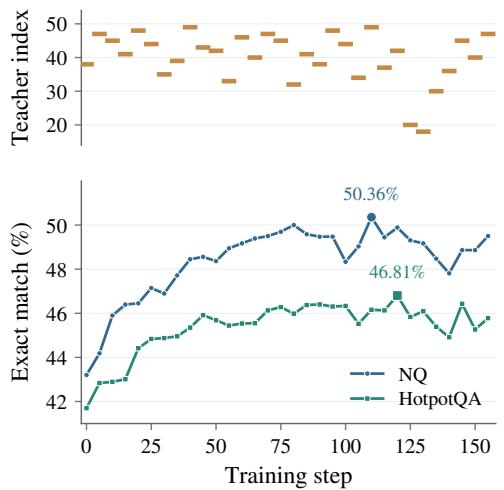  
(a) Teacher selection and QA performance. Base: Qwen2.5-7B-Instruct.

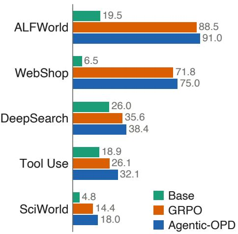  
(b) Five-domain overview. Base: Qwen2.5-3B-Instruct.  
Figure 3: (a) Teacher indices and NQ/HotpotQA exact match during consolidation; highlighted points mark peak accuracy. (b) Domain scores (%): mean exact match for DeepSearch, mean pass@1 for Tool-use, success rate for ALFWorld, mean of Score and Success for WebShop, and Overall score for SciWorld. Base denotes the instruction-tuned model.

## 4.2 EFFECTIVENESS AND GENERALITY ACROSS AGENTIC DOMAINS

Agentic-OPD improves mean DeepSearch accuracy over GRPO by 2.8, 7.4, and 2.6 percentage points on Qwen2.5-3B, Qwen2.5-7B, and Qwen3-4B, respectively (Table 1), with gains also extending to out-of-domain benchmarks. Historical checkpoints thus retain useful capabilities that the student can acquire through distillation after RL training.

With Qwen3-4B, Agentic-OPD reaches 50.4% mean accuracy, exceeding GPT-5.6 at 25.4% and DeepSeek-V4.1 at 42.7%. Under our DeepSearch evaluation settings, consolidating capabilities accumulated during task training allows a 4B model to outperform frontier models.

OPSD yields much smaller gains, suggesting that privileged information for a teacher using the same model as the student is insufficient for effective distillation in these agentic tasks. Agentic-OPD instead schedules historical teachers according to the student’s current capability gaps and restricts distillation to supervision where the teacher has a local advantage. Figure 3(a) shows that teacher selection changes as the student develops and accuracy improves during consolidation, supporting selection based on complementary capabilities.

Across 24 benchmarks and task subsets spanning five agentic domains, Agentic-OPD improves aggregate performance over GRPO in every domain (Figure 3(b)). The gains extend beyond retrievalbased question answering to code execution and multi-step environment interaction, showing that historical checkpoint reuse can improve a single policy across different agentic tasks.

## 4.3 CAPABILITY RECOVERY AND TEACHER COMPLEMENTARITY

We examine the Qwen3-4B consolidation run on 2,000 routing-validation questions, with 1,000 each from NQ and HotpotQA. This analysis uses the 100 historical teachers saved every five RL steps through step 500 and the best observed OPD validation checkpoint, update 20. Since this checkpoint is selected on the same validation set, the analysis describes consolidation behavior rather than independent test-set performance.

Recovery and retention. Figure 4(a) separates gains from losses at the question level. The student recovers 60 questions from the historical union while losing 45 previously solved questions, for a net gain of 15 questions (+0.75 percentage points, from 55.25% to 56.0%). All newly solved

(a) Capability recovery and forgetting

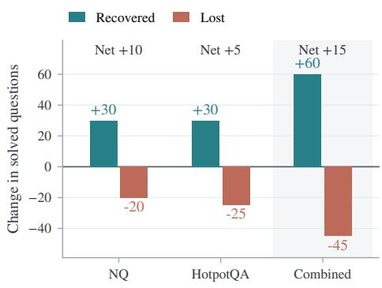  
Newly solved outside the historical union: 0

(b) Teacher strength and complementarity  
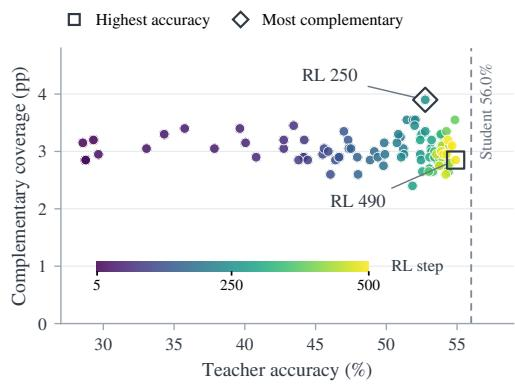  
Figure 4: Capability recovery and teacher complementarity on the Qwen3-4B routing-validation set. (a) Question-level changes after OPD update 20. (b) Teacher accuracy versus unweighted coverage 100|Q<sub>i</sub> \ P<sub>20</sub>|/2,000. Color indicates RL step; the dashed line marks student accuracy.

questions were solved by at least one historical teacher. Thus the observed improvement coincides with recovery of historical coverage, although substantial losses remain even at the best observed validation checkpoint.

Strength and complementarity. Figure 4(b) compares each teacher’s overall accuracy with its coverage of the best student’s remaining failures. The highest-accuracy teacher, RL step 490, scores 54.9% and covers 57 such questions (2.85 points). The most complementary teacher, step 250, has lower accuracy at 52.75% but covers 78 questions (3.9 points). Overall teacher accuracy therefore does not determine its usefulness for the student’s remaining gaps, supporting the motivation for coverage-based scheduling.

## 4.4 CHECKPOINT CONSOLIDATION ANALYSIS

Table 2 compares checkpoint reuse methods and ablations on NQ and HotpotQA with Qwen2.5-3B-Instruct.

Teacher scheduling and filtering. Replacing HCN with uniform teacher sampling at the same scheduling frequency reduces accuracy by 1.8 percentage points on both datasets. Removing LAD at the problem, rollout, and turn levels causes larger drops of 2.7 and 2.6 points on NQ and HotpotQA, respectively. Both variants still improve over GRPO, but lose much of the gain from consolidation. These results support selecting teachers for the student’s remaining gaps and filtering their supervision according to local advantage.

Alternative reuse methods. We compare model soups (Wortsman et al., 2022), TIES and DARE-TIES (Yadav et al., 2023; Yu et al., 2024), checkpoint EMA (Sanyal et al., 2023), GTR-Turbo’s alternating merging and RL updates (Wei et al., 2026), and Temporal Sampling (Li et al., 2026b). All methods use the same GRPO run; greedy soup has the same access to validation data as Agentic-OPD. Agentic-OPD achieves the highest accuracy on both datasets, improving over GRPO by 3.3 points on NQ and 3.1 points on

Table 2: Checkpoint reuse and ablations on DeepSearch with Qwen2.5-3B-Instruct: exact match (%).
<table><tr><td>Method</td><td>NQ</td><td>HotpotQA</td></tr><tr><td>GRPO (initialization)</td><td>42.1</td><td>34.8</td></tr><tr><td>Training-free merging</td><td></td><td></td></tr><tr><td>Uniform soup</td><td>42.5</td><td>35.1</td></tr><tr><td>Greedy soup TIES</td><td>43.4</td><td>35.9</td></tr><tr><td>DARE-TIES</td><td>43.0 43.7</td><td>35.6 36.2</td></tr><tr><td>EMA (last k)</td><td>42.8</td><td>35.5</td></tr><tr><td>Merging plus RL</td><td></td><td></td></tr><tr><td>GTR-Turbo Inference ensemble</td><td>45.0</td><td>37.4</td></tr><tr><td>Temporal Sampling</td><td>44.6</td><td>37.1</td></tr><tr><td>Agentic-OPD</td><td>45.4</td><td>37.9</td></tr><tr><td>w/o HCN</td><td>43.6</td><td>36.1</td></tr><tr><td>w/o LAD</td><td>42.7</td><td>35.3</td></tr></table>

HotpotQA. DARE-TIES is the strongest merging method without further training, but trails Agentic-OPD by 1.7 points on each dataset. GTR-Turbo narrows the gap to 0.4 and 0.5 points with additional RL updates. Agentic-OPD also exceeds Temporal Sampling by 0.8 points on both datasets while using a single policy at inference. Thus, distilling selected historical teachers provides greater gains than the other reuse methods evaluated here.

## 5 CONCLUSION

The best checkpoint from an agentic RL run does not retain everything learned during training. Across five domains, historical checkpoints solve many tasks that the selected checkpoint misses. We use these checkpoints as frozen teachers to recover some of this lost coverage in a single student. HCN selects teachers according to the student’s remaining failures, while LAD restricts distillation to problems where the teacher performs better and to failed student trajectories. The resulting policy improves aggregate performance over GRPO in all five domains, with gains across three backbones on DeepSearch. The ablations show why both decisions matter: removing either teacher scheduling or supervision filtering reduces the gains over the student’s initialization on the evaluated NQ and HotpotQA benchmarks. These results support retaining historical checkpoints as a source of useful supervision after RL training. A checkpoint can still teach the student even when its overall accuracy is lower. Recovery remains incomplete, however, and some tasks show regressions. Consolidation also requires additional sampling and evaluation, although deployment uses only the student. Re ducing this cost and measuring how much of the historical task coverage can be reliably recovered are useful next steps.

## 6 RELATED WORK

## 6.1 AGENTIC RL AND ON-POLICY DISTILLATION

Verifiable-reward RL trains language models for multi-turn search, tool use, and other interactive tasks. Representative systems include Search-R1, s3, Agentic-R, ReTool, and AgentGym-RL (Jin et al., 2025; Jiang et al., 2025; Liu et al., 2026; Feng et al., 2026; Xi et al., 2025), with GRPO and its variants providing common optimization frameworks (Shao et al., 2024; Yu et al., 2026). These runs produce a sequence of checkpoints; Agentic-OPD treats that sequence as a source of complementary capabilities rather than using only one checkpoint.

Sequence-level distillation trains on teacher-generated trajectories, whereas on-policy distillation evaluates the student’s own prefixes with teacher token distributions. GKD and MiniLLM established this paradigm, and recent work extends it to multi-turn agents through step-wise or turnaware objectives (Agarwal et al., 2024; Gu et al., 2024; Zhong et al., 2026; Zhou et al., 2026). Multi-teacher methods study capability integration and conflicts among complementary teachers, including counteraction-aware and teacher-debate-based approaches (Ma et al., 2026; Chen et al., 2026; Wang et al., 2026; Men et al., 2026). Most use parallel or independently developed teachers. Agentic-OPD instead uses historical checkpoints as frozen temporal teachers: HCN selects them by the student’s remaining capability gaps, and LAD restricts supervision to problems where the teacher has a local advantage and to failed student trajectories.

## 6.2 HISTORICAL CHECKPOINT REUSE AND MODEL MERGING

Model merging combines compatible models or checkpoints to aggregate capabilities. Model Soups averages weights from multiple fine-tuned models, while Task Arithmetic, Fisher Merging, TIES, and DARE improve parameter-space composition through task directions, parameter importance, interference resolution, and sparsification, respectively (Wortsman et al., 2022; Ilharco et al., 2022; Matena & Raffel, 2022; Yadav et al., 2023; Yu et al., 2024). More recent work extends merging to iterative model updating through activation-guided rotation-aware merging (Yao et al., 2026).

A related line of work reuses historical checkpoints from a single training trajectory. Checkpoint averaging can improve optimization stability and generalization (Sanyal et al., 2023; Li et al., 2026c), while Temporal Sampling recovers forgotten reasoning through outputs from multiple SFT or RL checkpoints (Li et al., 2026b). GTR-Turbo merges historical checkpoints into a unified teacher fo subsequent RL (Wei et al., 2026), and AgentPatch studies capability degradation after merging specialized agentic MLLMs and performs training-free capability repair (Shao et al., 2026). These approaches either reuse checkpoint outputs or collapse checkpoints into a single model. Agentic-OPD keeps them as separate frozen teachers and routes supervision according to the student’s capability gaps and each teacher’s local advantage, consolidating the recovered behavior into one deployable student.

## REFERENCES

Rishabh Agarwal, Nino Vieillard, Yongchao Zhou, Piotr Stanczyk, Sabela Ramos Garea, Matthieu Geist, and Olivier Bachem. On-policy distillation of language models: Learning from selfgenerated mistakes. In International Conference on Learning Representations, volume 2024, pp. 21246–21263, 2024.

Anthropic. Claude Sonnet 5. https://www.anthropic.com/news/claude-sonnet-5, 2026. Large language model.

Tianlei Chen, Jiao Ou, Ziyuan Liu, Ruiming Tang, Jian Liang, and Han Li. Counteraction-aware multi-teacher on-policy distillation for general capability recovery with domain preservation. arXiv preprint arXiv:2605.27115, 2026.

Jiazhan Feng, Shijue Huang, Xingwei Qu, Ge Zhang, Yujia Qin, Baoquan Zhong, Chengquan Jiang, Jinxin Chi, and Wanjun Zhong. Retool: Reinforcement learning for strategic tool use in llms. In International Conference on Learning Representations, volume 2026, pp. 37909–37926, 2026.

GLM-5 Team et al. GLM-5: From vibe coding to agentic engineering, 2026. URL https:// arxiv.org/abs/2602.15763.

Aaron Grattafiori, Abhimanyu Dubey, Abhinav Jauhri, Abhinav Pandey, Abhishek Kadian, Ahmad Al-Dahle, Aiesha Letman, Akhil Mathur, Alan Schelten, Alex Vaughan, et al. The Llama 3 herd of models. arXiv preprint arXiv:2407.21783, 2024.

Yuxian Gu, Li Dong, Furu Wei, and Minlie Huang. Minillm: Knowledge distillation of large language models. In International Conference on Learning Representations, volume 2024, pp. 32694–32717, 2024.

Chaoqun He, Renjie Luo, Yuzhuo Bai, Shengding Hu, Zhen Thai, Junhao Shen, Jinyi Hu, Xu Han, Yujie Huang, Yuxiang Zhang, et al. Olympiadbench: A challenging benchmark for promoting agi with olympiad-level bilingual multimodal scientific problems. In Proceedings of the 62nd Annual Meeting of the Association for Computational Linguistics (Volume 1: Long Papers), pp. 3828–3850, 2024.

Xanh Ho, Anh-Khoa Duong Nguyen, Saku Sugawara, and Akiko Aizawa. Constructing a multi-hop qa dataset for comprehensive evaluation of reasoning steps. In Proceedings of the 28th International Conference on Computational Linguistics, pp. 6609–6625, 2020.

Gabriel Ilharco, Marco Tulio Ribeiro, Mitchell Wortsman, Suchin Gururangan, Ludwig Schmidt, Hannaneh Hajishirzi, and Ali Farhadi. Editing models with task arithmetic. arXiv preprint arXiv:2212.04089, 2022.

Pengcheng Jiang, Xueqiang Xu, Jiacheng Lin, Jinfeng Xiao, Zifeng Wang, Jimeng Sun, and Jiawei Han. s3: You don’t need that much data to train a search agent via rl. In Proceedings ofthe 2025 Conference on Empirical Methods in Natural Language Processing, pp. 21610–21628, 2025.

Bowen Jin, Hansi Zeng, Zhenrui Yue, Jinsung Yoon, Sercan Arik, Dong Wang, Hamed Zamani, and Jiawei Han. Search-r1: Training llms to reason and leverage search engines with reinforcement learning. arXiv preprint arXiv:2503.09516, 2025.

Mandar Joshi, Eunsol Choi, Daniel S Weld, and Luke Zettlemoyer. Triviaqa: A large scale distantly supervised challenge dataset for reading comprehension. In Proceedings ofthe 55th Annual Meeting of the Association for Computational Linguistics (Volume 1: Long Papers), pp. 1601–1611, 2017.

Tom Kwiatkowski, Jennimaria Palomaki, Olivia Redfield, Michael Collins, Ankur Parikh, Chris Alberti, Danielle Epstein, Illia Polosukhin, Jacob Devlin, Kenton Lee, et al. Natural questions: a benchmark for question answering research. Transactions of the Association for Computational Linguistics, 7:453–466, 2019.

Xinzhe Li. A review of prominent paradigms for llm-based agents: Tool use, planning (including rag), and feedback learning. In Proceedings of the 31st international conference on computational linguistics, pp. 9760–9779, 2025.

Yaxuan Li, Yuxin Zuo, Bingxiang He, Jinqian Zhang, Chaojun Xiao, Cheng Qian, Tianyu Yu, Huan’ang Gao, Wenkai Yang, Zhiyuan Liu, et al. Rethinking on-policy distillation of large language models: Phenomenology, mechanism, and recipe. arXiv preprint arXiv:2604.13016, 2026a.

Yuetai Li, Zhangchen Xu, Fengqing Jiang, Bhaskar Ramasubramanian, Luyao Niu, Bill Yuchen Lin, Xiang Yue, and Radha Poovendran. Temporal sampling for forgotten reasoning in llms. In Proceedings of the 64th Annual Meeting of the Association for Computational Linguistics (Volume 1: Long Papers), pp. 28309–28327, 2026b. URL https://arxiv.org/abs/2505.20196.

Yunshui Li, Yiyuan Ma, Shen Yan, Chaoyi Zhang, Jing Liu, Jianqiao Lu, Ziwen Xu, Mengzhao Chen, Minrui Wang, Shiyi Zhan, et al. Model merging in pre-training of large language models. Advances in Neural Information Processing Systems, 38:133668–133691, 2026c.

Hunter Lightman, Vineet Kosaraju, Yuri Burda, Harrison Edwards, Bowen Baker, Teddy Lee, Jan Leike, John Schulman, Ilya Sutskever, and Karl Cobbe. Let’s verify step by step. In International Conference on Learning Representations, volume 2024, pp. 39578–39601, 2024.

Wenhan Liu, Xinyu Ma, Yutao Zhu, Yuchen Li, Daiting Shi, Dawei Yin, and Zhicheng Dou. Agentic-r: Learning to retrieve for agentic search. In Findings of the Association for Compu tational Linguistics: ACL 2026, pp. 15987–16005, 2026.

Wenhan Ma, Jianyu Wei, Liang Zhao, Hailin Zhang, Bangjun Xiao, Lei Li, Qibin Yang, Bofei Gao, Yudong Wang, Rang Li, et al. Mopd: Multi-teacher on-policy distillation for capability integration in llm post-training. arXiv preprint arXiv:2606.30406, 2026.

Alex Mallen, Akari Asai, Victor Zhong, Rajarshi Das, Daniel Khashabi, and Hannaneh Hajishirzi. When not to trust language models: Investigating effectiveness of parametric and non-parametric memories. In Proceedings of the 61st annual meeting of the association for computational linguistics (volume 1: Long papers), pp. 9802–9822, 2023.

Michael S Matena and Colin Raffel. Merging models with fisher-weighted averaging. Advances in Neural Information Processing Systems, 35:17703–17716, 2022.

Tianyi Men, Zhuoran Jin, Kang Liu, and Jun Zhao. The physics of multi-turn long-horizon planning: From pre-training to post-training via single-and multi-teacher on-policy agentic distillation. arXiv preprint arXiv:2607.24720, 2026.

OpenAI. GPT-5.6. https://openai.com/index/gpt-5-6/, 2026. Large language model.

Ofir Press, Muru Zhang, Sewon Min, Ludwig Schmidt, Noah A Smith, and Mike Lewis. Measuring and narrowing the compositionality gap in language models. In Findings of the Association for Computational Linguistics: EMNLP 2023, pp. 5687–5711, 2023.

Qwen Team. Qwen2.5: A party of foundation models, September 2024. URL https://qwenlm. github.io/blog/qwen2.5/.

Qwen Team. Qwen3 technical report, 2025. URL https://arxiv.org/abs/2505.09388.

Qwen Team. Qwen3.5: Towards native multimodal agents, February 2026a. URL https:// qwen.ai/blog?id=qwen3.5.

Qwen Team. Qwen3.6-35B-A3B: Agentic coding power, now open to all, April 2026b. URL https://qwen.ai/blog?id=qwen3.6-35b-a3b.

Qwen Team. Qwen3.8-Max: A new bar for coding and cowork, August 2026c. URL https: //qwen.ai/blog?id=qwen3.8.

Sunny Sanyal, Atula Neerkaje, Jean Kaddour, Abhishek Kumar, and Sujay Sanghavi. Early weight averaging meets high learning rates for llm pre-training. arXiv preprint arXiv:2306.03241, 2023.

Zhihong Shao, Peiyi Wang, Qihao Zhu, Runxin Xu, Junxiao Song, Xiao Bi, Haowei Zhang, Mingchuan Zhang, YK Li, Y Wu, et al. Deepseekmath: Pushing the limits of mathematical reasoning in open language models. arXiv preprint arXiv:2402.03300, 2024.

Zibo Shao, Baochen Xiong, Chengdong Xu, Linhui Xiao, Kaichen Li, Haoran Gong, Yan Li, Yaguang Song, and Xiaoshan Yang. Agentpatch: Coarse-to-fine weak-task repair for merging agentic multimodal large language models. arXiv preprint arXiv:2608.06699, 2026.

Mohit Shridhar, Xingdi Yuan, Marc-Alexandre Cotˆ e, Yonatan Bisk, Adam Trischler, and Matthew´ Hausknecht. Alfworld: Aligning text and embodied environments for interactive learning. arXiv preprint arXiv:2010.03768, 2020.

Harsh Trivedi, Niranjan Balasubramanian, Tushar Khot, and Ashish Sabharwal. Musique: Multihop questions via single-hop question composition. Transactions of the Association for Computational Linguistics, 10:539–554, 2022.

Jianze Wang, Ying Liu, Jinlong Chen, Xuchun Hu, Qilong Zhang, Yu Cao, Jun Wang, Hua Yang, Yong Xie, and Qianglong Chen. Mad-opd: Breaking the ceiling in on-policy distillation via multi-agent debate. arXiv preprint arXiv:2605.01347, 2026.

Ruoyao Wang, Peter Jansen, Marc-Alexandre Cotˆ e, and Prithviraj Ammanabrolu. Scienceworld:´ Is your agent smarter than a 5th grader? In Proceedings of the 2022 Conference on Empirical Methods in Natural Language Processing, pp. 11279–11298, 2022.

Tong Wei, Yijun Yang, Changhao Zhang, Junliang Xing, Yuanchun Shi, Zongqing Lu, and Deheng Ye. Gtr-turbo: Merged checkpoint is secretly a free teacher for agentic VLM training. In Proceedings of the IEEE/CVF Conference on Computer Vision and Pattern Recognition, pp. 26476–26486, 2026.

Mitchell Wortsman, Gabriel Ilharco, Samir Ya Gadre, Rebecca Roelofs, Raphael Gontijo-Lopes, Ari S Morcos, Hongseok Namkoong, Ali Farhadi, Yair Carmon, Simon Kornblith, et al. Model soups: averaging weights of multiple fine-tuned models improves accuracy without increasing inference time. In International conference on machine learning, pp. 23965–23998. Pmlr, 2022.

xAI. Grok 4.6. https://x.ai/news/grok-4-6, 2026. Large language model.

Zhiheng Xi, Jixuan Huang, Chenyang Liao, Baodai Huang, Honglin Guo, Jiaqi Liu, Rui Zheng, Junjie Ye, Jiazheng Zhang, Wenxiang Chen, et al. Agentgym-rl: Training llm agents for long-horizon decision making through multi-turn reinforcement learning. arXiv preprint arXiv:2509.08755, 2025.

Anyi Xu, B Li, Bangcai Lin, Bing Xue, BingCheng Xian, Bingzheng Xu, Bochao Wu, Bowei Zhang, Boyi Deng, CC Yu, et al. DeepSeek-V4.1-Flash: Pushing the limits of KV cache compression. arXiv preprint arXiv:2609.19969, 2026.

Weikai Xu, Chengrui Huang, Shen Gao, and Shuo Shang. Llm-based agents for tool learning: A survey: W. xu et al. Data Science and Engineering, 10(4):533–563, 2025.

Prateek Yadav, Derek Tam, Leshem Choshen, Colin A Raffel, and Mohit Bansal. Ties-merging: Resolving interference when merging models. Advances in neural information processing systems, 36:7093–7115, 2023.

Zhilin Yang, Peng Qi, Saizheng Zhang, Yoshua Bengio, William Cohen, Ruslan Salakhutdinov, and Christopher D Manning. Hotpotqa: A dataset for diverse, explainable multi-hop question answering. In Proceedings of the 2018 conference on empirical methods in natural language processing, pp. 2369–2380, 2018.

Shunyu Yao, Howard Chen, John Yang, and Karthik Narasimhan. Webshop: Towards scalable real-world web interaction with grounded language agents. Advances in Neural Information Processing Systems, 35:20744–20757, 2022.

Yuxuan Yao, Haonan Sheng, Qingsong Lv, Han Wu, Shuqi Liu, Zehua Liu, Zengyan Liu, Jiahui Gao, Haochen Tan, Xiaojin Fu, et al. Merging beyond: Streaming llm updates via activationguided rotations. arXiv preprint arXiv:2602.03237, 2026.

Linyan Yu, Bowen Yu, Haiyang Yu, Fei Huang, and Yongbin Li. Language models are super mario: Absorbing abilities from homologous models as a free lunch. In Icml, volume 2, pp. 21, 2024.

Qiying Yu, Zheng Zhang, Ruofei Zhu, Yufeng Yuan, Xiaochen Zuo, Yu Yue, Weinan Dai, Tiantian Fan, Gaohong Liu, Lingjun Liu, et al. Dapo: An open-source llm reinforcement learning system at scale. Advances in Neural Information Processing Systems, 38:113222–113244, 2026.

Siyan Zhao, Zhihui Xie, Mengchen Liu, Jing Huang, Guan Pang, Feiyu Chen, and Aditya Grover. Self-distilled reasoner: On-policy self-distillation for large language models. arXiv preprint arXiv:2601.18734, 2026.

Qiyong Zhong, Mao Zheng, Mingyang Song, Xin Lin, Jie Sun, Houcheng Jiang, Xiang Wang, and Junfeng Fang. Sod: Step-wise on-policy distillation for small language model agents. arXiv preprint arXiv:2605.07725, 2026.

Yuhang Zhou, Kai Zheng, Haoling Li, Dengyun Peng, Can Xu, and Jingjing Chen. Turnopd: Making on-policy distillation turn-aware for efficient long-horizon agent training. arXiv preprint arXiv:2607.05804, 2026.

## A APPENDIX

## A.1 DETAILED ENVIRONMENT SETTINGS

RL training follows Search-R1 (Jin et al., 2025) for DeepSearch, ReTool (Feng et al., 2026) for Tool-use, and AgentGym-RL for WebShop, SciWorld, and ALFWorld. OPD uses the same training data and rollout sampling settings as RL. Unless otherwise specified, the teacher pool contains all checkpoints saved at intervals of 10 RL steps. OPD minimizes $D _ { \mathrm { K L } } ( p _ { S } ^ { ( k ) } \Vert p _ { T } ^ { ( k ) } )$ in Eq. 13.

Table 3: Benchmarks, evaluation metrics, and maximum interaction turns per episode.
<table><tr><td>Domain</td><td>Benchmarks / tasks</td><td>Metric</td><td>Turns</td></tr><tr><td>DeepSearch</td><td>NQ (Kwiatkowski et al., 2019), HotpotQA (Yang et al., 2018) (in-domain); PopQA (Mallen et al., 2023), TriviaQA (Joshi et al., 2017), 2Wiki (Ho et al., 2020), MuSiQue (Trivedi et al., 2022), Bamboogle (Press et al., 2023)</td><td>Exact match</td><td>4</td></tr><tr><td>Tool-use</td><td>(out-of-domain) AIME 2024, AIME 2025, MATH-500 (Lightman et al., 2024), AMC23, OlympiadBench (He et al., 2024)</td><td>pass@1</td><td>16</td></tr><tr><td>WebShop (Yao et al., 2022)</td><td>Goal-directed shopping on simulated e-commerce pages</td><td>Score, success rate</td><td>20</td></tr><tr><td>SciWorld (Wang et al., 2022)</td><td>Measure, Test-Cond., Find, Chem-Mix, Lifespan</td><td>Overall score</td><td>15</td></tr><tr><td>ALFWorld (Shridhar et al., 2020)</td><td>Embodied household instruction following</td><td>Success rate</td><td>50</td></tr></table>

DeepSearch. The agent retrieves passages from a Wikipedia index through a search tool. We use 90% of the NQ and HotpotQA training sets for both RL and OPD and reserve the remaining 10% for teacher selection. Evaluation covers the seven benchmarks in Table 3 and follows the inference protocol of Search-R1 (Jin et al., 2025). Each episode allows up to 4 interactions.

Tool-use. The agent executes Python code in a sandboxed interpreter during reasoning. Training and evaluation follow ReTool (Feng et al., 2026), with at most 16 interaction turns per episode. For evaluation, we use temperature 1.0 and top-p 0.7, repeat evaluation 32 times, and report the average accuracy as an estimate of pass@1.

WebShop. The agent searches for products and navigates simulated shopping pages to complete a purchase instruction. Each episode allows up to 20 interaction turns. We report both task score and success rate.

SciWorld. The agent interacts with a text-based scientific environment. We report scores for Measure, Test-Cond., Find, Chem-Mix, and Lifespan, together with the Overall score. Each episode allows up to 15 interaction turns.

ALFWorld. The agent follows household instructions in a text-based environment. We evaluate Pick, Look, Clean, Heat, Cool, and Pick2, with at most 50 interaction turns per episode. We report success rates for each task type and for the full evaluation set.

For WebShop, SciWorld, and ALFWorld, RL training follows AgentGym-RL. Evaluation uses temperature 0.7, top-p 0.8, and top-k 20. Results are averaged over three random seeds.

## A.2 TEMPORAL CAPABILITY GAP ACROSS DOMAINS

Figure 5 repeats the measurement of Section 2 on four further environments. For each domain we train with GRPO under result-based rewards, evaluate every saved checkpoint on the domain’ validation set, and plot the count solved by the current checkpoint, $| Q _ { i } ^ { ( d ) } |$ , against the historical union up to that step, $U _ { \geq 1 } ^ { ( d ) } ( i ) ;$ the shaded band is the gap $G _ { i } ^ { ( d ) }$ of Eq. 3. Step 0 is the untrained checkpoint and is excluded, and the vertical axes are truncated below the lowest observed count.

The gap is present in every domain and does not close with training. It is widest on ReTool and WebShop, where the current checkpoint plateaus while $U _ { \geq 1 } ^ { ( d ) } ( i )$ keeps growing, and narrowest on SciWorld, where both curves saturate near the size of the validation set and leave little room for the union to extend. This matches the DeepSearch observation: even within a single run, the latest checkpoint is not a superset of what earlier checkpoints could do, so the temporal pool retains complementary and recoverable behaviors.

Because SciWorld has a relatively small validation set, its point estimates have low statistical power and differences between checkpoints may fail to reach conventional significance thresholds even when their trajectories are visibly different. We therefore treat the SciWorld curves as descriptive evidence rather than as a standalone significance claim. For checkpoint comparisons, we use paired resampling over the same task instances (with a 95% bootstrap confidence interval) and aggregate estimates across the three random seeds; we do not interpret a non-significant SciWorld comparison as evidence of equivalence. The qualitative conclusion is retained only when the direction of the gap is consistent across seeds and is supported by the per-task trajectories.

$$
\mathsf { G a p } G _ { i } \quad \mathrm { ~ - ~ } U _ { \ge 1 } ( i ) \quad \mathrm { ~ - ~ } \mathsf { C u r r e n t }
$$

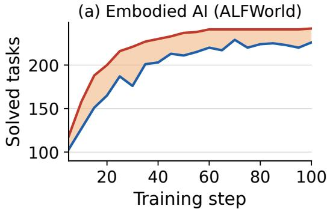

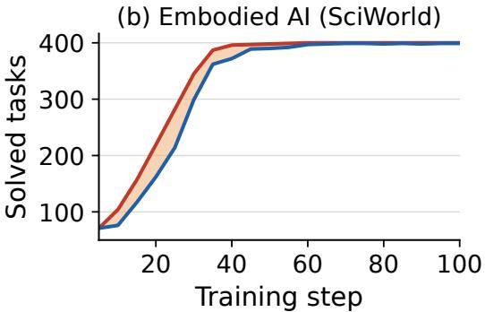

(c) WebShop  
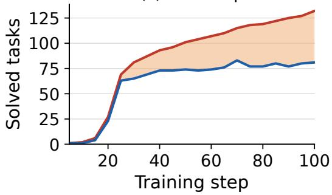

(d) Tool Use (ReTool)  
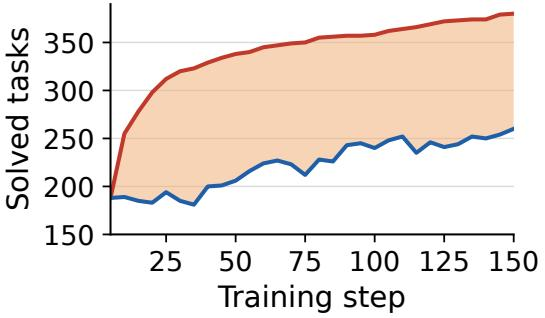  
Figure 5: Validation tasks solved during RL in four domains: current checkpoint (blue) and historical union $U _ { \geq 1 } ^ { ( d ) } ( i )$ (red). Shading marks the gap $G _ { i } ^ { ( d ) }$

Table 4: Tool-use pass@1 accuracy (%). Mean is the average across five benchmarks.
<table><tr><td>Method</td><td>AIME 2024</td><td>AIME 2025</td><td>MATH-500</td><td>AMC23</td><td>OlympiadBench</td><td>Mean</td></tr><tr><td>Base</td><td>3.0</td><td>3.1</td><td>43.0</td><td>27.6</td><td>17.9</td><td>18.9</td></tr><tr><td>GRPO</td><td>7.9</td><td>12.3</td><td>49.5</td><td>36.3</td><td>24.8</td><td>26.1</td></tr><tr><td>Agentic-OPD</td><td>15.1</td><td>15.5</td><td>55.3</td><td>44.8</td><td>29.9</td><td>32.1</td></tr></table>

Table 5: SciWorld scores by task subset and the aggregate Overall score.
<table><tr><td>Method</td><td>Measure</td><td>Test-Cond.</td><td>Find</td><td>Chem-Mix</td><td>Lifespan</td><td>Overall</td></tr><tr><td>Base</td><td>1.1</td><td>4.2</td><td>8.4</td><td>4.7</td><td>10.6</td><td>4.8</td></tr><tr><td>GRPO</td><td>7.6</td><td>9.3</td><td>22.9</td><td>15.4</td><td>41.1</td><td>14.4</td></tr><tr><td>Agentic-OPD</td><td>14.8</td><td>10.0</td><td>25.0</td><td>26.6</td><td>50.0</td><td>18.0</td></tr></table>

Table 6: WebShop task score and success rate (%). Mean averages the two metrics.
<table><tr><td>Method</td><td>Score</td><td>Success</td><td>Mean</td></tr><tr><td>Base</td><td>10.4</td><td>2.5</td><td>6.5</td></tr><tr><td>GRPO</td><td>80.6</td><td>63.0</td><td>71.8</td></tr><tr><td>Agentic-OPD</td><td>84.0</td><td>66.0</td><td>75.0</td></tr></table>

Table 7: ALFWorld success rate (%) by task type. All denotes the full evaluation set.
<table><tr><td>Method</td><td>Pick</td><td>Look</td><td>Clean</td><td>Heat</td><td>Cool</td><td>Pick2</td><td>All</td></tr><tr><td>Base</td><td>45.7</td><td>5.3</td><td>10.8</td><td>8.0</td><td>10.7</td><td>17.8</td><td>19.5</td></tr><tr><td>GRPO</td><td>97.8</td><td>73.7</td><td>94.6</td><td>96.0</td><td>82.1</td><td>80.0</td><td>88.5</td></tr><tr><td>Agentic-OPD</td><td>100.0</td><td>78.9</td><td>94.6</td><td>92.0</td><td>85.7</td><td>86.7</td><td>91.0</td></tr></table>

## A.3 COST OF THE CONSOLIDATION LOOP

The consolidation loop of Section 3.4 targets a fixed number of retained sequences per update and retains the optimizer hyperparameters of the unfiltered OPD setting. For a target batch of $B _ { \mathrm { e f f } } =$ BG sequences, if a fraction ρ of the student’s rollouts survives the filters of Eq. 11–12, filling the batch requires approximately $B / \rho$ sampled problems and $2 B G / \rho$ rollouts, split evenly between the student and the activated teacher. The teacher also performs a forward pass over each retained student trajectory to provide token-level supervision. These estimates apply when the batch is filled before the cap of L sampling batches; updates that reach the cap may use fewer than $B _ { \mathrm { e f f } }$ retained sequences. Additional sampling, scoring, and teacher evaluation incur inference cost. HCN also requires evaluating the frozen teacher pool on the validation set and periodically re-evaluating the student for teacher scheduling.

## A.4 PER-BENCHMARK RESULTS

Figure 3(b) reports one aggregate score per domain: mean exact match across the seven DeepSearch benchmarks, mean pass@1 across the five Tool-use benchmarks, full-evaluation-set success rate (All) for ALFWorld, the mean of Score and Success for WebShop, and the environment’s Overall score for SciWorld. DeepSearch per-benchmark results are reported in Table 1; the tables below give the per-benchmark and per-task results for the other four domains. All runs reported here start from Qwen2.5-3B-Instruct; “Base” denotes the instruction-tuned model before domain-specific training.

Agentic-OPD improves over GRPO on four of the six task types, ties on Clean, and trails on Heat. The aggregate All success rate increases from 88.5% to 91.0%, with the largest task-level gains on Look and Pick2.

Cross-benchmark analysis. On the tool-use benchmarks, the mean pass@1 increases from 26.1% with GRPO to 32.1% with Agentic-OPD. The method improves all five benchmarks. The largest changes are on AIME 2024 and AIME 2025 (from 3.0% to 15.1% and from 3.1% to 15.5%, respectively), whereas the gain on MATH-500 is smaller (49.5% to 55.3%).

The interactive tasks show a similar pattern. On SciWorld, the Overall score rises from 14.4 to 18.0, mainly due to gains on Chem-Mix and Lifespan; Test-Cond. changes only slightly. On WebShop, Score increases from 80.6% to 84.0% and Success from 63.0% to 66.0%, raising their mean from 71.8% to 75.0%.

ALFWorld also shows task-level variation: four task types improve, one is unchanged, and Heat drops from 96.0% to 92.0%. These results support an overall improvement, while also showing that the effect depends on the benchmark and task type.

## A.5 FULL-PAGE TRAJECTORY CASES

Each case is rendered as a single self-contained image with a task panel and an Agentic-OPD trajectory panel. Reasoning is summarized for readability; retrieved passages are excerpted, with “[...]” marking omissions. Green highlights supporting evidence or successful actions, while red highlights errors. The two DeepSearch cases are validation rollouts collected at OPD update 20, rather than trajectories from an optimizer batch. They illustrate an entity-disambiguation failure and a successful two-hop search, respectively.

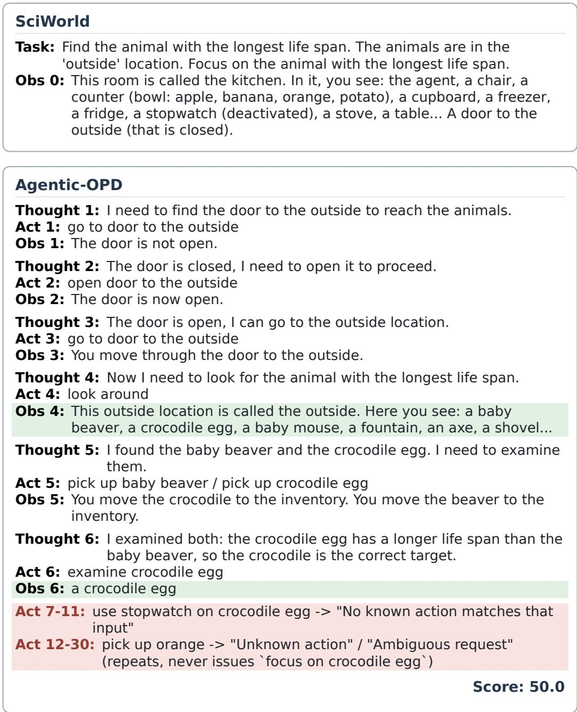  
Figure 6: SciWorld case study. The Agentic-OPD agent identifies the crocodile as the animal with the longest life span, but fails to issue the final focus action and receives partial reward.

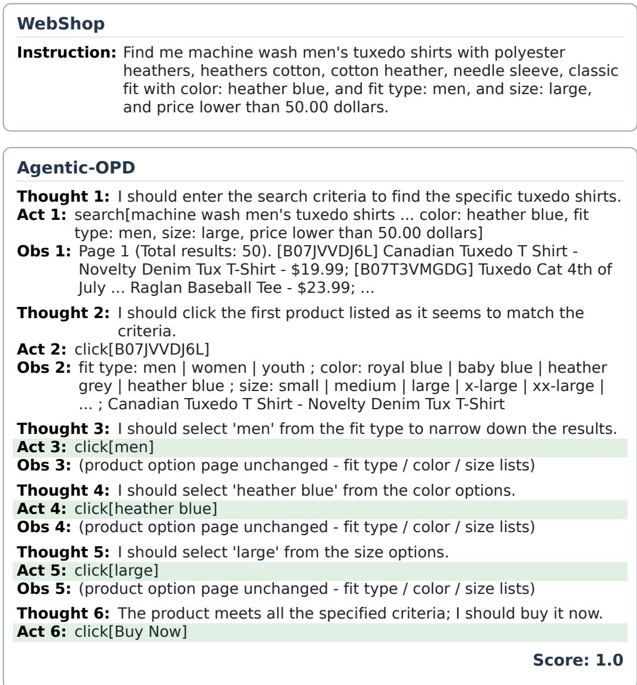  
Figure 7: WebShop case study. The agent searches for the requested product, selects the required attributes, and completes the purchase.

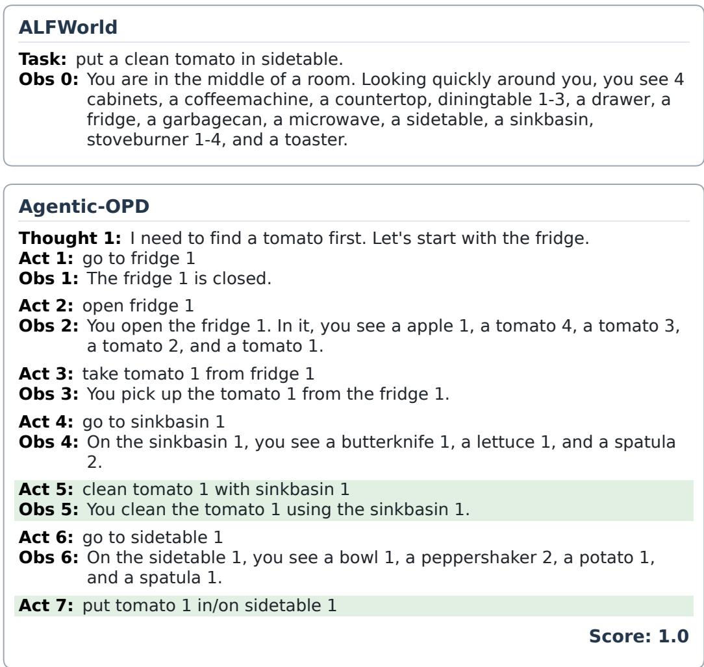  
Figure 8: ALFWorld case study. The agent locates and cleans a tomato before placing it on the sidetable, completing the task.

```python
MATH-500
Problem: Let n be a positive integer. What is the greatest possible value of
gcd(n + 7, 2n + 1)? Give the final answer on its own line as
\boxed{answer}.
Agentic-OPD
Reason: Recall GCD properties, then use the code interpreter to iterate over
positive integers n and compute gcd(n + 7, 2n + 1), tracking the
maximum.
Code (code_interpreter):
import math
max_gcd = 0
best_n = 0
for n in range(1, 10000): # Arbitrary upper limit, can be adjusted
current_gcd = math.gcd(n + 7, 2 * n + 1)
if current_gcd > max_gcd:
max_gcd = current_gcd
best_n = n
print(max_gcd)
Output: 13
Reason: The loop tracks the maximum gcd over n; the result 13 matches the
manual calculation, so the greatest possible value is 13.
Answer: \boxed{13}
Score: 1.0
```  
Figure 9: MATH-500 case study. The agent uses the code interpreter to verify the maximum GCD and returns 13 .

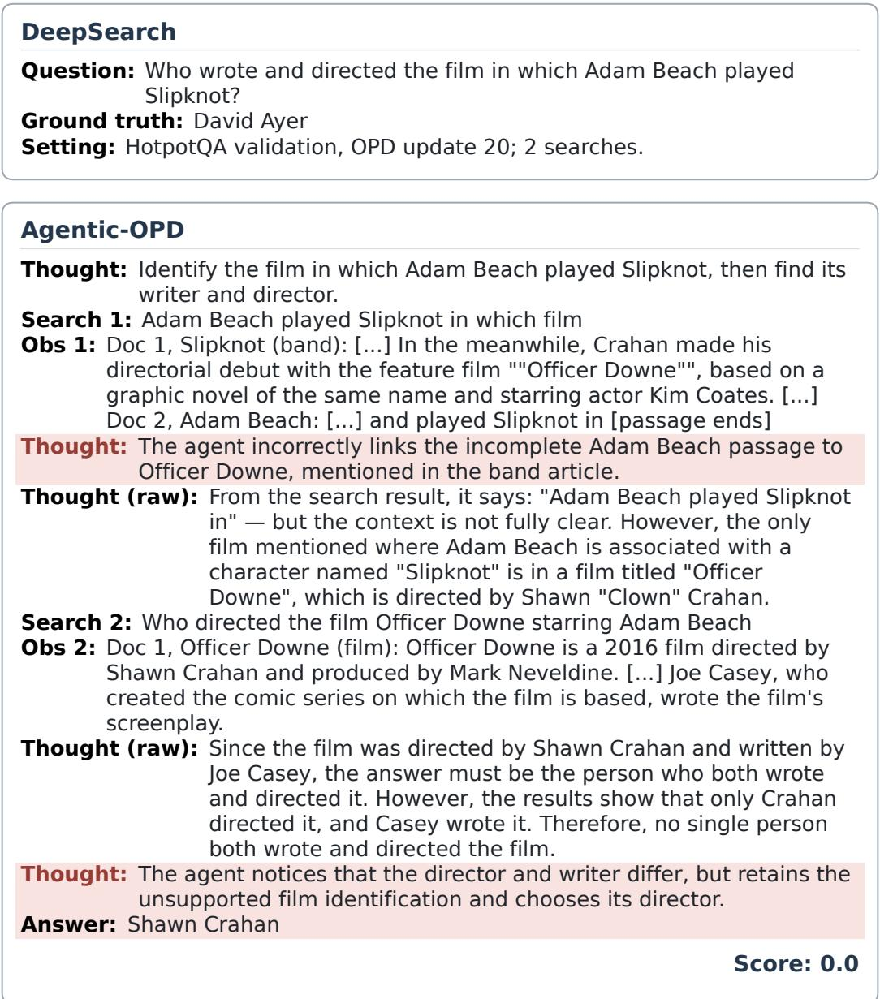  
Figure 10: DeepSearch case study (incorrect). At OPD update 20, the agent confuses the character Slipknot with the band, follows an unsupported link to Officer Downe, and answers Shawn Crahan instead of David Ayer (score 0.0).

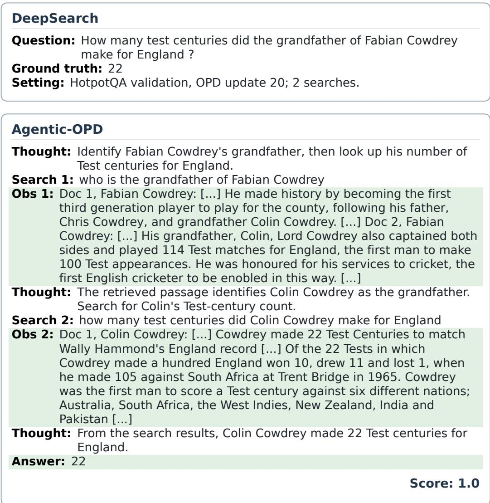  
Figure 11: DeepSearch case study (correct). At OPD update 20, the agent identifies Colin Cowdrey as Fabian Cowdrey’s grandfather, then retrieves his 22 Test centuries for England and returns the correct answer (score 1.0).