# AMSchem: Automated Schematic Visualization of AMS Circuits via Verifiable Agentic Generation

Yichen Shi, Zhiyuan Wang, Jianing Cui, Yao Lai, Jinting Zhang, Zhuofu Tao, Hongyang Wang, Zhiping Yu, Life Fellow, IEEE, Ting Jung Lin, and Lei He, Fellow, IEEE

Project page: www.amschem.com/page

Abstract—For decades, the netlist-to-schematic gap has remained a persistent challenge in design automation, especially for analog and mixed-signal (AMS) circuits. Netlists encode connectivity, not visual presentation, making their manual conversion into readable schematics time-consuming and dependent on expert conventions. The same gap leaves LLM-based design tools without structured visual feedback, forcing them to iterate on circuits they cannot see. We present AMSchem, a training-free, verifier-guided agentic framework that automatically generates human-readable schematics from AMS netlists. AMSchem separates circuit-aware visual planning (DrawingIntent) from executable schematic geometry (SchematicIR), and applies localized visual feedback with bounded, revalidated repair patches. Deterministic validators enforce device preservation, pin-net consistency, and geometric correctness throughout. For evaluation, we construct AMSchem-Bench comprising 64 circuits of 12 types. On the 40-circuit schematic subset, AMSchem with gpt-5.5 achieves 85.0% validity (vs. 32.5% direct generation). When integrated as a visual feedback module in LLM-based analog design, AMSchem resolves all 13 previously failed cases from AnalogCoder benchmark across five models, substantially improving the success rate. Our dataset and benchmark are available at https://www.amschem.com/benchmark.

Index Terms—Analog and mixed-signal circuits, electronic design automation, schematic generation, large language models, multimodal agents, connectivity verification.

## I. INTRODUCTION

Readable and editable schematics are the primary humanfacing interface in analog and mixed-signal (AMS) circuit design. Netlists specify devices, pins, parameters, and connectivity, but do not encode the visual organization that makes a circuit understandable. Hence, designers heavily rely on schematics in iterative design flows.

Meanwhile, recent large language model (LLM)-based systems have shown promise for topology generation [1]–[6] and device sizing [7]–[9]. However, these efforts remain largely organized around textual circuit representations and numerical performance metrics. As a result, though LLMgenerated netlists can satisfy electrical checks, they still lack the schematic artifacts designers critically rely on, hindering further optimization and deployment. Fig. 1 illustrates this gap in current LLM-driven design flows.

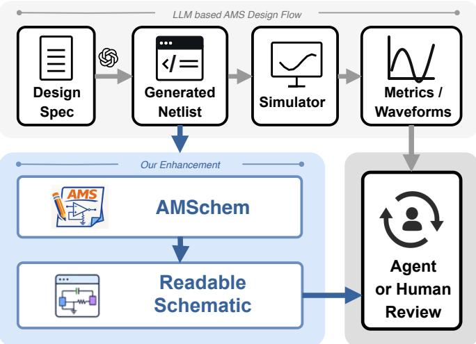  
Fig. 1. AMSchem in LLM-driven AMS design flow: AMSchem converts netlists into readable schematics, providing visual feedback for design review and optimization by agents or humans.

The netlist-to-schematic problem is a long-standing, widely anticipated yet unsolved challenge in electronic design automation (EDA). Despite decades of effort in graph drawing and automated layout [10]–[14], the objective remains difficult because connectivity alone underdetermines the visual realization of a circuit. Many drawings can preserve the same topology, but only a small subset follows designer conventions for functional grouping, signal direction, symmetry, port placement, and labeling. These circuit-dependent readability preferences must be reconciled with hard constraints on device preservation, pin-to-net consistency, and geometric legality. Consequently, generic graph-drawing objectives and handcrafted layout rules struggle to generalize across heterogeneous AMS circuits.

Recent efforts have explored LLM or multimodal LLM (MLLM)-based schematic construction [15], [16]. However, circuit knowledge does not directly translate into reliable schematic drawing. Unlike textual netlists, where a parser can validate syntax incrementally, schematic geometry admits no such intermediate verification. Although some methods use iterative visual refinement, preserving source-netlist connectivity remains challenging. A local error in symbol placement, terminal orientation, or wire routing can silently corrupt the entire schematic, while visual plausibility offers no guarantee of topological fidelity. Consequently, direct LLM generation remains brittle for producing schematics that are both readable and topologically correct.

This paper presents AMSchem, a training-free, verifierguided agentic framework with a three-stage generation-andrefinement pipeline for the netlist-to-schematic task. The first stage matches drawing-relevant AMS building blocks and instantiates corresponding drawing references to construct DrawingIntent, a coordinate-free plan for circuit-aware organization. Second, it grounds the DrawingIntent into SchematicIR, an executable and machine-checkable representation of schematic geometry with source-netlist provenance. Finally, AMSchem renders the candidate and applies localized visual feedback to identify readability issues. Deterministic validators are interleaved throughout the pipeline. Detected semantic, geometric, and visual issues are translated into bounded SchematicIR patches that are revalidated before acceptance, enabling local repair while preserving source connectivity.

The contributions are summarized as follows.

1) AMSchem: a training-free, verifier-guided agentic framework for automatic AMS netlist-to-schematic visualization.

2) Three-stage generation-and-refinement: (1) DrawingIntent as circuit-aware drawing plan, (2) SchematicIR as executable schematic geometry, and (3) localized visual feedback for structured repair.

3) AMSchem-Bench: a comprehensive benchmark for AMS schematic visualization comprising 64 circuits of 12 circuit types and various complexity levels, with systematic metrics for schematic correctness and readability.

On the 40-circuit schematic subset of AMSchem-Bench, AMSchem with gpt-5.5 achieves 85.0% validity versus 32.5% for direct generation, with overall gains in readability. When integrated as a visual feedback module in LLM-based analog design tasks in AnalogCoder benchmark [2], AMSchem resolves all 13 previously failed cases across five models.

## II. RELATED WORK

## A. LLMs for AMS Circuit Design

LLMs have recently been explored for AMS circuit design automation [1], [2], [7]–[9], [17], [18]. Prior work demonstrates LLMs’ capability of encoding circuit-design priors and orchestrating simulators or analysis tools. However, existing LLM-based methods typically produce text-based outputs, such as circuit netlists, scripts, device parameters, and simulation-based performance results. Engineers, however, rely on readable schematics for design comprehension and debugging, as their visual form captures accumulated design experience and implicit constraints. AMSchem targets this missing netlist-to-schematic interface by converting a netlist into a structured, verifiable, and visual schematic state rather than stopping at text, code, or metric optimization.

## B. Automatic Schematic Visualization

Prior to recent LLM-based approaches, [12] explored automatic analog schematic generation by combining circuit building-block classification with reinforcement learning; evaluation focuses on block compliance and wire crossings, but the approach requires extensive training and does not generalize across unseen topologies. Schemato [15] directly generates LTSpice or CircuiTikz rendering code from netlists, entangling connectivity, geometry, and drawing syntax in a single output sequence without an intermediate editable representation. EEschematic [16] employs an MLLM with visual incontext examples for schematic generation, but its evaluation is limited to a small handful of circuits and lacks systematic topological validity checking. Weave [19] applies deterministic layered graph layout with round-trip netlist verification, yet treats the circuit as a generic graph without explicit modeling of functional grouping, symmetry, or signal-flow direction. Consequently, existing methods do not jointly provide circuitaware planning, source-grounded executable representations, and verifier-guided local repair. AMSchem addresses this gap by separating DrawingIntent from SchematicIR and combining deterministic verification with bounded visual refinement. Prior evaluations also use disparate datasets, output formats, and metrics, hindering direct comparison and motivating AMSchem-Bench as a unified benchmark of schematic correctness and readability.

## III. METHOD

Fig. 2 illustrates the AMSchem netlist-to-schematic flow for AMS circuits. AMSchem follows a three-stage generationand-refinement pipeline. The three refinement levels (L1– L3) share one rule: no revision is accepted without passing deterministic validation.

## A. DrawingIntent Generation and Refinement

AMSchem separates circuit-aware visual planning from concrete geometry generation through an intermediate representation called DrawingIntent. This stage proceeds in three steps: matching circuit structures against predefined building block library, organization of these structures into a coordinate-free visual plan, and constraint-driven refinement to ensure plan consistency before geometry grounding.

a) Building-Block Matching.: The core data structure of this stage is a paired reference library $\mathcal { R } \ : = \ : \{ R _ { k } \} _ { k = 1 } ^ { K } ,$ , in which each reference $R _ { k } ~ = ~ ( N _ { k } ^ { \mathrm { r e f } } , \Pi _ { k } ^ { \mathrm { r e f } } )$ couples a netlist fragment with its preferred visual organization. The unit of knowledge is the pairing itself: $N _ { k } ^ { \mathrm { r e f } }$ specifies the topology and the functional roles of a common AMS building block (e.g., two-transistor NMOS current mirror, two-branch PMOS cascode current mirror), while $\Pi _ { k } ^ { \mathrm { r e f } }$ is an drawing instruction, capturing how that block is conventionally drawn—symmetry relations, device orientation, vertical ordering, path separation, and the exposure of feedback connections. Table I lists the 18 references currently in R; the library is extensible by adding further pairs without modifying the matching machinery described below.

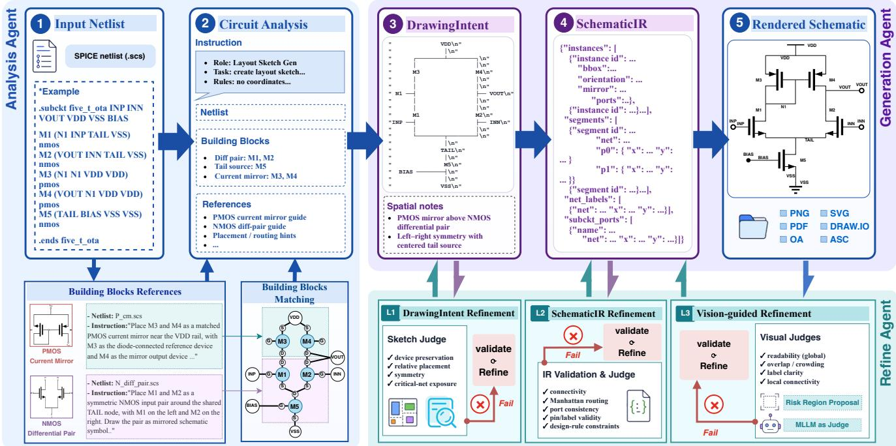  
Fig. 2. AMSchem overview: (1) Stage 1: the input netlist is enriched with matched building blocks and drawing references to construct DrawingIntent with constraint-driven refinement (L1) of device preservation, relative placement, and symmetry. (2) Stage 2: DrawingIntent is translated into executable SchematicIR, with structured validation and refinement of connectivity (L2), Manhattan routing, and design-rule compliance. (3) Stage 3: the rendered schematic undergoes bounded visual refinement (L3) that diagnoses readability, overlap, and local connectivity, producing the final output artifacts.

Formally, our building-block matching is type-constrained subgraph matching over this paired library. The netlist N is first parsed into a typed circuit graph $G = ( V , E , \tau )$ , where τ assigns to each vertex a device type (e.g., nmos, pmos, res) and to each incident edge a terminal role (e.g., gate, drain, source, bulk). The type function $\tau$ is what makes generic subgraph matching circuit-aware: it rules out matches that are topologically isomorphic but functionally different— for instance, a diode-connected device and a common-source device can share the same bare topology, yet only the latter satisfies the role constraints of a differential-pair input.

Each reference netlist $N _ { k } ^ { \mathrm { r e f } }$ is parsed into a typed graph $G _ { k } ^ { \mathrm { r e f } }$ under the same type system, and matches are computed by monomorphism search

$$
\mathcal { B } = \mathcal { M } ( G , \mathcal { R } ) = \bigcup _ { k = 1 } ^ { K } \big \{ ( k , \phi ) : \phi \in \mathrm { V F 3 } ( G , G _ { k } ^ { \mathrm { r e f } } ; \tau ) \big \} ,\tag{1}
$$

where VF3 [20] is adopted as the monomorphism engine and $\mathrm { V F 3 } ( \cdot ; \tau )$ denotes a search restricted to type-compatible mappings. Our design in this step lies in three components built around the adopted engine: (i) the type system above, which encodes pin-role constraints absent from generic graph matching; (ii) symmetry reduction, which merges mappings that differ only by a functional automorphism of the reference $( \mathrm { e . g . }$ ., swapping the two branches of a current mirror), preventing an exponential blow-up of equivalent matches; and (iii) conflict pruning, which removes any match whose device set is a strict subset of another match’s, so that the retained guidance is non-redundant. A per-reference cap L bounds the number of matches kept for each $R _ { k }$ . Algorithm 1 summarizes the complete procedure.

TABLE I  
BUILDING-BLOCK LIBRARY USED BY AMSCHEM.
<table><tr><td>#</td><td>Building block</td></tr><tr><td>1</td><td>Two-transistor NMOS current mirror</td></tr><tr><td>2</td><td>Two-branch NMOS cascode current mirror</td></tr><tr><td>3</td><td>Two-transistor PMOS current mirror</td></tr><tr><td>4</td><td>Two-branch PMOS cascode current mirror</td></tr><tr><td>5</td><td>Single NMOS common-source device</td></tr><tr><td>6</td><td>Single PMOS common-source device</td></tr><tr><td>7</td><td>Two adjacent NMOS current-mirror pairs</td></tr><tr><td>8</td><td>Four-branch NMOS cascode mirror array</td></tr><tr><td>9</td><td>Two adjacent PMOS current-mirror pairs</td></tr><tr><td>10</td><td>Four-branch PMOS cascode mirror array</td></tr><tr><td>11</td><td>NMOS pair with a shared gate and source rail, and separate drains</td></tr><tr><td>12</td><td>PMOS pair with a shared gate and source rail, and separate drains</td></tr><tr><td>13</td><td>NMOS differential pair with a tail device</td></tr><tr><td>14</td><td>PMOS differential pair with an upper tail device</td></tr><tr><td>15</td><td>Two NMOS cascode devices sharing a gate bias</td></tr><tr><td>16</td><td>Two PMOS cascode devices sharing a gate bias</td></tr><tr><td>17</td><td>Two NMOS common-source devices tied to VSS</td></tr><tr><td>18</td><td>Two PMOS common-source devices tied to VDD</td></tr></table>

Each retained match $\boldsymbol { b } = ( k , \phi )$ records the reference index k and a mapping $\phi$ from the functional roles of $N _ { k } ^ { \mathrm { r e f } }$ to concrete devices and nets of N; V(b) denotes the matched device set. Role binding instantiates the paired drawing instruction as $\Pi _ { k } ^ { \mathrm { r e f } } [ \phi ]$ , e.g., the abstract prior “mirror the two branches” becomes “place M1 and M2 mirror-symmetric about the vertical axis.” The resulting guidance set A is fused with the source netlist into a circuit-specific generation context

Algorithm 1 Building-Block Matching and Drawing Guidance   
Generation   
Require: Source netlist N, reference library $\mathcal { R }$   
Ensure: Matched blocks $B ,$ instantiated guidance $\boldsymbol { A }$   
1: $G \gets \mathrm { T Y P E D } \mathbf { G } \mathrm { R A P H } ( N )$   
2: $B  \varnothing ; A  \varnothing$   
3: for each $R _ { k } \in \mathcal R$ in descending order of block size do   
4: $G _ { k } \gets \mathrm { \ " { T Y P E D G R A P H } } ( N _ { k } ^ { \mathrm { r e f } } )$   
5: M ← VF3MONOMORPHISM $( G _ { k } , G )$ ▷ Types/pin roles   
6: $\mathcal { M } _ { k }  \mathsf { S } \mathtt { Y }$ MMETRYREDUCE(Mk) ▷ Merge symmetries   
7: $\mathcal { M } _ { k } \gets \mathbf { C } _ { \mathrm { A P } } ( \mathcal { M } _ { k } , L )$ ▷ Per-reference cap   
8: $B  B \cup \{ ( \dot { k } , \phi ) \mid \dot { \phi } \in \mathcal { M } _ { k } \}$   
9: end for   
10: $B  \{ b \in B | \nexists b ^ { \prime } \in B : V ( b ) \subset V ( b ^ { \prime } ) \}$ ▷ Remove subsets   
11: for each $( k , \dot { \phi } ) \in B$ do   
12: $\mathcal { A }  \dot { \mathcal { A } } \cup \{ \Pi _ { k } ^ { \mathrm { r e f } } [ \phi ] \}$ ▷ Bind reference roles   
13: end for   
14: return $B , A$

$$
\begin{array} { r } { C _ { D } = \mathcal { C } ( N , \mathcal { A } ) , } \end{array}\tag{2}
$$

which preserves the original device and pin-to-net connectivity and augments it with functional roles, structural relations, and instantiated drawing principles. All steps in this stage— parsing, matching, symmetry reduction, pruning, and role binding—are deterministic; no model inference is involved.

b) Visual Organization.: Conditioned on the generation context $C _ { D }$ , the generation agent produces an initial Drawing-Intent $D _ { 0 } \colon$ a coordinate-free, circuit-aware plan that fixes how the circuit should be organized in the schematic. For the OTA in Fig. 2, for instance, such a plan decides that the PMOS mirror pair sits above the NMOS differential pair with the tail device centered on the symmetry axis, that inputs enter from the left and the output leaves on the right—structural commitments that can still be realized by many different concrete layouts.

Formally, the DrawingIntent comprises two complementary components,

$$
D _ { 0 } = ( P _ { 0 } , \Pi _ { 0 } ) = F _ { D } ( C _ { D } ) .\tag{3}
$$

The Schematic Prototype $P _ { 0 }$ provides a coordinate-free structural sketch specifying functional grouping, relative placement, signal-flow direction, branch ordering, symmetry relations, and port distribution. The Drawing Principles $\Pi _ { 0 }$ describe how the prototype should be realized: preferred device orientations, labeling strategies, routing preferences, treatment of global nets, and separation of signal, bias, and feedback paths. The prototype captures what to draw; the principles govern how to draw it.

c) Constraint-Driven Refinement.: Refinement in AM-Schem operates at three levels—intent, geometry, and rendered image—denoted L1, L2, and L3 in Fig. 2. This stage performs

L1 refinement: all repair happens on the coordinate-free plan, before any geometry exists.

Before geometry generation, the L1 refinement agent validates the DrawingIntent against three consistency criteria: coverage of the matched building-block guidance, validity of referenced circuit objects, and internal consistency of grouping, ordering, symmetry, and routing preferences. Detected violations are represented as typed feedback $\mathcal { E } _ { D } .$ , and the affected intent fields are revised:

$$
D = \mathrm { R e f i n e } _ { D } ( D _ { 0 } , { \mathcal { E } } _ { D } ) .\tag{4}
$$

This intent-level refinement prevents incomplete or conflicting high-level decisions from propagating into concrete symbols, coordinates, and routed connections. The refined DrawingIntent $D = ( P , \Pi )$ is then passed to the SchematicIR stage for executable geometry grounding.

## B. SchematicIR Generation and Refinement

Given the refined DrawingIntent D, AMSchem constructs executable SchematicIR—the geometry-level ground of the pipeline: the first representation in which the drawing plan becomes concrete geometry, and, because every element is bound to the source netlist through stable identifiers, the first artifact that is machine-checkable.

a) Geometry Grounding.: The generation agent produces an initial SchematicIR $S _ { 0 }$ from the source netlist and the refined DrawingIntent:

$$
S _ { 0 } = F _ { S } ( N , D ) .\tag{5}
$$

This transformation instantiates the structural prototype $P$ and drawing principles Π in D as concrete symbols, coordinates, terminal anchors, ports, labels, and routed wire segments, with junctions induced by coincident endpoints of same-net segments. Source correspondence is retained through stable instance, terminal and net identifiers. These bindings make the resulting schematic executable, machine-checkable, and locally repairable. As illustrated in Fig. 3, every visible schematic element can therefore be traced to its SchematicIR object and source-netlist entity.

Unlike rendering-code-level intermediates that entangle connectivity, geometry, and drawing syntax in a single sequence [15], SchematicIR keeps semantic bindings (identifiers, nets) separate from visual realization (coordinates, segments), so that either side can be repaired without disturbing the other.

b) Structured Validation.: Deterministic validators check $S _ { 0 }$ and represent all detected violations as a unified issue set:

$$
\mathcal { E } _ { S } = \mathcal { E } _ { \mathrm { n e t } } \cup \mathcal { E } _ { \mathrm { s h o r t } } \cup \mathcal { E } _ { \mathrm { o v e r l a p } } \cup \mathcal { E } _ { \mathrm { r u l e } } .\tag{6}
$$

Here, $\mathcal { E } _ { \mathrm { n e t } }$ captures inconsistencies between the normalized device–terminal–net relations induced from SchematicIR and those in the source netlist. $\mathcal { E } _ { \mathrm { s h o r t } }$ records unintended electrical contacts between different nets; $\mathcal { E } _ { \mathrm { s h o r t } }$ records unintended electrical contacts between different nets; $\mathcal { E } _ { \mathrm { o v e r l a p } }$ captures prohibited geometric intersections among wires, symbols, and labels; and $\mathcal { E } _ { \mathrm { r u l e } }$ contains the remaining schema, symbol, terminal, routing, and renderability violations. Each violation is localized to specific SchematicIR objects, enabling focused repair without regenerating the complete schematic.

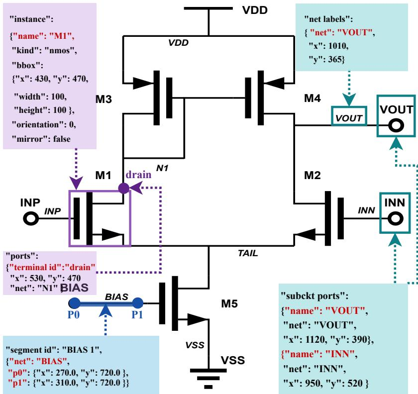  
Fig. 3. Object-level grounding in SchematicIR. Colored callouts link schematic elements to structured placement, orientation, geometry, and net bindings for deterministic validation and localized repair.

c) Bounded Refinement.: L2 refinement repairs the geometry. It consumes the issue set $\mathcal { E } _ { S }$ and revises the implicated SchematicIR objects together with their direct dependencies, leaving the rest of the schematic untouched.

$$
\widetilde { S } = \mathrm { R e f i n e } _ { S } ( S _ { 0 } , { \mathcal { E } } _ { S } ) .\tag{7}
$$

Simple violations are handled through deterministic transformations, such as reconnecting a wire endpoint, separating an unintended contact, or rerouting a wire around a component. Complex issues trigger object-grounded repair requests, and the resulting complete SchematicIR candidate is revalidated after each update. A repaired candidate $\widetilde { S }$ is accepted as S only if it resolves the reported issue, preserves source-netlist connectivity, and satisfies

$$
\mathcal { E } _ { S } ( \widetilde { S } ) = \emptyset .\tag{8}
$$

The accepted SchematicIR S is then passed to the localized visual-feedback stage.

## C. Localized Visual Feedback and Refinement

AMSchem next turns from correctness to readability: it deliberately renders the accepted SchematicIR S into an image,

$$
I = { \mathrm { R e n d e r } } ( S ) ,\tag{9}
$$

and inspects the rendering for the class of defects that structured validation cannot see—visually ambiguous contacts, obscured terminals, or dense connections that no deterministic rule expresses, yet that decide whether a human or an agent can trace the circuit. L3 refinement therefore operates on rendered pixels, in contrast to L1 (plan level) and L2 (geometry level). The localized visual-feedback loop proceeds in three steps: proposing circuit-aware risk regions where readability defects are likely, diagnosing each cropped region with an object-grounded visual model, and translating actionable feedback into bounded SchematicIR revisions under the same revalidation gate as L2.

a) Risk-Region Proposal.: The first step of the loop surveys the rendering as a whole before narrowing scrutiny. A whole-image review of I checks global readability—overall balance, spacing, and label legibility—after which Risk Region Proposal (RRP) selects the circuit-aware regions likely to contain localized readability issues:

$$
\mathcal { R } = \mathrm { R R P } ( I , S ) = \mathcal { R } _ { \mathrm { B B L } } \cup \mathcal { R } _ { \mathrm { p a t c h } } \cup \mathcal { R } _ { \mathrm { h i g h d e g } } .\tag{10}
$$

Here, $\mathcal { R } _ { \mathrm { B B I } }$ prioritizes matched building blocks whose visual organization matters for circuit understanding, $\mathcal { R } _ { \mathrm { p a t c h } }$ covers previously modified objects and their local neighborhoods, and $\mathcal { R } _ { \mathrm { h i g h d e g } }$ targets high-degree nets and their connected components.

b) Object-Grounded Visual Diagnosis.: The second step examines each proposed region with a visual model. For every selected region $R _ { i } \in \mathcal R$ , AMSchem extracts the corresponding crop,

$$
I _ { i } = \mathrm { C r o p } ( I , R _ { i } ) .\tag{11}
$$

and presents the visual model $F _ { V }$ with the circuit semantics behind the pixels: the associated SchematicIR objects $O _ { i } ,$ , the

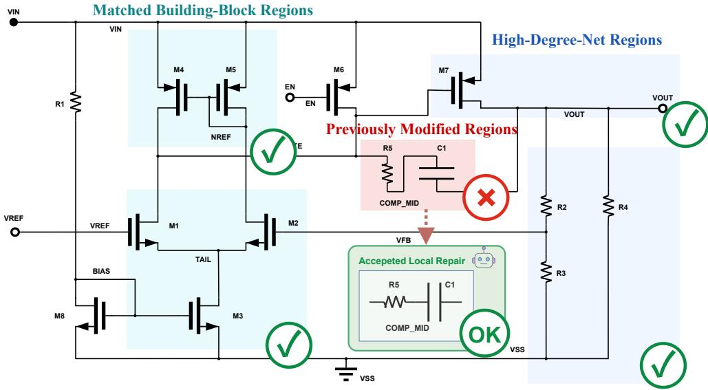  
Fig. 4. L3 refinement: localized visual feedback over circuit-aware risk regions. Regions proposed by RRP (a) are cropped and diagnosed by an objectgrounded visual model (b); actionable findings guide a bounded SchematicIR revision (c) that is revalidated and rerendered.

local netlist context $N _ { i } ^ { \mathrm { l o c } }$ , and the relevant DrawingIntent fields $D _ { i } \colon$

$$
u _ { i } = F _ { V } \left( I _ { i } , O _ { i } , N _ { i } ^ { \mathrm { l o c } } , D _ { i } \right) .\tag{12}
$$

The grounding is what makes the output actionable. Both the rendered pixels and the intended connectivity are in context. Hence, the model can judge, for example, whether a visually ambiguous junction actually joins the nets the netlist requires, and report the affected objects, the local readability issue, and a concrete SchematicIR correction in each feedback item $u _ { i }$

c) Bounded Visual Refinement.: The third step closes the loop by turning the diagnosed feedback into geometry, under the same bounded discipline as L2. The visual refinement agent translates the aggregated feedback $u _ { i }$ into a revised SchematicIR candidate,

$$
\widetilde { S } ^ { ( i ) } = \mathrm { R e f i n e } _ { V } \left( S ^ { ( i - 1 ) } , u _ { i } \right) .\tag{13}
$$

The revision may reroute wires, adjust labels or junctions, replace long wires with net labels, or reposition local groups. As in L2, the revision is bounded in both senses: the agent restricts changes to the objects identified by $u _ { i }$ and their dependencies, and the complete candidate is accepted and then rerendered for the next whole-image review only if it preserves connectivity and passes structured validation (Eq. 8).

Fig. 4 illustrates this region-guided diagnosis and repair process. Because $\mathcal { R } _ { \mathrm { p a t c h } }$ re-examines previously modified regions, each accepted repair feeds back into the next round of review, and the loop terminates when a rendering raises no further actionable feedback.

## IV. EXPERIMENTS

## A. AMSchem-Bench

Prior AMS schematic visualization methods are evaluated under inconsistent protocols: some verify only render success or syntax compliance [15], others use readability metrics based on small-scale subjective assessments [16], and none jointly assess topological fidelity and readability with standardized metrics and datasets. Consequently, systematic comparison across methods remains impossible. To address this, we introduce AMSchem-Bench, a benchmark suite of 64 circuits covering 12 circuit types and comprising two subsets used in separate experiments: 40 circuits from AMSnet 2.0 [21] for netlist-to-schematic evaluation and 24 circuits from AnalogCoder [2] for downstream LLM-aided circuitdesign evaluation.

The summarized statistics in Fig. 5 show that the two sources differ substantially in circuit scale. To characterize circuit complexity consistently, we define three sourceindependent difficulty tiers based on device count: Easy $( \leq 9$ devices), Medium (10–19), and Hard (≥ 20).

## B. Evaluation Metrics

We evaluate generated SchematicIR schematic for validity and readability. Readability is assessed using reference-based metrics for routing quality and component organization, complemented by subjective mean opinion scores (MOS).

Validity. An output is valid if it preserves source-netlist connectivity, conforms to the SchematicIR schema, uses legal symbol and terminal references, obeys deterministic wiring constraints, renders successfully, and avoids wires crossing unrelated device bodies. We additionally report $R _ { \mathrm { o v e r l a p } }$ , the mean number of wire crossings through unrelated device bodies, as a continuous measure of the same geometric-legality requirement; it is averaged over all rendered outputs, so it also reflects how nearly invalid outputs miss the threshold.

Let $v _ { n } \in \{ 0 , 1 \}$ denote case n’s validity. Over N cases, the validity rate is

$$
P _ { \mathrm { v a l i d } } = \frac { 1 } { N } \sum _ { n = 1 } ^ { N } v _ { n } .\tag{14}
$$

Routing Quality. For a valid output $S$ and its expert reference $S ^ { \star }$ , let C(S) and $B ( S )$ denote the numbers of non-connective

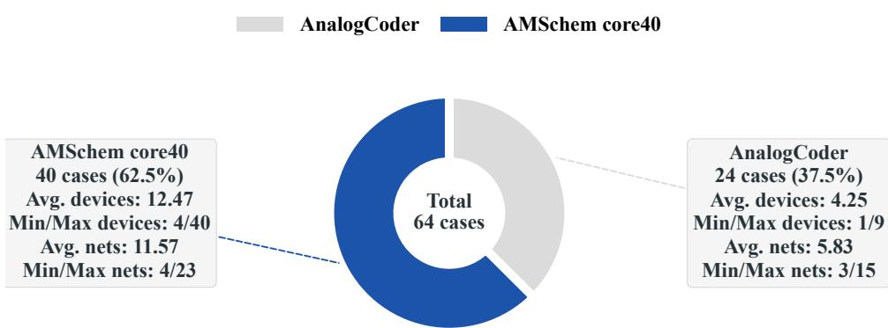  
(a) Source composition and circuit-scale statistics.

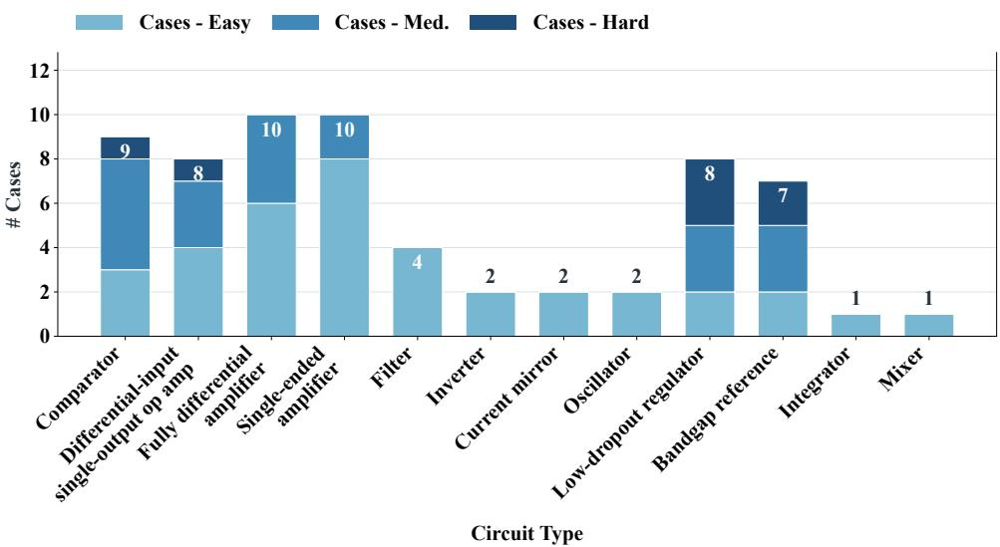  
(b) Statistics of circuit type and difficulty tier.  
Fig. 5. AMSchem-Bench statistics.

wire crossings and Manhattan-route bends, respectively. We define

$$
\begin{array} { r l } & { S _ { \mathrm { c r o s s } } = 1 - \frac { \displaystyle \left. C ( S ) - C ( S ^ { \star } ) \right. } { \operatorname* { m a x } \{ 1 , C ( S ) , C ( S ^ { \star } ) \} } , } \\ & { S _ { \mathrm { b e n d } } = 1 - \frac { \displaystyle \left. B ( S ) - B ( S ^ { \star } ) \right. } { \operatorname* { m a x } \{ 1 , B ( S ) , B ( S ^ { \star } ) \} } . } \end{array}\tag{15}
$$

Component Organization. Components are matched by their source-netlist instance identifiers. Let $\mathcal { I } _ { m }$ be the set of matched instances and P the set of comparable instance pairs. For each $( i , j ) \in \mathcal { P } , r _ { S } ( i , j )$ denotes their relative spatial relation (left, right, above, or below), while $o _ { S } ( i )$ denotes the orientation of instance i, including rotation and mirroring. We define

$$
\begin{array} { r l } & { \displaystyle S _ { \mathrm { r e l } } \quad = \frac { 1 } { | \mathcal { P } | } \sum _ { ( i , j ) \in \mathcal { P } } \mathbf { 1 } [ r _ { S } ( i , j ) = r _ { S ^ { \star } } ( i , j ) ] , } \\ & { \displaystyle S _ { \mathrm { o r i e n t } } = \frac { 1 } { | \mathcal { T } _ { m } | } \sum _ { i \in \mathcal { T } _ { m } } \mathbf { 1 } [ o _ { S } ( i ) = o _ { S ^ { \star } } ( i ) ] . } \end{array}\tag{16}
$$

All four readability scores lie in [0, 1], with higher values indicating closer agreement with the reference. At the dataset level, invalid outputs are assigned zero for all four metrics before averaging.

Because multiple layouts may represent the same topology equally well, we additionally report MOS from a blinded study in which 15 engineers independently rated each generated schematic on a five-point scale.

## C. Experimental Setup

All methods share the same input netlists, renderer, and evaluation metrics. Direct-IR generates the complete SchematicIR from the netlist in one pass. Direct-IR + Few-shot adds K in-context examples to the same one-pass prompt. AMSchem runs the full pipeline of Sec. III. Each strategy is instantiated with every backbone MLLM (gpt-5.5, gemini-3.1-pro, claudeopus-4-8). The result is summarized in Table II.

We also include Weave [19], a deterministic layered-graph visualizer with round-trip netlist verification, as the representative of non-LLM visualization. EESchematic produced no valid outputs on our cases and is reported qualitatively in the Appendix, while Schemato is excluded because no public implementation is available. For the downstream LLM-aided circuit-design experiment, we follow the original AnalogCoder protocol and simulation setting.

## D. Main Results

Validity. Weave first marks the limit of the deterministic approach: its layered layout attains moderate validity on Easy and Medium circuits (69.2% and 60.0%) but collapses on Hard circuits (28.6%), whereas AMSchem maintains 92.3%, 95.0%, and 42.9% on the same tiers with gpt-5.5 (Table II). Among generative methods, AMSchem improves validity over both Direct-IR baselines for every evaluated MLLM and difficulty tier, with particularly large gains on Medium and Hard circuits: for gpt-5.5, from the best baseline results of 10.0% and 0.0% to 95.0% and 42.9%, respectively; for gemini-3.1-pro, from 35.0% and 14.3% to 90.0% and 71.4%.

TABLE II  
PERFORMANCE ACROSS BENCHMARK DIFFICULTY TIERS. E, M, AND H DENOTE EASY, MEDIUM, AND HARD, RESPECTIVELY. MOS IS POOLED ACROSS TIERS. SHADED ROWS INDICATE AMSCHEM.
<table><tr><td rowspan="2">Method</td><td>Valid (%) ↑</td><td></td><td> $S _ { \mathrm { c r o s s } }$  ←</td><td> $S _ { \mathrm { b e n d } }$  个</td><td></td><td> $S _ { \mathrm { r e l } }$  ←</td><td></td><td> $S _ { \mathrm { o r i e n t } }$  ←</td><td>MOS ↑</td></tr><tr><td>E M</td><td colspan="5">H E M H E M H E M</td><td>H E</td><td>M</td><td>H</td></tr><tr><td>Weave [19] 69.2</td><td rowspan="19">60.0 28.6 0.3333 0.3007 0.1905 0.2200 0.1248 0.0347 0.2374 0.1741 0.0611 0.3370 0.2237 0.0986</td><td colspan="5"></td><td></td><td>1.150</td></tr><tr><td>gpt-5.5</td><td colspan="5"></td></tr><tr><td>Direct-IR</td><td></td><td>84.610.00.00.2051 0.0800 0.0000 0.3968 0.0597 0.0000 0.5067 0.0667 0.0000 0.6316 0.0700 0.0000</td><td></td><td></td></tr><tr><td>Direct-IR + Few-shot</td><td>69.2 5.0</td><td>0.00.23080.0200 0.0000 0.3475 0.0087 0.0000 0.4106 0.0282 0.0000 0.4974 0.0273 0.0000</td><td></td><td></td></tr><tr><td colspan="3">AMSchem 92.3 95.0 42.9 0.4308 0.3732 0.1111 0.3721 0.3476 0.1911 0.6557 0.6112 0.3031 0.7496 0.6557 0.3070 3.075 gemini-3.1-pro</td><td></td><td></td></tr><tr><td colspan="3">Direct-IR 61.530.0 14.30.15380.18750.0094 0.40160.1876 0.02480.4553 0.21860.03480.4872 0.2207 0.0929 Direct-IR 69.235.00.00.3333 0.2306 0.0000 0.4073 0.1651 0.0000 0.4453 0.2517 0.0000 0.5171 0.2536 0.0000 + Few-shot</td><td colspan="3"></td></tr><tr><td colspan="11">AMSchem 100.0 90.0 71.4 0.3654 0.4414 0.3616 0.6129 0.4658 0.2689 0.7162 0.6152 0.5000 0.8521 0.6582 0.5025 claude-opus-4-8</td></tr><tr><td colspan="11"></td></tr><tr><td colspan="11">Direct-IR 53.8 5.0 0.00.2308 0.0500 0.0000 0.3210 0.0368 0.0000 0.3154 0.0389 0.0000 0.4205 0.0200 0.0000 Direct-IR</td></tr><tr><td colspan="11">53.815.00.00.1538 0.0392 0.0000 0.30680.0831 0.0000 0.3725 0.1142 0.0000 0.4538 0.1093 0.0000 + Few-shot</td></tr><tr><td colspan="4"></td><td colspan="4">AMSchem 76.9 30.0 14.3 0.2949 0.1268 0.0435 0.3586 0.1269 0.0476 0.4545 0.1723 0.0444 0.5825 0.2138 0.1143 3.432</td><td colspan="3"></td></tr></table>

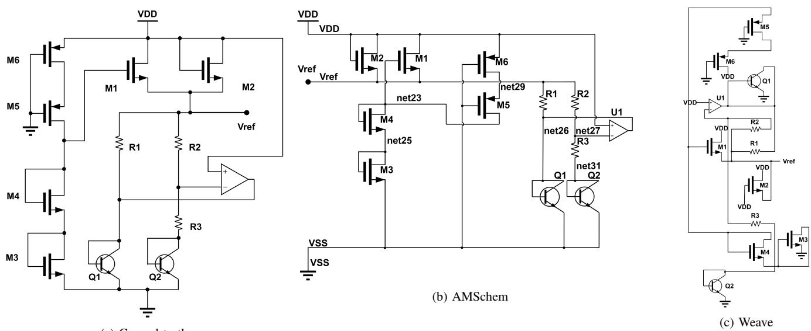  
(a) Ground truth  
Fig. 6. Schematic comparison on a bandgap reference circuit from AMSchem-Bench: (a) Ground truth; (b) AMSchem; (c) Weave [19].

In contrast, Direct-IR + Few-shot does not reliably help: for gpt-5.5 it lowers validity on the Easy tier from 84.6% to 69.2%, and analogous degradations appear for the other backbones. Few-shot examples bias the model toward reproducing the example layouts, but they do not encode the constraints that couple device organization to routing; on circuits whose correct organization differs from the examples, the referenced patterns may violate connectivity or geometry rules.

Readability. Readability improves together with validity, though with smaller and more variable margins. On Hard circuits with gemini-3.1-pro, AMSchem raises $S _ { \mathrm { c r o s s } }$ from 0.0094 to 0.3616 and $S _ { \mathrm { r e l } }$ from 0.0348 to 0.5000 relative to Direct-IR, with similar gains in the other reference-based metrics (Table II). Qualitatively, Fig. 6 shows that AMSchem preserves the compact two-dimensional organization of the ground-truth schematic, whereas Weave [19] arranges related elements along a long vertical path. Human judgment agrees: in the blinded MOS study, AMSchem scores 3.075, 4.128, and 3.432 under the three backbones, all well above Weave’s 1.150. Read together, the reference-based metrics, the qualitative comparison, and the blinded ratings show that AMSchem is the only configuration that improves validity and readability at once: deterministic layout alone (Weave) remains correct but unreadable, and unconstrained generation alone (Direct-IR) remains unreliable.

## E. Ablation Study

Contribution of Pipeline Stages. Table III evaluates the incremental contribution of each pipeline stage. The three switches correspond to the refinement levels of Sec. III: DI enables L1 (DrawingIntent), IR enables L2 (SchematicIR validation and repair), and VF enables L3 (visual feedback). Recall from Sec. IV-B that $R _ { \mathrm { o v e r l a p } }$ is averaged over all rendered outputs, so it reflects both the legality of valid outputs and how nearly invalid outputs miss the geometric-legality threshold. Enabling only DI leaves validity unchanged at 32.5%, consistent with the role of L1, which acts on the plan before any geometry exists. Its effect is purely organizational, nearly doubling the wire-crossing score and reducing $R _ { \mathrm { o v e r l a p } }$ from 5.550 to 1.763. Adding IR yields the largest validity gain, raising it to 80.0% while improving all readability metrics, showing that L2’s validation gate is the pipeline’s primary correctness mechanism. VF further raises validity to 85.0% and reduces $R _ { \mathrm { o v e r l a p } }$ from 0.900 to 0.475, a 47.2% reduction, with the wire-bending score remaining comparable. The three stages are therefore complementary: L1 improves organization, L2 resolves the majority of validity failures, and L3 removes residual failures together with localized readability defects.

Stage-wise Token Consumption. Fig. 7 complements the stage-wise ablation with the cost profile of the three stages. The reconstructed mean total is 153.3k tokens per case, with DrawingIntent, SchematicIR, and visual feedback accounting for 25.9%, 24.2%, and 49.9%, respectively. Input tokens, including textual context and image inputs, constitute 88.3% of the total; stored visible responses account for the remaining 11.7%. Visual feedback is therefore the most token-intensive stage. Its contribution extends beyond the additional five percentage points in validity to a substantial reduction in device– wire overlaps, showing that its benefits should be assessed in terms of both validity and readability. The input-heavy consumption profile suggests that reducing redundant context and selectively allocating visual inspection are promising directions for improving token efficiency.

## DrawingIntent Ablation.

We next ablate the components of Stage 1 within the L2– L3-enabled configuration (rows 3–4 of Table III). Table IV shows that cumulatively enabling building-block matching, references, and intent refinement increases validity from 72.5% to 85.0% . Both $S _ { \mathrm { b e n d } }$ and $S _ { \mathrm { r e l } }$ improve monotonically, while the small initial decline in $S _ { \mathrm { c r o s s } }$ is recovered after references are introduced. The full configuration achieves the best overall performance, indicating that the three components contribute in a cumulative fashion.

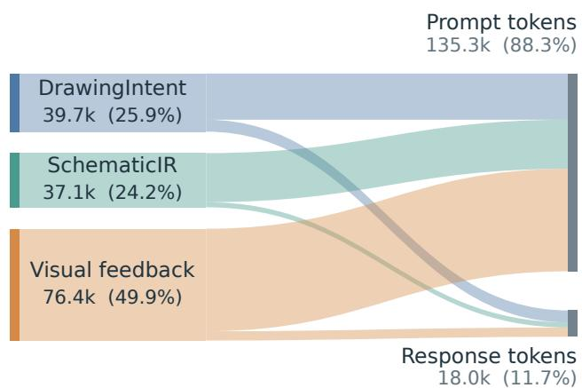  
Fig. 7. Mean per-case token consumption by pipeline stage and token type.

Risk Region Proposal Analysis. We conduct a blinded expert evaluation of RRP on 40 cases, with AMS engineers annotating schematic defects independently of the generated proposals. Table V reveals distinct operating points for the three proposal sources. $\mathcal { R } _ { \mathrm { h i g h d e g } }$ provides broad coverage, accounting for 66.4% of proposals and achieving the highest recall (55.3%); $\mathcal { R } _ { \mathrm { B B L } }$ strikes a more balanced precision–recall trade-off. $\mathcal { R } _ { \mathrm { p a t c h } }$ contributes 8.6% of proposals with recall of 8.1%, because its role is not broad defect discovery but the precise re-examination of previously repaired regions, where its precision is the highest (76.0%). The three sources are complementary in function rather than in coverage.

Discussion. Taken together, the ablations delineate a division of labor among the three refinement levels. L1 (DrawingIntent) shapes organization without affecting validity, as shown by the unchanged validity and doubled wire-crossing score when only DI is enabled (Table III); its internal components contribute cumulatively (Table IV). L2 (SchematicIR validation and repair) is the dominant source of validity, raising it from 32.5% to 80.0%. L3 (visual feedback) then converts residual failures and removes localized readability defects that no rule expresses—at the highest token cost among the stages. The three-level design is the minimal configuration that improves validity and readability at once.

## F. AMSchem for LLM-Based Analog Design

To evaluate schematic feedback in automated analog circuit design, we integrate AMSchem into the AnalogCoder refinement loop. For cases unresolved by the original loop, AMSchem produces a schematic whose connectivity is verified against the input netlist. A visual critic examines the circuit structure, biasing relationships, and signal paths, then returns diagnostic feedback to the original design model for netlist revision. Each unresolved case is given at most $T \ = \ 5$ refinement rounds; all 13 are resolved within $n = 4$ rounds. Each revised design is evaluated using the original simulator and functional checker. Within the five-model, 120-evaluation scope shown in Fig. 8, the original AnalogCoder loop solves 107 cases without AMSchem assistance, and AMSchemassisted refinement recovers the remaining 13, bringing the total to 120. All recovered designs pass independent reevaluation.

TABLE III  
INCREMENTAL ANALYSIS OF AMSCHEM. DI, IR, AND VF DENOTE DRAWINGINTENT, SCHEMATICIR VALIDATION AND REFINEMENT, AND VISUAL FEEDBACK, RESPECTIVELY.
<table><tr><td>DI</td><td>IR</td><td>VF</td><td>Valid (%) ↑</td><td> $S _ { \mathrm { c r o s s } }$  ←</td><td> $S _ { \mathrm { b e n d } }$  ↑</td><td> $S _ { \mathrm { r e l } }$  ↑</td><td> $R _ { \mathrm { o v e r l a p } } \downarrow$ </td><td> $S _ { \mathrm { o r i e n t } }$  ←</td></tr><tr><td>X</td><td>X</td><td>X</td><td>32.5</td><td>0.1067</td><td>0.1588</td><td>0.1980</td><td>5.550</td><td>0.2403</td></tr><tr><td>√</td><td>X</td><td>X</td><td>32.5</td><td>0.2083</td><td>0.1674</td><td>0.2533</td><td>1.763</td><td>0.2488</td></tr><tr><td></td><td>√</td><td>X</td><td>80.0</td><td>0.3344</td><td>0.3339</td><td>0.5305</td><td>0.900</td><td>0.5916</td></tr><tr><td></td><td>L</td><td>」</td><td>85.0</td><td>0.3461</td><td>0.3282</td><td>0.5717</td><td>0.475</td><td>0.6252</td></tr></table>

TABLE IV

COMPONENT ABLATION OF DRAWINGINTENT.
<table><tr><td>BBL Match</td><td>BBL Ref.</td><td>Refine</td><td>Valid (%) ↑</td><td> $S _ { \mathrm { c r o s s } }$  ←</td><td> $S _ { \mathrm { b e n d } }$  ←</td><td> $S _ { \mathrm { r e l } }$  ←</td><td> $S _ { \mathrm { o r i e n t } } \uparrow$ </td></tr><tr><td>X</td><td>×</td><td>X</td><td>72.5</td><td>0.3212</td><td>0.2924</td><td>0.4787</td><td>0.5103</td></tr><tr><td>√</td><td>X</td><td>X</td><td>75.0</td><td>0.3141</td><td>0.3008</td><td>0.5099</td><td>0.5350</td></tr><tr><td></td><td></td><td>X</td><td>77.5</td><td>0.3436</td><td>0.3030</td><td>0.5259</td><td>0.5721</td></tr><tr><td>L</td><td></td><td>L</td><td>85.0</td><td>0.3461</td><td>0.3282</td><td>0.5717</td><td>0.6252</td></tr></table>

TABLE V  
COMPARISON OF RRP REGION TYPES. PROPOSAL SHARE DENOTES THE FRACTION OF PROPOSALS CONTRIBUTED BY EACH TYPE.
<table><tr><td>Risk region</td><td>(%) ↑</td><td>Precision Recall F1 score (%) ↑ (%) ↑</td><td>Proposal share (%)</td></tr><tr><td>■ RBBL</td><td>69.9</td><td>21.7 33.1</td><td>25.0</td></tr><tr><td>■  $\mathcal { R } _ { \mathrm { p a t c h } }$ </td><td>76.0</td><td>8.1 14.6</td><td>8.6</td></tr><tr><td>■  $\mathcal { R } _ { \mathrm { h i g h d e g } }$ </td><td>67.0</td><td>55.3 60.6</td><td>66.4</td></tr></table>

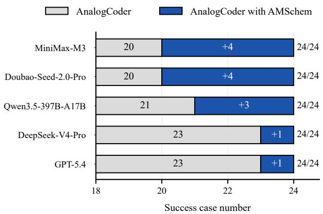  
Fig. 8. Effect of AMSchem-aided visual feedback in the AnalogCoder refinement loop across five models.

Fig. 9 illustrates how schematic feedback translates into a concrete topology repair for a Gilbert-cell mixer generated by MiniMax-M3 (T19). The task requires difference- and sum-frequency products under 1.0-kHz RF and 1.2-kHz LO excitation. In the failed design, devices controlled by the same LO phase connect both RF branches to the same output node, rather than forming the required cross-coupled switching structure. This connectivity is consistent with the observed LO-dominated output. The AMSchem schematic exposes the connections between the switching quad and the RF branches, allowing the visual critic to localize the error to specific devices and output nets. Following this feedback, the design model reconnects the drain of M4 from Voutn to Voutp and that of M6 from Voutp to Voutn, restoring the cross-coupled paths to the differential outputs. This example shows how a netlist-faithful schematic can support localized diagnosis of functional errors in the netlist itself.

Fig. 10 shows the corresponding functional change, with panels (a, c) before repair and (b, d) after repair. Spectra computed from uniformly resampled 5–20-ms output waveforms show that the failed circuit is dominated by the 1.2- kHz LO component, while its 200-Hz difference and 2.2-kHz sum components are only 0.021 and 0.013 mV. After repair, these components reach 55.47 and 53.36 mV, respectively, both exceeding the 1-mV threshold, while LO feedthrough is suppressed. The original functional checker also reports PASS for the repaired design. The plotted responses follow the original evaluator’s automatic LO bias-selection procedure. In additional comparisons at the same LO common-mode voltage, the original circuit fails to meet the mixing requirement, whereas the repaired circuit satisfies it. Together, the two figures trace schematic-assisted design from a localized connectivity diagnosis through netlist revision to simulationbased confirmation of the target function.

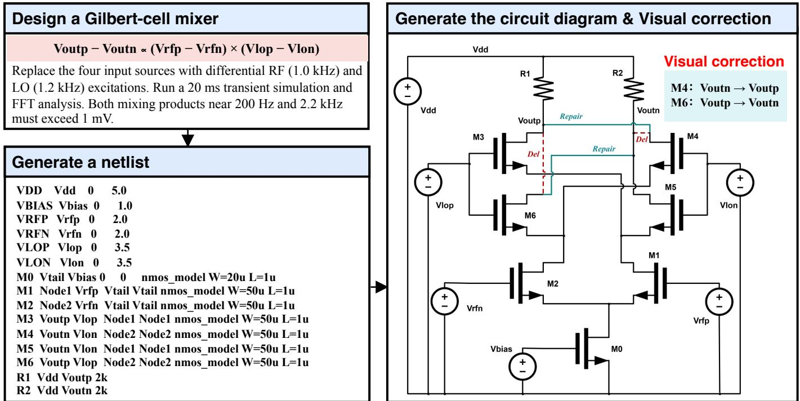

Fig. 9. Schematic-guided repair of a Gilbert-cell mixer generated by MiniMax-M3 (T19). The task and failed netlist are shown on the left. The schematic on the right identifies the incorrect output connections of the LO switching quad: red dashed segments mark removed connections, and teal segments show the drain reconnections of M4 and M6.  
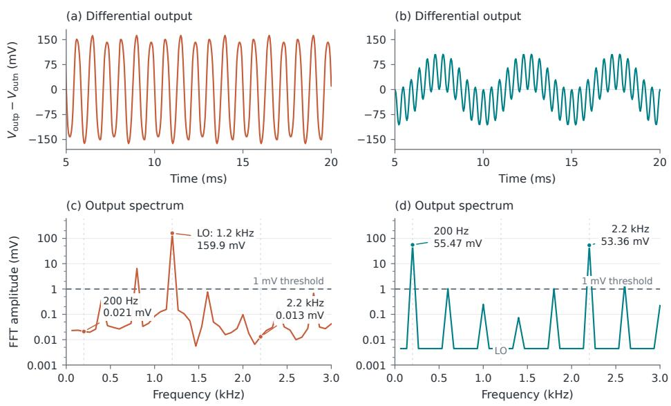  
Fig. 10. Gilbert-cell mixer response before (a,c) and after (b,d) schematic-guided repair. (a,b) Differential output waveforms; (c,d) FFT spectra of uniforml resampled 5–20-ms segments (24 kSa/s sampling, $N _ { \mathrm { F F T } } = 3 6 0$ , rectangular window). Excitation: 1.0-kHz RF, 1.2-kHz LO. The plotted traces follow the original evaluator’s automatic LO bias-selection procedure. Additional comparisons at the same LO common-mode voltage show that the original circuit fails the mixing requirement and the repaired circuit satisfies it. Dashed line: 1-mV product threshold.

## V. CONCLUSION

The netlist-to-schematic gap has outlived decades of graphdrawing research because connectivity alone underdetermines a readable drawing. AMSchem closes this gap with a principle that we expect to outlast any single model generation: circuit-aware planning proposes, and deterministic validation disposes. By separating DrawingIntent (what to draw) from SchematicIR (verifiable geometry) and gating every revision— at the plan, geometry, and pixel levels—behind revalidation, AMSchem converts an unreliable generative task into a verifiable one. The principle is model-agnostic: it lifts three different backbone MLLMs from 32.5% to 85.0% validity with consistent readability gains. Once embedded in an LLM design loop, its schematic feedback recovers all 13 cases that a state-of-the-art text-only loop left unsolved.

We regard the second finding as the more consequential one. AMS design is not only about electrical behavior. How a circuit is organized in the schematic carries design knowledge, and a design agent that cannot see its own circuit is blind to exactly the class of errors—miswired switches, broken symmetry, misplaced feedback—that engineers can spot instantly. AMSchem turns the schematic from a passive deliverable into a machine-checkable, agent-consumable feedback interface inside the design loop. Extending this interface to hierarchical schematics, and coupling visual critique with simulation evidence, is our immediate next step.

## REFERENCES

[1] C.-C. Chang, Y. Shen, S. Fan, J. Li, S. Zhang, N. Cao, Y. Chen, and X. Zhang, “LaMAGIC: Language-model-based topology generation for analog integrated circuits,” in Proceedings of the 41st International Conference on Machine Learning, 2024, pp. 6253–6262.

[2] Y. Lai, S. Lee, G. Chen, S. Poddar, M. Hu, D. Z. Pan, and P. Luo, “AnalogCoder: Analog circuit design via training-free code generation,” in Proceedings ofthe AAAI Conference on Artificial Intelligence, vol. 39, 2025, pp. 379–387.

[3] C. Liu, Y. Liu, Y. Du, and L. Du, “Ladac: Large language model-driven auto-designer for analog circuits,” Authorea Preprints, 2024.

[4] J. Shen, Z. Chen, J. Zhuang, J. Huang, F. Yang, L. Shang, Z. Bi, C. Yan, D. Zhou, and X. Zeng, “Atelier: An automated analog circuit design framework via multiple large language model-based agents,” IEEE Transactions on Computer-Aided Design of Integrated Circuits and Systems, 2025.

[5] Z. Chen, J. Huang, Y. Liu, F. Yang, L. Shang, D. Zhou, and X. Zeng, “Artisan: Automated operational amplifier design via domain-specific large language model,” in Proceedings of the 61st ACM/IEEE Design Automation Conference, 2024, pp. 1–6.

[6] P. Vijayaraghavan, L. Shi, E. Degan, V. Mukherjee, and X. Zhang, “Autocircuit-rl: Reinforcement learning-driven llm for automated circuit topology generation,” arXiv preprint arXiv:2506.03122, 2025.

[7] Y. Yin, Y. Wang, B. Xu, and P. Li, “ADO-LLM: Analog design bayesian optimization with in-context learning of large language models,” in Proceedings of the IEEE/ACM International Conference on Computer-Aided Design, 2024.

[8] C. Liu, E. A. Olowe, and D. Chitnis, “LLM-based AI agent for sizing of analog and mixed signal circuit,” in 2025 23rd IEEE Interregional NEWCAS Conference, 2025.

[9] X. Yu, D. Torbunov, S. Mandal, and Y. Ren, “AutoSizer: Automatic sizing of analog and mixed-signal circuits via large language model agents,” arXiv preprint arXiv:2602.02849, 2026.

[10] K. Sugiyama, S. Tagawa, and M. Toda, “Methods for visual understanding of hierarchical system structures,” IEEE Transactions on Systems, Man, and Cybernetics, vol. 11, no. 2, pp. 109–125, 1981.

[11] E. R. Gansner, E. Koutsofios, S. C. North, and K.-P. Vo, “A technique for drawing directed graphs,” IEEE Transactions on Software Engineering, vol. 19, no. 3, pp. 214–230, 1993.

[12] H. Y. Hsu and M. P. H. Lin, “Automatic analog schematic diagram generation based on building block classification and reinforcement learning,” in Proceedings of the 2022 ACM/IEEE Workshop on Machine Learning for CAD. Association for Computing Machinery, 2022, pp. 43–48.

[13] J. Yang, K. Qiao, S. Shi, B. Song, J. Chen, and B. Yan, “Aem-pcb reverser: circuit schematic generation in pcb reverse engineering using reinforcement learning based on aesthetic evaluation metric,” IEEE Transactions on Computer-Aided Design of Integrated Circuits and Systems, vol. 43, no. 5, pp. 1608–1612, 2023.

[14] H. Du, X. Du, and J. Yang, “Asgf4epd: An automated schematic generation framework for electronic products design,” IEEE Transactions on Computer-Aided Design of Integrated Circuits and Systems, 2026.

[15] R. Matsuo, S. Uhlich, A. Venkitaraman, A. Bonetti, C.-Y. Hsieh, A. Momeni, L. Mauch, A. Capone, E. Ohbuchi, and L. Servadei, “Schemato: An LLM for netlist-to-schematic conversion,” arXiv preprint arXiv:2411.13899, 2024.

[16] C. Liu and D. Chitnis, “Eeschematic: Multimodal-llm based ai agent for schematic generation of analog circuit,” in 2026 IEEE International Symposium on Circuits and Systems (ISCAS). IEEE, 2026, pp. 822–826.

[17] A. J. Bujana and A. I. Karsilayan, “A self-calibrating framework for analog circuit sizing using LLM-derived analytical equations,” arXiv preprint arXiv:2604.07387, 2026.

[18] P. Pham, A. Venkitaraman, C.-Y. Hsieh, A. Bonetti, S. Uhlich, M. Leibl, S. Hofmann, E. Ohbuchi, L. Servadei, U. Schlichtmann, and R. Wille, “GENIE-ASI: Generative instruction and executable code for analog subcircuit identification,” arXiv preprint arXiv:2508.19393, 2025.

[19] S. Gulgonul, “Weave: Verified netlist-to-schematic conversion via layered graph layout,” arXiv preprint arXiv:2607.03835, 2026.

[20] V. Carletti, P. Foggia, A. Saggese, and M. Vento, “Challenging the time complexity of exact subgraph isomorphism for huge and dense graphs with VF3,” IEEE Transactions on Pattern Analysis and Machine Intelligence, vol. 40, no. 4, pp. 804–818, Apr. 2018.

[21] Y. Shi, Z. Tao, Y. Gao, L. Huang, H. Wang, Z. Yu, T.-J. Lin, and L. He, “AMSnet 2.0: A large AMS database with AI segmentation for net detection,” 2025. [Online]. Available: https://arxiv.org/abs/2505.09155

We conducted a blinded mean opinion score (MOS) study on the 40 AMSNet cases for which reference schematics are available. Fifteen engineers independently rated the anonymized candidate schematics. The platform randomized both the case order and the candidate-image order within each case, and did not reveal the originating method or model. For each evaluated method, the reported MOS is the arithmetic mean of its available ratings across participants and cases. Figure 11 shows the study landing page and the rubric presented to participants.

Participants were explicitly instructed to ignore electrical functionality and judge only visual quality and readability, considering layout clarity, wire cleanliness, spacing and alignment, text legibility, and overall visual balance. The five-point rubric was:

1) Very Poor: severe crowding or overlap makes the schematic difficult to read.

2) Poor: obvious visual clutter imposes a high reading burden.

3) Fair: the schematic is basically readable, but its layout can be improved.

4) Good: the schematic is clear and orderly, with good visual organization.

5) Excellent: the layout is balanced, connections are clean, and the schematic is easy to read.

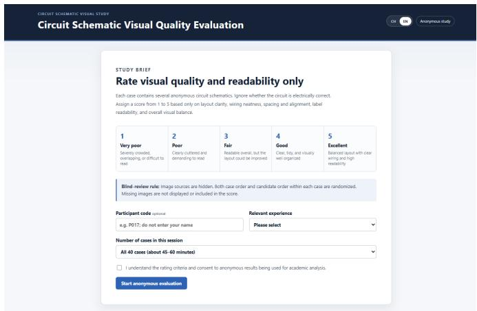  
(a) Landing page of the blinded MOS evaluation platform.  
Fig. 11. Blinded MOS evaluation platform: (a) the landing page and (b) the candidate-scoring interface.

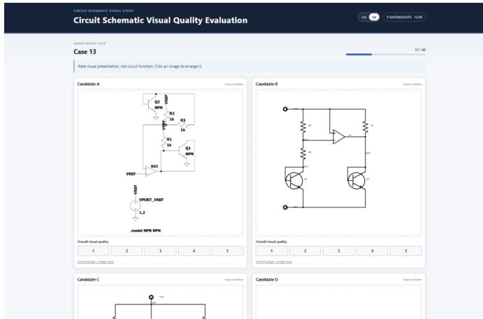  
(b) Candidate-scoring interface used during evaluation.

## APPENDIX B

## QUALITATIVE COMPARISON WITH EESCHEMATIC AND WEAVE

We compare AMSchem with our reproduction of EESchematic [16] and Weave [19] on the same input netlists. Figure 12 presents the generated schematics for a comparator and a bandgap circuit. Selected topological and visual errors in the EESchematic and Weave outputs are manually highlighted with red circles.

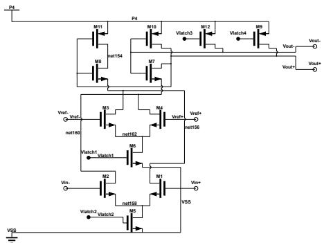  
(a) Comparator: AMSchem.

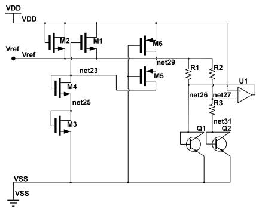  
(d) Bandgap: AMSchem.

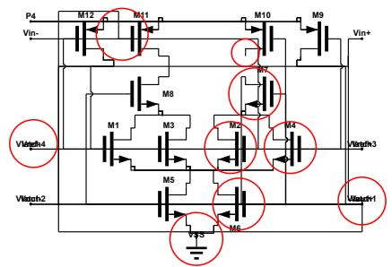  
(b) Comparator: EESchematic.

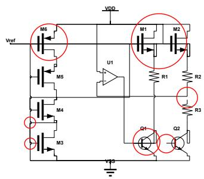  
(e) Bandgap: EESchematic.

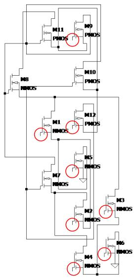  
(c) Comparator: Weave.

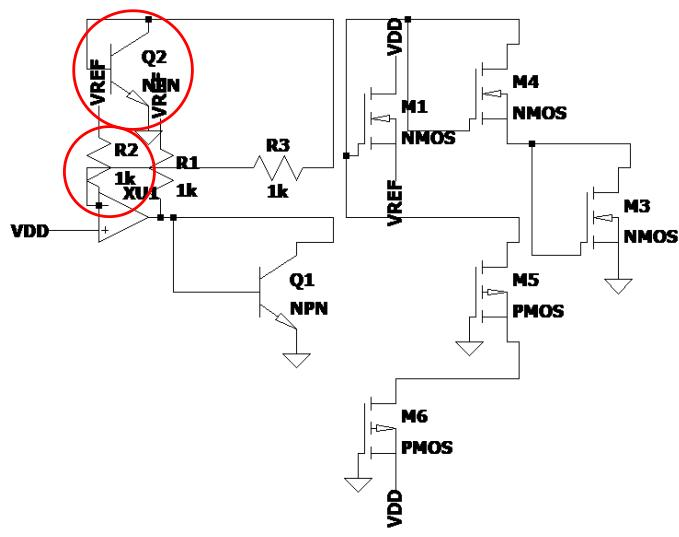  
(f) Bandgap: Weave.  
Fig. 12. Qualitative comparison of AMSchem, EESchematic, and Weave on two AMSNet circuits. The left column shows the comparator, and the right column shows the bandgap reference circuit. Within each column, the results are ordered from top to bottom as AMSchem, EESchematic, and Weave. All methods use the same input netlist and rendering settings for each circuit. Red circles in the EESchematic and Weave outputs mark selected topological and visual errors identified during manual inspection.

These examples provide a qualitative comparison under the unified rendering protocol. The red-circle annotations were added by us to indicate representative errors and are not intended to provide an exhaustive enumeration of all issues. The EESchematic outputs are obtained from our reproduction and should not be interpreted as results from the authors’ original implementation.