# ARMOR: Adaptive Curriculum Meta-Learning for Noise-Robust RAG Reasoning

Yan Wang1,2∗ , Yuxin Zhang1,2∗ , Shenyu Zhang1,2 , Yongrui Chen1,2 , Sheng Bi3 , Guilin Qi1,2†

1School of Computer Science and Engineering, Southeast University, China

2Laboratory of New Generation Artificial Intelligence Technology and Its Interdisciplinary Applications

(Southeast University), Ministry of Education, China

3School of Law, Southeast University, China

{yanwangstu, zzyx cs, gqi}@seu.edu.cn

## Abstract

Retrieval-Augmented Generation (RAG) systems have demonstrated remarkable effectiveness in mitigating hallucinations by incorporating external knowledge. However, the retrieval process inevitably introduces noise, posing significant challenges to RAG robustness. Fundamentally, noise robustness is a composite competency encompassing noise identification, retrieval filtering, and robust reasoning. Unfortunately, existing methods often fail to capture this holistic nature, typically restricted to single-dimensional enhancements or hampered by noise-induced optimization interference. To address these limitations, we decompose RAG robustness into three sub-tasks: knowledge boundary perception, retrieval verification, and robust reasoning. Accordingly, we propose ARMOR, an Adaptive Curriculum Meta-Learning for Noise-Robust RAG Reasoning. Inspired by the teaching process, ARMOR introduces an adaptive task scheduler as a Teacher to curate training plans according to the absolute learning progress of RAG generators (Student). Distinct from GRPO, ARMOR utilizes inter-group advantage estimation during learning to effectively mitigate mode collapse caused by limited output spaces. Experiments on three complex reasoning datasets (2Wiki-MultiHopQA, MusiQue, and HotPotQA) indicate that ARMOR achieves synergistic improvements in retrieval noise robustness, significantly outperforming baselines in output quality. Our code and datasets are available at the link.

## 1 Introduction

Retrieval-Augmented Generation (RAG) has emerged as a critical paradigm for mitigating hallucinations in Large Language Models (LLMs) by incorporating external knowledge [Lewis et al., 2020; Gao et al., 2023]. However, the retrieval process is inherently imperfect and inevitably introduces irrelevant or misleading Retrieval Noise, which poses a severe challenge to the robustness of RAG systems [Cuconasu et al., 2024; Wu et al., 2025]. Fundamentally, noise robustness is not a standalone trait but a composite capability. It requires generative systems to simultaneously perform across three distinct dimensions: identifying knowledge boundaries, filtering noise from retrieved context, and executing correct reasoning [Thakur et al., 2024].

Unfortunately, current methods often focus on specific facets of noise robustness [Chen et al., 2024]. Some studies employ supervised fine-tuning to train generators to detect noise and execute robust reasoning within noisy contexts [Zhou et al., 2025; Wei et al., 2025]. Conversely, others leverage generative systems’ intrinsic knowledge boundary perception to reduce unnecessary retrieval [Su et al., 2024; Wang et al., 2023]. However, these methods generally restrict optimization to isolated capabilities, lacking the synergy required for comprehensive robustness. Reinforcement Learning (RL) offers a paradigm to address this by enabling the co-evolution of these capabilities via end-to-end policy optimization [Shao et al., 2024; Feng et al., 2025].

Nevertheless, applying standard RL to enhance retrieval noise robustness poses two critical challenges. First, the reward signals derived from the multi-dimensional optimization objectives of noise robustness may result in mutual interference or cancellation, thereby preventing the generative system from converging to an optimal policy for any specific capability [Li et al., 2025]. Second, these capabilities exhibit varying degrees of complexity and follow an underlying sequential logic. Just as a student must learn addition and subtraction before multiplication and division, the optimization of noise robustness necessitates a sequential learning trajectory. However, standard RL algorithms typically disregard this inherent progression, attempting to optimize all noise robustness capabilities simultaneously [Huang et al., 2025]. This simultaneous learning strategy often induces an overwhelming optimization burden, restricting the generative system from effectively learning these capabilities.

To address these challenges, we propose ARMOR, an Adaptive Curriculum Meta-Learning for Noise-Robust RAG Reasoning. ARMOR leverages curriculum-based Reinforcement Learning to enhance the comprehensive noise robustness of generative systems. Accordingly, we decouple the composite objective of noise robustness into three sub-tasks:

(1) knowledge boundary perception, (2) retrieval verification, and (3) robust reasoning. Specifically, knowledge boundary perception determines whether the model’s intrinsic knowledge suffices or external retrieval is required. Retrieval verification distinguishes relevant evidence from irrelevant noise within the retrieved context. Robust reasoning integrates valid information to generate correct answers even in noisy contexts. Systematically acquiring these capabilities is essential for establishing a resilient defense against retrieval noise.

We draw inspiration from the human teaching process, where teachers dynamically adjust the curriculum based on the student’s learning feedback [Portelas et al., 2019]. AR-MOR models the training process as an adaptive curriculum meta-learning framework, and introduces an adaptive task scheduler as a teacher. In each training step, the teacher dynamically selects a specific sub-task for the student (the RAG generator), leveraging Absolute Learning Progress (ALP) to quantify the student’s real-time proficiency and prioritize the capability with the highest potential for improvement.

By prioritizing the most critical capability at each stage, ARMOR allows the optimizer to focus on a single dimension of robustness, effectively avoiding the mutual interference and cancellation of reward signals. To further stabilize this decoupled training, we introduce inter-group advantage estimation. Distinct from standard group relative policy optimization (GRPO) [Shao et al., 2024], inter-group advantage estimation extends advantage estimation to a batchlevel global scope. By combining inter-group advantage estimation with the adaptive curriculum meta-learning framework, ARMOR effectively eliminates task heterogeneity between different inputs and mitigates mode collapse stemming from limited output spaces. Experiments on three complex reasoning datasets (2WikiMultiHopQA [Ho et al., 2020], MusiQue [Trivedi et al., 2022], and HotPotQA [Yang et al., 2018]) indicate that ARMOR achieves synergistic improvements in retrieval noise robustness, significantly outperforming baselines in output quality.

We summarize our contributions as follows:

• We propose ARMOR, utilizing an ALP-based adaptive task scheduler to dynamically adjust the learning curriculum based on the student’s feedback.

• We introduce inter-group advantage estimation to stabilize training and mitigate mode collapse stemming from limited output spaces.

• Experiments on three noise-injected complex reasoning datasets demonstrate that ARMOR achieves synergistic improvements in retrieval noise robustness.

## 2 Related Work

Noise Robustness in RAG. Enhancing the robustness of RAG systems against retrieval noise has become a pivotal research direction. A primary defense against noise involves explicit mechanisms to evaluate and filter retrieved documents before or during generation. CRAG [Yan et al., 2024] employs a lightweight retrieval evaluator to assess document quality, triggering corrective actions when the confidence is low. Similarly, TRUSTRAG [Zhou et al., 2025] utilizes clustering and self-assessment to identify and filter out adversarial or misleading information. Rather than filtering inputs, CHAIN-OF-NOTE [Yu et al., 2024] trains models to generate sequential reading notes, explicitly assessing document pertinence before formulating an answer. INSTRUCTRAG [Wei et al., 2025] further advances this by instructing models to synthesize rationales that explain how the answer is derived from noisy contexts. Additionally, RAAT [Fang et al., 2024] employs adaptive adversarial training, exposing the model to various noise types to internalize robust reasoning capabil ities. SKR [Wang et al., 2023] utilizes the model’s selfknowledge to classify questions as “known” or “unknown” before invoking a retriever. Similarly, DRAGIN [Su et al., 2024] introduces Real-time Information Needs Detection to trigger retrieval only when the model exhibits uncertainty during generation. However, existing methods typically address noise robustness as an isolated capability by focusing solely on filtering, reasoning, or retrieval triggering.

RL for Robust RAG. Recent advancements have increasingly leveraged RL to enhance the robustness of RAG systems against retrieval noise. Some studies focus on optimizing the interaction policy between reasoning and retrieval. For instance, SEARCH-R1 [Jin et al., 2025] and R1- SEARCHER++ [Song et al., 2025] utilize outcome-based RL to train models to autonomously search queries within reasoning steps, enabling dynamic knowledge acquisition. To enhance noise filtering, R3-RAG [Li et al., 2025] employs a relevance-based process reward to verify retrieved documents at each step. Similarly, LETS [Zhang et al., 2025a] integrates knowledge redundancy and matching rewards to penalize irrelevant retrieval and prevent error propagation in multi-hop reasoning. EVINOTE-RAG [Dai et al., 2025] restructures the workflow into a “retrieve-note-answer” paradigm, using an evidence quality reward to filter noise and distill key evidence before generation. Furthermore, RAG-RL [Huang et al., 2025] investigates static curriculum strategies to improve model robustness against distractors. In contrast, ARMOR decomposes robustness into three distinct sub-tasks, utilizing an ALP-based adaptive task scheduler to dynamically adjust the learning curriculum based on the generator’s feedback.

## 3 Preliminaries

Task Definition: We focus on the task of RAG under noisy retrieval conditions. Given a QA pair $( q , a ) \in \mathcal { T } _ { t r a i n }$ , the RAG system utilizes a retriever to fetch a set of external documents $\mathcal { D } = \{ d _ { 1 } , d _ { 2 } , \cdot \cdot \cdot , d _ { k } \}$ based on the question q from a large corpus. The retrieved set D inevitably contains noise due to the inherent imperfections of the retriever. We denote the subset of golden documents as ${ \mathcal { D } } ^ { + } \subseteq { \mathcal { D } }$ and the noisy documents as $\mathbf { \bar { \mathcal { D } } } ^ { - } = \mathcal { D } \setminus \mathcal { D } ^ { + }$ . The robust RAG generator π aims to generate the correct answer a by effectively filtering $\mathcal { D } ^ { - }$ and reasoning over $\mathcal { D } ^ { + }$ in conjunction with its intrinsic knowledge. We formulate this as maximizing the probability of the correct answer a given the query q and retrieved set D:

$$
\theta ^ { * } = \underset { \theta } { \arg \operatorname* { m a x } } \sum _ { ( q , a ) \in \mathcal { T } _ { t r a i n } } \log P _ { \theta } ( a \mid q , \mathcal { D } ) .\tag{1}
$$

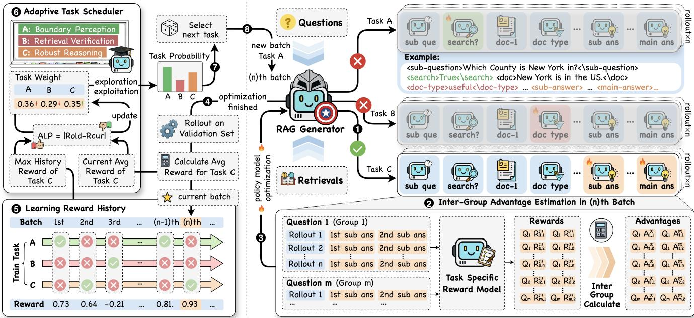  
Figure 1: The overall framework of ARMOR. (Left) The Adaptive Task Scheduler functions as a Teacher, dynamically prioritizing one of the three robustness sub-tasks (Knowledge Boundary Perception, Retrieval Verification, and Robust Reasoning) for each training batch based on the Absolute Learning Progress (ALP). (Right) The RAG Generator (Student) generates multiple rollouts to learn the selected task. (Bottom Right) Inter-Group Advantage Estimation computes reward advantages across the global batch scope rather than within groups, effectively mitigating mode collapse and stabilizing the decoupled training process.

Warm-Up: To equip the RAG generator with the fundamental capabilities of problem decomposition and step-bystep reasoning, we employ SFT on reconstructed multi-hop RAG datasets as a warm-up stage. This phase lays the foundation for the subsequent RL phase. For each pair of <main-question> and <main-answer>, we construct a reasoning chain to serve as the training target. A single reasoning chain consists of structured nodes: <think>, <sub-question>, <search>, <doc>, <doc-type>, and <sub-answer>. Specifically, we train the generator to decompose the <main-question> into sub-questions, determine retrieval policies via <search>True<search> or <search>False<search>, verify retrieved documents using <doc-type> tags, and generate corresponding sub-answers based on the reasoning process. This structured supervision ensures that the generator explicitly internalizes the “retrieve-verify-reason” workflow before exploring complex noisy environments. Detailed dataset construction procedures are provided in Appendix A.

## 4 Methodology

To achieve comprehensive noise robustness, we propose AR-MOR, an Adaptive Curriculum Meta-Learning framework. As illustrated in Figure 1, ARMOR consists of two core components: (1) Adaptive Task Scheduler that dynamically curates the learning curriculum based on the learning feedback, and (2) Inter-Group Advantage Estimation mechanism that stabilizes optimization across heterogeneous sub-tasks.

## 4.1 Adaptive Curriculum Meta-Learning

We decouple the composite objective of noise robustness into three sub-tasks: Knowledge Boundary Perception $( \tau _ { \mathrm { r e t } } )$ , Retrieval Verification $\left( \tau _ { \mathrm { f i l } } \right)$ , and Robust Reasoning $( \tau _ { \mathrm { a n s } } )$ To avoid the mutual interference of reward signals from distinct tasks, we employ an adaptive task scheduler. In each training round n, the scheduler selects a task $\tau _ { s }$ from the task set $\mathcal { T } = \{ \tau _ { \mathrm { r e t } } , \tau _ { \mathrm { f i l } } , \tau _ { \mathrm { a n s } } \}$ for optimization, prioritizing tasks with high potential for improvement based on learning feedback. We initialize the task weights $w _ { 1 } ( \tau ) = 1 / | \tau |$ for all $\tau \in \mathcal { T }$ In the n-th round, the selection probability $p _ { n } ( \tau )$ is computed to balance exploration and exploitation:

$$
\gamma = \operatorname* { m i n } \left\{ 1 , { \sqrt { \frac { | { \mathcal { T } } | \ln ( | { \mathcal { T } } | T ) } { T } } } \right\} ,\tag{2}
$$

$$
p _ { n } ( \tau ) = ( 1 - \gamma ) \frac { w _ { n } ( \tau ) } { \sum _ { \tau ^ { \prime } \in \mathcal { T } } w _ { n } ( \tau ^ { \prime } ) } + \frac { \gamma } { | \mathcal { T } | } ,\tag{3}
$$

where T is the predefined training rounds, and $\gamma$ serves as an exploration coefficient to prevent premature convergence to local optima. The scheduler samples a task $\tau _ { s } \sim p _ { n } ( \cdot )$ at the round n. Upon completing the training for the selected task $\tau _ { s } ,$ we quantify the model’s increase in competence using Absolute Learning Progress (ALP) [Portelas et al., 2019]. A higher ALP indicates that the task offers significant potential for performance improvement. The raw ALP is defined as:

$$
A L P ( \tau ) = \mathbb { I } [ \tau = \tau _ { s } ] \cdot | r _ { n } ( \tau _ { s } ) - r _ { \mathrm { o l d } } ( \tau _ { s } ) \big | ,\tag{4}
$$

where $r _ { n } ( \tau _ { s } )$ denotes the task reward received in the current training round n (detailed in section 4.3), $r _ { \mathrm { o l d } } ( \tau _ { s } )$ represents the maximum historical reward achieved for task $\tau _ { s }$

To correct for the bias introduced by probabilistic sampling, we compute the unbiased reward estimation $\hat { r } _ { n } ( \tau )$

$$
\hat { r } _ { n } ( \tau ) = \frac { A L P ( \tau ) } { p _ { n } ( \tau ) } ,\tag{5}
$$

detailed proofs are provided in Appendix B.2. Finally, the scheduler updates the task weights for the next round, incorporating a forgetting factor $\alpha \stackrel { \mathbf { \Delta } } { = } 1 / T$ to smooth updates and retain historical experience:

$$
w _ { n + 1 } ( \tau ) = w _ { n } ( \tau ) \cdot \exp \left( \frac { \gamma \hat { r } _ { n } ( \tau ) } { | T | } \right) + \frac { e \alpha } { | T | } \cdot \sum _ { \tau ^ { \prime } \in T } w _ { n } ( \tau ^ { \prime } ) .\tag{6}
$$

## 4.2 Inter-Group Advantage Estimation

Standard Group Relative Policy Optimization (GRPO) normalizes advantages within a group of rollouts corresponding to a single input. However, intra-group normalization results in unstable learning signals for individual tasks during rollouts. In our decoupled training setting, the constrained output space induces high similarity among rollouts generated from the same input, which reduces intra-group diversity and exacerbates the risk of mode collapse. To overcome this limitation, ARMOR introduces Inter-Group Advantage Estimation, which performs advantage normalization across the entire training batch rather than within isolated inputs.

Given a batch of questions $\mathcal { Q } = \{ q _ { 1 } , . . . , q _ { m } \}$ , we generate l rollouts for each question, denoted as:

$$
\mathcal { O } _ { \operatorname { t r a i n } } = \left\{ o _ { i , j } \vert 1 \leq i \leq m , 1 \leq j \leq l \right\} ,\tag{7}
$$

where $o _ { i , j }$ denotes the j-th rollout of question $q _ { i }$ . For the selected task $\tau _ { s } ,$ each rollout $o _ { i , j }$ receives a sequence of tasklevel rewards, denoted as:

$$
\mathbf { r } _ { i , j } = \left[ r _ { i , j } ^ { ( 1 ) } , \dots , r _ { i , j } ^ { ( K _ { i , j } ) } \right] ^ { \top } ,\tag{8}
$$

where $r _ { i , j } ^ { ( k ) }$ represents the reward of k-th task span in the rollout $o _ { i , j }$ . In addition, each rollout sequence $o _ { i , j }$ is associated with a format reward $r _ { i , j } ^ { \mathrm { f m t } }$ , which evaluates whether the rollout sequence conforms to the required format. We define the global sets of task and format rewards in current batch as:

$$
R _ { \mathrm { t a s k } } = \{ \mathbf { r } _ { i , j } \mid 1 \leq i \leq m , 1 \leq j \leq l \} ,\tag{9}
$$

$$
R _ { \mathrm { f m t } } = \left\{ r _ { i , j } ^ { \mathrm { f m t } } \big | 1 \leq i \leq m , 1 \leq j \leq l \right\} .\tag{10}
$$

As shown in Figure 1, we normalize rewards using the global statistics of the entire batch to compute the task-level advantage $A _ { i , j } ^ { \mathrm { t a s k } ( k ) }$ and format-level advantage $A _ { i , j } ^ { \mathrm { f m t } }$

$$
A _ { i , j } ^ { \mathrm { t a s k } ( k ) } = \frac { r _ { i , j } ^ { ( k ) } - \mathrm { m e a n } ( R _ { \mathrm { t a s k } } ) } { \mathrm { s t d } ( R _ { \mathrm { t a s k } } ) } ,\tag{11}
$$

$$
A _ { i , j } ^ { \mathrm { f m t } } = \frac { r _ { i , j } ^ { \mathrm { f m t } } - \mathrm { m e a n } ( R _ { \mathrm { f m t } } ) } { \mathrm { s t d } ( R _ { \mathrm { f m t } } ) } ,\tag{12}
$$

where mean(·) and std(·) compute the mean and standard deviation over the entire batch. By combining inter-group advantage estimation with the adaptive curriculum metalearning framework, ARMOR effectively eliminates task heterogeneity between different inputs and provides a more stable training signal.

The final token-level inter-group advantage $A _ { i , j } ^ { ( t ) }$ combines dual-level signals:

$$
A _ { i , j } ^ { ( t ) } = \sum _ { k = 1 } ^ { K _ { i , j } } \mathbb { I } [ t \in \mathrm { t o k e n s } ( i , j , k ) ] \cdot A _ { i , j } ^ { \mathrm { t a s k } ( k ) } + \omega A _ { i , j } ^ { \mathrm { f m } t }\tag{13}
$$

where t is the token index in rollout $o _ { i , j }$ , tokens $( i , j , k )$ denotes the token index of the k-th task span in rollout $o _ { i , j } . A _ { i , j } ^ { ( t ) }$ represents the token advantage assigned to token t in rollout $o _ { i , j } .$ . The weighting coefficient ω controls the relative strength of the format signal. Then the clipped policy optimization objective of ARMOR is as follows:

$$
\begin{array} { r l } & { | \mathcal { S } \operatorname { s u s t } \boldsymbol { \operatorname { s } } \times \nabla \times \boldsymbol { \mathsf { a } } : \operatorname { a n } \operatorname { s u s t } \boldsymbol { \operatorname { s a } } \times \boldsymbol { \operatorname { s a } } \ : \operatorname { s u s } \ : \operatorname { s u s } \ : \operatorname { s u p } \ : \boldsymbol { \operatorname { s } } . } \\ & { \mathcal { I } _ { \mathrm { A R M O R } } ( \theta ) = \mathbb { E } \left[ q _ { i } \in \mathcal { Q } , \{ \sigma _ { i , j } \} _ { j = 1 } ^ { l } \sim \pi _ { \theta _ { o l d } } ( \cdot \mid q i ) \right] \frac { 1 } { \sum _ { j = 1 } ^ { l } \left. \sigma _ { i , j } \right. } \displaystyle \sum _ { j = 1 } ^ { l } \sum _ { t = 1 } ^ { \left. \sigma _ { i , j } \right. } } \\ & { \operatorname* { m i n } \left[ \frac { \pi _ { \theta } \left( \sigma _ { i , j } ^ { ( t ) } \mid q , \sigma _ { i , j } ^ { ( < t ) } \right) } { \pi _ { \theta _ { o l d } } \left( \sigma _ { i , j } ^ { ( t ) } \mid q , \sigma _ { i , j } ^ { ( < t ) } \right) } A _ { i , j } ^ { ( t ) } , \right. } \\ & { \left. \operatorname { c l i p } \left( \frac { \pi _ { \theta } \left( \sigma _ { i , j } ^ { ( t ) } \mid q , \sigma _ { i , j } ^ { ( < t ) } \right) } { \pi _ { \theta _ { o l d } } \left( \sigma _ { i , j } ^ { ( t ) } \mid q , \sigma _ { i , j } ^ { ( < t ) } \right) } , 1 - \varepsilon _ { l o w } , 1 + \varepsilon _ { h i g h } \right) A _ { i , j } ^ { ( t ) } \right] . } \end{array}\tag{14}
$$

After the training for the task $\tau _ { s }$ in the n-th batch, the task reward $r _ { n } ( \tau _ { s } ) = \mathrm { m e a n } ( R _ { \mathrm { t a s k } } )$ is calculated on the validation dataset, and returned to the adaptive task scheduler to update the task weights.

## 4.3 Reward Modeling

To precisely guide the generator toward robust behaviors, we design tailored reward functions for each sub-task, addressing their specific optimization challenges.

Knowledge Boundary Perception. The primary objective of this task is to enable the generator to accurately perceive the boundaries of its intrinsic knowledge. For each generated sub-question $< s \mathsf { u b - q u e s t i o n } >$ , the RAG generator predicts a <search> tag to determine whether to invoke the retriever. The action space is defined as:

$$
\mathcal { C } _ { r e t r i e v e r } = \{ \mathrm { t r u e } , \mathrm { f a l s e } \}\tag{15}
$$

To align the model’s retrieval behavior with the actual necessity of external information, we design a reward function that evaluates whether the model should retrieve from external knowledge based on the correctness of its direct answer. We denote the correctness of the answer generated without retrieval as $v _ { \mathrm { a n s } } \in$ {correct, error}, and the model’s chosen retrieve action as $a _ { \mathrm { r e t } }$ . The reward $r _ { \mathrm { r e t } }$ is defined as follows:

$$
r _ { \mathrm { r e t } } = \left\{ \begin{array} { l l } { 1 } & { \mathrm { i f ~ } v _ { \mathrm { a n s } } \mathrm { ~ i s ~ e r r o r } \wedge a _ { \mathrm { r e t } } = \mathrm { t r u e } , } \\ { - 1 } & { \mathrm { i f ~ } v _ { \mathrm { a n s } } \mathrm { ~ i s ~ e r r o r } \wedge a _ { \mathrm { r e t } } = \mathrm { f a l s e } , } \\ { - 0 . 5 } & { \mathrm { i f ~ } v _ { \mathrm { a n s } } \mathrm { ~ i s ~ c o r r e c t } \wedge a _ { \mathrm { r e t } } = \mathrm { t r u e } , } \\ { 0 . 5 } & { \mathrm { i f ~ } v _ { \mathrm { a n s } } \mathrm { ~ i s ~ c o r r e c t } \wedge a _ { \mathrm { r e t } } = \mathrm { f a l s e } . } \end{array} \right.\tag{16}
$$

Retrieval Verification. This task requires the generator to classify each retrieved document into three categories: $\mathcal { C } _ { d o c } =$ {golden, inconsequential, irrelevant} [Zhang et al., 2025b]. Standard coarse-grained binary rewards (correct/incorrect classification) often lead to training instability. To mitigate this, we propose a fine-grained Retrieval Verification Reward based on the probability margin. For a document $d ,$ let $c ^ { * }$ be the ground-truth label and $p ( c )$ be the predicted probability of class c. We first calculate the confidence margin m(d) between the target class and the most competitive incorrect class:

$$
m ( d ) = p ( c ^ { * } ) - \operatorname* { m a x } _ { c \neq c ^ { * } , c \in \mathcal { C } _ { d o c } } p ( c ) .\tag{17}
$$

The final retrieval verification task reward is:

$$
r _ { \mathrm { \hat { H } l } } ( d ) = \operatorname { t a n h } \big ( \beta \cdot m ( d ) \big ) ,\tag{18}
$$

where scaling factor $\beta$ is used to control the sensitivity of the reward scaling.

Robust Reasoning. The goal of robust reasoning is to generate correct sub-answers <sub-answer> and a final answer <final-answer> given noisy context. We compute the answer reward $r _ { \mathrm { a n s } }$ by first obtaining a raw correctness score $s _ { \mathrm { a n s } }$ from an LLM evaluator, then linearly mapping it to the range [−1, 1]:

$$
r _ { \mathrm { a n s } } = 2 \cdot \frac { s _ { \mathrm { a n s } } - s _ { \mathrm { m i n } } } { s _ { \mathrm { m a x } } - s _ { \mathrm { m i n } } } - 1 ,\tag{19}
$$

where $[ s _ { \mathrm { m i n } } , s _ { \mathrm { m a x } } ]$ is the range of correctness score. Details of the LLM-based evaluation are provided in Appendix E.

## 5 Experiment

In this section, we present empirical evaluations of the effectiveness of ARMOR in defending against retrieval noise across three complex reasoning datasets. Specifically, we aim to validate the following: (1) ARMOR’s capability in enhancing the noise robustness of RAG generators; (2) the contribution of core components via ablation studies; (3) the dynamic trends of learning feedback $p _ { n } ( \tau )$ during training.

## 5.1 Experiment Setup

Datasets. As detailed in Appendix A, we reconstruct 2Wiki-MultiHopQA and MuSiQue datasets. For each dataset, training set consists of two stages: a warm-up stage and a RL stage. The validation set derives from the reconstructed datasets, while the test set consists of two reconstructed subsets and HotpotQA, which serves as an out-of-distribution dataset for evaluating model generalization. The detailed dataset statistics are presented in Table 1.

<table><tr><td>Subset</td><td>2Wiki</td><td>MuSiQue</td><td>HotpotQA</td></tr><tr><td>TrainWarm-Up</td><td>4,467</td><td>496</td><td>一</td></tr><tr><td>TrainRL</td><td>7,716</td><td>857</td><td></td></tr><tr><td>Test</td><td>1,352</td><td>375</td><td>500</td></tr><tr><td>Validation</td><td>1,352</td><td>375</td><td>一</td></tr></table>

Table 1: Experiment dataset statistics.

Evaluation Metrics. We evaluated the model using the following metrics: (1) Exact Match (EM) measures the strict accuracy by determining if the predicted answer matches the ground truth verbatim. (2) F1-Score (F1) captures the tokenlevel overlap between prediction and reference, offering flexibility for answers with minor phrasing variations. However, these traditional metrics rely on surface-level matching and often fail to capture semantic validity in generative tasks. To address this, we introduce (3) Correctness (Cor.), an LLMbased metric utilizing GPT-5 to assess the factual accuracy and completeness of answers against references. For clarity, correctness scores are normalized to the range [0, 1]. Detailed evaluation prompts and results aligned with manual annotations are presented in the Appendix E.

Baselines. We compare ARMOR against several established baselines: (1) Adaptive Retrieval: We compare against SKR [Wang et al., 2023] and DRAGIN [Su et al., 2024], which selectively trigger retrieval based on model’s intrinsic knowledge boundary to mitigate noise introduction. (2) Robust Reasoning: This category includes CHAIN-OF-NOTE [Yu et $a l .$ , 2024] and IRCOT [Trivedi et al., 2023]. We employ standard COT without retrieval as a lower bound to benchmark pure reasoning robustness. (3) RL-Enhanced RAG: This includes methods like RAG-RL [Huang et al., 2025] and SEARCH-R1 [Jin et al., 2025] that optimize retrieval and reasoning policies via reinforcement learning. In addition, we include NO-RAG (direct inference) and VANILLA-RAG (standard RAG workflow), which serve as performance lower bounds, as they lack specific mechanisms to defend against retrieval noise. We employ two mainstream LLM series with varying parameter scales as the RAG generators: Llama-3.2-1B, Llama-3.2-3B [Team, 2024], Qwen-3- 0.6B, Qwen-3-1.7B and Qwen-3-4B [Yang et al., 2025]. For all baselines, we strictly follow the hyperparameter settings and configurations reported in their original studies. Detailed baseline configurations are provided in Appendix C.

Training Details. We train the RAG generator for one epoch using Adam optimizer [Kingma and Ba, 2015] with a learning rate of 5e-5. One epoch includes 857 training rounds, and each round consists of 10 questions. The clipping coefficient ${ { \varepsilon } _ { l o w } }$ and $\varepsilon _ { h i g h }$ are set to 0.2 and 0.28, separately. The default rollout number l is set to 2. The weighting coefficient ω is set to 1, and the scaling factor β in the retrieval verification task is set to 6. During the rollout process, we employ e5-base-v2 [Wang et al., 2022] as the retriever, retrieving a maximum of three documents per retrieval triggering. For generation, we adopt a sampling temperature of 0.85, along with top $- p = 0 . 9 5$ and top- $k = 5 0$ . All reported results are averaged over three independent runs to ensure statistical reliability.

## 5.2 Main Results

As demonstrated in our preliminary study (Appendix C.2), standard retrieval systems inevitably retrieve irrelevant or inconsequential documents, introducing natural noise into the generation process. Table 2 presents the comparative performance of ARMOR and baselines under this realistic setting. ARMOR achieves SOTA performance across all datasets and metrics, demonstrating remarkable consistency on both Qwen and Llama backbones. Specifically, ARMOR surpasses the strongest baseline (IRCOT) by a substantial margin, achieving an average Correctness improvement of 38.8% on Qwen-3-1.7B and 19.9% on Llama-3.2-3B. Standard VANILLA-RAG shows limited improvement over direct inference (NO-RAG) and performs poorly on complex datasets. This confirms that without explicit robustness mechanisms, generators are easily misled by the inherent noise in natural retrieval. IRCOT remains competitive by interleaving reasoning and retrieval steps. CON struggles to maintain stability, suggesting that their sequential noise-filtering logic is prone to error propagation in open-domain settings. ARMOR’s decoupled training objective effectively mitigates this issue. Existing RL-based approaches (RAG-RL, SEARCH-R1) exhibit suboptimal performance, highlighting the difficulty of optimizing RAG generators with sparse rewards under natural noise.

<table><tr><td rowspan="2">Method</td><td colspan="3">2WikiMultiHopQA</td><td colspan="3">MusiQue</td><td colspan="3">HotpotQA</td><td colspan="3">Avg.</td></tr><tr><td>Cor.</td><td>F1</td><td>EM</td><td>Cor.</td><td>F1</td><td>EM</td><td>Cor.</td><td>F1</td><td>EM</td><td>Cor.</td><td>F1</td><td>EM</td></tr><tr><td colspan="10">Qwen-3-1.7B</td><td></td></tr><tr><td>No-RAG</td><td>37.72</td><td>37.21</td><td>32.99</td><td>3.73</td><td>2.96</td><td>0.00</td><td>24.20</td><td>22.44</td><td>15.67</td><td>21.88</td><td>20.87</td><td>16.22</td></tr><tr><td>VANILLA-RAG</td><td>47.63</td><td>44.67</td><td>38.46</td><td>24.00</td><td>27.43</td><td>17.33</td><td>45.07</td><td>45.72</td><td>38.33</td><td>38.90</td><td>39.27</td><td>31.37</td></tr><tr><td>CoT</td><td>39.64</td><td>17.13</td><td>11.39</td><td>8.27</td><td>6.27</td><td>1.33</td><td>22.47</td><td>18.03</td><td>13.60</td><td>23.46</td><td>13.81</td><td>8.77</td></tr><tr><td>CoN</td><td>63.61</td><td>13.13</td><td>4.73</td><td>29.33</td><td>12.36</td><td>5.33</td><td>54.53</td><td>22.65</td><td>17.07</td><td>49.16</td><td>16.05</td><td>9.04</td></tr><tr><td>IRCoT</td><td>50.59</td><td>48.80</td><td>41.86</td><td>32.00</td><td>29.97</td><td>18.67</td><td>55.40</td><td>51.97</td><td>46.26</td><td>46.00</td><td>43.58</td><td>35.60</td></tr><tr><td>DRAGIN</td><td>39.70</td><td>39.46</td><td>36.98</td><td>6.67</td><td>8.87</td><td>5.33</td><td>26.87</td><td>26.52</td><td>22.73</td><td>24.41</td><td>24.95</td><td>21.68</td></tr><tr><td>SKR</td><td>35.50</td><td>32.00</td><td>26.92</td><td>5.33</td><td>3.86</td><td>0.00</td><td>21.13</td><td>20.78</td><td>13.20</td><td>20.65</td><td>18.88</td><td>13.37</td></tr><tr><td>RAG-RL</td><td>49.70</td><td>46.67</td><td>41.39</td><td>29.66</td><td>28.79</td><td>20.33</td><td>48.33</td><td>47.64</td><td>42.67</td><td>42.56</td><td>41.03</td><td>34.80</td></tr><tr><td>SEARCH-R1</td><td>41.57</td><td>39.61</td><td>37.28</td><td>10.67</td><td>10.55</td><td>3.73</td><td>28.27</td><td>28.21</td><td>21.93</td><td>26.84</td><td>26.12</td><td>20.98</td></tr><tr><td>ARMOR (warm-up stage)</td><td>70.41</td><td>70.69</td><td>68.34</td><td>38.67</td><td>39.04</td><td>29.33</td><td>47.53</td><td>45.20</td><td>38.86</td><td>52.20</td><td>51.64</td><td>45.51</td></tr><tr><td>ARMOR</td><td>79.14</td><td>79.22</td><td>77.22</td><td>54.67</td><td>57.22</td><td>46.67</td><td>57.73</td><td>54.86</td><td>58.00</td><td>63.85</td><td>63.77</td><td>60.63</td></tr><tr><td colspan="10">Llama-3.2-3B</td><td colspan="3"></td></tr><tr><td>No-RAG</td><td>28.25</td><td>30.09</td><td>25.15</td><td>5.33</td><td>2.32</td><td>0.00</td><td>22.60</td><td>17.98</td><td>13.40</td><td>18.73</td><td>16.80</td><td>12.85</td></tr><tr><td>VANILLA-RAG</td><td>59.32</td><td>57.58</td><td>53.40</td><td>16.00</td><td>17.48</td><td>10.67</td><td>50.27</td><td>44.52</td><td>36.27</td><td>41.86</td><td>39.86</td><td>33.45</td></tr><tr><td>CoT</td><td>36.83</td><td>17.22</td><td>14.20</td><td>8.00</td><td>3.82</td><td>1.33</td><td>35.60</td><td>23.72</td><td>18.07</td><td>26.81</td><td>14.92</td><td>11.20</td></tr><tr><td>CoN</td><td>51.33</td><td>7.80</td><td>1.92</td><td>14.67</td><td>3.71</td><td>0.00</td><td>47.47</td><td>10.63</td><td>6.20</td><td>37.82</td><td>7.38</td><td>2.71</td></tr><tr><td>IRCoT</td><td>61.39</td><td>58.76</td><td>53.40</td><td>34.67</td><td>32.43</td><td>22.67</td><td>60.13</td><td>57.77</td><td>48.00</td><td>52.06</td><td>49.65</td><td>41.36</td></tr><tr><td>DRAGIN</td><td>42.60</td><td>41.76</td><td>39.50</td><td>9.33</td><td>7.77</td><td>4.00</td><td>37.47</td><td>35.85</td><td>29.73</td><td>29.80</td><td>28.46</td><td>24.41</td></tr><tr><td>SKR</td><td>35.21</td><td>36.98</td><td>32.99</td><td>8.26</td><td>6.95</td><td>2.67</td><td>35.00</td><td>32.50</td><td>31.33</td><td>26.16</td><td>25.48</td><td>22.33</td></tr><tr><td>RAG-RL</td><td>64.48</td><td>62.58</td><td>58.40</td><td>29.67</td><td>30.21</td><td>21.33</td><td>56.60</td><td>50.47</td><td>41.27</td><td>50.25</td><td>47.75</td><td>40.33</td></tr><tr><td>SEARCH-R1</td><td>42.31</td><td>40.76</td><td>38.76</td><td>6.67</td><td>8.50</td><td>4.00</td><td>26.33</td><td>27.22</td><td>24.53</td><td>25.10</td><td>25.49</td><td>22.43</td></tr><tr><td>ARMOR (warm-up stage)</td><td>71.01</td><td>71.28</td><td>68.93</td><td>32.00</td><td>36.54</td><td>21.33</td><td>45.67</td><td>47.79</td><td>37.60</td><td>49.56</td><td>51.87</td><td>42.62</td></tr><tr><td>ARMOR</td><td>77.81</td><td>78.09</td><td>75.59</td><td>42.67</td><td>45.62</td><td>29.33</td><td>66.93</td><td>66.47</td><td>58.67</td><td>62.47</td><td>63.39</td><td>54.53</td></tr></table>

Table 2: Performance comparison of ARMOR with baselines. We report Correctness (Cor.), F1 score, and Exact Match (EM) in percentage (%) using Qwen-3-1.7B and Llama-3.2-3B as backbones. The best results are highlighted in bold. Full results are provided in Appendix D.

We conducted a controlled experiment by manually injecting noise into the retrieval. We fixed the number of retrieved documents to 5 and varied the noise ratio from 0% to 100%, as shown in Figure 2. Baseline methods exhibit a precipitous performance decline as the noise ratio increases. IR-COT and SEARCH-R1 suffer significant losses, indicating they struggle to filter out distracting information effectively when valid evidence is scarce. In contrast, ARMOR demon strates exceptional stability, maintaining a high correctness score of 69% even at an 80% noise ratio. ARMOR often outperforms the DIRECT ANSWER baseline or remains comparable at 100% noise. This indicates that ARMOR has effectively learned a rejection mechanism via Inter-Group Advantage Estimation, allowing it to suppress the influence of irrelevant contexts rather than being hallucinated.

## 5.3 Ablation Study

We compare ARMOR with the following variants: (1) w/o CRL: replaces the ALP-based scheduler with random sampling (-random), rigid sequential ordering (-seq), or outcomesupervised training (-outcome sup: removing process rewards); (2) w/o Inter-Group Adv: reverts global advantage normalization to standard intra-group normalization; (3) Base Setting: removes both adaptive curriculum and inter-group estimation, reverting to standard outcome-supervised RL. As shown in Table 3, ARMOR consistently outperforms all variant settings across all metrics. Specifically, w/o CRL -seq suffers a 47.51% drop in average correctness, indicating that rigid task ordering leads to catastrophic forgetting among decoupled sub-tasks. Similarly, w/o CRL -random underperforms relative to ARMOR, confirming that the ALP-based scheduler is essential for dynamically balancing exploration and exploitation based on learning feedback. Reverting to standard intra-group normalization (w/o inter-group adv.) degrades performance by 14.58%. This decline highlights that standard intra-group normalization yields unstable signals in our decoupled setting. In contrast, ARMOR’s batch-level advantage estimation provides robust supervision, effectively preventing mode collapse and stabilizing optimization.

## 5.4 Analysis of Dynamic Learning Feedback

We visualize the dynamic trends of the task selection probability $p _ { n } ( \tau )$ throughout the training process. Figure 3 illustrates these trends for both Llama-3.2-3B and Qwen-3- 1.7B backbones. Observing the training dynamics of Qwen-3-1.7B, the scheduler assigns high probability to the Knowledge Boundary Perception task in the early stages. This indicates that the generator primarily focuses on distinguishing “what it knows” vs. “what it needs to retrieve.” The scheduler shifts its focus toward Retrieval Verification around step 300. This transition suggests that once the generator learns “when to retrieve,” it begins to focus on “how tofilter noise” from the retrieval. Meanwhile, the attention on Robust Reasoning remains relatively stable, serving as a consistent regularization throughout the process. The trends for Llama-3.2-3B exhibit a different pattern, highlighting the scheduler’s adaptability to different generator architectures. Unlike Qwen, Llama shows a continuous and increasing demand for Knowledge Boundary Perception. This suggests that for the Llama backbone, accurately determining the necessity of retrieval is a more challenging task. These findings confirm that ARMOR does not impose a rigid “one-size-fits-all” curriculum. Instead, it acts as a dynamic meta-learner, tailoring the training strategy to the learning trajectory of the underlying generator.

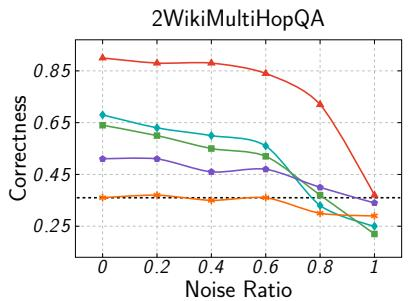

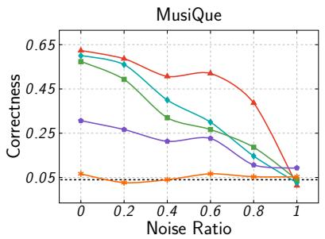

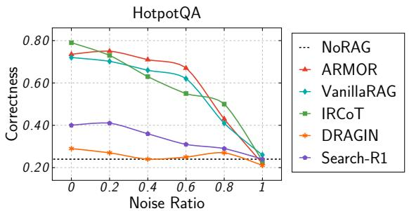  
Figure 2: Robustness analysis under controlled noise ratios (from 0% to 100%) with fixed retrieval size of $K = 5 .$

<table><tr><td rowspan="2">Method</td><td colspan="3">2WikiMultiHopQA</td><td colspan="3">MusiQue</td><td colspan="3">HotpotQA</td><td colspan="3">Avg.</td></tr><tr><td>Cor.</td><td>F1</td><td>EM</td><td>Cor.</td><td>F1</td><td>EM</td><td>Cor.</td><td>F1</td><td>EM</td><td>Cor.</td><td>F1</td><td>EM</td></tr><tr><td colspan="10">Qwen-3-1.7B</td><td></td><td></td><td></td></tr><tr><td>ARMOR</td><td>79.14</td><td>79.22</td><td>77.22</td><td>54.67</td><td>57.22</td><td>46.67</td><td>57.73</td><td>54.86</td><td>58.00</td><td>63.85</td><td>63.77</td><td>60.63</td></tr><tr><td>w/o CRL -random</td><td>67.66</td><td>67.97</td><td>66.48</td><td>39.33</td><td>40.59</td><td>28.67</td><td>37.27</td><td>35.45</td><td>27.33</td><td>48.09</td><td>48.00</td><td>40.83</td></tr><tr><td>w/o CRL -seq</td><td>52.22</td><td>52.69</td><td>50.89</td><td>23.65</td><td>26.50</td><td>15.20</td><td>24.67</td><td>21.76</td><td>11.27</td><td>33.51</td><td>33.65</td><td>25.79</td></tr><tr><td>w/o CRL -outcome sup.</td><td>60.22</td><td>60.45</td><td>58.59</td><td>32.33</td><td>32.37</td><td>23.00</td><td>30.80</td><td>27.72</td><td>18.73</td><td>41.12</td><td>40.18</td><td>33.44</td></tr><tr><td>w/o inter-group adv.</td><td>73.55</td><td>73.49</td><td>71.63</td><td>48.00</td><td>46.28</td><td>40.00</td><td>42.07</td><td>39.73</td><td>31.13</td><td>54.54</td><td>53.17</td><td>47.59</td></tr><tr><td>Base Setting</td><td>71.63</td><td>72.04</td><td>70.30</td><td>44.33</td><td>45.79</td><td>36.67</td><td>40.47</td><td>38.29</td><td>30.07</td><td>52.14</td><td>52.04</td><td>45.68</td></tr></table>

Table 3: Ablation analysis on the effectiveness of the Adaptive Curriculum Learning (CRL) strategy and Inter-Group Advantage Estima tion (inter-group adv). The best results are highlighted in bold.

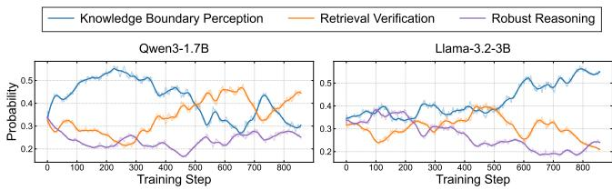  
Figure 3: Task selection probabilities $p _ { n } ( \tau )$ during the training.

## 5.5 Case Study

We analyze a multi-hop query: “When was Ole Rynning’s father born?” (answer: “May 30, 1778”), detailed case is provided in Appendix D.2. ARMOR successfully decomposes the logic: identifying the father (“Jens Rynning”) first, then retrieving his birth year. Crucially, ARMOR effectively filters out distractor documents describing the son’s birth “1809”, leading to the correct answer. In contrast, SEARCH-R1 exhibits chaotic reasoning, generating hallucinated contexts and failing to align the answer type. IRCOT suffers from distraction failure, although it retrieves the correct evidence, it lacks explicit noise rejection and is misled by the high semantic overlap of the son’s birth date. This case validates that AR-MOR’s adaptive curriculum meta-learning effectively equips the generator with the ability to distinguish golden evidence from noise in complex reasoning scenarios.

## 6 Conclusion

In this work, we presented ARMOR, a novel framework designed to fortify RAG systems against the pervasive challenge of retrieval noise. ARMOR decouples the training objective into three distinct sub-tasks: Knowledge Boundary Perception, Retrieval Verification, and Robust Reasoning. To coordinate these tasks, ARMOR introduces an Adaptive Curriculum Meta-Learning strategy, where a teacher scheduler dynamically prioritizes learning objectives based on the generator’s Absolute Learning Progress. Moreover, ARMOR addresses the optimization instability inherent in decoupled reinforcement learning by introducing Inter-Group Advantage Estimation, which mitigates mode collapse and ensures stable gradient optimization via global batch normalization. Extensive experiments across three complex multi-hop reasoning datasets demonstrate that ARMOR exhibits exceptional resilience, maintaining high correctness even under extreme noise ratios. This confirms that Adaptive Curriculum Scheduling and Inter-Group Advantage Estimation are essential for comprehensive RAG noise-robust reasoning.

## 7 Limitations

Evaluation Scope. Our experiments is confined to generaldomain multi-hop QA datasets, including 2WikiMultiHopQA, MuSiQue and HotpotQA. These datasets fail to capture the constraints and structural complexity of specialized domains. Consequently, the effectiveness of ARMOR in practical, high-stakes environments may be overestimated. Extending the evaluation to domains such as mathematics and healthcare is necessary to more rigorously assess its robustness and generalization. Language Scope. Our experiments are limited to English-only corpora, which biases the evaluation toward high-resource language settings. Although the proposed approach is not inherently language-dependent, its performance under multilingual conditions—where retrieval quality, linguistic variation, and knowledge distribution differ significantly—remains underexplored. Systematically extending and validating ARMOR in cross-lingual settings is an important direction for future investigation.

## Acknowledgments

This work is partially supported by National Nature Science Foundation of China under No. 62476058. We thank the Big Data Computing Center of Southeast University for providing the facility support on the numerical calculations in this paper.

## References

[Chen et al., 2024] Jiawei Chen, Hongyu Lin, Xianpei Han, and Le Sun. Benchmarking large language models in retrieval-augmented generation. In Michael J. Wooldridge, Jennifer G. Dy, and Sriraam Natarajan, editors, Thirty-Eighth AAAI Conference on Artificial Intelligence, AAAI 2024, Thirty-Sixth Conference on Innovative Applications of Artificial Intelligence, IAAI 2024, Fourteenth Symposium on Educational Advances in Artificial Intelligence, EAAI 2014, February 20-27, 2024, Vancouver, Canada, pages 17754–17762. AAAI Press, 2024.

[Comanici et al., 2025] Gheorghe Comanici, Eric Bieber, Mike Schaekermann, et al. Gemini 2.5: Pushing the frontier with advanced reasoning, multimodality, long context, and next generation agentic capabilities, 2025.

[Cuconasu et al., 2024] Florin Cuconasu, Giovanni Trappolini, Federico Siciliano, Simone Filice, Cesare Campagnano, Yoelle Maarek, Nicola Tonellotto, and Fabrizio Silvestri. The power of noise: Redefining retrieval for RAG systems. In Grace Hui Yang, Hongning Wang, Sam Han, Claudia Hauff, Guido Zuccon, and Yi Zhang, editors, Proceedings of the 47th International ACM SIGIR Conference on Research and Development in Information Retrieval, SIGIR 2024, Washington DC, USA, July 14-18, 2024, pages 719–729. ACM, 2024.

[Dai et al., 2025] Yuqin Dai, Guoqing Wang, Yuan Wang, et al. Evinote-rag: Enhancing RAG models via answersupportive evidence notes. CoRR, abs/2509.00877, 2025.

[DeepSeek-AI, 2025] DeepSeek-AI. Deepseek-r1: Incentivizing reasoning capability in llms via reinforcement learning. CoRR, abs/2501.12948, 2025.

[Fang et al., 2024] Feiteng Fang, Yuelin Bai, Shiwen Ni, et al. Enhancing noise robustness of retrieval-augmented language models with adaptive adversarial training. In Lun-Wei Ku, Andre Martins, and Vivek Srikumar, editors, Proceedings of the 62nd Annual Meeting of the Association for Computational Linguistics (Volume 1: Long Papers), ACL 2024, Bangkok, Thailand, August 11-16, 2024, pages 10028–10039. Association for Computational Linguistics, 2024.

[Feng et al., 2025] Lang Feng, Zhenghai Xue, Tingcong Liu, and Bo An. Group-in-group policy optimization for LLM agent training. CoRR, abs/2505.10978, 2025.

[Gao et al., 2023] Yunfan Gao, Yun Xiong, Xinyu Gao, et al. Retrieval-augmented generation for large language models: A survey. CoRR, abs/2312.10997, 2023.

[Ho et al., 2020] Xanh Ho, Anh-Khoa Duong Nguyen, Saku Sugawara, and Akiko Aizawa. Constructing A multihop QA dataset for comprehensive evaluation of reasoning steps. In Donia Scott, Nuria Bel, and Chengqing Zong,´ editors, Proceedings of the 28th International Conference on Computational Linguistics, COLING 2020, Barcelona, Spain (Online), December 8-13, 2020, pages 6609–6625. International Committee on Computational Linguistics, 2020.

[Huang et al., 2025] Jerry Huang, Siddarth Madala, Risham Sidhu, et al. RAG-RL: advancing retrieval-augmented generation via RL and curriculum learning. CoRR, abs/2503.12759, 2025.

[Jin et al., 2025] Bowen Jin, Hansi Zeng, Zhenrui Yue, et al. Search-r1: Training llms to reason and leverage search engines with reinforcement learning. CoRR, abs/2503.09516, 2025.

[Kingma and Ba, 2015] Diederik P. Kingma and Jimmy Ba. Adam: A method for stochastic optimization. In Yoshua Bengio and Yann LeCun, editors, 3rd International Conference on Learning Representations, ICLR 2015, San Diego, CA, USA, May 7-9, 2015, Conference Track Proceedings, 2015.

[Lewis et al., 2020] Patrick Lewis, Ethan Perez, Aleksandra Piktus, et al. Retrieval-augmented generation for knowledge-intensive NLP tasks. In Hugo Larochelle, Marc’Aurelio Ranzato, Raia Hadsell, Maria-Florina Balcan, and Hsuan-Tien Lin, editors, Advances in Neural Information Processing Systems 33: Annual Conference on Neural Information Processing Systems 2020, NeurIPS 2020, December 6-12, 2020, virtual, 2020.

[Li et al., 2025] Yuan Li, Qi Luo, Xiaonan Li, Bufan Li, et al. R3-RAG: learning step-by-step reasoning and retrieval for llms via reinforcement learning. CoRR, abs/2505.23794, 2025.

[Portelas et al., 2019] Remy Portelas, C´ edric Colas, Katja´ Hofmann, and Pierre-Yves Oudeyer. Teacher algorithms for curriculum learning of deep RL in continuously parameterized environments. In Leslie Pack Kaelbling, Danica Kragic, and Komei Sugiura, editors, 3rd Annual Conference on Robot Learning, CoRL 2019, Osaka, Japan, Oc-

tober 30 - November 1, 2019, Proceedings, volume 100 of Proceedings of Machine Learning Research, pages 835– 853. PMLR, 2019.

[Shao et al., 2024] Zhihong Shao, Peiyi Wang, Qihao Zhu, Runxin Xu, Junxiao Song, Mingchuan Zhang, Y. K. Li, Y. Wu, and Daya Guo. Deepseekmath: Pushing the limits of mathematical reasoning in open language models. CoRR, abs/2402.03300, 2024.

[Singh et al., 2025] Aaditya Singh, Adam Fry, Adam Perelman, et al. Openai gpt-5 system card, 2025.

[Song et al., 2025] Huatong Song, Jinhao Jiang, Wenqing Tian, et al. R1-searcher++: Incentivizing the dynamic knowledge acquisition of llms via reinforcement learning. CoRR, abs/2505.17005, 2025.

[Su et al., 2024] Weihang Su, Yichen Tang, Qingyao Ai, et al. DRAGIN: dynamic retrieval augmented generation based on the real-time information needs of large language models. In Lun-Wei Ku, Andre Martins, and Vivek Srikumar, editors, Proceedings of the 62nd Annual Meeting of the Association for Computational Linguistics (Volume 1: Long Papers), ACL 2024, Bangkok, Thailand, August 11- 16, 2024, pages 12991–13013. Association for Computational Linguistics, 2024.

[Team, 2024] Llama Team. The llama 3 herd of models. CoRR, abs/2407.21783, 2024.

[Thakur et al., 2024] Nandan Thakur, Luiz Bonifacio, Xinyu Zhang, et al. ”knowing when you don’t know”: A multilingual relevance assessment dataset for robust retrievalaugmented generation. In Yaser Al-Onaizan, Mohit Bansal, and Yun-Nung Chen, editors, Findings of the Associationfor Computational Linguistics: EMNLP 2024, Miami, Florida, USA, November 12-16, 2024, pages 12508– 12526. Association for Computational Linguistics, 2024.

[Trivedi et al., 2022] Harsh Trivedi, Niranjan Balasubramanian, Tushar Khot, and Ashish Sabharwal. Musique: Multihop questions via single-hop question composition. Trans. Assoc. Comput. Linguistics, 10:539–554, 2022.

[Trivedi et al., 2023] Harsh Trivedi, Niranjan Balasubramanian, Tushar Khot, and Ashish Sabharwal. Interleaving retrieval with chain-of-thought reasoning for knowledgeintensive multi-step questions. In Anna Rogers, Jordan L. Boyd-Graber, and Naoaki Okazaki, editors, Proceedings ofthe 61st Annual Meeting ofthe Associationfor Computational Linguistics (Volume 1: Long Papers), ACL 2023, Toronto, Canada, July 9-14, 2023, pages 10014–10037. Association for Computational Linguistics, 2023.

[Wang et al., 2022] Liang Wang, Nan Yang, Xiaolong Huang, et al. Text embeddings by weakly-supervised contrastive pre-training. CoRR, abs/2212.03533, 2022.

[Wang et al., 2023] Yile Wang, Peng Li, Maosong Sun, and Yang Liu. Self-knowledge guided retrieval augmentation for large language models. In Houda Bouamor, Juan Pino, and Kalika Bali, editors, Findings of the Association for Computational Linguistics: EMNLP 2023, Singapore, December 6-10, 2023, pages 10303–10315. Association for Computational Linguistics, 2023.

[Wei et al., 2025] Zhepei Wei, Wei-Lin Chen, and Yu Meng. Instructrag: Instructing retrieval-augmented generation via self-synthesized rationales. In The Thirteenth International Conference on Learning Representations, ICLR 2025, Singapore, April 24-28, 2025. OpenReview.net, 2025.

[Wu et al., 2025] Jinyang Wu, Shuai Zhang, Feihu Che, et al. Pandora’s box or aladdin’s lamp: A comprehensive analysis revealing the role of RAG noise in large language models. In Wanxiang Che, Joyce Nabende, Ekaterina Shutova, and Mohammad Taher Pilehvar, editors, Proceedings of the 63rd Annual Meeting ofthe Associationfor Computational Linguistics (Volume 1: Long Papers), ACL 2025, Vienna, Austria, July 27 - August 1, 2025, pages 5019–5039. Association for Computational Linguistics, 2025.

[Yan et al., 2024] Shi-Qi Yan, Jia-Chen Gu, Yun Zhu, and Zhen-Hua Ling. Corrective retrieval augmented generation. CoRR, abs/2401.15884, 2024.

[Yang et al., 2018] Zhilin Yang, Peng Qi, Saizheng Zhang, et al. Hotpotqa: A dataset for diverse, explainable multihop question answering. In Ellen Riloff, David Chiang, Julia Hockenmaier, and Jun’ichi Tsujii, editors, Proceedings ofthe 2018 Conference on Empirical Methods in Natural Language Processing, Brussels, Belgium, October 31 - November 4, 2018, pages 2369–2380. Association for Computational Linguistics, 2018.

[Yang et al., 2025] An Yang, Anfeng Li, Baosong Yang, et al. Qwen3 technical report. CoRR, abs/2505.09388, 2025.

[Yu et al., 2024] Wenhao Yu, Hongming Zhang, Xiaoman Pan, et al. Chain-of-note: Enhancing robustness in retrieval-augmented language models. In Yaser Al-Onaizan, Mohit Bansal, and Yun-Nung Chen, editors, Proceedings ofthe 2024 Conference on Empirical Methods in Natural Language Processing, EMNLP 2024, Miami, FL, USA, November 12-16, 2024, pages 14672–14685. Association for Computational Linguistics, 2024.

[Zhang et al., 2025a] Qi Zhang, Shouqing Yang, Lirong Gao, et al. Lets: Learning to think-and-search via process-and-outcome reward hybridization. CoRR, abs/2505.17447, 2025.

[Zhang et al., 2025b] Yuxin Zhang, Yan Wang, Yongrui Chen, et al. Magic mushroom: A customizable benchmark for fine-grained analysis of retrieval noise erosion in RAG systems. CoRR, abs/2506.03901, 2025.

[Zhou et al., 2025] Huichi Zhou, Kin-Hei Lee, Zhonghao Zhan, Yue Chen, Zhenhao Li, Zhaoyang Wang, Hamed Haddadi, and Emine Yilmaz. Trustrag: Enhancing robustness and trustworthiness in RAG. CoRR, abs/2501.00879, 2025.

## Appendix Contents

A Details of Dataset Reconstruction 10   
A.1 Reasoning Node Construction 10   
A.2 Sub-Question Construction 10   
A.3 Sub-Answer Reorganization 10   
A.4 Golden Document Augmentation 11   
A.5 Retrieval Policy Annotation . 11   
A.6 Intermediate Thought Synthesis 11   
A.7 Manual Verification 11   
B Additional Details of ARMOR 11   
B.1 Pseudo-Code of ARMOR . 11   
B.2 Proof of Unbiased Reward Estimation 12   
C Additional Experimental Setup 12   
C.1 Baseline Configurations . 12   
C.2 Retrieval Noise Distribution 13   
C.3 Experimental Prompts 13   
D Additional Experimental Results 13   
D.1 Sensitivity Analysis . 15   
D.2 Case Study 15   
E Details of LLM-Based Answer Evaluation 15   
E.1 Prompts for Correctness Evaluation 15   
E.2 Human AI Alignment . 15

## A Details of Dataset Reconstruction

We reconstruct 2WikiMultiHopQA and MuSiQue datasets to train the RAG generator and evaluate its performance on multi-hop noise-robust reasoning. As illustrated in Figure 4, ARMOR requires training instances organized as structured reasoning chains, where each node in reasoning chains contains an intermediate thought, a sub-question, a retrieval policy, a sub-answer and a set of golden documents supporting the sub-answer. However, the original versions of these datasets lack several node-level annotations. To bridge this gap, we reconstruct each QA instance into a fully structured reasoning chain through a seven-stage pipeline: (1) reasoning node construction, (2) sub-question construction, (3) subanswer reorganization, (4) golden document augmentation, (5) retrieval policy annotation, and (6) intermediate thought synthesis (7) manual verification.

Several reconstruction stages rely on LLM-based generation. To mitigate potential stylistic bias arising from over-reliance on a single generator, we employ an ensemble of advanced LLMs, including GPT-5 [Singh et al., 2025], Gemini-2.5-Pro [Comanici et al., 2025], and DeepSeek-R1 [DeepSeek-AI, 2025], and we prompt multiple models and randomly sample from the pool of valid outputs. This strategy reduces the risk of introducing a discernible stylistic fingerprint into the synthetic data, thereby enhancing the ecological validity of the reconstructed datasets.

## A.1 Reasoning Node Construction

This stage constructs a sequence of reasoning nodes. For 2WikiMultiHopQA, a reasoning node is constructed from an evidence triple and its associated golden document. For MuSiQue, the dataset provides a sequence of reasoning steps through an entity and a relation phrase. We construct each reasoning node through pairing the entity and relation phrase with their annotated sub-answer and supporting document.

## A.2 Sub-Question Construction

For each reasoning node, we employ LLMs to formulate the sub-question that precisely reflects its reasoning objective. In 2WikiMultiHopQA, sub-questions are generated based on the evidence triples and the main-question. For the first node in reasoning chains, LLMs incorporate the main-question and evidence triple to generate the sub-question. For subsequent nodes, LLMs additionally incorporate previous sub-questionanswer pairs to produce follow-up sub-questions that logically progress toward the final answer. The prompts used to generate the sub-queation are shown in Figure 6 and Figure 5, respectively. In MuSiQue, LLMs refine each node’s entity and relation phrase into a complete sub-question, and the prompt is shown in Figure 7.

## MusiQue: Sub Question Reconstruction

## Task Requirements:

You will be given one question in the format: Entity >> Relation. Your task is to convert each into a clear, natural-sounding English question. Use appropriate phrasing based on the relation (e.g., ”distributed by”, ”owned by”, etc.). Do not add any extra information, explanations, or formatting. Please output only the rephrased question.

The Game (1997 film) >> distributed by

Which company distributed

The Game (1997 film)?

Figure 7: Prompt for reconstructing the sub question in MusiQue.

## A.3 Sub-Answer Reorganization

This stage employs LLMs to reorganize the sub-answers in 2WikiMultiHopQA based on corresponding evidence triples. Specifically, sub-answers are normalized into concise phrases or sentences that directly address the corresponding subquestion. The prompt used for sub-answer reorganization is illustrated in Figure 8.

## A.4 Golden Document Augmentation

In this stage, we leverage LLMs to paraphrase the original golden document of each node into five distinct variants. This process ensures that the augmented documents retain the semantic equivalence of the original while introducing linguistic diversity. These generated documents are utilized to systematically manipulate the golden document ratio and noise ratio in noise-robust experiments. The prompt used for document augmentation is detailed in Figure 10.

## A.5 Retrieval Policy Annotation

We annotate each node by evaluating the RAG generator in retrieval-disabled mode. A node is labeled retrieve-no if the model generates a correct sub-answer based solely on its intrinsic knowledge and prior reasoning; otherwise, it is labeled retrieve-yes, indicating that external retrieval is required. This model-specific annotation provides explicit supervision for training the generator to make adaptive retrieval policies during the warm-up stage.

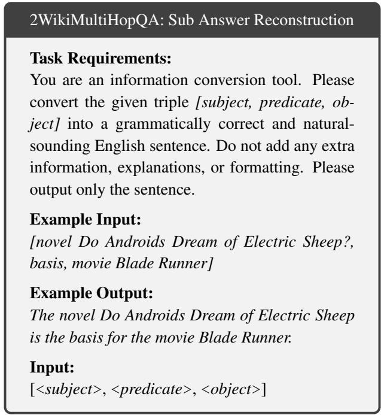  
Figure 8: Prompt for reconstructing the sub answer in 2WikiMulti-HopQA.

## A.6 Intermediate Thought Synthesis

This stage employ LLMs to synthesize an internal reasoning thought for each node, transforming the implicit logic into an explicit structured representation. Unlike simple concatenation of sub-questions and sub-answers, these states are generated by considering the global context, including the main question, the final answer, and the entire sequence of reasoning steps. Specifically, each synthesized thought elucidates the rationale behind its corresponding sub-question and justifies its necessity within the overall multi-hop chain, and the prompt is detailed in Figure 9. These synthesized thoughts provide fine-grained supervision for the RAG generator to model internal reasoning processes during the warm-up stage.

Algorithm 1 Adaptive Task Scheduler   
Input: Task set T, total training rounds T, training dataset D   
Hyperpara: Exploration coefficient γ, forgetting factor α   
Output: Optimized RAG generator πθ   
1: Initialize learning feedback weight   
w $\begin{array} { r } { . ( \tau )  \frac { 1 } { \tau } , \forall \bar { \tau } \in \mathcal { T } } \end{array}$   
2: Initialize reward history   
$\mathcal { H } ( \tau )  \emptyset , \forall \tau \in \mathcal { T }$   
3: for $\dot { n } = 1$ to T do   
4: $\begin{array} { r } { W _ { s u m } \gets \sum _ { \tau ^ { \prime } \in \mathcal { T } } w _ { t } ( \tau ^ { \prime } ) } \end{array}$   
5: for each task $\dot { \tau } \in \dot { \tau }$ do   
6: $\begin{array} { r } { p _ { n } ( \tau ) \gets ( 1 - \gamma ) \frac { w _ { n } ( \tau ) } { W _ { s u m } } + \frac { \gamma } { | T | } } \end{array}$   
7: end for   
8: Sample a task $\tau _ { s } \sim p _ { n } ( \tau )$   
9: Select new batch of questions Q from D   
10: Update $\theta _ { G }$ via inter group advantage estimation   
$\pi _ { \boldsymbol { \theta } } ^ { - }  \mathrm { O p t i m i z e r } ( \pi _ { \boldsymbol { \theta } } , \tau _ { s } , \mathcal { Q } )$   
11: Observe task-level reward $r _ { n } ( \tau _ { s } )$   
12: if $\mathcal { H } ( \tau _ { s } )$ ̸= ∅ then   
13: $r _ { \mathrm { o l d } } ( \dot { \tau } _ { s } ) \gets \operatorname* { m a x } \{ r \in \mathcal { H } ( \tau _ { s } ) \}$   
14: $A L \dot { P } ( \tau _ { s } ) \gets | r _ { n } ( \tau _ { s } ) - \dot { r } _ { \mathrm { o l d } } ( \tau _ { s } ) |$   
15: else   
16: $A L P ( \tau _ { s } ) \gets 0$   
17: end if   
18: $\mathcal { H } ( \tau _ { s } ) \gets \mathcal { H } ( \tau _ { s } ) \cup \{ r _ { n } ( \tau _ { s } ) \}$   
19: for each task $\tau \in \mathcal T$ do   
20: i $\cdot _ { \tau } = \tau _ { s }$ then   
21: $\hat { r } _ { n } ( \tau ) \gets A L P ( \tau _ { s } ) / p _ { t } ( \tau _ { s } )$   
22: else   
23: $\hat { r } _ { n } ( \tau ) \gets 0$   
24: end if   
25: $\begin{array} { r } { w _ { n + 1 } ( \tau )  w _ { n } ( \tau ) \cdot \exp ( \frac { \gamma \hat { r } _ { n } ( \tau ) } { \vert \mathcal { T } \vert } ) + \frac { e \cdot \alpha } { \vert \mathcal { T } \vert } \cdot W _ { \mathrm { s u m } } } \end{array}$   
26: end for   
27: end for   
28: return RAG generator πθ

## A.7 Manual Verification

We conduct a manual verification stage to ensure the logical correctness of the reconstructed reasoning chains. Specifically, annotators inspect each chain to identify and remove cases with logical inconsistencies, invalid reasoning transitions, or misaligned sub-questions and sub-answers. This human-in-the-loop verification serves as a final quality control stage to guarantee the reliability of the reconstructed datasets.

## B Additional Details of ARMOR

## B.1 Pseudo-Code of ARMOR

In this appendix, we provide the pseudo-code for the key components of the ARMOR framework: Adaptive Curriculum Scheduler and Inter-Group Advantage Estimation. The Adaptive Curriculum Scheduler (Algorithm 1) dynamically select tasks for optimization during each training round. It begins by initializing the task weights and reward history. The scheduler computes task selection probabilities based on the current learning progress, balancing exploration and exploitation. The learning progress is assessed using ALP, and task weights are updated after each round to reflect learning progress while retaining historical experience with a forgetting factor.

The Inter-Group Advantage Estimation (Algorithm 2) normalizes task-level and format-level rewards across the entire batch. Multiple rollouts are generated for each question, and rewards are assigned for each task span. These rewards are then normalized to compute task-level and format-level advantages. The policy model is updated using a clipped objective that incorporates the computed advantages, ensuring stable optimization despite task heterogeneity. Together, these two components enable ARMOR to provide an adaptive, stable, and efficient learning framework for noise-robust reasoning.

## B.2 Proof of Unbiased Reward Estimation

In our adaptive curriculum meta-learning framework, The scheduler samples a task $\tau _ { s } \sim p _ { n } ( \cdot )$ at the start of round n. Directly using the observed $A L P ( \tau _ { s } )$ to update task weights carries the risk of underestimating rarely selected tasks and overestimating frequently selected tasks. To ensure fair credit assignment across all tasks, we apply importance weighting to construct an unbiased estimation for $\bar { \boldsymbol { A } } \boldsymbol { L } \boldsymbol { P } ( \tau )$ . The estimated reward is defined as:

$$
\hat { r } _ { n } ( \tau ) = \frac { A L P ( \tau ) } { p _ { n } ( \tau ) } .\tag{20}
$$

Proof. $\hat { r } _ { n } ( \tau )$ is an unbiased estimation of $A L P ( \tau )$

$$
\begin{array} { l } { \displaystyle \mathbb { E } [ \hat { r } _ { n } ( \tau ) ] = \mathbb { E } \bigg [ \frac { A L P ( \tau ) } { p _ { n } ( \tau ) } \bigg ] } \\ { \displaystyle = \frac { A L P ( \tau ) } { p _ { n } ( \tau ) } \cdot p _ { n } ( \tau ) } \\ { \displaystyle = A L P ( \tau ) . } \end{array}\tag{21}
$$

Hence, $\hat { r } _ { n } ( \tau )$ is an unbiased estimation for $A L P ( \tau )$ □

## C Additional Experimental Setup

## C.1 Baseline Configurations

To ensure a fair and consistent comparison, we employ unified LLM generators and evaluation metrics across all experiments, while adhering to the originally recommended hyperparameter settings for each baseline.

Baseline Settings. For DRAGIN, we follow the original configuration by setting the number of few-shot examples to six and the hallucination threshold to 1.0, thereby effectively evaluating the output confidence. Regarding IRCOT, we configure the maximum inference hops to four, with a retrieval limit of 15 documents per query. The generation of tokens is limited to a maximum of 248 tokens per hop. For ARMOR, we mask all <doc> tags and their associated documents during training to prevent information leakage. We employ LoRA with a rank of $r \ = \ 8 ,$ a scaling factor of $\alpha = 1 6 \quad$ , and disable dropout. For SEARCH-R1 and RAG-RL, we standardize the maximum sequence length to 1,500 tokens and perform six rollouts during the training process, maintaining the same LoRA configuration as ARMOR. During the rollout process, we adopt a sampling temperature of 0.85, complemented by top-p = 0.95 and top-k = 50. The retrieval module is configured to retain the top three documents for each query. Specifically for RAG-RL, we implement the min-max curriculum strategy, which is empirically identified as the optimal setting in our preliminary study. In addition, it is crucial to note that SEARCH-R1 and RAG-RL are initialized directly from the original instruct-tuned model, rather than the model processed through our warm-up stage. This design choice is motivated by the fact that our warm-up stage is specifically engineered to instill particular reasoning formats. Since SEARCH-R1 and RAG-RL adhere to their own distinct structural paradigms, transferring the format biases from our warm-up model would create conflicting learning objectives, resulting in training collapse.

Algorithm 2 Iner Group Advantage Estimation   
Input: Questions Q, selected task $\tau _ { s } .$   
policy model $\pi \theta ,$ reward model πreward,   
Hyperpara: Question number $m ,$ rollout number $l ,$   
format weight ω, clipping coefficient $\varepsilon ,$ current round n   
Output: Updated policy parameters θ   
1: Initialize rollout set $\mathcal { O } _ { \mathrm { t r a i n } }  \emptyset$   
2: Sync $\pi _ { \theta _ { \mathrm { o l d } } }  \pi _ { \theta }$   
3: for $i = \stackrel { \triangledown } { 1 }$ to m do   
4: for $\cdot j = 1$ to l do   
5: Sample rollout sequence $o _ { i , j } \sim \pi _ { \theta _ { \mathrm { o l d } } } ( \cdot \mid q _ { i } )$   
6: $\mathcal { O } _ { \mathrm { t r a i n } }  \mathcal { O } _ { \mathrm { t r a i n } } \cup \hat { \{ o _ { i , j } \} }$   
7: end for   
8: end for   
9: Initialize $R _ { \mathrm { t a s k } }  \emptyset$   
10: for each $o _ { i , j } \in \mathcal { O } _ { \mathrm { t r a i n } }$ do   
11: Identify $K _ { i , j }$ task-spans in $o _ { i , j }$ for task $\tau _ { s }$   
12: Compute rewards $\mathbf { r } _ { i , j } = \{ r _ { i , j } ^ { ( 1 ) } , \dots , r _ { i , j } ^ { ( K _ { i , j } ) } \}$ via πreward   
13: $R _ { \mathrm { t a s k } }  R _ { \mathrm { t a s k } } \cup \{ { \bf r } _ { i , j } \}$   
14: end for   
15: Initialize $R _ { \mathrm { f m t } }  \emptyset$   
16: for each $o _ { i , j } \in \mathcal { O } _ { \mathrm { t r a i n } }$ do   
17: Compute format reward $r _ { i , j } ^ { \mathrm { f m t } }$   
18: $R _ { \mathrm { f m t } }  R _ { \mathrm { f m t } } \cup \{ r _ { i , j } ^ { \mathrm { f m t } } \}$   
19: end for   
20: for each $o _ { i , j } \in \mathcal { O } _ { \mathrm { t r a i n } }$ do   
21: for $k = \overset { \cdot } { 1 }$ to $K _ { i , j }$ do   
22: ${ A _ { i , j } ^ { \mathrm { t a s k } ( k ) }  \frac { r _ { i , j } ^ { ( k ) } - \mathrm { m e a n } ( R _ { \mathrm { t a s k } } ) } { \mathrm { s t d } ( R _ { \mathrm { t a s k } } ) } }$   
23: end for   
24: $A _ { i , j } ^ { \mathrm { f m t } }  \frac { r _ { i , j } ^ { \mathrm { f m t } } - \mathrm { m e a n } ( R _ { \mathrm { f m t } } ) } { \mathrm { c t } d / \mathrm { \Delta } B . \quad \mathrm { ~ } }$   
std $\overline { { ( R _ { \mathrm { f m t } } ) } }$   
25: for $t = 1 \mathbf { t o } | o _ { i , j } |$ do   
26: $\begin{array} { r } { \boldsymbol { A } _ { i , j } ^ { ( t ) } = \sum _ { k = 1 } ^ { K _ { i , j } ^ { \prime } } \mathbf { 1 } [ t \in \mathrm { t o k e n s } ( i , j , k ) ] \cdot \boldsymbol { A } _ { i , j } ^ { \mathrm { t a s k } ( k ) } + \omega \boldsymbol { A } _ { i , j } ^ { \mathrm { f m } } } \end{array}$   
27: end for   
28: end for   
29: Initialize loss $\mathcal { L }  0$   
30: for $i = 1$ to m do   
31: $L _ { i } \gets 0 , N _ { i } \gets 0$   
32: for $j = 1$ to n do   
33: for $t = 1 \mathbf { t o } \left| o _ { i , j } \right|$ do   
34: Compute likelihood ratio:   
πθ $\left( o _ { i , j } ^ { ( t ) } \mid q _ { i } , o _ { i , j } ^ { ( < t ) } \right)$   
(t)   
ρi,j ←   
$\pi _ { \theta _ { \mathrm { o l d } } } \left( o _ { i , j } ^ { ( t ) } \mid q _ { i } , o _ { i , j } ^ { ( < t ) } \right)$   
35: Clipped objective:   
$\begin{array} { r } { c _ { i , j } ^ { ( t ) } \gets \operatorname* { m i n } \left( \rho _ { i , j } ^ { ( t ) } A _ { i , j } ^ { ( t ) } , \ \mathrm { c l i p } ( \rho _ { i , j } ^ { ( t ) } , 1 - \varepsilon , 1 + \varepsilon ) \cdot A _ { i , j } ^ { ( t ) } \right) } \end{array}$   
36: $L _ { i } \gets L _ { i } + c _ { i , j } ^ { ( t ) }$   
37: $N _ { i } \gets N _ { i } + \ddot { 1 }$   
38: end for   
39: end for   
40: $\mathcal { L }  \mathcal { L } + \frac { L _ { i } } { N _ { i } }$   
41: end for   
42: Update θ by maximizing $\mathcal { L }$   
43: Rollout on validation set using πθ   
44: Compute $r _ { n } ( \tau _ { s } ) \gets \mathrm { m e a n } ( R _ { \mathrm { t a s k } } ^ { \mathrm { v a l } } )$   
45: return policy mode $\pi _ { \theta } , r _ { n } ( \tau _ { s } )$

Inference and Environment. During the inference phase, all baselines and ARMOR utilize e5-base-v2 as the unified retriever, retrieving up to three documents per iteration from the consistent corpus. Sampling hyperparameters (i.e., temperature, top-k, and top-p) follow the default settings of the original instruct-tuned models. All experiments are conducted on four NVIDIA A100 GPUs. To ensure statistical reliability, reported results are averaged over three independent runs (using random seed 42 for initialization).

## C.2 Retrieval Noise Distribution

Standard RAG systems inevitably retrieve irrelevant or distracting documents, which introduces natural noise into the generation process. To quantify this phenomenon, we analyze the composition of retrieved documents across 2Wiki, MuSiQue, and HotpotQA using e5-base-v2 as the retriever with retreieve k = 3. Specifically, for both the original multi-hop questions and their decomposed sub-questions, we categorize each retrieved document into three types: Golden (directly supports the answer), Inconsequential (semantically related but not essential), and Irrelevant (unrelated to the question).

<table><tr><td>Datasets</td><td>Golden</td><td>Inconsequential</td><td>Irrelevant</td></tr><tr><td>Multi-Hop Question</td><td colspan="3"></td></tr><tr><td>2Wiki</td><td>21.87</td><td>30.03</td><td>48.10</td></tr><tr><td>MuSiQue</td><td>12.92</td><td>35.65</td><td>51.43</td></tr><tr><td>HotpotQA</td><td>17.14</td><td>33.89</td><td>48.97</td></tr><tr><td></td><td colspan="3">Decomposed Sub-Question</td></tr><tr><td>2Wiki</td><td>25.06</td><td>29.17</td><td>45.77</td></tr><tr><td>MuSiQue</td><td>16.67</td><td>34.55</td><td>48.78</td></tr><tr><td>HotpotQA</td><td>13.33</td><td>33.67</td><td>53.00</td></tr></table>

Table 4: Distribution of retrieved document types for multi-hop questions and their decomposed sub-questions across three datasets.

The results in Table 4 confirm that retrieval noise is inherent in standard RAG pipelines: a significant fraction of retrieved passages are either inconsequential or irrelevant. Multi-hop questions generally exhibit higher noise ratios than their decomposed sub-questions, underscoring the greater challenge posed by compositional questions to RAG retrievers. Furthermore, the retrieval noise ratios exhibit a progressive increase across three datasets: 2WikiMultiHopQA shows the lowest noise ratio while MuSiQue and HotpotQA exhibit higher noise ratios, correlating with growing reasoning complexity or entity diversity. These findings highlight the necessity of noise-robust reasoning for multi-hop QA.

## C.3 Experimental Prompts

This section provides an overview of the prompts employed during the inference stage of ARMOR. Figure 12 illustrates the inference prompt used in ARMOR. When the model generates the token sequence <search>True</search>, the retriever is activated to fetch relevant documents based on the preceding <sub-question>. Each retrieved document is then inserted sequentially into the context; after each insertion, the RAG generator produces a corresponding <doc-type> annotation. In addition, Figure 11 shows the prompt template used to generate answers without retrieval. This variant is not part of the main inference pipeline but is instead utilized during the reinforcement learning phase to train the Knowledge Boundary Perception task, where the model learns to recognize when its internal knowledge suffices to answer a question.

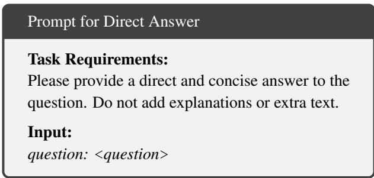  
Figure 11: Prompt for direct answer.

## D Additional Experimental Results

As shown in Table 5, small-scale language models typically struggle with complex multi-hop reasoning and are highly susceptible to retrieval noise due to their limited instructionfollowing and reasoning capabilities. For instance, on Qwen-3-0.6B, advanced RL-based methods like SEARCH-R1 collapse, achieving an average correctness of only 19.66%, which is even lower than the NO-RAG baseline (20.48%). This phenomenon indicates that standard RL optimization is unstable for weaker generic models. In stark contrast, AR-MOR demonstrates exceptional efficacy on lightweight models. On Qwen-3-0.6B, ARMOR achieves an average correctness of 57.22%, outperforming IRCOT. Similarly, AR-MOR surpasses IRCOT by 12.89% in average correctness on Llama-3.2-1B. These results confirm that ARMOR’s adaptive curriculum learning acts as an effective teacher, enabling even smaller student generators to master robust reasoning capabilities that are otherwise inaccessible through standard training.

<table><tr><td rowspan="2">Method</td><td colspan="3">2WikiMultiHopQA</td><td colspan="3">MusiQue</td><td colspan="3">HotpotQA</td><td colspan="3">Avg.</td></tr><tr><td>Cor.</td><td>F1</td><td>EM</td><td>Cor.</td><td>F1</td><td>EM</td><td>Cor.</td><td>F1</td><td>EM</td><td>Cor.</td><td>F1</td><td>EM</td></tr><tr><td colspan="10">Qwen-3-0.6B</td><td></td></tr><tr><td>No-RAG</td><td>37.43</td><td>35.55</td><td>32.99</td><td>3.73</td><td>2.58</td><td>0.00</td><td>20.27</td><td>16.26</td><td>10.47</td><td>20.48</td><td>18.13</td><td>14.49</td></tr><tr><td>VANILLA-RAG</td><td>34.47</td><td>28.16</td><td>21.15</td><td>14.67</td><td>11.63</td><td>2.67</td><td>34.87</td><td>28.24</td><td>21.27</td><td>28.00</td><td>22.68</td><td>15.03</td></tr><tr><td>CoT</td><td>34.17</td><td>31.29</td><td>28.55</td><td>2.67</td><td>5.99</td><td>0.00</td><td>19.67</td><td>18.16</td><td>14.33</td><td>18.84</td><td>18.48</td><td>14.29</td></tr><tr><td>CoN</td><td>56.15</td><td>19.33</td><td>9.91</td><td>19.73</td><td>15.98</td><td>8.27</td><td>46.13</td><td>32.50</td><td>26.53</td><td>40.67</td><td>22.60</td><td>14.90</td></tr><tr><td>IRCOT</td><td>36.69</td><td>31.06</td><td>23.52</td><td>13.33</td><td>12.44</td><td>3.73</td><td>42.47</td><td>35.57</td><td>26.87</td><td>30.83</td><td>26.36</td><td>18.04</td></tr><tr><td>DRAGIN</td><td>32.40</td><td>33.10</td><td>30.47</td><td>1.33</td><td>3.76</td><td>0.00</td><td>19.60</td><td>18.97</td><td>16.53</td><td>17.78</td><td>18.61</td><td>15.67</td></tr><tr><td>SKR</td><td>36.83</td><td>33.53</td><td>29.29</td><td>12.00</td><td>4.72</td><td>0.00</td><td>24.87</td><td>23.03</td><td>16.60</td><td>24.57</td><td>20.43</td><td>15.30</td></tr><tr><td>RAG-RL</td><td>37.58</td><td>31.24</td><td>25.49</td><td>18.73</td><td>15.82</td><td>3.47</td><td>36.97</td><td>32.22</td><td>25.67</td><td>31.09</td><td>26.43</td><td>18.21</td></tr><tr><td>SEARCH-R1</td><td>24.18</td><td>17.35</td><td>11.55</td><td>8.67</td><td>5.89</td><td>1.67</td><td>26.13</td><td>19.35</td><td>12.47</td><td>19.66</td><td>14.20</td><td>8.56</td></tr><tr><td>ARMOR (warm-up stage)</td><td>62.57</td><td>62.49</td><td>59.32</td><td>28.00</td><td>28.97</td><td>21.33</td><td>32.27</td><td>31.03</td><td>33.60</td><td>40.95</td><td>40.83</td><td>38.08</td></tr><tr><td>ARMOR</td><td>72.34</td><td>73.31</td><td>70.56</td><td>49.33</td><td>47.40</td><td>34.67</td><td>50.00</td><td>49.43</td><td>41.13</td><td>57.22</td><td>56.71</td><td>48.79</td></tr><tr><td colspan="10">Qwen-3-4B</td><td colspan="3"></td></tr><tr><td>No-RAG</td><td>32.84</td><td>28.41</td><td>23.67</td><td>10.67</td><td>11.08</td><td>2.67</td><td>30.07</td><td>25.64</td><td>20.13</td><td>24.53</td><td>21.71</td><td>15.49</td></tr><tr><td>VANILLA-RAG</td><td>66.12</td><td>63.75</td><td>57.99</td><td>24.00</td><td>21.13</td><td>16.00</td><td>58.67</td><td>56.64</td><td>50.13</td><td>49.60</td><td>47.17</td><td>41.37</td></tr><tr><td>CoT</td><td>44.97</td><td>28.53</td><td>23.52</td><td>12.00</td><td>9.16</td><td>2.67</td><td>33.27</td><td>30.88</td><td>25.27</td><td>30.08</td><td>22.86</td><td>17.15</td></tr><tr><td>CoN</td><td>65.83</td><td>24.19</td><td>17.16</td><td>36.00</td><td>25.64</td><td>16.00</td><td>59.13</td><td>45.12</td><td>38.57</td><td>53.65</td><td>31.65</td><td>23.91</td></tr><tr><td>IRCOT</td><td>67.31</td><td>62.72</td><td>55.03</td><td>44.00</td><td>34.35</td><td>24.00</td><td>63.93</td><td>57.60</td><td>48.33</td><td>58.41</td><td>51.56</td><td>42.45</td></tr><tr><td>DRAGIN</td><td>45.19</td><td>46.50</td><td>43.64</td><td>8.00</td><td>9.23</td><td>4.00</td><td>32.87</td><td>32.84</td><td>29.73</td><td>28.69</td><td>29.52</td><td>25.79</td></tr><tr><td>SKR</td><td>36.24</td><td>25.44</td><td>18.05</td><td>16.00</td><td>8.56</td><td>1.33</td><td>30.00</td><td>22.86</td><td>16.60</td><td>27.41</td><td>18.95</td><td>11.99</td></tr><tr><td>RAG-RL</td><td>69.26</td><td>70.15</td><td>68.79</td><td>25.67</td><td>22.26</td><td>18.00</td><td>61.27</td><td>59.64</td><td>59.40</td><td>52.07</td><td>50.68</td><td>48.73</td></tr><tr><td>SEARCH-R1</td><td>59.56</td><td>56.90</td><td>51.74</td><td>21.67</td><td>18.22</td><td>13.13</td><td>50.67</td><td>48.75</td><td>47.33</td><td>43.97</td><td>41.29</td><td>37.40</td></tr><tr><td>ARMOR (warm-up stage)</td><td>70.12</td><td>70.85</td><td>69.38</td><td>24.00</td><td>24.29</td><td>14.67</td><td>51.07</td><td>50.38</td><td>44.20</td><td>48.40</td><td></td><td>42.75</td></tr><tr><td>ARMOR</td><td>77.96</td><td>77.44</td><td>75.00</td><td>46.67</td><td>46.88</td><td>36.00</td><td>63.13</td><td>63.13</td><td>56.40</td><td>62.59</td><td>48.51 62.48</td><td>55.80</td></tr><tr><td colspan="10">Llama-3.2-1B</td><td colspan="3"></td></tr><tr><td>No-RAG</td><td></td><td></td><td></td><td></td><td></td><td></td><td></td><td></td><td></td><td></td><td></td><td></td></tr><tr><td>VANILLA-RAG</td><td>32.69</td><td>24.15</td><td>14.94</td><td>1.33</td><td>2.68</td><td>0.00</td><td>25.20</td><td>17.84</td><td>12.40</td><td>19.74</td><td>14.89</td><td>9.11</td></tr><tr><td></td><td>47.63</td><td>44.49</td><td>37.28</td><td>17.33</td><td>19.47</td><td>10.67</td><td>45.47</td><td>41.35</td><td>36.53</td><td>36.81</td><td>35.10</td><td>28.16</td></tr><tr><td>CoT</td><td>26.33</td><td>3.85</td><td>0.15</td><td>0.00</td><td>1.63</td><td>0.00</td><td>16.27</td><td>6.75</td><td>1.00</td><td>14.20</td><td>4.08</td><td>0.38</td></tr><tr><td>CoN</td><td>34.91</td><td>7.20</td><td>0.89</td><td>18.67</td><td>3.58</td><td>0.00</td><td>35.07</td><td>5.94</td><td>1.20</td><td>29.55</td><td>5.57</td><td>0.70</td></tr><tr><td>IRCoT</td><td>49.85</td><td>44.40</td><td>35.80</td><td>21.33</td><td>23.79</td><td>14.67</td><td>45.00</td><td>44.27</td><td>37.40</td><td>38.73</td><td>37.49</td><td>29.29</td></tr><tr><td>DRAGIN SKR</td><td>36.24 31.95</td><td>36.64 22.63</td><td>34.62 14.64</td><td>6.67 0.00</td><td>8.37 2.39</td><td>4.00 0.00</td><td>21.60 19.73</td><td>20.19 19.87</td><td>17.00 14.66</td><td>21.50 17.23</td><td>21.73 14.96</td><td>18.54 9.77</td></tr></table>

Table 5: Performance comparing our method with baselines on three multi-hop QA datasets using Qwen-3-0.6B, Qwen-3-4B, Llama-3.2-1B as backbones. We report Correctness (Cor.), F1 score, and Exact Match (EM) in percentage (%). The best results are highlighted in bold.

## D.1 Sensitivity Analysis

We conduct sensitivity analysis using Qwen-3-1.7B to evaluate ARMOR’s stability under varying hyperparameter settings. As illustrated in Figure 14, the generator’s performance exhibits a trend of initially increasing and then decreasing as K (the number of retrieved documents) increases. Performance peaks at $K = 3 ,$ , suggesting that a moderate amount of context provides sufficient information for reasoning. However, further increasing does not yield continuous improvements. This phenomenon indicates that retrieval is not “the more, the better.” Introducing an excessive number of documents significantly increases the risk of incorporating noise, which overwhelms the generator’s reasoning capabilities and dilutes the signal from golden documents.

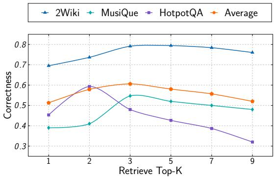  
Figure 14: Impact of retrieval size (K) on generation correctness using Qwen-3-1.7B.

We analyze the impact of rollout size (N) on training stability and performance. Figure 13 compares ARMOR against the variant without Inter-Group Advantage Estimation (w/o IGAE). ARMOR exhibits remarkable sample efficiency, maintaining high correctness, F1, and EM scores even with a minimal rollout number (N = 1). In contrast, the w/o IGAE variant is highly sensitive to N, performing poorly when N is small. With a small N and the constrained output space of sub-tasks, the generated outputs within a single group often become identical. By leveraging Inter-Group Advantage Estimation, ARMOR expands the comparison scope to the entire batch, ensuring effective advantage estimation regardless of group size.

## D.2 Case Study

Table 6 presents a concrete example of multi-hop question answering with different reasoning method. We illustrate how each method decomposes the question, interacts with retrieved evidence, and concludes a final answer. The case highlights distinct failure modes in SEARCH-R1 and IRCOT. In contrast, ARMOR demonstrates more structured reasoning and effective noise filtering from retrieved contexts.

## E Details of LLM-Based Answer Evaluation

## E.1 Prompts for Correctness Evaluation

In addition to traditional lexical metrics such as Exact Match and F1, we employ an LLM-based scoring approach using

GPT-5 to evaluate the answer correctness in RAG systems. As illustrated in Figure 15, our evaluation prompt instructs the model to assess the factual accuracy and completeness of generated answers by comparing them against reference answers. This approach overcomes the limitations of surfacelevel matching inherent in traditional QA metrics. Moreover, we also leverage this LLM-based evaluation to compute rewards for robust reasoning task during RL training, providing more informative feedback to guide the model compared with traditional lexical metrics.

## E.2 Human AI Alignment

To validate the alignment between LLM-based automatic evaluation and human judgment, we conducted an alignment analysis on the performance of Qwen-3-1.7B at different noise ratios using VANILLARAG as the framework. We randomly sampled 100 instances from 2WikiMultiHopQA and MuSiQue at different noise ratios. For each instance, we computed the average correctness assigned independently by human evaluators and GPT-5. As shown in Figure 16, the scores exhibit high similarity, indicating strong alignment between LLM-based and manual judgements. These findings support the effectiveness of the LLM-based evaluation framework as a reliable surrogate for human judgment in largescale experimental settings.

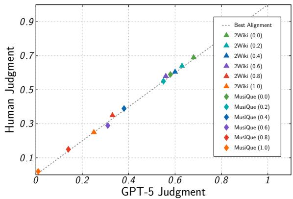  
Figure 16: Comparison of correctness based on (1) Human and (2) GPT-5 Judgement. Legend entries such as “2Wiki (0.6)” denote results of using 2WikiMultiHopQA with 60% noise ratio.

Table 6: Comparative case study of ARMOR, SEARCH-R1, and IRCOT on multi-hop QA with noisy retrieval.
<table><tr><td rowspan=1 colspan=6>Question:         When was Ole Rynning&#x27;s father born?</td></tr><tr><td rowspan=1 colspan=6>Ground Truth:May 30, 1778</td></tr><tr><td rowspan=6 colspan=6>ARMOR:        &lt;think&gt; To find out when Ole Rynning&#x27;s father was born, I first need to identify who Ole Rynning&#x27;s fatheris. &lt;/think&gt; &lt;sub-question&gt; Who is Ole Rynning&#x27;s father? &lt;/sub-question&gt; &lt;search&gt; True &lt;/search&gt;&lt;doc&gt; ... He was the son of the priest Jens Rynning (1778–1857) ... &lt;/doc&gt;&lt;doc-type&gt; golden &lt;/doc-type&gt; &lt;doc&gt; ... &lt;/doc&gt; &lt;doc-type&gt; irrelevant &lt;/doc-type&gt; ...&lt;sub-answer&gt; Ole Rynning&#x27;s father is Jens Rynning. &lt;/sub-answer&gt;&lt;think&gt; Now that I know Ole Rynning&#x27;s father is Jens Rynning, I need to find his date of birth. &lt;/think&gt;&lt;sub-question&gt; When was Jens Rynning born? &lt;/sub-question&gt; &lt;search&gt; True &lt;/search&gt;&lt;doc&gt; Jens Rynning (May 30, 1778 – June 11, 1857) was a ... &lt;/doc&gt; &lt;doc-type&gt; golden &lt;/doc-type&gt;&lt;doc&gt; Ole Rynning (April 4, 1809 – September 1838) was a ... &lt;/doc&gt;&lt;doc-type&gt; inconsequential &lt;/doc-type&gt; ...&lt;sub-answer&gt; Jens Rynning was born on May 30, 1778. &lt;/sub-answer&gt;&lt;main-answer&gt; May 30, 1778. &lt;/main-answer&gt;</td></tr><tr><td rowspan=4 colspan=5></td></tr><tr><td rowspan=2 colspan=1></td></tr><tr><td rowspan=1 colspan=1></td></tr><tr><td rowspan=1 colspan=1>doc>Jens</td><td rowspan=1 colspan=1>Jens Rynning</td></tr><tr><td rowspan=1 colspan=3></td><td rowspan=1 colspan=2></td></tr><tr><td rowspan=4 colspan=6>SEARCH-R1:     &lt;think&gt; Okay, I need to find out when Ole Rynning&#x27;s father was born. First, I should check if I have anyexisting information about Ole Rynning. I remember that Ole Rynning is a Danish footballer... &lt;/think&gt;&lt;search&gt; Ole Rynning birth date &lt;/search&gt;&lt;information&gt; ... He was the son of the priest Jens Rynning (1778–1857) ... &lt;/information&gt;&lt;search&gt; Ole Rynning father birth date &lt;/search&gt;&lt;information&gt; ... He was born in Stavanger as a son of Ole Bergesen ... &lt;/information&gt;&lt;answer&gt; Jens Rynning &lt;/answer&gt;</td></tr><tr><td rowspan=1 colspan=5></td></tr><tr><td rowspan=1 colspan=5></td></tr><tr><td rowspan=1 colspan=5><search> Ole R</td></tr><tr><td rowspan=1 colspan=6>IRCOT:          After interleaving chain-of-thought reasoning with iterative retrieval,the QA reader generates the nal answer:&lt;doc&gt; Jens Rynning (May 30, 1778 – June 11, 1857) was a ... &lt;/doc&gt;&lt;doc&gt; Ole Rynning (April 4, 1809 – September 1838) was a .. &lt;/doc&gt;&lt;doc&gt; ... He was the son of the priest Jens Rynning (1778–1857) ... &lt;/doc&gt;&lt;doc&gt; ... &lt;/doc&gt;&lt;main-answer&gt; April 4, 1809. &lt;/main-answer&gt;</td></tr></table>

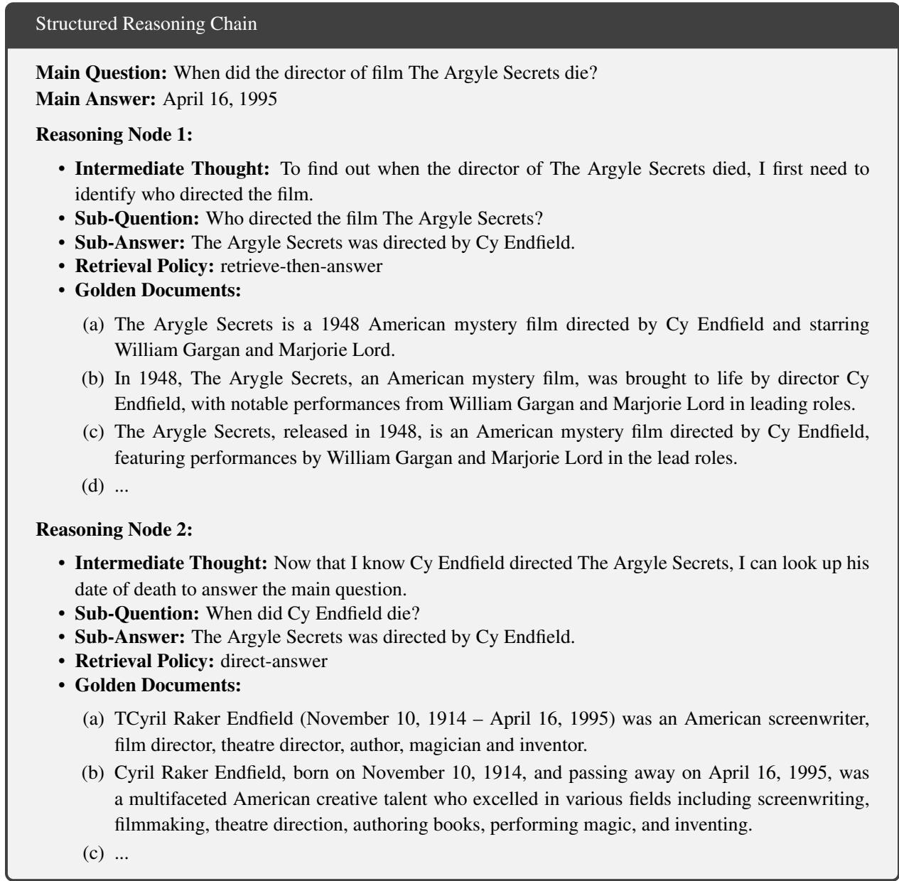  
Figure 4: An example of the structured reasoning chain..

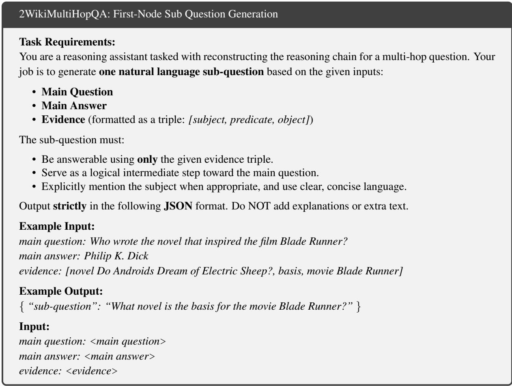  
Figure 5: Prompt for generating the first-hop sub question in 2WikiMultiHopQA.

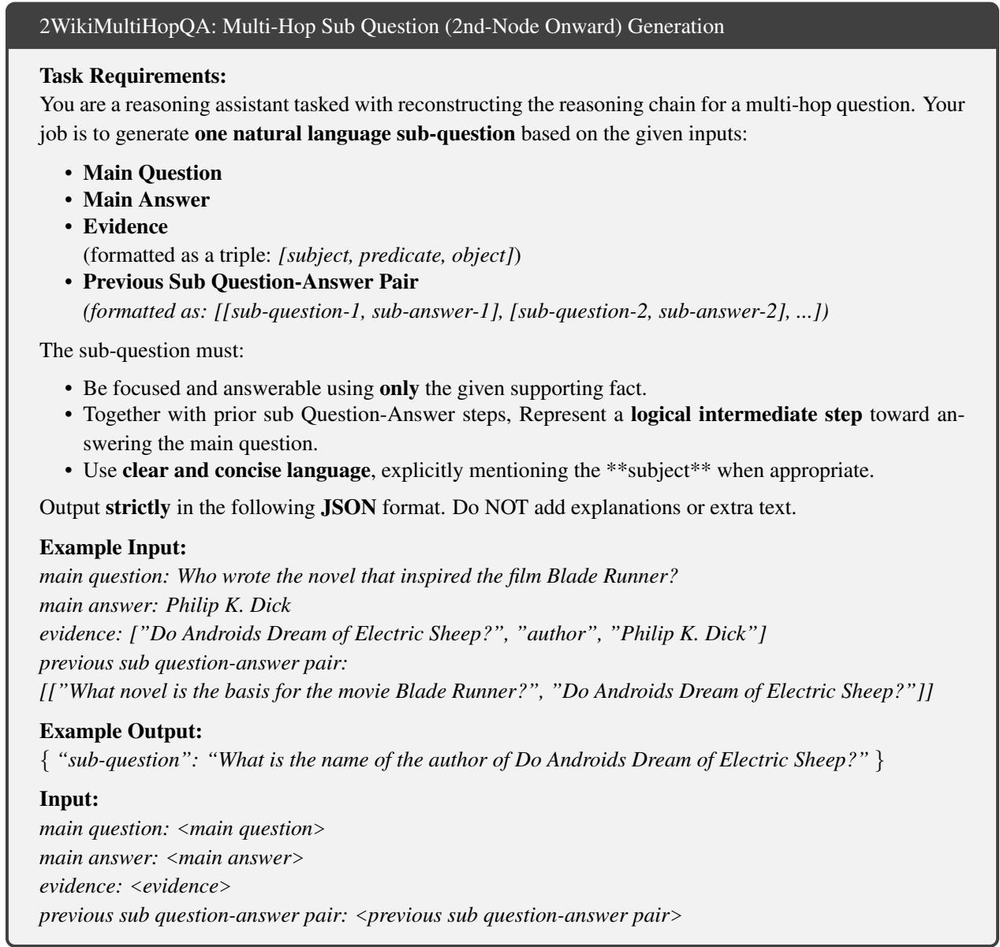  
Figure 6: Prompt for generating multi-hop sub-questions (second-hop onward) in 2WikiMultiHopQA.

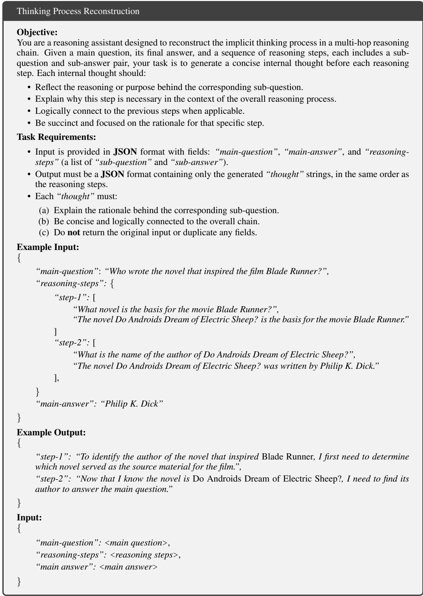  
Figure 9: Prompt for reconstructing the thinking process in 2WikiMultiHopQA and MusiQue.

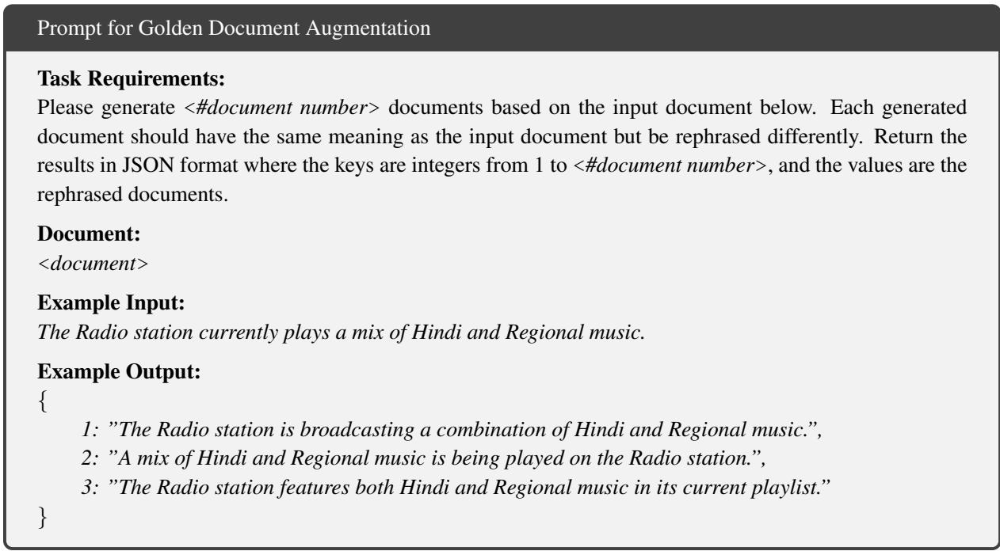  
Figure 10: Prompt for golden document augmentation.

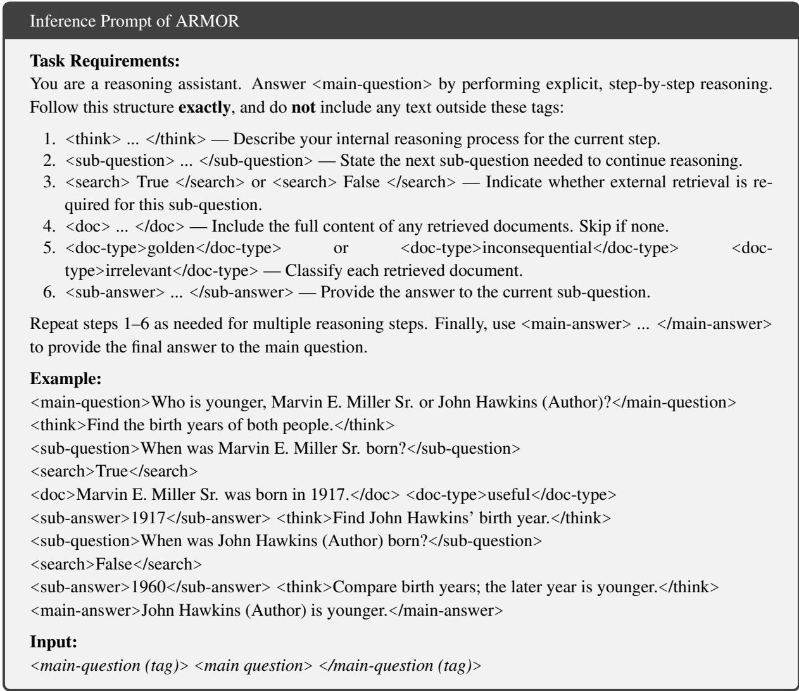  
Figure 12: Inference prompt of ARMOR.

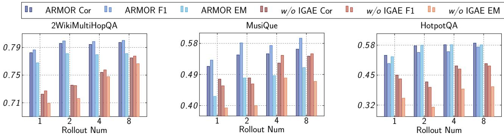  
Figure 13: Sensitivity analysis of rollout number (N) on training stability using Qwen-3-1.7B.

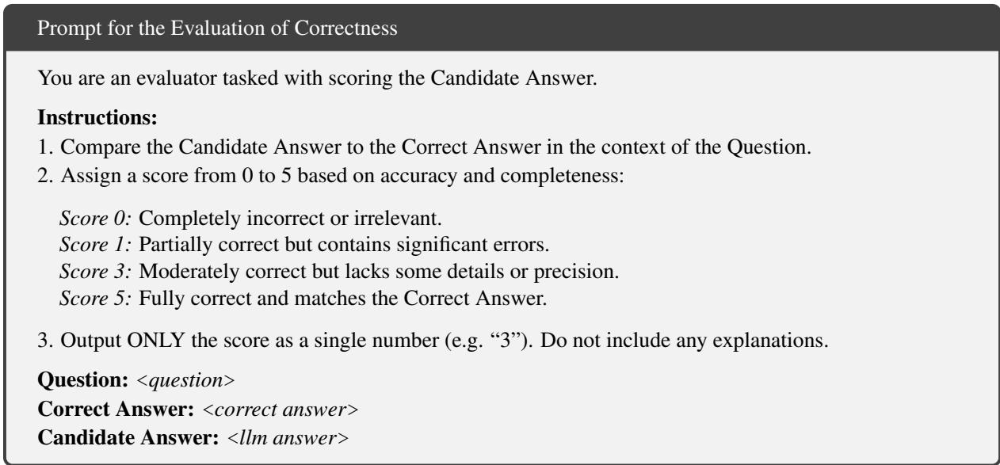  
Figure 15: Prompt for the evaluation of correctness.