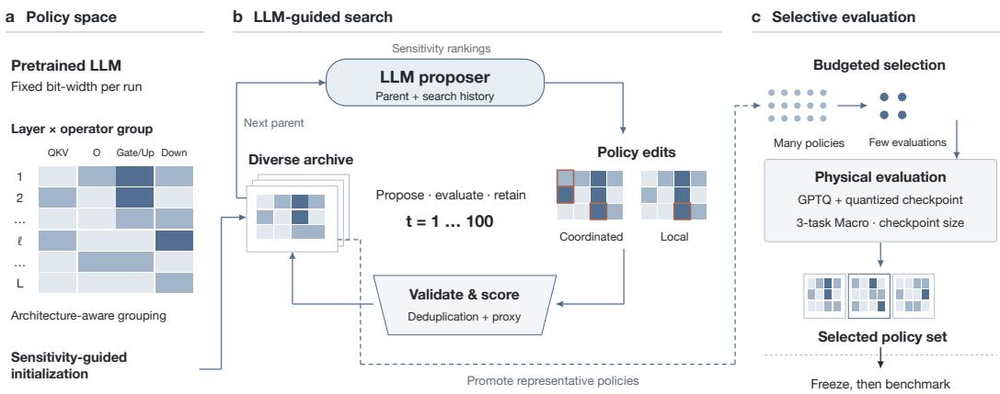
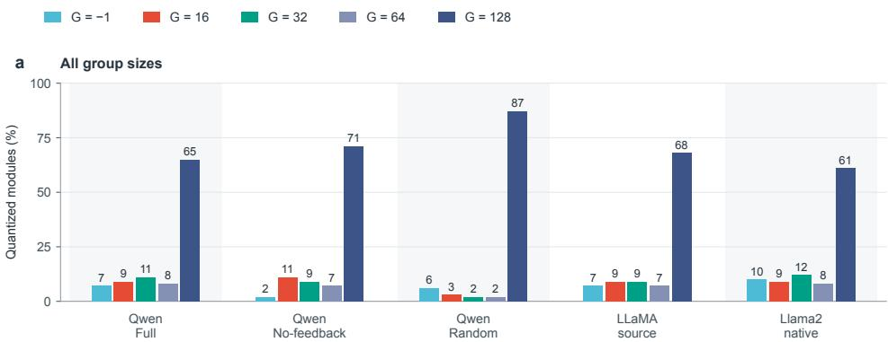
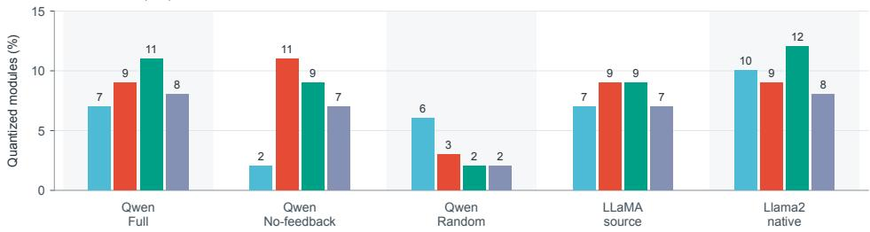
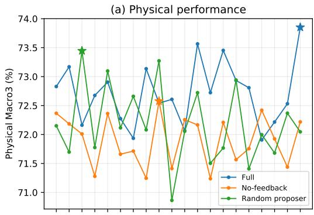
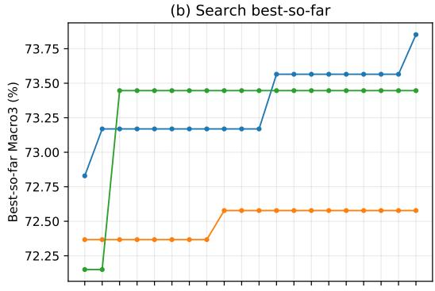
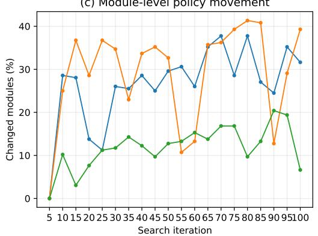
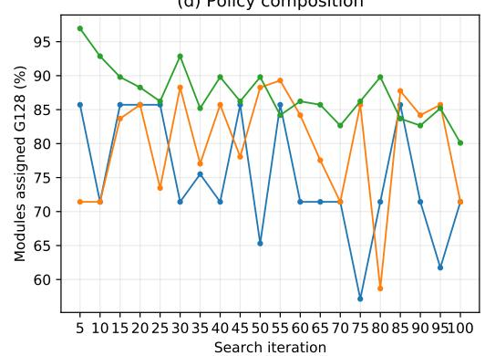

# AUTOQS: AUTOMATED QUANTIZATION STRATEGY DESIGN WITH LARGE LANGUAGE MODELS

Zhen Liu1∗ Zhiqin Yang2∗ Yonggang Zhang2 Jianyi Liu1 Jinjun Wang1 Jingwen Fu3†

1Xi’an Jiaotong University

2The Hong Kong University of Science and Technology

3Zhongguancun Academy

## ABSTRACT

Quantization reduces LLM deployment costs, but effective strategies must balance model quality and storage. LLM-driven search can automate strategy design through repeated proposal and evaluation. This process must identify useful strategies within a limited evaluation budget. The key challenge is that actual quantization is expensive, while inexpensive proxies may not reflect quantizedmodel performance. To address this challenge, we present AutoQS, an Automated Quantization Strategy Design with LLMs. AutoQS keeps weight precision fixed and searches group-size allocations across layers and operators under deployment constraints. Evaluation history guides coordinated LLM proposals, while deterministic validation ensures compatible allocations. An inexpensive quality proxy evaluates candidates, and an candidate repository retains alternative allocations to inform subsequent proposals. Periodic actual quantization complements these proxy evaluations with measured quality and checkpoint storage, providing feedback for further search within the evaluation budget. Experiments on Qwen2.5-7B-Instruct show that AutoQS improves seven-task average accuracy over uniform-group GPTQ and AWQ by 0.70 and 1.12 percentage points, respectively, at four-bit weight precision.

## 1 INTRODUCTION

Quantization reduces the storage and memory requirements of large language models (LLMs) by representing weights with fewer bits (Frantar et al., 2023; Lin et al., 2024). Preserving model quality under this compression requires careful choices about how quantization is applied throughout the model. Even at a fixed weight precision, quantization granularity remains an important design choice. In group-wise quantization, groups of weights share quantization parameters, such as scales. Smaller groups provide finer granularity at the cost of additional metadata. Because model components respond differently to quantization, a uniform allocation need not provide the most effective use of this granularity (Dong et al., 2019; Heo et al., 2024). Designing a heterogeneous allocation therefore requires coordinating decisions across layers and operators while respecting the configurations supported by the quantization implementation.

Existing research provides two complementary foundations for automating this process. Quantization methods improve how low-precision weights are obtained. GPTQ, a post-training quantization method for generative pre-trained transformers, uses approximate second-order information to reduce reconstruction error (Frantar et al., 2023). Activation-aware Weight Quantization (AWQ) protects salient weight channels using activation statistics, while OmniQuant learns calibration parameters to improve low-bit reconstruction (Lin et al., 2024; Shao et al., 2024). Automated allocation methods, including Hardware-Aware Automated Quantization (HAQ), further demonstrate the value of using evaluation feedback to choose quantization configurations (Wang et al., 2019). In parallel, LLM-driven systems such as FunSearch and Evolution of Heuristics automate program and heuristic design through repeated proposal and evaluation (Romera-Paredes et al., 2024; Liu et al., 2024). Recent systems further show how evaluation feedback can guide subsequent LLM-generated changes during iterative search (Ye et al., 2024; Novikov et al., 2025). These developments motivate an analogous approach to quantization strategy design, where proposed allocations are evaluated and the resulting evidence informs later proposals.

Applying this approach to quantization introduces two connected difficulties. First, a proposed strategy must become a valid allocation before it can be evaluated. Changes across layers and operators must satisfy shared-configuration requirements, and differently expressed proposals may encode the same allocation. Second, evaluating a valid allocation at full fidelity requires constructing and testing a quantized checkpoint. Repeating this process for every proposal would consume the experimental budget quickly. Inexpensive proxies support broader exploration, but their scores do not directly establish downstream accuracy or the size of a materialized checkpoint. These difficulties raise a central question. How can LLM-driven search turn quantization proposals into executable strategies and improve them using a limited number ofactual quantization evaluations?

We address this question with AutoQS, a framework for Automated Quantization Strategy Design with LLMs. AutoQS keeps weight precision fixed within each run and searches group-size allocations across layers and fusion-compatible operator groups. To turn proposals into executable strategies, it combines structured LLM edits with deterministic validation. The LLM receives a parent allocation, previous evaluation results, and a candidate repository, and proposes sparse edits that can jointly change several operator decisions. Each proposal is checked for consistency with the parent and for compatibility with the supported quantization configurations. Equivalent allocations are detected from their canonical representation, and deterministic novelty repair seeks an unseen valid alternative when an allocation is repeated. This gives the LLM scope to propose coordinated changes while enforcing the concrete requirements of the quantization implementation.

Multi-fidelity optimization provides a precedent for combining inexpensive approximations with costly target evaluations (Kandasamy et al., 2017). AutoQS adopts this broad evaluation princi ple through low-cost candidate assessment and periodic evaluation of quantized checkpoints. Valid, unseen candidates receive a scalar proxy score together with diagnostic statistics and a storage estimate. Maintaining a population of evaluated candidates can provide varied contexts for subsequent LLM proposals, as demonstrated by FunSearch (Romera-Paredes et al., 2024). In AutoQS, the candidate repository supports parent selection and retains alternative allocation patterns for later proposals. However, proxy-based exploration alone cannot verify the quality of the resulting quantized models. AutoQS therefore complements this loop with periodic quantization and checkpoint feedback. At a fixed interval, it evaluates the latest eligible candidate in the current search window. The selected strategy undergoes fresh GPTQ quantization (Frantar et al., 2023), followed by development-task evaluation and checkpoint-size measurement. The resulting observations inform later search decisions, connecting proposal generation to the behavior of actual quantized models. The default protocol permits at most 20 such evaluation opportunities over 100 search iterations. After candidate selection is frozen, a broader seven-task evaluation assesses the selected strategies without feeding its results back into search.

At four-bit weight precision, AutoQS improves seven-task average accuracy over uniform-group GPTQ and AWQ by 0.70 and 1.12 percentage points, respectively, on Qwen2.5-7B-Instruct. Matched-seed ablations support the roles of LLM proposals and checkpoint feedback in improving search-time performance. Case studies further examine how the discovered strategies allocate quantization granularity across model components and transfer to related models without additional allocation search.

Our contributions are threefold as follows:

• Automated quantization strategy design. We introduce AutoQS to automate heterogeneous group-size allocation at fixed weight precision. The framework uses an LLM to propose coordinated strategy changes while enforcing operator compatibility and allocation validity.

• Search with periodic checkpoint feedback. We combine inexpensive candidate evaluation and candidate search history with a bounded schedule of actual quantization evaluations. Measured checkpoint quality informs subsequent search, while checkpoint materialization provides direct storage measurements.

• Empirical evaluation of strategy quality and search behavior. We evaluate strategy quality through downstream benchmarks, investigate the search mechanism through matched-seed ablations, and examine allocation structure and reuse through case studies.

## 2 RELATED WORK

## 2.1 QUANTIZATION STRATEGY DESIGN FOR LARGE LANGUAGE MODELS

Post-training quantization (PTQ) reduces the memory and inference cost of large language models without retraining the full model. Representative methods mainly improve quantization fidelity under a specified configuration. GPTQ uses approximate second-order information for one-shot weight quantization (Frantar et al., 2023), AWQ protects activation-aware salient weights through channel scaling (Lin et al., 2024), while SmoothQuant redistributes quantization difficulty between activations and weights (Xiao et al., 2023). OmniQuant further optimizes clipping and equivalent transformations using a small calibration set (Shao et al., 2024). These methods substantially im prove low-bit quantization, but the choice of quantization configuration itself remains an important design variable.

A complementary line of work therefore treats quantization as a resource allocation problem. HAQ automatically searches layer-wise mixed-precision policies using hardware feedback (Wang et al., 2019), while HAWQ-V3 selects mixed-precision configurations by balancing model perturbation against deployment constraints (Yao et al., 2021). Such methods primarily vary the precision assigned to different model components. AutoQS instead fixes the weight bit-width within each search run and searches layer- and operator-wise group-size allocations. It therefore treats quantization granularity allocation, rather than weight precision itself, as the strategy-design variable.

## 2.2 LLM-GUIDED SEARCH IN STRUCTURED DESIGN SPACES

Large language models have recently been used as semantic proposal operators inside iterative search. Evolution through Large Models (ELM) uses an LLM as a mutation operator in evolutionary program search (Lehman et al., 2023), while FunSearch couples an LLM with executable evaluation and an evolving program population (Romera-Paredes et al., 2024). Evolution of Heuristics (EoH) evolves heuristic ideas and implementations jointly (Liu et al., 2024), and ReEvo combines evolutionary search with LLM-based reflection to improve subsequent proposals (Ye et al., 2024). A common principle across these methods is that evaluated candidates and search history are fed back to the LLM to guide later generations.

Most existing LLM-driven evolutionary systems operate over comparatively open-ended spaces such as programs or heuristics. Quantization strategy search is more constrained: every proposal must preserve the model structure and fixed precision, assign legal group sizes to all required operators, and avoid repeatedly evaluating previously visited policies. AutoQS therefore uses the LLM as a constrained strategy-search operator rather than as an unrestricted code generator. Model sensitivity and search history guide coordinated policy changes, while policy validation, novelty checking, and nearby refinement keep the search within a valid structured design space.

## 2.3 BUDGET-EFFICIENT AND DIVERSITY-PRESERVING SEARCH

High-fidelity evaluation is often the dominant cost in automated design. Multi-fidelity methods address this problem by evaluating many configurations cheaply and allocating greater resources only to selected candidates. Hyperband formalizes this idea through adaptive resource allocation and early stopping (Li et al., 2018), while BOHB combines multi-fidelity resource allocation with modelbased search (Falkner et al., 2018). A similar tension arises in quantization search: inexpensive proxies permit broad exploration, whereas fresh quantization and downstream evaluation provide more faithful but substantially more expensive measurements.

Selecting candidates solely by a scalar proxy score can nevertheless concentrate the search on highly similar configurations. Quality-diversity methods such as MAP-Elites instead retain highperforming solutions across distinct regions of a search space (Mouret & Clune, 2015). AutoQS adopts this general diversity-preserving principle without requiring every candidate to undergo physical evaluation. Candidate policies are screened using low-cost proxies, structurally distinct allocations are retained in the search archive, and only a small subset is promoted to actual GPTQ quantiza tion and downstream evaluation. This combination of inexpensive screening, diversity preservation, and selective high-fidelity evaluation allows AutoQS to use a limited physical evaluation budget while maintaining broad exploration of the policy space.

  
Figure 1: Overview of the AutoQS framework. AutoQS first defines a structured quantization policy space under a fixed weight bit-width, where layer- and operator-wise group sizes are searched. An LLM-guided search procedure generates constrained policy modifications, which are validated and evaluated using a low-cost proxy while a diversity-preserving candidate records maintains previously explored allocation patterns. Every K = 5 search iterations, the procedure selects the latest eligible candidate in the current five-iteration window for fresh GPTQ quantization. This target selection is independent of the proxy-score ordering. The resulting checkpoint is evaluated for task accuracy and storage, providing measured outcomes for subsequent policy selection.

## 3 METHOD

AutoQS searches for group-size allocations while keeping weight precision fixed. The framework separates inexpensive candidate exploration from periodic evaluation of actual quantized models. An LLM proposes changes to an existing allocation. Each proposal is validated and checked for duplicates, with deterministic novelty repair used to seek an unseen allocation before proxy evaluation. Evaluated policies and their results are retained to guide subsequent proposals. Every five iterations, the latest eligible candidate from the current search window is selected for fresh GPTQ quantization. The resulting checkpoint provides measured task accuracy and storage cost. We first define the allocation problem (Sec. 3.1), then describe candidate generation (Sec. 3.2), proxy evaluation (Sec. 3.3), and periodic quantization (Sec. 3.4).

## 3.1 PROBLEM FORMULATION AND FEASIBLE ALLOCATIONS

Consider a pretrained transformer with L layers. The weight bit-width b is fixed within a search run and is not a search variable. AutoQS instead assigns group sizes across layers and operator groups. A group size controls how many weights share quantization parameters. Smaller groups provide finer granularity but require more scale-related metadata. Different allocations can therefore change quantization error and checkpoint size without changing the weight bit-width.

Within each layer, we use four decision groups, U = {QKV, Out, GateUp, Down}. QKV contains the query, key, and value projections. Out is the attention output projection. GateUp contains the gate and up projections of the feed-forward network, and Down is its down projection. Coupled operators share a decision to preserve the grouping required by the target architecture and quantization implementation. Let $g _ { \ell , u }$ denote the group size for group u in layer ℓ. A policy contains 4L decisions, with feasible allocations defined by

$$
\begin{array} { r l } { \Pi _ { b } = \left\{ \pi = ( g _ { \ell , u } ) \in \mathcal { G } ^ { L \times | U | } \Big | \mathcal { C } _ { b } ( \pi ) = 1 \right\} , \quad } & { \mathcal { G } = \{ - 1 , 1 6 , 3 2 , 6 4 , 1 2 8 \} . } \end{array}\tag{1}
$$

Here $\mathcal { C } _ { b }$ checks the fixed precision, legal group sizes, model structure, and architecture-dependent grouping constraints. The value −1 denotes a special grouping option of the quantization implementation rather than a literal negative group size.

The goal is to discover allocations with favorable measured quality and storage trade-offs under a limited search budget. Actual quantization is too costly to apply to every proposal, so AutoQS uses proxy measurements for exploration and periodically evaluates a smaller set of quantized checkpoints. The proxy and checkpoint measurements have distinct roles and are not treated as interchangeable evidence.

## 3.2 CONSTRAINED LLM-GUIDED CANDIDATE GENERATION

The allocation space grows exponentially with the number of layers. Following the iterative modification of existing candidates in LLM-driven evolutionary search (Novikov et al., 2025), AutoQS explores this space through edits to a parent allocation. The LLM receives the parent’s allocation and evaluation statistics, representative searched policies, and a summary of search history. Sensitivity-related statistics are retained as auxiliary Stage-1 evaluation signals. They are not specified as explicit layer- or operator-level instructions to the LLM proposer.

Each mutation is expressed as one to four sparse, layer-level SEARCH/REPLACE blocks. These blocks modify a small number of complete layer configurations. Several operator decisions can change together, allowing the LLM to explore coordinated allocations without regenerating the entire policy. Candidate alternatives inform the proposal, but all changes are applied to the currently selected parent. For each modified layer, the proposal’s stated source configuration must match that parent exactly. A mismatch invalidates the proposal. This prevents contextual examples or stale allocations from becoming unintended modification targets.

The child policy is then checked against the feasible space in Eq. equation 1. Validation enforces the fixed bit-width, supported group sizes, and required operator structure. A canonical representation places the allocation decisions in a fixed order. Its hash identifies equivalent policies even when their proposal text differs. Previously evaluated allocations are detected before another proxy evaluation. A deterministic novelty-repair procedure is applied to seek an unseen allocation. Any repaired allocation must satisfy the same validity checks and must be checked again for semantic duplication before evaluation. This procedure separates the LLM’s proposal process from the strict assignments required by the quantization implementation.

The candidate-generation procedure therefore consists of sparse LLM edits, validation, and deterministic novelty repair. It does not include an independent local-refinement or neighborhood-search operator. Novelty repair addresses repeated assignments; it is not a quality-driven local search.

## 3.3 LOW-COST EVALUATION AND SEARCH CANDIDATE

Each valid, unseen candidate first receives a frozen low-cost evaluation. The evaluator records negative log-likelihood degradation, cross-domain statistics, sensitivity-related signals, and estimated checkpoint storage. Negative log-likelihood measures how well the model predicts evaluation text, with lower values indicating better prediction. Cross-domain statistics help reveal differences that an aggregate quality score may obscure. These outputs provide search evidence without requiring a new deployment checkpoint for every allocation. Individual proxy statistics are retained separately for diagnostics. Stage-1 also produces a scalar che $\mathsf { a p \mathrm { _ { - } p r o x y _ { - } s c o r e } }$ , and combined score is an alias for the same value. Denoting this scalar by $s _ { \mathrm { c h e a p } } ( \pi )$ , the implementation records

$$
\mathtt { c h e a p \mathrm { - } p r o x y \mathrm { - } s c o r e } ( \pi ) = \mathtt { c o m b i n e d \mathrm { - } s c o r e } ( \pi ) = s _ { \mathrm { c h e a p } } ( \pi ) .\tag{2}
$$

This scalar is used in the inexpensive search and candidate state, including cheap-only candidate ordering. It does not determine the periodic physical evaluation target. Target selection instead follows the temporal and eligibility rule in Section 3.4.

For exposition, the allocation-dependent storage estimate can be separated into a fixed weightpayload term and a quantization-metadata term

$$
\widehat W ( \pi ; b ) = W _ { \mathrm { w e i g h t } } ( b ) + W _ { \mathrm { m e t a } } ( \pi ; b ) .\tag{3}
$$

The weight term is fixed within a run. Allocation changes primarily affect the metadata term, including the parameters associated with quantization groups. The estimate helps compare candidates

Algorithm 1 AutoQS Search   
Require: pretrained model M; fixed bit-width b; feasible policy space $\overline { { \Pi _ { b } ; } }$ search budget T; physi  
cal interval K   
Ensure: search archive A and physically evaluated policies   
1: Initialize a valid policy $\pi _ { 0 } \in \Pi _ { b }$   
2: Initialize archive A and seen-policy set H   
3: for $t = 1 , \dots , T$ do   
4: $\pi _ { t } ^ { p } \gets$ SELECTPARENT(A)   
5: $S _ { t } ^ { \star } \gets \tt B U I L D C O N T E X T ( \pi _ { t } ^ { \dot { p } } , \mathcal { A } , \mathcal { H } )$   
6: $\Delta _ { t } \gets \mathrm { L L M P R O P O S E } ( \bar { S } _ { t } , \mathbf { \bar { s } } )$   
7: if not PARENTCONSISTENT( $\Delta _ { t } , \pi _ { t } ^ { p } )$ then   
8: continue   
9: end if   
10: $\tilde { \pi } _ { t } \gets \mathrm { A }$ PPLYMODIFICATION $( \pi _ { t } ^ { p } , \Delta _ { t } )$   
11: if $\tilde { \pi } _ { t } \notin \Pi _ { b }$ then   
12: continue   
13: end if   
14: πt ← NOVELTYCHECKORREPAIR $( \tilde { \pi } _ { t } , \mathcal { H } )$   
15: $\widehat { m } _ { t } \gets \mathrm { P R O X Y E V A L U A T E } ( \pi _ { t } )$   
16: A ← UPDATEARCHIVE $( \dot { \boldsymbol { A } } , \dot { \pi } _ { t } , \widehat { \boldsymbol { m } } _ { t } )$   
17: $\mathcal { H }  \mathcal { H } \cup \{ \pi _ { t } \}$   
18: if t mod $\overset { \cdot } { K } = \overset { \cdot } { 0 }$ then   
19: $\pi _ { t } ^ { \mathrm { p h y s } } \gets$ SELECTWINDOWTARGET $( t , K )$   
20: if $\pi _ { t } ^ { \mathrm { p h y s } }$ does not exist then   
21: terminate search   
22: end if   
23: $Q _ { t } \gets \mathrm { G P T Q Q U A N T I Z E } ( M , \pi _ { t } ^ { \mathrm { p h y s } } , b )$   
24: $q _ { t } \gets \mathrm { E v A L U A T E 3 T A S K S } ( Q _ { t } )$   
25: $c _ { t } \gets \mathbf { C } \mathbf { H E C K P O I N T B Y T E S } ( Q _ { t } )$   
26: REGISTERPHYSICALRESULT( $\pi _ { t } ^ { \mathrm { p h y s } } , q _ { t } , c _ { t } )$   
27: end if   
28: end for   
29: return A and registered high-fidelity policies

during search, but the actual checkpoint may incur additional implementation-dependent overhead.   
Measured checkpoint size is therefore obtained separately after quantization.

Maintaining evaluated candidates as context for subsequent generation is also used in LLM-driven program search (Romera-Paredes et al., 2024). AutoQS retains evaluated policies, their scalar proxy scores, and individual diagnostic statistics in a candidate repository. The candidate records explored allocations and provides earlier results for subsequent parent selection and proposal generation. It also preserves access to different allocation patterns rather than limiting the search context to one incumbent. Representative policies can include both high-performing and structurally different allocations. The accompanying visited-policy record supports duplicate detection.

The inexpensive loop thus proceeds from proposal generation to validation, proxy evaluation, and candidate records update. The recorded evaluation information supports the context used for later proposals. This supports exploration between actual quantization attempts. Retaining different policies does not by itself establish their quality after $\mathrm { { G P T Q } }$ quantization, so the search also performs periodic checkpoint evaluation.

## 3.4 PERIODIC QUANTIZATION AND CHECKPOINT EVALUATION

AutoQS reserves an evaluation opportunity every K search iterations. With T iterations, the number of opportunities is at most $\lfloor T / \bar { K } \rfloor$ . The reported configuration uses $T = 1 0 0$ and $K = 5 ,$ , allowing at most 20 opportunities. This scheduling limits expensive quantization attempts while allowing proxy-based exploration between them. Physical target selection does not rank candidates by quality, storage, novelty, or the scalar Stage-1 score. An opportunity is distinct from an actual quantization attempt, and an attempt is distinct from a successful checkpoint evaluation.

At a boundary iteration t with t mod $K = 0$ , the target comes from the current window $\begin{array} { r } { \mathcal { W } _ { t } \ = } \end{array}$ $\{ t - K + 1 , \cdot \cdot \cdot , t \}$ . Let $e _ { j }$ indicate whether iteration $j$ produced an eligible physical candidate, with eligibility assessed at the current boundary. Eligibility requires at least a valid policy, deployability under the implementation’s checks, and a physical state that is not terminal. It also includes any additional checks performed by the implementation’s target selector. Thus, validity alone is insufficient. Define the eligible set and selected iteration as

$$
{ \mathcal { E } } _ { t } = \{ j \in { \mathcal { W } } _ { t } \mid e _ { j } = 1 \} , \qquad j _ { t } ^ { \star } = \operatorname* { m a x } { \mathcal { E } } _ { t } \quad { \mathrm { i f } } { \mathcal { E } } _ { t } \neq { \mathcal { O } } .\tag{4}
$$

If the boundary candidate is eligible, it is selected directly. Otherwise, the procedure falls back to the latest eligible candidate in the same window. It does not retrieve a target from an earlier window. The eligibility check is applied at each boundary even if the boundary iteration produced an invalid proposal or no new candidate.

If the current window contains no eligible candidate, no target exists. The stopping rule in the supplied Method terminates the search in this case. This branch must be checked against the executed controller before the experimental protocol is finalized.

The selected policy is instantiated through fresh GPTQ quantization at bit-width b (Frantar et al., 2023). Its checkpoint is evaluated on ARC-Challenge (Clark et al., 2018), PIQA (Bisk et al., 2020), and BoolQ (Clark et al., 2019). These are the three task benchmarks used for in-search checkpoint assessment. Writing $q _ { d } ( \pi )$ for accuracy on task $d ,$ the recorded quality score is

$$
Q _ { \mathrm { p h y s } } ( \pi ) = \frac { q _ { \mathrm { A R C - C } } ( \pi ) + q _ { \mathrm { P I Q A } } ( \pi ) + q _ { \mathrm { B o o l Q } } ( \pi ) } { 3 } .\tag{5}
$$

Storage is measured directly as the byte size of the generated checkpoint. Each successful checkpoint evaluation therefore provides a measured accuracy and storage observation, linked to its policy identity and originating search iteration. Failed attempts are recorded as failures rather than complete accuracy–storage observations. The resulting records are retained with the search state.

After search, evaluated checkpoints support policy selection for the broader downstream assessment described in Section 4.1. The three in-search benchmarks are part of the development procedure, so they must be distinguished from any benchmarks reserved for final testing. The procedure establishes measured accuracy and checkpoint storage. Runtime latency is not an evaluated objective in the supplied protocol.

## 4 EXPERIMENTS

## 4.1 EXPERIMENTAL SETUP

Models and quantization setting. We evaluate AutoQS on Qwen2.5-7B, Qwen2.5-7B-Instruct, LLaMA-7B, and Llama2-7B, with additional transfer experiments on Vicuna-7B-v1.5. For each search run, the weight bit-width is fixed and is not itself a search variable. Instead, AutoQS searches heterogeneous group-size allocations across transformer layers and operator groups, with legal choices

$$
\{ - 1 , 1 6 , 3 2 , 6 4 , 1 2 8 \} .
$$

Different weight precisions are studied through independent fixed-bit search runs.

Search and evaluation protocol. Unless otherwise specified, each search contains $T = 1 0 0$ iterations. Every valid unseen candidate first receives a low-cost Stage-1 evaluation, while one highfidelity physical evaluation is scheduled every five iterations. The selected policy is freshly materialized with GPTQ (Frantar et al., 2023) and evaluated on ARC-Challenge, PIQA, and BoolQ. We denote the unweighted mean over these three search-time tasks as Macro3.

For post-search evaluation, we follow the seven-task benchmark suite used in the Qwen2.5-7B evaluation of FBQuant (Liu et al., 2025), consisting of MMLU, HellaSwag, ARC-Easy, ARC-Challenge, PIQA, WinoGrande, and BoolQ. We report their unweighted mean as Macro7. This choice also enables direct comparison with the external quantization baselines reported by FBQuant. Macro7 is not fed back into search. Because ARC-Challenge, PIQA, and BoolQ also appear in the searchtime Macro3 objective, Macro7 is treated as a post-search seven-task summary rather than a fully held-out benchmark set.

Table 1: Main 4-bit results on Qwen2.5-7B. External baseline results are taken from Table 8 of FBQuant (Liu et al., 2025). All external quantized methods use group size 128, whereas AutoQS uses a searched heterogeneous group-size configuration. Bold denotes the best result among 4-bit methods.
<table><tr><td>Method</td><td>W-bit</td><td>Group</td><td>MMLU</td><td>HellaSwag</td><td>ARC-E</td><td>ARC-C</td><td>PIQA</td><td>WinoGrande</td><td>BoolQ</td><td>Avg. ↑</td></tr><tr><td>FP16</td><td>16</td><td>一</td><td>71.94</td><td>78.94</td><td>80.43</td><td>51.02</td><td>79.71</td><td>73.01</td><td>84.68</td><td>74.25</td></tr><tr><td>RTN (Liu et al., 2025)</td><td>4</td><td>128</td><td>71.26</td><td>75.84</td><td>77.05</td><td>48.14</td><td>77.26</td><td>70.51</td><td>80.79</td><td>71.55</td></tr><tr><td>GPTQ (Frantar et al., 2023)</td><td>4</td><td>128</td><td>69.78</td><td>76.68</td><td>78.21</td><td>49.58</td><td>76.15</td><td>71.08</td><td>83.16</td><td>72.09</td></tr><tr><td>AWQ (Lin et al., 2024)</td><td>4</td><td>128</td><td>71.31</td><td>78.26</td><td>79.17</td><td>49.15</td><td>79.60</td><td>71.67</td><td>82.91</td><td>73.15</td></tr><tr><td>OmniQuant (Shao et al., 2024)</td><td>4</td><td>128</td><td>71.01</td><td>78.25</td><td>79.46</td><td>50.54</td><td>78.72</td><td>72.29</td><td>83.61</td><td>73.41</td></tr><tr><td>CALDERA (Saha et al., 2024)</td><td>4</td><td>128</td><td>64.13</td><td>75.61</td><td>73.50</td><td>45.54</td><td>72.83</td><td>70.03</td><td>79.83</td><td>68.78</td></tr><tr><td>SVDQuant (Li et al., 2025)</td><td>4</td><td>128</td><td>71.07</td><td>78.26</td><td>80.22</td><td>51.88</td><td>80.47</td><td>72.14</td><td>82.91</td><td>73.85</td></tr><tr><td>FBQuant (Liu et al., 2025)</td><td>4</td><td>128</td><td>65.30</td><td>69.12</td><td>71.55</td><td>47.01</td><td>74.81</td><td>65.04</td><td>77.61</td><td>67.21</td></tr><tr><td>AutoQS</td><td>4</td><td>Mixed</td><td>70.43</td><td>78.69</td><td>80.35</td><td>56.57</td><td>79.54</td><td>68.43</td><td>85.44</td><td>74.21</td></tr></table>

Table 2: Matched-seed search-mechanism ablation on Qwen2.5-7B W4. All runs use search seed 1234, T = 100 iterations, and one physical evaluation every five iterations. “Best Macro3” denotes the best observed physical candidate under the predefined search-time criterion.
<table><tr><td>Setting</td><td>Proposer</td><td>Feedback</td><td>Best iter.</td><td>Best Macro3 ↑</td><td>Iter.-100 Macro3</td><td>Mean policy change (%)</td></tr><tr><td>Full</td><td>Qwen-Plus</td><td>Yes</td><td>100</td><td>73.8521</td><td>73.8521</td><td>26.53</td></tr><tr><td>No-feedback</td><td>Qwen-Plus</td><td>No</td><td>45</td><td>72.5777</td><td>72.2177</td><td>29.23</td></tr><tr><td>Random proposer</td><td>Legal random mutation</td><td>Yes</td><td>15</td><td>73.4465</td><td>72.0465</td><td>11.91</td></tr></table>

Unless otherwise specified, experiments use one NVIDIA GeForce RTX 3090 GPU with 24 GB memory, batch size 1 for physical evaluation, and Qwen-Plus as the default LLM proposer. Additional protocol, seed, transfer, and compute details are provided in Appendix A.

## 4.2 MAIN RESULTS

On Qwen2.5-7B, AutoQS reaches a Macro7 score of 74.21, exceeding the reported 4-bit baselines in overall average. The largest task-level gain appears on ARC-Challenge, where the searched mixedgroup policy obtains 56.57 compared with 51.88 for the strongest external baseline in this table. These results show that heterogeneous grouping provides an additional degree of freedom beyond a globally fixed group size while keeping the weight precision fixed.

The behavior also extends beyond the Qwen2.5-7B base checkpoint. On Qwen2.5-7B-Instruct, AutoQS reaches 75.16 Macro7, compared with 75.12 for the dense model and 74.46 for uniform-G128 GPTQ. We further observe that a policy searched on LLaMA-7B can be transferred to related checkpoints without target-side allocation search, remaining within 0.15 Macro7 points of target-specific uniform W4-G128 baselines. Full per-task, transfer, and additional model results are reported in Appendix B and Appendix B.3.

## 4.3 SEARCH EFFECTIVENESS

To isolate the contribution of the search mechanism, we compare three Qwen2.5-7B W4 runs using the same search seed of 1234. The Full configuration uses the Qwen-Plus proposer and incorporates physical-evaluation feedback into later search decisions. The No-feedback variant retains the same proposer and physical evaluation schedule but removes physical feedback from subsequent search. The Random proposer variant replaces the LLM proposer with a deterministic seeded legal random mutation mechanism while preserving the remaining protocol.

Under the matched seed, Full attains the highest best-observed physical Macro3 and continues improving through iteration 100. Random proposer reaches its best candidate at iteration 15, whereas No-feedback peaks at iteration 45 despite making comparably large policy changes. Within this controlled comparison, the results support the usefulness of both structured LLM proposals and physical feedback for guiding the search.

b Detail: G = −1, 16, 32 and 64  
  
Figure 2: Module-level group-size composition of the analyzed frozen W4 policies. (a) Full distributions across all five group-size settings. (b) Detail of the four lower-share settings (G = −1, 16, 32, 64). The three Qwen2.5-7B variants use the same search seed of 1234. “LLaMA source” denotes the frozen source policy used for zero-shot transfer, while “Llama2 native” denotes the best observed physical policy under Macro3 among the 20 physical evaluations of the target-native Llama2-7B search.

Because Macro3 participates directly in search, this comparison is interpreted as a searchmechanism ablation rather than an independent post-search quality ranking. Complete trajectories, additional proposer and search-seed experiments, bit-width analysis, and the relationship between search-time Macro3 and post-search Macro7 are reported in Appendix C and Appendix B.

## 4.4 POLICY ANALYSIS

The policies discovered by AutoQS are not simply uniform-G128 configurations. Figure 2 summarizes the module-level group-size composition of several frozen W4 policies.

G128 remains the dominant grouping choice, but a substantial minority of modules receives alternative group sizes. For Qwen2.5-7B Full, LLaMA-7B source, and target-native Llama2-7B, the non-G128 fractions are 28.57%, 25.00%, and 30.36%, respectively. Thus, AutoQS preserves coarse grouping for most modules while selectively introducing heterogeneous quantization granularity.

The resulting allocation also depends on the search mechanism. For example, the matched-seed Random-proposer policy remains substantially closer to uniform G128 than the Full policy. Exact module-level counts, pairwise policy differences, and a detailed comparison of optimization objects are reported in Appendix D.

## 5 CONCLUSION

We presented AutoQS, an automated framework for heterogeneous quantization-policy design with large language models. AutoQS fixes the weight bit-width and searches layer- and operator-wise group-size allocations through LLM-guided proposals, low-cost evaluation, and periodic physical

GPTQ feedback. Experiments across Qwen and LLaMA-family models show that the searched policies can match or improve upon uniform-group quantization baselines, while matched-seed ablations support the roles of structured LLM proposals and physical feedback. These results demonstrate the potential of LLM-guided search for automating quantization strategy design under a limited highfidelity evaluation budget.

## AI USE STATEMENT

We used generative AI tools to assist with language editing, translation, manuscript organization, code development and debugging, and the refinement of scientific figures and tables. These tools also supported the inspection of experimental outputs, the summarization of implementation details, and the presentation of the methodology and experimental analyses. Generative AI was not used to generate experimental results or fabricate data. The authors manually reviewed all AI-assisted code, analyses, figures, numerical results, and manuscript content, and verified them against the underlying implementation and experimental artifacts. The authors take full responsibility for the final content of this work, including all text, claims, code, figures, and results.

## ETHICS STATEMENT

This work investigates automated post-training quantization strategy design for large language models. It does not involve human participants or personally identifiable information. All experiments use existing pretrained language models and standard benchmark datasets; no new datasets were created, and no user data were collected. We are not aware of ethical concerns specific to the proposed method beyond the broader considerations associated with the computational use and deployment of large language models.

## REPRODUCIBILITY STATEMENT

Section 3 describes the algorithmic details of AutoQS, including the quantization policy space, candidate-generation procedure, low-cost evaluation, and periodic physical evaluation protocol. Section 4.1 presents the main experimental settings, and Appendix A provides further details on the search protocol, evaluation seeds, transfer setting, and compute budget. The appendix also includes additional experimental results, search trajectories, and policy analyses. To facilitate independent reproduction, we use fixed search budgets, explicitly specify the group-size choices, and describe the evaluation protocols used in the reported experiments.

## REFERENCES

Yonatan Bisk, Rowan Zellers, Jianfeng Gao, Yejin Choi, et al. Piqa: Reasoning about physical commonsense in natural language. In Proceedings of the AAAI conference on artificial intelligence, volume 34, pp. 7432–7439, 2020.

Christopher Clark, Kenton Lee, Ming-Wei Chang, Tom Kwiatkowski, Michael Collins, and Kristina Toutanova. Boolq: Exploring the surprising difficulty of natural yes/no questions. In Proceedings of the 2019 Conference of the North American Chapter of the Association for Computational Linguistics: Human Language Technologies, Volume 1 (Long and Short Papers), pp. 2924–2936, 2019.

Peter Clark, Isaac Cowhey, Oren Etzioni, Tushar Khot, Ashish Sabharwal, Carissa Schoenick, and Oyvind Tafjord. Think you have solved question answering? try arc, the ai2 reasoning challenge. arXiv preprint arXiv:1803.05457, 2018.

Zhen Dong, Zhewei Yao, Amir Gholami, Michael W Mahoney, and Kurt Keutzer. Hawq: Hessian aware quantization of neural networks with mixed-precision. In Proceedings of the IEEE/CVF international conference on computer vision, pp. 293–302, 2019.

Stefan Falkner, Aaron Klein, and Frank Hutter. BOHB: Robust and efficient hyperparameter optimization at scale. In Proceedings of the 35th International Conference on Machine Learning, volume 80 of Proceedings ofMachine Learning Research, pp. 1437–1446. PMLR, 2018.

Elias Frantar, Saleh Ashkboos, Torsten Hoefler, and Dan Alistarh. Gptq: Accurate post-training quantization for generative pre-trained transformers. In International Conference on Learning Representations, 2023.

Jingwen Fu, Zhen Liu, Yuhan Liu, He Zhang, and Nanning Zheng. Overcoming the weakest-link effect in LLM-driven program optimization via heterogeneous edit recombination. arXiv preprint arXiv:2607.28947, 2026. doi: 10.48550/arXiv.2607.28947. URL https://arxiv.org/ abs/2607.28947.

Jung Hwan Heo, Jeonghoon Kim, Beomseok Kwon, Byeongwook Kim, Se Jung Kwon, and Dongsoo Lee. Rethinking channel dimensions to isolate outliers for low-bit weight quantization of large language models. In International Conference on Learning Representations, volume 2024, pp. 12744–12762, 2024.

Kirthevasan Kandasamy, Gautam Dasarathy, Jeff Schneider, and Barnabas P ´ oczos. Multi-fidelity ´ bayesian optimisation with continuous approximations. In International conference on machine learning, pp. 1799–1808. PMLR, 2017.

Joel Lehman, Jonathan Gordon, Shawn Jain, Kamal Ndousse, Cathy Yeh, and Kenneth O Stanley. Evolution through large models. pp. 331–366, 2023.

Lisha Li, Kevin Jamieson, Giulia DeSalvo, Afshin Rostamizadeh, and Ameet Talwalkar. Hyperband: A novel bandit-based approach to hyperparameter optimization. Journal of Machine Learning Research, 18(185):1–52, 2018.

Muyang Li, Yujun Lin, Zhekai Zhang, Tianle Cai, Xiuyu Li, Junxian Guo, Enze Xie, Chenlin Meng, Jun-Yan Zhu, and Song Han. Svdquant: Absorbing outliers by low-rank components for 4-bit diffusion models. In International Conference on Learning Representations, 2025.

Ji Lin, Jiaming Tang, Haotian Tang, Shang Yang, Wei-Ming Chen, Wei-Chen Wang, Guangxuan Xiao, Xingyu Dang, Chuang Gan, and Song Han. Awq: Activation-aware weight quantization for on-device llm compression and acceleration. volume 6, pp. 87–100, 2024.

Fei Liu, Tong Xialiang, Mingxuan Yuan, Xi Lin, Fu Luo, Zhenkun Wang, Zhichao Lu, and Qingfu Zhang. Evolution of heuristics: Towards efficient automatic algorithm design using large language model. In International Conference on Machine Learning, pp. 32201–32223. PMLR, 2024.

Yijiang Liu, Hengyu Fang, Liulu He, Rongyu Zhang, Yichuan Bai, Yuan Du, and Li Du. Fbquant: Feedback quantization for large language models. In Proceedings of the Thirty-Fourth International Joint Conference on Artificial Intelligence, pp. 7589–7597, 2025. doi: 10.24963/ijcai.2025/ 844.

Yuhan Liu, Pei Fu, Hang Li, Yukun Qi, Chao Jiang, Jingwen Fu, Zhen Liu, Bin Qin, Zhenbo Luo, Jian Luan, and Jingmin Xin. ELVA: Exploring ranking-driven universal multimodal retrieval. In Computer Vision – ECCV 2026, volume 17018 of Lecture Notes in Computer Science, pp. 377– 395. Springer, 2026a. doi: 10.1007/978-3-032-37517-9 21. URL https://doi.org/10. 1007/978-3-032-37517-9\_21.

Zhen Liu, Wenli Huang, Wei Song, Yuhan Liu, Zhiqin Yang, and Jingwen Fu. An AI4AI framework for visual token pruning. arXiv preprint arXiv:2608.07193, 2026b. doi: 10.48550/arXiv.2608. 07193. URL https://arxiv.org/abs/2608.07193.

Zhen Liu, Yuhan Liu, Jinjun Wang, Jianyi Liu, Wei Song, and Jingwen Fu. The essence of balance for self-improving agents in vision-and-language navigation. arXiv preprint arXiv:2604.19064, 2026c. doi: 10.48550/arXiv.2604.19064. URL https://arxiv.org/abs/2604.19064.

Zhen Liu, Yuhan Liu, Jinjun Wang, Jianyi Liu, Wei Song, and Jingwen Fu. Instruction-as-State: Environment-guided and state-conditioned semantic understanding for embodied navi gation. arXiv preprint arXiv:2604.18223, 2026d. doi: 10.48550/arXiv.2604.18223. URL https://arxiv.org/abs/2604.18223.

Zhen Liu, Yuhan Liu, Jinjun Wang, Wei Song, Jianyi Liu, and Jingwen Fu. Structured progressive knowledge activation for LLM-driven neural architecture search. In Proceedings of the 43rd International Conference on Machine Learning, volume 306 of Proceedings of Machine Learning Research, pp. 77559–77583. PMLR, 2026e. URL https://proceedings.mlr.press/ v306/liu26cm.html.

Zhen Liu, Wanqi Zhou, Shuanghao Bai, Wei Song, He Zhang, Yuhan Liu, and Jingwen Fu. Accelerating neural architecture search with code semantics. In Proceedings of the 2026 Conference on Empirical Methods in Natural Language Processing, pp. 12778–12795, Budapest, Hungary, October 2026f. Association for Computational Linguistics. doi: 10.18653/2026.emnlp-main.557. URL https://aclanthology.org/2026.emnlp-main.557/.

Jean-Baptiste Mouret and Jeff Clune. Illuminating search spaces by mapping elites. arXiv preprint arXiv:1504.04909, 2015.

Alexander Novikov, Ngan V ˆ u, Marvin Eisenberger, Emilien Dupont, Po-Sen Huang, Adam Zsolt ˜ Wagner, Sergey Shirobokov, Borislav Kozlovskii, Francisco JR Ruiz, Abbas Mehrabian, et al. Alphaevolve: A coding agent for scientific and algorithmic discovery. arXiv preprint arXiv:2506.13131, 2025.

Bernardino Romera-Paredes, Mohammadamin Barekatain, Alexander Novikov, Matej Balog, M Pawan Kumar, Emilien Dupont, Francisco JR Ruiz, Jordan S Ellenberg, Pengming Wang, Omar Fawzi, et al. Mathematical discoveries from program search with large language models. Nature, 625(7995):468–475, 2024.

Rajarshi Saha, Naomi Sagan, Varun Srivastava, Andrea J. Goldsmith, and Mert Pilanci. Compressing large language models using low rank and low precision decomposition. In Advances in Neural Information Processing Systems, 2024.

Wenqi Shao, Mengzhao Chen, Zhaoyang Zhang, Peng Xu, Lirui Zhao, Zhiqian Li, Kaipeng Zhang, Gao Peng, Yu Qiao, and Ping Luo. Omniquant: Omnidirectionally calibrated quantization for large language models. In International Conference on Learning Representations, volume 2024, pp. 45472–45496, 2024.

Kuan Wang, Zhijian Liu, Yujun Lin, Ji Lin, and Song Han. Haq: Hardware-aware automated quantization with mixed precision. In 2019 IEEE/CVF conference on computer vision and pattern recognition (CVPR), pp. 8604–8612. IEEE, 2019.

Guangxuan Xiao, Ji Lin, Mickael Seznec, Hao Wu, Julien Demouth, and Song Han. Smoothquant: Accurate and efficient post-training quantization for large language models. In International conference on machine learning, pp. 38087–38099. PMLR, 2023.

Zhewei Yao, Zhen Dong, Zhangcheng Zheng, Amir Gholami, Jiali Yu, Eric Tan, Leyuan Wang, Qijing Huang, Yida Wang, Michael Mahoney, and Kurt Keutzer. HAWQ-V3: Dyadic neural network quantization. In Proceedings of the 38th International Conference on Machine Learning, volume 139 of Proceedings of Machine Learning Research, pp. 11875–11886. PMLR, 2021.

Haoran Ye, Jiarui Wang, Zhiguang Cao, Federico Berto, Chuanbo Hua, Haeyeon Kim, Jinkyoo Park, and Guojie Song. Reevo: Large language models as hyper-heuristics with reflective evolution. volume 37, pp. 43571–43608, 2024.

## A ADDITIONAL EXPERIMENTAL DETAILS

## A.1 SEARCH AND EVALUATION PROTOCOL

For each AutoQS run, the weight bit-width is fixed throughout the search and is not itself a search variable. The search instead assigns heterogeneous group sizes across transformer layers and operator groups from

$$
\mathcal { G } = \{ - 1 , 1 6 , 3 2 , 6 4 , 1 2 8 \} .
$$

Different weight precisions are therefore evaluated through independent fixed-bit runs.

Unless otherwise specified, the formal search contains T = 100 iterations. Every valid unseen candidate first receives the frozen low-cost Stage-1 evaluation. A high-fidelity physical evaluation is scheduled every five iterations, yielding at most 20 physical evaluation opportunities per run.

For physical evaluation, the selected allocation is freshly instantiated using GPTQ and evaluated on ARC-Challenge, PIQA, and BoolQ. We denote the unweighted mean over these three search-time tasks as Macro3. The generated quantized checkpoint and its measured storage are retained together with the physical evaluation result.

After search, frozen checkpoints are evaluated on seven downstream tasks: MMLU, HellaSwag, ARC-Easy, ARC-Challenge, PIQA, WinoGrande, and BoolQ. Their unweighted mean is denoted Macro7. These post-search Macro7 results are not fed back into search.

Because ARC-Challenge, PIQA, and BoolQ are already used in the search-time Macro3 evaluation, the complete seven-task set should not be interpreted as fully held out. The remaining four tasks— MMLU, HellaSwag, ARC-Easy, and WinoGrande— are not used in the Macro3 search objective.

## A.2 SEARCH SEED AND EVALUATION SEED

For search-ablation experiments, the seed reported in the tables denotes the search/evolution seed. Unless explicitly stated otherwise, post-search Final-7 evaluation uses random seed 1234. Search stochasticity and post-search evaluation stochasticity are thus controlled separately.

This distinction is relevant when comparing multiple searches of the same model. For example, differences between Qwen-Plus searches using seeds 1234 and 2026 arise from different search trajectories rather than a change in the Final-7 evaluator seed.

## A.3 ZERO-SHOT QUANTIZATION-POLICY TRANSFER PROTOCOL

To evaluate whether a searched allocation policy can be reused beyond its source checkpoint, we perform zero-shot quantization-policy transfer.

The source allocation is selected using only source-model search-time Macro3 and is subsequently frozen. For each target model, we perform no target-side allocation search, no target-side policy adaptation, and no post-search Final-7 feedback. The frozen layer- and module-specific group-size assignment is applied unchanged to the target architecture.

GPTQ calibration and packing are nevertheless performed freshly on the target weights. Thus, the transferred object is the quantization allocation policy rather than the quantized source weights.

## A.4 SEARCH BUDGET AND RETAINED ACCOUNTING

The frozen canonical runs do not retain recoverable per-request LLM token-usage records or APIcost accounting. We therefore report directly supported physical-evaluation and hardware quantities rather than retrospectively estimating missing API costs.

Table 3: Compute and evaluation budget of the default 100-iteration AutoQS search. Only quantities directly supported by the frozen run artifacts are reported.
<table><tr><td>Metric</td><td>Value</td></tr><tr><td>Search iterations</td><td>100</td></tr><tr><td>Physical-evaluation</td><td>every 5 iterations</td></tr><tr><td>Maximum physical checkpoints</td><td>20</td></tr><tr><td>Physical-evaluation batch size</td><td>1</td></tr><tr><td>Default LLM proposer</td><td>Qwen-Plus</td></tr><tr><td>Post-search Final-7 batch size</td><td>1</td></tr><tr><td>Post-search Final-7 seed</td><td>1234</td></tr><tr><td>LLM token accounting</td><td>not retained</td></tr><tr><td>API cost accounting</td><td>not retained</td></tr></table>

Table 4: 4-bit results on Qwen2.5-7B-Instruct. Dense FP16, GPTQ-Int4, AWQ, and AutoQS are evaluated using the same seven-task post-search protocol. Bold denotes the best result among 4-bit methods.
<table><tr><td>Method</td><td>W-bit</td><td>Group</td><td>MMLU</td><td>HellaSwag</td><td>ARC-E</td><td>ARC-C</td><td>PIQA</td><td>WinoGrande</td><td>BoolQ</td><td>Avg. ↑</td></tr><tr><td>FP16</td><td>16</td><td>一</td><td>71.76</td><td>80.48</td><td>81.06</td><td>55.03</td><td>80.36</td><td>70.72</td><td>86.45</td><td>75.12</td></tr><tr><td>GPTQ</td><td>4</td><td>128</td><td>70.77</td><td>79.73</td><td>80.13</td><td>54.35</td><td>80.25</td><td>70.56</td><td>85.41</td><td>74.46</td></tr><tr><td>AWQ</td><td>4</td><td>128</td><td>70.80</td><td>79.61</td><td>78.75</td><td>54.69</td><td>78.56</td><td>69.61</td><td>86.27</td><td>74.04</td></tr><tr><td>AutoQS</td><td>4</td><td>Mixed</td><td>70.71</td><td>79.68</td><td>80.64</td><td>57.94</td><td>80.30</td><td>70.48</td><td>86.36</td><td>75.16</td></tr></table>

## B ADDITIONAL EXPERIMENTAL RESULTS

## B.1 QWEN2.5-7B-INSTRUCT RESULTS

The searched W4 policy reaches 75.16 Macro7 on Qwen2.5-7B-Instruct. It also obtains the strongest reported 4-bit result in this table on ARC-Easy, ARC-Challenge, PIQA, BoolQ, and the seven-task average.

## B.2 LLAMA2-7B BASELINE COMPARISON

A separate target-native Llama2-7B search follows the same fixed-W4, 100-iteration protocol. Among its 20 physical evaluations, the best observed physical candidate under the predefined Macro3 criterion occurs at physical slot 11, originating from iteration 55, with Macro3 66.78. Its post-search evaluation is performed independently and is not used to change this search-time selection.

## B.3 CROSS-MODEL POLICY TRANSFER

The transferred allocation remains close to a target-specific uniform W4-G128 baseline on both target models despite using no target-side allocation search. On Llama2-7B, zero-shot transfer reaches 64.56 Macro7 compared with 64.49 for uniform W4-G128, a difference of +0.07 points. On Vicuna-7B-v1.5, the transferred policy reaches 65.95 compared with 66.10 for uniform W4-G128, a difference of −0.15 points.

These results show that the searched structural allocation can be reused on related checkpoints without repeating the allocation search, while remaining close to the corresponding target-specific uniform quantization baseline Liu et al. (2026e;a).

## B.4 BIT-WIDTH ANALYSIS

Macro7 increases from 36.22 at W2 to 63.79 at W3 and 74.21 at W4. Thus, heterogeneous allocation search does not fully compensate for the representational limitations introduced by extremely low weight precision.

Table 5: 4-bit results on Llama2-7B. External baseline results are taken from Table 3 of FBQuant (Liu et al., 2025). The external quantized configurations use group size 128. AutoQS-Transfer applies the frozen allocation searched on the original LLaMA-7B source model without target-side allocation search or policy adaptation.
<table><tr><td>Method</td><td>W-bit</td><td>Group</td><td>MMLU</td><td>HellaSwag</td><td>ARC-E</td><td>ARC-C</td><td>PIQA</td><td>WinoGrande</td><td>BoolQ</td><td>Avg. ↑</td></tr><tr><td>FP16</td><td>16</td><td>一</td><td>41.84</td><td>76.00</td><td>76.35</td><td>46.25</td><td>79.11</td><td>69.06</td><td>77.71</td><td>66.62</td></tr><tr><td>RTN</td><td>4</td><td>128</td><td>39.45</td><td>74.36</td><td>74.22</td><td>42.22</td><td>77.60</td><td>66.82</td><td>74.55</td><td>64.17</td></tr><tr><td>GPTQ</td><td>4</td><td>128</td><td>38.73</td><td>74.76</td><td>75.00</td><td>43.09</td><td>78.45</td><td>68.27</td><td>75.14</td><td>64.78</td></tr><tr><td>AWQ</td><td>4</td><td>128</td><td>40.75</td><td>75.57</td><td>75.59</td><td>45.31</td><td>78.78</td><td>68.35</td><td>78.23</td><td>66.08</td></tr><tr><td>OmniQuant</td><td>4</td><td>128</td><td>41.35</td><td>74.88</td><td>75.21</td><td>44.54</td><td>78.94</td><td>68.19</td><td>77.16</td><td>65.75</td></tr><tr><td>CALDERA</td><td>4</td><td>128</td><td>39.41</td><td>75.79</td><td>75.70</td><td>43.84</td><td>81.02</td><td>68.45</td><td>76.96</td><td>65.88</td></tr><tr><td>SVDQuant</td><td>4</td><td>128</td><td>37.29</td><td>75.55</td><td>74.92</td><td>43.86</td><td>78.40</td><td>69.69</td><td>76.15</td><td>65.12</td></tr><tr><td>FBQuant</td><td>4</td><td>128</td><td>41.42</td><td>75.30</td><td>75.84</td><td>45.37</td><td>79.11</td><td>69.64</td><td>78.50</td><td>66.45</td></tr><tr><td>AutoQS-Transfer</td><td>4</td><td>Mixed</td><td>39.83</td><td>75.49</td><td>70.33</td><td>42.92</td><td>78.62</td><td>68.75</td><td>75.99</td><td>64.56</td></tr></table>

Table 6: Zero-shot quantization-policy transfer from original LLaMA-7B to related 7B models. The source policy is selected on LLaMA-7B using source Macro3 only and is then frozen. Target models perform no allocation search or policy adaptation; GPTQ calibration and packing are freshly performed on target weights.
<table><tr><td>Model</td><td>Setting</td><td>MMLU</td><td>HellaSwag</td><td>ARC-E</td><td>ARC-C</td><td>PIQA</td><td>WinoGrande</td><td>BoolQ</td><td>Macro7 ↑</td></tr><tr><td>LLaMA-7B</td><td>Dense</td><td>32.17</td><td>76.20</td><td>72.85</td><td>44.80</td><td>79.16</td><td>69.93</td><td>75.17</td><td>64.33</td></tr><tr><td>LLaMA-7B</td><td>Source searched W4</td><td>27.03</td><td>73.82</td><td>71.42</td><td>42.92</td><td>79.27</td><td>70.09</td><td>74.28</td><td>62.69</td></tr><tr><td>Llama2-7B</td><td>Dense (local)</td><td>41.83</td><td>76.00</td><td>74.49</td><td>46.16</td><td>79.05</td><td>68.90</td><td>77.71</td><td>66.31</td></tr><tr><td>Llama2-7B</td><td>Uniform W4-G128</td><td>37.96</td><td>75.71</td><td>71.17</td><td>43.60</td><td>78.51</td><td>67.48</td><td>77.00</td><td>64.49</td></tr><tr><td>Llama2-7B</td><td>Zero-shot transfer</td><td>39.83</td><td>75.49</td><td>70.33</td><td>42.92</td><td>78.62</td><td>68.75</td><td>75.99</td><td>64.56</td></tr><tr><td>Vicuna-7B-v1.5</td><td>Dense (local)</td><td>48.75</td><td>73.77</td><td>71.25</td><td>45.90</td><td>77.97</td><td>69.53</td><td>80.92</td><td>66.87</td></tr><tr><td>Vicuna-7B-v1.5</td><td>Uniform W4-G128</td><td>47.96</td><td>73.20</td><td>70.54</td><td>44.11</td><td>77.15</td><td>69.14</td><td>80.58</td><td>66.10</td></tr><tr><td>Vicuna-7B-v1.5</td><td>Zero-shot transfer</td><td>47.91</td><td>73.21</td><td>69.99</td><td>44.03</td><td>76.88</td><td>68.59</td><td>81.07</td><td>65.95</td></tr></table>

## B.5 ADDITIONAL PROPOSER, SEARCH-SEED, AND LOW-BIT ABLATIONS

At W4, Qwen-Plus with search seed 1234 obtains 74.21 Macro7, compared with 73.27 for search seed 2026 and 73.69 for the DeepSeek proposer at search seed 1234. Because the post-search evaluator uses the same evaluation seed, the difference between the two Qwen-Plus runs reflects variation in the search trajectory rather than a change in evaluation randomness.

The W2 results are included as additional evidence of the severe quality loss in the extremely low-bit regime Fu et al. (2026); Liu et al. (2026b;f).

## C SEARCH DYNAMICS AND DIAGNOSTICS

## C.1 MATCHED-SEED SEARCH TRAJECTORIES

We further inspect how physical performance and the module-level policy evolve in the matchedseed Qwen2.5-7B W4 experiments. Because a physical evaluation is scheduled every five search iterations, each 100-iteration run contains up to 20 physical trajectory points.

The three mechanisms exhibit different temporal behavior. Full continues to improve late in the run and reaches its best physical Macro3 of 73.85 at iteration 100. Random proposer reaches its best value of 73.45 at iteration 15 and does not improve its best-so-far score thereafter. No-feedback peaks at 72.58 at iteration 45.

The difference is not explained solely by the magnitude of movement in policy space. Between consecutive physical evaluations, Full and No-feedback change 26.53% and 29.23% of module-level group assignments on average, respectively, whereas Random proposer changes 11.91%. Thus, Nofeedback still performs substantial policy updates, but those updates do not yield the same late-stage improvement in the physical search objective.

Table 7: Bit-width analysis of AutoQS on Qwen2.5-7B. Each row reports an independently evaluated fixed-bit search. Within a run, only the heterogeneous group-size allocation is searchedLiu et al. (2026c;d).
<table><tr><td>W-bit</td><td>MMLU</td><td>HellaSwag</td><td>ARC-E</td><td>ARC-C</td><td>PIQA</td><td>WinoGrande</td><td>BoolQ</td><td>Macro7 ↑</td></tr><tr><td>2</td><td>25.02</td><td>26.18</td><td>25.13</td><td>25.26</td><td>51.69</td><td>50.20</td><td>50.09</td><td>36.22</td></tr><tr><td>3</td><td>58.66</td><td>70.06</td><td>65.36</td><td>45.73</td><td>73.29</td><td>58.96</td><td>74.50</td><td>63.79</td></tr><tr><td>4</td><td>70.43</td><td>78.69</td><td>80.35</td><td>56.57</td><td>79.54</td><td>68.43</td><td>85.44</td><td>74.21</td></tr></table>

Table 8: Effect of LLM proposer, search seed, and weight precision on Qwen2.5-7B. The reported seed is the search/evolution seed. Post-search Final-7 evaluation uses seed 1234. All entries correspond to completed Final-7 evaluations.
<table><tr><td>LLM API</td><td>W-bit</td><td>Search seed</td><td>MMLU</td><td>HellaSwag</td><td>ARC-E</td><td>ARC-C</td><td>PIQA</td><td>WinoGrande BoolQ</td><td></td><td>Macro7 ↑</td></tr><tr><td>Qwen-Plus</td><td>4</td><td>2026</td><td>70.18</td><td>78.24</td><td>79.29</td><td>54.18</td><td>79.82</td><td>66.38</td><td>84.83</td><td>73.27</td></tr><tr><td>Qwen-Plus</td><td>4</td><td>1234</td><td>70.43</td><td>78.69</td><td>80.35</td><td>56.57</td><td>79.54</td><td>68.43</td><td>85.44</td><td>74.21</td></tr><tr><td>DeepSeek</td><td>4</td><td>1234</td><td>70.33</td><td>78.44</td><td>79.46</td><td>54.52</td><td>79.76</td><td>68.35</td><td>84.95</td><td>73.69</td></tr><tr><td>Qwen-Plus</td><td>2</td><td>2026</td><td>25.49</td><td>26.12</td><td>24.87</td><td>27.99</td><td>51.96</td><td>49.57</td><td>48.78</td><td>36.40</td></tr><tr><td>DeepSeek</td><td>2</td><td>1234</td><td>25.86</td><td>26.34</td><td>25.00</td><td>27.30</td><td>53.10</td><td>50.51</td><td>49.97</td><td>36.87</td></tr></table>

Random proposer also remains closer to a G128-dominated region: its G128 fraction ranges from 80.10–96.94%, whereas Full ranges from 57.14–85.71%.

## C.2 POST-SEARCH EVALUATION OF INTERMEDIATE CHECKPOINTS

The main text reports only the final selected search result. To characterize how post-search quality behaves along a single trajectory, we independently evaluate selected frozen intermediate checkpoints.

The iteration-100 checkpoint obtains the highest Macro7 among these evaluated trajectory points, but the trajectory is not monotonic. Macro7 decreases from 73.86 at iteration 10 to 73.55 at iteration 25, rises to 73.87 at iteration 60, declines to 73.78 at iteration 70, and finally reaches 74.21 at iteration 100.

These checkpoints are therefore used only to characterize the trajectory, rather than as evidence for independent reduced-budget searches.

## C.3 SEARCH-TIME MACRO3 VERSUS POST-SEARCH MACRO7

We additionally examine whether search-time Macro3 provides the same candidate ordering as postsearch Macro7.

Across these eight candidates, Pearson correlation is r = 0.135 and Spearman rank correlation is $\rho = 0 . 0 7 1 \ : ( n = 8 )$ . The sample size is too small to support a claim of statistical independence. It nevertheless shows that Macro3 is not an exact surrogate for Macro7: the iteration-20 candidate ranks eighth according to Macro3 but first according to Macro7, whereas iteration 100 ranks first by Macro3 but sixth by Macro7.

The iteration-100 policy remains the source policy used in the transfer experiment because it was selected under the predefined search-time criterion. Selecting a different policy after observing Macro7 would constitute post-hoc selection using the post-search evaluation.

(d) Policy composition  
(c) Module-level policy movement  

  
Figure 3: Matched-seed evolutionary search dynamics on Qwen2.5-7B W4. All three runs use search seed 1234, 100 search iterations, and one physical evaluation every five iterations. (a) Physical Macro3 at each physical boundary; stars mark the best observed physical candidate under the predefined Macro3 criterion. (b) Best-so-far Macro3. (c) Fraction of module-level group-size assignments changed relative to the preceding physical policy; the first point is set to zero by convention. (d) Fraction of modules assigned group size 128.

Table 9: Post-search Final-7 performance of selected frozen physical checkpoints from the same 100-iteration Qwen2.5-7B W4 trajectory. These checkpoints are intermediate states of one search and should not be interpreted as independent truncated-budget experiments.
<table><tr><td>Iteration</td><td>MMLU</td><td>HellaSwag</td><td>ARC-E</td><td>ARC-C</td><td>PIQA</td><td>WinoGrande</td><td>BoolQ</td><td>Macro7 ↑</td></tr><tr><td>10</td><td>70.48</td><td>78.37</td><td>80.60</td><td>55.80</td><td>79.27</td><td>68.03</td><td>84.43</td><td>73.86</td></tr><tr><td>25</td><td>70.10</td><td>77.93</td><td>80.56</td><td>54.95</td><td>78.29</td><td>67.56</td><td>85.47</td><td>73.55</td></tr><tr><td>60</td><td>69.98</td><td>78.52</td><td>80.89</td><td>56.23</td><td>80.03</td><td>67.01</td><td>84.43</td><td>73.87</td></tr><tr><td>70</td><td>69.91</td><td>78.43</td><td>80.51</td><td>56.06</td><td>79.65</td><td>67.25</td><td>84.65</td><td>73.78</td></tr><tr><td>100</td><td>70.43</td><td>78.69</td><td>80.35</td><td>56.57</td><td>79.54</td><td>68.43</td><td>85.44</td><td>74.21</td></tr></table>

## D QUANTIZATION POLICY ANALYSIS

## D.1 COMPLETE MODULE-LEVEL POLICY STATISTICS

The main paper visualizes the group-size composition of representative frozen policies. Table 11 provides the corresponding exact module-level counts.

G128 remains the dominant group-size choice, while non-G128 assignments occupy 28.57% of the Qwen2.5-7B Full policy, 25.00% of the LLaMA-7B source policy, and 30.36% of the target-native Llama2-7B policy. The matched-seed Random-proposer policy is substantially closer to uniform G128, assigning G128 to 176 of 196 modules.

Table 10: Search-time Macro3 and post-search Macro7 for eight frozen physical candidates from the LLaMA-7B W4 trajectory. The search rank is determined exclusively by Macro3, whereas the Macro7 rank is computed post hoc for analysis.
<table><tr><td>Slot</td><td>Iter.</td><td>Macro3</td><td>Macro7</td><td>Search rank</td><td>Macro7 rank</td></tr><tr><td>4</td><td>20</td><td>64.9683</td><td>62.9818</td><td>8</td><td>1</td></tr><tr><td>6</td><td>30</td><td>65.3866</td><td>62.8990</td><td>2</td><td>2</td></tr><tr><td>9</td><td>45</td><td>65.0425</td><td>62.6471</td><td>6</td><td>7</td></tr><tr><td>10</td><td>50</td><td>64.9990</td><td>62.5527</td><td>7</td><td>8</td></tr><tr><td>17</td><td>85</td><td>65.3613</td><td>62.7483</td><td>3</td><td>4</td></tr><tr><td>18</td><td>90</td><td>65.2977</td><td>62.8870</td><td>4</td><td>3</td></tr><tr><td>19</td><td>95</td><td>65.1478</td><td>62.6976</td><td>5</td><td>5</td></tr><tr><td>20</td><td>100</td><td>65.4901</td><td>62.6904</td><td>1</td><td>6</td></tr></table>

Table 11: Module-level group-size structure of frozen W4 policies. The three Qwen2.5-7B searchmechanism rows use the same search seed of 1234. The LLaMA-7B row is the frozen source policy used in the transfer experiment. The Llama2-7B row is the best observed physical policy under Macro3 among the 20 physical evaluations of the target-native search.
<table><tr><td>Model</td><td>Setting</td><td>Modules</td><td> $G = - 1$ </td><td> $G = 1 6$ </td><td> $G = 3 2$ </td><td> $G = 6 4$ </td><td> $G = 1 2 8$ </td><td>Non-G128 (%)</td></tr><tr><td>Qwen2.5-7B</td><td>Full, seed 1234</td><td>196</td><td>12</td><td>14</td><td>15</td><td>15</td><td>140</td><td>28.57</td></tr><tr><td>Qwen2.5-7B</td><td>No-feedback, seed 1234</td><td>196</td><td>1</td><td>14</td><td>13</td><td>15</td><td>153</td><td>21.94</td></tr><tr><td>Qwen2.5-7B</td><td>Random proposer, seed 1234</td><td>196</td><td>8</td><td>5</td><td>4</td><td>3</td><td>176</td><td>10.20</td></tr><tr><td>LLaMA-7B</td><td>Source searched W4</td><td>224</td><td>11</td><td>15</td><td>15</td><td>15</td><td>168</td><td>25.00</td></tr><tr><td>Llama2-7B</td><td>Target-native best physical</td><td>224</td><td>15</td><td>11</td><td>24</td><td>18</td><td>156</td><td>30.36</td></tr></table>

## D.2 PAIRWISE DIFFERENCES BETWEEN MATCHED-SEED POLICIES

The matched-seed variants therefore do not merely perturb a single common final allocation. They reach materially different module-level policies despite sharing the same model, bit-width, legal group-size set, search seed, and physical evaluation cadence.

## D.3 WHAT AUTOQS OPTIMIZES COMPARED WITH EXISTING QUANTIZERS

The comparison in the main paper separates the quantization algorithm from the allocation policy. In the reported W4 experiments, the external baseline configurations use a globally fixed group size of 128. In contrast, AutoQS keeps weight precision fixed while exposing module-level group size as a discrete search variable.

The legal allocation choices are

$$
\mathcal { G } = \{ - 1 , 1 6 , 3 2 , 6 4 , 1 2 8 \} .
$$

GPTQ and AutoQS therefore operate at different levels of the overall quantization problem. GPTQ determines how weights are quantized under a specified configuration, whereas AutoQS searches which grouping configuration is supplied to the physical quantizer.

Likewise, AWQ and OmniQuant adapt scaling, clipping, or related quantization parameters, while CALDERA modifies the weight representation. The additional degree of freedom explored by AutoQS is the structural allocation of grouping granularity across modules.

The meaning of “feedback” also differs across methods. In AutoQS, physical feedback refers to downstream Macro3 measurements from freshly materialized quantized checkpoints that can influence later search decisions. This occurs at the allocation-search level rather than inside the weightreconstruction procedure.

Table 12: Pairwise module-level disagreement between matched-seed Qwen2.5-7B W4 policies.
<table><tr><td>Policy pair</td><td>Different modules</td><td>Fraction (%)</td></tr><tr><td>Full vs. No-feedback</td><td>86 / 196</td><td>43.88</td></tr><tr><td>Full vs. Random proposer</td><td>63 / 196</td><td>32.14</td></tr><tr><td>No-feedback vs. Random proposer</td><td>63 / 196</td><td>32.14</td></tr></table>

Table 13: Comparison of the optimization dimensions represented by the quantization baselines and AutoQS. The “Grouping in our tables” column refers specifically to the configurations evaluated in this paper.
<table><tr><td>Method</td><td>Primary optimization object</td><td>Typical adaptation level</td><td>Uses calibration signal</td><td>Grouping in our tables</td><td>Relationship to AutoQS</td></tr><tr><td>RTN</td><td>Direct rounding to the target grid</td><td>Weight / quantization group</td><td>No learned optimization</td><td>Fixed G128</td><td>Reference fixed policy</td></tr><tr><td>GPTQ</td><td>Sequential one-shot weight quantization using approximate second-order information</td><td>Weight / block</td><td>Yes</td><td>Fixed G128</td><td>Physical quantizer used after policy search</td></tr><tr><td>AWQ</td><td>Activation-aware protection through channel scaling</td><td>Channel</td><td>Yes, activation statistics</td><td>Fixed G128</td><td>Orthogonal to module-level allocation</td></tr><tr><td>OmniQuant</td><td>Leamable clipping and equivalent transformations</td><td>Block / channel</td><td>Yes, differentiable calibration</td><td>Fixed G128</td><td>Optimizes quantization parameters rather than allocation topology</td></tr><tr><td>CALDERA</td><td>Low-precision plus low-rank matrix decomposition</td><td>Layer / matrix</td><td>Yes</td><td>Fixed G128 in reported comparison</td><td>Changes the weight representation itself</td></tr><tr><td>SVDQuant FBQuant</td><td>SVD/low-rank-oriented baseline as reported by FBQuant</td><td>Method-specific</td><td>Method-specific Yes</td><td>Fixed G128 in reported comparison</td><td>No module-level group policy inferred here</td></tr><tr><td></td><td>Feedback-inspired reconstructed weights with auxiliary sub-branches</td><td>Layer / representation</td><td></td><td>Fixed G128</td><td>Feedback acts inside weight reconstruction</td></tr><tr><td>AutoQS</td><td>Discrete assignment of group size to each quantized module</td><td>Module</td><td>Cheap proxy + scheduled physical Macro3 Mixed {−1, 16, 32, 64, 128}</td><td></td><td>Searches the configuration consumed by the physical quantizer</td></tr></table>

## E AUTOMATION AND COMPUTATIONAL CONSIDERATIONS

## E.1 SIZE OF THE ALLOCATION SPACE

The motivation for automated search is most apparent from the size of the allocation problem. With five legal group-size choices per quantized module, a model with M quantized modules admits

$$
| \mathcal { G } | ^ { M } = 5 ^ { M }
$$

possible module-level assignments before any additional search constraints are considered.

For Qwen2.5-7B, the compiled policy covers 196 modules, giving

$$
5 ^ { 1 9 6 } \approx 1 0 ^ { 1 3 7 . 0 }
$$

possible assignments. For the 224-module LLaMA-7B and Llama2-7B policies, the corresponding space is

$$
5 ^ { 2 2 4 } \approx 1 0 ^ { 1 5 6 . 6 } .
$$

Exhaustively evaluating these spaces is infeasible. Likewise, manually constructing a separate group-size choice for every module does not scale with model size. AutoQS instead performs proposal generation, legality checking, low-cost evaluation, periodic physical evaluation, and searchstate updates automatically under a fixed protocol.

## E.2 MACHINE TIME VERSUS HUMAN DESIGN TIME

It is important to distinguish machine time from model-specific policy design effort.

Machine time. One-shot and calibration-based quantizers may require substantially less machine time than a 100-iteration search. For example, GPTQ reports quantizing a 175B-parameter model in approximately four GPU-hours under its hardware setting, while OmniQuant reports approximately 1–16 hours for LLaMA-2 models from 7B to 70B on a single A100-40GB GPU using 128 calibration samples.

These values provide context but are not normalized runtime comparisons with our RTX 3090 experiments because model scale, hardware, calibration workloads, and optimization objectives differ.

Human design time. The principal automation advantage of AutoQS is not a demonstrated universal reduction in raw GPU time. Instead, it automates repeated model-specific decisions over the heterogeneous allocation policy.

A manually engineered heterogeneous allocation would require repeated decisions about which modules should be modified, which group size each selected module should use, and whether the resulting policy should be revised after quantization and evaluation. In AutoQS, these decisions are executed by the fixed search procedure after the run is launched.

Table 14: Conceptual comparison of manual heterogeneous-policy tuning and the automated AutoQS workflow. No numerical human-hours speedup is claimed because manual research time was not measured under a controlled protocol.
<table><tr><td>Stage</td><td>Manual heterogeneous-policy tun- AutoQS ing</td><td></td></tr><tr><td>Choose modules to modify</td><td>Researcher manually selects target Candidate generation and muta- modules</td><td>tion are performed automatically</td></tr><tr><td>Choose group size</td><td>Researcher chooses a value for each target</td><td>Values are selected from the legal set under the search protocol</td></tr><tr><td>Validate legality</td><td>Researcher or ad-hoc scripts ver- ify compatibility</td><td>Semantic and structural checks re- ject invalid candidates automati-</td></tr><tr><td>Low-cost screening</td><td>Researcher designs and runs ex- ploratory tests</td><td>cally Stage-1 evaluation is applied to every valid unseen candidate</td></tr><tr><td>High-fidelity test</td><td>Researcher manually launches quantization and evaluation</td><td>Physical GPTQ + Macro3 is scheduled automatically</td></tr><tr><td>Use previous result</td><td>Researcher inspects results and chooses the next modification</td><td>Physical feedback can influence later search decisions</td></tr><tr><td>Repeat</td><td>Requires another manual de- sign/evaluation cycle</td><td>Search continues automatically to the fixed iteration budget</td></tr></table>

Accordingly, the strongest time-related claim supported by the current experiments is an automation advantage rather than a universal machine-time speedup.

## E.3 LIMITATIONS OF THE STRATEGY AND TIME COMPARISON

The preceding analysis has several limitations.

First, the fixed-G128 descriptions of external baselines refer only to the configurations evaluated in the corresponding result tables. They should not be interpreted as claims that those methods could never be combined with other grouping configurations.

Second, we do not report a numerical human-hours speedup because no controlled record exists for the amount of researcher time required to manually design an equally strong heterogeneous allocation. A retrospective numerical estimate would therefore be speculative.

Third, the current module-level structural analysis covers Qwen2.5-7B, LLaMA-7B, Llama2-7B, and the matched-seed Qwen ablations. Qwen2.5-7B-Instruct is included in the accuracy experiments, but its exact compiled module-level allocation is not included in the structural comparison because the corresponding frozen policy artifact has not yet been recovered.

These limitations do not change the central observation that AutoQS turns a very large modelspecific discrete allocation problem into a reproducible automated search procedure, while postsearch Final-7 evaluation remains outside the search loop.