# Attention Is Only as Good as Its Witnesses:

When Higher-Order Layers Help, and When They Do Not

Mostafa ‘Neo’ Mohsenvand

MIT Media Lab

## Abstract

Transformers stop learning graph search as graphs grow, and learn the card game SET only after many distinct questions, although attention can represent both. We read these failures, and the uneven record of higher-order attention, from what a layer sums over: each layer we study computes the partition function of a family of witnesses and reads it at a temperature. Two laws follow. The depth law is a known result of logic, which we state for these layers: L layers over two-step walks reach exactly 2L − 1 steps, just as a logical statement with L nested clauses of the form “there is a vertex such that” sees exactly that far. We build a construction that reaches this far, checked in Lean, and, when vertices carry no names, no such network reaches further. The size law is the cost of reading at a temperature, which logic does not have: existence is read correctly at every size, in the worst case, if and only if inverse temperature times margin is at least the logarithm of the number of candidates. Layers built on these laws, and on two principles that we test, learn where Transformers fail. One propagator layer trained on 49-vertex graphs answers every question at every search depth on 250-vertex graphs. Given the modulus 3, exponential Newton computes the softmax of 2-simplicial attention over pairs exactly in 3dn operations for d clocks; with six clocks it learns SET from as few deals as 2-simplicial attention and transfers from 8- to 20-card tables. On CLRS-30 without hints, a 186,000-parameter block of OR-join and power-mean channels matches (within half a point) or beats a model of at least 73 million parameters on 9 of 12 graph tasks of the oficial test set, and on 8 of 12 with freshly drawn test graphs. The same account explains where pair layers did not help and where parallel layers must loop.

## 1 Introduction

The record of higher-order attention is uneven, and no account predicts it. Transformers trained to find paths in graphs stop converging as the graphs grow1, although attention can represent connectivity at logarithmic depth 2. Layers that keep a state for every pair of elements and update it through a third element are the core of protein structure prediction 3 and of systematic compositional parsing 4. In language modelling, 2-simplicial attention, which attends to pairs of tokens 5, yields small gains in average loss 6,7, and larger ones on mathematics, coding, reasoning and logic 6. Which tasks reward such layers has so far been settled by experiment.

The diference lies in what a layer sums over. Softmax attention 8 sums over single tokens, and each token computes its key from its own state before the query that reads it is known. When a task’s answer is a sum over pairs, walks or subsets of tokens, a layer that sums over single tokens can answer only if each token has already computed those structures in its state. Trained Transformers do exactly this for search: each vertex holds the set of vertices it reaches, and successive layers merge these sets 1. The sets grow with the graph, and fewer and fewer training runs converge. We call the objects that a task’s answer sums over (tokens, pairs, walks, subsets) its witnesses.

Each layer we study can be written as computing the partition function of a family of witnesses, a sum in which each witness’s weight is a product over its parts, and reading it through a link at a temperature (Fig. 1a–c; Table 1). The form is not universal: a learned non-linear map of a pooled sum, as in Deep Sets 9, is not one of its read-outs, and linear attention fits it only with signed potentials, outside the size law below. Three principles follow. First, match the family. We hypothesise that a layer learns a task easily when the answer is a read-out of its family’s partition function. Second, use a closed form. A product sums over subsets, a matrix inverse over walks and a determinant over spanning trees; we hypothesise that such a layer learns in one step what stacked layers learn by composition, at less cost, and that closed forms, being parallel, mark where layers must loop. Third, read the sum at low temperature through exponential gates, with a margin that grows with the logarithm of the family’s size. Only the third is a theorem, the size law (Theorem 2), which we check in full in Lean 10,11; the experiments test the first two. How far stacked layers can see is a separate question, and logic has already answered it: the limit in our depth law (Theorem 1) is a known locality theorem12, which places these layers inside the theory of what layered networks can count 13. We state it for our layers and check its construction in Lean.

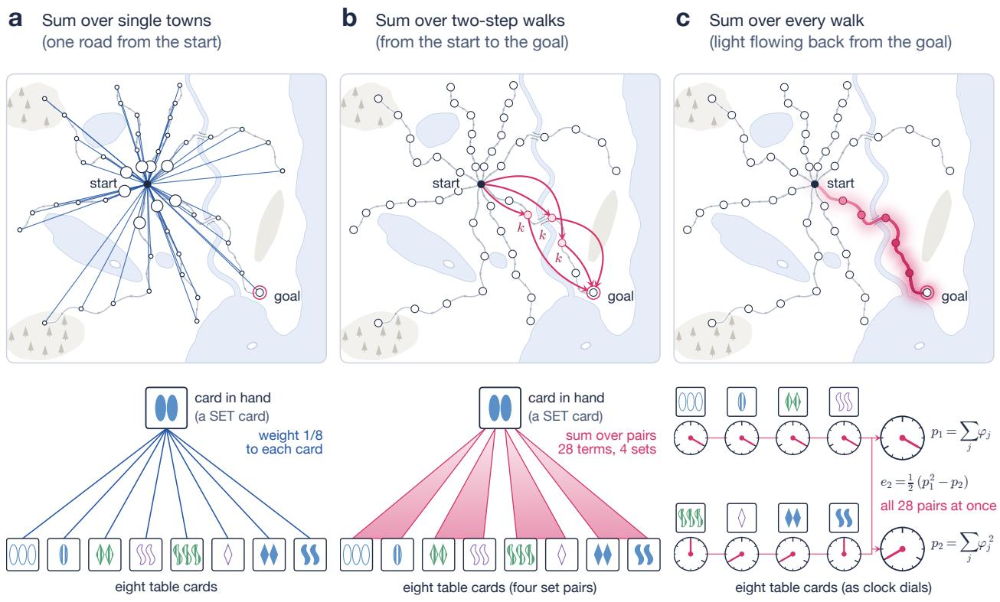  
Fig. 1 | What a layer sums over. Hand-set layers, nothing trained, on one 49-vertex search question (top; towns are vertices, roads directed edges) and one eight-card SET deal (bottom). a, A lookup sums over single witnesses: the start weighs every town by its own score (circle area, softmax weight: 0.100 for each of the eight children, 0.005 for every other town), and the card in hand weighs each table card 1/8. b, A join sums over pairs: the two-step walks start → k → goal, each step up to four roads, through the three middle towns k within four roads of both ends, and the 28 pairs of table cards, the four set pairs shaded. c, A closed form sums over every witness at once: the propagator $X = S ( I - G ) ^ { - 1 }$ from the goal $\left( t _ { 0 } = 0 . 8 \right)$ lights only the route that reaches it, with weight $t _ { 0 } ^ { D }$ at D roads; Newton attention sums the cards’ phases and their squares, and $e _ { 2 } = ( p _ { 1 } ^ { 2 } - p _ { 2 } ) / 2$ gives the sum of the 28 pair terms.

We build layers from these principles and test them where Transformers fail. By the depth law, logic’s locality in network form, L layers over two-step walks reach a goal exactly $2 ^ { L } - 1$ steps away: a construction reaches that far, and from anonymous initial states no network of their class reaches further, for every L. Trained pair states, which start from vertex names, fall of near the same depth. The propagator removes this limit. It computes the closed form over walks of every length, $( I - G ) ^ { - 1 }$ , in one linear solve, from gates computed on a pair state. One such layer, trained on graphs of 49 vertices, answers every question of the search benchmark of Saparov et $\mathrm { a l . ^ { 1 } }$ at every search depth on graphs of 250 vertices, in each of three runs. Newton attention computes the sum over subsets of partners through Newton’s identities 14, at a cost linear in their number. Exponential Newton computes the softmax of 2-simplicial attention over pairs exactly, in $3 ^ { d } n$ operations, when the scores are sums of d clocks (characters of $\mathbb { Z } _ { 3 } )$ and the modulus 3 is given. With six clocks it learns SET from as few deals as 2-simplicial attention and transfers from tables of 8 cards to tables of 20.

The same principles map the graph tasks of CLRS-30 15. Where a closed form exists, one looped block of OR-join and power-mean channels with 186,000 parameters, trained without hints, matches or beats FloydNet16, a model of at least 73 million parameters, on 9 of 12 tasks of the oficial test set and 8 of 12 on freshly drawn test graphs. Where the output follows lexicographic depth-first order, which is P-complete 17,18, errors grow with depth; on depth-first search they fall as the layer is looped more often, while on strongly connected components looping barely helps. In language modelling and chess, where most witnesses are single tokens, pair layers add little. Our positive results are on synthetic and algorithmic tasks, with small models.

Table 1 | The layer zoo. Each layer as a family, the closed form of its sum, its cost for all n queries (or all $n ^ { 2 }$ pairs) and its read-out (2). Separate pair layers and looped ones are a family only after their threshold or OR. The Kirchhof layer was tested only as a read-out, on Prim’s algorithm (Section 6).
<table><tr><td>Layer</td><td>Family</td><td>Closed form of Z</td><td>Cost</td><td>Read-out</td></tr><tr><td>Softmax attention</td><td>single tokens</td><td>a sum</td><td> $n ^ { 2 }$ </td><td>average</td></tr><tr><td>2-simplicial join</td><td>ordered pairs of tokens</td><td>none (enumerated)</td><td> $n ^ { 3 }$ </td><td>average</td></tr><tr><td>Pair layer, sum over  $k$ </td><td>two-step walks</td><td>matrix product</td><td> $n ^ { 3 }$ </td><td>count, scale  $1 / \sqrt { n }$ </td></tr><tr><td>Triangle attention</td><td>two-step walks</td><td>none (enumerated over k)</td><td> $n ^ { 3 } ,$  memory  $n ^ { 3 }$ </td><td>average</td></tr><tr><td>OR join</td><td>two-step walks  $2 ^ { L }$ </td><td>matrix product</td><td> $n ^ { 3 } , { \mathrm { m e m o r y ~ } } n ^ { 2 }$ </td><td>OR</td></tr><tr><td>L pair layers, or one looped L times</td><td>walks of at most steps</td><td>repeated squaring</td><td> $L n ^ { 3 }$ </td><td>OR, threshold</td></tr><tr><td>Propagator</td><td>walks of every length</td><td> $( I - G ) ^ { - 1 }$ </td><td> $\mathrm { o n e ~ s o l v e } , n ^ { 3 }$ </td><td>OR, free energy</td></tr><tr><td>Newton attention</td><td>m-subsets</td><td> $\textstyle \left[ \lambda ^ { m } \right] \prod _ { j } ( 1 + \lambda \varphi _ { j } )$   $3 ^ { d } \mathrm { \ c h a r a c t e r s }$ </td><td>n per channel  $3 ^ { d } n$ </td><td>count; trained as a mean</td></tr><tr><td>Exponential Newton</td><td>unordered pairs, clock energies</td><td>(Proposition 3)</td><td></td><td>average</td></tr><tr><td>Kirchhoff layer</td><td>spanning trees</td><td>determinant</td><td> $n ^ { 3 }$ </td><td>marginals</td></tr></table>

## 2 Families, closed forms and temperature

A family layer assigns to each query q a family $F _ { q }$ of witnesses. A witness is a finite set of parts, such as a token, a pair of tokens or an edge between two vertices. Each part p carries a potential $\psi _ { q } ( p )$ , and each witness may carry a value. From these the layer forms the partition function and the value moment,

$$
Z _ { q } = \sum _ { w \in F _ { q } } \prod _ { p \in w } \psi _ { q } ( p ) , \qquad Y _ { q } = \sum _ { w \in F _ { q } } \left( \prod _ { p \in w } \psi _ { q } ( p ) \right) v _ { q } ( w ) ,\tag{1}
$$

and reads them through one of four links,

$$
Y _ { q } / Z _ { q } ~ ( \mathrm { a v e r a g e } ) , \qquad c _ { n } ~ Z _ { q } ~ ( \mathrm { c o u n t , ~ f i x e d ~ s c a l e } ~ c _ { n } ) , \qquad 1 - e ^ { - Z _ { q } } ~ ( \mathrm { O R } ) , \qquad \beta ^ { - 1 } \log Z _ { q } ~ ( \mathrm { f r e e ~ e n e r g y } ) .\tag{2}
$$

The temperature $1 / \beta$ is the scale of the log-potentials. Softmax attention is the family of single tokens with $\psi _ { q } ( j ) = \hat { e } ^ { \beta Q _ { q } \cdot K _ { j } }$ and $\beta = 1 / \sqrt { r }$ for queries and keys of rank $r ,$ read as an average,

$$
Y _ { q } = \sum _ { j } e ^ { \beta Q _ { q } \cdot K _ { j } } V _ { j } \Big / \sum _ { j } e ^ { \beta Q _ { q } \cdot K _ { j } } .\tag{3}
$$

Table 1 places the others. The 2-simplicial $\mathrm { j o i n ^ { 5 , 6 } }$ , here the join, sums over ordered pairs of tokens. AlphaFold’s triangle update3, triangle attention4 and the OR join sum over two-step walks $u  k  v _ { : }$ , the propagator over walks of every length, and Newton attention over subsets. A potential that couples several partners, as the join’s trilinear score does, must be enumerated or expanded.

The first principle, a hypothesis, is to match the family. In one step a layer computes a read-out of its partition function and nothing else, so any other structure the answer needs must already be in its partners’ states. In SET the cards are the elements of $( \mathbb { Z } _ { 3 } ) ^ { 4 }$ , and three cards form a set when they sum to zero, that is, when each of the four attributes is the same on all three or diferent on all three. A deal is a card in hand and eight table cards, and the question is whether two table cards complete a set with the card in hand. Single tokens are the wrong family for it.

Proposition 1 (No single-card scores rank SET’s pairs). Let a layer score each pair of table cards $\{ j , k \}$ by $f ( q , a _ { j } ) + f ( q , a _ { k } )$ , the sum of two lookup scores, for some function f of the card in hand q and one table card. For every q, every f and every table size n $\geq 4$ there is a deal on which a pair that does not complete a set with q scores at least as high as a pair that does.

Such separations between pair and single-element set networks are known 19.

The second principle, also a hypothesis, is to use a closed form. Three families have one:

$$
\sum _ { m \ge 0 } \lambda ^ { m } e _ { m } ( \varphi ) = \prod _ { j } \big ( 1 + \lambda \varphi _ { j } \big ) , \qquad \sum _ { m \ge 0 } G ^ { m } = ( I - G ) ^ { - 1 } , \qquad \sum _ { T } \prod _ { ( u , v ) \in T } G _ { u v } = \operatorname* { d e t } \hat { L } _ { o } ( G ) .\tag{4}
$$

They sum over subsets, with coeficients from power sums by Newton’s identities in linear time; over walks, in one solve when the spectral radius of G is below one; and over the spanning arborescences directed away from a root $^ { O , }$ through the in-degree Laplacian diag( $\mathbf { 1 } ^ { \top } G ) - G$ with row and column o removed20. Counting simple paths, by contrast, is $\# \mathrm { P - h a r d } ^ { 2 1 }$ . Closed forms sufice for low cost but are not necessary 22,23. They are parallel. Inverses and determinants lie in $\mathrm { N C ^ { 2 4 } }$ , as do repeated squaring and Newton’s recursion, whereas lexicographic depth-first order is P-complete 17. So, unless $\mathrm { N C } = \mathrm { P } ,$ no stack of polylogarithmically many such layers computes it on all graphs, and a looped layer must run more than polylogarithmically many times (Proofs).

Depth composes short families into longer ones, and for two-step walks the reach of L layers is exactly $2 ^ { L } - 1$ steps. This is a known fact of logic, stated here for our layers. Each layer sums over one middle vertex, as a logical statement says “there is a vertex such that”; one such step joins two walks at their shared vertex and so doubles the reach, and statements with L nested steps see exactly $2 ^ { L } - 1$ steps around the vertices they start from 12.

Theorem 1 (Depth law). Let a pair state over the n vertices of a directed graph with goal g start from the adjacency matrix with and without self-loops, the transpose of the matrix with self-loops and a marker of g. (i) For every n and $L \geq 1$ there are weights, depending only on n, for L layers of (10) applied to the state itself rather than its normalised copy, with five channels and residual ReLU MLPs of width 4 with biases, the first $L - 1$ layers one layer repeated, whose read-out at $( c , v )$ is positive exactly when v is a child of c from which g is reached in at most $2 ^ { L } - 1$ steps. (ii) Let each of L layers update $z _ { u v }$ by any function of $z _ { u v }$ and the multiset $\{ ( z _ { u k } , z _ { k v } ) \} _ { k } ,$ , and let each pair’s initial state be a function of its atomic type alone (equality, edges and markers; Proofs). For every $L \geq 1$ , no such network separates at $( c , v )$ a goal $2 ^ { L }$ steps beyond v from one $2 ^ { L } + 1$ steps behind it, both goals on a directed path of $2 ^ { L + 2 } + 1 1$ vertices (Proofs give the general condition). So, from such initial states, the largest distance from v to the goal that L layers decide on every graph is exactly $2 ^ { L } - 1$

Lean: PairSearch.pair\_states\_search\_sharp, PairSearch.pair\_states\_search\_looped

Part (i) is repeated squaring $^ { 2 5 }$ in a pair layer without the normalisation. Part (ii) follows from the correspondence of such layers with the folklore two-dimensional Weisfeiler–Leman test 26 and an exact description of its colours on paths (Proofs). The locality behind part (ii) is known in logic: a formula with L nested quantifiers sees exactly the radius $2 ^ { \overset { \cdot } { L } } - 1$ around its free variables, with graph-wide counts of smaller neighbourhoods 12; rounds of this test correspond to nested quantifiers 13; and K rounds separate shortest-path distances only up to $2 ^ { K }$ on undirected $\mathrm { c y c l e s ^ { 2 7 } }$ . Part (ii) is this locality for pair layers on directed paths with the goal and current vertex marked, for every $L ;$ part (i), the construction, is checked in Lean. It covers anonymous initial states, which depend only on each pair’s atomic type, and not initial states that identify vertices, such as our models’ vertex names, with which two rounds of an injective update already see the whole graph. The summed pair layer, triangle attention and the OR join belong to the class. The propagator does not, since its update reads $( I - G ) ^ { - 1 }$ , a function of the whole state; its closed form removes the depth limit, at a cost in margin that grows with path length (below).

The third principle is the size law.

Theorem 2 (Size law). Let F be a finite nonempty family with scores $s ( w )$ , a level a, a margin $\Delta > 0$ and $\beta \geq 0$ , such that every witness is true, $s ( w ) \geq a$ , or false, $s ( w ) \leq a - \Delta$ . Let $\begin{array} { r } { Z = \sum _ { w \in F } \bar { e } ^ { \beta ( s ( w ) - a ) } } \end{array}$ $I f \ \beta \Delta > \log | F |$ , some witness is true exactly when $Z \ge 1$ . If no witness is true, $Z \le | \bar { F } | e ^ { - \beta \Delta }$ , with equality when every score is $a - \Delta$ . Hence, for $| F | \ge 2$ and scores free within the margin, some threshold on $Z$ decides existence on every input if and only if

$$
\beta \Delta \geq \log | { \cal F } | ,\tag{5}
$$

with the strict threshold $Z > 1$ at equality. Under the same condition, when a true witness exists, the softmax weight on the true witnesses is at least one half.

Lean: Framework.size\_law\_iff, Framework.size\_law\_equality, Framework.gated\_existence, Framework.gated\_ existence\_log, Framework.background\_le, Framework.tight, Framework.softmax\_existence

For single tokens this is the known requirement that logits grow with the logarithm of the length 28–30. The suficient half is a union bound; what is new is the statement for families and its worst-case tightness. Ordered pairs, $| F | = n ( n - 1 )$ , need twice the growth in log n, and m-subsets m times. For walks of every length, without the row cap of Section 3, the total walk weight W of the edge gates takes the place of |F|, and a witness of D steps with hop weight $h < 1$ carries only $h ^ { D }$ , so the margin also pays a path-length cost $D \log ( 1 / h )$ (Proofs). A signed sum whose false witnesses cancel only approximately errs with probability at least $3 / 3 2$ once there are $1 / \delta ^ { 2 }$ of them, each leaving an independent residual of size $\delta ,$ whereas exact cancellation by group characters works at every size (Proofs). A read-out divided by the number of candidates, with its threshold fixed at one size, fails at larger sizes at any precision.

## 3 Learning to search

Transformers do not learn this search as graphs grow, even given our models’ input. We use the task, generator, test sets and Transformer code of Saparov et al. 1. A question is a directed acyclic graph written as an edge list in random order, a start, a goal and the path so far; the answer is the next vertex on a path to the goal. The lookahead of a question is the number of steps needed to tell the correct branch from the others. The benchmark’s Transformer, run from its authors’ code with every step queried, converged in none of ten runs at 31 to 100 vertices, each trained to at least 5.2 million examples (Supplementary Table 1). Its authors trained it on far more examples, 236 million per run, on the first-step variant, where 5 of 14 seeds converged at 31 vertices, 2 at 41 and 1 at 49. A Transformer over our models’ pooled vertex names, with their initia pair features in its attention and read-out, converged in all three runs at 49 vertices and in none of three at 125 within 10 million examples (Fig. 2d).

A pair state, whose layers sum over two-step walks, learns where these Transformers do not. Over the same names, eight summed pair layers with 39,000 to 49,000 parameters converged in all twelve runs on graphs of 49 to 125 vertices, each within 1.3 million examples (Fig. 2d), and each answers at least 98.6% of test questions at every lookahead. Stopped at convergence, they answer only 65 to 91% of the benchmark’s random graphs, and 96.6 to 97.5% at 49 vertices when trained to 3 million examples like the propagator (Supplementary Table 1).

The propagator computes the closed form of the walk family in one layer. In each of four channels it forms gates G and a source S from the normalised pair state t, caps every row of G, and solves for the walk sum,

$$
G _ { u v } = \frac { t _ { 0 } \tilde { G } _ { u v } } { \operatorname* { m a x } \left( \sum _ { v ^ { \prime } } \tilde { G } _ { u v ^ { \prime } } , \ t _ { 0 } \right) } , \quad \tilde { G } _ { u v } = t _ { 0 } \sigma ( w \cdot t _ { u v } + b ) , \quad S _ { u k } = \sigma ( w ^ { \prime } \cdot t _ { u k } + b ^ { \prime } ) , \quad X = S \left( I - G \right) ^ { - 1 } = \sum _ { m \ge 0 } S G ^ { m } ,\tag{6}
$$

with $t _ { 0 } = 0 . 9 9$ . The cap keeps each row sum of G at most $t _ { 0 } ,$ so the spectral radius stays below one on any graph, cyclic ones included 31, and the walk sum converges. With gates set by hand on reversed edges and the source on the goal, $X _ { c v } > 0$ exactly when the goal can be reached from v. Trained on balanced graphs of up to 49 vertices, the layer of 28,472 parameters converged in all three runs within about a million examples. In every run it answers every test question at every lookahead at 75, 100, 125 and 250 vertices (at 250, 200 questions at each of 124 lookaheads), and 99.0 to 100% of the benchmark’s random graphs of that size (Supplementary Table 2). Looped triangle attention, trained to the same sizes, answers at least 99% at every lookahead at 250 vertices in one run of three, and in four of fifteen runs across five training variants (Fig. 2e).

Each trained run recovers the hand-built layer, plus one extra gate. On a 250-vertex question, the channel carrying the answer has median gates, after the cap, of 0.97 to 0.98 on reversed edges and below $1 0 ^ { - 3 }$ on forward edges and non-edges, within the $4 \times 1 0 ^ { - 3 }$ that the hand-built capped layer tolerates, and its source sits on the pair of the current vertex and the goal (0.999), so walks start at the goal $\left( \mathrm { F i g . 2 a - c } \right)$ . The extra gate, on the question’s own pair of start and goal (0.22 to 0.78), is closed in the construction. Measured without the cap, the propagator trains on 6.0 and 6.9 times as many examples per second as the looped OR join at 125 and 250 vertices, with 0.39 and 0.52 of its memory (Methods).

## 4 Learning SET

Transformers memorise SET before they learn it. A four-layer Transformer of 535,000 parameters trained on 32,768 deals answers 98% of its training deals and 54% of new ones, and it first passes 90% on new deals at 524,288 deals (Fig. 3a). Given enough distinct questions, it learns the rule. With 27 cards in hand in training and 221,184 deals, a four-layer Transformer of 66,000 parameters answers 93% of deals whose card in hand it never held. With nine or fewer cards in hand in training, the join and both Transformers are at chance on new cards in hand (43 to 56%); the join stays at chance with 12 cards in hand and transfers only in part with 18 or 21 (59 to 87%). As Proposition 1 leads one to expect, attention must learn which cards pair for each card in hand.

The join, whose family is the pairs of table cards, learns from far fewer deals and computes with clocks. One join layer with 62,000 parameters passes 90% at 8,192 deals, 64 times fewer than the large Transformer, and, trained on 55,296 deals with 27 cards in hand, answers 99.6% of deals with new cards in hand. In joins trained with all 81 cards in hand, 82 to 94% of the variance of the score over all triples of cards lies on the eight characters of $( \mathbb { Z } _ { 3 } ) ^ { 4 }$ that vary along one attribute. These are four clocks, one per attribute, each turning a third of a circle when its attribute’s value increases by one (Fig. 3b). The softmax’s exponential turns the sum of the four clocks into their product, which is large only when every attribute is the same or all diferent on the three cards, an AND over the attributes (Fig. 3c).

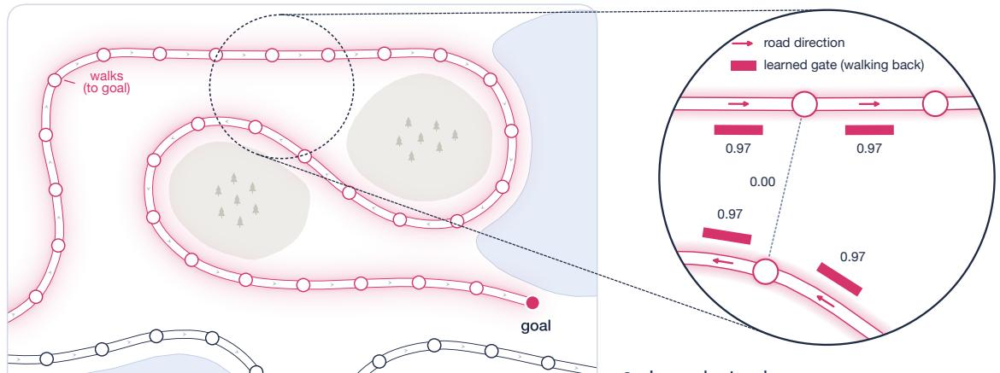  
c Learned gate values

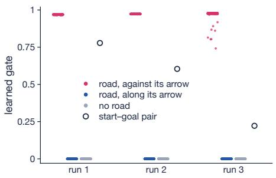  
e Lookahead at 250 vertices

d Runs that learn search  
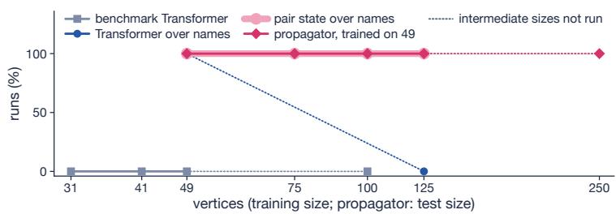

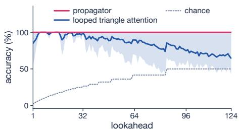  
Fig. 2 | One trained propagator layer searches graphs five times larger than any in training. a, Part of a 250-vertex test question (lookahead 31), lit by the walks to the goal of a propagator trained on graphs of up to 49 vertices. b, The circled spot: each road’s learned gate for walking back (bars), and one between towns with no road. c, Every learned gate of the working channel in three trained runs: roads walked back (rose) or forward (cobalt), sampled town pairs with no road (grey), and the question’s start and goal (open). d, Convergence and transfer on one axis. For the other models, the share of runs that converge at each training size (three runs per point; one for the benchmark’s Transformer at 100); for the propagator, trained on graphs of up to 49 vertices, the share answering at least 99% at every lookahead at each test size. e, Accuracy against lookahead at 250 vertices (200 questions each; mean and range of three runs), looped triangle attention at each run’s best number of iterations; dotted, chance.

Newton attention computes the subset family’s closed form. In each channel each card carries a complex feature $\varphi _ { j }$ , and the sum over unordered pairs of partners follows from two power sums by Newton’s identities 14, as in universal set networks 32,

$$
e _ { 2 } = \sum _ { j < k } \varphi _ { j } \varphi _ { k } = { \textstyle { \frac { 1 } { 2 } } } \big ( p _ { 1 } ^ { 2 } - p _ { 2 } \big ) , \qquad p _ { m } = \sum _ { j } \varphi _ { j } ^ { m } , \qquad m e _ { m } = \sum _ { l = 1 } ^ { m } ( - 1 ) ^ { l - 1 } e _ { m - l } p _ { l } .\tag{7}
$$

Its cost is therefore linear in the number of tokens: measured on a GPU, its time and memory per step stay flat from 9 to 4,096 tokens, whereas the join runs out of memory at 1,024 (Fig. 3d).

Proposition 2 (Characters count set pairs at linear cost). Let $q \in ( \mathbb { Z } _ { 3 } ) ^ { 4 }$ be the card in hand and $a _ { 1 } , \ldots , a _ { n } \in ( \mathbb { Z } _ { 3 } ) ^ { 4 }$ the table cards. There are $\it { 4 0 }$ characters χ1, . . . , χ40 of $( \mathbb { Z } _ { 3 } ) ^ { 4 }$ , one from each pair of conjugate non-trivial characters, such that for every q and every table the number N of unordered pairs of table cards that complete a set with $q$ is

$$
8 1 N = { \binom { n } { 2 } } + 2 \operatorname { R e } \sum _ { c = 1 } ^ { 4 0 } \chi _ { c } ( q ) e _ { 2 } { \big ( } \chi _ { c } ( a _ { 1 } ) , \dots , \chi _ { c } ( a _ { n } ) { \big ) } .\tag{8}
$$

Lean: Newton.set\_count, Newton.newton\_identities

Trained as the join (Methods), a Newton layer of 55,714 parameters first passes 90% at 32,768 deals, four times as many as the join needs. In all 17 runs that reach 97%, its channels hold 38 to 40 of the 40 characters of Proposition 2. Unlike the join’s exponential, Newton’s read-out is linear in each channel and must find the 40 characters one by one. Read out as trained, with each pair feature divided by the number of pairs $\binom { n } { 2 }$ and then by a per-deal root mean square, the layer fails on tables of 16 cards (73 to 76%), as Section 2 predicts for read-outs divided by the number of candidates. A model of these two divisions, fitted on 8-card deals alone (Methods), moves the trained read-out’s threshold from 0.54 sets to a predicted 1.76 to 1.79 sets on 16 cards (measured, 1.76 to 1.77), so every deal with exactly one set is called negative (Fig. 3e). Trained on 8- and 12-card tables, it answers at least 95.5% at 16 cards and 92.8% at 20 (92.4% at 16 in a repeat with the same seeds; Supplementary Table 4), so from two sizes it learns a threshold that depends on size. Read as a count, the layer is exact at every size, but that form did not train to the rule (85% on 8-card tables; Supplementary Table 6).

Exponential Newton computes the join’s own softmax over pairs exactly, in $3 ^ { d } n$ operations for d clocks. At SET’s table sizes this exceeds the $\binom { n } { 2 }$ pair terms it replaces, and we have not timed it on long sequences. On $\mathbb { Z } _ { 3 }$ the exponential of a clock takes three values, so it has an exact three-term Fourier series. For d clocks with hours $x _ { 1 } , \ldots , x _ { d }$ (Proposition 3),

$$
\exp \Big ( \beta \sum _ { i = 1 } ^ { d } \big ( \cos \frac { 2 \pi x _ { i } } { 3 } - 1 \big ) \Big ) = \sum _ { s \in \mathbb { Z } _ { 3 } ^ { d } } \Big ( \prod _ { i = 1 } ^ { d } \alpha _ { s _ { i } } \Big ) \omega ^ { s \cdot x } , \qquad \alpha _ { 0 } = \frac { 1 + 2 \epsilon } { 3 } , \quad \alpha _ { \pm 1 } = \frac { 1 - \epsilon } { 3 } , \quad \epsilon = e ^ { - 3 \beta / 2 } ,\tag{9}
$$

with $\omega = e ^ { 2 \pi i / 3 }$ , the Jacobi–Anger expansion33 folded onto $\mathbb { Z } _ { 3 }$ . Four clocks give all 81 characters, with weights fixed by $\beta \ ( { \mathrm { F i g . \ 3 c } } )$ . The expansion extends to any finite abelian group ${ \mathcal { G } } ,$ at cost |G| n, given the group (Proofs). Trained as the join, but with the modulus 3 given where the join learns its clocks, the layer first passes 90% at 8,192 deals, the join’s budget, and answers 69% at 2,048 against the join’s 51% (Fig. 3a). With four learned clocks, 10 of 12 models clocked one attribute twice and another not at all, and their errors on larger tables fall on deals holding a pseudo-set, a pair that completes a set on the three clocked attributes but not the fourth, which leaves a zero margin that no temperature fixes. With six clocks (729 channels) the layer passes 99% at 8,192 deals (99.9% and 100.0% in two repeats with the same seeds). Trained on 8-card tables, with the learning rate chosen on held-out cards in hand (Methods), it answers at least 97% of deals with new cards in hand on 16- and 20-card tables, on each of three seeds in both repeats, at its trained temperature (Fig. 3e).

Proposition 3 (Jacobi–Anger on $\mathbb { Z } _ { 3 } )$ . Equation (9) holds exactly for every $\beta \geq 0$ and $x \in \mathbb { Z } _ { 3 } ^ { d }$ . Hence, for a join whose score on the card in hand q and table cards j and k is $\beta \textstyle \sum _ { i } ( \cos ( 2 \pi x _ { i } / 3 ) - 1 )$ with clock hours $x = x ( q ) + x ( a _ { j } ) + x ( a _ { k } )$ , the partition function and output of the softmax over the $\binom { n } { 2 }$ distinct pairs of table cards are sums over $3 ^ { d }$ channels of Newton’s $e _ { 2 }$ , computed in $O ( 3 ^ { d } n )$ operations.

## 5 How far a layer generalises

Layers read through exponential gates transfer to larger inputs, as the propagator and exponential Newton do (Figs. 2e, 3e), and layers read by normalising over the candidates, such as Newton’s mean, do not when trained at one size. Trained at 49 vertices and tested at 125, the looped OR join answers at least 99.6% and looped triangle attention at least 99.2% at every lookahead, whereas the looped pair layer that sums over the middle vertex with the fixed factor $1 / \sqrt { n }$ answers 61 to 73%, averaged over lookaheads, after $\lceil \log _ { 2 } n \rceil + 2 = 9$ iterations (Supplementary Table 2). Triangle attention averages too, but divides by the total weight, not the number of candidates, as the softmax form of Theorem 2 requires.

The margin that size requires grows with the logarithm of the number of candidates. We measured the critical $\beta \Delta$ on 42 instances of four hand-set layers (Fig. 4a; Methods). The worst case of Theorem 2, log |F|, lies 1.2 to 4.1 nats above the measured value for the SET layers and the OR join. Evaluated on the realised scores, the theorem’s own condition bounds $\begin{array} { r } { Z _ { \mathrm { f a l s e } } = \sum _ { w } e ^ { \beta \left( { \tilde { s } } ( w ) - a \right) } } \end{array}$ over the false witnesses, which is about ${ M e ^ { - \beta \Delta } }$ when M competitors sit at the margin and the rest far below. With log M in place of log |F| (for SET, the pairs one attribute away from a set; Methods), every critical value lies within 0.3 nats of the prediction, except the OR join’s beyond 200 vertices (0.8 nats at 1,600). For the propagator, log W lies 0.1 to 1.4 nats below the measured value, because the margin also pays the path-length term $D \log ( 1 / h )$ . The same logarithm sets the temperatures of hand-set layers. The looped OR join needs an input gain rising from 13.5 at 50 vertices to 17.8 at 1,600, and exponential Newton is exact on tables of 8 to 40 cards, the largest that can lack a set, at $\begin{array} { r } { \beta = { \frac { 2 } { 3 } } \ln ( 2 P ) } \end{array}$ for P table pairs, while its 8-card temperature answers 66.7% at 32 cards; with six attributes the rule is right to 364 cards and the 8-card temperature fails from 48 (Fig. 4c).

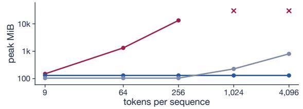

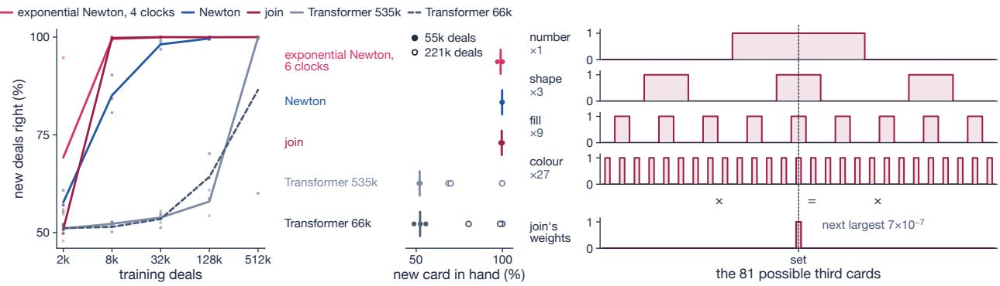

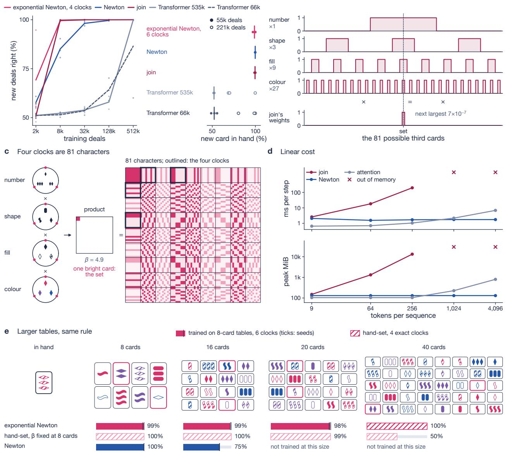  
Fig. 3 | SET: who learns the rule, how the join decides, why exponential gates hold as tables grow. a, Accuracy on new deals against training deals (mean of three seeds; exponential Newton with four clocks); right, accuracy with a card in hand never held, after 55,296 deals with 27 cards in hand (filled; six clocks) and 221,184 (open; Transformers). b, One trained join: each attribute’s clock over the 81 possible third cards, and its softmax weights, peaked on the set (next largest $7 \times 1 0 ^ { - 7 } )$ . c, Four clocks multiply into one bright card $( \beta = 4 . 9 ,$ learned by a six-clock layer), exactly the 81 characters of $\left( \mathbb { Z } _ { 3 } \right) ^ { 4 }$ (Proposition 3); outlined, the four clocks. d, Time and memory per training step of one layer against tokens per sequence (exponential Newton not timed). e, Tables of 8 to 40 cards (drawn: one-set deals, the set pair outlined) and accuracy on them: trained on 8-card tables (solid; six-clock exponential Newton and Newton, mean of three seeds, ticks seeds), on 1,024 deals per size with new cards in hand, half with a set pair and half without; or hand-set with four exact clocks (hatched; exponential Newton with the rule $\beta$ at 40 cards, and with the 8-card $\beta$ held fixed), on 800 deals per size, half without a set and half with exactly one.

Trained pair states search about as deep as the depth law allows. Theorem 1 puts the exact reach of L layers at $2 ^ { L } - 1$ steps from the child v of the current vertex, which is lookahead $2 ^ { L } ;$ : the construction answers every lookahead up to $2 ^ { L }$ , and from anonymous initial states no network of the class decides lookahead $2 ^ { L } + 1$ on every graph (Fig. 4b, d). Pair states over names of L layers, with L from 2 to 8 at 49 vertices and from 4 to 6 at 100, answer at least 95% at every lookahead up to $\phantom { + } \overline { { 2 ^ { L } } }$ in every run, or up to the deepest in the test set (Fig. 4b). At 100 vertices accuracy falls just past the bound, as predicted before the runs: four layers answer 28 to 36% at lookahead 17 and five layers 18 to 58% at 33. Some trained models beat the worst case. The two-layer models answer lookahead 5, and two four-layer runs at 49 vertices that never converged answer 87 to 98% beyond lookahead 16. These models start from vertex names, on graphs that are not paths, which part (ii) does not cover, so their match to $2 ^ { L }$ is empirical.

## 6 What the principles predict elsewhere

Where a closed form exists, a small looped pair layer matches a deep one. $\mathrm { C L R S  – 3 0 ^ { 1 5 } }$ trains on graphs of up to 16 nodes and tests on 64; we train without hints, with the library’s generator and scorer. Our layer is one looped block of width 128 and 186,000 parameters, with OR-join channels, power-mean channels and a learned log n shift, iterated eight times at 64 nodes. We chose its design at width 32 on the oficial 64-node test graphs and ran the width-128 layer once (Methods), so we also report freshly drawn test graphs. On the oficial test file it matches (within half a point) or beats FloydNet without hints 16, a pair-state network with about 73 million parameters at its smallest depth, on 9 of 12 tasks; it is below on Bellman–Ford (0.9 points), Prim’s algorithm (2.1) and strongly connected components (2.2), and matches on Dijkstra by 0.01 points (Fig. 5a). On 128 freshly drawn test graphs per task it matches or beats FloydNet on 8 of 12, Dijkstra falling 0.003 points short (Supplementary Table 3). FloydNet is compared across protocols: its scores are from its paper (online training, 32 to 80 layers), ours from 80,000 steps on a fixed pool of graphs, three seeds and final parameters. On Floyd–Warshall, whose answer is a pair, the two pair-state models score 96.2% (FloydNet) and 98.3% (ours), and the no-hint models of Bevilacqua et al.34 and Rodionov and Prokhorenkova35 40.8% and 42.2%.

Where the output follows lexicographic depth-first order, a parallel layer must loop (Section 2), and on depth-first search accuracy rises with the loop count. The depth-first search (DFS) task of CLRS-30 outputs parents in the lexicographic DFS forest, which is P-complete 17, and its strongly connected components task outputs a representative per component.

Proposition 4 (The component representative is P-complete). The representative that CLRS-30 assigns to a strongly connected component is the component’s first vertex discovered by lexicographic depth-first search. Deciding whether a given vertex is the representative of its component is P-complete.

The errors sit where the theory puts them. Every wrong component pointer points inside the correct component. Accuracy is 98.8 to 100% where the representative is the component’s smallest index, which a parallel rule finds, and 66.5 to 70.4% where the first DFS pass fixes it. DFS is right on every node up to depth 7 in the true tree and on 67 to 72% of nodes at depths 32 to 63. Topological sort, which is DFS on acyclic graphs and lies in NC by a result of de la Torre and Kruskal36, scores 99.9%. Trained with 4 to 24 loops instead of 4 to 8 and looped 34 times at 64 nodes, the same layer’s DFS accuracy rises from 80.5% to 90.7% (mean of three seeds, 89.8 to 92.4), increasing with each loop up to the training maximum and nearly flat after it, against FloydNet’s 75.1% without hints (Fig. 5a, b). The same change on strongly connected components, registered with the prediction that only the order-dependent representatives would gain, kept every wrong pointer inside its component and the smallest-index representatives at 98.8%, but raised the order-dependent ones only from 69.0% to 72.8%, within the spread of seeds, and overall accuracy levels of near 14 loops (89.0% at 34, against FloydNet’s 90.1%). The account locates these errors; at this width, more loops do not remove them.

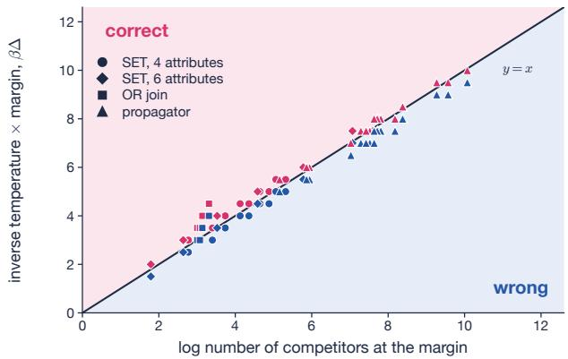  
c Size law on SET

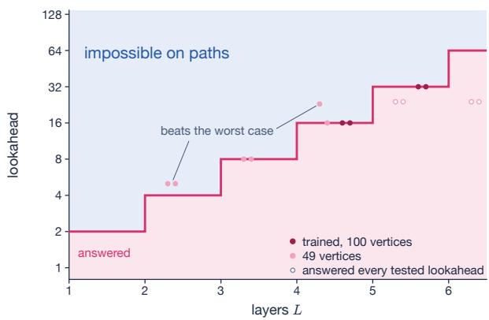

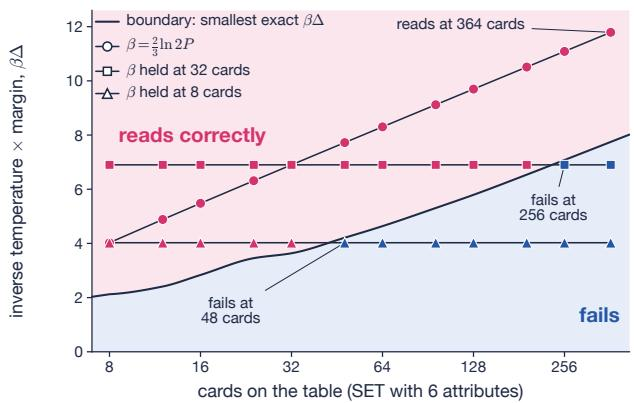

d Where four layers stop  
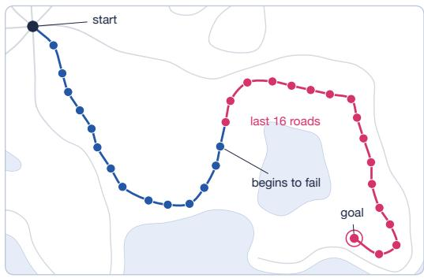  
Fig. 4 | The two laws, on hand-set layers and trained pair states. ${ \mathbf { a } } ,$ The size law across four hand-set layers, nothing trained: 42 instances, exponential Newton on SET with four attributes (8 to 40 cards, 600 set-free deals each) and with six (8 to 364 cards, 200 each), the one-layer OR join (random acyclic graphs of 50 to 1,600 vertices) and the propagator without the row cap $( t _ { 0 } = 0 . 9$ , random acyclic graphs of 50 to 800 vertices). Each is drawn at the two grid values of $\beta \Delta$ , 0.5 nats apart, that bracket its critical value (rose, every question right; cobalt, some wrong), against the logarithm of its competitors at the margin over the read-out threshold (Methods). Every critical value lies within 0.3 nats of $y = x ,$ except the OR join’s beyond 200 vertices (0.8 nats at 1,600). b, Theorem 1: L layers answer every lookahead up to $2 ^ { L }$ (rose), and from $2 ^ { L } + 1$ no network of their class separates a reachable goal from an unreachable one on paths, from anonymous states (cobalt). Dots: trained pair states over names at 49 and 100 vertices, the deepest lookahead answered at 95% or more throughout (open, every tested lookahead); the three above $2 ^ { L } ,$ , which start from names on graphs that are not paths, beat the worst case. c, The size law for hand-set exponential Newton on six-attribute SET (729 cards): the boundary is the smallest $\beta \Delta$ right on all 1,000 set-free deals per table size; markers, three temperature schedules on those and 200 one-set deals (rose, all right; cobalt, some wrong). The rule $\begin{array} { r } { \beta = \frac { 2 } { 3 } } \end{array}$ ln 2P holds to 364 cards; the 8- and 32-card temperatures fail from 48 and 256. d, The construction of Theorem 1 with four layers answers each town on a 250-vertex route, as current vertex, when the goal is at most 16 roads away (rose), not beyond (cobalt).

The remaining errors on weighted tasks sit at near ties, where the margin of Theorem 2 is small. On Bellman–Ford and Dijkstra, the median relative margin of the decisions the layer gets wrong is 0.5 to 0.6%, against 20.5% over all decisions; on Kruskal’s algorithm the two medians are 1.3% and 42% (Fig. 5c). Prim’s algorithm is the exception, and the principles do not explain it. Its errors are not near ties (median 30% against 51% over all decisions), two thirds of them point to the node’s own child, the right tree edge in the wrong direction, and they grow with depth in the tree. Two registered fixes from the spanning-tree family of Table 1, a Kirchhof read-out and the same read-out with a learned log n shift of its conductances, leave the errors in place (97.20% and 96.84%, against 97.57% without them; Methods).

In language modelling and chess most witnesses are single tokens, and joins add little. In an 8-layer language model of 51 million parameters, a join over the previous 16 tokens, added in every second block, gains 0.011 nats per token after 200 million tokens of FineWeb-Edu37, and two more layers gain 0.026 (Fig. 5d). In chess, joins beside or in place of attention never gain more than 0.1 points of accuracy on the solving move of Lichess puzzles (Supplement). On the 6,681 puzzles about pins, skewers, x-rays and discovered attacks, whose motifs pair two pieces on a line and where the first principle predicts a gain, joins beside attention score 84.6 to 85.3% against 85.0%. The trained joins show why. Their interaction share, the fraction of the score variance over pairs that is not a sum of one score per partner, relative to random scores, is 0.98 to 1.02 on SET and 0.11 to 0.29 in chess (Fig. 5d), where scores remain mostly sums of lookups on single squares. A share near one shows that a join is used, not that it is needed: chess joins whose keys have their mean over the squares subtracted reach 1.03 and still add nothing. We trained the language models at one scale, budget and window; joins over long contexts gain more 38, a regime we did not test.

d Where joins add little trained at initialisation  
a CLRS against FloydNet  
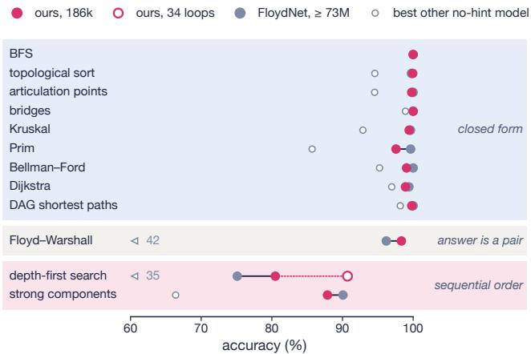

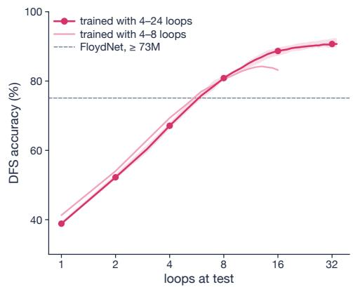  
c Errors sit at near-ties

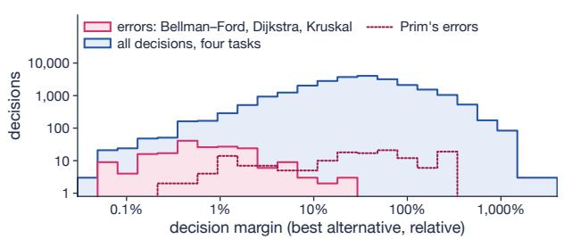

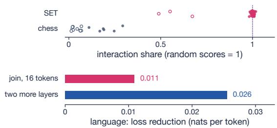  
Fig. 5 | The principles across CLRS-30, and where joins add little. a, Accuracy on the twelve CLRS-30 graph tasks at 64 nodes after training on up to 16 without hints, grouped by the principles’ class: our 186,000-parameter looped block of OR-join and power-mean channels on the oficial test file (mean of three seeds, eight loops; open, depth-first search at 34 loops after training with 4 to 24; fresh test graphs in Supplementary Table 3), FloydNet (published) and the better of the no-hint models of Bevilacqua et al. 34 and Rodionov and Prokhorenkova35 (arrows, of-scale). b, Depth-first search accuracy against loops at test, trained with 4 to 24 loops (band, three seeds) and with 4 to 8; dashed, FloydNet. c, Relative decision margins of all decisions on Bellman–Ford, Dijkstra, Kruskal and Prim, of the errors on the first three, and of Prim’s errors. d, Interaction share of 42 trained SET joins and 6 trained chess joins (filled), and of 3 SET and 12 chess joins at initialisation (open); below, language-model gains of a join over 16 tokens and of two more layers (two seeds).

## 7 Discussion

Whether higher-order attention helps depends on the family a layer sums over, not on its arity. A layer over pairs helps when a task’s witnesses are pairs or are composed from them, as in search and SET, and not when they are single tokens, as in our language and chess models. Depth composes families at the rate logic predicts. Over two-step walks, L layers reach $2 ^ { L } - 1$ steps and, from anonymous initial states, no further, for every $L ;$ our trained pair states stop near the same depth. Much of that depth emulates a family that has a closed form: eight pair layers compose two-step walks into the reach that one propagator layer reads from $( I - G ) ^ { - 1 }$ . Where no parallel closed form exists, as for lexicographic depth-first order, depth is the right tool, and the depth needed grows with the input. Sequential order can also be moved out of the layer into an external working memory, and when each step reads only a bounded view of that memory, exactness at all input lengths becomes a finite check 39. Temperature decides how far an answer carries: exponential gates with a logarithmic margin transfer to larger inputs, and read-outs normalised over the candidates, trained at one size, do not.

Each piece of this account has a precedent, including attention as an expectation with its own partition function40, one description for Boolean, counting and tropical values 22, dynamic programming smoothed at a temperature41, the noisy-OR and Bernoulli–Poisson links of the OR join 42–44 and diferentiable chaining of relations 45–47, algorithmic alignment 48–50, logits scaled against the dispersion of single-token attention 28–30,51, exponential against polynomial energies in associative memories 52,53, sums over distinct tuples of neighbours at linear cost54, and resolvents, fixed points and path sums over a given graph 55–60. New here are the account across witness families; the size law for families, with its worst-case tightness; the depth law stated for these layers, with its construction checked in Lean, whose limit is the known locality of logic 12,13; the reduction for strongly connected components; three layers (Newton attention, exponential Newton and the propagator, the first layer we know of to compute a resolvent from gates on a pair state); and the registered tests.

The principles point to the families language needs. Parses are trees and spans, families with inside–outside and matrix-tree closed forms40,61. A pair state over the entities a text names, rather than over its tokens, would place the search layers of this paper inside a language model.

## Methods

For every search, CLRS-30 and SET experiment, the design, predictions, budget and stopping rule were written down before its runs; Supplementary Tables 5 and 6 list every registered outcome, including failures.

## Search benchmark

We cloned the code of Saparov et al.1 (commit 2c3f32b, with its header library at commit 1f3b022) and compiled its C++ generator. Training examples are drawn fresh in batches of 256 from its balanced distribution, with maximum lookahead $\lfloor ( n - 1 ) / 2 \rfloor$ for graphs of n vertices and every step of the path queried. Test sets come from the authors’ own evaluation code, loaded at run time: 1,000 questions per lookahead up to 75 vertices, 500 at 100 and 125, and 200 at 250, together with the benchmark’s random graphs. Every test question is excluded from training. A run converges when its training accuracy, counting any valid next vertex, is at least 99.5% on two consecutive checks. Test accuracy counts the single next vertex on the shortest useful path, which is unique in every test question.

## Models

Pair state over vertex names. Tokens are embedded at width 32. Each token’s context, mixed with its two neighbours, is pooled into the vertex name it writes. The state $z _ { u v } \in \mathbb { R } ^ { 1 6 }$ of a pair of names starts from bilinear scores between the pooled contexts and from learned products of nearby tokens. With $t _ { u v }$ the state normalised over its channels and t′ the normalised state after the first update, the summed pair layer is

$$
z _ { u v } \gets z _ { u v } + \sigma ( \Gamma t _ { u v } ) \odot \frac { 1 } { \sqrt { n } } \sum _ { k } ( A t _ { u k } ) \odot ( B t _ { k v } ) , \qquad z _ { u v } \gets z _ { u v } + \mathrm { M L P } ( t _ { u v } ^ { \prime } ) ,\tag{10}
$$

with $1 6 \times 1 6$ matrices Γ, A and B, a sigmoid gate and a GELU MLP of width 32. Triangle attention replaces the equal-weight sum by a softmax over k of $Q t _ { u k } \cdot K t _ { k v }$ , in four heads. Each name v is scored by $w \cdot \mathrm { n o r m } ( z _ { c v } )$ for the current vertex c. The model has 39,504 parameters at 49 vertices and 49,232 at 125, since each added vertex adds a token embedding and three position embeddings of width 32. Looped models iterate one block K times, with K drawn from 5 to 8 for each batch, and are scored after $\lceil \log _ { 2 } n \rceil + 2$ iterations. They have no position embeddings, and the names of each training question are drawn at random from a table of 128, or of 256 for tests above 125 vertices.

OR join. The sum of (10) is replaced, with no factor $1 / { \sqrt { n } }$ , by

$$
O _ { u v } = 1 - \exp \Big ( - \sum _ { k } \sigma \big ( A t _ { u k } \big ) \sigma \big ( B t _ { k v } \big ) \Big ) , \qquad z _ { u v } \gets z _ { u v } + \sigma \big ( \Gamma t _ { u v } \big ) \odot W _ { o } O _ { u v } ,\tag{11}
$$

one matrix product per channel. In the hand-set construction the input sigmoids have gain α and are centred at one half, and a closing gate $\sigma ( \alpha ( \textstyle { \frac { 1 } { 2 } } - x _ { u v } ) )$ keeps each relation channel from re-counting once it is set.

Propagator. Equation (6) runs in four channels on the normalised state t. The solve $( I - G ) ^ { \top } X ^ { \top } = S ^ { \top }$ runs in float32, and no walk is formed. The eight features $\log ( X + 1 0 ^ { - 2 0 } )$ and $1 - e ^ { - X }$ of the four channels enter through a linear map and a gate, followed by the per-pair MLP. The gate biases start at −6 and the source biases at −2, and $t _ { 0 } = 0 . 9 9$ is fixed in every channel. The layer is applied once and has 28,472 parameters with names from 256. The fixed $t _ { 0 }$ and the row cap were added after two earlier registered designs without them lost accuracy at 250 vertices, in one and two of three runs (Supplementary Table 5). The speed and memory figures are for one training step (forward and backward, bfloat16, batch 32, H100) of the uncapped layer against $\lceil \log _ { 2 } n \rceil + 2$ blocks of the looped OR join with one term. The cap adds one row sum and one division. On the 250-vertex question of Fig. 2a, the walk sum without the cap has a pole at a background gate of $1 / W = 1 0 ^ { - 3 . 6 }$

Transformer over names. The same pooled names and the same starting pair features, with a token state per name of width 64 and eight blocks of four-head attention between names, with ReLU MLPs of width 128. The pair features enter every block’s attention as a learned bias per head. So that the control reads what the pair states read, the read-out adds $w _ { r } \cdot \hat { z } _ { c v } ,$ the normalised starting pair feature of the current vertex and the candidate, with $w _ { r }$ initialised to zero, so that the control’s function at initialisation is unchanged. It has about 298,000 parameters. The benchmark’s own Transformer is run from its authors’ unmodified code and settings. Newton attention. In each of $r = 6 4$ channels, token $j$ carries $\varphi _ { j } = \sigma ( h _ { j } W _ { g } + b _ { g } ) e ^ { 2 i ( h _ { j } W _ { \theta } + b _ { \theta } ) }$ . The power sums over a token’s partners, with its own term removed, give e and e by (7). The features $\varphi _ { j } e _ { m } / \binom { n } { m }$ for $m = 0 , 1 ,$ 2 are divided by their root mean square over channels and read by a linear map. A deal is a sequence of $T = n + 2$ tokens (a start token, the n table cards and the card in hand), so every card has $n = T - 2$ partners, the other cards. The read-out’s steps are scaled by $6 4 / ( 6 r )$ , which is $1 / 6$ at $r = 6 4 \colon$ the join’s output fan-in over Newton’s, the per-layer rate of maximal update parametrisation $6 2 ^ { ' }$ , which leaves the function at initialisation unchanged. The layer has 55,714 parameters.

Exponential Newton. The join’s input map $h = \operatorname { t a n h } ( x W _ { \mathrm { i n } } )$ and its MLP head are kept. The layer reads d categorical clocks over $\mathbb { Z } _ { 3 }$ from h through a 96 × 3d map and a softmax over the three hours of each clock, with one learned $\beta$ (a softplus, starting at 2). The weight of the pair $\{ j , k \}$ for the card in hand q is the expectation, over independent hours $a \sim p ( q ) , b \sim p ( x _ { j } )$ and $c \sim p ( x _ { k } )$ , of $\begin{array} { r } { \prod _ { i } \exp ( \beta ( \cos ( 2 \pi ( a _ { i } + b _ { i } + c _ { i } ) / 3 ) - 1 ) ) } \end{array}$ . Its value is $( v _ { j } ^ { 1 } \odot \bar { v _ { k } ^ { 2 } } + v _ { k } ^ { 1 } \odot v _ { j } ^ { 2 } ) / 2$ , of rank 128. The softmax over the n unordered pairs of table cards is computed as the $3 ^ { d }$ channels of (9), each with its pair sums from Newton’s $e _ { 2 } .$ and $Z$ is floored at $1 0 ^ { - 6 } { \binom { n } { 2 } }$ . The layer has 63,183 parameters with four clocks and 63,765 with six, against 62,018 for the join. The six-clock layer was trained through the explicit pair-weight matrix, which is the same function and is cheaper at eight partners, and was scored in the linear channel form. The two forms, and a float64 sum over all pairs, agree within 0.5 points on every test set.

## Size-law check

Each of 42 hand-set instances is evaluated on a grid of β∆ in steps of 0.5 nats, with the critical value found by bisection. Exponential Newton on SET uses 600 set-free deals per table of 8 to 40 cards (four attributes) and 200 per table of 8 to 364 cards (six attributes), with threshold one half; one attribute of a set costs $\Delta = 1 . 5$ The OR join is one hand-set layer on random acyclic graphs of 50 to 1,600 vertices with edge probability $2 . 5 / n$ , read with threshold ln 2 on $Z .$ The propagator, without the cap and with $t _ { 0 } = 0 . 9$ , runs on random acyclic graphs of 50 to 800 vertices with a uniform background gate on non-edges, and must separate reachable from unreachable pairs with one threshold. The competitors at the margin, over the threshold, are: twice the number of pairs one attribute away from a set in the worst set-free deal (SET); the middle vertices linked to exactly one end of an unreachable pair, divided by ln 2 (OR join); and W plus the largest background walk weight $r _ { u } c _ { v }$ in units of the weakest true walk, with $r = R _ { 0 } { \bf 1 }$ and $c = R _ { 0 } ^ { \top }$ 1 (propagator), which is the Sherman–Morrison threshold (Proofs). For the worst case of Theorem 2 we use log(2P) (SET), log(n/ ln 2) (OR join) and log $W$ (propagator).

Newton’s 16-card threshold. From 8 to 16 cards one set’s term shrinks by $\textstyle { \binom { 8 } { 2 } } / { \binom { 1 6 } { 2 } } = 0 . 2 3$ and the per-deal root mean square by 0.44, so the normalised term falls to about half, while the normalised baseline of the other pairs grows 2.3 times. We fitted the baseline and the per-set term by least squares on 8-card deals and took the normaliser and the rest of the drive from unlabelled 16-card deals, before scoring any 16-card deal.

## Training and evaluation

Search models are trained with AdamW at learning rate 10−3 after 2,000 warm-up steps, weight decay 0.01, gradient clipping at 1 and batch 256, with bfloat16 matrix products and float32 accumulation, on one H100 per run. Pair states over names stop on convergence, with a cap of 10 million examples; looped layers and the propagator train for 3 million examples without stopping. The depth sweep trains pair states over names with two to eight layers at 49 vertices (two or three seeds each) and four to six layers at 100 vertices (two seeds each). The final parameters are scored; no checkpoint is selected.

## CLRS-30

Data come from the benchmark’s library (dm-clrs 2.0.3). The test split holds 32 graphs of 64 nodes per task, the same graphs as the published file; the validation split holds 32 graphs of 16. Training uses a pool of 400,000 graphs per task of 4 to 16 nodes, with edge probability from 0.1 to 0.9 (halved for articulation points, bridges and Kruskal’s algorithm) and node positions redrawn each time, as in the library’s example script. The pair state has width 128 and starts from the adjacency, the edge weights through an MLP, the node positions and the source marker. Its block computes the OR join on half of the channels and a power mean $( \textstyle \sum _ { k } ( a _ { u k } c _ { k v } ) ^ { \beta } ) ^ { 1 / \beta 6 3 }$ on the other half. Both sides use input sigmoids shifted by a learned multiple of log n (32 parameters), and the block has a gate and a per-pair MLP of width 312. We selected the block at width 32 (13,342 parameters, 40,000 steps) on the oficial test graphs. Of three registered designs, the third, which difers from the second only in the shift, came within a point of looped triangle attention on 11 of 12 tasks (the second on 8), and trained on three new seeds and scored on 128 fresh graphs per task it was within a point on 10 of 12. The width-128 layer was then run once, with its predictions registered. The layer has 186,232 parameters (186,361 on the three tasks whose answer marks nodes or edges). It is iterated K times, K drawn from 4 to 8 per batch, for 80,000 steps of 32 graphs, with AdamW at $1 0 ^ { - 3 }$ , 2,000 warm-up steps, a cosine schedule to 1% and weight decay 0.01. The final parameters are scored at the registered $K = \lceil \log _ { 2 } n \rceil + 2 = 8$ with the library’s evaluation function, on the oficial test file and on 128 fresh graphs per task drawn by the library’s test sampler at seed 20,261,109. Node pointers are a softmax over j of a read-out of $z _ { i j } ;$ Floyd–Warshall’s pair pointers are a softmax over k of a bilinear score of $z _ { i k }$ and $z _ { k j } ;$ marks are linear read-outs of $z _ { i i }$ and $z _ { i j }$ . The two Kirchhof tests on Prim’s algorithm add, after the loop, four heads of conductances (a sigmoid of a linear map of the normalised pair state, on input edges only, in the second test shifted by a learned multiple of log n), ground their Laplacian at the source with $1 0 ^ { - 4 } I$ added, invert it in one solve and feed a potential diference and an efective-resistance feature per pair through a gate to the pointer read-out (204,412 and 204,416 parameters; the same job otherwise, each run once on three seeds); with conductance 1 on the true tree edges the read-out is exact on all 2,048 oficial test nodes, whereas each trained model’s best head orients 1,990 to 2,005 of them. The DFS loop test changes only $K$ , drawn from 4 to 24 in training and set to $\lceil n / 2 \rceil + 2 = 3 4$ at test. The error analyses use the oficial test file at $K = 8 ;$ a decision’s relative margin is how much worse the best alternative’s path weight or distance is than the true choice’s. Published scores are from each paper’s own table.

## SET

A deal has eight table cards and one card in hand, all distinct, and half the deals contain a set pair. Each card is a token of four one-hot attributes; the card in hand carries a flag, and there are no position embeddings. Every model starts from $h = \operatorname { t a n h } ( x W _ { \mathrm { i n } } )$ of width 96 and answers from the card in hand. The join has one head of rank 64 over the 56 ordered pairs of distinct table cards and an MLP of width 192 on tanh $( h + y )$ ; it has 62,018 parameters. The Transformers have four layers and four heads, at widths 44 (65,606 parameters) and 128 (534,914). Training uses Adam at a constant rate with clipping at 1 and batch 128, for 12,000 updates up to 32,768 deals, 24,000 at 131,072 and 48,000 at 524,288. For each model and budget we pick the rate with the best validation accuracy summed over three seeds, and we report accuracy on 1,024 new deals. For accuracy on cards in hand never held, models train with 27 cards in hand on 55,296 deals for 24,000 updates. For the six-clock exponential Newton, the 54 cards never held in training are split once into 27 for validation and 27 for test; the rate is picked on validation-card deals, on new seeds 3 to 5, and the reported accuracy is on test-card deals at 8, 16 and 20 table cards. Picking the rate on the training cards in hand instead chose, on seeds 0 to 2, a rate at which one seed memorised its cards (Supplementary Table 6); on seeds 3 to 5 both choices give the same rate. Every SET job was run twice with the same seeds. The clock share is the fraction of the Fourier power of the per-query centred score tensor over all $8 1 ^ { 3 }$ triples that lies on the eight single-attribute characters. A Newton channel’s character is found when it holds at least half of the channel’s power.

## Lean

Theorem 1(i), Theorem 2 and Proposition 2 are checked in Lean 4.35 with Mathlib v4 $. 3 5 . 0 ^ { 1 0 , 1 1 }$ , with no sorry and only the axioms propext, Classical.choice and Quot.sound. The declarations are named beside each statement. The Lean statement of Theorem 1(i) is the layer of (10) on the unnormalised state, with its gate, its scale $1 / { \sqrt { n } }$ and a ReLU MLP with biases. Theorem 2 is checked in full, both halves of (5) and the equality case (size\_law\_iff, size\_law\_equality). Not formalised are Theorem 1(ii), which is proved on paper and checked computationally; the corollaries after Theorem $2 ;$ and Propositions 1, 3 and 4, which are proved below

and checked numerically.

## Compute and code

Search runs used one NVIDIA H100 each (the propagator trained for 160 to 188 s), CLRS-30 runs one NVIDIA L4 each (2,404 to 2,570 s per run; 6,286 to 6,406 s with 4 to 24 loops), and SET runs one NVIDIA A10G. All analyses of trained models were run on a CPU from saved parameters. The training code, the loader for the benchmark’s test sets, the Lean files and the results behind every figure and table are available under the Apache 2.0 licence at https://github.com/NeoVand/witnesses. The trained models run in the browser at https://neovand.github.io/witnesses, which also holds a tutorial for students.

## AI usage

AI systems were used extensively in this work. The idea, the detailed research direction, the experiment design and the choice of problems are the author’s. The proofs, including the Lean formalisations, were produced by AI systems under the author’s direction, and the code was implemented by AI systems. The statements named with Lean declarations are machine-checked, and each reported result was checked against the saved output of its run. The author began this line of work in 2023 with cubic (2-simplicial) attention, arrived at independently, before recent work brought it to scale 6.

## A Proofs

## Theorem 1 (depth law)

Part (i). Write [P] for 1 if P holds and 0 otherwise and A for the adjacency matrix. Let $R _ { u v } ^ { ( \ell ) } = 1$ if v can be reached from u in at most $2 ^ { \ell }$ steps, so that $R ^ { ( 0 ) } = \left[ { \bf I } + { \bf A } > 0 \right]$ and

$$
\begin{array} { r } { R _ { u v } ^ { ( \ell + 1 ) } = \Big [ \sum _ { k } R _ { u k } ^ { ( \ell ) } R _ { k v } ^ { ( \ell ) } \geq 1 \Big ] , } \end{array}\tag{12}
$$

since a walk of at most $2 ^ { \ell + 1 }$ steps splits at a middle vertex into two walks of at most $2 ^ { \ell }$ steps, and conversely. Let $h _ { v } ^ { ( \ell ) } = 1$ if g can be reached from v in at most $2 ^ { \ell } - 1$ steps, so that $h _ { v } ^ { ( 0 ) } = [ v = g ]$ and $\begin{array} { r } { \begin{array} { r } { h _ { v } ^ { ( \ell + \bar { 1 } ) } = [ \sum _ { k } R _ { v k } ^ { ( \ell ) } h _ { k } ^ { ( \ell ) } \ge 1 ] } \end{array} } \end{array}$ since $2 ^ { \ell + 1 } \bar { \mathbf { \xi } } - 1 = 2 ^ { \ell } + ( 2 ^ { \ell } - 1 )$ .

The state has five channels, $z _ { u v } = ( R _ { u v } , T _ { u v } , E _ { u v } , H _ { u v } , F _ { u v } )$ , initialised to $R = R ^ { ( 0 ) } , T = ( R ^ { ( 0 ) } ) ^ { \top } , E = \mathbf { A }$ $H _ { u v } = [ v = g ]$ and $F = 0 ;$ channel H will hold h in every row. In each layer, take $\Gamma = 0$ , so the gate is $\textstyle { \frac { 1 } { 2 } }$ . Let A map channel R to $R , T$ to $T$ and H to H with weight $2 \sqrt { n }$ , and let B map R to R, T to $T$ and $\bar { T ^ { \ } }$ to H with weight 1, with all other entries 0. The triangle term of (10) then adds $\textstyle \sum _ { k } R _ { u k } R _ { k v }$ to $R , \textstyle \sum _ { k } T _ { u k } T _ { k v }$ to $T$ and $\textstyle \sum _ { k } H _ { u k } T _ { k v }$ to H. Each of these channels then holds a non-negative integer $x ,$ and three ReLU units with bias −1 subtract ReL $\mathrm { U } ( x - 1 )$ , leaving min(1, x). Since $R _ { v v } = T _ { v v } = 1$ , the term $k = v$ of each sum equals the residual, so min $( 1 , x ) = 1$ exactly when the sum is at least 1. By (12), channel R holds $R ^ { ( \ell ) }$ after layer ℓ and channel $T$ its transpose. Channel H holds $h ^ { ( \ell ) }$ in every row, because $\begin{array} { r } { \sum _ { k } H _ { u k } T _ { k v } = \sum _ { k } R _ { v k } ^ { ( \ell - 1 ) } h _ { k } ^ { ( \ell - 1 ) } } \end{array}$ The last layer has a fourth unit, ReL $\mathrm { U } ( x _ { H } + ( n + 1 ) ( E _ { u v } - 1 ) )$ , added to $F _ { ; }$ where xH is channel $H$ before its threshold. Since $0 \leq x _ { H } \leq n + 1$ , this unit is 0 when $E _ { u v } = 0$ and $x _ { H }$ when $E _ { u v } = 1$ , and $x _ { H } \geq 1$ exactly when $h _ { v } ^ { ( L ) } = 1$ . With w selecting F, the score $w \cdot z _ { c v } - { \textstyle { \frac { 1 } { 2 } } }$ is positive exactly when v is a child of c from which g is reached in at most $2 ^ { L } - 1$ steps. The weights depend only on n, through $2 \sqrt { n }$ and $n + 1$ , not on the graph or on L, and the first $L - 1$ layers are one layer. This is PairSearch.pair\_states\_search\_sharp, and pair\_states\_search\_looped puts the weights before L. □

Part (ii). Let the update at $( u , v )$ be $z _ { u v } \gets f _ { \ell } ( z _ { u v } , \{ \{ ( z _ { u k } , z _ { k v } ) \} \} _ { k } )$ for any functions $f _ { \ell } ;$ the summed pair layer, triangle attention and the OR join, each with its gate, normalisation over channels and per-pair MLP, are of this form. Folklore 2-WL colours pairs by $\chi ^ { \ell + 1 } ( u , v ) = ( \chi ^ { \ell } ( u , v ) , \{ \{ ( \chi ^ { \ell } ( u , k ) , \chi ^ { \ell } ( k , v ) ) \} \} _ { k } )$ , with k over all vertices, starting from the atomic type of $( u , v ) \colon$ equality, edges in both directions and the goal and current markers on either end. Suppose two graphs on the same number of vertices have $z ^ { ( 0 ) }$ given by one function of the atomic type, as the theorem assumes. By induction on $\ell , z _ { u v } ^ { ( \ell ) }$ is one function of $\chi ^ { \ell } ( u , v )$ on both graphs, because $f _ { \ell }$ sees only $z _ { u v } ^ { ( \ell ) }$ and the multiset over k, which are images of $\chi ^ { \ell } ( u , v )$ and of its multiset under the same function. So pairs of equal colour after L rounds get equal outputs26, and it sufices to give two paths, one with a reachable goal and one without, in which $( c , v )$ has the same colour $\chi ^ { L }$

Windows. On the directed path with vertices $0 , \ldots , n - 1$ and edges $i  i + 1$ , let $\lambda ( i )$ be the set of markers at i, with $\lambda ( i ) = \mathrm { o f f }$ for $i \not \in [ 0 , n - 1 ]$ . Write $R _ { \ell } = 2 ^ { \ell } - 1 , B _ { \rho } ( z ) = [ z - \rho , z + \rho ]$ and $W _ { \rho } ( z )$ for the labelled window $s \mapsto \lambda ( z + s ) , | s | \leq \rho$ . The census $\Omega _ { \rho }$ of a path is the multiset $\{ \{ W _ { \rho } ( k ) \} \} _ { k \in V }$ , of total multiplicity n. The window invariant of a pair $( x , y )$ with $d = y - x$ is

$$
F _ { \ell } ( x , y ) = \left\{ \begin{array} { l l } { \big ( d , ~ \lambda ~ \mathrm { o n ~ } x + [ \mathrm { m i n } ( 0 , d ) - R _ { \ell } , ~ \mathrm { m a x } ( 0 , d ) + R _ { \ell } ] \big ) } & { \mathrm { i f ~ } | d | \leq 2 ^ { \ell } , } \\ { \big ( \mathrm { f a r } , ~ W _ { R _ { \ell } } ( x ) , ~ W _ { R _ { \ell } } ( y ) \big ) } & { \mathrm { o t h e r w i s e } . } \end{array} \right.\tag{13}
$$

$F _ { 0 }$ is the atomic type, since $R _ { 0 } = 0$ and a pair with $| d | \geq 2$ has no edge; $F _ { \ell }$ determines $F _ { \ell - 1 } ;$ and $\Omega _ { \rho }$ determines $\Omega _ { \rho ^ { \prime } }$ for $\rho ^ { \prime } \le \rho$

Census. If the four points $- 1 , c , g$ and n are pairwise more than $2 \rho$ apart, $\Omega _ { \rho }$ depends only on n and $\rho .$ A window of $2 \rho + 1$ positions then holds at most one of the four, so the census has one window for each ofset of c and of $g$ in $[ - \rho , \rho ] , \rho$ windows at each end of the path and $n - 6 \rho - 2$ plain ones.

Equal invariant and equal census give equal colour. Let G and $G ^ { \prime }$ be labelled paths whose censuses $\Omega _ { R _ { \ell - 1 } }$ are equal if $\ell \geq 1$ , so that $n = n ^ { \prime }$ . We show by induction on ℓ that $F _ { \ell } ( x , y ) = F _ { \ell } ( x ^ { \prime } , y ^ { \prime } )$ implies $\chi ^ { \ell } ( x , y ) = \chi ^ { \ell } ( x ^ { \bar { \prime } } , y ^ { \prime } ) ;$ for $\ell = 0$ both are the atomic type. Let $\ell \geq 1 , t = 2 ^ { \ell - 1 }$ and $r = R _ { \ell - 1 }$ , so that $R _ { \ell } = t + r ;$ the censuses at smaller radii are equal too, so the hypothesis holds at $\ell - 1$ , and it gives $\chi ^ { \ell - 1 } ( x , y ) = \chi ^ { \ell - 1 } ( x ^ { \prime } , y ^ { \prime } )$ because $F _ { \ell }$ determines $F _ { \ell - 1 }$ . It remains to match the middle vertices, that is, to find a bijection $\pi : V \to V ^ { \prime }$ with $F _ { \ell - 1 } ( x , k ) = F _ { \ell - 1 } ( x ^ { \prime } , \pi k )$ and $F _ { \ell - 1 } ( k , y ) = F _ { \ell - 1 } ( \pi k , y ^ { \prime } )$ for every k. On $N = B _ { t } ( x ) \cup B _ { t } ( y )$ let $\pi ( x + s ) = x ^ { \prime } + s$ and $\pi ( y + s ) = y ^ { \prime } + s { \mathrm { ~ f o r ~ } } | s | \leq t .$ . The two rules agree where the balls overlap, since then $| d | \leq 2 t$ and $d = d ^ { \prime }$ and otherwise the balls are disjoint in both paths. π maps vertices to vertices, because $F _ { \ell }$ records which positions of N are of the path. For $k \in N$ , each of $( x , k )$ and $( k , y )$ is near at level $\ell - 1$ with its segment inside $B _ { R _ { \ell } } ( x ) \cup B _ { R _ { \ell } } ( y )$ , or far with windows of radius r inside that set (and then far in $G ^ { \prime }$ as well), so both invariants are read from $F _ { \ell } ( x , y )$ at ofsets fixed by s and d, and equal those read from $F _ { \ell } ( x ^ { \prime } , y ^ { \prime } )$ . For $k \notin N$ both pairs are far, with invariants $( \mathrm { f a r } , W _ { r } ( x ) , W _ { r } ( k ) )$ and $( \mathrm { f a r } , W _ { r } ( k ) , W _ { r } ( y ) )$ , so π need only preserve $W _ { r } ( k )$ . The windows of $k \notin N$ are the census $\Omega _ { r }$ minus the windows of $k \in N$ , which $\pi$ has already matched, so the two remainders are equal multisets, and a window-preserving bijection between them completes π. The induction hypothesis then makes the multisets $\{ \{ ( \chi ^ { \ell - 1 } ( x , k ) , \chi ^ { \ell - 1 } ( k , y ) ) \} \} _ { k }$ equal in $G$ and $G ^ { \prime } .$ , and $\chi ^ { \ell } ( x , y ) = \chi ^ { \ell } ( x ^ { \prime } , y ^ { \prime } )$ The length condition. Let $G _ { 1 }$ and $G _ { 2 }$ be paths on the same n vertices with the same current vertex c and child $v = c + 1$ , the goal D steps beyond v in $G _ { 1 }$ and E steps behind v in $G _ { 2 }$ , both goals on the path. Let $D \geq 2 ^ { L } , E \geq 2 ^ { L } + 1 , c \geq E + \bar { 2 ^ { L } } - 3$ and $n \geq c + D + 2 ^ { L }$ . In both paths the points $- 1 , c , g$ and n are then pairwise at least $2 ^ { L } - 1 > 2 R _ { L - 1 }$ apart, so the two censuses $\Omega _ { R _ { L - 1 } }$ are equal. $F _ { L } ( c , v )$ records $d = 1$ and the labels on $[ c - 2 ^ { L } + 1 , c + 2 ^ { L } ]$ , which lie on the path and hold c and no goal in either. So $\chi ^ { L } ( c , v )$ is the same in $G _ { 1 }$ and $G _ { 2 }$ , and no network of the class separates them. At $( D , E ) = ( 2 ^ { L } , 2 ^ { L } + 1 )$ the conditions ask for $n \geq 2 ^ { L + 2 } - 2$ with c at least $2 ^ { L + 1 } - 2$ steps after the first vertex and at least $2 ^ { L + 1 } - 1$ steps before the last; the path of $2 ^ { L + 2 } + 1 1$ vertices with c at vertex $2 ^ { L + 1 } + 4$ meets them. So no network of the class decides on every graph whether a goal $2 ^ { L }$ steps from v is reached. The construction of part (i) starts from initial states of this kind with layers of this class and decides every goal within $2 ^ { L } - 1$ steps, so the reach is exactly $2 ^ { L } - 1$ for every L. Exact joint refinements of the two paths corroborate this: for $L \leq 6$ the pair $( c , v )$ has the same colour at $( D , E ) = ( 2 ^ { L } , 2 ^ { L } + 1 )$ and diferent colours at $( 2 ^ { L } - 1 , 2 ^ { L } - 1 ) , ( 2 ^ { L } - 1 , 2 ^ { L } )$ and $( 2 ^ { L } , 2 ^ { L } )$ (checks/ $\mathtt { f w l \_ s y m \_ p y } )$ , and for $L \leq 5 .$ on six such pairs of paths per $L ,$ equal invariants with equal censuses give equal colours at every pair and round (checks/fwl\_invariant.py). □

## Theorem 2 (size law)

If some w is true, its term alone is $e ^ { \beta ( s ( w ) - a ) } \geq 1$ and all terms are positive, so $Z \geq 1$ . If none is, every term is at most $e ^ { - \beta \Delta }$ , so $Z \leq | F | e ^ { - \beta \Delta }$ (background\_le), with equality when every score is $a - \Delta \left( \mathrm { t i g h t } \right)$ . When $| F | e ^ { - \beta \Delta } < 1$ , that is, when log $\left| F \right| < \beta \Delta$ , the two cases are separated by the threshold 1 (gated\_existence, gated\_existence $\_ { } 1 \circ \_ { }$ . Conversely, let $| F | \ge 2$ and let the scores be free within the margin. The false inputs then reach $Z = | F | e ^ { - \beta \Delta }$ , and the true inputs come arbitrarily close to $Z = 1$ while staying above it, with one score at a and the rest tending $\mathrm { t o \ - \infty }$ . So some threshold separates all inputs if and only if $| F | e ^ { - \beta \Delta } \le 1$ at equality the threshold must be strict, $Z > 1$ , which every true input passes because its other terms are positive (size\_law\_iff, size\_law\_equality). For $| \boldsymbol { F } | = 1$ and $\beta \Delta = 0$ the two inputs coincide, which is why the statement needs $| F | \ge 2$ . For the softmax read-out, let T be the true and N the false witnesses, with some witness of $T$ at level a and $| N | e ^ { - \beta \Delta } \le 1$ . Then $Z _ { T } \ge 1 \ge Z _ { N }$ , so $Z _ { T } / ( Z _ { T } + Z _ { N } ) \geq \frac { 1 } { 2 }$ (softmax\_ existence). □

Family sizes. For tokens, ordered pairs and m-subsets, log $| F |$ is log $n ,$ about 2 log n and about m log n, which gives the schedules in the text.

Walks. For the layer without the row cap, write $G = G _ { + } + E$ , with non-negative edge gates $G _ { + }$ of spectral radius $\rho ( G _ { + } ) < 1$ and a non-negative background E on non-edges with the rank-one majorant $E \le \varepsilon \mathbf { 1 } \mathbf { 1 } ^ { \top }$ entrywise. Let $R _ { 0 } = ( I - G _ { + } ) ^ { - 1 } , r = R _ { 0 } { \bf 1 } , c = R _ { 0 } ^ { \top }$ 1 and $W = \mathbf { 1 } ^ { \top } R _ { 0 } \mathbf { 1 }$ , the total walk weight of the edge gates. Since $\begin{array} { r } { ( I - G ) ^ { - 1 } = \sum _ { m } G ^ { m } } \end{array}$ grows entrywise with G, it is at most its value at $E = \varepsilon \mathbf { 1 1 } ^ { \top }$ , which by the Sherman–Morrison formula64 is $R _ { 0 } + \varepsilon r c ^ { \top } / ( 1 - \varepsilon W )$ when $\varepsilon W < 1$ ; at $\varepsilon = 1 / W$ the series has a pole. A false pair $( v ^ { \prime } , g )$ , with $( R _ { 0 } ) _ { v ^ { \prime } g } = 0$ , has value at most $\varepsilon r _ { v ^ { \prime } } c _ { g } / ( 1 - \varepsilon W )$ , and a true pair joined by a walk of D steps whose gates are all at least h has value at least $h ^ { D }$ . One threshold separates them if $\mathop { \varepsilon } r _ { v ^ { \prime } } c _ { g } / ( 1 - \varepsilon W ) < h ^ { D }$ that is, if $1 / \varepsilon > W + r _ { v ^ { \prime } } c _ { q } h ^ { - D }$ , and only then when $E = \varepsilon \mathbf { 1 } \mathbf { 1 } ^ { \top }$ . Since $r _ { v ^ { \prime } } c _ { g } \leq W ^ { 2 } ,$ a suficient condition is $\log ( 1 / \varepsilon ) > 2 \log W + D \log ( 1 / h ) + \log 2 ;$ the margin pays for the family through W and for the path through $D \log ( 1 / h )$

Cancellation. A signed read-out computes $\begin{array} { r } { T = N + \sum _ { w \in F _ { 0 } } \delta _ { w } } \end{array}$ , where N is the number of true witnesses, $F _ { 0 }$ the set of false witnesses and $\delta _ { w }$ the residual of a false witness, and decides $\begin{array} { r } { T \geq \frac { 1 } { 2 } } \end{array}$ . Let $\delta _ { w } = \delta \epsilon _ { w }$ with independent uniform signs $\epsilon _ { w }$ and $\begin{array} { r } { U = \sum _ { w } \delta _ { w } , } \end{array}$ , so that $\mathbb { E } U ^ { 2 } = \delta ^ { 2 } | F _ { 0 } |$ and $\mathbb { E } U ^ { 4 } \le 3 ( \mathbb { E } U ^ { 2 } ) ^ { \sharp }$ . If $| F _ { 0 } | \ge 1 / \delta ^ { 2 }$ , Paley–Zygmund on $U ^ { 2 }$ with $\theta = 1 / ( 4 \mathbb { E } U ^ { 2 } ) \leq \frac { 1 } { \mathfrak { a } }$ gives $P ( | U | > \frac { 1 } { 2 } ) \geq ( 1 - \theta ) ^ { 2 } / 3 \geq 3 / 1 6$ , and hence $P ( | U | \geq \textstyle { \frac { 1 } { 2 } } ) \geq 3 / 1 6$ . By symmetry, $P ( U > \frac { 1 } { 2 } ) \ge 3 / 3 2$ , an error with no true witness $\begin{array} { r } { ( T \geq \frac { 1 } { 2 } ) } \end{array}$ , and $P ( U < - { \textstyle \frac { 1 } { 2 } } ) \ge 3 / 3 2$ , an error with one $\begin{array} { r } { ( T < \frac { 1 } { 2 } ) } \end{array}$ . Independent signs illustrate approximate cancellation; they are not a worst case over all signed read-outs. With exact characters every $\delta _ { w }$ is zero, and only rounding remains, which k $\log _ { 2 } n + O ( k \log k )$ bits control for k-subsets. □

## Proposition 1

Fix q and $f .$ Pick a card $a _ { j } \neq q ,$ set $a _ { k } = - q - a _ { j }$ , pick a card $a _ { l } \notin \{ q , a _ { j } , a _ { k } \}$ , and set $a _ { m } = - q - a _ { l }$ Each card has exactly one completion with $q ,$ so the four cards are distinct, none equals $q , \{ j , k \}$ and $\{ l , m \}$ complete sets, and $\{ k , l \}$ and $\{ j , m \}$ do not (the completion of k is $j \neq l )$ . Fill the table with any other distinct cards. If every set pair scored strictly above every other pair, $f ( a _ { j } ) + f ( a _ { k } ) > f ( a _ { k } ) + f ( a _ { l } )$ would give $f ( a _ { j } ) > f ( a _ { l } )$ , and $f ( a _ { l } ) + f ( a _ { m } ) > f ( a _ { j } ) + f ( a _ { m } )$ would give $f ( a _ { l } ) > f ( a _ { j } )$ , a contradiction. The same argument applies on every deal with two or more set pairs. □

## Proposition 2

For a character $\begin{array} { r } { \chi , \chi ( q ) \chi ( a _ { j } ) \chi ( a _ { k } ) = \chi ( q + a _ { j } + a _ { k } ) , \mathrm { s o } \ \chi ( q ) e _ { 2 } ( \chi ( a ) ) = \sum _ { j < k } \chi ( q + a _ { j } + a _ { k } ) } \end{array}$ . The sum of $\chi ( z )$ over all 81 characters is 81 if $z = 0$ and 0 otherwise, so summing over χ gives 81N. The trivial character contributes n, and $\chi _ { - s } = \overline { { \chi _ { s } } } ,$ , so the other 80 terms pair into twice the real parts of 40. Each $e _ { 2 }$ costs two power sums by (7), so the count costs $O ( n )$ per channel. In Lean this is Newton.set\_count, an instance of the general count over any finite abelian group and any subset size (Newton.count\_eq). □

## Proposition 3

The function $f ( x ) = e ^ { \beta ( \cos ( 2 \pi x / 3 ) - 1 ) }$ on $\mathbb { Z } _ { 3 }$ takes the values $f ( 0 ) = 1$ and $f ( 1 ) = f ( 2 ) = e ^ { - 3 \beta / 2 } = \epsilon$ . Its Fourier coeficients are $\begin{array} { r } { \alpha _ { s } = \frac { 1 } { 3 } \sum _ { x } f ( x ) \omega ^ { - s x } } \end{array}$ , which gives $\alpha _ { 0 } = ( 1 + 2 \epsilon ) / 3$ and $\alpha _ { \pm 1 } = ( 1 + \epsilon ( \omega + \omega ^ { 2 } ) ) / 3 = ( 1 - \epsilon ) / 3$ Inversion gives $\begin{array} { r } { f ( x ) \stackrel { \cdot } { = } \sum _ { s } \alpha _ { s } \omega ^ { s x } } \end{array}$ , and the product over the d clocks gives (9). These coeficients are the Jacobi–Anger series $\begin{array} { r } { { e } ^ { \beta \cos \theta } = \sum _ { n \in \mathbb { Z } } I _ { n } ( \beta ) { e } ^ { i { n } { \hat { \theta } } 3 3 } } \end{array}$ (equation 10.35.1) folded modulo 3, $\begin{array} { r } { \alpha _ { r } = e ^ { - \beta } \sum _ { n \equiv r \mathrm { ~ ( 3 ) ~ } } I _ { n } ( \beta ) } \end{array}$ With $x = x ( q ) + x ( a _ { j } ) + x ( a _ { k } )$ , each $\omega ^ { s \cdot x }$ factorises over the three cards, and summing over $j < k$ gives e2 of the per-card factors. For the value $( v _ { j } ^ { 1 } \odot v _ { k } ^ { 2 } + v _ { k } ^ { 1 } \odot v _ { j } ^ { 2 } ) / 2$ , the pair sum is $\begin{array} { r } { \frac 1 2 [ ( \sum _ { j } u _ { j } v _ { j } ^ { 1 } ) \odot ( \sum _ { k } u _ { k } v _ { k } ^ { 2 } ) - \sum _ { j } u _ { j } ^ { 2 } v _ { j } ^ { 1 } \odot v _ { j } ^ { 2 } ] } \end{array}$ per channel, with $u _ { j }$ the per-card factor; this is again linear. For categorical clocks the expectation over independent hours factorises, and $\omega ^ { s x }$ is replaced by its mean under each card’s distribution. Against brute force over all pairs on SET deals of 8 to 64 cards, the 81-channel form agrees to within $2 \times 1 0 ^ { - { \bar { 1 } } 1 }$ in float64 for $\beta \leq 4 \ \mathrm { ( t o \ 3 \times 1 0 ^ { - 1 3 } }$ from 16 cards on). The argument uses only that the score depends on the three cards through their sum in $\mathbb { Z } _ { 3 } ^ { d . }$ for any finite abelian group G and any potential of the sum, Fourier inversion over the |G| characters, each a product over the three cards, gives the same expansion at cost $| { \mathcal { G } } | n .$ , and the Lean count Newton.count\_eq holds for every such group. What must be given is the group. □

## Proposition 4

The output. The library runs Kosaraju’s two passes: a lexicographic DFS of G, then a DFS of the transpose in order of decreasing finish time of the first pass. It writes each vertex’s representative as the root of its tree in the second pass. That root is the component’s vertex with the latest finish time in the first pass, which by the white-path theorem is the component’s first vertex discovered in the first pass. This identification matches the library’s output on all 2,048 test nodes.

Hardness. Deciding whether u is discovered before v in lexicographic DFS from vertex 0 is P-complete 17, also on instances in which every vertex is reachable from 0 and $u , v \ne 0$ . Given such an instance, relabel each vertex $x \ge 1$ as $x + 2 .$ , and add a vertex $u ^ { \prime } = 1$ , a vertex $v ^ { \prime } = 2$ and the edges $u  u ^ { \prime } , v  v ^ { \prime } , u ^ { \prime }  v ^ { \prime }$ and $v ^ { \prime }  u ^ { \prime }$ Then $\{ u ^ { \prime } , v ^ { \prime } \}$ is a sink component. When the search discovers $u ,$ its first white child is $u ^ { \prime } .$ which has the smallest index. The original order is unchanged, because $u ^ { \prime }$ and $v ^ { \prime }$ reach only each other. So the first-discovered vertex of $\{ u ^ { \prime } , v ^ { \prime } \}$ , its representative, is $u ^ { \prime }$ exactly when u is discovered before v. The construction is computable in logarithmic space. Against the library’s own function on 400 random digraphs of 5 to 29 vertices, the gadget gives the right answer in 400 of 400. The partition into components is in NC through transitive closure; only the representative is P-complete. □

Topological sort. In a DAG, the library-order DFS parent of v is the second-to-last vertex of the lexicographically least path to v from the smallest vertex that reaches it. Prefixes of lexicographically least paths are lexicographically least, so a (lex-min, concatenation) path algebra composes them in $\lceil \log _ { 2 } n \rceil$ squarings, and reverse postorder follows by an Euler tour; both are in NC, as de la Torre and Kruskal 36 show. The lemma gives the library’s DFS parent on all 2,048 nodes of the topological-sort test graphs.

Polylogarithmic depth. Each closed form of (4), repeated squaring in a semiring and Newton’s recursion is computable in polylogarithmic parallel time 24. A layer that applies one of them and pointwise maps, with arithmetic on polynomially many bits, is in NC, and so is a stack of polylogarithmically many such layers. Deciding whether u is visited before v in lexicographic DFS is P-complete 17, and DFS parent pointers determine that order in NC by an Euler tour. So, unless NC = P, no such stack with weights computable from n in NC computes lexicographic DFS on all graphs; for arbitrary weights at each size the same holds unless $\mathrm { P \subseteq N C / p o l y }$ . A looped layer run polynomially many times is outside this argument, and nothing here fixes its loop count at the depth.

## B Supplement

## Random graphs and token positions

Stopped at convergence, pair states over names answer fewer random-graph questions, because balanced training rarely asks about later steps or merging paths; trained on, or with half of the training graphs random, they answer 96.6 to 100%. A learned embedding of the ofset between positions was necessary for the pair state over token positions, which reads exactly the tokens the benchmark’s Transformer reads; the same option did not help the benchmark’s Transformer.

## What the trained pair state holds

A linear probe (ridge regression) on the 16 normalised channels of any entry $z _ { u v }$ decodes whether v reaches the goal within 32 steps, the goal channel of the construction of Theorem 1, with an AUC of 0.97 to 1.00 after the fifth iteration of a looped pair layer. The relation the construction squares, reachability between pairs, is decoded less well: for horizons of four or more steps the AUC stays at 0.76 to 0.90 after the last iteration. Applied to the state after each layer of an eight-layer pair state over names at 49 vertices, the model’s own read-out answers at least 90% up to lookahead one after each of the first five layers, and up to five, nine and 24, the deepest in the test set, after layers 6, 7 and 8.

## Search from a description in English

We described 49-vertex test graphs in English, one sentence per road. Qwen3- $\cdot 8 \mathrm { { B } ^ { 6 7 } }$ extracted the edge list, eight sentences at a time, with 99.9% precision and recall, and a looped triangle-attention layer trained only on the benchmark’s tokens then answered 97 to 100% at every lookahead. Answering alone, the language model reached 90 to 100% with a reasoning budget of 16,384 tokens and near chance beyond two steps without reasoning.

## Language models and chess

Language. A pre-LayerNorm GPT decoder of width 512 with 8 layers, 8 heads of width 64, GELU MLPs of width 2,048, context 256, rotary position embeddings on queries and keys, tied input and output embeddings

Supplementary Table 1 | Search on the benchmark of Saparov et al.1. Runs that converged (training accuracy at least 99.5% on two consecutive checks) within the cap, examples to convergence, the lowest test accuracy over lookaheads on the benchmark’s balanced test sets, and accuracy on its random graphs, over converged runs. Every step of the path is queried unless noted; random-graph accuracy is over every step, and over the first step for first-step models. Where a cell lists one value per run, each column is sorted independently. Runs marked “to 3 million”, and the propagator, train for 3 million examples whenever they converge. Runs that did not converge ended at these training accuracies: pair state over positions, 90% and 62%; without the ofset embedding, 99.2% for a run that misses the criterion, and two runs that answer only the first one or two lookaheads; Transformer over names at 125 vertices, 60 to 66%; benchmark’s Transformer, 3 to 39% at 5.2 million examples, 44 to 45% at 15.7 million, and 4 to 9% with relative positions.

<table><tr><td>Model</td><td>Vertices</td><td>Converged</td><td>Examples (millions)</td><td>Worst lookahead</td><td>Random graphs</td></tr><tr><td>Pair state over names (39–49k)</td><td>49</td><td>3 of 3</td><td>0.64-0.77</td><td>99.2–99.9%</td><td>79–91%</td></tr><tr><td rowspan="6">Pair state over names, to 3 million</td><td>75</td><td>3 of 3</td><td>0.77</td><td>99.6–99.7%</td><td>78-90%</td></tr><tr><td>100</td><td>3 of 3</td><td>0.77–0.90</td><td>98.6–99.4%</td><td>65-85%</td></tr><tr><td>125</td><td>3 of 3</td><td>1.0-1.3</td><td>99.0-100%</td><td>66-86%</td></tr><tr><td>49</td><td>3 of 3</td><td>0.64-0.77</td><td>99.8-100%</td><td>96.6–97.5%</td></tr><tr><td>49</td><td>3 of 3</td><td>0.51-0.64</td><td>99.9-100%</td><td>100%</td></tr><tr><td>31</td><td>3 of 3</td><td>0.51</td><td>99.9–100%</td><td>94-99%</td></tr><tr><td rowspan="6">Triangle attention over names (44k)</td><td>41</td><td>3 of 3</td><td>0.51-0.64</td><td>99.9–100%</td><td>96-99%</td></tr><tr><td>49</td><td>3 of 3</td><td>0.64</td><td>99.9-100%</td><td>93-95%</td></tr><tr><td>49</td><td>3 of 3</td><td>0.51–0.64</td><td>99.1–99.5%</td><td>73-94%</td></tr><tr><td>49</td><td>3 of 3</td><td>0.90-1.02</td><td>99.8-100%</td><td>100%</td></tr><tr><td>31</td><td>3 of 3</td><td>1.7–2.6</td><td>98.0–99.4%</td><td>57-88%</td></tr><tr><td>41</td><td>2 of 3</td><td>3.1, 4.6</td><td>86.6, 99.5%</td><td>76, 96%</td></tr><tr><td rowspan="3">Pair state over positions, no offset embedding Pair state over positions, first step only</td><td>49</td><td>2 of 3</td><td>3.1, 4.0</td><td>98.8, 99.6%</td><td>64, 72%</td></tr><tr><td>31</td><td>0 of 3</td><td>&gt; 5</td><td></td><td></td></tr><tr><td>31</td><td>2 of 3</td><td>2.2</td><td>99.7, 99.8%</td><td>94, 100%</td></tr><tr><td rowspan="4">Transformers Transformer over names (298k)</td><td>49</td><td>3 of 3</td><td>1.7-3.2</td><td>92.8–97.6%</td><td>96.1–99.4%</td></tr><tr><td>125</td><td>0 of 3</td><td>&gt; 10</td><td></td><td></td></tr><tr><td>31</td><td>0 of 3</td><td>&gt; 15.7</td><td></td><td></td></tr><tr><td>41</td><td>0 of 3</td><td>&gt; 5.2</td><td></td><td></td></tr><tr><td rowspan="4">Benchmark&#x27;s Transformer, relative positions</td><td>49</td><td>0 of 3</td><td>&gt; 5.2</td><td></td><td></td></tr><tr><td>100</td><td>0 of 1</td><td>&gt; 5.2</td><td></td><td></td></tr><tr><td>31</td><td>0 of 3</td><td>&gt; 5.2</td><td></td><td></td></tr><tr><td>49</td><td>0 of 3</td><td>&gt; 5.2</td><td></td><td></td></tr></table>

Supplementary Table 2 | Size generalisation from 49 to 125 vertices. Models trained on balanced graphs of up to 49 vertices with no position embedding and vertex names drawn from 128 (256 for the propagator and where noted), then tested on graphs of 125 vertices (†), on which none was trained. Looped layers are scored after ⌈log n⌉ + 2 iterations, eight at 49 vertices and nine at 125; eight-layer models and the propagator are applied once. Every run converged and trains for 3 million examples (6 million for the Transformers, which here have no read-out pair feature); the examples column gives where it met the convergence criterion. Accuracy in %: worst, the lowest over lookaheads; mean, averaged over lookaheads; random, on the random graphs. The OR join replaces the sum over the middle vertex by (11), with the first eight terms of its series or the first term alone. At 250 vertices the propagator answers every question at every lookahead in all three runs and 99.0 to 100% of the random graphs; the five trainings of looped triangle attention with names from 256, each adding a change to the one before, leave 4 of their 15 runs at least 99% at every lookahead.

<table><tr><td>Model</td><td>Examples (millions)</td><td>Worst at 49</td><td>Worst at 125†</td><td>Mean at 125†</td><td>Random at 125†</td></tr><tr><td>Pair state, eight layers (37k)</td><td>0.64</td><td>100</td><td>0.2–58.6</td><td>49.4–77.9</td><td>91.2–98.2</td></tr><tr><td>Pair state, looped, sum (25k)</td><td>0.51-0.64</td><td>100</td><td>24.0-52.0</td><td>61.3-73.4</td><td>87.6–97.2</td></tr><tr><td>Pair state, looped, triangle attention (25k)</td><td>0.64</td><td>99.6-100</td><td>99.2-100</td><td>99.8-100</td><td>90.6–99.8</td></tr><tr><td>Same, half random graphs</td><td>0.51</td><td>100</td><td>94.8-100</td><td>99.8-100</td><td>99.8-100</td></tr><tr><td>Same, 256 names, five trainings</td><td>0.51-1.15</td><td>99.8-100</td><td>35.2-100</td><td>88.7-100</td><td>86.2-100</td></tr><tr><td>Pair state, looped, OR join, eight terms (25k)</td><td>0.64</td><td>99.9-100</td><td>99.6-100</td><td>100</td><td>99.6-100</td></tr><tr><td>Pair state, looped, OR join, one term (25k)</td><td>0.64-0.77</td><td>100</td><td>100</td><td>100</td><td>99.4-100</td></tr><tr><td>Propagator, one layer (28k)</td><td>0.90-1.02</td><td>99.8-100</td><td>100</td><td>100</td><td>99.4-100</td></tr><tr><td>Transformer over names, looped (66k)</td><td>2.0-2.7</td><td>98.4–99.2</td><td>47.4-49.8</td><td>73.9–80.8</td><td>78.8–87.8</td></tr><tr><td>Transformer over names, eight layers (296k)</td><td>2.0-4.4</td><td>95.3–98.4</td><td>35.8–38.4</td><td>61.9–66.9</td><td>78.8–85.2</td></tr></table>

Supplementary Table 3 | CLRS-30 graph tasks without hints. Accuracy (micro-F1, %) on graphs of 64 nodes after training on graphs of up to 16. Ours: the looped block of OR-join and power-mean channels of width 128 (186,232 parameters; 186,361 on the three tasks whose answer marks nodes or edges, scored by the F1 of the marked class as the library does), eight loops, mean and range of seeds 0, 1 and 2, on the oficial test file (32 graphs per task, FloydNet’s test set) and on 128 graphs per task drawn by the library’s test sampler at seed 20,261,109. DFS, 34 loops: trained with 4 to 24 loops. Prim’s two Kirchhof rows add a read-out after the loop (Methods). Published scores are from each paper’s own table: FloydNet without hints 16 (32 to 80 layers, about 73 million parameters at 32), the no-hint models of Bevilacqua et al. 34 (Bev.) and Rodionov and Prokhorenkova 35 (Rod.), and, trained with hints (h), Triplet-GMPNN 65 (Trip.), the Edge Transformer 66 (ET) and FloydNet. Ours matches (within half a point) or beats FloydNet without hints on 9 of 12 tasks on the oficial file and 8 of 12 on the fresh draw, where Dijkstra’s 98.897 falls 0.003 short. Without hints, Bellman–Ford and Dijkstra have the same test inputs and answers. —: not run or not reported (FloydNet with hints ran out of memory on four tasks).
<table><tr><td rowspan="2">Task</td><td rowspan="2">Ours, official</td><td colspan="3">Ours,</td><td colspan="3">Trip.</td><td rowspan="2">Floyd. (h)</td></tr><tr><td></td><td>fresh Floyd.</td><td>Bev.</td><td>Rod.</td><td></td><td>(h) (h)</td></tr><tr><td>BFS</td><td>100.0 (100.0–100.0)</td><td>100.0 (100.0–100.0)</td><td>100.0</td><td>99.9</td><td>100.0</td><td>99.7</td><td>99.8</td><td>100.0</td></tr><tr><td>DFS</td><td>80.5 (79.3–82.1)</td><td>80.4 (79.3–81.8)</td><td>75.1</td><td>33.9</td><td>34.5</td><td>47.8</td><td>65.6</td><td>100.0</td></tr><tr><td>DFS, 34 loops</td><td>90.7 (89.8–92.4)</td><td></td><td></td><td></td><td></td><td></td><td></td><td></td></tr><tr><td>Topological sort</td><td>99.9 (99.9–100.0)</td><td>100.0 (100.0–100.0)</td><td>99.8</td><td>84.3</td><td>94.6</td><td>87.3</td><td>98.7</td><td>100.0</td></tr><tr><td>Articulation points</td><td>99.8 (99.6–100.0)</td><td>99.9 (99.8–100.0)</td><td>100.0</td><td>82.0</td><td>94.5</td><td>88.3</td><td>93.1</td><td></td></tr><tr><td>Bridges</td><td>100.0 (100.0–100.0)</td><td>100.0 (100.0–100.0)</td><td>100.0</td><td>95.6</td><td>98.9</td><td>94.0</td><td>92.0</td><td></td></tr><tr><td>Strong components</td><td>87.9 (86.7–88.9)</td><td>85.7 (85.0–86.9)</td><td>90.1</td><td>57.6</td><td>66.4</td><td>43.4</td><td>65.8</td><td></td></tr><tr><td>Strong components, 34 loops</td><td>89.0 (86.7–90.6)</td><td>86.5 (85.3–87.7)</td><td></td><td></td><td></td><td></td><td></td><td></td></tr><tr><td>MST (Kruskal)</td><td>99.4 (99.4–99.5)</td><td>99.6 (99.5–99.6)</td><td>99.6</td><td>92.3</td><td>92.9</td><td>89.8</td><td>84.1</td><td></td></tr><tr><td>MST (Prim)</td><td>97.6 (96.7–98.7)</td><td>97.5 (96.8–98.0)</td><td>99.7</td><td>85.3</td><td>85.7</td><td></td><td>86.4 93.0</td><td>99.7</td></tr><tr><td>Prim, Kirchhoff read-out</td><td>97.2 (96.6–97.7)</td><td>97.1 (96.4–97.7)</td><td></td><td></td><td></td><td></td><td></td><td></td></tr><tr><td>Prim, read-out with log n shift</td><td>96.8 (95.9–97.4)</td><td>96.6 (95.6–97.2)</td><td></td><td></td><td></td><td></td><td></td><td></td></tr><tr><td>Bellman-Ford</td><td>99.1 (99.0–99.1)</td><td>98.7 (98.6–98.8)</td><td>100.0</td><td>93.3</td><td>95.2</td><td></td><td>97.4 90.0</td><td>99.6</td></tr><tr><td>Dijkstra</td><td>98.9 (98.7–99.2)</td><td>98.9 (98.8–99.0)</td><td>99.4</td><td>95.0</td><td>97.0</td><td>96.0</td><td>91.9</td><td>97.7</td></tr><tr><td>DÅG shortest paths</td><td>99.8 (99.7–99.9)</td><td>99.8 (99.7–99.8)</td><td>100.0</td><td>97.6</td><td>98.2</td><td>98.2</td><td>97.6</td><td>96.8</td></tr><tr><td>Floyd-Warshall</td><td>98.3 (97.8–99.0)</td><td>98.3 (97.7–98.9)</td><td>96.2</td><td>40.8</td><td>42.2</td><td>48.5</td><td>61.5</td><td>64.2</td></tr></table>

Supplementary Table 4 | SET. Accuracy (%) on 1,024 new deals for seeds 0, 1 and 2 of each layer at the learning rate with the best validation accuracy summed over the seeds (the first of two runs of each job), and for the join and the Transformers the mean of three seeds. Parameters: Newton 55,714; exponential Newton 63,183 with four clocks and 63,765 with six; join 62,018; Transformers 65,606 and 534,914. New cards in hand: 27 cards in hand in training and 55,296 deals of eight table cards, scored on deals whose card in hand was never held, at 8, 16 and 20 table cards; six-clock exponential Newton here on seeds 3, 4 and 5 with the rate picked on held-out cards in hand (Methods). Newton on 8 and 12 cards: the same layer trained on both table sizes, new cards in hand; with its own cards in hand it scores 95.5 to 97.0 at 16 and 94.1 to 97.4 at 20, and in the second run its lowest seed scores 92.4 at 16. —: not run.
<table><tr><td>Training deals</td><td>Newton</td><td>Exp. Newton, 4 clocks</td><td>Exp. Newton, 6 clocks</td><td>Join</td><td>Transf. (66k)</td><td>Transf. (535k)</td></tr><tr><td>2,048</td><td>55.3, 60.8, 57.0</td><td>55.9, 94.7, 57.0</td><td></td><td>50.8</td><td>51.1</td><td>51.0</td></tr><tr><td>8,192</td><td>80.7, 90.3, 84.3</td><td>99.3, 99.3, 100.0</td><td>100.0, 99.8, 99.9</td><td>99.8</td><td>51.5</td><td>52.2</td></tr><tr><td>32,768</td><td>98.4, 99.1, 96.9</td><td>100.0, 99.9, 99.9</td><td></td><td>100.0</td><td>53.5</td><td>53.8</td></tr><tr><td>131,072</td><td>100.0, 99.4, 99.5</td><td></td><td></td><td>100.0</td><td>64.3</td><td>57.9</td></tr><tr><td>524,288</td><td></td><td></td><td></td><td>100.0</td><td>86.5</td><td>99.9</td></tr><tr><td>New cards in hand, 8 cards</td><td>99.6, 99.9, 99.9</td><td>90.4, 100.0, 100.0</td><td>99.7, 100.0, 97.1</td><td>99.6</td><td>52.2</td><td>52.0</td></tr><tr><td>New cards in hand, 16 cards</td><td>75.0, 75.4, 75.6</td><td>82.1, 98.3, 98.3</td><td>97.9, 100.0, 98.1</td><td></td><td></td><td></td></tr><tr><td>New cards in hand, 20 cards</td><td></td><td>81.3, 97.2, 97.8</td><td>97.0, 99.8, 98.4</td><td></td><td></td><td></td></tr><tr><td>Newton on 8 and 12 cards, at 16</td><td>96.7, 96.3, 96.2</td><td></td><td></td><td></td><td></td><td></td></tr><tr><td>Newton on 8 and 12 cards, at 20</td><td>95.6, 92.8, 95.5</td><td></td><td></td><td></td><td></td><td></td></tr></table>

Supplementary Table 5 | Registered predictions and their outcomes: search. Each prediction was written before its runs.
<table><tr><td>Test</td><td>Prediction</td><td>Outcome</td></tr><tr><td>Benchmark&#x27;s Transformer, 41 and 49 vertices</td><td>registered for 15 million examples</td><td>stopped for cost at 2.1 to 3.1 million, at chance</td></tr><tr><td>Pair state over names, 49 to 125 vertices</td><td>converges</td><td>12 of 12</td></tr><tr><td>Depth law at 100 vertices</td><td>cut-offs at lookaheads 16 and 32</td><td>held in every run</td></tr><tr><td>Transformer over names</td><td>converges at 49 on 3 of 3; at most 1 passed (3 of 3; 0 of 3) of 3 at 125</td><td></td></tr><tr><td>Propagator, pilot</td><td>one layer reaches 90% training accuracy within 512,000 examples</td><td>failed (82%); main runs went ahead with one layer, as disclosed in the register</td></tr><tr><td>Propagator, learned t0</td><td>3 of 3 converge; mean at least 99% at 125 on 2 of 3; at least 95% at 250 on 2 of 3</td><td>passed all three (2 of 3 at 125 and at 250)</td></tr><tr><td>Propagator, every channel started near one Propagator, row cap (first attempt) as the next row</td><td>at least 95% at 250 on 3 of 3</td><td>failed (1 of 3: spectral radius past one)</td></tr><tr><td>Propagator, row cap</td><td></td><td>no result: a division by  $1 0 ^ { - 3 0 }$  gave non-finite gradients; fixed and rerun</td></tr><tr><td></td><td>3 of 3 converge; at least 99% at 125 and at 250 on 3 of 3</td><td>passed (every lookahead 100% at 250)</td></tr><tr><td>Propagator speed</td><td>at least twice the looped OR join&#x27;s at 125</td><td>passed (6.0 times)</td></tr><tr><td>OR join memory</td><td>at most a quarter of triangle attention&#x27;s at 125</td><td>failed (0.36)</td></tr><tr><td>Looped summed layer</td><td>at least 95% at 100 and 125</td><td>failed (at its best iteration count, 89 to 99% and 63 to 77%; 61 to 73% at 125 after the rule&#x27;s nine iterations)</td></tr></table>

and no dropout (50,975,744 parameters), trained on GPT-2 tokens of $\mathrm { F i n e W e b  – E d u ^ { 3 7 } }$ with every 100th document held out. Training takes 12,208 steps of 64 sequences of 256 tokens (200,015,872 tokens) with Adam, clipping at 1, decoupled weight decay 0.1, a peak rate of $1 0 ^ { - 3 }$ after 200 warm-up steps and a cosine decay to a tenth, on one H100. The join sits after attention in blocks 2, 4, 6 and 8, with four heads of key rank 32 and value width 120 over the ordered pairs of the 16 previous tokens, a softmax over the 240 pairs and a zero-initialised output (54,715,392 parameters in all; with two more layers instead, 57,280,512). Test loss is token-weighted cross-entropy on the first 256 tokens of 1,024 held-out documents, and gains are paired by seed (seeds 0 and 1, the same data order).

Chess. The models read the 64 squares of Lichess puzzle positions, mirrored so that the side to move is White, as 65 tokens (piece and square embeddings, and one token for castling and en passant), and score the solving move with a bilinear head over legal moves. They have width 256, eight heads of width 32, pre-LayerNorm, GELU MLPs of width 1,024 and no biases (6,450,176 parameters at eight layers). The 6,193,530 puzzles are split by puzzle into 50,000 for test, 20,000 for validation and the rest for training (14,178,137 positions, one per solver move). Training uses AdamW with weight decay 0.01, clipping at 1 and batch 512, a warm-up to $5 \times 1 0 ^ { - 4 }$ over at most 1,000 steps and a cosine decay to $2 . 5 \times 1 0 ^ { - 5 }$ , for 20,000 updates on all the data, 10,000 on 10% and 4,000 on 1%; the final weights are scored on the first move of each test puzzle. Joins replacing attention sit in blocks 3 and 6; joins beside attention read the same input in blocks 3 and 6 and add their output to attention’s. Joins replacing two of eight attention layers lowered first-move accuracy by 0.6 points; joins beside attention came within 1.0 point of eight attention layers and were never more than 0.1 points above it. Most settings have one seed, and diferences below about 0.3 points are within the spread of the two seeds of eight-layer attention.

## References

1. Saparov, A. et al. Transformers Struggle to Learn to Search. In International Conference on Learning Representations (2025). https://arxiv.org/abs/2412.04703

2. Sanford, C., Hsu, D. & Telgarsky, M. Transformers, Parallel Computation, and Logarithmic Depth. In International Conference on Machine Learning, 43276–43327 (2024). https://arxiv.org/abs/2402.09268

Supplementary Table 6 | Registered predictions and their outcomes: SET and CLRS-30. Each prediction was written before its runs. Every SET job was run twice with the same seeds.
<table><tr><td>Test</td><td>Prediction</td><td>Outcome</td></tr><tr><td>Newton, 32,768 deals</td><td>at least 97% on every seed (no step correction)</td><td>failed (95.9, 96.7, 72.9)</td></tr><tr><td>Newton, rank 256</td><td>97% on every seed; 38 of 40 characters on every seed</td><td>failed (50.0 on one seed; 0 characters)</td></tr><tr><td>Newton with step correction Newton, 8,192 deals</td><td>97% on six seed-runs at 32,768 mean 90%</td><td>failed by one (96.9) failed (85.1, 88.7); passed at 32,768</td></tr><tr><td>Newton, count form</td><td>95% at 16 cards and 8-card accuracy</td><td>and below on average, and with new cards in hand failed: 85% at 8 cards, 73 to 79% at</td></tr><tr><td>Newton, trained on 8- and 12-card</td><td>kept 95% at 16, 90% at 20, 8-card</td><td>16 passed on the run designated for grading (lowest 95.5 and 92.8); the</td></tr><tr><td>tables Exponential Newton, four clocks</td><td>accuracy kept 99% at 8 cards with new cards in</td><td>second run falls to 92.4 at 16 failed (mean 96.8), failed (lowest 81.3), passed (99.5 at 8,192), failed</td></tr><tr><td>Exponential Newton, errors of</td><td>hand; 95% at 16 and 20; 90% by 8,192 deals; four clocks of rank 4 at least 80% on deals holding a</td><td>(rank 3 in 10 of 12 models) passed (99.4% and 100%)</td></tr><tr><td>rank-3 models Exponential Newton, six clocks</td><td>pseudo-set pair rank 4 in 5 of 6 models; 95% at 16 and 20 on 3 of 3; 99% at 8,192 deals</td><td>passed (5 of 6), failed (52.3 on one seed at the lower rate, picked on</td></tr><tr><td>Exponential Newton, rate picked on held-out cards</td><td>99% at 8 cards on 3 of 3; 95% at 16 and 20 on 3 of 3</td><td>own cards), passed (99.9) failed (97.1 on one seed), passed</td></tr><tr><td>OR join on CLRS-30, width 32 designs 1 to 3</td><td>within a point of triangle attention</td><td>(lowest 97.0) failed (7), failed (8), passed (11)</td></tr><tr><td>OR join on CLRS-30, width 32,</td><td>on at least 9 of 12 10 of 12 within a point</td><td>passed</td></tr><tr><td>fresh graphs and seeds CLRS-30, width 128</td><td>match or beat FloydNet on 8 of 12; on 12 of 12; DFS above 75.1; Floyd–Warshall at least 96.2; Prim</td><td>passed (9), failed (9), passed (80.5), passed (98.3), failed (97.6), failed (87.9)</td></tr><tr><td>CLRS-30, DFS with 4 to 24 loops</td><td>at least 99.0 (FloydNet: 99.65); SCC at least 90.1 at least 90% on 2 of 3; mean above 80.5</td><td>failed (1 of 3; the others 89.9 and</td></tr><tr><td>CLRS-30, strong components with 4 to 24 loops</td><td>order-dependent representatives up at least 10 points; smallest-index ones within 1 point; mean at least</td><td>89.8), passed (90.7) failed (+3.8, to 72.8), passed (98.75), failed (89.0), passed (675 of 675)</td></tr><tr><td>CLRS-30, Kirchhoff read-out on Prim</td><td>90.1; every wrong pointer inside its component mean at least 99.0; at most 32 errors pointing to the node&#x27;s own child (98 without); at least 99.65; error rate</td><td>failed (97.20), failed (123), failed, failed (4.6% against 0.7%), failed</td></tr><tr><td>CLRS-30, Kirchhoff read-out with a learned log n shift on Prim</td><td>at depth 8 or more no higher than at depth 0 to 4; mean at least 97.57 mean at least 99.0; at most 32 errors pointing to the node&#x27;s own child; error rate at depth 8 or more no</td><td>failed (96.84), failed (122), failed (5.2% against 0.7%), failed, failed (0.43)</td></tr></table>

3. Jumper, J. et al. Highly accurate protein structure prediction with AlphaFold. Nature 596, 583–589 (2021). https://doi.org/10.1038/s41586-021-03819-2

4. Bergen, L., O’Donnell, T. J. & Bahdanau, D. Systematic Generalization with Edge Transformers. In Advances in Neural Information Processing Systems (2021). https://arxiv.org/abs/2112.00578

5. Clift, J., Doryn, D., Murfet, D. & Wallbridge, J. Logic and the 2-Simplicial Transformer. In International Conference on Learning Representations (2020). https://arxiv.org/abs/1909.00668

6. Roy, A. et al. Fast and Simplex: 2-Simplicial Attention in Triton. Preprint at arXiv:2507.02754 (2025). https: //arxiv.org/abs/2507.02754

7. Das, A., Gupta, D. & Gupta, D. Linearized 2-Simplicial Attention. Preprint at arXiv:2608.09307 (2026). https: //arxiv.org/abs/2608.09307

8. Vaswani, A. et al. Attention Is All You Need. In Advances in Neural Information Processing Systems, 5998–6008 (2017). https://arxiv.org/abs/1706.03762

9. Zaheer, M. et al. Deep Sets. In Advances in Neural Information Processing Systems (2017). https://arxiv.org/ abs/1703.06114

10. de Moura, L. & Ullrich, S. The Lean 4 Theorem Prover and Programming Language. In Automated Deduction CADE 28, 625–635 (2021).

11. The mathlib Community. The Lean Mathematical Library. In Proceedings of the 9th ACM SIGPLAN Internationa Conference on Certified Programs and Proofs, 367–381 (2020).

12. Libkin, L. On Counting Logics and Local Properties. In Proceedings of the 13th Annual IEEE Symposium on Logic in Computer Science, 501–512 (1998). https://doi.org/10.1109/LICS.1998.705683

13. Rattan, G. & Seppelt, T. Weisfeiler–Leman and Graph Spectra. In Proceedings of the 2023 Annual ACM-SIAM Symposium on Discrete Algorithms (2023). https://arxiv.org/abs/2103.02972

14. Macdonald, I. G. Symmetric Functions and Hall Polynomials. 2nd edn, Oxford University Press (1995).

15. Veličković, P. et al. The CLRS Algorithmic Reasoning Benchmark. In International Conference on Machine Learning (2022). https://arxiv.org/abs/2205.15659

16. Yu, J., Zeng, M. & Ye, Q. FloydNet: A Learning Paradigm for Global Relational Reasoning. Preprint at arXiv:2601.19094 (2026). https://arxiv.org/abs/2601.19094

17. Reif, J. H. Depth-First Search is Inherently Sequential. Information Processing Letters 20, 229–234 (1985). https://doi.org/10.1016/0020-0190(85)90024-9

18. Greenlaw, R., Hoover, H. J. & Ruzzo, W. L. Limits to Parallel Computation: P-Completeness Theory. Oxford University Press (1995).

19. Zweig, A. & Bruna, J. Exponential Separations in Symmetric Neural Networks. In Advances in Neural Information Processing Systems, 33134–33145 (2022). https://arxiv.org/abs/2206.01266

20. Koo, T., Globerson, A., Carreras, X. & Collins, M. Structured Prediction Models via the Matrix-Tree Theorem. In Proceedings of the 2007 Joint Conference on Empirical Methods in Natural Language Processing and Computational Natural Language Learning (EMNLP-CoNLL), 141–150 (2007).

21. Valiant, L. G. The Complexity of Computing the Permanent. Theoretical Computer Science 8, 189–201 (1979).

22. Goodman, J. Semiring Parsing. Computational Linguistics 25, 573–606 (1999).

23. Chakrabarti, S., Pitassi, T. & Alman, J. Poly-attention: a general scheme for higher-order self-attention. In International Conference on Learning Representations (2026). https://arxiv.org/abs/2602.02422

24. Csanky, L. Fast Parallel Matrix Inversion Algorithms. SIAM Journal on Computing 5, 618–623 (1976).

25. Fischer, M. J. & Meyer, A. R. Boolean Matrix Multiplication and Transitive Closure. In 12th Annual Symposium on Switching and Automata Theory, 129–131 (1971).

26. Maron, H., Ben-Hamu, H., Serviansky, H. & Lipman, Y. Provably Powerful Graph Networks. In Advances in Neural Information Processing Systems, 2156–2167 (2019). https://arxiv.org/abs/1905.11136

27. Wang, X., Li, P. & Zhang, M. Graph as Point Set. In Proceedings of the 41st International Conference on Machine Learning (2024). https://arxiv.org/abs/2405.02795

28. Chiang, D. & Cholak, P. Overcoming a Theoretical Limitation of Self-Attention. In Proceedings of the 60th Annual Meeting of the Association for Computational Linguistics (Volume 1: Long Papers), 7654–7664 (2022). https://arxiv.org/abs/2202.12172

29. Nakanishi, K. M. Scalable-Softmax Is Superior for Attention. arXiv preprint arXiv:2501.19399 (2025). https: //arxiv.org/abs/2501.19399

30. Hayase, T. & Karakida, R. A Unified Framework for Critical Scaling of Inverse Temperature in Self-Attention. arXiv preprint arXiv:2605.12697 (2026). https://arxiv.org/abs/2605.12697

31. Gerschgorin, S. Über die Abgrenzung der Eigenwerte einer Matrix. Bulletin de l’Académie des Sciences de l’URSS. Classe des sciences mathématiques et naturelles (Izvestiya Akademii Nauk SSSR), 749–754 (1931).

32. Segol, N. & Lipman, Y. On Universal Equivariant Set Networks. In International Conference on Learning Representations (2020). https://arxiv.org/abs/1910.02421

33. Olver, F. W. J., Lozier, D. W., Boisvert, R. F. & Clark, C. W. NIST Handbook of Mathematical Functions. Cambridge University Press (2010).

34. Bevilacqua, B. et al. Neural Algorithmic Reasoning with Causal Regularisation. In International Conference on Machine Learning (2023). https://arxiv.org/abs/2302.10258

35. Rodionov, G. & Prokhorenkova, L. Neural Algorithmic Reasoning Without Intermediate Supervision. In Advances in Neural Information Processing Systems (2023). https://arxiv.org/abs/2306.13411

36. de la Torre, P. & Kruskal, C. P. Fast Parallel Algorithms for All-Sources Lexicographic Search and Path-Algebra Problems. Journal of Algorithms 19, 1–24 (1995).

37. Penedo, G. et al. The FineWeb Datasets: Decanting the Web for the Finest Text Data at Scale. In Advances in Neural Information Processing Systems (2024). https://doi.org/10.52202/079017-0970

38. Sieberling, O. et al. Triadic Linear Attention: Three-Dimensional Recurrent States for Long-Context Sequence Modeling. arXiv:2609.36529 (2026). https://arxiv.org/abs/2609.36529

39. Mohsenvand, M. Sketchpad: Certified Exact Arithmetic with a Small Vision-Language Model. Preprint at arXiv:2611.04434 (2026). https://arxiv.org/abs/2611.04434

40. Kim, Y., Denton, C., Hoang, L. & Rush, A. M. Structured Attention Networks. In International Conference on Learning Representations (2017). https://arxiv.org/abs/1702.00887

41. Mensch, A. & Blondel, M. Diferentiable Dynamic Programming for Structured Prediction and Attention. In International Conference on Machine Learning, 3462–3471 (2018). https://arxiv.org/abs/1802.03676

42. Pearl, J. Probabilistic Reasoning in Intelligent Systems: Networks of Plausible Inference. Morgan Kaufmann (1988).

43. Yang, J. & Leskovec, J. Overlapping Community Detection at Scale: A Nonnegative Matrix Factorization Approach. In Proceedings of the Sixth ACM International Conference on Web Search and Data Mining, 587–596 (2013). https://doi.org/10.1145/2433396.2433471

44. Zhou, M. Infinite Edge Partition Models for Overlapping Community Detection and Link Prediction. In Proceedings of the Eighteenth International Conference on Artificial Intelligence and Statistics, 1135–1143 (2015). https: //arxiv.org/abs/1501.06218

45. Dong, H. et al. Neural Logic Machines. In International Conference on Learning Representations (2019). https: //arxiv.org/abs/1904.11694

46. Cohen, W. W. TensorLog: A Diferentiable Deductive Database. Preprint at arXiv:1605.06523 (2016). https: //arxiv.org/abs/1605.06523

47. Yang, F., Yang, Z. & Cohen, W. W. Diferentiable Learning of Logical Rules for Knowledge Base Reasoning. In Advances in Neural Information Processing Systems (2017). https://arxiv.org/abs/1702.08367

48. Xu, K. et al. What Can Neural Networks Reason About?. In International Conference on Learning Representations (2020). https://arxiv.org/abs/1905.13211

49. Xu, K. et al. How Neural Networks Extrapolate: From Feedforward to Graph Neural Networks. In Internationa Conference on Learning Representations (2021). https://arxiv.org/abs/2009.11848

50. Dudzik, A. & Veličković, P. Graph Neural Networks are Dynamic Programmers. In Advances in Neural Information Processing Systems (2022). https://arxiv.org/abs/2203.15544

51. Veličković, P., Perivolaropoulos, C., Barbero, F. & Pascanu, R. Softmax is not Enough (for Sharp Size Generalisa tion). In International Conference on Machine Learning, 61190–61211 (2025). https://arxiv.org/abs/2410.01104

52. Krotov, D. & Hopfield, J. J. Dense Associative Memory for Pattern Recognition. In Advances in Neural Information Processing Systems, 1172–1180 (2016). https://arxiv.org/abs/1606.01164

53. Ramsauer, H. et al. Hopfield Networks is All You Need. In International Conference on Learning Representations (2021). https://arxiv.org/abs/2008.02217

54. Ho, C. H., Gutleb, T. S. & Ortner, C. Atomic Cluster Expansion without Self-Interaction. Journal of Computational Physics 515, 113271 (2024). https://arxiv.org/abs/2401.01550

55. Gasteiger, J., Bojchevski, A. & Günnemann, S. Predict then Propagate: Graph Neural Networks meet Personalized PageRank. In International Conference on Learning Representations (2019). https://arxiv.org/abs/1810.05997

56. Gu, F., Chang, H., Zhu, W., Sojoudi, S. & El Ghaoui, L. Implicit Graph Neural Networks. In Advances in Neural Information Processing Systems, 11984–11995 (2020). https://arxiv.org/abs/2009.06211

57. Liu, J., Kawaguchi, K., Hooi, B., Wang, Y. & Xiao, X. EIGNN: Eficient Infinite-Depth Graph Neural Networks. In Advances in Neural Information Processing Systems, 18762–18773 (2021). https://arxiv.org/abs/2202.10720

58. Johnson, D. D., Larochelle, H. & Tarlow, D. Learning Graph Structure With A Finite-State Automaton Layer. In Advances in Neural Information Processing Systems (2020). https://arxiv.org/abs/2007.04929

59. Lahoti, A., Marwah, T., Puduppully, R. & Gu, A. Chimera: State Space Models Beyond Sequences. Transactions on Machine Learning Research (2025). https://arxiv.org/abs/2510.12111

60. Zhu, Z., Zhang, Z., Xhonneux, L.-P. & Tang, J. Neural Bellman-Ford Networks: A General Graph Neural Network Framework for Link Prediction. In Advances in Neural Information Processing Systems (2021). https: //arxiv.org/abs/2106.06935

61. Liu, Y. & Lapata, M. Learning Structured Text Representations. Transactions of the Association for Computational Linguistics 6, 63–75 (2018). https://arxiv.org/abs/1705.09207

62. Yang, G. et al. Tensor Programs V: Tuning Large Neural Networks via Zero-Shot Hyperparameter Transfer. In Advances in Neural Information Processing Systems (2021). https://arxiv.org/abs/2203.03466

63. Li, G., Xiong, C., Thabet, A. & Ghanem, B. DeeperGCN: All You Need to Train Deeper GCNs. Preprint at arXiv:2006.07739 (2020). https://arxiv.org/abs/2006.07739

64. Sherman, J. & Morrison, W. J. Adjustment of an Inverse Matrix Corresponding to a Change in One Element of a

65. Ibarz, B. et al. A Generalist Neural Algorithmic Learner. In Proceedings of the First Learning on Graphs Conference, 2:1–2:23 (2022). https://arxiv.org/abs/2209.11142

Given Matrix. The Annals of Mathematical Statistics 21, 124–127 (1950).

66. Müller, L., Kusuma, D., Bonet, B. & Morris, C. Towards Principled Graph Transformers. In Advances in Neural Information Processing Systems (2024). https://doi.org/10.52202/079017-4026

67. Qwen Team. Qwen3 Technical Report. Preprint at arXiv:2505.09388 (2025). https://arxiv.org/abs/2505.09388