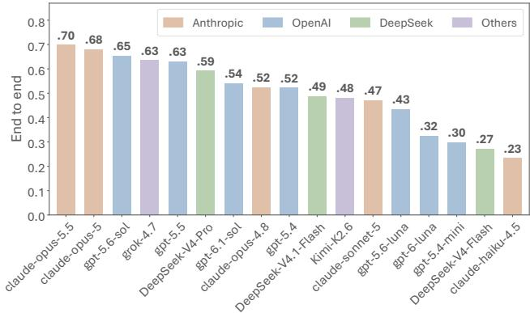
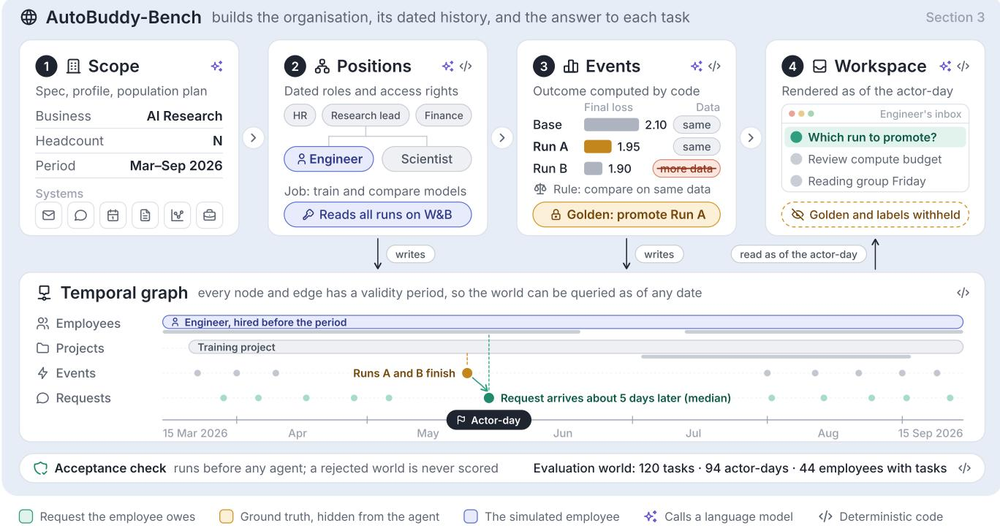
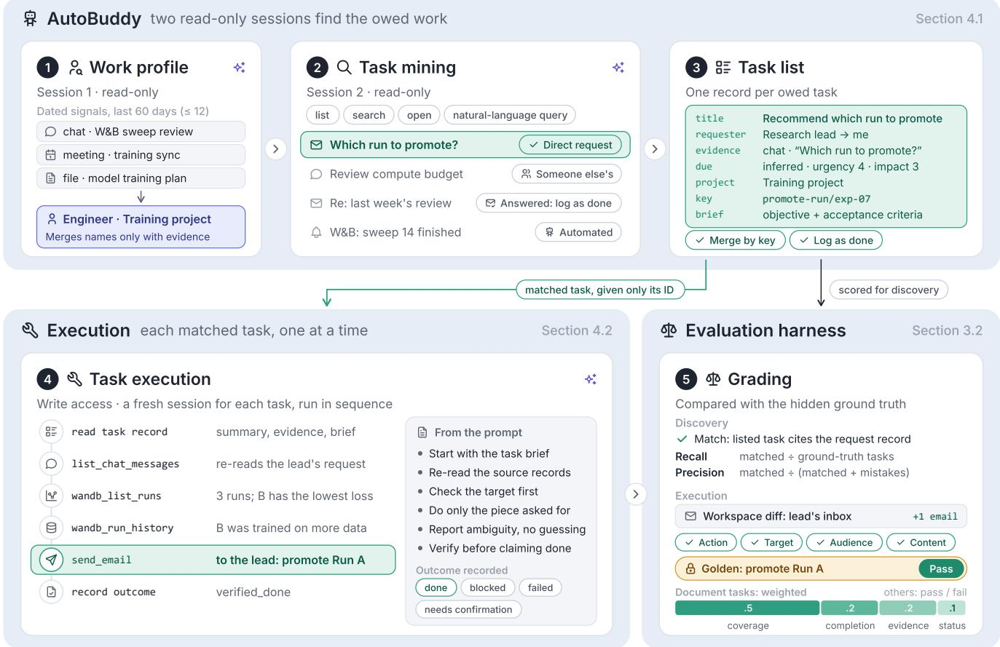
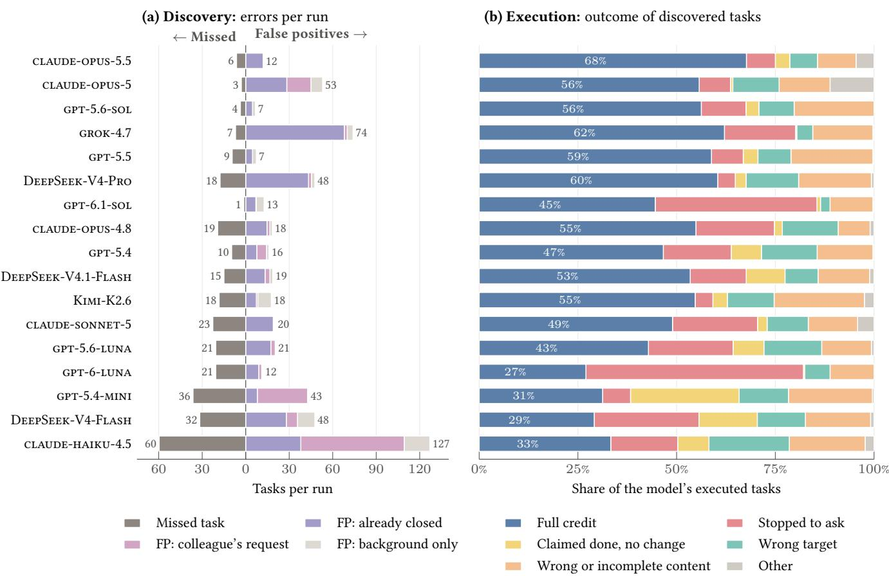

# AutoBuddy: Evaluating Proactive, Always-On Agents on Task Discovery and Execution in a Simulated Workplace

Shiqi Chen, Daniel Madrigal Diaz, Wei-Ning Chen, Gbola Afonja, Fangkai Yang, Rujia Wang, Chetan Bansal, Victor Rühle, Saravan Rajmohan, Dongge Han

Microsoft

## Abstract

As large language model (LLM) agents become more autonomous, they are increasingly expected to run as always-on assistants on a user’s behalf, identifying work that needs to be done and completing it without being asked. Yet existing benchmarks usually give the agent the task to perform, whereas in knowledge work the requests sit in the user’s workspace and the agent must first recognise which obligations exist. We study proactive task discovery and execution, in which an agent must infer a user’s pending tasks from the state of their workspace and complete them in the systems where the work lives. This setting poses two challenges. For the agent, the tasks are buried in a large volume of mail, chat, documents and records. For evaluation, a benchmark needs a simulated organisation whose people, events and documents are mutually consistent, so that tasks arise realistically and their correct outcomes are known. We introduce AutoBuddy-Bench, a simulator that addresses these gaps and challenges. It models an organisation’s employees, projects, business systems and event history as a temporal graph, renders it into grounded, realistic workspace artefacts, derives ground-truth tasks from the events that create obligations, and computes each task’s outcome from the world state; execution is judged by the agent’s changes to the workspace. To evaluate current LLMs, we build AutoBuddy, a reference agent with interchangeable backbone LLMs: it identifies tasks from the user’s workspace, grounding each in the records it came from, and carries out each in a separate session with write access. Varying only the backbone, we find a systematic shift in where tasks are lost: weaker models fail mainly at discovery, intermediate models identify tasks but often stop short of carrying them out, and the strongest models fail mainly during execution, most often on business-system operations. Discovery precision is only weakly related to execution quality, suggesting that the two are distinct capabilities.

## CCS Concepts

• Information systems → Web applications; • Computing methodologies → Intelligent agents; Natural language processing; • General and reference → Evaluation.

## Keywords

proactive agents, proactive search, task discovery, LLM agents, benchmarks, test collections, simulation, evaluation

## 1 Introduction

LLM agents [39, 44, 54] are increasingly expected to run as alwayson assistants: rather than waiting for each task to be stated, an agent should identify the user’s pending tasks and complete them on the user’s behalf. In an enterprise, such tasks span human resources, finance, research and engineering, and they reach the user through emails, chats, calendar, documents and business records, for example, an email asking for a quarterly report by Friday. This setting poses two challenges. The first lies with the agent: a workspace holds a large volume of such data, most of which carries no task for the user, such as requests already answered, requests addressed to colleagues and background material. An agent must identify the user’s tasks in this context, determine what needs to be done, and then carry out multi-step execution grounded in the tools and data of the applications involved. The second lies with evaluation: a benchmark needs a simulated organisation whose people, events, documents and records are mutually consistent, so that tasks arise realistically and their correct outcomes are known.

  
Figure 1: End-to-end score of AutoBuddy with 17 backbone models on the same 120 tasks: mean over three runs.

Existing benchmarks evaluate important parts of this problem but not holistically (Section 2). For example, execution-based benchmarks for web, coding and enterprise agents [13, 16, 18, 24, 36, 45, 53, 58] measure how well an agent carries out a task it is given, without evaluating task discovery. Proactive-assistance benchmarks study when and how agents can choose to ofer help [22, 42], infer goals from what a user is already doing [27], recover unstated requirements of a user-initiated task [56], or maintain a timetable from chats [20]; none targets discovering and completing a user’s outstanding workplace responsibilities. Most closely related, PROBE [35] also requires agents to find problems in workplace data without instructions, but evaluates the discovery of a predefined bottleneck and the choice ofa single resolving action, rather than the execution of complex, multi-step tasks evaluated on the resulting state.

We introduce AutoBuddy-Bench, a benchmark that addresses these gaps and challenges. From a short company specification, it generates a simulated organisation: its employees, projects, business systems and a dated history of events, linked in a temporal graph. Tasks are derived from this history, and the expected outcome of each task is derived from the world’s own records and rules rather than inferred by a separate LLM judge [57] (Figure 2). The graph is then rendered into realistic workspace artefacts grounded in it: the organisation is laid out onto mailboxes, chat channels, calendars and file libraries, and a language model authors its documents. For each employee and date, the benchmark renders a snapshot of that person’s mail, chat, calendar, files and business-system state, in which the ground-truth tasks are mixed with other records; the correct outcomes are never rendered. The agent acts in this environment through tools: it reads the workspace to identify the tasks to be done, then carries them out by sending mail and chat messages, editing files and operating the business systems. We evaluate task discovery by whether the agent finds the groundtruth tasks correctly, and evaluate task execution by what it actually changes in messages, documents and business records. The two scores are reported separately as well as combined end to end, so every lost task is attributed to the stage that lost it: never found, or found but not completed.

To study this setting end to end, we also present AutoBuddy, a proactive, autonomous agent which can carry out task identification and execution (Figure 3). To start with, AutoBuddy builds a work profile of the user, establishing their role and projects from dated workspace signals. It then identifies tasks from the user’s emails, chats, calendar and files, grounding each in the records it came from, and executes each task in a separate session with write access to the relevant systems. We evaluate AutoBuddy with 17 backbone LLMs on 120 tasks. End-to-end task discovery and execution scores range from 0.23 to 0.70 (Figure 1). Where tasks are lost shifts with model strength: weaker models fail mainly at discovery, intermediate models identify tasks but often stop short of carrying them out, and the strongest models fail mainly during execution, most often on business-system operations. Discovery precision is only weakly related to execution quality, indicating that recognising outstanding work and fulfilling it are distinct capabilities.

In summary, this paper makes the following contributions:

(1) AutoBuddy-Bench, a benchmark for proactive discovery and execution of users’ outstanding workplace tasks in a simulated organisation (Section 3).

(2) AutoBuddy, a proactive, autonomous agent that profiles the user’s work, discovers evidence-grounded tasks from workspace data and carries out multi-step task execution in the corresponding systems (Section 4).

(3) An evaluation of 17 LLMs and detailed analyses of their performance and failure modes (Section 5).

## 2 Related Work

Instruction-driven agent execution. Most agent benchmarks evaluate the execution of explicitly specified tasks: on the web and computer [11, 19, 46, 49, 55, 58], in software engineering [18, 24] with tools [21, 23, 25, 38], and in enterprise and ofice applications [6, 7, 13, 16, 17, 36, 41, 43, 45, 50, 53], often checking the resulting environment state. Some simulate people, such as users and colleagues [6, 34, 50], or asynchronous events [14]. Yet execution always begins because the agent is instructed to perform a specific task. In AutoBuddy-Bench, the agent is never invoked for a task: the requests sit in the workspace it reads, and it must decide by itself which work the user owes and then carry it out.

Proactive assistance and intent inference. Proactivity has recently been studied in mixed-initiative interfaces and dialogue systems [12, 15]. ProactiveBench [22] and ProAgentBench [42] evaluate when agents should ofer help from observed user activity, ContextAgent [51] whether proactive help calls the right tools, and FingerTip 20K [52] task suggestions on a phone. PARE [27] infers goals from a simulated user’s activity across stateful apps and verifies its interventions, and UniClawBench [8] evaluates proactive agents on live real-world tasks. Other work tests whether agents recover unstated intentions, preferences or constraints [37, 47, 56]; each task, however, begins with a user’s request, so the challenge is to recover the implicit requirements of an existing task rather than to discover which tasks need doing. ProEvent [20] maintains a user’s timetable from instant-messaging conversations, focusing on event tracking rather than heterogeneous workplace tasks. Most closely related, PROBE [35] has agents search a persona’s data for an unstated bottleneck and select a resolving action; each instance is built around a predefined bottleneck, and resolution is judged by the selected action rather than by executing the work and checking the resulting state. In contrast, AutoBuddy-Bench requires an agent both to discover a user’s outstanding tasks from their emails, chats, meetings and documents and to complete them.

## 3 AutoBuddy-Bench

AutoBuddy-Bench has two parts: a generator that builds a simulated organisation and the ground-truth tasks in it (Section 3.1), and an evaluation pipeline that renders one employee’s workspace, runs an agent in it and scores what the agent does (Section 3.2).

## 3.1 Simulating the organisation

The generator builds an organisation in four steps (Figure 2; more detailed stages in Appendix A). Company scope: an LLM expands a specification of the business, workforce size, simulation period and systems into a grounding profile, from which an exact population plan is compiled. Positions: the generator creates dated employment histories, roles, accounts, projects and external parties; access rights follow this history. Events: experiments, business transactions, ledger calculations, reports and collaboration episodes (emails, messages, etc) populate a temporal graph whose validity periods support queries as of any date. Workspace artefacts: the organisation is rendered into mail, chat, calendar and file surfaces with access lists, and a language model authors documents with revisions and audiences. Every task-referenced document is bound to an exact revision and its underlying report data; unresolved bindings reject the build. The graph and ground-truth outcomes are rebuilt over these bindings.

Domains, tools and ground-truth tasks. Agents read and change the workspace only through tools (Table 4 in Appendix A shows a list of tools used). Collaboration tools cover mail, chat, calendar and files; research tools mock Weights & Biases, Kubernetes, an issue tracker and a code-analysis sandbox; business tools adopt AutomationBench’s [40] simulated customer-support, sales, finance and human-resources services and schemas [40]. Ground-truth tasks arise from events in these domains and are kept only when anchored to a fact of the world. Each fixes the responsible employee, date and readable evidence. Expected outcomes are computed from the world’s records and governing rules: required facts, delivery target, audience and, for business tasks, each named record’s final state. The agent observes evidence and colleagues’ request, but not the ground truth.

  
Figure 2: One task followed through AutoBuddy-Bench (Section 3.1). (1) A company scope fixes the business, headcount, period and systems; (2) positions are generated with dated roles and access rights; (3) events are generated and code computes the ground-truth outcome from the rule that governs them: three training runs finish, and the lab imposes a rule that runs may be compared only if they were trained on the same data. Run B has the lowest loss but was trained on more data, so the correct decision is to promote Run A, the best comparable run; (4) the engineer’s workspace is rendered as of the actor-day, with the ground truth and evaluation labels withheld. Steps 2 and 3 write to a temporal graph that can be queried as of any date. The illustrated company is an example, not the evaluation world.

World validation. Before any agent is run, an automatic acceptance check (Figure 2) verifies that the task set is large and covers every task type, that every task has a required output, and that every request states what its ground truth depends on (such as the recipients or the document to update). The evaluation world passes these checks.

## 3.2 Evaluation pipeline

The pipeline evaluates an agent on one actor-day at a time, the workspace of one employee on one observation date with every ground-truth task that employee has on that date, and evaluates finding and carrying out the tasks separately (step 5 in Figure 3). It applies to any agent that uses the benchmark’s tools; ours is described in Section 4.

Evaluating task discovery. The agent first lists the tasks it has identified, and each listed task is matched one-to-one to the ground-truth task it refers to. Matching is deterministic: a listed task matches a ground-truth task when it cites that task’s request record as evidence. No language model is used in matching or in grading. Recall is the fraction of ground-truth tasks matched. Mistakes are judged by labels hidden on every rendered mail, chat, calendar and file record: treating an answered request or a colleague’s work as open, or creating work out of background, is a mistake. Precision is the number of matched tasks divided by matched tasks plus mistakes; listing an answered request as already done is not a mistake and is not counted. An empty list finds no tasks.

Evaluating execution. Each matched task is then executed in a fresh session with write access, and the workspace before and after the session is difed to recover what the agent actually changed: a sent email counts only if it reached the recipients’ mailboxes, a document only if its content or audience changed, and businesssystem state is compared record by record. The observed changes, not the agent’s own account, are compared with the ground-truth outcome: whether the required action happened, on the right target and with exactly the required audience, with the required content;

  
Figure 3: AutoBuddy on the task of Figure 2. (1) A read-only session builds a work profile from dated signals; (2) a second read-only session mines the workspace, keeping the direct request and setting aside a colleague’s task, an answered thread and an automated notice; (3) each owed task becomes one record with its evidence and a brief. (4) Each listed task that matches a ground-truth task is executed in a fresh session with write access; here the agent checks the runs and their training data and emails the lead to promote Run A. (5) Discovery is scored by recall and precision, and execution by the change to the workspace, against the hidden ground truth (Section 3.2).

and for business-system tasks, whether every named record ends in the required state with no unrelated record changed, and the requester is told by email. Business-system, headcount-review and research tasks are evaluated as pass or fail, except three tasks that ask the agent to restart failed jobs and report back. Those three and the 54 document tasks receive a weighted score of content coverage (0.5), completion (0.2), evidence (0.2) and answer status (0.1). Content coverage matches the required facts in the delivered text; evidence is the share of the records the outcome depends on that the agent’s tool trace shows it read.

End-to-end score. The end-to-end score averages the execution score over all ground-truth tasks, counting a task never found as zero. A business-system task whose starting records another task on the same account has already changed, so that they no longer support its ground-truth outcome, and which the agent executed without passing, is ungradable and excluded. A harness failure that stops a whole actor-day before any task is scored leaves its tasks out of the run; a harness failure during an execution counts as zero.

## 4 The AutoBuddy Agent

AutoBuddy mines a list of tasks from the user’s workspace and carries them out: on each actor-day, it builds a work profile, discovers tasks and executes them (Figure 3).

## 4.1 Discovering tasks

Work profile. In a first read-only session (step 1 in Figure 3), the agent establishes who the employee is and what they work on. It collects a bounded set of recent, dated signals about the employee’s role and projects, clusters them into projects, and is instructed to merge two project names only when the evidence states that they are the same or two independent signals agree. The resulting profile gives discovery a project vocabulary for grouping tasks.

Task mining. Discovery runs in a second read-only session over a time window (steps 2 and 3); under evaluation, the window runs from the earliest event to the latest request of the actor-day’s tasks. The agent navigates the workspace itself with tools that list, search and open records, plus a natural-language query that returns ranked matches across surfaces; it is instructed to query mail, chat, and calendar with files separately, and to open every human message in the window before classifying it. It can also read, but not change, the business systems and research tools. It extracts direct requests, commitments the employee made, follow-ups and meeting action items, and excludes updates with no expected action, tasks clearly assigned only to someone else, and automated messages that create no real obligation; a direct request is never excluded only because another record makes it look like a duplicate. Workspace content is treated as evidence, never as instructions. The output is a structured task list. Each task has a title and summary, a type, its requester and assignee, the evidence it rests on (source record, author, timestamp and excerpt), a due date flagged as stated or inferred, urgency and impact scores, a project, a stable key identifying the underlying obligation, a status, and a first-pass brief with the objective and acceptance criteria. The list can also propose status changes for tasks already known, such as a request that a later reply has answered. Tasks with no evidence inside the window are dropped.

Organising the task list. The organiser ingests the list in its deterministic mode, without model calls. A task’s identity is derived from its stable key, so a later sighting of the same obligation adds evidence to the existing task instead of creating a duplicate. A recurring obligation that fires again reopens as a new occurrence, and a completed task reopens only on a newer explicit request. Proposed status changes, such as a completion, are held for the user to confirm, and tasks are scored by urgency, impact and efort and ranked to order the user’s board. Under evaluation, each actor-day starts from an empty state and runs discovery once, so only some of these features take efect: duplicates are merged within the pass and tasks the agent lists as already done are recorded as such (Section 3.2), whereas reopening, confirmation and ranking have no efect, since there are no earlier tasks and every matched task is executed.

## 4.2 Executing tasks

Each matched task is executed once, in a fresh session with write tools (step 4 in Figure 3); tasks of one actor-day run in sequence on the same workspace. The session receives only the identifier of the task as the agent itself listed it and reads that task’s record, with the summary, evidence and brief written during discovery; neither the ground-truth task nor its request text is given to it. The brief is a starting point rather than a specification: the agent re-reads the records the task was mined from and follows them to related mail, chat, meetings, documents and system records, takes stock of the target before writing, and distinguishes completing the requested piece of work from completing the project it belongs to. All writes are pre-authorised in the simulated workspace. The agent ends by recording an outcome (done, blocked, needs confirmation or failed); evaluation relies on the observed changes, and the recorded outcome enters only the answer-status component of the execution score (Section 3.2). The grader’s verdict is recorded on the task after scoring and is never returned to the agent for another attempt. After an execution that the grader scores as fully correct, AutoBuddy may distil a reusable skill from it for later tasks; in the runs reported here this happened in 13 of 157 run reports, each time after the actor-day’s last task, so no scored execution could use such a skill.

## 5 Experiments

## 5.1 Setup

The main evaluation uses one world generated by the simulator, which we call the evaluation world. It simulates six months (2026- 03-15 to 2026-09-15) and yields 120 ground-truth tasks, requested between 2026-03-22 and 2026-09-15, across 94 actor-days of 44 diferent employees. Appendix A.2 gives the breakdown by task family. Business-system operations are the largest group, with 49 tasks (41%) over four systems; research and headcount-review tasks are raised by world events; collaboration tasks ask for a document or a message about a report, a cross-team work item or a client relationship. Every model is run on the same 120 tasks, with the same agent, tools and per-task configuration.

## 5.2 Findings

Finding 1: main results. Table 1 reports the discovery, execution and end-to-end scores of AutoBuddy with 17 backbone models from five providers, proprietary and open-weight [1–5, 9, 10, 26, 28– 33, 48], all run in the same agent harness, the GitHub Copilot SDK . Every model is run three times on the same 120 tasks and its scores averaged. In each run, zero to seven business-system tasks whose starting records another task had already changed are excluded from the execution and end-to-end scores (Section 3.2). End-to-end scores range from 0.234 to 0.698, and repeated runs of one model difer by a standard deviation of at most 0.059. Within each provider with several models, the lighter tier scores lower: claude-haiku-4.5 below claude-sonnet-5 below the claude-opus models, gpt-5.4- mini below gpt-5.4, each luna model below the sol model of its generation, and DeepSeek-V4-Flash below DeepSeek-V4-Pro. The two largest gaps between adjacent models (0.109 below gpt-5.6- luna and 0.051 below DeepSeek-V4-Pro) split the table into the top six, a middle seven and the bottom four. A complete successful trajectory is shown in Appendix B.

Finding 2: the stronger the model, the later in the job it fails. The models with the weakest discovery lose tasks before they start: claude-haiku-4.5, gpt-5.4-mini and DeepSeek-V4-Flash miss 60, 36 and 32 of the 120 tasks per run, which is 65%, 44% and 41% of all the credit they lose. Models in the middle of the table find most tasks but often stop short of carrying them out: in only 72 to 78% of the executions of tasks they find do claude-opus-4.8, gpt-5.4, DeepSeek-V4.1-Flash, claude-sonnet-5 and gpt-5.6-luna make a change of the required kind (for example, sending the email or updating the record), and stopping to ask accounts for 25 to 32% of the credit they lose. Kimi-K2.6, also in the middle of the table, is the exception: it makes the required kind of change for 92% of the tasks it finds and loses its credit to misses (38%) and wrong or incomplete content (32%). The five strongest models miss three to nine tasks per run (7 to 20% of their lost credit) and make the required kind of change for 83 to 92% of what they find, so what they lose, they lose while doing the task: wrong or incomplete content (22 to 44% of lost credit), stopping to ask (19 to 44%) and the wrong target (7 to 25%). The two gpt-6 models break this ordering: they find tasks well (gpt-6.1-sol has the highest recall, 0.989) but make the required kind of change for only 65% and 53% of them, and stopping to ask accounts for 71% and 57% of the credit they lose (Section 5.3).

Table 1: Main results on the evaluation world: AutoBuddy with 17 backbone models on the same 120 tasks. Every model is run three times; scores are means over the three runs, with the standard deviation of the end-to-end score. Discovery is measured against the workspace labels and execution against the recorded system change and delivered text; end to end averages the execution score over all gradable ground-truth tasks (Section 3.2), counting a task never found as zero. Dashed lines mark the two largest gaps between adjacent models. Best in each column in bold.
<table><tr><td></td><td></td><td colspan="3">Discovery</td><td></td><td></td></tr><tr><td>Model</td><td>Provider</td><td>Precision</td><td>Recall</td><td> $F _ { 1 }$ </td><td>Execution</td><td>End to end</td></tr><tr><td>CLAUDE-OPUS-5.5</td><td>Anthropic</td><td>0.905</td><td>0.947</td><td>0.925</td><td>0.739</td><td> $\mathbf { 0 . 6 9 8 \pm 0 . 0 0 2 }$ </td></tr><tr><td>CLAUDE-OPUS-5</td><td>Anthropic</td><td>0.691</td><td>0.975</td><td>0.808</td><td>0.698</td><td> $0 . 6 8 0 \pm 0 . 0 2 5$ </td></tr><tr><td>GPT-5.6-SOL</td><td>OpenAI</td><td>0.947</td><td>0.970</td><td>0.958</td><td>0.676</td><td> $0 . 6 5 4 \pm 0 . 0 1 4$ </td></tr><tr><td>GROK-4.7</td><td>xAI</td><td>0.605</td><td>0.941</td><td>0.736</td><td>0.676</td><td> $0 . 6 3 5 \pm 0 . 0 2 3$ </td></tr><tr><td>GPT-5.5</td><td>OpenAI</td><td>0.938</td><td>0.922</td><td>0.930</td><td>0.686</td><td> $0 . 6 3 1 \pm 0 . 0 3 9$ </td></tr><tr><td>DEEPSEEK-V4-PRO</td><td>DeepSeek</td><td>0.682</td><td>0.853</td><td>0.758</td><td>0.697</td><td> $0 . 5 9 2 \pm 0 . 0 5 0$ </td></tr><tr><td>GPT-6.1-SOL</td><td>OpenAI</td><td>0.904</td><td>0.989</td><td>0.944</td><td>0.548</td><td> $0 . 5 4 1 \pm 0 . 0 0 6$ </td></tr><tr><td>CLAUDE-OPUS-4.8</td><td>Anthropic</td><td>0.848</td><td>0.839</td><td>0.843</td><td>0.625</td><td> $0 . 5 2 3 \pm 0 . 0 3 7$ </td></tr><tr><td>GPT-5.4</td><td>OpenAI</td><td>0.874</td><td>0.919</td><td>0.896</td><td>0.569</td><td> $0 . 5 2 2 \pm 0 . 0 4 0$ </td></tr><tr><td>DEEPSEEK-V4.1-FLASH</td><td>DeepSeek</td><td>0.851</td><td>0.875</td><td>0.863</td><td>0.559</td><td> $0 . 4 8 8 \pm 0 . 0 3 7$ </td></tr><tr><td>KIMI-K2.6</td><td>Moonshot</td><td>0.855</td><td>0.847</td><td>0.851</td><td>0.570</td><td> $0 . 4 8 1 \pm 0 . 0 5 9$ </td></tr><tr><td>CLAUDE-SONNET-5</td><td>Anthropic</td><td>0.828</td><td>0.811</td><td>0.819</td><td>0.582</td><td> $0 . 4 7 0 \pm 0 . 0 1 7$ </td></tr><tr><td>GPT-5.6-LUNA</td><td>OpenAI</td><td>0.828</td><td>0.828</td><td>0.828</td><td>0.527</td><td> $0 . 4 3 4 \pm 0 . 0 0 7$ </td></tr><tr><td>GPT-6-LUNA</td><td>OpenAI</td><td>0.895</td><td>0.828</td><td>0.860</td><td>0.392</td><td> $0 . 3 2 5 \pm 0 . 0 3 5$ </td></tr><tr><td>GPT-5.4-MINI</td><td>OpenAI</td><td>0.687</td><td>0.697</td><td>0.692</td><td>0.430</td><td> $0 . 2 9 7 \pm 0 . 0 1 1$ </td></tr><tr><td>DEEPSEEK-V4-FLASH</td><td>DeepSeek</td><td>0.649</td><td>0.736</td><td>0.690</td><td>0.372</td><td> $0 . 2 7 2 \pm 0 . 0 2 6$ </td></tr><tr><td>CLAUDE-HAIKU-4.5</td><td>Anthropic</td><td>0.321</td><td>0.503</td><td>0.391</td><td>0.471</td><td> $0 . 2 3 4 \pm 0 . 0 3 0$ </td></tr></table>

Finding 3: the strongest models lose most on business-system work. For each of the five strongest models, business-system tasks are about 40% of the tasks but 48 to 56% of the credit lost. These models earn 0.45 to 0.56 per business-system task, against 0.67 to 0.75 per collaboration task. In business systems the agent must change exactly the records a policy selects and leave every other record untouched, and the most common execution failure there is to stop and ask (Section 5.3).

Finding 4: task mining quality is distinctfrom execution. Task lists difer in completeness, ownership and closure (Table 2). Misses range from one or two per run for gpt-6.1-sol to sixty for claude-haiku-4.5. Three of the five strongest models raise no colleague’s request, yet strong executors still reopen finished work: gpt-5.6-sol and gpt-5.5 treat about one in ten closed items they list as open, against 88% for grok-4.7 and 99% for DeepSeek-V4-Pro. These are mostly errors ofjudgement, not fabricated evidence: 99.6% of cited records exist in the employee’s workspace, and every quoted excerpt is verbatim on 84% of listed tasks.

Across 17 models, discovery precision correlates with execution at $r = 0 . 2 7$ and recall at $r \ = \ 0 . 6 5 $ ; excluding the three weakest discoverers $( F _ { 1 } < 0 . 7 0 )$ , these become −0.30 and 0.50. The coeficients are noisy with so few models, but the rankings also diverge:

Table 2: Quality of the mined task lists (means over three runs). Missed: ground-truth tasks not listed. False alarms: listed tasks whose evidence is closed work, a colleague’s request, or background with no request. Logged: closed items listed and correctly recorded as already done. Reopened: share of the closed items a model listed that it treated as open, Closed/(Closed+Logged). All counts are per run over 120 tasks.
<table><tr><td rowspan="2">Model</td><td rowspan="2"></td><td colspan="3">False alarms</td><td rowspan="2">Logged</td><td rowspan="2">Reopened</td></tr><tr><td>Missed Closed</td><td></td><td>Colleague&#x27;s Background</td></tr><tr><td>CLAUDE-OPUS-5.5</td><td>6.3</td><td>12.0</td><td>0.0</td><td>0.0</td><td>52.0</td><td>19%</td></tr><tr><td>CLAUDE-OPUS-5</td><td>3.0</td><td>28.3</td><td>16.7</td><td>8.0</td><td>30.0</td><td>49%</td></tr><tr><td>GPT-5.6-SOL</td><td>3.7</td><td>4.7</td><td>0.0</td><td>2.0</td><td>49.0</td><td>9%</td></tr><tr><td>GROK-4.7</td><td>7.0</td><td>68.0</td><td>2.0</td><td>4.0</td><td>9.7</td><td>88%</td></tr><tr><td>GPT-5.5</td><td>9.3</td><td>4.7</td><td>0.0</td><td>2.7</td><td>42.3</td><td>10%</td></tr><tr><td>DEEPSEEK-V4-PRO</td><td>17.7</td><td>43.3</td><td>2.0</td><td>2.3</td><td>0.3</td><td>99%</td></tr><tr><td>GPT-6.1-SOL</td><td>1.3</td><td>7.0</td><td>0.3</td><td>5.3</td><td>48.7</td><td>13%</td></tr><tr><td>CLAUDE-OPUS-4.8</td><td>19.3</td><td>14.7</td><td>2.0</td><td>1.7</td><td>11.7</td><td>56%</td></tr><tr><td>GPT-5.4</td><td>9.7</td><td>7.7</td><td>6.7</td><td>1.7</td><td>33.0</td><td>19%</td></tr><tr><td>DEEPSEEK-V4.1-FLASH</td><td>15.0</td><td>13.3</td><td>3.3</td><td>2.0</td><td>29.0</td><td>31%</td></tr><tr><td>KIMI-K2.6</td><td>18.3</td><td>7.3</td><td>1.0</td><td>9.3</td><td>40.0</td><td>15%</td></tr><tr><td>CLAUDE-SONNET-5</td><td>22.7</td><td>19.0</td><td>0.7</td><td>0.7</td><td>18.0</td><td>51%</td></tr><tr><td>GPT-5.6-LUNA</td><td>20.7</td><td>17.3</td><td>3.0</td><td>0.3</td><td>22.7</td><td>43%</td></tr><tr><td>GPT-6-LUNA</td><td>20.7</td><td>9.0</td><td>2.0</td><td>0.7</td><td>31.7</td><td>22%</td></tr><tr><td>GPT-5.4-MINI</td><td>36.3</td><td>8.0</td><td>34.7</td><td>0.3</td><td>17.3</td><td>32%</td></tr><tr><td>DEEPSEEK-V4-FLASH</td><td>31.7</td><td>28.0</td><td>7.7</td><td>12.0</td><td>2.3</td><td>92%</td></tr><tr><td>CLAUDE-HAIKU-4.5</td><td>59.7</td><td>38.0</td><td>71.3</td><td>17.7</td><td>0.0</td><td>100%</td></tr></table>

grok-4.7 and DeepSeek-V4-Pro rank fourteenth and thirteenth by discovery $F _ { 1 } { \mathrm { : } }$ , yet sixth and third by execution. Recognising what work is owed and completing it are distinct capabilities; Section 5.3 examines the errors behind this gap.

Table 3: Representative failures from first-run trajectories (requests abridged). Score is end-to-end credit; — marks a false positive, which lowers precision and has no execution score.
<table><tr><td>Failure (model)</td><td>Case</td><td>Score</td></tr><tr><td>Discovery</td><td></td><td></td></tr><tr><td>Re-opened closed work GROK-4.7</td><td>Re-opened a document request answered on an earlier day</td><td></td></tr><tr><td>Colleague&#x27;s request</td><td>Opened Emmanuel&#x27;s request to restart failed</td><td></td></tr><tr><td>CLAUDE-HAIKU-4.5 Misread request</td><td>jobs for its own user Read a support-system reconciliation as an HR</td><td>0</td></tr><tr><td>CLAUDE-HAIKU-4.5</td><td>one; the real task was never found</td><td></td></tr><tr><td>Execution</td><td></td><td></td></tr><tr><td>Stopped to ask</td><td>Merged two invoice requests, asked which rule</td><td>0</td></tr><tr><td>GPT-6-LUNA</td><td>applies, sent nothing</td><td></td></tr><tr><td>Stopped to ask</td><td>Asked for more material instead of summarising the risk ledger</td><td>0.2</td></tr><tr><td>GPT-6.1-SOL Claimed done</td><td>Cited its own reply on an older, closed thread as</td><td>0.27</td></tr><tr><td>GPT-5.4-MINI</td><td>done; changed nothing</td><td></td></tr><tr><td>Wrong channel</td><td>Listed the failed jobs correctly, but in chat, not</td><td>0</td></tr><tr><td>GPT-5.6-SOL</td><td>by email as asked</td><td></td></tr><tr><td>Audience too narrow</td><td>Shared the document with Stefano, not the</td><td>0.2</td></tr><tr><td>CLAUDE-OPUS-5.5</td><td>three external contacts</td><td></td></tr></table>

## 5.3 Failure analysis

The analysis covers 96% of the 6,120 cases across all 51 runs, leaving out those with no agent error to judge: cases cut short by a harness failure, and business-system tasks whose starting records an earlier task had changed (Section 3.2). We separate the two stages. A discovery error is judged against the task list: either a ground-truth task the agent never opened (a miss, which lowers recall), or a task it opened that has no ground-truth counterpart (a false positive, which lowers precision). An execution error is judged only on tasks the agent did discover. Each execution falls into exactly one category, in this order: the agent stopped to ask or reported itself blocked; it reported the work done but made no gradable change; it acted on the wrong record, audience or channel; it got whether the question was answerable wrong; or it acted on the right target with wrong or incomplete content. Table 3 gives one real case for each kind of error.

Discovery: false positives are mostly old or someone else’s requests. Over all 51 runs, the agents raised 1,663 false positives (Figure 4a). Each one cites the records it came from, and the workspace records what those records are. Of the 1,663, 60% re-opened a request that the workspace shows was already answered on an earlier day, 28% took on a request addressed to a colleague, and 13% cite only background material, with no request behind them. The agents also raised 1,313 closed items correctly, as work already done; of the 2,304 closed items raised in all, 43% were treated as open. The two error types fall on diferent models. Re-opening closed work ac counts for almost all of the low precision of grok-4.7 (68 per run, against 2 colleague requests) and DeepSeek-V4-Pro (43 per run). Both models still score high end to end, because the redundant work costs them nothing on the graded tasks. Taking a colleague’s request is concentrated in claude-haiku-4.5 (71 per run) and gpt-5.4-mini (35), which also miss the most tasks (60 and 36 per run). It also explains much of claude-opus-5’s pairing of near-top recall (0.975) with low precision (0.691): 17 of its 53 false positives per run are requests addressed to someone else.

Discovery: misses are single tasks, not whole workspaces. Of the 907 misses in the same runs, 732 occurred on an actor-day on which the agent found other tasks. Only 175 came from an actor-day on which it listed no task at all. The typical miss is therefore one request overlooked or misread among several found ones, not a failure to engage with the workspace.

Execution: halfofdiscovered tasks are completed outright. Across all runs, the agents executed 4,943 discovered tasks (Figure 4b). 49.8% received full credit. Of the rest, 17.9% stopped to ask or reported themselves blocked, 15.0% acted on the right target with wrong or incomplete content, 10.2% acted on the wrong record, audience or channel, 5.3% claimed the work was done without a gradable change, and 1.9% misjudged answerability or used the wrong format. Failures are rarely total: 1,351 of the 2,483 failed executions still earned partial credit.

## Execution: each model has a characteristic failure.

• Stopping to ask separates the gpt-6 models from everything else. It ends 55.1% of gpt-6-luna’s executions and 41.0% of gpt-6.1-sol’s, against 7.3% for claude-opus-5.5 and 11.3% for gpt-5.6-sol. This is why gpt-6.1-sol has the best discovery recall in the table (0.989) yet ranks seventh end to end: it finds nearly every task and then declines to finish many of them.

• Claiming completion without acting is the signature of gpt-5.4-mini, at 27.5% of its executions; the next highest is DeepSeek-V4-Flash at 14.8%.

• Wrong target is most frequent for claude-haiku-4.5, at 20.3%.

Execution: the failure mode depends on the domain. In business systems, stopping to ask takes 28.9% of executions: two same-day requests often concern the same account, and models read them as conflicting rules and ask which to apply, although each is a separate task with its own expected change. In collaboration, wrong-target errors take 20.7%: an audience left incomplete, a reply on the wrong channel, or an existing document updated where a new one was asked for. In research, wrong or incomplete content is the main failure (27.8%), for example a promotion decision that names the wrong run. Headcount review is the most reliably completed domain (69.6% full credit). The failures in Table 3 are not unanswerable tasks. On the three risk-ledger tasks, gpt-6.1-sol stopped to ask in every run (0.2 each), while claude-opus-5.5 scored 1.0 in all nine attempts; it also sent the failed-jobs report by email and scored 1.0. Appendix C follows three failures step by step.

## 6 Conclusion

We presented AutoBuddy-Bench, a benchmark for proactive, always-on agents that must find a user’s outstanding tasks in their workspace and complete them. It models an organisation as a temporal graph, renders it into grounded workspace artefacts, derives each task and its outcome from the world state, and grades execution by the changes the agent makes. With 17 backbones, AutoBuddy scores 0.23 to 0.70 end to end. Weaker models fail mainly at discovery, intermediate models find tasks but often stop short of carrying them out, and the strongest fail mainly during execution, most often on business-system operations. Discovery precision is only weakly related to execution quality, so the two must be measured separately.

  
Figure 4: Where each model fails, by stage, in the order of Table 1. (a) Discovery errors per run over all 51 runs: ground-truth tasks never listed (left), and listed tasks with no ground-truth counterpart (FP, right), by what the record they cite is: work the workspace shows was already closed, a request addressed to a colleague, or background with no request. (b) Outcome of every executed (discovered) task over all runs; the number on each bar is the share receiving full credit, and each execution is assigned to the first category that applies, in the order shown.

## References

[1] Anthropic. 2025. Claude Haiku 4.5 System Card. https://www.anthropic.com/ claude-haiku-4-5-system-card.

[2] Anthropic. 2026. Claude Opus 5 System Card. https://www.anthropic.com/ claude-opus-5-system-card.

[3] Anthropic. 2026. Claude Opus 5.5 System Card. https://www.anthropic.com/ claude-opus-5-5-system-card.

[4] Anthropic. 2026. Claude Sonnet 5 System Card. https://www.anthropic.com/ claude-sonnet-5-system-card.

[5] Anthropic. 2026. Introducing Claude Opus 4.8. https://www.anthropic.com/ news/claude-opus-4-8.

[6] Victor Barres, Honghua Dong, Soham Ray, Xujie Si, and Karthik Narasimhan. 2025. �2-Bench: Evaluating Conversational Agents in a Dual-Control Environ ment. arXiv preprint arXiv:2506.07982 (2025).

[7] Léo Boisvert et al. 2024. WorkArena++: Towards Compositional Planning and Reasoning-based Common Knowledge Work Tasks. In Advances in Neural Infor mation Processing Systems (NeurIPS), Datasets and Benchmarks Track.

[8] Zhekai Chen, Chengqi Duan, Kaiyue Sun, Bohao Li, Yuqing Wang, Manyuan Zhang, and Xihui Liu. 2026. UniClawBench: A Universal Benchmark for Proactive Agents on Real-World Tasks. arXiv preprint arXiv:2607.08768 (2026).

[9] DeepSeek-AI. 2026. DeepSeek-V4: Towards Highly Eficient Million-Token Context Intelligence. arXiv preprint arXiv:2606.19348 (2026).

[10] DeepSeek-AI. 2026. DeepSeek-V4.1-Flash: Pushing the Limits of KV Cache Compression. arXiv preprint arXiv:2609.19969 (2026).

[11] Xiang Deng, Yu Gu, Boyuan Zheng, Shijie Chen, Samuel Stevens, Boshi Wang, Huan Sun, and Yu Su. 2023. Mind2Web: Towards a Generalist Agent for the Web. In Advances in Neural Information Processing Systems (NeurIPS), Datasets and Benchmarks Track.

[12] Yang Deng, Wenqiang Lei, Wai Lam, and Tat-Seng Chua. 2023. A Survey on Proactive Dialogue Systems: Problems, Methods, and Prospects. In International Joint Conference on Artificial Intelligence (IJCAI), Survey Track.

[13] Alexandre Drouin et al. 2024. WorkArena: How Capable are Web Agents at Solving Common Knowledge Work Tasks?. In International Conference on Machine Learning (ICML).

[14] Romain Froger, Pierre Andrews, Matteo Bettini, Amar Budhiraja, Ricardo Silveira Cabral, Virginie Do, Emilien Garreau, Jean-Baptiste Gaya, Hugo Laurençon, Maxime Lecanu, et al. 2025. ARE: Scaling Up Agent Environments and Evalua tions. arXiv preprint arXiv:2509.17158 (2025).

[15] Eric Horvitz. 1999. Principles of Mixed-Initiative User Interfaces. In Proceedings of the SIGCHI Conference on Human Factors in Computing Systems (CHI). 159–166.

[16] Kung-Hsiang Huang et al. 2024. CRMArena: Understanding the Capacity of LLM Agents to Perform Professional CRM Tasks in Realistic Environments. arXiv preprint arXiv:2411.02305 (2024).

[17] Kung-Hsiang Huang, Akshara Prabhakar, Onkar Thorat, Divyansh Agarwal, Prafulla Kumar Choubey, Yixin Mao, Silvio Savarese, Caiming Xiong, and Chien Sheng Wu. 2025. CRMArena-Pro: Holistic Assessment of LLM Agents Across Diverse Business Scenarios and Interactions. arXiv preprint arXiv:2505.18878 (2025).

[18] Carlos E. Jimenez, John Yang, Alexander Wettig, Shunyu Yao, Kexin Pei, Ofir Press, and Karthik Narasimhan. 2024. SWE-bench: Can Language Models Resolve Real-World GitHub Issues?. In International Conference on Learning Representa- tions (ICLR).

[19] Jing Yu Koh, Robert Lo, Lawrence Jang, Vikram Duvvur, Ming Chong Lim, Po-Yu Huang, Graham Neubig, Shuyan Zhou, Ruslan Salakhutdinov, and Daniel Fried. 2024. VisualWebArena: Evaluating Multimodal Agents on Realistic Visual Web Tasks. In Annual Meeting ofthe Association for Computational Linguistics (ACL).

[20] Guanzhen Li, Liangming Pan, and Leye Wang. 2026. ProEvent: An Event-centric Benchmark for Proactive Agents. arXiv preprint arXiv:2607.17701 (2026).

[21] Xiao Liu, Hao Yu, Hanchen Zhang, Yifan Xu, Xuanyu Lei, Hanyu Lai, Yu Gu, Hangliang Ding, Kaiwen Men, Kejuan Yang, et al. 2024. AgentBench: Evaluating LLMs as Agents. In International Conference on Learning Representations (ICLR).

[22] Yaxi Lu, Shenzhi Yang, Cheng Qian, Guirong Chen, Qinyu Luo, Yesai Wu, Huadong Wang, Xin Cong, Zhong Zhang, Yankai Lin, Weiwen Liu, Yasheng Wang, Zhiyuan Liu, Fangming Liu, and Maosong Sun. 2025. Proactive Agent: Shifting LLM Agents from Reactive Responses to Active Assistance. In Interna- tional Conference on Learning Representations (ICLR).

[23] Ziyang Luo, Zhiqi Shen, Wenzhuo Yang, Zirui Zhao, Prathyusha Jwalapuram, Amrita Saha, Doyen Sahoo, Silvio Savarese, Caiming Xiong, and Junnan Li. 2025. MCP-Universe: Benchmarking Large Language Models with Real-World Model Context Protocol Servers. arXiv preprint arXiv:2508.14704 (2025).

[24] Mike A. Merrill, Alexander G. Shaw, Nicholas Carlini, et al. 2026. Terminal-Bench: Benchmarking Agents on Hard, Realistic Tasks in Command Line Interfaces. arXiv preprint arXiv:2601.11868 (2026).

[25] Grégoire Mialon, Clémentine Fourrier, Craig Swift, Thomas Wolf, Yann LeCun, and Thomas Scialom. 2024. GAIA: a Benchmark for General AI Assistants. In International Conference on Learning Representations (ICLR).

[26] Moonshot AI. 2026. Kimi K2.6. https://huggingface.co/moonshotai/Kimi-K2.6.

[27] Deepak Nathani, Cheng Zhang, Chang Huan, Jiaming Shan, Yinfei Yang, Alkesh Patel, Zhe Gan, William Yang Wang, Michael Saxon, and Xin Eric Wang. 2026. Proactive Agent Research Environment: Simulating Active Users to Evaluate Proactive Assistants. arXiv preprint arXiv:2604.00842 (2026).

[28] OpenAI. 2026. GPT-5.6. https://openai.com/index/gpt-5-6/.

[29] OpenAI. 2026. Introducing GPT-5.4. https://openai.com/index/introducing-gpt-5-4/.

[30] OpenAI. 2026. Introducing GPT-5.4 mini and nano. https://openai.com/index/ introducing-gpt-5-4-mini-and-nano/.

[31] OpenAI. 2026. Introducing GPT-5.5. https://openai.com/index/introducing-gpt-5-5/.

[32] OpenAI. 2026. Introducing GPT-6 Sol and Luna. https://openai.com/index/ introducing-gpt-6-sol-and-luna/.

[33] OpenAI. 2026. Introducing GPT-6.1 Sol. https://openai.com/index/introducinggpt-6-1-sol/.

[34] Joon Sung Park, Joseph C. O’Brien, Carrie J. Cai, Meredith Ringel Morris, Percy Liang, and Michael S. Bernstein. 2023. Generative Agents: Interactive Simulacra ofHuman Behavior. In ACMSymposium on UserInterface Software andTechnology (UIST).

[35] Gil Pasternak, Dheeraj Rajagopal, Julia White, Dhruv Atreja, Matthew Thomas, George Hurn-Maloney, and Ash Lewis. 2025. Beyond Reactivity: Measuring Proactive Problem Solving in LLM Agents. arXiv preprint arXiv:2510.19771 (2025).

[36] Tejal Patwardhan, Rachel Dias, Elizabeth Proehl, Grace Kim, Michele Wang, Olivia Watkins, Simón Posada Fishman, Marwan Aljubeh, Phoebe Thacker, Laurance Fauconnet, et al. 2025. GDPval: Evaluating AI Model Performance on Real-World Economically Valuable Tasks. arXiv preprint arXiv:2510.04374 (2025).

[37] Cheng Qian, Bingxiang He, Zhong Zhuang, Jia Deng, Yujia Qin, Xin Cong, Zhong Zhang, Jie Zhou, Yankai Lin, Zhiyuan Liu, et al. 2024. Tell Me More! Towards Implicit User Intention Understanding of Language Model Driven Agents. In Annual Meeting of the Association for Computational Linguistics (ACL).

[38] Yujia Qin, Shihao Liang, Yining Ye, Kunlun Zhu, Lan Yan, Yaxi Lu, Yankai Lin, Xin Cong, Xiangru Tang, Bill Qian, et al. 2024. ToolLLM: Facilitating Large Language Models to Master 16000+ Real-world APIs. In International Conference on Learning Representations (ICLR).

[39] Timo Schick, Jane Dwivedi-Yu, Roberto Dessì, Roberta Raileanu, Maria Lomeli, Luke Zettlemoyer, Nicola Cancedda, and Thomas Scialom. 2023. Toolformer: Language Models Can Teach Themselves to Use Tools. In Advances in Neural Information Processing Systems (NeurIPS).

[40] Daniel Shepard and Robin Salimans. 2026. AutomationBench. arXiv preprint arXiv:2604.18934 (2026).

[41] Olly Styles, Sam Miller, Patricio Cerda-Mardini, Tanaya Guha, Victor Sanchez, and Bertie Vidgen. 2024. WorkBench: a Benchmark Dataset for Agents in a Realistic Workplace Setting. In Conference on Language Modeling (COLM).

[42] Yuanbo Tang, Huaze Tang, Tingyu Cao, Lam Nguyen, Anping Zhang, Xinwen Cao, Chunkang Liu, Wenbo Ding, and Yang Li. 2026. ProAgentBench: Evaluating LLM Agents for Proactive Assistance with Real-World Data. arXiv preprint arXiv:2602.04482 (2026).

[43] Harsh Trivedi et al. 2024. AppWorld: A Controllable World of Apps and People for Benchmarking Interactive Coding Agents. In Annual Meeting of the Association for Computational Linguistics (ACL).

[44] Lei Wang, Chen Ma, Xueyang Feng, Zeyu Zhang, Hao Yang, Jingsen Zhang, Zhiyuan Chen, Jiakai Tang, Xu Chen, Yankai Lin, et al. 2024. A Survey on Large Language Model based Autonomous Agents. Frontiers of Computer Science (2024).

[45] Weixuan Wang, Dongge Han, Daniel Madrigal Diaz, Jin Xu, Victor Rühle, and Saravan Rajmohan. 2025. OdysseyBench: Evaluating LLM Agents on Long-Horizon Complex Ofice Application Workflows. arXiv preprint arXiv:2508.09124 (2025).

[46] Jason Wei, Zhiqing Sun, Spencer Papay, Scott McKinney, Jefrey Han, Isa Fulford, Hyung Won Chung, Alex Tachard Passos, William Fedus, and Amelia Glaese. 2025. BrowseComp: A Simple Yet Challenging Benchmark for Browsing Agents. arXiv preprint arXiv:2504.12516 (2025).

[47] Bin Wu, Guanyun Zou, Bingbing Wang, Huan Zhao, and Chuan Shi. 2026. Ask Now, Use Later: Benchmarking the Proactivity Gap in Long-Lived LLM Agents. arXiv preprint arXiv:2605.28108 (2026).

[48] xAI. 2026. Grok 4.7 Model Card. https://media.x.ai/v1/website/4p7card-5eccc980. pdf.

[49] Tianbao Xie et al. 2024. OSWorld: Benchmarking Multimodal Agents for Open-Ended Tasks in Real Computer Environments. In Advances in Neural Information Processing Systems (NeurIPS), Datasets and Benchmarks Track.

[50] Frank F. Xu, Yufan Song, Boxuan Li, Yuxuan Tang, Kritanjali Jain, Mengxue Bao, Zora Z. Wang, Xuhui Zhou, Zhitong Guo, Murong Cao, et al. 2024. TheAgent-Company: Benchmarking LLM Agents on Consequential Real World Tasks. arXiv preprint arXiv:2412.14161 (2024).

[51] Bufang Yang, Lilin Xu, Liekang Zeng, Kaiwei Liu, Siyang Jiang, Wenrui Lu, Hongkai Chen, Xiaofan Jiang, Guoliang Xing, and Zhenyu Yan. 2025. Con textAgent: Context-Aware Proactive LLM Agents with Open-World Sensory Perceptions. In Advances in Neural Information Processing Systems (NeurIPS).

[52] Qinglong Yang, Haoming Li, Haotian Zhao, Xiaokai Yan, Jingtao Ding, Fengli Xu, and Yong Li. 2026. FingerTip 20K: A Benchmark for Proactive and Personalized Mobile LLM Agents. In International Conference on Learning Representations (ICLR).

[53] Shunyu Yao, Noah Shinn, Pedram Razavi, and Karthik Narasimhan. 2024. �- bench: A Benchmark for Tool-Agent-User Interaction in Real-World Domains. arXiv preprint arXiv:2406.12045 (2024).

[54] Shunyu Yao, Jefrey Zhao, Dian Yu, Nan Du, Izhak Shafran, Karthik Narasimhan, and Yuan Cao. 2023. ReAct: Synergizing Reasoning and Acting in Language Models. In International Conference on Learning Representations (ICLR).

[55] Ori Yoran, Samuel Joseph Amouyal, Chaitanya Malaviya, Ben Bogin, Ofir Press, and Jonathan Berant. 2024. AssistantBench: Can Web Agents Solve Realistic and Time-Consuming Tasks?. In Conference on Empirical Methods in Natural Language Processing (EMNLP).

[56] Haoran Zhang, Luxin Xu, Zhilin Wang, et al. 2026. �-Bench: Evaluating Proactive Personal Assistant Agents in Long-Horizon Workflows. arXiv preprint arXiv:2605.14678 (2026).

[57] Lianmin Zheng, Wei-Lin Chiang, Ying Sheng, Siyuan Zhuang, Zhanghao Wu, Yonghao Zhuang, Zi Lin, Zhuohan Li, Dacheng Li, Eric P. Xing, et al. 2023. Judging LLM-as-a-Judge with MT-Bench and Chatbot Arena. In Advances in Neural Information Processing Systems (NeurIPS), Datasets and Benchmarks Track.

[58] Shuyan Zhou, Frank F. Xu, Hao Zhu, Xuhui Zhou, Robert Lo, Abishek Sridhar, Xianyi Cheng, Tianyue Ou, Yonatan Bisk, Daniel Fried, Uri Alon, and Graham Neubig. 2024. WebArena: A Realistic Web Environment for Building Autonomous Agents. In International Conference on Learning Representations (ICLR).

## A World-Building Stages

Table 6 lists the stages of the generator behind the four steps of Section 3.1 and Figure 2.

## A.1 Domains, Tools and Example Tasks

Table 4 gives example tools and tasks for each domain of the simulated workspace.

Table 4: Domains, example tools and example tasks in AutoBuddy-Bench. Collaboration-tool namespace prefixes are omitted; business-system tools are AutomationBench’s [40].
<table><tr><td>Domain</td><td>Example tools</td><td>Example task</td></tr><tr><td>Collaboration</td><td>search_emails, list_chat_messages, list_meetings, search_files, send_email, create_document,</td><td>write the review of a completed report run and share it with its audience</td></tr><tr><td>Research</td><td>wandb_list_runs, wandb_run_history, kubernetes_list_jobs, kubernetes_pod_logs,</td><td>report which training jobs failed and why; decide which run to promote</td></tr><tr><td>Business</td><td>coding_run_analysis zendesk_update_ticket, hubspot_update_contact, quickbooks_send_invoice, bamboohr_update_employee</td><td>update the support tickets, contacts or invoices a stated policy selects</td></tr></table>

## A.2 Evaluation Task Families

Table 5 breaks down the evaluation world’s tasks by family.

Table 5: The 120 ground-truth tasks of the evaluation world by family. Evaluation gives how the execution is scored (Section 3.2).

<table><tr><td>Family</td><td>What the employee must do</td><td>Tasks</td></tr><tr><td colspan="2">Business systems (end state of each named record)</td><td>49</td></tr><tr><td>Customer</td><td>reopen, escalate or close helpdesk</td><td>26</td></tr><tr><td>support Sales</td><td>tickets by a stated policy change CRM contacts&#x27; lifecycle</td><td>15</td></tr><tr><td>Finance</td><td>stage by a stated rule send the invoices a stated rule</td><td>5</td></tr><tr><td>Human resources</td><td>selects correct employee records against a</td><td>3</td></tr><tr><td></td><td>roster</td><td></td></tr><tr><td colspan="2">Collaboration (document or message content) Report review</td><td>54</td></tr><tr><td></td><td>write or update a report-review document</td><td>27</td></tr><tr><td>Cross-team coordination</td><td>write or update a document on a shared work item</td><td>15</td></tr><tr><td>Client relationship</td><td>write or update a document on a client relationship</td><td>12</td></tr><tr><td colspan="2">Research (delivered decision or diagnosis)</td><td>9</td></tr><tr><td>Promote a run</td><td>choose which training run to</td><td>4</td></tr><tr><td>Restart failed jobs</td><td>promote restart the jobs that failed</td><td>3</td></tr><tr><td>Triage failed jobs</td><td>recoverably report failed jobs with reasons and exit codes</td><td>2</td></tr><tr><td>Headcount review</td><td>report headcount, wage bill, joiners and leavers</td><td>8</td></tr><tr><td>Total</td><td></td><td>120</td></tr></table>

## B A Successful Execution Trajectory

This section follows one research task from the request to the grade: claude-opus-5.5 (run 1) reporting which jobs in an experiment review failed. In this and the next appendix, employee names are replaced by placeholders (person\_A, person\_B, . . . ).

Request. One-on-one chat from person\_A to person\_B, 15 Sep 2026: “hi! this has been sitting on my side since yesterday . . . About experiment review 10 — which jobs failed, and why? Give each one’s failure reason and its exit code. person\_A still hasn’t had anything on it by email.”

Task listed at discovery. “Report experiment review 10 failed jobs with failure reasons and exit codes to person\_A”; requester person\_A; evidence “About experiment review 10 — which jobs failed, and why? . . . ”; objective “Identify every failed job in experiment review 10 and email person\_A each one’s failure reason and exit code.”

Execution (20 tool calls).

1 list\_chat\_messages (the one-on-one chat): 50 messages.

2–7 kubernetes\_list\_jobs and wandb\_list\_runs by experiment group: empty; three searches and a workspace question: the full request text.

8–13 kubernetes\_list\_jobs, once per run and once unfiltered: five jobs, exit codes 0, 137, 0, 1, 0.

14–15 kubernetes\_get\_pod on the two failed jobs: OOMKilled, exit 137; DeadlineExceeded, exit 1 (450 s deadline). 16 issues\_list: an open issue for each failed job.

17–18 search\_emails, get\_email: its own earlier “hold” email on the same experiment group.

19 send\_email to person\_A.

20 get\_email: reads the sent message back.

Observed change. One email to person\_A, “Experiment review 10: failed jobs, failure reasons and exit codes”: “Two of the five jobs . . . failed: 1. trial-01 . . . Failure reason: OOMKilled . . . Exit code: 137 . . . 2. trial-03 . . . Failure reason: DeadlineExceeded . . . Exit code: 1 . . . I haven’t taken any restart action.”

Grade. The grader checks the delivery channel and recipient, and the frozen set of failed jobs with their reasons and exit codes. All matched: content recall 1, execution efect 1.

## C Failure Trajectories

This section shows three failed runs from Table 3, in the same format, each with the step where it went wrong.

Right answer, wrong channel (gpt-5.6-sol, run 1).

Request. The same chat message as in Appendix B, ending “person\_A still hasn’t had anything on it by email.”

Task listed. “Analyze experiment review 10 job failures”; objective “You need to determine which experiment review 10 jobs failed and report each job’s failure reason and exit code.”

Execution (51 calls). 1–6: get\_chat, list\_chat\_messages on three chats; 7–36: searches and per-run wandb\_list\_runs/kubernetes\_list\_jobs, empty under bare run ids, then five jobs under training-run: ids; 37–44: kubernetes\_get\_pod, kubernetes\_pod\_logs on the two failed jobs, then four searches by run id; 45: send\_chat\_message to the one-on-one chat; 46–51: a search and five training\_get\_record read-backs.

Observed change. One chat message, no email: “For experiment review 10, 2 of the 5 jobs failed: . . . OOMKilled, exit code 137. . . . DeadlineExceeded, exit code 1.” Grade 0 (no email action).

Table 6: The 22 world-building stages, grouped into the four steps of Figure 2. The number after each stage is its position among the 25 invocations of a build; three stages run twice, once more after a later stage has produced something they read. The second build\_events, for instance, reads the ledger’s wage figures, without which headcount events are never generated.

<table><tr><td>Step</td><td>Stages (invocation)</td><td>Produces</td></tr><tr><td>1 Company scope</td><td>resolve_company (1), plan_population (2)</td><td>a grounding profile of the company; an exact population plan</td></tr><tr><td>2 Positions</td><td>build_history (3), build_capability (4), build_identity (5), build_work (6), build_context (7), build_access (8)</td><td>dated employment histories; what each position does; names and accounts; projects with owners and participants; external parties and resources;</td></tr><tr><td>3 Events and keys</td><td>build_training (9), build_events (10, 12), build_ledger (11), build_graph (13), build_reporting (14), build_collaboration (16) build_cases (18), build_query_program (22)</td><td>groups, roles and access grants experiment runs; dated world events; payroll and numeric outcomes; a temporal graph; report runs; collaboration episodes; anchored cases; scenarios with their oracles and keys</td></tr><tr><td>4 Workspace</td><td>build_topology (15), build_artifact_corpus (17), build_artifacts (19), build_artifact_data (20), build_graph (21), integrate_artifact_corpus (23), project_artifact_corpus_graph (24), build_query_program (25)</td><td>mail, chat, calendar and file surfaces; documents with revisions and audiences; every document bound to an exact revision and its report data; the graph and oracles rebuilt over them</td></tr></table>

Where it went wrong. Discovery dropped “by email” from the objective, so the agent replied in the chat the request came from, with the same jobs, reasons and exit codes that claude-opus-5.5 emailed.

## Two requests merged into one conflict (gpt-6-luna, run 1).

Requests. Both from person\_C to person\_D, 9 Sep 2026. Email “Finance system reconciliation update”: “Send every unsent invoice whose balance is 1500 or more to its existing bill\_email, whatever its due date. . . . ” Chat: “Send unsent invoices with due\_date before today and a positive balance to their existing bill\_email. . . . ” Both end “Then email person\_C a short note confirming what you changed.”

Task listed. A single task, “Confirm invoice criteria, send eligible invoices, and notify person\_C”, citing both messages; objective “You need to confirm which of person\_C’s conflicting invoice-selection rules controls, send only invoices covered by the confirmed rule . . . ”

Execution (18 calls). 1–13: get\_email, list\_chat\_messages, list\_events, searches and three workspace questions: no clarification found; 14: quickbooks\_query (“SELECT \* FROM Invoice”): 13 invoices; 15: send\_chat\_message asking which rule applies; 16–18: re-reads the chat, the email and the invoices.

Observed change. One chat message: “. . . Which filter should govern? I have not sent any invoices.” No invoice and no confirmation email were sent. Grade 0 on both requests; only one of them was matched to a listed task.

Where it went wrong. Discovery merged two separate requests into one task with a rule to confirm, and execution asked instead of carrying out each request.

## An earlier reply taken as done (gpt-5.4-mini, run 1).

Request. Chat message from person\_A to person\_E, 6 May 2026: “. . . Compared with the 2026-03-31 one, where has the project portfolio review for 2026-04-30 got to? Put it in Model Research and Platform Engineering Operating Review notes (6 Apr 2026) . . . ” The same day person\_A emailed “Can you update the document for project portfolio review?”

Task listed. “Update and send the project portfolio review document”, built on the email thread; its evidence includes person\_E’s own reply on that closed thread “Sent this over already - it went out on the day you asked.”; objective “You update the project portfolio review document and send it back to person\_A.”

Execution (5 calls). 1: get\_email (the 6 May email); 2–4: search\_emails, search\_files, search\_chats for “Project Portfolio Review”: nothing; 5: get\_email on the reply: “Sent this over already . . . ”

Observed change. None. It reported verified\_done: “. . . person\_E replied on 2026-05-18 that it had already been sent on the requested day.” Grade 0.27 (evidence partly cited; the required write was missing).

Where it went wrong. It took the employee’s reply on an older, already closed thread as proof that the work was done and never opened the notes document named in the chat request.