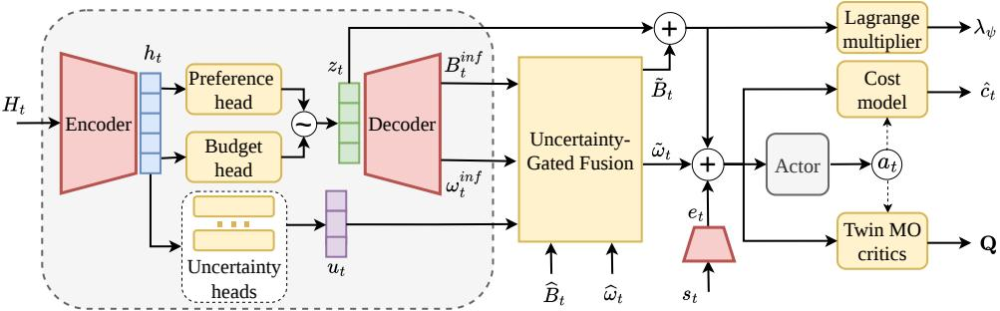
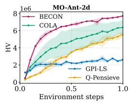
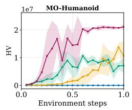
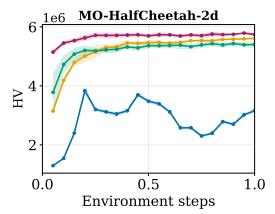
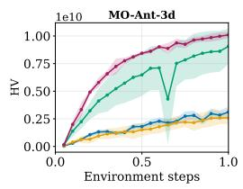
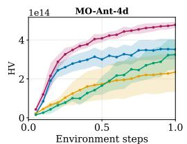
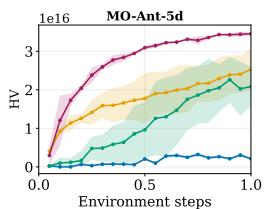
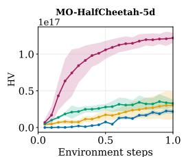
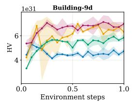

# BECON: Belief-Conditioned Constrained Multi-Objective Reinforcement Learning under Drifting Preferences and Budgets

Bui Trong Duc∗ Huynh Thi Thanh Binh

School of Information and Communications Technology Hanoi University of Science and Technology, Hanoi, Vietnam {ducbt, binhht}@soict.hust.edu.vn

## Abstract

Constrained preference-conditioned MORL typically assumes full task observability, treating preferences and safety budgets as stationary task signals. In real-world deployment, however, these signals are often unreliable proxies: intent may drift, safety tolerances may shift with context, and exposed descriptors may be noisy, delayed, or incomplete. We therefore formulate constrained preference-conditioned MORL as a partially observed task-specification problem, where the agent must navigate a fundamental conflict between unreliable external signals and latent interaction dynamics. We propose BECON, a belief-conditioned framework for constrained MORL with drifting preferences and budgets, which infers latent task context from recent histories to estimate preferences and safety budgets. These estimates are fused with the exposed task signal via uncertainty-dependent gates, enabling the policy to defer to observations under high epistemic uncertainty while correcting them when history is informative. The fused context jointly conditions preference optimization and context-adaptive constraint enforcement. Experiments on diverse multi-objective control tasks demonstrate that BECON consistently improves over state-of-the-art MORL baselines, achieving stronger robustness and constraint satisfaction under task drift.

## 1 Introduction

Real-world decision-making rarely reduces to optimizing a single stationary objective [1, 2]. Autonomous vehicles must balance speed, comfort, energy use, and safety; robotic assistants must trade off task efficiency, user preference, and risk; and resource allocation systems must adapt to evolving utility and feasibility requirements [3–5]. Multi-objective reinforcement learning (MORL) provides a fundamental framework for these settings by modeling returns as objective vectors and resolving trade-offs through preferences [6–8]. To avoid training a separate policy for each trade-off, preference-conditioned MORL learns a single policy that can adapt to different preferences at deploy ment [9, 10]. In parallel, constrained RL and budgeted Markov decision processes (MDPs) address safety and resource requirements by imposing cost constraints during policy optimization [11].

A key limitation of existing paradigms is the direct observability assumption, which regards the runtime task descriptor as a faithful proxy for the underlying objective [12, 13]. In preferenceconditioned MORL, this assumption often manifests by equating the observed preference vector with the intended utility trade-off [14]. In constrained RL, the provided budget is treated as the relevant feasibility threshold, with violations controlled by a global or weakly contextualized Lagrange multiplier [15]. This assumption is fragile in deployed systems, where task descriptors are neither guaranteed to be stationary nor fully reliable. User preferences may drift within an episode as goals and priorities evolve; admissible safety tolerance may depend on recent interaction history, accumulated constraint violations, or context-specific feasibility; and exposed task contexts may be stale, noisy, delayed, or only partially specified [16].

These factors induce a signal-reality gap, in which the runtime descriptor available to the agent may no longer reflect the latent task specification that determines the desired utility trade-off and admissible risk level. An agent that conditions only on this descriptor can therefore optimize stale preferences, miss newly emerging feasibility constraints, or apply safety penalties that are inappropriate for the current context. We therefore consider constrained MORL under task drift as a partially observed task-specification problem, where the hidden context determines both the effective objective trade-off and the admissible cost level. Recent reward and cost patterns provide indirect evidence about this context, but such evidence can be ambiguous, especially over short histories. Thus, the agent must not only infer latent task context from interaction history, but also calibrate how much this inferred context should override or defer to the exposed task signal.

We introduce BECON, a belief-conditioned framework for constrained MORL under drifting task specifications. Rather than assuming that runtime preferences and budgets are directly observable task variables, BECON models them as noisy manifestations of a latent task context. A variational belief over this context is inferred from recent interactions and used to arbitrate, according to uncertainty, between exposed descriptors and history-derived evidence. This design goes beyond standard history conditioning: history is not simply added as extra input, but is used to decide whether the current task signal should be trusted or corrected. The resulting context conditions both multi-objective policy optimization and adaptive constraint enforcement, enabling safety penalties to vary with inferred feasibility rather than remain fixed across deployment conditions.

Our contributions are as follows:

• We formulate constrained MORL with drifting preferences and budgets as a partially observed task-specification problem, where exposed preference and budget signals are unreliable observations of the operative task.

• We develop a belief-conditioned constrained MORL algorithm that infers latent intent and context-dependent feasibility from recent interaction history, and fuses inferred and exposed task signals through uncertainty-dependent arbitration.

• Experiments across diverse constrained MORL benchmarks, supported by ablations and theoretical analysis, show that BECON improves adaptation, preference-aligned performance, and constraint satisfaction under task drift.

## 2 Related Work

MORL addresses sequential decision making with vector-valued returns, where an agent must balance competing objectives rather than optimize a single scalar reward. Linear scalarization remains a standard formulation because this approach reduces MORL to preference-indexed singleobjective control while preserving access to Pareto-optimal solutions under suitable conditions [6]. However, solving a separate policy for each preference is inefficient, motivating preferenceconditioned and universal policy methods that take preferences as inputs and generalize across the preference simplex [9]. Recent advances further improve Pareto-front coverage and controllability by discovering constrained Pareto sets [13], sharing latent knowledge across preferences and enabling preference-controllable optimization [17], and modeling the distribution of multi-objective returns beyond their expectations [18]. A complementary line studies continual MORL and latent preference inference, aiming to improve retention, transfer, or recovery of preference-conditioned behavior from incomplete task information [14, 16]. These works highlight the difficulty of relying solely on explicit preferences, but they do not jointly model preference and budget signals as uncertain runtime observations in constrained MORL. In parallel, constrained and safe RL formalize safety, resource, or risk requirements through budgeted MDPs, and primal-dual or Lagrangian optimization, where constraint satisfaction is typically enforced by cost thresholds or adaptive multipliers [11, 19].Recent progress further sharpens constrained RL through reward-free exploration [20], approachabilitybased constraint satisfaction [21], adaptive resource allocation [22], conservative off-policy learning [23], and constraint-conditioned policy selection under varying safety limits [15, 24]. When safety constraints are coupled with multiple objectives, constrained MORL offers a unified formalism for balancing utility trade-offs against admissible risk [25]. Yet most existing methods still assume that the preference vector and safety budget are available as reliable task variables, rather than noisy observations of a latent decision context. Orthogonal progress in representation learning, nonstationary RL, and in-context RL suggests that hidden task structure can be extracted from temporal prediction [26], bisimulation metrics [27], causal shift representations [28], local regularization for changing environments [29], or recent trajectories as implicit task context [30]. Although these methods show that history can reveal hidden task structure, they do not directly address constrained preference-conditioned MORL under task specification ambiguity, where exposed preferences and budgets are imperfect observations of the latent utility trade-off and admissible safety level. A more detailed discussion is deferred to Appendix A.

## 3 Constrained MORL under Task Drift

We formulate a structured non-stationary variant of constrained multi-objective reinforcement learning. Consider a multi-objective Markov decision process $\mathcal { M } = ( S , \mathcal { A } , P , \bar { \mathbf { r } _ { \gamma } } c , \gamma )$ , where $s$ and A are the state and action spaces, $P ( \mathbf { s } ^ { \prime } \mid \mathbf { s } , \mathbf { a } )$ is the transition kernel, $\mathbf { r } : \mathcal { S } \times \mathcal { A } \stackrel { \because } { \to } \mathbb { R } ^ { K }$ is a vector reward with K objectives, $c : S \times A $ R is a nonnegative stage cost, i.e., $c ( \mathbf { s } , \mathbf { a } ) \geq 0$ , and $\gamma \in [ 0 , 1 )$ is the discount factor [11, 20, 25]. The base environment is fixed, but the task specification may evolve over time and may be only partially observed. This setting isolates task drift from environment drift, so the agent need not relearn the transition dynamics but must infer the current preference and feasibility context from the exposed task signal and recent interaction history.

Let $\Omega : = \{ \omega \in \mathbb { R } ^ { K } \mid \omega _ { i } \geq 0 , \forall i \in \{ 1 , \ldots , K \} , \| \omega \| _ { 1 } = 1 \}$ be the preference space. At time $t ,$ the operative task is ${ \tau } _ { t } = ( \omega _ { t } , B _ { t } )$ , where $\omega _ { t } \in \Omega$ is the current preference vector and $B _ { t } \in B$ is the current cost budget. The preference determines the scalarized reward, while the budget defines the feasible cost level. Given $\mathbf { r } _ { t } = \mathbf { r } ( \mathbf { s } _ { t } , \mathbf { a } _ { t } )$ and $c _ { t } = c ( \mathbf { s } _ { t } , \mathbf { a } _ { t } )$ , the time-varying constrained objective is

$$
\operatorname* { m a x } _ { \pi } \mathbb { E } _ { \pi } \left[ \sum _ { t = 0 } ^ { T - 1 } \gamma ^ { t } \omega _ { t } ^ { \top } \mathbf { r } _ { t } \right] \qquad \mathrm { s . t . } \qquad \mathbb { E } _ { \pi } \left[ c _ { t } \mid \mathbf { s } _ { t } , H _ { t } \right] \leq B _ { t } , \quad \forall t .\tag{1}
$$

where $T$ and $H _ { t }$ denote the finite decision horizon and the recent interaction history available at time t, respectively. This paper uses per-step constraints because safety tolerance may drift with the current task context, making the acceptable instantaneous cost time-varying. Additionally, non-stationarity enters through the task specification, specifically $\tau _ { t } = ( \omega _ { t } , B _ { t } )$ may change over time. Therefore, task drift changes what is desirable or feasible, whereas environment drift would instead change the data-generating process, e.g., $P _ { t } ( \mathbf { s } ^ { \prime } \mid \mathbf { s } , \mathbf { a } ) \neq P _ { t ^ { \prime } } ( \mathbf { s } ^ { \prime } \mid \mathbf { s } , \mathbf { a } )$ , or change the reward and cost functions.

The operative task $\tau _ { t }$ is not assumed to be fully observable. Instead, the agent receives an exposed task signal $\widehat { \tau } _ { t } = ( \widehat { \omega } _ { t } , \widehat { B } _ { t } )$ , where $\widehat { \omega } _ { t }$ and $\widehat { B } _ { t }$ may be noisy, delayed, or incomplete measurements of the operative preference and budget. Therefore, the exposed task signal should be treated as a partial observation of the current decision context rather than as a complete task specification. Since the current state $\mathbf { s } _ { t }$ and exposed task signal $\widehat { \tau } _ { t }$ may not be determined fully, the policy is conditioned on a finite interaction history $H _ { t } = \bar { ( \xi _ { t - L } , \dots , \xi _ { t - 1 } ) }$ , where $L$ is the history length and $\xi _ { t } = \Big \lceil \mathbf { s } _ { t } , \mathbf { a } _ { t } , \mathbf { r } _ { t } , \widehat { \omega } _ { t } , c _ { t } , \widehat { B } _ { t } \Big \rceil$ is the transition feature stored at time t. We instantiate task drift through interpolation as follows $\omega _ { t + 1 } = \Pi _ { \Omega } \big ( ( 1 - \rho _ { \omega } ) \omega _ { t } + \rho _ { \omega } \bar { \omega } _ { t } \big )$ and $B _ { t + 1 } = ( 1 - \rho _ { B } ) B _ { t } + \rho _ { B } \bar { B } _ { t }$ , where $\bar { \omega } _ { t } \sim \nu _ { \omega } , \bar { B } _ { t } \sim \nu _ { B }$ , ΠΩ projects onto the preference simplex, $\nu _ { \omega }$ and $\nu _ { B }$ are sampling distributions for refreshed preferences and budgets, and $\rho _ { \omega } , \rho _ { B } \in [ 0 , 1 ]$ control the drift rates. Under partial task observability, we consider history-conditioned policies of the form $\pi \left( \mathbf { a } _ { t } \mid \mathbf { s } _ { t } , H _ { t } , { \widehat { \omega } } _ { t } , { \widehat { B } } _ { t } \right)$

## 4 BECON Framework

BECON implements the partially observed task-specification formulation through a belief-conditioned constrained actor-critic architecture. At each time step, a state encoder maps $\mathbf { s } _ { t }$ to a latent state representation $\mathbf { e } _ { t } .$ while a history encoder maps recent transition features $H _ { t }$ to a variational belief $\mathbf { z } _ { t }$ over the unobserved task context. Rather than treating the exposed descriptor $( \widehat { \omega } _ { t } , \widehat { B } _ { t } )$ as a groundtruth command, BECON interprets it as a noisy observation and arbitrates between this signal and the history-derived belief according to epistemic uncertainty. The resulting fused context $( \widetilde { \omega } _ { t } , \widetilde { B } _ { t } )$

  
Figure 1: Overview of BECON. A history encoder maps recent transitions $H _ { t }$ to a variational belief $\mathbf { z } _ { t }$ over the latent task context. Uncertainty heads gate the fusion between belief-derived estimates $( \omega _ { t } ^ { \mathrm { i n f } } , B _ { t } ^ { \mathrm { i n f } } )$ and the exposed descriptor $\widehat { \tau } _ { t } = ( \widehat { \omega } _ { t } , \widehat { B } _ { t } )$ . The fused context $( \widetilde { \omega } _ { t } , \widetilde { B } _ { t } )$ conditions the actor, distributional critics, cost model, and context-dependent dual variable for preference-aligned control with adaptive constraint enforcement.

conditions both preference-aligned action selection and adaptive constraint enforcement. Formally, the policy is written as πθ $\begin{array} { r } { \left( \mathbf { a } _ { t } \mid \mathbf { s } _ { t } , H _ { t } , \widehat { \omega } _ { t } , \widehat { B } _ { t } \right) \equiv \pi _ { \theta } \left( \mathbf { a } _ { t } \mid \mathbf { e } _ { t } , \mathbf { z } _ { t } , \widetilde { \omega } _ { t } , \widetilde { B } _ { t } \right) } \end{array}$ . Figure 1 illustrates an overview of the proposed framework.

## 4.1 History-Conditioned Belief and Task Decoding

The current state $\mathbf { s } _ { t }$ and exposed task signal $\widehat { \tau } _ { t } = ( \widehat { \omega } _ { t } , \widehat { B } _ { t } )$ may not identify the operative preference and feasibility context. We therefore encode the recent history $H _ { t }$ into a stochastic latent belief $\mathbf { z } _ { t } \in \mathbb { R } ^ { d _ { z } }$ , where $d _ { z }$ denotes the latent belief dimension. Specifically, a recurrent encoder produces $\mathbf { h } _ { t } = \mathrm { G R U } _ { \phi } ( H _ { t } )$ , followed by two heads $\pmb { \mu } _ { t } = f _ { \phi } ^ { \mu } ( { \bf h } _ { t } )$ and log $\sigma _ { t } ^ { 2 } = f _ { \phi } ^ { \sigma } ( \mathbf { h } _ { t } )$ , where $\boldsymbol { \mu } _ { t } , \boldsymbol { \sigma } _ { t } \in \mathbb { R } ^ { d _ { z } }$ The approximate posterior is $q _ { \phi } ( \mathbf { z } _ { t } \mid H _ { t } ) = \mathcal { N } \left( \mu _ { t } , \Sigma _ { t } \right)$ with $\Sigma _ { t } = \mathrm { D i a g } ( \pmb { \sigma } _ { t } ^ { 2 } )$ . A belief sample is drawn by reparameterization: $\mathbf { z } _ { t } = \pmb { \mu } _ { t } + \pmb { \sigma } _ { t } \odot \pmb { \epsilon } ,$ where ⊙ denotes element-wise multiplication, $\boldsymbol { \epsilon } \sim \mathcal { N } ( \mathbf { 0 } , \mathbf { I } _ { d _ { z } } )$ , and $\mathbf { I } _ { d _ { z } }$ is the $d _ { z } \times d _ { z }$ identity matrix.

The latent belief $\mathbf { z } _ { t }$ is intended to summarize hidden task context, including latent intent and latent feasibility, rather than merely provide an auxiliary representation. To quantify uncertainty in this inference, we use the posterior standard deviation as an aggregate uncertainty measure. Specifically, the scalar belief uncertainty is computed from the posterior standard deviation $\sigma _ { t }$ of $q _ { \phi } ( \mathbf { z } _ { t } \mid H _ { t } )$ . In addition, objective-specific log-variance heads applied to the hidden belief representation produce per-objective uncertainty estimates $\mathbf { u } _ { t } = ( u _ { t , 1 } , \dots , u _ { t , K } )$ . The scalar aggregate uncertainty and the per-objective uncertainty estimates control how strongly BECON trusts inferred task signals.

BECON decodes the belief $\mathbf { z } _ { t }$ into two inferred task estimates: an inferred preference $\omega _ { t } ^ { \mathrm { i n f } } \in \Omega$ and an inferred budget $B _ { t } ^ { \operatorname* { i n f } } \in B$ . Let $\mathbf { q } _ { t } ^ { \omega } = g _ { \omega } ( \mathbf { z } _ { t } ) \in \mathbb { R } ^ { K }$ , and $q _ { t } ^ { B } = g _ { B } ( \mathbf { z } _ { t } ) \in \mathbb { R }$ be the initial decoder outputs. They are mapped to valid task variables by $\begin{array} { r } { \omega _ { t , i } ^ { \mathrm { i n f } } = ( \varphi ( q _ { t , i } ^ { \omega } ) + \varepsilon ) / \sum _ { j = 1 } ^ { K } ( \varphi ( q _ { t , j } ^ { \omega } ) + \varepsilon ) } \end{array}$ and $B _ { t } ^ { \mathrm { i n f } } = \varphi ( q _ { t } ^ { B } )$ , where $\varphi ( x ) = \log ( 1 + \exp ( x ) )$ is a positive activation and $\varepsilon > 0$ is a small constant. $\mathrm { T h u s } , \omega _ { t } ^ { \mathrm { i n f } }$ lies on the preference simplex and $B _ { t } ^ { \operatorname* { i n f } }$ is nonnegative. The decoded preference estimates the current objective trade-off, while the decoded budget estimates the current feasible cost level.

## 4.2 Uncertainty-Gated Task Fusion

BECON uses belief uncertainty to control how much the policy should trust inferred task signals, specifically, between the exposed task signal $\widehat { \tau } _ { t } ~ = ~ ( \widehat { \omega } _ { t } , \widehat { B } _ { t } )$ and the belief-derived estimate $\bar { ( \omega _ { t } ^ { \mathrm { i n f } } } , B _ { t } ^ { \mathrm { i n f } } )$ For nonempty histories, each objective gate is defined as $\begin{array} { r l } { \alpha _ { t , i } } & { { } = } \end{array}$ $\alpha _ { \mathrm { m a x } } \exp ( - u _ { t , i } ) , \alpha _ { \mathrm { m a x } } \in [ 0 , 1 ]$ and $\alpha _ { t , i } ~ = ~ 0$ when $H _ { t }$ is empty. Let $\pmb { \alpha } _ { t } = ( \alpha _ { t , 1 } , \dots , \alpha _ { t , K } )$ The fused preference and budget are

$$
\widetilde { \omega } _ { t } = \Pi _ { \Omega } \left( \left( 1 - \alpha _ { t } \right) \odot \widehat { \omega } _ { t } + \alpha _ { t } \odot \omega _ { t } ^ { \mathrm { i n f } } \right) , \quad \widetilde { B } _ { t } = \left( 1 - \bar { \alpha } _ { t } \right) \widehat { B } _ { t } + \bar { \alpha } _ { t } B _ { t } ^ { \mathrm { i n f } }\tag{2}
$$

where $\Pi _ { \Omega }$ projects onto the preference simplex and $\begin{array} { r } { \bar { \alpha } _ { t } = K ^ { - 1 } \sum _ { i = 1 } ^ { K } \alpha _ { t , i } } \end{array}$ is the average gate. Thus, uncertain beliefs defer to the exposed task signal, while confident beliefs can correct it using historyderived context.

## 4.3 Belief-Conditioned Constrained Actor–Critic

The current state is first mapped to a latent embedding ${ \mathbf e } _ { t } = f _ { \mathrm { e n c } } ( { \mathbf s } _ { t } )$ , which is shared across the actor, critics, and cost model. The actor conditions on $\mathbf { e } _ { t } .$ , the belief $\mathbf { z } _ { t }$ , the fused preference $\widetilde { \omega } _ { t }$ , and the fused budget $\widetilde { B } _ { t } \colon \pi _ { \boldsymbol { \theta } } \big ( \mathbf { a } _ { t } \mid \mathbf { e } _ { t } , \mathbf { z } _ { t } , \widetilde { \omega } _ { t } , \widetilde { B } _ { t } \big )$ . For continuous control, it outputs Gaussian parameters $( \pmb { \mu } _ { t } ^ { \pi } , \log \pmb { \sigma } _ { t } ^ { \pi } ) = f _ { \pi } \left( \mathbf { e } _ { t } , \mathbf { z } _ { t } , \widetilde { \omega } _ { t } , \widetilde { B } _ { t } \right)$ and samples $\tilde { \mathbf { a } } _ { t } = \pmb { \mu } _ { t } ^ { \pi } + \pmb { \sigma } _ { t } ^ { \pi }$ ⊙ ϵ, where $\epsilon \sim \mathcal { N } ( \mathbf { 0 } , \mathbf { I } )$ . The executed action is squashed as $\mathbf { a } _ { t } = \operatorname { t a n h } ( \tilde { \mathbf { a } } _ { t } )$

We use twin multi-objective critics $\mathbf { Q } _ { j } ( \mathbf { e } _ { t } , \mathbf { a } _ { t } , \mathbf { z } _ { t } , \widetilde { \omega } _ { t } , \widetilde { B } _ { t } ) \in \mathbb { R } ^ { K }$ for $j \in \{ 1 , 2 \}$ . The i-th component $Q _ { j , i }$ estimates the value of objective i. Under the fused preference, the scalarized critic is

$$
Q _ { j } ^ { \mathrm { s c a l } } ( \mathbf { s } _ { t } , \mathbf { a } _ { t } ; \widetilde { \omega } _ { t } ) = \sum _ { i = 1 } ^ { K } \widetilde { \omega } _ { t , i } Q _ { j , i } ( \mathbf { e } _ { t } , \mathbf { a } _ { t } , \mathbf { z } _ { t } , \widetilde { \omega } _ { t } , \widetilde { B } _ { t } ) .\tag{3}
$$

In our implementation, each objective value is represented distributionally over atoms $\ z =$ $\left\{ \zeta _ { 1 } , \dots , \zeta _ { N } \right\}$ with $\zeta _ { n } ~ \in ~ [ V _ { \operatorname* { m i n } } , \bar { V } _ { \operatorname* { m a x } } ]$ . If $p _ { j , i , n }$ is the predicted probability of atom $\zeta _ { n } ,$ then $\begin{array} { r } { Q _ { j , i } = \sum _ { n = 1 } ^ { N } p _ { j , i , n } \zeta _ { n } } \end{array}$

The distributional cost model outputs $p _ { \nu } ^ { c }$ , and the predicted one-step cost is its expectation ${ \widehat { c } } _ { t } ( \mathbf { a } _ { t } ) =$ $\mathbb { E } _ { p _ { \nu } ^ { c } } [ c ]$ . Instead of using a single global Lagrange multiplier, which cannot adapt to time-varying feasibility requirements, BECON uses a context-dependent dual variable

$$
\begin{array} { r } { \lambda _ { \psi } ( \widetilde { B } _ { t } , \mathbf { z } _ { t } ) = \varphi \Big ( f _ { \lambda } ( \widetilde { B } _ { t } , \mathbf { z } _ { t } ) \Big ) , } \end{array}\tag{4}
$$

where $\varphi ( x ) = \log ( 1 + \exp ( x ) )$ ) ensures nonnegativity. This allows the safety penalty to vary with the inferred feasibility context. Finally, the state embedding is regularized with a latent transition model $\widehat { \mathbf { e } } _ { t + 1 } = f _ { \mathrm { d y n } } ( \mathbf { e } _ { t } , \mathbf { a } _ { t } )$ , encouraging $\mathbf { e } _ { t }$ to preserve predictive information about future states.

## 4.4 Learning Objectives

All components are trained from mini-batches sampled from the replay buffer D. For each transition, we encode $\mathbf { e } _ { t + 1 } = f _ { \mathrm { e n c } } ( \mathbf { s } _ { t + 1 } )$ and sample the next belief $\mathbf { z } _ { t + 1 } \sim q _ { \phi } ( \mathbf { z } _ { t + 1 } \mid H _ { t + 1 } )$ . The next action is drawn under the stored fused task context $\mathbf { a } _ { t + 1 } ^ { \prime }$ . Then, BECON selects the conservative twin-critic target, and applies the standard distributional Bellman projection onto $\mathcal { Z }$ to obtain $p _ { i } ^ { \mathrm { t a r } }$ for each objective i. The critic loss is $\begin{array} { r } { \mathcal { L } _ { \mathrm { c r i t i c } } = \sum _ { j = 1 } ^ { 2 } \mathbb { E } _ { \mathcal { D } } \left[ \sum _ { i = 1 } ^ { K } \widetilde { \omega } _ { t , i } \mathrm { C E } \left( p _ { i } ^ { \mathrm { t a r } } , p _ { j , i } \right) \right] } \end{array}$ , where $p _ { j , i }$ is the predicted categorical distribution of critic j for objective i. Let $( \widehat { \mathbf { r } } _ { t } ^ { b } , \widehat { c } _ { t } ^ { b } , \widehat { \omega } _ { t } ^ { \mathrm { r e c } } , \widehat { B } _ { t } ^ { \mathrm { r e c } } ) = d _ { \eta } ( \mathbf { e } _ { t } , \mathbf { a } _ { t } , \mathbf { z } _ { t } )$ denote auxiliary prediction heads from the belief representation, where $\widehat { \mathbf { r } } _ { t } ^ { b }$ and $\widehat { c } _ { t } ^ { b }$ predict the observed reward vector and cost, and $( \widehat { \omega } _ { t } ^ { \mathrm { r e c } } , \widehat { B } _ { t } ^ { \mathrm { r e c } } )$ reconstruct the exposed task descriptor. The belief objective is $\begin{array} { r } { \mathcal { L } _ { \mathrm { b e l i e f } } = \lambda _ { \mathrm { p r e d } } \mathbb { E } _ { \mathcal { D } } \left[ \left\| \widehat { \mathbf { r } } _ { t } ^ { b } - \mathbf { r } _ { t } \right\| _ { 2 } ^ { 2 } + \left( \widehat { c } _ { t } ^ { b } - c _ { t } \right) ^ { 2 } \right] + \lambda _ { \mathrm { o b s } } \mathbb { E } _ { \mathcal { D } } \left[ \| \widehat { \omega } _ { t } ^ { \mathrm { r e c } } - \widehat { \omega } _ { t } \| _ { 2 } ^ { 2 } + \left( \widehat { B } _ { t } ^ { \mathrm { r e c } } - \widehat { B } _ { t } \right) ^ { 2 } \right] + \lambda _ { \mathrm { o b s } } \mathbb { E } _ { \widehat { D } } \left[ \| \widehat { \omega } _ { t } ^ { \mathrm { r e c } } - \widehat { \omega } _ { t } \| _ { 2 } ^ { 2 } \right] . } \end{array}$ $\beta _ { \mathrm { K L } } \mathbb { E } _ { \mathcal { D } } \left[ \mathrm { K L } \left( q _ { \phi } ( \mathbf { z } _ { t } \mid H _ { t } ) \parallel \mathcal { N } ( \mathbf { 0 } , \mathbf { I } _ { d _ { z } } ) \right) \right]$ . The dynamics and cost losses regularize the state embedding and train the distributional cost model

$$
\begin{array} { r } { \mathcal { L } _ { \mathrm { d y n } } = \mathbb { E } _ { \mathcal { D } } \left[ \left| \left| f _ { \mathrm { d y n } } ( \mathbf { e } _ { t } , \mathbf { a } _ { t } ) - \mathbf { e } _ { t + 1 } ^ { - } \right| \right| _ { 2 } ^ { 2 } \right] , \quad \mathcal { L } _ { \mathrm { c o s t } } = \mathbb { E } _ { \mathcal { D } } \left[ \mathrm { C E } \left( p _ { t } ^ { c , \mathrm { t a r } } , p _ { t } ^ { c } \right) \right] , } \end{array}\tag{5}
$$

where $\mathbf { e } _ { t + 1 } ^ { - }$ is a stop-gradient target and $p _ { t } ^ { c , \mathrm { t a r } }$ is obtained by projecting the observed cost $c _ { t }$ . The actor minimizes an entropy-regularized constrained objective under the fused task context

$$
\mathcal { L } _ { \mathrm { a c t o r } } = \mathbb { E } _ { \mathcal { D } } \left[ \alpha _ { H } \log \pi _ { \theta } ( \mathbf { a } _ { t } \mid \cdot ) - \operatorname* { m i n } _ { j \in \{ 1 , 2 \} } Q _ { j } ^ { \mathrm { s c a l } } \left( \mathbf { s } _ { t } , \mathbf { a } _ { t } ; \widetilde { \boldsymbol { \omega } } _ { t } \right) + \kappa _ { t } \lambda _ { \psi } \big ( \widetilde { B } _ { t } , \mathbf { z } _ { t } \big ) \left[ \widehat { c } _ { t } ( \mathbf { a } _ { t } ) - \widetilde { B } _ { t } \right] _ { + } \right] ,\tag{6}
$$

where $\widehat { c } _ { t } ( \mathbf { a } _ { t } ) = \mathbb { E } _ { p _ { t } ^ { c } } [ c ]$ is the expected cost from the distributional cost model, $\kappa _ { t } \in [ 0 , 1 ]$ is the constraint warm-up coefficient. The context-dependent dual variable is updated by minimizing $\mathcal { L } _ { \lambda } = - \mathbb { E } _ { \mathcal { D } } \left[ \lambda _ { \psi } \big ( \widetilde { B } _ { t } , \mathbf { z } _ { t } \big ) \left( \widehat { c } _ { t } ( \mathbf { a } _ { t } ) - \widetilde { B } _ { t } \right) \right]$ . Since $\lambda _ { \psi }$ is nonnegative, this update increases the penalty when the predicted cost exceeds the fused budget and relaxes it otherwise. The auxiliary and valuelearning objectives are optimized jointly as ${ \mathcal { L } } _ { \mathrm { m a i n } } = { \mathcal { L } } _ { \mathrm { c r i t i c } } + \lambda _ { \mathrm { b e l i e f } } { \mathcal { L } } _ { \mathrm { b e l i e f } } + \lambda _ { \mathrm { d y n } } { \mathcal { L } } _ { \mathrm { d y n } } + \lambda _ { \mathrm { c o s t } } { \mathcal { L } } _ { \mathrm { c o s t } } .$ Each iteration updates $\dot { \mathcal { L } } _ { \mathrm { m a i n } } , \mathcal { L } _ { \mathrm { a c t o r } } ^ { \mathrm { ~ ~ } } .$ , and $\mathcal { L } _ { \lambda }$ , followed by soft target-network updates.

## 5 Theoretical Analysis

Let $x _ { t } = ( \mathbf { s } _ { t } , H _ { t } , \widehat { \tau } _ { t } )$ be the observable decision context, where $\widehat { \tau } _ { t } = ( \widehat { \omega } _ { t } , \widehat { B } _ { t } )$ . BECON produces the fused task estimate $\widetilde { \tau } _ { t } = ( \widetilde { \omega } _ { t } , \widetilde { B } _ { t } )$ , where $\widetilde { B } _ { t }$ represents the fused instantaneous admissible cost level. For a policy conditioned on this fused context, define $\bar { c } _ { \pi , t } : = \mathbb { E } _ { a \sim \pi ( \cdot | x _ { t } , \widetilde { \tau } _ { t } ) } [ c ( \mathbf { s } _ { t } , a ) ]$ and $\widehat { c } _ { \pi , t } : = \mathbb { E } _ { a \sim \pi ( \cdot | x _ { t } , \widetilde { \tau } _ { t } ) } \left[ \mathbb { E } _ { p _ { \nu } ^ { c } ( \cdot | x _ { t } , a ) } [ c ] \right]$ as the true and model-predicted one-step costs, where $p _ { \nu } ^ { c }$ is the distributional cost model parameterized by $\nu .$ The resulting perturbation terms are as follows

$$
\begin{array} { r } { \delta _ { t } ^ { \omega } = \| \widetilde { \omega } _ { t } - \omega _ { t } \| _ { 2 } , \qquad \delta _ { t } ^ { B } = \left| \widetilde { B } _ { t } - B _ { t } \right| , \qquad \epsilon _ { t } ^ { c } ( \pi ) = \left| \widehat { c } _ { \pi , t } - \bar { c } _ { \pi , t } \right| . } \end{array}\tag{7}
$$

Assumption 1. For all state-action pairs $( \mathbf { s } , \mathbf { a } ) , \| \mathbf { r } ( \mathbf { s } , \mathbf { a } ) \| _ { 2 } \leq R _ { 2 }$ and $0 \leq c ( \mathbf { s } , \mathbf { a } ) \leq C _ { \operatorname* { m a x } } .$ . The context-dependent dual penalty is parameterized or clipped so that it is uniformly bounded as $0 \leq \lambda _ { \psi } ( \widetilde { B } _ { t } , \mathbf { z } _ { t } ) \leq \Lambda$

Proposition 1. Assume that $\Pi _ { \Omega }$ is the Euclidean projection onto the preference simplex and that $0 \leq \alpha _ { t , i } \leq 1$ for all objectives. The inferred budget is parameterized as $B _ { t } ^ { \mathrm { i n f } } = \varphi ( { \boldsymbol { g } } _ { B } ( \mathbf { z } _ { t } ) )$ with $\varphi ( x ) = \log ( 1 + \exp ( x ) )$ , and the exposed budget $\widehat { B } _ { t }$ is clipped to be nonnegative. Define $\alpha _ { t } ^ { - } =$ mi $\mathbf { \sigma } _ { 1 _ { i } } \{ \alpha _ { t , i } \}$ and $\alpha _ { t } ^ { + } =$ maxi{αt,i}. Let $\alpha _ { t } ^ { B } \in [ 0 , 1 ]$ denote the budget gate; in our implementation, $\begin{array} { r } { \alpha _ { t } ^ { B } = \bar { \alpha } _ { t } = K ^ { - 1 } \sum _ { i = 1 } ^ { K } { \alpha _ { t , i } } , } \end{array}$ . Then $\widetilde { \omega } _ { t } \in \Omega$ and $\widetilde { B } _ { t } \geq 0$ . Moreover,

$$
\begin{array} { r } { \delta _ { t } ^ { \omega } \leq ( 1 - \alpha _ { t } ^ { - } ) \left\| \widehat { \omega } _ { t } - \omega _ { t } \right\| _ { 2 } + \alpha _ { t } ^ { + } \left\| \omega _ { t } ^ { \mathrm { i n f } } - \omega _ { t } \right\| _ { 2 } , \delta _ { t } ^ { B } \leq ( 1 - \alpha _ { t } ^ { B } ) \left| \widehat { B } _ { t } - B _ { t } \right| + \alpha _ { t } ^ { B } \left| B _ { t } ^ { \mathrm { i n f } } - B _ { t } \right| . } \end{array}\tag{8}
$$

Proposition 1 captures the intended arbitration behavior of BECON: uncertain beliefs are downweighted in favor of the exposed descriptor, while confident and accurate beliefs can override stale or noisy task signals. We next connect this local fusion property to control performance, demonstrating that both preference loss and instantaneous safety violation are controlled by three errors explicitly targeted by the method: preference-fusion error, budget-fusion error, and cost-model error. Define the true instantaneous-penalized performance and its fused model-based counterpart as follows

$$
\mathcal { G } _ { \tau _ { 0 : T - 1 } } ( \boldsymbol { \pi } ) : = \mathbb { E } _ { \boldsymbol { \pi } , \boldsymbol { \tilde { \tau } } } \left[ \sum _ { t = 0 } ^ { T - 1 } \gamma ^ { t } \left\{ \omega _ { t } ^ { \top } \mathbf { r } _ { t } - \lambda _ { \psi } ( \widetilde { B } _ { t } , \mathbf { z } _ { t } ) \left[ \bar { c } _ { \boldsymbol { \pi } , t } - B _ { t } \right] _ { + } \right\} \right] ,\tag{9}
$$

$$
\widehat { \mathcal { G } } _ { \widetilde { \tau } _ { 0 : T - 1 } } ( \pi ) : = \mathbb { E } _ { \pi , \widetilde { \tau } } \left[ \sum _ { t = 0 } ^ { T - 1 } \gamma ^ { t } \left\{ \widetilde { \omega } _ { t } ^ { \top } \mathbf { r } _ { t } - \lambda _ { \psi } \big ( \widetilde { B } _ { t } , \mathbf { z } _ { t } \big ) \left[ \widehat { c } _ { \pi , t } - \widetilde { B } _ { t } \right] _ { + } \right\} \right] .\tag{10}
$$

Here, $[ x ] _ { + } = \operatorname* { m a x } ( x , 0 )$ denotes the positive-part operator. Thus, $[ \widehat { c } _ { \pi , t } - \widetilde { B } _ { t } ] .$ measures the predicted instantaneous constraint violation: it is zero when the predicted one-step cost is below the fused admissible cost level, and increases only when the predicted cost exceeds $\widetilde { B } _ { t }$

Theorem 1. Under Assumption 1,for any history-conditioned policy π, the gap between the true instantaneous-penalized performance and thefused model-based performance is bounded by

$$
\left| \mathcal { G } _ { \tau _ { 0 : T - 1 } } ( \tau ) - \widehat { \mathcal { G } } _ { \widetilde { \tau } _ { 0 : T - 1 } } ( \pi ) \right| \leq \sum _ { t = 0 } ^ { T - 1 } \gamma ^ { t } \mathbb { E } _ { \pi , \widetilde { \tau } } \left[ R _ { 2 } \delta _ { t } ^ { \omega } + \Lambda \left( \epsilon _ { t } ^ { c } ( \pi ) + \delta _ { t } ^ { B } \right) \right] .\tag{11}
$$

Furthermore, let Π be a comparator policy class and suppose that $\widetilde { \pi } \in$ Π is $\epsilon _ { \mathrm { o p t } }$ t-optimal for the fused model-based objective, namely $\widehat { \mathcal { G } } _ { \widetilde { \tau } _ { 0 : T - 1 } } ( \widetilde { \pi } ) \geq \operatorname* { s u p } _ { \pi \in \Pi } \widehat { \mathcal { G } } _ { \widetilde { \tau } _ { 0 : T - 1 } } ( \pi ) - \epsilon _ { \mathrm { o p t } } .$ . Ifthe perturbation terms are uniformly bounded in expectation over $\Pi , i . e . , \check { \forall } \pi \in \Pi , \forall t , \mathbb { E } _ { \pi , \widetilde { \tau } } \big [ \bar { \delta _ { t } ^ { \omega } } \big ] \leq \bar { \delta } _ { t } ^ { \omega } , \mathbb { E } _ { \pi , \widetilde { \tau } } \big [ \delta _ { t } ^ { B } \big ] \leq$ $\bar { \delta } _ { t } ^ { B } , \mathbb { E } _ { \pi , \widetilde { \tau } } \left[ \epsilon _ { t } ^ { c } ( \pi ) \right] \leq \bar { \epsilon } _ { t } ^ { c }$ , then the true suboptimality of πe satisfies

$$
\operatorname* { s u p } _ { \pi \in \Pi } \left\{ \mathcal { G } _ { \tau _ { 0 : T - 1 } } ( \pi ) \right\} - \mathcal { G } _ { \tau _ { 0 : T - 1 } } ( \widetilde { \pi } ) \leq \epsilon _ { \mathrm { o p t } } + 2 \sum _ { t = 0 } ^ { T - 1 } \gamma ^ { t } \left[ R _ { 2 } \bar { \delta } _ { t } ^ { \omega } + \Lambda \left( \bar { \epsilon } _ { t } ^ { c } + \bar { \delta } _ { t } ^ { B } \right) \right] .\tag{12}
$$

Theorem 1 indicates that partial task observability affects performance only through fused-context errors. Preference mismatch drives reward loss, while cost-model and budget-fusion errors govern instantaneous safety degradation. This matches BECON, which uses self-supervised belief inference, uncertainty-gated fusion, and context-dependent dual penalties to reduce the observable proxies of these errors under partial task observability.

Assumption 2. For afixed latent task ${ \boldsymbol { \tau } } = ( \omega , B )$ , the observable history distribution induced by $H _ { t }$ is informative enough to identify the task context up to statistical error. Specifically, there exist beliefdecoders $d _ { \omega }$ and $d _ { B }$ such that, when trainedfrom observable prediction losses, theirfixed-task estimation errors satisfy $\mathbb { E } \left[ \| d _ { \omega } ( \mathbf { z } _ { t } ) - \omega _ { t } \| _ { 2 } \right] \leq \check { A _ { \omega } } L ^ { - 1 / 2 }$ and $\mathbb { E } \left[ \lvert \dot { d } _ { B } ( \mathbf { z } _ { t } ) - B _ { t } \rvert \right] \leq A _ { B } L ^ { \frac { s } { - 1 / 2 } }$

Theorem 2. Assume that the drift targets satisfy $\bar { \omega } _ { t } \in \Omega$ and $B _ { t } , \bar { B } _ { t } \in \mathsf { \Gamma } [ B _ { \mathrm { m i n } } , B _ { \mathrm { m a x } } ]$ , and let $D _ { B } = B _ { \mathrm { m a x } } - B _ { \mathrm { m i n } }$ . Then, under task drift,

$$
\mathbb { E } \left[ \left. \omega _ { t } ^ { \mathrm { i n f } } - \omega _ { t } \right. _ { 2 } \right] \leq A _ { \omega } L ^ { - 1 / 2 } + \frac { L + 1 } { 2 } \sqrt { 2 } \rho _ { \omega } , \mathbb { E } \left[ \left. B _ { t } ^ { \mathrm { i n f } } - B _ { t } \right. \right] \leq A _ { B } L ^ { - 1 / 2 } + \frac { L + 1 } { 2 } D _ { B } \rho _ { B } .\tag{13}
$$

Consequently, up to constants, the preference-optimal history length satisfies $L _ { \omega } ^ { \star } \asymp ( A _ { \omega } / \rho _ { \omega } ) ^ { 2 / 3 }$ and min $\begin{array} { r l } { \underline { { \cdot } } \mathbb { E } \left[ \left\| \omega _ { t } ^ { \operatorname* { i n f } } - \omega _ { t } \right\| _ { 2 } \right] } & { = \ O \left( A _ { \omega } ^ { 2 / 3 } \rho _ { \omega } ^ { 1 / 3 } \right) } \end{array}$ , with the analogous budget scaling $L _ { B } ^ { \star } \ \asymp$ $( A _ { B } / ( D _ { B } \rho _ { B } ) ) ^ { 2 / 3 }$

Theorem 2 highlights a bias-variance trade-off in history-based inference. Longer histories reduce statistical uncertainty but increase staleness bias under task drift. This motivates uncertainty-gated fusion, which downweights inferred task estimates when the history-derived belief is unreliable.

## 6 Experiments

## 6.1 Experimental Setting

Benchmarks. We evaluate BECON on a diverse set of continuous and discrete MORL benchmarks. The continuous dataset includes MuJoCo robotic-control tasks, including Ant, HalfCheetah, and Humanoid, and the Building energy-control task, which involves up to nine objectives [10, 13]. The discrete suite includes Minecart and MO-LunarLander [13]. Detailed benchmark descriptions are provided in Appendix D.

Baselines. BECON is compared against several state-of-the-art MORL baselines, including GPI-LS [31], C-MORL [13], Q-Pensieve [32], and COLA [10]. For each baseline, we use the official implementation when available, tune its hyperparameters, and report the best validated setting. All methods are trained for 1 million environment steps, with performance reported as mean ± standard deviation over 5 independent runs. It is noted that GPI-LS supports both discrete and continuous control, while the other baselines are designed mainly for continuous-control MORL. Additional implementation details are given in Appendix E.

Metrics. We evaluate all methods in both static and drift settings. In the static setting, preferences and budgets are fixed, and performance is measured by feasible-front quality. Let $\mathcal { P }$ denote the feasible Pareto front, containing only return vectors that satisfy the cost threshold.

• Feasible Hypervolume (FHV) [10] measures the dominated volume covered by feasible Pareto solutions with respect to a reference point $\mathbf { r } ^ { \mathrm { r e f } } \in \mathbb { R } ^ { K }$ $\mathrm { F H V } = \mathrm { H V } ( \bar { \mathcal { P } } ; \mathbf { r } ^ { \mathrm { r e f } } ) =$ $\begin{array} { r } { \lambda _ { K } \left( \bigcup _ { \mathbf { R } \in \mathcal { P } } \prod _ { k = 1 } ^ { K } [ r _ { k } ^ { \mathrm { r e f } } , R _ { k } ] \right) } \end{array}$ , where $\lambda _ { K } ( \cdot )$ denotes the K-dimensional Lebesgue measure.

• Feasible Utility (FUT) [10] evaluates the best feasible scalarized return under evaluation preferences $\begin{array} { r } { \Omega _ { \mathrm { e v a l } } = \{ \omega _ { j } \} _ { j = 1 } ^ { M } \subset \Omega : \mathrm { F U T } = \frac { 1 } { M } \sum _ { j = 1 } ^ { M } } \end{array}$ maxR∈P ω⊤j R.

In the drift setting, preferences and budgets vary during evaluation, so we evaluate online performance against the current task variables. For episode $e \in \{ 1 , \ldots , E \}$ and timestep $t \in \{ 0 , \ldots \bar { , } T _ { e } - 1 \}$ , let $\omega _ { e , t } \in \Omega$ denote the current hidden preference, $B _ { e , t }$ the current budget, $\mathbf { r } _ { e , t }$ the reward vector, and $c _ { e , t }$ the realized cost.

Table 1: Reference-threshold feasible-front evaluation of BECON against MORL baselines
<table><tr><td>Dataset</td><td>Metric</td><td>GPI-LS</td><td>C-MORL</td><td>Q-Pensieve</td><td>COLA</td><td>BECON (ours)</td></tr><tr><td rowspan="3"> $\mathrm { M O - A n t - } 2 \mathrm { d }$ </td><td> $\mathrm { F H V } ( \times 1 0 ^ { 6 } )$ </td><td> $2 . 6 1 \pm 0 . 2 3$ </td><td> $0 . 2 5 \pm 0 . 0 1$ </td><td> $5 . 5 6 \pm 0 . 3 4$ </td><td> $6 . 3 7 \pm 0 . 8 9$ </td><td> ${ \bf 7 . 7 1 \pm 0 . 1 0 }$ </td></tr><tr><td> $\mathrm { F U T } \left( \times \mathrm { 1 0 ^ { 3 } } \right)$ </td><td> $1 . 9 9 \pm 0 . 0 5$ </td><td> $0 . 5 0 \pm 0 . 0 1$ </td><td> $2 . 2 1 \pm 0 . 0 7$ </td><td> $2 . 3 5 \pm 0 . 1 4$ </td><td> ${ \bf 2 . 5 7 \pm 0 . 0 2 }$ </td></tr><tr><td> $\mathbf { M C } \left( \times 1 0 ^ { - 3 } \right)$ </td><td> $1 . 9 1 \pm 0 . 1 0$ </td><td> ${ \bf 0 . 0 7 \pm 0 . 0 5 }$ </td><td> $2 . 6 6 \pm 0 . 1 7$ </td><td> $2 . 6 0 \pm 0 . 8 1$ </td><td> $1 . 3 9 \pm 0 . 0 6$ </td></tr><tr><td rowspan="3">MO-HalfCheetah-2d</td><td> $\mathrm { F H V } ( \times 1 0 ^ { 6 } )$ </td><td> $3 . 1 6 \pm 0 . 0 5$ </td><td> $1 . 2 5 \pm 0 . 0 0$ </td><td> $5 . 6 1 \pm 0 . 0 4$ </td><td> $5 . 4 0 \pm 0 . 1 2$ </td><td> ${ \bf 5 . 7 4 \pm 0 . 0 6 }$ </td></tr><tr><td> $\mathrm { F U T } \left( \times \mathrm { 1 0 ^ { 3 } } \right)$ </td><td> $2 . 2 5 \pm 0 . 0 2$ </td><td> $1 . 5 0 \pm 0 . 0 0$ </td><td> $2 . 2 8 \pm 0 . 0 4$ </td><td> $2 . 2 4 \pm 0 . 0 4$ </td><td> ${ \bf 2 . 3 5 \pm 0 . 0 0 }$ </td></tr><tr><td> $\mathbf { M C } \left( \times 1 0 ^ { - 3 } \right)$ </td><td> $0 . 5 9 \pm 0 . 0 4$ </td><td> $\mathbf { 0 . 0 1 \pm 0 . 0 0 }$ </td><td> $1 . 4 9 \pm 0 . 2 6$ </td><td> $1 . 9 9 \pm 0 . 1 8$ </td><td> $0 . 7 8 \pm 0 . 0 1$ </td></tr><tr><td rowspan="3">MO-Hopper-2d</td><td> $\mathrm { F H V } ( \times 1 0 ^ { 7 } )$ </td><td> $0 . 0 0 \pm 0 . 0 0$ </td><td> $0 . 1 3 \pm 0 . 1 1$ </td><td> $0 . 2 4 \pm 0 . 0 1$ </td><td> $0 . 0 0 \pm 0 . 0 0$ </td><td> ${ \bf 1 . 2 0 \pm 0 . 1 6 }$ </td></tr><tr><td> $\mathrm { F U T } ( \times 1 0 ^ { 3 } )$ </td><td> $0 . 0 0 \pm 0 . 0 0$ </td><td> $0 . 9 7 \pm 0 . 7 4$ </td><td> $1 . 4 8 \pm 0 . 0 2$ </td><td> $0 . 0 0 \pm 0 . 0 0$ </td><td> ${ \bf 3 . 3 7 \pm 0 . 2 1 }$ </td></tr><tr><td> $\mathbf { M C } _ { } ( \times 1 0 ^ { - 2 } )$ </td><td> $1 . 8 5 \pm 0 . 1 2$ </td><td> ${ \bf 0 . 1 9 \pm 0 . 1 6 }$ </td><td> $0 . 4 6 \pm 0 . 0 4$ </td><td> $1 . 5 7 \pm 0 . 1 0$ </td><td> $0 . 7 2 \pm 0 . 0 8$ </td></tr><tr><td rowspan="3">MO-Humanoid</td><td> $\mathrm { F H V } ( \times 1 0 ^ { 7 } )$ </td><td> $0 . 0 0 \pm 0 . 0 0$ </td><td> $0 . 0 1 \pm 0 . 0 0$ </td><td> $1 . 0 6 \pm 0 . 5 1$ </td><td> $0 . 7 1 \pm 0 . 2 7$ </td><td> ${ \bf 2 . 1 1 \pm 0 . 0 9 }$ </td></tr><tr><td> $\mathrm { F U T } ( \times 1 0 ^ { 3 } )$ </td><td> $0 . 0 0 \pm 0 . 0 0$ </td><td> $0 . 3 0 \pm 0 . 0 5$ </td><td> $3 . 1 4 \pm 0 . 7 9$ </td><td> $2 . 7 4 \pm 0 . 4 8$ </td><td> ${ \bf 4 . 6 9 \pm 0 . 0 7 }$ </td></tr><tr><td> $\mathbf { M C } \left( \times 1 0 ^ { - 3 } \right)$ </td><td> $1 . 6 0 \pm 0 . 0 9$ </td><td> $\mathbf { 0 . 0 4 \pm 0 . 0 0 }$ </td><td> $0 . 5 9 \pm 0 . 0 2$ </td><td> $0 . 7 7 \pm 0 . 0 4$ </td><td> $0 . 0 7 \pm 0 . 0 2$ </td></tr><tr><td rowspan="3">MO-Ant-3d</td><td> $\mathrm { F H V } ( \times 1 0 ^ { 1 0 } )$ </td><td> $0 . 3 1 \pm 0 . 0 3$ </td><td> $0 . 0 0 \pm 0 . 0 0$ </td><td> $0 . 2 6 \pm 0 . 0 6$ </td><td> $0 . 9 1 \pm 0 . 1 6$ </td><td> ${ \bf 1 . 0 1 \pm 0 . 0 3 }$ </td></tr><tr><td> $\mathrm { F U T } ( \times 1 0 ^ { 3 } )$ </td><td> $1 . 5 5 \pm 0 . 0 1$ </td><td> $0 . 6 9 \pm 0 . 0 1$ </td><td> $1 . 2 9 \pm 0 . 0 8$ </td><td> $2 . 0 0 \pm 0 . 0 8$ </td><td> ${ \bf 2 . 0 5 \pm 0 . 0 1 }$ </td></tr><tr><td> $\mathbf { M C } \left( \times 1 0 ^ { - 3 } \right)$ </td><td> $3 . 2 2 \pm 0 . 2 7$ </td><td> $\mathbf { 0 . 0 6 \pm 0 . 0 1 }$ </td><td> $3 . 6 2 \pm 0 . 1 0$ </td><td> $3 . 4 7 \pm 1 . 0 8$ </td><td> $1 . 4 4 \pm 0 . 0 8$ </td></tr><tr><td rowspan="3"> $\mathbf { M O - A n t { - } } 4 \mathrm { d }$ </td><td> $\mathrm { F H V } ( \times 1 0 ^ { 1 4 } )$ </td><td> $3 . 5 2 \pm 0 . 5 1$ </td><td> $0 . 1 7 \pm 0 . 0 0$ </td><td> $2 . 3 5 \pm 1 . 0 1$ </td><td> $3 . 2 5 \pm 0 . 7 8$ </td><td> ${ \bf 4 . 7 8 \pm 0 . 1 5 }$ </td></tr><tr><td> $\mathrm { F U T } ( \times 1 0 ^ { 3 } )$ </td><td> $4 . 3 2 \pm 0 . 3 3$ </td><td> $2 . 0 3 \pm 0 . 0 1$ </td><td> $3 . 7 9 \pm 0 . 4 5$ </td><td> $4 . 2 1 \pm 0 . 2 7$ </td><td> ${ \bf 4 . 6 5 \pm 0 . 0 4 }$ </td></tr><tr><td> $\mathbf { M C } \left( \times 1 0 ^ { - 3 } \right)$ </td><td> $1 . 5 6 \pm 0 . 2 3$ </td><td> ${ \bf 0 . 0 8 \pm 0 . 0 5 }$ </td><td> $2 . 7 3 \pm 0 . 2 1$ </td><td> $3 . 2 2 \pm 1 . 0 4$ </td><td> $1 . 6 4 \pm 0 . 1 4$ </td></tr><tr><td rowspan="3">MO-Ant-5d</td><td> $\mathrm { F H V } ( \times 1 0 ^ { 1 6 } )$ </td><td> $0 . 2 1 \pm 0 . 0 5$ </td><td> $0 . 1 1 \pm 0 . 0 2$ </td><td> $2 . 5 3 \pm 0 . 5 4$ </td><td> $2 . 0 8 \pm 0 . 5 1$ </td><td> ${ \bf 3 . 4 5 \pm 0 . 0 4 }$ </td></tr><tr><td> $\mathrm { F U T } ( \times 1 0 ^ { 3 } )$ </td><td> $1 . 8 7 \pm 0 . 0 9$ </td><td> $1 . 6 1 \pm 0 . 0 0$ </td><td> $1 . 9 1 \pm 0 . 0 9$ </td><td> $1 . 8 6 \pm 0 . 1 0$ </td><td> ${ \bf 2 . 0 4 \pm 0 . 0 1 }$ </td></tr><tr><td> $\mathbf { M C } \left( \times 1 0 ^ { - 3 } \right)$ </td><td> $1 . 0 9 \pm 0 . 1 3$ </td><td> ${ \bf 0 . 0 7 \pm 0 . 0 2 }$ </td><td> $1 . 1 9 \pm 0 . 1 4$ </td><td> $1 . 1 1 \pm 0 . 4 5$ </td><td> $0 . 4 2 \pm 0 . 0 2$ </td></tr><tr><td rowspan="3">MO-HalfCheetah-5d</td><td> $\mathrm { F H V } ( \times 1 0 ^ { 1 7 } )$ </td><td> $0 . 2 2 \pm 0 . 0 0$ </td><td> $0 . 0 1 \pm 0 . 0 2$ </td><td> $0 . 3 0 \pm 0 . 1 9$ </td><td> $0 . 3 3 \pm 0 . 0 5$ </td><td> ${ \bf 1 . 2 2 \pm 0 . 0 7 }$ </td></tr><tr><td> $\mathrm { F U T } ( \times 1 0 ^ { 3 } )$ </td><td> $2 . 2 9 \pm 0 . 0 5$ </td><td> $1 . 5 7 \pm 0 . 0 4$ </td><td> $2 . 1 2 \pm 0 . 2 6$ </td><td> $2 . 5 9 \pm 0 . 0 8$ </td><td> ${ \bf 2 . 9 3 \pm 0 . 0 7 }$ </td></tr><tr><td> $\mathbf { M C } \left( \times 1 0 ^ { - 3 } \right)$ </td><td> $2 . 9 3 \pm 0 . 2 5$ </td><td> $2 . 4 6 \pm 0 . 6 8$ </td><td> $2 . 9 6 \pm 0 . 5 6$ </td><td> $3 . 8 1 \pm 0 . 9 4$ </td><td> ${ \bf 1 . 6 6 \pm 0 . 0 3 }$ </td></tr><tr><td rowspan="3">Building-9d</td><td> $\mathrm { F H V } ( \times 1 0 ^ { 3 1 } )$ </td><td> $4 . 5 2 \pm 0 . 1 1$ </td><td> $5 . 0 2 \pm 0 . 5 7$ </td><td> $6 . 3 2 \pm 0 . 5 7$ </td><td> $5 . 8 4 \pm 0 . 2 7$ </td><td> ${ \bf 6 . 9 8 \pm 0 . 1 5 }$ </td></tr><tr><td> $\mathrm { F U T } ( \times 1 0 ^ { 3 } )$ </td><td> $3 . 3 3 \pm 0 . 0 2$ </td><td> $3 . 3 6 \pm 0 . 0 3$ </td><td> $3 . 4 2 \pm 0 . 0 3$ </td><td> $3 . 3 9 \pm 0 . 0 2$ </td><td> ${ \bf 3 . 4 5 \pm 0 . 0 1 }$ </td></tr><tr><td> $\mathbf { M C } \left( \times 1 0 ^ { - 3 } \right)$ </td><td> $2 . 9 6 \pm 0 . 2 1$ </td><td> ${ \bf 0 . 0 9 \pm 0 . 1 2 }$ </td><td> $6 . 2 9 \pm 0 . 3 0$ </td><td> $5 . 4 4 \pm 0 . 1 7$ </td><td> $0 . 5 4 \pm 0 . 2 8$ </td></tr></table>

• Scalarized Return (SR) [33] measures average online scalarized performance: $\mathrm { S R = }$ $\begin{array} { r } { \frac { 1 } { E } \sum _ { e = 1 } ^ { E } \frac { 1 } { T _ { e } } \sum _ { t = 0 } ^ { T _ { e } - 1 } \omega _ { e , t } ^ { \top } \mathbf { r } _ { e , t } . } \end{array}$  
• Post-Change Utility (PCU) [34] measures utility during the adaptation window after preference or budget changes: $\begin{array} { r } { \mathrm { P C U } = \frac { 1 } { E } \sum _ { e = 1 } ^ { E } \frac { 1 } { \operatorname* { m a x } ( | \mathcal { A } _ { e } | , 1 ) } \sum _ { t \in \mathcal { A } _ { e } } \omega _ { e , t } ^ { \top } \mathbf { r } _ { e , t } } \end{array}$ , where $A _ { e }$ denotes the post-change adaptation window.  
Additionally, we utilize Mean Cost (MC) and Violation Rate (VR) to monitor constraint satisfaction.

## 6.2 Experimental Results

Table 1 demonstrates reference-threshold feasible-front performance under static preferences and budgets. It is noted that if no solution satisfies the cost threshold, the feasible front is empty and both FHV and FUT are set to zero. BECON achieves the best FHV and FUT on all benchmark tasks, indicating that the proposed belief-conditioned constraint handling improves both feasiblefront coverage and preference-aligned utility. Compared with the second-best method, BECON improves FHV by 98.4% on average and FUT by 24.5% on average across all tasks. The gains are especially pronounced on challenging tasks such as Building-9d, MO-Humanoid, MO-Ant-5d, and MO-HalfCheetah-5d, where accurately identifying feasible high-return solutions becomes substantially harder. Although C-MORL often obtains the lowest mean cost, this behavior reflects conservative constraint satisfaction rather than superior feasible-front optimization. In constrained MORL, MC is used to monitor whether the learned policy respects the cost threshold, while the primary goal is to maximize feasible return quality. BECON maintains low realized costs while consistently achieving substantially higher FHV and FUT, highlighting a better balance between constraint satisfaction and multi-objective performance. Additional constraint-tightness results in Appendix F.1 illustrate that BECON preserves a nonzero FHV under stringent admissible cost levels where COLA often becomes infeasible. Table 2 further confirms this trend on discrete benchmarks.

Table 2: Feasible-front performance on discrete MORL benchmarks
<table><tr><td>Dataset</td><td>Method</td><td>FHV ↑</td><td>FUT ↑</td><td>MC</td></tr><tr><td rowspan="4">MO-LunarLander-4d</td><td>BECON</td><td> $\mathbf { 3 . 6 9 \times 1 0 ^ { 1 0 } }$ </td><td>71.58</td><td>0.00102</td></tr><tr><td>COLA</td><td> $3 . 4 4 \times { { 1 0 } ^ { 1 0 } }$ </td><td>68.98</td><td>0.00379</td></tr><tr><td>Q-Pensieve</td><td> $3 . 3 6 \times 1 0 ^ { 1 0 }$ </td><td>67.48</td><td>0.00363</td></tr><tr><td>GPI-LS</td><td> $1 . 9 6 \times 1 0 ^ { 1 0 }$ </td><td>66.72</td><td>0.00324</td></tr><tr><td rowspan="4">Minecart</td><td>BECON</td><td>189.70</td><td>-6.07</td><td>0.00001</td></tr><tr><td>COLA</td><td>180.00</td><td>-6.67</td><td>0.00695</td></tr><tr><td>Q-Pensieve</td><td>179.90</td><td>-6.70</td><td>0.00404</td></tr><tr><td>GPI-LS</td><td>152.90</td><td>-8.70</td><td>0.00313</td></tr></table>

  
Figure 2: Feasible hypervolume convergence of algorithms (environment steps in millions).

BECON obtains the best FHV and FUT on both MO-LunarLander-4d and Minecart, while keeping MC well below the feasibility threshold. Figure 2 further shows the training dynamics in terms of feasible hypervolume. Across all environments, BECON reaches higher FHV with more stable convergence than the baselines. The smaller uncertainty bands indicate lower variance across seeds, while the consistently higher curves show better sample efficiency and more reliable discovery of feasible Pareto solutions.

Table 3 evaluates online adaptation under drifting preferences and budgets. BECON achieves the best SR and PCU on all tasks, demonstrating stronger online utility and faster post-change recovery than the baselines. BECON also achieves zero violation rate and the lowest MC across all benchmarks, suggesting that its adaptation gains are obtained under stringent constraint compliance rather than relaxed feasibility. These results demonstrate that belief-conditioned task inference and contextdependent dual control enable robust adaptation to task drift.

Additional analyses in Appendix F examine the robustness of BECON and its main design choices. In particular, Appendix F.2 validates the contribution of belief inference and feasibility-aware control, Appendix F.3 compares temporal encoders, and Appendix F.4 studies the effect of history length L. Appendix F.5 and Appendix F.6 analyze sensitivity to the fusion weight $\alpha _ { \mathrm { m a x } }$ and preference drift rate $\rho _ { \omega } ,$ respectively. Finally, Appendix F.7 shows that the full context-dependent dual $\lambda _ { \psi } ( \widetilde { B } _ { t } , \mathbf { z } _ { t } )$ provides the most consistent balance between feasible-front quality and online adaptation.

## 7 Limitations

BECON focuses on stage-wise admissible cost levels rather than cumulative or remaining-budget constraints. This formulation is useful when safety tolerance is context-dependent and must be enforced locally at each decision step, such as when acceptable energy use, risk exposure, or operational cost changes with user preferences, environmental conditions, or recent interaction history. By treating $B _ { t }$ as an instantaneous admissible cost level, the agent can adapt constraint enforcement to the current task context instead of relying on a fixed global budget. However, this does not directly capture long-horizon resource depletion or trade-offs with future remaining budgets. Extending the framework to cumulative constraints would require augmenting the state with remaining budget dynamics and developing belief updates over both task context and residual feasibility. BECON assumes that latent preferences and budgets are sufficiently identifiable from finite interaction histories, which may not hold under uninformative or stale observations. Our experiments isolate task-specification drift under fixed environment dynamics, leaving joint task-environment drift and real-world deployment unexplored.

Table 3: Task-drift adaptation results
<table><tr><td>Dataset</td><td>Method</td><td>SR↑</td><td>PCU↑</td><td>VR↓</td><td>MC↓</td><td>Dataset</td><td>Method</td><td>SR↑</td><td>PCU ↑</td><td>VR↓</td><td>MC↓</td></tr><tr><td rowspan="4">MO-Ant-2d</td><td>BECON</td><td>4.68</td><td>4.76</td><td>0</td><td>0.00142 0.00217</td><td rowspan="4">MO-Humanoid</td><td>BECON</td><td>4.45</td><td>4.49</td><td>0</td><td>0.00015</td></tr><tr><td>COLA</td><td>4.32</td><td>4.38</td><td>0</td><td></td><td>COLA</td><td>2.23</td><td>2.19</td><td>0</td><td>0.00069</td></tr><tr><td>Q-Pensieve</td><td>3.56</td><td>3.60</td><td>0</td><td>0.00279</td><td>Q-Pensieve</td><td>3.37</td><td>3.33</td><td>0</td><td>0.00037</td></tr><tr><td>GPI-LS</td><td>3.49</td><td>3.63</td><td>0</td><td>0.00185</td><td>GPI-LS</td><td>-3.11</td><td>0.00</td><td>0</td><td>0.00160</td></tr><tr><td rowspan="4">MO-Ant-3d</td><td>BECON</td><td>3.64</td><td>3.71</td><td>0</td><td>0.00168</td><td rowspan="4">MO-HalfCheetah-2d</td><td>BECON</td><td>4.58</td><td>4.58</td><td>0</td><td>0.00080</td></tr><tr><td>COLA</td><td>3.17</td><td>3.25</td><td>0</td><td>0.00506</td><td>COLA</td><td>4.31</td><td>4.32</td><td>0</td><td>0.00159</td></tr><tr><td>Q-Pensieve</td><td>1.54</td><td>1.59</td><td>0.0008</td><td>0.00424</td><td>Q-Pensieve</td><td>4.41</td><td>4.40</td><td>0</td><td>0.00117</td></tr><tr><td>GPI-LS</td><td>2.93</td><td>2.98</td><td>0</td><td>0.00346</td><td>GPI-LS</td><td>4.11</td><td>4.08</td><td>0</td><td>0.00167</td></tr><tr><td rowspan="4">MO-Ant-4d</td><td>BECON</td><td>9.33</td><td>9.44</td><td>0</td><td>0.00151</td><td rowspan="4">MO-HalfCheetah-5d</td><td>BECON</td><td>5.63</td><td>5.81</td><td>0</td><td>0.00205</td></tr><tr><td>COLA</td><td>6.71</td><td>6.86</td><td>0</td><td>0.00368</td><td>COLA</td><td>5.03</td><td>3.51</td><td>0.0023</td><td>0.00591</td></tr><tr><td>Q-Pensieve</td><td>7.31</td><td>7.51</td><td>0</td><td>0.00297</td><td>Q-Pensieve</td><td>3.28</td><td>1.38</td><td>0</td><td>0.00474</td></tr><tr><td>GPI-LS</td><td>8.57</td><td>8.76</td><td>0</td><td>0.00158</td><td>GPI-LS</td><td>4.06</td><td>4.11</td><td>0.0024</td><td>0.00436</td></tr><tr><td rowspan="4">MO-Ant-5d</td><td>BECON</td><td>3.75</td><td>3.73</td><td>0</td><td>0.00082</td><td rowspan="4">Building-9d</td><td>BECON</td><td>7.08</td><td>7.09</td><td>0</td><td>0.00017</td></tr><tr><td>COLA</td><td>2.81</td><td>2.75</td><td>0</td><td>0.00124</td><td>COLA</td><td>7.03</td><td>7.05</td><td>0</td><td>0.00566</td></tr><tr><td>Q-Pensieve</td><td>3.20</td><td>3.16</td><td>0</td><td>0.00169</td><td>Q-Pensieve</td><td>6.86</td><td>6.86</td><td>0</td><td>0.00675</td></tr><tr><td>GPI-LS</td><td>2.48</td><td>2.41</td><td>0</td><td>0.00194</td><td>GPI-LS</td><td>6.25</td><td>6.21</td><td>0</td><td>0.00635</td></tr></table>

## 8 Conclusion

This paper studies constrained preference-conditioned MORL with drifting preferences and budgets as a partially observed task-specification problem. We introduced BECON, a belief-conditioned framework that infers latent task context from recent histories, uncertainty-gates inferred and exposed task signals, and adapts constraint enforcement through a context-dependent dual variable. Our analysis decomposes performance loss into preference-fusion, budget-fusion, and cost-model errors, while characterizing the history-length trade-off under drift. BECON consistently improves feasible front quality, online adaptation, and constraint satisfaction over strong MORL baselines across various MORL benchmarks. These results suggest that preferences and budgets should be treated as uncertain task observations rather than fixed ground-truth commands.

## Acknowledgments and Disclosures

Funding. This research was funded by Hanoi University of Science and Technology under project code T2025-TN-005.

Competing Interests. The authors declare no competing financial interests related to this work.

## References

[1] Yibowen Zhao, Yonghui Xu, Di Wang, Yixin Zhang, Qingzhong Li, and Lizhen Cui. A multiobjective explanation framework for graph neural networks. IEEE Trans. Knowl. Data Eng., 2025.

[2] Geng Sun, Jian Xiao, Jiahui Li, Jiacheng Wang, Jiawen Kang, Dusit Niyato, and Shiwen Mao. Aerial reliable collaborative communications for terrestrial mobile users via evolutionary multi-objective deep reinforcement learning. IEEE Trans. Mobile Comput., 2025.

[3] Florian Felten, El-Ghazali Talbi, and Grégoire Danoy. Multi-objective reinforcement learning based on decomposition: A taxonomy and framework. J. Artif. Intell. Res., 2024.

[4] Trinh Van Chien, Bui Trong Duc, Nguyen Xuan Tung, Van Duc Nguyen, Waqas Khalid, Symeon Chatzinotas, and Lajos Hanzo. Single-and multi-objective stochastic optimization for next-generation networks in the generative ai and quantum computing era. arXiv preprint arXiv:2601.02175, 2026.

[5] Hung Phan Duc, Duc Bui Trong, Tam Nguyen Thi, and Binh Huynh Thi Thanh. Pareto front grid guided multiobjective optimization in dynamic pickup and delivery problem considering two-sided fairness. In Proceedings ofthe Genetic and Evolutionary Computation Conference, pages 277–285, 2025.

[6] Haoye Lu, Daniel Herman, and Yaoliang Yu. Multi-objective reinforcement learning: Convexity, stationarity and pareto optimality. In ICLR, 2023.

[7] Ni Mu, Yao Luan, and Qing-Shan Jia. Preference-based multi-objective reinforcement learning. IEEE Trans. Autom. Sci. Eng., 2025.

[8] Yifu Yuan, Zhenrui Zheng, Zibin Dong, and Jianye HAO. MODULI: Unlocking preference generalization via diffusion models for offline multi-objective reinforcement learning. In ICML, 2025.

[9] Toygun Basaklar, Suat Gumussoy, and Umit Ogras. PD-MORL: Preference-driven multiobjective reinforcement learning algorithm. In ICLR, 2023.

[10] Pengyi Li, Hongyao Tang, Yifu Yuan, Jianye HAO, Zibin Dong, and YAN ZHENG. COLA: Towards efficient multi-objective reinforcement learning with conflict objective regularization in latent space. In NeurIPS, 2025.

[11] Nicolas Carrara, Edouard Leurent, Romain Laroche, Tanguy Urvoy, Odalric-Ambrym Maillard, and Olivier Pietquin. Budgeted reinforcement learning in continuous state space. In NeurIPS, 2019.

[12] Haque Ishfaq, Thanh Nguyen-Tang, Songtao Feng, Raman Arora, Mengdi Wang, Ming Yin, and Doina Precup. Offline multitask representation learning for reinforcement learning. NeurIPS, 37:70557–70616, 2024.

[13] Ruohong Liu, Yuxin Pan, Linjie Xu, Lei Song, Pengcheng You, Yize Chen, and Jiang Bian. Efficient discovery of pareto front for multi-objective reinforcement learning. In ICLR, 2025.

[14] Lihe Li, Ruotong Chen, Ziqian Zhang, Zhichao Wu, Yi-Chen Li, Cong Guan, Yang Yu, and Lei Yuan. Continual multi-objective reinforcement learning via reward model rehearsal. In IJCAI, 2024.

[15] Zijian Guo, Weichao Zhou, Shengao Wang, and Wenchao Li. Constraint-conditioned actor-critic for offline safe reinforcement learning. In ICLR, 2025.

[16] Xianwei Cao, Dou Quan, Zhenliang Zhang, and Shuang Wang. Learning what matters now: Dynamic preference inference under contextual shifts. In ICLR, 2026.

[17] Yucheng Yang, Tianyi Zhou, Mykola Pechenizkiy, and Meng Fang. Preference controllable reinforcement learning with advanced multi-objective optimization. In ICML, 2025.

[18] Xin-Qiang Cai, Pushi Zhang, Li Zhao, Jiang Bian, Masashi Sugiyama, and Ashley Llorens. Distributional pareto-optimal multi-objective reinforcement learning. In NeurIPS, 2023.

[19] Zifan Wu, Bo Tang, Qian Lin, Chao Yu, Shangqin Mao, Qianlong Xie, Xingxing Wang, and Dong Wang. Off-policy primal-dual safe reinforcement learning. In B. Kim, Y. Yue, S. Chaudhuri, K. Fragkiadaki, M. Khan, and Y. Sun, editors, ICLR, 2024.

[20] Sobhan Miryoosefi and Chi Jin. A simple reward-free approach to constrained reinforcement learning. In ICML, 2022.

[21] Jiashuo Jiang and Yinyu Ye. Achieving \$\tilde{O}(1/\epsilon)\$ sample complexity for constrained markov decision process. In NeurIPS, 2024.

[22] Yassine Chemingui, Aryan Deshwal, Alan Fern, Thanh Nguyen-Tang, and Jana Doppa. Online optimization for offline safe reinforcement learning. In NeurIPS, 2025.

[23] Guopeng Li, Matthijs T. J. Spaan, and Julian F. P. Kooij. Off-policy safe reinforcement learning with cost-constrained optimistic exploration. In ICLR, 2026.

[24] Yassine Chemingui, Aryan Deshwal, Honghao Wei, Alan Fern, and Jana Doppa. Constraintadaptive policy switching for offline safe reinforcement learning. In AAAI, 2025.

[25] Dohyeong Kim, Mineui Hong, Jeongho Park, and Songhwai Oh. Conflict-averse gradient aggregation for constrained multi-objective reinforcement learning. In ICLR, 2025.

[26] Max Schwarzer, Ankesh Anand, Rishab Goel, R Devon Hjelm, Aaron Courville, and Philip Bachman. Data-efficient reinforcement learning with self-predictive representations. In ICLR, 2021.

[27] Amy Zhang, Rowan Thomas McAllister, Roberto Calandra, Yarin Gal, and Sergey Levine. Learning invariant representations for reinforcement learning without reconstruction. In ICLR, 2021.

[28] Wanpeng Zhang, Yilin Li, Boyu Yang, and Zongqing Lu. Tackling non-stationarity in reinforcement learning via causal-origin representation. In ICML, 2024.

[29] Pouya Hamadanian, Arash Nasr-Esfahany, Malte Schwarzkopf, Siddhartha Sen, and Mohammad Alizadeh. Online reinforcement learning in non-stationary context-driven environments. In ICLR, 2025.

[30] Long Ma, Fangwei Zhong, and Yizhou Wang. Behavior-agnostic task inference for robust offline in-context reinforcement learning. In ICML, 2025.

[31] Lucas N. Alegre, Ana L. C. Bazzan, Diederik M. Roijers, Ann Nowé, and Bruno C. da Silva. Sample-efficient multi-objective learning via generalized policy improvement prioritization. In Proc. AAMAS, 2023.

[32] Wei Hung, Bo Kai Huang, Ping-Chun Hsieh, and Xi Liu. Q-pensieve: Boosting sample efficiency of multi-objective RL through memory sharing of q-snapshots. In ICLR, 2023.

[33] Nianli Peng, Muhang Tian, and Brandon Fain. Multi-objective reinforcement learning with nonlinear preferences: Provable approximation for maximizing expected scalarized return. arXiv preprint arXiv:2311.02544, 2023.

[34] Fan-Ming Luo, Shengyi Jiang, Yang Yu, Zongzhang Zhang, and Yi-Feng Zhang. Adapt to environment sudden changes by learning a context sensitive policy. In AAAI, 2022.

## A Additional Related Work

MORL and preference-conditioned control. MORL studies sequential decision making with vector-valued returns, where policies must negotiate competing objectives rather than optimize a single scalar reward. Linear scalarization remains a dominant paradigm because it reduces MORL to standard RL under a preference vector, which can recover broad classes of Pareto-optimal solutions under suitable structural assumptions [6]. However, learning a separate policy for each preference is inefficient and poorly scalable. Preference-conditioned methods address this issue by training universal or meta-policies that take preferences as inputs and generalize across the preference simplex [9]. Recent work further improves Pareto-front coverage through constrained Pareto discovery, latent knowledge sharing, and preference-controllable optimization [13, 17]. Distributional MORL extends this view by optimizing over return distributions rather than only expected returns, thereby capturing richer risk-sensitive trade-offs [18]. A complementary line of work considers changing objectives, including continual MORL and latent preference inference under non-stationary priorities [14, 16]. Despite these advances, most preference-conditioned methods still assume that the operative preference is either directly observed, fixed within the decision context, or inferable without explicitly modeling feasibility.

Constrained and safe RL. Constrained RL augments reward maximization with safety, resource, or budget constraints. Budgeted MDPs formalize this trade-off through a cost signal and an adjustable threshold, enabling policies to condition their behavior on remaining risk tolerance [11]. In CMDPs, primal-dual and Lagrangian approaches are widely used because they convert constraint satisfaction into a penalty-weighted optimization problem, but their performance can be sensitive to cost-estimation bias and multiplier dynamics [19]. Recent theoretical work has refined constrained RL through reward-free exploration, approachability, and adaptive resource resolving, yielding sharper guarantees in tabular and structured settings [20, 21]. In practical safe RL, off-policy and offline methods address sample efficiency, OOD actions, and safety during deployment by using conservative cost estimation, constrained exploration, or minimax formulations [22, 23]. Adaptive-threshold methods further condition policies or policy selection on varying safety limits, but they usually treat the constraint threshold as an explicit input rather than a partially observed quantity [15, 24]. When constraints are combined with multiple objectives, recent algorithms cast objective conflicts and safety requirements as a unified constrained optimization problem [25]. Yet the safety trade-off is often governed by a global or weakly contextualized multiplier, which is restrictive when both preferences and budgets evolve along a trajectory.

Latent context inference and non-stationary RL. Latent representation learning has become a promising technique for improving generalization and sample efficiency in RL. Self-supervised temporal prediction encourages agents to learn representations that preserve control-relevant dynamics across future states [26]. Bisimulation metrics provide another principled route by learning latent spaces that retain behaviorally relevant information while discarding nuisance variation [27]. For non-stationary environments, recent methods learn representations that expose the causal origin of distributional shifts or regularize policies locally against catastrophic forgetting [28, 29]. In-context RL similarly uses recent trajectories to infer the active task at test time without gradient updates, although many offline formulations remain brittle under distribution shift in the context-collection policy [30]. These approaches show that history can encode hidden task structure, but they do not directly integrate latent context inference with constrained MORL, where both user intent and feasible safety budget may be uncertain.

## B Training Procedure

Algorithm 1 summarizes the training procedure of BECON.

## C Additional Theory and Proofs

This appendix provides assumptions, auxiliary results, and proofs for Section 5.

Algorithm 1 BECON Training Procedure   
Require: Replay buffer D, history length $L ,$ gate scale $\alpha _ { \mathrm { m a x } }$   
1: Initialize encoders, task decoders, actor, twin critics, cost model, dual network, and targets   
2: for each environment step t do   
3: Encode $\mathbf { e } _ { t } = f _ { \mathrm { e n c } } ( \mathbf { s } _ { t } )$ and ${ \bf z } _ { t } \sim q _ { \phi } ( { \bf z } _ { t } \mid H _ { t } )$   
4: Decode $( \omega _ { t } ^ { \mathrm { i n f } } , B _ { t } ^ { \mathrm { i n f } } )$ from $\mathbf { z } _ { t }$   
5: Compute uncertainty gates $\pmb { \alpha } _ { t }$ and fuse $( \widehat { \omega } _ { t } , \widehat { B } _ { t } )$ with $( \omega _ { t } ^ { \mathrm { i n f } } , B _ { t } ^ { \mathrm { i n f } } )$ to obtain $( \widetilde { \omega } _ { t } , \widetilde { B } _ { t } )$   
6: Act with $\pi _ { \boldsymbol { \theta } } \big ( \cdot \mid \mathbf { e } _ { t } , \mathbf { z } _ { t } , \widetilde { \omega } _ { t } , \widetilde { B } _ { t } \big )$ and store the transition in D   
7: Sample mini-batches and update $\mathcal { L } _ { \mathrm { c r i t i c } } , \mathcal { L } _ { \mathrm { b e l i e f } } , \mathcal { L } _ { \mathrm { d y n } } , \mathcal { L } _ { \mathrm { c o s t } } , \mathcal { L } _ { \mathrm { a c t o r } } ,$ and $\mathcal { L } _ { \lambda }$   
8: Soft-update target networks   
9: end for

## C.1 Belief Sufficiency under Task Drift

The belief module in BECON can be viewed as an amortized, finite-dimensional approximation to belief-state filtering over the hidden task context.

Proposition 2. Let the hidden augmented state be $m _ { t } = ( \mathbf { s } _ { t } , \tau _ { t } )$ , where $\tau _ { t } = ( \omega _ { t } , B _ { t } )$ . Suppose the environment transition isfixed and Markovian, $\mathbf { s } _ { t + 1 } \sim P ( \cdot \mid \mathbf { s } _ { t } , \mathbf { a } _ { t } )$ , the task evolves according to a Markov drift kernel $K _ { \tau } ( \tau _ { t + 1 } \mid \tau _ { t } )$ , and the exposed descriptor is generatedfrom an observation kernel $O ( \widehat { \tau } _ { t } \mid \tau _ { t } )$ . Then the posterior belief $\boldsymbol { b } _ { t } ( m ) : = \mathbb { P } \left( m _ { t } = m \mid o _ { 0 : t } , \mathbf { a } _ { 0 : t - 1 } \right)$ , with $o _ { t } = \left( \mathbf { s } _ { t } , \widehat { \tau } _ { t } \right)$ is a sufficient statisticfor optimal control. In particular, there exists an optimal policy $\pi ^ { \star } ( { \bf a } _ { t } \mid b _ { t } )$

Proof. Given $m _ { t } = ( \mathbf { s } _ { t } , \tau _ { t } )$ and action $\mathbf { a } _ { t } ,$ the next augmented state distribution factors as

$$
\mathbb { P } ( m _ { t + 1 } \mid m _ { t } , \mathbf { a } _ { t } ) = P ( \mathbf { s } _ { t + 1 } \mid \mathbf { s } _ { t } , \mathbf { a } _ { t } ) K _ { \tau } ( \tau _ { t + 1 } \mid \tau _ { t } ) .\tag{14}
$$

The next observation is generated from the realized environment state together with the taskobservation kernel. Hence, once $b _ { t }$ and $\mathbf { a } _ { t }$ are given, the full history provides no additional information about future hidden states, observations, rewards, or costs. The Bayesian update maps $\left( b _ { t } , \mathbf { a } _ { t } , o _ { t + 1 } \right) : \mathbf { 0 } \ b _ { t + 1 }$ , so the belief process is Markov. Dynamic programming on this belief MDP therefore yields an optimal policy that depends on past interactions only through $b _ { t }$ □

Proposition 2 justifies the use of the learned variational belief $q _ { \phi } ( \mathbf { z } _ { t } \mid H _ { t } )$ . Since the exact belief $b _ { t }$ is generally intractable, BECON uses $\mathbf { z } _ { t }$ as an amortized, finite-dimensional summary of the recent interaction history.

## C.2 Proof of Proposition 1

Proof. Let $\mathbf { y } _ { t } = \left( 1 - \alpha _ { t } \right) \odot { \widehat { \omega } } _ { t } + \mathbf { \alpha } \mathbf { \alpha } \mathbf { \alpha } \odot { \omega } _ { t } ^ { \mathrm { i n f } }$ . By construction, $\widetilde { \omega } _ { t } = \Pi _ { \Omega } ( \mathbf { y } _ { t } )$ , hence $\widetilde { \omega } _ { t } \in \Omega$ . Since $\omega _ { t } \in \Omega$ , we have $\Pi _ { \Omega } ( \omega _ { t } ) = \omega _ { t }$ . Euclidean projection onto a closed convex set is non-expansive, so

$$
\left. \widetilde { \omega } _ { t } - \omega _ { t } \right. _ { 2 } = \left. \Pi _ { \Omega } ( \mathbf { y } _ { t } ) - \Pi _ { \Omega } ( \omega _ { t } ) \right. _ { 2 } \leq \left. \mathbf { y } _ { t } - \omega _ { t } \right. _ { 2 } .\tag{15}
$$

For each coordinate, $y _ { t , i } - \omega _ { t , i } = ( 1 - \alpha _ { t , i } ) ( \widehat { \omega } _ { t , i } - \omega _ { t , i } ) + \alpha _ { t , i } ( \omega _ { t , i } ^ { \mathrm { i n f } } - \omega _ { t , i } )$ . Therefore,

$$
\begin{array} { r l } & { \left\| \mathbf { y } _ { t } - \omega _ { t } \right\| _ { 2 } \leq \left\| \left( 1 - \alpha _ { t } \right) \odot \left( \widehat { \omega } _ { t } - \omega _ { t } \right) \right\| _ { 2 } + \left\| \alpha _ { t } \odot \left( \omega _ { t } ^ { \mathrm { i n f } } - \omega _ { t } \right) \right\| _ { 2 } } \\ & { \qquad \leq \left( 1 - \alpha _ { t } ^ { - } \right) \left\| \widehat { \omega } _ { t } - \omega _ { t } \right\| _ { 2 } + \alpha _ { t } ^ { + } \left\| \omega _ { t } ^ { \mathrm { i n f } } - \omega _ { t } \right\| _ { 2 } . } \end{array}\tag{16}
$$

For the budget, $\widetilde { B } _ { t } = ( 1 - \alpha _ { t } ^ { B } ) \widehat { B } _ { t } + \alpha _ { t } ^ { B } B _ { t } ^ { \mathrm { i n f } }$ . Thus,

$$
\begin{array} { r } { \left| \widetilde { B } _ { t } - B _ { t } \right| = \left| ( 1 - \alpha _ { t } ^ { B } ) ( \widehat { B } _ { t } - B _ { t } ) + \alpha _ { t } ^ { B } ( B _ { t } ^ { \mathrm { i n f } } - B _ { t } ) \right| } \\ { \leq ( 1 - \alpha _ { t } ^ { B } ) \left| \widehat { B } _ { t } - B _ { t } \right| + \alpha _ { t } ^ { B } \left| B _ { t } ^ { \mathrm { i n f } } - B _ { t } \right| . } \end{array}\tag{17}
$$

If $\widehat { B } _ { t } \geq 0$ and $B _ { t } ^ { \mathrm { i n f } } \geq 0$ , then $\widetilde { B } _ { t } \geq 0$ because it is a convex combination.

## C.3 Proof of Theorem 1

We use the elementary fact that the hinge function is 1-Lipschitz:

$$
| [ x ] _ { + } - [ y ] _ { + } | \leq | x - y | , \qquad \forall x , y \in \mathbb { R } .\tag{18}
$$

Proof. For any fixed policy $\pi ,$

$$
\begin{array} { r l } & { \displaystyle \left. \mathcal { G } _ { \tau _ { 0 } , \tau - 1 } ( \pi ) - \widehat { \mathcal { G } } _ { \tilde { \tau } _ { 0 } ; \tau - 1 } ( \pi ) \right. \leq \mathbb { E } _ { \pi , \tilde { \tau } } \left[ \displaystyle \sum _ { t = 0 } ^ { T - 1 } \gamma ^ { t } \left. ( \omega _ { t } - \widetilde { \omega } _ { t } ) ^ { \top } \mathbf { r } _ { t } \right. \right] } \\ & { \qquad + \mathbb { E } _ { \pi , \tilde { \tau } } \left[ \displaystyle \sum _ { t = 0 } ^ { T - 1 } \gamma ^ { t } \lambda _ { \psi } ( \widetilde { B } _ { t } , \mathbf { z } _ { t } ) \left. [ \bar { c } _ { \pi , t } - B _ { t } ] _ { + } - [ \widehat { c } _ { \pi , t } - \widetilde { B } _ { t } ] _ { + } \right. \right] . } \end{array}\tag{19}
$$

By Cauchy-Schwarz and bounded rewards, $\begin{array} { r } { \left| ( \omega _ { t } - \widetilde { \omega } _ { t } ) ^ { \top } \mathbf { r } _ { t } \right| \leq R _ { 2 } \left\| \omega _ { t } - \widetilde { \omega } _ { t } \right\| _ { 2 } = R _ { 2 } \delta _ { t } ^ { \omega } } \end{array}$ . Using Eq. (18),

$$
\begin{array} { r l } & { \left| [ \bar { c } _ { \pi , t } - B _ { t } ] _ { + } - [ \widehat { c } _ { \pi , t } - \widetilde { B } _ { t } ] _ { + } \right| \leq \left| ( \bar { c } _ { \pi , t } - B _ { t } ) - ( \widehat { c } _ { \pi , t } - \widetilde { B } _ { t } ) \right| } \\ & { \qquad \leq | \bar { c } _ { \pi , t } - \widehat { c } _ { \pi , t } | + \Big | \widetilde { B } _ { t } - B _ { t } \Big | = \epsilon _ { t } ^ { c } ( \pi ) + \delta _ { t } ^ { B } . } \end{array}\tag{20}
$$

Since $\lambda _ { \psi } ( \widetilde { B } _ { t } , \mathbf { z } _ { t } ) \leq \Lambda$ , combining the two bounds gives Eq. (11).

For the near-optimality bound, fix any comparator $\pi \in \Pi$ and decompose the true performance gap through the fused model-based objective:

$$
\begin{array} { r l } & { \mathcal { G } _ { \tau _ { 0 : T - 1 } } ( \pi ) - \mathcal { G } _ { \tau _ { 0 : T - 1 } } ( \widetilde { \pi } ) } \\ & { = \Big [ \mathcal { G } _ { \tau _ { 0 : T - 1 } } ( \pi ) - \widehat { \mathcal { G } } _ { \widetilde { \tau } _ { 0 : T - 1 } } ( \pi ) \Big ] + \Big [ \widehat { \mathcal { G } } _ { \widetilde { \tau } _ { 0 : T - 1 } } ( \pi ) - \widehat { \mathcal { G } } _ { \widetilde { \tau } _ { 0 : T - 1 } } ( \widetilde { \pi } ) \Big ] + \Big [ \widehat { \mathcal { G } } _ { \widetilde { \tau } _ { 0 : T - 1 } } ( \widetilde { \pi } ) - \mathcal { G } _ { \tau _ { 0 : T - 1 } } ( \widetilde { \pi } ) \Big ] } \end{array}\tag{21}
$$

The assumed $\epsilon _ { \mathrm { o p t } }$ -optimality of $\widetilde { \pi }$ bounds the middle term by $\epsilon _ { \mathrm { o p t } } ,$ and Eq. (11) controls the two perturbation terms. Taking the supremum over $\pi \in \Pi$ and using $\epsilon _ { t } ^ { \bar { c } } ( \pi ) \leq \bar { \epsilon } _ { t } ^ { c }$ yields Eq. (12). □

## C.4 Proof of Theorem 2

We first quantify how task drift makes an L-step history stale relative to the current task.

Lemma 1. Under the drift model,

$$
\frac { 1 } { L } \sum _ { \ell = 1 } ^ { L } \left\| \omega _ { t } - \omega _ { t - \ell } \right\| _ { 2 } \leq \frac { L + 1 } { 2 } \sqrt { 2 } \rho _ { \omega } ,\tag{22}
$$

and

$$
\frac { 1 } { L } \sum _ { \ell = 1 } ^ { L } | B _ { t } - B _ { t - \ell } | \leq \frac { L + 1 } { 2 } D _ { B } \rho _ { B } .\tag{23}
$$

Proof. The Euclidean diameter of the probability simplex is ${ \sqrt { 2 } } .$ Since Euclidean projection onto a closed convex set is non-expansive,

$$
\begin{array} { r } { \| \omega _ { k + 1 } - \omega _ { k } \| _ { 2 } = \| \Pi _ { \Omega } \left( ( 1 - \rho _ { \omega } ) \omega _ { k } + \rho _ { \omega } \bar { \omega } _ { k } \right) - \Pi _ { \Omega } ( \omega _ { k } ) \| _ { 2 } \leq \rho _ { \omega } \| \bar { \omega } _ { k } - \omega _ { k } \| _ { 2 } \leq \sqrt { 2 } \rho _ { \omega } . } \end{array}\tag{24}
$$

Thus $\| \omega _ { t } - \omega _ { t - \ell } \| _ { 2 } \le \ell \sqrt { 2 } \rho _ { \omega }$ . Averaging over $\ell = 1 , \ldots , L$ gives Eq. (22). Similarly,

$$
| B _ { k + 1 } - B _ { k } | = \rho _ { B } | \bar { B } _ { k } - B _ { k } | \leq D _ { B } \rho _ { B } ,\tag{25}
$$

so $| B _ { t } - B _ { t - \ell } | \le \ell D _ { B } \rho _ { B }$ , and averaging gives Eq. (23).

Proof of Theorem 2. If the task were fixed throughout the history window, the decoder errors would scale as $A _ { \omega } L ^ { - 1 / 2 }$ for preferences and $A _ { B } L ^ { - 1 / 2 }$ for budgets by assumption. Under task drift, however, the history window contains samples generated under past tasks $\tau _ { t - L } , \dots , \tau _ { t - 1 }$ rather than

the current task $\tau _ { t }$ . Thus, the decoder error decomposes into a statistical term and a staleness term. By the triangle inequality and Lemma 1,

$$
\mathbb { E } \left[ \left. \omega _ { t } ^ { \mathrm { i n f } } - \omega _ { t } \right. _ { 2 } \right] \leq A _ { \omega } L ^ { - 1 / 2 } + \frac { 1 } { L } \sum _ { \ell = 1 } ^ { L } \left. \omega _ { t - \ell } - \omega _ { t } \right. _ { 2 } \leq A _ { \omega } L ^ { - 1 / 2 } + \frac { L + 1 } { 2 } \sqrt { 2 } \rho _ { \omega } .\tag{26}
$$

The budget bound follows identically

$$
\mathbb { E } \left[ \left| B _ { t } ^ { \mathrm { i n f } } - B _ { t } \right| \right] \leq A _ { B } L ^ { - 1 / 2 } + \frac { L + 1 } { 2 } D _ { B } \rho _ { B } .\tag{27}
$$

Ignoring lower-order constants, the preference error has the form

$$
f ( L ) = A _ { \omega } L ^ { - 1 / 2 } + C _ { \omega } \rho _ { \omega } L , \qquad C _ { \omega } = { \frac { \sqrt { 2 } } { 2 } } .\tag{28}
$$

Treating L as continuous,

$$
f ^ { \prime } ( L ) = - \frac { 1 } { 2 } A _ { \omega } L ^ { - 3 / 2 } + C _ { \omega } \rho _ { \omega } .\tag{29}
$$

Setting $f ^ { \prime } ( L ) = 0$ yields

$$
L _ { \omega } ^ { \star } = \left( \frac { A _ { \omega } } { 2 C _ { \omega } \rho _ { \omega } } \right) ^ { 2 / 3 } \asymp \left( \frac { A _ { \omega } } { \rho _ { \omega } } \right) ^ { 2 / 3 } .\tag{30}
$$

Substituting this value into $f ( L )$ gives

$$
\operatorname* { m i n } _ { L } f ( L ) = \mathcal { O } \left( A _ { \omega } ^ { 2 / 3 } \rho _ { \omega } ^ { 1 / 3 } \right) .\tag{31}
$$

The budget result follows by replacing $A _ { \omega }$ with $A _ { B }$ and $C _ { \omega } \rho _ { \omega }$ with $( D _ { B } / 2 ) \rho _ { B }$

## C.5 Oracle Fusion and Inverse-Uncertainty Weighting

The uncertainty gate in BECON can be interpreted as an amortized approximation to an oracle fusion rule. For a generic task variable $\theta _ { t } .$ , let $\widehat { \theta } _ { t }$ denote the exposed estimate and $\theta _ { t } ^ { \mathrm { i n f } }$ the belief-derived estimate. We consider the gated fusion

$$
\widetilde { \theta } _ { t } ( \alpha ) = ( 1 - \alpha ) \widehat { \theta } _ { t } + \alpha \theta _ { t } ^ { \mathrm { i n f } } , \qquad \alpha \in [ 0 , 1 ] .\tag{32}
$$

Proposition 3. Let $e ^ { \exp } = \widehat { \theta } _ { t } - \theta _ { t }$ t and $e ^ { \mathrm { i n f } } = \theta _ { t } ^ { \mathrm { i n f } } - \theta _ { t }$ . The mean-squaredfusion risk $\mathcal { R } ( \alpha ) =$ 正 $\bar { \mathsf { \Omega } } \Big [ \big \| ( 1 - \alpha ) e ^ { \mathrm { e x p } } + \alpha e ^ { \mathrm { i n f } } \big \| _ { 2 } ^ { 2 } \Big ]$ is minimized over $\alpha \in [ 0 , 1 ]$ by

$$
\alpha ^ { \star } = \Pi _ { [ 0 , 1 ] } \left( \frac { \mathbb { E } \| e ^ { \mathrm { e x p } } \| _ { 2 } ^ { 2 } - \mathbb { E } \langle e ^ { \mathrm { e x p } } , e ^ { \mathrm { i n f } } \rangle } { \mathbb { E } \| e ^ { \mathrm { e x p } } - e ^ { \mathrm { i n f } } \| _ { 2 } ^ { 2 } } \right) .\tag{33}
$$

If the two errors are unbiased, independent, and have variances $\sigma _ { \mathrm { e x p } } ^ { 2 }$ and $\sigma _ { \mathrm { i n f } } ^ { 2 } ,$ , then

$$
\alpha ^ { \star } = \frac { \sigma _ { \mathrm { e x p } } ^ { 2 } } { \sigma _ { \mathrm { e x p } } ^ { 2 } + \sigma _ { \mathrm { i n f } } ^ { 2 } } .\tag{34}
$$

Proof. Let $d = e ^ { \mathrm { i n f } } - e ^ { \mathrm { e x p } }$ . The fusion error can be written as $e ^ { \exp } + \alpha d ,$ , hence

$$
\mathcal { R } ( \alpha ) = \mathbb { E } \left[ \| e ^ { \mathrm { e x p } } + \alpha d \| _ { 2 } ^ { 2 } \right] = \mathbb { E } \| e ^ { \mathrm { e x p } } \| _ { 2 } ^ { 2 } + 2 \alpha \mathbb { E } \langle e ^ { \mathrm { e x p } } , d \rangle + \alpha ^ { 2 } \mathbb { E } \| d \| _ { 2 } ^ { 2 } .\tag{35}
$$

This is a convex quadratic. The unconstrained minimizer is

$$
\alpha _ { \mathrm { u n c } } ^ { \star } = - \frac { \mathbb { E } \langle e ^ { \exp } , d \rangle } { \mathbb { E } \| d \| _ { 2 } ^ { 2 } } = \frac { \mathbb { E } \| e ^ { \exp } \| _ { 2 } ^ { 2 } - \mathbb { E } \langle e ^ { \exp } , e ^ { \mathrm { i n f } } \rangle } { \mathbb { E } \| e ^ { \exp } - e ^ { \mathrm { i n f } } \| _ { 2 } ^ { 2 } } .\tag{36}
$$

Projecting onto [0, 1] gives Eq. (33). Under unbiasedness and independence, $\mathbb { E } \langle e ^ { \mathrm { e x p } } , e ^ { \mathrm { i n f } } \rangle = 0 .$ which gives Eq. (34). □

## C.6 Posterior Uncertainty and Decoded-Task Variance

Let

$$
d _ { \omega } ( \mathbf { z } ) = \frac { \varphi ( g _ { \omega } ( \mathbf { z } ) ) + \varepsilon \mathbf { 1 } _ { d _ { \omega } } } { \mathbf { 1 } _ { d _ { \omega } } ^ { \top } \left( \varphi ( g _ { \omega } ( \mathbf { z } ) ) + \varepsilon \mathbf { 1 } _ { d _ { \omega } } \right) } , \qquad d _ { B } ( \mathbf { z } ) = \varphi ( g _ { B } ( \mathbf { z } ) ) ,\tag{37}
$$

where $\varphi ( x ) \ = \log ( 1 + \exp ( x ) ) , \ \mathbf { 1 } _ { d _ { \omega } } \in \mathbb { R } ^ { d _ { \omega } }$ denotes the all-ones vector, $d _ { \omega }$ is the preference dimension, and $\varepsilon > 0$ ensures strictly positive normalized preference weights.

Lemma 2. Assume $g _ { \omega }$ and g are Lipschitz with constants $L _ { g _ { \omega } }$ and $L _ { g _ { B } }$ . Then $d _ { B }$ is $L _ { g _ { B } } – L i p s c h i t z .$ Moreover, $d _ { \omega }$ is Lipschitz with constant

$$
L _ { \omega } \leq \frac { \sqrt { K ( K + 3 ) } } { K \varepsilon } L _ { g _ { \omega } } .\tag{38}
$$

Therefore, $i f \mathbf { z } _ { t } \sim \mathcal { N } ( \mu _ { t } , \operatorname { D i a g } ( \pmb { \sigma } _ { t } ^ { 2 } ) )$ , then

$$
\begin{array} { r } { \mathbb { E } \left[ \| d _ { \omega } ( \mathbf { z } _ { t } ) - d _ { \omega } ( \pmb { \mu } _ { t } ) \| _ { 2 } ^ { 2 } \mid H _ { t } \right] \leq L _ { \omega } ^ { 2 } \| \pmb { \sigma } _ { t } \| _ { 2 } ^ { 2 } , } \end{array}\tag{39}
$$

and

$$
\begin{array} { r } { \mathbb { E } \left[ | d _ { B } ( \mathbf { z } _ { t } ) - d _ { B } ( \pmb { \mu } _ { t } ) | ^ { 2 } \ | \ H _ { t } \right] \leq L _ { g _ { B } } ^ { 2 } \| \pmb { \sigma } _ { t } \| _ { 2 } ^ { 2 } . } \end{array}\tag{40}
$$

This lemma shows that posterior variance controls the sensitivity of decoded task estimates to latent sampling noise, supporting its use as a practical reliability proxy.

## C.7 Dual Interpretation for Instantaneous Safety

The context-dependent dual variable in BECON is

$$
\lambda _ { \psi } ( \widetilde { B } _ { t } , \mathbf { z } _ { t } ) = \Lambda \sigma ( f _ { \lambda } ( \widetilde { B } _ { t } , \mathbf { z } _ { t } ) ) ,\tag{41}
$$

where $\sigma ( \cdot )$ is the sigmoid function. This parameterization ensures $0 \leq \lambda _ { \psi } ( \widetilde { B } _ { t } , \mathbf { z } _ { t } ) \leq \Lambda$ and preserves monotonicity with respect to the pre-activation $f _ { \lambda } .$ . For one sample, the dual loss is

$$
\ell _ { \lambda } ( \boldsymbol { \psi } ) = - \lambda _ { \boldsymbol { \psi } } ( \widetilde { B } _ { t } , \mathbf { z } _ { t } ) \left( \widehat { c } _ { t } ( \mathbf { a } _ { t } ) - \widetilde { B } _ { t } \right) .\tag{42}
$$

Its gradient is

$$
\nabla _ { \psi } \ell _ { \lambda } ( \psi ) = - \Lambda \left( \widehat { c } _ { t } ( { \mathbf { a } _ { t } } ) - \widetilde { B } _ { t } \right) \sigma ( f _ { \lambda } ( \widetilde { B } _ { t } , { \mathbf { z } _ { t } } ) ) \left( 1 - \sigma ( f _ { \lambda } ( \widetilde { B } _ { t } , { \mathbf { z } _ { t } } ) ) \right) \nabla _ { \psi } f _ { \lambda } ( \widetilde { B } _ { t } , { \mathbf { z } _ { t } } ) .\tag{43}
$$

Thus, gradient descent on the dual loss increases the dual pre-activation when the predicted instantaneous violation $\widehat { c } _ { t } ( \mathbf { a } _ { t } ) - \widetilde { B } _ { t }$ is positive, strengthening the actor penalty. When the predicted violation is negative, the update reduces the dual penalty and avoids excessive conservatism. The gap between predicted and true instantaneous safety is bounded by the cost-model error and the budget-fusion error, as characterized in Theorem 1.

## D Environment Setup

We evaluate BECON on multi-objective MuJoCo locomotion tasks and a multi-zone building-control task. Each environment returns a vector reward $\mathbf { r } _ { t } \in \mathbb { R } ^ { K }$ , and a preference $\omega \in \Omega$ scalarizes the return as $\omega ^ { \top } \sum _ { t } \mathbf { r } _ { t }$ . Feasibility is controlled by an external budget channel rather than by adding cost as an extra objective. Unless otherwise stated, the per-step cost is $c _ { t } = 0 . 0 1 K _ { a } ^ { - 1 } \textstyle \sum _ { i = 1 } ^ { K _ { a } } a _ { t , i } ^ { 2 }$ , where $K _ { a }$ is the action dimension, and a trajectory is feasible when its average cost satisfies $\begin{array} { r } { T ^ { - 1 } \sum _ { t = 0 } ^ { T - 1 } c _ { t } \leq B } \end{array}$ with $B = 0 . 0 1$ . For static feasible-front evaluation, B is fixed and preferences are drawn from the evaluation grid. For task-drift evaluation, the hidden preference and budget are refreshed every 50 steps. We use $\rho _ { \omega } = 0 . 2 5$ for preference drift, $\rho _ { B } = 0 . 3 0$ for budget drift, $B _ { t } \in [ 0 . 0 0 5 , 0 . \dot { 0 } 2 0 ]$ preference observation noise 0.15, and budget observation delay 20 steps.

• MO-HalfCheetah-2d. The environment has $S \subset \mathbb { R } ^ { 1 7 } , \mathcal { A } \subset \mathbb { R } ^ { 6 }$ , and $K = 2$ . Let $v _ { x }$ denote the forward velocity and $C _ { \mathrm { a l i v e } } = 1$ . The objectives are $R _ { 1 } = \mathrm { m i n } ( 4 , v _ { x } ) + C _ { \mathrm { a l i v e } }$ and $\begin{array} { r } { R _ { 2 } = 4 - \sum _ { i } a _ { i } ^ { 2 } + \mathbf { \dot { \zeta } } C _ { \mathrm { a l i v e } } } \end{array}$ , corresponding to forward speed and energy-efficient control.

Table 4: Environment and drift settings
<table><tr><td>Environment</td><td>K</td><td>State dim. Action dim.</td><td></td><td> $\begin{array} { c } { \mathbf { E v a l . } } \\ { \mathbf { p r e f s . } } \end{array}$ </td><td>B</td><td> $\rho _ { \omega }$ </td><td> $\rho _ { B }$ </td><td>Drift  $B _ { t } \ { \bf r a n g e }$ </td></tr><tr><td>MO-Ant-2d</td><td>2</td><td>27</td><td>8</td><td>201</td><td>0.01</td><td>0.25</td><td>0.30</td><td>[0.005, 0.020]</td></tr><tr><td>MO-HalfCheetah-2d</td><td>2</td><td>17</td><td>6</td><td>201</td><td>0.01</td><td>0.25</td><td>0.30</td><td>[0.005, 0.020]</td></tr><tr><td>MO-Hopper-2d</td><td>2</td><td>11</td><td>3</td><td>201</td><td>0.01</td><td>0.25</td><td>0.30</td><td>[0.005, 0.020]</td></tr><tr><td>MO-Humanoid</td><td>2</td><td>376</td><td>17</td><td>201</td><td>0.01</td><td>0.25</td><td>0.30</td><td>[0.005, 0.020]</td></tr><tr><td>MO-Ant-3d</td><td>3</td><td>27</td><td>8</td><td>231</td><td>0.01</td><td>0.25</td><td>0.30</td><td>[0.005, 0.020]</td></tr><tr><td>MO-Ant-4d</td><td>4</td><td>27</td><td>8</td><td>286</td><td>0.01</td><td>0.25</td><td>0.30</td><td>[0.005, 0.020]</td></tr><tr><td>MO-Ant-5d</td><td>5</td><td>27</td><td>8</td><td>126</td><td>0.01</td><td>0.25</td><td>0.30</td><td>[0.005, 0.020]</td></tr><tr><td>MO-HalfCheetah-5d</td><td>5</td><td>17</td><td>6</td><td>126</td><td>0.01</td><td>0.25</td><td>0.30</td><td>[0.005, 0.020]</td></tr><tr><td>Building-9d</td><td>9</td><td>29</td><td>23</td><td>32</td><td>0.01</td><td>0.25</td><td>0.30</td><td>[0.005, 0.020]</td></tr></table>

• MO-HalfCheetah-5d. This task uses the same state and action dimensions as MO-HalfCheetah-2d, with $K = 5 .$ . Let h be the body height and $h _ { 0 }$ the initial body height. The objectives are $\begin{array} { r } { R _ { 1 } = 0 . 5 v _ { x } + C _ { \mathrm { a l i v e } } , R _ { 2 } = 2 0 ( \dot { h ^ { - } } h _ { 0 } ) \dot { + } C _ { \mathrm { a l i v e } } , R _ { 3 } = 4 - \frac { 3 } { 2 } ( a _ { 0 } ^ { 2 } + a _ { 3 } ^ { 2 } ) \dot { + } C _ { \mathrm { a l i v e } } . } \end{array}$ $\begin{array} { r } { R _ { 4 } = 4 - \frac { 3 } { 2 } ( a _ { 1 } ^ { 2 } + a _ { 2 } ^ { 2 } ) + C _ { \mathrm { a l i v e } } , } \end{array}$ and $R _ { 5 } = 4 - \textstyle { \frac { 3 } { 2 } } ( a _ { 3 } ^ { 2 } + a _ { 4 } ^ { 2 } ) + C _ { \mathrm { a l i v e } }$ . These objectives capture forward speed, jump height, and actuator-group efficiency.

• MO-Ant-2d. The environment has $S \subset \mathbb { R } ^ { 2 7 } , \mathcal { A } \subset \mathbb { R } ^ { 8 }$ , and $K = 2$ . Let $v _ { x }$ and $v _ { y }$ denote torso velocities along the two horizontal axes. With $R _ { \mathrm { o t h e r } } = 1 - 0 . 5 \textstyle { \sum _ { i } a _ { i } ^ { 2 } }$ , the objectives are $R _ { 1 } = v _ { x } + R _ { \mathrm { o t h e r } }$ and $R _ { 2 } = v _ { y } + R _ { \mathrm { o t h e r } }$ , encouraging locomotion in two directions while penalizing large actions.

• MO-Ant-3d. This task uses $S \subset \mathbb { R } ^ { 2 7 } , \mathcal { A } \subset \mathbb { R } ^ { 8 }$ , and $K = 3$ . The objectives are $R _ { 1 } = v _ { x } .$ $R _ { 2 } = v _ { y }$ , and $\begin{array} { r } { R _ { 3 } = 4 - 0 . 5 \sum _ { i } a _ { i } ^ { 2 } } \end{array}$ , corresponding to movement along two horizontal axes and energy efficiency.

• MO-Ant-4d. This task uses the Ant state and action spaces with $K = 4$ . Each objective combines forward velocity with one actuator-pair efficiency term: $R _ { 1 } = 4 - 2 ( a _ { 0 } ^ { 2 } + a _ { 1 } ^ { \bar { 2 } } ) + v _ { x }$ $R _ { 2 } = 4 - 2 ( a _ { 2 } ^ { 2 } + a _ { 3 } ^ { 2 } ) + \stackrel { \cdot } { v } _ { x } , R _ { 3 } = 4 - 2 ( a _ { 4 } ^ { 2 } + a _ { 5 } ^ { 2 } ) + v _ { x } , \stackrel { \cdot } { \mathrm { a n d } } R _ { 4 } = 4 - 2 ( a _ { 6 } ^ { 2 } + a _ { 7 } ^ { 2 } ) ^ { \cdot } + v _ { x }$

• MO-Ant-5d. This task separates forward speed from four actuator-group efficiency objectives: $R _ { 1 } = v _ { x } , R _ { 2 } = 4 \stackrel {  } { - } 2 ( a _ { 0 } ^ { 2 } + a _ { 1 } ^ { 2 } ) , \stackrel {  } { R _ { 3 } } = 4 - 2 ( a _ { 2 } ^ { 2 } + a _ { 3 } ^ { 2 } ) , \stackrel {  } { R _ { 4 } } = 4 \stackrel {  } { - } 2 ( a _ { 4 } ^ { 2 } + \stackrel {  } { a _ { 5 } ^ { 2 } } )$ , and $R _ { 5 } = 4 - 2 ( a _ { 6 } ^ { 2 } + a _ { 7 } ^ { 2 } )$ . Training preferences are sampled hierarchically by first allocating mass between speed and energy and then distributing the energy mass across actuator groups.

• MO-Hopper-2d. The environment has $S \subset \mathbb { R } ^ { 1 1 } , \mathcal { A } \subset \mathbb { R } ^ { 3 }$ , and $K = 2$ . Let $v _ { x }$ denote forward velocity, h the body height, and $h _ { 0 }$ the initial height. With $R _ { \mathrm { o t h e r } } = 1 \mathrm { - } 2 { \times } 1 0 ^ { - 4 } \textstyle \sum _ { i } a _ { i } ^ { 2 }$ the objectives are $R _ { 1 } = \mathrm { \bar { 1 . 5 } } \bar { v _ { x } } + R _ { \mathrm { o t h e r } }$ and $R _ { 2 } = 1 2 ( h - h _ { 0 } ) + R _ { \mathrm { o t h e r } } ,$ rewarding forward running and jumping height. Since Hopper actions have a larger environment-scale range than $[ - 1 , 1 ]$ , the action-cost constraint is more demanding.

• MO-Humanoid. The environment has $\mathcal { S } \subset \mathbb { R } ^ { 3 7 6 } , \mathcal { A } \subset \mathbb { R } ^ { 1 7 }$ , and $K = 2$ . Let $v _ { x }$ denote mass-center velocity and $C _ { \mathrm { a l i v e } } ~ = ~ 3$ . The objectives are $R _ { 1 } ~ = ~ 1 . 2 5 v _ { x } + C _ { \mathrm { a l i v e } }$ and $\begin{array} { r } { R _ { 2 } = 3 - 4 \sum _ { i } \mathrm { c t r l } _ { i } ^ { 2 } + C _ { \mathrm { a l i v e } } , } \end{array}$ capturing forward locomotion and energy-efficient control. Episodes terminate when the torso height leaves [1.0, 2.0].

• Building-9d. The building-control task uses the OfficeLarge building under Warm Marine weather in ElPaso. The environment has $S \subset \mathbb { R } ^ { 2 9 } , \mathcal { A } \subset \mathbb { R } ^ { 2 3 }$ , and $K = 9$ . The action dimensions correspond to HVAC controls for 23 zones, and observations include normalized zone temperatures and exogenous variables such as outdoor temperature, irradiance, ground temperature, occupancy power, carbon intensity, and electricity price. The zones are partitioned into bottom, middle, and top groups with sizes 9, 7, and $7 .$ Let $e = X _ { \mathrm { n e w } } \odot A _ { \mathrm { C } } -$ $2 0 A _ { \mathrm { C } }$ be the temperature error relative to $2 0 ^ { \circ } \mathrm { C }$ . The comfort objectives are $R _ { 1 } = ( 2 0 \cdot 9 -$ $\lVert e _ { \mathrm { b o t t o m } } \rVert _ { 1 } ) / 2 0 , \stackrel { \cdot } { R } _ { 2 } = ( 2 0 \cdot 7 - \lVert e _ { \mathrm { m i d d l e } } \rVert _ { 1 } ) / 2 0 .$ , and $R _ { 3 } = ( 2 0 { \cdot } \bar { 7 } { - } \| e _ { \mathrm { t o p } } \| _ { 1 } ) / 2 0$ . The energy objectives are $R _ { 4 } = ( 2 0 \cdot 9 - \| { \overset { . . . } { a } } _ { \mathrm { b o t t o m } } \| _ { 1 } ) / 2 0 , R _ { 5 } = ( 2 0 \cdot 7 - \| { \overset { . . . } { a } } _ { \mathrm { m i d d e } } ^ { \cdot } \| _ { 1 } ) / 2 0 ,$ and $R _ { 6 } =$ $( 2 0 \cdot 7 - \| a _ { \mathrm { t o p } } \| _ { 1 } ) / 2 0$ . The ramping objectives are $R _ { 7 } = 9 - \left| \left\| a _ { \mathrm { b o t t o m } } ^ { t - 1 } \right\| _ { 1 } - \left\| a _ { \mathrm { b o t t o m } } ^ { t - 2 } \right\| _ { 1 } \right|$ $R _ { 8 } = 7 - \left| \| a _ { \mathrm { m i d d l e } } ^ { t - 1 } \| _ { 1 } - \| a _ { \mathrm { m i d d l e } } ^ { t - 2 } \| _ { 1 } \right|$ , and $R _ { 9 } = 7 - \| { a _ { \mathrm { t o p } } ^ { t - 1 } } \| _ { 1 } - \| { a _ { \mathrm { t o p } } ^ { t - 2 } } \| _ { 1 } |$ . For the first two transitions, the ramping rewards are set to zero.

## E Implementation Details

BECON uses a shared latent state encoder, a history-conditioned belief encoder, twin distributional critics, a tanh-squashed Gaussian actor, a distributional cost model, and a context-dependent dual network. The state encoder produces a 64-dimensional latent embedding, and the GRU belief encoder infers a 64-dimensional latent task context from recent transition features $\begin{array} { r } { [ { \mathbf { s } } _ { t } , \mathbf { a } _ { t } , \mathbf { r } _ { t } , \widehat { \omega } _ { t } , c _ { t } , \widehat { B } _ { t } ] . } \end{array}$ All experiments are run on a workstation with an Intel Core i9-14900K CPU, 64GB RAM, and an NVIDIA GeForce RTX 5070 Ti GPU. The main implementation parameters are summarized in Table 5.

Table 5: BECON implementation details
<table><tr><td>Parameter</td><td>Setting</td></tr><tr><td>State encoder</td><td>MLP (256, 256), ELU, LayerNorm output</td></tr><tr><td>Latent dimension</td><td>64</td></tr><tr><td>Belief dimension</td><td>64</td></tr><tr><td>Actor</td><td>Tanh-squashed Gaussian policy, MLP (256, 256)</td></tr><tr><td>Critics</td><td>Twin distributional critics with 51 atoms per objective</td></tr><tr><td>Value support</td><td>Initial support [—500, 500], adaptive support enabled</td></tr><tr><td>Cost model</td><td>Distributional cost head with 51 atoms on [0, 1]</td></tr><tr><td>Dual variable</td><td> $\lambda _ { \psi } ( \widetilde { B } _ { t } , \mathbf { z } _ { t } )$ </td></tr><tr><td>Optimizer</td><td>Adam</td></tr><tr><td>Replay buffer size Batch size</td><td> $1 0 ^ { 6 }$  transitions 256</td></tr><tr><td>Discount factor</td><td> $\gamma = 0 . 9 9$ </td></tr><tr><td>Target update rate</td><td>0.005</td></tr><tr><td></td><td></td></tr><tr><td>Learning rates Entropy coefficient</td><td> $3 \times 1 0 ^ { - 4 }$  for actor/main networks;  $1 0 ^ { - 4 }$  for dual  $\alpha _ { H } = 0 . 2$ </td></tr></table>

## F Additional Experiments

## F.1 Constraint-Tightness Sensitivity

We further evaluate trained policies under stringent admissible cost levels to test whether feasiblefront quality is preserved when the stage-wise constraint becomes tighter. Table 6 shows that BECON maintains low violation rates and nonzero feasible hypervolume in cases where COLA becomes partially or fully infeasible.

## F.2 Component Ablation

Table 7 isolates the contribution of the main components of BECON. The full model achieves the best FHV and FUT across all tasks, indicating that history-conditioned belief inference and constraintaware control jointly improve feasible-front quality. Using only the exposed descriptor consistently reduces FHV, especially on higher-dimensional Ant tasks, showing that recent histories provide useful evidence for recovering the latent task context. Removing the constraint penalty can reduce MC in some cases, but this does not translate into better feasible-front quality, as FHV, FUT, and |P| often decrease. These results suggest that BECON improves constrained MORL performance by balancing preference-aligned return with feasibility, rather than by merely minimizing cost.

## F.3 History Encoder Architecture

Table 8 evaluates different temporal encoders for the belief module under task drift. GRU achieves the best overall performance on MO-HalfCheetah-2d and MO-Ant-4d, with the strongest FHV, FUT, SR, and PCU in both tasks. On MO-Ant-5d, TCN and Transformer become more competitive, suggesting that higher-dimensional preference structure can benefit from richer temporal aggregation. Overall, the results indicate that BECON is not tied to a single encoder architecture, while the GRU provides a strong and stable default across tasks.

Table 6: Constraint-tightness sensitivity under different admissible cost levels
<table><tr><td>Dataset</td><td>Method</td><td>B</td><td>VR↓</td><td>FHV↑</td></tr><tr><td>Building-9d</td><td>BECON</td><td>0.005</td><td>0.000</td><td> $6 . 8 2 \times 1 0 ^ { 3 1 }$ </td></tr><tr><td>Building-9d</td><td>COLA</td><td>0.005</td><td>1.000</td><td>0</td></tr><tr><td>MO-Hopper-2d</td><td>BECON</td><td>0.010</td><td>0.005</td><td> $1 . 2 9 \times 1 0 ^ { 7 }$ </td></tr><tr><td>MO-Hopper-2d</td><td>COLA</td><td>0.010</td><td>1.000</td><td>0</td></tr><tr><td>MO-HalfCheetah-5d</td><td>BECON</td><td>0.005</td><td>0.000</td><td> $1 . 1 5 \times 1 0 ^ { 1 7 }$ </td></tr><tr><td>MO-HalfCheetah-5d</td><td>COLA</td><td>0.005</td><td>0.548</td><td> $3 . 0 4 \times 1 0 ^ { 1 6 }$ </td></tr></table>

Table 7: Component ablation under feasibility constraints
<table><tr><td>Dataset</td><td>Variant</td><td>FHV↑</td><td> $\mathbf { F U T } \uparrow$ </td><td>MC  $( \times 1 0 ^ { - 3 } ) \downarrow$ </td><td> $| \mathcal { P } | \uparrow$ </td></tr><tr><td rowspan="4">MO-Ant-2d</td><td>Full BECON</td><td> $\mathbf { 5 . 7 9 0 \times 1 0 ^ { 6 } }$ </td><td>2224.97</td><td>1.548</td><td>45</td></tr><tr><td>Exposed descriptor only</td><td> $5 . 6 9 5 \times 1 0 ^ { 6 }$ </td><td>2224.55</td><td>1.634</td><td>39</td></tr><tr><td>w/o constraint penalty</td><td> $5 . 6 3 3 \times 1 0 ^ { 6 }$ </td><td>2203.82</td><td>1.603</td><td>34</td></tr><tr><td>w/o history belief</td><td> $5 . 1 1 5 \times 1 0 ^ { 6 }$ </td><td>2100.43</td><td>1.473</td><td>38</td></tr><tr><td rowspan="4">MO-HalfCheetah-2d</td><td>Full BECON</td><td> $\mathbf { 5 . 7 8 9 \times 1 0 ^ { 6 } }$ </td><td>2346.69</td><td>0.806</td><td>80</td></tr><tr><td>Exposed descriptor only</td><td> $5 . 6 7 5 \times 1 0 ^ { 6 }$ </td><td>2342.06</td><td>0.924</td><td>68</td></tr><tr><td>w/o constraint penalty</td><td> $5 . 7 3 7 \times 1 0 ^ { 6 }$ </td><td>2340.16</td><td>0.882</td><td>92</td></tr><tr><td>w/o history belief</td><td> $5 . 6 4 8 \times { { 1 0 } ^ { 6 } }$ </td><td>2341.94</td><td>0.924</td><td>82</td></tr><tr><td rowspan="4">MO-Ant-3d</td><td>Full BECON</td><td> $\mathbf { 7 . 3 7 7 \times 1 0 ^ { 9 } }$ </td><td>1823.95</td><td>1.364</td><td>134</td></tr><tr><td>Exposed descriptor only</td><td> $6 . 1 6 3 \times 1 0 ^ { 9 }$ </td><td>1712.09</td><td>1.970</td><td>116</td></tr><tr><td>w/o constraint penalty</td><td> $7 . 0 3 2 \times 1 0 ^ { 9 }$ </td><td>1797.64</td><td>1.285</td><td>106</td></tr><tr><td>w/o history belief</td><td> $6 . 6 2 9 \times 1 0 ^ { 9 }$ </td><td>1758.62</td><td>1.888</td><td>110</td></tr><tr><td rowspan="4">MO-Ant-4d</td><td>Full BECON</td><td> $\mathbf { 3 . 7 3 9 \times 1 0 ^ { 1 4 } }$ </td><td>4380.32</td><td>1.529</td><td>17</td></tr><tr><td>Exposed descriptor only</td><td> $3 . 5 6 1 \times 1 0 ^ { 1 4 }$ </td><td>4335.54</td><td>1.659</td><td>15</td></tr><tr><td>w/o constraint penalty</td><td> $2 . 9 4 2 \times 1 0 ^ { 1 4 }$ </td><td>4123.29</td><td>1.866</td><td>11</td></tr><tr><td>w/o history belief</td><td> $3 . 3 7 4 \times 1 0 ^ { 1 4 }$ </td><td>4276.89</td><td>1.483</td><td>4</td></tr><tr><td rowspan="4">MO-Ant-5d</td><td>Full BECON</td><td> $\mathbf { 3 . 0 1 3 \times 1 0 ^ { 1 6 } }$ </td><td>1991.09</td><td>0.255</td><td>97</td></tr><tr><td>Exposed descriptor only</td><td> $2 . 5 9 4 \times 1 0 ^ { 1 6 }$ </td><td>1906.18</td><td>0.651</td><td>90</td></tr><tr><td>w/o constraint penalty</td><td> $2 . 5 6 3 \times 1 0 ^ { 1 6 }$ </td><td>1897.47</td><td>0.239</td><td>94</td></tr><tr><td>w/o history belief</td><td> $2 . 4 0 0 \times 1 0 ^ { 1 6 }$ </td><td>1889.73</td><td>0.531</td><td>104</td></tr></table>

Table 8: History-encoder ablation under task drift
<table><tr><td>Dataset</td><td>Encoder</td><td>FHV ↑</td><td>FUT↑</td><td>MC  $( \times 1 0 ^ { - 3 } ) \downarrow$ </td><td>SR↑</td><td>PCU ↑</td></tr><tr><td rowspan="4">MO-HalfCheetah-2d</td><td>GRU</td><td> $\mathbf { 5 . 7 9 7 \times 1 0 ^ { 6 } }$ </td><td>2351.60</td><td>0.793</td><td>4.437</td><td>4.366</td></tr><tr><td>MLP</td><td> $5 . 6 7 3 \times 1 0 ^ { 6 }$ </td><td>2348.11</td><td>0.797</td><td>4.421</td><td>4.356</td></tr><tr><td>TCN</td><td> $5 . 7 7 8 \times 1 0 ^ { 6 }$ </td><td>2344.25</td><td>0.801</td><td>4.428</td><td>4.350</td></tr><tr><td>Transformer</td><td> $5 . 7 7 5 \times 1 0 ^ { 6 }$ </td><td>2345.66</td><td>0.820</td><td>4.413</td><td>4.360</td></tr><tr><td rowspan="4">MO-Ant-4d</td><td>GRU</td><td> $\mathbf { 4 . 4 1 8 \times 1 0 ^ { 1 4 } }$ </td><td>4564.29</td><td>1.624</td><td>9.064</td><td>9.198</td></tr><tr><td>MLP</td><td> $4 . 1 8 9 \times 1 0 ^ { 1 4 }$ </td><td>4489.59</td><td>1.558</td><td>8.951</td><td>9.073</td></tr><tr><td>TCN</td><td> $4 . 1 0 3 \times 1 0 ^ { 1 4 }$ </td><td>4464.43</td><td>1.604</td><td>8.660</td><td>8.868</td></tr><tr><td>Transformer</td><td> $4 . 3 5 1 \times 1 0 ^ { 1 4 }$ </td><td>4545.02</td><td>1.647</td><td>8.999</td><td>9.059</td></tr><tr><td rowspan="4">MO-Ant-5d</td><td>GRU</td><td> $3 . 0 9 9 \times 1 0 ^ { 1 6 }$ </td><td>1976.85</td><td>0.292</td><td>3.862</td><td>3.866</td></tr><tr><td>MLP</td><td> $2 . 8 0 4 \times 1 0 ^ { 1 6 }$ </td><td>1942.19</td><td>0.340</td><td>3.725</td><td>3.719</td></tr><tr><td>TCN</td><td> $\mathbf { 3 . 2 5 9 \times 1 0 ^ { 1 6 } }$ </td><td>2004.75</td><td>0.359</td><td>3.969</td><td>4.040</td></tr><tr><td>Transformer</td><td> $3 . 2 4 7 \times 1 0 ^ { 1 6 }$ </td><td>2013.76</td><td>0.426</td><td>4.053</td><td>4.064</td></tr></table>

## F.4 History Length Sensitivity

Table 9: History-window ablation by dataset
<table><tr><td>Dataset</td><td>L</td><td>FHV↑</td><td>FUT↑</td><td>MC  $( \times 1 0 ^ { - 3 } ) \downarrow$ </td><td>SR↑</td><td>PCU ↑</td></tr><tr><td rowspan="5">MO-HalfCheetah-2d</td><td>0</td><td> $5 . 6 5 3 \times 1 0 ^ { 6 }$ </td><td>2339.17</td><td>0.885</td><td>4.404</td><td>4.339</td></tr><tr><td>2</td><td> $5 . 7 2 5 \times 1 0 ^ { 6 }$ </td><td>2339.04</td><td>0.845</td><td>4.396</td><td>4.341</td></tr><tr><td>4</td><td> $5 . 6 7 6 \times 1 0 ^ { 6 }$ </td><td>2340.38</td><td>0.945</td><td>4.544</td><td>4.563</td></tr><tr><td>8</td><td> $\mathbf { 5 . 7 7 6 \times 1 0 ^ { 6 } }$ </td><td>2332.76</td><td>0.938</td><td>4.413</td><td>4.360</td></tr><tr><td>16</td><td> $5 . 7 6 3 \times 1 0 ^ { 6 }$ </td><td>2336.99</td><td>0.931</td><td>4.397</td><td>4.324</td></tr><tr><td rowspan="5">MO-Ant-4d</td><td>0</td><td> $2 . 3 4 6 \times 1 0 ^ { 1 4 }$ </td><td>3876.40</td><td>1.816</td><td>7.334</td><td>7.515</td></tr><tr><td>2</td><td> $3 . 3 8 5 \times 1 0 ^ { 1 4 }$ </td><td>4270.87</td><td>1.694</td><td>8.340</td><td>8.492</td></tr><tr><td>4</td><td> $\mathbf { 3 . 6 8 7 \times 1 0 ^ { 1 4 } }$ </td><td>4355.44</td><td>1.696</td><td>8.600</td><td>8.651</td></tr><tr><td>8</td><td> $3 . 3 0 4 \times 1 0 ^ { 1 4 }$ </td><td>4248.51</td><td>1.749</td><td>7.982</td><td>8.285</td></tr><tr><td>16</td><td> $3 . 0 0 6 \times 1 0 ^ { 1 4 }$ </td><td>4142.39</td><td>1.754</td><td>7.943</td><td>8.234</td></tr><tr><td rowspan="5">MO-HalfCheetah-5d</td><td>0</td><td> $3 . 3 2 5 \times 1 0 ^ { 1 6 }$ </td><td>2369.11</td><td>1.515</td><td>5.356</td><td>5.976</td></tr><tr><td>2</td><td> $\mathbf { 9 . 5 0 2 \times 1 0 ^ { 1 6 } }$ </td><td>2682.32</td><td>1.473</td><td>6.502</td><td>6.618</td></tr><tr><td>4</td><td> $7 . 5 7 4 \times 1 0 ^ { 1 6 }$ </td><td>2635.58</td><td>1.486</td><td>6.981</td><td>11.477</td></tr><tr><td>8</td><td> $5 . 7 6 2 \times 1 0 ^ { 1 6 }$ </td><td>2250.90</td><td>1.149</td><td>4.159</td><td>4.761</td></tr><tr><td>16</td><td> $8 . 4 3 5 \times 1 0 ^ { 1 6 }$ </td><td>2584.66</td><td>1.459</td><td>5.915</td><td>4.491</td></tr></table>

Table 9 evaluates the effect of the history window length L. The optimal value of $L$ is task-dependent, reflecting the trade-off between useful temporal evidence and stale task information under drift. On MO-HalfCheetah-2d, $L = 8$ gives the best FHV, while $L = 4$ gives the best FUT, SR, and PCU, suggesting that short-to-moderate histories are sufficient for this lower-dimensional task. On MO-Ant-4d, $L = 4$ achieves the strongest FHV, FUT, SR, and PCU, whereas longer histories degrade performance, indicating that excessively old transitions can hurt adaptation. On MO-HalfCheetah-5d, nonzero history is essential: $L = 2$ yields the best FHV and FUT, while $L = 4$ achieves the best SR and PCU. Overall, these results support the role of history-based belief inference while demonstrating that the history window should remain short enough to avoid staleness under task drift.

## F.5 Uncertainty-Gated Fusion Sensitivity

Table 10: Intent-mixing ablation by dataset
<table><tr><td>Dataset</td><td> $\alpha _ { \mathrm { m a x } }$ </td><td>FHV↑</td><td>FUT ↑</td><td>MC  $( \times 1 0 ^ { - 3 } ) \downarrow$ </td><td>SR↑</td><td>PCU ↑</td></tr><tr><td rowspan="5">MO-HalfCheetah-2d</td><td>0.00</td><td> $5 . 6 5 5 \times 1 0 ^ { 6 }$ </td><td>2341.04</td><td>0.877</td><td>4.410</td><td>4.336</td></tr><tr><td>0.25</td><td> $5 . 7 0 3 \times 1 0 ^ { 6 }$ </td><td>2342.70</td><td>0.869</td><td>4.492</td><td>4.467</td></tr><tr><td>0.50</td><td> $5 . 6 9 4 \times 1 0 ^ { 6 }$ </td><td>2343.06</td><td>0.953</td><td>4.493</td><td>4.459</td></tr><tr><td>0.75</td><td> $\mathbf { 5 . 7 2 4 \times 1 0 ^ { 6 } }$ </td><td>2323.67</td><td>0.866</td><td>4.256</td><td>4.164</td></tr><tr><td>1.00</td><td> $5 . 7 1 4 \times 1 0 ^ { 6 }$ </td><td>2297.31</td><td>0.791</td><td>3.836</td><td>3.678</td></tr><tr><td rowspan="5">MO-Ant-4d</td><td>0.00</td><td> $3 . 6 5 7 \times 1 0 ^ { 1 4 }$ </td><td>4351.41</td><td>1.719</td><td>8.457</td><td>8.520</td></tr><tr><td>0.25</td><td> $3 . 6 4 7 \times 1 0 ^ { 1 4 }$ </td><td>4344.34</td><td>1.863</td><td>8.465</td><td>8.639</td></tr><tr><td>0.50</td><td> $3 . 5 0 4 \times 1 0 ^ { 1 4 }$ </td><td>4300.74</td><td>1.734</td><td>8.447</td><td>8.701</td></tr><tr><td>0.75</td><td> $3 . 5 7 3 \times 1 0 ^ { 1 4 }$ </td><td>4331.54</td><td>1.717</td><td>8.501</td><td>8.796</td></tr><tr><td>1.00</td><td> $\mathbf { 3 . 6 8 4 \times 1 0 ^ { 1 4 } }$ </td><td>4362.46</td><td>1.634</td><td>8.417</td><td>8.582</td></tr><tr><td rowspan="5">MO-HalfCheetah-5d</td><td>0.00</td><td> $3 . 5 4 8 \times 1 0 ^ { 1 6 }$ </td><td>2378.05</td><td>1.603</td><td>5.311</td><td>6.072</td></tr><tr><td>0.25</td><td> $7 . 4 2 7 \times 1 0 ^ { 1 6 }$ </td><td>2540.92</td><td>1.765</td><td>6.935</td><td>11.461</td></tr><tr><td>0.50</td><td> $\mathbf { 8 . 5 5 2 \times 1 0 ^ { 1 6 } }$ </td><td>2555.41</td><td>1.474</td><td>5.673</td><td>5.709</td></tr><tr><td>0.75</td><td> $7 . 6 2 2 \times 1 0 ^ { 1 6 }$ </td><td>2418.98</td><td>1.179</td><td>4.806</td><td>3.849</td></tr><tr><td>1.00</td><td>0.000</td><td>1617.87</td><td>0.210</td><td>1.657</td><td>1.684</td></tr></table>

Table 10 studies the effect of the maximum fusion weight $\alpha _ { \mathrm { m a x } }$ , which controls the reliance on beliefderived task estimates. The best setting varies across datasets and metrics. On MO-HalfCheetah-2d, moderate fusion yields the strongest online adaptation, with $\alpha _ { \mathrm { m a x } } = 0 . 5$ achieving the best FUT, SR, and PCU, while $\alpha _ { \mathrm { m a x } } = 0 . 7 5$ gives the highest FHV and $\alpha _ { \mathrm { m a x } } = 1 . 0$ obtains the lowest MC. On MO-Ant-4d, stronger belief reliance is beneficial for static feasible-front quality and cost control, with $\alpha _ { \mathrm { m a x } } = 1 . 0$ achieving the best FHV, FUT, and MC, whereas $\alpha _ { \mathrm { m a x } } = 0 . 7 5$ gives the best SR and PCU. On MO-HalfCheetah-5d, intermediate fusion is crucial: $\alpha _ { \mathrm { m a x } } = 0 . 5$ achieves the best FHV and FUT, while $\alpha _ { \mathrm { m a x } } = 0 . 2 5$ gives the strongest SR and PCU. Fully relying on inferred task signals can be harmful, as $\alpha _ { \mathrm { m a x } } = 1 . 0$ collapses FHV on MO-HalfCheetah-5d despite producing the lowest MC. These results support uncertainty-gated fusion: belief-derived estimates improve adaptation and feasible-front quality, but should be balanced with the exposed descriptor to avoid overly conservative or miscalibrated task conditioning.

## F.6 Preference Drift Sensitivity

Table 11: Preference-drift ablation by dataset
<table><tr><td>Dataset</td><td> $\rho _ { \omega }$ </td><td>FHV ↑</td><td>FUT↑</td><td>MC  $( \times 1 0 ^ { - 3 } ) \downarrow$ </td><td>SR↑</td><td>PCU ↑</td></tr><tr><td rowspan="4">MO-HalfCheetah-2d</td><td>0.05</td><td> $5 . 6 6 1 \times { { 1 0 } ^ { 6 } }$ </td><td>2339.41</td><td>0.899</td><td>4.219</td><td>4.146</td></tr><tr><td>0.10</td><td> $5 . 7 8 7 \times 1 0 ^ { 6 }$ </td><td>2341.87</td><td>0.826</td><td>4.235</td><td>4.194</td></tr><tr><td>0.20</td><td> $\mathbf { 5 . 7 9 0 \times 1 0 ^ { 6 } }$ </td><td>2339.33</td><td>0.818</td><td>4.405</td><td>4.349</td></tr><tr><td>0.40</td><td> $5 . 7 2 8 \times 1 0 ^ { 6 }$ </td><td>2338.07</td><td>0.875</td><td>4.532</td><td>4.458</td></tr><tr><td rowspan="4">MO-Ant-4d</td><td>0.05</td><td> $3 . 6 8 0 \times 1 0 ^ { 1 4 }$ </td><td>4354.59</td><td>1.641</td><td>8.704</td><td>9.070</td></tr><tr><td>0.10</td><td> $3 . 4 0 7 \times 1 0 ^ { 1 4 }$ </td><td>4271.80</td><td>1.630</td><td>8.607</td><td>8.744</td></tr><tr><td>0.20</td><td> $\mathbf { 3 . 7 4 4 \times 1 0 ^ { 1 4 } }$ </td><td>4369.02</td><td>1.572</td><td>8.699</td><td>8.880</td></tr><tr><td>0.40</td><td> $3 . 2 8 1 \times 1 0 ^ { 1 4 }$ </td><td>4236.83</td><td>1.752</td><td>8.240</td><td>8.253</td></tr><tr><td rowspan="4">MO-HalfCheetah-5d</td><td>0.05</td><td> $7 . 7 2 1 \times 1 0 ^ { 1 6 }$ </td><td>2521.16</td><td>1.663</td><td>6.588</td><td>5.442</td></tr><tr><td>0.10</td><td> $9 . 1 8 4 \times 1 0 ^ { 1 6 }$ </td><td>2662.65</td><td>1.474</td><td>6.797</td><td>7.346</td></tr><tr><td>0.20</td><td> $7 . 3 5 3 \times 1 0 ^ { 1 6 }$ </td><td>2405.22</td><td>1.477</td><td>4.946</td><td>4.347</td></tr><tr><td>0.40</td><td> $\mathbf { 9 . 4 8 4 \times 1 0 ^ { 1 6 } }$ </td><td>2668.46</td><td>1.433</td><td>5.694</td><td>6.199</td></tr></table>

Table 11 evaluates the sensitivity of BECON to the preference drift rate $\rho _ { \omega } .$ . The effect of $\rho _ { \omega }$ is dataset- and metric-dependent, reflecting a trade-off between task diversity and history staleness. On MO-HalfCheetah-2d, moderate drift $\rho _ { \omega } = 0 . 2 0$ gives the best FHV and lowest MC, while stronger drift $\rho _ { \omega } = 0 . 4 0$ improves SR and PCU, suggesting that faster preference changes mainly benefit online adaptation. On $\mathbf { M O - A n t - } 4 \mathrm { d } , \rho _ { \omega } = 0 . 2 0$ achieves the strongest FHV, FUT, and MC, whereas smaller drift $\rho _ { \omega } = 0 . 0 5$ yields the best SR and PCU. On MO-HalfCheetah-5d, larger drift $\rho _ { \omega } = 0 . 4 0$ gives the best feasible-front quality, while $\rho _ { \omega } ~ = ~ 0 . 1 0$ provides the strongest online adaptation. Overall, these results indicate that moderate-to-large preference drift can improve the learning signal for task inference, but excessive or mismatched drift may reduce post-change adaptation quality.

## F.7 Context-Dependent Dual Ablation

Table 12: Context-dependent dual ablation
<table><tr><td>Dataset</td><td>Variant</td><td>FHV↑</td><td>FUT↑</td><td>SR↑</td><td>PCU↑</td><td>VR↓</td><td>MC↓</td></tr><tr><td rowspan="4">MO-Ant-2d</td><td> $\lambda _ { \psi } ( \mathbf { z } _ { t } )$ </td><td> $2 . 2 4 \times 1 0 ^ { 6 }$ </td><td> $1 . 4 0 \times 1 0 ^ { 3 }$ </td><td>1.46</td><td>1.49</td><td>0</td><td> $\mathbf { 0 . 5 9 \times 1 0 ^ { - 3 } }$ </td></tr><tr><td> $\lambda _ { \psi } ( \widetilde { B } _ { t } )$ </td><td> $5 . 7 6 \times 1 0 ^ { 6 }$ </td><td> $2 . 2 2 \times 1 0 ^ { 3 }$ </td><td>3.53</td><td>3.51</td><td>0</td><td> $1 . 2 1 \times 1 0 ^ { - 3 }$ </td></tr><tr><td> $\lambda$ </td><td> $5 . 7 8 \times 1 0 ^ { 6 }$ </td><td> $2 . 2 2 \times 1 0 ^ { 3 }$ </td><td>4.06</td><td>4.19</td><td>0</td><td> $1 . 4 9 \times 1 0 ^ { - 3 }$ </td></tr><tr><td> $\lambda _ { \psi } ( \widetilde { B } _ { t } , \mathbf { z } _ { t } )$ </td><td> $\mathbf { 5 . 8 8 } \times \mathbf { 1 0 ^ { 6 } }$ </td><td> $\mathbf { 2 . 2 5 \times 1 0 ^ { 3 } }$ </td><td>4.08</td><td>4.11</td><td>0</td><td> $1 . 6 0 \times 1 0 ^ { - 3 }$ </td></tr><tr><td rowspan="4">MO-HalfCheetah-2d</td><td> $\lambda _ { \psi } ( \mathbf { z } _ { t } )$ </td><td> $2 . 3 3 \times 1 0 ^ { 6 }$ </td><td> $1 . 5 1 \times 1 0 ^ { 3 }$ </td><td>2.09</td><td>2.11</td><td>0</td><td> $\mathbf { 0 . 4 5 \times 1 0 ^ { - 3 } }$ </td></tr><tr><td> $\lambda _ { \psi } ( \widetilde { B } _ { t } )$ </td><td> $5 . 6 1 \times 1 0 ^ { 6 }$ </td><td> $2 . 3 4 \times 1 0 ^ { 3 }$ </td><td>4.48</td><td>4.45</td><td>0</td><td> $0 . 8 0 \times 1 0 ^ { - 3 }$ </td></tr><tr><td> $\lambda$ </td><td> $5 . 6 5 \times { { 1 0 } ^ { 6 } }$ </td><td> $2 . 3 4 \times 1 0 ^ { 3 }$ </td><td>4.50</td><td>4.47</td><td>0</td><td> $0 . 7 7 \times 1 0 ^ { - 3 }$ </td></tr><tr><td> $\lambda _ { \psi } ( \widetilde { B } _ { t } , \mathbf { z } _ { t } )$ </td><td> $\mathbf { 5 . 6 6 \times 1 0 ^ { 6 } }$ </td><td> $\mathbf { 2 . 3 5 \times 1 0 ^ { 3 } }$ </td><td>4.53</td><td>4.52</td><td>0</td><td> $0 . 7 9 \times 1 0 ^ { - 3 }$ </td></tr></table>

Table 12 studies the role of the dual-variable parameterization. The full context-dependent dual $\lambda _ { \psi } ( \widetilde { B } _ { t } , \mathbf { z } _ { t } )$ achieves the strongest FHV, FUT, and SR on both tasks, and also obtains the best PCU on MO-HalfCheetah-2d. Using only the belief $\mathbf { z } _ { t }$ produces the lowest MC, but substantially degrades FHV, FUT, SR, and PCU, indicating overly conservative constraint enforcement. The budget-only and global dual variants recover much of the performance, but remain less consistent than conditioning jointly on the fused budget and belief. These results support the use of a context-dependent dual variable that adapts the constraint penalty to both feasibility level and latent task context.

## NeurIPS Paper Checklist

## 1. Claims

Question: Do the main claims made in the abstract and introduction accurately reflect the paper’s contributions and scope?

Answer: [Yes]

Justification: The abstract and Introduction state the main scope of the paper: constrained preference-conditioned MORL under drifting and partially observed preferences and budgets. The claims are supported by the proposed BECON framework, the theoretical error decomposition, and the empirical results in Sections 4-6.

Guidelines:

• The answer [N/A] means that the abstract and introduction do not include the claims made in the paper.

• The abstract and/or introduction should clearly state the claims made, including the contributions made in the paper and important assumptions and limitations. A [No] or [N/A] answer to this question will not be perceived well by the reviewers.

• The claims made should match theoretical and experimental results, and reflect how much the results can be expected to generalize to other settings.

• It is fine to include aspirational goals as motivation as long as it is clear that these goals are not attained by the paper.

## 2. Limitations

Question: Does the paper discuss the limitations of the work performed by the authors?

Answer: [Yes]

Justification: Section 7 discusses the key limitations, including stage-wise constraints, latent-task identifiability, and the scope of task drift.

Guidelines:

• The answer [N/A] means that the paper has no limitation while the answer [No] means that the paper has limitations, but those are not discussed in the paper.

• The authors are encouraged to create a separate “Limitations” section in their paper.

• The paper should point out any strong assumptions and how robust the results are to violations of these assumptions (e.g., independence assumptions, noiseless settings, model well-specification, asymptotic approximations only holding locally). The authors should reflect on how these assumptions might be violated in practice and what the implications would be.

• The authors should reflect on the scope of the claims made, e.g., if the approach was only tested on a few datasets or with a few runs. In general, empirical results often depend on implicit assumptions, which should be articulated.

• The authors should reflect on the factors that influence the performance of the approach. For example, a facial recognition algorithm may perform poorly when image resolution is low or images are taken in low lighting. Or a speech-to-text system might not be used reliably to provide closed captions for online lectures because it fails to handle technical jargon.

• The authors should discuss the computational efficiency of the proposed algorithms and how they scale with dataset size.

• If applicable, the authors should discuss possible limitations of their approach to address problems of privacy and fairness.

• While the authors might fear that complete honesty about limitations might be used by reviewers as grounds for rejection, a worse outcome might be that reviewers discover limitations that aren’t acknowledged in the paper. The authors should use their best judgment and recognize that individual actions in favor of transparency play an important role in developing norms that preserve the integrity of the community. Reviewers will be specifically instructed to not penalize honesty concerning limitations.

## 3. Theory assumptions and proofs

Question: For each theoretical result, does the paper provide the full set of assumptions and a complete (and correct) proof?

Answer: [Yes]

Justification: Section 5 states the theoretical assumptions, with complete proofs and auxiliary results provided in Appendix C.

Guidelines:

• The answer [N/A] means that the paper does not include theoretical results.

• All the theorems, formulas, and proofs in the paper should be numbered and crossreferenced.

• All assumptions should be clearly stated or referenced in the statement of any theorems.

• The proofs can either appear in the main paper or the supplemental material, but if they appear in the supplemental material, the authors are encouraged to provide a short proof sketch to provide intuition.

• Inversely, any informal proof provided in the core of the paper should be complemented by formal proofs provided in appendix or supplemental material.

• Theorems and Lemmas that the proof relies upon should be properly referenced.

## 4. Experimental result reproducibility

Question: Does the paper fully disclose all the information needed to reproduce the main experimental results of the paper to the extent that it affects the main claims and/or conclusions of the paper (regardless of whether the code and data are provided or not)?

Answer: [Yes]

Justification: Section 6 and Appendices D–F provide the benchmarks, training protocol, evaluation metrics, implementation details, and additional analyses needed for reproducibility.

## Guidelines:

• The answer [N/A] means that the paper does not include experiments.

• If the paper includes experiments, a [No] answer to this question will not be perceived well by the reviewers: Making the paper reproducible is important, regardless of whether the code and data are provided or not.

• If the contribution is a dataset and/or model, the authors should describe the steps taken to make their results reproducible or verifiable.

• Depending on the contribution, reproducibility can be accomplished in various ways. For example, if the contribution is a novel architecture, describing the architecture fully might suffice, or if the contribution is a specific model and empirical evaluation, it may be necessary to either make it possible for others to replicate the model with the same dataset, or provide access to the model. In general. releasing code and data is often one good way to accomplish this, but reproducibility can also be provided via detailed instructions for how to replicate the results, access to a hosted model (e.g., in the case of a large language model), releasing of a model checkpoint, or other means that are appropriate to the research performed.

• While NeurIPS does not require releasing code, the conference does require all submissions to provide some reasonable avenue for reproducibility, which may depend on the nature of the contribution. For example

(a) If the contribution is primarily a new algorithm, the paper should make it clear how to reproduce that algorithm.

(b) If the contribution is primarily a new model architecture, the paper should describe the architecture clearly and fully.

(c) If the contribution is a new model (e.g., a large language model), then there should either be a way to access this model for reproducing the results or a way to reproduce the model (e.g., with an open-source dataset or instructions for how to construct the dataset).

(d) We recognize that reproducibility may be tricky in some cases, in which case authors are welcome to describe the particular way they provide for reproducibility. In the case of closed-source models, it may be that access to the model is limited in some way (e.g., to registered users), but it should be possible for other researchers to have some path to reproducing or verifying the results.

## 5. Open access to data and code

Question: Does the paper provide open access to the data and code, with sufficient instructions to faithfully reproduce the main experimental results, as described in supplemental material?

Answer: [Yes].

Justification: The code is publicly available, along with instructions for reproducing the experimental results.

Guidelines:

• The answer [N/A] means that paper does not include experiments requiring code.

• Please see the NeurIPS code and data submission guidelines (https://neurips.cc/ public/guides/CodeSubmissionPolicy) for more details.

• While we encourage the release of code and data, we understand that this might not be possible, so [No] is an acceptable answer. Papers cannot be rejected simply for not including code, unless this is central to the contribution (e.g., for a new open-source benchmark).

• The instructions should contain the exact command and environment needed to run to reproduce the results. See the NeurIPS code and data submission guidelines (https: //neurips.cc/public/guides/CodeSubmissionPolicy) for more details.

• The authors should provide instructions on data access and preparation, including how to access the raw data, preprocessed data, intermediate data, and generated data, etc.

• The authors should provide scripts to reproduce all experimental results for the new proposed method and baselines. If only a subset of experiments are reproducible, they should state which ones are omitted from the script and why.

• At submission time, to preserve anonymity, the authors should release anonymized versions (if applicable).

• Providing as much information as possible in supplemental material (appended to the paper) is recommended, but including URLs to data and code is permitted.

## 6. Experimental setting/details

Question: Does the paper specify all the training and test details (e.g., data splits, hyperparameters, how they were chosen, type of optimizer) necessary to understand the results?

Answer: [Yes]

Justification: Section 6 specifies the experimental protocol, with environment settings in Appendix D and implementation details and hyperparameters in Appendix E.

Guidelines:

• The answer [N/A] means that the paper does not include experiments.

• The experimental setting should be presented in the core of the paper to a level of detail that is necessary to appreciate the results and make sense of them.

• The full details can be provided either with the code, in appendix, or as supplemental material.

## 7. Experiment statistical significance

Question: Does the paper report error bars suitably and correctly defined or other appropriate information about the statistical significance of the experiments?

Answer: [Yes]

Justification: The main experimental tables report mean and standard deviation over five independent runs, and Figure 2 includes uncertainty bands over seeds. These error bars capture variability due to random initialization and environment sampling.

Guidelines:

• The answer [N/A] means that the paper does not include experiments.

• The authors should answer [Yes] if the results are accompanied by error bars, confidence intervals, or statistical significance tests, at least for the experiments that support the main claims of the paper.

• The factors of variability that the error bars are capturing should be clearly stated (for example, train/test split, initialization, random drawing of some parameter, or overall run with given experimental conditions).

• The method for calculating the error bars should be explained (closed form formula, call to a library function, bootstrap, etc.)

• The assumptions made should be given (e.g., Normally distributed errors).

• It should be clear whether the error bar is the standard deviation or the standard error of the mean.

• It is OK to report 1-sigma error bars, but one should state it. The authors should preferably report a 2-sigma error bar than state that they have a 96% CI, if the hypothesis of Normality of errors is not verified.

• For asymmetric distributions, the authors should be careful not to show in tables or figures symmetric error bars that would yield results that are out of range (e.g., negative error rates).

• If error bars are reported in tables or plots, the authors should explain in the text how they were calculated and reference the corresponding figures or tables in the text.

## 8. Experiments compute resources

Question: For each experiment, does the paper provide sufficient information on the computer resources (type of compute workers, memory, time of execution) needed to reproduce the experiments?

Answer: [Yes]

Justification: These details are provided in the appendix.

Guidelines:

• The answer [N/A] means that the paper does not include experiments.

• The paper should indicate the type of compute workers CPU or GPU, internal cluster, or cloud provider, including relevant memory and storage.

• The paper should provide the amount of compute required for each of the individual experimental runs as well as estimate the total compute.

• The paper should disclose whether the full research project required more compute than the experiments reported in the paper (e.g., preliminary or failed experiments that didn’t make it into the paper).

## 9. Code of ethics

Question: Does the research conducted in the paper conform, in every respect, with the NeurIPS Code of Ethics https://neurips.cc/public/EthicsGuidelines?

Answer: [Yes]

Justification: The study is conducted as algorithmic research and conforms to the NeurIPS Code of Ethics.

Guidelines:

• The answer [N/A] means that the authors have not reviewed the NeurIPS Code of Ethics.

• If the authors answer [No], they should explain the special circumstances that require a deviation from the Code of Ethics.

• The authors should make sure to preserve anonymity (e.g., if there is a special consideration due to laws or regulations in their jurisdiction).

## 10. Broader impacts

Question: Does the paper discuss both potential positive societal impacts and negative societal impacts of the work performed?

Answer: [N/A]

Justification: This work is primarily a methodological contribution to constrained multiobjective reinforcement learning. Its possible societal effects depend on how future systems instantiate and deploy such algorithms, rather than on the proposed method itself. Since the paper does not introduce a specific real-world deployment, user-facing system, or high-risk data/model release, we do not identify a direct broader impact requiring separate discussion. Guidelines:

• The answer [N/A] means that there is no societal impact of the work performed.

• If the authors answer [N/A] or [No], they should explain why their work has no societal impact or why the paper does not address societal impact.

• Examples of negative societal impacts include potential malicious or unintended uses (e.g., disinformation, generating fake profiles, surveillance), fairness considerations (e.g., deployment of technologies that could make decisions that unfairly impact specific groups), privacy considerations, and security considerations.

• The conference expects that many papers will be foundational research and not tied to particular applications, let alone deployments. However, if there is a direct path to any negative applications, the authors should point it out. For example, it is legitimate to point out that an improvement in the quality of generative models could be used to generate Deepfakes for disinformation. On the other hand, it is not needed to point out that a generic algorithm for optimizing neural networks could enable people to train models that generate Deepfakes faster.

• The authors should consider possible harms that could arise when the technology is being used as intended and functioning correctly, harms that could arise when the technology is being used as intended but gives incorrect results, and harms following from (intentional or unintentional) misuse of the technology.

• If there are negative societal impacts, the authors could also discuss possible mitigation strategies (e.g., gated release of models, providing defenses in addition to attacks, mechanisms for monitoring misuse, mechanisms to monitor how a system learns from feedback over time, improving the efficiency and accessibility of ML).

## 11. Safeguards

Question: Does the paper describe safeguards that have been put in place for responsible release of data or models that have a high risk for misuse (e.g., pre-trained language models, image generators, or scraped datasets)?

Answer: [N/A]

Justification: The paper does not release high-risk generative models, scraped datasets, or assets with substantial misuse risk.

Guidelines:

• The answer [N/A] means that the paper poses no such risks.

• Released models that have a high risk for misuse or dual-use should be released with necessary safeguards to allow for controlled use of the model, for example by requiring that users adhere to usage guidelines or restrictions to access the model or implementing safety filters.

• Datasets that have been scraped from the Internet could pose safety risks. The authors should describe how they avoided releasing unsafe images.

• We recognize that providing effective safeguards is challenging, and many papers do not require this, but we encourage authors to take this into account and make a best faith effort.

## 12. Licenses for existing assets

Question: Are the creators or original owners of assets (e.g., code, data, models), used in the paper, properly credited and are the license and terms of use explicitly mentioned and properly respected?

Answer: [Yes]

Justification: The paper properly credits the creators and original owners of all existing benchmarks, baselines, and software assets used in the experiments. We respect the corresponding licenses and terms of use, with attribution and usage details provided in the paper and supplementary material.

Guidelines:

• The answer [N/A] means that the paper does not use existing assets.

• The authors should cite the original paper that produced the code package or dataset.

• The authors should state which version of the asset is used and, if possible, include a URL.

• The name of the license (e.g., CC-BY 4.0) should be included for each asset.

• For scraped data from a particular source (e.g., website), the copyright and terms of service of that source should be provided.

• If assets are released, the license, copyright information, and terms of use in the package should be provided. For popular datasets, paperswithcode.com/datasets has curated licenses for some datasets. Their licensing guide can help determine the license of a dataset.

• For existing datasets that are re-packaged, both the original license and the license of the derived asset (if it has changed) should be provided.

• If this information is not available online, the authors are encouraged to reach out to the asset’s creators.

## 13. New assets

Question: Are new assets introduced in the paper well documented and is the documentation provided alongside the assets?

Answer: [N/A]

Justification: The paper does not introduce a new dataset, benchmark, or pretrained model as a primary asset.

Guidelines:

• The answer [N/A] means that the paper does not release new assets.

• Researchers should communicate the details of the dataset/code/model as part of their submissions via structured templates. This includes details about training, license, limitations, etc.

• The paper should discuss whether and how consent was obtained from people whose asset is used.

• At submission time, remember to anonymize your assets (if applicable). You can either create an anonymized URL or include an anonymized zip file.

## 14. Crowdsourcing and research with human subjects

Question: For crowdsourcing experiments and research with human subjects, does the paper include the full text of instructions given to participants and screenshots, if applicable, as well as details about compensation (if any)?

Answer: [N/A]

Justification: The paper does not involve crowdsourcing, user studies, or experiments with human subjects.

Guidelines:

• The answer [N/A] means that the paper does not involve crowdsourcing nor research with human subjects.

• Including this information in the supplemental material is fine, but if the main contribution of the paper involves human subjects, then as much detail as possible should be included in the main paper.

• According to the NeurIPS Code of Ethics, workers involved in data collection, curation, or other labor should be paid at least the minimum wage in the country of the data collector.

## 15. Institutional review board (IRB) approvals or equivalent for research with human subjects

Question: Does the paper describe potential risks incurred by study participants, whether such risks were disclosed to the subjects, and whether Institutional Review Board (IRB) approvals (or an equivalent approval/review based on the requirements of your country or institution) were obtained?

## Answer: [N/A]

Justification: The paper does not involve human subjects, crowdsourcing, personal data collection, or user studies.

## Guidelines:

• The answer [N/A] means that the paper does not involve crowdsourcing nor research with human subjects.

• Depending on the country in which research is conducted, IRB approval (or equivalent) may be required for any human subjects research. If you obtained IRB approval, you should clearly state this in the paper.

• We recognize that the procedures for this may vary significantly between institutions and locations, and we expect authors to adhere to the NeurIPS Code of Ethics and the guidelines for their institution.

• For initial submissions, do not include any information that would break anonymity (if applicable), such as the institution conducting the review.

## 16. Declaration of LLM usage

Question: Does the paper describe the usage of LLMs if it is an important, original, or non-standard component of the core methods in this research? Note that if the LLM is used only for writing, editing, or formatting purposes and does not impact the core methodology, scientific rigor, or originality of the research, declaration is not required.

Answer: [N/A]

Justification: The proposed method does not use LLMs as an important, original, or nonstandard component of the core methodology.

## Guidelines:

• The answer [N/A] means that the core method development in this research does not involve LLMs as any important, original, or non-standard components.

• Please refer to our LLM policy in the NeurIPS handbook for what should or should not be described.