# Bridging Task Planning and Execution for Language-Conditioned Bimanual Manipulation

Emanuele Cuzzocrea∗,1,2, Giuseppina Iannotti∗,1,2, Luca Rossini1, Arturo Laurenzi1, and Nikos Tsagarakis1

Abstract— Robots are increasingly expected to execute natural-language manipulation tasks in real-world environments. This is particularly relevant in household assistance and logistics, where clutter requires reasoning about both task objectives and execution feasibility. This challenge becomes even more pronounced for bimanual humanoid platforms, where coordinating two manipulators introduces additional interaction and kinematic constraints. We present a zeroshot vision-language framework for execution-aware bimanual manipulation that jointly reasons about task objectives and physical feasibility. Planning is grounded in a structured scene representation that combines semantic object relations with execution constraints, enabling the selection of obstacle relocations and execution choices while preserving task semantics. Compatible actions are organised into parallel bimanual stages with explicit pre- and post-conditions. A hierarchical validator evaluates these conditions under perceptual uncertainty and uses stage-level execution history to support local recovery or targeted replanning. Experiments on the CENTAURO hybrid wheeled-legged humanoid robot across nine languageconditioned manipulation scenarios show higher task success than a non-execution-aware baseline. In dedicated failure scenarios, hierarchical validation recovers from execution failures with fewer model queries than always replanning. These results demonstrate the benefits of combining execution reasoning directly into task planning. Videos and additional material are available on the Project Webpage.

## I. INTRODUCTION

Robots operating in human-centred environments must translate natural-language instructions into physically executable manipulation behaviours [1], [2], [3]. This problem naturally arises in household assistance and logistics, where robots may need to retrieve requested objects, reorganise cluttered shelves, or manipulate items in dynamic workspaces. In these settings, each manipulation can alter object accessibility and the feasibility of subsequent actions, requiring continuous reasoning about both task objectives and execution constraints. This is particularly relevant in cluttered scenes, where retrieving a target object may require removing obstructions, selecting suitable relocation regions, and preserving the feasibility of later interactions [4], [5], [6]. Such constraints are especially important for humanoid robots performing bimanual manipulation, since coordinating two manipulators introduces additional interaction and kinematic dependencies [7], [8]. Task planning must therefore go beyond semantic reasoning and explicitly account for object accessibility, mutual obstruction, and robot kinematic limitations.

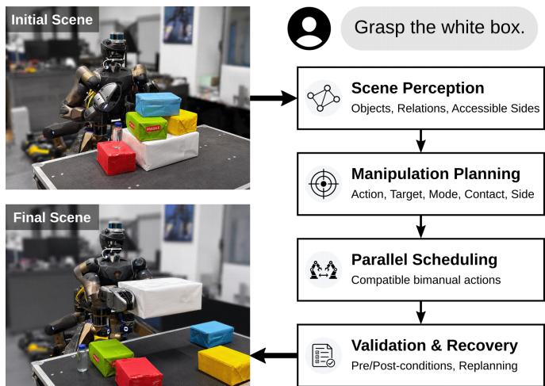  
Fig. 1: Execution-aware target retrieval in clutter. The framework builds a structured scene representation, plans the manipulation actions and their physical realisation, and schedules compatible actions for parallel bimanual execution. A hierarchical validator monitors each execution stage and uses structured feedback to support local recovery or targeted replanning.

Recent advances in foundation models have significantly improved language-conditioned robot planning. Vision-Language Models (VLMs) enable robots to interpret openended instructions and generate task-level manipulation plans [1], [9], [2], [3], while Vision-Language-Action (VLA) policies directly predict robot actions from multimodal observations [10], [11], [12]. Despite these advances, existing approaches often either reason at a high semantic level or learn low-level behaviours end-to-end, providing limited support for explicitly reasoning about the physical interaction choices that determine whether a planned action can be realised.

Existing work addresses complementary aspects of this gap. Mechanical-search approaches explicitly reason about geometric obstruction and object rearrangement [4], [5], [6], whereas planners based on structured scene representations capture semantic and spatial object relations [13], [14], [15]. However, current formulations rarely represent the physical interaction choices required to bridge symbolic task plans and feasible manipulation. Consequently, accessibility constraints and interaction choices often remain implicit during planning, making it difficult to associate execution failures with the decisions that generated them.

Explicitly modelling physical interaction choices also provides a basis for structured execution validation. Existing systems can detect, explain, or recover from execution failures [16], [17], [18]; however, when these choices remain implicit, feedback can reveal that an action has failed without identifying which planning requirement or expected effect was violated. Representing them through explicit conditions allows failures to be localised, execution progress to be assessed, and local recovery to be attempted before resorting to replanning.

We propose a zero-shot framework based on VLMs, i.e., requiring no task-specific training, fine-tuning, or demonstrations, that jointly reasons about task objectives and the physical interaction choices required to realise them in cluttered scenes, as illustrated in Fig. 1. This study builds upon our previous work [19]. The main contributions are:

• a structured scene representation that jointly models semantic object relations, blocking dependencies, sidelevel accessibility, and robot reachability to support manipulation planning in cluttered environments;

• an execution-aware planning framework that selects manipulation actions, specifies their physical realisation, and schedules compatible actions for parallel bimanual execution. A hierarchical validator uses stage-level conditions and execution history to assess progress, resolve perceptual uncertainty, and select local recovery or targeted replanning;

• an experimental evaluation on the CENTAURO hybrid wheeled-legged humanoid platform [20], including real-world cluttered target-retrieval experiments, dedicated failure-recovery scenarios, and component ablation studies.

## II. RELATED WORK

Language-conditioned robotic manipulation spans several complementary research directions, including task planning, structured scene representation, bimanual coordination, and execution monitoring. Although recent methods increasingly ground high-level reasoning in robot observations and actions, the physical choices that connect task-level plans to feasible manipulation often remain implicit. This also limits the possibility of relating execution feedback to the planning decisions that generated it.

Early approaches to language-conditioned manipulation primarily focused on task-level planning. SayCan [1] combines language reasoning with learned skill affordances to generate executable manipulation plans. Subsequent methods extend this paradigm through program generation and multimodal reasoning [9], [3], [21]. Related work on integrated task-and-motion planning explicitly connects symbolic decisions with motion feasibility [22], [23]. More recent methods further reduce the abstraction gap between semantic reasoning and robot execution. VoxPoser [24] grounds manipulation objectives in 3D value maps, while ReKep [25] formulates manipulation through spatio-temporal relational constraints. Vision-Language-Action policies instead directly predict robot actions from multimodal observations [10], [12], [11], [26]. Despite this progress, the physical choices and conditions required to execute and validate individual manipulation actions often remain implicit.

TABLE I: Comparison of representative languageconditioned manipulation frameworks.
<table><tr><td colspan="10"></td></tr><tr><td>Method</td><td></td><td></td><td></td><td></td><td></td><td></td><td></td><td></td></tr><tr><td>SayCan [1]</td><td>√</td><td>√ X</td><td>× ×</td><td>× ×</td><td>× ×</td><td>× ×</td><td></td><td>X ×</td></tr><tr><td>PaLM-E [21]</td><td>× √</td><td>×</td><td>×</td><td>√</td><td>×</td><td></td><td>√</td><td>×</td></tr><tr><td>LABOR [29]</td><td>√</td><td>√</td><td>√</td><td>√</td><td>×</td><td></td><td>×</td><td>×</td></tr><tr><td>LLM+MAP [30] ExploreVLM [15]</td><td>√</td><td>√</td><td>√</td><td>×</td><td>√</td><td></td><td>×</td><td>√</td></tr><tr><td>Ours</td><td>√</td><td>√</td><td>√</td><td>√</td><td>√</td><td></td><td>√</td><td>√</td></tr></table>

One approach to reducing this gap is to ground planning in structured scene representations that organise the environment into semantic entities and spatial relations. Objectcentric approaches [13], [14], [15] capture semantic and spatial relationships relevant to task planning. Complementary work on mechanical search and object rearrangement [4], [5], [6] shows that successful manipulation also requires explicit reasoning about physical accessibility in cluttered environments, an aspect that remains challenging for current VLMs [27], [28]. These works highlight the importance of representing not only semantic relations but also the geometric constraints that determine how objects can be approached and manipulated.

Physical grounding becomes particularly important in bimanual manipulation, where actions must also be assigned and coordinated across two manipulators. LABOR [29] uses language models to orchestrate sequential and concurrent skills, while LLM+MAP [30] combines language reasoning with symbolic multi-agent planning. However, arm assignment and concurrent execution are typically addressed through high-level skill orchestration or symbolic coordination, rather than being grounded in the same physical constraints used for manipulation planning.

Beyond planning and coordination, robust manipulation requires detecting deviations from the expected scene evolution and adapting the remaining strategy accordingly. DoReMi [16], REFLECT [17], AHA [18], and ExploreVLM [15] support execution monitoring through misalignment detection, multimodal failure interpretation, or scene-based replanning. However, these approaches generally do not link validation outcomes to the physical choices and stage-level conditions established during planning, limiting the ability to localise failures and select an appropriate recovery strategy.

Across these research directions, physical interaction choices and execution verification conditions often remain implicit or are represented separately. Table I compares representative approaches in terms of task-specific training (Zero-shot), modularity (Modular pipeline), structured object relations (Explicit scene), dual-arm coordination (Bimanual), free approach directions (Accessibility), kinematic feasibility (Reachability), and online execution verification (Validation). Our framework explicitly integrates interaction choices and verification conditions into bimanual planning, combining physically grounded action specification, parallel scheduling, and hierarchical stage-level validation.

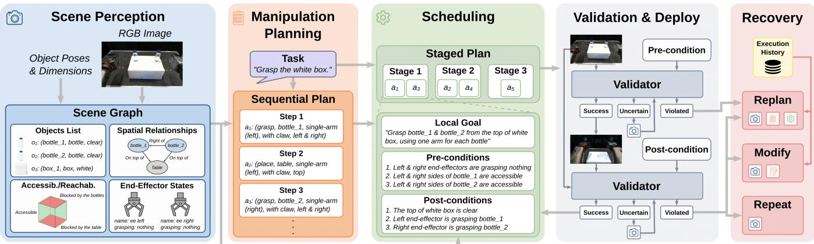  
Fig. 2: Overview of the proposed language-conditioned bimanual manipulation pipeline. From an RGB observation and object poses and dimensions, the framework constructs a structured scene representation, generates a sequential manipulation plan, and groups compatible actions into parallel execution stages. A hierarchical validator evaluates stage-level pre- and post-conditions, handles perceptual uncertainty, and leverages execution history to guide a local-to-global recovery process, prioritising local interventions whenever feasible.

## III. METHOD

Figure 2 provides an overview of the proposed framework for language-conditioned bimanual manipulation in cluttered environments. Starting from a visual observation of the scene and a natural-language task instruction, the framework constructs an executable manipulation strategy while explicitly accounting for execution constraints and validating task progress throughout execution. The framework comprises four main components: structured scene representation, language-guided task planning, parallel execution scheduling, and hierarchical execution validation. The individual components are described in the following sections.

## A. Object Geometric Representation

Objects are represented as oriented bounding boxes defined by their position, dimensions, and orientation. Each bounding box comprises three pairs of opposing parallel faces (left-right, front-back, and top-bottom), whose labels are assigned with respect to the robot reference frame and therefore describe workspace-relative approach directions. In particular, the front face is defined as the face oriented towards the robot, while the remaining labels follow accordingly. The proposed framework assumes objects that can be grasped through opposing contacts on one pair of parallel faces, allowing grasp accessibility and object interactions to be inferred directly from geometry. Objects requiring instance-specific grasp affordances, such as a mug that must be grasped by its handle, fall outside the scope of the framework. This is a deliberate scoping choice: many rigid objects commonly encountered in tabletop and logistics settings can be approximated through this geometric representation, and these are precisely the scenarios in which mutual obstruction constitutes the dominant difficulty addressed here.

## B. Structured Scene Representation

Given an RGB image It acquired from the robot viewpoint at time t, scene construction is performed in two stages. First, a VLM processes I to identify the object instances in the scene, infer their semantic attributes and qualitative pairwise relations, and determine the interaction state of the robot end-effectors. This produces a symbolic description of the scene. Second, FoundationPose [31], in its model-based mode with CAD models of the objects, provides 6D object pose estimates that geometrically ground the detected objects and their relations. This geometric information is used to define the six robot-relative sides of each object and enrich the symbolic representation with the interaction constraints described below.

The scene is represented as a graph

$$
G _ { t } = ( V _ { t } , R _ { t } ) ,\tag{1}
$$

where $V _ { t } = O _ { t } \cup E _ { t }$ is the set of scene entities, composed of object nodes $O _ { t }$ and end-effector nodes $E _ { t }$ , and $R _ { t }$ is the set of pairwise relations between them. Objects are represented as discrete instances with semantic attributes such as category and colour, together with any property relevant to manipulation, such as fragility. End-effectors are instead modelled through their current interaction state, namely whether they are empty or holding an object. Unlike objects, they are not associated with persistent scene properties, since their pose depends on the current robot configuration.

The scene structure inferred by the VLM is captured through pairwise relations

$$
R _ { t } \subseteq V _ { t } \times T \times V _ { t } ,\tag{2}
$$

where T defines the set of admissible relation types, namely on top of, right of, in front of, and grasped by. Entity identities and pairwise relations provide a structural description of the scene, but do not by themselves specify how the objects can be physically interacted with. The symbolic graph is therefore enriched using the estimated object poses and dimensions. Specifically, the six sides of each object are annotated with their interaction status in terms of accessibility and reachability. Accessibility expresses whether sufficient free space is available around a side for the end-effector to interact with it. For each spatial relation inferred in the scene graph, the distance separating the corresponding facing sides of the two objects is computed from their estimated poses and dimensions. This distance is compared with a safety threshold derived from the end-effector geometry. When a side is blocked, the object or support surface responsible for the obstruction is also recorded, so that each unavailable interaction direction is represented together with its cause. Reachability is evaluated separately, since geometric accessibility does not guarantee that a side can be approached given the robot kinematics. For each candidate interaction direction, reachability is determined by checking whether the corresponding approach pose admits a feasible inverse kinematics solution.

TABLE II: Modules re-invoked by each recovery strategy, ordered from local to global.
<table><tr><td>Strategy</td><td>Scene Perception</td><td>Action Revision</td><td>Manip. Planning</td><td>Scheduler</td></tr><tr><td>repeat</td><td>√</td><td>×</td><td>×</td><td>X</td></tr><tr><td>modify</td><td>√</td><td>√</td><td>X</td><td>×</td></tr><tr><td>replan</td><td>√</td><td>×</td><td>√</td><td>√</td></tr></table>

## C. Manipulation Planning

Given the structured scene representation $G _ { t }$ , the naturallanguage task instruction $H _ { t }$ , a VLM generates an ordered manipulation plan

$$
\Pi _ { t } = ( a _ { 1 } , a _ { 2 } , \ldots , a _ { n } ) ,\tag{3}
$$

which describes a sequence of scene transformations that progressively establishes the conditions required to complete the task. Each action is represented as

$$
a _ { k } = ( a c t i o n _ { k } , t a r g e t _ { k } , m o d e _ { k } , c o n t a c t _ { k } , s i d e _ { k } ) ,\tag{4}
$$

where action denotes the manipulation primitive, chosen among grasp, place, push, and release; $t a r g e t _ { k }$ identifies the manipulated object or the placement destination; mode specifies whether the action is performed with the left arm, the right arm, or both arms jointly; contact indicates whether the interaction is performed with or without engaging the claw; and $s i d e _ { k }$ identifies the object side, or pair of opposing sides, from which the interaction should be executed. This representation connects task-level decisions with their physical realisation. For instance, a grasp must involve an accessible pair of opposing sides reachable by the selected arm, whereas a push specifies the side on which contact is established. When the task target is not directly graspable, the planner reasons about the recorded causes of obstruction. It first considers alternative accessible grasp directions and, when none is feasible, introduces actions to relocate the objects blocking the required sides. Each relocation is defined relative to a reference object and must place the obstacle far enough from it to satisfy the same end-effector clearance threshold used to determine accessibility. The use of a VLM also allows semantic constraints expressed in the instruction or encoded in the scene representation, such as object fragility, to influence both the selected action and the modality of interaction.

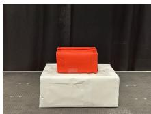  
(a) Stacked Boxes

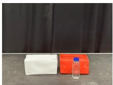  
(b) Boxes Aside

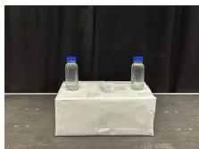  
(c) Bottles on Box

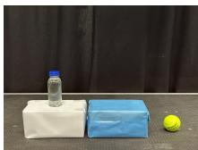

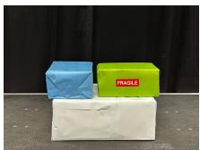  
(d) Scene Update  
(e) Fragile Box

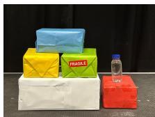

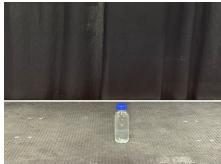

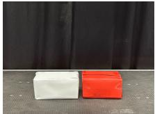  
(g) Bottle Failure  
(h) Push Failure

(f) Long Horizon  
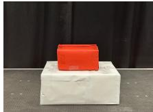  
(i) Stacked Boxes w/ Failure  
Fig. 3: Initial configurations of the nine tabletop manipulation scenarios used in the experimental evaluation.

## D. Scheduler

The manipulation plan Πt is initially generated as a sequential list of actions. Since this representation does not explicitly exploit the robot’s capability to execute compatible actions in parallel, a dedicated scheduling module reorganises the plan into a sequence of execution stages while preserving the original action semantics. Actions are grouped according to their compatibility, considering object interactions, spatial constraints, and the allocation of the robot end-effectors, ensuring that concurrent execution does not introduce conflicts. The resulting stage sequence is

$$
S _ { t } = ( s _ { 1 } , \ldots , s _ { m } ) ,\tag{5}
$$

where each stage $s _ { i }$ is a set of mutually compatible actions to be executed concurrently, e.g., $s _ { i } = \{ a _ { p } , a _ { q } \}$ with $a _ { p } , a _ { q } \in \Pi _ { t }$ For each stage, the scheduler additionally defines a local goal $g _ { i } ,$ together with symbolic pre-conditions $C _ { i } ^ { p r e }$ and postconditions $C _ { i } ^ { p o s t }$ . The local goal summarises the intended outcome of the concurrent actions, while the symbolic conditions describe the required scene state before execution and the expected state afterwards. Rather than representing these conditions as complete scene descriptions, they are expressed as collections of atomic predicates, each describing a single independently verifiable property of the scene. By associating each group of compatible actions with a local goal and explicit symbolic conditions, the stage becomes the fundamental unit of supervision, providing the information required to assess the intended state transition. This representation naturally supports local recovery whenever possible, while global replanning is reserved for situations in which the remaining schedule can no longer be reconciled with the observed scene.

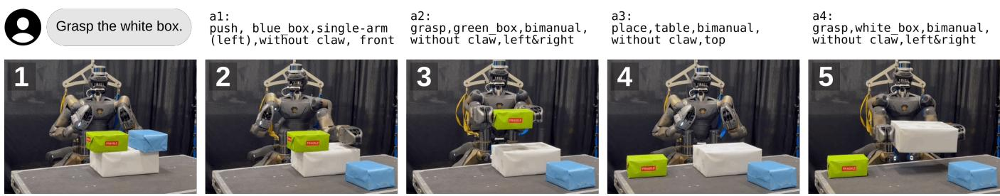  
Fig. 4: Example execution of the Fragile Box scenario, where the task is to grasp the white box. The robot identifies the blue and green boxes as obstacles placed on top of the target. Since they are laterally too close to be grasped directly, the robot first pushes the non-fragile blue box from its accessible front side, the most suitable direction for clearing the target. It then grasps and places the fragile green box on the table. Once both obstacles have been removed, the robot grasps the white box.

## E. Hierarchical Validation & Recovery

Each stage $s _ { i }$ is supervised by a VLM-based validation module that compares the scene evolution expected by the schedule with the one actually observed. Before execution, the pre-conditions $C _ { i } ^ { p r e }$ are evaluated on the evidence $Z _ { i } ^ { p r e } =$ $\{ I _ { i } ^ { p r e } \}$ }, given by the current observation. After execution, the post-conditions $C _ { i } ^ { p o s t }$ are evaluated on $Z _ { i } ^ { p o s t } = \{ I _ { i } ^ { p r e } , I _ { i } ^ { p o s t } \}$ together with the executed actions, so that the validator can verify that the expected changes were actually produced by the stage. Unlike binary validation, the VLM assigns each condition $c \in C _ { i } ^ { \phi }$ , with $\phi \in \{ p r e , p o s t \}$ , one of three outcomes

$$
\nu _ { \phi } ( Z _ { i } ^ { \phi } , c ) \in \{ s a t i s f i e d , u n c e r t a i n , \nu i o l a t e d \} .\tag{6}
$$

These outcomes are aggregated into a stage-level outcome $\gamma _ { i } ^ { \phi } = \Gamma ( \{ \nu _ { \phi } ( Z _ { i } ^ { \phi } , c ) | c \in \bar { C } _ { i } ^ { \phi } \} )$ , where Γ returns violated if any condition is violated, uncertain if the VLM is unsure about at least one condition given $Z _ { i } ^ { \phi }$ , and satisfied otherwise. A satisfied outcome allows execution to proceed, whereas an uncertain one is first addressed through additional perception, by reconstructing the scene graph and re-evaluating the conditions with it as additional evidence. Only when a failure is confirmed, or the ambiguity persists after a limited number of attempts, is the stage forwarded to the last level of the hierarchy, namely failure interpretation and recovery.

When a failure is detected, a structured report is built. If the pre-conditions are violated, the stage has not been executed and cannot be repaired locally, so replanning is selected directly. If the post-conditions are violated, the report collects the unsatisfied conditions with their justifications, the executed actions, the scene graphs reconstructed from $I _ { i } ^ { p r e }$ and $I _ { i } ^ { p o s t }$ , and the history $L _ { i }$ of previous attempts on the stage. Comparing the two scene graphs reveals whether execution made progress towards the local goal $g _ { i }$ and whether the pre-conditions of $s _ { i }$ still hold in the updated scene, while $L _ { i }$ exposes recurring failures and the strategies already applied. Together, these elements indicate whether execution made partial progress, whether the failure can be attributed to an action attribute, or whether the stage is no longer applicable.

Recovery then follows a local-to-global policy, which attempts to repair the current stage before revising the whole plan. Repeat is selected when execution made progress towards the local goal without completing it: the scene is perceived again and the failed stage is re-executed unchanged. Modify is selected when the action is not completed and the failure can be attributed to an action parameter. In this case, the scene is perceived again and an Action Revision VLM compares the observations of the previous attempts. Based on the failed conditions and the parameter values already tried in $L _ { i } ,$ the VLM revises mode , contact , or $s i d e _ { k }$ to address the observed failure. The stage is then re-executed with the revised actions. Replan is selected when the stage is no longer applicable in the updated scene, when the evidence remains insufficient, or when neither local strategy is supported. In this case, the scene is perceived again, and manipulation planning and scheduling are re-invoked to regenerate the remaining plan. To avoid repeating the same failure, the planner additionally receives a summary of the failed stage, its violated conditions, and the strategies already tried in $L _ { i } .$ . As summarised in Table II, the three strategies thus re-invoke progressively larger portions of the pipeline. Moreover, abort terminates execution when no strategy remains within the allowed number of attempts. Each attempt is appended to $L _ { i } ,$ so that ineffective strategies are not retried, and the task is considered complete when the post-conditions of every stage have been validated as satisfied.

## IV. EXPERIMENTS

## A. Experimental Setup

Experiments are conducted on the real CENTAURO hybrid wheeled-legged humanoid platform [20], whose two six-degree-of-freedom arms are equipped with Dagana endeffectors [32]. Manipulation actions follow joint-space references computed by a QP-based inverse kinematics module [33], while the base remains stationary throughout all experiments. Scene observations are acquired from the RGB stream of a head-mounted Intel RealSense D435 camera directed towards the manipulation workspace. Unless otherwise stated, all VLM-based modules use Gemini Robotics-ER 1.6. The framework is evaluated on nine tabletop manipulation scenarios, shown in Fig. 3, covering executionaware planning, adaptation to scene changes, and execution recovery. Each scenario is executed 20 times from the same initial configuration. Planning scenarios address increasing task complexity, from accessibility-aware retrieval (Stacked Boxes and Boxes Aside) to coordinated bimanual manipulation (Bottles on Box), semantic reasoning (Fragile Box), and long-horizon planning (Long Horizon). Scene Update introduces unexpected environmental changes that invalidate the original plan, while Bottle Failure, Push Failure, and Stacked Boxes w/ Failure evaluate hierarchical validation under unsuccessful grasp attempts, manipulation deviations, and absence of observable execution progress, respectively.

TABLE III: Scenario-level and module-level performance over 20 executions per scenario. Scenario performance: SR is the percentage of executions completed successfully, and Queries is the average number of VLM queries per successful execution (–: no successful execution). Module performance (Ours) is computed over all the calls of each module: SR i the percentage of calls in which the module produces a correct output, and Latency is the average time of a single call, in seconds. For Hierarchical Validation, Latency is the average between pre-execution and post-execution validation. Values in bold denote the best results.
<table><tr><td></td><td colspan="6">Scenario performance</td><td colspan="8">Module performance (Ours)</td></tr><tr><td></td><td colspan="2">Non-execution-aware &amp; Binary validation</td><td colspan="2">Execution-aware &amp; Binary validation</td><td colspan="2">Execution-aware &amp; Hierarchical validation (Ours)</td><td colspan="2">Scene Perception</td><td colspan="2">Manipulation Planning</td><td colspan="2">Execution Scheduling</td><td colspan="2">Hierarchical Validation</td></tr><tr><td>Scenario</td><td>SR</td><td>Queries</td><td>SR</td><td>Queries</td><td>SR</td><td>Queries</td><td>SR</td><td>Latency</td><td>SR</td><td>Latency</td><td>SR</td><td>Latency</td><td>SR</td><td>Latency</td></tr><tr><td>Execution-Aware Planning</td><td></td><td></td><td></td><td></td><td></td><td></td><td></td><td></td><td></td><td></td><td></td><td></td><td></td><td></td></tr><tr><td>Stacked Boxes</td><td>100%</td><td>8.2</td><td>100%</td><td>8.2</td><td>100%</td><td>8.2</td><td>100%</td><td>5.10</td><td>100%</td><td>9.69</td><td>100%</td><td>8.42</td><td>100%</td><td>5.85</td></tr><tr><td>Boxes Aside</td><td>0%</td><td>一</td><td>75%</td><td>12.3</td><td>85%</td><td>11.8</td><td>96%</td><td>7.33</td><td>92%</td><td>12.82</td><td>100%</td><td>8.32</td><td>98%</td><td>4.45</td></tr><tr><td>Bottles on Box</td><td>70%</td><td>9.6</td><td>90%</td><td>9.4</td><td>95%</td><td>9.4</td><td>98%</td><td>7.78</td><td>100%</td><td>10.93</td><td>85%</td><td>10.01</td><td>97%</td><td>4.91</td></tr><tr><td>Fragile Box</td><td>0%</td><td>一</td><td>70%</td><td>11.7</td><td>70%</td><td>11.5</td><td>90%</td><td>6.72</td><td>84%</td><td>22.30</td><td>100%</td><td>11.52</td><td>97%</td><td>4.76</td></tr><tr><td>Long Horizon</td><td>0%</td><td>1</td><td>35%</td><td>24.3</td><td>50%</td><td>21.1</td><td>78%</td><td>8.06</td><td>67%</td><td>31.78</td><td>91%</td><td>14.29</td><td>93%</td><td>4.57</td></tr><tr><td>Dynamic Scene Adaptation</td><td></td><td></td><td></td><td></td><td></td><td></td><td></td><td></td><td></td><td></td><td></td><td></td><td></td><td></td></tr><tr><td>Scene Update</td><td>85%</td><td>14.6</td><td>85%</td><td>14.6</td><td>85%</td><td>14.4</td><td>97%</td><td>7.64</td><td>96%</td><td>8.23</td><td>100%</td><td>12.54</td><td>97%</td><td>5.60</td></tr><tr><td>Execution Recovery</td><td></td><td></td><td></td><td></td><td></td><td></td><td></td><td></td><td></td><td></td><td></td><td></td><td></td><td></td></tr><tr><td>Bottle Failure</td><td>90%</td><td>10</td><td>90%</td><td>10</td><td>90%</td><td>8.1</td><td>100%</td><td>4.73</td><td>100%</td><td>5.79</td><td>100%</td><td>3.55</td><td>92%</td><td>4.34</td></tr><tr><td>Push Failure</td><td>15%</td><td>10</td><td>85%</td><td>10</td><td>95%</td><td>9.1</td><td>98%</td><td>6.38</td><td>100%</td><td>9.29</td><td>100%</td><td>6.64</td><td>89%</td><td>6.52</td></tr><tr><td>Stacked Boxes w/ Failure</td><td>90%</td><td>12</td><td>90%</td><td>12</td><td>90%</td><td>11.8</td><td>100%</td><td>4.52</td><td>95%</td><td>9.46</td><td>100%</td><td>8.28</td><td>91%</td><td>5.19</td></tr></table>

## B. Results and Analysis

In this section, we first compare the complete framework with two baselines that share the same VLM backbone, task instructions, manipulation primitives, and low-level execution modules. The first baseline (Non-execution-aware & Binary validation) provides the planner only with symbolic object relations, without side-level accessibility and reach ability information, and relies on a binary success/failure validator. The second (Execution-aware & Binary validation) adopts the proposed execution-aware scene representation but retains the binary validator. The proposed framework (Execution-aware & Hierarchical validation) additionally replaces the binary validator with hierarchical validation. Furthermore, we analyse the role of the individual modules, the benefit of parallel execution, and the choice of the VLM backbone.

1) Overall Performance and Baselines: Table III reports the performance of the three configurations on the nine scenarios. The benefit of execution awareness depends on how objects obstruct the target. When an obstacle rests on top of the target, as in Stacked Boxes, this dependency is already captured by the symbolic relations, and the non-executionaware planner also solves the scenario. When objects are placed side by side, as in Boxes Aside, Fragile Box, and Long Horizon, however, the symbolic representation cannot tell whether the free space between them is sufficient for the end-effector to reach the target. The non-execution-aware planner therefore does not recognise a laterally placed object as an obstruction and attempts to grasp the target directly, failing in all executions (0% SR). By encoding side-leve accessibility and reachability, the execution-aware planner instead identifies and relocates the blocking objects, reaching 85%, 70%, and 50% SR. Fig. 4 shows an example execution of Fragile Box. Similar gains appear in Bottles on Box (from 70% to 95%) and Push Failure (from 15% to 95%), suggesting that these scenarios rely on the same interactionrelevant information. The main contribution of hierarchical validation lies in efficiency. A binary validator only reports whether a stage succeeded and, without information on the cause of a failure, must always replan, spending 3 querie per failure. The hierarchical validator instead interprets the failure and selects the least disruptive recovery. Fig. 5 reports the average cost of a recovery decision in six scenarios. In Bottle Failure, the grasp fails once per execution: the binary validator replans from scratch, spending 3 queries, wherea the hierarchical validator mostly just repeats the action, so a decision costs 1.1 queries on average. These 1.9 saved queries correspond to the drop from 10 to 8.1 queries per execution in Table III. In Push Failure, repeating is not enough but a modification suffices, which costs 2.1 queries and lowers the queries from 10 to 9.1. When the failure invalidates the plan, as in Stacked Boxes w/ Failure and Scene Update, replanning is almost always unavoidable, and both validators require a similar number of queries.

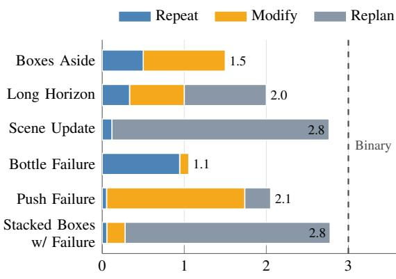  
VLM queries per recovery decision  
Fig. 5: Average number of VLM queries spent per recovery decision in six representative scenarios, considering the successful executions. Each bar is the average over the decisions of the hierarchical validator, and its coloured segments show the contribution of repeat (1 query), modify (2), and replan (3), weighted by how often each is selected. The dashed line is the binary validator, which always replans (3 queries per failure). Only the queries of the recovery decisions are counted, not the validation calls of the repeated stages.

2) Module-level Analysis: The module-level columns of Table III break down the performance of the proposed framework by module. Execution scheduling achieves the highest SR, equal to 100% in seven of the nine scenarios, since its task is limited to grouping compatible actions and its input is purely textual. Manipulation planning also receives only textual input, but its SR depends strongly on the task: generating a plan with many steps and heterogeneous interactions, as in Long Horizon (67%), is considerably harder than solving a scenario such as Stacked Boxes (100%). Scene perception and validation, instead, take both text and images as input, and their failures stem less from the task than from scene ambiguities, perspective effects, and suboptimal viewpoints caused by the head-mounted camera. The same pattern emerges from the latencies. Scene perception and validation have fairly uniform latencies, whereas planning and, to a lesser extent, scheduling scale with the complexity of the task. In particular, the planning latency grows from 5.79–12.82 s in the simpler scenarios to 22.30 s in Fragile Box and 31.78 s in Long Horizon.

3) Benefit of Parallel Execution: We further compare sequential execution with the proposed bimanual scheduler, which groups compatible actions into parallel stages, on the Bottles on Box and Long Horizon scenarios (Fig. 6). The reported values are not averages over the 20 runs, but highlight the efficiency that scheduling can achieve in these scenarios, and the execution time accounts only for the robot motion, not for the model queries. Parallel scheduling reduces the execution time by 40% in Bottles on Box and by 11% in Long Horizon, and the number of execution stages from 5 to 3 and from 9 to 8, respectively, while preserving task completion.

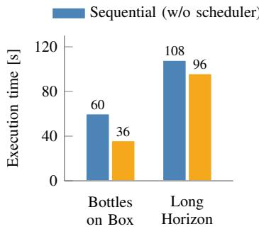

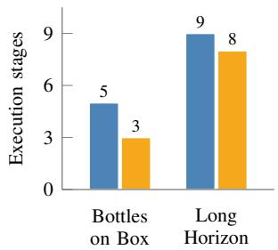  
Fig. 6: Sequential execution versus the proposed bimanual scheduler on the Bottles on Box and Long Horizon scenarios, in terms of execution time (left), which accounts only for the robot motion and not for the model queries, and number of execution stages (right).

TABLE IV: Comparison of different VLM backbones within the proposed framework, averaged over the Boxes Aside, Scene Update, and Long Horizon scenarios. SR is the percentage of executions completed from start to end, and Latency is the sum of the average latencies of scene perception, manipulation planning, execution scheduling, and validation.
<table><tr><td>Backbone</td><td>SR</td><td>Latency</td></tr><tr><td>Gemini Robotics-ER 1.6</td><td>73.3%</td><td>41.9s</td></tr><tr><td>GPT-5.2</td><td>5.0%</td><td>34.6s</td></tr><tr><td>GPT-o3</td><td>80.0%</td><td>91.4s</td></tr></table>

4) Backbone Sensitivity: Finally, to assess the sensitivity of the framework to the underlying VLM, we replace Gemini Robotics-ER 1.6 with GPT-o3 and GPT-5.2 as backbone under identical conditions. Table IV reports the results on three representative scenarios, each executed 20 times. Gemini and o3 achieve comparable SR (73.3% and 80.0%), with o3 requiring a considerably higher latency (91.4 s versus 41.9 s). GPT-5.2 reaches only 5.0% despite its lower latency (34.6 s). Its failures arise mainly in the manipulation planning stage, where the model struggles to produce feasible long-horizon plans, either because the logic of the action sequence is incorrect or because the parameters of individual actions are inconsistent.

## V. CONCLUSION AND FUTURE WORK

This work presented a zero-shot, language-conditioned framework for execution-aware bimanual manipulation in cluttered environments. By explicitly encoding blocking relations, side-level accessibility, and kinematic reachability, the proposed framework reasons jointly about task objectives and their physical realisation. Furthermore, the proposed hierarchical validation strategy explicitly relates execution feedback to planning decisions, enabling targeted recovery and replanning when the observed scene evolution deviates from the expected one. Experimental results on the real CENTAURO platform demonstrate that combining structured scene understanding, execution-aware planning, and closed-loop validation improves the robustness of languageconditioned manipulation in cluttered environments. Promising directions for future work include relaxing these assumptions. Learned manipulation policies could replace inverse kinematics to enable more adaptive and contact-rich behaviours, while more flexible skill generation and composition could extend the set of available actions. Moreover, reachability is currently evaluated from a fixed base pose, so kinematically unreachable sides are simply discarded; jointly planning manipulation and base motion would allow the robot to reposition itself and turn these constraints into additional planning decisions.

## REFERENCES

[1] A. Brohan, Y. Chebotar, C. Finn, K. Hausman, A. Herzog, D. Ho, J. Ibarz, A. Irpan, E. Jang, R. Julian, et al., “Do as I can, not as I say: Grounding language in robotic affordances,” in Conference on Robot Learning (CoRL). PMLR, 2023, pp. 287–318.

[2] W. Huang, F. Xia, T. Xiao, H. Chan, J. Liang, P. Florence, A. Zeng, J. Tompson, I. Mordatch, Y. Chebotar, et al., “Inner monologue: Embodied reasoning through planning with language models,” arXiv preprint arXiv:2207.05608, 2022.

[3] J. Liang, W. Huang, F. Xia, P. Xu, K. Hausman, B. Ichter, P. Florence, and A. Zeng, “Code as policies: Language model programs for embodied control,” in 2023 IEEE International Conference on Robotics and Automation (ICRA). IEEE, 2023, pp. 9493–9500.

[4] M. Danielczuk, A. Kurenkov, A. Balakrishna, M. Matl, D. Wang, R. Mart´ın-Mart´ın, A. Garg, S. Savarese, and K. Goldberg, “Mechanical search: Multi-step retrieval of a target object occluded by clutter,” in 2019 International Conference on Robotics and Automation (ICRA). IEEE, 2019, pp. 1614–1621.

[5] W. Bejjani, W. C. Agboh, M. R. Dogar, and M. Leonetti, “Occlusionaware search for object retrieval in clutter,” in 2021 IEEE/RSJ International Conference on Intelligent Robots and Systems (IROS). IEEE, 2021, pp. 4678–4685.

[6] B. Huang, S. D. Han, J. Yu, and A. Boularias, “Visual foresight trees for object retrieval from clutter with nonprehensile rearrangement,” IEEE Robotics and Automation Letters, vol. 7, no. 1, pp. 231–238, 2021.

[7] C. Smith, Y. Karayiannidis, L. Nalpantidis, X. Gratal, P. Qi, D. V. Dimarogonas, and D. Kragic, “Dual arm manipulation—a survey,” Robotics and Autonomous Systems, vol. 60, no. 10, pp. 1340–1353, 2012.

[8] F. Krebs and T. Asfour, “A bimanual manipulation taxonomy,” IEEE Robotics and Automation Letters, vol. 7, no. 4, pp. 11 031–11 038, 2022.

[9] I. Singh, V. Blukis, A. Mousavian, A. Goyal, D. Xu, J. Tremblay, D. Fox, J. Thomason, and A. Garg, “ProgPrompt: Generating situated robot task plans using large language models,” arXiv preprint arXiv:2209.11302, 2022.

[10] B. Zitkovich, T. Yu, S. Xu, P. Xu, T. Xiao, F. Xia, J. Wu, P. Wohlhart, S. Welker, A. Wahid, et al., “RT-2: Vision-language-action models transfer web knowledge to robotic control,” in Conference on Robot Learning (CoRL). PMLR, 2023, pp. 2165–2183.

[11] Octo Model Team, D. Ghosh, H. Walke, K. Pertsch, K. Black, O. Mees, S. Dasari, J. Hejna, T. Kreiman, C. Xu, et al., “Octo: An open-source generalist robot policy,” arXiv preprint arXiv:2405.12213, 2024.

[12] M. J. Kim, K. Pertsch, S. Karamcheti, T. Xiao, A. Balakrishna, S. Nair, R. Rafailov, E. Foster, G. Lam, P. Sanketi, et al., “OpenVLA: An open-source vision-language-action model,” in Conference on Robot Learning (CoRL). PMLR, 2024.

[13] K. Rana, J. Haviland, S. Garg, J. Abou-Chakra, I. Reid, and N. Suenderhauf, “SayPlan: Grounding large language models using 3D scene graphs for scalable robot task planning,” arXiv preprint arXiv:2307.06135, 2023.

[14] Q. Gu, A. Kuwajerwala, S. Morin, K. M. Jatavallabhula, B. Sen, A. Agarwal, C. Rivera, W. Paul, K. Ellis, R. Chellappa, et al., “ConceptGraphs: Open-vocabulary 3D scene graphs for perception and planning,” in 2024 IEEE International Conference on Robotics and Automation (ICRA). IEEE, 2024, pp. 5021–5028.

[15] Z. Lou, K. Xu, Z. Zhou, and R. Xiong, “ExploreVLM: Closed-loop robot exploration task planning with vision-language models,” arXiv preprint arXiv:2508.11918, 2025.

[16] Y. Guo, Y.-J. Wang, L. Zha, and J. Chen, “DoReMi: Grounding language model by detecting and recovering from plan-execution misalignment,” in 2024 IEEE/RSJ International Conference on Intelligent Robots and Systems (IROS). IEEE, 2024, pp. 12 124–12 131.

[17] Z. Liu, A. Bahety, and S. Song, “REFLECT: Summarizing robot experiences for failure explanation and correction,” arXiv preprint arXiv:2306.15724, 2023.

[18] J. Duan, W. Pumacay, N. Kumar, Y. R. Wang, S. Tian, W. Yuan, R. Krishna, D. Fox, A. Mandlekar, and Y. Guo, “AHA: A visionlanguage-model for detecting and reasoning over failures in robotic manipulation,” arXiv preprint arXiv:2410.00371, 2024.

[19] E. Cuzzocrea, G. Iannotti, L. Rossini, A. Laurenzi, L. Muratore, and N. G. Tsagarakis, “Execution-aware task planning for languageconditioned bimanual manipulation,” in ICRA 2026 Workshop: From Data to Decisions: VLA Pipelines for Real Robots, 2026. [Online]. Available: https://openreview.net/forum?id=HRX9blXN5S

[20] N. Kashiri, L. Baccelliere, L. Muratore, A. Laurenzi, Z. Ren, E. M. Hoffman, M. Kamedula, G. F. Rigano, J. Malzahn, S. Cordasco, et al., “CENTAURO: A hybrid locomotion and high power resilient manipulation platform,” IEEE Robotics and Automation Letters, vol. 4, no. 2, pp. 1595–1602, 2019.

[21] D. Driess, F. Xia, M. S. M. Sajjadi, C. Lynch, A. Chowdhery, B. Ichter, A. Wahid, J. Tompson, Q. Vuong, T. Yu, et al., “PaLM-E: An embodied multimodal language model,” arXiv preprint arXiv:2303.03378, 2023.

[22] C. R. Garrett, R. Chitnis, R. Holladay, B. Kim, T. Silver, L. P. Kaelbling, and T. Lozano-Perez, “Integrated task and motion planning,” ´ Annual Review of Control, Robotics, and Autonomous Systems, vol. 4, no. 1, pp. 265–293, 2021.

[23] J. Siburian, K. Shirai, C. C. Beltran-Hernandez, M. Hamaya, M. Gorner, and A. Hashimoto, “Grounded vision-language inter- ¨ preter for integrated task and motion planning,” arXiv preprint arXiv:2506.03270, 2025.

[24] W. Huang, C. Wang, R. Zhang, Y. Li, J. Wu, and L. Fei-Fei, “VoxPoser: Composable 3D value maps for robotic manipulation with language models,” arXiv preprint arXiv:2307.05973, 2023.

[25] W. Huang, C. Wang, Y. Li, R. Zhang, and L. Fei-Fei, “ReKep: Spatio-temporal reasoning of relational keypoint constraints for robotic manipulation,” arXiv preprint arXiv:2409.01652, 2024.

[26] A. O’Neill, A. Rehman, A. Maddukuri, A. Gupta, A. Padalkar, A. Lee, A. Pooley, A. Gupta, A. Mandlekar, A. Jain, et al., “Open X-Embodiment: Robotic learning datasets and RT-X models,” in 2024 IEEE International Conference on Robotics and Automation (ICRA). IEEE, 2024, pp. 6892–6903.

[27] X. Fu, Y. Hu, B. Li, Y. Feng, H. Wang, X. Lin, D. Roth, N. A. Smith, W.-C. Ma, and R. Krishna, “BLINK: Multimodal large language models can see but not perceive,” in European Conference on Computer Vision (ECCV). Springer, 2024, pp. 148–166.

[28] C. H. Song, V. Blukis, J. Tremblay, S. Tyree, Y. Su, and S. Birchfield, “RoboSpatial: Teaching spatial understanding to 2D and 3D visionlanguage models for robotics,” in Proceedings of the Computer Vision and Pattern Recognition Conference (CVPR), 2025, pp. 15 768– 15 780.

[29] K. Chu, X. Zhao, C. Weber, M. Li, W. Lu, and S. Wermter, “Large language models for orchestrating bimanual robots,” in 2024 IEEE-RAS 23rd International Conference on Humanoid Robots (Humanoids). IEEE, 2024, pp. 328–334.

[30] K. Chu, X. Zhao, C. Weber, and S. Wermter, “LLM+MAP: Bimanual robot task planning using large language models and planning domain definition language,” arXiv preprint arXiv:2503.17309, 2025.

[31] B. Wen, W. Yang, J. Kautz, and S. Birchfield, “FoundationPose: Unified 6D pose estimation and tracking of novel objects,” in Proceedings ofthe IEEE/CVF Conference on Computer Vision and Pattern Recognition (CVPR), 2024, pp. 17 868–17 879.

[32] E. Del Bianco, D. Torielli, F. Rollo, D. Gasperini, A. Laurenzi, L. Baccelliere, L. Muratore, M. Roveri, and N. G. Tsagarakis, “A high-force gripper with embedded multimodal sensing for powerful and perception driven grasping,” in 2024 IEEE-RAS 23rd International Conference on Humanoid Robots (Humanoids). IEEE, 2024, pp. 149– 156.

[33] A. Laurenzi, E. M. Hoffman, L. Muratore, and N. G. Tsagarakis, “CartesI/O: A ROS based real-time capable Cartesian control framework,” in 2019 International Conference on Robotics and Automation (ICRA). IEEE, 2019, pp. 591–596.