# CARE-PO: CONTROLLABLE TOOL-CALL EFFICIENCY FOR LLM AGENTS

Xiaoyang Ye1, Xiao Yao1, Hairui Zhu2, Yiying Yang3, Bei Gan4, Jinliang Lu4, Tengjin Weng1, Yuan Yao3, Wenhao Jiang3

1Shenzhen University

2The Chinese University of Hong Kong, Shenzhen

3Guangdong Laboratory of Artificial Intelligence and Digital Economy (SZ)

4China Southern Power Grid Company Limited

## ABSTRACT

External tool calls are a major running cost of an LLM agent, while its training objectives align almost exclusively with task completion. In a step-level diagnosis of Qwen3.5 trajectories at two model sizes on GAIA, a long-horizon tool-use benchmark, we find that most contain removable calls, at a similar rate at both sizes. Some methods add an efficiency reward to the objective to reduce the call count, but introduce problems of their own: the anchor they price calls against is computed from the policy’s own rollouts (e.g., the group’s shortest correct rollout) and so moves with the policy; training can drift toward a collapsed policy that issues no tool call at all, a degeneracy seen in published reports and in our 27B baseline; and a training run delivers a single operating point, so the user cannot trade efficiency against capability. We present CARE-PO (Controllable Anchored Relative Efficiency Policy Optimization) to mitigate these problems. The efficiency reward prices calls against a reference budget anchored to the task’s own difficulty and fixed before training. Injecting a successful trajectory from the training data into each online GRPO rollout group and charging for evidence a trajectory never gathers ease the drift toward a collapsed call count. Shaping the cost curve by an effort tag in the prompt yields an efficiency and a capability operating point from a single training run. On GAIA, five of the six operating points across three model sizes improve on their base model in success rate and call count at once. On four held-out multi-hop benchmarks the result is size-dependent: at 27B and 4B success rate is held or raised at a lower call count, while at 9B both operating points trade success rate for fewer calls. The call count remains well above zero throughout training at all three sizes.

## 1 INTRODUCTION

In the ReAct-style loop of an LLM agent (Yao et al., 2023), the cost of a tool call compounds: its observation stays in the context and is re-processed on every later turn, so one low-yield call adds cost and latency to every remaining turn.

We observe that low-yield calls are pervasive at both model sizes we examine. In a step-level diagnosis of 221 GAIA trajectories (Mialon et al., 2024) from Qwen3.5-9B and 27B, 82.8% contain a removable (deletable or mergeable) call; those trajectories average 5.7 removable calls, and 68.0% of all calls are removable (Section 3.1). The rate is similar at both sizes, pointing less to any one model’s competence than to the training objective: tool-use training targets when to call and how to use the result, not what a call costs (Schick et al., 2023; Qin et al., 2024); RL rewarding only final correctness makes extra exploration rational (Jin et al., 2025; Wang et al., 2025); and agentic posttraining for long-horizon tasks encourages continued calling, with decorative calls and tool overuse documented (Ma et al., 2025), compounding an over-calling bias that precedes agentic training (Shi et al., 2026; Wu et al., 2026).

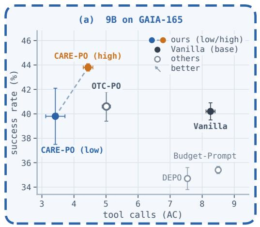

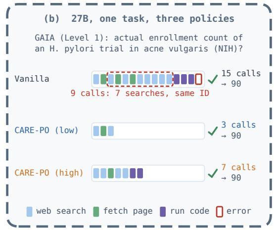  
Figure 1: (a) Success rate against average tool calls (AC) at 9B on GAIA’s 165-question validation split; error bars are the s.d. over three runs. Vanilla is the untrained model; CARE-PO (low) and (high) are two operating points of one set of weights; the baselines are defined in Section 4. (b) On one GAIA task at 27B, all three answer correctly, with 15, 3 and 7 calls (Appendix B).

Existing interventions on call cost (Liu et al., 2026b; Chen et al., 2026a; Wang et al., 2025; Li et al., 2026) either leave the budget to the user as an external constraint or fix the efficiency–capability trade-off at training time, one set of weights per operating point. A separate line of work lets the user choose the model’s effort at inference (Aggarwal & Welleck, 2025; He et al., 2025), but this choice mostly concerns reasoning tokens; concurrent extensions of that choice to tool calls leave the training objective unchanged (Chen et al., 2026b; Fang et al., 2026). A reasonable call count is set by two factors: how many calls the task requires, and how many calls this deployment is willing to spend for success rate. The first is independent of the policy and should not be estimated from the policy’s own samples; the second is a deployment choice and should not be fixed in training.

We therefore treat call efficiency as an inference-time controllable property and propose CARE-PO, with three contributions: (1) A compression yardstick anchored to each task’s difficulty. Each task’s reference budget, set by an offline pass before training, anchors the efficiency term. The cost curve around it is bounded and monotone, so a misestimated budget changes the magnitude of the pressure, not its direction, and compression below the budget earns further credit; calls saved without obtaining evidence earn nothing (Sections 3.3 and 3.4). (2) Call-count collapse under efficiency rewards is effectively eased. Each of the two routes to a policy that issues no call is addressed by one design: on the reward side, the evidence pricing just described; on the optimizer side, where a group uniform in calls leaves the advantage nothing to compare (He et al., 2026), each group receives the task’s successful trajectory from the training data, its source trajectory, as a floor (Section 3.5). At 27B an online-RL baseline trained with a conventional efficiency reward collapses toward issuing no call partway through training; ours does not at any size, with the same learning rate and number of training steps (Section 6.3). (3) The efficiency–capability trade-off is decided at deployment. The reward prices a call differently at each effort tier, so one set of weights learns an efficiency and a capability operating point, selected at inference by a low or high effort tag in the prompt (Section 3.4).

On GAIA, five of the six operating points across three model sizes improve on their base model in success rate and call count at once (Table 1, Figure 1); the sixth matches it in success rate at 58.6% fewer calls. On four held-out multi-hop benchmarks the efficiency point calls roughly a quarter to a half as often; success rate is held or raised at 27B and 4B, while at 9B both points trade success rate for fewer calls.

## 2 RELATED WORK

Reducing the number of tool calls. Overthinking and early-exit control of reasoning tokens are well studied (Cuadron et al., 2025; Wei et al., 2026); external tool calls, much less so. Tool overuse is documented (Qian et al., 2025), but mostly as trajectory-level counts, rarely with a step-level criterion for locating redundancy inside a trajectory, which Section 3.1 provides. Existing interventions divide into three classes by where they act, increasingly close to ours. Inference-time ones leave the weights untouched and impose the budget as an external constraint (Liu et al., 2026b; Chen et al., 2026b; Fang et al., 2026); offline training changes the weights on a pre-collected signal that cannot adapt to online rollouts (Chen et al., 2026a; Wang et al., 2026); online RL optimizes with GRPO (Shao et al., 2024) and places the efficiency demand entirely on the reward, as in OTC-PO (Wang et al., 2025) and TEPO (Li et al., 2026). This class measures efficiency against the policy’s own samples: OTC-PO’s anchor, the group’s minimum call count among correct trajectories, drifts with the policy, while TEPO measures efficiency by the fraction of entropy-reducing calls and sets no task-level reference. Our cost is instead measured against a per-task reference budget, fixed before training (Section 3.3). Both methods also yield a single operating point, so another requires retraining. An efficiency reward can also equalize a rollout group’s scores, leaving GRPO no gradient (He et al., 2026); search agents have been reported to collapse in training (Deng et al., 2026), and per-call rewards have been proposed to counter policies that reduce calls indiscriminately (Ma et al., 2026).

Selecting effort at inference. Controlling a model’s reasoning effort is an emerging trend in pure reasoning settings (Aggarwal & Welleck, 2025; Fang et al., 2025; Zhang et al., 2025): a discrete mode in the system prompt lets the user select among a few operating points of one set of weights (He et al., 2025), adjusting internal reasoning tokens rather than external tool calls. The inference-time interventions above extend that choice to tool calls (Chen et al., 2026b; Fang et al., 2026) but leave the training objective unchanged, so no tier is trained. We instead write the tier into the objective, so the two operating points are learned rather than imposed at inference (Section 3.4).

## 3 METHOD: CARE-PO

This section first diagnoses how redundant calls make a trajectory costly, which decides where the reward should act (Section 3.1). Sections 3.2 and 3.3 then state the objective and the reference budget that captures a task’s difficulty, Section 3.4 turns the objective into a reward and sets the price of a call at each effort tier, and Section 3.5 adds the floor that eases call-count collapse; Figure 2 gives an overview.

## 3.1 DIAGNOSIS OF REDUNDANT CALLS

Of 221 GAIA trajectories collected for this diagnosis from Qwen3.5-9B and 27B, 183 (82.8%) contain a call deletable outright or mergeable into its neighbour—85.7% at 9B, 80.2% at 27B; those trajectories average 5.7 removable calls, and 68.0% of all calls are removable without breaking the answer’s evidence chain (procedure and judge in Appendix A). None of the 221 enters training.

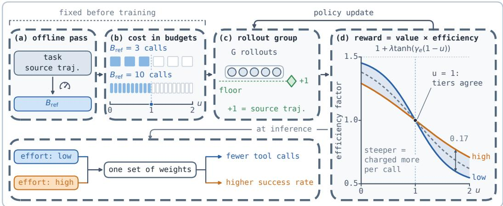  
Figure 2: CARE-PO overview. The budgets 3 and 10 in (b) are illustrative. Cost u covers more than calls: Eq. (3) also charges a repeated call twice and charges evidence the trajectory never obtained. The 0.17 marked in (d) is the largest gap between the tiers, and the dashed middle curve there is the unconditioned tier (no tag). Definitions in Sections 3.2–3.5.

These rates measure the amount of redundancy, not its cost to a trajectory, and it is the cost that decides where the reward should act. Step-by-step labelling yields many behavioural patterns; grouping them by what each costs the trajectory leaves only three forms.

(i) Calls with no increment return no task-relevant new information: aimless search, re-verification of a confirmed result, one acquisition split into several. Each adds a call and no information, so the call count measures them fully. (ii) Repeated calls closely match an earlier call in tool, arguments and return, re-consuming an observation already obtained; the count cannot distinguish them from productive ones. Repetition occupying a trajectory’s tail is a tail repetition loop: it often persists to the call cap (Liu et al., 2024b), which wastes calls and also leaves the trajectory unable to answer. (iii) Evidence gaps belong to no single call: a cue that could advance the task appears and goes unused. The side searches that follow are counted as form (i), but the harm is to correctness rather than to cost. Frequency and harm run in opposite orders across the three: form (i), fully priced by the count, is the most common and least harmful, while forms (ii) and (iii), whose harm the count misses, are most associated with wrong answers (definitions, criteria and per-form statistic in Appendix A). Section 3.4 therefore prices each of these two with a term of its own.

## 3.2 PROBLEM SETTING AND OBJECTIVE

In the ReAct-style loop (Yao et al., 2023), the policy $\pi _ { \theta }$ alternates reasoning and tool calls on a task x until it answers. A trajectory o makes $S ( o )$ tool calls under a hard cap $T _ { \mathrm { m a x } } ; c ( x , o ) \in \{ 0 , 1 \}$ marks whether o delivers, i.e. completes the task goal (graded automatically, Appendix D).

The goal is to reduce $S ( o )$ , and no trajectory may trade correctness for efficiency. Policy-gradient training optimizes an unconstrained expected return, so that requirement enters as a product: return is delivered value times an efficiency factor, and a trajectory that fails to deliver scores below every delivering one however many calls it saves; an additive step penalty does not guarantee this. The cost the efficiency factor measures cannot be the raw call count, because tasks differ widely in how many calls they need. We measure each training task’s difficulty by its reference budget $B _ { \mathrm { r e f } } ( x )$ an estimate of the calls needed to complete it, and define cost as $\dot { u } = S ( o ) / B _ { \mathrm { r e f } } ( x )$ , the number of budgets a trajectory spends (Eq. (3) also charges repeated calls and evidence never obtained). With a budget of 3 one call adds $1 / 3$ to $u ,$ with a budget of 10 only 1/10 (Figure 2(b)), so pressure decreases as the task demands more. The estimate is made before training begins (Section 3.3) and then stays fixed, so the demand on the call count never tightens as the policy’s trajectories shorten.

Once cost is defined, two choices remain free, how strongly to penalize overspending and how much to reward saving, and the effort tier sets them. The objective is therefore a family, indexed by an effort tier $e \in \mathcal { E } = \{ \emptyset$ , low, high} that is an input to the policy: ∅ is the unconditioned tier, with no effort tag in the prompt; low and high are the two tiers the user selects at inference. Formally,

$$
\pi _ { e } ^ { \star } = \arg \operatorname* { m a x } _ { \pi } \mathbb { E } _ { x \sim \mathcal { D } , o \sim \pi ( \cdot | x , e ) } \Big [ V _ { e } ( x , o ) \cdot U _ { e } ( u ) \Big ] ,\tag{1}
$$

where $V _ { e }$ is the delivered value and $U _ { e }$ the efficiency factor, monotonically decreasing in the cost u; Section 3.4 gives their concrete forms and what e changes in them. One conditional policy $\pi _ { \theta } ( \cdot \mid x , e )$ approximates the whole family, so the two operating points share one set of weights.

## 3.3 TRAINING DATA AND REFERENCE BUDGET

Training data. Training tasks come from MiroVerse (MiroMind Team, 2025) (v0.1, about 148k trajectories): long, call-dense and often redundant, yet automatically gradable. Most of it is Voyager1.0, the rest mainly multi-hop QA and web-browsing datasets such as MuSiQue, HotpotQA, 2WikiMultihopQA and WebWalkerQA. Preprocessing, which never involves the policy, runs in three steps. Successful source trajectories with at least five calls form the candidate pool (about 64k), since shorter ones leave almost nothing to compress; the offline pass below gives each candidate a reference budget, an evidence checklist and a gradable answer; and three checks on these quantities ensure that coverage is not binary, that each piece of evidence is worth a call and that the source trajectory leaves room to compress (Appendix D). Training draws its tasks from a fixed list of 300, balanced across reference budgets and shared by all three sizes. Exact and 8-gram matching finds no training question in any evaluation set.

Reference budget and evidence checklist. One offline pass per task estimates, then verifies, the reference budget and the evidence checklist, and discards tasks with no extractable gradable answer. Guided by the three forms of Section 3.1, a judge model reduces the source trajectory to a minimal chain of essential steps and marks the evidence each requires: the chain’s length is the candidate value, and the marked entities drawn from tool observations form the evidence checklist $E ( x )$ second prompt, which sees the chain but not how it was estimated, checks it: a failure triggers reestimation under a relaxed budget, and a task whose budget must be relaxed to the source trajectory’s call count $S _ { \mathrm { l o n g } } ( x )$ is discarded as having no compressible slack (details in Appendix D). The pass outputs $B _ { \mathrm { r e f } } ( x ) , E ( x )$ and a gradable answer for training; the chain itself is never shown to the model. The reference budget need only be reachable in real execution, not the task’s true minimum or any one model’s optimum: an estimation error changes the magnitude of the pressure, not its direction.

## 3.4 CARE-PO REWARD: DELIVERED VALUE TIMES TASK-RELATIVE EFFICIENCY

CARE-PO keeps the GRPO optimizer; each trajectory’s reward is the product of the factors of Eq. (1):

$$
R _ { e } ( x , o ) = \underbrace { \Big [ c ( x , o ) + \big ( 1 - c ( x , o ) \big ) b _ { e } \mathrm { C o v } ( o ) \Big ] } _ { \mathrm { d e l i v e r e d v a l u e ~ } V _ { e } } \cdot \underbrace { \Big [ 1 + \lambda \operatorname { t a n h } \big ( \gamma _ { e } ( 1 - u ) \big ) \Big ] } _ { \mathrm { e f f i c i e n c y f a c t o r ~ } U _ { e } } .\tag{2}
$$

Delivered value. A delivering trajectory is worth 1; a failing one earns partial credit $b _ { e } \operatorname { C o v } ( o )$ where $\operatorname { C o v } ( o ) \in [ 0 , 1 ]$ is the fraction of the evidence checklist $E ( x )$ its observations cover $( \mathsf { A p - }$ pendix D). A trajectory that terminates early gathers little evidence and earns little, so no separate early-termination penalty is needed—a call-free trajectory obtains no evidence and is worth exactly zero unless correct. Partial credit must never lift a failure above a success: a failing trajectory earns at most $b _ { e } ( 1 + \lambda )$ (full coverage, efficiency factor at its upper bound) and a delivering one at least $1 - \lambda$ , so $\dot { b _ { e } } < ( \dot { 1 } - \lambda ) / ( 1 + \lambda ) \bar  $ suffices to keep that ordering for every task, tier and call count. We set $\lambda = 0 . 5$ , giving $b _ { e } < 1 / 3$

Task-relative efficiency. Three properties of the tanh’s shape govern the pressure toward shorter trajectories. It is strictly decreasing in the cost u, so compression below the reference budget earns further credit. It is bounded on both sides, confining the factor to $1 \pm \lambda .$ , so neither the penalty for waste nor the return on extreme compression grows without bound. Finally, it is steepest at $u = 1$ where calls exactly meet the reference budget, placing the pressure where the choice between one more call and answering now is hardest. The cost is defined so that calls saved without obtaining evidence earn nothing:

$$
u = { \frac { S _ { { \mathrm { c h a r g e d } } } ( o ) } { B _ { \mathrm { r e f } } ( x ) } } + { \bigl ( } 1 - \operatorname { C o v } ( o ) { \bigr ) } , \qquad S _ { { \mathrm { c h a r g e d } } } ( o ) = S ( o ) + { \bigl | } \{ j : { \mathrm { c a l l ~ } } j { \mathrm { ~ r e p e a t s ~ a n ~ e a r l i e r ~ c a l l } } \} { \bigr | } .\tag{3}
$$

The first term prices form (ii) of Section 3.1 by charging repeated calls twice. The second term, the coverage term, prices form (iii): evidence the checklist requires but the trajectory never obtained is converted into reference budgets in proportion, so missing half the evidence counts as spending half a budget more. A trajectory that calls no tool thus costs exactly one reference budget even when it happens to be correct—the same as one that spent its entire budget delivering.

Tier control: changing the price of a call. Task difficulty and effort tier meet in one quantity: near $u = 1$ , one more call lowers the efficiency factor by about $\lambda \gamma _ { e } / B _ { \mathrm { r e f } } ( x )$ , so a call is cheaper on a harder task and its price scales with the tier’s $\gamma _ { e } .$ A single price factor $t > 1$ sets $\gamma _ { e } \colon t$ at the low tier, 1 at the unconditioned tier and $1 / t$ at high, with $t = 1 . 5 .$ , so a call at the low tier costs $t ^ { 2 }$ times what it costs at the high tier. Partial credit scales inversely, $b _ { e } \propto 1 / \gamma _ { e } \mathrm { : }$ we set $b _ { \mathrm { h i g h } } = 0 . 3 0$ giving $b _ { \mathcal { O } } = 0 . 2 0$ and $b _ { \mathrm { l o w } } = \bar { 0 . 1 3 }$ , all three within the bound $b _ { e } < 1 / 3$ above. The two effects work together: the high tier credits partial progress more and charges each call less. Only the low and high tiers are exposed to the user, a binary mode with precedent in reasoning-mode switches (Fang et al., 2025; Zhang et al., 2025; Qwen Team, 2025).

The tier-neutral point. At $u = 1$ the argument of the tanh is zero, so the efficiency factor is 1 for any $\gamma _ { e } .$ : a delivering trajectory that spends exactly one reference budget scores the same at every tier. A larger $\gamma _ { e }$ makes the curve steeper, which fixes the tiers’ ordering: below one reference budget the low tier scores highest, above it lowest, the separation widening away from the neutral point and narrowing again once overspending saturates the curves (Figure 2(d)). For failing trajectories, the value $b _ { e } \operatorname { C o v } ( o )$ is higher at the high tier than at the low one, but only through scaling the partial credit, independently of the call count.

Conditioning and mixing. The effort tag sits in the prompt, and the difference between the two operating points rests entirely on it. The effort tier is sampled independently for each rollout, with probabilities 0.2 : 0.4 : 0.4 for the unconditioned tier, low and high, so a group mixes tiers and the group-relative advantage compares them within a task, against the common reference of the tier-neutral point. Mixing tiers also widens the spread of scores within a group, on which the grouprelative advantage depends (Section 3.5). The unconditioned tier sets the default behaviour with no tag and serves as an internal control (Section 6.2).

## 3.5 THE SOURCE TRAJECTORY AS A GROUP FLOOR

Pricing tool calls admits a degenerate solution: issuing no call at all. The reward side is already addressed by evidence pricing, the coverage term of Eq. (3); the optimizer side stays open. The group-relative advantage scores a rollout against the rest of its group, so once the whole group issues the same number of calls, the price of a call no longer distinguishes rollouts (He et al., 2026).

Each group of G rollouts therefore receives the task’s own source trajectory as member G+1, scored by Eq. (2) at the unconditioned tier; injecting an extra member has precedent (He et al., 2026), but this one is fixed per task and does not move with the group. This member was not drawn from πθ; its importance ratio starts at 1 and its advantage is clipped below at zero. It is a floor rather than a target. In most groups it costs more and scores below the group mean, and its clipped advantage adds no gradient; when most of the group fails and the mean drops below it, its positive advantage pulls the policy back to a delivering path, much as off-policy guidance does in mixed-policy GRPO (Yan et al., 2025). When no rollout obtains evidence, the source trajectory raises the group mean, so failing call-free rollouts receive negative advantages.

## 4 EXPERIMENTAL SETUP

Models and training. Base models are Qwen3.5 (Qwen Team, 2026) at 4B, 9B and 27B; unless stated otherwise, analyses and ablations use 9B on GAIA. Training is online GRPO through LoRA (Hu et al., 2022). One recipe serves all three sizes, with the learning rate chosen per size. Training and evaluation share four tools: web search, page retrieval, Python execution and local file reading. The call cap $T _ { \mathrm { m a x } } = 2 0$ exceeds the longest source trajectory of any training task. Appendix D gives hyperparameters and tool implementations.

Benchmarks and protocol. The main evaluation set is GAIA’s 165-question validation split (Mialon et al., 2024), long-horizon tasks with heterogeneous tools; the held-out evaluation adds four multi-hop QA benchmarks: 500 questions from each official split of 2Wiki (Ho et al., 2020), HotpotQA (Yang et al., 2018) and MuSiQue (Trivedi et al., 2022), and all 125 of Bamboogle (Press et al., 2023). Training and evaluation both use live, non-stationary web search, so on GAIA we report mean and sample s.d. over three independent runs; on the multi-hop benchmarks greedy decoding and query-level caching make a single run deterministic (significance tests in Appendix D).

Metrics. SR is the success rate and AC the average tool calls per question (failures included). HV is the hypervolume indicator (Zitzler & Thiele, 1999) on the success-rate–call-count plane: with the worst corner (zero success at the full call cap) as reference point, an operating point spans a rectangle of area $\mathrm { H V } = \mathrm { S R } \cdot ( 1 - \mathrm { A C } / T _ { \mathrm { m a x } } )$ , with SR as a fraction. It summarizes the trade-off (higher is better); a policy with zero success scores zero however few calls it makes. HV implies an exchange rate set by $T _ { \mathrm { m a x } }$ (at the 9B efficiency point, one saved call is worth about 2.4 SR points; Appendix D), so our main GAIA conclusions rest on SR and AC separately.

Compared methods. Vanilla ReAct is the untrained base model; the other three each represent one class of Section 2. Budget-Prompt, our instance of the inference-time class (Liu et al., 2026b; Chen et al., 2026b; Fang et al., 2026), only states a call budget in the prompt; DEPO (Chen et al., 2026a) adds an efficiency reward to offline preference alignment; OTC-PO (Wang et al., 2025) is the online-RL case, closest to ours. All four share CARE-PO’s base model, toolset and protocol;

Table 1: Main results on GAIA-165 (mean±sample s.d. over three independent runs; best per metric and size in bold). Below the dashed line: CARE-PO (low), the efficiency point, and CARE-PO (high), the capability point, from one set of weights. Arrows give the change from Vanilla ReAct at the same size (percentage points for SR, relative for AC and HV); green marks an improvement.
<table><tr><td>Method</td><td>SR↑</td><td>AC↓</td><td>HV↑</td></tr><tr><td>Qwen3.5-9B</td><td></td><td></td><td></td></tr><tr><td>Vanilla ReAct</td><td> $4 0 . 2 \pm 0 . 7$ </td><td>8.26±0.14</td><td>0.236±0.005</td></tr><tr><td>Budget-Prompt</td><td> $3 5 . 4 { \pm } 0 . 3 { \ \pm } 4 . 8$ </td><td> $8 . 5 0 { \scriptstyle \pm 0 . 0 5 \ } { \scriptstyle \pm 2 . 9 \% }$ </td><td> $0 . 2 0 3 { \scriptstyle \pm 0 . 0 0 1 ~ { \scriptstyle \Psi 1 4 . 0 \% } }$ </td></tr><tr><td>DEPO</td><td> $3 4 . 7 { \pm } 0 . 9 \ \mathbf { \ v } 5 . 5$ </td><td> $7 . 5 4 { \scriptstyle \pm 0 . 0 5 ~ { \pm 8 . 7 \% } }$ </td><td> $0 . 2 1 7 { \scriptstyle \pm 0 . 0 0 5 ~ \pm 0 . 1 \% }$ </td></tr><tr><td>OTC-PO</td><td> $4 0 . 6 { \pm } 1 . 2 \ { \pm } 0 . 4$ </td><td> $5 . 0 1 { \pm } 0 . 1 3 ~ { \pm } 3 9 . 3 \%$ </td><td> $0 . 3 0 4 { \scriptstyle \pm 0 . 0 1 2 \ \pm 2 8 . 8 \% }$ </td></tr><tr><td>CARE-PO (low)</td><td> $3 9 . 8 { \pm } 2 . 3 { \ } { \pm } 0 . 4$ </td><td> $3 . 4 2 { \scriptstyle \pm 0 . 3 0 ~ } { \pm 5 8 . 6 \% }$ </td><td> $\overline { { 0 . 3 3 0 { \pm } } } 0 . 0 1 5 { \scriptstyle \pm } 3 9 . 8 \%$ </td></tr><tr><td>CARE-PO (high)</td><td> $4 3 . 8 { \scriptstyle \pm 0 . 3 \ } _ { \Delta 3 . 6 }$ </td><td> $4 . 4 4 { \scriptstyle \pm 0 . 1 5 ~ \pm 6 . 2 \% }$ </td><td> $\mathbf { 0 . 3 4 1 \pm 0 . 0 0 2 \ A 4 4 . 5 \% }$ </td></tr><tr><td>Qwen3.5-27B</td><td></td><td></td><td></td></tr><tr><td>Vanilla ReAct</td><td>51.3±0.3</td><td> $1 0 . 6 6 { \scriptstyle \pm 0 . 0 6 }$ </td><td>0.240±0.002</td></tr><tr><td>OTC-PO</td><td> $5 2 . 1 \pm 2 . 4 \ \pm 0 . 8 $ </td><td> $5 . 5 7 { \scriptstyle \pm 0 . 2 1 \ \pm \atop { \scriptstyle \pm 0 . 7 7 } }$ </td><td> $0 . 3 7 6 { \scriptstyle \pm 0 . 0 1 4 \ \pm 5 6 . 7 \% }$ </td></tr><tr><td>CARE-PO (low)</td><td> $5 7 . 4 { \pm } 1 . 5 \ \mathrm { \pm } 6 . 1 $ </td><td> $5 . 2 0 { \scriptstyle \pm 0 . 0 7 } ~ { \pm 5 1 . 2 \% }$ </td><td> $\mathbf { 0 . 4 2 5 \pm 0 . 0 1 3 \_ 6 7 } 7 . 1 \%$ </td></tr><tr><td>CARE-PO (high)</td><td> $5 4 . 7 { \scriptstyle \pm 0 . 3 \ \pm 3 . 4 }$ </td><td> $6 . 1 2 { \scriptstyle \pm 0 . 2 2 { \scriptstyle \pm 2 . 6 \% } }$ </td><td> $0 . 3 8 0 { \scriptstyle \pm 0 . 0 0 6 } ~ { \scriptstyle \pm 5 8 . 3 \% }$ </td></tr><tr><td>Qwen3.5-4B</td><td></td><td></td><td></td></tr><tr><td>Vanilla ReAct</td><td>27.5±0.9</td><td>8.27±0.11</td><td> $0 . 1 6 1 { \scriptstyle \pm 0 . 0 0 5 }$ </td></tr><tr><td>OTC-PO</td><td> $2 8 . 1 { \pm } 1 . 3 ~ { \pm } 0 . 6$ </td><td> $\mathbf { 4 . 1 4 \pm 0 . 2 9 \ 7 4 9 . 9 \% }$ </td><td> $0 . 2 2 3 { \scriptstyle \pm 0 . 0 1 3 \ \pm 3 8 . 5 \% }$ </td></tr><tr><td>CARE-PO (low)</td><td> $3 1 . 9 { \scriptstyle \pm 0 . 9 ~ \pm 4 . 4 }$ </td><td> $5 . 0 1 { \scriptstyle \pm 0 . 1 6 { \pm 0 . 4 \% } }$ </td><td> $\mathbf { 0 . 2 3 9 \pm 0 . 0 0 8 \_ 4 4 8 . 4 \% }$ </td></tr><tr><td> $\mathbf { C A R E - P O } \ \mathrm { ( h i g h ) }$ </td><td> $3 1 . 9 { \scriptstyle \pm 0 . 9 ~ \pm 4 . 4 }$ </td><td> $7 . 6 0 { \scriptstyle \pm 0 . 4 1 ~ \pm 0 . 1 \% }$ </td><td> $0 . 1 9 8 { \scriptstyle \pm 0 . 0 1 1 ~ } { \scriptstyle \pm 2 3 . 0 \% }$ </td></tr></table>

Table 2: Results on four held-out multi-hop benchmarks (deterministic single run; question counts in Section 4). Best per column and size in bold.
<table><tr><td></td><td colspan="3">2Wiki</td><td colspan="3">HotpotQA</td><td colspan="3">MuSiQue</td><td colspan="3">Bamboogle</td></tr><tr><td>Method</td><td>SR↑</td><td>AC↓</td><td>HV↑</td><td>SR↑</td><td>AC↓</td><td>HV↑</td><td>SR↑</td><td>AC↓</td><td>HV↑</td><td>SR↑</td><td>AC↓</td><td>HV↑</td></tr><tr><td>Qwen3.5-9B</td><td></td><td></td><td></td><td></td><td></td><td></td><td></td><td></td><td></td><td></td><td></td><td></td></tr><tr><td>Vanilla ReAct</td><td></td><td></td><td>75.8 5.64 0.544 48.6</td><td></td><td>4.87</td><td>0.368 29.0</td><td></td><td>6.59</td><td>0.194 76.0</td><td></td><td>4.05</td><td>0.606</td></tr><tr><td>OTC-PO</td><td></td><td></td><td>70.6 2.24 0.627 48.0</td><td></td><td>1.59</td><td>0.442</td><td>225.6</td><td>2.23</td><td>0.227</td><td>68.8</td><td>1.38</td><td>0.640</td></tr><tr><td>CARE-PO (low) CARE-PO (high)</td><td>63.2</td><td>1.94</td><td>0.571</td><td>41.4</td><td>1.09</td><td>0.391</td><td>21.4</td><td>1.55</td><td>0.197</td><td>43.2</td><td>0.50</td><td>0.421</td></tr><tr><td></td><td>70.4</td><td>2.19</td><td>0.627</td><td>46.2</td><td>1.51</td><td>0.427</td><td>25.2</td><td>2.10</td><td>0.226</td><td>60.8</td><td>1.20</td><td>0.572</td></tr><tr><td>Qwen3.5-27B Vanilla ReAct</td><td>80.2</td><td>6.78</td><td>0.53055.8</td><td></td><td>5.97</td><td>0.391 34.6</td><td></td><td>8.07</td><td></td><td></td><td></td><td>0.20674.42.460.653</td></tr><tr><td>OTC-PO</td><td>66.8</td><td>2.11</td><td>0.598 38.8</td><td></td><td>0.98</td><td>0.369</td><td>29.2</td><td>2.78</td><td>0.251 45.6 0.42</td><td></td><td></td><td>0.446</td></tr><tr><td>CARE-PO (low)</td><td>81.4</td><td>2.44</td><td>0.715</td><td>53.6</td><td>1.77</td><td>0.488</td><td>35.2</td><td>3.20</td><td>0.296</td><td>72.0</td><td>0.86</td><td>0.689</td></tr><tr><td>CARE-PO (high)</td><td>81.2</td><td>2.75</td><td>0.700</td><td>54.2</td><td>2.35</td><td>0.478</td><td>34.8</td><td>4.00</td><td>0.278</td><td>75.2</td><td>1.70</td><td>0.688</td></tr><tr><td>Qwen3.5-4B Vanilla ReAct</td><td></td><td></td><td></td><td></td><td></td><td></td><td></td><td></td><td></td><td></td><td></td><td></td></tr><tr><td></td><td></td><td></td><td>66.0 3.09 0.558 45.2</td><td></td><td>2.89</td><td>0.387 21.4 6.22</td><td></td><td></td><td></td><td></td><td></td><td>0.147 47.2 2.19 0.420</td></tr><tr><td>OTC-PO</td><td></td><td></td><td>52.01.51 0.481 30.60.77</td><td></td><td></td><td>0.294 15.6 1.11</td><td></td><td></td><td></td><td></td><td></td><td>0.147 33.6 0.47 0.328</td></tr><tr><td></td><td></td><td></td><td></td><td></td><td></td><td></td><td></td><td></td><td></td><td></td><td></td><td></td></tr><tr><td></td><td></td><td></td><td></td><td></td><td></td><td></td><td></td><td></td><td></td><td></td><td></td><td></td></tr><tr><td></td><td></td><td></td><td></td><td></td><td></td><td></td><td></td><td></td><td></td><td></td><td></td><td></td></tr><tr><td>CARE-PO (low)</td><td>66.8</td><td></td><td>3 1.99 0.601 44.8</td><td></td><td>1.25</td><td>0.42019.8</td><td></td><td>2.74</td><td></td><td></td><td></td><td>0.171 48.8 0.89 0.466</td></tr><tr><td></td><td></td><td></td><td></td><td></td><td></td><td></td><td></td><td></td><td></td><td></td><td></td><td></td></tr><tr><td>CARE-PO (high)</td><td></td><td></td><td>75.4 2.800.64948.8</td><td></td><td></td><td>8 2.78 0.420 23.2 5.97 0.163 69.6 2.12 0.622</td><td></td><td></td><td></td><td></td><td></td><td></td></tr></table>

both trained baselines are reimplemented as their papers describe. Budget-Prompt and DEPO are compared at 9B, OTC-PO at all three sizes.

## 5 MAIN RESULTS

Main results on GAIA. Five of the six operating points in Table 1 improve on their base model in success rate and call count at once, raising success rate by 3.4 to 6.1 points $( p = 0 . 0 1$ for the largest) and reducing calls by 8.1% to 51.2%; the sixth, the efficiency point at 9B, is statistically indistinguishable from it in success rate $( p = 0 . 8 9 )$ while calling 58.6% less. On GAIA, compression therefore does not sacrifice correctness. At 9B, Budget-Prompt and DEPO fall below the base model in success rate, and OTC-PO matches it; our two points both call less than OTC-PO by more than run-to-run variation. Token counts fall with the calls (Appendix B).

Transfer to the held-out benchmarks. The efficiency point’s compression carries over to the four multi-hop benchmarks (Table 2), with a size-dependent effect on success rate: at 27B neither point differs significantly from the base model; at 4B neither falls significantly below it and the capability point rises significantly on three of four; at 9B both points fall below it on all four. Most questions here are two-hop, leaving little redundancy to remove before necessary calls are affected, and 9B is compressed most (its efficiency point calls 23% as often as the base model, against 35% at 27B and 48% at 4B). OTC-PO over-compresses the same way at 27B and 4B, whereas ours keeps success rate essentially unchanged there at a somewhat higher call count.

## 6 ANALYSIS AND ABLATIONS

## 6.1 SOURCES OF THE CALL REDUCTION

Over half the reduction comes from trajectories that exhaust the call cap. Trajectories that exhaust the $T _ { \mathrm { m a x } }$ cap fall from 15.6% of the base model’s to 1.4% and 3.4% at the efficiency and capability points. Almost all of the base model’s capped trajectories answer wrongly; calls spent in capped trajectories fall from 3.11 to 0.28 per question, 58.5% of the efficiency point’s reduction. Tail repetition loops (form (ii), Appendix A) often run to the cap; capped or not, they end 17.6% of the base model’s trajectories and account for 33% of the reduction. Eq. (3) charges such trajectories the most. By the diagnosis judge’s per-call labels (Appendix A), of the calls the efficiency point removes, 58% are form (ii), 20% form (i) and 21% necessary; form (iii), which belongs to no single call, stays under 1%. The reduction is not abandonment—on the 37 questions that the base model and the efficiency point both answer correctly in every run, calls still fall by 57.5%.

Compression scales with task difficulty. Regressing per-question call counts on those of a separate base-model run (to avoid regression to the mean) gives slopes of 0.91 for the base model itself and 0.22 and 0.26 for the efficiency and capability points (0.28 and 0.31 at 4B): the compressed call count still rises with the base model’s, rather than every task being pulled toward one common count.

## 6.2 COMPONENT ABLATIONS

The comparison with OTC-PO already contrasts its moving anchor, the group’s shortest correct rollout, with our fixed budget (Table 1, where one of our operating points has the higher HV at every size) and its collapsing run with ours (Section 6.3); here we ablate the effort conditioning and the coverage term.

Table 3: Ablation of the effort conditioning (GAIA-165, 9B).
<table><tr><td>Configuration</td><td>SR↑</td><td>AC↓</td><td>HV↑</td><td>Note</td></tr><tr><td>Trained at t = 1, low tag</td><td>39.2</td><td>4.07</td><td>0.312</td><td>same price at every tier</td></tr><tr><td>Trained at t = 1, high tag</td><td>40.6</td><td>4.91</td><td>0.306</td><td>as above</td></tr><tr><td>Same weights, no tag at inference</td><td>39.8</td><td>4.29</td><td>0.313</td><td>the unconditioned tier from training</td></tr><tr><td>Untrained base + low tag</td><td>37.0</td><td>7.01</td><td>0.240</td><td>no training, prompt only</td></tr><tr><td>Untrained base + high tag</td><td>40.6</td><td>7.77</td><td>0.248</td><td>no training, prompt only</td></tr><tr><td>CARE-PO (low)</td><td>39.8</td><td>3.42</td><td>0.330</td><td>efficiency operating point</td></tr><tr><td>CARE-PO (high)</td><td>43.8</td><td>4.44</td><td>0.341</td><td>capability operating point</td></tr></table>

The operating points come from training rather than the prompt. Prompting the untrained base with the tags (Table 3, rows 4–5) separates the call counts but changes HV by less than 6%: its low tag removes 1.25 calls at a loss of 3.2 points of success rate, whereas the trained efficiency point removes 4.84 calls at a loss of 0.4 (Table 1). The tag specifies an effort level but not which calls are redundant; training couples each tag to a per-call price, and the calls it removes are mostly those that Eq. (3) prices highest (Section 6.1). The unconditioned tier, trained at the intermediate price $\gamma _ { \mathcal { D } } = 1$ , likewise lies between the two operating points in call count, consistent with each operating point being set by the price under which it is trained.

The capability point relies on the price factor. With t = 1 (Table 3, rows 1–2) all tiers are trained on one reward, so the residual separation in call count stems from the tag alone. This separation no longer raises success rate: the high tag issues more calls than the full method’s capability point (4.91 against 4.44) at a lower success rate (40.6 against 43.8), and its margin over the low tag shrinks from 4.0 points to 1.4. Only for t > 1 does the high tier combine a lower per-call price with larger partial credit for the evidence obtained, so that additional calls are rewarded for advancing the evidence chain rather than for their number.

The operating points differ on individual questions. The two operating points differ in call count on 112 of GAIA’s 165 questions at 9B, and on 82 (73.2%) the efficiency point calls less (two-sided sign test, $p = 9 \times 1 0 ^ { - 7 } ) \mathrm { : }$ ; over the twelve combinations of four held-out benchmarks and three model sizes, the direction holds on 79.2%–100% of the differing questions.

The coverage term mainly affects incorrect trajectories. Removing the coverage term (1 − Cov) from Eq. (3) while keeping partial credit leaves success rate matching the full method (39.6 against 39.8) and raises the call count from 3.42 to 4.00. The increase is confined to incorrect trajectories (3.97 to 4.90), while correct ones average 2.61 calls under both: they have mostly gathered their evidence already, so the term adds little to their cost.

## 6.3 CALL-COUNT COLLAPSE IN TRAINING

(a) checkpoints
<table><tr><td rowspan="2">step</td><td colspan="2">CARE-PO</td><td colspan="2">OTC-PO</td></tr><tr><td>SR</td><td>AC</td><td>SR</td><td>AC</td></tr><tr><td>0</td><td>70.5</td><td>6.23</td><td>64.8</td><td>3.97</td></tr><tr><td>100</td><td>71.65.15</td><td></td><td>71.6</td><td>3.86</td></tr><tr><td>200</td><td>81.8 4.45</td><td></td><td>72.7</td><td>4.56</td></tr><tr><td>300</td><td>77.3</td><td>5.48</td><td>68.2</td><td>2.65</td></tr><tr><td>400</td><td></td><td>80.7  3.59</td><td>9.1</td><td>0.02</td></tr><tr><td>500</td><td>80.7</td><td>4.10</td><td>9.1</td><td>0.00</td></tr></table>

SR: group success rate (%).

AC: mean tool calls per rollout.  
(b, c) per-step curves  
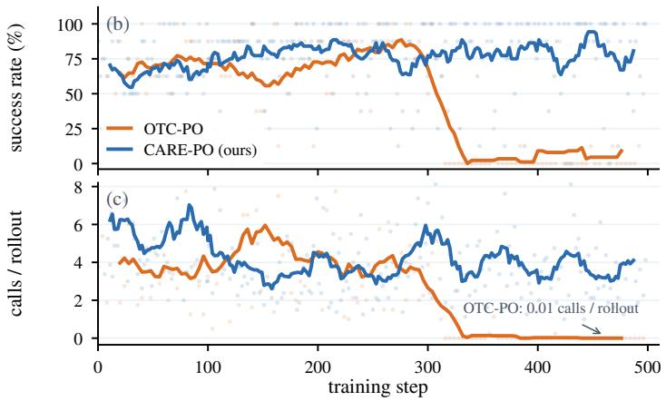  
Figure 3: Training dynamics at 27B for OTC-PO and our method, excluding the injected source trajectory; solid curves are running means of the per-step values (dots). (a) The running means at six steps; bold values follow the collapse. (b) Group success rate on the training distribution. (c) Mean tool calls per rollout.

Unlike our method, OTC-PO at 27B collapses toward zero calls. After step 300 OTC-PO’s call count falls to 0.01 per rollout, the degenerate solution of Section 3.5 (Figure 3); at 9B and 4B it does not reach this solution in training, while ours remains well above zero at all three sizes (Appendix C). Tables 1 and 2 therefore evaluate 27B OTC-PO at an earlier checkpoint.

## 7 CONCLUSION AND LIMITATIONS

We started from a step-level diagnosis: over 80% of Qwen3.5’s GAIA trajectories contain removable calls, at both sizes examined. We treat call efficiency as a property controllable at inference and propose CARE-PO, which prices calls against a reference budget anchored to each task’s own difficulty and fixed before training, eases call-count collapse with evidence pricing and a sourcetrajectory floor, and changes the price of a call by effort tier, so that one set of weights yields an efficiency and a capability operating point. On GAIA, five of the six operating points across three sizes improve on their base model in success rate and call count at once, and the sixth matches it in success rate at 58.6% fewer calls; over half the reduction comes from base-model trajectories that exhaust the call cap, almost all of them failures. At all three sizes the group-mean call count remains well above zero throughout training, whereas OTC-PO collapses toward issuing no call at 27B.

Limitations and future work. On the held-out multi-hop benchmarks, where most questions are two-hop, compression readily encroaches on necessary calls: success rate does not fall significantly at 4B or 27B, but 9B, compressed most, trades it for fewer calls at both points. Our reward presupposes automatically gradable goals and a successful source trajectory for each training task; for lack of compute, training and evaluation cover only question answering (GAIA and four short-answer multi-hop benchmarks), on one model family, Qwen3.5. Training and evaluating on more complex tasks without a single success criterion, and estimating reference budgets for tasks with no source trajectory, are natural next steps.

## ETHICS STATEMENT

Training tasks are drawn from the public MiroVerse dataset (MiroMind Team, 2025), and evaluation uses the public benchmarks GAIA (Mialon et al., 2024), 2Wiki (Ho et al., 2020), HotpotQA (Yang et al., 2018), MuSiQue (Trivedi et al., 2022) and Bamboogle (Press et al., 2023); no human subjects are involved. Training and evaluation query the live web through third-party search and pagefetching APIs; the per-question records we release contain no retrieved web content.

## REPRODUCIBILITY STATEMENT

Section 3.3 and Appendix D describe how the training data, reference budgets and evidence checklists are constructed; Section 4 gives the evaluation protocol and metrics, and Appendix D the hyperparameters, the toolset and the prompt specifications. The baselines that require training (DEPO, OTC-PO) are reimplemented as their papers describe. The supplementary material contains the training and rollout code with its prompts, a standalone implementation of the reward, the training configurations at the three sizes, the final LoRA adapters at 9B and 27B, the list of training tasks, and the per-question evaluation records with a script that recomputes Tables 1–3.

## AI USE STATEMENT

Large language models are used in three steps of this work, each described in the paper: the offline pass that produces the reference budget, the evidence checklist and the gradable answer (Section 3.3), the coverage judgment during training (Section 3.4), and the diagnosis of redundant calls (Sections 3.1 and 6.1). We also used LLM assistants for coding and data analysis, literature search, and language editing, including drafting parts of the text. The authors reviewed all such output and take full responsibility for the content of the paper.

## REFERENCES

Pranjal Aggarwal and Sean Welleck. L1: Controlling how long a reasoning model thinks with reinforcement learning. In Conference on Language Modeling (COLM), 2025. arXiv:2503.04697.

Islem Bouzenia and Michael Pradel. Understanding software engineering agents: A study of thought-action-result trajectories. In 40th IEEE/ACM International Conference on Automated Software Engineering (ASE), 2025.

Sirui Chen, Mengshi Zhao, Lei Xu, Yuying Zhao, Beier Zhu, Hanwang Zhang, Shengjie Zhao, and Chaochao Lu. DEPO: Dual-efficiency preference optimization for LLM agents. In Proceedings ofthe AAAI Conference on Artificial Intelligence (AAAI), 2026a.

Yuqi Chen, Vincent Siu, Yang Liu, Dawn Song, and Chenguang Wang. Tunable tool-call rates in LLM agents via representation steering. arXiv preprint arXiv:2608.25198, 2026b.

Alejandro Cuadron, Dacheng Li, Wenjie Ma, Xingyao Wang, Yichuan Wang, Siyuan Zhuang, Shu Liu, Luis Gaspar Schroeder, Tian Xia, Huanzhi Mao, Nicholas Thumiger, Aditya Desai, Ion Stoica, Ana Klimovic, Graham Neubig, and Joseph E. Gonzalez. The danger of overthinking:

Examining the reasoning-action dilemma in agentic tasks. arXiv preprint arXiv:2502.08235, 2025.

Wenlong Deng, Yushu Li, Boying Gong, Yi Ren, Christos Thrampoulidis, and Xiaoxiao Li. On group relative policy optimization collapse in agent search: The lazy likelihood-displacement. In International Conference on Machine Learning (ICML), 2026.

Gongfan Fang, Xinyin Ma, and Xinchao Wang. Thinkless: LLM learns when to think. In Advances in Neural Information Processing Systems (NeurIPS), 2025.

Zhengru Fang, Senkang Forest Hu, Zhonghao Chang, Yu Guo, Yihang Tao, Hongyao Liu, Mengzhe Ruan, Jun Huang, and Yuguang Fang. Inference-time budget control for LLM search agents. arXiv preprint arXiv:2605.05701, 2026.

Qianyu He, Siyu Yuan, Xuefeng Li, Mingxuan Wang, and Jiangjie Chen. ThinkDial: An open recipe for controlling reasoning effort in large language models. arXiv preprint arXiv:2508.18773, 2025.

Xixiang He, Qiyao Sun, Ao Cheng, Xingming Li, Xuanyu Ji, Hailun Lu, Runke Huang, and Qingyong Hu. Advantage collapse in group relative policy optimization: Diagnosis and mitigation. In International Conference on Machine Learning (ICML), 2026. arXiv:2605.21125.

Xanh Ho, Anh-Khoa Duong Nguyen, Saku Sugawara, and Akiko Aizawa. Constructing a multihop QA dataset for comprehensive evaluation of reasoning steps. In Proceedings of the 28th International Conference on Computational Linguistics (COLING), 2020.

Edward J. Hu, Yelong Shen, Phillip Wallis, Zeyuan Allen-Zhu, Yuanzhi Li, Shean Wang, Lu Wang, and Weizhu Chen. LoRA: Low-rank adaptation of large language models. In International Conference on Learning Representations (ICLR), 2022.

Bowen Jin, Hansi Zeng, Zhenrui Yue, Jinsung Yoon, Sercan Arik, Dong Wang, Hamed Zamani, and Jiawei Han. Search-R1: Training LLMs to reason and leverage search engines with reinforcement learning. In Conference on Language Modeling (COLM), 2025.

Zeping Li, Hongru Wang, Yiwen Zhao, Guanhua Chen, Yixia Li, Keyang Chen, Yixin Cao, Guangnan Ye, Hongfeng Chai, and Zhenfei Yin. Rethinking the role of entropy in optimizing tool-use behaviors for large language model agents. In Annual Meeting of the Association for Computational Linguistics (ACL), pp. 27955–27967, 2026.

Nelson F. Liu, Kevin Lin, John Hewitt, Ashwin Paranjape, Michele Bevilacqua, Fabio Petroni, and Percy Liang. Lost in the middle: How language models use long contexts. Transactions of the Associationfor Computational Linguistics, 12:157–173, 2024a.

Qi Liu, Jiaxin Mao, Fengbin Zhu, and Tat-Seng Chua. Diagnosing search behavior and failure modes in long-horizon search agents. arXiv preprint arXiv:2608.01913, 2026a.

Tengxiao Liu, Zifeng Wang, Jin Miao, I-Hung Hsu, Jun Yan, Jiefeng Chen, Rujun Han, Fangyuan Xu, Yanfei Chen, Ke Jiang, Samira Daruki, Yi Liang, William Yang Wang, Tomas Pfister, and Chen-Yu Lee. Budget-aware tool use enables effective agent scaling. In Conference on Language Modeling (COLM), 2026b.

Xiao Liu, Hao Yu, Hanchen Zhang, Yifan Xu, Xuanyu Lei, Hanyu Lai, Yu Gu, Hangliang Ding, Kaiwen Men, Kejuan Yang, Shudan Zhang, Xiang Deng, Aohan Zeng, Zhengxiao Du, Chenhui Zhang, Sheng Shen, Tianjun Zhang, Yu Su, Huan Sun, Minlie Huang, Yuxiao Dong, and Jie Tang. AgentBench: Evaluating LLMs as agents. In International Conference on Learning Representations (ICLR), 2024b.

Da Ma, Ziyue Yang, Hongshen Xu, Haotian Fang, Kai Yu, and Lu Chen. Empowering LLM tool invocation with tool-call reward model. In International Conference on Learning Representations (ICLR), 2026.

Shengjie Ma, Chenlong Deng, Jiaxin Mao, Jiadeng Huang, Teng Wang, Junjie Wu, Changwang Zhang, and Jun Wang. Proof-of-Use: Mitigating tool-call hacking in deep research agents. arXiv preprint arXiv:2510.10931, 2025.

Gregoire Mialon, Cl´ ementine Fourrier, Craig Swift, Thomas Wolf, Yann LeCun, and Thomas´ Scialom. GAIA: A benchmark for general AI assistants. In International Conference on Learning Representations (ICLR), 2024.

MiroMind Team. MiroVerse: A reproducible, full-trajectory, ever-growing deep research dataset. https://huggingface.co/datasets/miromind-ai/MiroVerse-v0.1, 2025. Hugging Face dataset, v0.1.

Ofir Press, Muru Zhang, Sewon Min, Ludwig Schmidt, Noah A. Smith, and Mike Lewis. Measuring and narrowing the compositionality gap in language models. In Findings of the Association for Computational Linguistics: EMNLP, 2023.

Cheng Qian, Emre Can Acikgoz, Hongru Wang, Xiusi Chen, Avirup Sil, Dilek Hakkani-Tur,¨ Gokhan Tur, and Heng Ji. SMART: Self-aware agent for tool overuse mitigation. In Findings of the Association for Computational Linguistics: ACL, 2025.

Yujia Qin, Shihao Liang, Yining Ye, Kunlun Zhu, Lan Yan, Yaxi Lu, Yankai Lin, Xin Cong, Xiangru Tang, Bill Qian, et al. ToolLLM: Facilitating large language models to master 16000+ real-world APIs. In International Conference on Learning Representations (ICLR), 2024.

Qwen Team. Qwen3 technical report. arXiv preprint arXiv:2505.09388, 2025.

Qwen Team. Qwen3.5: Towards native multimodal agents. https://qwen.ai/blog?id= qwen3.5, 2026. Blog post, February 2026.

Timo Schick, Jane Dwivedi-Yu, Roberto Dess\`ı, Roberta Raileanu, Maria Lomeli, Eric Hambro, Luke Zettlemoyer, Nicola Cancedda, and Thomas Scialom. Toolformer: Language models can teach themselves to use tools. In Advances in Neural Information Processing Systems (NeurIPS), 2023.

Zhihong Shao, Peiyi Wang, Qihao Zhu, Runxin Xu, Junxiao Song, Xiao Bi, Haowei Zhang, Mingchuan Zhang, Y. K. Li, Y. Wu, and Daya Guo. DeepSeekMath: Pushing the limits of mathematical reasoning in open language models. arXiv preprint arXiv:2402.03300, 2024.

Wei Shi, Ziheng Peng, Sihang Li, Xiting Wang, Xiang Wang, Mengnan Du, and Na Zou. To call or not to call: Diagnosing intrinsic over-calling bias in LLM agents. arXiv preprint arXiv:2605.18882, 2026.

Harsh Trivedi, Niranjan Balasubramanian, Tushar Khot, and Ashish Sabharwal. MuSiQue: Multi hop questions via single-hop question composition. Transactions of the Association for Computational Linguistics, 10:539–554, 2022.

Hongru Wang, Cheng Qian, Wanjun Zhong, Xiusi Chen, Jiahao Qiu, Shijue Huang, Bowen Jin, Mengdi Wang, Kam-Fai Wong, and Heng Ji. Acting less is reasoning more! Teaching model to act efficiently. arXiv preprint arXiv:2504.14870, 2025.

Junjie Wang, Zequn Xie, Dan Yang, Jie Feng, Yue Shen, Duolin Sun, Meixiu Long, Yihan Jiao, Zhehao Tan, Jian Wang, Peng Wei, and Jinjie Gu. WebClipper: Efficient evolution of web agents with graph-based trajectory pruning. In Annual Meeting of the Association for Computational Linguistics (ACL), 2026.

Zihao Wei, Liang Pang, Jiahao Liu, Wenjie Shi, Jingcheng Deng, Shicheng Xu, Zenghao Duan, Jingang Wang, Fei Sun, Huawei Shen, and Xueqi Cheng. The evolution of thought: Tracking LLM overthinking via reasoning dynamics analysis. In Annual Meeting of the Association for Computational Linguistics (ACL), 2026.

Qinyuan Wu, Soumi Das, Mahsa Amani, Arijit Nag, Seungeon Lee, Krishna P. Gummadi, Abhilasha Ravichander, and Muhammad Bilal Zafar. To call or not to call: A framework to assess and optimize LLM tool calling. arXiv preprint arXiv:2605.00737, 2026.

Jianhao Yan, Yafu Li, Zican Hu, Zhi Wang, Ganqu Cui, Xiaoye Qu, Yu Cheng, and Yue Zhang. Learning to reason under off-policy guidance. In Advances in Neural Information Processing Systems (NeurIPS), 2025.

Zhilin Yang, Peng Qi, Saizheng Zhang, Yoshua Bengio, William W. Cohen, Ruslan Salakhutdinov, and Christopher D. Manning. HotpotQA: A dataset for diverse, explainable multi-hop question answering. In Conference on Empirical Methods in Natural Language Processing (EMNLP), 2018.

Shunyu Yao, Jeffrey Zhao, Dian Yu, Nan Du, Izhak Shafran, Karthik Narasimhan, and Yuan Cao. ReAct: Synergizing reasoning and acting in language models. In International Conference on Learning Representations (ICLR), 2023.

Zixuan Yu, Zhenheng Tang, Tongliang Liu, Chengqi Zhang, Xiaowen Chu, and Bo Han. Rethinking deep research from the perspective of web content distribution matching. arXiv preprint arXiv:2603.07241, 2026.

Jiajie Zhang, Nianyi Lin, Lei Hou, Ling Feng, and Juanzi Li. AdaptThink: Reasoning models can learn when to think. In Conference on Empirical Methods in Natural Language Processing (EMNLP), 2025.

Eckart Zitzler and Lothar Thiele. Multiobjective evolutionary algorithms: a comparative case study and the strength Pareto approach. IEEE Transactions on Evolutionary Computation, 3(4):257– 271, 1999.

## A DIAGNOSING REDUNDANT CALLS: PROCEDURE AND THREE FORMS

Labelling criterion. In the diagnosis of Section 3.1, a judge model examines each call in turn: a call deletable outright or mergeable into a neighbouring call is labelled redundant. The judge is Qwen3.8-27B, distinct from both diagnosed models.

Form (i): calls with no increment. The observation carries no new task-relevant information. Three behaviours belong to this form: turning toward information unrelated to the goal, drawn by noisy feedback or a local cue (irrelevant exploration); continuing to confirm the same fact once the information already gathered suffices to complete the task (over-verification); and splitting into several calls what one more precise or combined call would have obtained (fragmented operations). The call count already measures them fully.

Form (ii): repeated calls. The call closely matches an earlier one in tool, arguments and return, and so re-consumes an observation already obtained, the behaviour we label blind retry. For tail loops and the consistency check below, a call counts as a near-duplicate when it has the same tool name, a Jaccard similarity of at least 0.8 between the argument token sets, and a Jaccard similarity of at least 0.9 between its return and some earlier return. In the training reward, $S _ { \mathrm { c h a r g e d } }$ in Eq. (3) counts only the unambiguous case: a call whose tool name and normalized arguments exactly match those of an earlier call.

Form (iii): evidence gaps. A cue capable of advancing the task has appeared in the trajectory, yet the model does not act on it and turns to tangential searches instead, so the evidence chain never closes. The gap itself belongs to no single call; in step-by-step labelling, the label unused clues marks the side searches launched after the cue appeared. The coverage term of Eq. (3) corresponds to this gap.

Frequency and harm run in opposite orders. Over the 183 trajectories that contain redundancy, where one trajectory may match several forms, form (i) appears in 166 (90.7%), form (ii) in 116 (63.4%) and form (iii) in 76 (41.5%); the error rates of those trajectories are 42.2%, 68.1% and 73.7% respectively.

Tail repetition loops are the most harmful case of redundancy. A trajectory whose last three or more calls in a row all meet the near-duplicate criterion above ends in a tail repetition loop; such a loop often runs on to the call cap, leaving the trajectory unable to answer. The main finding of Section 6.1 rests on cap termination (a trajectory exhausting the cap of $T _ { \mathrm { m a x } }$ calls), which needs none of these thresholds.

Each of the three forms has a counterpart in prior work. Diagnoses of deep-search agents show that coarse queries draw in substantial irrelevant noise (Yu et al., 2026), matching irrelevant exploration; an empirical study of thought-action-result trajectories in software engineering agents records the anti-pattern of repeating the same retrieval action without acting on its result (Bouzenia & Pradel, 2025), which on long-horizon tasks becomes a loop running to exhaustion (Liu et al., 2024b; Wang et al., 2026), matching repeated calls and the tail repetition loop; the accumulation of redundant observations aggravates the difficulty of using key information in long contexts (Liu et al., 2024a), and evidence retrieved but not used correctly has been identified as a failure in its own right (Liu et al., 2026a), matching evidence gaps.

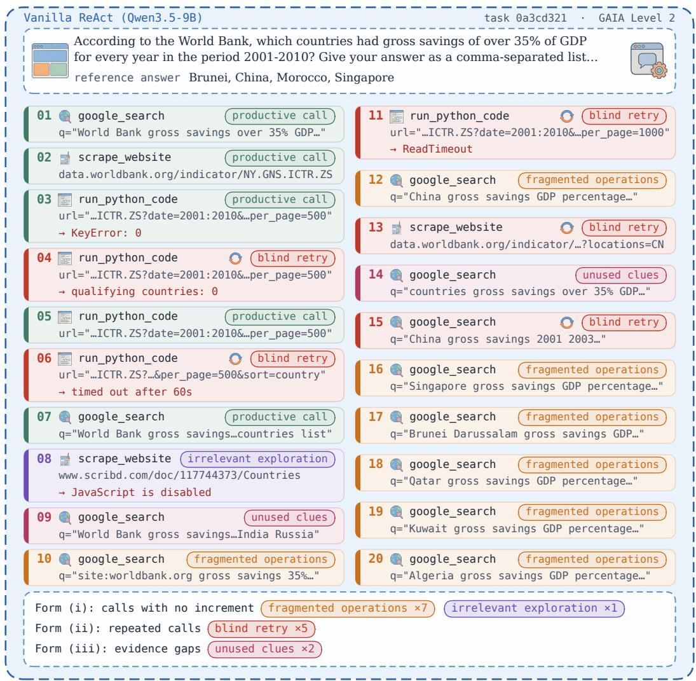  
Figure 4: A real trajectory of the 9B base model on GAIA task 0a3cd321 (Level 2), with its redundant calls labelled step by step by the diagnosis judge. A call may match several forms; the label gives its principal one. The form (iii) cue is a World Bank DataBank table with per-country values for each year of 2001–2010: its link appears in the search results of steps 1, 7, 9, 10, 14 and 19 (snippets omitted), yet the table is never opened.

The three forms co-occur in one real trajectory. Figure 4 labels a real trajectory step by step: only 5 of its 20 calls advance the task, the rest fall into the three forms above, and the trajectory exhausts the call cap without answering.

Repeated calls are the largest source of the reduction. For Section 6.1, the same judge labels every call in all three GAIA runs of the 9B base model and both operating points. Given the question, the reference answer and the whole trajectory, it writes a one-line rationale for each call and assigns it to necessary or to one of the five behaviours above, which are then merged into forms. Percategory call counts are averaged over each question’s three runs before the reduction is split by category; resampling questions gives 95% intervals of 49.8–65.8%, 13.9–27.1% and 15.5–28.0% for the shares of form (ii), form (i) and necessary calls in the efficiency point’s reduction. Of all the base model’s calls, 61.0% are judged removable, close to the 68.0% on the 221 separately collected trajectories of Section 3.1. The judge is also consistent with the deterministic near-duplicate criterion above: among the 7964 calls it labelled, the criterion flags 1307, of which the judge marks 96.9% as blind retries and 99.8% as removable.

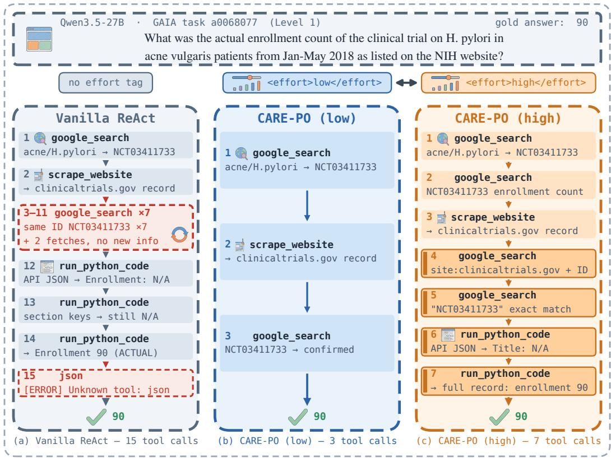  
Figure 5: Call trajectories of three policies on GAIA task a0068077, with arguments and observations abbreviated. All three answer correctly; they differ in how many calls they need to reach the same numeric answer. The highlighted steps 4–7 in (c) are the capability point’s extra checking calls.

## B FINE-GRAINED RESULTS ON GAIA

Figure 5 expands the task of Figure 1(b) (GAIA task a0068077, Level 1), placing side by side three real trajectories from the 27B evaluation logs.

The base model’s first search already finds the trial and its second call fetches the page, yet it then takes two kinds of detour: seven of calls 3 through 11 repeat searches for the same trial identifier, the blind retry of Appendix A, and calls 12 to 14 are three Python executions probing the same API response for the right field name, a case offragmented operations. CARE-PO (low) answers after 3 calls; it avoids both detours, adding only one confirming search after the fetch. CARE-PO (high) spends 7, all four extra calls used for checking: two further searches cross-check the identifier and two Python executions re-verify the field. On this task the two operating points use the same number of calls in all three independent runs (3 and 7), while the base model uses 16, 12 and 15.

Token cost decreases with the call count. The reward prices tool calls, whereas inference cost is incurred in tokens. Table 4 reports token counts on the 9B GAIA traces, the setting analysed in Section 6. Relative to the base model, the efficiency point generates 45% fewer tokens, consumes 50% fewer observation tokens and processes 67% less context; the capability point reduces these by 35%, 38% and 57%, and OTC-PO by 26%, 32% and 49%. The reduction in calls is thus not offset by longer generation, and its effect accumulates because every observation is re-processed at each subsequent turn. Each turn comprises one model call and at most one tool invocation; the number of these sequential steps decreases by 52% and 41% at the two points.

Table 4: Per-question cost on GAIA-165 at 9B, averaged over the three runs of Table 1. Tokens are counted with the Qwen3.5 tokenizer over the stored traces; context processed is the total prompt length over the model calls of a trajectory (system prompt, question and all preceding messages).
<table><tr><td>Method</td><td>AC</td><td>Turns</td><td>Generated</td><td>Observations</td><td>Context processed</td></tr><tr><td>Vanilla ReAct</td><td>8.26</td><td>9.1</td><td>1.91k</td><td>13.1k</td><td>104.4k</td></tr><tr><td>OTC-PO</td><td>5.01</td><td>6.0</td><td>1.41k</td><td>8.90k</td><td>53.2k</td></tr><tr><td>CARE-PO (low)</td><td>3.42</td><td>4.4</td><td>1.04k</td><td>6.54k</td><td>34.6k</td></tr><tr><td>CARE-PO (high)</td><td>4.44</td><td>5.4</td><td>1.24k</td><td>8.11k</td><td>45.3k</td></tr></table>

## C TRAINING DYNAMICS

Figure 6 shows our method’s training dynamics at all three sizes, including the composition of the reward.

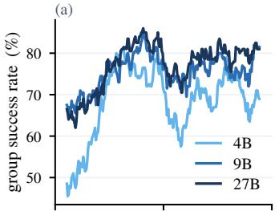

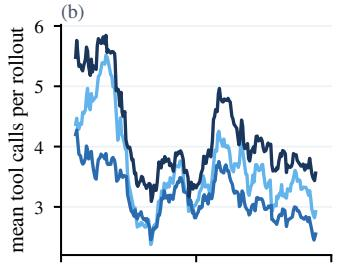

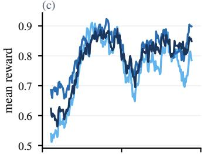

(d)  
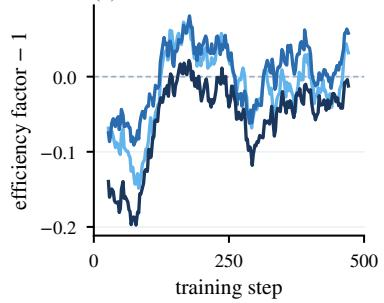

(e)  
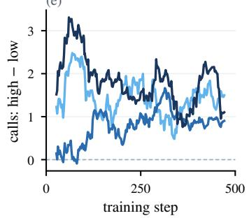

(f)  
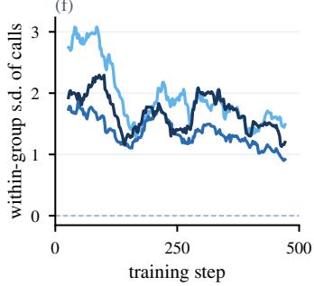  
Figure 6: Training dynamics of our method at three model sizes, excluding the injected source trajectory; curves are centred running means over 25 optimization steps. (a) Group success rate on the training distribution. (b) Mean tool calls per rollout. (c) Mean reward. (d) The efficiency factor minus one, i.e. λ tanh $\mathfrak { r } ( \gamma _ { e } ( 1 - u ) )$ ) in Eq. (2), which is zero (dashed line) at $u = 1$ , where cost is exactly one reference budget. (e) Difference in mean call count between the high and low tiers. (f) Sample standard deviation of the call count within a group.

Reward composition differs across sizes. The three sizes’ mean rewards nearly coincide (Figure 6(c)); they differ in the efficiency factor (Figure 6(d)). At 4B and 9B it rises from below one to around one; at 27B it also rises but remains slightly below one for most of training, so 27B’s comparable reward rests more on delivered value.

The call count settles at a non-zero level at every size. Mean calls per rollout (Figure 6(b)) fall early in training and then fluctuate well above zero; over the last fifth of training, rollouts that issue no call at all make up only 2.22%, 1.42% and 0.28% at 4B, 9B and 27B.

Call counts rise with the reference budget. In the final fifth of training, delivering rollouts on tasks with reference budgets of 3, 4 and 5 use on average 2.31, 2.82 and 3.15 calls at 4B, 2.16, 2.77 and 2.91 at 9B, and 2.57, 3.51 and 3.54 at 27B, whereas no such ordering is present in the first fifth. The policy thus acquires task-dependent call counts rather than converging to a single count.

The tiers separate early in training. The gap in call count between the tiers (Figure 6(e)) is established within the first hundred steps and remains positive at all three sizes thereafter.

Call counts remain dispersed within groups. Over the policy’s own rollouts, the within-group standard deviation of the call count (Figure 6(f)) remains well above zero throughout training at every size, so the group-relative advantage retains a signal on calling.

The stability advantage persists under longer training. When both methods are trained at 27B for 1000 steps with the same learning rate, OTC-PO again ends up issuing no call at all, and its training success rate falls with it. Ours levels off at about three calls per rollout with fewer than 1% of rollouts issuing no call, and its training success rate does not decline.

Every model in the result tables is evaluated at its final checkpoint. The one exception is OTC-PO at 27B, whose final checkpoint has already reached the degenerate solution (Figure 3); we evaluate a checkpoint from before the collapse, so that the comparison is not drawn against a collapsed policy.

## D IMPLEMENTATION DETAILS AND HYPERPARAMETERS

Training. The optimizer is GRPO (Shao et al., 2024) with no KL regularizer and token-level loss normalization. Each group holds $G = 8$ policy rollouts and the injected source trajectory (Section 3.5), which enters the same clipped surrogate with the current policy’s log-probabilities as its old ones, so its importance ratio starts at 1. The reward uses $\lambda = 0 . 5 , t = 1 . 5$ and $b _ { \mathrm { h i g h } } = 0 . 3 0$ LoRA (Hu et al., 2022) of rank 8 is applied to the attention and MLP projections. Training runs for 500 steps with a call cap of $T _ { \mathrm { m a x } } = 2 0$ , at a learning rate of $6 \times 1 0 ^ { - 6 } \left( 4 \mathbf { B } , 9 \mathbf { B } \right)$ or $1 \times 1 0 ^ { - 5 } \ : ( 2 7 \mathrm { B } )$ ).

Tools. Training and evaluation share four tools: google search (web search), scrape website (fetch the body text at a URL), run python code (execute code and return stdout) and read file (read a file attached to the task). The first two reach the live web through third-party APIs; the other two run in a local sandbox. All methods share one system prompt, which already instructs economical tool use. Tool signatures and return formats, the code and the verbatim prompts are in the supplementary material.

Effort tag. The low tier appends to the user turn a block headed $[ \mathrm { { T o o l - c a l 1 ~ e f f o r t } ] }$ with the tag $< \mathrm { e f f o r t } > \mathrm { l o w } < / \mathrm { e f f o r t } >$ and the sentence “Prefer fewer tool calls; stop as soon as the evidence is sufficient”; the high tier appends $\scriptstyle < \mathrm { e f f o r t } > \mathrm { h i g h } < / \mathrm { e f f o r t } >$ and “Allow extra tool calls when they are likely to improve confidence or recover missing evidence”. The unconditioned tier adds neither, and evaluation uses the same text.

Producing the reference budget and the evidence checklist. The estimation prompt asks the judge to inspect the source trajectory and return a minimal chain retaining only the essential steps and their evidence sources, together with its length; entities drawn from the question or from common knowledge need no retrieval and are not counted in the evidence checklist. The verification prompt presumes that the candidate is too low and checks three conditions: that every entity a step requires traces back to the question or to an earlier observation, that the evidence chain is coherent, and that the candidate is not below what is reachable in execution; if any check fails, it returns a corrected value to the estimation step. An error in $B _ { \mathrm { r e f } }$ does not change the direction of the pressure: the efficiency factor strictly decreases in u and u strictly increases in $S _ { \mathrm { c h a r g e d } } .$ , so on a given task, among trajectories with the same outcome and the same coverage, the one with the smaller $S _ { \mathrm { c h a r g e d } }$ scores higher for any $B _ { \mathrm { r e f } } ;$ the error changes only how much one call adds to u, that is, the magnitude of the pressure.

Training-task selection. The three checks of Section 3.3 act on the output of the offline pass: the evidence checklist must hold at least two entities that require retrieval $\bar { ( | E ( x ) | } \ge 2 )$ , or coverage degenerates to a binary signal; the reference budget must be at least the length of that checklist $( \tilde { B _ { \mathrm { r e f } } } ~ \geq ~ | E ( x ) | )$ , or a call that obtains one more piece of evidence costs more budget than the coverage it adds; and the source trajectory must make at least twice as many calls as the reference budget $( S _ { \mathrm { l o n g } } \geq 2 B _ { \mathrm { r e f } } )$ , or it leaves too little to compress. Of the candidates, 1825 pass all three checks; the 300-task training list is sampled from them with reference budgets of 3, 4 and 5 in about equal proportion. The listed tasks have source-trajectory call counts of 7–12 (mean 10.5), reference budgets of 3–5 (mean 4.0) and checklists of length 2–3.

Judging coverage. For each entity on the checklist, a large model checks the trajectory’s tool observations for the entity or an equivalent rendering of it; the entity is covered if any observation contains it.

Grading. Evaluation decodes greedily. During training, answers are graded against the gradable answer produced by the offline pass of Section 3.3. At evaluation GAIA uses the official strict exact match (numeric equality, element-wise list comparison, normalized string equality) and the multihop benchmarks use cover-EM, which counts an answer correct when the normalized gold string occurs in the normalized prediction. The answer is taken from the closing JSON object the prompt requires; where a trajectory does not end in one we try a \boxed{} expression and then a fallback extractor, applied identically to every method.

Significance tests. On GAIA we use a paired bootstrap over the 165 questions: 20000 resamples, each taking the mean per-question difference in grades between two methods, with a two-sided p; on the single-run multi-hop benchmarks we use an exact McNemar test on the paired per-question outcomes.

The exchange rate implied by HV. $\mathrm { H V } = \mathrm { S R } \cdot ( 1 - \mathrm { A C } / T _ { \mathrm { m a x } } )$ carries an implied exchange rate. Differentiating at the 9B efficiency point (SR 39.8, AC 3.42) gives $\partial \mathrm { H V } / \partial \mathrm { S R } = 0 . 0 0 8 3 \ : \mathrm { p e r }$ point and $\partial \mathrm { H V } / \partial \bar { \mathrm { A C } } = - 0 . 0 1 9 9$ per call: one call saved is worth about 2.4 points of success rate. The rate is set by $T _ { \mathrm { m a x } }$ , and a larger cap makes a call cheaper. This conclusion is robust to the rate: when HV is recomputed with $T _ { \mathrm { m a x } } = 3 0$ , 50 or 100, the highest HV at each size is still attained by one of our two operating points. We use HV to report results only, not to select checkpoints (Appendix C describes how checkpoints are chosen).